# Code de la santé

## ADMINISTRATIONS ET SERVICES - DIRECTION DE LA SANTÉ

### Version consolidée applicable au 19/12/2022 : Loi du 21 novembre 1980 portant organisation de la direction de la santé.

#### Art. 1er.

La Direction de la santé a dans les limites fixées par les lois et règlements les missions suivantes:

1\) protéger et promouvoir la santé en tant que bien-être général sur les plans physique, psychique et social;

2\) étudier, surveiller et évaluer l'état de santé de la population et exécuter des mesures de santé publique, y compris les mesures d'urgence nécessaires à la protection de la santé;

3\) veiller à l'observation des dispositions légales et réglementaires en matière de santé publique;

4\) mettre en œuvre des programmes de prévention et de promotion de la santé;

5\) évaluer et promouvoir la qualité dans le domaine de la santé;

6\) contribuer sur le plan national et international à l'application de la politique sanitaire;

7\) conseiller les autorités publiques et les collectivités sur les questions de santé;

8\) promouvoir et exécuter des travaux de recherche scientifique dans le domaine de la santé;

9\) coordonner et promouvoir la formation continue pour médecins, médecins-dentistes et pharmaciens.

#### Art. 2.

(1) La Direction de la santé est placée sous l'autorité du ministre ayant la Santé dans ses attributions.

(2) La Direction de la santé se compose d'un directeur et deux directeurs adjoints. Le directeur est responsable de la gestion de l'administration.

Il en est le chef hiérarchique et est secondé dans sa tâche par deux directeurs adjoints qui assument la responsabilité respectivement du département opérationnel et technique et du département administratif. Si le directeur est empêché d'exercer ses fonctions, il est remplacé par un directeur adjoint.

#### Art. 3.

(1) La Direction de la santé se compose d'un département médical et technique et d'un département administratif. Le département médical et technique comporte huit divisions, ainsi que le service d'orthoptie et le service audiophonologique.

(2) Les huit divisions prennent les dénominations suivantes:

1\. Division de l'inspection sanitaire;

2\. Division de la médecine préventive;

3\. Division de la médecine scolaire et de la santé des enfants et adolescents;

4\. Division de la médecine curative et de la qualité en santé;

5\. Division de la pharmacie et des médicaments;

6\. Division de la radioprotection;

7\. Division de la santé au travail et de l'environnement;

8\. Division de la médecine sociale, des maladies de la dépendance et de la santé mentale;

Les divisions peuvent être subdivisées en services. Chaque division est dirigée par un chef de division.

(3) Le service d'orthoptie, dont les actes sont gratuits, est chargé du dépistage et du traitement orthoptique et pléoptique des personnes présentant une amblyopie, des troubles de la vision binoculaire, de la prise en charge des personnes présentant une basse vision ou des perturbations du champ visuel en mono- et binoculaire.

(4) Le service audiophonologique, dont les actes sont gratuits, est chargé de la prévention, du dépistage et de la prise en charge des troubles de la parole, du langage, de la phonation, ainsi que des troubles de l'audition. Ce service intervient à l'intention d'enfants et d'adultes, sans préjudice des attributions du centre de logopédie dans le domaine de la scolarité.

#### Art. 4.

Dans le cadre des attributions visées à l'article 1er, les différentes divisions sont chargées plus particulièrement des missions visées ci-après:

(1) La division de l'inspection sanitaire est chargée:

–  d'assurer la protection de la santé publique tant en ce qui concerne l'hygiène du milieu que la surveillance et la lutte contre les maladies transmissibles;

–  d'organiser le contrôle médical des ressortissants de pays tiers;

–  de traiter les dossiers relatifs aux étrangers souhaitant se faire soigner au Luxembourg et dont la prise en charge n'est pas assurée par les organismes de sécurité sociale;

–  de se prononcer sur l'aptitude médicale à des mesures d'éloignement.

Elle remplit en outre la mission de point focal national dans le cadre du Règlement sanitaire international.

(2) La division de la médecine préventive a compétence pour toutes les questions concernant la promotion de la santé et la prévention des maladies et des infirmités.

(3) La division de la médecine scolaire et de la santé des enfants et adolescents a compétence pour toutes les questions concernant la médecine scolaire, la surveillance, ainsi que la promotion de la santé des enfants et adolescents.

(4) La division de la médecine curative et de la qualité en santé a compétence pour toutes les questions concernant la planification, l'organisation, l'évaluation de la performance et la surveillance des établissements hospitaliers et des soins primaires, des moyens et équipements de soins, ainsi que l'exercice des professions médicales et des autres professions de santé. Elle a aussi compétence pour toutes les questions ayant trait à l'évaluation, à la promotion et à la coordination nationale de la qualité dans le domaine de la santé, y compris la prévention des risques liés aux soins de santé et le contrôle de qualité des laboratoires. Elle est chargée de la coordination et de la promotion de la formation continue pour médecins, médecins-dentistes et en collaboration avec la division visée au paragraphe (5), pour les pharmaciens.

(5) La division de la pharmacie et des médicaments a compétence pour toutes les questions relatives à l'exercice de la pharmacie ainsi que pour les questions relatives aux médicaments et produits pharmaceutiques en général et en particulier leur fabrication, leur contrôle, leur mise sur le marché, leur publicité, leur distribution, leur importation et leur exportation. Sa compétence s'étend également aux précurseurs des stupéfiants, aux produits cosmétiques, ainsi qu'aux dispositifs médicaux.

(6) La division de la radioprotection a compétence pour toutes les questions concernant la protection contre les rayonnements ionisants et non-ionisants, la sécurité nucléaire, ainsi que la sécurité de la gestion des déchets radioactifs.

(7) La division de la santé au travail et de l'environnement a compétence pour toutes les questions concernant la promotion de la santé et du bien-être au travail. Elle assure la coordination et le contrôle des services de santé au travail en ce qui concerne leur organisation et leur fonctionnement. Elle remplit sa mission en étroite collaboration avec l'inspection du travail et des mines qui peut requérir son avis dans le cadre de la [loi modifiée du 10 juin 1999](https://legilux.public.lu/eli/etat/leg/loi/1999/06/10/n5/jo) relative aux établissements classés, et la consulter en ce qui concerne la santé au travail. Elle examine, sur base de données techniques recueillies par l'inspection du travail et des mines, l'impact des nuisances éventuelles sur la santé des travailleurs et informe les médecins du travail compétents. Elle assure conjointement avec l'inspection du travail et des mines, chacune en ce qui la concerne, l'application des directives qui en découlent.

La division de la santé au travail et de l'environnement a en outre compétence pour les problèmes de santé liés à l'environnement en général et plus particulièrement à l'environnement domestique. Elle a une mission de dépistage et d'évaluation des risques ainsi qu'une mission de prévention et de détection des maladies dues à l'environnement.

(8) La division de la médecine sociale, des maladies de la dépendance et de la santé mentale a compétence pour toutes les questions concernant la planification, l'organisation, l'orientation et la surveillance médico-sociale en cas de maladies de la dépendance, en particulier des toxicomanies, ainsi qu'en cas de maladies psychiques et de problèmes médico-psycho-sociaux.

Sa compétence s'étend également aux organismes génétiquement modifiés.

#### Art. 5.

(1) les médecins de la Direction de la santé sont chargés:

1\) de veiller à l'observation des lois et règlements en matière de santé publique;

2\) de contrôler le fonctionnement des services médico-sociaux, publics ou privés;

3\) d'étudier les questions de santé publique et de faire au directeur de la santé les propositions d'amélioration qu'ils jugent opportunes;

4\) de prendre les mesures d'urgence qui s'imposent dans l'intérêt de la santé publique.

(2) Dans l'exécution de leur mission de surveillance et de contrôle, les médecins de la Direction de la santé ont le droit d'entrer de jour et de nuit, lorsque l'existence soit d'un cas de maladie contagieuse, soit d'une contamination, soit de conditions sanitaires défectueuses peut être présumée sur la base d'indices graves:

1\) dans les bâtiments publics,

2\) dans tous les établissements publics ou privés tels que: établissements hospitaliers, cabinets médicaux, pouponnières, crèches, écoles, maisons-relais, pensionnats, auberges de jeunesse, casernes, établissements pénitentiaires, usines, magasins, théâtres, cinémas, établissements de bains, terrains et salles de sport,

3\) dans les structures offrant accueil et hébergement et les services visés par la [loi modifiée du 8 septembre 1998](https://legilux.public.lu/eli/etat/leg/loi/1998/09/08/n4/jo) réglant les relations entre l'Etat et les organismes oeuvrant dans les domaines social, familial et thérapeutique,

4\) dans les exploitations agricoles,

5\) dans les lieux où sont fabriqués, manipulés, entreposés et vendus des denrées alimentaires, des boissons, des médicaments, ainsi que les produits et organismes visés à l'article 6, paragraphe 1er, point 1),

6\) dans les immeubles en voie de construction,

7\) dans les habitations privées.

Lorsque l'entrée dans un des lieux précités est refusée au médecin de la Direction de la santé, celui-ci ordonnera la visite par une décision spéciale et motivée. En ce qui concerne les locaux destinés à l'habitation, leur visite est conditionnée à l'accord explicite du président du Tribunal d'arrondissement du lieu de situation de l'habitation.

Le médecin de la Direction de la santé a le droit de requérir directement le concours de la force publique pour l'exécution de ses missions. Il signale sa présence au chef des locaux et établissements précités ou à celui qui le remplace. Celui-ci a le droit de les accompagner lors de la visite.

#### Art. 6.

(1) Les pharmaciens-inspecteurs sont chargés:

1\) de veiller à l'observation des lois et règlements ayant trait à l'exercice de la pharmacie, aux médicaments, aux produits cosmétiques, vénéneux et toxiques, ainsi qu'aux dispositifs médicaux;

2\) de procéder à l'inspection:

– des pharmacies, y compris les pharmacies hospitalières;

– des établissements pharmaceutiques de fabrication, d'importation et de distribution des médicaments;

– plus généralement de tous les lieux où sont fabriqués, manipulés, entreposés ou mis en vente les produits et substances visés au point 1);

3\) de donner leur avis sur des questions concernant la pharmacie et les médicaments et de faire au directeur de la santé les propositions d'amélioration qu'ils jugent opportunes;

4\) de rassembler des rapports sur les effets secondaires observés pour certains médicaments et certaines substances et d'en informer le corps médical et pharmaceutique.

(2) Les activités professionnelles de pharmacien-inspecteur sont à considérer comme occupation pharmaceutique pour l'application de la [loi du 4 juillet 1973](https://legilux.public.lu/eli/etat/leg/loi/1973/07/04/n2/jo) concernant le régime de la pharmacie.

#### Art. 7.

Les fonctionnaires et employés de l'État de la division de la radioprotection de la Direction de la santé relevant des catégories de traitement A, groupes de traitement A1 et A2, et B, groupe de traitement B1, de la rubrique « Administration générale » sont chargés de veiller à l'observation des lois et règlements ayant trait à la protection des personnes et des biens contre les dangers résultant des radiations.

#### Art. 7bis — (Abrogé)

#### Art. 8.

(1) Les médecins de la Direction de la santé ont qualité d'officier de la police judiciaire pour constater les infractions aux lois et règlements en matière de santé publique.

Les pharmaciens-inspecteurs ont qualité d'officier de police judiciaire pour constater les infractions aux lois et règlements concernant les médicaments et l'exercice de la pharmacie.

Les experts en radioprotection et les ingénieurs nucléaires ont qualité d'officier de police judiciaire pour constater les infractions aux lois et règlements en matière de radioprotection et de sécurité nucléaire.

(2) Ils constatent les infractions par des procès-verbaux faisant foi jusqu'à preuve contraire. Ils doivent avoir suivi une formation professionnelle spéciale portant sur la recherche et la constatation des infractions ainsi que sur les dispositions pénales en matière de santé publique. Le programme et la durée de la formation ainsi que les modalités de contrôle des connaissances sont arrêtés par règlement grand-ducal.

Avant d'entrer en fonction ils prêtent, devant le tribunal d'arrondissement de leur domicile, siégeant en matière civile, le serment suivant: «Je jure de remplir mes fonctions avec intégrité, exactitude et impartialité.» L'article 458 du [Code pénal](https://legilux.public.lu/eli/etat/leg/code/penal) leur est applicable.

(3) Lorsqu'il existe des indices graves faisant présumer une infraction aux lois et règlements en matière de santé publique, les membres de la Police grand-ducale et les médecins de la Direction de la santé ont le droit d'entrer de jour et de nuit pendant les heures d'ouverture dans les locaux visés à l'article 5.

Lorsqu'il existe des indices graves faisant présumer une infraction aux lois et règlements concernant les médicaments et l'exercice de la pharmacie, les membres de la Police grand-ducale et les pharmaciens-inspecteurs ont le droit d'entrer de jour et de nuit pendant les heures d'ouverture dans les locaux visés à l'article 6.

Lorsqu'il existe des indices graves faisant présumer une infraction aux lois et règlements ayant trait à la protection des personnes et des biens contre les dangers résultant des radiations ionisantes et non-ionisantes, les membres de la Police grand-ducale ayant la qualité d'officier de police judiciaire et les agents visés à l'article 8, paragraphe 1er, troisième phrase, ont le droit d'entrer de jour et de nuit pendant les heures d'ouverture dans les locaux, établissements, terrains et moyens de transport assujettis au champ d'application des lois et règlements ayant trait à la radioprotection.

Ils signalent leur présence au chef des locaux et établissements précités ou à celui qui le remplace. Celui-ci a le droit de les accompagner lors de la visite.

Ils ont le droit de saisir des objets, documents et effets qui ont servi à commettre les infractions ou qui étaient destinés à les commettre et ceux qui ont formé l'objet de l'infraction.

(4) Les dispositions du paragraphe 3 ne sont pas applicables aux locaux qui servent à l'habitation.

Toutefois, et sans préjudice de l'article 33, paragraphe 1er du [Code de procédure pénale](https://legilux.public.lu/eli/etat/leg/code/procedure_penale), s'il existe des indices graves faisant présumer que l'origine de l'infraction se trouve dans les locaux destinés à l'habitation, il peut être procédé à la visite domiciliaire entre six heures et demie et vingt heures par deux officiers de police judiciaire, membres de la Police grand-ducale ou agents au sens du paragraphe 1er, agissant en vertu d'un mandat du juge d'instruction.

#### Art. 9.

Les administrations communales ne peuvent, sauf le cas d'urgence, introduire aucune innovation, ni édicter aucun règlement en matière d'hygiène publique ou d'hygiène sociale sans l'avis préalable du directeur de la santé ou d'un médecin de la Direction de la santé délégué par lui.

#### Art. 10.

Lorsqu'il s'agit de prévenir ou de combattre des maladies contagieuses ou des contaminations, le médecin de la Direction de la santé a le droit d'édicter lui-même, sous forme d'ordonnance, les mesures d'urgence qu'il juge nécessaire à l'exception d'une mesure d'hospitalisation forcée. Ces mesures sont portées à la connaissance des intéressés:

a) s'il s'agit d'une mesure collective, par voie de publication dans la presse écrite et audiovisuelle;

b) s'il s'agit d'une mesure individuelle, par une notification à personne faite par voie administrative.

Elles doivent être immédiatement exécutées nonobstant recours.

Au besoin, l'exécution est assurée par des agents de la force publique.

Les mesures prises par le médecin de la Direction de la santé sont communiquées sans délai au directeur de la santé qui les porte à la connaissance du ministre de la santé.

Celui-ci peur d'office rapporter ou modifier les mesures édictées par le médecin de la Direction de la santé.

Dans un délai de dix jours à partir de l'affichage, s'il s'agit d'une mesure collective, ou à partir de la notification à personne, s'il s'agit d'une mesure individuelle, un recours contre l'ordonnance du médecin de la Direction de la santé est ouvert à toute personne intéressée auprès du ministre de la santé.

#### Art. 11.

L'hospitalisation forcée d'une personne susceptible de propager une maladie contagieuse et qui néglige ou refuse de se faire traiter est ordonnée par le juge des référés de l'arrondissement du domicile ou de la résidence du malade. Ce magistrat statue à la demande du procureur d'Etat sur une requête émanant du médecin de la Direction de la santé constatant l'état médical, la situation de famille et les conditions de logement du malade à interner.

L'ordonnance est exécutée par les soins du procureur d'Etat, qui, sur proposition ou après consultation du médecin précité, peut consentir à l'élargissement de la personne hospitalisée.

Le malade interné peut, à quelque époque que ce soit, présenter une requête de sortie par voie de simple lettre, signée par lui, par son fondé de pouvoir ou par la personne qui a sur lui le droit de garde, à adresser au président du tribunal d'arrondissement. Un accusé de réception est immédiatement transmis au signataire de la requête. La décision est rendue par le tribunal, réuni en chambre du conseil, le ministère public entendu en ses conclusions, dans le mois au plus tard de la date à laquelle la requête de mise en liberté est parvenue au président du tribunal d'arrondissement.

Sans préjudice de tout autre moyen d'investigation, le tribunal peut prendre l'avis du médecin de la Direction de la santé qui a provoqué l'internement et du médecin de l'établissement hospitalier.

Le greffier informe les intéressés par lettre recommandée au plus tard l'avant-veille, du jour, de l'heure et du lieu de la séance. Le malade a le droit d'y assister en personne, si son état de santé le permet, par fondé de pouvoir, ou par la personne qui exerce sur lui le droit de garde, pour être entendu en ses explications orales.

II est statué dans la même forme sur l'appel de l'intéressé qui peut être interjeté dans un délai de quinze jours à partir de la notification de la décision rendue par le tribunal. L'appel est déclaré par voie de simple lettre, signée par le malade interné, par son fondé de pouvoir ou par la personne quia sur lui le droit de garde, à adresser au président de la cour supérieure de justice.

#### Art. 12.

Les ordonnances, jugements, décisions, procès-verbaux, copies, avertissements et lettres recommandées qui peuvent intervenir en exécution des articles 10 et 11 qui précèdent, ainsi que les pièces de toute nature produites en cours d'instance, sont exempts des droits de timbre et d'enregistrement avec dispense de la formalité.

#### Art. 13.

Toute infraction aux mesures prescrites par le médecin de la Direction de la santé ou le ministre de la santé en exécution de l'article 10 ainsi qu'à celles ordonnées par le juge des référés en exécution de l'article 11 est punie d'une amende de cinq cent un à trois mille francs et d'un emprisonnement de huit jours à un mois ou d'une de ces peines seulement.

Les dispositions du livre I du [Code pénal](https://legilux.public.lu/eli/etat/leg/code/penal), ainsi que les articles 130-1 à 132-1 du [Code de procédure pénale](https://legilux.public.lu/eli/etat/leg/code/procedure_penale) sont applicables à ces infractions.

#### Art. 14.

(A) Le cadre du personnel comprend un directeur, deux directeurs adjoints, des médecins, des médecins dirigeants, des médecins-dentistes, des médecins-dentistes dirigeants, des experts en radioprotection, des experts en radioprotection dirigeants, des ingénieurs nucléaires, des ingénieurs nucléaires dirigeants, des pharmaciens-inspecteurs, des pharmaciens-inspecteurs dirigeants et des fonctionnaires des différentes catégories de traitement telles que prévues par la [loi du 25 mars 2015](https://legilux.public.lu/eli/etat/leg/loi/2015/03/25/n3/jo) fixant le régime des traitements et les conditions et modalités d'avancement des fonctionnaires de l'Etat.

(B) Les modifications législatives qui sont apportées ultérieurement aux carrières énumérées sous (A) sont applicables au personnel de la Direction de la santé.

(C) Le cadre prévu sous (A) peut être complété par des stagiaires-fonctionnaires, des employés de l'Etat et des salariés de l'Etat suivant les besoins de l'administration et dans la limite des crédits budgétaires.

#### Art. 15.

Les médecins de la Direction de la santé chargés du service de l'inspection sanitaire peuvent porter le titre de médecin-inspecteur dans l'exercice de leurs fonctions. Les médecins chargés du service de médecine scolaire ou du service de médecine du travail peuvent porter les titres respectivement de médecin scolaire et de médecin-inspecteur du travail.

Les fonctionnaires de la division de l'inspection sanitaire peuvent porter le titre d'inspecteur sanitaire. La collation de ces titres ne modifie en rien le rang, ni le traitement des fonctionnaires concernés.

#### Art. 16.

(1) La nomination aux fonctions de directeur est réservée au Grand-Duc.

(2) Les candidats au poste de directeur ou à un poste de médecin ou de médecin-dentiste à la Direction de la santé doivent être autorisés à exercer la profession de médecin ou de médecin-dentiste au Luxembourg suivant les dispositions légales en vigueur au moment où il est pourvu à la vacance de poste.

Le candidat à un poste de médecin auprès de la Direction de la santé titulaire d'un des titres de formation visés à l'article 1er, paragraphe 1er sous b) de la [loi modifiée du 29 avril 1983](https://legilux.public.lu/eli/etat/leg/loi/1983/04/29/n1/jo) concernant l'exercice des professions de médecin, de médecin-dentiste, de médecin-vétérinaire, qui a accompli une formation spécifique en santé publique d'une durée de trois ans au moins ou plusieurs formations spécifiques en santé publique d'une durée totale de trois ans, reconnues par le ministre de la Santé, peut être dispensé par ce même ministre de la condition d'une formation spécifique en médecine générale ou d'une formation de spécialisation reconnue pour l'attribution d'un titre de médecine générale ou d'une formation de médecin spécialiste reconnue pour l'attribution d'un titre de médecin-spécialiste, prévues à l'article 1er sous (c) de la [loi précitée](https://legilux.public.lu/eli/etat/leg/loi/1983/04/29/n1/jo). Le médecin dispensé de la prédite condition ne peut toutefois pas se prévaloir de l'autorisation d'exercer dont question à l'article 1er alinéa 1er de cette [même loi](https://legilux.public.lu/eli/etat/leg/loi/1983/04/29/n1/jo).

Le directeur adjoint administratif et le directeur adjoint opérationnel et technique doivent être titulaire d'un diplôme sanctionnant un cycle universitaire complet de quatre années au moins délivré conformément à la collation des grades, ou d'un diplôme luxembourgeois de fin d'études universitaires correspondant au grade de master reconnu ou d'un diplôme étranger de fin d'études universitaires ou d'une école d'enseignement supérieur à caractère universitaire correspondant au grade de master reconnu et homologué par le ministre ayant l'Enseignement supérieur dans ses attributions conformément à la [loi modifiée du 18 juin 1969](https://legilux.public.lu/eli/etat/leg/loi/1969/06/18/n1/jo) sur l'enseignement supérieur et l'homologation des titres et grades étrangers d'enseignement supérieur. Les diplômes étrangers doivent être inscrits au registre des diplômes prévu par la [loi modifiée du 17 juin 1963](https://legilux.public.lu/eli/etat/leg/loi/1963/06/17/n1/jo) ayant pour objet de protéger les titres d'enseignement supérieur. Ces diplômes doivent sanctionner une formation dans un des domaines utiles à l'exercice de la fonction. Le directeur adjoint administratif doit disposer d'une expérience professionnelle pertinente d'au moins trois années.

(3) Le directeur et le médecin chef de division doivent justifier d'une formation complémentaire dans une des matières spécifiques relevant de la compétence de la Direction de la santé, et dont les modalités seront déterminées par règlement grand-ducal.

#### Art. 17.

Sans préjudice des conditions générales d'admission au service de l'Etat, les conditions particulières d'admission au stage, de nomination et de promotion qui ne sont pas fixées par la présente loi sont déterminées pour autant que de besoin par règlement grand-ducal.

#### Art. 18 — (Abrogé)

#### Art. 19.

Les fonctions nouvelles créées par la présente loi sont classées comme suit:

| le directeur adjoint | au grade 17 |
|---|---|
| le médecin chef de division | au grade 16 |
| l'expert en radioprotection ou ingénieur nucléaire chef de division | au grade 16 |
| le pharmacien-inspecteur chef de division | au grade 16 |
| le médecin chef de service | au grade 15 |
| le médecin-dentiste | au grade 15 |
| l'ingénieur nucléaire | au grade 14 |
| l'expert en sciences hospitalières | au grade 12 |
| l'orthoptiste | au grade 10 |
| l'éducateur sanitaire | au grade 8 |
| l'audiomériste | au grade 4 |

Le médecin chef de division bénéficie d'un avancement en traitement au grade 17 quatre années après avoir atteint le dernier échelon du grade 16.

Le médecin chef de service et le médecin-dentiste bénéficient d'un avancement en traitement au grade 16 après six années de grade.

L'ingénieur nucléaire bénéficie d'un avancement en traitement au grade 16 après douze années de grade.

L'expert en sciences hospitalières bénéficie d'un avancement en traitement au grade 13, allongé d'un neuvième échelon, ayant l'indice 455 après douze années de grade.

L'orthoptiste bénéficie d'un avancement en traitement au grade 12 allongé d'un neuvième échelon ayant l'indice 425 après douze années de grade.

L'éducateur sanitaire bénéficie d'un avancement en traitement au grade 11 après douze années de grade.

L'audiométriste bénéficie d'un premier avancement en traitement au grade 6 après six années de grade, d'un second avancement en traitement au grade 7 après quatorze années de grade et après avoir subi avec succès un examen de promotion qui pourra avoir la forme d'un examen de spécialisation.

#### Art. 20.

Les modifications et additions suivantes sont apportées à la [loi modifiée du 22 juin 1963](https://legilux.public.lu/eli/etat/leg/loi/1963/06/22/n1/jo) fixant le régime des traitements des fonctionnaires de l'Etat:

A. L'article 22 est modifié comme suit:

A la section II

au numéro 4° est ajoutée la mention:

l'audiométriste de la santé;

au numéro 8° est ajoutée la mention:

l'éducateur sanitaire de la santé (grade 8);

au numéro 9° est ajoutée la mention:

l'orthoptiste de la santé;

au numéro 10° est ajoutée la mention:

expert en sciences hospitalières;

au numéro 11° est ajoutée la mention:

ingénieur nucléaire;

au numéro 12° sont ajoutées les mentions:

médecin chef de service de la santé (grade 15) et médecin-dentiste de la santé (grade 15);

au numéro 19° est ajoutée la mention:

le médecin chef de division de la santé;

A la section IV au numéro 9° est ajoutée la mention: l'orthoptiste de la santé;

B. A l'annexe A. - Classification des fonctions, la rubrique I Administration générale est modifiée et complétée comme suit:

a) au grade 4 est ajoutée la mention:

Santé - °audiométriste,

b) au grade 8 est ajoutée la mention:

Santé - °éducateur sanitaire,

c) au grade 10 est ajoutée la mention:

Santé - °orthoptiste,

d) au grade 12 est ajoutée la mention:

Santé -°expert en sciences hospitalières,

e) au grade 14 est supprimée la mention:

Santé publique - médecin-inspecteur adjoint,

f) au grade 14 est ajoutée la mention:

Santé - °ingénieur nucléaire,

g) au grade 15 sont ajoutées les mentions:

Santé - °médecin chef de service,

Santé - °médecin-dentiste,

h) au grade 16 sont ajoutées les mentions:

Santé - °médecin chef de division,

Santé - °expert en radioprotection chef de division,

Santé - °ingénieur nucléaire chef de division,

Santé - °pharmacien-inspecteur chef de division,

i) au grade 17 est ajoutée la mention:

Santé - directeur adjoint.

C. A l'annexe A. - Classification des fonctions, la rubrique IV Enseignement est modifiée et complétée comme suit:

au grade E 5 est ajoutée la mention:

Santé - professeur d'enseignement logopédique.

D. A l'annexe D. - Détermination, la rubrique 1 Administration générale est modifiée et complétée comme suit:

a) A la carrière inférieure de l'administration,

aash grade 3 de computation de la bonification d'ancienneté,

au grade 4 est ajoutée la mention audiométriste.

b) A la carrière moyenne de l'administration,

aash grade 7 de computation de la bonification d'ancienneté,

au grade 8 est ajoutée la mention éducateur sanitaire,

aash grade 10 de computation de la bonification d'ancienneté, est ajoutée la mention: orthoptist,

c) A la carrière supérieure de l'administration,

aash grade 12 de computation de la bonification d'ancienneté,

au grade 12 est ajoutée la mention:

expert en sciences hospitalières

au grade 14 est ajoutée la mention:

ingénieur nucléaire

au grade 16 sont ajoutées les mentions:

expert en radioprotection chef de division,

ingénieur nucléaire chef de division,

pharmacien-inspecteur chef de division,

aash grade 14 de computation de la bonification d'ancienneté, au grade 14 est supprimée la mention: médecin-inspecteur adjoint, au grade 15 sont ajoutées les mentions: médecin chef de service de la santé et médecin-dentiste de la santé, au grade 16 est ajoutée la mention: médecin chef de division de la santé,

au grade 17 est ajoutée la mention:

directeur adjoint de la santé.

\**Dispositions additionnelles**

#### Art. 21. et Art. 22 — (Abrogés)

\**Dispositions transitoires**

#### Art. 23 — (Abrogé)

#### Art. 24.

Sont abrogés:

aash la [loi du 31 décembre 1952](https://legilux.public.lu/eli/etat/leg/loi/1952/12/31/n1/jo) portant abrogation de la [loi du 18 mai 1902](https://legilux.public.lu/eli/etat/leg/loi/1902/05/18/n4/jo) concernant l'institution des médecins-inspecteurs et l'exercice de leurs attributions et nouvelle organisation du service des médecins-inspecteurs, et les [lois modificatives du 28 juillet 1971](https://legilux.public.lu/eli/etat/leg/loi/1971/07/28/n2/jo) et du [7 mars 1977](https://legilux.public.lu/eli/etat/leg/loi/1977/03/07/n2/jo), à l'exception de l'article 6;

bash l'[arrêté grand-ducal du 13 juillet 1945](https://legilux.public.lu/eli/etat/leg/agd/1945/07/13/n2/jo) portant création du poste du médecin-directeur de la santé publique;

cash la [loi du 23 mai 1958](https://legilux.public.lu/eli/etat/leg/loi/1958/05/23/n1/jo) portant

1\) réglementation générale de la vente, du débit et de la publicité des spécialités pharmaceutiques dans le Grand-Duché de Luxembourg;

2\) création d'un poste de pharmacien-inspecteur;

dash l'alinéa 25 de l'article 13 de la [loi modifiée du 22 juin 1963](https://legilux.public.lu/eli/etat/leg/loi/1963/06/22/n1/jo) fixant le régime des traitements des fonctionnaires de l'Etat.

#### Art. 25.

La référence au médecin-inspecteur dans les dispositions législatives et réglementaires en vigueur est remplacée par celle de médecin de la Direction de la santé.

#### Art. 26.

La présente loi entre en vigueur le premier du mois suivant celui de sa publication au Mémorial.

## COLLÈGES MÉDICAL ET VÉTÉRINAIRE - CONSEIL SUPÉRIEUR

### DISPOSITIONS GÉNÉRALES

#### Version consolidée applicable au 10/08/2026 : Loi modifiée du 26 mars 1992 sur l’exercice et la revalorisation de certaines professions de santé.

##### Art. 19 — Conseil supérieur de certaines professions de santé.

Il est créé un conseil supérieur pour les professions régies par la présente loi dit dans la suite du présent article «le conseil».

(1) Le conseil a pour mission de donner au ministre soit d’office, soit à la demande de celui-ci, des avis sur les questions intéressant l’exercice, la formation et la réglementation des professions de santé. Un code de déontologie sera établi par règlement grand-ducal, le conseil supérieur ayant été entendu en son avis. Ce code est publié au Mémorial.

(2) Les membres du conseil sont nommés par le ministre pour une durée de cinq ans sur proposition d’une part des commissions professionnelles prévues sous (4) ci-après et d’autre part des organisations professionnelles représentatives dans le secteur de la santé. Il y un membre suppléant pour chaque membre effectif.

(3) Un règlement grand-ducal détermine

aash le nombre des membres siégeant au conseil et le nombre des membres de chaque commission professionnelle;

bash le nombre des membres désignés pour siéger au conseil sur proposition des commissions professionnelles et celui des membres désignés sur proposition des organisations professionnelles, étant entendu que le premier nombre sera supérieur au second. Pour les membres désignés sur proposition des commissions professionnelles il sera tenu compte des secteurs d’activité et des niveaux de formation en fonction de leur importance numérique;

cash les modalités d’organisation et de fonctionnement du conseil et de son secrétariat;

dash les attributions des commissions professionnelles et les modalités de l’élection de leurs membres;

eash les relations du conseil avec les commissions professionnelles;

fash les indemnités des membres, fonctionnaires et experts délégués auprès du conseil et auprès des commissions professionnelles et celles des personnes en charge du secrétariat.

(4) Le conseil comprend en outre une commission professionnelle pour chacune des professions visées par la présente loi. Les membres de ces commissions et leurs suppléants sont élus tous les cinq ans par les membres des professions respectives.

#### Version consolidée applicable au 25/08/2018 : Loi du 8 juin 1999 relative au Collège médical.

##### Chapitre 1. Attributions du Collège médical.

###### Art. 1er.

Il existe un Collège médical, qui regroupe les représentants élus des médecins, médecins-dentistes, pharmaciens et psychothérapeutes et qui a la personnalité civile.

###### Art. 2.

Le Collège médical est chargé:

1\. de veiller à la sauvegarde de l’honneur, de maintenir et de défendre les principes de dignité, de probité, de délicatesse et de compétence devant régir les professions de médecin, de médecin-dentiste, de pharmacien et de psychothérapeute;

2\. de veiller à l’observation des règles déontologiques s’appliquant aux médecins, aux médecins-dentistes, aux pharmaciens et aux psychothérapeutes;

3\. d'étudier toutes les questions relatives à l'art de guérir et à la santé dont il sera saisi par le ministre de la Santé, ou dont il jugera utile de se saisir;

4\. d’émettre un avis sur tous les projets de loi et de règlement concernant les professions de médecin, de médecin-dentiste, de pharmacien, de psychothérapeute ou d’autres professions de santé, ou encore relatifs au secteur hospitalier.

##### Chapitre 2. Composition du Collège médical.

###### Art. 3.

Le Collège médical est composé de membres effectifs et de membres suppléants.

Les membres effectifs sont au nombre de quatorze, à savoir:

– huit médecins,

– deux médecins-dentistes,

– deux pharmaciens et

– deux psychothérapeutes.

Il y a autant de membres suppléants répartis par profession selon la même clef.

Les membres doivent, au moment d'entamer leur mandat, être âgés de trente ans au moins et de soixante-douze ans au plus. Le membre qui atteint la limite d'âge en cours de mandat est habilité à le terminer.

###### Art. 4.

Le Collège médical réuni en assemblée générale élit, parmi les membres effectifs et par vote secret, un président, un vice-président et un secrétaire.

Le président représente judiciairement et extrajudiciairement le Collège médical.

###### Art. 5.

Lorsqu'un mandat de membre effectif devient vacant, il sera occupé par le membre suppléant de la même profession ayant obtenu le plus de voix lors du scrutin au cours duquel a été élu le membre à remplacer. En cas d'égalité de voix le candidat dont l'autorisation d'exercer est la plus ancienne ou, subsidiairement, le candidat le plus âgé l'emporte.

La personne devenue membre effectif du Collège médical en vertu de l'alinéa qui précède termine le mandat du membre qu'elle remplace.

Lorsqu'un mandat de membre effectif devient vacant et qu'il n'y a plus de membre suppléant élu au même scrutin, il est procédé à une cooptation d'un nouveau membre par les membres de la profession concernée, réunis en assemblée spéciale.

Le président du Collège médical convoque les membres suppléants aux réunions du Collège pour en compléter la composition en cas d'absence déclarée d'un membre effectif. Le membre suppléant doit être de la même profession que le membre à remplacer.

##### Chapitre 3. Elections.

###### Art. 6.

Les membres du Collège médical sont élus à la majorité relative des voix, pour un mandat de six ans, qui est renouvelable. Dans le respect de l’article 3, alinéa 2, les membres sont respectivement choisis par les médecins, les médecins-dentistes, les pharmaciens et les psychothérapeutes.

En vue d’assurer un renouvellement partiel périodique du Collège médical il est procédé tous les trois ans à une élection de quatre membres médecins, d’un membre médecin-dentiste, d’un membre pharmacien et d’un membre psychothérapeute.

Les élections ont lieu au mois d'octobre et les mandats issus de ces élections prennent effet au premier janvier de l'année subséquente.

Il n'y a qu'une circonscription électorale pour tout le pays.

###### Art. 7.

Sont électeurs les médecins, les médecins-dentistes, les pharmaciens et les psychothérapeutes autorisés à exercer leur profession au Luxembourg et y inscrits aux registres professionnels respectifs.

La liste des électeurs est arrêtée par le président du Collège médical trois mois avant la date des élections.

###### Art. 8.

Ne peuvent prendre part à l'élection des membres du Collège médical ni en faire partie:

1\. les personnes exerçant une profession principale pour laquelle le diplôme respectivement de médecin, de médecin-dentiste, de pharmacien et de psychothérapeute n’est pas exigé par la loi.

2\. les personnes condamnées à l'interdiction totale ou partielle, perpétuelle ou temporaire des droits énumérés à l'article 11 du Code pénal;

3\. les personnes contre lesquelles la suspension du droit d'exercer la profession a été prononcée, pendant la durée de la suspension et pendant une durée de trois ans après la fin de la période de suspension.

###### Art. 9.

(1) Sont éligibles les médecins, médecins-dentistes, pharmaciens et psychothérapeutes qui se portent candidats, qui exercent leur profession au Luxembourg depuis au moins cinq ans à la date des élections et qui répondent aux conditions de l’article 7, ainsi qu’à la condition d’âge dont question à l’article 3.

(2) Ne sont pas éligibles.

1\. les médecins, médecins-dentistes, pharmaciens et psychothérapeutes assurant la direction d’un hôpital.

2\. le médecin-directeur de l'administration du contrôle médical de la sécurité sociale.

3\. les médecins, médecins-dentistes et pharmaciens de la direction de la santé.

4\. les personnes énumérées à l'article 8 ci-dessus.

5\. les membres effectifs et suppléants du Collège médical dont le mandat n'expire pas le 31 décembre qui suit la date des élections.

Le Collège médical arrête la liste des candidats deux mois avant la date des élections.

###### Art. 9*bis*.

Par dérogation à l’article 9 paragraphe 1er, les psychothérapeutes autorisés à exercer la psychothérapie au Luxembourg dans les six années qui suivent l’entrée en vigueur de la [loi du 14 juillet 2015](https://legilux.public.lu/eli/etat/leg/loi/2015/07/14/n1/jo) portant création de la profession de psychothérapeute, ne doivent pas satisfaire à la condition d’exercice professionnel de cinq ans pour être éligibles.

###### Art. 10.

Sont élus membres effectifs du Collège médical les candidats ayant obtenu le plus grand nombre de voix, compte tenu des mandats à pourvoir dans la profession en question.

Sont élus membres suppléants du Collège médical les candidats classés aux rangs subséquents, compte tenu des mandats de membres suppléants à pourvoir dans la profession en question.

En cas d'égalité de voix, le candidat dont l'autorisation d'exercer au Luxembourg est la plus ancienne, ou, subsidiairement, le candidat le plus âgé, l'emporte.

###### Art. 11.

(1) Un règlement grand-ducal à prendre sur avis du Conseil d'Etat déterminera les modalités de la présentation des candidatures et du vote, qui se fera par correspondance.

(2) Dans les quinze jours qui suivront le scrutin, tout électeur inscrit a le droit de réclamer contre l'élection. La réclamation doit être formulée par écrit, énoncer tous les moyens de réclamation et être remise au ministre de la Santé dans le délai ci-dessus. Dans le mois de l'élection, le Gouvernement statuera définitivement sur la validité de celle-ci.

La décision sera notifiée aux élus. Lorsqu'une élection est déclarée nulle, le ministre compétent fixera un jour dans la huitaine à l'effet de procéder à un nouveau scrutin dans le mois au plus tard.

##### Chapitre 4. Organisation interne du Collège médical.

###### Art. 12.

Le Collège médical se dotera d'un règlement d'ordre intérieur. Les séances du Collège médical ne sont pas publiques. Les membres sont tenus au secret des délibérations.

###### Art. 13.

Le Collège médical couvre les dépenses nécessaires à son fonctionnement, autres que celles visées à l’article qui suit, par une cotisation à charge de toutes les personnes exerçant au pays une profession pour laquelle le diplôme de médecin, de médecin-dentiste, de pharmacien ou de psychothérapeute est exigé, à l’exception toutefois des médecins et médecins-dentistes qui, établis dans un autre Etat membre de l’Union européenne, n’effectuent au Luxembourg que des prestations de services.

La cotisation, dont le montant peut être pondéré suivant les professions et les activités exercées, est fixée annuellement par le Collège médical réuni en assemblée générale, comprenant les membres effectifs et les membres suppléants.

A défaut de paiement le président du Collège médical peut requérir l'exécutoire de la cotisation par le Président du tribunal d'arrondissement.

Sont dispensés du paiement de la cotisation les médecins, médecins-dentistes, pharmaciens et les psychothérapeutes qui, avant le 1er janvier de l’année pour laquelle elle est due, demandent leur radiation du registre professionnel. Cette demande vaut renonciation à l’autorisation d’exercer leur profession.

###### Art. 14.

L'Etat met un de ses agents à temps partiel à la disposition du Collège médical pour assumer la fonction de secrétaire administratif du Collège.

L'Etat met à la disposition du Collège médical le local nécessaire à son fonctionnement.

###### Art. 15.

Les résolutions du Collège médical sont prises à la majorité des membres votants. En cas de partage de voix celle du président de séance est prépondérante.

Dans le cadre de l'exercice des attributions visées à l'article 2 point 4, tout membre du Collège médical qui ne partage pas l'avis majoritaire exprimé par le Collège médical peut émettre un avis séparé, qui fera partie intégrante de l'avis du Collège médical.

###### Art. 16.

Le président du Collège médical peut proposer ses bons offices pour régler les différends qui peuvent naître entre médecins, médecins-dentistes, pharmaciens et psychothérapeutes ou entre eux et des patients ou clients, dans l’exercice de leur profession.

Il peut déléguer cette mission à un autre membre du Collège médical.

##### Chapitre 5. De la discipline et de la procédure en matière disciplinaire.

###### Art. 17.

(1) Le conseil de discipline en matière disciplinaire se compose du président du tribunal d’arrondissement de Luxembourg ou du juge qui le remplace et de seize assesseurs, à savoir quatre pour chacune des professions de médecin, de médecin-dentiste, de pharmacien et de psychothérapeute.

(2) Les assesseurs, qui doivent tous être de nationalité luxembourgeoise, sont désignés tous les trois ans de la façon suivante:

–  deux pour chacune des trois professions précitées, par le président du conseil de discipline;

–  deux pour chacune des professions de médecin et de médecin-dentiste, par l'association la plus représentative des intérêts de ces professions;

–  deux par l'association la plus représentative des intérêts des pharmaciens.

–  deux par l’association la plus représentative des intérêts des psychothérapeutes.

(3) Parmi ces assesseurs le président du conseil de discipline désignera pour chaque affaire les deux assesseurs qui siégeront.

A cet effet il composera le conseil de discipline de façon à ce qu’il y ait deux assesseurs médecins, médecinsdentistes, pharmaciens ou psychothérapeutes suivant que l’affaire est dirigée contre un médecin, un médecindentiste, un pharmacien ou un psychothérapeute. Si une seule et même action est dirigée contre les membres de deux professions différentes, le conseil de discipline comprendra un assesseur de chaque profession concernée.

(4) En cas d'empêchement des membres assesseurs désignés, le président les remplacera en respectant les règles de composition ci-dessus.

###### Art. 18.

Ne peuvent siéger au conseil de discipline ni les membres effectifs et suppléants du Collège médical, ni les parents ou alliés du poursuivi ou de son conjoint jusqu'au degré de cousin issu de germain inclusivement.

Les membres du conseil qui veulent s'abstenir pour d'autres motifs sont tenus de le déclarer par écrit au président du conseil de discipline dans les trois jours qui suivent leur convocation. Le conseil décide s'il y a lieu ou non à abstention.

###### Art. 19.

Le conseil de discipline exerce le pouvoir de discipline sur toutes les personnes relevant de la présente loi pour:

1\. violation des prescriptions légales, réglementaires et déontologiques concernant l'exercice de la profession;

2\. fautes et négligences professionnelles graves;

3\. faits contraires à l'honorabilité et à la dignité professionnelles; le tout sans préjudice de l'action judiciaire et de l'action disciplinaire prévue par le statut général des fonctionnaires de l'Etat et celui des fonctionnaires communaux pouvant naître des mêmes faits.

L'action disciplinaire se prescrit par cinq ans à compter du jour où les faits ci-dessus visés se sont produits.

###### Art. 20.

(1) Les peines disciplinaires sont dans l'ordre de leur gravité:

1\. l'avertissement;

2\. la réprimande;

3\. l'amende d'ordre de 5.001 à 100.000.- frs;

4\. la subordination de l'exercice de la profession à des conditions déterminées;

5\. la suspension du droit d'exercer la profession pour un terme qui ne peut être inférieur à quinze jours ni excéder cinq ans;

6\. l'interdiction à vie d'exercer la profession.

Les sanctions des catégories 5 et 6 ci-dessus comportent la privation, respectivement temporaire ou perpétuelle, du droit de vote et d'éligibilité pour le Collège médical.

(2) La peine de la suspension temporaire du droit d'exercer la profession peut être assortie du sursis pour tout ou partie de sa durée. Le bénéfice du sursis est perdu si le condamné fait l'objet d'une nouvelle peine de suspension pour un fait se situant dans les cinq ans du fait qui a donné lieu à la première peine.

(3) Le conseil de discipline peut ordonner la publication de sa décision dans la presse professionnelle et/ou dans un ou plusieurs journaux ou périodiques, ainsi que l'affichage aux lieux qu'il indique, le tout aux frais du condamné.

(4) Les frais provoqués par la poursuite disciplinaire seront mis à charge du condamné; en cas d'acquittement de la personne poursuivie ou de classement de l'affaire ils seront supportés par l'Etat.

(5) Les frais et, le cas échéant, l'amende sont rendus exécutoires par le président du tribunal d'arrondissement du ressort de la personne condamnée. L'amende est recouvrée par l'administration de l'enregistrement au profit de l'Etat.

###### Art. 21.

Le président du Collège médical instruit les affaires dont il est saisi soit par le procureur d'Etat, soit sur plainte ou dont il se saisit d'office. Il les défère au conseil de discipline, s'il estime que les faits rentrent dans une des hypothèses visées à l'article 19 ci-dessus.

Il est tenu de déférer au conseil de discipline les affaires dont il est saisi à la requête du procureur d'Etat.

Il peut déléguer ses pouvoirs d'instruction et de saisine à un autre membre du Collège médical.

###### Art. 22.

Avant de saisir le conseil de discipline, le président du Collège médical dresse un procès-verbal des faits qui ont motivé l'instruction. Il peut s'adresser au procureur d'Etat pour voir charger des officiers de police judiciaire de procéder à une enquête.

###### Art. 23.

Dès la saisine du conseil de discipline et la réception du procès-verbal, le président du conseil de discipline convoque la personne poursuivie ainsi que le président du Collège médical par lettre recommandée, avec accusé de réception, indiquant lieu, date et heure de la séance. Les témoins et experts sont convoqués d'après la même procédure.

Il y aura un délai d'au moins 15 jours entre la date de la lettre de convocation et celle de la séance.

La citation contient les griefs formulés contre la personne poursuivie. Celle-ci peut prendre inspection du dossier, sans déplacement, au secrétariat du Collège médical. Elle peut, à ses frais, s'en faire délivrer des copies.

La personne poursuivie comparait en personne. Elle peut se faire assister par un avocat. Si elle ne comparait pas, il est statué par décision par défaut non susceptible d'opposition.

###### Art. 24.

A l'ouverture de la séance, le président du conseil de discipline expose l'affaire et donne lecture des pièces, s'il le juge utile.

Le conseil entend ensuite successivement la partie plaignante, s'il y en a, les témoins, qui en cas de huis clos se retirent après avoir déposé, la personne poursuivie et le président du Collège médical en ses conclusions.

Le procès-verbal de la séance est dressé par le greffier du conseil de discipline.

###### Art. 25.

Le conseil de discipline peut ordonner des enquêtes et des expertises. Les enquêtes sont faites soit par le conseil, soit par un de ses membres.

Les témoins et experts comparaissant devant le conseil ou ses délégués sont entendus sous la foi du serment conformément aux règles inscrites au Code de procédure civile. Les témoins cités qui refuseraient de comparaître ou de déposer sont passibles des peines comminées par l'article 77(2) du code d'instruction criminelle. Ces peines sont prononcées par le tribunal correctionnel, sur réquisition du ministère public. Le tribunal correctionnel peut en outre ordonner que le témoin défaillant sera contraint par corps à venir donner son témoignage. Le faux témoignage et la subornation de témoins et d'experts sont punis des peines prévues aux articles 220, 223 et 224 du code pénal.

###### Art. 26.

Les séances du conseil de discipline sont publiques. Toutefois, le huis clos peut être ordonné à la demande de la personne poursuivie ou si des faits touchant à des intérêts vitaux de tiers doivent être évoqués dans les débats.

Les délibérations sont secrètes. Les décisions sont prises à la majorité absolue des voix et sont signées par tous les membres du conseil; elles sont motivées et sont lues en séance publique.

###### Art. 27.

Les lettres, notifications et citations à la personne poursuivie, aux témoins et aux experts ainsi que les expéditions des décisions du conseil sont signées par le président du conseil de discipline.

Les notifications et citations se font conformément aux dispositions du [règlement grand-ducal du 15 mai 1991](https://legilux.public.lu/eli/etat/leg/rgd/1991/05/15/n1/jo) relatif aux significations et notifications en matière civile et commerciale.

###### Art. 28.

Sans préjudice des dispositions de l'article 20 paragraphe (5) ci-dessus, les décisions du conseil de discipline sont notifiées par le greffier du conseil de discipline à la personne poursuivie par lettre recommandée et exécutées à la diligence du président du Collège médical. Une copie certifiée conforme en est transmise au procureur général d'Etat.

Les minutes des décisions sont déposées et conservées au conseil de discipline. Une copie ne peut en être délivrée que sur autorisation du président du conseil de discipline.

###### Art. 29.

Les décisions du conseil de discipline peuvent être attaquées par la voie de l'appel, tant par la personne sanctionnée que par le président du Collège médical.

L'appel est porté devant le conseil supérieur de discipline.

###### Art. 30.

Le conseil supérieur de discipline se compose de six magistrats de la Cour d’Appel ainsi que de seize assesseurs, à savoir quatre pour chacune des professions de médecin, de médecin-dentiste, de pharmacien et de psychothérapeute.

Un arrêté grand-ducal nomme pour une durée de trois ans le président du conseil supérieur de discipline, choisi parmi les membres magistrats, ainsi que les autres membres du conseil supérieur. Les membres non magistrats sont nommés sur proposition

– du président du conseil supérieur de discipline qui en propose deux pour chacune des trois professions précitées;

– de l'association la plus représentative des intérêts des médecins et médecins-dentistes, qui en propose deux pour chacune des professions de médecin et de médecin-dentiste;

– de l'association la plus représentative des intérêts des pharmaciens, qui en propose deux pour la profession de pharmacien.

– de l’association la plus représentative des intérêts des psychothérapeutes, qui en propose deux pour la profession de psychothérapeutes.

Dans chaque affaire le conseil supérieur de discipline siège au nombre de cinq membres dont trois membres magistrats et deux membres non magistrats. Le président du conseil de discipline ou le membre magistrat le plus ancien en rang qui le remplace compose le conseil supérieur de façon à ce qu’il y ait deux assesseurs médecins, médecins-dentistes, pharmaciens ou psychothérapeutes, suivant que l’affaire est dirigée contre un médecin, un médecin-dentiste, un pharmacien ou un psychothérapeute.

En cas d'empêchement des membres compétents pour une profession déterminée, le magistrat président désigne, pour compléter le conseil dans une affaire déterminée, d'autres membres de la profession concernée par l'affaire en question.

Les membres du conseil supérieur de discipline doivent être de nationalité luxembourgeoise.

L'article 18 ci-dessus est également d'application pour le conseil supérieur de discipline.

###### Art. 31.

L'appel est déclaré au greffe de la Cour Supérieure de Justice dans le délai de quarante jours, sous peine de déchéance. Le délai court pour la personne sanctionnée du jour où la décision lui a été notifiée et, pour le président du Collège médical, du jour où l'expédition de la décision lui a été remise.

###### Art. 32.

La procédure devant le conseil supérieur de discipline se déroule conformément aux articles 21 à 28 cidessus.

###### Art. 33.

L'Etat prend en charge les frais de fonctionnement du conseil de discipline et du conseil supérieur de discipline.

Un règlement grand-ducal fixe les indemnités revenant aux membres et greffiers du conseil de discipline et du conseil supérieur de discipline.

###### Art. 34.

Le greffier en chef près le tribunal d'arrondissement à Luxembourg ou le greffier qui le remplace remplit la fonction de greffier auprès du conseil de discipline.

Le greffier en chef près la Cour Supérieure de Justice ou le greffier qui le remplace remplit la fonction de greffier auprès du conseil supérieur de discipline.

###### Art. 35.

La suspension prononcée contre un membre d'une des professions visées par la présente loi entraîne la défense absolue d'exercer pendant la durée de la suspension, sans préjudice des dispositions de l'article 20 paragraphe (2) ci-dessus.

Toute personne qui, sauf le cas d'urgence avérée, contrevient à la disposition qui précède, commet le délit d'exercice illégal de sa profession.

###### Art. 36.

L'appel et le délai pour interjeter appel ont un effet suspensif.

##### Chapitre 6.- Dispositions transitoires et abrogatoires.

###### Art. 37.

Les premières élections qui se font d'après les critères énoncés à la présente loi auront lieu au cours du mois d'octobre de l'année qui suit celle de son entrée en vigueur.

Par dérogation aux dispositions de l'alinéa 2 de l'article 6 ci-dessus ces élections assureront un renouvellement complet du collège médical.

###### Art. 38.

Si en application de la [loi modifiée du 6 juillet 1901](https://legilux.public.lu/eli/etat/leg/loi/1901/07/06/n1/jo) concernant l'organisation et les attributions du Collège médical des mandats de membres effectifs ou suppléants du collège médical viennent à expiration entre la date d'entrée en vigueur de la présente loi et la date du 31 décembre de l'année qui suit les élections dont question à l'article qui précède, ces mandats sont d'office prorogés jusqu'à la date du 31 décembre précitée.

A la date du 31 décembre précité tous les mandats de membres effectifs et suppléants nommés même depuis moins de six ans en vertu de la [loi modifiée du 6 juillet 1901](https://legilux.public.lu/eli/etat/leg/loi/1901/07/06/n1/jo) précitée viennent à expiration.

Par dérogation à l'article 3 troisième alinéa le nombre des membres suppléants reste fixé à huit jusqu'au 1er janvier de l'année qui suit les élections prévues à l'article qui précède.

###### Art. 39.

A la première réunion du Collège médical qui suit les premières élections organisées suivant les dispositions de la présente loi, le président du Collège médical répartit par tirage au sort les membres effectifs et suppléants du Collège médical en deux séries de sortie, dont la première comprend quatre membres effectifs et quatre membres suppléants médecins, un membre effectif et un membre suppléant médecin-dentiste et un membre effectif et un membre suppléant pharmacien. La deuxième série de sortie comprend les autres membres effectifs et suppléants du Collège médical.

Par dérogation à l'alinéa 1er de l'article 6 ci-dessus le mandat des membres effectifs et suppléants faisant partie de la première série de sortie expirera le 31 décembre de la deuxième année qui suit celle de leur entrée en fonction.

###### Art. 40.

Les affaires disciplinaires déférées au conseil de discipline avant l'entrée en vigueur de la présente loi et non encore vidées par un jugement seront jugées d'après les dispositions de la présente loi.

Toutefois, pour autant qu'elles sont appelées à juger des faits commis avant l'entrée en vigueur de la présente loi, les juridictions disciplinaires continueront d'appliquer les articles respectivement 25 et 26 de la [loi modifiée du 6 juillet 1901](https://legilux.public.lu/eli/etat/leg/loi/1901/07/06/n1/jo) concernant l'organisation et les attributions du Collège médical quant aux faits susceptibles de constituer une infraction et quant aux sanctions à prononcer.

###### Art. 41.

La [loi modifiée du 6 juillet 1901](https://legilux.public.lu/eli/etat/leg/loi/1901/07/06/n1/jo) concernant l'organisation et les attributions du Collège médical est abrogée.

Elle reste toutefois applicable aux infractions commises sous son empire, sans préjudice de l'alinéa premier de l'article 40 ci-dessus.

Toute référence dans des dispositives légales et réglementaires à la [loi modifiée du 6 juillet 1901](https://legilux.public.lu/eli/etat/leg/loi/1901/07/06/n1/jo) précitée s'entend comme étant faite à la présente loi.

#### Version consolidée applicable au 03/04/2017 : Loi du 31 mai 2002 relative au Collège vétérinaire.

##### Chapitre 1er: — *Attributions du Collège vétérinaire*

###### Art. 1er.

Il existe un Collège vétérinaire qui regroupe les représentants élus des médecins vétérinaires et qui a la personnalité civile.

###### Art. 2.

Le Collège vétérinaire est chargé:

1\. de veiller à la sauvegarde de l'honneur, de maintenir et de défendre les principes de dignité, de probité, de délicatesse et de compétence devant régir la profession de médecin-vétérinaire;

2\. de veiller à l'observation des règles déontologiques s'appliquant aux médecins-vétérinaires;

3\. d'étudier toutes les questions relatives à la profession, à la santé animale et à l'hygiène des produits d'origine animale dont il sera saisi par le gouvernement, ou dont il jugera utile de se saisir;

4\. d'émettre un avis sur tous les projets de loi et de règlement concernant la profession de médecin-vétérinaire, la santé et le bien-être des animaux et l'hygiène des produits d'origine animale.

##### Chapitre 2: — Composition du Collège vétérinaire

###### Art. 3.

Le Collège vétérinaire est composé de 6 membres effectifs et de 6 membres suppléants.

Les membres effectifs et suppléants doivent être âgés de trente ans au moins et de soixante-douze ans au plus au moment d'entamer leur mandat.

Le membre qui atteint la limite d'âge en cours de mandat est habilité à le terminer.

###### Art. 4.

Le Collège vétérinaire réuni en assemblée générale élit, parmi les membres effectifs et par vote secret, un président, un vice-président et un secrétaire.

Le président représente judiciairement et extrajudiciairement le Collège vétérinaire.

###### Art. 5.

Lorsqu'un mandat de membre effectif devient vacant, il sera occupé par le membre suppléant ayant obtenu le plus de voix lors du scrutin au cours duquel a été élu le membre à remplacer.

En cas d'égalité de voix le candidat dont l'autorisation d'exercer est la plus ancienne ou, subsidiairement, le candidat le plus âgé, l'emporte.

La personne devenue membre effectif du Collège en vertu de l'alinéa qui précède termine le mandat du membre qu'elle remplace.

Lorsqu'un mandat de membre effectif devient vacant et qu'il n'y a plus de membre suppléant au même scrutin, il est procédé à une cooptation d'un nouveau membre.

Le président du Collège vétérinaire convoque les membres suppléants aux réunions du Collège pour en compléter la composition en cas d'absence déclarée d'un membre effectif.

##### Chapitre 3: — *Elections*

###### Art. 6.

Les membres du Collège vétérinaire sont élus à la majorité relative des voix pour un mandat de six ans, qui est renouvelable.

En vue d'assurer un renouvellement partiel périodique du Collège vétérinaire il est procédé tous les trois ans à un renouvellement par moitié du Collège.

Les élections ont lieu au mois de novembre et les mandats issus de ces élections prennent effet au premier janvier de l'année subséquente.

###### Art. 7.

Sont électeurs les médecins vétérinaires qui sont:

aash autorisés à exercer leur profession au Luxembourg,

bash y établis et

cash inscrits au registre professionnel.

La liste des électeurs est arrêtée par le président du Collège vétérinaire trois mois avant la date des élections.

###### Art. 8.

Ne peuvent prendre part à l'élection des membres du Collège vétérinaire ni en faire partie:

1\. Les personnes exerçant une profession principale pour laquelle le diplôme de médecin vétérinaire n'est pas exigé par la loi.

2\. Les personnes condamnées à l'interdiction totale ou partielle perpétuelle ou temporaire des droits énumérés à l'article 11 du [code pénal](https://legilux.public.lu/eli/etat/leg/code/penal).

3\. Les personnes contre lesquelles la suspension de l'art de guérir a été prononcée, pendant la durée de la suspension et pendant une durée de trois ans après la fin de la période de suspension.

###### Art. 9.

Sont éligibles les médecins vétérinaires qui se portent candidats, qui exercent leur profession au Luxembourg depuis au moins cinq ans à la date des élections et qui répondent aux conditions de l'article 7 ainsi qu'à la condition d'âge dont question à l'article 3.

La liste des candidatures est arrêtée deux mois avant le scrutin par le président du Collège vétérinaire.

###### Art. 10.

Ne sont pas éligibles:

1\. Le directeur de l'Administration des services vétérinaires.

2\. Le président d'une organisation syndicale vétérinaire.

3\. Les personnes énumérées à l'article 8 ci-dessus.

###### Art. 11.

Sont élus membres effectifs du Collège vétérinaire lors de chacun de ses renouvellements les trois candidats ayant obtenu le plus de voix.

Sont élus membres suppléants les trois candidats classés aux rangs subséquents.

En cas d'égalité de voix le candidat dont l'autorisation d'exercer au Luxembourg est la plus ancienne ou, subsidiairement, le candidat le plus âgé, l'emporte.

###### Art. 12.

(1) Un règlement grand-ducal, à prendre sur avis du Conseil d'Etat, détermine les modalités de la présentation des candidatures et du vote, qui se fera par correspondance.

(2) Dans les quinze jours qui suivront le scrutin, tout électeur inscrit a le droit de réclamer contre l'élection. La réclamation doit être formulée par écrit, énoncer tous les moyens de réclamation et être remise au Ministre de la Santé dans le délai ci-dessus. Dans le mois de l'élection, le Gouvernement statuera définitivement sur la validité de celle-ci.

La décision sera notifiée aux élus. Lorsqu'une élection est déclarée nulle, le ministre compétent fixera un jour dans la huitaine à l'effet de procéder à un nouveau scrutin dans le mois au plus tard.

##### Chapitre 4: — Organisation interne du Collège vétérinaire

###### Art. 13.

Le Collège vétérinaire se dotera d'un règlement d'ordre intérieur.

Les séances du Collège vétérinaire ne sont pas publiques. Les membres sont tenus au secret des délibérations.

###### Art. 14.

Le Collège vétérinaire couvre les dépenses nécessaires à son fonctionnement, autres que celles visées à l'article qui suit, par une cotisation à charge de toutes les personnes exerçant au pays une profession pour laquelle le diplôme de médecin vétérinaire est exigé, à l'exception toutefois des médecins vétérinaires qui, établis dans un autre Etat membre de l'Union Européenne, n'effectuent au Luxembourg que des prestations de services.

La cotisation, dont le montant peut être pondéré suivant les activités exercées, est fixée annuellement par le Collège vétérinaire réuni en assemblée générale, comprenant les membres effectifs et les membres suppléants.

A défaut de paiement le président du Collège vétérinaire peut requérir l'exécutoire de la cotisation par le Président du tribunal d'arrondissement.

Sont dispensés du paiement de la cotisation les médecins vétérinaires qui, avant le 1er janvier de l'année pour laquelle elle est due, demandent leur radiation du registre professionnel. Cette demande vaut renonciation à l'autorisation d'exercer leur profession.

###### Art. 15.

L'Etat met à temps partiel à la disposition du Collège vétérinaire un de ses agents pour assumer la fonction de secrétaire administratif.

L'Etat met à la disposition du Collège vétérinaire le local nécessaire à son fonctionnement.

###### Art. 16.

Les résolutions du Collège vétérinaire sont prises à la majorité des membres votants. En cas de partage de voix celle du président de séance est prépondérante.

Dans le cadre de l'exercice des attributions visées à l'article 2 point 4, tout membre du Collège vétérinaire qui ne partage pas l'avis majoritaire exprimé par le Collège vétérinaire peut émettre un avis séparé, qui fera partie intégrante de l'avis du Collège vétérinaire.

###### Art. 17.

Le président du Collège vétérinaire peut proposer ses bons offices pour régler les différends qui peuvent naître entre médecins vétérinaires dans l'exercice de leur profession ou entre ceux-ci et des clients.

Il peut déléguer cette mission à un autre membre du Collège vétérinaire.

##### Chapitre 5: — De la discipline et de la procédure en matière disciplinaire

###### Art. 18.

1\. Le Conseil de discipline se compose du président du tribunal d'arrondissement de Luxembourg ou du juge qui le remplace, comme président, et de quatre assesseurs.

2\. Les assesseurs, qui doivent tous être de nationalité luxembourgeoise, sont désignés tous les trois ans par l'association la plus représentative des intérêts de la profession et par le président du Conseil de discipline qui en désignent chacun deux.

3\. Parmi ces assesseurs le président du Conseil de discipline désignera pour chaque affaire les deux assesseurs qui siégeront.

4\. En cas d'empêchement des membres assesseurs désignés, le président désignera, pour compléter le Conseil de discipline dans une affaire déterminée, un ou deux autres médecins vétérinaires répondant à la condition de nationalité dont question sous 2.

###### Art. 19.

Ne peuvent siéger au Conseil de discipline ni les membres effectifs et suppléants du Collège vétérinaire ni les parents ou alliés du poursuivi ou de son conjoint jusqu'au degré de cousin issu de germain inclusivement.

Les membres du conseil qui veulent s'abstenir pour d'autres motifs sont tenus de le déclarer par écrit au président du conseil de discipline dans les trois jours qui suivent leur convocation.

###### Art. 20.

Le Conseil de discipline exerce le pouvoir de discipline sur toutes les personnes relevant de la présente loi pour:

1\. violation des prescriptions légales, réglementaires et déontologiques concernant l'exercice de la profession;

2\. fautes et négligences professionnelles graves;

3\. faits contraires à l'honorabilité et à la dignité professionnelles;

le tout sans préjudice de l'action judiciaire et de l'action disciplinaire prévue par le statut général des fonctionnaires de l'Etat et celui des fonctionnaires communaux pouvant naître des mêmes faits.

L'action disciplinaire se prescrit par cinq ans à compter du jour où les faits ci-dessus visés se sont produits.

###### Art. 21.

(1) Les peines disciplinaires sont dans l'ordre de leur gravité:

1\. l'avertissement;

2\. la réprimande;

3\. l'amende d'ordre de 125 à 2.500 euros, qui peut être portée au double en cas de récidive;

4\. la subordination de l'exercice de la profession du médecin-vétérinaire à des conditions déterminées;

5\. la suspension du droit d'exercer la profession pour un terme qui ne peut être inférieur à quinze jours ni excéder cinq ans;

6\. l'interdiction à vie d'exercer la profession.

Les sanctions des catégories 5 et 6 ci-dessus comportent la privation respectivement temporaire ou perpétuelle du droit de vote et d'éligibilité pour le Collège vétérinaire.

(2) La peine de la suspension temporaire du droit d'exercer la profession peut être assortie du sursis pour tout ou partie de sa durée. Le bénéfice du sursis est perdu si le condamné fait l'objet d'une nouvelle peine de suspension pour un fait se situant dans les cinq ans du fait qui a donné lieu à la première peine.

(3) Le Conseil de discipline peut ordonner la publication de sa décision dans la presse professionnelle et/ou dans un ou plusieurs journaux ou périodiques, ainsi que l'affichage aux lieux qu'il indique, le tout aux frais du condamné.

(4) Les frais provoqués par la poursuite disciplinaire seront mis à charge du condamné; en cas d'acquittement de la personne poursuivie ils seront supportés par l'Etat.

(5) Les frais et, le cas échéant, l'amende sont rendus exécutoires par le président du tribunal d'arrondissement du ressort de la personne condamnée. L'amende est recouvrée par l'Administration de l'enregistrement au profit de l'Etat.

###### Art. 22.

Le président du Collège vétérinaire instruit les affaires dont il est saisi soit par le procureur d'Etat, soit sur plainte ou dont il se saisit d'office. Il les défère au Conseil de discipline s'il estime que les faits rentrent dans une des hypothèses visées à l'article 20 ci-dessus.

Il est tenu de déférer au Conseil de discipline les affaires dont il est saisi à la requête du procureur d'Etat.

Il peut déléguer ses pouvoirs d'instruction et de saisine à un autre membre du Collège vétérinaire.

###### Art. 23.

Avant de saisir le Conseil de discipline, le président du Collège vétérinaire dresse un procès-verbal des faits qui ont motivé l'instruction. Il peut s'adresser au procureur d'Etat pour voir charger des officiers de police judiciaire de procéder à une enquête.

###### Art. 24.

Dès la saisine du Conseil de discipline et la réception du procès-verbal, le président du Conseil de discipline convoque la personne poursuivie ainsi que le président du Collège vétérinaire par lettre recommandée, avec accusé de réception, indiquant lieu, date et heure de la séance. Les témoins et experts sont convoqués d'après la même procédure.

Il y aura un délai d'au moins 15 jours entre la date de la lettre de convocation et celle de la séance.

La citation contient les griefs formulés contre la personne poursuivie. Celle-ci peut prendre inspection du dossier, sans déplacement, au secrétariat du Collège vétérinaire. Elle peut, à ses frais, s'en faire délivrer des copies.

La personne poursuivie comparaît en personne. Elle peut se faire assister par un avocat. Si elle ne comparaît pas, il est statué par décision par défaut non susceptible d'opposition.

###### Art. 25.

A l'ouverture de la séance, le président du Conseil de discipline expose l'affaire et donne lecture des pièces, s'il le juge utile.

Le Conseil entend ensuite successivement la partie plaignante, s'il y en a, les témoins, qui, en cas de huis clos, se retirent après avoir déposé, la personne poursuivie et le président du Collège vétérinaire en ses conclusions.

Le procès-verbal de la séance est dressé par le greffier du Conseil de discipline.

###### Art. 26.

Le Conseil de discipline peut ordonner des enquêtes et des expertises. Les enquêtes sont faites soit par le Conseil, soit par un de ses membres.

Les témoins et experts comparaissant devant le Conseil ou ses délégués sont entendus sous la foi du serment, conformément aux règles inscrites au code de procédure civil. Les témoins cités qui refuseraient de comparaître ou de déposer sont passibles des peines comminées par l'article 77 (2) du [Code de procédure pénale](https://legilux.public.lu/eli/etat/leg/code/procedure_penale). Ces peines sont prononcées par le tribunal correctionnel, sur réquisition du Ministère public. Le tribunal correctionnel peut en outre ordonner que le témoin défaillant sera contraint par corps à venir donner son témoignage. Le faux témoignage et la subornation de témoins et d'experts sont punis des peines prévues aux articles 220, 223 et 224 du [code pénal](https://legilux.public.lu/eli/etat/leg/code/penal).

###### Art. 27.

Les séances du Conseil de discipline sont publiques. Toutefois le huis clos peut être ordonné à la demande de la personne poursuivie ou si des faits touchant à des intérêts vitaux de tiers doivent être évoqués dans les débats.

Les délibérations sont secrètes. Les décisions sont prises à la majorité absolue des voix et sont signées par tous les membres du Conseil; elles sont motivées et lues en séance publique.

###### Art. 28.

Les lettres, notifications et citations à la personne poursuivie, aux témoins et aux experts ainsi que les expéditions des décisions du Conseil sont signées par le président du Conseil de discipline.

Les notifications et citations se font conformément aux dispositions du [règlement grand-ducal du 15 mai 1991](https://legilux.public.lu/eli/etat/leg/rgd/1991/05/15/n1/jo) relatif aux significations et notifications en matière civile et commerciale.

###### Art. 29.

Sans préjudice des dispositions de l'article 21, dernier alinéa ci-dessus, les décisions du Conseil de discipline sont notifiées par le greffier du Conseil de discipline à la personne poursuivie par lettre recommandée et exécutées à la diligence du président du Collège vétérinaire. Une copie certifiée conforme en est transmise au procureur général d'Etat.

Les minutes des décisions sont déposées et conservées au Conseil de discipline. Une copie ne peut en être délivrée que sur autorisation du président du Conseil de discipline.

###### Art. 30.

Les décisions du Conseil de discipline peuvent être attaquées par la voie de l'appel, tant par la personne sanctionnée que par le président du Collège vétérinaire.

L'appel est porté devant le Conseil supérieur de discipline.

###### Art. 31.

Le Conseil supérieur de discipline se compose de trois magistrats de la Cour d'Appel ainsi que de deux assesseurs médecins vétérinaires.

Il y a autant de membres suppléants que de membres effectifs.

En cas d'empêchement des membres effectifs et suppléants, le magistrat-président désigne, pour compléter le Conseil dans une affaire déterminée, d'autres membres de la profession.

Le président du Conseil supérieur de discipline et ses autres membres effectifs et suppléants sont nommés par arrêté grand-ducal pour une durée de trois ans, sur proposition, pour les membres non magistrats, de l'association la plus représentative des intérêts de la profession et du président du Conseil supérieur de discipline, qui en présentent chacun deux.

Les membres du Conseil supérieur de discipline doivent être de nationalité luxembourgeoise.

L'article 19 ci-dessus est également d'application pour le Conseil supérieur de discipline.

###### Art. 32.

L'appel est déclaré au greffe de la Cour Supérieure de Justice dans le délai de quarante jours, sous peine de déchéance. Le délai court pour la personne sanctionnée du jour où la décision lui a été notifiée, et pour le président du Collège vétérinaire du jour où l'expédition de la décision lui a été remise.

###### Art. 33.

La procédure devant le Conseil supérieur de discipline se déroule conformément aux articles 22 à 29 ci-dessus.

###### Art. 34.

L'Etat prend en charge les frais de fonctionnement du Conseil de discipline et du Conseil supérieur de discipline.

Un règlement grand-ducal fixe les indemnités revenant aux membres et greffiers du Conseil de discipline et du Conseil supérieur de discipline.

###### Art. 35.

Le greffier en chef près le tribunal d'arrondissement à Luxembourg ou le greffier qui le remplace, remplit la fonction de greffier auprès du Conseil de discipline.

Le greffier en chef près la Cour Supérieure de Justice, ou le greffier qui le remplace, remplit la fonction de greffier auprès du Conseil supérieur de discipline.

###### Art. 36.

La suspension prononcée contre un médecin vétérinaire entraîne pour lui la défense absolue d'exercer son art pendant la durée de la suspension, sans préjudice des dispositions de l'article 21, paragraphe (2).

Toute personne qui, sauf le cas d'urgence avérée, contrevient à une décision de suspension, commet le délit d'exercice illégal de la profession.

###### Art. 37.

L'appel et le délai pour interjeter appel ont un effet suspensif.

##### Chapitre 6: — Dispositions transitoires et abrogatoires

###### Art. 38.

Les premières élections qui se font d'après les critères énoncés à la présente loi auront lieu au cours du mois de novembre de l'année suivant celle de son entrée en vigueur.

Par dérogation aux dispositions de l'alinéa 2 de l'article 6 ci-dessus ces élections assureront un renouvellement complet du Collège vétérinaire.

###### Art. 39.

Les membres du Collège vétérinaire en place au moment de l'entrée en vigueur de la présente loi resteront en fonction jusqu'au 31 décembre de l'année des élections visées à l'article qui précède.

A la date du 31 décembre précité tous les mandats de membres effectifs et suppléants nommés même depuis moins de six ans en vertu de l'[arrêté grand-ducal du 6 octobre 1945](https://legilux.public.lu/eli/etat/leg/agd/1945/10/06/n2/jo) portant création du Collège vétérinaire viennent à expiration.

###### Art. 40.

A la première réunion du Collège vétérinaire qui suit les premières élections organisées suivant les dispositions de la présente loi, le président du Collège vétérinaire répartit par tirage au sort les membres effectifs et suppléants du Collège vétérinaire en deux séries de sortie, dont chacune comprend trois membres effectifs et trois membres suppléants.

Par dérogation à l'alinéa 1er de l'article 6 ci-dessus le mandat des membres effectifs et suppléants faisant partie de la première série de sortie expirera le 31 décembre de la deuxième année qui suit celle de leur entrée en fonction.

###### Art. 41.

Les affaires disciplinaires déférées au Conseil de discipline avant l'entrée en vigueur de la présente loi et non encore vidées par un jugement seront jugées d'après les dispositions de la présente loi.

Toutefois, pour autant qu'elles sont appelées à juger des faits commis avant l'entrée en vigueur de la présente loi, les juridictions disciplinaires continueront d'appliquer les articles respectivement 10 et 11 de l'[arrêté grand-ducal modifié du 4 décembre 1945](https://legilux.public.lu/eli/etat/leg/agd/1945/12/04/n1/jo) concernant le service interne du Collège vétérinaire quant aux faits susceptibles de constituer une infraction et quant aux sanctions à prononcer.

###### Art. 42.

Sont abrogés, sans préjudice des dispositions de l'article qui précède:

aash l'[arrêté grand-ducal du 6 octobre 1945](https://legilux.public.lu/eli/etat/leg/agd/1945/10/06/n2/jo) portant création d'un Collège vétérinaire,

bash l'[arrêté grand-ducal du 4 décembre 1945](https://legilux.public.lu/eli/etat/leg/agd/1945/12/04/n1/jo) concernant le service interne du Collège vétérinaire, tel qu'il a été modifié par la suite.

### RÈGLEMENTS D’EXÉCUTION

#### Version consolidée applicable au 20/09/2005 : Règlement grand-ducal du 24 avril 1993 relatif au conseil supérieur de certaines professions de santé.

##### Art. 1er.

Aux fins du présent règlement, on entend par:

\*La loi:* [Loi du 26 mars 1992](https://legilux.public.lu/eli/etat/leg/loi/1992/03/26/n1/jo) sur l'exercice et la revalorisation de certaines professions de santé.

\*Le Conseil:* Le Conseil supérieur de certaines professions de santé.

\*Le ministre:* Le ministre de la Santé.

##### Chapitre Ier: — Des commissions professionnelles.

###### Art. 2.

Chacune des professions visées par [la loi](https://legilux.public.lu/eli/etat/leg/loi/1992/03/26/n1/jo) élit une commission professionnelle.

###### Art. 3.

Les commissions professionnelles sont les organes techniques du Conseil.

###### Section 1 — *Des élections des membres des commissions professionnelles.*

**Art. 4.**

Les membres des commissions professionnelles et leurs suppléants sont élus tous les cinq ans par les membres des professions respectives. Leur mandat est renouvelable.

**Art. 5.**

Pour pouvoir participer à l'élection des membres d'une commission professionnelle déterminée, il faut exercer au Luxembourg la profession concernée.

Sont censées remplir les conditions à l'alinéa qui précède les personnes

aash qui figurent dûment sur la liste des électeurs dont question à l'article 6 suivant,

bash qui travaillent au moins 13 heures par semaine si elles sont employées, ou sont inscrites au registre des prestataires de soins de santé établi auprès de l'inspection générale de la sécurité sociale si elles sont indépendantes.

**Art. 6.**

La liste des électeurs est établie par le ministre séparément pour chaque commission professionnelle.

La liste renseigne obligatoirement pour chaque électeur au moins les données suivantes: nom, prénom(s), profession exercée au moment de l'arrêt provisoire de la liste ainsi que la date de délivrance du diplôme respectivement de autorisation d'exercer au Grand-Duché la profession dont question ci-dessus.

**Art. 7.**

Tous les cinq ans, après avoir arrêté la liste des électeurs et au plus tard le 15 septembre, le ministre fait publier, dans au moins trois journaux édités au Grand-Duché de Luxembourg, un avis invitant les électeurs visés à l'article 5 et à ce intéressés, à poser avant le 15 octobre leur candidature.

**Art. 8.**

Pour être éligible, il faut au moins avoir 21 ans à la date des élections et avoir exercé effectivement au moins à mi-temps la profession concernée pendant 3 années durant les 5 dernières années qui précèdent les élections.

En vue d'établir qu'il satisfait aux conditions susmentionnées, le candidat verse à l'appui de sa candidature un certificat dûment établi par:

(1) le ou les employeur(s) au cas où le candidat est salarié,

(2) l'union des caisses de maladie attestant que le candidat a effectué une ou des prestations relevant de sa profession pendant au moins 750 jours sur les 5 dernières années qui précèdent les élections au cas où le candidat est indépendant.

(3) le ou les employeur(s) et l'union des caisses dé maladie, pour chacun en ce qui le concerne, au cas où le candidat a exercé sa profession alternativement au titre d'indépendant et au titre de salarié.

(4) l'autorité compétente de son lieu de résidence et qui mentionne les dates de résidence.

Lorsque le candidat réside au Grand-Duché depuis moins de 3 ans, il doit en outre produire les documents équivalents émanant de l'autorité compétente de l'Etat de résidence antérieur.

Lorsque le candidat réside à l'étranger, seuls les documents équivalents émanant de l'autorité compétente de l'Etat de résidence sont à produire.

(5) l'autorité compétente et établissant qu'il n'est pas

aash condamné à des peines criminelles,

bash privé du droit de vote par condamnation,

cash placé sous tutelle.

Les preuves concernant les conditions précitées sont rapportées moyennant les attestations, certificats et autres documents prévus par des dispositions législatives, réglementaires ou administratives luxembourgeoises.

**Art. 9.**

Sont exclus de l'éligibilité en dehors des candidats qui ne fournissent pas la ou les preuves énoncées à l'article 8 ci-dessus:

1\. les personnes qui ne répondent pas aux stipulations de l'article 5 ci-devant,

2\. pour la durée de la sanction définitive, les personnes qui se trouvent sous le coup de la privation du droit de vote dont question à l'article 26 alinéa 3 de [la loi](https://legilux.public.lu/eli/etat/leg/loi/1992/03/26/n1/jo),

3\. les personnes, contre lesquelles a été prononcé l'une des sanctions disciplinaires définitives prévues à l'article 26, alinéa 4 et 5, de [la loi](https://legilux.public.lu/eli/etat/leg/loi/1992/03/26/n1/jo).

**Art. 10.**

Les conditions d'électorat passif et actif doivent être réunies à la date d'arrêt de la liste dont question à l'article 7.

**Art. 11.**

Les candidats à un mandat électoral font parvenir leur candidature par lettre recommandée au ministre pour le 15 octobre au plus tard, le cachet de la poste faisant foi. Chaque candidature doit être accompagnée des pièces justificatives énumérées à l'article 8.

Au cas où le nombre de candidatures à un mandat électoral, reconnues valables par le ministre, est inférieur ou égal au nombre de membres effectifs prévus pour la commission professionnelle correspondante et dont question à l'article 17, les candidats dont question sont élus d'office.

**Art. 13.**

Les élections se font par correspondance, au scrutin secret et à la majorité relative.

Sont élus les candidats qui ont obtenu le plus de voix par ordre décroissant et en fonction du nombre de mandats effectifs et suppléants par commission professionnelle.

En cas d'égalité des voix pour le dernier siège à pourvoir, le candidat, dont l'autorisation d'exercer la profession au Grand-Duché est la plus ancienne, l'emporte.

En cas d'abandon d'un mandat par un membre effectif, celui-ci est continué par le suppléant ayant obtenu le plus de voix lors du dernier scrutin.

**Art. 13-1.**

Il est établi un bulletin de vote pour chacune des commissions professionnelles.

**Art. 13-2.**

Le 15 novembre au plus tard, le président du Conseil transmet aux électeurs par lettre recommandée les bulletins de vote pour les commissions professionnelles en même temps que les instructions de vote pour les électeurs.

Au recto du bulletin de vote figure la liste des candidats par ordre alphabétique, leur nom et prénom(s) suivis d'une case pour exprimer le suffrage.

Les bulletins de vote, munis de l'estampille du Conseil, pliés en quatre et à l'angle droit, seront placés dans une première enveloppe, laissée ouverte et portant l'indication «Elections des membres de la commission professionnelle de...», complétée par la profession de santé correspondante.

Une deuxième enveloppe, appelée «enveloppe de renvoi», laissée également ouverte et portant la mention «RECOMMANDEE» sera jointe à l'envoi. Elle portera au recto l'adresse du bureau électoral et la mention de la franchise postale, ainsi qu'une case réservée à l'inscription des nom, prénoms, profession et domicile de l'électeur. Au verso, elle portera le numéro d'inscription de l'électeur sur la liste électorale. Sous le numéro d'inscription figure un espace réservé à l'apposition de la signature de l'électeur.

**Art. 13-3.**

Chaque électeur dispose d'autant de suffrages qu'il y a de mandats à pourvoir.

L'électeur tracera soit au crayon, soit au stylo, soit à l'aide d'un instrument analogue une croix (+ ou x) dans la case qui suit le nom de chacun des candidats pour lesquels il entend voter.

Toute case même remplie incomplètement et toute croix, même imparfaite, expriment valablement le vote, à moins que l'intention de rendre le bulletin reconnaissable soit manifeste.

**Art. 13-4.**

L'électeur s'abstient, sous peine de nullité de son vote, de faire sur le bulletin toute autre inscription, signature, rature, surcharge ou signe quelconque.

**Art. 13-5.**

Après avoir exprimé son vote, l'électeur placera le bulletin, le cachet à l'extérieur, dans la première enveloppe qu'il ferme. L'électeur glissera celle-ci dans la deuxième enveloppe portant l'adresse du bureau électoral, apposera sa signature à l'endroit prévu à l'article 13-2 alinéa 4. Il fermera le pli et le remettra à la poste, comme envoi recommandé, au plus tard le 30 novembre, le cachet de la poste faisant foi.

Toute autre voie de remise de l'enveloppe de renvoi est exclue.

**Art. 13-6.**

L'électeur qui, par inadvertance, aura détérioré le bulletin qui lui a été envoyé, peut en demander un autre par écrit au président du bureau électoral.

**Art. 13-7.**

Il y a pour les élections des membres des différentes commissions professionnelles un seul bureau électoral, dont les membres sont désignés par le ministre.

Le secrétaire administratif du Conseil assure les fonctions de secrétaire.

Le président et le secrétaire du bureau électoral sont assistés dans leur tâche par douze membres effectifs, dont au moins sept personnes ayant les qualités requises pour l'électorat actif conformément à l'article 5, et par cinq membres suppléants.

Dans aucune élection, ni les membres du Conseil, ni les membres d'une commission professionnelle, ni les candidats ou leurs conjoints, ni leurs parents ou alliés jusqu'au deuxième degré inclusivement, ne peuvent siéger au bureau électoral.

Si lors des opérations électorales, le bureau ne peut se constituer, le président ou à son défaut, le plus âgé des membres, désigne les membres qui suppléeront les membres défaillants.

**Art. 13-8.**

Après la date limite de renvoi des bulletins de vote et au plus tard le 15 décembre, le bureau électoral se réunit pour procéder au dépouillement.

Le bureau électoral siège dans les locaux mis à sa disposition par le ministre, au jour et à l'heure fixés pour le dépouillement.

Le secrétaire pointera sur les listes électorales les noms des votants.

**Art. 13-9.**

Avant le dépouillement des bulletins le bureau électoral fera le récolement des bulletins non employés. Ces bulletins seront immédiatement détruits.

Il sera ensuite procédé au dépouillement. Le nombre des votants, celui des bulletins et celui des enveloppes non signées seront inscrits au procès-verbal.

Si une enveloppe contient plusieurs bulletins, ceux-ci seront nuls.

**Art. 13-10.**

Seront nuls, outre les bulletins mentionnés à l'article 13-9. alinéa 3:

1\) les bulletins autres que ceux envoyés aux électeurs;

2\) les bulletins ne contenant l'expression d'aucun suffrage;

3\) les bulletins contenant plus de suffrages qu'il n'y a de membres à élire;

4\) les bulletins sur lesquels le votant se sera fait connaître, et notamment ceux portant une marque, une rature ou un signe distinctif quelconque, ceux dont les formes et les dimensions ont été altérées, ceux qui contiennent à l'intérieur un papier ou un objet quelconque, ou ceux renfermés dans une enveloppe marquée ou dans une enveloppe autre que celle délivrée par le président du bureau électoral; les bulletins dont l'enveloppe de renvoi ne porte pas de signature;

5\) les bulletins non renfermés dans deux enveloppes.

**Art. 13-11.**

Le bureau arrêtera pour les différentes commissions professionnelles le nombre des votants, celui des bulletins nuls et des bulletins valables, ainsi que le nombre des suffrages obtenus par chaque candidat. Le tout sera inscrit au procès-verbal.

**Art. 13-12.**

Le procès-verbal sera signé séance tenante par tous les membres du bureau.

Il sera envoyé sous pli cacheté, avec les listes électorales et les bulletins de vote, classés par bulletins valables et par bulletins nuls, au ministre.

**Art. 13-13.**

Les noms des membres effectifs et des membres suppléants élus seront publiés au Mémorial par le ministre.

**Art. 14.**

Dans les dix jours qui suivront la publication visée à l'article 13-13, le cachet de la poste faisant foi, tout électeur inscrit a le droit de réclamer contre l'élection. La réclamation doit être formulée par écrit et énoncer tous les moyens de réclamation. Dans le mois de la publication, le ministre statuera définitivement sur la validité de l'élection.

###### Section 2 — *De la composition des commissions professionnelles*

**Art. 15.**

Chaque commission comprend au moins 3 membres et au plus 17 membres.

II y a autant de membres suppléants qu'il y a de membres effectifs.

**Art. 16.**

Il y a autant de commissions professionnelles que de professions prévues à la loi ou créées en application de son article 1er.

**Art. 17.**

Les membres effectifs des commissions professionnelles sont au nombre:

aone de 11 pour les aides-soignants,

bone de 3 pour les assistants senior,

cone de 9 pour les assistants technique médicaux,

done de 17 pour les infirmiers,

eone de 9 pour les infirmiers en anesthésie et réanimation,

fone de 7 pour les infirmiers en pédiatrie,

gone de 9 pour les infirmiers psychiatriques,

hone de 3 pour les masseurs,

ione de 3 pour les sage-femmes,

jone de 9 pour les assistants d'hygiène sociale,

kone de 9 pour les assistants sociaux,

lone de 3 pour les diététiciens,

mone de 3 pour les ergothérapeutes,

none de 5 pour les infirmiers gradués,

oone de 5 pour les laborantins,

pone de 5 pour les masseur-kinésithérapeutes,

qone de 3 pour les orthophonistes,

rone de 3 pour les orthoptistes,

sone de 3 pour les pédagogues curatifs,

tone de 3 pour les rééducateurs en psychomotricité.

En cas de changement important du nombre de membres faisant partie des différentes professions, le ministre procède aux adaptations de la composition numérique des commissions professionnelles par règlement ministériel qui prend effet pour les prochaines élections.

###### Section 3: — *Des attributions des commissions professionnelles.*

**Art. 18.**

Sous l'autorité du Conseil, les commissions professionnelles délibèrent des problèmes spécifiques des professions qu'elles représentent.

Elles s'expriment plus particulièrement sur tout problème intéressant l'exercice, la formation, la déontologie et la réglementation des professions de santé, lorsqu'il a trait à leur profession.

**Art. 19.**

Elles donnent leur avis au Conseil soit d'office, soit à la demande de celui-ci.

**Art. 20.**

Elles désignent les membres du Conseil d'après les modalités fixées à l'article 25.

##### Chapitre II: — Du Conseil supérieur

###### Section 4: — *De la composition du Conseil.*

**Art. 21.**

Le Conseil est composé de 26 membres effectifs et d'autant de membres suppléants dont 19 désignés par le Ministre sur proposition des commissions professionnelles et 7 désignés par le ministre sur proposition des organisations professionnelles représentatives pour les professions de santé visées par [la loi](https://legilux.public.lu/eli/etat/leg/loi/1992/03/26/n1/jo).

**Art. 22.**

En ce qui concerne les membres proposés par les commissions professionnelles, les propositions se font en fonction d'une représentation aussi équitable que possible selon deux paramètres, d'une part la répartition numérique par secteur d'activité et d'autre part la répartition numérique par niveau de formation.

**Art. 23.**

Pour les besoins de l'article 25 ci-dessous, on distingue trois secteurs d'activité:

aash le secteur de l'hospitalisation aiguë et de l'enseignement pour ces professions,

bash le secteur du moyen et long séjour et de la psychiatrie institutionnelle fermée,

cash le secteur extra-hospitalier.

**Art. 24.**

Pour les besoins de l'article 25 ci-dessous on distingue trois niveaux de formation:

aash *le niveau 1:* toute formation inférieure au diplôme de fin d'études postprimaires,

bash *le niveau 2:* toute formation au moins égale au diplôme de fin d'études postprimaires sans dépasser le niveau du diplôme de fin d'études postprimaires suivi de deux années de formation postsecondaire,

cash *le niveau 3:* toute formation égale ou supérieure au diplôme de fin d'études postprimaires suivi de plus de deux années de formation postsecondaire.

Par diplôme de fin d'études postprimaires au sens du présent article, il y a lieu d'entendre le diplôme de fin d'études secondaires, le diplôme de fin d'études secondaires techniques ou tout autre diplôme étranger reconnu équivalent par le Ministre de l'Education Nationale.

**Art. 25.**

Les membres effectifs de toutes les commissions professionnelles faisant partie du niveau 1 se réunissent dans une assemblée commune pour procéder à la proposition de 4 délégués effectifs, et d'autant de suppléants, dont 3 pour le secteur de l'hospitalisation aiguë et de l'enseignement pour ces professions et 1 pour le secteur du moyen et long séjour et de la psychiatrie institutionnelle fermée.

aash Les membres effectifs de toutes les commissions professionnelles faisant partie du niveau 2 se réunissent dans une assemblée commune pour procéder à la proposition de 12 délégués effectifs, et d'autant de suppléants, dont 8 pour le secteur de l'hospitalisation aiguë et de l'enseignement pour ces professions, 3 pour le secteur du moyen et long séjour et de la psychiatrie institutionnelle fermée et 1 pour le secteur extra-hospitalier.

bash Les membres effectifs de toutes les commissions professionnelles faisant partie du niveau 3 se réunissent dans une assemblée commune pour procéder à la proposition de 3 délégués effectifs, et d'autant de suppléants, dont 1 pour le secteur de l'hospitalisation aiguë et de l'enseignement pour ces professions et 2 pour le secteur extra-hospitalier.

Toutefois au cas où, lors d'une ou des assemblées précitées, le(s) mandat(s) à pourvoir pour un ou des secteur(s) d'activité prévu(s), restai(en)t vacant(s), faute de candidat(s) à proposer par l'assemblée dont il s'agit, le(s) mandat(s) resté(s) ainsi vacant(s) est(sont) attribué(s), séance tenante, a un autre secteur d'activité, choisi, le cas échéant,par tirage au sort entre les secteurs d'activité prévus pour le niveau de formation dont il s'agit.

**Art. 26.**

Les organisations professionnelles qui veulent présenter des membres pour le conseil doivent répondre aux caractéristiques suivantes:

aash en ce qui concerne les organisations professionnelles qui ont une vocation essentiellement syndicale, documentée pour les besoins de cet article par le fait qu'elles participent en tant qu'organisation directement ou par délégation aux négociations salariales dans le secteur, celles-ci doivent être représentatives sur le plan national et représentées dans le secteur des professions de soins visées par [la loi](https://legilux.public.lu/eli/etat/leg/loi/1992/03/26/n1/jo);

bash en ce qui concerne les organisations professionnelles qui ont une vocation essentiellement non syndicale, documentée pour les besoins de cet article par le fait qu'elles ne participent pas en tant qu'organisation directement ou par délégation aux négociations salariales dans le secteur, celles-ci doivent être essentiellement représentées dans le secteur des professions de soins visées par [la loi](https://legilux.public.lu/eli/etat/leg/loi/1992/03/26/n1/jo), leurs membres doivent oeuvrer dans 2 au moins des trois secteurs définis à l'article 23 ou comprendre des membres de 2 au moins des 3 niveaux visés à l'article 24.

Chaque organisation propose un membre effectif et un membre suppléant.

**Art. 27.**

Le ministre procède à la nomination des membres du Conseil supérieur dans les 3 mois après la date fixée pour les élections des commissions professionnelles; lors de cette nomination il veillera dans la mesure du possible à une juste répartition, afin que les paramètres visés à l'article 22 soient respectés pour autant que faire se peut.

###### Section 5: — *Du fonctionnement du Conseil*

**Art. 28.**

Le Conseil est l'organe représentatif de l'ensemble des professions visées par [la loi](https://legilux.public.lu/eli/etat/leg/loi/1992/03/26/n1/jo). II assure la coordination des activités relevant de sa compétence et de celles des commissions professionnelles.

**Art. 29.**

Le Conseil se réunit au moins une fois par mois et tient rapport de ses séances.ll édicte un règlement sur son fonctionnement interne et sur celui de ses organes techniques.

**Art. 30.**

Le Conseil doit émettre son avis au plus tard dix semaines après avoir été saisi par le ministre.

**Art. 31.**

Lorsque le Conseil sollicite l'avis d'une ou de plusieurs commissions professionnelles celui-ci doit être donné endéans un délai de six semaines de la saisine.

##### Chapitre III: — Dispositions communes au Conseil et aux commissions professionnelles

###### Art. 32.

Le Conseil ainsi que chaque commission professionnelle choisissent le président, le vice-président et le secrétaire parmi leurs membres effectifs.

###### Art. 33.

Le mandat de membre du Conseil respectivement d'une commission professionnelle expire par suite

1\. de renonciation écrite au mandat,

2\. d'une sanction disciplinaire définitive autre que l'avertissement et la réprimande,

3\. de condamnation définitive à une peine criminelle ou à une peine d'emprisonnement d'au moins six mois sans sursis.

###### Art. 34.

Lorsque le mandat d'un membre effectif devient vacant, il sera occupé:

(1) pour une commission professionnelle, selon les dispositions prévues à l'article 13 du présent règlement,

(2) pour le Conseil, par cooptation d'un nouveau membre choisi sur la liste des suppléants et en fonction des paramètres dont question à l'article 22 du présent règlement.

Le nouveau membre remplit le mandat jusqu'au prochain renouvellement de la commission professionnelle respectivement celui du Conseil.

En cas d'empêchement d'un membre effectif pour participer à une ou des réunions du Conseil respectivement de la commission professionnelle pour laquelle il a été élu, ce membre peut se faire remplacer par son suppléant désigné d'après des modalités prévues au règlement de fonctionnement interne du Conseil dont question à l'article 29 du présent règlement.

###### Art. 35.

Le Conseil et les commissions professionnelles ne prennent de résolution que si la majorité de leurs membres sont présents.

###### Art. 36.

Les résolutions du Conseil et des commissions professionnelles sont arrêtées à la majorité des voix et consignés dans les rapports dont question à l'article suivant.

En cas d'égalité de voix, celle du président est prépondérante.

Un avis minoritaire et l'avis de la ou des commission(s) professionnelle(s) peut être joint aux résolutions.

###### Art. 37.

Le Conseil et chaque commission professionnelle dressent un rapport de leurs réunions et un rapport annuel que le Conseil transmet au Ministre.

###### Art. 38.

Ensemble avec le président du Conseil, le secrétaire coordonne les relations du Conseil avec les commissions professionnelles.

###### Art. 39.

Les membres du Conseil et des commissions professionnelles ont droit à une indemnité à fixer par le Gouvernement en Conseil et au remboursement des frais de route et de séjour exposés lors de l'accomplissement de leur mission.

###### Art. 40.

En cas de besoin le Conseil supérieur peut se faire assister par des experts qui seront rémunérés selon les modalités prévues à l'article 39 et avec l'accord préalable du ministre.

###### Art. 41.

Le conseil reçoit de la part du Gouvernement une subvention annuelle pour couvrir ses frais de fonctionnement, et notamment ceux exposés pour l'engagement de son secrétaire administratif.

###### Art. 42.

Le Conseil se fait assister dans ses travaux par un secrétaire administratif à mi-temps, détenteur d'un diplôme de fin d'études secondaires ou d'un diplôme équivalent.

##### Chapitre IV: — Dispositions transitoires

###### Art. 43.

Pour les lères élections des commissions professionnelles:

(1) la liste des électeurs est arrêtée provisoirement sur base des données du régistre au 1er mars 1993,

(2) la date des élections est fixée par arrêté ministériel à publier au Mémorial au moins 70 jours avant les élections,

(3) l'arrêté ministériel dont question ci-dessus fixe également:

aash la date limite de présentation des candidatures,

bash les endroits d'ouverture de la liste des électeurs à l'inspection du public,

cash les noms, prénoms et fonctions des membres du bureau électoral.

(4) les preuves d'éligibilité exigées en vertu des dispositions de l'article S sous (2) et (3) du présent règlement sont remplacées par un certificat établi par l'inspection générale de la sécurité sociale attestant que le candidat en question est inscrit au registre des prestataires de soins de santé auprès de cette administration.

###### Art. 45.

Notre ministre de la Santé est chargé de l'exécution du présent règlement qui sera publié au Mémorial.

#### Version consolidée applicable au 22/07/2006 : Règlement grand-ducal du 27 juillet 2000 relatif aux élections des membres du Collège médical.

##### Article 1er.

Tous les trois ans, le président du Collège médical fait publier, dans au moins trois journaux édités au Grand-Duché de Luxembourg, un avis annonçant les élections au Collège médical et leur date.

Il informe en même temps les candidats à un mandat électif qu'ils doivent lui faire parvenir leur acte de candidature par lettre recommandée avec indication de la date limite se situant deux mois avant les élections, la date de la poste faisant foi.

##### Art. 2 .

Il est établi un bulletin de vote pour chacune des professions de médecin, de médecin-dentiste et de pharmacien.

##### Art. 3 .

Le 15 octobre au plus tard, le président du Collège médical transmet aux électeurs par lettre recommandée les bulletins de vote pour le Collège médical en même temps que les instructions de vote pour les électeurs.

Les bulletins de vote, munis de l'estampille du Collège médical, pliés en quatre et à l'angle droit, seront placés dans une première enveloppe, laissée ouverte et portant l'indication «Elections des membres du Collège médical», ainsi que la désignation de la profession pour laquelle l'électeur exerce son droit de vote.

Les instructions de vote indiquent le lieu ainsi que les date et heure des opérations de dépouillement.

Une deuxième enveloppe, appelée «enveloppe de renvoi», laissée également ouverte et portant la mention «RECOMMANDEE» sera jointe à l'envoi. Elle portera au recto l'adresse du bureau électoral et la mention de la franchise postale, ainsi qu'une case réservée à l'inscription des nom, prénoms, profession et domicile de l'électeur. Au verso, elle portera le numéro d'inscription de l'électeur sur la liste électorale. Sous le numéro d'inscription figure un espace réservé à l'apposition de la signature de l'électeur.

##### Art. 4 .

Chaque électeur dispose d'autant de suffrages qu'il y a de mandats effectifs à pourvoir.

L'électeur tracera soit au crayon, soit au stylo, soit à l'aide d'un instrument analogue une croix (+ ou x) dans la case qui suit le nom de chacun des candidats pour lesquels il entend voter.

Toute case même remplie incomplètement et toute croix, même imparfaite, expriment valablement le vote, à moins que l'intention de rendre le bulletin reconnaissable soit manifeste.

##### Art. 5 .

L'électeur s'abstient, sous peine de nullité de son vote, de faire sur le bulletin toute autre inscription, signature, rature, surcharge ou signe quelconque.

##### Art. 6 .

Après avoir exprimé son vote, l'électeur placera le bulletin, le cachet à l'extérieur, dans la première enveloppe qu'il ferme. L'électeur glissera celle-ci dans la deuxième enveloppe portant l'adresse du bureau électoral, apposera sa signature à l'endroit prévu à l'article 4 alinéa 3. Il fermera le pli et le remettra à la poste, comme envoi recommandé, au plus tard le 31 octobre, le cachet de la poste faisant foi.

Toute autre voie de remise de l'enveloppe de renvoi est exclue.

##### Art. 7 .

L'électeur qui, par inadvertance, aura détérioré le bulletin qui lui a été envoyé, peut en demander un autre par écrit au président du bureau électoral.

##### Art. 8 .

Le ministre ayant la Santé dans ses attributions désigne les membres composant le bureau électoral.

Le secrétaire administratif du Collège médical assure les fonctions de secrétaire.

Le président et le secrétaire du bureau électoral sont assistés dans leur tâche par dix membres effectifs, dont au moins trois personnes ayant les qualités requises pour faire partie du Collège médical et par cinq membres suppléants.

Dans aucune élection, ni les membres du Collège médical, ni les candidats ou leurs conjoints, ni leurs parents ou alliés jusqu'au deuxième degré inclusivement, ne peuvent siéger au bureau électoral.

Si lors des opérations électorales, le bureau ne peut se constituer, le président ou à son défaut, le plus âgé des membres, désigne les membres qui suppléeront les membres défaillants.

##### Art. 9 .

Après la date limite de renvoi des bulletins de vote et au plus tard le 10 novembre, le bureau électoral se réunit pour procéder au dépouillement.

Le bureau électoral siège dans les locaux mis à sa disposition par le ministre ayant la Santé dans ses attributions, au jour et à l'heure fixés pour le dépouillement.

Le dépouillement est public.

Le secrétaire pointera sur les listes électorales les noms des votants.

##### Art. 10 .

Avant le dépouillement des bulletins le bureau électoral fera le récolement des bulletins non employés.

Ces bulletins seront immédiatement détruits.

Il sera ensuite procédé au dépouillement. Le nombre des votants, celui des bulletins et celui des enveloppes non signées seront inscrits au procès-verbal.

Si une enveloppe contient plusieurs bulletins, ceux-ci seront nuls.

##### Art. 11 .

Le président énonce nominativement les suffrages. Deux des membres du bureau électoral feront le recensement des suffrages et en tiendront note, chacun séparément.

##### Art. 12 .

Seront nuls, outre les bulletins mentionnés à l'article 11 alinéa 3:

1\) les bulletins autres que ceux envoyés aux électeurs;

2\) les bulletins ne contenant l'expression d'aucun suffrage;

3\) les bulletins contenant plus de suffrages qu'il n'y a de membres à élire;

4\) les bulletins sur lesquels le votant se sera fait connaître et notamment ceux portant une marque ou un signe distinctif quelconque, ceux renfermés dans une enveloppe marquée ou dans une enveloppe autre que celle délivrée par le président du bureau électoral;

5\) les bulletins dont l'enveloppe de renvoi ne porte pas de signature;

6\) les bulletins non renfermés dans deux enveloppes.

##### Art. 13 .

Le bureau arrêtera pour les différentes professions le nombre des votants, celui des bulletins nuls et des bulletins valables, ainsi que le nombre des suffrages obtenus par chaque candidat. Le tout sera inscrit au procèsverbal.

##### Art. 14 .

Le procès-verbal sera signé séance tenante par tous les membres du bureau.

Il sera envoyé sous pli cacheté, avec les listes électorales et les bulletins de vote, classés par bulletins valables et par bulletins nuls, au ministre ayant la Santé dans ses attributions.

##### Art. 15 .

La proclamation du résultat du scrutin sera affichée dans les locaux du Collège médical et publiée sur son site internet.

Les noms des membres effectifs et des membres suppléants élus seront publiés au Mémorial.

##### Art. 16 .

Notre Ministre de la Santé et de la Sécurité Sociale est chargé de l'exécution du présent règlement grand-ducal qui sera publié au Mémorial.

#### Règlement grand-ducal du 1er novembre 2003 relatif aux élections des membres du Collège vétérinaire.

##### Art. 1er.

Tous les trois ans, après avoir arrêté la liste des électeurs et au plus tard au cours de la première quinzaine du mois d'octobre, le président du Collège vétérinaire fait publier, dans au moins trois journaux édités au Grand-Duché de Luxembourg, un avis invitant les électeurs visés par la loi du 31 mai 2002 relative au Collège vétérinaire et à ce intéressés, à poser avant le 1er novembre leur candidature pour un mandat au Collège vétérinaire.

##### Art. 2.

Les candidats à un mandat électoral font parvenir leur candidature par lettre recommandée au ministre ayant la Santé dans ses attributions pour le 1er novembre au plus tard, le cachet de la poste faisant foi.

##### Art. 3.

Le 15 novembre au plus tard, le président du Collège vétérinaire transmet aux électeurs par lettre recommandée les bulletins de vote pour le Collège vétérinaire en même temps que les instructions de vote pour les électeurs.

Les bulletins de vote, munis de l'estampille du Collège vétérinaire, pliés en quatre et à l'angle droit, seront placés dans une première enveloppe, laissée ouverte et portant l'indication «Elections des membres du Collège vétérinaire».

Une deuxième enveloppe, appelée «enveloppe de renvoi», laissée également ouverte et portant la mention «RECOMMANDEE» sera jointe à l'envoi. Elle portera au recto l'adresse du bureau électoral et la mention de la franchise postale, ainsi qu'une case réservée à l'inscription des nom, prénoms et domicile de l'électeur. Au verso, elle portera le numéro d'inscription de l'électeur sur la liste électorale. Sous le numéro d'inscription figure un espace réservé à l'apposition de la signature de l'électeur.

##### Art. 4.

Chaque électeur dispose d'autant de suffrages qu'il y a de mandats à pourvoir.

L'électeur tracera soit au crayon, soit au stylo, soit à l'aide d'un instrument analogue une croix (+ ou x) dans la case qui suit le nom de chacun des candidats pour lesquels il entend voter.

Toute case même remplie incomplètement et toute croix, même imparfaite, expriment valablement le vote, à moins que l'intention de rendre le bulletin reconnaissable soit manifeste.

##### Art. 5.

L'électeur s'abstient, sous peine de nullité de son vote, de faire sur le bulletin toute autre inscription, signature, rature, surcharge ou signe quelconque.

##### Art. 6.

Après avoir exprimé son vote, l'électeur placera le bulletin, le cachet à l'extérieur, dans la première enveloppe qu'il ferme. L'électeur glissera celle-ci dans la deuxième enveloppe portant l'adresse du bureau électoral, apposera sa signature à l'endroit prévu à l'article 3 alinéa 3. Il fermera le pli et le remettra à la poste, comme envoi recommandé, au plus tard le 30 novembre, le cachet de la poste faisant foi.

Toute autre voie de remise de l'enveloppe de renvoi est exclue.

##### Art. 7.

L'électeur qui, par inadvertance, aura détérioré le bulletin qui lui a été envoyé, peut, dans le délai visé à l'article 6, en demander un autre par écrit au président du bureau électoral.

##### Art. 8.

Le ministre ayant la Santé dans ses attributions désigne les membres composant le bureau électoral.

Le secrétaire administratif du Collège vétérinaire assure les fonctions de secrétaire.

Le président et le secrétaire du bureau électoral sont assistés dans leur tâche par trois membres effectifs, dont au moins une personne ayant les qualités requises pour faire partie du Collège vétérinaire et par deux membres suppléants.

Dans aucune élection, ni les membres du Collège vétérinaire, ni les candidats ou leurs conjoints, ni leurs parents ou alliés jusqu'au deuxième degré inclusivement, ne peuvent siéger au bureau électoral.

Si lors des opérations électorales, le bureau ne peut se constituer, le président ou à son défaut, le plus âgé des membres, désigne les membres qui suppléeront les membres défaillants.

##### Art. 9.

Après la date limite de renvoi des bulletins de vote et au plus tard le 15 décembre, le bureau électoral se réunit pour procéder au dépouillement.

Le bureau électoral siège dans les locaux mis à sa disposition par le ministre ayant la Santé dans ses attributions, au jour et à l'heure fixés pour le dépouillement.

Le secrétaire pointera sur les listes électorales les noms des votants.

##### Art. 10.

Avant le dépouillement des bulletins le bureau électoral fera le récolement des bulletins non employés.

Ces bulletins seront immédiatement détruits.

Il sera ensuite procédé au dépouillement. Le nombre des votants, celui des bulletins et celui des enveloppes non signées seront inscrits au procès-verbal.

Si une enveloppe contient plusieurs bulletins, ceux-ci seront nuls.

##### Art. 11.

Le président énonce nominativement les suffrages. Deux des membres du bureau électoral feront le recensement des suffrages et en tiendront note, chacun séparément.

##### Art. 12.

Seront nuls, outre les bulletins mentionnés à l'article 10 alinéa 3:

1\) les bulletins autres que ceux envoyés aux électeurs;

2\) les bulletins ne contenant l'expression d'aucun suffrage;

3\) les bulletins contenant plus de suffrages qu'il n'y a de membres à élire;

4\) les bulletins sur lesquels le votant se sera fait connaître et notamment ceux portant une marque ou un signe distinctif quelconque, ceux renfermés dans une enveloppe marquée ou dans une enveloppe autre que celle délivrée par le président du bureau électoral;

5\) les bulletins dont l'enveloppe de renvoi ne porte pas de signature;

6\) les bulletins non renfermés dans deux enveloppes.

##### Art. 13.

Le bureau arrêtera le nombre des votants, celui des bulletins nuls et des bulletins valables, ainsi que le nombre des suffrages obtenus par chaque candidat. Le tout sera inscrit au procès-verbal.

##### Art. 14.

Le procès-verbal sera signé séance tenante par tous les membres du bureau.

Il sera envoyé sous pli cacheté, avec les listes électorales et les bulletins de vote, classés par bulletins valables et par bulletins nuls, au ministre ayant la Santé dans ses attributions.

##### Art. 15.

Les noms des membres effectifs et des membres suppléants élus seront publiés au Mémorial.

##### Art. 16.

Notre Ministre de la Santé est chargé de l'exécution du présent règlement grand-ducal qui sera publié au Mémorial.

#### Arrêté ministériel du 12 septembre 2017 portant modification de l’arrêté ministériel modifié du 5 mai 2008 approuvant le code de déontologie de la profession de médecin-vétérinaire édicté par le Collège vétérinaire.

##### Art. 1er.

Le Code de déontologie des professions de médecin et de médecin-dentiste édicté par le Collège vétérinaire et annexé au présent arrêté est approuvé.

L’[arrêté ministériel modifié du 5 mai 2008](https://legilux.public.lu/eli/etat/leg/amin/2008/05/05/n1/jo) approuvant le Code de déontologie de la profession de médecin-vétérinaire édicté par le Collège vétérinaire est abrogé.

##### Art. 2.

Le présent arrêté est publié au Journal officiel du Grand-Duché de Luxembourg avec son annexe.

> \**CODE DE DÉONTOLOGIE VÉTÉRINAIRE**
>
> \**TABLE DES MATIÈRES**
>
> | PRÉAMBULE | Le rôle des médecins vétérinaires dans la société Le but du code de déontologie |  |
> |---|---|---|
> | Chapitre I. | Définitions | Art. 1 |
> | Chapitre II. | Objet et champs d’application du Code de déontologie | Art. 2-5 |
> | Chapitre III. | Valeurs fondamentales et principes généraux |  |
> |  | III.a. La dignité et le bien-être animal III.b. La confraternité III.c. L’honnêteté et l’intégrité III.d. L’indépendance et l’impartialité III.e. La confidentialité et le secret professionnel | Art. 6-11 Art. 12-18 Art. 19-22 Art. 23-25 Art. 26-29 |
> | Chapitre IV. | Médecins vétérinaires et clientèle |  |
> |  | IV.a. Le choix du vétérinaire IV.b. Les communications et informations IV.c. Les publications IV.d. La continuité des soins IV.e. Le consentement IV.f. La liberté de prescription IV.g. Le dossier médical IV.h. Les honoraires IV.i. La responsabilité et l’assurance | Art.30-31 Art. 32-34 Art. 35 Art. 36-37 Art. 38 Art. 39-41 Art. 42 Art. 43 Art. 44 |
> | Chapitre V. | Médecins vétérinaires et profession vétérinaire |  |
> |  | V.a. Le domicile professionnel V.b. La formation professionnelle continue V.c. Le service de garde V.d. Les formes d’exercice du médecin vétérinaire praticien V.e. Le médecin vétérinaire : maître de stage V.f. Le médecin vétérinaire : remplaçant V.g. Les cas référés V.h. Ententes illicites V.i. La suspension du droit d’exercice V.j. L’exercice illégal V.k. Les activités incompatibles V.l. Le dopage V.m. Les rapports et certificats V.n. La médecine d’expertise | Art.45-50 Art. 51 Art. 52-53 Art. 54-63 Art. 64 Art. 65-67 Art. 68-70 Art. 71 Art. 72 Art.73-74 Art. 75-76 Art. 77 Art. 78-79 Art. 80-87 |
> | Chapitre VI. | Médecins vétérinaires et autorité compétente |  |
> |  | VI.a. Le contrôle de conformité d’un contrat par le Collège vétérinaire VI.b. L’obligation d’information du Collège vétérinaire VI.c. La cotisation annuelle VI.d. La consultation du Collège vétérinaire VI.e. Autorités compétentes autres que le Collège vétérinaire | Art. 88-89 Art. 90-97 Art. 98-100 Art. 101-103 Art.104-105 |
> | Chapitre VII. | Médecins vétérinaires et santé publique | Art.106-110 |
> | Chapitre VIII. | Médecins vétérinaires et environnement | Art. 111-112 |
>
> | **Préambule** |
> |---|
>
> Le rôle des médecins vétérinaires dans la société
>
> En réponse aux besoins sociétaux, les médecins vétérinaires jouent un rôle essentiel dans la fourniture de services, tant en matière de protection de la santé et du bien-être animal, que dans le domaine de la recherche, de la santé publique et de l’environnement.  Une multitude d’obligations déontologiques, éthiques et légales s’imposent aux médecins vétérinaires résultant de ses relations avec les différents intervenants de la médecine vétérinaire au sens large du terme que sont notamment les animaux, la clientèle, la profession vétérinaire, les confrères, leurs équipes, les autorités compétentes, la société et l’environnement.
>
> Dans certains cas, ces obligations peuvent être en conflit les unes avec les autres, confrontant les médecins vétérinaires à certains dilemmes. Ils doivent trouver le juste milieu entre leurs différentes obligations, tout en tenant compte des différents enjeux moraux.
>
> Les médecins vétérinaires doivent-ils prendre en compte en priorité les intérêts du client ou au contraire, celui de l’animal pour le bien-être duquel ils agissent ?
>
> Les médecins vétérinaires ont-ils une responsabilité morale vis-à-vis des animaux au sens où la société conçoit la notion des droits et des devoirs concernant les relations avec les humains ?
>
> Les animaux ont-ils des droits inhérents à leur statut comme l’ont tous les humains ?
>
> Trouver un consensus sur l’enjeu des responsabilités envers les animaux est difficile, notamment parce que le statut moral de l'animal est lui-même toujours à l'origine de diverses polémiques.
>
> Sous l’impulsion des mouvements de protection et de défense des animaux, la société actuelle impose la reconnaissance d’un statut moral à l’animal, notamment en terme de dignité.
>
> Cette notion de dignité de l’animal découle de sa valeur propre qui doit être respectée par toutes les personnes qui s’en occupent.
>
> Il revient aux médecins vétérinaires d’en donner le reflet par l’observation des principes éthiques et déontologiques dans leur profession, indépendamment de leur mode d’exercice.
>
> Le but du code de déontologie
>
> Le code de déontologie est établi par le Collège vétérinaire et se réfère en partie au code de la Fédération Vétérinaire Européenne (FVE). C’est le document de référence définissant la déontologie applicable à l’exercice de la profession de médecin vétérinaire et les principes qui régissent la conduite professionnelle.
>
> Le Code de déontologie vise à
>
> aash guider les médecins vétérinaires dans l’exercice de leur fonction au niveau technique, scientifique et légal ;
>
> bash assurer que les médecins vétérinaires fournissent des services de haute qualité dans l’intérêt particulier de la santé et du bien-être animal d’une part, dans l’intérêt général de la santé publique d’autre part ;
>
> cash assurer que les clients aient confiance dans la qualité professionnelle des prestations réalisées.
>
> | **Chapitre Ier : Définitions** |
> |---|
>
> **Art.1er.**
>
> Pour l’application du présent Code de déontologie, on entend par :
>
> (1) « Acte vétérinaire » : toute intervention matérielle et intellectuelle qui a pour objectif de diagnostiquer, traiter ou prévenir les maladies mentales ou physiques, les blessures, la douleur ou les malformations d’un animal, ou bien de déterminer l’état de santé et de bien-être d’un animal ou d’un groupe d’animaux, et notamment son statut physiologique, et qui comprend la prescription de médicaments vétérinaires ; toute intervention qui cause, ou peut potentiellement causer de la douleur ; toute intervention invasive; toute intervention vétérinaire dont l’activité est liée à la chaîne alimentaire ou animale et qui est susceptible d’affecter la santé publique ; la certification vétérinaire en rapport avec tous les critères cités précédemment.(Définition adoptée le 7 juin 2008 par l’Assemblée Générale de la F.V.E)
>
> (2) « Autorité compétente » : tout organe ou toute instance ayant, au Luxembourg ou dans un État membre, un rôle de contrôle ou de régulation des activités de services, notamment les autorités administratives, les ordres professionnels et les associations ou organismes professionnels qui, dans le cadre de leur autonomie juridique, réglementent de façon collective l’accès aux activités de services ou leur exercice ([Directive 2006/123/CE](https://legilux.public.lu/eli/dir_ue/2006/123/jo))
>
> (3) Au Luxembourg, selon la décision des Ministères de l’Économie et de la Santé du 4 janvier 2012, le Collège vétérinaire est autorité compétente, notamment en ce qui concerne le Code de déontologie.
>
> (4) « Bien-être animal » : (en l’absence d’autres dispositions contraires et au sens du présent code) état de confort et d’équilibre physiologique et psychologique d’un animal.
>
> (5) « Cas référé » : un animal ou un groupe d'animaux adressé par un médecin vétérinaire (référant) à un confrère qu'il estime plus compétent (consultant en cas référés).
>
> (6) « Centre de cas référés » : établissement défini par un règlement grand-ducal, à défaut par le Collège vétérinaire, où seuls sont traités les cas référés.
>
> (7) « Client » : une personne, une entreprise ou une autre entité (comme un gouvernement) qui acquiert des biens ou des services fournis par un médecin vétérinaire, son personnel ou son équipe vétérinaire. Il peut s’agir du responsable, du propriétaire ou du détenteur de l’animal.
>
> (8) « Clinique vétérinaire » : établissement qui répond aux critères fixés par un règlement grand-ducal établissant les normes à remplir et autorisé par le Ministre de la Santé sur avis du Collège vétérinaire au terme d’un audit des installations, des infrastructures, de l’offre médicale vétérinaire etc…
>
> (9) « Confidentialité/secret professionnel » : protection de l’information acquise au cours d’une prestation de services professionnels et la garantie que l’information ne soit divulguée.
>
> (10) « Déontologie » : ensemble des règles, principes et usages que tout médecin vétérinaire doit observer dans l’exercice de son activité ou en dehors de celui-ci pour satisfaire les exigences d’honneur, de probité, de délicatesse et de compétence de la profession de médecin vétérinaire. Le Collège vétérinaire est habilité par la loi à faire appliquer la déontologie sous peine de poursuites éventuelles.
>
> (11) « Dignité de l’animal » : (en l’absence d’autres dispositions contraires et au sens du présent code) la valeur propre de l’animal, qui doit être respectée par les personnes qui s’en occupent.
>
> (12) « État membre » : un État membre de l’Union européenne.
>
> (13) « État membre d’origine » : l’État membre où le médecin vétérinaire a acquis le droit de porter son titre professionnel.
>
> (14) « État membre d’accueil » : tout État membre autre que l’État membre d’origine où le médecin vétérinaire exerce des activités transfrontalières et où il est autorisé à porter son titre professionnel.
>
> (15) « Éthique » : comportement moral du médecin vétérinaire au service de son client et de l’animal.
>
> (16) « Médecine vétérinaire » : une profession réglementée où les personnes physiques sont inscrites au registre ordinal en vertu d’une autorisation d’exercer ou agissent sur base d’une autorisation de prestation de services au Luxembourg.
>
> (17) « Prestataire de services transfrontaliers » : un médecin vétérinaire légalement établi dans un autre État membre et autorisé à exercer la médecine vétérinaire au Luxembourg en vertu du [règlement grand-ducal du 14 janvier 2013](https://legilux.public.lu/eli/etat/leg/rgd/2013/01/14/n2/jo) fixant les conditions et les modalités de la prestation de services du médecin, du médecin-dentiste et du médecin vétérinaire.
>
> (18) « Profession réglementée » : une activité ou un ensemble d'activités professionnelles dont l'accès, l'exercice ou une des modalités d'exercice est subordonné directement ou indirectement, en vertu de dispositions législatives, réglementaires ou administratives, à la possession de qualifications professionnelles déterminées; l'utilisation d'un titre professionnel limitée par des dispositions législatives, réglementaires ou administratives aux détenteurs d'une qualification professionnelle donnée constitue notamment une modalité d'exercice. ([Directive 2005/36/CE](https://legilux.public.lu/eli/dir_ue/2005/36/jo))
>
> (19) « Service » : toute activité économique non salariée, exercée normalement contre rémunération, visée par les dispositions nationales ou Communautaires en vigueur.
>
> (20) « Société d’exercice » : toute personne morale sous forme de société de droit luxembourgeois ou européen enrégistrée par le Collège vétérinaire ou inscrite au registre professionnel de l’État de provenance et dont l’administration ou la gérance est réservée à un médecin vétérinaire autorisé à exercer au Luxembourg.
>
> (21) « Stagiaire » : un étudiant en médecine vétérinaire ou une personne détenant un diplôme certifiant l’accomplissement des études en médecine vétérinaire sans disposer d’une autorisation d’exercer la médecine vétérinaire au Luxembourg effectuant un stage sous la responsabilité d’un médecin vétérinaire autorisé à cet effet suivant les modalités prévues par la [loi modifiée du 29 avril 1983](https://legilux.public.lu/eli/etat/leg/loi/1983/04/29/n1/jo) sur l’exercice des professions de médecin, médecin-dentiste et médecin vétérinaire.
>
> | **CHAPITRE II : Objet et champs d’application du Code de déontologie** |
> |---|
>
> **Art. 2.**
>
> Le Code de déontologie retient les devoirs professionnels des médecins vétérinaires d’après six titres :
>
> aash Valeurs fondamentales et principes généraux
>
> bash Devoirs envers la clientèle
>
> cash Règles régissant l’exercice de la profession de médecin vétérinaire
>
> dash Devoirs envers l’autorité compétente
>
> eash Médecins vétérinaires et santé publique
>
> fash Médecins vétérinaires et environnement
>
> **Art. 3.**
>
> (1) Le Code de déontologie s’applique à tout médecin vétérinaire autorisé à exercer au Luxembourg, notamment :
>
> aash aux médecins vétérinaires pratiquant sous forme libérale
>
> bash aux médecins vétérinaires salariés, qu’ils soient fonctionnaires ou employés, sans préjudice de l’action judiciaire et de l’action disciplinaire prévues par le statut général des fonctionnaires de l’État et par celui des fonctionnaires communaux pouvant naître des mêmes faits
>
> (2) Il s’applique également :
>
> aash aux prestataires de services transfrontaliers
>
> bash aux stagiaires
>
> cash aux personnes étant associées à la profession de médecin vétérinaire
>
> dash aux médecins vétérinaires ne pratiquant plus la médecine vétérinaire lorsque les faits leur reprochés ont été commis du temps où ils étaient encore en exercice.
>
> **Art. 4.**
>
> Toute personne soumise aux dispositions du présent Code est censée connaître son contenu et a pour obligation de le respecter.
>
> **Art. 5.**
>
> Le non-respect du présent Code relève du Conseil de discipline du Collège vétérinaire selon la procédure prévue par la loi relative au Collège vétérinaire.
>
> | **Chapitre III : Valeurs fondamentales et principes généraux** |
> |---|
>
> \**III.a. La dignité et le bien-être animal**
>
> **Art. 6.**
>
> Les médecins vétérinaires doivent agir dans le respect de la dignité des animaux.
>
> **Art. 7.**
>
> (1) Les médecins vétérinaires doivent avoir connaissance de la législation sur la santé et le bien-être animal.
>
> (2) Ils doivent être conscients du statut éthique particulier des animaux en tant qu’êtres sensibles ainsi que de leur responsabilité qui en résulte pour assurer la santé et le bien-être des animaux soumis à leurs soins.
>
> **Art. 8.**
>
> Les médecins vétérinaires apportent des soins consciencieux aux animaux qui leur sont confiés, conformément aux données actuelles de la médecine vétérinaire. Ils mettent en oeuvre les techniques et moyens de diagnostics appropriés et les moins stressants afin d’établir le plan de traitement qui correspond à l’état de santé de l’animal.
>
> **Art. 9.**
>
> En présence d’un animal en situation de péril ou d’urgence vitale, les médecins vétérinaires sont tenus d’apporter l’assistance nécessaire en fonction des moyens à leur disposition afin d’atténuer les souffrances de l’animal, sous peine d’en justifier devant le Collège vétérinaire.
>
> **Art. 10.**
>
> En l’absence de solution médicale pouvant éviter les souffrances, les médecins vétérinaires peuvent recourir à l’euthanasie si tous les traitements possibles ont été soigneusement pris en considération ou écartés au mieux des données et connaissances de la médecine vétérinaire et si le client ou le responsable de l’animal a donné, dans la mesure du possible, son consentement.
>
> **Art. 11.**
>
> Lorsque les médecins vétérinaires ont connaissance de sévices infligés à un animal de sorte à constituer une violation à la législation sur le bien-être animal, ils doivent immédiatement en faire part au client ou au responsable de l’animal et tenter d’y remédier, tout en se référant à l’autorité compétente si besoin.
>
> \**III.b. La confraternité**
>
> **Art. 12.**
>
> Les médecins vétérinaires doivent s’entraider, se rendre mutuellement service et se donner des conseils, notamment en partageant leurs connaissances, expériences et bonnes pratiques dans un esprit de considération et de respect mutuel.
>
> **Art. 13.**
>
> (1) Il est interdit de calomnier une consoeur ou un confrère, de médire de lui ou de se faire écho de propos de nature à lui faire du tort.
>
> (2) En revanche, il est de bonne confraternité de prendre la défense d’une consoeur ou d’un confrère injustement attaqué.
>
> (3) Le fait de signaler de bonne foi dans l’intérêt de la santé publique ou de l’intégrité professionnelle aux autorités compétentes un manquement constaté au présent Code ou aux règles professionnelles n’est pas contraire à la confraternité.
>
> **Art. 14.**
>
> En cas d’absence ou de maladie, les médecins vétérinaires doivent pouvoir compter sur la confraternité de leurs voisins.
>
> **Art. 15.**
>
> Le détournement ainsi que la tentative de détournement de clientèle sont interdits.
>
> **Art. 16.**
>
> Lorsqu’un médecin vétérinaire quitte une structure quelconque d’exercice de la médecine vétérinaire, il est de bonne confraternité qu’il ne s’installe pas dans le voisinage de cette structure, sauf accord exprès entre les parties concernées.
>
> **Art. 17.**
>
> Lors de leur première installation, il est recommandé aux médecins vétérinaires de se présenter aux consoeurs et confrères voisins de leur lieu d’acitivité et aux consoeurs et confrères occupant une fonction officielle. Les consoeurs et confrères déjà installés répondront favorablement à cette démarche.
>
> **Art. 18.**
>
> (1) Un différend entre médecins vétérinaires ne doit pas donner lieu à des polémiques publiques.
>
> (2) Tout différend de nature déontologique entre médecins vétérinaires doit, avant toute procédure judiciaire ou arbitrale, faire l’objet d’une conciliation ménée par le Président du Collège vétérinaire ou son délégué.
>
> (3) En cas d’échec de la conciliation, le Président du Collège vétérinaire ou son délégué pourra guider les parties vers une médiation professionnelle.
>
> \**III.c. L’honnêteté et l’intégrité**
>
> **Art. 19.**
>
> Les médecins vétérinaires doivent agir avec honnêteté et intégrité dans l’exercice de leur profession.
>
> **Art. 20.**
>
> Les médecins vétérinaires ne peuvent pratiquer leur profession comme un commerce ou privilégier uniquement leur propre intérêt au détriment de leurs clients ou des animaux qu’ils traitent.
>
> **Art. 21.**
>
> Les médecins vétérinaires ne doivent pas se livrer à une activité ou avoir un comportement susceptible de porter discrédit sur la profession de médecin vétérinaire ou d’amoindrir la confiance du public en celle-ci.
>
> **Art. 22.**
>
> Il est interdit aux médecins vétérinaires d'exploiter la crédulité publique ou de s'attribuer des compétences qu'ils ne possèdent pas.
>
> \**III.d. L’indépendance et l’impartialité**
>
> **Art. 23.**
>
> L’indépendance professionnelle des médecins vétérinaires doit être garantie à tout moment, indépendamment du mode d’exercice.
>
> **Art. 24.**
>
> Les médecins vétérinaires doivent exercer un jugement indépendant et personnel en tenant compte de toutes les circonstances pertinentes et en se détachant des intérêts personnels ou des influences extérieures.
>
> **Art. 25.**
>
> (1) Les médecins vétérinaires qui, d’une part, exercent leur profession sur le mode libéral et qui, d’autre part, ont une activité à temps partiel au sein d’une organisation, d’une institution ou d’un établissement de droit privé ou de droit public, se doivent de faire, sur le plan juridique et sur le plan moral, la disjonction de ces deux activités.
>
> (2) Ils ne peuvent user activement de leur activité dans une institution pour accroître le nombre de leurs clients ou pour s’immiscer dans les traitements que suivent les animaux qu’ils examinent.
>
> \**III.e. La confidentialité et le secret professionnel**
>
> **Art. 26.**
>
> Les médecins vétérinaires doivent protéger la confidentialité des informations venues à leur connaissance dans l’exercice de leurs activités.
>
> **Art. 27.**
>
> Il est interdit aux médecins vétérinaires d’adresser directement des documents de leurs clients à un tiers qui les sollicite, sauf si ce tiers agit avec l’accord exprès du client.
>
> **Art. 28.**
>
> Les médecins vétérinaires doivent veiller à ce que les personnes qui les assistent dans leur exercice soient instruites de leurs obligations en matière de confidentialité et s’y conforment.
>
> **Art. 29.**
>
> La confidentialité et le secret professionnel peuvent être révoqués dans certaines circonstances, notamment lorsque la divulgation est relative à des préoccupations de santé publique ou de santé ou bien-être animal ou bien encore lorsque la divulgation est requise par la loi.
>
> | **CHAPITRE IV : Médecins vétérinaires et clientèle** |
> |---|
>
> \**IV.a. Le choix du vétérinaire**
>
> **Art. 30.**
>
> Les médecins vétérinaires doivent respecter le droit que possède toute personne de choisir librement son vétérinaire.
>
> **Art. 31.**
>
> Les médecins vétérinaires répondent aux sollicitations de leurs clients dans la mesure où l’exécution de celles-ci ne risquent pas de heurter aux principes mis en application par le présent Code de déontologie ou la législation en cours.
>
> \**IV.b. Les communications et informations**
>
> **Art. 32.**
>
> (1) Les médecins vétérinaires sont responsables de leurs communications.
>
> (2) Les communications des médecins vétérinaires relatives à leurs prestations doivent être de nature claire, précise, objective et non trompeuse.
>
> (3) Toutes communications et informations objectives destinées au public sont autorisées, quel qu'en soit le support, pourvu qu’elles soient honnêtes, transparentes et correctes. Elles doivent être conformes aux lois et règlements applicables à la profession, particulièrement au présent Code.
>
> (4) La communication ne peut avoir pour effet d’encourager l’utilisation d'un médicament vétérinaire soumis à prescription.
>
> (5) La communication et l’envoi d’informations tarifaires ou promotionnelles relatives aux médicaments vétérinaires et aux prestations de services vétérinaires sont interdits.
>
> **Art. 33.**
>
> Les médecins vétérinaires doivent aviser leurs clients des mesures qui permettent de minimiser le risque d’agents zoonotiques, de pathogènes dans les aliments, des résidus, des contaminants (agents biologiques et chimiques) et de la résistance antimicrobienne.
>
> **Art. 34.**
>
> Les médecins vétérinaires qui tiennent à jour un site Internet professionnel notifient l’existence de celui-ci au Collège vétérinaire, qui peut vérifier sa conformité aux règles déontologiques.
>
> \**IV.c. Les publications**
>
> **Art. 35.**
>
> (1) Les médecins vétérinaires sont responsables du contenu des publications faites en leur nom.
>
> (2) Lorsqu’un médecin vétérinaire se sert de ses observations professionnelles à des fins de publications d’ordre scientifique, il doit faire en sorte que les droits des personnes concernées à la confidentialité et au secret professionnel soient préservés.
>
> \**IV.d. La continuité des soins**
>
> **Art. 36.**
>
> (1) Quelles que soient les circonstances, la continuité des soins aux animaux malades, conforme aux acquis de la science et à la déontologie, doit être assurée.
>
> (2) Lorsque le médecin vétérinaire traitant ne peut plus assurer personnellement une prise en charge adéquate d’un animal malade, il facilite la prise en charge par un confrère disposant de compétences et de moyens plus adaptés à l’état de l’animal.
>
> **Art. 37.**
>
> Un médecin vétérinaire peut refuser ses soins, soit pour des raisons professionnelles ou personnelles, soit parce que les honoraires n’ont pas été réglés. Il doit alors en avertir le client et transmettre au médecin vétérinaire désigné par ce dernier les informations utiles à la poursuite des soins.
>
> Il reste en tout état de cause tenu d’assurer la continuité des soins vitaux de l’animal jusqu’à prise en charge effective des soins par le nouveau médecin vétérinaire.
>
> \**IV.e. Le consentement**
>
> **Art. 38.**
>
> Les médecins vétérinaires établissent leur diagnostic et donnent des explications en termes compréhensibles et pertinents pour permettre un consentement éclairé du client.
>
> Ils fournissent notamment des informations quant aux coûts prévisibles, avantages et risques de leurs interventions sur l’animal.
>
> \**IV.f. La liberté de prescription**
>
> **Art. 39.**
>
> Les médecins vétérinaires exercent avec pertinenence leur liberté de prescription des médicaments, en s’assurant notamment que :
>
> aash leur prescription soit appropriée au cas considéré,
>
> bash leur prescription soit formulée de façon claire et précise,
>
> cash leur prescription soit limitée à ce qui est nécessaire à la qualité, la sécurité et l’efficacité des soins,
>
> dash l’administration et la manipulation des médicaments prescrits soit correcte, en donnant aux clients des conseils sur le bon usage,
>
> eash la protection de la santé publique et des consommateurs soit garantie.
>
> **Art. 40.**
>
> Les médecins vétérinaires ne doivent pas, par quelque procédé ou moyen que ce soit, inciter leurs clients à une utilisation abusive de médicaments.
>
> **Art. 41.**
>
> Les médecins vétérinaires prennent en compte les conséquences de leurs prescriptions sur la santé publique, notamment en matière d’antibiorésistance.
>
> \**IV.g. Le dossier médical**
>
> **Art. 42.**
>
> (1) Les médecins vétérinaires établissent et tiennent à jour un dossier médical permettant de suivre l’état de santé de l’animal malade ainsi que la continuité des soins. Ce dossier constitue la documentation des actes médicaux comprenant les diverses données médicales : anamnèse, résultats d’examens cliniques, analyses, comptes rendus d’investigations diagnostiques, rapports de médecins vétérinaires consultés, prescriptions et actes thérapeutiques faits à l’animal.
>
> (2) Les médecins vétérinaires sont tenus d’assurer la garde des dossiers pendant 5 ans au moins à partir de la date du dernier contact avec l’animal concerné.
>
> (3) Le client a un droit de consultation du dossier, droit qu’il exerce en personne ou par l’intermédiaire d’un médecin vétérinaire. Il a le droit d’obtenir une copie du dossier ou d’une partie de celui-ci à ses frais contre signature et après règlement des honoraires.
>
> (4) Sauf en cas de dérogation légale, le dossier médical ne peut être communiqué à des tiers qu’avec l’assentiment du client.
>
> \**IV.h. Les honoraires**
>
> **Art. 43.**
>
> (1) Les médecins vétérinaires établissent leurs honoraires avec tact et mesure.
>
> (2) Le montant des honoraires se détermine notamment en fonction de l’importance des services rendus, du nombre des prestations et de leur caractère diurne ou nocturne ainsi que du temps consacré à l’intervention.
>
> (3) À la demande du client, ils établiront un devis daté concernant les frais que celui-ci devra prévoir.
>
> (4) Les médecins vétérinaires ne sont jamais en droit de refuser des explications relatives à leur note d’honoraires ou au coût d’un traitement. Ils ne peuvent refuser de délivrer un acquit des sommes perçues.
>
> (5) Les médecins vétérinaires sont autorisés à faire une réduction des honoraires ne dépassant pas 25 % pour les prestations au bénéfice des associations de protection animale agréées.
>
> (6) Sur base d’une information préalable à l’intervention, une indemnisation appropriée peut être réclamée pour une visite à domicile devenue inutile ou pour un rendez-vous manqué, s’ils n’ont pas été décommandés au moins 24 heures avant le rendez-vous fixé.
>
> \**IV.i. La responsabilité et l’assurance**
>
> **Art. 44.**
>
> Les médecins vétérinaires doivent veiller à ce que leurs clients soient dédommagés de manière appropriée en cas de conséquences dommageables survenues lors de la réalisation de leurs prestations. À cet effet, les médecins vétérinaires doivent souscrire une assurance responsabilité civile professionelle adaptée à leur activité.
>
> | **CHAPITRE V : Médecins vétérinaires et profession vétérinaire** |
> |---|
>
> \**V.a. Le domicile professionnel**
>
> **Art. 45.**
>
> Tout médecin vétérinaire autorisé à exercer au Luxembourg doit disposer d’un domicile professionel, c’est à dire d’un lieu d’installation fixe au Luxembourg à partir duquel il peut exercer sa profession. L’exercice de la médecine vétérinaire sans lieu d’installation fixe est interdit.
>
> **Art. 46.**
>
> (1) Le lieu d’installation fixe peut être soit un cabinet vétérinaire, une clinique vétérinaire, un centre de cas référés, le domicile privé du vétérinaire ou tout autre local doté à la fois d’une adresse luxembourgeoise et d’un téléphone luxembourgeois et à partir duquel le vétérinaire peut exercer sa profession.
>
> (2) Le cabinet vétérinaire se compose d'un ensemble de locaux comprenant au moins une salle d'attente et une salle indépendante destinée aux actes vétérinaires. Les médecins vétérinaires doivent disposer de l’installation, du matériel et de l’équipement adaptés aux besoins de l’exercice de leur profession. Le confort, le bien-être et l’hygiène des animaux doivent être assurés.
>
> (3) L’exercice dans plus d’un cabinet est autorisé à condition que la continuité des soins soit garantie.
>
> (4) La gestion d’un cabinet vétérinaire doit être conforme aux dispositions légales.
>
> (5) Les règles régissant les cliniques vétérinaires sont définies par règlement grand-ducal.
>
> (6) Les centres de cas référés sont régis par les articles 69-71 du présent Code.
>
> **Art. 47.**
>
> (1) En dehors des cabinets, cliniques et centres de cas référés, la prise en charge d’un animal ne peut, sauf urgence, avoir lieu qu’au domicile du client ou du responsable du ou des animaux ou sur les lieux de l’élevage ou tout autre lieu dévolu à l’hébergement des animaux dans le cadre d’une activité liée à l’animal.
>
> (2) Toute autre forme de prise en charge d’un animal devra le cas échéant faire l’objet d’une autorisation préalable du Collège vétérinaire.
>
> **Art. 48.**
>
> L’exercice d’une activité vétérinaire foraine est interdite.
>
> **Art. 49.**
>
> Les consultations par voie électronique sont interdites.
>
> **Art. 50.**
>
> (1) La dénomination du domicile professionnel doit être claire et ne pas prêter à confusion. Toute dénomination autre que le nom du ou des médecins vétérinaires qui y exercent est soumise à l'approbation préalable du Collège vétérinaire.
>
> (2) Une dénomination de domicile professionnel faisant référence à un lieu géographique est interdite. Une période transitoire de 3 ans à compter de la mise en vigueur du présent code est prévue pour mettre les dénominations existantes en conformité avec l’alinéa précédent. En cas de changement d’exploitants, la période de transition devient caduque.
>
> \**V.b. La formation professionnelle continue**
>
> **Art. 51.**
>
> (1) Dans l'exercice de leur fonction, les médecins vétérinaires doivent agir en toute conscience et au mieux de leurs connaissances professionnelles.
>
> (2) En vue d’assurer des prestations de qualité, les médecins vétérinaires doivent maintenir et améliorer leurs connaissances et leurs compétences en fonction de l'état d’évolution de la science vétérinaire. De ce fait, tous les médecins vétérinaires doivent suivre régulièrement des formations continues dont les critères sont fixés par le Collège vétérinaire qui se réserve le droit de sanctionner les médecins vétérinaires qui ne sont pas en règle.
>
> \**V.c. Le service de garde**
>
> **Art. 52.**
>
> (1) Un service de garde fonctionne dans l’intérêt de la continuité des soins aux animaux et pour répondre aux appels à l’aide vétérinaire.
>
> (2) Chaque médecin vétérinaire praticien établi au Luxembourg en vertu d’une autorisation d’exercer, qu’il exerce à titre individuel ou sous quelque forme de regroupement que ce soit, est tenu de participer individuellement au service de garde.
>
> **Art. 53.**
>
> (1) Le service de garde est organisé selon les règlements en vigeur.
>
> (2) Les médecins vétérinaires assurant le service de garde s’abstiennent de continuer à soigner un animal malade qu’ils avaient pris en charge pendant leur tour de garde et dont ils n’ont pas été le médecin vétérinaire traitant avant la prise en charge prémentionnée.
>
> (3) En revanche, tout médecin vétérinaire qui intervient sur un animal pendant son service de garde est tenu de transmettre toutes les informations relatives à son intervention effectuée lors de sa garde au médecin vétérinaire traitant de cet animal.
>
> \**V.d. Les formes d’exercice du médecin vétérinaire**
>
> **Art. 54.**
>
> Les médecins vétérinaires praticiens peuvent exercer soit à titre individuel, soit au sein d’une association de médecins vétérinaires, soit sous forme d’une société d’exercice, soit en qualité de collaborateur ou salarié d’un médecin vétérinaire ou d’une association de médecins vétérinaire ou d’une société d’exercice. Toute forme d’exercice d’un médecin vétérinaire praticien autre que celle prévue à l’alinéa précédant ne pourra se faire que sur autorisation préalable du Collège vétérinaire.
>
> **Art. 55.**
>
> Quelle que soit la forme d’exercice choisie, les médecins vétérinaires restent personnellement responsables des décisions et actes relevant de l’exercice de la médecine vétérinaire.
>
> **Art. 56.**
>
> Quelle que soit la forme d’exercice choisie, la liberté de prescription de tout médecin vétérinaire doit être garantie.
>
> **Art. 57.**
>
> Les médecins vétérinaires doivent respecter la législation de tout État dans lequel ils sont autorisés, sous quelque forme que ce soit, à exercer une activité vétérinaire.
>
> **Art. 58.**
>
> Les médecins vétérinaires doivent s’assurer que la conduite de leurs équipes est conforme au Code de déontologie.
>
> **Art. 59.**
>
> Les médecins vétérinaires doivent communiquer avec leurs confrères et consoeurs et leur personnel et partager toutes les informations pertinentes pour assurer la coordination des soins.
>
> **Art. 60.**
>
> Les médecins vétérinaires doivent veiller à ce que tout membre de son équipe, à qui une tâche est confiée, ait les connaissances et les compétences nécessaires afin que celui-ci puisse accomplir cette tâche de façon réelle et efficace, tout en maintenant une responsabilité globale.
>
> **Art. 61.**
>
> Un médecin vétérinaire salarié ne peut, en aucun cas, accepter une rémunération fondée sur des normes de productivité, de rendement horaire ou sur toute autre disposition qui aurait pour conséquence une limitation ou un abandon de son indépendance médicale ou une atteinte à la qualité des soins.
>
> **Art. 62.**
>
> Lorsque les médecins vétérinaires exercent au Luxembourg sous forme d’une association de médecins vétérinaires ou d’une société d’exercice, il est dans leur intérêt de conclure un contrat réglant leur collaboration et les dispositions en cas de dissolution de l’association ou de la société d’exercice. Ce contrat est régi par le droit commun et ne doit en aucun cas contenir des dispositions relatives à l’exercice de la profession de médecin vétérinaire incompatibles avec le présent code de déontologie.
>
> **Art. 63.**
>
> Les médecins vétérinaires ne peuvent admettre ni dans une association ni dans la société d’exercice des personnes physiques ou morales dont l’activité peut notamment entretenir une collusion ou consister en la fourniture des produits vétérinaires, des produits d’élevages, de commerce, de production ou de transformation de produits de consommation pour animaux.
>
> \**V.e. Le médecin vétérinaire : maître de stage**
>
> **Art. 64.**
>
> Tout médecin vétérinaire qui engage un stagiaire est soumis aux obligations d’un maître de stage qui sont notamment :
>
> a) conclure un contrat de stage
>
> b) avoir un comportement approprié en inculquant notamment à son stagiaire les valeurs du Code de déontologie
>
> c) faire preuve de disponibilité en assurant la surveillance et le suivi du stagiaire
>
> d) interdire au stagiaire d’effectuer des actes de médecine vétérinaire, sauf si ces actes sont exercés sous la responsabilité et sous la surveillance du maître de stage
>
> e) s’assurer que lui-même ainsi que son stagiaire ont conclu les assurances adaptées.
>
> \**V.f. Le médecin vétérinaire : remplaçant**
>
> **Art. 65.**
>
> (1) Le médecin vétérinaire autorisé à exercer au Luxembourg peut se faire remplacer par un autre médecin vétérinaire autorisé à exercer au Luxembourg.
>
> (2) Le remplaçant exercera sous sa propre responsabilité.
>
> (3) Si les modalités du remplacement ne sont pas prévues par un autre contrat préexistant, il est recommandé aux deux médecins vétérinaires de signer un contrat réglant les modalités du remplacement.
>
> **Art. 66.**
>
> Une fois le remplacement terminé, le remplaçant doit cesser toute activité s’y rapportant et transmettre au médecin vétérinaire qu’il a remplacé les informations nécessaires à la continuité des soins.
>
> **Art. 67.**
>
> Un médecin vétérinaire ne peut se faire remplacer pendant la période d’une suspension du droit d’exercer prononcée par décision disciplinaire ou judiciaire et coulée en force de chose jugée.
>
> \**V.g. Les cas référés**
>
> **Art. 68.**
>
> Les médecins vétérinaires peuvent, dans l’intérêt d’une prise en charge plus spécifique, référer un cas à un confrère qu’ils estiment être plus compétent dans le domaine concerné, après avoir reçu l’accord de leur client.
>
> **Art. 69.**
>
> Le médecin référant pourra, pour les besoins et le suivi de la consultation du cas référé, transmettre le dossier médical de l’animal au médecin consultant du cas référé.
>
> **Art. 70.**
>
> (1) Le médecin consultant en cas référé ne peut traiter l’animal lui référé que si le traitement est du ressort des compétences pour lesquelles le médecin consultant en cas référé a été saisi.
>
> (2) Avant tout traitement, le médecin consultant doit demander l’accord du client et informer le médecin référant.
>
> (3) Les médecins consultants en cas référé sont tenus, après leur traitement, de renvoyer au médecin référant l’animal qu’ils ont eu pour mission d’examiner.
>
> \**V.h. Ententes illicites**
>
> **Art. 71.**
>
> Toutes formes de collusions entre médecins vétérinaires ou entre médecins vétérinaires et pharmaciens ou toutes autres personnes physiques ou morales sont interdites.
>
> \**V.i. La suspension du droit d’exercice**
>
> **Art. 72.**
>
> (1) En cas de sanction disciplinaire comportant suspension du droit d’exercer, le médecin vétérinaire prend toutes les mesures nécessaires pour assurer la continuité des soins au service de ses clients et les communique au Collège vétérinaire.
>
> (2) Pendant la durée de la peine de suspension, le médecin vétérinaire suspendu ne peut tirer revenu de manière directe ou indirecte d’une activité vétérinaire quelconque, ni se faire remplacer.
>
> \**V.j. L’exercice illégal**
>
> **Art. 73.**
>
> Tout acte vétérinaire exercé au Luxembourg par une personne ne disposant pas, au préalable, d’une autorisation à exercer la médecine vétérinaire au Luxembourg, doit être qualifié d’exercice illégal.
>
> **Art. 74.**
>
> Les médecins vétérinaires autorisés à exercer au Luxembourg ne peuvent permettre ou inciter l’exercice de la médecine vétérinaire sous quelque forme que ce soit aux personnes non autorisées à cet effet.
>
> \**V.k. Les activités incompatibles**
>
> **Art. 75.**
>
> Les médecins vétérinaires peuvent exercer cumulativement les activités permises par la législation en vigueur, pour autant qu’ils disposent des qualifications et des autorisations requises. Dans ce cas, ils évitent toute confusion entre les deux activités.
>
> **Art. 76.**
>
> Il n'est pas permis aux médecins vétérinaires d'exercer la médecine vétérinaire et une autre profession qui les mettrait en conflit avec les règles du Code de déontologie.
>
> \**V.l. Le dopage**
>
> **Art. 77.**
>
> Il est interdit aux médecins vétérinaires de participer à un quelconque acte de dopage.
>
> \**V.m. Les rapports et certificats**
>
> **Art. 78.**
>
> Les médecins vétérinaires doivent garantir la sincérité des certifications vétérinaires qu’ils émettent, en certifiant ou en attestant uniquement ce qu’ils auront effectivement vu, lu, entendu ou constaté. Ces certifications doivent être rédigées de façon correcte et lisible, être datées, permettre l’identification et comporter la signature du médecin vétérinaire.
>
> **Art. 79.**
>
> La délivrance d’un rapport tendancieux ou d’un certificat de complaisance est interdite. Les médecins vétérinaires sont seuls habilités à décider du contenu de ces documents qui engagent leur responsabilité.
>
> \**V.n. La médecine d’expertise**
>
> **Art. 80.**
>
> Les médecins vétérinaires chargés d’effectuer une mission d’expertise restent soumis aux dispositions du présent Code.
>
> **Art. 81.**
>
> Nul ne peut être à la fois médecin vétérinaire expert et médecin vétérinaire traitant d’un même animal.
>
> **Art. 82.**
>
> Les médecins vétérinaires ne doivent pas accepter une mission d’expertise dans laquelle sont en jeu leurs propres intérêts, ceux d’un de leurs clients, d’un de leurs proches ou d’une structure à laquelle ils sont liés de façon contractuelle.
>
> **Art. 83.**
>
> (1) Les médecins vétérinaires n’acceptent que des missions pour lesquelles ils ont la formation et les connaissances nécessaires.
>
> (2) Au cours d’une mission, ils se récusent immédiatement s’ils estiment que les questions qui leur sont posées sont étrangères à la technique proprement médicale, à leurs connaissances, à leurs possibilités ou qu’elles les exposeraient à contrevenir aux dispositions du présent Code.
>
> **Art. 84.**
>
> Les médecins vétérinaires experts doivent, avant d’entreprendre toute opération d’expertise, informer de leur mission le responsable de l’animal et lui faire connaître le cadre juridique dans lequel leur avis est demandé.
>
> **Art. 85.**
>
> (1) Les médecins vétérinaires experts ne peuvent répondre qu’aux questions en rapport avec la mission qui leur a été confiée et qu’ils ont acceptée.
>
> (2) En dehors du cadre de leur mandat, ils restent soumis au principe de confidentialité et de secret professionnel tel que défini aux articles 26-29 du présent Code pour toutes les informations reçues au cours de leur mission.
>
> **Art. 86.**
>
> Les médecins vétérinaires experts s’interdisent, à l’occasion de leur mission, toute opération qui pourrait les amener, directement ou indirectement, à recevoir d’un tiers intéressé commissions, remises ou avantages quelconques.
>
> **Art. 87.**
>
> Les médecins vétérinaires experts accomplissent leur mission personnellement, en toute objectivité et en toute impartialité; ils remettent leurs conclusions dans un délai raisonnable en rapport avec la complexité de leur mission.
>
> | **CHAPITRE VI : Médecins vétérinaires et autorité compétente** |
> |---|
>
> \**VI.a. Le contrôle de conformité d’un contrat par le Collège vétérinaire**
>
> **Art. 88.**
>
> Tout contrat ou partie de contrat ayant un effet direct ou indirect sur l’exercice de la profession de médecin vétérinaire peut être consulté à tout moment par le Collège vétérinaire afin de contrôler qu’il ne contient pas de disposition incompatible avec le présent code de déontologie.
>
> **Art. 89.**
>
> Lorsque le Collège vétérinaire estime qu’un contrat ou une partie de contrat ayant un effet direct ou indirect sur l’exercice de la profession de médecin vétérinaire n’est pas ou n'est plus conforme à certaines dispositions du présent code de déontologie, il en informe les médecins vétérinaires concernés tout en les invitant à entreprendre les mesures qui s’avèrent nécessaires afin de redresser la situation.
>
> \**VI.b. L’obligation d’information du Collège vétérinaire**
>
> **Art. 90.**
>
> Dans le but d’une bonne collaboration entre les médecins vétérinaires et le Collège vétérinaire, tout médecin vétérinaire est tenu de faire parvenir au Collège vétérinaire, avant le début de son activité professionnelle, par courrier postal ou par mail toute information relative à sa situation professionnelle, notamment :
>
> aash l’adresse du domicile professionnel,
>
> bash le numéro de téléphone et l’adresse mail du domicile professionnel.
>
> **Art. 91.**
>
> (1) Dans ses relations avec le Collège vétérinaire, le médecin vétérinaire apporte les suites à toutes les sollicitations qui lui sont demandées. Il répond avec sincérité et loyauté dans les meilleurs délais, sinon les délais lui imposés.
>
> (2) En cas d’empêchement, il en informe le Collège vétérinaire qui peut, en fonction des circonstances, lui accorder un nouveau délai de réponse.
>
> **Art. 92.**
>
> Tout médecin vétérinaire soumis à l’obligation d’exercer le service de garde, est tenu de s’y inscrire, dès son installation, moyennant le document prévu à cet effet qu’il renvoie au Collège vétérinaire par courrier postal ou par mail.
>
> **Art. 93.**
>
> En application de l’article 33 (6) de la [loi du 29 avril 1983](https://legilux.public.lu/eli/etat/leg/loi/1983/04/29/n1/jo) concernant l’exercice des professions de médecin, de médecin-dentiste et de médecin vétérinaire, tout médecin vétérinaire a l’obligation d’informer, par voie postale ou par mail et en utilisant le cas échéant les formulaires préexistants, le Collège vétérinaire de tout changement de sa situation professionnelle, notamment :
>
> aash le changement de son adresse professionnelle et/ou privée,
>
> bash son arrêt d’exercice de la profession de médecin vétérinaire, qu’il soit temporaire ou définitif, avec indication de motif,
>
> cash sa volonté de reprise de service,
>
> dash son changement d’affectation,
>
> eash l’acquisition d’un titre de docteur.
>
> Toutes ces informations doivent parvenir au Collège vétérinaire au plus tard dans le mois qui suit l’évènement en question.
>
> ****Art**. **94**.**
>
> Les médecins vétérinaires informent le Collège vétérinaire de l’existence de leur site internet dans le mois qui suit son instauration.
>
> ****Art**. **95**.**
>
> Dans le cas où ils seraient interrogés ou devraient témoigner en matière disciplinaire, les médecins vétérinaires sont tenus de révéler les faits qui sont parvenus à leur connaissance et qui seraient utiles à l’instruction. Le secret professionnel n’est pas opposable au Collège vétérinaire.
>
> ****Art**. **96**.**
>
> Toute déclaration volontairement inexacte ou incomplète faite au Collège vétérinaire par un médecin vétérinaire ou par un tiers sur incitation de ce dernier, peut donner lieu à des poursuites disciplinaires.
>
> ****Art**. **97**.**
>
> Le Collège vétérinaire est habilité par la loi à faire appliquer la déontologie sous peine de poursuites éventuelles.
>
> \**VI.c. La cotisation annuelle**
>
> ****Art**. **98**.**
>
> (1) Les médecins vétérinaires établis au Luxembourg en vertu d’une autorisation d’exercer sont tenus de verser annuellement une cotisation au Collège vétérinaire afin de lui permettre la couverture des frais nécessaires à son fonctionnement.
>
> (2) Cette cotisation, dont le montant est fixé annuellement par le Collège vétérinaire réuni en assemblée générale, est à payer dans le mois qui suit la réception de la lettre de cotisation.
>
> (3) Tout rappel qui doit être envoyé en cas de non paiement dans les délais demandés engendre une majoration d’au moins 10 % du montant de la cotisation en fonction du travail administratif supplémentaire fourni.
>
> ****Art**. **99**.**
>
> À défaut de paiement de la cotisation annuelle, le Collège vétérinaire prend les mesures qui s’imposent ; il pourra notamment saisir le conseil de discipline qui prononcera les peines disciplinaires adaptées pouvant aller jusqu’à la suppression de ce médecin vétérinaire du registre ordinal.
>
> ****Art**. **100**.**
>
> Tout médecin vétérinaire qui renonce à titre définitif à l’exercice de sa profession est dispensé de son obligation de payer la cotisation annuelle à partir du 1er janvier de l’année suivant sa renonciation définitive.
>
> \**VI.d. La consultation du Collège vétérinaire**
>
> ****Art**. **101**.**
>
> Le Collège vétérinaire étant autorité compétente en matière de déontologie, chaque médecin vétérinaire peut, à tout moment, demander l’avis du Collège vétérinaire sur la conformité d’un texte, d’un acte, d’un contrat ou d’une situation quelconque à la déontologie à respecter en vertu du présent Code.
>
> ****Art**. **102**.**
>
> À côté des différentes associations de vétérinaires, le Collège vétérinaire est l’Autorité qui peut conseiller et guider chaque médecin vétérinaire tout au long de sa carrière professionnelle.
>
> ****Art**. **103**.**
>
> Le Collège vétérinaire est le garant de la qualité du service rendu au public par les médecins vétérinaires en exercice.
>
> \**VI.e. Autorités compétentes autres que le Collège vétérinaire**
>
> ****Art**. **104**.**
>
> À l’occasion des tâches à effectuer sur demande ou pour le compte d’une autorité compétente, les médecins vétérinaires doivent éviter tout potentiel de conflit d’intérêts et s’abstenir de se servir de leur position pour tenter d’étendre leur clientèle ou d’en tirer un profit personnel.
>
> ****Art**. **105**.**
>
> Lorsqu’un médecin vétérinaire fait l’objet d’une mesure d’inspection organisée par une autorité compétente, il doit comprendre l'importance de l'impartialité et de la non discrimination dans l'exécution de cette inspection et faciliter la procédure d’inspection en donnant suite aux requêtes y relatives.
>
> | **CHAPITRE VII : Médecins vétérinaires et santé publique** |
> |---|
>
> ****Art**. **106**.**
>
> Les médecins vétérinaires doivent tenir compte de l'impact social de leurs activités professionnelles lors de la réalisation de leur travail et de leurs prestations.
>
> ****Art**. **107**.**
>
> Les médecins vétérinaires doivent se conformer aux obligations légales en matière de chaîne alimentaire, notamment en tenant compte de l'impact possible que leurs actions peuvent avoir sur le produit fini et le consommateur.
>
> ****Art**. **108**.**
>
> Les médecins vétérinaires doivent veiller au stockage adéquat de leurs médicaments.
>
> ****Art**. **109**.**
>
> Les médecins vétérinaires doivent accomplir tous les devoirs professionnels à l’égard des autorités compétentes notamment l’obligation qu’ils ont de déclarer toute suspicion d’une maladie à déclaration obligatoire en matière de santé publique.
>
> ****Art**. **110**.**
>
> Les médecins vétérinaires contribuent au principe de pharmacovigilance. Ils utilisent les antimicrobiens de manière pondérée pour des traitements médicalement justifiés.
>
> | **CHAPITRE VIII : Médecins vétérinaires et environnement** |
> |---|
>
> ****Art**. **111**.**
>
> Les médecins vétérinaires doivent tenir compte de l'impact environnemental de leurs activités professionnelles lors de la réalisation de leur travail et de leurs prestations.
>
> ****Art**. **112**.**
>
> Les médecins vétérinaires doivent être attentifs à l’environnement en faisant une utilisation responsable des produits médicaux et chimiques.

#### Version consolidée applicable au 10/11/2018 : Règlement grand-ducal du 7 octobre 2010 établissant le code de déontologie de certaines professions de santé.

##### Art. 1er.

Le code de déontologie de certaines professions de santé, annexé au présent règlement, est applicable à toute personne autorisée à exercer une profession de santé visée par la [loi modifiée du 26 mars 1992](https://legilux.public.lu/eli/etat/leg/loi/1992/03/26/n1/jo) sur l'exercice et la revalorisation de certaines professions de santé.

##### Art. 2.

Notre Ministre de la Santé est chargé de l'exécution du présent règlement qui sera publié au Mémorial ensemble avec son annexe qui en fait partie intégrante.

> \**Annexe**
>
> \**Code de déontologie de certaines professions de santé**
>
> \**Préambule**
>
> Le présent code de déontologie est destiné à servir de ligne de conduite générale pour toutes les professions de santé autorisées à être exercées au Grand-Duché de Luxembourg selon la [loi modifiée du 26 mars 1992](https://legilux.public.lu/eli/etat/leg/loi/1992/03/26/n1/jo) sur l’exercice et la revalorisation de certaines professions de santé.
>
> Les règles de conduite énoncées dans ce code sont d’application ensemble avec la [loi modifiée du 26 mars 1992](https://legilux.public.lu/eli/etat/leg/loi/1992/03/26/n1/jo) précitée et des règlements pris en son exécution dans tout conflit qui pourrait survenir dans l’exercice d’une profession de santé. Les exigences du public, de l’employeur, d’un organisme ou de la personne prise en charge peuvent placer le professionnel de santé en conflit d’intérêts. Dans tous les cas où les devoirs et obligations éthiques ou les responsabilités dictées par le présent code risquent d’être enfreints, le professionnel de santé doit agir conformément aux prescriptions du présent code.
>
> Chaque professionnel de santé dispense les actes, prestations ou services relatifs à sa profession respective dans le respect des règles déontologiques et dans le but de promouvoir la santé. La santé se définit comme un état complet de bien-être physique, mental et social, et ne consiste pas seulement en une absence de maladie ou d’infirmité.
>
> **Chapitre Ier. Devoirs généraux des professionnels de santé dans leur exercice professionnel**
>
> **Art. 1er.**
>
> Les dispositions du présent code de déontologie s’imposent à toute personne autorisée à exercer au Grand-Duché de Luxembourg de façon définitive, temporaire ou exceptionnelle une profession de santé visée par la [loi modifiée du 26 mars 1992](https://legilux.public.lu/eli/etat/leg/loi/1992/03/26/n1/jo) sur l’exercice et la revalorisation de certaines professions de santé. Les infractions aux dispositions du présent code relèvent de la juridiction disciplinaire du Conseil de discipline pour les professions de santé régies par la [loi précitée](https://legilux.public.lu/eli/etat/leg/loi/1992/03/26/n1/jo).
>
> **Art. 2.**
>
> La qualité des prestations des professionnels de santé n’est jamais influencée par des considérations de race, de sexe, d’âge, de nationalité, de religion, de statut social, d’état de santé, de tendance sexuelle ou de conviction socio-politique. Le professionnel de santé ne doit jamais se départir d’une attitude correcte et attentive envers la personne prise en charge.
>
> **Art. 3.**
>
> Le professionnel de santé exerce sa mission dans le respect de la vie humaine, de la personne, de la dignité et des droits de celle-ci. Le respect dû à la personne ne cesse de s’imposer après sa mort.
>
> **Art. 4.**
>
> Le professionnel de santé ne doit jamais assister ni participer à des actes de torture ou formes de traitements cruels, inhumains ou dégradants ni les admettre, quels que soient les arguments et ce dans toutes les situations y compris en cas de conflit civil ou armé. De même, le professionnel de santé ne doit jamais utiliser ses connaissances, sa compétence ou ses aptitudes en vue de faciliter l’emploi de la torture ou de tout autre procédé cruel, inhumain ou dégradant utilisé à quelque fin que ce soit.
>
> **Art. 5.**
>
> Hormis le cas d’urgence vitale où il agit dans les limites de ses connaissances et de son savoir-faire, le professionnel de santé se limite dans le cadre de son exercice aux attributions spécifiques de sa profession.
>
> **Art. 6.**
>
> Le professionnel de santé veille à exercer sa profession selon les règles de l’art. Les prestations professionnelles sont réalisées selon le principe de la meilleure efficacité, de la moindre nocivité, du respect de l’autonomie et avec la même conscience professionnelle à l’égard de tous les bénéficiaires et des autres prestataires impliqués.
>
> **Art. 7.**
>
> Dans le cadre de ses attributions professionnelles spécifiques le professionnel de santé veille, en ce qui le concerne, à l’application correcte notamment:
>
> – des règlements, conventions et autres instructions,
>
> – des modes d’emploi des équipements, produits et matériels utilisés,
>
> – des règles d’hygiène, de sécurité et de santé au travail.
>
> **Art. 8.**
>
> Le professionnel de santé ne peut exercer une autre activité professionnelle que si un tel cumul est compatible avec la dignité professionnelle et s’il n’est pas exclu par les réglementations en vigueur.
>
> **Art. 9.**
>
> Le professionnel de santé peut participer à une campagne sanitaire, à une émission radiodiffusée ou télévisée, destinée à l’éducation du public, et donner des conférences, à condition d’observer le secret professionnel, les règles de discrétion, de dignité, de tact et de prudence propres à toute profession de santé. Le professionnel de santé évitera dans ce contexte toute publicité personnelle conformément à l’article 38 du présent code.
>
> **Art. 10.**
>
> Le professionnel de santé dont l’activité professionnelle fait l’objet d’une publication dans les médias, doit veiller dans la mesure du possible à ce que la publication des informations se fasse de manière objective et non tapageuse.
>
> **Art. 11.**
>
> Sont interdites toutes les supercheries et tromperies propres à nuire aux personnes prises en charge et notamment toute pratique de charlatanisme et les pratiques qui y ont recours. Le professionnel de santé ne doit en aucun cas faciliter ou couvrir directement ou indirectement l’exercice illégal d’une des professions de santé visée par la [loi modifiée du 26 mars 1992](https://legilux.public.lu/eli/etat/leg/loi/1992/03/26/n1/jo) précitée.
>
> **Chapitre II. Devoirs des professionnels de santé envers les personnes prises en charge**
>
> **Art. 12.**
>
> Le professionnel de santé encourage la personne prise en charge à participer activement aux prestations. Dans ce contexte, il respecte la personnalité et le droit au libre choix de la personne et la fait participer si nécessaire aux prises de décisions, si elle en est capable. Le libre choix du traitement se manifeste par le consentement éclairé. Toutefois, en cas d’urgence vitale, le raisonnement éthique professionnel peut exiger du professionnel de santé des interventions sans le consentement éclairé de la personne.
>
> **Art. 13.**
>
> Le professionnel de santé s’engage à ne pas utiliser des techniques qui feraient courir un risque injustifié à la personne prise en charge. Le professionnel de santé ne doit diffuser dans les milieux professionnels ni technique ni procédé insuffisamment éprouvés sans accompagner cette diffusion des réserves qui s’imposent.
>
> **Art. 14.**
>
> Lorsque le professionnel de santé participe à des recherches biomédicales ou autres, il doit le faire dans le respect de la législation applicable et des dispositions du présent code.
>
> **Art. 15.**
>
> Le secret professionnel s’impose à chaque professionnel de santé dans les conditions fixées par la loi. Le secret professionnel est un droit dans le chef des personnes prises en charge. Le professionnel de santé doit garantir le secret total de tout ce dont il a pris connaissance dans l’exercice de sa profession; non seulement ce qui lui a été confié, mais aussi ce qu’il a vu, entendu ou compris. Le secret professionnel s’étend au-delà de la mort des personnes prises en charge. De même, l’obligation au secret professionnel face aux tiers ne peut être considérée comme éteinte par le simple consentement du client.
>
> **Art. 16.**
>
> Le secret professionnel repose sur la conscience du détenteur du secret. Le professionnel de santé ne peut déroger au secret professionnel que dans les cas autorisés par la loi. Lorsque le professionnel de santé discerne au cours de l’exercice de sa profession qu’un mineur, une personne handicapée, une personne privée de liberté ou toute autre personne, est exposée à un péril grave ou victime de sévices ou de privations, il doit mettre en œuvre les moyens adéquats pour protéger la personne concernée, et le cas échéant, alerter les autorités compétentes.
>
> **Art. 17.**
>
> Chaque professionnel de santé documente selon sa méthode professionnelle ou, le cas échéant, celle de son employeur, ses prestations de façon chronologique au dossier de la personne prise en charge.
>
> **Art. 18.**
>
> La collecte et l’enregistrement sur support informatique de données nominatives à caractère personnel ne peuvent se faire que dans le respect de la loi.
>
> **Art. 19.**
>
> Tout professionnel doit veiller à la protection contre toute indiscrétion du dossier, ainsi que de tout document de source extérieure, concernant la personne prise en charge, qu’il peut contenir. Lorsque le professionnel de santé l’estime utile, ou lorsque la personne prise en charge lui en fait la demande, il doit remettre à celle-ci les éléments objectifs des documents le concernant.
>
> **Art. 20.**
>
> Si le professionnel de santé se sert de ses observations et expériences pour des publications et travaux de recherche, il doit faire en sorte que l’identification des personnes prises en charge soit impossible, sauf accord écrit préalable.
>
> **Art. 21.**
>
> En règle générale, la diffusion dans le cadre de l’exercice professionnel des informations concernant la personne prise en charge est légitime si elle est dans l’intérêt de cette personne, sauf opposition de celle-ci. Ainsi, le professionnel de santé assure rapidement la transmission des informations à ceux qui le relaient dans la prise en charge d’une personne. Il veille à la protection contre toute indiscrétion des informations transmises et prend les précautions requises pour éviter que des personnes non-autorisées puissent y avoir accès.
>
> **Chapitre III. Devoirs des professionnels de santé entre eux**
>
> **Art. 22.**
>
> Est autorisée toute collaboration entre professionnels de santé et médecins, pharmaciens, responsables de laboratoire d’analyses médicales, d’établissements de fabrication ou de vente de remèdes, d’appareils, de matériel ou de produits nécessaires à l’exercice d’une profession de santé, ainsi qu’entre professionnels de santé et responsables d’établissements de soins, d’établissements médico-sociaux ou sociaux ou toute autre personne dans la mesure où pareille collaboration est dans l’intérêt du client, de la promotion des soins et de la santé et ne détourne pas le professionnel de santé de sa mission.
>
> Est interdit tout compérage entre les personnes citées à l’alinéa précédent par lequel le professionnel de santé s’écarterait de sa mission essentielle de fournir des soins de qualité et des conseils de santé.
>
> Sont ainsi interdit, d’une part tout partage d’honoraires entres les personnes citées à l’alinéa précédent hormis le cas des associations ou la mise en commun des honoraires est autorisée et d’autres part toutes connivences expresses ou tacites ayant cours entre une ou plusieurs personnes citées à l’alinéa précédent, moyennant ou non une contrepartie financière d’ont l’effet est de contourner la mission essentielle de fournir des soins de qualités et des conseils de santés.
>
> **Art. 23.**
>
> Tout procédé de concurrence déloyale et notamment tout détournement de clientèle prise en charge sont interdits. Le professionnel de santé ne doit pas s’attribuer les mérites d’un confrère.
>
> **Art. 24.**
>
> Les professionnels de santé veillent à entretenir entre eux et avec l’ensemble de l’équipe multidisciplinaire des relations professionnelles et des rapports de collaboration efficaces et de bonne confraternité. Un professionnel de santé qui a un différend avec un confrère peut rechercher une conciliation par l’intermédiaire des associations professionnelles ou, le cas échéant, par l’intermédiaire de son employeur ou au besoin par l’intermédiaire du Conseil supérieur de certaines professions de santé.
>
> **Art. 25.**
>
> Lorsque, dans le cadre du travail en équipe, le professionnel de santé délègue des responsabilités, il évalue avec un esprit critique sa propre compétence et celle de ses collègues.
>
> **Art. 26.**
>
> Le professionnel de santé, chargé d’un rôle de coordination et d’encadrement, veille à la bonne exécution des actes accomplis par les autres professionnels de santé ainsi que des élèves en voie de formation. Il contrôle et surveille les activités qu’il ordonne en bonne et due forme à ses collaborateurs dans les limites des attributions et de l’expérience professionnelle de ceux-ci.
>
> **Art. 27.**
>
> Si le professionnel de santé constate un manque de compétence ou une conduite contraire à l’éthique professionnelle auprès de ses confrères ou autres professionnels de santé, il est avant tout tenu de veiller au bien-être et à la sécurité des personnes prises en charge. Après avoir établi les faits et lorsque les risques pour les personnes prises en charge ne sont pas imminents, le professionnel de santé doit essayer de régulariser la situation en cherchant la discussion et en avertissant le(s) professionnel(s) concerné(s) ou, le cas échéant, son employeur. Lorsqu’au contraire cette première intervention resterait infructueuse, le professionnel de santé doit utiliser, le cas échéant, les procédures établies pour rapporter des incidents ou les risques d’incompétence ou de violation des règles déontologiques.
>
> **Chapitre IV. Devoirs des professionnels de santé envers les organismes employeurs ou ordonnateurs et le corps médical**
>
> **Art. 28.**
>
> Le professionnel de santé applique et respecte les prescriptions médicales qui lui sont fournies dans les formes prescrites par la loi, les protocoles et plans de prise en charge valides et pertinents, établis en bonne et due forme et selon les règles de l’art. Il demande à l’ordonnateur ou au médecin prescripteur des compléments d’informations chaque fois qu’il le juge nécessaire respectivement attire son attention à toute contrariété aux lois et règles de l’art applicables en la matière.
>
> **Art. 29.**
>
> En cas d’impossibilité ou de refus de dispenser les actes et techniques professionnels requis ou de les prester selon les règles de l’art, le professionnel de santé prévient, dans les meilleurs délais et en fonction de la situation rencontrée, l’ordonnateur et/ou son supérieur hiérarchique. Pour autant que nécessaire, il organise la continuité de la prise en charge. Cette situation est documentée au dossier de la personne prise en charge et le cas échéant, donne lieu à un rapport circonstancié.
>
> **Chapitre V. Devoirs des professionnels de santé en milieu libéral**
>
> **Art. 30.**
>
> Le professionnel de santé doit s’équiper d’une installation adaptée et de moyens techniques suffisants pour assurer le déroulement correct des prestations ainsi que la sécurité de la personne prise en charge.
>
> **Art. 31.**
>
> A sa demande, le professionnel de santé informe la personne prise en charge du tarif des prestations dispensées au début du traitement. Sont interdits toute fixation de forfait d’honoraires ainsi que toute fraude, abus de cotation ou indication inexacte portant sur les actes effectués.
>
> **Art. 32.**
>
> Le professionnel de santé s’interdit d’abaisser ses honoraires par rapport aux tarifs officiels de quelque façon que ce soit ou dans un intérêt de concurrence. Est considéré également comme rabais le fait de renoncer aux frais de déplacement lors d’une visite à domicile. Le professionnel de santé est toutefois libre de prester des actes gratuitement.
>
> **Art. 33.**
>
> Si le professionnel de santé se dégage de la prise en charge du patient, il doit lui expliquer les raisons et transmettre au professionnel de santé désigné par celui-ci toutes les informations utiles à la poursuite de la prise en charge.
>
> **Art. 34.**
>
> Dans le cadre d’une association entre professionnels de santé, ceux-ci veillent à respecter l’indépendance professionnelle de chacun d’eux.
>
> **Art. 35.**
>
> Il est interdit à un professionnel de santé qui remplit un mandat électif ou une fonction administrative d’en user activement pour accroître sa clientèle.
>
> **Art. 36.**
>
> Le professionnel de santé peut vendre des appareils ou produits ayant un rapport direct avec son activité professionnelle et pour autant que le professionnel de santé ne se détourne pas de sa mission essentielle de fournir des soins de qualités et des conseils de santé.
>
> **Art. 37.**
>
> Le professionnel de santé est autorisé à faire de la publicité dans le respect et la dignité de la profession et en respectant les limites et formes qui suivent :
>
> La publicité fonctionnelle est destinée à faire connaître les professions de santé et son organisation. Elle relève de la compétence des institutions représentatives de chaque profession de santé. En cas de contestation, le Conseil supérieur de certaines professions de santé tranchera.
>
> La publicité personnelle s’entend de toutes formes de communication destinée à promouvoir les services du professionnel de santé.
>
> La publicité personnalisée est permise aux professionnels de santé si elle procure une information sincère sur la nature des prestations de services proposées et si leur mise en œuvre respecte les principes essentiels de la profession.
>
> La publicité personnelle du professionnel de santé doit faire état de ses qualités professionnelles et permettre quel qu’en soit le support, de l’identifier, de le localiser, de le joindre et de faire connaitre la structure d’exercice à laquelle il appartient éventuellement.
>
> **Art. 38.**
>
> Sont prohibées toutes publicités mensongères ou trompeuses, toutes mentions comparatives ou dénigrantes, toutes mentions susceptibles de créer dans l’esprit du public l’apparence d’une structure d’exercice inexistante ou d’une activité non officiellement reconnue, toutes références à des fonctions ou activités sans lien avec l’exercice de la profession de santé, toutes publicités personnelles permettant d’identifier la clientèle du professionnel de santé, toutes publicités de nature à violer les obligations découlant du secret professionnel telles que prévues aux articles 15 et 16.
>
> **Art. 39.**
>
> Dans le respect des dispositions qui précèdent, le professionnel de santé peut figurer dans tout annuaire sous réserve que les mentions qui le concernent et le contenu de l’annuaire ne soient pas contraires aux principes essentiels de la profession.
>
> Le professionnel de santé peut faire état de ses spécialisations professionnelles régulièrement obtenues et non invalidées.
>
> L’information professionnelle s’entend des dénominations, des plaques, des cartes de visite, de tous documents destinés à la correspondance, voiture de service ou tout autre support à distribuer à la clientèle.
>
> **Art. 40.**
>
> Le professionnel de la santé a le droit de créer son site internet. Un site internet peut être considéré comme un prolongement de l’activité du professionnel de santé. Il entraine donc l’application des mêmes règles. La présentation de la profession de santé doit rester neutre et objective. Elle s’effectue dans le respect des lois, des règlements et du code de déontologie.
>
> Le site du professionnel de santé ne peut comporter aucun encart, bannière ou lien hypertexte à caractères publicitaires, autres que ceux en rapport direct avec la profession concernée, pour quelque produit ou service que ce soit.
>
> Il ne peut comporter de liens hypertexte permettant d’accéder directement ou indirectement à des sites ou à des pages de sites dont le contenu serait contraire aux principes essentiels de la profession de santé. Il appartient au professionnel de santé de s’en assurer en visitant régulièrement les sites et les pages auxquels permettent d’accéder aux liens hypertexte que comportent son site, et de prendre sans délai toute disposition pour les supprimer si ce site devait se révéler contraire aux principes essentiels de la profession.
>
> Le professionnel de santé participant à un blog ou un réseau social en ligne doit respecter les principes essentiels de la profession.

#### Arrêté ministériel du 11 juillet 2011 approuvant le code de déontologie des pharmaciens édicté par le Collège médical.

##### Art. 1er.

Le code de déontologie des pharmaciens édicté par le Collège médical et annexé au présent arrêté est approuvé.

##### Art. 2.

Le présent arrêté est publié au Mémorial avec son annexe.

#### Arrêté ministériel du 14 avril 2026 approuvant le Code de déontologie des professions de médecin et de médecin-dentiste édicté par le Collège médical.

##### Art. 1er.

Le Code de déontologie des professions de médecin et de médecin-dentiste, édicté par le Collège médical et annexé au présent arrêté, est approuvé.

L’[arrêté ministériel du 1er mars 2013](https://legilux.public.lu/eli/etat/leg/amin/2013/03/01/n1/jo) approuvant le Code de déontologie des professions de médecin et de médecin-dentiste et son annexe sont abrogés.

##### Art. 2.

Le présent arrêté est publié au Journal officiel du Grand-Duché de Luxembourg, avec son annexe.

> \**Code de déontologie des professions**
>
> \**de médecin et médecin-dentiste**
>
> \**édicté par le Collège médical**
>
> \**approuvé par le Ministre**
>
> \**ayant la Santé dans ses attributions.**
>
> \**Edition 2025**
>
> **Préambule à l’édition de 2025**
>
> Dans le contexte actuel de l’offre et de la demande en soins de santé – marqué par des nouvelles règles d’organisation des ressources humaines, scientifiques, technologiques et financières – le présent Code réaffirme un principe fondamental : la primauté du savoir-faire personnel des professionnels de santé, par opposition au « faire savoir » impersonnel diffusé par Internet et les réseaux sociaux.
>
> L’exercice médical reste guidé par trois valeurs essentielles et intemporelles : compétence, empathie et dignité. Ces principes s’inscrivent dans la continuité du serment d’Hippocrate, aujourd’hui incarné par la Déclaration de Genève (1948), régulièrement révisée, la dernière fois en 2020.
>
> Les progrès scientifiques et technologiques transforment profondément la pratique médicale. Outils de diagnostic, traitements assistés ou intelligence artificielle ouvrent la voie à une médecine de précision, mieux adaptée aux besoins des patients. Toutefois, ces avancées ne doivent pas occulter la dimension humaine de la profession. La compétence du praticien demeure au cœur de la relation de soin, l’outil technologique devant rester un appui et non un substitut.
>
> L’adaptation de ce Code de déontologie vise à concilier les apports de la modernité avec le respect des principes éthiques qui fondent la profession médicale. Elle prend en compte les évolutions scientifiques et les exigences économiques et sociales, tout en intégrant les enseignements de la jurisprudence européenne et les dispositions nationales en vigueur.
>
> La liberté de communication du professionnel doit s’exercer dans le respect des règles déontologiques. Elle exclut toute démarche commerciale, conformément à la Charte du Collège médical relative à l’information et à la publicité.
>
> En définitive, ce Code garantit que l’évolution des pratiques médicales demeure solidement ancrée dans des valeurs humaines et éthiques universelles. Il contribue à renforcer la protection des usagers et la responsabilité individuelle des praticiens face aux défis du XXIe siècle.
>
> Sa rédaction résulte d’un travail collectif, rigoureux et enrichissant, auquel ont participé de nombreux membres, anciens et actuels. Leur expertise et leur engagement ont été déterminants dans l’élaboration de ce texte, qui traduit à la fois la continuité des valeurs fondamentales et leur nécessaire adaptation aux réalités contemporaines.
>
> La gouvernance actuelle du Collège médical exprime sa profonde reconnaissance à l’ensemble de ces contributeurs, qu’ils soient encore actifs au sein de l’institution ou qu’ils aient poursuivi d’autres voies. Leur apport demeure un pilier de ce Code, aujourd’hui signé par le Président et le Secrétaire en exercice, en témoignage du respect des principes éthiques et de la dignité humaine qui fondent notre profession.
>
> Pour le Collège médical, à Luxembourg en novembre 2025
>
> | Le Secrétaire général Dr David HECK | Le Président Dr Claude MOUSEL |
> |---|---|
>
> **Table des matières**
>
> **Chapitre Ier Sommaire du Code de déontologie**
>
> **Art. 1er**
>
> Le présent Code de déontologie définit l’ensemble des principes, des devoirs, des valeurs de comportement et de pratique professionnelle s’imposant au médecin et au médecin-dentiste dans l’exercice de sa profession.
>
> Les dispositions sont regroupées en 12 chapitres :
>
> | I. | L’objet du code de déontologie art. 1er |
> |---|---|
> | II. | Le champ d’application du code de déontologie art. 2 |
> | III. | Les devoirs généraux des médecins art. 3-37 |
> | IV. | Les relations avec le patient art. 38-75 |
> | V. | La recherche et l’expérimentation sur l’être humain art. 76-79 |
> | VI. | Les rapports des médecins entre eux et des médecins avec les autres professionnels de santé art. 80-83 |
> | VII. | Le remplacement art. 84-88 |
> | VIII. | La médecine de contrôle art. 89-96 |
> | IX. | La médecine d’expertise art. 97-104 |
> | X. | Les modalités d’exercice de la profession et la collaboration professionnelle entre médecins art. 105-114 |
> | XI. | L’exercice de la médecine dans le cadre d’une institution ou d’une collectivité art. 115-120 |
> | XII. | Dispositions diverses concernant le respect du code de déontologie art. 121-123 |
>
> Les annexes reprennent
>
> | I. | La déclaration de Genève, version française de 2020 |
> |---|---|
> | II. | Le serment d’Hippocrate traduction par Émile LITTRÉ |
> | III. | La [déclaration de Helsinki version de 2013](https://www.wma.net/fr/policies-post/declaration-dhelsinki-de-lamm-principes-ethiques-applicables-a-la-recherche-medicale-impliquant-des-etres-humains/) |
> | IV. | Le [manuel d’Ethique médicale](https://www.wma.net/fr/ce-que-nous-faisons/education/manuel-dethique-medicale/) ([lien vers site](https://www.wma.net/fr/ce-que-nous-faisons/education/manuel-dethique-medicale/)) |
> | V. | Préambule des éditions précédentes des codes de déontologies |
>
> **Chapitre II Le champ d’application du Code de déontologie**
>
> **Remarque préliminaire : définitions**
>
> L’usage du terme « médecin » au présent code se réfère indifféremment aux médecins, aux médecins-dentistes en tant que professionnels autorisés à exercer ces professions par la [loi modifiée du 29 avril 1983](https://legilux.public.lu/eli/etat/leg/loi/1983/04/29/n1/jo) concernant l’exercice des professions de médecin, de médecin-dentiste et de médecin-vétérinaire.
>
> L’usage du terme « patient » se réfère à toute personne physique qui cherche à bénéficier ou bénéficie de soins de santé.
>
> **Art. 2**
>
> Les dispositions du présent code sont d’application pour tout médecin détenteur d’une autorisation d’exercer la profession de médecin ou pour toute personne ayant exercé cette profession au Grand-Duché, dont notamment :
>
> aash à tout médecin inscrit ou l’ayant été au registre professionnel tenu par le Ministère de la Santé et au registre ordinal tenu par le Collège médical,
>
> bash aux médecins pratiquant sous forme libérale ;
>
> cash aux médecins salariés, fonctionnaires ou cadres, sans préjudice de l’action judiciaire et de l’action disciplinaire prévues par le statut général des fonctionnaires de l’Etat et par celui des fonctionnaires communaux pouvant naître des mêmes faits ;
>
> dash aux médecins remplaçants ;
>
> eash aux médecins prestataires de service ;
>
> fash aux médecins en voie de formation, aux stagiaires et étudiants en médecine effectuant un stage au Luxembourg ;
>
> et, pour leur période d’activité médicale,
>
> aash aux médecins ayant cessé leur activité pour des raisons de santé et d’âge ;
>
> bash aux médecins ayant cessé leur activité par suite de leur radiation du registre professionnel et ordinal ou pour tout autre motif.
>
> Tout médecin reconnaît le présent code et s’engage au respect de ses dispositions par son inscription aux registres professionnel et ordinal, ce qui est son obligation légale.
>
> Le médecin s’oblige au respect des présentes dispositions également dans son exercice au sein de toute structure ou personne morale.
>
> Le médecin se refuse de collaborer à toute pratique directe ou indirecte contraire à la déontologie médicale. Il peut, dans le respect de son devoir de confraternité, signaler de telles pratiques au Collège médical.
>
> Tout manquement au présent Code de déontologie, est soumis à l’appréciation du Collège médical, qui décide de l’opportunité de saisir les instances disciplinaires et/ou les juridictions disciplinaires légalement instituées.
>
> **Chapitre III Les devoirs généraux des médecins : articles 3-37**
>
> **Le respect de la vie et de la dignité humaine**
>
> **Art. 3**
>
> Le médecin, au service de l’individu et de la santé publique exerce sa mission dans le respect de la personne et de la dignité de celle-ci sur les plans physique, mental et social.
>
> Le respect de la dignité humaine s’impose même après la mort
>
> En vue du meilleur accomplissement de sa mission, le médecin est également attentif à sa propre santé et prend, à cet effet, toutes les mesures nécessaires pour veiller à une juste pondération entre son activité professionnelle et sa vie privée,
>
> **Le secret professionnel**
>
> **Art. 4**
>
> Le secret professionnel, institué dans l’intérêt de la personne, s’impose à tout médecin dans les conditions établies par la loi.
>
> Le secret couvre tout ce qui est venu à la connaissance du médecin dans l’exercice de sa profession, c’est-à-dire, non seulement ce qui lui a été confié, mais aussi ce qu’il a vu, entendu ou compris.
>
> Le secret professionnel s’étend au-delà de la mort de la personne conformément aux dispositions légales en vigueur.
>
> **Art. 5**
>
> Le médecin doit veiller à ce que les personnes qui l’assistent dans son exercice soient instruites de leurs obligations en matière de secret professionnel et s’y conforment (secret professionnel partagé).
>
> Le médecin doit veiller à la protection des données médicales et personnelles qu’il peut détenir concernant les patients.
>
> Lorsqu’il se sert de ses observations médicales à des fins de publication d’ordre scientifique ou d’enseignement, il doit faire en sorte que l’identification des personnes soit impossible, à moins qu’il n’ait été autorisé, préalablement et par écrit, par la personne concernée.
>
> **Art. 6**
>
> La règle du secret professionnel désigne expressément les révélations faites à des tiers et non pas les relations entre le praticien et le patient.
>
> Cette obligation n’interdit pas au médecin, lorsqu’il est spécialement sollicité par le patient de lui délivrer des informations, des certificats, des attestations ou des documents destinés à exprimer des constatations.
>
> Pour les mêmes raisons, elle ne lui interdit pas de donner à ses certificats, ses attestations ou ses documents la forme que demande le patient en vue de pouvoir bénéficier des prestations auxquelles il a légitimement droit.
>
> Ces attestations ou documents rédigés de façon prudente, sincère, objective, ne comportent pas d’indication concernant des tiers étrangers à la relation thérapeutique.
>
> Les certificats sont, en principe, à remettre en main propre au patient, à son ayant droit ou à son représentant légal qui leur donnera la destination de son choix.
>
> Il est interdit au médecin d’adresser directement les documents au tiers qui les sollicite, sauf s’il est en possession d’un accord exprès écrit du patient.
>
> **L’indépendance professionnelle et la liberté de prescription**
>
> **Art. 7**
>
> Dans l’intérêt général de la société et en particulier celui du patient, tout médecin, même investi d’une charge dans le système de santé, veille, dans la limite de ses fonctions, au respect de son indépendance professionnelle.
>
> En aucune circonstance, un médecin ne peut attenter à l’indépendance professionnelle d’un confrère, sauf contraintes organisationnelles, ou urgences.
>
> De même, un médecin salarié ne peut accepter de la part de son employeur que des limites soient érigées à son indépendance professionnelle.
>
> **Art. 7 bis**
>
> L’exercice de la médecine est personnel ; chaque médecin est responsable de ses décisions et de ses actes.
>
> Dans l’exercice de sa profession, le médecin qui a manqué à ses obligations doit en assumer les conséquences. Il ne peut, de manière fallacieuse, se décharger de sa responsabilité ni chercher à l’éluder. Il lui est également interdit de solliciter du patient ou d’un tiers une renonciation à tout recours, dans le but d’échapper à la responsabilité d’une faute professionnelle lui incombant.
>
> Le médecin ne peut, de façon abusive, invoquer la responsabilité de la personne morale au sein de laquelle il exerce, ni celle d’un autre professionnel y exerçant, afin d’exclure ou de limiter sa propre responsabilité en cas de manquement lui incombant.
>
> Il doit souscrire les assurances responsabilité civile et professionnelle adéquates à son environnement professionnel et à la nature des actes qu’il preste.
>
> **Art. 8**
>
> Le médecin ne peut aliéner son indépendance professionnelle sous quelque forme que ce soit.
>
> Le médecin ne peut recevoir, à titre personnel ou par personne interposée, des avantages, en nature ou en espèces, offerts par des fournisseurs ou par des prestataires de soins de santé dont l’activité professionnelle ou commerciale fait l’objet d’une prise en charge par les régimes de la sécurité sociale.
>
> Par dérogation, et sans préjudice du [règlement grand-ducal modifié du 15 décembre 1992](https://legilux.public.lu/eli/etat/leg/rgd/1992/12/15/n1/jo) relatif à la mise sur le marché des médicaments les deux alinéas qui précèdent ne s’appliquent pas aux avantages, aux hospitalités ou aux rémunérations perçues dans le cadre d’activités et manifestations professionnelles utiles au développement professionnel, à condition qu’ils ne soient ni excessifs, ni disproportionnés par rapport au service rendu.
>
> Sauf si la loi l’y autorise, le médecin ne vend ni ne loue médicaments, dispositifs médicaux ou produits de santé. Il s’abstient de contribuer à toute promotion commerciale y relative.
>
> **Art. 9**
>
> Le médecin est libre de ses prescriptions, qui seront celles qu’il estime les plus appropriées en la circonstance compte tenu des données acquises de la science et des limites déterminées par la Loi. Il doit, sans négliger son devoir d’assistance morale, limiter ses prescriptions et ses actes à ce qui est nécessaire à la qualité, à la sécurité et à l’efficacité des soins.
>
> Il tient compte des bénéfices et inconvénients des investigations et thérapeutiques qu’il prescrit et en informe le patient.
>
> **Le libre choix du patient et la non-discrimination de traitement**
>
> **Art. 10**
>
> Sous réserve des impératifs d’organisation de la prestation des soins, chaque patient a le droit de choisir librement le médecin par lequel il désire être pris en charge. Ce choix peut être modifié à tout moment
>
> Le médecin soigne avec une même conscience professionnelle toute personne sans discrimination fondée sur quelques motifs que ce soient.
>
> Il adopte une attitude empathique, attentive et respectueuse envers chaque patient et respecte sa dignité humaine et son autonomie.
>
> **L’assistance à personne en péril**
>
> **Art. 11**
>
> Tout médecin qui se trouve en présence d’une personne en péril, ou qui est informé qu’une personne est en péril, doit lui porter assistance ou s’assurer qu’elle reçoit les soins nécessaires.
>
> **Art. 12**
>
> Un médecin amené à examiner une personne privée de liberté ou à lui donner des soins ne peut, directement ou indirectement, ne serait-ce que par sa seule présence, favoriser ou cautionner une atteinte à l’intégrité physique ou mentale de cette personne ou à sa dignité.
>
> S’il constate que cette personne a subi des sévices ou des mauvais traitements, il en informe l’autorité compétente, sauf opposition de la personne concernée.
>
> **Le développement professionnel continu**
>
> **Art. 13**
>
> Tout médecin doit entretenir et perfectionner ses connaissances et sa compétence professionnelle dans le respect de son obligation de développement professionnel.
>
> Dans l’exercice de sa profession, il se tient au courant des recommandations de bonne pratique et les applique.
>
> **Art. 14**
>
> Il doit connaître et appliquer les lois, les règlements, les conventions et toutes autres dispositions régissant l’exercice de sa profession.
>
> **Art. 15**
>
> Il veille à acquérir les connaissances des langues officielles du pays dans l’intérêt d’une communication correcte et compréhensible avec le patient en vue d’une prise en charge optimale.
>
> Des fautes professionnelles en rapport avec le non-respect de cette disposition peuvent l’exposer à des poursuites judiciaires et/ou disciplinaires.
>
> **La médecine ne doit pas être pratiquée comme un commerce.**
>
> \**Définitions**
>
> Au sens de la présente disposition et de ses suites, on entend par information tout message, renseignement et/ou donnée dépourvu de connotation publicitaire.
>
> On entend par publicité tout procédé de nature promotionnelle ou commerciale de l’activité du médecin auprès du public.
>
> **Art. 16**
>
> Le médecin place les intérêts du patient et de la collectivité au-dessus de ses propres intérêts, notamment financiers.
>
> Il veille à l’utilisation responsable des ressources collectives de santé sans céder à une demande abusive du patient.
>
> La médecine est un service pour lequel le prestataire est honoré.
>
> **Art. 17**
>
> Tout médecin est libre de communiquer au public, par tout moyen, les informations professionnelles quant à ses activités, ses compétences certifiées ou domaines de prédilection à condition de respecter la déontologie et les règles professionnelles en vigueur, en particulier l’indépendance, la dignité et la probité de la profession ainsi que le secret professionnel.
>
> Il fournit une information véridique, objective, pertinente, vérifiable, discrète et claire, en accord avec les acquis de la science.
>
> Dans cet esprit, le médecin peut donner des conférences, participer à des campagnes d’information sanitaire, destinées à l’éducation du public.
>
> Le médecin dont l’activité professionnelle fait l’objet d’une publication dans les médias veillera à ce que celle-ci se fasse de manière objective et non tapageuse par rapport à sa personne.
>
> Dans son activité médiatique la priorité doit être donnée au sujet traité et non à la personne ni aux prestations du médecin.
>
> Il s’oppose à toute communication de son activité effectuée par des tiers en contravention du présent code.
>
> Le médecin objet d’une publicité ou d’une information contraire au présent code s’y oppose et prend, dans les meilleurs délais, toutes les mesures pour en empêcher la diffusion.
>
> Les communications du médecin tiennent compte des recommandations actualisées du Collège médical diffusées à la profession sur son site internet.
>
> **Art. 18**
>
> Le médecin est responsable du contenu des informations qui sont communiquées au public en son nom.
>
> Sa communication est loyale et honnête, ne fait pas appel à des témoignages de tiers ni à des comparaisons avant et après traitement, ne repose pas sur des comparaisons avec d’autres médecins ou établissements et n’incite pas à un recours inutile à des actes de prévention ou de soins. Elle ne porte pas atteinte à la dignité de la profession et n’induit pas le public en erreur.
>
> L’information ne peut porter préjudice à l’intérêt général en matière de santé publique et ne peut inciter à pratiquer des examens et traitements superflus.
>
> Le rabattage de patients est interdit.
>
> **Art. 19**
>
> Le médecin doit veiller à l’usage qui est fait de son nom, de sa qualité ou de ses déclarations et n’utilisera pour lui-même, son cabinet ou son association d’exercice un pseudonyme fantaisiste à connotation marketing, respectivement une dénomination professionnelle contraire au présent code.
>
> Une dénomination générale (centre, groupe, association, administration, pseudonyme, ...) ne doit pas avoir de connotation d’exclusivité
>
> L’identification du nom officiel (public) de chaque médecin exerçant dans une structure de dénomination générale doit être garantie.
>
> **Art. 20**
>
> Sauf dérogations légales, le médecin ne peut vendre ou produire des médicaments, remèdes, appareils ou produits présentés comme ayant un intérêt pour la santé ou d’en favoriser la vente en contrepartie d’un avantage matériel.
>
> Il est interdit de prescrire ou de promouvoir l’usage de médicaments hors AMM (autorisation de mise sur le marché), de substances et d’appareillages non autorisés, sauf dérogations ou recommandations émises par des autorités compétentes.
>
> **Art. 21**
>
> Sont interdits au médecin :
>
> aash tout acte de nature à procurer au patient un avantage injustifié ou illicite (notamment certificat de complaisance, etc.) ;
>
> bash toute ristourne en argent ou en nature, toute commission à des tiers, à l’exception de frais réellement exposés pour des prestations dispensées ou perçues ;
>
> cash toute sollicitation ou acceptation d’avantages en nature ou en espèces, sous quelque forme que ce soit, d’une façon directe ou indirecte, pour une prescription ou un acte médical quelconque.
>
> **Art. 22**
>
> Le médecin ne peut cumuler son activité médicale avec une autre activité que si le cumul est légalement permis et à condition que l’activité non médicale n’entrave ni son indépendance, ni la dignité de la profession.
>
> Le médecin s’interdit de tirer profit d’un mandat électif, administratif, ou de toute autre fonction qu’il assume, pour accroître sa patientèle.
>
> **Les informations professionnelles au public**
>
> **Art. 23**
>
> Lors de son exercice le médecin doit toujours s’identifier par le nom « public », la spécialité correspondante ainsi que le titre professionnel autorisés par le Ministre de la Santé
>
> Est autorisée par ailleurs l’insertion des informations suivantes :
>
> 1\) Les autres(s) titre(s) de formation et le ou les titre(s) de fonction dûment autorisé(s) par le Ministre de la Santé et/ou le Collège médical ;
>
> 2\) D’autres informations pertinentes en rapport avec l’activité professionnelle du médecin après accord préalable du Collège médical ;
>
> 3\) Les noms des médecins associés ;
>
> 4\) Le(s) nom(s) et les coordonnées de ou des établissement(s) hospitalier(s) et institution(s) où il est agréé ;
>
> 5\) Les horaires de consultations et de visites à domicile ;
>
> 6\) L’adresse professionnelle, le cas échéant les adresses professionnelles, le/s numéro/s du téléphone et l’/les adresse/s électronique/s.
>
> Toute autre inscription nécessite une autorisation de la part du Collège médical
>
> La plaque apposée à l’entrée de l’immeuble et éventuellement du cabinet de consultation sera présentée avec discrétion et adaptée au concept architectural du bâtiment.
>
> Le médecin peut utiliser un panneau de localisation intermédiaire signalant son cabinet à condition que les contraintes locales le rendent nécessaire.
>
> Les panneaux d’informations situés à l’intérieur des établissements hospitaliers ou institutions peuvent indiquer les noms des médecins actifs dans les services ou les départements spécialisés.
>
> **L’enseigne lumineuse**
>
> **Art. 24**
>
> Sous réserve d’autorisation par les autorités concernées, le cabinet médical peut disposer d’une signalisation par une enseigne professionnelle lumineuse non clignotante, uniforme pour toute la profession médicale ou médico-dentaire (modèle renseigné sur le site du Collège médical).
>
> L’enseigne ne peut être illuminée que si le médecin est présent et reçoit des patients.
>
> **Les indications sur les documents**
>
> **Art. 25**
>
> Le médecin s’interdit toute information à caractère publicitaire contraire à la dignité et la probité professionnelles.
>
> **Art. 26**
>
> Le médecin doit toujours s’identifier par le même nom sur tous ses documents officiels.
>
> **Les annonces dans la presse et les autres médias**
>
> **Art. 27**
>
> Dans ses annonces le médecin peut faire part :
>
> 1\) de sa nouvelle installation, de la cessation de son activité ;
>
> 2\) des changements de ses horaires, de son adresse, de la composition d’une association ;
>
> 3\) de son absence ;
>
> 4\) de la reprise de ses consultations ;
>
> 5\) des indications autorisées à l’article 23.
>
> Les annonces seront publiées une seule fois à l’exception des annonces concernant une nouvelle installation ou la cessation d’activité qui pourront paraître à trois dates différentes.
>
> Les annonces seront présentées de façon discrète
>
> Le médecin veillera à ce que les institutions qui l’emploient respectent les dispositions ci-dessus lors de la parution d’informations le concernant.
>
> **Les communications du médecin dans les médias et sur le site internet de son cabinet**
>
> **Art. 28**
>
> Les communications du médecin dans les médias et sur son site internet accessible au public, créé et tenu à jour sous sa responsabilité, ne peuvent avoir d’autre but qu’une information relative à son activité professionnelle, en respectant les dispositions du présent code.
>
> Les informations données, conformément aux règles déontologiques, sont véridiques, objectives, pertinentes, vérifiables et présentées de manière discrète :
>
> aash elles ne sont en aucun cas trompeuses ;
>
> bash elles tiennent compte de l’intérêt général en matière de santé publique ;
>
> cash elles n’incitent pas à la réalisation d’examens et traitements superflus.
>
> Les dispositions des articles 17 - 25 sans préjudice de toutes autres dispositions du présent code, sont à observer par le médecin lors de l’exploitation d’un site sur internet ou sur les réseaux sociaux.
>
> Pour un médecin individuel, la dénomination du site (« domain name ») devrait se composer des titres académiques, s’il y a lieu, du nom et du prénom du praticien suivi éventuellement de sa spécialité reconnue par les autorités nationales compétentes. (p. ex. www.dr.nom.prénom.spécialité.lu).
>
> Pour un groupe ou une association, la dénomination du site (« domain name ») devrait se composer du nom du groupe ou de l’association, suivi éventuellement de sa spécialité reconnue par les autorités nationales compétentes.
>
> L’utilisation de la dénomination générique des spécialités comme nom de site reste réservée aux sociétés regroupant l’ensemble des praticiens de la spécialité en question (www.spécialité.lu).
>
> Les indications et informations qu’un médecin ou un groupe est autorisé à faire figurer sur son site Internet professionnel sont :
>
> aash Informations de base :
>
> 1\) les indications énumérées à l’article 23 ;
>
> 2\) les noms des médecins remplaçants, ;
>
> 3\) les modalités de la continuité des soins ;
>
> 4\) le logiciel confidentiel de prise de rendez-vous ;
>
> 5\) les absences pour congé ou formation.
>
> bash Informations sur le ou les médecin/s :
>
> 1\) un descriptif de la formation et du parcours professionnel ;
>
> 2\) une photo récente ;
>
> 3\) les langues parlées ;
>
> 4\) les compétences reconnues par les autorités légales ;
>
> 5\) la liste des travaux et des publications.
>
> cash Lieu d’activité :
>
> 1\) les indications prévues à l’article 23 ;
>
> 2\) un plan d’accès au cabinet médical ;
>
> 3\) une photo de l’immeuble ;
>
> 4\) des photos du cabinet et de ses installations.
>
> 5\) l’identité et éventuellement une photo du/des collaborateur/s non-médecin/s.
>
> dash Le contact électronique avec le patient :
>
> La visite du site internet d’un médecin ou groupe de médecins par un internaute ne doit pas mettre celui-ci dans l’obligation de faire état de son identité.
>
> La prise de rendez-vous, les consultations et les prescriptions pour les patients ne sont autorisées que via un réseau sécurisé.
>
> Les médecins sont responsables de l’information qu’ils mettent à la disposition des utilisateurs.
>
> Dans le respect de la réglementation sur la protection de la vie privée et des données personnelles, le médecin engage les moyens nécessaires pour sécuriser le flux d’information véhiculé via les médias, via le site internet de son cabinet ou via ses adresses électroniques.
>
> eash Liens vers d’autres sites
>
> Peuvent être mentionnés des liens vers des sites externes tels que : universités, sociétés scientifiques, services d’urgence (centrale de secours, hôpital de garde, pharmacie de garde, ...), organisations d’intérêt publique dans le domaine de la santé....
>
> Un lien vers un site ne doit pas donner un avantage au praticien par rapport à l’internaute ou à d’autres confrères.
>
> Ne sont pas autorisés des liens vers des sites discutables dans leur utilité pour la santé du patient, des sites faisant du commerce avec le public ou contraires aux recommandations des autorités sanitaires ou les liens vers des sites les propageant.
>
> **Art. 29**
>
> Le médecin renonce à :
>
> aash L’usage de titres non autorisés et/ou fantaisistes ;
>
> bash Toute initiative pouvant être interprétée comme essai de rabattage de patients ;
>
> cash Toute promotion tapageuse ou publicitaire de médicaments, produits de santé, appareils ou méthodes thérapeutiques ;
>
> dash Tout aménagement ou signalisation donnant du cabinet médical une apparence commerciale ;
>
> eash Toute communication comparative d’honoraires ;
>
> fash Toute communication de témoignages de patients.
>
> **Le cabinet médical**
>
> **Art. 30**
>
> La gestion d’un cabinet médical doit être conforme aux dispositions légales.
>
> Le cabinet médical du médecin se dote des moyens organisationnels, techniques et hygiéniques nécessaires à une pratique professionnelle de qualité respectant le secret professionnel ainsi que la dignité, l’intimité et la sécurité du patient.
>
> Le médecin respecte les normes d’équipements et d’infrastructures adaptées à la nature de son activité.
>
> Tout cabinet médical doit disposer d’une entrée indépendante accessible au médecin à tout moment.
>
> La gestion des dossiers médicaux doit garantir leur confidentialité, leur intégrité et leur conservation sécurisée.
>
> Le médecin ne doit pas exercer sa profession dans des conditions qui puissent compromettre la qualité des soins et des actes médicaux ou la sécurité des personnes prises en charge.
>
> Hormis dans les institutions sociales dispensant des soins de proximité ou les consultations organisées dans le cadre des campagnes de santé publique et interventions d’urgences, l’exercice de la médecine dite foraine, (i.e. sans installation adéquate et/ou sans lieu fixe dédié) est interdit.
>
> Il est interdit au médecin d’exercer son activité dans une structure commerciale composée de professionnels qui, sans être des professions de santé, utilisent sa présence pour attirer une clientèle/patientèle sous prétexte d’un encadrement médical ou de conseils médicaux.
>
> L’exercice dans plus d’un cabinet est autorisé, à condition que la continuité des soins soit assurée.
>
> Qu’il exerce sur un site unique ou non, le médecin ne prend en charge que le nombre de patients pour lequel il peut garantir individuellement des soins attentifs, consciencieux, respectueux de la personne et conformes à l’état actuel des connaissances scientifiques.
>
> **Art. 31**
>
> Les éléments matériels (local, équipements, etc.) et immatériels (notoriété, fidélité de la patientèle, etc.) d’une pratique médicale peuvent faire l’objet d’un apport ou d’un quasi-apport (apport différé dans le temps) dans une association de médecins.
>
> Ils peuvent faire l’objet d’une cession à un médecin ou à une association de médecins.
>
> L’apport, le quasi-apport et la cession doivent faire l’objet d’un contrat écrit qui, à la demande d’une des parties, devra être soumis à l’examen préalable du Collège médical.
>
> Par ce contrat, il ne peut aucunement être porté atteinte aux devoirs déontologiques des médecins concernés.
>
> **Dichotomie, connivence, compérage**
>
> **Art. 32**
>
> Toute connivence (entente secrète non avouée) d’intérêts de médecins entre eux, et de médecins avec d’autres professions, notamment de santé, et toute dichotomie (partage illicite d’honoraires) sont interdites, notamment :
>
> aash tout partage d’honoraires entre médecins et non-médecins ;
>
> bash tout partage d’honoraires entre médecins hormis le cas des associations où la mise en commun d’honoraires est autorisée ;
>
> cash le partage d’honoraires entre médecins qui ne correspond pas à un service rendu directement ou indirectement au malade dans le cadre d’une médecine en association ;
>
> dash les conventions de mise à disposition de l’équipement médical, de l’infrastructure ou du personnel nécessaire à l’exercice de l’activité dont l’indemnisation de ce chef n’est pas une contrepartie justifiée aux services offerts.
>
> Tout compérage (entente secrète de deux personnes qui s’entendent pour en tromper d’autres) entre médecins, entre médecins et pharmaciens, entre médecins et auxiliaires médicaux, ou avec toutes autres personnes physiques ou morales.
>
> **Mise en commun d’honoraires**
>
> **Art. 33**
>
> La mise en commun d’honoraires et leur répartition entre médecins est régie par les dispositions légales, conventionnelles et/ou contractuelles
>
> **Les rapports et les certificats**
>
> **Art. 34**
>
> L’exercice de la médecine comporte normalement pour le médecin la rédaction de certificats, d’attestations et de rapports dont la production est soit prescrite par la loi et les règlements, soit sollicitée par le patient ou son ayant droit.
>
> Dans la rédaction de ses certificats et rapports, le médecin veillera à bien distinguer entre ses constatations, les dires du patient ou des tiers et les autres éléments du dossier.
>
> Les documents doivent être rédigés avec prudence et discrétion, de façon correcte et lisible, être datés, permettre l’identification du signataire et comporter la signature du médecin.
>
> Le médecin est seul habilité à décider du contenu de ces documents qui engagent sa responsabilité.
>
> Il ne devra céder à aucune demande abusive.
>
> Le médecin qui délivre un certificat médical par lequel il atteste une aptitude ou une inaptitude à un patient doit fonder sa décision sur des éléments objectifs/scientifiques propres à la situation médicale du patient.
>
> Les convictions personnelles non en rapport avec la santé physique ou psychique du patient n’entrent pas en considération lors de la rédaction d’un certificat médical.
>
> Un tel certificat ne constitue pas d’office une autorisation, cette dernière appartenant à être délivrée par celui chargé de faire respecter la loi.
>
> **Art. 35**
>
> Le médecin ne doit certifier que ce qu’il a lui-même constaté, ce qui présume un examen préalable du patient. Son rôle n’est pas de recueillir des attestations ou des témoignages et moins encore de les reprendre à son compte.
>
> Si le certificat rapporte les dires de l’intéressé ou d’un tiers, le médecin doit s’exprimer sur le mode conditionnel et avec la plus grande circonspection.
>
> La délivrance d’un rapport tendancieux ou d’un certificat de complaisance est interdite : ne peut être certifié que ce qui a été constaté.
>
> Un certificat médical ne doit comporter ni omission ni rajout volontaire dénaturant les faits, ni comprendre des suppositions ou des affirmations non vérifiables.
>
> **L’exercice illégal de la médecine**
>
> **Art. 36**
>
> L’exercice illégal de la médecine, tel que défini par la loi, est interdit ainsi que toute facilité accordée à quiconque s’y livre.
>
> Dans le cadre des contacts professionnels avec leurs collaborateurs en soins de santé, les médecins s’interdiront toute initiative qui pourrait amener ceux-ci à exercer illégalement l’art médical.
>
> Les médecins qui pratiquent en association ou en équipe avec d’autres professionnels de santé ou autres collaborateurs veilleront à ne pas faire accomplir à ces derniers des actes non autorisés par la loi et/ou ne ressortant ni de leur formation, ni de leurs compétences, attributions et capacités.
>
> **La déconsidération de la profession**
>
> **Art. 37**
>
> Tout médecin doit s’abstenir, même lorsqu’il n’exerce pas sa profession, de tout acte ou de toute conduite de nature à entacher l’honneur et la dignité de celle-ci.
>
> Constitue un acte contraire à la dignité du médecin, le fait d’abuser de la relation thérapeutique pour émettre à l’égard du patient des propos ou des gestes à caractère sexuel, voire d’avoir avec lui des relations intimes.
>
> **Chapitre IV Les relations avec le patient : articles 38-75**
>
> **Le premier devoir**
>
> **Art. 38**
>
> Le devoir premier du médecin est de ne pas porter délibérément atteinte à la personne avec laquelle se noue la relation thérapeutique, de respecter l’autonomie de sa volonté (contrat de soins), sa dignité, son intégrité corporelle et psychique.
>
> **L’intervention personnelle**
>
> **Art. 39**
>
> Dès lors qu’il a accepté de répondre à une demande de soins, le médecin s’engage à assurer à son patient des soins consciencieux, dévoués et fondés sur les données acquises de la science en faisant appel, s’il y a lieu, à l’assistance de tiers compétents.
>
> **Art. 40**
>
> Il peut exercer en association avec un ou plusieurs médecins, chacun gardant son indépendance professionnelle.
>
> **Le maître de stage**
>
> **Art. 41**
>
> En qualité de maître de stage le médecin pourra, sous sa propre responsabilité, déléguer une partie de son activité à un médecin en voie de formation/spécialisation.
>
> Un contrat de stage type fixe les modalités de collaboration, de délégation de tâches et de définition des responsabilités.
>
> Le médecin maître de stage s’engage à consacrer le temps nécessaire à une formation adéquate en pratique médicale dans le respect des règles déontologiques au médecin en voie de formation/spécialisation.
>
> **Le diagnostic**
>
> **Art. 42**
>
> Le médecin élabore son diagnostic avec le plus grand soin possible selon les circonstances, indépendamment du fait que le patient consulte en présentiel ou à distance.
>
> Il y consacre le temps nécessaire.
>
> Il fait preuve de prudence et de discernement.
>
> Il respecte les données acquises de la science et peut avoir recours, au besoin, à des moyens ou des assistances appropriés.
>
> Si, à des fins de diagnostic ou de traitement, le médecin a recours à l’intelligence artificielle, il informe la personne concernée de son utilisation et des biais de l’interprétation du résultat.
>
> En cas de télémédecine il évalue si les conditions pour une prise en charge à distance sont remplies et, dans la négative, il oriente le patient vers une consultation en présentiel auprès de lui-même, à défaut vers un collègue ou un établissement approprié.
>
> **La formulation des prescriptions**
>
> **Art. 43**
>
> Le médecin doit formuler ses prescriptions de façon claire et sans équivoque et les rédiger de façon lisible. Il doit les expliquer de façon compréhensible.
>
> Le médecin ne doit pas, sauf circonstances exceptionnelles, entreprendre ou poursuivre des soins ni formuler des prescriptions dans des domaines qui dépassent ses possibilités et ses compétences.
>
> **L’information du patient et la recherche de son consentement**
>
> **Art. 44**
>
> Hormis les cas d’urgence, de refus du patient d’être informé ou d’impossibilité d’informer, le médecin doit au patient une information loyale, pertinente et formulée dans un langage clair et adapté à ses capacités de compréhension et d’assimilation.
>
> Lorsque le patient est hors d’état d’exprimer sa volonté, la personne de confiance désignée ou ses proches doivent, dans la mesure du possible, être prévenus ou informés à moins que le médecin n’ait eu connaissance que le patient s’y soit préalablement opposé.
>
> **Art. 45**
>
> Les données à communiquer au patient doivent comprendre entre autres : les bénéfices et risques des mesures diagnostiques et thérapeutiques prévues, les risques résultant de l’absence de traitement, les investigations à prévoir, les éventuels frais à sa charge, etc...
>
> Le cas échéant, le médecin doit établir un devis écrit par rapport à des frais substantiels à charge du patient si ces frais sont mis en compte par le médecin lui-même. Le devis contresigné est à conserver dans le dossier du patient auquel une copie est à remettre.
>
> Il doit informer le patient sur le montant estimé des frais porté en compte par un autre prestataire auquel il l’adresse.
>
> Conformément aux principes déontologiques et au droit du patient à l’information, tout incident ayant un impact réel ou potentiel sur la santé, la prise en charge ou les droits du patient doit lui être communiqué de manière claire, honnête et appropriée
>
> **Art. 46**
>
> La volonté du patient d’être tenu dans l’ignorance d’un diagnostic, d’un pronostic ou d’une information relative à son état de santé ou à son évolution probable est respectée, à moins que la non-communication de cette information ne risque de causer manifestement un grave préjudice à la santé du patient ou à la santé de tiers.
>
> Le souhait d’être tenu dans l’ignorance est notifié dans le dossier patient.
>
> Ce refus peut être retiré à tout moment par le patient.
>
> A titre exceptionnel, le médecin traitant peut décider qu’il y a lieu de s’abstenir de communiquer les informations dont la communication risque manifestement de causer un préjudice grave à la santé du patient. Dans la mesure du possible le médecin sollicite l’avis d’un confrère et entend la personne de confiance.
>
> **Art. 47**
>
> En dehors des situations d’urgences vitales le médecin a l’obligation d’obtenir le consentement du patient avant tout acte médical.
>
> Compte tenu des informations fournies sur sa santé le patient prend la décision de suivre ou non les propositions du médecin.
>
> Le consentement du patient peut être exprimé par écrit ou tacitement.
>
> Le consentement tacite se déduit de l’observation du comportement du patient après une information loyale, claire et appropriée.
>
> Le patient lucide et éclairé peut, à tout moment, retirer son consentement à un acte médical
>
> Le consentement ou le refus du patient ou, le cas échéant, de son représentant légal ou de la personne de confiance est consigné dans le dossier médical.
>
> **Art. 48**
>
> Les droits du patient mineur non émancipé sont exercés par ses parents ou par tout autre représentant légal.
>
> Suivant son âge et sa maturité, le patient mineur est associé aux décisions concernant sa santé.
>
> Le médecin doit, en cas de danger grave et immédiat pour la vie ou la santé d’un patient mineur, même en cas de refus d’accord des parents et des personnes qui ont la garde de l’enfant, prendre toutes mesures d’ordre médical que la situation requiert d’après les règles de l’art médical.
>
> Le médecin doit adresser dans les trois jours au procureur d’Etat un rapport motivé sur les mesures d’ordre médical qu’il a prises ([loi relative à la protection de la jeunesse](https://legilux.public.lu/eli/etat/leg/loi/1992/08/10/n3/jo)).
>
> **Art. 49**
>
> Lorsqu’un patient majeur est placé sous le régime de la tutelle ou de la curatelle, le consentement du tuteur ou du curateur doit, dans la mesure du possible, être recueilli. Le consentement du patient est recherché, pour autant que ce dernier soit apte à être associé à la prise de décision.
>
> **Art. 50**
>
> L’admission, le placement et le séjour d’une personne atteinte de troubles mentaux dans un établissement ou dans un service psychiatrique, fermé ou non, ne peut avoir lieu que conformément aux dispositions de la [loi modifiée du 10 décembre 2009](https://legilux.public.lu/eli/etat/leg/loi/2009/12/10/n1/jo).
>
> **La fin de vie**
>
> **Art. 51**
>
> En dehors du cadre de la [loi modifiée du 16 mars 2009](https://legilux.public.lu/eli/etat/leg/loi/2009/03/16/n2/jo) sur l’euthanasie et l’assistance au suicide il est interdit au médecin de provoquer délibérément la mort d’un malade ou de l’aider à se suicider.
>
> Aucun médecin ne peut être obligé de pratiquer une euthanasie ou une assistance au suicide (clause de conscience).
>
> Le médecin qui refuse de donner suite à une demande d’euthanasie ou d’assistance au suicide doit communiquer le dossier médical du patient au médecin désigné par ce dernier, par la personne de confiance ou par le tuteur.
>
> De par son obligation à la continuité des soins et au respect de l’autonomie du patient, le médecin traitant doit rester à l’écoute de son patient demandeur d’euthanasie ou d’assistance au suicide et lui faciliter l’accès à toute information utile y relative.
>
> **Art. 52**
>
> Face à une personne proche du terme de sa vie, le médecin s’abstient de toute obstination déraisonnable ayant pour seul but de prolonger la vie dans des conditions contraires à sa dignité.
>
> **Art. 53**
>
> En cas de maladie grave, évolutive, terminale, le médecin
>
> aash a l’obligation de soulager la souffrance physique et psychique ;
>
> bash veillera à ce que la souffrance sociale et spirituelle du malade soit prise en charge ;
>
> cash veillera à ce que le malade bénéficie de soins palliatifs adaptés.
>
> **Art. 54**
>
> Dans le cas d’une perte irréversible des fonctions cérébrales (cas de la « *mort cérébrale* ») les fonctions vitales peuvent être maintenues aux fins de prélèvements d’organes, sauf opposition expresse connue du patient.
>
> De même, afin de permettre un prélèvement aux fins d’une transplantation, des moyens médicaux peuvent être mis en route en vue de la conservation artificielle des organes d’une personne décédée (cas du « *donneur à cœur non battant* »), sauf opposition expresse connue du patient.
>
> **Art. 55**
>
> Le médecin tient compte des volontés qu’a exprimées ou exprime le patient quant à sa fin de vie (directive anticipée, dispositions de fin de vie). Il en est de même quant à la destination de sa dépouille mortelle.
>
> Si la personne n’est plus en mesure d’exprimer sa volonté, le médecin recherchera l’avis des ayants droit et de la personne de confiance.
>
> **Le charlatanisme**
>
> **Art. 56**
>
> Le médecin ne peut proposer, aux malades ou à leur entourage, une forme de traitement au moyen d’un remède ou d’un procédé abusivement présenté comme tel, ni avoir recours à une pratique qui n’a pas été reconnue par les autorités scientifiques comme probante sur le plan thérapeutique.
>
> Toute supercherie et tout charlatanisme sont interdits.
>
> Le médecin doit à l’égard du patient qui souhaite des traitements non validés, l’informer de l’absence de preuve scientifique relative à de tels traitements, ainsi que des risques et désavantages par rapport à des soins validés.
>
> **Les risques injustifiés**
>
> **Art. 57**
>
> Le médecin doit s’interdire, dans les investigations et interventions qu’il pratique comme dans les thérapeutiques qu’il prescrit, de faire courir au patient un risque disproportionné ou injustifié.
>
> **L’incident médical**
>
> **Art. 57 bis**
>
> En cas d’incident médical touchant à la qualité de la prise en charge, le médecin adopte une communication transparente avec le patient et ses collègues. Il privilégie l’évaluation collégiale de l’incident, le cas échéant en concertation avec tout prestataire éventuellement impliqué.
>
> **Les mutilations**
>
> **Art. 58**
>
> Toute intervention de nature mutilante doit être médicalement justifiée.
>
> Elle ne peut être pratiquée sans information et consentement préalables de l’intéressé, hormis les urgences exposant le patient à un risque disproportionné.
>
> **La protection du mineur et de l’incapable majeur**
>
> **Art. 59**
>
> 1\) Lorsqu’un médecin s’aperçoit ou a des raisons de penser qu’une personne mineure est victime de sévices, de privations ou de négligences, il doit mettre en œuvre les moyens adéquats pour la protéger.
>
> Il doit alerter les autorités compétentes.
>
> 2\) Lorsqu’un médecin s’aperçoit ou a des raisons de penser qu’une personne incapable majeure est victime de sévices, de privations ou de négligences, il doit mettre en œuvre les moyens pour la protéger.
>
> En fonction des capacités cognitives de la ou des personne(s) concernée(s), il discute de la situation avec le ou les intéressé(s), le ou les informe le cas échéant des moyens d’action et le ou les incite à prendre personnellement des initiatives auprès des instances compétentes.
>
> Le médecin peut se concerter avec tout service, prestataire ou structure multidisciplinaire de référence, si possible avec l’accord de ou des intéressé/s ou concerné/s.
>
> **Le dossier médical et les modalités du droit à son accès**
>
> **Art. 60**
>
> Les modalités relatives au dossier médical sont fixées par les [Codes de la Santé](https://legilux.public.lu/eli/etat/leg/code/sante) et de la [Sécurité sociale](https://legilux.public.lu/eli/etat/leg/code/securite_sociale) sans préjudice d’autres dispositions légales.
>
> Le dossier médical constitue la documentation des actes et résultats médicaux témoignant de la prise en charge et du suivi du malade. Il est tenu de façon chronologique dans une finalité diagnostique et thérapeutique, sans rajouts ou soustractions altérant son intégrité.
>
> Sur demande du patient ou du médecin désigné par lui, une copie du dossier médical doit être transmis conformément aux dispositions légales et réglementaires en la matière.
>
> Le contenu du dossier est couvert par le secret professionnel.
>
> Dans la tenue du dossier médical le médecin respecte les critères de proportionnalité et de finalité des données relatives à la santé du patient.
>
> Le médecin collabore aux plateformes officielles de partage et de traitement de données de santé selon les modalités mises en place par les autorités.
>
> Le secret professionnel est levé avec l’accord ou à la demande du patient.
>
> Le médecin n’assume aucune responsabilité en cas de refus du patient, dûment documenté, de faire transmettre tout ou partie de son dossier.
>
> Les notes personnelles du médecin, destinées à l’aider dans son suivi du patient, pour autant qu’elles n’intéressent que marginalement les soins et la continuité des soins, ne font pas partie du dossier médical.
>
> Dans les associations de médecins le dossier médical peut être consulté, au besoin, par les différents médecins qui sont appelés à se remplacer mutuellement.
>
> En cas de dissolution d’une telle association, le dossier médical doit rester accessible à tous les associés.
>
> En cas de départ d’une telle association le partant a droit à une copie des dossiers à la constitution desquels il a contribué jusqu’à la date de son départ.
>
> Indépendamment de la forme de sa collaboration, le médecin devra s’assurer à ce que l’organisme dans lequel il exerce garantisse son droit d’accès au dossier.
>
> **Art. 61**
>
> Le patient a un droit de consultation de son dossier qu’il exerce en sa personne, par sa personne de confiance (en sa présence ou disposant d’une autorisation écrite), par son tuteur, par les ayants droit ou encore par l’intermédiaire d’un médecin. Il a le droit d’obtenir une copie du dossier ou d’une partie de celui-ci, à ses frais.
>
> En cas de remise de son dossier le médecin est en droit de demander un reçu du destinataire.
>
> A titre exceptionnel, le médecin traitant peut décider qu’il y a lieu de s’abstenir de communiquer les informations dont la communication risque manifestement de causer un préjudice grave à la santé du patient.
>
> Excepté en cas de dérogation légale ou de situation d’urgence vitale, le dossier médical ne peut être communiqué à des tiers qu’avec l’assentiment du malade. L’accord du patient peut être exprès ou tacite.
>
> **Art. 61 bis**
>
> Dans le cadre d’une collaboration professionnelle ou d’une prise en charge multidisciplinaire, il incombe au médecin de s’assurer que l’accès à la partie du dossier médical à laquelle il a contribué ne puisse être compromis, pour quelque raison que ce soit, y compris à l’issue de la collaboration, par un confrère, une consœur ou une personne morale.
>
> **Art. 62**
>
> Après le décès du patient, la demande d’accès à son dossier se fait selon les dispositions légales en vigueur.
>
> **Art. 63**
>
> Les dossiers médicaux sont conservés pendant 10 ans à partir de la date du dernier contact avec le patient.
>
> **Art. 64**
>
> La collecte et l’enregistrement des données médicales nominatives est licite, sous réserve du respect des dispositions légales.
>
> **Art. 65**
>
> Lorsqu’un cabinet médical fera l’objet d’une cession, un contrat de cession écrit stipulera que le médecin cessionnaire devient le dépositaire des dossiers médicaux du cédant et s’engage à remettre à tout patient qui en fera la demande son dossier médical, ou à le transmettre au médecin qui aura été choisi par le patient.
>
> Le médecin en cessation d’activité tient les dossiers médicaux pendant trois mois à la disposition des patients qui souhaiteraient les reprendre. Il choisira un moyen approprié pour avertir ses patients.
>
> En cas d’inaptitude ou de décès du médecin, ses dossiers médicaux sont tenus, dans la mesure du possible, à la disposition de sa patientèle.
>
> **La continuité des soins**
>
> **Art. 66**
>
> La continuité des soins aux malades doit être assurée.
>
> Lorsque le médecin traitant ne peut plus assurer personnellement une prise en charge adéquate d’un malade, il facilite la prise en charge du patient par un confrère et assure la transmission des données médicales.
>
> **Le refus des soins**
>
> **Art. 67**
>
> Hormis les cas d’urgence ou les circonstances où ses devoirs d’humanité l’y obligent, un médecin a le droit de refuser ses soins pour des raisons professionnelles ou personnelles.
>
> S’il se décharge d’une demande de soins, il doit alors en avertir le patient et transmettre au médecin désigné par celui-ci les informations utiles à la poursuite des soins.
>
> Le médecin assiste le patient dans la recherche d’un médecin disposé à le prendre en charge et reste en tout état de cause tenu d’assurer la continuité des soins vitaux du malade jusqu’à la prise en charge effective par le nouveau prestataire.
>
> Lorsqu’un médecin décide de participer à un refus collectif organisé des soins, il doit s’assurer qu’une prise en charge des soins urgents soit en place.
>
> **Art. 68**
>
> Dans le cadre d’une activité contractuelle, le médecin informe ses confrères de toute décision disciplinaire, civile, pénale ou administrative ayant une incidence sur son activité.
>
> En cas de sanction disciplinaire, il prend les mesures nécessaires pour assurer la continuité des soins aux patients dans le délai qui lui est fixé en exécution de la décision le concernant. Il en fait part au Collège médical qui décidera si les modalités proposées sont conformes.
>
> **Le service de garde et de remplacement**
>
> **Art. 69**
>
> Les services de garde, de remplacement et d’urgence fonctionnent dans l’intérêt de la continuité des soins.
>
> Chaque médecin inscrit au registre professionnel en tant que médecin-généraliste, médecin-spécialiste ou médecin-dentiste et chaque médecin employé traitant des malades au sein d’institutions est tenu de participer à ces services, conformément aux modalités de fonctionnement mis en place sur base légale, réglementaire ou conventionnelle.
>
> Lorsqu’il participe à un service de garde, d’urgences ou d’astreinte, le médecin prend les dispositions pour être joignable.
>
> Sur demande motivée et justifiée le médecin peut être exempté du service de garde par dispense accordée par le Collège médical.
>
> L’exemption des médecins ayant atteint l’âge limite se fait suivant les dispositions légales, réglementaires ou conventionnelles d’organisation et de fonctionnement du service auquel le médecin concerné est obligé à participer.
>
> **Art. 70**
>
> Les médecins fonctionnaires ou employés chargés uniquement de travaux administratifs ou exerçant exclusivement à l’Administration du Contrôle médical de la Sécurité sociale, ou assimilés, sont exemptés d’office de cette obligation de participation à un service de garde, sauf en cas de réquisition par les autorités compétentes.
>
> **La toxicomanie et le dopage**
>
> **Art. 71**
>
> Le médecin veille à prévenir toute addiction ou toxicomanie et, le cas échéant, à ne pas les entretenir.
>
> Il rend le patient attentif aux risques d’automédication et de surconsommation médicamenteuse
>
> **Art. 72**
>
> Le médecin s’interdit toute participation directe ou indirecte à un acte de dopage.
>
> **Le respect de la santé publique**
>
> **Art. 73**
>
> Le médecin veille au respect des règles et précautions d’hygiène en matière de santé publique avec les responsabilités en découlant pour lui-même, les tiers et la collectivité.
>
> Il est du devoir du médecin de respecter les mesures sanitaires en vigueur et de collaborer avec les autorités compétentes.
>
> **Les affaires de vie privée et/ou familiale**
>
> **Art. 74**
>
> Le médecin respecte la vie privée des personnes avec qui il entre en relation thérapeutique, notamment en s’abstenant de recueillir des renseignements et d’explorer des aspects de la vie privée sans lien avec la réalisation de l’acte médical ou des doléances médicales du patient.
>
> Le médecin ne doit pas s’immiscer ou prendre part sans raison professionnelle valable aux affaires privées et/ou familiales de ses patients.
>
> **Les avantages illicites**
>
> **Art. 75**
>
> Le médecin ayant assuré le traitement d’une personne avant le décès de cette dernière ne pourra bénéficier des dispositions testamentaires prises par ladite personne en sa faveur que conformément aux cas et conditions prévus par la loi.
>
> Il ne doit pas davantage user de sa position de médecin traitant pour obtenir par le biais du patient un mandat ou un contrat à titre onéreux dans des conditions plus favorables que celles auxquelles il aurait pu normalement prétendre dans d’autres circonstances.
>
> Le médecin ne doit en aucune circonstance profiter de son statut professionnel et de l’influence qui en découle pour tirer un avantage matériel quelconque de la part du patient.
>
> **Chapitre V La recherche et l’expérimentation sur l’être humain : articles 76-79**
>
> **Art. 76**
>
> L’expérimentation de nouvelles médications et techniques médicales sur l’être humain est indispensable au progrès de la médecine.
>
> Le médecin pourra participer à des recherches médicales, pharmaceutiques ou scientifiques sur les personnes en se conformant aux conditions prévues par la loi et selon les principes de la [Déclaration de Helsinki](https://www.wma.net/fr/policies-post/declaration-dhelsinki-de-lamm-principes-ethiques-applicables-a-la-recherche-medicale-impliquant-des-etres-humains/) (cf. annexe III).
>
> **Art. 77 et 78**
>
> \**abrogés et remplacés par la [Déclaration de Helsinki](https://www.wma.net/fr/policies-post/declaration-dhelsinki-de-lamm-principes-ethiques-applicables-a-la-recherche-medicale-impliquant-des-etres-humains/) (cf. Annexe III)**
>
> **Art. 79**
>
> L’essai de toute nouvelle thérapeutique ne peut commencer qu’après un avis favorable du Comité National d’Ethique de Recherche (CNER) et après approbation explicite des autorités ministérielles, conformément aux dispositions légales et réglementaires applicables en la matière.
>
> Le protocole de tout essai hospitalier et extrahospitalier doit préalablement avoir été dûment autorisé.
>
> **Chapitre VI **Les rapports professionnels de bonne confraternité entre médecins : articles 80-83** **bis****
>
> **Art. 80**
>
> Le médecin doit faire preuve de collaboration professionnelle loyale dans ses relations avec ses confrères et les autres professionnels de santé.
>
> Il partage ses connaissances et son expérience avec les étudiants et les médecins en formation, dans un esprit de compagnonnage, de considération et de respect mutuel.
>
> **Art. 81**
>
> Les médecins doivent entretenir des rapports de bonne confraternité, se soutenir dans l’adversité et faire preuve de solidarité et d’entraide.
>
> Le médecin s’abstient de calomnier, de diffamer ou de médire de ses confrères, ou de se faire l’écho de propos susceptibles de leur nuire, sous réserve de son devoir de signalement, qu’il exerce de bonne foi auprès du Collège médical.
>
> Le médecin doit également chercher à venir en aide à tout confrère présentant un problème de santé susceptible d’altérer la qualité de son exercice professionnel.
>
> **Art. 82**
>
> Un dissentiment entre médecins ne doit pas donner lieu à des polémiques publiques.
>
> Un médecin qui a un différend avec un confrère doit privilégier la conciliation ou la médiation, y compris par l’intermédiaire du Collège médical, si nécessaire.
>
> **Art. 83**
>
> Les rapports entre médecins doivent être empreints de courtoisie et de loyauté.
>
> Dans un esprit de bonne confraternité, un médecin ne doit pas s’installer dans un immeuble où exerce un confrère de la même discipline sans l’avoir contacté préalablement.
>
> Sous réserve du libre choix du patient pour son médecin traitant, le médecin s’abstient de tout acte susceptible de nuire à un confrère, en particulier tout détournement ou tentative de détournement de patients.
>
> Sont notamment considérés comme des atteintes à ce devoir :
>
> aash Le médecin de garde ou de remplacement qui continue à soigner un malade dont il n’est pas le médecin habituel, mais qu’il a pris en charge durant sa garde ou son remplacement ;
>
> bash Le médecin spécialiste qui poursuit le traitement d’un patient sans renvoyer celui-ci à son médecin traitant habituel, après avoir donné son avis de spécialité ;
>
> cash Le médecin hospitalier qui continue à traiter en ambulatoire un patient, alors que le suivi post-hospitalisation pourrait être pris en charge par le médecin traitant habituel.
>
> **Art. 83 bis**
>
> Lorsqu’un médecin prend connaissance d’une présumée inaptitude professionnelle d’un confrère, il doit, dans un esprit de bienfaisance et de responsabilité, informer le Collège médical tout en respectant la confidentialité.
>
> Il en va de même lorsqu’il constate une déviation avérée et répétée des bonnes pratiques médicales de la part d’un confrère.
>
> Le médecin ne peut être sanctionné ou faire l’objet d’une mesure disciplinaire pour avoir, de bonne foi, relaté ou témoigné de faits susceptibles de constituer un manquement professionnel, conformément aux dispositions du présent code.
>
> **Chapitre VII Le remplacement : articles 84-88**
>
> **Art. 84**
>
> Les modalités de remplacement sont celles prévues par les dispositions en vigueur prises en exécution des lois, règlements et conventions sur l’exercice de la profession.
>
> Le médecin peut se faire remplacer temporairement par un confrère autorisé à exercer au Luxembourg.
>
> Il peut aussi se faire remplacer par un médecin détenteur d’une autorisation de remplacement, délivrée par le Ministre de la Santé.
>
> Le remplaçant doit être de la même spécialité ou d’une spécialité connexe/proche de celle du médecin qu’il remplace.
>
> Les modalités du remplacement sont à fixer par un contrat, quelle que soit la durée du remplacement.
>
> **Art. 85**
>
> Dans le but d’assurer une meilleure continuité des soins et/ou d’éviter une surcharge de travail un médecin peut se faire remplacer régulièrement par un confrère pendant des plages-horaires définies.
>
> A cette fin il conclut un contrat fixant les modalités de collaboration.
>
> **Art. 86**
>
> Le remplaçant exerce sous sa propre responsabilité et il contractera obligatoirement une assurance risque professionnel.
>
> **Art. 87**
>
> Le remplacé pourra toucher une indemnisation correspondant aux frais réellement exposés ou un pourcentage de rétrocession sur le chiffre d’affaires du remplaçant correspondant à une contrepartie justifiée pour les services mis à la disposition de ce dernier
>
> **Art. 88**
>
> Au terme du remplacement, le remplaçant doit cesser toute activité s’y rapportant et transmettre au médecin qu’il a remplacé les informations nécessaires à la continuité des soins.
>
> **Chapitre VIII La médecine de contrôle : articles 89-96**
>
> **Art. 89**
>
> Le médecin exerçant la médecine à titre de médecin-conseil ou de médecin de contrôle est soumis aux dispositions du présent Code de déontologie.
>
> **Art. 90**
>
> Il doit être objectif dans ses conclusions.
>
> Il refusera l’examen de toute personne avec laquelle subsistent des liens susceptibles d’influencer sa liberté de jugement.
>
> Il ne peut être à la fois le médecin de contrôle et le médecin traitant de la même personne.
>
> **Art. 91**
>
> Il doit, avant de procéder à l’exécution de sa mission, faire connaître son identité à la personne soumise à son contrôle, lui dire en quelle qualité il agit et quelle est sa mission.
>
> **Art. 92**
>
> Il doit se récuser s’il estime que la mission de laquelle il est chargé dépasse ses compétences ou l’expose au risque de contrevenir aux dispositions du présent code.
>
> **Art. 93**
>
> Il est tenu au secret professionnel à l’égard de l’administration ou de l’organisme sollicitant ses services.
>
> Il fournira ses conclusions dans les formes requises, permettant aux solliciteurs légitimes de se prononcer sur la situation de la personne contrôlée.
>
> Les données médicales nominatives contenues dans les dossiers établis par ce médecin ne peuvent être communiquées ni aux personnes étrangères au service médical du demandeur, ni à une autre institution sans l’accord formel de la personne concernée.
>
> **Art. 94**
>
> Il ne doit pas s’immiscer dans le traitement que suit la personne examinée, dans la mesure où ce traitement est conforme aux données acquises de la science.
>
> Il doit être très circonspect et objectif dans ses propos et s’interdire toute révélation ou commentaire inappropriés.
>
> Si à l’occasion de l’examen il lui apparait qu’un élément important et utile à la conduite du traitement semble avoir échappé au médecin traitant, il le lui signale personnellement.
>
> **Art. 95**
>
> Dans l’intérêt du patient, les médecins qui interviennent dans un dossier (notamment médecin-conseil, médecins du travail, médecins traitants, etc.) se concerteront dans les limites propres à leurs missions.
>
> **Art. 96**
>
> Dans le cadre de la mission de contrôle ou de conseil qui lui est assignée, le médecin ne peut user de sa fonction ou de sa mission pour accroître sa patientèle.
>
> Il s’abstient de tout acte susceptible d’influencer le libre choix du patient.
>
> **Chapitre IX La médecine d’expertise : articles 97-104**
>
> **Art. 97**
>
> Le médecin intervenant en qualité d’expert accomplit sa mission avec indépendance, impartialité et objectivité, il ne peut être à la fois médecin expert et médecin traitant d’un même patient.
>
> Un médecin ne doit pas accepter une mission d’expertise dans laquelle sont en jeu ses propres intérêts, ceux d’un de ses patients, d’un de ses proches, d’un de ses amis ou d’un groupement auquel il est lié.
>
> **Art. 98**
>
> Le médecin chargé de toute mission d’expertise reste soumis dans le cadre de sa mission aux dispositions du présent Code de déontologie, notamment l’obligation du secret professionnel dans le cadre de la mission attribuée.
>
> **Art. 99**
>
> Il n’exécutera que des missions pour lesquelles il a la formation et les connaissances nécessaires.
>
> **Art. 100**
>
> Lorsqu’il est investi d’une mission, le médecin expert doit se récuser s’il estime que les questions qui lui sont posées sont étrangères à ses connaissances, à ses possibilités ou qu’elles l’exposeraient à contrevenir aux dispositions du présent code.
>
> **Art. 101**
>
> Le médecin expert doit, avant d’entreprendre toute opération d’expertise, informer de sa mission la personne qu’il doit examiner et lui faire connaître le cadre juridique dans lequel son avis est demandé.
>
> **Art. 102**
>
> Il ne pourra répondre qu’aux questions en rapport avec la mission qui lui aura été confiée et qu’il aura acceptée. Hors les limites de son mandat, il devra taire tout ce qu’il aura pu connaître au cours de sa mission et limiter son rapport aux éléments de nature à fournir une réponse aux questions soulevées par la mission d’expertise.
>
> **Art. 103**
>
> Il s’interdira, à l’occasion de sa mission, toute opération qui pourrait l’amener, directement ou indirectement, à recevoir d’un tiers intéressé commissions, remises ou avantages quelconques.
>
> **Art. 104**
>
> Il accomplira sa mission personnellement, le cas échéant en collaboration avec d’autres experts nommés ou choisis, en toute objectivité et en toute impartialité.
>
> Il remettra ses conclusions dans un délai dont la durée devra être raisonnable en rapport avec la complexité de sa mission, sinon dépendre de la complexité de sa mission.
>
> **Chapitre X Les honoraires, la collaboration professionnelle entre médecins et celle avec d’autres professionnels de santé : articles 105-114**
>
> **Le respect des conventions tarifaires**
>
> **Art. 105**
>
> Tous les médecins admis à exercer légalement au Luxembourg sont obligatoirement tenus de respecter les conventions négociées entre les associations représentatives des professions et les organismes de santé, de sécurité sociale ou de toute autre entité impliquée dans la profession.
>
> **Art. 106**
>
> Pour les actes non prévus par une convention ou pour des personnes non affiliées à un organisme de sécurité sociale (comme p. ex. la C.N.S), pour les suppléments relatifs à l’importance du service rendu ou à des circonstances particulières, le médecin déterminera ses honoraires avec tact et mesure.
>
> Il n’est jamais en droit de refuser des explications relatives à sa note d’honoraires ou au coût d’un traitement.
>
> Pour les actes ne figurant pas dans la nomenclature, il informera le patient et établira un devis contresigné par ce dernier englobant, autant que possible, tous les honoraires et frais prévisibles pour le traitement demandé ou proposé.
>
> Un acompte maximal de 50% peut être demandé uniquement dans le cas où le médecin engage des frais avant l’acte (implant, matériel, location de salle d’opération, etc.).
>
> Il établira un mémoire d’honoraires sur les formules standardisées de mémoires d’honoraires, répondant aux critères déterminés dans le cahier de charges conventionnels et qui sera acquitté pour toute somme perçue.
>
> Les honoraires ne peuvent être réclamés qu’en contrepartie de prestations réellement effectuées.
>
> **Art. 107**
>
> Le médecin n’a pas le droit, dans un but de concurrence, de baisser ses honoraires en dessous des tarifs conventionnels (dumping).
>
> Il peut donner ses soins gratuitement à des personnes nécessiteuses non assurées, à des parents proches, à des confrères ou à des collaborateurs.
>
> **Art. 108**
>
> Une indemnisation peut être réclamée pour le non-respect d’un rendez-vous de consultation, une visite à domicile, des traitements ou autres actes programmés non décommandés au respect des dispositions y relatives arrêtées dans la convention CNS – AMMD.
>
> **La collaboration pluridisciplinaire et/ou pluriprofessionnelle**
>
> **Art. 109**
>
> Pour parvenir au diagnostic et assurer un traitement adéquat, l’exercice de la médecine peut nécessiter le concours de médecins de spécialités différentes et d’autres professionnels de santé.
>
> Le secret professionnel est partagé entre les différents professionnels.
>
> En institution, le médecin en charge du patient coordonne l’activité diagnostique et thérapeutique. Il informe le patient et son médecin traitant habituel de l’évolution de la prise en charge.
>
> Chacun des médecins peut librement refuser de prêter son concours à, ou se retirer de la prise en charge d’un patient, à condition de ne pas nuire au malade et d’en avertir le patient et les confrères impliqués.
>
> Dans la collaboration interdisciplinaire, chaque médecin établit son propre mémoire d’honoraires sauf exceptions légales ou conventionnelles s’y opposant.
>
> Le médecin peut conclure, avec une personne physique ou morale, un contrat portant sur la mise à disposition de l’infrastructure nécessaire à l’exercice de sa profession, à condition que ce contrat ne porte atteinte à ses devoirs déontologiques, ni à son indépendance professionnelle, et que le montant du loyer constitue une contrepartie équitable et justifiée des services fournis.
>
> **Les associations de médecins**
>
> **Art. 110**
>
> Sans préjudice d’autres modes de collaboration de médecins entre eux ou avec d’autres professionnels de santé prévus par la législation en vigueur au moment de l’activité, les médecins peuvent procéder à la création d’associations.
>
> Il est dans l’intérêt de toute association entre médecins de conclure un contrat d’association écrit réglant leur collaboration et les dispositions en cas de dissolution.
>
> Tout contrat, ainsi que toute modification ultérieure, devraient être soumis pour approbation au Collège médical qui vérifie leur conformité avec les dispositions déontologiques en vigueur.
>
> Le Collège médical fait connaître ses observations dans un délai de 2 mois.
>
> Dans le cas d’un contrat soumis pour avis au Collège médical antérieurement à sa signature et avisé favorablement par le Collège médical, celui-ci peut proposer un processus de médiation à tout litige né de l’exécution ou de la résiliation du contrat.
>
> **Art. 111**
>
> Indépendamment d’une éventuelle mise en commun des honoraires, l’association prend l’une des formes suivantes :
>
> 1\) Association entre des médecins disposant d’une autorisation d’exercer définitive
>
> a) Association avec facturation sous un code CNS prestataire commun ;
>
> b) Association entre un ou plusieurs groupes de médecins autorisés par la CNS à facturer sous un code prestataire commun qui peuvent en plus s’associer à un ou plusieurs médecins d’une autre spécialité facturant sous un code prestataire individuel ;
>
> c) Association de médecins facturant tous sous des codes prestataires individuels.
>
> 2\) Association entre un ou plusieurs médecins à autorisation définitive et un ou plusieurs médecins à autorisation d’exercer temporaire comme médecin remplaçant
>
> Dans tous les cas de figure d’associations sans facturation sous un code prestataire commun, une mise en commun des honoraires est possible. La répartition des revenus après déduction des frais doit être réglée contractuellement de manière transparente.
>
> **Art. 112**
>
> Quelles que soient la forme et la nature de collaboration ou de l’association choisie, les médecins sont soumis aux dispositions du présent Code de déontologie.
>
> A défaut de convention écrite, toute collaboration entre médecins respecte le régime des droits et obligations fixé dans les modèles de contrat proposés par le Collège médical.
>
> **Art. 113**
>
> Hormis les conditions d’exercice prévues par la loi sur l’exercice de la profession de médecin, de médecins-dentistes et à celle sur l’exercice de certaines professions de santé, sont à éviter dans l’organisation des activités professionnelles :
>
> aash tout contrat de mise à disposition d’une infrastructure nécessaire à l’exercice de la profession de médecin conclu avec des non-professionnels de santé fixant un loyer qui n’est pas la contrepartie justifiée des services offerts ;
>
> bash toute collaboration, directe ou par personne interposée, avec des tiers qui ne sont pas professionnels de santé, notamment toute convention avec des tiers ou sociétés dont la contrepartie dépend du chiffre d’affaires généré par le médecin ;
>
> cash tout accord sous forme de commercialisation de l’activité médicale impliquant une rémunération contraire aux dispositions légales ou à ce qui est autorisé dans une association ;
>
> dash toute intégration de société ou de tiers qui impose aux professionnels collaborateurs des droits et obligations dont l’effet est de contourner les règles du présent code ;
>
> eash tout accord qui impose au médecin le paiement d’un montant forfaitaire non justifié
>
> asc pour les besoins de fonctionnement du cabinet
>
> bsc pour la cession d’éléments matériels ou immatériels
>
> csc pour l’entrée dans une association
>
> dsc pour une indemnité libératoire en cas de départ de l’association ;
>
> fash tout accord de non-concurrence contraire aux dispositions du présent code ;
>
> gash tout accord de résiliation dans un délai de préavis à l’avance anormalement court (inférieur à un mois).
>
> **La teneur du contrat d’association entre médecins**
>
> **Art. 114**
>
> Le contrat d’association ou l’accord de collaboration fait ressortir les points suivants :
>
> 1\) Identité et profession des contractants
>
> 2\) Adresse et description de l’infrastructure ;
>
> 3\) Droits de propriété des biens immobiliers et mobiliers ;
>
> 4\) Droits de vote, quota nécessaires à la prise de décisions, droits de signature pour les comptes ;
>
> 5\) Garantie pour le patient de choisir librement un médecin ;
>
> 6\) Indépendance professionnelle de chaque médecin associé ;
>
> 7\) Respect du secret professionnel ;
>
> 8\) Respect des obligations déontologiques ;
>
> 9\) Obligation de souscrire une assurance responsabilité professionnelle et civile pour les médecins, les autres professionnels de santé et le personnel ;
>
> 10\) Les modalités d’engagement et de rémunération du personnel ;
>
> 11\) La clef de répartition des frais et des bénéfices/pertes en fonction de la forme de l’association :
>
> On distingue :
>
> a. association avec mise en commun des honoraires et partage des frais (location de locaux, installations et équipements, frais d’exploitation, personnel, etc.) et des bénéfices ;
>
> b. association avec partage des frais sans mise en commun des honoraires ;
>
> c. association avec rétrocession d’un pourcentage sur le chiffre d’affaires correspondant à une contrepartie justifiée aux services offerts.
>
> Ventilation des frais communs :
>
> a) fixes : loyer, prêts, leasing, salaires, nettoyage, assurances (incendie et intempéries, perte d’exploitation en cas de sinistre, ...), abonnements, licences, taxes, cotisations, informatique, site internet etc... ;
>
> b) variables : petites acquisitions, entretien et réparations, affranchissements et timbres, téléphonie, fournitures de bureau, électricité, chauffage, enlèvement déchets, honoraires du comptable, dons, annonces, etc...
>
> Ventilation des frais individuels :
>
> a) cotisations sécurité sociale et mutualité des employeurs pour professions indépendantes
>
> b) fiscalité individuelle
>
> c) assurances responsabilité professionnelle et civile
>
> d) autres assurances : maladie, invalidité, accident, perte d’exploitation, pension vieillesse complémentaire,
>
> e) formation continue,
>
> f) etc... ;
>
> 12\) Détermination du montant maximal de dépenses qui peut être contracté par un seul associé ;
>
> 13\) Plages horaires de travail, organisation des congés, des activités scientifiques, du développement professionnel continu
>
> Eventuel impact sur la clef de répartition aux frais et bénéfices ;
>
> 14\) Règlements en cas d’absences pour maladie, grossesse, maternité, parenté, invalidité, décès ou autres causes d’absence et leur impact sur la clef de répartition aux frais et bénéfices ;
>
> 15\) Le cas échéant, droits et obligations du maître de stage, de l’étudiant en médecine ou du médecin en voie de formation ;
>
> 16\) Obligation de déclarer toute sanction disciplinaire, pénale ou administrative aux membres associés
>
> Conséquences pour le fonctionnement de l’association en cas de sanctions disciplinaires affectant le droit d’exercer d’un membre associé ;
>
> 17\) Modalités de règlement d’éventuels litiges ;
>
> 18\) Procédures d’admission et de départ d’un médecin de l’association, notamment le délai de préavis et les éventuels aspects financiers du non-respect du préavis ;
>
> 19\) Procédure d’exclusion d’un associé ;
>
> 20\) Modalités de dissolution de l’association : transfert des dossiers, continuité des soins, départage des biens/dettes et des obligations patronales ;
>
> 21\) Le cas échéant, obligation de soumettre le contrat et tout amendement pour avis au Collège médical avant son entrée en vigueur ;
>
> 22\) Déclaration sur l’honneur d’absence de contre-lettre.
>
> Des modèles de contrats sont disponibles sur le site internet du Collège médical.
>
> **Chapitre XI L’exercice de la médecine pour le compte d’une institution ou d’une collectivité : Articles 115-120**
>
> **Art. 115**
>
> Le médecin exerçant sous mode libéral dans un établissement hospitalier, un établissement de soins ou une structure de soins long séjour conclut un contrat d’agrément ou de collaboration avec cet établissement.
>
> **Art. 116**
>
> Le médecin exerçant en tant que salarié dans un établissement hospitalier, un établissement de soins ou une structure de soins long séjour conclut un contrat de travail avec cet établissement.
>
> **Art. 117**
>
> Le médecin reste soumis, quel que soit son mode d’exercice, aux dispositions du présent code de déontologie.
>
> Il doit garder l’indépendance dans son activité médicale.
>
> Sauf dérogation légale il est tenu au secret professionnel notamment vis-à-vis de l’employeur ou de l’administration qui l’emploie.
>
> Le médecin ne peut accepter que l’entreprise ou l’organisme auxquels il est contractuellement lié lui impose des soins contraires à sa conscience ou aux connaissances scientifiques.
>
> Il doit toujours agir dans l’intérêt des patients et de leur sécurité au sein des entreprises ou des collectivités où il exerce et dans l’intérêt de la santé publique.
>
> **Art. 118**
>
> Un médecin ne peut, en aucun cas, accepter une rémunération fondée sur des normes de productivité, de rendement horaire ou toute autre disposition qui aurait pour conséquence une limitation ou un abandon de son indépendance professionnelle ou une atteinte à la qualité des soins.
>
> **Art. 119**
>
> Le médecin qui exerce sa profession à la fois en cabinet libéral et à temps partiel dans une institution ne peut abuser de son activité dans cette dernière pour dévier la patientèle vers son cabinet libéral.
>
> **Art. 120**
>
> Tout désaccord dans la prise en charge sera signalé au médecin traitant.
>
> **Chapitre XII Dispositions diverses concernant le respect du Code de déontologie : articles 121-123**
>
> **Art. 121**
>
> Conformément à la [loi modifiée du 29 avril 1983](https://legilux.public.lu/eli/etat/leg/loi/1983/04/29/n1/jo), il communique, dans le mois tout changement survenant dans sa situation professionnelle au Ministre de la Santé et au Collège médical.
>
> En cas de sanction disciplinaire, voire pénale, pour des faits touchant à l’exercice de la médecine prononcée contre un médecin autorisé à exercer au Grand-Duché de Luxembourg par une autorité disciplinaire ou judiciaire étrangère, il a l’obligation de la communiquer au Ministre de la Santé et au Collège médical dans le mois qui suit le jugement, nonobstant un éventuel recours. Cette obligation est valable également pendant les procédures de demande d’autorisation.
>
> Conformément à la [loi modifiée du 8 juin 1999](https://legilux.public.lu/eli/etat/leg/loi/1999/06/08/n8/jo) relative au Collège médical, le médecin est obligé de régler la cotisation annuelle nécessaire au fonctionnement du Collège.
>
> Il collabore à l’exécution des missions du Collège médical et s’abstient de manière directe ou indirecte de toute pression pour influencer les décisions le concernant ou concernant un tiers auquel il est lié à titre professionnel ou particulier.
>
> Il s’abstient de dénigrer, intimider, entraver, de quelque façon que ce soit, personnellement ou par l’intermédiaire de ses mandataires, le Collège médical ou son représentant agissant dans l’exercice de ses fonctions lui conférées par les lois en vigueur.
>
> **Art. 121 bis**
>
> Dans le cas où le médecin est interrogé ou doit être entendu devant le Collège médical ou devant une juridiction disciplinaire, il doit révéler les faits qui intéressent l’instruction.
>
> Le médecin ne peut opposer le secret professionnel au Collège médical et doit l’entière vérité sur les éléments touchant l’instruction à l’occasion de toutes ses communications.
>
> Le médecin répond par écrit dans les délais fixés à toute correspondance du Collège médical. Il est tenu, nonobstant l’existence ou non d’une prise de position écrite antérieure, de se présenter à toute invitation, entretien ou convocation lui fixés et dont le Collège médical est seul juge de la pertinence.
>
> **Art. 122**
>
> Toute déclaration volontairement inexacte ou incomplète faite au Collège médical par un médecin peut donner lieu à des poursuites disciplinaires.
>
> **Art. 123.**
>
> Tout médecin autorisé à exercer au Grand-Duché de Luxembourg, à faire des remplacements ou des prestations de service, est censé avoir pris connaissance du présent Code et doit le respecter.
>
> Le médecin est tenu d’avertir le Ministre de la Santé et le Collège médical de tout changement de lieu d’exercice, de la cessation définitive ou temporaire de son activité, ainsi que d’une éventuelle reprise.
>
> Le présent Code de déontologie doit être observé par toutes les personnes énumérées à l’art. 2, sous réserve des dispositions légales et réglementaires en vigueur.
>
> \**Annexes :**
>
> **I. Déclaration de Genève, version 2020**
>
> Remplace le Serment d’Hippocrate par décision de l’association médicale mondiale
>
> \*« EN QUALITÉ DE MEMBRE DE LA PROFESSION MÉDICALE*
>
> \*JE PRENDS L’ENGAGEMENT SOLENNEL de consacrer ma vie au service de l’humanité ;*
>
> \*JE CONSIDÉRERAI la santé et le bien-être de mon patient comme ma priorité ;*
>
> \*JE RESPECTERAI l’autonomie et la dignité de mon patient ;*
>
> \*JE VEILLERAI au plus grand respect de la vie humaine ;*
>
> \*JE NE PERMETTRAI PAS que des considérations d’âge, de maladie ou d’infirmité, de croyance, d’origine ethnique, de genre, de nationalité, d’affiliation politique, de race, d’orientation sexuelle, de statut social ou tout autre facteurs s’interposent entre mon devoir et mon patient ;*
>
> \*JE RESPECTERAI les secrets qui me seront confiés, même après la mort de mon patient ;*
>
> \*J’EXERCERAI ma profession avec conscience et dignité, dans le respect des bonnes pratiques médicales ;*
>
> \*JE PERPÉTUERAI l’honneur et les nobles traditions de la profession médicale ;*
>
> \*JE TÉMOIGNERAI à mes professeurs, à mes collègues et à mes étudiants le respect et la reconnaissance qui leur sont dus ;*
>
> \*JE PARTAGERAI mes connaissances médicales au bénéfice du patient et pour les progrès des soins de santé ;*
>
> \*JE VEILLERAI à ma propre santé, à mon bien-être et au maintien de ma formation afin de prodiguer des soins irréprochables ;*
>
> \*JE N’UTILISERAI PAS mes connaissances médicales pour enfreindre les droits humains et les libertés civiques, même sous la contrainte ;*
>
> \*JE FAIS CES PROMESSES sur mon honneur, solennellement, librement. »*
>
> **II. Serment d’Hippocrate**
>
> Remplacé par la Déclaration de Genève sur décision de l’association médicale mondiale
>
> Traduction par Émile Littré du serment d’origine :
>
> \*« Je jure par* *Apollon* *, médecin, par* *Asclépios* *, par* *Hygie* *et* *Panacée* *, par tous les dieux et toutes les déesses, les prenant à témoin que je remplirai, suivant mes forces et ma capacité, le serment et l’engagement suivants :*
>
> \*Je mettrai mon maître de médecine au même rang que les auteurs de mes jours, je partagerai avec lui mon savoir et, le cas échéant, je pourvoirai à ses besoins ; je tiendrai ses enfants pour des frères, et, s’ils désirent apprendre la médecine, je la leur enseignerai sans salaire ni engagement. Je ferai part de mes préceptes, des leçons orales et du reste de l’enseignement à mes fils, à ceux de mon maître et aux disciples liés par engagement et un serment suivant la loi médicale, mais à nul autre.*
>
> \*Je dirigerai le régime des malades à leur avantage, suivant mes forces et mon jugement, et je m’abstiendrai de tout mal et de toute injustice. Je ne remettrai à personne du poison, si on m’en demande, ni ne prendrai l’initiative d’une pareille suggestion ; semblablement, je ne remettrai à aucune femme un* *pessaire* *abortif[^1]. Je passerai ma vie et j’exercerai mon art dans l’innocence et la pureté.*
>
> \*Je ne pratiquerai pas l’opération de la taille[^2], je la laisserai aux gens qui s’en occupent.*
>
> \*Dans quelque maison que j’entre, j’y entrerai pour l’utilité des malades, me préservant de tout méfait volontaire et corrupteur, et surtout de la séduction des femmes et des garçons, libres ou esclaves.*
>
> \*Quoi que je voie ou entende dans la société pendant, ou même hors de l’exercice de ma profession, je tairai ce qui n’a jamais besoin d’être divulgué, regardant la discrétion comme un devoir en pareil cas.*
>
> \*Si je remplis ce serment sans l’enfreindre, qu’il me soit donné de jouir heureusement de la vie et de ma profession, honoré à jamais des hommes ; si je le viole et que je me parjure, puissé-je avoir un sort contraire ! »*
>
> **III. Déclaration de Helsinki, version de 2013**
>
> [*https://www.wma.net/fr/policies-post/declaration-dhelsinki-de-lamm-principes-ethiques-applicables-a-la-recherche-medicale-impliquant-des-etres-humains/*](https://www.wma.net/fr/policies-post/declaration-dhelsinki-de-lamm-principes-ethiques-applicables-a-la-recherche-medicale-impliquant-des-etres-humains/)
>
> \*DÉCLARATION D’HELSINKI DE L’AMM – PRINCIPES ÉTHIQUES APPLICABLES À LA RECHERCHE MÉDICALE IMPLIQUANT DES ÊTRES HUMAINS*
>
> \*Adoptée par la 18e Assemblée générale de l’AMM, Helsinki, Finlande, Juin 1964 et amendée par les :*
>
> \*29e Assemblée générale de l’AMM, Tokyo, Japon, Octobre 1975*
>
> \*35e Assemblée générale de l’AMM, Venise, Italie, Octobre 1983*
>
> \*41e Assemblée générale de l’AMM, Hong Kong, Septembre 1989*
>
> \*48e Assemblée générale de l’AMM, Somerset West, Afrique du Sud, Octobre 1996*
>
> \*52e Assemblée générale de l’AMM, Edimbourg, Ecosse, Octobre 2000*
>
> \*53e Assemblée générale de l’AMM, Washington DC, Etats-Unis d’Amérique, Octobre 2002 (ajout d’une note de clarification)*
>
> \*55e Assemblée générale de l’AMM, Tokyo, Japon, Octobre 2004 (ajout d’une note de clarification)*
>
> \*59e Assemblée générale de l’AMM, Séoul, République de Corée, Octobre 2008*
>
> \*64e Assemblée générale de l’AMM, Fortaleza, Brésil, Octobre 2013*
>
> **Préambule**
>
> 1\. L’Association Médicale Mondiale (AMM) a élaboré la Déclaration d’Helsinki comme un énoncé de principes éthiques applicables à la recherche médicale impliquant des êtres humains, y compris la recherche sur du matériel biologique humain et sur des données identifiables.
>
> La Déclaration est conçue comme un tout indissociable. Chaque paragraphe doit être appliqué en tenant compte de tous les autres paragraphes pertinents.
>
> 2\. Conformément au mandat de l’AMM, cette Déclaration s’adresse en priorité aux médecins. L’AMM invite cependant les autres personnes engagées dans la recherche médicale impliquant des êtres humains à adopter ces principes.
>
> **Principes généraux**
>
> 3\. La Déclaration de Genève de l’AMM engage les médecins en ces termes : « La santé de mon patient prévaudra sur toutes les autres considérations » et le Code International d’Ethique Médicale déclare qu’un « médecin doit agir dans le meilleur intérêt du patient lorsqu’il le soigne ».
>
> 4\. Le devoir du médecin est de promouvoir et de sauvegarder la santé, le bien-être et les droits des patients, y compris ceux des personnes impliquées dans la recherche médicale. Le médecin consacre son savoir et sa conscience à l’accomplissement de ce devoir.
>
> 5\. Le progrès médical est basé sur la recherche qui, en fin de compte, doit impliquer des êtres humains.
>
> 6\. L’objectif premier de la recherche médicale impliquant des êtres humains est de comprendre les causes, le développement et les effets des maladies et d’améliorer les interventions préventives, diagnostiques et thérapeutiques (méthodes, procédures et traitements). Même les meilleures interventions éprouvées doivent être évaluées en permanence par des recherches portant sur leur sécurité, leur efficacité, leur pertinence, leur accessibilité et leur qualité.
>
> 7\. La recherche médicale est soumise à des normes éthiques qui promeuvent et assurent le respect de tous les êtres humains et qui protègent leur santé et leurs droits.
>
> 8\. Si l’objectif premier de la recherche médicale est de générer de nouvelles connaissances, cet objectif ne doit jamais prévaloir sur les droits et les intérêts des personnes impliquées dans la recherche.
>
> 9\. Il est du devoir des médecins engagés dans la recherche médicale de protéger la vie, la santé, la dignité, l’intégrité, le droit à l’autodétermination, la vie privée et la confidentialité des informations des personnes impliquées dans la recherche. La responsabilité de protéger les personnes impliquées dans la recherche doit toujours incomber à un médecin ou à un autre professionnel de santé, et jamais aux personnes impliquées dans la recherche même si celles-ci ont donné leur consentement.
>
> 10\. Dans la recherche médicale impliquant des êtres humains, les médecins doivent tenir compte des normes et standards éthiques, légaux et réglementaires applicables dans leur propre pays ainsi que des normes et standards internationaux. Les protections garanties par la présente Déclaration aux personnes impliquées dans la recherche ne peuvent être restreintes ou exclues par aucune disposition éthique, légale ou réglementaire, nationale ou internationale.
>
> 11\. La recherche médicale devrait être conduite de sorte qu’elle réduise au minimum les nuisances éventuelles à l’environnement.
>
> 12\. La recherche médicale impliquant des êtres humains doit être conduite uniquement par des personnes ayant acquis une éducation, une formation et des qualifications appropriées en éthique et en science. La recherche impliquant des patients ou des volontaires en bonne santé nécessite la supervision d’un médecin ou ’un autre professionnel de santé qualifié et compétent.
>
> 13\. Des possibilités appropriées de participer à la recherche médicale devraient être offertes aux groupes qui y sont sous-représentés.
>
> 14\. Les médecins qui associent la recherche médicale à des soins médicaux devraient impliquer leurs patients dans une recherche uniquement dans la mesure où elle se justifie par sa valeur potentielle en matière de prévention, de diagnostic ou de traitement et si les médecins ont de bonnes raisons de penser que la participation à la recherche ne portera pas atteinte à la santé des patients concernés.
>
> 15\. Une compensation et un traitement adéquats doivent être garantis pour les personnes qui auraient subi un préjudice en raison de leur participation à une recherche.
>
> **Risques, contraintes et avantages**
>
> 16\. Dans la pratique médicale et la recherche médicale, la plupart des interventions comprennent des risques et des inconvénients.
>
> Une recherche médicale impliquant des êtres humains ne peut être conduite que si l’importance de l’objectif dépasse les risques et inconvénients pour les personnes impliquées.
>
> 17\. Toute recherche médicale impliquant des êtres humains doit préalablement faire l’objet d’une évaluation soigneuse des risques et des inconvénients prévisibles pour les personnes et les groupes impliqués, par rapport aux bénéfices prévisibles pour eux et les autres personnes ou groupes affectés par la pathologie étudiée. Toutes les mesures destinées à réduire les risques doivent être mises en œuvre. Les risques doivent être constamment surveillés, évalués et documentés par le chercheur.
>
> 18\. Les médecins ne peuvent pas s’engager dans une recherche impliquant des êtres humains sans avoir la certitude que les risques ont été correctement évalués et pourront être gérés de manière satisfaisante.
>
> 19\. Lorsque les risques s’avèrent dépasser les bénéfices potentiels ou dès l’instant où des conclusions définitives ont été démontrées, les médecins doivent évaluer s’ils continuent, modifient ou cessent immédiatement une recherche.
>
> **Populations et personnes vulnérables**
>
> 20\. Certains groupes ou personnes faisant l’objet de recherches sont particulièrement vulnérables et peuvent avoir une plus forte probabilité d’être abusés ou de subir un préjudice additionnel.
>
> Tous les groupes et personnes vulnérables devraient bénéficier d’une protection adaptée.
>
> La recherche médicale impliquant un groupe vulnérable se justifie uniquement si elle répond aux besoins ou aux priorités sanitaires de ce groupe et qu’elle ne peut être effectuée sur un groupe non vulnérable. En outre, ce groupe devrait bénéficier des connaissances, des pratiques ou interventions qui en résultent.
>
> **Exigences scientifiques et protocoles de recherche**
>
> 21\. La recherche médicale impliquant des êtres humains doit se conformer aux principes scientifiques généralement acceptés, se baser sur une connaissance approfondie de la littérature scientifique, sur d’autres sources pertinentes d’informations et sur des expériences appropriées en laboratoire et, le cas échéant, sur les animaux. Le bien-être des animaux utilisés dans la recherche doit être respecté.
>
> 22\. La conception et la conduite de toutes les recherches impliquant des êtres humains doivent être clairement décrites et justifiées dans un protocole de recherche.
>
> Ce protocole devrait contenir une déclaration sur les enjeux éthiques en question et indiquer comment les principes de la présente Déclaration ont été pris en considération. Le protocole devrait inclure des informations concernant le financement, les promoteurs, les affiliations institutionnelles, les conflits d’intérêts potentiels, les incitations pour les personnes impliquées dans la recherche et des informations concernant les mesures prévues pour soigner et/ou dédommager celles ayant subi un préjudice en raison de leur participation à la recherche.
>
> Dans les essais cliniques, le protocole doit également mentionner les dispositions appropriées prévues pour l’accès à l’intervention testée après l’essai clinique.
>
> **Comités d’éthique de la recherche**
>
> 23\. Le protocole de recherche doit être soumis au comité d’éthique de la recherche concerné pour évaluation, commentaires, conseils et approbation avant que la recherche ne commence. Ce comité doit être transparent dans son fonctionnement, doit être indépendant du chercheur, du promoteur et de toute autre influence indue et doit être dûment qualifié. Il doit prendre en considération les lois et réglementations du ou des pays où se déroule la recherche, ainsi que les normes et standards internationaux, mais ceux-ci ne doivent pas permettre de restreindre ou exclure l’une des protections garanties par la présente Déclaration aux personnes impliquées dans la recherche.
>
> Le comité doit avoir un droit de suivi sur les recherches en cours. Le chercheur doit fournir au comité des informations sur le suivi, notamment concernant tout évènement indésirable grave. Aucune modification ne peut être apportée au protocole sans évaluation et approbation par le comité. A la fin de la recherche, les chercheurs doivent soumettre au comité un rapport final contenant un résumé des découvertes et des conclusions de celle-ci.
>
> **Vie privée et confidentialité**
>
> 24\. Toutes les précautions doivent être prises pour protéger la vie privée et la confidentialité des informations personnelles concernant les personnes impliquées dans la recherche.
>
> **Consentement éclairé**
>
> 25\. La participation de personnes capables de donner un consentement éclairé à une recherche médicale doit être un acte volontaire. Bien qu’il puisse être opportun de consulter les membres de la famille ou les responsables de la communauté, aucune personne capable de donner un consentement éclairé ne peut être impliquée dans une recherche sans avoir donné son consentement libre et éclairé.
>
> 26\. Dans la recherche médicale impliquant des personnes capables de donner un consentement éclairé, toute personne pouvant potentiellement être impliquée doit être correctement informée des objectifs, des méthodes, des sources de financement, de tout éventuel conflit d’intérêts, des affiliations institutionnelles du chercheur, des bénéfices escomptés et des risques potentiels de la recherche, des désagréments qu’elle peut engendrer, des mesures qui seront prises après à l’essai clinique et de tout autre aspect pertinent de la recherche. La personne pouvant potentiellement être impliquée dans la recherche doit être informée de son droit de refuser d’y participer ou de s’en retirer à tout moment sans mesure de rétorsion. Une attention particulière devrait être accordée aux besoins d’informations spécifiques de chaque personne pouvant potentiellement être impliquée dans la recherche ainsi qu’aux méthodes adoptées pour fournir les informations. Lorsque le médecin ou une autre personne qualifiée en la matière a la certitude que la personne concernée a compris les informations, il doit alors solliciter son consentement libre et éclairé, de préférence par écrit. Si le consentement ne peut pas être donné par écrit, le consentement non écrit doit être formellement documenté en présence d’un témoin.
>
> Toutes les personnes impliquées dans des recherches médicales devraient avoir le choix d’être informées des conclusions générales et des résultats de celles-ci.
>
> 27\. Lorsqu’il sollicite le consentement éclairé d’une personne pour sa participation à une recherche, le médecin doit être particulièrement attentif lorsque cette dernière est dans une relation de dépendance avec lui ou pourrait donner son consentement sous la contrainte. Dans ce cas, le consentement éclairé doit être sollicité par une personne qualifiée en la matière et complètement indépendante de cette relation.
>
> 28\. Lorsque la recherche implique une personne incapable de donner un consentement éclairé, le médecin doit solliciter le consentement éclairé de son représentant légal. Les personnes incapables ne doivent pas être incluses dans une recherche qui n’a aucune chance de leur être bénéfique sauf si celle-ci vise à améliorer la santé du groupe qu’elles représentent, qu’elle ne peut pas être réalisée avec des personnes capables de donner un consentement éclairé et qu’elle ne comporte que des risques et des inconvénients minimes.
>
> 29\. Lorsqu’une personne considérée comme incapable de donner un consentement éclairé est en mesure de donner son assentiment concernant sa participation à la recherche, le médecin doit solliciter cet assentiment en complément du consentement de son représentant légal. Le refus de la personne pouvant potentiellement être impliquée dans la recherche devrait être respecté.
>
> 30\. La recherche impliquant des personnes physiquement ou mentalement incapables de donner leur consentement, par exemple des patients inconscients, peut être menée uniquement si l’état physique ou mental empêchant de donner un consentement éclairé est une caractéristique nécessaire du groupe sur lequel porte cette recherche.
>
> Dans de telles circonstances, le médecin doit solliciter le consentement éclairé du représentant légal. En l’absence d’un représentant légal et si la recherche ne peut pas être retardée, celle-ci peut être lancée sans le consentement éclairé. Dans ce cas, le protocole de recherche doit mentionner les raisons spécifiques d’impliquer des personnes dont l’état les rend incapables de donner leur consentement éclairé et la recherche doit être approuvée par le comité d’éthique de la recherche concerné. Le consentement pour maintenir la personne concernée dans la recherche doit, dès que possible, être obtenu de la personne elle-même ou de son représentant légal.
>
> 31\. Le médecin doit fournir des informations complètes au patient sur la nature des soins liés à la recherche. Le refus d’un patient de participer à une recherche ou sa décision de s’en retirer ne doit jamais nuire à la relation patient-médecin.
>
> 32\. Pour la recherche médicale utilisant des tissus ou des données d’origine humaine, telles que les recherches sur tissus et données contenues dans les biobanques ou des dépôts similaires, les médecins doivent solliciter le consentement éclairé pour leur analyse, stockage et/ou réutilisation. Il peut se présenter des situations exceptionnelles où il est impraticable, voire impossible d’obtenir le consentement. Dans de telles situations, la recherche peut être entreprise uniquement après évaluation et approbation du comité d’éthique de la recherche concerné.
>
> **Utilisation de placebo**
>
> 33\. Les bénéfices, les risques, les inconvénients, ainsi que l’efficacité d’une nouvelle intervention doivent être testés et comparés à ceux des meilleures interventions avérées, sauf dans les circonstances suivantes :
>
> aone lorsqu’il n’existe pas d’intervention avérée, l’utilisation de placebo, ou la non-intervention, est acceptable ; ou
>
> bone lorsque pour des raisons de méthodologie incontournables et scientifiquement fondées l’utilisation de toute intervention moins efficace que la meilleure éprouvée, l’utilisation d’un placebo, ou la non-intervention, est nécessaire afin de déterminer l’efficacité ou la sécurité d’une intervention,
>
> cone et lorsque les patients recevant une intervention moins efficace que la meilleure éprouvée, un placebo, ou une non-intervention, ne courent pas de risques supplémentaires de préjudices graves ou irréversibles du fait de n’avoir pas reçu la meilleure intervention éprouvée.
>
> Le plus grand soin doit être apporté afin d’éviter tout abus de cette option.
>
> **Conditions de l’accès à l’intervention testée après l’essai clinique**
>
> 34\. En prévision d’un essai clinique, les promoteurs, les chercheurs et les gouvernements des pays d’accueil devraient prévoir des dispositions pour que tous les participants qui ont encore besoin d’une intervention identifiée comme bénéfique dans l’essai puissent y accéder après celui-ci. Cette information doit également être communiquée aux participants au cours du processus de consentement éclairé.
>
> **Enregistrement des recherches, publication et dissémination des résultats**
>
> 35\. Toute recherche impliquant des êtres humains doit être enregistrée dans une banque de données accessible au public avant que ne soit recrutée la première personne impliquée dans la recherche.
>
> 36\. Les chercheurs, auteurs, promoteurs, rédacteurs et éditeurs ont tous des obligations éthiques concernant la publication et la dissémination des résultats de la recherche. Les chercheurs ont le devoir de mettre à la disposition du public les résultats de leurs recherches impliquant des êtres humains. Toutes les parties ont la responsabilité de fournir des rapports complets et précis. Ils devraient se conformer aux directives acceptées en matière d’éthique pour la rédaction de rapports. Les résultats aussi bien négatifs et non concluants que positifs doivent être publiés ou rendus publics par un autre moyen. La publication doit mentionner les sources de financement, les affiliations institutionnelles et les conflits d’intérêts. Les rapports de recherche non conformes aux principes de la présente Déclaration ne devraient pas être acceptés pour publication.
>
> **Interventions non avérées dans la pratique clinique**
>
> 37\. Dans le cadre du traitement d’un patient, faute d’interventions avérées ou faute d’efficacité de ces interventions, le médecin, après avoir sollicité les conseils d’experts et avec le consentement éclairé du patient ou de son représentant légal, peut recourir à une intervention non avérée si, selon son appréciation professionnelle, elle offre une chance de sauver la vie, rétablir la santé ou alléger les souffrances du patient. Cette intervention devrait par la suite faire l’objet d’une recherche pour en évaluer la sécurité et l’efficacité. Dans tous les cas, les nouvelles informations doivent être enregistrées et, le cas échéant, rendues publiques.
>
> \*Les typographies des paragraphes 26 et 32 ont été corrigées par le secrétariat de l’AMM le 27 juin 2014. D’autres typographies dans la déclaration ont été corrigées par le secrétariat le 4 décembre 2014.
>
> **IV. Manuel d’Éthique Médicale**
>
> \**3ème édition**
>
> \**ASSOCIATION MÉDICALE MONDIALE**
>
> [https://www.wma.net/fr/ce-que-nous-faisons/education/manuel-dethique-medicale/](https://www.wma.net/fr/ce-que-nous-faisons/education/manuel-dethique-medicale/)
>
> **V. Préambule des éditions précédentes des codes de déontologie**
>
> **Préambule à l’édition de 2013**
>
> Si les grands principes moraux sont largement immuables, l’éthique les module et la déontologie les codifie.
>
> L’éthique et la déontologie n’atteignent leur plein épanouissement que dans le débat qui est à la source de toute évolution.
>
> Le préambule à l’édition de 2005 situe de façon claire les principes de la déontologie. Ils sont encadrés par le droit commun, constitué des règles sociales édictées sous forme de lois.
>
> La déontologie intègre ce droit commun à la spécificité de la profession.
>
> L’éthique diffère de la morale qui affirme.
>
> Comme l’éthique adapte l’ordre moral sans le transgresser, le législateur a pris en considération, sous réserve de conditions et de situations clairement définies, l’aspiration sociale à la primauté de certains principes moraux.
>
> Il a porté en premier lieu une attention particulière au principe du droit à l’autodétermination, droit qui met en question la règle de l’interdiction formelle de donner volontairement la mort, règle qui, en matière de déontologie médicale, revêtait pendant des millénaires le caractère d’une valeur sacrée.
>
> C’est ainsi qu’en l’espace de 6 ans seulement, le Code de déontologie a dû être adapté.
>
> Les adaptations se rapportent également aux évolutions intervenues dans d’autres domaines : celui de la collaboration des médecins entre eux, celui des moyens modernes de communication rendant possible une information exhaustive, parfois en marge des règles déontologiques lorsque l’information est instrumentalisée à des fins d’auto-publicité visant à assurer l’accrois­sement d’une prospérité personnelle.
>
> La relation entre le médecin et son patient, régie longtemps par un contrat tacite de soins le sera bientôt par une législation spécifique dont le présent code tient déjà largement compte.
>
> Il n’en demeure pas moins que, comme en 2005, le principe « Un patient libre face à un médecin libre » devrait rester en vigueur dans le respect des dispositions déontologiques et légales.
>
> Pour le Collège médical, décembre 2012
>
> | Le Secrétaire Dr Roger HEFTRICH | Le Président Dr Pit BUCHLER |
> |---|---|
>
> **Préambule à l’édition de 2005**
>
> La déontologie est, étymologiquement, la science des devoirs.
>
> Celle-ci, pour autant que l’art de guérir soit concerné, relève d’une tradition dont les origines se perdent dans la nuit des temps. « Car là où se trouvaient des hommes, il y avait nécessairement des guérisseurs ».
>
> Certains devoirs considérés comme primordiaux ont en effet été l’objet de commandements impératifs bien avant notre ère. Ainsi, le serment d’Hippocrate a retenu dès le V siècle avant Jésus Christ plusieurs règles fondamentales qui n’ont rien perdu de leur vigueur ni de leur actualité. La prière de Maïmonide est venue s’inscrire quinze siècles plus tard dans la même logique.
>
> Certes, quelques usages et quelques principes ont connu, suite à l’évolution des mœurs et aux progrès de la médecine, des adaptations périodiques (génie génétique, médecine reproductive, par ex.)
>
> La jurisprudence, tant de droit commun que de droit disciplinaire, est venue affiner des règles qui donnaient lieu à des interprétations divergentes (l’information du patient, par ex.).
>
> Le législateur, surtout à une époque récente, puisant dans la tradition déontologique, a donné valeur de norme à certains devoirs et à certains principes essentiels.
>
> La [révision du 19 novembre 2004 de l’art. 11 de la Constitution](https://legilux.public.lu/eli/etat/leg/loi/2004/11/19/n1/jo) a donné au code de déontologie médicale un caractère de contrainte renforcée : « ... En matière d’exercice de la profession libérale la loi peut accorder à des organes professionnels dotés de la personnalité civile le pouvoir de prendre des règlements. La loi peut soumettre ces règlements à des procédures d’approbation, d’annulation ou de suspension, sans préjudice des attributions des tribunaux judiciaires ou administratifs. ».
>
> Compte tenu de tous ces éléments, il est possible de définir la déontologie médicale comme la résultante d’usages, de coutumes et de principes essentiels qui, parce qu’ayant bénéficié d’une acceptation universelle des praticiens concernés, régit depuis très longtemps l’exercice de l’art de guérir et reste présentement valable.
>
> Le législateur, quand il est appelé à considérer l’art de guérir, ne cesse d’ailleurs de rappeler, à l’intention des responsables du Collège dirigeant, la nécessité de respecter la tradition éthique « de maintenir et de défendre les principes essentiels » qu’il restreint, pour plus de facilité, aux concepts suivants : « probité, dignité, délicatesse et compétence ».
>
> Les principes essentiels, que le législateur évoque à l’article 2 de la [loi du 08 juin 1999](https://legilux.public.lu/eli/etat/leg/loi/1999/06/08/n8/jo) et sur lesquels repose de temps immémorial la déontologie médicale, peuvent être ainsi regroupés, suivant les principes directeurs que reprennent et font leur la plupart des codes de déontologie des pays civilisés : Exercice de la médecine à titre libéral, dignité, conscience, indépendance, probité, humanité, honneur, loyauté, délicatesse, modestie, courtoisie, désintéressement, confraternité et tact.
>
> Le présent recueil ayant valeur de Code de déontologie mentionne, outre les règles qui ne correspondent qu’à un règlement intérieur de la profession, celles qui intéressent l’ordre public (par exemple les règles relatives au respect de la vie).
>
> Ainsi, nous distinguons :
>
> aash les règles de déontologie (qui désignent les principes essentiels)
>
> bash les canons complémentaires (qui identifient les comportements les plus courants pour chaque règle établie).
>
> Cette distinction favorise une flexibilité d’organisation tenant compte du fait que d’éventuelles modifications puissent avoir priorité sur les canons complémentaires, qu’elles puissent s’ajouter aux règles générales et contribuer à en fournir une meilleure compréhension, sans pour autant les remettre en question.
>
> La violation du code de déontologie constitue un manquement à la discipline et est sanctionné par le Conseil de Discipline parle législateur. Certaines peines sont particulièrement sévères.
>
> La règle déontologique n’est pas assujettie, comme la règle de droit pénal au principe de la légalité. Tandis que l’incrimination pénale est subordonnée à l’existence d’un texte précis, le juge disciplinaire n’est pas limité dans son appréciation par la formulation des textes. Il dispose par ailleurs d’un pouvoir d’appréciation générale de la conduite d’un médecin.
>
> La seule limite fixée par la jurisprudence à cette appréciation très extensive est le strict respect des droits de la défense et du caractère contradictoire des griefs concernés.
>
> En application des « principes essentiels » de la profession médicale, il appartient au Collège médical de dire la déontologie.
>
> La règle déontologique n’est pas une règle de substitution, d’exception – elle est une règle indépendante qui s’ajoute au droit commun.
>
> En conclusion, l’ensemble des articles du code des devoirs et des droits des médecins peut se résumer en une formule : « Un patient libre face à un médecin libre ». L’indépendance du malade est totale vis-à-vis du médecin et l’indépendance du médecin totale vis-à-vis du malade.
>
> Pour le Collège médical,
>
> | Le Secrétaire Dr Jean KRAUS | Le Président Dr Paul ROLLMANN |
> |---|---|

## COVID - PANDÉMIE

### Version consolidée applicable au 01/07/2024 : Loi modifiée du 17 juillet 2020 relative à certaines mesures de suivi de l’évolution du virus SARS-CoV-2 et de lutte contre la maladie Covid-19.

#### Chapitre 1 er — Définitions

##### Art. 1er.

Au sens de la présente loi, on entend par :

1° « directeur de la santé » : directeur de la santé au sens de la [loi modifiée du 21 novembre 1980](https://legilux.public.lu/eli/etat/leg/loi/1980/11/21/n1/jo) portant organisation de la Direction de la santé ;

8° « masque » : un masque de protection ou tout autre dispositif permettant de recouvrir le nez et la bouche d’une personne physique.Le port d’une visière ne constitue pas un tel dispositif ;

11° « vaccinateur » : tout médecin qui pose l’indication de la vaccination et prescrit le vaccin contre le virus SARS-CoV-2 ;

12° « personne à vacciner » : toute personne qui donne son accord à se faire vacciner contre le virus SARS-CoV-2 ou à l’égard de laquelle son représentant légal donne son accord ;

20° « personne vaccinée » : toute personne prouvant un schéma vaccinal complet tel que visé au point 23° ;

21° « personne rétablie » : toute personne ayant fait l’objet d’un premier résultat positif d’un test TAAN datant de plus de onze jours et dont le statut est valable pour une durée maximale de cent quatre-vingt jours à compter dudit résultat ;

23° « schéma vaccinal complet » : tout schéma de vaccination réalisé avec un vaccin contre la Covid-19 ayant obtenu une autorisation de mise sur le marché en vertu du règlement (CE) n° 726/2004 ou un vaccin approuvé au terme de la procédure d’inscription sur la liste d’utilisation d’urgence de l’Organisation mondiale de la santé (« OMS ») et qui est bio-similaire aux vaccins ayant obtenu une autorisation de mise sur le marché conformément au règlement (CE) n° 726/2004 susmentionné, et qui définit le nombre et l’intervalle d’injections nécessaires à l’obtention d’une immunité protectrice suffisante et qui est, pour l’application de la présente loi, complet dès l’administration des doses nécessaires prévues en cas d’administration de plusieurs doses ou, pour les vaccins à dose unique, après une carence de quatorze jours. Pour les personnes rétablies, et qui ont été vaccinées endéans les cent quatre-vingt jours à partir du premier résultat positif d’un test TAAN, le schéma vaccinal est complet après un délai de quatorze jours après l’administration de la dose unique quel que soit le vaccin administré ;

24° « test TAAN » : désigne un test d’amplification des acides nucléiques moléculaires telles que les techniques de réaction en chaîne par polymérase après transcription inverse (RT-PCR), d’amplification isotherme induite par boucle (LAMP) et d’amplification induite par transcription (TMA), utilisé pour détecter la présence de l’acide ribonucléique (ARN) du SARS-CoV-2 ;

30° [« règlement (CE) n° 726/2004](https://legilux.public.lu/eli/reg_ue/2004/726/jo)  » : le règlement (CE) [n° 726/2004](https://legilux.public.lu/eli/reg_ue/2004/726/jo) du Parlement européen et du Conseil du 31 mars 2004 établissant des procédures de l’Union pour l’autorisation et la surveillance en ce qui concerne les médicaments à usage humain et à usage vétérinaire, et instituant une Agence européenne des médicaments, tel que modifié ;

#### Chapitre 2 *ter* — Port du masque

##### Art. 4.

Le port du masque est autorisé à l’intérieur et dans l’enceinte d’un établissement hospitalier, dans les locaux à usage collectif des institutions accueillant des personnes âgées à des fins d’hébergement, y compris les ascenseurs et corridors, dans tout moyen collectif de transport de personnes, à l’intérieur des établissements scolaires de tous les types d’enseignement ainsi que dans leur enceinte, dans les locaux destinés à accueillir ou à héberger des mineurs âgés de moins de seize ans accomplis, dans les bâtiments relevant des autorités judiciaires et dans les locaux des administrations publiques accessibles au public.

#### Chapitre 3 — Traitement des informations

##### Art. 10.

(1) En vue de suivre l’évolution de la propagation du virus SARS-CoV-2 et les effets des vaccins contre la maladie Covid-19,  sont autorisés des traitements de données à caractère personnel au travers de la mise en place d’un système d’information pour les finalités suivantes :

1° détecter, évaluer et surveiller la présence du virus SARS-CoV-2 au Luxembourg et combattre la maladie Covid-19 ;

1°bis acquérir les connaissances fondamentales sur la propagation et l’évolution de cette maladie , y inclus au travers de suivis statistiques, d’études et de recherche ;

2° garantir aux citoyens l’accès aux soins et aux moyens de protection contre la maladie Covid-19 ;

2°bis suivre et évaluer de manière continue l’efficacité et la sécurité des vaccins contre la maladie Covid-19 ainsi que l’évolution de l’état de santé des personnes vaccinées ;

2°ter suivre et évaluer le programme de dépistage à grande échelle et le programme de vaccination ;

3° créer les cadres organisationnel et professionnel requis pour surveiller et combattre la maladie Covid-19 ;

4° répondre aux demandes d’informations et aux obligations de communication d’informations provenant d’autorités de santé européennes ou internationales.

(1*bis*) La Direction de la santé est responsable des traitements visés au paragraphe 1er, à l’exception de l’identification des catégories de personnes à inviter dans le cadre des programmes de dépistage à grande échelle et de vaccination qui relève de la responsabilité de l’Inspection générale de la sécurité sociale.

(2) Les traitements prévus au paragraphe 1er portent sur les données à caractère personnel suivantes :

1° les données collectées en vertu de l’article 5 dans sa teneur avant l’entrée en vigueur de la [loi du 24 mars 2023](https://legilux.public.lu/eli/etat/leg/loi/2023/03/24/a169/jo) portant modification de la [loi modifiée du 17 juillet 2020](https://legilux.public.lu/eli/etat/leg/loi/2020/07/17/a624/jo) sur les mesures de lutte contre la pandémie Covid-19 ;

2° les données collectées en vertu des articles 3 à 5 de la [loi du 1er août 2018](https://legilux.public.lu/eli/etat/leg/loi/2018/08/01/a705/jo) sur la déclaration obligatoire de certaines maladies dans le cadre de la protection de la santé publique.

3° les données collectées dans le cadre du programme de vaccination :

a) pour le vaccinateur :

i) les données d’identification (nom, prénoms, date de naissance, sexe) ;

ii) les coordonnées de contact (numéro de téléphone et adresse électronique) ;

iii) la désignation de l’organisme de sécurité sociale et le numéro d’identification ;

b) pour la personne à vacciner :

i) les données d’identification (nom, prénoms, date de naissance, sexe) de la personne et de ses éventuels représentants légaux ;

ii) les coordonnées de contact (numéro de téléphone et adresse électronique) ;

iii) le numéro d’identification ;

iv) le critère d’allocation du vaccin(âge, profession, secteur d’activité professionnelle ou vulnérabilité) ;

v) les données permettant de déterminer la présence éventuelle de contre-indications, la présence de problèmes de santé ou d’autres facteurs de risque, et la présence d’effets indésirables ;

vi) les données d’identification du vaccinateur ;

vii) la décision sur l’administration (décision, date, et raisons) ;

viii) les caractéristiques de la vaccination (site d’administration, marque, numéro de lot, numéro d’administration et date de péremption).

c) Les nom, prénoms et numéro d’identification des personnes vulnérables en raison d’un état de santé préexistant transmises par un médecin, sur demande de cette dernière ou de ses représentants légaux, au directeur de la santé ou à son délégué.

Ces données sont traitées exclusivement en vue d’inviter les personnes visées à l’alinéa 1er. Elles sont anonymisées au plus tard trois semaines après la date de l’envoi de l’invitation à se faire vacciner.

4° Les données à caractère personnel visées au point 3° a) sont anonymisées au plus tard à l’issue d’une durée de deux ans après leur collecte. Les données à caractère personnel visées au point 3° b) sont anonymisées au plus tard à l’issue d’une durée de vingt ans après leur collecte, à l’exception des données énoncées au point 3° b) i) et ii) qui sont anonymisées au plus tard à l’issue d’une durée de deux ans après leur collecte et des données énoncées au point 3° b) v) qui sont anonymisées au plus tard à l’issue d’une durée de dix ans après leur collecte.

Par dérogation à l’alinéa 1er :

a) en cas de réfutation de l’indication de la vaccination par le vaccinateur, les données à caractère personnel visées au point 3° b), dans la mesure où elles sont collectées, sont anonymisées au plus tard à l’issue d’une durée de deux ans après leur collecte.

b) en cas de retrait de l’accord à se faire vacciner parla personne invitée à se faire vacciner ou par son représentant légal, les données à caractère personnel visées au point 3° b), dans la mesure où elles sont collectées, sont anonymisées au plus tard à l’issue d’une durée de trois mois après leur collecte.

5° Les vaccinateurs ou les personnes placées sous leur responsabilité enregistrent sans délai les données visées au point 3° a) et b).

(3*bis*) Sans préjudice du paragraphe 2, point 3°, lettre c) , l’Inspection générale de la sécurité sociale est destinataire des données traitées qu’elle pseudonymise pour les fins énoncées au paragraphe 6.

(5) Sans préjudice du paragraphe 2, point 3° et du paragraphe 3*bis* , les données à caractère personnel traitées sont pseudonymisées au plus tard à l’issue d’une durée de six mois après leur collecte pour une période de trois ans à l’issue de laquelle elles sont anonymisées. Les données de journalisation qui comprennent les traces et logs fonctionnels permettant la traçabilité des accès et actions au sein du système d’information suivent le même cycle de vie que les données auxquelles elles se rapportent. Les accès et actions réalisés sont datés et comportent l’identification de la personne qui a consulté les données ainsi que le contexte de son intervention.

Par dérogation à l’alinéa 1er, les données des personnes sont anonymisées avant leur communication aux autorités de santé européennes ou internationales.

(5*bis*) Par dérogation au paragraphe 5, les données collectées en vertu de l’article 5, paragraphe 3*bis*, avant l’entrée en vigueur de la [loi du 24 mars 2023](https://legilux.public.lu/eli/etat/leg/loi/2023/03/24/a169/jo) portant modification de la loi modifiée du 17 juillet 2020 sur les mesures de lutte contre la pandémie Covid-19 sont anonymisées par le directeur de la santé ou son délégué à l’issue d’une durée d’un mois après leur réception.

(6) Les données peuvent être traitées à des fins de recherche scientifique ou historique ou à des fins statistiques dans les conditions prévues par le [règlement (UE) 2016/679](http://legilux.lu/eli/reg_ue/2016/679/jo) précité et par la [loi du 1er août 2018](https://legilux.public.lu/eli/etat/leg/loi/2018/08/01/a686/jo) portant organisation de la Commission nationale pour la protection des données et du régime général sur la protection des données, sous réserve d’être pseudonymisées au sens de l’article 4, paragraphe 5, du [règlement (UE) 2016/679 précité](http://legilux.lu/eli/reg_ue/2016/679/jo).

#### Chapitre 3*bis* — Vaccination contre la Covid-19 par les pharmaciens dans les officines

##### Art. 10*bis*.

(1) Le pharmacien, autorisé à exercer sa profession au Grand-Duché de Luxembourg, est habilité à préparer et à administrer les vaccins contre la Covid-19 qui lui sont mis à disposition par un grossiste-répartiteur dans le cadre de la stratégie vaccinale pour le déploiement de la vaccination Covid-19 au Grand-Duché de Luxembourg.

(2) Le pharmacien est uniquement autorisé à procéder à la vaccination contre la Covid-19 des personnes âgées de plus seize ans, éligibles à une vaccination contre la Covid-19 au Grand-Duché de Luxembourg, et sans antécédents de réactions allergiques connues à certains excipients des vaccins ou à une vaccination antérieure. Le pharmacien peut administrer les vaccins contre la Covid-19 sans ordonnance médicale.

(3) Pour pouvoir être autorisé à vacciner contre la Covid-19, le pharmacien doit au préalable accomplir et réussir une formation spécifique à la vaccination contre la Covid-19. Cette formation comporte un volet théorique et un volet pratique. La durée de cette formation dépend de l’état de connaissance des actes de préparation et d’administration d’un vaccin par le pharmacien, et comporte au minimum trois heures et au maximum vingt-quatre heures.

La formation est dispensée par un médecin, désigné par le directeur de la santé, sur base d’un concept de formation élaboré par le ministre ayant la Santé dans ses attributions. Ledit médecin contrôle et évalue les connaissances du pharmacien à l’issue de la formation.

Le volet théorique de la formation porte sur :

1° la biologie du virus Covid-19, le mode de fonctionnement des vaccins Covid-19 employés dans le cadre de la stratégie de vaccination Covid-19 ;

2° les recommandations du Conseil supérieur des maladies infectieuses et des décisions du Conseil de gouvernement concernant l’utilisation desdits vaccins Covid-19 ;

3° la mise en application des principes d’hygiène, ainsi que l’utilisation des équipements de protection individuelle ;

4° la connaissance des mesures de protection à respecter tant pour la protection de la personne à vacciner que celle de la personne qui administre le vaccin ;

5° l’importance du respect et de la qualité des procédures à suivre pour la vaccination ;

6° la connaissance des principes de conservation et de stockage des vaccins, de la procédure de préparation ou de reconstituant des vaccins ;

7° la connaissance des bons gestes pour l’injection ;

8° la connaissance des risques et effets indésirables possibles de la vaccination contre la Covid-19, et des conduites à tenir.

Le volet pratique de la formation comporte une mise en pratique des notions enseignées et un apprentissage pratique relatif à la préparation, la dilution et l’administration du vaccin.

La formation est sanctionnée par un contrôle des connaissances théoriques et, en fin de session de la formation, par une évaluation des capacités pratiques acquises par le pharmacien.

(4) Le pharmacien s’engage à signer un cahier des charges relatif à la vaccination dans les officines qui comporte les engagements suivants :

1° connaître les mesures à mettre en place en cas de choc anaphylactique consécutif à la vaccination ainsi qu’à disposer des médicaments adéquats ;

2° déclarer les cas d’effets secondaires indésirables post-vaccinaux qui lui auront été communiqués selon la procédure de pharmacovigilance ;

3° disposer d’un réfrigérateur médical ou d’un réfrigérateur standard dédié exclusivement au stockage de médicaments et utiliser le protocole de suivi et de traçabilité de la température du réfrigérateur élaboré par le ministre de la Santé ;

4° respecter à tout moment la chaîne du froid ;

5° disposer du matériel nécessaire à la préparation et l’injection du vaccin ;

6° préparer et administrer de manière stricte les vaccins délivrés selon les résumés des caractéristiques des produits et les recommandations de la Direction de la santé ;

7° disposer d’un local approprié pour assurer l’acte de vaccination en toute sécurité et confidentialité ;

8° disposer de matériel informatique équipé de browsers adéquats afin de pouvoir utiliser la plateforme informatique mise à la disposition par la Direction de la santé ;

9° déclarer les personnes vaccinées sur la plateforme informatique visée au point 8° ;

10° utiliser de manière rationnelle les doses de vaccins préparés.

(5) Sans préjudice quant aux dispositions de la [loi modifiée du 31 juillet 1991](https://legilux.public.lu/eli/etat/leg/loi/1991/07/31/n3/jo) déterminant les conditions d’autorisation d’exercer la profession de pharmacien, la vaccination contre la Covid-19 fait l’objet d’une autorisation de la part du ministre ayant la Santé dans ses attributions.

Cette autorisation devient caduque dès que la présente loi cesse de produire ses effets.

Elle peut aussi être suspendue ou retirée lorsque les conditions visées au paragraphe 4, alinéa 1er, ne sont pas respectées.

(6) Le pharmacien touche un honoraire pour chaque acte de vaccination contre la Covid-19. Ces honoraires sont à charge du budget de l’État.

#### Chapitre 5 — Dispositions modificatives, abrogatoires et dérogatoires

##### Art. 13.

La [loi modifiée du 25 novembre 1975](https://legilux.public.lu/eli/etat/leg/loi/1975/11/25/n1/jo) concernant la délivrance au public des médicaments est modifiée comme suit :

1° À l’article 3, les termes ou pris en charge sont insérés entre les termes Centres de gériatrie et les termes ou hébergés dans des services .

2° L’article 4 est remplacé par la disposition suivante :

> **Art. 4.**
>
> (1) Cependant, des dépôts de médicaments peuvent être établis au sein :
>
> 1° d’un établissement hospitalier défini à l’article 1er, paragraphe 3, de la [loi du 8 mars 2018](https://legilux.public.lu/eli/etat/leg/loi/2018/03/08/a222/jo) relative aux établissements hospitaliers et à la planification hospitalière, à l’exception des hôpitaux disposant d’une pharmacie hospitalière, telle que définie à l’article 35 de la loi précitée ;
>
> 2° d’un établissement relevant de la [loi modifiée du 23 décembre 1998](https://legilux.public.lu/eli/etat/leg/loi/1998/12/23/n5/jo) portant création de deux établissements publics dénommés 1) Centres, Foyers et Services pour personnes âgées ; 2) Centres de gériatrie ;
>
> 3° d’un établissement relevant de la [loi modifiée du 8 septembre 1998](https://legilux.public.lu/eli/etat/leg/loi/1998/09/08/n4/jo) réglant les relations entre l’État et les organismes œuvrant dans les domaines social, familial et thérapeutique ;
>
> 4° d’un établissement agréé au sens de l’article 12, paragraphe 1er, point 2°, de la [loi modifiée du 15 novembre 1978](https://legilux.public.lu/eli/etat/leg/loi/1978/11/15/n1/jo) relative à l’information sexuelle, à la prévention de l’avortement clandestin et à la réglementation de l’interruption volontaire de grossesse ;
>
> 5° des services de l’État ;
>
> 6° du Corps grand-ducal d’incendie et de secours.
>
> (2) La liste des médicaments à usage humain autorisés pour les dépôts de médicaments visés au paragraphe 1er, points 2° à 6°, concerne les médicaments disposant au Grand-Duché de Luxembourg d’une autorisation de mise sur le marché et :
>
> 1° destinés aux soins palliatifs des personnes hébergées dans un des établissements visés au paragraphe 1er, points 2° et 3° ;
>
> 2° destinés aux personnes suivies par les structures du bas-seuil telles que prévues au paragraphe 1er, point 3°, qui ne sont pas couvertes par l’assurance obligatoire, par l’assurance volontaire ou dispensés de l’assurance au sens du [Code de la sécurité sociale](https://legilux.public.lu/eli/etat/leg/code/securite_sociale) ou bien utilisés dans ces structures par ces personnes en support du programme de traitement de la toxicomanie par substitution défini à l’article 8, paragraphe 2, de la [loi modifiée du 19 février 1973](https://legilux.public.lu/eli/etat/leg/loi/1973/02/19/n1/jo) concernant la vente de substances médicamenteuses et la lutte contre la toxicomanie ;
>
> 3° prescrits aux personnes suivies par l’établissement visé au paragraphe 1er, point 4°, dans le cadre de la prévention et de l’interruption volontaire de grossesse ;
>
> 4° utilisés dans le cadre de la prévention et la lutte contre les menaces transfrontières graves sur la santé au sens de l’article 3 de la [décision n° 1082/2013/UE](https://eur-lex.europa.eu/eli/dec/2013/1082/oj) du Parlement européen et du Conseil du 22 octobre 2013 relative aux menaces transfrontières graves sur la santé et abrogeant la [décision n° 2119/98/CE](http://data.europa.eu/eli/dec/1998/2119/oj) ou les urgences de santé publique de portée internationale au sens de l’article 1er, paragraphe 1er, du Règlement sanitaire international (2005), adopté par la cinquante-huitième Assemblée mondiale de la Santé, ou ;
>
> 5° utilisés par le Corps grand-ducal d’incendie et de secours dans le cadre du Service d’aide médicale urgente défini à l’article 4, lettre h), de la [loi modifiée du 27 mars 2018](https://legilux.public.lu/eli/etat/leg/loi/2018/03/27/a221/jo) portant organisation de la sécurité civile.
>
> La liste détaillée des médicaments visés aux points 1° à 3° et 5° est fixée par règlement grand-ducal selon le Système de classification anatomique, thérapeutique et chimique développé par l’Organisation mondiale de santé.
>
> (3) Pour ce qui est du paragraphe 1er, point 1°, l’approvisionnement de médicaments à usage humain doit se faire auprès des pharmacies hospitalières conformément à l’article 35 de la [loi du 8 mars 2018](https://legilux.public.lu/eli/etat/leg/loi/2018/03/08/a222/jo) relative aux établissements hospitaliers et à la planification hospitalière.
>
> Pour ce qui est du paragraphe 1er, points 2°, 3° et 4°, l’approvisionnement de médicaments à usage humain doit se faire auprès d’une officine ouverte au public dans le Grand-Duché de Luxembourg.
>
> Pour ce qui est du paragraphe 1er, points 5° et 6°, et sans préjudice des dispositions spécifiques applicables aux services de l’État, l’approvisionnement de médicaments peut se faire auprès du fabricant, de l’importateur, du titulaire d’autorisation de distribution en gros de médicaments ou d’une autorité compétente d’un autre pays.
>
> (4) Sans préjudice du paragraphe 3 et uniquement sur demande écrite dûment motivée et adressée au ministre, le pharmacien en charge de la gestion d’un dépôt visé au paragraphe 1er, points 2° à 6°, peut être autorisé à s’approvisionner, à détenir et à dispenser :
>
> 1° des médicaments, y compris à usage hospitalier ;
>
> 2° des stupéfiants et des substances psychotropes visées à l’article 7 de la [loi modifiée du 19 février 1973](https://legilux.public.lu/eli/etat/leg/loi/1973/02/19/n1/jo) concernant la vente de substances médicamenteuses et la lutte contre la toxicomanie, à condition d’obtenir des autorisations adéquates conformément aux dispositions de la loi précitée et des règlements pris en son exécution.
>
> (5) Les dépôts de médicaments visés au paragraphe 1er répondent, en ce qui concerne l’organisation et l’aménagement, ainsi que la traçabilité et la surveillance des médicaments, aux exigences suivantes :
>
> 1° disposer d’un personnel qualifié et formé régulièrement à la mise en œuvre des procédures de l’assurance de la qualité, aux activités de la réception, du stockage et de la dispensation des médicaments, à la gestion du stock, aux mesures d’hygiène personnelle et des locaux et à la maintenance et l’utilisation des installations et des équipements ;
>
> 2° développer et mettre à jour des procédures et instructions, rédigées avec un vocabulaire clair et sans ambiguïté, validées pour :
>
> a) la gestion du stock, y compris sa rotation et la destruction de la marchandise périmée ;
>
> b) la maintenance des installations et la maintenance et l’utilisation des équipements ;
>
> c) la qualification du processus garantissant une installation et un fonctionnement corrects des équipements ;
>
> d) le contrôle des médicaments ;
>
> e) la gestion des plaintes, des retours, des défauts de qualités, des falsifications et des retraits du marché ;
>
> f) l’audit interne ;
>
> 3° détenir des locaux conçus ou adaptés de manière à assurer le maintien requis des conditions de la réception, du stockage, de la dispensation des médicaments, pourvus :
>
> a) des mesures de sécurité quant à l’accès ;
>
> b) des emplacements séparés pour la réception, le stockage, la dispensation, les retours ou la destruction ;
>
> c) des zones réservées aux produits dangereux, thermosensibles, périmés, défectueux, retournés, falsifiés ou retirés du marché ;
>
> 4° disposer d’un stockage approprié et conforme aux résumés des caractéristiques du produit des médicaments stockés et muni d’instruments de contrôle de son environnement par rapport à la température, l’humidité, la lumière et la propreté des locaux ;
>
> 5° détenir des équipements adéquats, calibrés et qualifiés, conçus, situés et entretenus de telle sorte qu’ils conviennent à l’usage auquel ils sont destinés, munis si nécessaire de systèmes d’alarme pour donner l’alerte en cas d’écarts par rapport aux conditions de stockage prédéfinies ;
>
> 6° valider tout recours aux activités externalisées, dont le sous-traitant est audité préalablement, puis revu régulièrement pour s’assurer du respect des prestations offertes avec les conditions en matière d’organisation et de l’aménagement du dépôt et dont les responsabilités réciproques sont déterminées par contrat sous forme écrite ;
>
> 7° mettre en place un système de traçabilité et de surveillance des médicaments par :
>
> a) un étiquetage adéquat des médicaments réceptionnés, dispensés, retournés et destinés à la destruction ou au retrait du marché, permettant de tracer le chemin du médicament depuis son acquisition jusqu’à sa destination finale ;
>
> b) des registres des commandes, des livraisons, des réceptions, des dispensations, des retours, des retraits du marché, des rappels des lots et de la destruction ;
>
> 8° mettre en place un système de la surveillance et de veille réglementaire des médicaments consistant à :
>
> a) collecter des informations et gérer des interruptions d’approvisionnements et de contingentements, des retraits du marché, des rappels de lots, des retours, des réclamations ;
>
> b) notifier à la Direction de la santé des effets secondaires, des défauts de qualité et des falsifications ;
>
> c) la mise en œuvre des actions préventives et correctives ;
>
> 9° effectuer la préparation, la division, le conditionnement et le reconditionnement des médicaments conformément à l’article 3, alinéa 4, de la [loi modifiée du 4 août 1975](https://legilux.public.lu/eli/etat/leg/loi/1975/08/04/n4/jo) concernant la fabrication et l’importation des médicaments.
>
> (6) Les médecins-vétérinaires sont autorisés à détenir un stock de médicaments à usage vétérinaire pour le traitement des animaux auxquels ils apportent des soins. Le stock répond aux conditions définies au paragraphe 5.
>
> La liste de ces médicaments est fixée par règlement grand-ducal.
>
> (7) Les médecins, les médecins-dentistes et les médecins vétérinaires sont autorisés à détenir une trousse d’urgence pour répondre aux besoins de leurs patients.
>
> La liste des médicaments composant cette trousse, les conditions de stockage et la gestion des médicaments rentrant dans sa composition sont fixées par règlement grand-ducal.
>
> Chaque médecin et médecin-dentiste est responsable de la gestion de sa trousse d’urgence, dont l’approvisionnement est effectué à partir d’une officine ouverte au public.
>
> Sans préjudice de l’alinéa 3, l’approvisionnement de la trousse d’urgence se fait à partir des dépôts des médicaments visés au paragraphe 1er, points 5° et 6°, si le médecin ou médecin-dentiste intervient lors d’une mission des services de l’État ou du Corps grand-ducal d’incendie et de secours.

##### Art. 14.

À la suite de l’article 5 de la [loi modifiée du 11 avril 1983](https://legilux.public.lu/eli/etat/leg/loi/1983/04/11/n4/jo) portant réglementation de la mise sur le marché et de la publicité des médicaments, il est inséré un article 5*bis* nouveau, libellé comme suit :

> **Art. 5*bis*.**
>
> (1) Par dérogation aux articles 3 et 4, le ministre ayant la Santé dans ses attributions peut autoriser, en cas de menace transfrontière grave sur la santé au sens de l’article 3 de la [décision n° 1082/2013/UE](http://data.europa.eu/eli/dec/2013/1082/oj) du Parlement européen et du Conseil du 22 octobre 2013 relative aux menaces transfrontières graves sur la santé, ou en cas d’urgence de santé publique de portée internationale au sens de l’article 1er, paragraphe 1er, du Règlement sanitaire international de 2005 :
>
> 1° l’acquisition et la livraison en vue du stockage d’un médicament ne disposant pas d’autorisation de mise sur le marché au Grand-Duché de Luxembourg ;
>
> 2° l’usage temporaire d’un médicament ne disposant pas d’autorisation de mise sur le marché au Grand-Duché de Luxembourg ;
>
> 3° l’usage temporaire d’un médicament en dehors de l’autorisation de mise sur le marché.
>
> (2) Sans préjudice des dispositions de la [loi modifiée du 21 avril 1989](https://legilux.public.lu/eli/etat/leg/loi/1989/04/21/n1/jo) relative à la responsabilité civile du fait des produits défectueux, la responsabilité civile et administrative :
>
> 1° du titulaire de l’autorisation de mise sur le marché ;
>
> 2° des fabricants et des importateurs disposant d’une autorisation conformément à la [loi modifiée du 4 août 1975](https://legilux.public.lu/eli/etat/leg/loi/1975/08/04/n4/jo) concernant la fabrication et l’importation des médicaments ;
>
> 3° des distributeurs en gros disposant d’une autorisation conformément à la [loi modifiée du 6 janvier 1995](https://legilux.public.lu/eli/etat/leg/loi/1995/01/06/n4/jo) relative à la distribution en gros des médicaments ;
>
> 4° du médecin autorisé à exercer sa profession conformément à la [loi modifiée du 29 avril 1983](https://legilux.public.lu/eli/etat/leg/loi/1983/04/29/n1/jo) concernant l’exercice des professions de médecin, de médecin-dentiste et de médecin-vétérinaire ;
>
> 5° du pharmacien autorisé à exercer sa profession conformément à la [loi modifiée du 31 juillet 1991](https://legilux.public.lu/eli/etat/leg/loi/1991/07/31/n3/jo) déterminant les conditions d’autorisation d’exercer la profession de pharmacien
>
> n’est pas engagée pour l’ensemble des conséquences résultant de la mise sur le marché et de l’usage du médicament ne disposant pas d’autorisation de mise sur le marché ou de l’usage du médicament en dehors de l’autorisation de mise sur le marché si la mise sur le marché et l’usage du médicament concerné ont été autorisés conformément au présent paragraphe.
>
> (3) Le paragraphe 2 s’applique indépendamment du fait qu’une autorisation a été délivrée ou non par l’autorité compétente d’un autre État membre de l’Union européenne, par la Commission européenne ou en vertu de la présente loi.

##### Art. 15.

Sont abrogées :

1° la [loi du 24 juin 2020](https://legilux.public.lu/eli/etat/leg/loi/2020/06/24/a525/jo) portant introduction d’une série de mesures concernant les activités sportives, les activités culturelles ainsi que les établissements recevant du public, dans le cadre de la lutte contre la pandémie Covid-19 ;

2° la [loi du 24 juin 2020](https://legilux.public.lu/eli/etat/leg/loi/2020/06/24/a524/jo) portant introduction d’une série de mesures concernant les personnes physiques dans le cadre de la lutte contre la pandémie Covid-19 et modifiant la [loi modifiée du 11 avril 1983](https://legilux.public.lu/eli/etat/leg/loi/1983/04/11/n4/jo) portant réglementation de la mise sur le marché et de la publicité des médicaments.

##### Art. 16*ter*.

Par dérogation à l’article 11, alinéa 2, de la [loi modifiée du 21 décembre 2007](https://legilux.public.lu/eli/etat/leg/loi/2007/12/21/n8/jo) portant réglementation du financement des partis politiques et nonobstant toute disposition contraire des statuts des partis politiques et sans que les statuts doivent en prévoir la possibilité, le compte rendu de la situation financière de l’exercice comptable 2020 de l’entité constituée au niveau des circonscriptions électorales, de la section locale et de l’organisation sectorielle d’un parti doit être validé par son comité après avoir fait l’objet d’un contrôle de la part des commissaires aux comptes.

##### Art. 16*quater*.

Par dérogation à l’article 428, alinéa 4, du [Code de la sécurité sociale](https://legilux.public.lu/eli/etat/leg/code/securite_sociale), les cotisations non payées à l’échéance ne produisent pas d’intérêts moratoires pendant la période se situant entre le 1er janvier 2021 et le 31 décembre 2021.

a) Le bénéfice de l’article 5 de la [loi modifiée du 1er septembre 1988](https://legilux.public.lu/eli/etat/leg/loi/1988/09/01/n1/jo) relative à la responsabilité civile de l’État et des collectivités publiques est étendu à tous les membres du personnel intervenant dans la prise en charge des enfants scolarisés.

b) Pour les besoins de l’application de la [loi modifiée du 1er septembre 1988](https://legilux.public.lu/eli/etat/leg/loi/1988/09/01/n1/jo) relative à la responsabilité civile de l’État et des collectivités publiques à l’encadrement périscolaire, les membres du personnel du service d’éducation et d’accueil agréé mis à la disposition de l’encadrement des enfants dans la prise en charge des élèves et occupés à l’encadrement des enfants sont investis d’une mission de surveillance des élèves lorsqu’ils interviennent à l’école. Il en est de même du personnel enseignant intervenant dans un service d’éducation et d’accueil.

#### Chapitre 6 — Dispositions finales

##### Art. 18.

La présente loi entre en vigueur le jour de sa publication au Journal officiel du Grand-Duché de Luxembourg et reste applicable jusqu’au 30 juin 2026 inclus, à l’exception des articles 13 , 14, 16*ter* et 16*quater* de la présente loi .

## DÉCÈS

### DISPOSITIONS GÉNÉRALES

#### Version consolidée applicable au 07/12/1982 : Loi du 17 novembre 1958 concernant l'autopsie,le moulage, ainsi que l'utilisation de cadavres humains dans un intérêt scientifique ou thérapeutique.

##### Art. 1er.

Sauf les exceptions ci-après prévues, l’autopsie, le moulage ainsi que l’utilisation de cadavres humains dans un intérêt scientifique ou thérapeutique ne pourront avoir lieu que 24 heures après le décès et après la déclaration du décès à l’officier de l’état civil. En outre l’autorisation écrite du médecin-inspecteur de la circonscription sanitaire où a eu lieu le décès est requise.

Toutefois, s’il résulte des signes de décomposition recueillis que le moulage, l’autopsie ou les prélèvements ne peuvent plus être utilement faits après l’expiration du délai de 24 heures, le médecin-inspecteur pourra, sur le vu d’une attestation établie par deux médecins, donner l’autorisation écrite de procéder sans délai à ces opérations.

##### Art. 2.

Sans préjudice des dispositions de l’art. 1er de la présente loi, les opérations précitées ne peuvent être faites qu’avec le consentement des parents, dans l’ordre où ils sont appelés à la succession, jusqu’au deuxième degré inclusivement, ainsi que du conjoint. L’autorisation donnée par écrit avant la mort par le défunt dispense de ce consentement. La défense manifestée par le défunt avant sa mort ne peut être transgressée même avec le consentement des parents et du conjoint.

##### Art. 3.

Le consentement des parents et du conjoint n’est pas requis lorsque le défunt ne laisse pas de parents, ni de conjoint connus; de même l’autopsie, le moulage ou le prélèvement pourront être pratiqués sans le consentement des parents ou du conjoint incapables, hors d’état de manifester leur volonté ou absents. Le consentement du conjoint n’est pas requis en cas de divorce ou de séparation de corps judiciaire.

##### Art. 4.

Dans les établissements hospitaliers qui seront désignés par un arrêté du Ministre de la Santé Publique, l’autopsie et les prélèvements pourront, même sans l’autorisation du médecin-inspecteur et en l’absence de tout consentement des parents ou du conjoint, être pratiqués sans délai, si un intérêt scientifique ou thérapeutique le commande, à moins que le défunt, les parents ou le conjoint n’aient manifesté leur opposition.

Le décès sera préalablement constaté par deux médecins. Les médecins devront signer un procès-verbal de constat de décès relatant la date et l’heure de celui-ci. Le procès-verbal formulera en outre les motifs et constatera les circonstances de l’opération ainsi que l’accomplissement de toutes les formalités prescrites. Une copie du procès-verbal sera transmise au médecin-inspecteur de la circonscription sanitaire, où il aura été procédé à l’autopsie, au moulage ou au prélèvement.

Un règlement d’administration publique déterminera les procédés à suivre pour établir la réalité du décès.

##### Art. 5.

Les dispositions de la présente loi ne sont pas applicables aux constats, autopsies et expertises judiciaires.

##### Art. 6.

Sans préjudice des peines plus fortes édictées par d’autres lois, les infractions à la présente loi et aux arrêtés d’exécution seront punies d’un emprisonnement d’un mois à un an et d’une amende de 251 à 2.000 euros[^1-2] ou d’une de ces peines seulement. Les dispositions du livre 1er du [Code pénal](https://legilux.public.lu/eli/etat/leg/code/penal) ainsi que les articles 130-1 à 132-1 du [Code de procédure pénale](https://legilux.public.lu/eli/etat/leg/code/procedure_penale) seront applicables. Cependant la confiscation spéciale sera facultative.

#### Version consolidée applicable au 01/01/2002 : Loi du 1er août 1972 portant réglementation de l'inhumation et de l'incinération des dépouilles mortelles.

##### Chapitre Ier. - Des sépultures

###### Art. 1er.

L'inhumation des corps humains ou des cendres provenant de l'incinération de corps humains se fera dans les conditions prescrites par la présente loi ainsi que par les règlements grandducaux pris en vertu de celle-ci.

Les cendres peuvent être déposées dans un columbarium.

D'autres modes de sépulture, et notamment la dispersion des cendres sur une parcelle spécialement réservée à cet effet, pourront être réglés par règlement grand-ducal.

###### Art. 2.

Chaque commune doit disposer d'un cimetière au moins.

Deux ou plusieurs communes peuvent former un syndicat en vue de la création et de l'entretien d'un cimetière commun.

Dans les communes où l'on professe plusieurs cultes, chaque culte peut avoir un lieu d'inhumation particulier; et dans les cas où il n'y aurait qu'un seul cimetière, il pourra être partagé en autant de parties qu'il y a de cultes différents, avec une entrée particulière pour chacune, et en proportionnant cet espace au nombre d'habitants de chaque culte.

La délibération du conseil communal concernant la construction, l'agrandissement ou le réaménagement d'un cimetière est soumise à l'approbation du ministre de l'Intérieur.

Cette délibération contenant l'évaluation de la dépense envisagée et indiquant les voies et moyens destinés au financement des travaux, devra être étayée des pièces suivantes:

1\. une étude sur le développement de la population durant les prochaines années;

2\. le plan de situation orienté, indiquant l'emplacement et les abords de la nouvelle construction;

3\. des avis quant aux problèmes de la voirie et de la circulation, émis par le service technique communal et par l'administration des ponts et chaussées;

4\. l'avis du médecin-inspecteur de la circonscription sanitaire;

5\. l'avis de l'ingénieur-géologue de l'Etat;

6\. une information de commodo et incommodo selon les formes et prescriptions des articles 4 et 5 de l'[arrêté royal grand-ducal du 17 juin 1872](https://legilux.public.lu/eli/etat/leg/argd/1872/06/17/n1/jo) concernant le régime de certains établissements réputés dangereux, insalubres ou incommodes.

Un règlement grand-ducal pourra modifier ou compléter les dispositions de l'alinéa qui précède.

Tout nouveau cimetière doit être situé en dehors des parties agglomérées des communes.

Les terrains destinés à servir de cimetière doivent être au moins cinq fois plus étendus que l'espèce nécessaire à l'inhumation du nombre présumé de morts qui peuvent y être enterrés chaque année. ils sont entourés par une clôture d'un genre déterminé par le conseil communal.

###### Art. 3.

Le conseil communal, sous l'approbation du ministre de l'intérieur, peut décider qu'un columbarium sera construit dans la commune.

Deux ou plusieurs communes peuvent former un syndicat en vue de la construction et de la gestion d'un columbarium.

Les délibérations concernant la construction d'un columbarium contiendront l'évaluation de la dépense envisagée, indiqueront les voies et moyens destinés au financement des travaux et seront étayées des pièces énumérées à l'article qui précède, alinéa 5, sub numeris 2, 3, 4 et 6.

###### Art. 4.

Les inhumations des corps humains ne peuvent avoir lieu que dans les cimetières.

Les membres de la famille grand-ducale et l'évêque de Luxembourg peuvent être inhumés dans la crypte de la cathédrale.

###### Art. 5.

Dans les cimetières privés existant au moment de l'entrée en vigueur de la présente loi, les inhumations pourront continuer comme par le passé.

###### Art. 6.

Les dépouilles mortelles sont déposées dans des fosses creusées dans la terre. Ces fosses peuvent être aménagées en caveaux maçonnés, constitués d'une ou de plusieurs cases.

Chaque inhumation a lieu dans une fosse séparée ou une case de caveau séparée.

Chaque fosse aura au moins 1,50 mètre de profondeur, deux mètres de longueur et 0,80 mètre de largeur pour les personnes âgées de deux ans et plus.

Pour les enfants au-dessous de cet âge, il suffira que les tombes aient une profondeur de 1,20 mètre, une longueur d'un mètre et une largeur de 0,50 mètre.

###### Art. 7.

Les tombes sont distantes les unes des autres de 0,30 mètre au moins.

###### Art. 8.

L'ouverture des fosses en vue de nouvelles inhumations ne peut avoir lieu qu'après cinq ans.

Le même délai s'applique à l'ouverture des caveaux et, si ceux-ci sont aménagés en cases, à l'ouverture de chacune de celles-ci.

###### Art. 9.

Les dispositions des articles 6 et 8 de la présente loi ne sont pas applicables à l'inhumation des cendres. Le conseil communal peut y suppléer par des dispositions particulières.

##### Chapitre II. - Des concessions de terrains dans les cimetières communaux

###### Art. 10.

Le conseil communal peut accorder dans les cimetières communaux des concessions aux personnes qui désirent y posséder une place distincte et séparée pour y fonder leurs sépultures.

Peuvent être inhumés dans une sépulture concédée:

a) le concessionnaire et son conjoint;

b) ses descendants et ascendants avec leurs conjoints respectifs, ainsi que ses enfants adoptifs avec leurs conjoints;

c) avec l'accord du concessionnaire, les personnes auxquelles l'attachent des liens de parenté, d'affection et de reconnaissance.

Ces concessions sont accordées pour trente ans au plus et elles sont renouvelables.

Des concessions perpétuelles peuvent être accordées dans les lieux d'inhumation réservés à un culte religieux, si telle est l'exigence de ce culte.

###### Art. 11.

Les concessions perpétuelles, accordées en vertu du décret impérial du 23 prairial an XII restent valables sans redevance nouvelle.

Toutefois une ou plusieurs personnes intéressées au maintien de ces concessions devront faire tous les trente ans à l'administration communale une déclaration par laquelle elles manifestent leur volonté de conserver leurs droits.

Cette déclaration doit être faite dans un délai d'une année prenant cours:

a) à la date d'entrée en vigueur de la présente loi pour toutes les concessions octroyées plus de trente ans avant cette date;

b) à l'expiration de la trentième année de l'octroi des concessions dans tous les autres cas.

Lorsque la déclaration conservatoire n'a pas été faite dans le prédit délai, l'administration communale avertit les intéressés que, faute par eux d'y procéder dans un délai supplémentaire de six mois à partir de la notification de l'avertissement, ils seront considérés comme ayant renoncé à leurs droits.

La notification de l'avertissement se fait par lettre individuelle recommandée à la poste.

Au cas où une ou plusieurs des personnes intéressées au maintien d'une concession sont inconnues ou que leur résidence n'est pas connue, la notification de l'avertissement à leur égard se fait par voie d'affichage annoncée par la presse.

##### Chapitre III. - De la suppression des cimetières

###### Art. 12.

Le conseil communal peut décider la fermeture définitive ou temporaire de la totalité ou d'une partie d'un cimetière. Cette délibération est soumise à l'approbation du ministre de l'intérieur.

Les communes maintiendront les cimetières fermés dans un état d'entretien décent.

###### Art. 13.

Toute aliénation ou toute affectation à une autre destination de terrains provenant de cimetières fermés est subordonnée à une autorisation grand-ducale. Le médecin-inspecteur de la circonscription sera entendu en son avis. L'arrêté grand-ducal pourra déterminer les conditions auxquelles l'aliénation ou la nouvelle affectation sera subordonnée.

##### Chapitre IV. - Des pierres sépulcrales

###### Art. 14.

Toute personne a le droit de faire placer sur la tombe de son parent ou de son ami une pierre sépulcrale ou un autre signe indicatif de sépulture.

L'exercice de ce droit est réglementé par le conseil communal qui est habilité à établir un règlement relatif aux dimensions, formes et matériaux des monuments funéraires ainsi qu'à la nature des inscriptions qui y seront apposées.

Les dispositions du présent article sont également applicables aux columbariums.

###### Art. 15.

Lorsque l'administration communale reprend le droit de disposer d'un emplacement concédé ou non, elle avertira les intéressés qu'ils auront à enlever les signes funéraires dans un délai d'une année à partir de la notification de cet avertissement.

A défaut d'enlèvement à l'expiration de ce délai, et sauf prorogation par le collège des bourgmestre et échevins, la commune devient propriétaire de ces monuments.

L'avertissement dont question à l'alinéa 1er du présent article doit être fait dans les formes prévues à l'article 11, alinéa 5.

Les constructions souterraines ne pourront être démolies ni enlevées par les particuliers.

##### Chapitre V. - De l'incinération

###### Art. 16.

L'incinération des corps humains est permise dans les conditions prescrites par la présente loi ainsi que par les règlements grand-ducaux pris en vertu de celle-ci.

###### Art. 17.

Les conseils communaux, sous l'approbation du ministre de l'Intérieur et sans préjudice à l'application des dispositions légales et réglementaires sur les établissements dangereux, incommodes et insalubres, peuvent décider qu'il sera créé un four crématoire dans leur commune.

Deux ou plusieurs communes peuvent former un syndicat en vue de la création et de la gestion d'un four crématoire.

###### Art. 18.

Un règlement grand-ducal déterminera les conditions applicables:

1\. à la création et au fonctionnement d'un four crématoire;

2\. à l'incinération dans une commune autre que celle du décès;

3\. au transport des cendres dans une commune autre que celle de l'incinération.

###### Art. 19.

L'incinération d'une personne décédée dans le Grand-Duché peut avoir lieu après autorisation de l'officier de l'état civil du lieu du décès sur le vu d'un acte exprimant la volonté du défunt d'être incinéré ou, à défaut, sur la demande du membre de la famille ou de toute autre personne ayant qualité pour pourvoir aux funérailles. L'autorisation de l'officier de l'état civil vaudra permis d'inhumation des cendres dans la même commune.

Les contestations relatives aux conditions visées à l'alinéa qui précède sont portées devant le juge des référés du lieu du décès.

En cas de décès à l'étranger, le juge des référés compétent pour connaître de ces contestations est celui du lieu du crématoire.

###### Art. 20.

L'autorisation prévue à l'article qui précède sera accordée après production des pièces suivantes:

1\. un certificat médical duquel il résulte qu'il n'existe ni signes ni indices de mort violente; ce certificat sera délivré par le médecin traitant ou, à son défaut, par tout autre médecin mandé à ces fins par la famille du défunt ou les autorités publiques;

2\. l'accord du procureur d'Etat du lieu du décès, en cas de mort violente ou de mort dont la cause est inconnue ou suspecte. Cet accord peut être subordonné à une autopsie préalable.

Sauf en cas de contestation, l'autorisation devra être accordée ou refusée dans les vingt-quatre heures qui suivront la demande et le dépôt des pièces annexées.

En cas de décès à l'étranger, l'autorisation d'incinération devra être délivrée, soit par l'officier de l'état civil du lieu du décès, soit par celui du siège du crématoire.

###### Art. 21.

L'officier de l'état civil saisit le procureur d'Etat chaque fois qu'il croit devoir refuser l'autorisation.

Il le fait obligatoirement:

1\. lorsqu'il ne résulte pas du certificat médical prévu par le premier alinéa sub 1 de l'article qui précède qu'il n'y a ni signes ni indices de mort violente;

2\. lorsqu'il existe des circonstances qui permettent de soupçonner qu'il y a eu mort violente.

###### Art. 22.

Le procureur d'Etat fera procéder à une enquête et, s'il y a lieu, il pourra charger un médecin de lui faire rapport et même ordonner l'autopsie.

L'incinération ne peut être autorisée qu'après que le procureur d'Etat a fait connaître à l'officier de l'état civil qu'il ne s'y oppose pas.

###### Art. 23.

Sur la demande des intéressés, le procureur d'Etat pourra les autoriser à faire assister à l'autopsie, à leurs frais un médecin de leur choix qui, le cas échéant, lui adressera un rapport séparé.

###### Art. 24.

Les frais de l'autopsie ordonnée par le procureur d'Etat sont tarifés et recouvrés conformément aux dispositions concernant les frais de justice. Ils sont à charge de la succession.

##### Chapitre VI. - De la police des lieux de sépulture

###### Art. 25.

Les lieux de sépulture, soit qu'ils appartiennent aux communes, soit qu'ils appartiennent aux particuliers, sont soumis à l'autorité, à la police et à la surveillance des administrations communales.

Il en est de même du transport des dépouilles mortelles vers les cimetières ainsi que des pompes funèbres.

Si une commune établit un cimetière en dehors de son territoire, ce cimetière est soumis à son pouvoir de police.

SI deux ou plusieurs communes s'unissent pour établir un cimetière commun, chaque commune aura le pouvoir de police sur la partie du cimetière réservée à ses inhumations. Les parties communes resteront soumises au pouvoir de police de la commune sur le territoire de laquelle le cimetière est établi.

Les crématoires sont soumis au pouvoir de police de la commune sur le territoire de laquelle ils sont situés.

##### Chapitre VII. - Des pénalités

###### Art. 26.

Les infractions et tentatives d'infractions aux dispositions de la présente loi ainsi qu'aux règlements grand-ducaux y prévus sont punies d'une peine d'emprisonnement de huit jours à deux mois et d'une amende de treize à soixante-quinze euros ou de l'une de ces peines seulement.

Le livre Ier du [code pénal](https://legilux.public.lu/eli/etat/leg/code/penal) ainsi que la [loi du 18 juin 1879](https://legilux.public.lu/eli/etat/leg/loi/1879/06/18/n2/jo) sur l'application des circonstances atténuantes sont applicables.

##### Chapitre VIII. - Des dispositions abrogatoires

###### Art. 27.

Le décret du 23 prairial an XII sur les sépultures ainsi que toutes les dispositions contraires à la présente loi sont abrogés.

### RÈGLEMENTS D’EXÉCUTION

#### Version consolidée applicable au 22/05/2022 : Arrêté grand-ducal du 14 février 1913 réglant le transport des cadavres.

##### Art. 1er.

Le transport du corps d’une personne décédée vers un lieu autre que le cimetière de la commune où le décès a eu lieu est prohibé, à moins que le déplacement ne soit opéré conformément aux règles ci-après formulées.

##### Art. 2.

Le transport sera subordonné à l’obtention d’un permis qui sera délivré:

a) par le médecin-inspecteur de la Direction de la santé , lorsque le transport devra être effectué par chemin de fer, ou lorsqu’il nécessitera le passage de la frontière, ou lorsqu’il aura pour but l’ensevelissement dans un autre cimetière d’un cadavre exhumé;

b) en tout autre cas par l’officier de l’état civil de la commune sur le territoire de laquelle le décès se sera produit.

##### Art. 3.

Sauf l’exception prévue à l’article 11, dernier alinéa, la délivrance d’un permis de transport à l’intérieur et à l’extérieur du pays sera obligatoire et soumise à l’avis du médecin-inspecteur en cas de décès par une maladie épidémique ou pandémique transmissible. Le médecin-inspecteur fixera alors les conditions complémentaires et les précautions particulières à respecter.

##### Art. 4.

Les transports funèbres par chemin de fer doivent satisfaire aux conditions d’hygiène et de police qui sont détaillées ci-après:

a) le corps doit être placé dans un cercueil en métal d’une épaisseur suffisante ne laissant échapper ni liquide, ni gaz. Ce cercueil doit être renfermé lui-même dans une bière en bois d’une solidité convenable et il doit être fixé de manière à ne pouvoir se déplacer;

b) en cas de putréfaction commençante ou s’il s’agit d’un décès par suite d’une des maladies énumérées à l’art. 3 ou encore par les temps de grandes chaleurs, le corps sera en outre enveloppé dans un linceul trempé dans l’aldéhyde formique de la pharmacopée.

##### Art. 5.

Le permis de transport ne sera délivré que sur la production:

a) d’un certificat médical indiquant la cause du décès ;

b) d’un permis d’inhumation délivré par l’officier de l’état civil du lieu du décès.

Les pièces mentionnées au présent article sont dispensées de la formalité de la légalisation.

##### Art. 6.

Les transports de cadavres venant des pays étrangers avec lesquels il existe une convention sur la reconnaissance réciproque du permis de circulation pour dépouilles mortelles (Leichenpässe) peuvent circuler sur les chemins de fer du Grand-Duché dans les conditions prescrites par la dite convention, s’ils sont couverts par un permis délivré par l’autorité compétente de l’étranger.

##### Art. 7.

Les cercueils doivent être transportés dans des wagons couverts. Il est interdit de charger dans un wagon renfermant un cercueil des marchandises autres que celles qui font partie du même transport.

Les wagons ayant servi à un transport de cadavres ne peuvent être utilisés pour un nouveau transport, de quelque nature qu’il soit, avant d’avoir été lavés et désinfectés.

##### Art. 8.

Les transports funèbres effectués vers le Grand-Duché ou en sens inverse, autrement que par chemin de fer, sont dispensés du double cercueil.

Le permis de transport ne sera délivré que sur la production des pièces spécifiées à l’art. 5.

##### Art. 9.

Les permis de transport dont la délivrance est confiée aux officiers de l’état civil impliqueront l’autorisation d’inhumer.

##### Art. 10.

Lorsqu’une personne est venue à décéder sur la voie publique ou dans un lieu ouvert au public, le transport du corps au domicile du défunt pourra être opéré sur autorisation de l’officier de l’état civil de la commune sur le territoire de laquelle le décès a eu lieu, pourvu que le transport puisse s’effectuer dans les 24 heures du décès. S’il n’y a pas d’inconvénients, l’officier, sur l’avis du médecin-inspecteur, pourra prolonger ce délai. L’autorité locale, dans ce cas, veillera à ce que le corps soit transporté autant que possible dans une civière ou voiture fermée et, en toute hypothèse, dans les conditions de décence que réclame le respect dû aux morts.

##### Art. 11.

Les exhumations pratiquées à la demande de particuliers sont autorisées par le collège échevinal, qui fixe les mesures à prendre par l’impétrant, après avoir entendu le médecin-inspecteur en son avis. Un homme de l’art et un membre du collège échevinal ou un commissaire de police sont désignés pour veiller à l’accomplissement des conditions auxquelles l’autorisation a été accordée.

Un procès-verbal des opérations est dressé par l’homme de l’art et transmis par lui à l’autorité qui l’a requis.

L’exhumation et le transport des corps de personnes ayant succombé par suite d’une des maladies énumérées à l’art. 3 ne sont permis qu’après l’expiration de deux années à compter du décès.

##### Art. 12.

Lorsque l’exhumation et la réinhumation n’ont pas lieu dans le même cimetière, le permis de transport du cadavre ne sera délivré que sur la production d’un certificat constatant, de la part du médecin qui a assisté à l’exhumation:

a) que le cercueil retiré de la terre a été enfermé dans les enveloppes prescrites aux articles précédents, soit pour les transports de cadavres par chemin de fer, soit pour les transports suivant la voie ordinaire;

b) qu’il a été satisfait aux conditions hygiéniques par lui imposées; et

c) qu’aucun motif de salubrité publique ne s’oppose au transport.

##### Art. 13.

Pour les transports de cadavres qui seront ordonnés par mesure de police judiciaire, l’ordre du magistrat remplacera les permis de déplacement et d’inhumation.

Les précautions sanitaires, réglées, s’il y a lieu, par un médecin, seront observées.

Si le transport doit être effectué par chemin de fer, l’art. 4 sera appliqué.

##### Art. 14.

Les infractions aux dispositions du présent règlement seront punies des peines prévues à l’art. 7 de la [loi du 27 juin 1906](https://legilux.public.lu/eli/etat/leg/loi/1906/06/27/n3/jo), concernant la protection de la santé publique.

##### Art. 15.

Notre Directeur général des travaux publics est chargé de l’exécution du présent arrêté.

#### Version consolidée applicable au 22/05/2022 : Règlement gand-ducal du 20 juin 1963 rendant obligatoire la déclaration des causes de décès.

##### Art. 1er.

La déclaration des causes de tout décès, de tout décès néonatal et de toute mortinaissance, survenus sur le territoire du Grand-Duché de Luxembourg est obligatoire.

##### Art. 2.

La déclaration sera faite par le médecin traitant ou, à son défaut, par tout autre médecin mandé à ces fins par la famille du défunt ou les autorités publiques.

Le permis d’inhumation ne pourra être délivré que sur présentation de la déclaration prévue ci-dessus.

##### Art. 3.

Les causes de décès constatées lors d’une autopsie doivent être déclarées par le médecin ayant pratiqué l’autopsie.

##### Art. 4.

S’il y a mort violente ou suspicion de mort violente, le médecin déclarant est tenu d’avertir la Police grand-ducale ou le parquet.

##### Art. 5.

S’il est impossible d’établir la ou les causes d’un décès, le médecin appelé à établir la déclaration fera une mention correspondante sur la fiche de déclaration.

##### Art. 6.

Les déclarations visées par le présent règlement seront faites exclusivement sur les formules officielles mises à la disposition des administrations communales et du corps médical par le ministre ayant la Santé dans ses attributions, correspondant aux modèles-types prévus aux annexes I et II du présent règlement.

La formule comprendra trois feuillets. Les deux premiers ne porteront que les indications du défunt, le troisième indiquera les causes du décès. Le médecin, après avoir rempli la formule, fermera le feuillet 3 sur le feuillet 2.

L’officier de l’état civil, après avoir reçu la déclaration, détachera le feuillet 1 qui lui est destiné et expédiera la partie restante de la déclaration, sans l’ouvrir, au médecin-inspecteur du ressort.

##### Art. 7.

Les déclarations des causes de décès se feront suivant une nomenclature publiée par le ministre ayant la Santé dans ses attributions et conforme à la nomenclature des causes de décès établie par l’Organisation Mondiale de la Santé.

##### Art. 8.

Les contraventions au présent règlement seront punies d’une amende de treize à six cent vingt-cinq euros.

##### Art. 9.

Nos Ministres de la Santé Publique, des Affaires Economiques et de la Justice sont chargés de l’exécution du présent règlement qui sera publié au Mémorial.

> \**Annexe I**
>
> \**DÉCLARATION DE DÉCÈS**
>
> 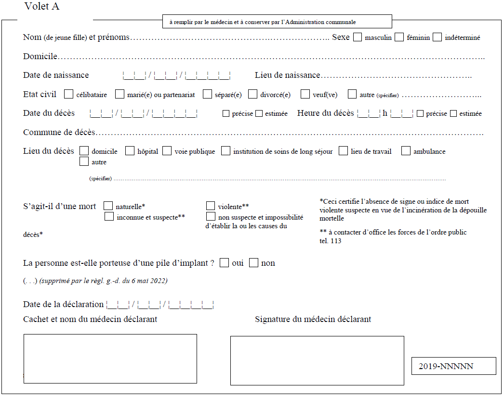
>
> 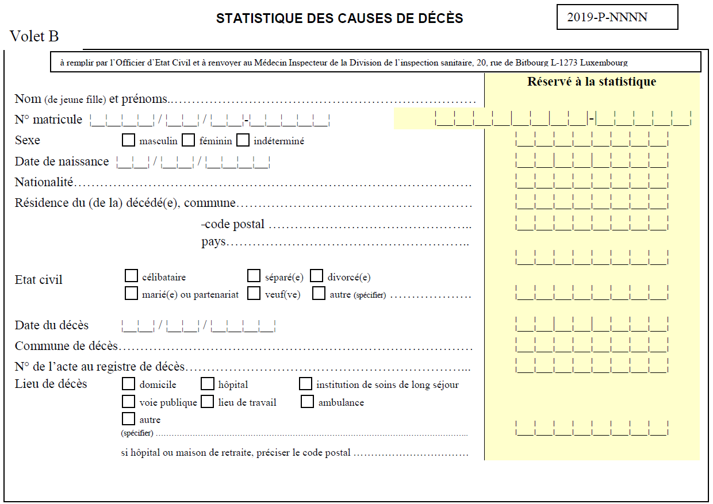
>
> *[image omitted (0.6 MB) — see the official version: https://legilux.public.lu/eli/etat/leg/code/sante/20260810]*
>
> 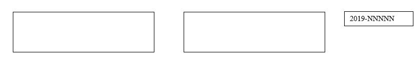
>
> \**Annexe II**
>
> \**DÉCLARATION DE DÉCÈS -** **MORTALITÉ FŒTALE ET NÉONATALE**
>
> 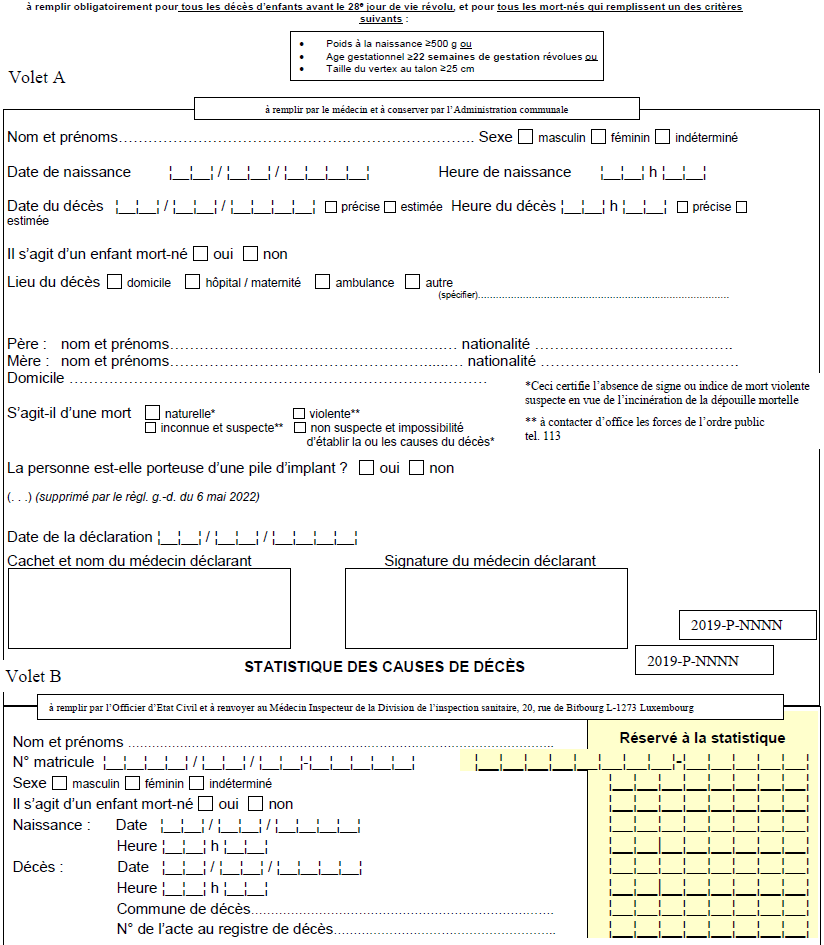
>
> 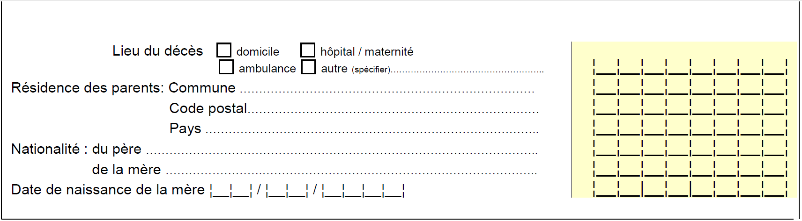
>
> *[image omitted (0.7 MB) — see the official version: https://legilux.public.lu/eli/etat/leg/code/sante/20260810]*
>
> 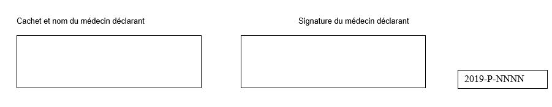

#### Règlement grand-ducal du 18 octobre 1972 relatif à la création et au fonctionnement d'un four crématoire.

##### Art. 1er.

L'incinération des corps humains ne peut avoir lieu que dans un établissement appelé crématoire.

##### Art. 2.

Le crématoire est établi dans un cimetière communal ou sur un terrain communiquant avec celui-ci.

##### Art. 3.

Le four crématoire ne peut être mis en activité que lorsqu'un procès-verbal, constatant que l'installation répond aux conditions énoncées à l'article 4 et que son fonctionnement est normal, aura été dressé par l'autorité communale.

##### Art. 4.

1° Le système du four crématoire doit être tel qu'à tout moment les gaz qui s'en échappent soient à excès d'oxygène.

2° Les dimensions du four doivent permettre l'introduction d'un cercueil de 2 m. 10 de longueur, 0 m. 60 de hauteur et 0 m. 75 de largeur.

3° Chaque établissement crématoire doit disposer d'un local où seront déposés les corps à incinérer.

Le pavement doit être en matériaux imperméables, permettant un nettoyage et une désinfection faciles. Toutes les ouvertures libres ou munies de châssis amovibles sont garnies de toile métallique, en laiton ou en cuivre rouge, à mailles suffisamment serrées pour empècher le passage des insectes.

Les parois sont cimentées ou revêtues de céramique. La ventilation est bien assurée.

##### Art. 5.

Les instructions relatives au fonctionnement du four sont affichées d'une façon visible pour le personnel qui le dessert.

##### Art. 6.

Il n'est admis au four crématoire que les corps enfermés dans des cercueils en bois léger d'une épaisseur de 18 à 20 mm au plus ou en d'autres matières facilement combustibles. Les dimensions de ces cercueils ne doivent pas dépasser 2 m. 10 de longueur, 0 m. 60 à 0 m. 75 de largeur et 0 m. 60 de hauteur. Les cercueils ne sont munis ni de garnitures, ni de clous en métal. Les poignées en peuvent être en métal, mais doivent être enlevées avant l'introduction du cercueil dans le four.

##### Art. 7.

Les corps à incinérer doivent être vêtus légèrement et reposer sur des copeaux ou de la laine de bois. On ne doit utiliser ni coussins de plumes, ni matelas, ni couvertures, ni couronnes ou autres matières pouvant retarder la combustion.

##### Art. 8.

Au cas où le cercueil destiné à la crémation est renfermé dans un second cercueil, il doit être muni de sangles de manière à pouvoir être sorti sans difficultés du cercueil extérieur. Les cercueils extérieurs, y compris, le cas échéant, les cercueils spéciaux de transport zingués, sont rendus et doivent être désinfectés chaque fois.

##### Art. 9.

Il sera tenu un registre dans lequel seront immatriculés, dès leur arrivée au crématoire, les corps à incinérer, sous numéro courant comme suit:

a) nom et prénom du défunt;

b) date et lieu de naissance du défunt;

c) date et lieu de son décès;

d) dernier domicile du défunt;

e) état ou profession du défunt;

f) confession du défunt;

g) jour et heure d'arrivée au crématoire;

h) jour et numéro de l'autorisation de crémation;

i) jour et heure de la crémation;

j) noms et adresse de la personne à laquelle les cendres ont été remises;

k) date et heure de la remise des cendres;

l) lieu de dépôt des cendres.

##### Art. 10.

Il ne peut être introduit qu'un seul corps à la fois dans le four crématoire.

Le numéro d'ordre de l'incinération figure sur une pièce en matière thermo-réfractaire qui est introduite dans le four avec le cercueil.

##### Art. 11.

Les cendres sont recueillies soigneusement et déposées avec la pièce susdite, après évacuation des corps étrangers, dans une urne cinéraire, d'un modèle et d'une composition agréés par les Ministres de l'Intérieur et de la Santé Publique. Cette urne porte en caractères indélébiles, les noms du défunt, la date de son décès, la date, le lieu et le numéro d'ordre de l'incinération.

##### Art. 12.

L'incinération de cadavres d'animaux est interdite dans un établissement crématoire destiné à l'incinération des corps humains.

##### Art. 13.

Après l'incinération, le transport direct de l'urne au lieu désigné pour le dépôt est assuré dans les conditions de décence, de respect et de piété qui s'imposent, par les services du crématoire.

##### Art. 14.

Lorsque l'incinération doit s'effectuer dans une commune autre que celle du décès, l'officier de l'état civil du lieu du décès délivre l'autorisation d'incinération et le permis de transport.

##### Art. 15.

Le permis de transport mentionne:

1° La date de l'autorisation d'incinération;

2° La constatation par l'autorité communale que la mise en bière a été effectuée dans les conditions auxquelles les articles 6, 7 et 8 subordonnent l'admission des corps au four crématoire;

3° Le lieu d'inhumation et l'autorisation d'inhumer les cendres;

4° L'accord de l'établissement crématoire.

Le permis est exhibé à l'agent préposé à la direction du four crématoire, au moment de l'arrivée du corps.

##### Art. 16.

Si l'inhumation des cendres a lieu dans une commune autre que celle de l'incinération, l'urne renfermant les cendres doit être protégée par une enveloppe en bois.

Cette enveloppe ne peut être ni ouverte, ni modifiée au cours de son transport.

##### Art. 17.

Nos Ministres de l'Intérieur et de la Santé Publique sont chargés de l'exécution du présent règlement qui sera publié au Mémorial.

#### Règlement grand-ducal du 21 juin 1978 relatif à la dispersion des cendres.

##### Art. 1er.

La dispersion des cendres est un mode de sépulture autorisé aux conditions prescrites par la loi du 1er août 1972 portant réglementation de l'inhumation et de l'incinération des dépouilles mortelles ainsi que par le présent règlement grand-ducal.

##### Art. 2.

Le conseil communal, sous l'approbation du Ministre de l'Intérieur, peut décider la création et l'aménagement d'une parcelle de terrain située dans l'enceinte du cimetière communal sur laquelle les cendres seront dispersées.

Plusieurs communes peuvent former un syndicat pour la création et l'aménagement d'une parcelle de terrain à cet effet.

L'entretien du terrain incombe à la commune ou au syndicat de communes qui l'ont créé.

##### Art. 3.

Nonobstant les dispositions de l'article 2, alinéa 1, le bourgmestre peut autoriser selon le voeu du défunt la dispersion des cendres sur une parcelle de terrain située dans la propriété d'un particulier ou à tout autre endroit.

##### Art. 4.

Les cendres sont dispersées au moyen d'un appareil conçu à cet effet et que seul le préposé du cimetière manoeuvre.

Lorsque la dispersion a lieu immédiatement après l'incinération les cendres sont recueillies dans l'appareil servant à la dispersion.

Lorsque la dispersion au cimetière doit être différée pour des motifs exceptionnels, les cendres sont conservées avec la pièce réfractaire, dans un récipient fermé.

Lorsque la dispersion doit avoir lieu dans un cimetière distant du four crématoire ou à l'étranger, les cendres sont déposées avec la pièce réfractaire dans une urne cinéraire fermée hermétiquement et protégée par une enveloppe en bois qui porte le numéro d'ordre de l'incinération.

##### Art. 5.

La dispersion des cendres est consignée dans le registre tenu conformément à l'article 9 du règlement grand-ducal du 18 octobre 1972 relatif à la création et au fonctionnement d'un four crématoire à la rubrique «lieu de dépôt des cendres».

##### Art. 6.

Nos Ministres de l'Intérieur et de la Santé Publique sont chargés de l'exécution du présent règlement qui sera publié au Mémorial.

## DENRÉES ALIMENTAIRES

### DISPOSITIONS GÉNÉRALES

#### Version consolidée applicable au 14/08/2018 : Loi du 25 septembre 1953, ayant pour objet la réorganisation du contrôle des denrées alimentaires, boissons et produits usuels.

##### Art. 1er.

Dans l’intérêt de la santé publique sont soumis à la surveillance des autorités, d’après les dispositions de la présente loi, la fabrication, la préparation, la transformation, le commerce et la distribution des objets de consommation et d’habillement; des produits cosmétiques et articles de toilette; des objets et produits usuels employés dans le ménage, tels que jouets, tapis, meubles, tapisseries, ustensiles, couleurs, essences et autres substances liquides ou solides.

##### Art. 2.

Des règlements d’administration publique, qui peuvent déroger à des dispositions légales ou réglementaires qui régissent la présente matière, détermineront les dispositions propres à réglementer, surveiller et même interdire

1° la fabrication, la préparation, la transformation, le commerce et la distribution des objets énumérés à l’article 1er et des denrées alimentaires;

2° le commerce et la distribution des appareils, ustensiles, récipients et autres objets servant à la fabrication ou destinés à être mis en contact avec les denrées ou boissons alimentaires ou médicamenteuses, les objets de consommation, les produits cosmétiques et les articles de toilette.

Ces règlements pourront prescrire l’apposition d’indications nu de signes propres à empêcher toute confusion ou erreur sur la nature et la provenance des matières qui peuvent être confondus avec les denrées ou substances visées à l’article 1er et déterminer ces indications ou signes.

Les infractions à ces règlements seront punies d’une amende de 251 à 2.000 euros qui sera prononcée par le juge de police.

Les dispositions sur les circonstances atténuantes seront applicables à ces infractions.

La confiscation des choses formant l’objet de l’infraction et de celles qui ont servi ou ont été destinées à la commettre pourra être ordonnée quand la propriété en appartient au condamné.

##### Art. 3.

Le Ministre de la Santé publique pourra, par décision motivée, exclure de la fabrication, du commerce et de la distribution des objets visés à l’article 1er les personnes dont l’état de santé ou la malpropreté constitue un danger pour la santé publique.

Dans les trois mois de la notification de la décision ministérielle, l’intéressé pourra exercer un recours contre cette décision devant le Tribunal administratif, qui statuera comme juge du fond. Le recours n’aura pas d’effet suspensif.

##### Art. 4.

les objets et produits usuels et les manipulations licites auxquelles ils pourront être soumis, les ustensiles, appareils, récipients, les locaux, débits de boissons etc. doivent correspondre aux prescriptions et normes établies par la présente loi ou à déterminer par des règlements d’administration publique.

Un règlement d’administration publique déterminera également les dispositions applicables aux denrées, boissons, substances, produits et objets usuels mis dans le commerce avec une indication relative à une teneur en vitamines ou en hormones.

##### Art. 5.

La surveillance de la fabrication, de la préparation, de la transformation, du commerce et de la distribution des objets visés aux articles 1er et 2 de la présente loi est exercée sous l’autorité du Ministre de la Santé ou de son délégué par les experts des services de contrôle de l’Etat respectivement compétents.

Le contrôle des viandes et des préparations de viande est de la compétence exclusive du Ministre de la Santé Publique. Toutefois, les administrations communales sont compétentes en cette matière, dans les limites fixées par règlement grand-ducal.

Outre les officiers de police judiciaire et les agents de la gendarmerie et de la police, les ingénieurs, les médecins et les assistants techniques de Laboratoire National de Santé, le vétérinaire-chef du laboratoire, les vétérinaires inspecteurs, les vétérinaires et les assistants techniques de l’administration des services vétérinaires, les médecins-inspecteurs, les pharmaciens inspecteurs et les agents sanitaires de la Direction de la Santé, les ingénieurs et les ingénieurs techniciens de l’Administration de la gestion de l’eau, l’assistant de l’Institut viti-vinicole, ainsi que les agents des douanes et accises sont chargés de rechercher et de constater les infractions à la présente loi et à ses règlements d’exécution.

Les fonctionnaires et agents du Laboratoire National de Santé, de l’Administration des services vétérinaires, de la Direction de la Santé, de l’Administration de la gestion de l’eau, de l’Institut viti-vinicole et de l’Administration des douanes et accises ont dans l’accomplissement de leurs fonctions pour l’exécution de la présente loi la qualité d’officiers de police judiciaire. Ils constateront les infractions par des procès-verbaux faisant foi jusqu’à preuve contraire. Leur compétence s’étend à tout le territoire du Grand-Duché.

Avant d’entrer en fonction ils prêteront devant le tribunal d’arrondissement de leur domicile le serment suivant: «Je jure de remplir mes fonctions avec intégrité, exactitude et impartialité.

Dans la suite les agents énumérés à l’alinéa 3 du présent article sont désignés sous la dénomination commune «agents».

##### Art. 6.

Il sera attribué au Gouvernement un crédit annuel pour subvenir aux dépenses auxquelles donneront lieu les analyses et vérifications faites en exécution de la présente loi.

Un arrêté ministériel fixera la rémunération des services des experts ainsi que les conditions auxquelles les particuliers auront le droit de requérir leurs services.

##### Art. 7.

Les agents visés à l’alinéa 3 de l’article 5 peuvent:

a) pénétrer, pendant tout le temps qu’ils sont ouverts au public, et même pendant la nuit lorsqu’il existe des indices graves faisant présumer une fraude à la présente loi, dans les lieux quelconques dans lesquels les objets visés aux articles 1er et 2 sont fabriqués, préparés, transformés, déposés, exposés en vente, vendus ou distribués;

b) visiter pendant le jour et même pendant la nuit lorsqu’il existe des indices graves faisant présumer une fraude à la loi, les véhicules et autres moyens de transport qui contiennent ou peuvent contenir des objets visés aux articles 1er et 2 et vérifier les documents imposés par les règlements.

Les conducteurs des véhicules ou autres moyens de transport sont tenus de s’arrêter immédiatement à l’injonction de ces mêmes agents et de rester arrêtés pendant tout le temps nécessaire à l’accomplissement des mesures de contrôle;

c) exiger la production de toutes les écritures commerciales relatives aux objets visés aux articles 1er et 2 de la présente loi et tous les documents imposés par les règlements d’administration publique, pris en exécution de la présente loi;

d) prélever à leur choix et partout, aux fins d’examen ou d’analyse, des échantillons des objets visés aux articles 1er et 2 de la présente loi et les règlements d’administration publique, ainsi que les matières utilisés dans leur fabrication.

Les échantillons seront pris contre délivrance d’un accusé de réception. Une partie de l’échantillon, cachetée ou scellée, sera remise au propriétaire ou détenteur, quelconque à moins que celui-ci n’y renonce expressément. Le propriétaire ou détenteur quelconque sera indemnisé de la valeur des échantillons sur le pied du prix courant;

e) saisir et au besoin mettre sous séquestre les objets visés aux articles 1er et 2 de la présente loi ainsi que les objets ou matières employés ou destinés à être employés dans leur fabrication ou commerce reconnus falsifiés, corrompus ou gâtés et les écritures commerciales et documents imposés en vertu de la présente loi et des règlements d’administration publique qui les concernent;

f) saisir et mettre hors d’usage les objets visés à l’article 1er, et dont l’insalubrité, constatée par le médecin-inspecteur de la Santé publique, constitue un danger pour la santé publique.

##### Art. 8.

Les producteurs, fabricants, préparateurs, importateurs, commerçants, manipulateurs, consignataires, commissionnaires, expéditeurs, vendeurs, détenteurs et transporteurs des objets visés aux articles 1er et 2 de la présente loi sont tenus de faciliter l’exercice de la mission des agents chargés de veiller à l’exécution des dispositions prises en vertu de cette loi.

Ils doivent leur communiquer sur leur réquisition tous les documents et indications nécessaires à l’accomplissement de leur mission, les accompagner à leur demande dans les lieux favorables à l’exécution du contrôle et, au besoin, fournir les objets qu’ils possèdent, indispensables au prélèvement d’échantillons.

##### Art. 9.

Seront punis d’un emprisonnement de 8 jours à un an et d’une amende de 500 à 15.000 euros ou d’une de ces peines seulement

1° ceux qui auront falsifié ou fait falsifier, contrefait ou fait contrefaire des objets visés à l’article 1er de la présente loi;

2° ceux qui auront vendu, exposé en vente, détenu ou transporté en vue de la vente ou de la livraison de tels objets, sachant qu’ils étaient falsifiés, contrefaits, gâtés ou corrompus;

3° ceux qui, méchamment ou frauduleusement, ou comme étant intéressés à un titre quelconque à la fraude, auront révélé ou conseillé des procédés de falsification ou de contrefaçon de ces mêmes objets;

4° ceux qui auront falsifié ou contrefait des marques, signes ou documents prévus par des règlements d’administration publique pris en vertu de la présente loi et ceux qui, sciemment, auront fait usage de tels marques, signes et documents;

5° ceux qui auront fait usage, directement ou par intermédiaire, d’indications ou de signes de nature à induire en erreur sur la nature, la composition, le mode de fabrication, l’origine ou le poids de denrées, substances, objets ou produits visés à l’article 1er de la présente loi, ou encore à faire indûment attribuer à de tels denrées, substances, objets ou produits des propriétés ou des caractères spéciaux;

6° ceux qui, directement ou par intermédiaire, auront contrevenu à la décision du Ministre de la Santé publique prononcée en exécution de l’article 3 de la présente loi et portant exclusion de la fabrication, du commerce ou de la distribution des objets visés à l’article 1er.

##### Art. 10.

Si l’action prévue à l’article précédent, n° 2 et n° 5, a été commise par défaut de précaution ou de prévoyance, l’amende sera de 50 à 250 euros et l’emprisonnement de un jour à sept jours. Ces peins pourront être prononcées séparément.

En cas de récidive dans les deux années de la dernière condamnation pour des infractions prévues par la présente loi, l’amende sera de 251 à 2.500 euros et l’emprisonnement de 8 à 15 jours.

##### Art. 11.

Seront punis d’un emprisonnement de six mois à cinq ans et d’une amende de 500 à 20.000 euros:

2° ceux qui auront volontairement préparé des objets de consommation ou d’habillement, des produits cosmétiques ou articles de toilette ou des objets ou produits usuels employés clans le ménage, de manière à rendre l’usage normal ou probable de ces objets dangereux ou nuisible à la santé humaine;

3° ceux qui auront vendu ou distribué, exposé en vente, détenu ou transporté en vue de la vente ou de la distribution de tels objets ou produits, sachant qu’ils étaient falsifiés, contrefaits, gâtés ou corrompus, et qu’ils étaient dangereux ou nuisibles à la santé humaine;

4° ceux qui auront vendu ou procuré des matières servant à la préparation de ces objets, sachant qu’elles étaient destinées à un pareil emploi.

La tentative de ces délits sera punie d’un emprisonnement de 3 mois à trois ans et d’une amende de 500 à 10.000 euros ou d’une de ces peines seulement.

Le coupable pourra être condamné à l’interdiction de tout ou partie des droits énumérés à l’article 310 du [code pénal](https://legilux.public.lu/eli/etat/leg/code/penal), conformément à l’article 33 du [même code](https://legilux.public.lu/eli/etat/leg/code/penal).

Si le fait a entraîné soit la mort d’une personne, soit une maladie paraissant incurable, soit une incapacité permanente de travail personnel, soit une inutilation grave, soit la perte de l’usage absolu d’un organe la peine sera celle clé la réclusion.

##### Art. 12.

Si l’action prévue à l’article précédent, n° 1, n° 2 et n° 3, a été commise par défaut de précaution ou de prévoyance, l’emprisonnement sera de huit jours à six mois et l’amende de 251 à 10.000 euros; ces peines pourront être prononcées séparément.

Si le fait a causé l’altération de la santé d’une personne, il sera puni d’un emprisonnement de un mois à un an et d’une amende de 500 à 20.000 euros ou d’une de ces peines seulement.

Si le fait a causé la mort d’une personne, l’emprisonnement sera de trois mois à deux ans et l’amende de 500 à 12.500 euros.

##### Art. 13.

Lorsque dans le cas de l’article 11 l’usage des objets y spécifiés était de nature à détruire la santé humaine, et que cette circonstance était connue de l’auteur, la peine sera celle de réclusion de dix ans à quinze ans. Elle sera celle de réclusion de quinze ans à vingt ans lorsque le fait a causé la mort d’une personne.

##### Art. 15.

Si l’un clés faits prévus à l’article précédent a été commis par défaut de précaution ou de prévoyance, le coupable sera puni d’un emprisonnement de huit jours à un mois et d’une amende de 251 à 5.000 euros ou d’une de ces peines seulement.

##### Art. 16.

En cas de condamnation à une peine criminelle ou correctionnelle pour l’un des faits prévus à la présente loi, les cours et tribunaux pourront prescrire la fermeture du magasin ou la cessation de l’industrie ou du commerce pour une durée ne dépassant pas dix ans.

En cas de contravention à cette mesure, le magasin ou les locaux affectés à l’industrie ou au commerce seront, à l’intervention du Parquet, immédiatement fermés et placés sous scellés pour une période de temps égale à celle fixée au jugement et le contrevenant sera puni d’un emprisonnement de huit jours à deux mois et d’une amende de 500 à 10.000 euros.

##### Art. 17.

Tous arrêts de condamnation à une peine criminelle par application de l’article 11 ou de l’article 13 prononceront contre les condamnés l’interdiction à perpétuité de se livrer à la fabrication, la préparation, la transformation ou au commerce ou à la distribution des objets spécifiés à l’article 1er de la présente loi.

Les cours et tribunaux pourront interdire, à perpétuité ou pour un terme de cinq à dix ans, l’exercice de ce droit aux personnes qui, après avoir été condamnées à une peine criminelle ou correctionnelle en vertu des articles 9, 11, 12, 13 auront, avant l’expiration de cinq ans depuis l’extinction de leur peine, contrevenu derechef à une de ces dispositions et qui seront condamnées de ce fait à une peine correctionnelle.

L’interdiction courra du jour de l’extinction de la peine encourue par le coupable. Elle produira en outre ses effets à compter du jour où la condamnation contradictoire ou par défaut sera devenue irrévocable.

##### Art. 18.

Tout individu qui, par lui-même ou par personnes interposées, se sera livré à la fabrication, la préparation, la transformation, au commerce ou à la distribution des objets spécifiés à l’article 1er de la loi contrairement à l’interdiction prononcée en vertu de l’article 16 sera condamné à un emprisonnement de huit jours à deux mois et à une amende de 251 à 5.000 euros.

Les objets servant à la fabrication, la préparation, la transformation, au commerce ou à la distribution seront confisqués et l’établissement sera fermé immédiatement par la force publique.

##### Art. 19.

Seront punis d’une amende de 251 à 2.000 euros ceux qui se seront refusés ou opposés aux visites, aux inspections, aux prélèvements d’échantillons, à la mise sous séquestra ou à la saisie par les agents chargés de veiller à l’exécution des dispositions prises en vertu de la présente loi.

En cas de récidive dans les deux années de la dernière condamnation pour une infraction sanctionné: par le premier alinéa du présent article, les tribunaux pourront élever l’amende jusqu’à 4.000 euros et prononcer une peine d’emprisonnement de 8 jours à 1 an.

##### Art. 20.

Les cours et tribunaux pourront ordonner que les arrêts ou jugements seront affichés, en entier ou par extraits, aux endroits et pendant le temps qu’ils détermineront et insérés dans les journaux qu’ils indiqueront ou publiés de toute autre façon, le tout aux frais des condamnés.

##### Art. 21.

Les objets visés aux articles 9, 10, 11, 12, 13, 14 et 15 seront saisis et la confiscation en sera ordonnée.

### RÈGLEMENTS D’EXÉCUTION

#### Version consolidée applicable au 17/12/2016 : Règlement grand-ducal du 25 août 2015 concernant l'information des consommateurs sur les denrées alimentaires, les allégations nutritionnelles et de santé ainsi que le marquage du numéro de lot.

##### Chapitre 1er: — Information des consommateurs sur les denrées alimentaires

###### Art. 1er.

Au sens du présent règlement on entend par:

1\. Denrée alimentaire non préemballée: une denrée alimentaire

– vendue en vrac ou

– emballée sur le lieu de vente à la demande du consommateur ou

– préemballée en vue de sa vente immédiate.

2\. Vente immédiate: la vente d’une denrée alimentaire qui est destinée à être vendue au plus tard le jour suivant sa fabrication et qui n’est pas vendue en libre-service.

3\. Structures encadrées: les établissements servant une clientèle identifiée et connue à l’avance tels que les hôpitaux, maisons de soins pour personnes âgées, personnes malades, personnes handicapées, foyers de jour, crèches, maisons relais, cantines scolaires.

4\. Lot: un ensemble d’unités de vente d’une denrée alimentaire produite, fabriquée ou conditionnée dans des circonstances pratiquement identiques.

5\. Libre-service: une mise en vente où le consommateur se sert lui-même.

###### Art. 2.

Les informations obligatoires sur les denrées alimentaires au sens du [règlement (UE) n° 1169/2011](https://legilux.public.lu/eli/reg_ue/2011/1169/jo) et du présent règlement grand-ducal doivent être libellées au moins dans une des trois langues française, allemande ou luxembourgeoise.

###### Art. 2*bis*.

La déclaration nutritionnelle prévue à l’article 9, paragraphe 1er, point l) du [règlement (UE) n° 1169/2011](https://legilux.public.lu/eli/reg_ue/2011/1169/jo) n’est pas obligatoire pour les denrées alimentaires produites par des micro-, petites et moyennes entreprises au sens de l’article 3 du [règlement grand-ducal du 16 mars 2005](https://legilux.public.lu/eli/etat/leg/rgd/2005/03/16/n1/jo) portant adaptation de la définition des micro-, petites et moyennes entreprises fournissant directement le consommateur final ou les établissements de détail locaux.

###### Art. 3.

L’indication de la dénomination de vente est obligatoire pour les denrées alimentaires non préemballées.

###### Art. 4.

Pour les denrées alimentaires non préemballées, l’indication des ingrédients ou auxiliaires technologiques provenant de substances ou produits provoquant des allergies ou intolérances est précédée d’une mention contenant le terme «allergène».

###### Art. 5.

Les exploitants alimentaires mettent à disposition de leurs clients, sans demande expresse de ces derniers, les informations sur les ingrédients et auxiliaires technologiques provenant de substances ou produits provoquant des allergies ou intolérances de façon écrite et de façon bien visible ou précisent de façon écrite que ces informations sont disponibles sur demande sur un support écrit.

###### Art. 6.

Par dérogation aux articles 4 et 5 , l’information concernant les ingrédients et auxiliaires technologiques provenant de substances ou produits provoquant des allergies ou des intolérances n’est pas obligatoire pour les consommateurs identifiés et connus à l’avance dans le cas où les structures encadrées mettent en place des systèmes par écrit pour recenser les allergies et intolérances de ces consommateurs et lorsqu’ils disposent de procédures écrites permettant de s’assurer que ces consommateurs soient approvisionnés avec des denrées alimentaires exemptes des substances envers lesquelles ils présentent des allergies et intolérances.

##### Chapitre 2: — Marquage du lot

###### Art. 7.

(1) Une denrée alimentaire ne peut être commercialisée que si elle est accompagnée d’une mention qui permet d’identifier le lot auquel appartient cette denrée alimentaire.

(2) Le paragraphe 1er ne s’applique pas:

a) aux produits agricoles qui, au départ de la zone d’exploitation, sont:

i) vendus ou livrés à des stations d’entreposage, de conditionnement ou d’emballage;

ii) acheminés vers des organisations de producteurs ou

iii) collectés en vue de leur intégration immédiate dans un système opérationnel de préparation ou de transformation;

b) lorsque, sur les lieux de vente au consommateur final, les denrées alimentaires qui ne sont pas préemballées, sont emballées à la demande de l’acheteur ou préemballées en vue de leur vente immédiate;

c) aux emballages ou récipients dont la face la plus grande a une surface inférieure à 10 cm²;

d) aux doses individuelles de glaces alimentaires. La mention permettant d’identifier le lot figure sur les emballages de groupage.

###### Art. 8.

Le lot est déterminé dans chaque cas par le producteur, fabricant ou conditionneur de la denrée alimentaire en question, ou par le premier vendeur établi à l’intérieur de l’Union européenne.

La mention visée à l’article 7, paragraphe 1er, est déterminée et apposée sous la responsabilité de l’un ou l’autre des opérateurs visés à l’alinéa précédent. Elle est précédée par la lettre «L», sauf dans le cas où elle se distingue clairement des autres mentions d’étiquetage.

###### Art. 9.

Lorsque les denrées alimentaires sont préemballées, la mention visée à l’article 7, paragraphe 1er et, le cas échéant, la lettre «L» visée à l’article 8 paragraphe 2 figurent sur le préemballage ou sur une étiquette liée à celui-ci.

###### Art. 10.

Lorsque les denrées alimentaires ne sont pas préemballées, la mention visée à l’article 7, paragraphe 1er et, le cas échéant, la lettre «L» visée à l’article 8 paragraphe 2 figurent sur l’emballage ou le récipient ou, à défaut, sur les documents commerciaux s’y référant.

###### Art. 11.

Dans les cas visés aux articles 8 à 10 où la lettre «L» est obligatoire, celle-ci est à apposer de manière à être facilement visible, clairement lisible et indélébile.

###### Art. 12.

Lorsque la date de durabilité minimale ou la date limite de consommation figure dans l’étiquetage, la mention visée à l’article 7, paragraphe 1er, peut ne pas accompagner la denrée alimentaire, pourvu que cette date se compose au moins de la mention, en clair et dans l’ordre, du jour et du mois.

##### Chapitre 3: — Allégations de santé

###### Art. 13.

Pour l’application des articles 15 à 18 du [règlement CE n° 1924/2006](https://legilux.public.lu/eli/reg_ue/2006/1924/jo), les exploitants qui font la demande pour l’autorisation de nouvelles allégations de santé en adressent les dossiers de notifications à la Direction de la Santé.

###### Art. 14.

Les mesures de sauvegarde visées par l’article 24 du [règlement CE n° 1924/2006](https://legilux.public.lu/eli/reg_ue/2006/1924/jo) sont prises par arrêté ministériel sur avis motivé du Directeur de la Santé.

##### Chapitre 4: — Dispositions pénales

###### Art. 15.

Les infractions aux dispositions du présent règlement, du [règlement (UE) n° 1169/2011](https://legilux.public.lu/eli/reg_ue/2011/1169/jo) et du [règlement (CE) n° 1924/2006](https://legilux.public.lu/eli/reg_ue/2006/1924/jo) du Parlement européen et du Conseil du 20 décembre 2006 concernant les allégations nutritionnelles et de santé portant sur les denrées alimentaires seront punies des peines édictées par l’article 2 de la [loi modifiée du 25 septembre 1953](https://legilux.public.lu/eli/etat/leg/loi/1953/09/25/n1/jo) ayant pour objet la réorganisation du contrôle des denrées alimentaires, boissons et produits usuels, sans préjudice des peines prévues par les articles 9 et suivants de cette loi, par le code pénal ou par d’autres lois.

##### Chapitre 5: — Abrogations

###### Art. 16.

Sont abrogés par le présents règlements:

– le [règlement grand-ducal modifié du 8 avril 1991](https://legilux.public.lu/eli/etat/leg/rgd/1991/04/08/n5) relatif aux mentions ou marques permettant d’identifier le lot auquel appartient une denrée alimentaire;

– le [règlement grand-ducal modifié du 25 octobre 1996](https://legilux.public.lu/eli/etat/leg/rgd/1996/10/25/n1) relatif à l’indication sur l’étiquetage de certaines denrées alimentaires d’autres mentions obligatoires que celles prévues dans le [règlement grand-ducal modifié du 16 avril 1992](https://legilux.public.lu/eli/etat/leg/rgd/1992/04/16/n2) concernant l’étiquetage et la présentation de denrées alimentaires ainsi que la publicité faite à leur égard;

– le [règlement grand-ducal modifié du 14 décembre 2000](https://legilux.public.lu/eli/etat/leg/rgd/2000/12/14/n5) concernant l’étiquetage et la présentation des denrées alimentaires ainsi que la publicité faite à leur égard;

– le [règlement grand-ducal du 14 avril 2003](https://legilux.public.lu/eli/etat/leg/rgd/2003/04/14/n4) concernant l’étiquetage des denrées alimentaires contenant de la quinine, et des denrées alimentaires contenant de la caféine;

– le [règlement grand-ducal du 22 juin 1992](https://legilux.public.lu/eli/etat/leg/rgd/1992/06/22/n4) relatif à l’étiquetage nutritionnel des denrées alimentaires.

###### Art. 17.

Notre Ministre de la Santé est chargée de l’exécution du présent règlement qui sera publié au Mémorial.

## DÉONTOLOGIE

### Version consolidée applicable au 10/11/2018 : Règlement grand-ducal du 7 octobre 2010 établissant le code de déontologie de certaines professions de santé.

#### Art. 1er.

Le code de déontologie de certaines professions de santé, annexé au présent règlement, est applicable à toute personne autorisée à exercer une profession de santé visée par la [loi modifiée du 26 mars 1992](https://legilux.public.lu/eli/etat/leg/loi/1992/03/26/n1/jo) sur l'exercice et la revalorisation de certaines professions de santé.

#### Art. 2.

Notre Ministre de la Santé est chargé de l'exécution du présent règlement qui sera publié au Mémorial ensemble avec son annexe qui en fait partie intégrante.

> \**Annexe**
>
> \**Code de déontologie de certaines professions de santé**
>
> \**Préambule**
>
> Le présent code de déontologie est destiné à servir de ligne de conduite générale pour toutes les professions de santé autorisées à être exercées au Grand-Duché de Luxembourg selon la [loi modifiée du 26 mars 1992](https://legilux.public.lu/eli/etat/leg/loi/1992/03/26/n1/jo) sur l’exercice et la revalorisation de certaines professions de santé.
>
> Les règles de conduite énoncées dans ce code sont d’application ensemble avec la [loi modifiée du 26 mars 1992](https://legilux.public.lu/eli/etat/leg/loi/1992/03/26/n1/jo) précitée et des règlements pris en son exécution dans tout conflit qui pourrait survenir dans l’exercice d’une profession de santé. Les exigences du public, de l’employeur, d’un organisme ou de la personne prise en charge peuvent placer le professionnel de santé en conflit d’intérêts. Dans tous les cas où les devoirs et obligations éthiques ou les responsabilités dictées par le présent code risquent d’être enfreints, le professionnel de santé doit agir conformément aux prescriptions du présent code.
>
> Chaque professionnel de santé dispense les actes, prestations ou services relatifs à sa profession respective dans le respect des règles déontologiques et dans le but de promouvoir la santé. La santé se définit comme un état complet de bien-être physique, mental et social, et ne consiste pas seulement en une absence de maladie ou d’infirmité.
>
> **Chapitre Ier. Devoirs généraux des professionnels de santé dans leur exercice professionnel**
>
> **Art. 1er.**
>
> Les dispositions du présent code de déontologie s’imposent à toute personne autorisée à exercer au Grand-Duché de Luxembourg de façon définitive, temporaire ou exceptionnelle une profession de santé visée par la [loi modifiée du 26 mars 1992](https://legilux.public.lu/eli/etat/leg/loi/1992/03/26/n1/jo) sur l’exercice et la revalorisation de certaines professions de santé. Les infractions aux dispositions du présent code relèvent de la juridiction disciplinaire du Conseil de discipline pour les professions de santé régies par la [loi précitée](https://legilux.public.lu/eli/etat/leg/loi/1992/03/26/n1/jo).
>
> **Art. 2.**
>
> La qualité des prestations des professionnels de santé n’est jamais influencée par des considérations de race, de sexe, d’âge, de nationalité, de religion, de statut social, d’état de santé, de tendance sexuelle ou de conviction socio-politique. Le professionnel de santé ne doit jamais se départir d’une attitude correcte et attentive envers la personne prise en charge.
>
> **Art. 3.**
>
> Le professionnel de santé exerce sa mission dans le respect de la vie humaine, de la personne, de la dignité et des droits de celle-ci. Le respect dû à la personne ne cesse de s’imposer après sa mort.
>
> **Art. 4.**
>
> Le professionnel de santé ne doit jamais assister ni participer à des actes de torture ou formes de traitements cruels, inhumains ou dégradants ni les admettre, quels que soient les arguments et ce dans toutes les situations y compris en cas de conflit civil ou armé. De même, le professionnel de santé ne doit jamais utiliser ses connaissances, sa compétence ou ses aptitudes en vue de faciliter l’emploi de la torture ou de tout autre procédé cruel, inhumain ou dégradant utilisé à quelque fin que ce soit.
>
> **Art. 5.**
>
> Hormis le cas d’urgence vitale où il agit dans les limites de ses connaissances et de son savoir-faire, le professionnel de santé se limite dans le cadre de son exercice aux attributions spécifiques de sa profession.
>
> **Art. 6.**
>
> Le professionnel de santé veille à exercer sa profession selon les règles de l’art. Les prestations professionnelles sont réalisées selon le principe de la meilleure efficacité, de la moindre nocivité, du respect de l’autonomie et avec la même conscience professionnelle à l’égard de tous les bénéficiaires et des autres prestataires impliqués.
>
> **Art. 7.**
>
> Dans le cadre de ses attributions professionnelles spécifiques le professionnel de santé veille, en ce qui le concerne, à l’application correcte notamment:
>
> – des règlements, conventions et autres instructions,
>
> – des modes d’emploi des équipements, produits et matériels utilisés,
>
> – des règles d’hygiène, de sécurité et de santé au travail.
>
> **Art. 8.**
>
> Le professionnel de santé ne peut exercer une autre activité professionnelle que si un tel cumul est compatible avec la dignité professionnelle et s’il n’est pas exclu par les réglementations en vigueur.
>
> **Art. 9.**
>
> Le professionnel de santé peut participer à une campagne sanitaire, à une émission radiodiffusée ou télévisée, destinée à l’éducation du public, et donner des conférences, à condition d’observer le secret professionnel, les règles de discrétion, de dignité, de tact et de prudence propres à toute profession de santé. Le professionnel de santé évitera dans ce contexte toute publicité personnelle conformément à l’article 38 du présent code.
>
> **Art. 10.**
>
> Le professionnel de santé dont l’activité professionnelle fait l’objet d’une publication dans les médias, doit veiller dans la mesure du possible à ce que la publication des informations se fasse de manière objective et non tapageuse.
>
> **Art. 11.**
>
> Sont interdites toutes les supercheries et tromperies propres à nuire aux personnes prises en charge et notamment toute pratique de charlatanisme et les pratiques qui y ont recours. Le professionnel de santé ne doit en aucun cas faciliter ou couvrir directement ou indirectement l’exercice illégal d’une des professions de santé visée par la [loi modifiée du 26 mars 1992](https://legilux.public.lu/eli/etat/leg/loi/1992/03/26/n1/jo) précitée.
>
> **Chapitre II. Devoirs des professionnels de santé envers les personnes prises en charge**
>
> **Art. 12.**
>
> Le professionnel de santé encourage la personne prise en charge à participer activement aux prestations. Dans ce contexte, il respecte la personnalité et le droit au libre choix de la personne et la fait participer si nécessaire aux prises de décisions, si elle en est capable. Le libre choix du traitement se manifeste par le consentement éclairé. Toutefois, en cas d’urgence vitale, le raisonnement éthique professionnel peut exiger du professionnel de santé des interventions sans le consentement éclairé de la personne.
>
> **Art. 13.**
>
> Le professionnel de santé s’engage à ne pas utiliser des techniques qui feraient courir un risque injustifié à la personne prise en charge. Le professionnel de santé ne doit diffuser dans les milieux professionnels ni technique ni procédé insuffisamment éprouvés sans accompagner cette diffusion des réserves qui s’imposent.
>
> **Art. 14.**
>
> Lorsque le professionnel de santé participe à des recherches biomédicales ou autres, il doit le faire dans le respect de la législation applicable et des dispositions du présent code.
>
> **Art. 15.**
>
> Le secret professionnel s’impose à chaque professionnel de santé dans les conditions fixées par la loi. Le secret professionnel est un droit dans le chef des personnes prises en charge. Le professionnel de santé doit garantir le secret total de tout ce dont il a pris connaissance dans l’exercice de sa profession; non seulement ce qui lui a été confié, mais aussi ce qu’il a vu, entendu ou compris. Le secret professionnel s’étend au-delà de la mort des personnes prises en charge. De même, l’obligation au secret professionnel face aux tiers ne peut être considérée comme éteinte par le simple consentement du client.
>
> **Art. 16.**
>
> Le secret professionnel repose sur la conscience du détenteur du secret. Le professionnel de santé ne peut déroger au secret professionnel que dans les cas autorisés par la loi. Lorsque le professionnel de santé discerne au cours de l’exercice de sa profession qu’un mineur, une personne handicapée, une personne privée de liberté ou toute autre personne, est exposée à un péril grave ou victime de sévices ou de privations, il doit mettre en œuvre les moyens adéquats pour protéger la personne concernée, et le cas échéant, alerter les autorités compétentes.
>
> **Art. 17.**
>
> Chaque professionnel de santé documente selon sa méthode professionnelle ou, le cas échéant, celle de son employeur, ses prestations de façon chronologique au dossier de la personne prise en charge.
>
> **Art. 18.**
>
> La collecte et l’enregistrement sur support informatique de données nominatives à caractère personnel ne peuvent se faire que dans le respect de la loi.
>
> **Art. 19.**
>
> Tout professionnel doit veiller à la protection contre toute indiscrétion du dossier, ainsi que de tout document de source extérieure, concernant la personne prise en charge, qu’il peut contenir. Lorsque le professionnel de santé l’estime utile, ou lorsque la personne prise en charge lui en fait la demande, il doit remettre à celle-ci les éléments objectifs des documents le concernant.
>
> **Art. 20.**
>
> Si le professionnel de santé se sert de ses observations et expériences pour des publications et travaux de recherche, il doit faire en sorte que l’identification des personnes prises en charge soit impossible, sauf accord écrit préalable.
>
> **Art. 21.**
>
> En règle générale, la diffusion dans le cadre de l’exercice professionnel des informations concernant la personne prise en charge est légitime si elle est dans l’intérêt de cette personne, sauf opposition de celle-ci. Ainsi, le professionnel de santé assure rapidement la transmission des informations à ceux qui le relaient dans la prise en charge d’une personne. Il veille à la protection contre toute indiscrétion des informations transmises et prend les précautions requises pour éviter que des personnes non-autorisées puissent y avoir accès.
>
> **Chapitre III. Devoirs des professionnels de santé entre eux**
>
> **Art. 22.**
>
> Est autorisée toute collaboration entre professionnels de santé et médecins, pharmaciens, responsables de laboratoire d’analyses médicales, d’établissements de fabrication ou de vente de remèdes, d’appareils, de matériel ou de produits nécessaires à l’exercice d’une profession de santé, ainsi qu’entre professionnels de santé et responsables d’établissements de soins, d’établissements médico-sociaux ou sociaux ou toute autre personne dans la mesure où pareille collaboration est dans l’intérêt du client, de la promotion des soins et de la santé et ne détourne pas le professionnel de santé de sa mission.
>
> Est interdit tout compérage entre les personnes citées à l’alinéa précédent par lequel le professionnel de santé s’écarterait de sa mission essentielle de fournir des soins de qualité et des conseils de santé.
>
> Sont ainsi interdit, d’une part tout partage d’honoraires entres les personnes citées à l’alinéa précédent hormis le cas des associations ou la mise en commun des honoraires est autorisée et d’autres part toutes connivences expresses ou tacites ayant cours entre une ou plusieurs personnes citées à l’alinéa précédent, moyennant ou non une contrepartie financière d’ont l’effet est de contourner la mission essentielle de fournir des soins de qualités et des conseils de santés.
>
> **Art. 23.**
>
> Tout procédé de concurrence déloyale et notamment tout détournement de clientèle prise en charge sont interdits. Le professionnel de santé ne doit pas s’attribuer les mérites d’un confrère.
>
> **Art. 24.**
>
> Les professionnels de santé veillent à entretenir entre eux et avec l’ensemble de l’équipe multidisciplinaire des relations professionnelles et des rapports de collaboration efficaces et de bonne confraternité. Un professionnel de santé qui a un différend avec un confrère peut rechercher une conciliation par l’intermédiaire des associations professionnelles ou, le cas échéant, par l’intermédiaire de son employeur ou au besoin par l’intermédiaire du Conseil supérieur de certaines professions de santé.
>
> **Art. 25.**
>
> Lorsque, dans le cadre du travail en équipe, le professionnel de santé délègue des responsabilités, il évalue avec un esprit critique sa propre compétence et celle de ses collègues.
>
> **Art. 26.**
>
> Le professionnel de santé, chargé d’un rôle de coordination et d’encadrement, veille à la bonne exécution des actes accomplis par les autres professionnels de santé ainsi que des élèves en voie de formation. Il contrôle et surveille les activités qu’il ordonne en bonne et due forme à ses collaborateurs dans les limites des attributions et de l’expérience professionnelle de ceux-ci.
>
> **Art. 27.**
>
> Si le professionnel de santé constate un manque de compétence ou une conduite contraire à l’éthique professionnelle auprès de ses confrères ou autres professionnels de santé, il est avant tout tenu de veiller au bien-être et à la sécurité des personnes prises en charge. Après avoir établi les faits et lorsque les risques pour les personnes prises en charge ne sont pas imminents, le professionnel de santé doit essayer de régulariser la situation en cherchant la discussion et en avertissant le(s) professionnel(s) concerné(s) ou, le cas échéant, son employeur. Lorsqu’au contraire cette première intervention resterait infructueuse, le professionnel de santé doit utiliser, le cas échéant, les procédures établies pour rapporter des incidents ou les risques d’incompétence ou de violation des règles déontologiques.
>
> **Chapitre IV. Devoirs des professionnels de santé envers les organismes employeurs ou ordonnateurs et le corps médical**
>
> **Art. 28.**
>
> Le professionnel de santé applique et respecte les prescriptions médicales qui lui sont fournies dans les formes prescrites par la loi, les protocoles et plans de prise en charge valides et pertinents, établis en bonne et due forme et selon les règles de l’art. Il demande à l’ordonnateur ou au médecin prescripteur des compléments d’informations chaque fois qu’il le juge nécessaire respectivement attire son attention à toute contrariété aux lois et règles de l’art applicables en la matière.
>
> **Art. 29.**
>
> En cas d’impossibilité ou de refus de dispenser les actes et techniques professionnels requis ou de les prester selon les règles de l’art, le professionnel de santé prévient, dans les meilleurs délais et en fonction de la situation rencontrée, l’ordonnateur et/ou son supérieur hiérarchique. Pour autant que nécessaire, il organise la continuité de la prise en charge. Cette situation est documentée au dossier de la personne prise en charge et le cas échéant, donne lieu à un rapport circonstancié.
>
> **Chapitre V. Devoirs des professionnels de santé en milieu libéral**
>
> **Art. 30.**
>
> Le professionnel de santé doit s’équiper d’une installation adaptée et de moyens techniques suffisants pour assurer le déroulement correct des prestations ainsi que la sécurité de la personne prise en charge.
>
> **Art. 31.**
>
> A sa demande, le professionnel de santé informe la personne prise en charge du tarif des prestations dispensées au début du traitement. Sont interdits toute fixation de forfait d’honoraires ainsi que toute fraude, abus de cotation ou indication inexacte portant sur les actes effectués.
>
> **Art. 32.**
>
> Le professionnel de santé s’interdit d’abaisser ses honoraires par rapport aux tarifs officiels de quelque façon que ce soit ou dans un intérêt de concurrence. Est considéré également comme rabais le fait de renoncer aux frais de déplacement lors d’une visite à domicile. Le professionnel de santé est toutefois libre de prester des actes gratuitement.
>
> **Art. 33.**
>
> Si le professionnel de santé se dégage de la prise en charge du patient, il doit lui expliquer les raisons et transmettre au professionnel de santé désigné par celui-ci toutes les informations utiles à la poursuite de la prise en charge.
>
> **Art. 34.**
>
> Dans le cadre d’une association entre professionnels de santé, ceux-ci veillent à respecter l’indépendance professionnelle de chacun d’eux.
>
> **Art. 35.**
>
> Il est interdit à un professionnel de santé qui remplit un mandat électif ou une fonction administrative d’en user activement pour accroître sa clientèle.
>
> **Art. 36.**
>
> Le professionnel de santé peut vendre des appareils ou produits ayant un rapport direct avec son activité professionnelle et pour autant que le professionnel de santé ne se détourne pas de sa mission essentielle de fournir des soins de qualités et des conseils de santé.
>
> **Art. 37.**
>
> Le professionnel de santé est autorisé à faire de la publicité dans le respect et la dignité de la profession et en respectant les limites et formes qui suivent :
>
> La publicité fonctionnelle est destinée à faire connaître les professions de santé et son organisation. Elle relève de la compétence des institutions représentatives de chaque profession de santé. En cas de contestation, le Conseil supérieur de certaines professions de santé tranchera.
>
> La publicité personnelle s’entend de toutes formes de communication destinée à promouvoir les services du professionnel de santé.
>
> La publicité personnalisée est permise aux professionnels de santé si elle procure une information sincère sur la nature des prestations de services proposées et si leur mise en œuvre respecte les principes essentiels de la profession.
>
> La publicité personnelle du professionnel de santé doit faire état de ses qualités professionnelles et permettre quel qu’en soit le support, de l’identifier, de le localiser, de le joindre et de faire connaitre la structure d’exercice à laquelle il appartient éventuellement.
>
> **Art. 38.**
>
> Sont prohibées toutes publicités mensongères ou trompeuses, toutes mentions comparatives ou dénigrantes, toutes mentions susceptibles de créer dans l’esprit du public l’apparence d’une structure d’exercice inexistante ou d’une activité non officiellement reconnue, toutes références à des fonctions ou activités sans lien avec l’exercice de la profession de santé, toutes publicités personnelles permettant d’identifier la clientèle du professionnel de santé, toutes publicités de nature à violer les obligations découlant du secret professionnel telles que prévues aux articles 15 et 16.
>
> **Art. 39.**
>
> Dans le respect des dispositions qui précèdent, le professionnel de santé peut figurer dans tout annuaire sous réserve que les mentions qui le concernent et le contenu de l’annuaire ne soient pas contraires aux principes essentiels de la profession.
>
> Le professionnel de santé peut faire état de ses spécialisations professionnelles régulièrement obtenues et non invalidées.
>
> L’information professionnelle s’entend des dénominations, des plaques, des cartes de visite, de tous documents destinés à la correspondance, voiture de service ou tout autre support à distribuer à la clientèle.
>
> **Art. 40.**
>
> Le professionnel de la santé a le droit de créer son site internet. Un site internet peut être considéré comme un prolongement de l’activité du professionnel de santé. Il entraine donc l’application des mêmes règles. La présentation de la profession de santé doit rester neutre et objective. Elle s’effectue dans le respect des lois, des règlements et du code de déontologie.
>
> Le site du professionnel de santé ne peut comporter aucun encart, bannière ou lien hypertexte à caractères publicitaires, autres que ceux en rapport direct avec la profession concernée, pour quelque produit ou service que ce soit.
>
> Il ne peut comporter de liens hypertexte permettant d’accéder directement ou indirectement à des sites ou à des pages de sites dont le contenu serait contraire aux principes essentiels de la profession de santé. Il appartient au professionnel de santé de s’en assurer en visitant régulièrement les sites et les pages auxquels permettent d’accéder aux liens hypertexte que comportent son site, et de prendre sans délai toute disposition pour les supprimer si ce site devait se révéler contraire aux principes essentiels de la profession.
>
> Le professionnel de santé participant à un blog ou un réseau social en ligne doit respecter les principes essentiels de la profession.

### Arrêté ministériel du 11 juillet 2011 approuvant le code de déontologie des pharmaciens édicté par le Collège médical.

#### Art. 1er.

Le code de déontologie des pharmaciens édicté par le Collège médical et annexé au présent arrêté est approuvé.

#### Art. 2.

Le présent arrêté est publié au Mémorial avec son annexe.

### Arrêté ministériel du 12 septembre 2017 portant modification de l’arrêté ministériel modifié du 5 mai 2008 approuvant le code de déontologie de la profession de médecin-vétérinaire édicté par le Collège vétérinaire.

#### Art. 1er.

Le Code de déontologie des professions de médecin et de médecin-dentiste édicté par le Collège vétérinaire et annexé au présent arrêté est approuvé.

L’[arrêté ministériel modifié du 5 mai 2008](https://legilux.public.lu/eli/etat/leg/amin/2008/05/05/n1/jo) approuvant le Code de déontologie de la profession de médecin-vétérinaire édicté par le Collège vétérinaire est abrogé.

#### Art. 2.

Le présent arrêté est publié au Journal officiel du Grand-Duché de Luxembourg avec son annexe.

> \**CODE DE DÉONTOLOGIE VÉTÉRINAIRE**
>
> \**TABLE DES MATIÈRES**
>
> | PRÉAMBULE | Le rôle des médecins vétérinaires dans la société Le but du code de déontologie |  |
> |---|---|---|
> | Chapitre I. | Définitions | Art. 1 |
> | Chapitre II. | Objet et champs d’application du Code de déontologie | Art. 2-5 |
> | Chapitre III. | Valeurs fondamentales et principes généraux |  |
> |  | III.a. La dignité et le bien-être animal III.b. La confraternité III.c. L’honnêteté et l’intégrité III.d. L’indépendance et l’impartialité III.e. La confidentialité et le secret professionnel | Art. 6-11 Art. 12-18 Art. 19-22 Art. 23-25 Art. 26-29 |
> | Chapitre IV. | Médecins vétérinaires et clientèle |  |
> |  | IV.a. Le choix du vétérinaire IV.b. Les communications et informations IV.c. Les publications IV.d. La continuité des soins IV.e. Le consentement IV.f. La liberté de prescription IV.g. Le dossier médical IV.h. Les honoraires IV.i. La responsabilité et l’assurance | Art.30-31 Art. 32-34 Art. 35 Art. 36-37 Art. 38 Art. 39-41 Art. 42 Art. 43 Art. 44 |
> | Chapitre V. | Médecins vétérinaires et profession vétérinaire |  |
> |  | V.a. Le domicile professionnel V.b. La formation professionnelle continue V.c. Le service de garde V.d. Les formes d’exercice du médecin vétérinaire praticien V.e. Le médecin vétérinaire : maître de stage V.f. Le médecin vétérinaire : remplaçant V.g. Les cas référés V.h. Ententes illicites V.i. La suspension du droit d’exercice V.j. L’exercice illégal V.k. Les activités incompatibles V.l. Le dopage V.m. Les rapports et certificats V.n. La médecine d’expertise | Art.45-50 Art. 51 Art. 52-53 Art. 54-63 Art. 64 Art. 65-67 Art. 68-70 Art. 71 Art. 72 Art.73-74 Art. 75-76 Art. 77 Art. 78-79 Art. 80-87 |
> | Chapitre VI. | Médecins vétérinaires et autorité compétente |  |
> |  | VI.a. Le contrôle de conformité d’un contrat par le Collège vétérinaire VI.b. L’obligation d’information du Collège vétérinaire VI.c. La cotisation annuelle VI.d. La consultation du Collège vétérinaire VI.e. Autorités compétentes autres que le Collège vétérinaire | Art. 88-89 Art. 90-97 Art. 98-100 Art. 101-103 Art.104-105 |
> | Chapitre VII. | Médecins vétérinaires et santé publique | Art.106-110 |
> | Chapitre VIII. | Médecins vétérinaires et environnement | Art. 111-112 |
>
> | **Préambule** |
> |---|
>
> Le rôle des médecins vétérinaires dans la société
>
> En réponse aux besoins sociétaux, les médecins vétérinaires jouent un rôle essentiel dans la fourniture de services, tant en matière de protection de la santé et du bien-être animal, que dans le domaine de la recherche, de la santé publique et de l’environnement.  Une multitude d’obligations déontologiques, éthiques et légales s’imposent aux médecins vétérinaires résultant de ses relations avec les différents intervenants de la médecine vétérinaire au sens large du terme que sont notamment les animaux, la clientèle, la profession vétérinaire, les confrères, leurs équipes, les autorités compétentes, la société et l’environnement.
>
> Dans certains cas, ces obligations peuvent être en conflit les unes avec les autres, confrontant les médecins vétérinaires à certains dilemmes. Ils doivent trouver le juste milieu entre leurs différentes obligations, tout en tenant compte des différents enjeux moraux.
>
> Les médecins vétérinaires doivent-ils prendre en compte en priorité les intérêts du client ou au contraire, celui de l’animal pour le bien-être duquel ils agissent ?
>
> Les médecins vétérinaires ont-ils une responsabilité morale vis-à-vis des animaux au sens où la société conçoit la notion des droits et des devoirs concernant les relations avec les humains ?
>
> Les animaux ont-ils des droits inhérents à leur statut comme l’ont tous les humains ?
>
> Trouver un consensus sur l’enjeu des responsabilités envers les animaux est difficile, notamment parce que le statut moral de l'animal est lui-même toujours à l'origine de diverses polémiques.
>
> Sous l’impulsion des mouvements de protection et de défense des animaux, la société actuelle impose la reconnaissance d’un statut moral à l’animal, notamment en terme de dignité.
>
> Cette notion de dignité de l’animal découle de sa valeur propre qui doit être respectée par toutes les personnes qui s’en occupent.
>
> Il revient aux médecins vétérinaires d’en donner le reflet par l’observation des principes éthiques et déontologiques dans leur profession, indépendamment de leur mode d’exercice.
>
> Le but du code de déontologie
>
> Le code de déontologie est établi par le Collège vétérinaire et se réfère en partie au code de la Fédération Vétérinaire Européenne (FVE). C’est le document de référence définissant la déontologie applicable à l’exercice de la profession de médecin vétérinaire et les principes qui régissent la conduite professionnelle.
>
> Le Code de déontologie vise à
>
> aash guider les médecins vétérinaires dans l’exercice de leur fonction au niveau technique, scientifique et légal ;
>
> bash assurer que les médecins vétérinaires fournissent des services de haute qualité dans l’intérêt particulier de la santé et du bien-être animal d’une part, dans l’intérêt général de la santé publique d’autre part ;
>
> cash assurer que les clients aient confiance dans la qualité professionnelle des prestations réalisées.
>
> | **Chapitre Ier : Définitions** |
> |---|
>
> **Art.1er.**
>
> Pour l’application du présent Code de déontologie, on entend par :
>
> (1) « Acte vétérinaire » : toute intervention matérielle et intellectuelle qui a pour objectif de diagnostiquer, traiter ou prévenir les maladies mentales ou physiques, les blessures, la douleur ou les malformations d’un animal, ou bien de déterminer l’état de santé et de bien-être d’un animal ou d’un groupe d’animaux, et notamment son statut physiologique, et qui comprend la prescription de médicaments vétérinaires ; toute intervention qui cause, ou peut potentiellement causer de la douleur ; toute intervention invasive; toute intervention vétérinaire dont l’activité est liée à la chaîne alimentaire ou animale et qui est susceptible d’affecter la santé publique ; la certification vétérinaire en rapport avec tous les critères cités précédemment.(Définition adoptée le 7 juin 2008 par l’Assemblée Générale de la F.V.E)
>
> (2) « Autorité compétente » : tout organe ou toute instance ayant, au Luxembourg ou dans un État membre, un rôle de contrôle ou de régulation des activités de services, notamment les autorités administratives, les ordres professionnels et les associations ou organismes professionnels qui, dans le cadre de leur autonomie juridique, réglementent de façon collective l’accès aux activités de services ou leur exercice ([Directive 2006/123/CE](https://legilux.public.lu/eli/dir_ue/2006/123/jo))
>
> (3) Au Luxembourg, selon la décision des Ministères de l’Économie et de la Santé du 4 janvier 2012, le Collège vétérinaire est autorité compétente, notamment en ce qui concerne le Code de déontologie.
>
> (4) « Bien-être animal » : (en l’absence d’autres dispositions contraires et au sens du présent code) état de confort et d’équilibre physiologique et psychologique d’un animal.
>
> (5) « Cas référé » : un animal ou un groupe d'animaux adressé par un médecin vétérinaire (référant) à un confrère qu'il estime plus compétent (consultant en cas référés).
>
> (6) « Centre de cas référés » : établissement défini par un règlement grand-ducal, à défaut par le Collège vétérinaire, où seuls sont traités les cas référés.
>
> (7) « Client » : une personne, une entreprise ou une autre entité (comme un gouvernement) qui acquiert des biens ou des services fournis par un médecin vétérinaire, son personnel ou son équipe vétérinaire. Il peut s’agir du responsable, du propriétaire ou du détenteur de l’animal.
>
> (8) « Clinique vétérinaire » : établissement qui répond aux critères fixés par un règlement grand-ducal établissant les normes à remplir et autorisé par le Ministre de la Santé sur avis du Collège vétérinaire au terme d’un audit des installations, des infrastructures, de l’offre médicale vétérinaire etc…
>
> (9) « Confidentialité/secret professionnel » : protection de l’information acquise au cours d’une prestation de services professionnels et la garantie que l’information ne soit divulguée.
>
> (10) « Déontologie » : ensemble des règles, principes et usages que tout médecin vétérinaire doit observer dans l’exercice de son activité ou en dehors de celui-ci pour satisfaire les exigences d’honneur, de probité, de délicatesse et de compétence de la profession de médecin vétérinaire. Le Collège vétérinaire est habilité par la loi à faire appliquer la déontologie sous peine de poursuites éventuelles.
>
> (11) « Dignité de l’animal » : (en l’absence d’autres dispositions contraires et au sens du présent code) la valeur propre de l’animal, qui doit être respectée par les personnes qui s’en occupent.
>
> (12) « État membre » : un État membre de l’Union européenne.
>
> (13) « État membre d’origine » : l’État membre où le médecin vétérinaire a acquis le droit de porter son titre professionnel.
>
> (14) « État membre d’accueil » : tout État membre autre que l’État membre d’origine où le médecin vétérinaire exerce des activités transfrontalières et où il est autorisé à porter son titre professionnel.
>
> (15) « Éthique » : comportement moral du médecin vétérinaire au service de son client et de l’animal.
>
> (16) « Médecine vétérinaire » : une profession réglementée où les personnes physiques sont inscrites au registre ordinal en vertu d’une autorisation d’exercer ou agissent sur base d’une autorisation de prestation de services au Luxembourg.
>
> (17) « Prestataire de services transfrontaliers » : un médecin vétérinaire légalement établi dans un autre État membre et autorisé à exercer la médecine vétérinaire au Luxembourg en vertu du [règlement grand-ducal du 14 janvier 2013](https://legilux.public.lu/eli/etat/leg/rgd/2013/01/14/n2/jo) fixant les conditions et les modalités de la prestation de services du médecin, du médecin-dentiste et du médecin vétérinaire.
>
> (18) « Profession réglementée » : une activité ou un ensemble d'activités professionnelles dont l'accès, l'exercice ou une des modalités d'exercice est subordonné directement ou indirectement, en vertu de dispositions législatives, réglementaires ou administratives, à la possession de qualifications professionnelles déterminées; l'utilisation d'un titre professionnel limitée par des dispositions législatives, réglementaires ou administratives aux détenteurs d'une qualification professionnelle donnée constitue notamment une modalité d'exercice. ([Directive 2005/36/CE](https://legilux.public.lu/eli/dir_ue/2005/36/jo))
>
> (19) « Service » : toute activité économique non salariée, exercée normalement contre rémunération, visée par les dispositions nationales ou Communautaires en vigueur.
>
> (20) « Société d’exercice » : toute personne morale sous forme de société de droit luxembourgeois ou européen enrégistrée par le Collège vétérinaire ou inscrite au registre professionnel de l’État de provenance et dont l’administration ou la gérance est réservée à un médecin vétérinaire autorisé à exercer au Luxembourg.
>
> (21) « Stagiaire » : un étudiant en médecine vétérinaire ou une personne détenant un diplôme certifiant l’accomplissement des études en médecine vétérinaire sans disposer d’une autorisation d’exercer la médecine vétérinaire au Luxembourg effectuant un stage sous la responsabilité d’un médecin vétérinaire autorisé à cet effet suivant les modalités prévues par la [loi modifiée du 29 avril 1983](https://legilux.public.lu/eli/etat/leg/loi/1983/04/29/n1/jo) sur l’exercice des professions de médecin, médecin-dentiste et médecin vétérinaire.
>
> | **CHAPITRE II : Objet et champs d’application du Code de déontologie** |
> |---|
>
> **Art. 2.**
>
> Le Code de déontologie retient les devoirs professionnels des médecins vétérinaires d’après six titres :
>
> aash Valeurs fondamentales et principes généraux
>
> bash Devoirs envers la clientèle
>
> cash Règles régissant l’exercice de la profession de médecin vétérinaire
>
> dash Devoirs envers l’autorité compétente
>
> eash Médecins vétérinaires et santé publique
>
> fash Médecins vétérinaires et environnement
>
> **Art. 3.**
>
> (1) Le Code de déontologie s’applique à tout médecin vétérinaire autorisé à exercer au Luxembourg, notamment :
>
> aash aux médecins vétérinaires pratiquant sous forme libérale
>
> bash aux médecins vétérinaires salariés, qu’ils soient fonctionnaires ou employés, sans préjudice de l’action judiciaire et de l’action disciplinaire prévues par le statut général des fonctionnaires de l’État et par celui des fonctionnaires communaux pouvant naître des mêmes faits
>
> (2) Il s’applique également :
>
> aash aux prestataires de services transfrontaliers
>
> bash aux stagiaires
>
> cash aux personnes étant associées à la profession de médecin vétérinaire
>
> dash aux médecins vétérinaires ne pratiquant plus la médecine vétérinaire lorsque les faits leur reprochés ont été commis du temps où ils étaient encore en exercice.
>
> **Art. 4.**
>
> Toute personne soumise aux dispositions du présent Code est censée connaître son contenu et a pour obligation de le respecter.
>
> **Art. 5.**
>
> Le non-respect du présent Code relève du Conseil de discipline du Collège vétérinaire selon la procédure prévue par la loi relative au Collège vétérinaire.
>
> | **Chapitre III : Valeurs fondamentales et principes généraux** |
> |---|
>
> \**III.a. La dignité et le bien-être animal**
>
> **Art. 6.**
>
> Les médecins vétérinaires doivent agir dans le respect de la dignité des animaux.
>
> **Art. 7.**
>
> (1) Les médecins vétérinaires doivent avoir connaissance de la législation sur la santé et le bien-être animal.
>
> (2) Ils doivent être conscients du statut éthique particulier des animaux en tant qu’êtres sensibles ainsi que de leur responsabilité qui en résulte pour assurer la santé et le bien-être des animaux soumis à leurs soins.
>
> **Art. 8.**
>
> Les médecins vétérinaires apportent des soins consciencieux aux animaux qui leur sont confiés, conformément aux données actuelles de la médecine vétérinaire. Ils mettent en oeuvre les techniques et moyens de diagnostics appropriés et les moins stressants afin d’établir le plan de traitement qui correspond à l’état de santé de l’animal.
>
> **Art. 9.**
>
> En présence d’un animal en situation de péril ou d’urgence vitale, les médecins vétérinaires sont tenus d’apporter l’assistance nécessaire en fonction des moyens à leur disposition afin d’atténuer les souffrances de l’animal, sous peine d’en justifier devant le Collège vétérinaire.
>
> **Art. 10.**
>
> En l’absence de solution médicale pouvant éviter les souffrances, les médecins vétérinaires peuvent recourir à l’euthanasie si tous les traitements possibles ont été soigneusement pris en considération ou écartés au mieux des données et connaissances de la médecine vétérinaire et si le client ou le responsable de l’animal a donné, dans la mesure du possible, son consentement.
>
> **Art. 11.**
>
> Lorsque les médecins vétérinaires ont connaissance de sévices infligés à un animal de sorte à constituer une violation à la législation sur le bien-être animal, ils doivent immédiatement en faire part au client ou au responsable de l’animal et tenter d’y remédier, tout en se référant à l’autorité compétente si besoin.
>
> \**III.b. La confraternité**
>
> **Art. 12.**
>
> Les médecins vétérinaires doivent s’entraider, se rendre mutuellement service et se donner des conseils, notamment en partageant leurs connaissances, expériences et bonnes pratiques dans un esprit de considération et de respect mutuel.
>
> **Art. 13.**
>
> (1) Il est interdit de calomnier une consoeur ou un confrère, de médire de lui ou de se faire écho de propos de nature à lui faire du tort.
>
> (2) En revanche, il est de bonne confraternité de prendre la défense d’une consoeur ou d’un confrère injustement attaqué.
>
> (3) Le fait de signaler de bonne foi dans l’intérêt de la santé publique ou de l’intégrité professionnelle aux autorités compétentes un manquement constaté au présent Code ou aux règles professionnelles n’est pas contraire à la confraternité.
>
> **Art. 14.**
>
> En cas d’absence ou de maladie, les médecins vétérinaires doivent pouvoir compter sur la confraternité de leurs voisins.
>
> **Art. 15.**
>
> Le détournement ainsi que la tentative de détournement de clientèle sont interdits.
>
> **Art. 16.**
>
> Lorsqu’un médecin vétérinaire quitte une structure quelconque d’exercice de la médecine vétérinaire, il est de bonne confraternité qu’il ne s’installe pas dans le voisinage de cette structure, sauf accord exprès entre les parties concernées.
>
> **Art. 17.**
>
> Lors de leur première installation, il est recommandé aux médecins vétérinaires de se présenter aux consoeurs et confrères voisins de leur lieu d’acitivité et aux consoeurs et confrères occupant une fonction officielle. Les consoeurs et confrères déjà installés répondront favorablement à cette démarche.
>
> **Art. 18.**
>
> (1) Un différend entre médecins vétérinaires ne doit pas donner lieu à des polémiques publiques.
>
> (2) Tout différend de nature déontologique entre médecins vétérinaires doit, avant toute procédure judiciaire ou arbitrale, faire l’objet d’une conciliation ménée par le Président du Collège vétérinaire ou son délégué.
>
> (3) En cas d’échec de la conciliation, le Président du Collège vétérinaire ou son délégué pourra guider les parties vers une médiation professionnelle.
>
> \**III.c. L’honnêteté et l’intégrité**
>
> **Art. 19.**
>
> Les médecins vétérinaires doivent agir avec honnêteté et intégrité dans l’exercice de leur profession.
>
> **Art. 20.**
>
> Les médecins vétérinaires ne peuvent pratiquer leur profession comme un commerce ou privilégier uniquement leur propre intérêt au détriment de leurs clients ou des animaux qu’ils traitent.
>
> **Art. 21.**
>
> Les médecins vétérinaires ne doivent pas se livrer à une activité ou avoir un comportement susceptible de porter discrédit sur la profession de médecin vétérinaire ou d’amoindrir la confiance du public en celle-ci.
>
> **Art. 22.**
>
> Il est interdit aux médecins vétérinaires d'exploiter la crédulité publique ou de s'attribuer des compétences qu'ils ne possèdent pas.
>
> \**III.d. L’indépendance et l’impartialité**
>
> **Art. 23.**
>
> L’indépendance professionnelle des médecins vétérinaires doit être garantie à tout moment, indépendamment du mode d’exercice.
>
> **Art. 24.**
>
> Les médecins vétérinaires doivent exercer un jugement indépendant et personnel en tenant compte de toutes les circonstances pertinentes et en se détachant des intérêts personnels ou des influences extérieures.
>
> **Art. 25.**
>
> (1) Les médecins vétérinaires qui, d’une part, exercent leur profession sur le mode libéral et qui, d’autre part, ont une activité à temps partiel au sein d’une organisation, d’une institution ou d’un établissement de droit privé ou de droit public, se doivent de faire, sur le plan juridique et sur le plan moral, la disjonction de ces deux activités.
>
> (2) Ils ne peuvent user activement de leur activité dans une institution pour accroître le nombre de leurs clients ou pour s’immiscer dans les traitements que suivent les animaux qu’ils examinent.
>
> \**III.e. La confidentialité et le secret professionnel**
>
> **Art. 26.**
>
> Les médecins vétérinaires doivent protéger la confidentialité des informations venues à leur connaissance dans l’exercice de leurs activités.
>
> **Art. 27.**
>
> Il est interdit aux médecins vétérinaires d’adresser directement des documents de leurs clients à un tiers qui les sollicite, sauf si ce tiers agit avec l’accord exprès du client.
>
> **Art. 28.**
>
> Les médecins vétérinaires doivent veiller à ce que les personnes qui les assistent dans leur exercice soient instruites de leurs obligations en matière de confidentialité et s’y conforment.
>
> **Art. 29.**
>
> La confidentialité et le secret professionnel peuvent être révoqués dans certaines circonstances, notamment lorsque la divulgation est relative à des préoccupations de santé publique ou de santé ou bien-être animal ou bien encore lorsque la divulgation est requise par la loi.
>
> | **CHAPITRE IV : Médecins vétérinaires et clientèle** |
> |---|
>
> \**IV.a. Le choix du vétérinaire**
>
> **Art. 30.**
>
> Les médecins vétérinaires doivent respecter le droit que possède toute personne de choisir librement son vétérinaire.
>
> **Art. 31.**
>
> Les médecins vétérinaires répondent aux sollicitations de leurs clients dans la mesure où l’exécution de celles-ci ne risquent pas de heurter aux principes mis en application par le présent Code de déontologie ou la législation en cours.
>
> \**IV.b. Les communications et informations**
>
> **Art. 32.**
>
> (1) Les médecins vétérinaires sont responsables de leurs communications.
>
> (2) Les communications des médecins vétérinaires relatives à leurs prestations doivent être de nature claire, précise, objective et non trompeuse.
>
> (3) Toutes communications et informations objectives destinées au public sont autorisées, quel qu'en soit le support, pourvu qu’elles soient honnêtes, transparentes et correctes. Elles doivent être conformes aux lois et règlements applicables à la profession, particulièrement au présent Code.
>
> (4) La communication ne peut avoir pour effet d’encourager l’utilisation d'un médicament vétérinaire soumis à prescription.
>
> (5) La communication et l’envoi d’informations tarifaires ou promotionnelles relatives aux médicaments vétérinaires et aux prestations de services vétérinaires sont interdits.
>
> **Art. 33.**
>
> Les médecins vétérinaires doivent aviser leurs clients des mesures qui permettent de minimiser le risque d’agents zoonotiques, de pathogènes dans les aliments, des résidus, des contaminants (agents biologiques et chimiques) et de la résistance antimicrobienne.
>
> **Art. 34.**
>
> Les médecins vétérinaires qui tiennent à jour un site Internet professionnel notifient l’existence de celui-ci au Collège vétérinaire, qui peut vérifier sa conformité aux règles déontologiques.
>
> \**IV.c. Les publications**
>
> **Art. 35.**
>
> (1) Les médecins vétérinaires sont responsables du contenu des publications faites en leur nom.
>
> (2) Lorsqu’un médecin vétérinaire se sert de ses observations professionnelles à des fins de publications d’ordre scientifique, il doit faire en sorte que les droits des personnes concernées à la confidentialité et au secret professionnel soient préservés.
>
> \**IV.d. La continuité des soins**
>
> **Art. 36.**
>
> (1) Quelles que soient les circonstances, la continuité des soins aux animaux malades, conforme aux acquis de la science et à la déontologie, doit être assurée.
>
> (2) Lorsque le médecin vétérinaire traitant ne peut plus assurer personnellement une prise en charge adéquate d’un animal malade, il facilite la prise en charge par un confrère disposant de compétences et de moyens plus adaptés à l’état de l’animal.
>
> **Art. 37.**
>
> Un médecin vétérinaire peut refuser ses soins, soit pour des raisons professionnelles ou personnelles, soit parce que les honoraires n’ont pas été réglés. Il doit alors en avertir le client et transmettre au médecin vétérinaire désigné par ce dernier les informations utiles à la poursuite des soins.
>
> Il reste en tout état de cause tenu d’assurer la continuité des soins vitaux de l’animal jusqu’à prise en charge effective des soins par le nouveau médecin vétérinaire.
>
> \**IV.e. Le consentement**
>
> **Art. 38.**
>
> Les médecins vétérinaires établissent leur diagnostic et donnent des explications en termes compréhensibles et pertinents pour permettre un consentement éclairé du client.
>
> Ils fournissent notamment des informations quant aux coûts prévisibles, avantages et risques de leurs interventions sur l’animal.
>
> \**IV.f. La liberté de prescription**
>
> **Art. 39.**
>
> Les médecins vétérinaires exercent avec pertinenence leur liberté de prescription des médicaments, en s’assurant notamment que :
>
> aash leur prescription soit appropriée au cas considéré,
>
> bash leur prescription soit formulée de façon claire et précise,
>
> cash leur prescription soit limitée à ce qui est nécessaire à la qualité, la sécurité et l’efficacité des soins,
>
> dash l’administration et la manipulation des médicaments prescrits soit correcte, en donnant aux clients des conseils sur le bon usage,
>
> eash la protection de la santé publique et des consommateurs soit garantie.
>
> **Art. 40.**
>
> Les médecins vétérinaires ne doivent pas, par quelque procédé ou moyen que ce soit, inciter leurs clients à une utilisation abusive de médicaments.
>
> **Art. 41.**
>
> Les médecins vétérinaires prennent en compte les conséquences de leurs prescriptions sur la santé publique, notamment en matière d’antibiorésistance.
>
> \**IV.g. Le dossier médical**
>
> **Art. 42.**
>
> (1) Les médecins vétérinaires établissent et tiennent à jour un dossier médical permettant de suivre l’état de santé de l’animal malade ainsi que la continuité des soins. Ce dossier constitue la documentation des actes médicaux comprenant les diverses données médicales : anamnèse, résultats d’examens cliniques, analyses, comptes rendus d’investigations diagnostiques, rapports de médecins vétérinaires consultés, prescriptions et actes thérapeutiques faits à l’animal.
>
> (2) Les médecins vétérinaires sont tenus d’assurer la garde des dossiers pendant 5 ans au moins à partir de la date du dernier contact avec l’animal concerné.
>
> (3) Le client a un droit de consultation du dossier, droit qu’il exerce en personne ou par l’intermédiaire d’un médecin vétérinaire. Il a le droit d’obtenir une copie du dossier ou d’une partie de celui-ci à ses frais contre signature et après règlement des honoraires.
>
> (4) Sauf en cas de dérogation légale, le dossier médical ne peut être communiqué à des tiers qu’avec l’assentiment du client.
>
> \**IV.h. Les honoraires**
>
> **Art. 43.**
>
> (1) Les médecins vétérinaires établissent leurs honoraires avec tact et mesure.
>
> (2) Le montant des honoraires se détermine notamment en fonction de l’importance des services rendus, du nombre des prestations et de leur caractère diurne ou nocturne ainsi que du temps consacré à l’intervention.
>
> (3) À la demande du client, ils établiront un devis daté concernant les frais que celui-ci devra prévoir.
>
> (4) Les médecins vétérinaires ne sont jamais en droit de refuser des explications relatives à leur note d’honoraires ou au coût d’un traitement. Ils ne peuvent refuser de délivrer un acquit des sommes perçues.
>
> (5) Les médecins vétérinaires sont autorisés à faire une réduction des honoraires ne dépassant pas 25 % pour les prestations au bénéfice des associations de protection animale agréées.
>
> (6) Sur base d’une information préalable à l’intervention, une indemnisation appropriée peut être réclamée pour une visite à domicile devenue inutile ou pour un rendez-vous manqué, s’ils n’ont pas été décommandés au moins 24 heures avant le rendez-vous fixé.
>
> \**IV.i. La responsabilité et l’assurance**
>
> **Art. 44.**
>
> Les médecins vétérinaires doivent veiller à ce que leurs clients soient dédommagés de manière appropriée en cas de conséquences dommageables survenues lors de la réalisation de leurs prestations. À cet effet, les médecins vétérinaires doivent souscrire une assurance responsabilité civile professionelle adaptée à leur activité.
>
> | **CHAPITRE V : Médecins vétérinaires et profession vétérinaire** |
> |---|
>
> \**V.a. Le domicile professionnel**
>
> **Art. 45.**
>
> Tout médecin vétérinaire autorisé à exercer au Luxembourg doit disposer d’un domicile professionel, c’est à dire d’un lieu d’installation fixe au Luxembourg à partir duquel il peut exercer sa profession. L’exercice de la médecine vétérinaire sans lieu d’installation fixe est interdit.
>
> **Art. 46.**
>
> (1) Le lieu d’installation fixe peut être soit un cabinet vétérinaire, une clinique vétérinaire, un centre de cas référés, le domicile privé du vétérinaire ou tout autre local doté à la fois d’une adresse luxembourgeoise et d’un téléphone luxembourgeois et à partir duquel le vétérinaire peut exercer sa profession.
>
> (2) Le cabinet vétérinaire se compose d'un ensemble de locaux comprenant au moins une salle d'attente et une salle indépendante destinée aux actes vétérinaires. Les médecins vétérinaires doivent disposer de l’installation, du matériel et de l’équipement adaptés aux besoins de l’exercice de leur profession. Le confort, le bien-être et l’hygiène des animaux doivent être assurés.
>
> (3) L’exercice dans plus d’un cabinet est autorisé à condition que la continuité des soins soit garantie.
>
> (4) La gestion d’un cabinet vétérinaire doit être conforme aux dispositions légales.
>
> (5) Les règles régissant les cliniques vétérinaires sont définies par règlement grand-ducal.
>
> (6) Les centres de cas référés sont régis par les articles 69-71 du présent Code.
>
> **Art. 47.**
>
> (1) En dehors des cabinets, cliniques et centres de cas référés, la prise en charge d’un animal ne peut, sauf urgence, avoir lieu qu’au domicile du client ou du responsable du ou des animaux ou sur les lieux de l’élevage ou tout autre lieu dévolu à l’hébergement des animaux dans le cadre d’une activité liée à l’animal.
>
> (2) Toute autre forme de prise en charge d’un animal devra le cas échéant faire l’objet d’une autorisation préalable du Collège vétérinaire.
>
> **Art. 48.**
>
> L’exercice d’une activité vétérinaire foraine est interdite.
>
> **Art. 49.**
>
> Les consultations par voie électronique sont interdites.
>
> **Art. 50.**
>
> (1) La dénomination du domicile professionnel doit être claire et ne pas prêter à confusion. Toute dénomination autre que le nom du ou des médecins vétérinaires qui y exercent est soumise à l'approbation préalable du Collège vétérinaire.
>
> (2) Une dénomination de domicile professionnel faisant référence à un lieu géographique est interdite. Une période transitoire de 3 ans à compter de la mise en vigueur du présent code est prévue pour mettre les dénominations existantes en conformité avec l’alinéa précédent. En cas de changement d’exploitants, la période de transition devient caduque.
>
> \**V.b. La formation professionnelle continue**
>
> **Art. 51.**
>
> (1) Dans l'exercice de leur fonction, les médecins vétérinaires doivent agir en toute conscience et au mieux de leurs connaissances professionnelles.
>
> (2) En vue d’assurer des prestations de qualité, les médecins vétérinaires doivent maintenir et améliorer leurs connaissances et leurs compétences en fonction de l'état d’évolution de la science vétérinaire. De ce fait, tous les médecins vétérinaires doivent suivre régulièrement des formations continues dont les critères sont fixés par le Collège vétérinaire qui se réserve le droit de sanctionner les médecins vétérinaires qui ne sont pas en règle.
>
> \**V.c. Le service de garde**
>
> **Art. 52.**
>
> (1) Un service de garde fonctionne dans l’intérêt de la continuité des soins aux animaux et pour répondre aux appels à l’aide vétérinaire.
>
> (2) Chaque médecin vétérinaire praticien établi au Luxembourg en vertu d’une autorisation d’exercer, qu’il exerce à titre individuel ou sous quelque forme de regroupement que ce soit, est tenu de participer individuellement au service de garde.
>
> **Art. 53.**
>
> (1) Le service de garde est organisé selon les règlements en vigeur.
>
> (2) Les médecins vétérinaires assurant le service de garde s’abstiennent de continuer à soigner un animal malade qu’ils avaient pris en charge pendant leur tour de garde et dont ils n’ont pas été le médecin vétérinaire traitant avant la prise en charge prémentionnée.
>
> (3) En revanche, tout médecin vétérinaire qui intervient sur un animal pendant son service de garde est tenu de transmettre toutes les informations relatives à son intervention effectuée lors de sa garde au médecin vétérinaire traitant de cet animal.
>
> \**V.d. Les formes d’exercice du médecin vétérinaire**
>
> **Art. 54.**
>
> Les médecins vétérinaires praticiens peuvent exercer soit à titre individuel, soit au sein d’une association de médecins vétérinaires, soit sous forme d’une société d’exercice, soit en qualité de collaborateur ou salarié d’un médecin vétérinaire ou d’une association de médecins vétérinaire ou d’une société d’exercice. Toute forme d’exercice d’un médecin vétérinaire praticien autre que celle prévue à l’alinéa précédant ne pourra se faire que sur autorisation préalable du Collège vétérinaire.
>
> **Art. 55.**
>
> Quelle que soit la forme d’exercice choisie, les médecins vétérinaires restent personnellement responsables des décisions et actes relevant de l’exercice de la médecine vétérinaire.
>
> **Art. 56.**
>
> Quelle que soit la forme d’exercice choisie, la liberté de prescription de tout médecin vétérinaire doit être garantie.
>
> **Art. 57.**
>
> Les médecins vétérinaires doivent respecter la législation de tout État dans lequel ils sont autorisés, sous quelque forme que ce soit, à exercer une activité vétérinaire.
>
> **Art. 58.**
>
> Les médecins vétérinaires doivent s’assurer que la conduite de leurs équipes est conforme au Code de déontologie.
>
> **Art. 59.**
>
> Les médecins vétérinaires doivent communiquer avec leurs confrères et consoeurs et leur personnel et partager toutes les informations pertinentes pour assurer la coordination des soins.
>
> **Art. 60.**
>
> Les médecins vétérinaires doivent veiller à ce que tout membre de son équipe, à qui une tâche est confiée, ait les connaissances et les compétences nécessaires afin que celui-ci puisse accomplir cette tâche de façon réelle et efficace, tout en maintenant une responsabilité globale.
>
> **Art. 61.**
>
> Un médecin vétérinaire salarié ne peut, en aucun cas, accepter une rémunération fondée sur des normes de productivité, de rendement horaire ou sur toute autre disposition qui aurait pour conséquence une limitation ou un abandon de son indépendance médicale ou une atteinte à la qualité des soins.
>
> **Art. 62.**
>
> Lorsque les médecins vétérinaires exercent au Luxembourg sous forme d’une association de médecins vétérinaires ou d’une société d’exercice, il est dans leur intérêt de conclure un contrat réglant leur collaboration et les dispositions en cas de dissolution de l’association ou de la société d’exercice. Ce contrat est régi par le droit commun et ne doit en aucun cas contenir des dispositions relatives à l’exercice de la profession de médecin vétérinaire incompatibles avec le présent code de déontologie.
>
> **Art. 63.**
>
> Les médecins vétérinaires ne peuvent admettre ni dans une association ni dans la société d’exercice des personnes physiques ou morales dont l’activité peut notamment entretenir une collusion ou consister en la fourniture des produits vétérinaires, des produits d’élevages, de commerce, de production ou de transformation de produits de consommation pour animaux.
>
> \**V.e. Le médecin vétérinaire : maître de stage**
>
> **Art. 64.**
>
> Tout médecin vétérinaire qui engage un stagiaire est soumis aux obligations d’un maître de stage qui sont notamment :
>
> a) conclure un contrat de stage
>
> b) avoir un comportement approprié en inculquant notamment à son stagiaire les valeurs du Code de déontologie
>
> c) faire preuve de disponibilité en assurant la surveillance et le suivi du stagiaire
>
> d) interdire au stagiaire d’effectuer des actes de médecine vétérinaire, sauf si ces actes sont exercés sous la responsabilité et sous la surveillance du maître de stage
>
> e) s’assurer que lui-même ainsi que son stagiaire ont conclu les assurances adaptées.
>
> \**V.f. Le médecin vétérinaire : remplaçant**
>
> **Art. 65.**
>
> (1) Le médecin vétérinaire autorisé à exercer au Luxembourg peut se faire remplacer par un autre médecin vétérinaire autorisé à exercer au Luxembourg.
>
> (2) Le remplaçant exercera sous sa propre responsabilité.
>
> (3) Si les modalités du remplacement ne sont pas prévues par un autre contrat préexistant, il est recommandé aux deux médecins vétérinaires de signer un contrat réglant les modalités du remplacement.
>
> **Art. 66.**
>
> Une fois le remplacement terminé, le remplaçant doit cesser toute activité s’y rapportant et transmettre au médecin vétérinaire qu’il a remplacé les informations nécessaires à la continuité des soins.
>
> **Art. 67.**
>
> Un médecin vétérinaire ne peut se faire remplacer pendant la période d’une suspension du droit d’exercer prononcée par décision disciplinaire ou judiciaire et coulée en force de chose jugée.
>
> \**V.g. Les cas référés**
>
> **Art. 68.**
>
> Les médecins vétérinaires peuvent, dans l’intérêt d’une prise en charge plus spécifique, référer un cas à un confrère qu’ils estiment être plus compétent dans le domaine concerné, après avoir reçu l’accord de leur client.
>
> **Art. 69.**
>
> Le médecin référant pourra, pour les besoins et le suivi de la consultation du cas référé, transmettre le dossier médical de l’animal au médecin consultant du cas référé.
>
> **Art. 70.**
>
> (1) Le médecin consultant en cas référé ne peut traiter l’animal lui référé que si le traitement est du ressort des compétences pour lesquelles le médecin consultant en cas référé a été saisi.
>
> (2) Avant tout traitement, le médecin consultant doit demander l’accord du client et informer le médecin référant.
>
> (3) Les médecins consultants en cas référé sont tenus, après leur traitement, de renvoyer au médecin référant l’animal qu’ils ont eu pour mission d’examiner.
>
> \**V.h. Ententes illicites**
>
> **Art. 71.**
>
> Toutes formes de collusions entre médecins vétérinaires ou entre médecins vétérinaires et pharmaciens ou toutes autres personnes physiques ou morales sont interdites.
>
> \**V.i. La suspension du droit d’exercice**
>
> **Art. 72.**
>
> (1) En cas de sanction disciplinaire comportant suspension du droit d’exercer, le médecin vétérinaire prend toutes les mesures nécessaires pour assurer la continuité des soins au service de ses clients et les communique au Collège vétérinaire.
>
> (2) Pendant la durée de la peine de suspension, le médecin vétérinaire suspendu ne peut tirer revenu de manière directe ou indirecte d’une activité vétérinaire quelconque, ni se faire remplacer.
>
> \**V.j. L’exercice illégal**
>
> **Art. 73.**
>
> Tout acte vétérinaire exercé au Luxembourg par une personne ne disposant pas, au préalable, d’une autorisation à exercer la médecine vétérinaire au Luxembourg, doit être qualifié d’exercice illégal.
>
> **Art. 74.**
>
> Les médecins vétérinaires autorisés à exercer au Luxembourg ne peuvent permettre ou inciter l’exercice de la médecine vétérinaire sous quelque forme que ce soit aux personnes non autorisées à cet effet.
>
> \**V.k. Les activités incompatibles**
>
> **Art. 75.**
>
> Les médecins vétérinaires peuvent exercer cumulativement les activités permises par la législation en vigueur, pour autant qu’ils disposent des qualifications et des autorisations requises. Dans ce cas, ils évitent toute confusion entre les deux activités.
>
> **Art. 76.**
>
> Il n'est pas permis aux médecins vétérinaires d'exercer la médecine vétérinaire et une autre profession qui les mettrait en conflit avec les règles du Code de déontologie.
>
> \**V.l. Le dopage**
>
> **Art. 77.**
>
> Il est interdit aux médecins vétérinaires de participer à un quelconque acte de dopage.
>
> \**V.m. Les rapports et certificats**
>
> **Art. 78.**
>
> Les médecins vétérinaires doivent garantir la sincérité des certifications vétérinaires qu’ils émettent, en certifiant ou en attestant uniquement ce qu’ils auront effectivement vu, lu, entendu ou constaté. Ces certifications doivent être rédigées de façon correcte et lisible, être datées, permettre l’identification et comporter la signature du médecin vétérinaire.
>
> **Art. 79.**
>
> La délivrance d’un rapport tendancieux ou d’un certificat de complaisance est interdite. Les médecins vétérinaires sont seuls habilités à décider du contenu de ces documents qui engagent leur responsabilité.
>
> \**V.n. La médecine d’expertise**
>
> **Art. 80.**
>
> Les médecins vétérinaires chargés d’effectuer une mission d’expertise restent soumis aux dispositions du présent Code.
>
> **Art. 81.**
>
> Nul ne peut être à la fois médecin vétérinaire expert et médecin vétérinaire traitant d’un même animal.
>
> **Art. 82.**
>
> Les médecins vétérinaires ne doivent pas accepter une mission d’expertise dans laquelle sont en jeu leurs propres intérêts, ceux d’un de leurs clients, d’un de leurs proches ou d’une structure à laquelle ils sont liés de façon contractuelle.
>
> **Art. 83.**
>
> (1) Les médecins vétérinaires n’acceptent que des missions pour lesquelles ils ont la formation et les connaissances nécessaires.
>
> (2) Au cours d’une mission, ils se récusent immédiatement s’ils estiment que les questions qui leur sont posées sont étrangères à la technique proprement médicale, à leurs connaissances, à leurs possibilités ou qu’elles les exposeraient à contrevenir aux dispositions du présent Code.
>
> **Art. 84.**
>
> Les médecins vétérinaires experts doivent, avant d’entreprendre toute opération d’expertise, informer de leur mission le responsable de l’animal et lui faire connaître le cadre juridique dans lequel leur avis est demandé.
>
> **Art. 85.**
>
> (1) Les médecins vétérinaires experts ne peuvent répondre qu’aux questions en rapport avec la mission qui leur a été confiée et qu’ils ont acceptée.
>
> (2) En dehors du cadre de leur mandat, ils restent soumis au principe de confidentialité et de secret professionnel tel que défini aux articles 26-29 du présent Code pour toutes les informations reçues au cours de leur mission.
>
> **Art. 86.**
>
> Les médecins vétérinaires experts s’interdisent, à l’occasion de leur mission, toute opération qui pourrait les amener, directement ou indirectement, à recevoir d’un tiers intéressé commissions, remises ou avantages quelconques.
>
> **Art. 87.**
>
> Les médecins vétérinaires experts accomplissent leur mission personnellement, en toute objectivité et en toute impartialité; ils remettent leurs conclusions dans un délai raisonnable en rapport avec la complexité de leur mission.
>
> | **CHAPITRE VI : Médecins vétérinaires et autorité compétente** |
> |---|
>
> \**VI.a. Le contrôle de conformité d’un contrat par le Collège vétérinaire**
>
> **Art. 88.**
>
> Tout contrat ou partie de contrat ayant un effet direct ou indirect sur l’exercice de la profession de médecin vétérinaire peut être consulté à tout moment par le Collège vétérinaire afin de contrôler qu’il ne contient pas de disposition incompatible avec le présent code de déontologie.
>
> **Art. 89.**
>
> Lorsque le Collège vétérinaire estime qu’un contrat ou une partie de contrat ayant un effet direct ou indirect sur l’exercice de la profession de médecin vétérinaire n’est pas ou n'est plus conforme à certaines dispositions du présent code de déontologie, il en informe les médecins vétérinaires concernés tout en les invitant à entreprendre les mesures qui s’avèrent nécessaires afin de redresser la situation.
>
> \**VI.b. L’obligation d’information du Collège vétérinaire**
>
> **Art. 90.**
>
> Dans le but d’une bonne collaboration entre les médecins vétérinaires et le Collège vétérinaire, tout médecin vétérinaire est tenu de faire parvenir au Collège vétérinaire, avant le début de son activité professionnelle, par courrier postal ou par mail toute information relative à sa situation professionnelle, notamment :
>
> aash l’adresse du domicile professionnel,
>
> bash le numéro de téléphone et l’adresse mail du domicile professionnel.
>
> **Art. 91.**
>
> (1) Dans ses relations avec le Collège vétérinaire, le médecin vétérinaire apporte les suites à toutes les sollicitations qui lui sont demandées. Il répond avec sincérité et loyauté dans les meilleurs délais, sinon les délais lui imposés.
>
> (2) En cas d’empêchement, il en informe le Collège vétérinaire qui peut, en fonction des circonstances, lui accorder un nouveau délai de réponse.
>
> **Art. 92.**
>
> Tout médecin vétérinaire soumis à l’obligation d’exercer le service de garde, est tenu de s’y inscrire, dès son installation, moyennant le document prévu à cet effet qu’il renvoie au Collège vétérinaire par courrier postal ou par mail.
>
> **Art. 93.**
>
> En application de l’article 33 (6) de la [loi du 29 avril 1983](https://legilux.public.lu/eli/etat/leg/loi/1983/04/29/n1/jo) concernant l’exercice des professions de médecin, de médecin-dentiste et de médecin vétérinaire, tout médecin vétérinaire a l’obligation d’informer, par voie postale ou par mail et en utilisant le cas échéant les formulaires préexistants, le Collège vétérinaire de tout changement de sa situation professionnelle, notamment :
>
> aash le changement de son adresse professionnelle et/ou privée,
>
> bash son arrêt d’exercice de la profession de médecin vétérinaire, qu’il soit temporaire ou définitif, avec indication de motif,
>
> cash sa volonté de reprise de service,
>
> dash son changement d’affectation,
>
> eash l’acquisition d’un titre de docteur.
>
> Toutes ces informations doivent parvenir au Collège vétérinaire au plus tard dans le mois qui suit l’évènement en question.
>
> ****Art**. **94**.**
>
> Les médecins vétérinaires informent le Collège vétérinaire de l’existence de leur site internet dans le mois qui suit son instauration.
>
> ****Art**. **95**.**
>
> Dans le cas où ils seraient interrogés ou devraient témoigner en matière disciplinaire, les médecins vétérinaires sont tenus de révéler les faits qui sont parvenus à leur connaissance et qui seraient utiles à l’instruction. Le secret professionnel n’est pas opposable au Collège vétérinaire.
>
> ****Art**. **96**.**
>
> Toute déclaration volontairement inexacte ou incomplète faite au Collège vétérinaire par un médecin vétérinaire ou par un tiers sur incitation de ce dernier, peut donner lieu à des poursuites disciplinaires.
>
> ****Art**. **97**.**
>
> Le Collège vétérinaire est habilité par la loi à faire appliquer la déontologie sous peine de poursuites éventuelles.
>
> \**VI.c. La cotisation annuelle**
>
> ****Art**. **98**.**
>
> (1) Les médecins vétérinaires établis au Luxembourg en vertu d’une autorisation d’exercer sont tenus de verser annuellement une cotisation au Collège vétérinaire afin de lui permettre la couverture des frais nécessaires à son fonctionnement.
>
> (2) Cette cotisation, dont le montant est fixé annuellement par le Collège vétérinaire réuni en assemblée générale, est à payer dans le mois qui suit la réception de la lettre de cotisation.
>
> (3) Tout rappel qui doit être envoyé en cas de non paiement dans les délais demandés engendre une majoration d’au moins 10 % du montant de la cotisation en fonction du travail administratif supplémentaire fourni.
>
> ****Art**. **99**.**
>
> À défaut de paiement de la cotisation annuelle, le Collège vétérinaire prend les mesures qui s’imposent ; il pourra notamment saisir le conseil de discipline qui prononcera les peines disciplinaires adaptées pouvant aller jusqu’à la suppression de ce médecin vétérinaire du registre ordinal.
>
> ****Art**. **100**.**
>
> Tout médecin vétérinaire qui renonce à titre définitif à l’exercice de sa profession est dispensé de son obligation de payer la cotisation annuelle à partir du 1er janvier de l’année suivant sa renonciation définitive.
>
> \**VI.d. La consultation du Collège vétérinaire**
>
> ****Art**. **101**.**
>
> Le Collège vétérinaire étant autorité compétente en matière de déontologie, chaque médecin vétérinaire peut, à tout moment, demander l’avis du Collège vétérinaire sur la conformité d’un texte, d’un acte, d’un contrat ou d’une situation quelconque à la déontologie à respecter en vertu du présent Code.
>
> ****Art**. **102**.**
>
> À côté des différentes associations de vétérinaires, le Collège vétérinaire est l’Autorité qui peut conseiller et guider chaque médecin vétérinaire tout au long de sa carrière professionnelle.
>
> ****Art**. **103**.**
>
> Le Collège vétérinaire est le garant de la qualité du service rendu au public par les médecins vétérinaires en exercice.
>
> \**VI.e. Autorités compétentes autres que le Collège vétérinaire**
>
> ****Art**. **104**.**
>
> À l’occasion des tâches à effectuer sur demande ou pour le compte d’une autorité compétente, les médecins vétérinaires doivent éviter tout potentiel de conflit d’intérêts et s’abstenir de se servir de leur position pour tenter d’étendre leur clientèle ou d’en tirer un profit personnel.
>
> ****Art**. **105**.**
>
> Lorsqu’un médecin vétérinaire fait l’objet d’une mesure d’inspection organisée par une autorité compétente, il doit comprendre l'importance de l'impartialité et de la non discrimination dans l'exécution de cette inspection et faciliter la procédure d’inspection en donnant suite aux requêtes y relatives.
>
> | **CHAPITRE VII : Médecins vétérinaires et santé publique** |
> |---|
>
> ****Art**. **106**.**
>
> Les médecins vétérinaires doivent tenir compte de l'impact social de leurs activités professionnelles lors de la réalisation de leur travail et de leurs prestations.
>
> ****Art**. **107**.**
>
> Les médecins vétérinaires doivent se conformer aux obligations légales en matière de chaîne alimentaire, notamment en tenant compte de l'impact possible que leurs actions peuvent avoir sur le produit fini et le consommateur.
>
> ****Art**. **108**.**
>
> Les médecins vétérinaires doivent veiller au stockage adéquat de leurs médicaments.
>
> ****Art**. **109**.**
>
> Les médecins vétérinaires doivent accomplir tous les devoirs professionnels à l’égard des autorités compétentes notamment l’obligation qu’ils ont de déclarer toute suspicion d’une maladie à déclaration obligatoire en matière de santé publique.
>
> ****Art**. **110**.**
>
> Les médecins vétérinaires contribuent au principe de pharmacovigilance. Ils utilisent les antimicrobiens de manière pondérée pour des traitements médicalement justifiés.
>
> | **CHAPITRE VIII : Médecins vétérinaires et environnement** |
> |---|
>
> ****Art**. **111**.**
>
> Les médecins vétérinaires doivent tenir compte de l'impact environnemental de leurs activités professionnelles lors de la réalisation de leur travail et de leurs prestations.
>
> ****Art**. **112**.**
>
> Les médecins vétérinaires doivent être attentifs à l’environnement en faisant une utilisation responsable des produits médicaux et chimiques.

### Arrêté ministériel du 14 avril 2026 approuvant le Code de déontologie des professions de médecin et de médecin-dentiste édicté par le Collège médical.

#### Art. 1er.

Le Code de déontologie des professions de médecin et de médecin-dentiste, édicté par le Collège médical et annexé au présent arrêté, est approuvé.

L’[arrêté ministériel du 1er mars 2013](https://legilux.public.lu/eli/etat/leg/amin/2013/03/01/n1/jo) approuvant le Code de déontologie des professions de médecin et de médecin-dentiste et son annexe sont abrogés.

#### Art. 2.

Le présent arrêté est publié au Journal officiel du Grand-Duché de Luxembourg, avec son annexe.

> \**Code de déontologie des professions**
>
> \**de médecin et médecin-dentiste**
>
> \**édicté par le Collège médical**
>
> \**approuvé par le Ministre**
>
> \**ayant la Santé dans ses attributions.**
>
> \**Edition 2025**
>
> **Préambule à l’édition de 2025**
>
> Dans le contexte actuel de l’offre et de la demande en soins de santé – marqué par des nouvelles règles d’organisation des ressources humaines, scientifiques, technologiques et financières – le présent Code réaffirme un principe fondamental : la primauté du savoir-faire personnel des professionnels de santé, par opposition au « faire savoir » impersonnel diffusé par Internet et les réseaux sociaux.
>
> L’exercice médical reste guidé par trois valeurs essentielles et intemporelles : compétence, empathie et dignité. Ces principes s’inscrivent dans la continuité du serment d’Hippocrate, aujourd’hui incarné par la Déclaration de Genève (1948), régulièrement révisée, la dernière fois en 2020.
>
> Les progrès scientifiques et technologiques transforment profondément la pratique médicale. Outils de diagnostic, traitements assistés ou intelligence artificielle ouvrent la voie à une médecine de précision, mieux adaptée aux besoins des patients. Toutefois, ces avancées ne doivent pas occulter la dimension humaine de la profession. La compétence du praticien demeure au cœur de la relation de soin, l’outil technologique devant rester un appui et non un substitut.
>
> L’adaptation de ce Code de déontologie vise à concilier les apports de la modernité avec le respect des principes éthiques qui fondent la profession médicale. Elle prend en compte les évolutions scientifiques et les exigences économiques et sociales, tout en intégrant les enseignements de la jurisprudence européenne et les dispositions nationales en vigueur.
>
> La liberté de communication du professionnel doit s’exercer dans le respect des règles déontologiques. Elle exclut toute démarche commerciale, conformément à la Charte du Collège médical relative à l’information et à la publicité.
>
> En définitive, ce Code garantit que l’évolution des pratiques médicales demeure solidement ancrée dans des valeurs humaines et éthiques universelles. Il contribue à renforcer la protection des usagers et la responsabilité individuelle des praticiens face aux défis du XXIe siècle.
>
> Sa rédaction résulte d’un travail collectif, rigoureux et enrichissant, auquel ont participé de nombreux membres, anciens et actuels. Leur expertise et leur engagement ont été déterminants dans l’élaboration de ce texte, qui traduit à la fois la continuité des valeurs fondamentales et leur nécessaire adaptation aux réalités contemporaines.
>
> La gouvernance actuelle du Collège médical exprime sa profonde reconnaissance à l’ensemble de ces contributeurs, qu’ils soient encore actifs au sein de l’institution ou qu’ils aient poursuivi d’autres voies. Leur apport demeure un pilier de ce Code, aujourd’hui signé par le Président et le Secrétaire en exercice, en témoignage du respect des principes éthiques et de la dignité humaine qui fondent notre profession.
>
> Pour le Collège médical, à Luxembourg en novembre 2025
>
> | Le Secrétaire général Dr David HECK | Le Président Dr Claude MOUSEL |
> |---|---|
>
> **Table des matières**
>
> **Chapitre Ier Sommaire du Code de déontologie**
>
> **Art. 1er**
>
> Le présent Code de déontologie définit l’ensemble des principes, des devoirs, des valeurs de comportement et de pratique professionnelle s’imposant au médecin et au médecin-dentiste dans l’exercice de sa profession.
>
> Les dispositions sont regroupées en 12 chapitres :
>
> | I. | L’objet du code de déontologie art. 1er |
> |---|---|
> | II. | Le champ d’application du code de déontologie art. 2 |
> | III. | Les devoirs généraux des médecins art. 3-37 |
> | IV. | Les relations avec le patient art. 38-75 |
> | V. | La recherche et l’expérimentation sur l’être humain art. 76-79 |
> | VI. | Les rapports des médecins entre eux et des médecins avec les autres professionnels de santé art. 80-83 |
> | VII. | Le remplacement art. 84-88 |
> | VIII. | La médecine de contrôle art. 89-96 |
> | IX. | La médecine d’expertise art. 97-104 |
> | X. | Les modalités d’exercice de la profession et la collaboration professionnelle entre médecins art. 105-114 |
> | XI. | L’exercice de la médecine dans le cadre d’une institution ou d’une collectivité art. 115-120 |
> | XII. | Dispositions diverses concernant le respect du code de déontologie art. 121-123 |
>
> Les annexes reprennent
>
> | I. | La déclaration de Genève, version française de 2020 |
> |---|---|
> | II. | Le serment d’Hippocrate traduction par Émile LITTRÉ |
> | III. | La [déclaration de Helsinki version de 2013](https://www.wma.net/fr/policies-post/declaration-dhelsinki-de-lamm-principes-ethiques-applicables-a-la-recherche-medicale-impliquant-des-etres-humains/) |
> | IV. | Le [manuel d’Ethique médicale](https://www.wma.net/fr/ce-que-nous-faisons/education/manuel-dethique-medicale/) ([lien vers site](https://www.wma.net/fr/ce-que-nous-faisons/education/manuel-dethique-medicale/)) |
> | V. | Préambule des éditions précédentes des codes de déontologies |
>
> **Chapitre II Le champ d’application du Code de déontologie**
>
> **Remarque préliminaire : définitions**
>
> L’usage du terme « médecin » au présent code se réfère indifféremment aux médecins, aux médecins-dentistes en tant que professionnels autorisés à exercer ces professions par la [loi modifiée du 29 avril 1983](https://legilux.public.lu/eli/etat/leg/loi/1983/04/29/n1/jo) concernant l’exercice des professions de médecin, de médecin-dentiste et de médecin-vétérinaire.
>
> L’usage du terme « patient » se réfère à toute personne physique qui cherche à bénéficier ou bénéficie de soins de santé.
>
> **Art. 2**
>
> Les dispositions du présent code sont d’application pour tout médecin détenteur d’une autorisation d’exercer la profession de médecin ou pour toute personne ayant exercé cette profession au Grand-Duché, dont notamment :
>
> aash à tout médecin inscrit ou l’ayant été au registre professionnel tenu par le Ministère de la Santé et au registre ordinal tenu par le Collège médical,
>
> bash aux médecins pratiquant sous forme libérale ;
>
> cash aux médecins salariés, fonctionnaires ou cadres, sans préjudice de l’action judiciaire et de l’action disciplinaire prévues par le statut général des fonctionnaires de l’Etat et par celui des fonctionnaires communaux pouvant naître des mêmes faits ;
>
> dash aux médecins remplaçants ;
>
> eash aux médecins prestataires de service ;
>
> fash aux médecins en voie de formation, aux stagiaires et étudiants en médecine effectuant un stage au Luxembourg ;
>
> et, pour leur période d’activité médicale,
>
> aash aux médecins ayant cessé leur activité pour des raisons de santé et d’âge ;
>
> bash aux médecins ayant cessé leur activité par suite de leur radiation du registre professionnel et ordinal ou pour tout autre motif.
>
> Tout médecin reconnaît le présent code et s’engage au respect de ses dispositions par son inscription aux registres professionnel et ordinal, ce qui est son obligation légale.
>
> Le médecin s’oblige au respect des présentes dispositions également dans son exercice au sein de toute structure ou personne morale.
>
> Le médecin se refuse de collaborer à toute pratique directe ou indirecte contraire à la déontologie médicale. Il peut, dans le respect de son devoir de confraternité, signaler de telles pratiques au Collège médical.
>
> Tout manquement au présent Code de déontologie, est soumis à l’appréciation du Collège médical, qui décide de l’opportunité de saisir les instances disciplinaires et/ou les juridictions disciplinaires légalement instituées.
>
> **Chapitre III Les devoirs généraux des médecins : articles 3-37**
>
> **Le respect de la vie et de la dignité humaine**
>
> **Art. 3**
>
> Le médecin, au service de l’individu et de la santé publique exerce sa mission dans le respect de la personne et de la dignité de celle-ci sur les plans physique, mental et social.
>
> Le respect de la dignité humaine s’impose même après la mort
>
> En vue du meilleur accomplissement de sa mission, le médecin est également attentif à sa propre santé et prend, à cet effet, toutes les mesures nécessaires pour veiller à une juste pondération entre son activité professionnelle et sa vie privée,
>
> **Le secret professionnel**
>
> **Art. 4**
>
> Le secret professionnel, institué dans l’intérêt de la personne, s’impose à tout médecin dans les conditions établies par la loi.
>
> Le secret couvre tout ce qui est venu à la connaissance du médecin dans l’exercice de sa profession, c’est-à-dire, non seulement ce qui lui a été confié, mais aussi ce qu’il a vu, entendu ou compris.
>
> Le secret professionnel s’étend au-delà de la mort de la personne conformément aux dispositions légales en vigueur.
>
> **Art. 5**
>
> Le médecin doit veiller à ce que les personnes qui l’assistent dans son exercice soient instruites de leurs obligations en matière de secret professionnel et s’y conforment (secret professionnel partagé).
>
> Le médecin doit veiller à la protection des données médicales et personnelles qu’il peut détenir concernant les patients.
>
> Lorsqu’il se sert de ses observations médicales à des fins de publication d’ordre scientifique ou d’enseignement, il doit faire en sorte que l’identification des personnes soit impossible, à moins qu’il n’ait été autorisé, préalablement et par écrit, par la personne concernée.
>
> **Art. 6**
>
> La règle du secret professionnel désigne expressément les révélations faites à des tiers et non pas les relations entre le praticien et le patient.
>
> Cette obligation n’interdit pas au médecin, lorsqu’il est spécialement sollicité par le patient de lui délivrer des informations, des certificats, des attestations ou des documents destinés à exprimer des constatations.
>
> Pour les mêmes raisons, elle ne lui interdit pas de donner à ses certificats, ses attestations ou ses documents la forme que demande le patient en vue de pouvoir bénéficier des prestations auxquelles il a légitimement droit.
>
> Ces attestations ou documents rédigés de façon prudente, sincère, objective, ne comportent pas d’indication concernant des tiers étrangers à la relation thérapeutique.
>
> Les certificats sont, en principe, à remettre en main propre au patient, à son ayant droit ou à son représentant légal qui leur donnera la destination de son choix.
>
> Il est interdit au médecin d’adresser directement les documents au tiers qui les sollicite, sauf s’il est en possession d’un accord exprès écrit du patient.
>
> **L’indépendance professionnelle et la liberté de prescription**
>
> **Art. 7**
>
> Dans l’intérêt général de la société et en particulier celui du patient, tout médecin, même investi d’une charge dans le système de santé, veille, dans la limite de ses fonctions, au respect de son indépendance professionnelle.
>
> En aucune circonstance, un médecin ne peut attenter à l’indépendance professionnelle d’un confrère, sauf contraintes organisationnelles, ou urgences.
>
> De même, un médecin salarié ne peut accepter de la part de son employeur que des limites soient érigées à son indépendance professionnelle.
>
> **Art. 7 bis**
>
> L’exercice de la médecine est personnel ; chaque médecin est responsable de ses décisions et de ses actes.
>
> Dans l’exercice de sa profession, le médecin qui a manqué à ses obligations doit en assumer les conséquences. Il ne peut, de manière fallacieuse, se décharger de sa responsabilité ni chercher à l’éluder. Il lui est également interdit de solliciter du patient ou d’un tiers une renonciation à tout recours, dans le but d’échapper à la responsabilité d’une faute professionnelle lui incombant.
>
> Le médecin ne peut, de façon abusive, invoquer la responsabilité de la personne morale au sein de laquelle il exerce, ni celle d’un autre professionnel y exerçant, afin d’exclure ou de limiter sa propre responsabilité en cas de manquement lui incombant.
>
> Il doit souscrire les assurances responsabilité civile et professionnelle adéquates à son environnement professionnel et à la nature des actes qu’il preste.
>
> **Art. 8**
>
> Le médecin ne peut aliéner son indépendance professionnelle sous quelque forme que ce soit.
>
> Le médecin ne peut recevoir, à titre personnel ou par personne interposée, des avantages, en nature ou en espèces, offerts par des fournisseurs ou par des prestataires de soins de santé dont l’activité professionnelle ou commerciale fait l’objet d’une prise en charge par les régimes de la sécurité sociale.
>
> Par dérogation, et sans préjudice du [règlement grand-ducal modifié du 15 décembre 1992](https://legilux.public.lu/eli/etat/leg/rgd/1992/12/15/n1/jo) relatif à la mise sur le marché des médicaments les deux alinéas qui précèdent ne s’appliquent pas aux avantages, aux hospitalités ou aux rémunérations perçues dans le cadre d’activités et manifestations professionnelles utiles au développement professionnel, à condition qu’ils ne soient ni excessifs, ni disproportionnés par rapport au service rendu.
>
> Sauf si la loi l’y autorise, le médecin ne vend ni ne loue médicaments, dispositifs médicaux ou produits de santé. Il s’abstient de contribuer à toute promotion commerciale y relative.
>
> **Art. 9**
>
> Le médecin est libre de ses prescriptions, qui seront celles qu’il estime les plus appropriées en la circonstance compte tenu des données acquises de la science et des limites déterminées par la Loi. Il doit, sans négliger son devoir d’assistance morale, limiter ses prescriptions et ses actes à ce qui est nécessaire à la qualité, à la sécurité et à l’efficacité des soins.
>
> Il tient compte des bénéfices et inconvénients des investigations et thérapeutiques qu’il prescrit et en informe le patient.
>
> **Le libre choix du patient et la non-discrimination de traitement**
>
> **Art. 10**
>
> Sous réserve des impératifs d’organisation de la prestation des soins, chaque patient a le droit de choisir librement le médecin par lequel il désire être pris en charge. Ce choix peut être modifié à tout moment
>
> Le médecin soigne avec une même conscience professionnelle toute personne sans discrimination fondée sur quelques motifs que ce soient.
>
> Il adopte une attitude empathique, attentive et respectueuse envers chaque patient et respecte sa dignité humaine et son autonomie.
>
> **L’assistance à personne en péril**
>
> **Art. 11**
>
> Tout médecin qui se trouve en présence d’une personne en péril, ou qui est informé qu’une personne est en péril, doit lui porter assistance ou s’assurer qu’elle reçoit les soins nécessaires.
>
> **Art. 12**
>
> Un médecin amené à examiner une personne privée de liberté ou à lui donner des soins ne peut, directement ou indirectement, ne serait-ce que par sa seule présence, favoriser ou cautionner une atteinte à l’intégrité physique ou mentale de cette personne ou à sa dignité.
>
> S’il constate que cette personne a subi des sévices ou des mauvais traitements, il en informe l’autorité compétente, sauf opposition de la personne concernée.
>
> **Le développement professionnel continu**
>
> **Art. 13**
>
> Tout médecin doit entretenir et perfectionner ses connaissances et sa compétence professionnelle dans le respect de son obligation de développement professionnel.
>
> Dans l’exercice de sa profession, il se tient au courant des recommandations de bonne pratique et les applique.
>
> **Art. 14**
>
> Il doit connaître et appliquer les lois, les règlements, les conventions et toutes autres dispositions régissant l’exercice de sa profession.
>
> **Art. 15**
>
> Il veille à acquérir les connaissances des langues officielles du pays dans l’intérêt d’une communication correcte et compréhensible avec le patient en vue d’une prise en charge optimale.
>
> Des fautes professionnelles en rapport avec le non-respect de cette disposition peuvent l’exposer à des poursuites judiciaires et/ou disciplinaires.
>
> **La médecine ne doit pas être pratiquée comme un commerce.**
>
> \**Définitions**
>
> Au sens de la présente disposition et de ses suites, on entend par information tout message, renseignement et/ou donnée dépourvu de connotation publicitaire.
>
> On entend par publicité tout procédé de nature promotionnelle ou commerciale de l’activité du médecin auprès du public.
>
> **Art. 16**
>
> Le médecin place les intérêts du patient et de la collectivité au-dessus de ses propres intérêts, notamment financiers.
>
> Il veille à l’utilisation responsable des ressources collectives de santé sans céder à une demande abusive du patient.
>
> La médecine est un service pour lequel le prestataire est honoré.
>
> **Art. 17**
>
> Tout médecin est libre de communiquer au public, par tout moyen, les informations professionnelles quant à ses activités, ses compétences certifiées ou domaines de prédilection à condition de respecter la déontologie et les règles professionnelles en vigueur, en particulier l’indépendance, la dignité et la probité de la profession ainsi que le secret professionnel.
>
> Il fournit une information véridique, objective, pertinente, vérifiable, discrète et claire, en accord avec les acquis de la science.
>
> Dans cet esprit, le médecin peut donner des conférences, participer à des campagnes d’information sanitaire, destinées à l’éducation du public.
>
> Le médecin dont l’activité professionnelle fait l’objet d’une publication dans les médias veillera à ce que celle-ci se fasse de manière objective et non tapageuse par rapport à sa personne.
>
> Dans son activité médiatique la priorité doit être donnée au sujet traité et non à la personne ni aux prestations du médecin.
>
> Il s’oppose à toute communication de son activité effectuée par des tiers en contravention du présent code.
>
> Le médecin objet d’une publicité ou d’une information contraire au présent code s’y oppose et prend, dans les meilleurs délais, toutes les mesures pour en empêcher la diffusion.
>
> Les communications du médecin tiennent compte des recommandations actualisées du Collège médical diffusées à la profession sur son site internet.
>
> **Art. 18**
>
> Le médecin est responsable du contenu des informations qui sont communiquées au public en son nom.
>
> Sa communication est loyale et honnête, ne fait pas appel à des témoignages de tiers ni à des comparaisons avant et après traitement, ne repose pas sur des comparaisons avec d’autres médecins ou établissements et n’incite pas à un recours inutile à des actes de prévention ou de soins. Elle ne porte pas atteinte à la dignité de la profession et n’induit pas le public en erreur.
>
> L’information ne peut porter préjudice à l’intérêt général en matière de santé publique et ne peut inciter à pratiquer des examens et traitements superflus.
>
> Le rabattage de patients est interdit.
>
> **Art. 19**
>
> Le médecin doit veiller à l’usage qui est fait de son nom, de sa qualité ou de ses déclarations et n’utilisera pour lui-même, son cabinet ou son association d’exercice un pseudonyme fantaisiste à connotation marketing, respectivement une dénomination professionnelle contraire au présent code.
>
> Une dénomination générale (centre, groupe, association, administration, pseudonyme, ...) ne doit pas avoir de connotation d’exclusivité
>
> L’identification du nom officiel (public) de chaque médecin exerçant dans une structure de dénomination générale doit être garantie.
>
> **Art. 20**
>
> Sauf dérogations légales, le médecin ne peut vendre ou produire des médicaments, remèdes, appareils ou produits présentés comme ayant un intérêt pour la santé ou d’en favoriser la vente en contrepartie d’un avantage matériel.
>
> Il est interdit de prescrire ou de promouvoir l’usage de médicaments hors AMM (autorisation de mise sur le marché), de substances et d’appareillages non autorisés, sauf dérogations ou recommandations émises par des autorités compétentes.
>
> **Art. 21**
>
> Sont interdits au médecin :
>
> aash tout acte de nature à procurer au patient un avantage injustifié ou illicite (notamment certificat de complaisance, etc.) ;
>
> bash toute ristourne en argent ou en nature, toute commission à des tiers, à l’exception de frais réellement exposés pour des prestations dispensées ou perçues ;
>
> cash toute sollicitation ou acceptation d’avantages en nature ou en espèces, sous quelque forme que ce soit, d’une façon directe ou indirecte, pour une prescription ou un acte médical quelconque.
>
> **Art. 22**
>
> Le médecin ne peut cumuler son activité médicale avec une autre activité que si le cumul est légalement permis et à condition que l’activité non médicale n’entrave ni son indépendance, ni la dignité de la profession.
>
> Le médecin s’interdit de tirer profit d’un mandat électif, administratif, ou de toute autre fonction qu’il assume, pour accroître sa patientèle.
>
> **Les informations professionnelles au public**
>
> **Art. 23**
>
> Lors de son exercice le médecin doit toujours s’identifier par le nom « public », la spécialité correspondante ainsi que le titre professionnel autorisés par le Ministre de la Santé
>
> Est autorisée par ailleurs l’insertion des informations suivantes :
>
> 1\) Les autres(s) titre(s) de formation et le ou les titre(s) de fonction dûment autorisé(s) par le Ministre de la Santé et/ou le Collège médical ;
>
> 2\) D’autres informations pertinentes en rapport avec l’activité professionnelle du médecin après accord préalable du Collège médical ;
>
> 3\) Les noms des médecins associés ;
>
> 4\) Le(s) nom(s) et les coordonnées de ou des établissement(s) hospitalier(s) et institution(s) où il est agréé ;
>
> 5\) Les horaires de consultations et de visites à domicile ;
>
> 6\) L’adresse professionnelle, le cas échéant les adresses professionnelles, le/s numéro/s du téléphone et l’/les adresse/s électronique/s.
>
> Toute autre inscription nécessite une autorisation de la part du Collège médical
>
> La plaque apposée à l’entrée de l’immeuble et éventuellement du cabinet de consultation sera présentée avec discrétion et adaptée au concept architectural du bâtiment.
>
> Le médecin peut utiliser un panneau de localisation intermédiaire signalant son cabinet à condition que les contraintes locales le rendent nécessaire.
>
> Les panneaux d’informations situés à l’intérieur des établissements hospitaliers ou institutions peuvent indiquer les noms des médecins actifs dans les services ou les départements spécialisés.
>
> **L’enseigne lumineuse**
>
> **Art. 24**
>
> Sous réserve d’autorisation par les autorités concernées, le cabinet médical peut disposer d’une signalisation par une enseigne professionnelle lumineuse non clignotante, uniforme pour toute la profession médicale ou médico-dentaire (modèle renseigné sur le site du Collège médical).
>
> L’enseigne ne peut être illuminée que si le médecin est présent et reçoit des patients.
>
> **Les indications sur les documents**
>
> **Art. 25**
>
> Le médecin s’interdit toute information à caractère publicitaire contraire à la dignité et la probité professionnelles.
>
> **Art. 26**
>
> Le médecin doit toujours s’identifier par le même nom sur tous ses documents officiels.
>
> **Les annonces dans la presse et les autres médias**
>
> **Art. 27**
>
> Dans ses annonces le médecin peut faire part :
>
> 1\) de sa nouvelle installation, de la cessation de son activité ;
>
> 2\) des changements de ses horaires, de son adresse, de la composition d’une association ;
>
> 3\) de son absence ;
>
> 4\) de la reprise de ses consultations ;
>
> 5\) des indications autorisées à l’article 23.
>
> Les annonces seront publiées une seule fois à l’exception des annonces concernant une nouvelle installation ou la cessation d’activité qui pourront paraître à trois dates différentes.
>
> Les annonces seront présentées de façon discrète
>
> Le médecin veillera à ce que les institutions qui l’emploient respectent les dispositions ci-dessus lors de la parution d’informations le concernant.
>
> **Les communications du médecin dans les médias et sur le site internet de son cabinet**
>
> **Art. 28**
>
> Les communications du médecin dans les médias et sur son site internet accessible au public, créé et tenu à jour sous sa responsabilité, ne peuvent avoir d’autre but qu’une information relative à son activité professionnelle, en respectant les dispositions du présent code.
>
> Les informations données, conformément aux règles déontologiques, sont véridiques, objectives, pertinentes, vérifiables et présentées de manière discrète :
>
> aash elles ne sont en aucun cas trompeuses ;
>
> bash elles tiennent compte de l’intérêt général en matière de santé publique ;
>
> cash elles n’incitent pas à la réalisation d’examens et traitements superflus.
>
> Les dispositions des articles 17 - 25 sans préjudice de toutes autres dispositions du présent code, sont à observer par le médecin lors de l’exploitation d’un site sur internet ou sur les réseaux sociaux.
>
> Pour un médecin individuel, la dénomination du site (« domain name ») devrait se composer des titres académiques, s’il y a lieu, du nom et du prénom du praticien suivi éventuellement de sa spécialité reconnue par les autorités nationales compétentes. (p. ex. www.dr.nom.prénom.spécialité.lu).
>
> Pour un groupe ou une association, la dénomination du site (« domain name ») devrait se composer du nom du groupe ou de l’association, suivi éventuellement de sa spécialité reconnue par les autorités nationales compétentes.
>
> L’utilisation de la dénomination générique des spécialités comme nom de site reste réservée aux sociétés regroupant l’ensemble des praticiens de la spécialité en question (www.spécialité.lu).
>
> Les indications et informations qu’un médecin ou un groupe est autorisé à faire figurer sur son site Internet professionnel sont :
>
> aash Informations de base :
>
> 1\) les indications énumérées à l’article 23 ;
>
> 2\) les noms des médecins remplaçants, ;
>
> 3\) les modalités de la continuité des soins ;
>
> 4\) le logiciel confidentiel de prise de rendez-vous ;
>
> 5\) les absences pour congé ou formation.
>
> bash Informations sur le ou les médecin/s :
>
> 1\) un descriptif de la formation et du parcours professionnel ;
>
> 2\) une photo récente ;
>
> 3\) les langues parlées ;
>
> 4\) les compétences reconnues par les autorités légales ;
>
> 5\) la liste des travaux et des publications.
>
> cash Lieu d’activité :
>
> 1\) les indications prévues à l’article 23 ;
>
> 2\) un plan d’accès au cabinet médical ;
>
> 3\) une photo de l’immeuble ;
>
> 4\) des photos du cabinet et de ses installations.
>
> 5\) l’identité et éventuellement une photo du/des collaborateur/s non-médecin/s.
>
> dash Le contact électronique avec le patient :
>
> La visite du site internet d’un médecin ou groupe de médecins par un internaute ne doit pas mettre celui-ci dans l’obligation de faire état de son identité.
>
> La prise de rendez-vous, les consultations et les prescriptions pour les patients ne sont autorisées que via un réseau sécurisé.
>
> Les médecins sont responsables de l’information qu’ils mettent à la disposition des utilisateurs.
>
> Dans le respect de la réglementation sur la protection de la vie privée et des données personnelles, le médecin engage les moyens nécessaires pour sécuriser le flux d’information véhiculé via les médias, via le site internet de son cabinet ou via ses adresses électroniques.
>
> eash Liens vers d’autres sites
>
> Peuvent être mentionnés des liens vers des sites externes tels que : universités, sociétés scientifiques, services d’urgence (centrale de secours, hôpital de garde, pharmacie de garde, ...), organisations d’intérêt publique dans le domaine de la santé....
>
> Un lien vers un site ne doit pas donner un avantage au praticien par rapport à l’internaute ou à d’autres confrères.
>
> Ne sont pas autorisés des liens vers des sites discutables dans leur utilité pour la santé du patient, des sites faisant du commerce avec le public ou contraires aux recommandations des autorités sanitaires ou les liens vers des sites les propageant.
>
> **Art. 29**
>
> Le médecin renonce à :
>
> aash L’usage de titres non autorisés et/ou fantaisistes ;
>
> bash Toute initiative pouvant être interprétée comme essai de rabattage de patients ;
>
> cash Toute promotion tapageuse ou publicitaire de médicaments, produits de santé, appareils ou méthodes thérapeutiques ;
>
> dash Tout aménagement ou signalisation donnant du cabinet médical une apparence commerciale ;
>
> eash Toute communication comparative d’honoraires ;
>
> fash Toute communication de témoignages de patients.
>
> **Le cabinet médical**
>
> **Art. 30**
>
> La gestion d’un cabinet médical doit être conforme aux dispositions légales.
>
> Le cabinet médical du médecin se dote des moyens organisationnels, techniques et hygiéniques nécessaires à une pratique professionnelle de qualité respectant le secret professionnel ainsi que la dignité, l’intimité et la sécurité du patient.
>
> Le médecin respecte les normes d’équipements et d’infrastructures adaptées à la nature de son activité.
>
> Tout cabinet médical doit disposer d’une entrée indépendante accessible au médecin à tout moment.
>
> La gestion des dossiers médicaux doit garantir leur confidentialité, leur intégrité et leur conservation sécurisée.
>
> Le médecin ne doit pas exercer sa profession dans des conditions qui puissent compromettre la qualité des soins et des actes médicaux ou la sécurité des personnes prises en charge.
>
> Hormis dans les institutions sociales dispensant des soins de proximité ou les consultations organisées dans le cadre des campagnes de santé publique et interventions d’urgences, l’exercice de la médecine dite foraine, (i.e. sans installation adéquate et/ou sans lieu fixe dédié) est interdit.
>
> Il est interdit au médecin d’exercer son activité dans une structure commerciale composée de professionnels qui, sans être des professions de santé, utilisent sa présence pour attirer une clientèle/patientèle sous prétexte d’un encadrement médical ou de conseils médicaux.
>
> L’exercice dans plus d’un cabinet est autorisé, à condition que la continuité des soins soit assurée.
>
> Qu’il exerce sur un site unique ou non, le médecin ne prend en charge que le nombre de patients pour lequel il peut garantir individuellement des soins attentifs, consciencieux, respectueux de la personne et conformes à l’état actuel des connaissances scientifiques.
>
> **Art. 31**
>
> Les éléments matériels (local, équipements, etc.) et immatériels (notoriété, fidélité de la patientèle, etc.) d’une pratique médicale peuvent faire l’objet d’un apport ou d’un quasi-apport (apport différé dans le temps) dans une association de médecins.
>
> Ils peuvent faire l’objet d’une cession à un médecin ou à une association de médecins.
>
> L’apport, le quasi-apport et la cession doivent faire l’objet d’un contrat écrit qui, à la demande d’une des parties, devra être soumis à l’examen préalable du Collège médical.
>
> Par ce contrat, il ne peut aucunement être porté atteinte aux devoirs déontologiques des médecins concernés.
>
> **Dichotomie, connivence, compérage**
>
> **Art. 32**
>
> Toute connivence (entente secrète non avouée) d’intérêts de médecins entre eux, et de médecins avec d’autres professions, notamment de santé, et toute dichotomie (partage illicite d’honoraires) sont interdites, notamment :
>
> aash tout partage d’honoraires entre médecins et non-médecins ;
>
> bash tout partage d’honoraires entre médecins hormis le cas des associations où la mise en commun d’honoraires est autorisée ;
>
> cash le partage d’honoraires entre médecins qui ne correspond pas à un service rendu directement ou indirectement au malade dans le cadre d’une médecine en association ;
>
> dash les conventions de mise à disposition de l’équipement médical, de l’infrastructure ou du personnel nécessaire à l’exercice de l’activité dont l’indemnisation de ce chef n’est pas une contrepartie justifiée aux services offerts.
>
> Tout compérage (entente secrète de deux personnes qui s’entendent pour en tromper d’autres) entre médecins, entre médecins et pharmaciens, entre médecins et auxiliaires médicaux, ou avec toutes autres personnes physiques ou morales.
>
> **Mise en commun d’honoraires**
>
> **Art. 33**
>
> La mise en commun d’honoraires et leur répartition entre médecins est régie par les dispositions légales, conventionnelles et/ou contractuelles
>
> **Les rapports et les certificats**
>
> **Art. 34**
>
> L’exercice de la médecine comporte normalement pour le médecin la rédaction de certificats, d’attestations et de rapports dont la production est soit prescrite par la loi et les règlements, soit sollicitée par le patient ou son ayant droit.
>
> Dans la rédaction de ses certificats et rapports, le médecin veillera à bien distinguer entre ses constatations, les dires du patient ou des tiers et les autres éléments du dossier.
>
> Les documents doivent être rédigés avec prudence et discrétion, de façon correcte et lisible, être datés, permettre l’identification du signataire et comporter la signature du médecin.
>
> Le médecin est seul habilité à décider du contenu de ces documents qui engagent sa responsabilité.
>
> Il ne devra céder à aucune demande abusive.
>
> Le médecin qui délivre un certificat médical par lequel il atteste une aptitude ou une inaptitude à un patient doit fonder sa décision sur des éléments objectifs/scientifiques propres à la situation médicale du patient.
>
> Les convictions personnelles non en rapport avec la santé physique ou psychique du patient n’entrent pas en considération lors de la rédaction d’un certificat médical.
>
> Un tel certificat ne constitue pas d’office une autorisation, cette dernière appartenant à être délivrée par celui chargé de faire respecter la loi.
>
> **Art. 35**
>
> Le médecin ne doit certifier que ce qu’il a lui-même constaté, ce qui présume un examen préalable du patient. Son rôle n’est pas de recueillir des attestations ou des témoignages et moins encore de les reprendre à son compte.
>
> Si le certificat rapporte les dires de l’intéressé ou d’un tiers, le médecin doit s’exprimer sur le mode conditionnel et avec la plus grande circonspection.
>
> La délivrance d’un rapport tendancieux ou d’un certificat de complaisance est interdite : ne peut être certifié que ce qui a été constaté.
>
> Un certificat médical ne doit comporter ni omission ni rajout volontaire dénaturant les faits, ni comprendre des suppositions ou des affirmations non vérifiables.
>
> **L’exercice illégal de la médecine**
>
> **Art. 36**
>
> L’exercice illégal de la médecine, tel que défini par la loi, est interdit ainsi que toute facilité accordée à quiconque s’y livre.
>
> Dans le cadre des contacts professionnels avec leurs collaborateurs en soins de santé, les médecins s’interdiront toute initiative qui pourrait amener ceux-ci à exercer illégalement l’art médical.
>
> Les médecins qui pratiquent en association ou en équipe avec d’autres professionnels de santé ou autres collaborateurs veilleront à ne pas faire accomplir à ces derniers des actes non autorisés par la loi et/ou ne ressortant ni de leur formation, ni de leurs compétences, attributions et capacités.
>
> **La déconsidération de la profession**
>
> **Art. 37**
>
> Tout médecin doit s’abstenir, même lorsqu’il n’exerce pas sa profession, de tout acte ou de toute conduite de nature à entacher l’honneur et la dignité de celle-ci.
>
> Constitue un acte contraire à la dignité du médecin, le fait d’abuser de la relation thérapeutique pour émettre à l’égard du patient des propos ou des gestes à caractère sexuel, voire d’avoir avec lui des relations intimes.
>
> **Chapitre IV Les relations avec le patient : articles 38-75**
>
> **Le premier devoir**
>
> **Art. 38**
>
> Le devoir premier du médecin est de ne pas porter délibérément atteinte à la personne avec laquelle se noue la relation thérapeutique, de respecter l’autonomie de sa volonté (contrat de soins), sa dignité, son intégrité corporelle et psychique.
>
> **L’intervention personnelle**
>
> **Art. 39**
>
> Dès lors qu’il a accepté de répondre à une demande de soins, le médecin s’engage à assurer à son patient des soins consciencieux, dévoués et fondés sur les données acquises de la science en faisant appel, s’il y a lieu, à l’assistance de tiers compétents.
>
> **Art. 40**
>
> Il peut exercer en association avec un ou plusieurs médecins, chacun gardant son indépendance professionnelle.
>
> **Le maître de stage**
>
> **Art. 41**
>
> En qualité de maître de stage le médecin pourra, sous sa propre responsabilité, déléguer une partie de son activité à un médecin en voie de formation/spécialisation.
>
> Un contrat de stage type fixe les modalités de collaboration, de délégation de tâches et de définition des responsabilités.
>
> Le médecin maître de stage s’engage à consacrer le temps nécessaire à une formation adéquate en pratique médicale dans le respect des règles déontologiques au médecin en voie de formation/spécialisation.
>
> **Le diagnostic**
>
> **Art. 42**
>
> Le médecin élabore son diagnostic avec le plus grand soin possible selon les circonstances, indépendamment du fait que le patient consulte en présentiel ou à distance.
>
> Il y consacre le temps nécessaire.
>
> Il fait preuve de prudence et de discernement.
>
> Il respecte les données acquises de la science et peut avoir recours, au besoin, à des moyens ou des assistances appropriés.
>
> Si, à des fins de diagnostic ou de traitement, le médecin a recours à l’intelligence artificielle, il informe la personne concernée de son utilisation et des biais de l’interprétation du résultat.
>
> En cas de télémédecine il évalue si les conditions pour une prise en charge à distance sont remplies et, dans la négative, il oriente le patient vers une consultation en présentiel auprès de lui-même, à défaut vers un collègue ou un établissement approprié.
>
> **La formulation des prescriptions**
>
> **Art. 43**
>
> Le médecin doit formuler ses prescriptions de façon claire et sans équivoque et les rédiger de façon lisible. Il doit les expliquer de façon compréhensible.
>
> Le médecin ne doit pas, sauf circonstances exceptionnelles, entreprendre ou poursuivre des soins ni formuler des prescriptions dans des domaines qui dépassent ses possibilités et ses compétences.
>
> **L’information du patient et la recherche de son consentement**
>
> **Art. 44**
>
> Hormis les cas d’urgence, de refus du patient d’être informé ou d’impossibilité d’informer, le médecin doit au patient une information loyale, pertinente et formulée dans un langage clair et adapté à ses capacités de compréhension et d’assimilation.
>
> Lorsque le patient est hors d’état d’exprimer sa volonté, la personne de confiance désignée ou ses proches doivent, dans la mesure du possible, être prévenus ou informés à moins que le médecin n’ait eu connaissance que le patient s’y soit préalablement opposé.
>
> **Art. 45**
>
> Les données à communiquer au patient doivent comprendre entre autres : les bénéfices et risques des mesures diagnostiques et thérapeutiques prévues, les risques résultant de l’absence de traitement, les investigations à prévoir, les éventuels frais à sa charge, etc...
>
> Le cas échéant, le médecin doit établir un devis écrit par rapport à des frais substantiels à charge du patient si ces frais sont mis en compte par le médecin lui-même. Le devis contresigné est à conserver dans le dossier du patient auquel une copie est à remettre.
>
> Il doit informer le patient sur le montant estimé des frais porté en compte par un autre prestataire auquel il l’adresse.
>
> Conformément aux principes déontologiques et au droit du patient à l’information, tout incident ayant un impact réel ou potentiel sur la santé, la prise en charge ou les droits du patient doit lui être communiqué de manière claire, honnête et appropriée
>
> **Art. 46**
>
> La volonté du patient d’être tenu dans l’ignorance d’un diagnostic, d’un pronostic ou d’une information relative à son état de santé ou à son évolution probable est respectée, à moins que la non-communication de cette information ne risque de causer manifestement un grave préjudice à la santé du patient ou à la santé de tiers.
>
> Le souhait d’être tenu dans l’ignorance est notifié dans le dossier patient.
>
> Ce refus peut être retiré à tout moment par le patient.
>
> A titre exceptionnel, le médecin traitant peut décider qu’il y a lieu de s’abstenir de communiquer les informations dont la communication risque manifestement de causer un préjudice grave à la santé du patient. Dans la mesure du possible le médecin sollicite l’avis d’un confrère et entend la personne de confiance.
>
> **Art. 47**
>
> En dehors des situations d’urgences vitales le médecin a l’obligation d’obtenir le consentement du patient avant tout acte médical.
>
> Compte tenu des informations fournies sur sa santé le patient prend la décision de suivre ou non les propositions du médecin.
>
> Le consentement du patient peut être exprimé par écrit ou tacitement.
>
> Le consentement tacite se déduit de l’observation du comportement du patient après une information loyale, claire et appropriée.
>
> Le patient lucide et éclairé peut, à tout moment, retirer son consentement à un acte médical
>
> Le consentement ou le refus du patient ou, le cas échéant, de son représentant légal ou de la personne de confiance est consigné dans le dossier médical.
>
> **Art. 48**
>
> Les droits du patient mineur non émancipé sont exercés par ses parents ou par tout autre représentant légal.
>
> Suivant son âge et sa maturité, le patient mineur est associé aux décisions concernant sa santé.
>
> Le médecin doit, en cas de danger grave et immédiat pour la vie ou la santé d’un patient mineur, même en cas de refus d’accord des parents et des personnes qui ont la garde de l’enfant, prendre toutes mesures d’ordre médical que la situation requiert d’après les règles de l’art médical.
>
> Le médecin doit adresser dans les trois jours au procureur d’Etat un rapport motivé sur les mesures d’ordre médical qu’il a prises ([loi relative à la protection de la jeunesse](https://legilux.public.lu/eli/etat/leg/loi/1992/08/10/n3/jo)).
>
> **Art. 49**
>
> Lorsqu’un patient majeur est placé sous le régime de la tutelle ou de la curatelle, le consentement du tuteur ou du curateur doit, dans la mesure du possible, être recueilli. Le consentement du patient est recherché, pour autant que ce dernier soit apte à être associé à la prise de décision.
>
> **Art. 50**
>
> L’admission, le placement et le séjour d’une personne atteinte de troubles mentaux dans un établissement ou dans un service psychiatrique, fermé ou non, ne peut avoir lieu que conformément aux dispositions de la [loi modifiée du 10 décembre 2009](https://legilux.public.lu/eli/etat/leg/loi/2009/12/10/n1/jo).
>
> **La fin de vie**
>
> **Art. 51**
>
> En dehors du cadre de la [loi modifiée du 16 mars 2009](https://legilux.public.lu/eli/etat/leg/loi/2009/03/16/n2/jo) sur l’euthanasie et l’assistance au suicide il est interdit au médecin de provoquer délibérément la mort d’un malade ou de l’aider à se suicider.
>
> Aucun médecin ne peut être obligé de pratiquer une euthanasie ou une assistance au suicide (clause de conscience).
>
> Le médecin qui refuse de donner suite à une demande d’euthanasie ou d’assistance au suicide doit communiquer le dossier médical du patient au médecin désigné par ce dernier, par la personne de confiance ou par le tuteur.
>
> De par son obligation à la continuité des soins et au respect de l’autonomie du patient, le médecin traitant doit rester à l’écoute de son patient demandeur d’euthanasie ou d’assistance au suicide et lui faciliter l’accès à toute information utile y relative.
>
> **Art. 52**
>
> Face à une personne proche du terme de sa vie, le médecin s’abstient de toute obstination déraisonnable ayant pour seul but de prolonger la vie dans des conditions contraires à sa dignité.
>
> **Art. 53**
>
> En cas de maladie grave, évolutive, terminale, le médecin
>
> aash a l’obligation de soulager la souffrance physique et psychique ;
>
> bash veillera à ce que la souffrance sociale et spirituelle du malade soit prise en charge ;
>
> cash veillera à ce que le malade bénéficie de soins palliatifs adaptés.
>
> **Art. 54**
>
> Dans le cas d’une perte irréversible des fonctions cérébrales (cas de la « *mort cérébrale* ») les fonctions vitales peuvent être maintenues aux fins de prélèvements d’organes, sauf opposition expresse connue du patient.
>
> De même, afin de permettre un prélèvement aux fins d’une transplantation, des moyens médicaux peuvent être mis en route en vue de la conservation artificielle des organes d’une personne décédée (cas du « *donneur à cœur non battant* »), sauf opposition expresse connue du patient.
>
> **Art. 55**
>
> Le médecin tient compte des volontés qu’a exprimées ou exprime le patient quant à sa fin de vie (directive anticipée, dispositions de fin de vie). Il en est de même quant à la destination de sa dépouille mortelle.
>
> Si la personne n’est plus en mesure d’exprimer sa volonté, le médecin recherchera l’avis des ayants droit et de la personne de confiance.
>
> **Le charlatanisme**
>
> **Art. 56**
>
> Le médecin ne peut proposer, aux malades ou à leur entourage, une forme de traitement au moyen d’un remède ou d’un procédé abusivement présenté comme tel, ni avoir recours à une pratique qui n’a pas été reconnue par les autorités scientifiques comme probante sur le plan thérapeutique.
>
> Toute supercherie et tout charlatanisme sont interdits.
>
> Le médecin doit à l’égard du patient qui souhaite des traitements non validés, l’informer de l’absence de preuve scientifique relative à de tels traitements, ainsi que des risques et désavantages par rapport à des soins validés.
>
> **Les risques injustifiés**
>
> **Art. 57**
>
> Le médecin doit s’interdire, dans les investigations et interventions qu’il pratique comme dans les thérapeutiques qu’il prescrit, de faire courir au patient un risque disproportionné ou injustifié.
>
> **L’incident médical**
>
> **Art. 57 bis**
>
> En cas d’incident médical touchant à la qualité de la prise en charge, le médecin adopte une communication transparente avec le patient et ses collègues. Il privilégie l’évaluation collégiale de l’incident, le cas échéant en concertation avec tout prestataire éventuellement impliqué.
>
> **Les mutilations**
>
> **Art. 58**
>
> Toute intervention de nature mutilante doit être médicalement justifiée.
>
> Elle ne peut être pratiquée sans information et consentement préalables de l’intéressé, hormis les urgences exposant le patient à un risque disproportionné.
>
> **La protection du mineur et de l’incapable majeur**
>
> **Art. 59**
>
> 1\) Lorsqu’un médecin s’aperçoit ou a des raisons de penser qu’une personne mineure est victime de sévices, de privations ou de négligences, il doit mettre en œuvre les moyens adéquats pour la protéger.
>
> Il doit alerter les autorités compétentes.
>
> 2\) Lorsqu’un médecin s’aperçoit ou a des raisons de penser qu’une personne incapable majeure est victime de sévices, de privations ou de négligences, il doit mettre en œuvre les moyens pour la protéger.
>
> En fonction des capacités cognitives de la ou des personne(s) concernée(s), il discute de la situation avec le ou les intéressé(s), le ou les informe le cas échéant des moyens d’action et le ou les incite à prendre personnellement des initiatives auprès des instances compétentes.
>
> Le médecin peut se concerter avec tout service, prestataire ou structure multidisciplinaire de référence, si possible avec l’accord de ou des intéressé/s ou concerné/s.
>
> **Le dossier médical et les modalités du droit à son accès**
>
> **Art. 60**
>
> Les modalités relatives au dossier médical sont fixées par les [Codes de la Santé](https://legilux.public.lu/eli/etat/leg/code/sante) et de la [Sécurité sociale](https://legilux.public.lu/eli/etat/leg/code/securite_sociale) sans préjudice d’autres dispositions légales.
>
> Le dossier médical constitue la documentation des actes et résultats médicaux témoignant de la prise en charge et du suivi du malade. Il est tenu de façon chronologique dans une finalité diagnostique et thérapeutique, sans rajouts ou soustractions altérant son intégrité.
>
> Sur demande du patient ou du médecin désigné par lui, une copie du dossier médical doit être transmis conformément aux dispositions légales et réglementaires en la matière.
>
> Le contenu du dossier est couvert par le secret professionnel.
>
> Dans la tenue du dossier médical le médecin respecte les critères de proportionnalité et de finalité des données relatives à la santé du patient.
>
> Le médecin collabore aux plateformes officielles de partage et de traitement de données de santé selon les modalités mises en place par les autorités.
>
> Le secret professionnel est levé avec l’accord ou à la demande du patient.
>
> Le médecin n’assume aucune responsabilité en cas de refus du patient, dûment documenté, de faire transmettre tout ou partie de son dossier.
>
> Les notes personnelles du médecin, destinées à l’aider dans son suivi du patient, pour autant qu’elles n’intéressent que marginalement les soins et la continuité des soins, ne font pas partie du dossier médical.
>
> Dans les associations de médecins le dossier médical peut être consulté, au besoin, par les différents médecins qui sont appelés à se remplacer mutuellement.
>
> En cas de dissolution d’une telle association, le dossier médical doit rester accessible à tous les associés.
>
> En cas de départ d’une telle association le partant a droit à une copie des dossiers à la constitution desquels il a contribué jusqu’à la date de son départ.
>
> Indépendamment de la forme de sa collaboration, le médecin devra s’assurer à ce que l’organisme dans lequel il exerce garantisse son droit d’accès au dossier.
>
> **Art. 61**
>
> Le patient a un droit de consultation de son dossier qu’il exerce en sa personne, par sa personne de confiance (en sa présence ou disposant d’une autorisation écrite), par son tuteur, par les ayants droit ou encore par l’intermédiaire d’un médecin. Il a le droit d’obtenir une copie du dossier ou d’une partie de celui-ci, à ses frais.
>
> En cas de remise de son dossier le médecin est en droit de demander un reçu du destinataire.
>
> A titre exceptionnel, le médecin traitant peut décider qu’il y a lieu de s’abstenir de communiquer les informations dont la communication risque manifestement de causer un préjudice grave à la santé du patient.
>
> Excepté en cas de dérogation légale ou de situation d’urgence vitale, le dossier médical ne peut être communiqué à des tiers qu’avec l’assentiment du malade. L’accord du patient peut être exprès ou tacite.
>
> **Art. 61 bis**
>
> Dans le cadre d’une collaboration professionnelle ou d’une prise en charge multidisciplinaire, il incombe au médecin de s’assurer que l’accès à la partie du dossier médical à laquelle il a contribué ne puisse être compromis, pour quelque raison que ce soit, y compris à l’issue de la collaboration, par un confrère, une consœur ou une personne morale.
>
> **Art. 62**
>
> Après le décès du patient, la demande d’accès à son dossier se fait selon les dispositions légales en vigueur.
>
> **Art. 63**
>
> Les dossiers médicaux sont conservés pendant 10 ans à partir de la date du dernier contact avec le patient.
>
> **Art. 64**
>
> La collecte et l’enregistrement des données médicales nominatives est licite, sous réserve du respect des dispositions légales.
>
> **Art. 65**
>
> Lorsqu’un cabinet médical fera l’objet d’une cession, un contrat de cession écrit stipulera que le médecin cessionnaire devient le dépositaire des dossiers médicaux du cédant et s’engage à remettre à tout patient qui en fera la demande son dossier médical, ou à le transmettre au médecin qui aura été choisi par le patient.
>
> Le médecin en cessation d’activité tient les dossiers médicaux pendant trois mois à la disposition des patients qui souhaiteraient les reprendre. Il choisira un moyen approprié pour avertir ses patients.
>
> En cas d’inaptitude ou de décès du médecin, ses dossiers médicaux sont tenus, dans la mesure du possible, à la disposition de sa patientèle.
>
> **La continuité des soins**
>
> **Art. 66**
>
> La continuité des soins aux malades doit être assurée.
>
> Lorsque le médecin traitant ne peut plus assurer personnellement une prise en charge adéquate d’un malade, il facilite la prise en charge du patient par un confrère et assure la transmission des données médicales.
>
> **Le refus des soins**
>
> **Art. 67**
>
> Hormis les cas d’urgence ou les circonstances où ses devoirs d’humanité l’y obligent, un médecin a le droit de refuser ses soins pour des raisons professionnelles ou personnelles.
>
> S’il se décharge d’une demande de soins, il doit alors en avertir le patient et transmettre au médecin désigné par celui-ci les informations utiles à la poursuite des soins.
>
> Le médecin assiste le patient dans la recherche d’un médecin disposé à le prendre en charge et reste en tout état de cause tenu d’assurer la continuité des soins vitaux du malade jusqu’à la prise en charge effective par le nouveau prestataire.
>
> Lorsqu’un médecin décide de participer à un refus collectif organisé des soins, il doit s’assurer qu’une prise en charge des soins urgents soit en place.
>
> **Art. 68**
>
> Dans le cadre d’une activité contractuelle, le médecin informe ses confrères de toute décision disciplinaire, civile, pénale ou administrative ayant une incidence sur son activité.
>
> En cas de sanction disciplinaire, il prend les mesures nécessaires pour assurer la continuité des soins aux patients dans le délai qui lui est fixé en exécution de la décision le concernant. Il en fait part au Collège médical qui décidera si les modalités proposées sont conformes.
>
> **Le service de garde et de remplacement**
>
> **Art. 69**
>
> Les services de garde, de remplacement et d’urgence fonctionnent dans l’intérêt de la continuité des soins.
>
> Chaque médecin inscrit au registre professionnel en tant que médecin-généraliste, médecin-spécialiste ou médecin-dentiste et chaque médecin employé traitant des malades au sein d’institutions est tenu de participer à ces services, conformément aux modalités de fonctionnement mis en place sur base légale, réglementaire ou conventionnelle.
>
> Lorsqu’il participe à un service de garde, d’urgences ou d’astreinte, le médecin prend les dispositions pour être joignable.
>
> Sur demande motivée et justifiée le médecin peut être exempté du service de garde par dispense accordée par le Collège médical.
>
> L’exemption des médecins ayant atteint l’âge limite se fait suivant les dispositions légales, réglementaires ou conventionnelles d’organisation et de fonctionnement du service auquel le médecin concerné est obligé à participer.
>
> **Art. 70**
>
> Les médecins fonctionnaires ou employés chargés uniquement de travaux administratifs ou exerçant exclusivement à l’Administration du Contrôle médical de la Sécurité sociale, ou assimilés, sont exemptés d’office de cette obligation de participation à un service de garde, sauf en cas de réquisition par les autorités compétentes.
>
> **La toxicomanie et le dopage**
>
> **Art. 71**
>
> Le médecin veille à prévenir toute addiction ou toxicomanie et, le cas échéant, à ne pas les entretenir.
>
> Il rend le patient attentif aux risques d’automédication et de surconsommation médicamenteuse
>
> **Art. 72**
>
> Le médecin s’interdit toute participation directe ou indirecte à un acte de dopage.
>
> **Le respect de la santé publique**
>
> **Art. 73**
>
> Le médecin veille au respect des règles et précautions d’hygiène en matière de santé publique avec les responsabilités en découlant pour lui-même, les tiers et la collectivité.
>
> Il est du devoir du médecin de respecter les mesures sanitaires en vigueur et de collaborer avec les autorités compétentes.
>
> **Les affaires de vie privée et/ou familiale**
>
> **Art. 74**
>
> Le médecin respecte la vie privée des personnes avec qui il entre en relation thérapeutique, notamment en s’abstenant de recueillir des renseignements et d’explorer des aspects de la vie privée sans lien avec la réalisation de l’acte médical ou des doléances médicales du patient.
>
> Le médecin ne doit pas s’immiscer ou prendre part sans raison professionnelle valable aux affaires privées et/ou familiales de ses patients.
>
> **Les avantages illicites**
>
> **Art. 75**
>
> Le médecin ayant assuré le traitement d’une personne avant le décès de cette dernière ne pourra bénéficier des dispositions testamentaires prises par ladite personne en sa faveur que conformément aux cas et conditions prévus par la loi.
>
> Il ne doit pas davantage user de sa position de médecin traitant pour obtenir par le biais du patient un mandat ou un contrat à titre onéreux dans des conditions plus favorables que celles auxquelles il aurait pu normalement prétendre dans d’autres circonstances.
>
> Le médecin ne doit en aucune circonstance profiter de son statut professionnel et de l’influence qui en découle pour tirer un avantage matériel quelconque de la part du patient.
>
> **Chapitre V La recherche et l’expérimentation sur l’être humain : articles 76-79**
>
> **Art. 76**
>
> L’expérimentation de nouvelles médications et techniques médicales sur l’être humain est indispensable au progrès de la médecine.
>
> Le médecin pourra participer à des recherches médicales, pharmaceutiques ou scientifiques sur les personnes en se conformant aux conditions prévues par la loi et selon les principes de la [Déclaration de Helsinki](https://www.wma.net/fr/policies-post/declaration-dhelsinki-de-lamm-principes-ethiques-applicables-a-la-recherche-medicale-impliquant-des-etres-humains/) (cf. annexe III).
>
> **Art. 77 et 78**
>
> \**abrogés et remplacés par la [Déclaration de Helsinki](https://www.wma.net/fr/policies-post/declaration-dhelsinki-de-lamm-principes-ethiques-applicables-a-la-recherche-medicale-impliquant-des-etres-humains/) (cf. Annexe III)**
>
> **Art. 79**
>
> L’essai de toute nouvelle thérapeutique ne peut commencer qu’après un avis favorable du Comité National d’Ethique de Recherche (CNER) et après approbation explicite des autorités ministérielles, conformément aux dispositions légales et réglementaires applicables en la matière.
>
> Le protocole de tout essai hospitalier et extrahospitalier doit préalablement avoir été dûment autorisé.
>
> **Chapitre VI **Les rapports professionnels de bonne confraternité entre médecins : articles 80-83** **bis****
>
> **Art. 80**
>
> Le médecin doit faire preuve de collaboration professionnelle loyale dans ses relations avec ses confrères et les autres professionnels de santé.
>
> Il partage ses connaissances et son expérience avec les étudiants et les médecins en formation, dans un esprit de compagnonnage, de considération et de respect mutuel.
>
> **Art. 81**
>
> Les médecins doivent entretenir des rapports de bonne confraternité, se soutenir dans l’adversité et faire preuve de solidarité et d’entraide.
>
> Le médecin s’abstient de calomnier, de diffamer ou de médire de ses confrères, ou de se faire l’écho de propos susceptibles de leur nuire, sous réserve de son devoir de signalement, qu’il exerce de bonne foi auprès du Collège médical.
>
> Le médecin doit également chercher à venir en aide à tout confrère présentant un problème de santé susceptible d’altérer la qualité de son exercice professionnel.
>
> **Art. 82**
>
> Un dissentiment entre médecins ne doit pas donner lieu à des polémiques publiques.
>
> Un médecin qui a un différend avec un confrère doit privilégier la conciliation ou la médiation, y compris par l’intermédiaire du Collège médical, si nécessaire.
>
> **Art. 83**
>
> Les rapports entre médecins doivent être empreints de courtoisie et de loyauté.
>
> Dans un esprit de bonne confraternité, un médecin ne doit pas s’installer dans un immeuble où exerce un confrère de la même discipline sans l’avoir contacté préalablement.
>
> Sous réserve du libre choix du patient pour son médecin traitant, le médecin s’abstient de tout acte susceptible de nuire à un confrère, en particulier tout détournement ou tentative de détournement de patients.
>
> Sont notamment considérés comme des atteintes à ce devoir :
>
> aash Le médecin de garde ou de remplacement qui continue à soigner un malade dont il n’est pas le médecin habituel, mais qu’il a pris en charge durant sa garde ou son remplacement ;
>
> bash Le médecin spécialiste qui poursuit le traitement d’un patient sans renvoyer celui-ci à son médecin traitant habituel, après avoir donné son avis de spécialité ;
>
> cash Le médecin hospitalier qui continue à traiter en ambulatoire un patient, alors que le suivi post-hospitalisation pourrait être pris en charge par le médecin traitant habituel.
>
> **Art. 83 bis**
>
> Lorsqu’un médecin prend connaissance d’une présumée inaptitude professionnelle d’un confrère, il doit, dans un esprit de bienfaisance et de responsabilité, informer le Collège médical tout en respectant la confidentialité.
>
> Il en va de même lorsqu’il constate une déviation avérée et répétée des bonnes pratiques médicales de la part d’un confrère.
>
> Le médecin ne peut être sanctionné ou faire l’objet d’une mesure disciplinaire pour avoir, de bonne foi, relaté ou témoigné de faits susceptibles de constituer un manquement professionnel, conformément aux dispositions du présent code.
>
> **Chapitre VII Le remplacement : articles 84-88**
>
> **Art. 84**
>
> Les modalités de remplacement sont celles prévues par les dispositions en vigueur prises en exécution des lois, règlements et conventions sur l’exercice de la profession.
>
> Le médecin peut se faire remplacer temporairement par un confrère autorisé à exercer au Luxembourg.
>
> Il peut aussi se faire remplacer par un médecin détenteur d’une autorisation de remplacement, délivrée par le Ministre de la Santé.
>
> Le remplaçant doit être de la même spécialité ou d’une spécialité connexe/proche de celle du médecin qu’il remplace.
>
> Les modalités du remplacement sont à fixer par un contrat, quelle que soit la durée du remplacement.
>
> **Art. 85**
>
> Dans le but d’assurer une meilleure continuité des soins et/ou d’éviter une surcharge de travail un médecin peut se faire remplacer régulièrement par un confrère pendant des plages-horaires définies.
>
> A cette fin il conclut un contrat fixant les modalités de collaboration.
>
> **Art. 86**
>
> Le remplaçant exerce sous sa propre responsabilité et il contractera obligatoirement une assurance risque professionnel.
>
> **Art. 87**
>
> Le remplacé pourra toucher une indemnisation correspondant aux frais réellement exposés ou un pourcentage de rétrocession sur le chiffre d’affaires du remplaçant correspondant à une contrepartie justifiée pour les services mis à la disposition de ce dernier
>
> **Art. 88**
>
> Au terme du remplacement, le remplaçant doit cesser toute activité s’y rapportant et transmettre au médecin qu’il a remplacé les informations nécessaires à la continuité des soins.
>
> **Chapitre VIII La médecine de contrôle : articles 89-96**
>
> **Art. 89**
>
> Le médecin exerçant la médecine à titre de médecin-conseil ou de médecin de contrôle est soumis aux dispositions du présent Code de déontologie.
>
> **Art. 90**
>
> Il doit être objectif dans ses conclusions.
>
> Il refusera l’examen de toute personne avec laquelle subsistent des liens susceptibles d’influencer sa liberté de jugement.
>
> Il ne peut être à la fois le médecin de contrôle et le médecin traitant de la même personne.
>
> **Art. 91**
>
> Il doit, avant de procéder à l’exécution de sa mission, faire connaître son identité à la personne soumise à son contrôle, lui dire en quelle qualité il agit et quelle est sa mission.
>
> **Art. 92**
>
> Il doit se récuser s’il estime que la mission de laquelle il est chargé dépasse ses compétences ou l’expose au risque de contrevenir aux dispositions du présent code.
>
> **Art. 93**
>
> Il est tenu au secret professionnel à l’égard de l’administration ou de l’organisme sollicitant ses services.
>
> Il fournira ses conclusions dans les formes requises, permettant aux solliciteurs légitimes de se prononcer sur la situation de la personne contrôlée.
>
> Les données médicales nominatives contenues dans les dossiers établis par ce médecin ne peuvent être communiquées ni aux personnes étrangères au service médical du demandeur, ni à une autre institution sans l’accord formel de la personne concernée.
>
> **Art. 94**
>
> Il ne doit pas s’immiscer dans le traitement que suit la personne examinée, dans la mesure où ce traitement est conforme aux données acquises de la science.
>
> Il doit être très circonspect et objectif dans ses propos et s’interdire toute révélation ou commentaire inappropriés.
>
> Si à l’occasion de l’examen il lui apparait qu’un élément important et utile à la conduite du traitement semble avoir échappé au médecin traitant, il le lui signale personnellement.
>
> **Art. 95**
>
> Dans l’intérêt du patient, les médecins qui interviennent dans un dossier (notamment médecin-conseil, médecins du travail, médecins traitants, etc.) se concerteront dans les limites propres à leurs missions.
>
> **Art. 96**
>
> Dans le cadre de la mission de contrôle ou de conseil qui lui est assignée, le médecin ne peut user de sa fonction ou de sa mission pour accroître sa patientèle.
>
> Il s’abstient de tout acte susceptible d’influencer le libre choix du patient.
>
> **Chapitre IX La médecine d’expertise : articles 97-104**
>
> **Art. 97**
>
> Le médecin intervenant en qualité d’expert accomplit sa mission avec indépendance, impartialité et objectivité, il ne peut être à la fois médecin expert et médecin traitant d’un même patient.
>
> Un médecin ne doit pas accepter une mission d’expertise dans laquelle sont en jeu ses propres intérêts, ceux d’un de ses patients, d’un de ses proches, d’un de ses amis ou d’un groupement auquel il est lié.
>
> **Art. 98**
>
> Le médecin chargé de toute mission d’expertise reste soumis dans le cadre de sa mission aux dispositions du présent Code de déontologie, notamment l’obligation du secret professionnel dans le cadre de la mission attribuée.
>
> **Art. 99**
>
> Il n’exécutera que des missions pour lesquelles il a la formation et les connaissances nécessaires.
>
> **Art. 100**
>
> Lorsqu’il est investi d’une mission, le médecin expert doit se récuser s’il estime que les questions qui lui sont posées sont étrangères à ses connaissances, à ses possibilités ou qu’elles l’exposeraient à contrevenir aux dispositions du présent code.
>
> **Art. 101**
>
> Le médecin expert doit, avant d’entreprendre toute opération d’expertise, informer de sa mission la personne qu’il doit examiner et lui faire connaître le cadre juridique dans lequel son avis est demandé.
>
> **Art. 102**
>
> Il ne pourra répondre qu’aux questions en rapport avec la mission qui lui aura été confiée et qu’il aura acceptée. Hors les limites de son mandat, il devra taire tout ce qu’il aura pu connaître au cours de sa mission et limiter son rapport aux éléments de nature à fournir une réponse aux questions soulevées par la mission d’expertise.
>
> **Art. 103**
>
> Il s’interdira, à l’occasion de sa mission, toute opération qui pourrait l’amener, directement ou indirectement, à recevoir d’un tiers intéressé commissions, remises ou avantages quelconques.
>
> **Art. 104**
>
> Il accomplira sa mission personnellement, le cas échéant en collaboration avec d’autres experts nommés ou choisis, en toute objectivité et en toute impartialité.
>
> Il remettra ses conclusions dans un délai dont la durée devra être raisonnable en rapport avec la complexité de sa mission, sinon dépendre de la complexité de sa mission.
>
> **Chapitre X Les honoraires, la collaboration professionnelle entre médecins et celle avec d’autres professionnels de santé : articles 105-114**
>
> **Le respect des conventions tarifaires**
>
> **Art. 105**
>
> Tous les médecins admis à exercer légalement au Luxembourg sont obligatoirement tenus de respecter les conventions négociées entre les associations représentatives des professions et les organismes de santé, de sécurité sociale ou de toute autre entité impliquée dans la profession.
>
> **Art. 106**
>
> Pour les actes non prévus par une convention ou pour des personnes non affiliées à un organisme de sécurité sociale (comme p. ex. la C.N.S), pour les suppléments relatifs à l’importance du service rendu ou à des circonstances particulières, le médecin déterminera ses honoraires avec tact et mesure.
>
> Il n’est jamais en droit de refuser des explications relatives à sa note d’honoraires ou au coût d’un traitement.
>
> Pour les actes ne figurant pas dans la nomenclature, il informera le patient et établira un devis contresigné par ce dernier englobant, autant que possible, tous les honoraires et frais prévisibles pour le traitement demandé ou proposé.
>
> Un acompte maximal de 50% peut être demandé uniquement dans le cas où le médecin engage des frais avant l’acte (implant, matériel, location de salle d’opération, etc.).
>
> Il établira un mémoire d’honoraires sur les formules standardisées de mémoires d’honoraires, répondant aux critères déterminés dans le cahier de charges conventionnels et qui sera acquitté pour toute somme perçue.
>
> Les honoraires ne peuvent être réclamés qu’en contrepartie de prestations réellement effectuées.
>
> **Art. 107**
>
> Le médecin n’a pas le droit, dans un but de concurrence, de baisser ses honoraires en dessous des tarifs conventionnels (dumping).
>
> Il peut donner ses soins gratuitement à des personnes nécessiteuses non assurées, à des parents proches, à des confrères ou à des collaborateurs.
>
> **Art. 108**
>
> Une indemnisation peut être réclamée pour le non-respect d’un rendez-vous de consultation, une visite à domicile, des traitements ou autres actes programmés non décommandés au respect des dispositions y relatives arrêtées dans la convention CNS – AMMD.
>
> **La collaboration pluridisciplinaire et/ou pluriprofessionnelle**
>
> **Art. 109**
>
> Pour parvenir au diagnostic et assurer un traitement adéquat, l’exercice de la médecine peut nécessiter le concours de médecins de spécialités différentes et d’autres professionnels de santé.
>
> Le secret professionnel est partagé entre les différents professionnels.
>
> En institution, le médecin en charge du patient coordonne l’activité diagnostique et thérapeutique. Il informe le patient et son médecin traitant habituel de l’évolution de la prise en charge.
>
> Chacun des médecins peut librement refuser de prêter son concours à, ou se retirer de la prise en charge d’un patient, à condition de ne pas nuire au malade et d’en avertir le patient et les confrères impliqués.
>
> Dans la collaboration interdisciplinaire, chaque médecin établit son propre mémoire d’honoraires sauf exceptions légales ou conventionnelles s’y opposant.
>
> Le médecin peut conclure, avec une personne physique ou morale, un contrat portant sur la mise à disposition de l’infrastructure nécessaire à l’exercice de sa profession, à condition que ce contrat ne porte atteinte à ses devoirs déontologiques, ni à son indépendance professionnelle, et que le montant du loyer constitue une contrepartie équitable et justifiée des services fournis.
>
> **Les associations de médecins**
>
> **Art. 110**
>
> Sans préjudice d’autres modes de collaboration de médecins entre eux ou avec d’autres professionnels de santé prévus par la législation en vigueur au moment de l’activité, les médecins peuvent procéder à la création d’associations.
>
> Il est dans l’intérêt de toute association entre médecins de conclure un contrat d’association écrit réglant leur collaboration et les dispositions en cas de dissolution.
>
> Tout contrat, ainsi que toute modification ultérieure, devraient être soumis pour approbation au Collège médical qui vérifie leur conformité avec les dispositions déontologiques en vigueur.
>
> Le Collège médical fait connaître ses observations dans un délai de 2 mois.
>
> Dans le cas d’un contrat soumis pour avis au Collège médical antérieurement à sa signature et avisé favorablement par le Collège médical, celui-ci peut proposer un processus de médiation à tout litige né de l’exécution ou de la résiliation du contrat.
>
> **Art. 111**
>
> Indépendamment d’une éventuelle mise en commun des honoraires, l’association prend l’une des formes suivantes :
>
> 1\) Association entre des médecins disposant d’une autorisation d’exercer définitive
>
> a) Association avec facturation sous un code CNS prestataire commun ;
>
> b) Association entre un ou plusieurs groupes de médecins autorisés par la CNS à facturer sous un code prestataire commun qui peuvent en plus s’associer à un ou plusieurs médecins d’une autre spécialité facturant sous un code prestataire individuel ;
>
> c) Association de médecins facturant tous sous des codes prestataires individuels.
>
> 2\) Association entre un ou plusieurs médecins à autorisation définitive et un ou plusieurs médecins à autorisation d’exercer temporaire comme médecin remplaçant
>
> Dans tous les cas de figure d’associations sans facturation sous un code prestataire commun, une mise en commun des honoraires est possible. La répartition des revenus après déduction des frais doit être réglée contractuellement de manière transparente.
>
> **Art. 112**
>
> Quelles que soient la forme et la nature de collaboration ou de l’association choisie, les médecins sont soumis aux dispositions du présent Code de déontologie.
>
> A défaut de convention écrite, toute collaboration entre médecins respecte le régime des droits et obligations fixé dans les modèles de contrat proposés par le Collège médical.
>
> **Art. 113**
>
> Hormis les conditions d’exercice prévues par la loi sur l’exercice de la profession de médecin, de médecins-dentistes et à celle sur l’exercice de certaines professions de santé, sont à éviter dans l’organisation des activités professionnelles :
>
> aash tout contrat de mise à disposition d’une infrastructure nécessaire à l’exercice de la profession de médecin conclu avec des non-professionnels de santé fixant un loyer qui n’est pas la contrepartie justifiée des services offerts ;
>
> bash toute collaboration, directe ou par personne interposée, avec des tiers qui ne sont pas professionnels de santé, notamment toute convention avec des tiers ou sociétés dont la contrepartie dépend du chiffre d’affaires généré par le médecin ;
>
> cash tout accord sous forme de commercialisation de l’activité médicale impliquant une rémunération contraire aux dispositions légales ou à ce qui est autorisé dans une association ;
>
> dash toute intégration de société ou de tiers qui impose aux professionnels collaborateurs des droits et obligations dont l’effet est de contourner les règles du présent code ;
>
> eash tout accord qui impose au médecin le paiement d’un montant forfaitaire non justifié
>
> asc pour les besoins de fonctionnement du cabinet
>
> bsc pour la cession d’éléments matériels ou immatériels
>
> csc pour l’entrée dans une association
>
> dsc pour une indemnité libératoire en cas de départ de l’association ;
>
> fash tout accord de non-concurrence contraire aux dispositions du présent code ;
>
> gash tout accord de résiliation dans un délai de préavis à l’avance anormalement court (inférieur à un mois).
>
> **La teneur du contrat d’association entre médecins**
>
> **Art. 114**
>
> Le contrat d’association ou l’accord de collaboration fait ressortir les points suivants :
>
> 1\) Identité et profession des contractants
>
> 2\) Adresse et description de l’infrastructure ;
>
> 3\) Droits de propriété des biens immobiliers et mobiliers ;
>
> 4\) Droits de vote, quota nécessaires à la prise de décisions, droits de signature pour les comptes ;
>
> 5\) Garantie pour le patient de choisir librement un médecin ;
>
> 6\) Indépendance professionnelle de chaque médecin associé ;
>
> 7\) Respect du secret professionnel ;
>
> 8\) Respect des obligations déontologiques ;
>
> 9\) Obligation de souscrire une assurance responsabilité professionnelle et civile pour les médecins, les autres professionnels de santé et le personnel ;
>
> 10\) Les modalités d’engagement et de rémunération du personnel ;
>
> 11\) La clef de répartition des frais et des bénéfices/pertes en fonction de la forme de l’association :
>
> On distingue :
>
> a. association avec mise en commun des honoraires et partage des frais (location de locaux, installations et équipements, frais d’exploitation, personnel, etc.) et des bénéfices ;
>
> b. association avec partage des frais sans mise en commun des honoraires ;
>
> c. association avec rétrocession d’un pourcentage sur le chiffre d’affaires correspondant à une contrepartie justifiée aux services offerts.
>
> Ventilation des frais communs :
>
> a) fixes : loyer, prêts, leasing, salaires, nettoyage, assurances (incendie et intempéries, perte d’exploitation en cas de sinistre, ...), abonnements, licences, taxes, cotisations, informatique, site internet etc... ;
>
> b) variables : petites acquisitions, entretien et réparations, affranchissements et timbres, téléphonie, fournitures de bureau, électricité, chauffage, enlèvement déchets, honoraires du comptable, dons, annonces, etc...
>
> Ventilation des frais individuels :
>
> a) cotisations sécurité sociale et mutualité des employeurs pour professions indépendantes
>
> b) fiscalité individuelle
>
> c) assurances responsabilité professionnelle et civile
>
> d) autres assurances : maladie, invalidité, accident, perte d’exploitation, pension vieillesse complémentaire,
>
> e) formation continue,
>
> f) etc... ;
>
> 12\) Détermination du montant maximal de dépenses qui peut être contracté par un seul associé ;
>
> 13\) Plages horaires de travail, organisation des congés, des activités scientifiques, du développement professionnel continu
>
> Eventuel impact sur la clef de répartition aux frais et bénéfices ;
>
> 14\) Règlements en cas d’absences pour maladie, grossesse, maternité, parenté, invalidité, décès ou autres causes d’absence et leur impact sur la clef de répartition aux frais et bénéfices ;
>
> 15\) Le cas échéant, droits et obligations du maître de stage, de l’étudiant en médecine ou du médecin en voie de formation ;
>
> 16\) Obligation de déclarer toute sanction disciplinaire, pénale ou administrative aux membres associés
>
> Conséquences pour le fonctionnement de l’association en cas de sanctions disciplinaires affectant le droit d’exercer d’un membre associé ;
>
> 17\) Modalités de règlement d’éventuels litiges ;
>
> 18\) Procédures d’admission et de départ d’un médecin de l’association, notamment le délai de préavis et les éventuels aspects financiers du non-respect du préavis ;
>
> 19\) Procédure d’exclusion d’un associé ;
>
> 20\) Modalités de dissolution de l’association : transfert des dossiers, continuité des soins, départage des biens/dettes et des obligations patronales ;
>
> 21\) Le cas échéant, obligation de soumettre le contrat et tout amendement pour avis au Collège médical avant son entrée en vigueur ;
>
> 22\) Déclaration sur l’honneur d’absence de contre-lettre.
>
> Des modèles de contrats sont disponibles sur le site internet du Collège médical.
>
> **Chapitre XI L’exercice de la médecine pour le compte d’une institution ou d’une collectivité : Articles 115-120**
>
> **Art. 115**
>
> Le médecin exerçant sous mode libéral dans un établissement hospitalier, un établissement de soins ou une structure de soins long séjour conclut un contrat d’agrément ou de collaboration avec cet établissement.
>
> **Art. 116**
>
> Le médecin exerçant en tant que salarié dans un établissement hospitalier, un établissement de soins ou une structure de soins long séjour conclut un contrat de travail avec cet établissement.
>
> **Art. 117**
>
> Le médecin reste soumis, quel que soit son mode d’exercice, aux dispositions du présent code de déontologie.
>
> Il doit garder l’indépendance dans son activité médicale.
>
> Sauf dérogation légale il est tenu au secret professionnel notamment vis-à-vis de l’employeur ou de l’administration qui l’emploie.
>
> Le médecin ne peut accepter que l’entreprise ou l’organisme auxquels il est contractuellement lié lui impose des soins contraires à sa conscience ou aux connaissances scientifiques.
>
> Il doit toujours agir dans l’intérêt des patients et de leur sécurité au sein des entreprises ou des collectivités où il exerce et dans l’intérêt de la santé publique.
>
> **Art. 118**
>
> Un médecin ne peut, en aucun cas, accepter une rémunération fondée sur des normes de productivité, de rendement horaire ou toute autre disposition qui aurait pour conséquence une limitation ou un abandon de son indépendance professionnelle ou une atteinte à la qualité des soins.
>
> **Art. 119**
>
> Le médecin qui exerce sa profession à la fois en cabinet libéral et à temps partiel dans une institution ne peut abuser de son activité dans cette dernière pour dévier la patientèle vers son cabinet libéral.
>
> **Art. 120**
>
> Tout désaccord dans la prise en charge sera signalé au médecin traitant.
>
> **Chapitre XII Dispositions diverses concernant le respect du Code de déontologie : articles 121-123**
>
> **Art. 121**
>
> Conformément à la [loi modifiée du 29 avril 1983](https://legilux.public.lu/eli/etat/leg/loi/1983/04/29/n1/jo), il communique, dans le mois tout changement survenant dans sa situation professionnelle au Ministre de la Santé et au Collège médical.
>
> En cas de sanction disciplinaire, voire pénale, pour des faits touchant à l’exercice de la médecine prononcée contre un médecin autorisé à exercer au Grand-Duché de Luxembourg par une autorité disciplinaire ou judiciaire étrangère, il a l’obligation de la communiquer au Ministre de la Santé et au Collège médical dans le mois qui suit le jugement, nonobstant un éventuel recours. Cette obligation est valable également pendant les procédures de demande d’autorisation.
>
> Conformément à la [loi modifiée du 8 juin 1999](https://legilux.public.lu/eli/etat/leg/loi/1999/06/08/n8/jo) relative au Collège médical, le médecin est obligé de régler la cotisation annuelle nécessaire au fonctionnement du Collège.
>
> Il collabore à l’exécution des missions du Collège médical et s’abstient de manière directe ou indirecte de toute pression pour influencer les décisions le concernant ou concernant un tiers auquel il est lié à titre professionnel ou particulier.
>
> Il s’abstient de dénigrer, intimider, entraver, de quelque façon que ce soit, personnellement ou par l’intermédiaire de ses mandataires, le Collège médical ou son représentant agissant dans l’exercice de ses fonctions lui conférées par les lois en vigueur.
>
> **Art. 121 bis**
>
> Dans le cas où le médecin est interrogé ou doit être entendu devant le Collège médical ou devant une juridiction disciplinaire, il doit révéler les faits qui intéressent l’instruction.
>
> Le médecin ne peut opposer le secret professionnel au Collège médical et doit l’entière vérité sur les éléments touchant l’instruction à l’occasion de toutes ses communications.
>
> Le médecin répond par écrit dans les délais fixés à toute correspondance du Collège médical. Il est tenu, nonobstant l’existence ou non d’une prise de position écrite antérieure, de se présenter à toute invitation, entretien ou convocation lui fixés et dont le Collège médical est seul juge de la pertinence.
>
> **Art. 122**
>
> Toute déclaration volontairement inexacte ou incomplète faite au Collège médical par un médecin peut donner lieu à des poursuites disciplinaires.
>
> **Art. 123.**
>
> Tout médecin autorisé à exercer au Grand-Duché de Luxembourg, à faire des remplacements ou des prestations de service, est censé avoir pris connaissance du présent Code et doit le respecter.
>
> Le médecin est tenu d’avertir le Ministre de la Santé et le Collège médical de tout changement de lieu d’exercice, de la cessation définitive ou temporaire de son activité, ainsi que d’une éventuelle reprise.
>
> Le présent Code de déontologie doit être observé par toutes les personnes énumérées à l’art. 2, sous réserve des dispositions légales et réglementaires en vigueur.
>
> \**Annexes :**
>
> **I. Déclaration de Genève, version 2020**
>
> Remplace le Serment d’Hippocrate par décision de l’association médicale mondiale
>
> \*« EN QUALITÉ DE MEMBRE DE LA PROFESSION MÉDICALE*
>
> \*JE PRENDS L’ENGAGEMENT SOLENNEL de consacrer ma vie au service de l’humanité ;*
>
> \*JE CONSIDÉRERAI la santé et le bien-être de mon patient comme ma priorité ;*
>
> \*JE RESPECTERAI l’autonomie et la dignité de mon patient ;*
>
> \*JE VEILLERAI au plus grand respect de la vie humaine ;*
>
> \*JE NE PERMETTRAI PAS que des considérations d’âge, de maladie ou d’infirmité, de croyance, d’origine ethnique, de genre, de nationalité, d’affiliation politique, de race, d’orientation sexuelle, de statut social ou tout autre facteurs s’interposent entre mon devoir et mon patient ;*
>
> \*JE RESPECTERAI les secrets qui me seront confiés, même après la mort de mon patient ;*
>
> \*J’EXERCERAI ma profession avec conscience et dignité, dans le respect des bonnes pratiques médicales ;*
>
> \*JE PERPÉTUERAI l’honneur et les nobles traditions de la profession médicale ;*
>
> \*JE TÉMOIGNERAI à mes professeurs, à mes collègues et à mes étudiants le respect et la reconnaissance qui leur sont dus ;*
>
> \*JE PARTAGERAI mes connaissances médicales au bénéfice du patient et pour les progrès des soins de santé ;*
>
> \*JE VEILLERAI à ma propre santé, à mon bien-être et au maintien de ma formation afin de prodiguer des soins irréprochables ;*
>
> \*JE N’UTILISERAI PAS mes connaissances médicales pour enfreindre les droits humains et les libertés civiques, même sous la contrainte ;*
>
> \*JE FAIS CES PROMESSES sur mon honneur, solennellement, librement. »*
>
> **II. Serment d’Hippocrate**
>
> Remplacé par la Déclaration de Genève sur décision de l’association médicale mondiale
>
> Traduction par Émile Littré du serment d’origine :
>
> \*« Je jure par* *Apollon* *, médecin, par* *Asclépios* *, par* *Hygie* *et* *Panacée* *, par tous les dieux et toutes les déesses, les prenant à témoin que je remplirai, suivant mes forces et ma capacité, le serment et l’engagement suivants :*
>
> \*Je mettrai mon maître de médecine au même rang que les auteurs de mes jours, je partagerai avec lui mon savoir et, le cas échéant, je pourvoirai à ses besoins ; je tiendrai ses enfants pour des frères, et, s’ils désirent apprendre la médecine, je la leur enseignerai sans salaire ni engagement. Je ferai part de mes préceptes, des leçons orales et du reste de l’enseignement à mes fils, à ceux de mon maître et aux disciples liés par engagement et un serment suivant la loi médicale, mais à nul autre.*
>
> \*Je dirigerai le régime des malades à leur avantage, suivant mes forces et mon jugement, et je m’abstiendrai de tout mal et de toute injustice. Je ne remettrai à personne du poison, si on m’en demande, ni ne prendrai l’initiative d’une pareille suggestion ; semblablement, je ne remettrai à aucune femme un* *pessaire* *abortif[^1-3]. Je passerai ma vie et j’exercerai mon art dans l’innocence et la pureté.*
>
> \*Je ne pratiquerai pas l’opération de la taille[^2-2], je la laisserai aux gens qui s’en occupent.*
>
> \*Dans quelque maison que j’entre, j’y entrerai pour l’utilité des malades, me préservant de tout méfait volontaire et corrupteur, et surtout de la séduction des femmes et des garçons, libres ou esclaves.*
>
> \*Quoi que je voie ou entende dans la société pendant, ou même hors de l’exercice de ma profession, je tairai ce qui n’a jamais besoin d’être divulgué, regardant la discrétion comme un devoir en pareil cas.*
>
> \*Si je remplis ce serment sans l’enfreindre, qu’il me soit donné de jouir heureusement de la vie et de ma profession, honoré à jamais des hommes ; si je le viole et que je me parjure, puissé-je avoir un sort contraire ! »*
>
> **III. Déclaration de Helsinki, version de 2013**
>
> [*https://www.wma.net/fr/policies-post/declaration-dhelsinki-de-lamm-principes-ethiques-applicables-a-la-recherche-medicale-impliquant-des-etres-humains/*](https://www.wma.net/fr/policies-post/declaration-dhelsinki-de-lamm-principes-ethiques-applicables-a-la-recherche-medicale-impliquant-des-etres-humains/)
>
> \*DÉCLARATION D’HELSINKI DE L’AMM – PRINCIPES ÉTHIQUES APPLICABLES À LA RECHERCHE MÉDICALE IMPLIQUANT DES ÊTRES HUMAINS*
>
> \*Adoptée par la 18e Assemblée générale de l’AMM, Helsinki, Finlande, Juin 1964 et amendée par les :*
>
> \*29e Assemblée générale de l’AMM, Tokyo, Japon, Octobre 1975*
>
> \*35e Assemblée générale de l’AMM, Venise, Italie, Octobre 1983*
>
> \*41e Assemblée générale de l’AMM, Hong Kong, Septembre 1989*
>
> \*48e Assemblée générale de l’AMM, Somerset West, Afrique du Sud, Octobre 1996*
>
> \*52e Assemblée générale de l’AMM, Edimbourg, Ecosse, Octobre 2000*
>
> \*53e Assemblée générale de l’AMM, Washington DC, Etats-Unis d’Amérique, Octobre 2002 (ajout d’une note de clarification)*
>
> \*55e Assemblée générale de l’AMM, Tokyo, Japon, Octobre 2004 (ajout d’une note de clarification)*
>
> \*59e Assemblée générale de l’AMM, Séoul, République de Corée, Octobre 2008*
>
> \*64e Assemblée générale de l’AMM, Fortaleza, Brésil, Octobre 2013*
>
> **Préambule**
>
> 1\. L’Association Médicale Mondiale (AMM) a élaboré la Déclaration d’Helsinki comme un énoncé de principes éthiques applicables à la recherche médicale impliquant des êtres humains, y compris la recherche sur du matériel biologique humain et sur des données identifiables.
>
> La Déclaration est conçue comme un tout indissociable. Chaque paragraphe doit être appliqué en tenant compte de tous les autres paragraphes pertinents.
>
> 2\. Conformément au mandat de l’AMM, cette Déclaration s’adresse en priorité aux médecins. L’AMM invite cependant les autres personnes engagées dans la recherche médicale impliquant des êtres humains à adopter ces principes.
>
> **Principes généraux**
>
> 3\. La Déclaration de Genève de l’AMM engage les médecins en ces termes : « La santé de mon patient prévaudra sur toutes les autres considérations » et le Code International d’Ethique Médicale déclare qu’un « médecin doit agir dans le meilleur intérêt du patient lorsqu’il le soigne ».
>
> 4\. Le devoir du médecin est de promouvoir et de sauvegarder la santé, le bien-être et les droits des patients, y compris ceux des personnes impliquées dans la recherche médicale. Le médecin consacre son savoir et sa conscience à l’accomplissement de ce devoir.
>
> 5\. Le progrès médical est basé sur la recherche qui, en fin de compte, doit impliquer des êtres humains.
>
> 6\. L’objectif premier de la recherche médicale impliquant des êtres humains est de comprendre les causes, le développement et les effets des maladies et d’améliorer les interventions préventives, diagnostiques et thérapeutiques (méthodes, procédures et traitements). Même les meilleures interventions éprouvées doivent être évaluées en permanence par des recherches portant sur leur sécurité, leur efficacité, leur pertinence, leur accessibilité et leur qualité.
>
> 7\. La recherche médicale est soumise à des normes éthiques qui promeuvent et assurent le respect de tous les êtres humains et qui protègent leur santé et leurs droits.
>
> 8\. Si l’objectif premier de la recherche médicale est de générer de nouvelles connaissances, cet objectif ne doit jamais prévaloir sur les droits et les intérêts des personnes impliquées dans la recherche.
>
> 9\. Il est du devoir des médecins engagés dans la recherche médicale de protéger la vie, la santé, la dignité, l’intégrité, le droit à l’autodétermination, la vie privée et la confidentialité des informations des personnes impliquées dans la recherche. La responsabilité de protéger les personnes impliquées dans la recherche doit toujours incomber à un médecin ou à un autre professionnel de santé, et jamais aux personnes impliquées dans la recherche même si celles-ci ont donné leur consentement.
>
> 10\. Dans la recherche médicale impliquant des êtres humains, les médecins doivent tenir compte des normes et standards éthiques, légaux et réglementaires applicables dans leur propre pays ainsi que des normes et standards internationaux. Les protections garanties par la présente Déclaration aux personnes impliquées dans la recherche ne peuvent être restreintes ou exclues par aucune disposition éthique, légale ou réglementaire, nationale ou internationale.
>
> 11\. La recherche médicale devrait être conduite de sorte qu’elle réduise au minimum les nuisances éventuelles à l’environnement.
>
> 12\. La recherche médicale impliquant des êtres humains doit être conduite uniquement par des personnes ayant acquis une éducation, une formation et des qualifications appropriées en éthique et en science. La recherche impliquant des patients ou des volontaires en bonne santé nécessite la supervision d’un médecin ou ’un autre professionnel de santé qualifié et compétent.
>
> 13\. Des possibilités appropriées de participer à la recherche médicale devraient être offertes aux groupes qui y sont sous-représentés.
>
> 14\. Les médecins qui associent la recherche médicale à des soins médicaux devraient impliquer leurs patients dans une recherche uniquement dans la mesure où elle se justifie par sa valeur potentielle en matière de prévention, de diagnostic ou de traitement et si les médecins ont de bonnes raisons de penser que la participation à la recherche ne portera pas atteinte à la santé des patients concernés.
>
> 15\. Une compensation et un traitement adéquats doivent être garantis pour les personnes qui auraient subi un préjudice en raison de leur participation à une recherche.
>
> **Risques, contraintes et avantages**
>
> 16\. Dans la pratique médicale et la recherche médicale, la plupart des interventions comprennent des risques et des inconvénients.
>
> Une recherche médicale impliquant des êtres humains ne peut être conduite que si l’importance de l’objectif dépasse les risques et inconvénients pour les personnes impliquées.
>
> 17\. Toute recherche médicale impliquant des êtres humains doit préalablement faire l’objet d’une évaluation soigneuse des risques et des inconvénients prévisibles pour les personnes et les groupes impliqués, par rapport aux bénéfices prévisibles pour eux et les autres personnes ou groupes affectés par la pathologie étudiée. Toutes les mesures destinées à réduire les risques doivent être mises en œuvre. Les risques doivent être constamment surveillés, évalués et documentés par le chercheur.
>
> 18\. Les médecins ne peuvent pas s’engager dans une recherche impliquant des êtres humains sans avoir la certitude que les risques ont été correctement évalués et pourront être gérés de manière satisfaisante.
>
> 19\. Lorsque les risques s’avèrent dépasser les bénéfices potentiels ou dès l’instant où des conclusions définitives ont été démontrées, les médecins doivent évaluer s’ils continuent, modifient ou cessent immédiatement une recherche.
>
> **Populations et personnes vulnérables**
>
> 20\. Certains groupes ou personnes faisant l’objet de recherches sont particulièrement vulnérables et peuvent avoir une plus forte probabilité d’être abusés ou de subir un préjudice additionnel.
>
> Tous les groupes et personnes vulnérables devraient bénéficier d’une protection adaptée.
>
> La recherche médicale impliquant un groupe vulnérable se justifie uniquement si elle répond aux besoins ou aux priorités sanitaires de ce groupe et qu’elle ne peut être effectuée sur un groupe non vulnérable. En outre, ce groupe devrait bénéficier des connaissances, des pratiques ou interventions qui en résultent.
>
> **Exigences scientifiques et protocoles de recherche**
>
> 21\. La recherche médicale impliquant des êtres humains doit se conformer aux principes scientifiques généralement acceptés, se baser sur une connaissance approfondie de la littérature scientifique, sur d’autres sources pertinentes d’informations et sur des expériences appropriées en laboratoire et, le cas échéant, sur les animaux. Le bien-être des animaux utilisés dans la recherche doit être respecté.
>
> 22\. La conception et la conduite de toutes les recherches impliquant des êtres humains doivent être clairement décrites et justifiées dans un protocole de recherche.
>
> Ce protocole devrait contenir une déclaration sur les enjeux éthiques en question et indiquer comment les principes de la présente Déclaration ont été pris en considération. Le protocole devrait inclure des informations concernant le financement, les promoteurs, les affiliations institutionnelles, les conflits d’intérêts potentiels, les incitations pour les personnes impliquées dans la recherche et des informations concernant les mesures prévues pour soigner et/ou dédommager celles ayant subi un préjudice en raison de leur participation à la recherche.
>
> Dans les essais cliniques, le protocole doit également mentionner les dispositions appropriées prévues pour l’accès à l’intervention testée après l’essai clinique.
>
> **Comités d’éthique de la recherche**
>
> 23\. Le protocole de recherche doit être soumis au comité d’éthique de la recherche concerné pour évaluation, commentaires, conseils et approbation avant que la recherche ne commence. Ce comité doit être transparent dans son fonctionnement, doit être indépendant du chercheur, du promoteur et de toute autre influence indue et doit être dûment qualifié. Il doit prendre en considération les lois et réglementations du ou des pays où se déroule la recherche, ainsi que les normes et standards internationaux, mais ceux-ci ne doivent pas permettre de restreindre ou exclure l’une des protections garanties par la présente Déclaration aux personnes impliquées dans la recherche.
>
> Le comité doit avoir un droit de suivi sur les recherches en cours. Le chercheur doit fournir au comité des informations sur le suivi, notamment concernant tout évènement indésirable grave. Aucune modification ne peut être apportée au protocole sans évaluation et approbation par le comité. A la fin de la recherche, les chercheurs doivent soumettre au comité un rapport final contenant un résumé des découvertes et des conclusions de celle-ci.
>
> **Vie privée et confidentialité**
>
> 24\. Toutes les précautions doivent être prises pour protéger la vie privée et la confidentialité des informations personnelles concernant les personnes impliquées dans la recherche.
>
> **Consentement éclairé**
>
> 25\. La participation de personnes capables de donner un consentement éclairé à une recherche médicale doit être un acte volontaire. Bien qu’il puisse être opportun de consulter les membres de la famille ou les responsables de la communauté, aucune personne capable de donner un consentement éclairé ne peut être impliquée dans une recherche sans avoir donné son consentement libre et éclairé.
>
> 26\. Dans la recherche médicale impliquant des personnes capables de donner un consentement éclairé, toute personne pouvant potentiellement être impliquée doit être correctement informée des objectifs, des méthodes, des sources de financement, de tout éventuel conflit d’intérêts, des affiliations institutionnelles du chercheur, des bénéfices escomptés et des risques potentiels de la recherche, des désagréments qu’elle peut engendrer, des mesures qui seront prises après à l’essai clinique et de tout autre aspect pertinent de la recherche. La personne pouvant potentiellement être impliquée dans la recherche doit être informée de son droit de refuser d’y participer ou de s’en retirer à tout moment sans mesure de rétorsion. Une attention particulière devrait être accordée aux besoins d’informations spécifiques de chaque personne pouvant potentiellement être impliquée dans la recherche ainsi qu’aux méthodes adoptées pour fournir les informations. Lorsque le médecin ou une autre personne qualifiée en la matière a la certitude que la personne concernée a compris les informations, il doit alors solliciter son consentement libre et éclairé, de préférence par écrit. Si le consentement ne peut pas être donné par écrit, le consentement non écrit doit être formellement documenté en présence d’un témoin.
>
> Toutes les personnes impliquées dans des recherches médicales devraient avoir le choix d’être informées des conclusions générales et des résultats de celles-ci.
>
> 27\. Lorsqu’il sollicite le consentement éclairé d’une personne pour sa participation à une recherche, le médecin doit être particulièrement attentif lorsque cette dernière est dans une relation de dépendance avec lui ou pourrait donner son consentement sous la contrainte. Dans ce cas, le consentement éclairé doit être sollicité par une personne qualifiée en la matière et complètement indépendante de cette relation.
>
> 28\. Lorsque la recherche implique une personne incapable de donner un consentement éclairé, le médecin doit solliciter le consentement éclairé de son représentant légal. Les personnes incapables ne doivent pas être incluses dans une recherche qui n’a aucune chance de leur être bénéfique sauf si celle-ci vise à améliorer la santé du groupe qu’elles représentent, qu’elle ne peut pas être réalisée avec des personnes capables de donner un consentement éclairé et qu’elle ne comporte que des risques et des inconvénients minimes.
>
> 29\. Lorsqu’une personne considérée comme incapable de donner un consentement éclairé est en mesure de donner son assentiment concernant sa participation à la recherche, le médecin doit solliciter cet assentiment en complément du consentement de son représentant légal. Le refus de la personne pouvant potentiellement être impliquée dans la recherche devrait être respecté.
>
> 30\. La recherche impliquant des personnes physiquement ou mentalement incapables de donner leur consentement, par exemple des patients inconscients, peut être menée uniquement si l’état physique ou mental empêchant de donner un consentement éclairé est une caractéristique nécessaire du groupe sur lequel porte cette recherche.
>
> Dans de telles circonstances, le médecin doit solliciter le consentement éclairé du représentant légal. En l’absence d’un représentant légal et si la recherche ne peut pas être retardée, celle-ci peut être lancée sans le consentement éclairé. Dans ce cas, le protocole de recherche doit mentionner les raisons spécifiques d’impliquer des personnes dont l’état les rend incapables de donner leur consentement éclairé et la recherche doit être approuvée par le comité d’éthique de la recherche concerné. Le consentement pour maintenir la personne concernée dans la recherche doit, dès que possible, être obtenu de la personne elle-même ou de son représentant légal.
>
> 31\. Le médecin doit fournir des informations complètes au patient sur la nature des soins liés à la recherche. Le refus d’un patient de participer à une recherche ou sa décision de s’en retirer ne doit jamais nuire à la relation patient-médecin.
>
> 32\. Pour la recherche médicale utilisant des tissus ou des données d’origine humaine, telles que les recherches sur tissus et données contenues dans les biobanques ou des dépôts similaires, les médecins doivent solliciter le consentement éclairé pour leur analyse, stockage et/ou réutilisation. Il peut se présenter des situations exceptionnelles où il est impraticable, voire impossible d’obtenir le consentement. Dans de telles situations, la recherche peut être entreprise uniquement après évaluation et approbation du comité d’éthique de la recherche concerné.
>
> **Utilisation de placebo**
>
> 33\. Les bénéfices, les risques, les inconvénients, ainsi que l’efficacité d’une nouvelle intervention doivent être testés et comparés à ceux des meilleures interventions avérées, sauf dans les circonstances suivantes :
>
> aone lorsqu’il n’existe pas d’intervention avérée, l’utilisation de placebo, ou la non-intervention, est acceptable ; ou
>
> bone lorsque pour des raisons de méthodologie incontournables et scientifiquement fondées l’utilisation de toute intervention moins efficace que la meilleure éprouvée, l’utilisation d’un placebo, ou la non-intervention, est nécessaire afin de déterminer l’efficacité ou la sécurité d’une intervention,
>
> cone et lorsque les patients recevant une intervention moins efficace que la meilleure éprouvée, un placebo, ou une non-intervention, ne courent pas de risques supplémentaires de préjudices graves ou irréversibles du fait de n’avoir pas reçu la meilleure intervention éprouvée.
>
> Le plus grand soin doit être apporté afin d’éviter tout abus de cette option.
>
> **Conditions de l’accès à l’intervention testée après l’essai clinique**
>
> 34\. En prévision d’un essai clinique, les promoteurs, les chercheurs et les gouvernements des pays d’accueil devraient prévoir des dispositions pour que tous les participants qui ont encore besoin d’une intervention identifiée comme bénéfique dans l’essai puissent y accéder après celui-ci. Cette information doit également être communiquée aux participants au cours du processus de consentement éclairé.
>
> **Enregistrement des recherches, publication et dissémination des résultats**
>
> 35\. Toute recherche impliquant des êtres humains doit être enregistrée dans une banque de données accessible au public avant que ne soit recrutée la première personne impliquée dans la recherche.
>
> 36\. Les chercheurs, auteurs, promoteurs, rédacteurs et éditeurs ont tous des obligations éthiques concernant la publication et la dissémination des résultats de la recherche. Les chercheurs ont le devoir de mettre à la disposition du public les résultats de leurs recherches impliquant des êtres humains. Toutes les parties ont la responsabilité de fournir des rapports complets et précis. Ils devraient se conformer aux directives acceptées en matière d’éthique pour la rédaction de rapports. Les résultats aussi bien négatifs et non concluants que positifs doivent être publiés ou rendus publics par un autre moyen. La publication doit mentionner les sources de financement, les affiliations institutionnelles et les conflits d’intérêts. Les rapports de recherche non conformes aux principes de la présente Déclaration ne devraient pas être acceptés pour publication.
>
> **Interventions non avérées dans la pratique clinique**
>
> 37\. Dans le cadre du traitement d’un patient, faute d’interventions avérées ou faute d’efficacité de ces interventions, le médecin, après avoir sollicité les conseils d’experts et avec le consentement éclairé du patient ou de son représentant légal, peut recourir à une intervention non avérée si, selon son appréciation professionnelle, elle offre une chance de sauver la vie, rétablir la santé ou alléger les souffrances du patient. Cette intervention devrait par la suite faire l’objet d’une recherche pour en évaluer la sécurité et l’efficacité. Dans tous les cas, les nouvelles informations doivent être enregistrées et, le cas échéant, rendues publiques.
>
> \*Les typographies des paragraphes 26 et 32 ont été corrigées par le secrétariat de l’AMM le 27 juin 2014. D’autres typographies dans la déclaration ont été corrigées par le secrétariat le 4 décembre 2014.
>
> **IV. Manuel d’Éthique Médicale**
>
> \**3ème édition**
>
> \**ASSOCIATION MÉDICALE MONDIALE**
>
> [https://www.wma.net/fr/ce-que-nous-faisons/education/manuel-dethique-medicale/](https://www.wma.net/fr/ce-que-nous-faisons/education/manuel-dethique-medicale/)
>
> **V. Préambule des éditions précédentes des codes de déontologie**
>
> **Préambule à l’édition de 2013**
>
> Si les grands principes moraux sont largement immuables, l’éthique les module et la déontologie les codifie.
>
> L’éthique et la déontologie n’atteignent leur plein épanouissement que dans le débat qui est à la source de toute évolution.
>
> Le préambule à l’édition de 2005 situe de façon claire les principes de la déontologie. Ils sont encadrés par le droit commun, constitué des règles sociales édictées sous forme de lois.
>
> La déontologie intègre ce droit commun à la spécificité de la profession.
>
> L’éthique diffère de la morale qui affirme.
>
> Comme l’éthique adapte l’ordre moral sans le transgresser, le législateur a pris en considération, sous réserve de conditions et de situations clairement définies, l’aspiration sociale à la primauté de certains principes moraux.
>
> Il a porté en premier lieu une attention particulière au principe du droit à l’autodétermination, droit qui met en question la règle de l’interdiction formelle de donner volontairement la mort, règle qui, en matière de déontologie médicale, revêtait pendant des millénaires le caractère d’une valeur sacrée.
>
> C’est ainsi qu’en l’espace de 6 ans seulement, le Code de déontologie a dû être adapté.
>
> Les adaptations se rapportent également aux évolutions intervenues dans d’autres domaines : celui de la collaboration des médecins entre eux, celui des moyens modernes de communication rendant possible une information exhaustive, parfois en marge des règles déontologiques lorsque l’information est instrumentalisée à des fins d’auto-publicité visant à assurer l’accrois­sement d’une prospérité personnelle.
>
> La relation entre le médecin et son patient, régie longtemps par un contrat tacite de soins le sera bientôt par une législation spécifique dont le présent code tient déjà largement compte.
>
> Il n’en demeure pas moins que, comme en 2005, le principe « Un patient libre face à un médecin libre » devrait rester en vigueur dans le respect des dispositions déontologiques et légales.
>
> Pour le Collège médical, décembre 2012
>
> | Le Secrétaire Dr Roger HEFTRICH | Le Président Dr Pit BUCHLER |
> |---|---|
>
> **Préambule à l’édition de 2005**
>
> La déontologie est, étymologiquement, la science des devoirs.
>
> Celle-ci, pour autant que l’art de guérir soit concerné, relève d’une tradition dont les origines se perdent dans la nuit des temps. « Car là où se trouvaient des hommes, il y avait nécessairement des guérisseurs ».
>
> Certains devoirs considérés comme primordiaux ont en effet été l’objet de commandements impératifs bien avant notre ère. Ainsi, le serment d’Hippocrate a retenu dès le V siècle avant Jésus Christ plusieurs règles fondamentales qui n’ont rien perdu de leur vigueur ni de leur actualité. La prière de Maïmonide est venue s’inscrire quinze siècles plus tard dans la même logique.
>
> Certes, quelques usages et quelques principes ont connu, suite à l’évolution des mœurs et aux progrès de la médecine, des adaptations périodiques (génie génétique, médecine reproductive, par ex.)
>
> La jurisprudence, tant de droit commun que de droit disciplinaire, est venue affiner des règles qui donnaient lieu à des interprétations divergentes (l’information du patient, par ex.).
>
> Le législateur, surtout à une époque récente, puisant dans la tradition déontologique, a donné valeur de norme à certains devoirs et à certains principes essentiels.
>
> La [révision du 19 novembre 2004 de l’art. 11 de la Constitution](https://legilux.public.lu/eli/etat/leg/loi/2004/11/19/n1/jo) a donné au code de déontologie médicale un caractère de contrainte renforcée : « ... En matière d’exercice de la profession libérale la loi peut accorder à des organes professionnels dotés de la personnalité civile le pouvoir de prendre des règlements. La loi peut soumettre ces règlements à des procédures d’approbation, d’annulation ou de suspension, sans préjudice des attributions des tribunaux judiciaires ou administratifs. ».
>
> Compte tenu de tous ces éléments, il est possible de définir la déontologie médicale comme la résultante d’usages, de coutumes et de principes essentiels qui, parce qu’ayant bénéficié d’une acceptation universelle des praticiens concernés, régit depuis très longtemps l’exercice de l’art de guérir et reste présentement valable.
>
> Le législateur, quand il est appelé à considérer l’art de guérir, ne cesse d’ailleurs de rappeler, à l’intention des responsables du Collège dirigeant, la nécessité de respecter la tradition éthique « de maintenir et de défendre les principes essentiels » qu’il restreint, pour plus de facilité, aux concepts suivants : « probité, dignité, délicatesse et compétence ».
>
> Les principes essentiels, que le législateur évoque à l’article 2 de la [loi du 08 juin 1999](https://legilux.public.lu/eli/etat/leg/loi/1999/06/08/n8/jo) et sur lesquels repose de temps immémorial la déontologie médicale, peuvent être ainsi regroupés, suivant les principes directeurs que reprennent et font leur la plupart des codes de déontologie des pays civilisés : Exercice de la médecine à titre libéral, dignité, conscience, indépendance, probité, humanité, honneur, loyauté, délicatesse, modestie, courtoisie, désintéressement, confraternité et tact.
>
> Le présent recueil ayant valeur de Code de déontologie mentionne, outre les règles qui ne correspondent qu’à un règlement intérieur de la profession, celles qui intéressent l’ordre public (par exemple les règles relatives au respect de la vie).
>
> Ainsi, nous distinguons :
>
> aash les règles de déontologie (qui désignent les principes essentiels)
>
> bash les canons complémentaires (qui identifient les comportements les plus courants pour chaque règle établie).
>
> Cette distinction favorise une flexibilité d’organisation tenant compte du fait que d’éventuelles modifications puissent avoir priorité sur les canons complémentaires, qu’elles puissent s’ajouter aux règles générales et contribuer à en fournir une meilleure compréhension, sans pour autant les remettre en question.
>
> La violation du code de déontologie constitue un manquement à la discipline et est sanctionné par le Conseil de Discipline parle législateur. Certaines peines sont particulièrement sévères.
>
> La règle déontologique n’est pas assujettie, comme la règle de droit pénal au principe de la légalité. Tandis que l’incrimination pénale est subordonnée à l’existence d’un texte précis, le juge disciplinaire n’est pas limité dans son appréciation par la formulation des textes. Il dispose par ailleurs d’un pouvoir d’appréciation générale de la conduite d’un médecin.
>
> La seule limite fixée par la jurisprudence à cette appréciation très extensive est le strict respect des droits de la défense et du caractère contradictoire des griefs concernés.
>
> En application des « principes essentiels » de la profession médicale, il appartient au Collège médical de dire la déontologie.
>
> La règle déontologique n’est pas une règle de substitution, d’exception – elle est une règle indépendante qui s’ajoute au droit commun.
>
> En conclusion, l’ensemble des articles du code des devoirs et des droits des médecins peut se résumer en une formule : « Un patient libre face à un médecin libre ». L’indépendance du malade est totale vis-à-vis du médecin et l’indépendance du médecin totale vis-à-vis du malade.
>
> Pour le Collège médical,
>
> | Le Secrétaire Dr Jean KRAUS | Le Président Dr Paul ROLLMANN |
> |---|---|

## DISPOSITIFS MÉDICAUX

### DISPOSITIONS GÉNÉRALES

#### Version consolidée applicable au 25/08/2018 : Loi du 16 janvier 1990 relative aux dispositifs médicaux.

##### Art. 1er.

(1) La commercialisation, l’importation, la publicité et l’utilisation des dispositifs médicaux sont soumises à la surveillance des ministres ayant respectivement la Santé et la Justice dans leurs attributions.

Un règlement grand-ducal, pris sur avis du Conseil d’Etat, arrête les modalités de cette surveillance.

Ce règlement grand-ducal peut notamment:

aash déterminer les exigences à remplir par les différents types de dispositifs médicaux;

bash soumettre à une autorisation préalable toute mise dans le commerce de ces dispositifs;

cash arrêter les conditions auxquelles leur commercialisation, et notamment leur première mise en service, est soumise;

dash définir les personnes habilitées à manipuler ces dispositifs et préciser les instructions à leur donner;

eash déterminer les modalités et la périodicité des contrôles à effectuer.

fash prévoir une formation en vue de l’utilisation d’un tel dispositif et en définir les modalités

(2) Aux fins de la présente loi les accessoires sont traités comme des dispositifs médicaux à part entière.

(3) Aux fins de la présente loi on entend par:

a) dispositif médical: tout instrument, appareil, équipement, matière ou autre article, utilisé seul ou en association, y compris le logiciel nécessaire pour le bon fonctionnement de celui-ci, destiné par le fabricant à être utilisé chez l’homme ou l’animal à des fins:

aash de diagnostic, prévention, contrôle, traitement ou atténuation d’une maladie,

bash de diagnostic, contrôle, traitement, atténuation ou compensation d’une blessure ou d’un handicap,

cash d’étude ou de remplacement ou modification de l’anatomie ou d’un processus physiologique,

dash de maîtrise de la conception,

et dont l’action principale voulue dans ou sur le corps humain ou animal n’est pas obtenue par des moyens pharmacologiques ou immunologiques, mais dont la fonction peut être assistée par de tels moyens;

b) accessoire: tout article qui, bien que n’étant pas un dispositif, est destiné spécifiquement par son fabricant à être utilisé avec un dispositif pour permettre l’utilisation dudit dispositif conformément aux intentions du fabricant de ce dispositif;

(4) La présente loi s’applique également aux dispositifs médicaux de diagnostic in vitro.

##### Art. 2.

Un règlement grand-ducal pris sur avis du Conseil d’Etat répartira les dispositifs médicaux en différentes classes, notamment suivant leur mode d’utilisation et leur degré de complexité, ainsi que suivant le risque que leur utilisation comporte pour le personnel et pour le patient.

Les règles dont question à l’article 1er peuvent différer pour chaque classe d’ dispositifs médicaux .

##### Art. 2-1.

(1) Un règlement grand-ducal détermine le contenu, la forme et les modalités d’établissement des prescriptions de dispositifs médicaux établies à la demande d’un patient qui entend les utiliser dans un autre Etat membre de l’Union européenne, en Suisse, ou dans un pays de l’Espace économique européen, en particulier en ce qui concerne la liste des éléments à y inclure, les modalités d’identification correcte du dispositif médical et les informations destinées aux patients concernant la prescription et les instructions jointes relatives à l’utilisation du dispositif médical.

(2) Les prescriptions établies dans un autre Etat membre de l’Union européenne, en Suisse, ou dans un pays de l’Espace économique européen, sont reconnues équivalentes aux prescriptions à contenu identique établies au Luxembourg. Les pharmaciens ou autres personnes autorisées à délivrer un dispositif médical procèdent à sa délivrance conformément à la législation luxembourgeoise en vigueur, sauf s’ils ont des doutes légitimes et justifiés quant à l’authenticité, au contenu ou à l’intelligibilité de la prescription.

La reconnaissance des prescriptions dont question au présent paragraphe ne s’applique pas aux médicaments soumis à un régime de prescription médicale spéciale en application de la [loi modifiée du 19 février 1973](https://legilux.public.lu/eli/etat/leg/loi/1973/02/19/n1/jo) concernant la vente de substances médicamenteuses et la lutte contre la toxicomanie.

Un règlement grand-ducal établit les mesures nécessaires à la bonne application de la reconnaissance des prescriptions dont question à l’alinéa 1.

##### Art. 3.

Le Gouvernement sollicite l’avis du collège médical sur les règlements d’exécution qu’il se propose de prendre en vertu des articles 1 et 2 qui précèdent.

##### Art. 4.

Sous réserve de l’application de peines plus graves prévues par d’autres lois répressives, les infractions aux dispositions des règlements pris en exécution de la présente loi sont punies d’un emprisonnement de huit jours à un an et d’une amende de soixante-trois à vingt-cinq mille euros, ou d’une de ces peines seulement.

Le livre Ier du [code pénal](https://legilux.public.lu/eli/etat/leg/code/penal), ainsi que la [loi du 18 juin 1879](https://legilux.public.lu/eli/etat/leg/loi/1879/06/18/n2/jo) portant attribution aux cour et tribunaux de l’appréciation des circonstances atténuantes, telle qu’elle a été modifiée par la loi du 16 mars 1904, sont applicables.

La confiscation des bénéfices illicites peut être ordonnée par le tribunal.

### RÈGLEMENTS D’EXÉCUTION

#### Version consolidée applicable au 23/03/2009 : Règlement grand-ducal du 5 février 1993 relatif aux dispositifs médicaux implantables actifs.

##### Art. 1er.

1\. Le présent règlement s’applique aux dispositifs médicaux implantables actifs.

2\. Aux fins du présent règlement on entend par:

a) dispositif médical: tout instrument, appareil, équipement, logiciel, matière ou autre article, utilisé seul ou en association, ainsi que tout accessoire, y compris le logiciel destiné par le fabricant à être utilisé spécifiquement à des fins diagnostique et/ou thérapeutique, et nécessaire au bon fonctionnement de celui-ci, destiné par le fabricant à être utilisé chez l’homme à des fins:

aash de diagnostic, de prévention, de contrôle, de traitement ou d’atténuation d’une maladie,

bash de diagnostic, de contrôle, de traitement, d’atténuation ou de compensation d’une blessure ou d’un handicap,

cash d’étude, de remplacement ou de modification de l’anatomie ou d’un processus physiologique,

dash de maîtrise de la conception, et dont l’action principale voulue dans ou sur le corps humain n’est pas obtenue par des moyens pharmacologiques ou immunologiques ni par métabolisme, mais dont la fonction peut être assistée par de tels moyens;

b) dispositif médical actif: tout dispositif médical dépendant pour son fonctionnement d’une source d’énergie électrique ou de toute autre source d’énergie que celle générée directement par le corps humain ou la pesanteur;

c) dispositif médical implantable actif: tout dispositif médical actif qui est conçu pour être implanté en totalité ou en partie, par une intervention chirurgicale ou médicale, dans le corps humain ou, par une intervention médicale, dans un orifice naturel et qui est destiné à rester après l’intervention;

d) dispositif sur mesure: tout dispositif fabriqué spécifiquement suivant la prescription écrite d’un praticien dûment qualifié indiquant, sous la responsabilité de ce dernier, les caractéristiques de conception spécifiques et destiné à n’être utilisé que pour un patient déterminé.

Les dispositifs fabriqués suivant des méthodes de fabrication continue ou en série qui nécessitent une adaptation pour répondre à des besoins spécifiques du médecin ou d’un autre utilisateur professionnel ne doivent pas être considérés comme des dispositifs sur mesure;

e) dispositif destiné à des investigations cliniques: tout dispositif destiné à être mis à la disposition d’un médecin dûment qualifié en vue de faire l’objet des investigations cliniques visées à l’annexe VII, point 2.1, et effectuées dans un environnement clinique humain adéquat.

Aux fins de la réalisation des investigations cliniques, est assimilée au médecin dûment qualifié toute autre personne qui, en vertu de ses qualifications professionnelles, est autorisée à effectuer ces investigations;

f) destination: l’utilisation à laquelle le dispositif est destiné d’après les indications fournies par le fabricant dans l’étiquetage, la notice d’instruction et/ou les matériels promotionnels;

g) mise en service: la mise à la disposition du corps médical pour implantation.

h) mise sur le marché: première mise à disposition à titre onéreux ou gratuit d’un dispositif, autre que celui destiné à des investigations cliniques, en vue de sa distribution et/ou utilisation sur le marché, qu’il s’agisse d’un dispositif neuf ou remis à neuf;

i) fabricant: la personne physique ou morale responsable de la conception, de la fabrication, du conditionnement et de l’étiquetage d’un dispositif en vue de la mise sur le marché en son propre nom, que ces opérations soient effectuées par cette même personne ou pour son compte par une tierce personne;

Les obligations du présent règlement qui s’imposent aux fabricants s’appliquent également à la personne physique ou morale qui assemble, conditionne, traite, remet à neuf et/ou étiquette un ou plusieurs produits préfabriqués et/ou leur assigne la destination d’un dispositif en vue de sa mise sur le marché en son nom propre. Cela ne s’applique pas à la personne qui, sans être fabricant aux termes du premier alinéa, assemble ou adapte conformément à leur destination des dispositifs déjà mis sur le marché, pour un patient individuel.

j) mandataire: toute personne physique ou morale établie dans la Communauté qui, après avoir été expressément désignée par le fabricant, agit et peut être contactée par le ministre et le directeur de la Santé et les instances dans la Communauté en lieu et place du fabricant en ce qui concerne les obligations que le présent règlement impose à ce dernier;

k) données cliniques: informations relatives à la sécurité et aux performances obtenues dans le cadre de l’utilisation d’un dispositif. Les données cliniques proviennent:

aash des investigation(s) clinique(s) du dispositif concerné, ou

bash des investigation(s) clinique(s), ou d’autres études citées dans la littérature scientifique, d’un dispositif similaire pour lequel l’équivalence avec le dispositif concerné peut être démontrée, ou

cash des rapports, publiés ou non, relatifs à une autre expérience clinique acquise sur le dispositif ou un dispositif similaire pour lequel l’équivalence avec le dispositif concerné peut être démontrée.

3\. Lorsqu’un dispositif médical implantable actif est destiné à administrer une substance définie comme médicament au sens de la loi, ce dispositif est régi par le présent règlement, sans préjudice des dispositions de la loi pour ce qui concerne le médicament.

4\. Lorsqu’un dispositif médical implantable actif incorpore, comme partie intégrante, une substance qui, si elle est utilisée séparément, est susceptible d’être considérée comme un médicament au sens de la loi et qui peut agir sur le corps humain par une action accessoire à celle du dispositif, ce dispositif doit être évalué et autorisé conformément au présent règlement.

5\. Lorsqu’un dispositif incorpore comme partie intégrante une substance qui, si elle est utilisée séparément, est susceptible d’être considérée comme un composant de médicament ou un médicament dérivé du sang ou du plasma humains au sens de la loi et qui peut agir sur le corps humain par une action accessoire à celle du dispositif, ci-après dénommée «substance dérivée du sang humain», ce dispositif doit être évalué et autorisé conformément au présent règlement.

6\. Le présent règlement ne s’applique pas:

a) aux médicaments relevant de la [directive 2001/83/CE](https://legilux.public.lu/eli/dir_ue/2001/83/jo). Pour décider si un produit relève de ladite directive ou du présent règlement, il est tenu compte tout particulièrement du mode d’action principal du produit;

b) au sang humain, aux produits sanguins, au plasma, aux cellules sanguines d’origine humaine ou aux dispositifs qui contiennent au moment de leur mise sur le marché des produits sanguins, du plasma ou des cellules d’origine humaine, à l’exception des dispositifs visés au paragraphe 5;

c) aux organes, tissus ou cellules d’origine humaine ni aux produits incorporant des tissus ou cellules d’origine humaine, ou qui en sont dérivés, à l’exception des dispositifs visés au paragraphe 5;

d) aux organes, tissus ou cellules d’origine animale, sauf si le dispositif est fabriqué en utilisant du tissu d’origine animale rendu non viable ou des produits non viables dérivés de tissus d’origine animale.

##### Art. 2.

Les dispositifs ne peuvent être mis sur le marché et/ou mis en service que s’ils satisfont aux exigences prévues par le présent règlement et s’ils sont dûment mis à disposition, correctement implantés et/ou correctement installés, entretenus et utilisés, en conformité avec leur destination.

##### Art. 3.

Les dispositifs médicaux implantables actifs visés à l’article 1er, paragraphe 2, points c), d) et e), ci-après dénommés «dispositifs», doivent satisfaire aux exigences essentielles figurant à l’annexe I qui leur sont applicables en tenant compte de la destination des dispositifs concernés.

Si un risque spécifique existe, les dispositifs qui sont aussi des machines au sens de l’article 1er, paragraphe 2 du [règlement grand-ducal modifié du 8 janvier 1992](https://legilux.public.lu/eli/etat/leg/rgd/1992/01/08/n2/jo) relatif aux machines sont également conformes aux exigences essentielles de santé et de sécurité figurant à l’annexe I dudit règlement, dans la mesure où ces exigences essentielles sont plus spécifiques que les exigences essentielles visées à l’annexe I du présent règlement.

##### Art. 4.

1\. Sont autorisées la mise sur le marché et la mise en service de dispositifs conformes aux dispositions du présent règlement et portant le marquage CE visé à l’article 12, qui indique que ces dispositifs ont fait l’objet d’une évaluation de leur conformité, en application de l’article 9.

2\. Par ailleurs:

aash les dispositifs destinés à des investigations cliniques peuvent être mis à la disposition des médecins spécialistes à cet effet s’ils répondent aux conditions prévues à l’article 10 et à l’annexe VI,

bash les dispositifs sur mesure peuvent être mis sur le marché et mis en service s’ils satisfont aux conditions prévues à l’annexe VI et s’ils sont accompagnés de la déclaration visée à ladite annexe, qui doit être mise à la disposition du patient identifié.

Ces dispositifs ne portent pas le marquage CE.

3\. Lors de foires commerciales, d’expositions et de démonstrations, des dispositifs non conformes au présent règlement peuvent être présentés à condition qu’un signe visible indique clairement que les dispositifs exposés ne sont pas conformes et qu’ils ne peuvent ni être mis sur le marché ni être mis en service avant d’avoir été mis en conformité par le fabricant ou par son mandataire, établi sur le territoire de la Communauté.

4\. Les indications visées à l’annexe I points 13, 14 et 15 doivent être, au stade de la mise en service du dispositif, rédigées dans une des langues française et allemande.

5\. a) Lorsque des dispositifs font l’objet d’autres directives que la [directive 90/385/CEE](https://legilux.public.lu/eli/dir_ue/1990/385/jo) du 20 juin 1990 concernant le rapprochement des législations des Etats membres relatives aux dispositifs médicaux implantables actifs, qui portent sur d’autres aspects et qui prévoient l’apposition du marquage CE, celui-ci indique que les dispositifs sont également présumés conformes aux dispositions de ces autres directives.

b) Toutefois, lorsqu’une ou plusieurs de ces directives laissent le choix au fabricant, pendant une période transitoire, du régime à appliquer, le marquage «CE» indique la conformité aux dispositions des seules directives appliquées par le fabricant. Dans ce cas, les références des directives appliquées, telles que publiées au Journal officiel des Communautés européennes, doivent être inscrites sur les documents, notices ou instructions requis par ces directives et accompagnant ces dispositifs; ces documents, notices ou instructions doivent être accessibles sans que l’on doive détruire l’emballage assurant la stérilité du dispositif.

##### Art. 5.

1\. Sont présumés conformes aux exigences essentielles visées à l’article 3 les dispositifs qui satisfont aux normes nationales correspondantes adoptées en application des normes harmonisées dont les numéros de référence ont été publiés au Journal officiel de l’Union européenne; les numéros de référence desdites normes nationales sont publiés au Mémorial.

2\. Aux fins du présent règlement, le renvoi aux normes harmonisées inclut également les monographies de la pharmacopée européenne, relatives notamment à l’interaction entre les médicaments et les matériaux composant les dispositifs dans lesquels ces médicaments sont contenus, dont les références ont été publiées au Journal officiel de l’Union européenne.

##### Art. 6.

Lorsque le ministre de la Santé estime que les normes harmonisées visées à l’article 5 ne satisfont pas entièrement aux exigences essentielles visées à l’article 3, il en informe la Commission des Communautés en la priant d’engager la procédure prévue à cet effet à la [directive 90/385/CEE](https://legilux.public.lu/eli/dir_ue/1990/385/jo).

##### Art. 7.

1\. Lorsqu’il est constaté que des dispositifs visés à l’article 1er paragraphe 2 points c) et d) correctement mis en service et utilisés conformément à leur destination risquent de compromettre la santé et/ou la sécurité des patients, des utilisateurs ou, le cas échéant, des tiers le ministre de la Santé en interdit ou suivant le cas en restreint provisoirement l’utilisation, en attendant qu’une décision soit prise au niveau communautaire, suite à la procédure décrite à la [directive 90/385/CEE](https://legilux.public.lu/eli/dir_ue/1990/385/jo) qu’il appartient au ministre de la Santé de déclencher par une information de la Commission.

2\. Lorsqu’un dispositif non conforme est muni de la marquage CE , le ministre de la Santé prend à l’encontre de celui qui a apposé la marque les mesures appropriées et en informe la Commission et les autres Etats membres.

##### Art. 8.

1\. Le directeur de la Santé est chargé de recevoir, d’enregistrer et d’évaluer toutes les informations concernant les incidents mentionnés ci-après et qui sont liés à un dispositif:

a) tout dysfonctionnement ou toute détérioration des caractéristiques et des performances d’un dispositif, et toute inadéquation au niveau de l’étiquetage ou de la notice d’utilisation susceptibles d’entraîner ou d’avoir entraîné la mort d’un patient ou d’un utilisateur, ou une atteinte grave à son état de santé;

b) toute cause technique ou médicale liée aux caractéristiques ou aux performances d’un dispositif pour les raisons visées au point a), ayant entraîné le retrait systématique, par le fabricant, de dispositifs du même type.

2\. Le directeur de la Santé informe le ministre de la Santé des incidents rapportés en vertu du paragraphe qui précède. Lorsqu’une évaluation a été effectuée, de préférence avec le fabricant ou son mandataire, le ministre, sans préjudice de l’article 7, informe immédiatement la Commission et les autres Etats membres des mesures prises ou envisagées afin de réduire au minimum le risque de réapparition des incidents visés au paragraphe 1, et les informe également sur les incidents qui en sont à l’origine.

##### Art. 9.

1\. Pour les dispositifs autres que ceux sur mesure et ceux destinés à des investigations cliniques, le fabricant doit, aux fins de l’apposition de la marquage CE , à son choix:

a) suivre la procédure relative à la déclaration CE de conformité visée à l’annexe II, ou

b) suivre la procédure relative à l’examen CE de type visée à l’annexe III en combinaison:

i) soit avec la procédure relative à la vérification CE visée à l’annexe IV,

ii) soit avec la procédure relative à la déclaration CE de conformité au type visée à l’annexe V.

2\. Pour les dispositifs sur mesure, le fabricant doit établir, avant la mise sur le marché de chaque dispositif, la déclaration visée à l’annexe VI.

3\. Les procédures prévues aux annexes III, IV et VI peuvent, le cas échéant, être conduites par le mandataire du fabricant établi dans la Communauté.

4\. Les dossiers et la correspondance se rapportant aux procédures visées aux paragraphes 1, 2 et 3 sont rédigés dans une des langues française ou allemande et/ou dans une langue acceptée par l’organisme notifié défini à l’article 11.

5\. Lors de la procédure d’évaluation de conformité portant sur un dispositif, le fabricant et/ou l’organisme notifié tiennent compte des résultats disponibles en vertu des opérations d’évaluation et de vérification qui ont eu lieu le cas échéant, conformément aux dispositions du présent règlement, à un stade intermédiaire de fabrication.

6\. Lorsque la procédure d’évaluation de conformité présuppose une intervention d’un organisme notifié, le fabricant, ou son mandataire établi dans la Communauté, peut s’adresser à un organisme de son choix dans le cadre des tâches pour lesquelles cet organisme a été notifié.

7\. L’organisme notifié peut, lorsque cela est dûment justifié, exiger toute donnée ou information qui est nécessaire pour établir et maintenir l’attestation de conformité compte tenu de la procédure choisie.

8\. Les décisions prises par les organismes notifiés, conformément aux annexes II, III et V, ont une durée de validité de cinq ans maximum. Elles peuvent être reconduites pour des périodes supplémentaires d’une durée maximale de cinq ans, sur demande formulée à la date prévue par le contrat signé par les deux parties.

9\. Par dérogation aux paragraphes 1 et 2, le ministre de la Santé peut, sur demande dûment justifiée, autoriser la mise sur le marché et la mise en service de dispositifs individuels pour lesquels les procédures visées aux paragraphes 1 et 2 n’ont pas été appliquées et dont l’utilisation est dans l’intérêt de la protection de la santé.

##### Art. 10.

1\. Pour les dispositifs destinés à des investigations cliniques, le fabricant ou le mandataire établi dans la Communauté notifie, au moins soixante jours avant le début des investigations, la déclaration visée à l’annexe VI au ministre de la Santé.

2\. Le fabricant peut entamer les investigations cliniques en question avant l’expiration d’un délai de soixante jours, à condition que le comité d’éthique concerné ait émis un avis favorable sur le programme d’investigations en question, y compris l’examen du protocole d’investigations cliniques.

3\. Lorsque le ministre de la Santé refuse ou interrompt une investigation clinique, il communique sa décision, ainsi que les raisons qui l’ont motivée, à tous les Etats membres et à la Commission.

Dans le cas où le ministre de la Santé a demandé une modification substantielle ou l’interruption provisoire d’une investigation clinique, il informe les Etats membres concernés des actions qu’il a engagées et des raisons qui les ont motivées.

4\. Le fabricant ou son mandataire notifie au ministre de la Santé la fin de l’investigation clinique, en justifiant, le cas échéant, l’arrêt prématuré de l’investigation. Si l’investigation clinique a été interrompue prématurément pour des raisons de sécurité, cette notification est adressée à tous les Etats membres et à la Commission. Le fabricant ou son mandataire tient le rapport visé à l’annexe VII, point 2.3.7, à la disposition du ministre de la Santé.

5\. Les investigations cliniques sont effectuées conformément aux dispositions de l’annexe VII.

##### Art. 10-1.

1\. Tout fabricant qui met, en son nom propre, des dispositifs sur le marché conformément à la procédure visée à l’article 9, paragraphe 2, informe le ministre de la Santé de l’adresse du siège social ainsi que de la désignation des dispositifs concernés.

Lorsque des dispositifs sont mis en service au Luxembourg, le fabricant communique au ministre toutes les données permettant d’identifier ces dispositifs, y compris leur étiquetage et la notice d’utilisation.

2\. Lorsqu’un fabricant qui met un dispositif sur le marché en son nom propre n’a pas de siège social au Luxembourg, il désigne un mandataire unique dans l’Union européenne.

Pour les dispositifs visés au paragraphe 1, premier alinéa, le mandataire informe l’autorité compétente de l’Etat membre dans lequel il a son siège social de toutes les données visées au paragraphe 1.

3\. Le ministre informe, sur demande, les autres Etats membres et la Commission des données, fournies par le fabricant ou son mandataire, visées au paragraphe 1, premier alinéa.

##### Art. 10-2.

Lorsque le ministre de la Santé estime, en ce qui concerne un produit ou groupe de produits donné, qu’il y a lieu, pour protéger la santé et la sécurité et/ou assurer le respect des impératifs de santé publique, de retirer ces produits du marché ou d’interdire, de restreindre ou de soumettre à des exigences spécifiques leur mise sur le marché et leur mise en service, il peut prendre toutes les mesures transitoires nécessaires et justifiées.

Le ministre informe alors la Commission et tous les autres Etats membres des mesures transitoires en indiquant les motifs justifiant sa décision.

Pour sa décision définitive, le ministre s’en tient à la décision prise par la Commission à la suite de sa consultation avec toutes les parties concernées.

##### Art. 11.

1\. L’Institut luxembourgeois de la normalisation, de l’accréditation, de la sécurité et qualité des produits et services (ILNAS) notifie à la Commission et aux autres Etats membres les organismes qu’il a désignés pour effectuer les procédures visées à l’article 9, ainsi que les tâches spécifiques pour lesquelles ces organismes ont été désignés et les numéros d’identification qui leur ont été attribués préalablement par la Commission.

2\. Les critères minimaux énoncés à l’annexe VIII sont appliqués pour la désignation des organismes. Les organismes qui satisfont aux critères fixés dans les normes harmonisées correspondantes sont présumés satisfaire aux critères minimaux pertinents.

3\. L’ILNAS retire la notification s’il constate que l’organisme en question ne satisfait plus aux critères visés au paragraphe 2, et en informe immédiatement les autres Etats membres et la Commission.

4\. L’organisme notifié et le fabricant ou son mandataire fixent, d’un commun accord, les délais pour l’achèvement des opérations d’évaluation et de vérification visées aux annexes II à V.

5\. L’organisme notifié informe le ministre de l’Economie de tous les certificats délivrés, modifiés, complétés, suspendus, retirés ou refusés, et les autres organismes notifiés prévus par le présent règlement respectivement la [directive 2007/47/CE](https://legilux.public.lu/eli/dir_ue/2007/47/jo) des certificats, suspendus, retirés ou refusés, ainsi que, sur demande, des certificats délivrés. En outre, l’organisme notifié met à disposition, sur demande, toutes les informations pertinentes supplémentaires.

6\. Lorsqu’un organisme notifié constate que les exigences pertinentes du présent règlement n’ont pas été respectées ou ne le sont plus par le fabricant ou lorsqu’un certificat n’aurait pas dû être délivré, il suspend ou retire le certificat délivré, en tenant compte du principe de proportionnalité, ou l’assortit de restrictions, sauf si le fabricant applique des mesures correctives appropriées pour que ces exigences soient respectées.

Dans le cas d’une suspension ou d’un retrait du certificat ou d’une quelconque restriction, ou si une intervention de l’autorité compétente s’avère nécessaire, l’organisme notifié en informe le ministre de l’Economie qui en informe les autres Etats membres et la Commission.

7\. L’organisme notifié fournit, sur demande, toutes les informations et documents pertinents, y compris les documents budgétaires, propres à permettre au ministre de vérifier le respect des critères énoncés à l’annexe VIII.

##### Art. 12.

1\. Les dispositifs autres que ceux sur mesure et ceux destinés à des investigations cliniques réputés satisfaire aux exigences essentielles visées à l’article 3 doivent faire l’objet d’un marquage CE de conformité.

2\. La marquage CE de conformité telle que reproduite à l’annexe IX doit être apposée de façon visible, lisible et indélébile sur l’emballage assurant la stérilité et, le cas échéant, sur l’emballage commercial lorsque celui-ci existe, ainsi que sur la notice d’instructions.

Il doit être suivi du numéro d’identification de l’organisme notifié responsable de la mise en oeuvre des procédures visées aux annexes II, IV et V.

3\. Il est interdit d’apposer des marquages susceptibles de tromper les tiers sur la signification et le graphisme du marquage CE. Tout autre marquage peut être apposé sur l’emballage ou sur la notice d’instructions accompagnant le dispositif, à condition de ne pas réduire la visibilité et la lisibilité du marquage CE.

##### Art. 13.

Sans préjudice de l’article 7:

a) tout constat par le ministre de la Santé de l’apposition indue du marquage CE ou de son absence, en violation du présent règlement, entraîne pour le fabricant ou son mandataire établi dans la Communauté l’obligation de faire cesser l’infraction dans les conditions fixées par le ministre;

b) si la non-conformité persiste, le ministre restreint ou interdit la mise sur le marché du produit en cause ou le fait retirer du marché selon les procédures prévues à l’article 7.

Ces dispositions s’appliquent également lorsque le marquage CE a été apposé conformément aux procédures prévues par le présent règlement, mais de manière inappropriée sur des produits qui ne relèvent pas de son champ d’application.

##### Art. 14.

Toute décision prise en application du présent règlement:

a) consistant à refuser ou à restreindre la mise sur le marché, la mise en service d’un dispositif ou la conduite des investigations cliniques, ou

b) imposant le retrait des dispositifs du marché

est motivée de façon précise. Elle est notifiée à l’intéressé, dans les meilleurs délais, avec l’indication des voies de recours ouvertes et des délais dans lesquels ces recours doivent être introduits.

Sauf le cas d’urgence le fabricant ou son mandataire est entendu avant toute décision de refus ou de refus partiel.

##### Art. 15.

1\. Toutes les parties intéressées par l’application du présent règlement sont tenues de garder confidentielle toute information obtenue dans l’exécution de leur mission.

Cela n’affecte pas les obligations du gouvernement et des organismes notifiés visant l’information réciproque et la diffusion des mises en garde, ni les obligations d’information incombant aux personnes concernées dans le cadre du droit pénal.

2\. Ne sont pas considérées comme confidentielles, les informations suivantes:

a) informations relatives à l’enregistrement des personnes responsables pour la mise de dispositifs sur le marché, conformément à l’article 10-1;

b) informations aux utilisateurs établies par le fabricant, son mandataire ou un distributeur concernant une mesure conformément à l’article 8;

c) informations contenues dans les certificats délivrés, modifiés, complétés, suspendus ou retirés.

##### Art. 15-1.

Le ministre de la Santé coopère avec les autorités compétentes des autres Etats membres ainsi qu’avec la Commission. Il leur transmet les informations nécessaires requises conformément aux dispositions du présent règlement.

##### Art. 16.

Le présent règlement ainsi que les annexes qui en font partie intégrante entrent en vigueur le premier jour du mois qui suit sa publication au Mémorial.

##### Art. 17.

Les infractions aux dispositions des articles 2 et 4 sont punies des peines prévues par la [loi du 16 janvier 1990](https://legilux.public.lu/eli/etat/leg/loi/1990/01/16/n1/jo) relative aux appareils médicaux.

##### Art. 18.

Le [règlement grand-ducal du 31 janvier 1992](https://legilux.public.lu/eli/etat/leg/rgd/1992/01/31/n1/jo) portant exécution de la [loi du 16 janvier 1990](https://legilux.public.lu/eli/etat/leg/loi/1990/01/16/n1/jo) relative aux appareils médicaux est abrogé pour autant qu’il s’applique aux dispositifs médicaux implantables actifs visés par le présent règlement.

##### Art. 19.

Notre ministre de la Santé et Notre ministre de la Justice sont chargés, chacun en ce qui le concerne, de l’exécution du présent règlement qui sera publié au Mémorial.

> \*ANNEXE I*
>
> EXIGENCES ESSENTIELLES
>
> **I. EXIGENCES GÉNÉRALES**
>
> 1\. Les dispositifs doivent être conçus et fabriqués de telle manière que leur utilisation ne compromette pas l’état clinique ni la sécurité des patients lorsqu’ils sont implantés dans les conditions et aux fins prévues. Ils ne doivent pas présenter de risques pour les personnes qui les implantent ni, le cas échéant, pour des tiers.
>
> 2\. Les dispositifs doivent atteindre les performances qui leur sont assignées par le fabricant, à savoir: être conçus et fabriqués de telle manière qu’ils soient aptes à remplir une ou plusieurs des fonctions visées à l’article 1er paragraphe 2 point a) et telles que spécifiées par celui-ci.
>
> 3\. Les caractéristiques et les performances visées aux points 1 et 2 ne doivent pas être altérées de façon à compromettre l’état clinique et la sécurité des patients et, le cas échéant, des tiers pendant la durée de vie des dispositifs prévue par le fabricant lorsque ces derniers sont soumis aux contraintes pouvant survenir dans les conditions normales d’utilisation.
>
> 4\. Les dispositifs doivent être conçus, fabriqués et conditionnés de façon à ce que leurs caractéristiques et leurs performances ne soient pas altérées dans les conditions de stockage et de transport prévues par le fabricant (température, humidité, etc.).
>
> 5\. D’éventuels effets secondaires et indésirables doivent constituer des risques acceptables au regard des performances assignées.
>
> fustom La démonstration de la conformité aux exigences essentielles doit inclure une évaluation clinique conformément à l’annexe VII.
>
> 5*bis*.
>
> **II. EXIGENCES RELATIVES À LA CONCEPTION ET À LA CONSTRUCTION**
>
> 6\. Les solutions choisies par le fabricant dans la conception et la construction des dispositifs doivent se tenir aux principes d’intégration de la sécurité en tenant compte de l’état de la technique généralement reconnu.
>
> 7\. Les dispositifs implantables doivent être conçus, fabriqués et conditionnés dans des emballages non réutilisables selon des procédures appropriées de façon à ce qu’ils soient stériles lors de leur mise sur le marché et qu’ils maintiennent, dans les conditions de stockage et de transport prévues par le fabricant, cette qualité jusqu’à l’ouverture de l’emballage, en vue de leur implantation.
>
> 8\. Les dispositifs doivent être conçus et fabriqués de manière à éliminer ou à minimiser dans toute la mesure du possible:
>
> — les risques de lésions liés à leurs caractéristiques physiques, y compris dimensionnelles,
>
> — les risques liés à l’utilisation des sources d’énergie en portant, dans le cas de l’utilisation de l’électricité, une attention particulière notamment sur l’isolation, les courants de fuite et réchauffement des dispositifs,
>
> — les risques liés à des conditions d’environnement raisonnablement prévisibles, notamment ceux liés aux champs magnétiques, aux influences électriques externes, aux décharges électrostatiques, à la pression ou aux variations de pression, à l’accélération,
>
> — les risques liés à des interventions médicales, notamment ceux résultant de l’utilisation des défibrilateurs ou des équipements chirurgicaux à haute fréquence,
>
> — les risques liés aux rayonnements ionisants provenant des substances radioactives faisant partie du dispositif, dans le respect des exigences de protection énoncées dans les [directives 96/29/Euratom](https://legilux.public.lu/eli/dir_ue/1996/29/jo) du Conseil du 13 mai 1996 fixant les normes de base relatives à la protection sanitaire de la population et des travailleurs contre les dangers résultant des rayonnements ionisants[^1-4] et [97/43/Euratom](https://legilux.public.lu/eli/dir_ue/1997/43/jo) du Conseil du 30 juin 1997 relative à la protection sanitaire des personnes contre les dangers des rayonnements ionisants lors d’expositions à des fins médicales[^2-3].
>
> — les risques pouvant survenir pour autant que l’entretien ou l’étalonnage ne soient pas possibles, et liés notamment:
>
> — à une augmentation excessive des courants de fuite,
>
> — au vieillissement des matériaux utilisés,
>
> — à un accroissement excessif de la chaleur engendrée par le dispositif,
>
> — à une détérioration de la précision d’un quelconque mécanisme de mesure ou de contrôle.
>
> 9\. Les dispositifs doivent être conçus et fabriqués de façon à assurer les caractéristiques et les performances visées au titre I «Exigences générales» en apportant une attention particulière:
>
> — au choix des matériaux utilisés, notamment en ce qui concerne les aspects de la toxicité,
>
> — à la compatibilité réciproque entre les matériaux utilisés et les tissus, les cellules biologiques ainsi que les liquides corporels en tenant compte de l’utilisation prévue du dispositif,
>
> — à la compatibilité des dispositifs avec les substances qu’ils sont destinés à administrer,
>
> — à la qualité des connexions, en particulier au plan de la sécurité,
>
> — à la fiabilité de la source d’énergie,
>
> — le cas échéant, à une étanchéité appropriée,
>
> — au bon fonctionnement des systèmes de commandes, de programmation et de contrôle, y compris le logiciel. Pour les dispositifs qui incorporent des logiciels ou qui sont eux-mêmes des logiciels médicaux, le logiciel doit être validé sur la base de l’état de l’art, en tenant compte des principes du cycle de développement ainsi que de gestion des risques, de validation et de vérification.
>
> 10\. Lorsqu’un dispositif incorpore comme partie intégrante une substance qui, si elle est utilisée séparément, est susceptible d’être considérée comme un médicament au sens de l’article 1er de la [directive 2001/83/CE](https://legilux.public.lu/eli/dir_ue/2001/83/jo) et qui peut agir sur le corps humain par une action accessoire à celle du dispositif, la qualité, la sécurité et l’utilité de cette substance doivent être vérifiées par analogie avec les méthodes prévues à l’annexe I de la [directive 2001/83/CE](https://legilux.public.lu/eli/dir_ue/2001/83/jo).
>
> Pour les substances visées au premier alinéa, l’organisme notifié, après avoir vérifié l’utilité de la substance en tant que partie d’un dispositif médical et en tenant compte de la destination du dispositif, demande un avis scientifique à l’une des autorités compétentes désignées par les États membres ou à l’Agence européenne des médicaments (EMEA) agissant notamment par le biais de son comité conformément au [règlement (CE) n° 726/2004](https://legilux.public.lu/eli/reg_ue/2004/726/jo) du Parlement européen et du Conseil[^1-5] , sur la qualité et la sécurité de la substance, y compris sur le profil bénéfice/risque lié à l’incorporation de la substance dans le dispositif. Pour émettre son avis, l’autorité compétente ou l’EMEA tient compte du procédé de fabrication et des données relatives à l’utilité de l’incorporation de la substance dans le dispositif telle qu’elle a été déterminée par l’organisme notifié.
>
> Lorsqu’un dispositif incorpore comme partie intégrante une substance dérivée du sang humain, l’organisme notifié, après avoir vérifié l’utilité de la substance en tant que partie d’un dispositif médical et en tenant compte de la destination du dispositif, demande un avis scientifique à l’EMEA agissant notamment par le biais de son comité sur la qualité et la sécurité de la substance, y compris sur le profil bénéfice/risque lié à l’incorporation de la substance dérivée du sang humain dans le dispositif. Pour émettre son avis, l’EMEA tient compte du procédé de fabrication et des données relatives à l’utilité de l’incorporation de la substance dans le dispositif, telle qu’elle a été déterminée par l’organisme notifié.
>
> Lorsque des modifications sont apportées à une substance accessoire incorporée dans un dispositif médical, en particulier en rapport avec son procédé de fabrication, l’organisme notifié est informé des modifications et consulte l’autorité compétente pour le médicament concerné (à savoir celle ayant participé à la consultation initiale), afin d’obtenir la confirmation du maintien de la qualité et de la sécurité de la substance accessoire. L’autorité compétente prend en considération les données relatives à l’utilité de l’incorporation de la substance dans le dispositif telle qu’elle a été déterminée par l’organisme notifié de façon à garantir que les modifications n’ont pas d’impact négatif sur le profil bénéfice/risque de l’ajout de la substance au dispositif médical qui a été établi.
>
> Lorsque l’autorité compétente pour le médicament concerné (à savoir celle ayant participé à la consultation initiale) a obtenu des informations sur la substance accessoire susceptible d’avoir une incidence sur le profil bénéfice/risque lié à l’ajout de la substance au dispositif, elle donne un avis à l’organisme notifié, que l’information en question ait ou non un impact sur le profil bénéfice/risque de l’ajout de la substance au dispositif. L’organisme notifié prend en considération l’avis scientifique mis à jour, en réexaminant son évaluation de la procédure d’évaluation de la conformité.
>
> 11\. Les dispositifs et, le cas échéant, les composants doivent être identifiés de façon à rendre possible toute action appropriée s’avérant nécessaire par suite de la découverte d’un risque potentiel lié aux dispositifs et aux composants.
>
> 12\. Les dispositifs doivent comporter un code permettant l’identification univoque du dispositif (notamment le type de dispositif et l’année de fabrication) et du fabricant; ce code doit pouvoir être détecté, le cas échéant, sans devoir recourir à une intervention chirurgicale.
>
> 13\. Lorsqu’un dispositif ou ses accessoires portent des instructions nécessaires pour le fonctionnement du dispositif ou indiquent des paramètres de fonctionnement ou de réglage à l’aide d’un système de visualisation , ces informations doivent pouvoir être compréhensibles par l’utilisateur et, le cas échéant, par le patient.
>
> 14\. Chaque dispositif doit porter de manière lisible et indélébile, le cas échéant par des symboles généralement reconnus, les indications suivantes:
>
> 14.1. sur l’emballage assurant la stérilité:
>
> — la méthode de stérilisation,
>
> — l’indication permettant de reconnaître cet emballage,
>
> — le nom et l’adresse du fabricant,
>
> — la désignation du dispositif,
>
> — s’il s’agit d’un dispositif destiné à des investigations cliniques, la mention «exclusivement pour des investigations cliniques»
>
> — s’il s’agit d’un dispositif sur mesure, la mention «dispositif sur mesure»,
>
> — l’indication que le dispositif implantable est en état stérile,
>
> — l’indication du mois et de l’année de fabrication,
>
> — l’indication de la date limite d’implantation du dispositif en toute sécurité;
>
> 14.2. sur l’emballage commercial:
>
> — le nom et l’adresse du fabricant ainsi que le nom et l’adresse de son mandataire si le fabricant ne possède pas de siège social dans la Communauté,
>
> — la désignation du dispositif,
>
> — la destination du dispositif,
>
> — les caractéristiques pertinentes pour son utilisation,
>
> — s’il s’agit d’un dispositif destiné à des investigations cliniques, la mention «exclusivement pour des investigations cliniques»,
>
> — s’il s’agit d’un dispositif sur mesure, la mention «dispositif sur mesure»,
>
> — l’indication que le dispositif implantable est en état stérile,
>
> — l’indication du mois et de l’année de fabrication,
>
> — l’indication de la date limite d’implantation du dispositif en toute sécurité,
>
> — les conditions de transport et de stockage du dispositif.
>
> — dans le cas d’un dispositif au sens de l’article 1er, paragraphe 4 *bis*, une mention indiquant que le dispositif incorpore une substance dérivée du sang humain.
>
> 15\. Lors de sa mise sur le marché, chaque dispositif doit être accompagné d’une notice d’instructions comprenant les éléments suivants:
>
> — l’année d’autorisation de l’apposition de la marquage CE ,
>
> — les indications visées aux points 14.1 et 14.2, à l’exception de celles figurant aux huitième et neuvième tirets,
>
> — les performances visées au point 2 ainsi que les éventuels effets secondaires indésirables,
>
> — les informations nécessaires permettant au médecin de sélectionner le dispositif adéquat ainsi que le logiciel et les accessoires adaptés,
>
> — les informations constituant le mode d’emploi et permettant au médecin et, le cas échéant, au patient, d’utiliser correctement le dispositif, ses accessoires et le logiciel , ainsi que les informations relatives à la nature, à la portée et aux délais des contrôles et des essais de fonctionnement et, le cas échéant, les mesures de maintenance,
>
> — les informations utiles à suivre, le cas échéant, pour éviter certains risques liés à l’implantation du dispositif,
>
> — les informations relatives aux risques d’interférence réciproques[^1-6] liés à la présence du dispositif lors d’investigations ou de traitements spécifiques,
>
> — les instructions nécessaires en cas de rupture d’emballage assurant la stérilité et, le cas échéant, l’indication des méthodes appropriées de restérilisation,
>
> — l’avis, le cas échéant, qu’un dispositif ne peut être réutilisé que s’il a été reconditionné sous la responsabilité du fabricant pour être conforme aux exigences essentielles.
>
> La notice d’instructions doit, en outre, comporter des indications permettant au médecin de renseigner le patient sur les contre-indications et les précautions à prendre. Ces indications portent notamment sur:
>
> — les informations permettant de définir la durée de vie de la source d’énergi,
>
> — les précautions à prendre en cas de changements de performance du dispositif,
>
> — les précautions à prendre en ce qui concerne l’exposition, dans des conditions d’environnement raisonnablement prévisibles, à des champs magnétiques, aux influences électriques externes, aux décharges électrostatiques, à la pression ou aux variations de pression, à l’accélération, etc.,
>
> — les informations adéquates relatives aux médicaments, que le dispositif en question est destiné à administrer.
>
> — date de publication ou de la dernière mise à jour de la notice d’utilisation.
>
> 16\. La confirmation du respect des exigences concernant les caractéristiques et performances, visées au titre I «Exigences générales», du dispositif dans des conditions normales d’utilisation ainsi que l’évaluation des effets secondaires ou indésirables doivent être fondées sur des données cliniques établies en conformité avec l’annexe VII.
>
> \*ANNEXE II*
>
> DÉCLARATION «CE» DE CONFORMITÉ
>
> (Système complet d’assurance de qualité)
>
> 1\. Le fabricant applique le système qualité approuvé pour la conception, la fabrication et l’inspection finale des produits concernés, comme spécifié aux points 3 et 4, et est soumis à la surveillance CE comme spécifiée au point 5.
>
> 2\. La déclaration de conformité est la procédure par laquelle le fabricant qui remplit les obligations du point 1 assure et déclare que les produits concernés satisfont aux dispositions de la présente directive qui leur sont applicables.
>
> Le fabricant ou son mandataire établi dans la Communauté appose le marquage «CE» conformément à l’article 12 et établit une déclaration écrite de conformité.
>
> Cette déclaration couvre un ou plusieurs dispositifs clairement identifiés par le nom du produit, son code ou par une référence non équivoque et doit être conservée par le fabricant.
>
> Le marquage «CE» est accompagné du numéro d’identification de l’organisme notifié responsable.
>
> 3\. Système qualité
>
> 3.1. Le fabricant introduit une demande d’évaluation de son système qualité auprès d’un organisme notifié.
>
> La demande comprend:
>
> — toutes les informations appropriées pour la catégorie de produits dont la fabrication est envisagée,
>
> — la documentation du système qualité,
>
> — un engagement de remplir les obligations découlant du système qualité tel qu’approuvé,
>
> — un engagement d’entretenir le système qualité approuvé de sorte qu’il demeure adéquat et efficace,
>
> — un engagement du fabricant de mettre en place et de tenir à jour un système de surveillance après-vente incluant les dispositions visées à l’annexe VII. L’engagement comprend l’obligation pour le fabricant d’informer, dès qu’il en a connaissance, les autorités compétentes des incidents suivants:
>
> i) toute altération des caractéristiques et des performances ainsi que toute inadéquation d’une notice d’instructions d’un dispositif susceptible d’entraîner ou d’avoir entraîné la mort ou une dégradation de l’état de santé d’un patient;
>
> ii) toute raison d’ordre technique ou médical ayant entraîné le retrait d’un dispositif du marché par le fabricant.
>
> 3.2. L’application du système qualité doit assurer la conformité des produits aux dispositions de la présente directive qui s’appliquent à toutes les phases allant de la conception aux contrôles finals.
>
> Tous les éléments, exigences et dispositions adoptés par le fabricant pour son système qualité doivent figurer dans une documentation tenue de manière systématique et ordonnée sous la forme de politique et de procédures écrites. La documentation du système qualité doit permettre une interprétation uniforme des politiques et des procédures en matière de qualité telles que les programmes, les plans, les manuels et les enregistrements relatifs à la qualité. Elle comprend notamment les documents, les données et les enregistrements résultant des procédures visées au troisième alinéa, point c).
>
> Elle comprend en particulier une description adéquate:
>
> a) des objectifs de qualité du fabricant;
>
> b) de l’organisation de l’entreprise, et notamment:
>
> — des structures organisationnelles, des responsabilités des cadres et de leur autorité organisationnelle en matière de qualité de la conception et de la fabrication des produits,
>
> — des moyens pour contrôler le fonctionnement efficace du système qualité et notamment son aptitude à réaliser la qualité voulue de la conception et des produits, y compris la maîtrise des produits non conformes;
>
> — si la conception, la fabrication et/ou l’inspection et les essais finaux des produits, ou des éléments de produits, sont effectuées par un tiers, les méthodes permettant de contrôler l’efficacité du système qualité, et notamment du type et de l’étendue du contrôle appliqué à ce tiers.
>
> c) des procédures pour maîtriser et vérifier la conception des produits, et notamment:
>
> — des spécifications de conception, y compris les normes qui seront appliquées et les descriptions des solutions adoptées pour satisfaire aux exigences essentielles qui s’appliquent aux produits lorsque les normes visées à l’article 5 ne sont pas appliquées entièrement,
>
> — des techniques de contrôle et de vérification de la conception, des procédés et des actions systématiques qui seraient utilisés lors de la conception des produits;
>
> — une déclaration indiquant si le dispositif incorpore ou non comme partie intégrante d’une substance ou d’une substance dérivée du sang humain visée au point 10 de l’annexe I et les données relatives aux essais effectués à cet égard qui sont nécessaires pour évaluer la sécurité, la qualité et l’utilité de cette substance, ou de cette substance dérivée du sang humain, en tenant compte de la destination du dispositif,
>
> — l’évaluation préclinique,
>
> — l’évaluation clinique visée à l’annexe VII.
>
> d) des techniques de contrôle et d’assurance de la qualité au niveau de la fabrication, et notamment:
>
> — des procédés et des procédures qui seront utilisés notamment en matière de stérilisation, d’achats et en ce qui concerne les documents pertinents,
>
> — des procédures d’identification du produit établies et tenues à jour à partir de dessins, de spécifications applicables ou d’autres documents pertinents, au cours de toutes les phases de la fabrication;
>
> e) des examens et des essais appropriés qui seront effectués avant, pendant et après la production, de la fréquence à laquelle ils auront lieu et des équipements d’essai utilisés.
>
> 3.3. Sans préjudice de l’article 13, l’organisme notifié effectue un audit du système qualité pour déterminer s’il répond aux exigences visées au point 3.2. Il présume la conformité à ces exigences pour les systèmes qualité qui mettent en oeuvre les normes harmonisées correspondantes.
>
> L’équipe chargée de l’évaluation comprend au moins un membre ayant déjà l’expérience d’évaluations dans la technologie concernée. La procédure d’évaluation comprend une visite dans les locaux du fabricant et, dans des cas dûment justifiés, dans les locaux des fournisseurs et/ou des sous-traitants du fabricant, pour contrôler les procédés de fabrication.
>
> La décision est notifiée au fabricant après la visite finale. Elle contient les conclusions du contrôle et une évaluation motivée.
>
> 3.4. Le fabricant informe l’organisme notifié qui a approuvé le système qualité de tout projet d’adaptation du système qualité.
>
> L’organisme notifié évalue les modifications proposées et vérifie si le système qualité ainsi modifié répond aux exigences visées au point 3.2; il notifie sa décision au fabricant. Cette décision contient les conclusions du contrôle et une évaluation motivée.
>
> 4\. Examen de la conception du produit
>
> 4.1. Outre les obligations lui incombant en vertu du point 3, le fabricant doit introduire une demande d’examen du dossier de conception relatif au produit qui sera mis en fabrication et faisant partie de la catégorie visée au point 3.1.
>
> 4.2. La demande décrit la conception, la fabrication et les performances du produit en question et doit comprendre les documents nécessaires pour évaluer la conformité du produit aux exigences de la présente directive, en particulier son annexe II, point 3.2, troisième alinéa, points c) et d).
>
> Elle comprend notamment:
>
> — les spécifications de conception, y compris les normes qui ont été appliquées,
>
> — la preuve nécessaire de leur adéquation, en particulier lorsque les normes visées à l’article 5 n’ont pas été entièrement appliquées. Cette preuve doit comprendre les résultats des essais appropriés effectués par le fabricant ou effectués sous sa responsabilité,
>
> — l’indication que le dispositif incorpore ou non comme partie intégrante une substance visée à l’annexe I point 10 dont l’action en combinaison avec le dispositif peut aboutir à sa biodisponibilité, ainsi que les données relatives aux essais effectués à cet égard,
>
> — les évaluations cliniques visées à l’annexe VII,
>
> — le projet de notice d’instructions.
>
> 4.3. L’organisme notifié examine la demande et, lorsque le produit est conforme aux dispositions applicables de la présente directive, délivre un certificat d’examen CE de la conception au demandeur. L’organisme notifié peut exiger que la demande soit complétée par des essais ou preuves supplémentaires, afin de permettre l’évaluation de la conformité aux exigences de la présente directive. Le certificat contient les conclusions de l’examen, les conditions de sa validité, les données nécessaires à l’identification de la conception approuvée et, le cas échéant, une description de la destination du produit.
>
> S’il s’agit de dispositifs visés à l’annexe I, point 10, second alinéa, l’organisme notifié consulte, pour ce qui est des aspects visés sous ce point, l’une des autorités compétentes désignées par les États membres conformément à la [directive 2001/83/CE](https://legilux.public.lu/eli/dir_ue/2001/83/jo) ou l’EMEA avant de prendre une décision. L’avis de l’autorité nationale compétente ou de l’EMEA est rédigé dans un délai de 210 jours après réception d’une documentation recevable. L’avis scientifique de l’autorité nationale compétente ou de l’EMEA doit être intégré dans la documentation concernant le dispositif. En arrêtant sa décision, l’organisme notifié prend dûment en considération les avis exprimés lors de la consultation. Il informe l’organisme compétent concerné de sa décision finale.
>
> S’il s’agit de dispositifs visés à l’annexe I, point 10, troisième alinéa, l’avis scientifique de l’EMEA doit être intégré dans la documentation concernant le dispositif. L’avis est rédigé dans un délai de 210 jours après réception d’une documentation recevable. En arrêtant sa décision, l’organisme notifié prend dûment en considération l’avis de l’EMEA. L’organisme notifié ne peut pas délivrer le certificat si l’avis scientifique de l’EMEA est défavorable. Il informe l’EMEA de sa décision finale.
>
> 4.4. Le demandeur informe l’organisme notifié qui a délivré le certificat d’examen CE de la conception de toute modification apportée à la conception approuvée. Les modifications apportées à la conception approuvée doivent recevoir une approbation complémentaire de l’organisme notifié qui a délivré le certificat d’examen CE de la conception lorsque ces modifications peuvent affecter la conformité aux exigences essentielles de la présente directive ou aux conditions prescrites pour l’utilisation du produit. Cette approbation complémentaire est donnée sous la forme d’un addendum au certificat d’examen CE de la conception.
>
> 5\. Surveillance
>
> 5.1. Le but de la surveillance est d’assurer que le fabricant remplit correctement les obligations qui découlent du système qualité approuvé.
>
> 5.2. Le fabricant autorise l’organisme notifié à effectuer toutes les inspections nécessaires et lui fournit toute information adéquate, en particulier:
>
> — la documentation sur le système qualité,
>
> — les données prévues dans la partie du système de qualité relative à la conception, telles que les résultats des analyses, des calculs, des essais, de l’évaluation préclinique et clinique, le plan et les résultats du suivi clinique après commercialisation, le cas échéant, etc.
>
> — les données prévues dans la partie du système qualité relative à la fabrication, telles que les rapports concernant les inspections, les essais, les étalonnages et la qualification du personnel concerné, etc.
>
> 5.3. L’organisme notifié procède périodiquement aux inspections et aux évaluations appropriées afin de s’assurer que le fabricant applique le système qualité approuvé et fournit un rapport d’évaluation au fabricant.
>
> 5.4. En outre, l’organisme notifié peut faire des visites inopinées au fabricant et lui fournit un rapport de visite.
>
> austom 6.Dispositions administratives
>
> 6.1. Le fabricant ou son mandataire tient à la disposition des autorités nationales, pendant une durée minimale de quinze ans après la dernière date de fabrication du produit:
>
> — la déclaration de conformité,
>
> — la documentation visée au point 3.1, deuxième tiret, notamment la documentation, les données et les enregistrements visés au point 3.2, deuxième alinéa,
>
> — les modifications visées au point 3.4,
>
> — la documentation visée au point 4.2,
>
> — les décisions et rapports de l’organisme notifié visés aux points 3.4, 4.3, 5.3 et 5.4.
>
> 6.2. L’organisme notifié met à la disposition des autres organismes notifiés et de l’autorité compétente, sur demande, toutes les informations pertinentes concernant les approbations de systèmes de qualité délivrées, refusées et retirées.
>
> 7\. Application aux dispositifs visés à l’article 1er, paragraphe 4 *bis*
>
> Au terme de la fabrication de chaque lot de dispositifs visés à l’article 1er, paragraphe 4 *bis*, le fabricant informe l’organisme notifié de la libération de ce lot de dispositifs et lui transmet le certificat officiel de libération du lot de la substance dérivée du sang humain utilisée dans ce dispositif, établi par un laboratoire d’État ou un laboratoire désigné à cet effet par un État membre, conformément à l’article 114, paragraphe 2, de la [directive 2001/83/CE](https://legilux.public.lu/eli/dir_ue/2001/83/jo).
>
> \*ANNEXE III*
>
> EXAMEN CE DE TYPE
>
> 1\. L’examen CE de type est la procédure par laquelle un organisme notifié constate et atteste qu’un exemplaire représentatif de la production envisagée satisfait aux dispositions pertinentes de la présente directive.
>
> 2\. La demande d’examen CE de type est introduite par le fabricant, ou par son mandataire établi dans la Communauté, auprès d’un organisme notifié.
>
> La demande comporte:
>
> — le nom et l’adresse du fabricant, ainsi que le nom et l’adresse du mandataire si la demande est introduite par celui-ci,
>
> — une déclaration écrite spécifiant que la demande n’a pas été introduite auprès d’un autre organisme notifié,
>
> — la documentation visée au point 3, nécessaire pour permettre l’évaluation de la conformité de l’exemplaire représentatif de la production envisagée, ci-après dénommé «type», aux exigences de la présente directive.
>
> Le demandeur met à la disposition de l’organisme notifié un «type». L’organisme notifié peut demander d’autres exemplaires en tant que de besoin.
>
> 3\. La documentation doit permettre la compréhension de la conception, de la fabrication et des performances du produit. La documentation contient notamment les éléments suivants:
>
> — une description générale du type, y compris les variantes envisagées, et de leur(s) utilisation(s) prévue(s),
>
> — les dessins de conception, les méthodes de fabrication envisagées notamment en matière de stérilisation, des schémas de composants, sous-ensembles, circuits, etc.
>
> — les descriptions et explications nécessaires à la compréhension des dessins et schémas susmentionnés et du fonctionnement du produit,
>
> — une liste des normes visées à l’article 5, appliqués entièrement ou en partie, et les descriptions des solutions adoptées pour satisfaire aux exigences essentielles lorsque les normes visées à l’article 5 n’ont pas été appliquées,
>
> — les résultats des calculs de conception, de l’analyse des risques, des investigations et des essais techniques effectués, etc.,
>
> — une déclaration indiquant si le dispositif incorpore comme partie intégrante, une substance ou une substance dérivée du sang humain visée au point 10 de l’annexe I et des données relatives aux essais effectués à cet égard qui sont nécessaires pour évaluer la sécurité, la qualité et l’utilité de cette substance ou de cette substance dérivée du sang humain, en tenant compte de la destination du dispositif,
>
> — l’évaluation préclinique,
>
> — l’évaluation clinique visée à l’annexe VII,
>
> — le projet de notice d’utilisation.
>
> 4\. L’organisme notifié:
>
> 4.1. examine et évalue la documentation, vérifie que le type a été fabriqué en conformité avec celle-ci; il relève également les éléments qui ont été conçus conformément aux dispositions applicables des normes visées à l’article 5, ainsi que les éléments pour lesquels la conception ne s’appuie pas sur les dispositions pertinentes desdites normes;
>
> 4.2. effectue ou fait effectuer les contrôles appropriés et les essais nécessaires pour vérifier si les solutions adoptées par le fabricant satisfont aux exigences essentielles de la présente directive lorsque les normes visées à l’article 5 n’ont pas été appliquées;
>
> 4.3. effectue ou fait effectuer les contrôles appropriés et les essais nécessaires pour vérifier si, dans le cas où le fabricant a choisi d’appliquer les normes pertinentes, celle-ci ont été réellement appliquées;
>
> 4.4. convient avec le demandeur de l’endroit où les contrôles et les essais nécessaires seront effectués.
>
> 5\. Lorsque le type satisfait aux dispositions de la présente directive, l’organisme notifié délivre un certificat d’examen CE de type au demandeur. Le certificat comporte le nom et l’adresse du fabricant, les conclusions du contrôle, les conditions de validité du certificat et les données nécessaires à l’identification du type approuvé.
>
> Les parties significatives de la documentation sont annexées au certificat et une copie est conservée par l’organisme notifié.
>
> S’il s’agit de dispositifs visés à l’annexe I, point 10, deuxième alinéa, l’organisme notifié consulte, pour ce qui est des aspects visés sous ce point, l’une des autorités compétentes désignées par les États membres conformément à la d[irective 2001/83/CE](https://legilux.public.lu/eli/dir_ue/2001/83/jo) ou l’EMEA avant de prendre une décision. L’avis de l’autorité nationale compétente ou de l’EMEA est rédigé dans un délai de 210 jours après réception d’une documentation recevable. L’avis scientifique de l’autorité nationale compétente ou de l’EMEA doit être inclus dans la documentation relative au dispositif. En arrêtant sa décision, l’organisme notifié prend dûment en considération les avis exprimés lors de la consultation. Il informe l’organisme compétent concerné de sa décision finale.
>
> S’il s’agit de dispositifs visés à l’annexe I, point 10, troisième alinéa, l’avis scientifique de l’EMEA doit être intégré dans la documentation concernant le dispositif. L’avis est rédigé dans un délai de 210 jours après réception d’une documentation recevable. En arrêtant sa décision, l’organisme notifié prend dûment en considération l’avis de l’EMEA. L’organisme notifié ne peut pas délivrer le certificat si l’avis scientifique de l’EMEA est défavorable. Il informe l’EMEA de sa décision finale.
>
> 6\. Le demandeur informe l’organisme notifié qui a délivré le certificat d’examen CE de type de toute modification apportée au produit approuvé.
>
> Les modifications au produit approuvé doivent recevoir une nouvelle approbation de l’organisme notifié qui a délivré le certificat d’examen CE de type lorsque ces modifications peuvent remettre en cause la conformité aux exigences essentielles ou aux conditions d’utilisation prévues du produit. Cette nouvelle approbation est délivrée, le cas échéant, sous la forme d’un complément au certificat initial d’examen CE de type.
>
> kustom 7.Dispositions administratives
>
> 7.1. Chaque organisme notifié met à la disposition des autres organismes notifiés et de l’autorité compétente, sur demande, toutes les informations pertinentes concernant les certificats d’examen «CE de type» et les addenda délivrés, refusés et retirés.
>
> 7.2. Les autres organismes notifiés peuvent obtenir une copie des certificats d’examen «CE de type» et/ou de leurs addenda. Les annexes des certificats sont tenues à la disposition des autres organismes notifiés, sur demande motivée, après information du fabricant.
>
> 7.3. Le fabricant ou son mandataire conserve avec la documentation technique une copie des attestations d’examen «CE de type» et de leurs compléments pendant une durée d’au moins quinze ans après la fabrication du dernier produit .
>
> ANNEXE IV
>
> \**Vérification CE**
>
> 1\. La vérification CE est la procédure par laquelle le fabricant ou son mandataire établi dans la Communauté assure et déclare que les produits qui ont été soumis aux dispositions du point 3 sont conformes au type décrit dans le certificat d’examen «CE de type» et remplissent les exigences applicables de la présente directive.
>
> 2\. Le fabricant prend toutes les mesures nécessaires pour que le procédé de fabrication assure la conformité des produits au type décrit dans le certificat «CE de type» et aux exigences applicables de la présente directive. Le fabricant ou son mandataire établi dans la Communautés appose le marquage «CE» sur chaque produit et établit une déclaration écrite de conformité.
>
> 3\. Le fabricant doit établir, avant le début de la fabrication, une documentation définissant les procédés de fabrication, en particulier en matière de stérilisation, ainsi que l’ensemble des dispositions préétablies et systématiques qui seront mises en oeuvre pour assurer l’homogénéité de la production et la conformité des produits au type décrit dans le certificat d’examen «CE de type» ainsi qu’aux exigences applicables de la présente directive.
>
> 4\. Le fabricant s’engage à mettre en place et à tenir à jour un système de surveillance après-vente incluant les dispositions visées à l’annexe VII . L’engagement comprend l’obligation du fabricant d’informer, dès qu’il en a connaissance, les autorités compétentes des incidents suivants :
>
> i) toute altération des caractéristiques et des performances ainsi que toute inadéquation d’une notice d’instructions d’un dispositif susceptible d’entraîner ou d’avoir entraîné la mort ou la dégradation de l’état de santé d’un patient.
>
> ii) toute raison d’ordre technique ou médical ayant entraîné le retrait d’un dispositif du marché par le fabricant.
>
> 5\. L’organisme notifié effectue les examens et essais appropriés afin de vérifier la conformité du produit aux exigences de la présente directive, par contrôle et essai des produits sur une base statistique comme spécifié au point 6. Le fabricant doit autoriser l’organisme notifié à évaluer l’efficacité des mesures prises en application du pont 3, le cas échéant par audit.
>
> 6.Vérification statistique
>
> 6.1. Le fabricant présente les produits fabriqués sous la forme de lots homogènes et prend toutes les mesures nécessaires pour que le procédé de fabrication assure l’homogénéité de chaque lot produit.
>
> 6.2. Un échantillon est prélevé, au hasard, sur chaque lot. Les produits constituant un échantillon sont examinés individuellement et des essais appropriés, définis dans la norme ou les normes applicables visées à l’article 5, ou des essais équivalents sont effectués en vue de la vérification de leur conformité au type décrit dans le certificat d’examen «CE de type» aux fins de l’acceptation ou du rejet du lot.
>
> 6.3. Le contrôle statistique des produits est fait par attributs et/ou variables, impliquant un plan d’échantillonnage présentant des caractéristiques opérationnelles assurant un niveau élevé de sécurité et de performances conformément à l’état de l’art. Le plan d’échantillonnage est établi conformément aux normes harmonisées visées à l’article 5, en tenant compte de la nature spécifique des catégories de produits concernées.
>
> 6.4. Pour les lots acceptés, l’organisme notifié appose ou fait apposer son numéro d’identification sur chaque produit et établit une attestation écrite de conformité relative aux essais effectués. Tous les produits du lot peuvent être mis sur le marché, à l’exception des produits de l’échantillon dont on a constaté qu’ils n’étaient pas conformes.
>
> Si un lot est rejeté, l’organisme notifié compétent prend les mesures appropriées pour empêcher la mise sur le marché de ce lot. En cas de rejet fréquent de lots, l’organisme notifié peut suspendre la vérification statistique.
>
> Le fabricant peut apposer, sous la responsabilité de l’organisme notifié, le numéro d’identification de ce dernier au cours du processus de fabrication.
>
> 6.5. Le fabricant ou son mandataire doit être en mesure de présenter sur demande les attestations de conformité de l’organisme notifié.
>
> 7\. Application aux dispositifs visés à l’article 1er, paragraphe 4 *bis*
>
> Au terme de la fabrication de chaque lot de dispositifs visés à l’article 1er, paragraphe 4 *bis*, le fabricant informe l’organisme notifié de la libération de ce lot de dispositifs et lui transmet le certificat officiel de libération du lot de la substance dérivée du sang humain utilisée dans ce dispositif, établi par un laboratoire d’État ou un laboratoire, désigné à cet effet, par un État membre, conformément à l’article 114, paragraphe 2, de la [directive 2001/83/CE](https://legilux.public.lu/eli/dir_ue/2001/83/jo).
>
> \*ANNEXE V*
>
> DÉCLARATION CE DE CONFORMITÉ AU TYPE
>
> (Assurance de la qualité de la production)
>
> 1\. Le fabricant applique le système qualité approuvé pour la fabrication et effectue l’inspection finale des produits concernés comme elle est spécifiée au point 3; il est soumis à la surveillance visée au point 4.
>
> 2\. Cette déclaration de conformité est l’élément de procédure par lequel le fabricant qui remplit les obligations énoncées au point 1 assure et déclare que les produits concernés sont conformes au type décrit dans le certificat d’examen CE de type et satisfont aux dispositions de la présente directive qui leur sont applicables.
>
> Le fabricant ou son mandataire établi dans la Communauté appose le marquage «CE» conformément à l’article 12 et établit par écrit une déclaration de conformité. Cette déclaration couvre un ou plusieurs dispositifs fabriqués, clairement identifiés au moyen du nom du produit, du code du produit ou d’une autre référence non équivoque et doit être conservée par le fabricant . Le marquage «CE» est accompagné du numéro d’identification de l’organisme notifié responsable.
>
> 3\. Système «qualité»
>
> 3.1. Le fabricant introduit une demande d’évaluation de son système «qualité» auprès d’un organisme notifié.
>
> La demande comprend:
>
> — toutes les informations appropriées concernant les produits dont la fabrication est envisagée,
>
> — la documentation sur le système «qualité»,
>
> — un engagement de remplir les obligations découlant du système qualité tel qu’approuvé,
>
> — un engagement d’entretenir le système «qualité» approuvé de sorte qu’il demeure adéquat et efficace,
>
> — le cas échéant, la documentation technique relative au type approuvé et une copie du certificat d’examen CE de type,
>
> — un engagement du fabricant de mettre en place et de tenir à jour un système de surveillance après commercialisation incluant les dispositions visées à l’annexe VII . L’engagement comprend l’obligation du fabricant d’informer, dès qu’il en a connaissance, les autorités compétentes des incidents suivants:
>
> i) toute altération des caractéristiques et des performances ainsi que toute inadéquation d’une notice d’instructions d’un dispositif susceptible d’entraîner ou d’avoir entraîné la mort ou une dégradation de l’état de santé d’un patient;
>
> ii) toute raison d’ordre technique ou médical ayant entraîné le retrait d’un dispositif du marché par le fabricant.
>
> 3.2. L’application du système «qualité» doit assurer la conformité des produits au type décrit dans le certificat d’examen CE de type.
>
> Tout les éléments, exigences et dispositions adoptés par le fabricant pour son système «qualité» doivent figurer dans une documentation tenue de manière systématique et ordonnée sous la forme de politiques et de procédures écrites. La documentation du système «qualité» doit permettre une interprétation uniforme des politiques et des procédures en matière de qualité, telles que les programmes, les plans, les manuels et les enregistrements relatifs à la qualité.
>
> Elle comprend en particulier une description adéquate:
>
> a) des objectifs de qualité du fabricant;
>
> b) de l’organisation de l’entreprise, et notamment:
>
> — des structures organisationnelles, des responsabilités des cadres et de leur autorité organisationnelle en matière de fabrication des produits,
>
> — des moyens pour contrôler le fonctionnement efficace du système «qualité» et notamment son aptitude à réaliser la qualité voulue des produits, y compris la maîtrise des produits non conformes;
>
> — lorsque la fabrication et/ou l’inspection finale et les essais des produits ou de certains de leurs éléments sont effectués par un tiers, les méthodes permettant de contrôler l’efficacité du système de qualité et notamment le type et l’ampleur du contrôle auquel le tiers est soumis;
>
> c) des techniques de contrôle et d’assurance de la qualité au niveau de la fabrication, et notamment:
>
> — des procédés et des procédures qui seront utilisés notamment en matière de stérilisation, d’achats et en ce qui concerne les documents pertinents,
>
> — des procédures d’identification du produit établies et tenues à jour à partir de dessins, de spécifications applicables ou d’autres documents pertinents, au cours de toutes les phases de la fabrication;
>
> d) des examens et des essais appropriés qui seront effectués avant, pendant et après la production, de la fréquence à laquelle ils auront lieu et des équipements d’essai utilisés.
>
> 3.3. Sans préjudice de l’article 13, l’organisme notifié effectue un audit du système qualité pour déterminer s’il répond aux exigences visées au point 3.2. Il présume la conformité à ces exigences pour les systèmes «qualité» qui mettent en œuvre les normes harmonisées correspondantes.
>
> L’équipe chargée de l’évaluation comprend au moins un membre ayant déjà l’expérience d’évaluations dans la technologie concernée. La procédure d’évaluation comprend une visite dans les locaux du fabricant.
>
> La décision est notifiée au fabricant après la visite finale. Elle contient les conclusions du contrôle et une évaluation motivée.
>
> 3.4. Le fabricant informe l’organisme notifié qui a approuvé le système qualité de tout projet d’adaptation du système «qualité».
>
> L’organisme notifié évalue les modifications proposées et vérifie si le système «qualité» ainsi modifié répond aux exigences visées au point 3.2; il notifie sa décision au fabricant. Cette décision contient les conclusions du contrôle et une évaluation motivée.
>
> 4\. Surveillance
>
> 4.1. Le but de la surveillance est d’assurer que le fabricant remplit correctement les obligations qui découlent du système «qualité» approuvé.
>
> 4.2. Le fabricant autorise l’organisme notifié à effectuer toutes les inspections nécessaires et lui fournit toute information adéquate, en particulier:
>
> — la documentation sur le système «qualité»,
>
> — la documentation technique,
>
> — les données prévues dans la partie du système «qualité» relative à la fabrication, telles que les rapports concernant les inspections, les essais, les étalonnages et la qualification du personnel concerné, etc.
>
> 4.3. L’organisme notifié procède périodiquement aux inspections et aux évaluations appropriées afin de s’assurer que le fabricant applique le système «qualité» approuvé et fournit un rapport d’évaluation au fabricant.
>
> 4.4. En outre, l’organisme notifié peut faire des visites inopinées au fabricant et lui fournit un rapport de visite.
>
> 5\. L’organisme notifié communique aux autres organismes notifiés les informations pertinentes concernant les approbations de systèmes «qualité», délivrées, refusées et retirées.
>
> 6\. Application aux dispositifs visés à l’article 1er, paragraphe 4 *bis*
>
> Au terme de la fabrication de chaque lot de dispositifs visés à l’article 1er, paragraphe 4 *bis*, le fabricant informe l’organisme notifié de la libération de ce lot de dispositifs et lui transmet le certificat officiel de libération du lot de la substance dérivée du sang humain utilisée dans ce dispositif, établi par un laboratoire d’État ou un laboratoire désigné à cet effet par un État membre, conformément à l’article 114, paragraphe 2, de la [directive 2001/83/CE](https://legilux.public.lu/eli/dir_ue/2001/83/jo).
>
> \*ANNEXE VI*
>
> DÉCLARATION RELATIVE AUX DISPOSITIFS À DESTINATIONS PARTICULIÈRES
>
> 1\. Le fabricant ou son mandataire établi dans la Communauté dresse, pour les dispositifs sur mesure ou les dispositifs destinés à des investigations cliniques, la déclaration comprenant les éléments spécifiés au point 2.
>
> 2\. La déclaration comprend les indications suivantes:
>
> 2.1. pour les dispositifs sur mesure:
>
> — le nom et l’adresse du fabricant,
>
> — les informations nécessaires à l’identification du produit en question,
>
> — l’affirmation que le dispositif est destiné à être utilisé exclusivement pour un patient déterminé et le nom de ce dernier,
>
> — le nom du praticien dûment qualifié qui a établi la prescription en cause et, le cas échéant, le nom de la clinique concernée,
>
> — les caractéristiques spécifiques du produit telles qu’indiquées par la prescription,
>
> — l’affirmation que le dispositif en question est conforme aux exigences essentielles énoncées dans l’annexe I et, le cas échéant, l’indication des exigences essentielles qui n’ont pas été respectées entièrement avec mention des motifs;
>
> 2.2. Pour les dispositifs destinés aux investigations cliniques visées à l’annexe VII:
>
> — les données permettant d’identifier les dispositifs en question,
>
> — le protocole des investigations cliniques,
>
> — la brochure pour l’investigateur,
>
> — l’attestation d’assurance des personnes,
>
> — les documents utilisés pour obtenir un consentement éclairé,
>
> — une déclaration indiquant si le dispositif incorpore comme partie intégrante une substance ou une substance dérivée du sang humain visée à l’annexe I, point 10,
>
> — l’avis du comité d’éthique concerné et le détail des aspects couverts par son avis,
>
> — le nom du praticien dûment qualifié ou d’une autre personne autorisée et de l’institution chargée des investigations,
>
> — le lieu, la date de commencement et la durée prévus pour les investigations,
>
> — une déclaration établissant que le dispositif en question est conforme aux exigences essentielles, à l’exception des aspects faisant l’objet des investigations et que, quant à ces aspects, toutes les précautions sont prises pour protéger la santé et la sécurité du patient.
>
> 3\. Le fabricant s’engage à tenir à disposition des autorités nationales compétentes:
>
> 3.1. Pour ce qui concerne les dispositifs sur mesure, la documentation indiquant le(s) site(s) de fabrication et permettant de comprendre la conception, la fabrication et les performances du produit, y compris les performances envisagées, de manière à permettre l’évaluation de sa conformité aux exigences de la présente directive.
>
> Le fabricant prend toutes les mesures nécessaires pour que le procédé de fabrication assure la conformité des produits fabriqués à la documentation mentionnée au premier alinéa;
>
> 3.2. pour ce qui concerne les dispositifs destinés à des investigations cliniques, la documentation contient en outre:
>
> — une description générale du produit et de son utilisation prévue,
>
> — des dessins de conception, des méthodes de fabrication notamment en matière de stérilisation, ainsi que des schémas des composants, des sous-ensembles, des circuits, etc.,
>
> — les descriptions et explications nécessaires à la compréhension des dessins et des schémas susmentionnés et du fonctionnement du produit,
>
> — les résultats de l’analyse des risques et une liste des normes visées à l’article 5, appliquées entièrement ou en partie; et une description des solutions adoptées pour satisfaire aux exigences essentielles de la présente directive lorsque les normes visées à l’article 5 n’ont pas été appliquées,
>
> — lorsqu’un dispositif incorpore comme partie intégrante une substance ou une substance dérivée du sang humain visée à l’annexe I, point 10, les données concernant les essais menés dans ce contexte qui sont indispensables pour évaluer la sécurité, la qualité et l’utilité de cette substance ou substance dérivée du sang humain en tenant compte de la destination du dispositif,
>
> — les résultats des calculs de conception, des contrôles et des essais techniques effectués, etc. . .
>
> Le fabricant prend toutes les mesures nécessaires pour que le procédé de fabrication assure la conformité des produits fabriqués à la documentation mentionnée au point 3.1 et au premier alinéa du présent point.
>
> Le fabricant peut autoriser l’évaluation, le cas échéant par un audit, de l’efficacité de ces mesures.
>
> 4\. Les informations contenues dans les déclarations visées par la présente annexe sont conservées pendant une période d’au moins quinze ans à compter de la date de fabrication du dernier produit.
>
> 5\. Pour les dispositifs sur mesure, le fabricant s’engage à examiner et à enregistrer les données acquises après la production, y compris les dispositions visées à l’annexe VII et à mettre en œuvre des moyens appropriés pour appliquer toute mesure corrective nécessaire. Cet engagement comprend l’obligation pour le fabricant d’informer les autorités compétentes des incidents suivants dès qu’il en a eu connaissance ainsi que des mesures correctives correspondantes:
>
> i) tout dysfonctionnement, défaillance ou altération des caractéristiques et/ou des performances d’un dispositif ainsi que toute inadéquation dans l’étiquetage ou la notice d’utilisation susceptibles d’entraîner ou d’avoir entraîné la mort ou la dégradation grave de l’état de santé d’un patient ou d’un utilisateur;
>
> ii) toute raison d’ordre technique ou médical en lien avec les caractéristiques ou les performances d’un dispositif et ayant entraîné pour les raisons visées au point i), le rappel systématique par le fabricant des dispositifs du même type.
>
> \*ANNEXE VII*
>
> ÉVALUATION CLINIQUE
>
> 1\. **Dispositions générales**
>
> 1.1. En règle générale, la confirmation du respect des exigences concernant les caractéristiques et performances visées à l’annexe I, points 1 et 2, dans des conditions normales d’utilisation d’un dispositif ainsi que l’évaluation des effets indésirables et du caractère acceptable du profil bénéfice/risque visé à l’annexe I, point 5, doivent être fondées sur des données cliniques. L’évaluation de ces données, ci-après dénommée “l’évaluation clinique”, doit, en tenant compte, le cas échéant, des normes harmonisées pertinentes, suivre une procédure définie et fondée au plan méthodologique, basée:
>
> 1.1.1. soit sur une évaluation critique de la littérature scientifique pertinente actuellement disponible au sujet de la sécurité, des performances, des caractéristiques de conception et de la destination du dispositif lorsque:
>
> — l’équivalence du dispositif avec le dispositif auquel les données se rapportent est démontrée, et que
>
> — les données démontrent dûment le respect des exigences essentielles concernées;
>
> 1.1.2. soit sur une évaluation critique des résultats de toutes les investigations cliniques réalisées;
>
> 1.1.3. soit sur une évaluation critique de la combinaison des données cliniques visées aux points 1.1.1 et 1.1.2.
>
> 1.2. Des investigations cliniques doivent être réalisées, sauf si le recours aux données cliniques existantes peut être dûment justifié.
>
> 1.3. L’évaluation clinique et ses résultats doivent figurer dans une documentation qui doit être incluse et/ou dûment référencée dans la documentation technique du dispositif.
>
> 1.4. L’évaluation clinique et sa documentation doivent être activement mises à jour grâce aux données obtenues par la surveillance après commercialisation. La décision de ne pas mener un suivi clinique dans le cadre du plan de surveillance du dispositif après commercialisation doit être dûment justifiée et documentée.
>
> 1.5. Lorsque la démonstration de la conformité aux exigences essentielles basées sur des données cliniques n’est pas jugée appropriée, une justification adéquate de cette exclusion doit être fournie sur la base des résultats de la gestion des risques et en tenant compte des caractéristiques spécifiques de l’interaction entre le dispositif et le corps humain, des performances cliniques recherchées et des revendications du fabricant. L’adéquation de la démonstration de la conformité aux exigences essentielles par une évaluation des performances, des bancs d’essais comparatifs et une évaluation préclinique seule doit être dûment étayée.
>
> 1.6. Toutes les données doivent demeurer confidentielles, sauf s’il est jugé essentiel qu’elles soient divulguées.
>
> 2\. Investigations cliniques
>
> 2.1. *Objectifs*
>
> Les objectifs des investigations cliniques sont:
>
> — de vérifier que, dans des conditions normales d’utilisation, les performances du dispositif sont conformes à celles visées à l’annexe I point 2
>
> et
>
> — de déterminer les éventuels effets secondaires indésirables dans des conditions normales d’utilisation et d’évaluer si ceux-ci constituent des risques acceptables au regard des performances assignées au dispositif.
>
> 2.2. *Considérations éthiques*
>
> Les investigations cliniques sont effectuées conformément à la déclaration d’Helsinki adoptée an 1964 par la dix-huitième assemblée médicale mondiale à Helsinki, Finlande, et modifiée en 1975 par la vingt-neuvième assemblée médicale mondiale à Tokyo, Japon, ainsi qu’en 1983 par la trente-cinquième assemblée médicale mondiale à Venise, Italie. Il est impératif que toutes les dispositions liées à la protection de la personne humaine soient mises en œuvre dans l’esprit de la déclaration d’Helsinki. Il doit en être ainsi pour chaque étape des investigations cliniques, depuis la première réflexion sur la nécessité et la justification de l’étude jusqu’à la publication des résultats,
>
> 2.3. *Méthodes*
>
> 2.3.1. Les investigations cliniques sont effectuées selon un plan d’essai approprié correspondant à l’état de la science et de la technique, défini de manière à confirmer ou à réfuter les affirmations du fabricant à propos du dispositif; ces investigations comportent un nombre d’observations suffisant pour garantir la validité scientifique des conclusions.
>
> 2.3.2. Les procédures utilisées pour réaliser les investigations sont adaptées au dispositif examiné.
>
> 2.3.3. Les investigations cliniques sont effectuées dans des conditions similaires aux conditions normales d’utilisation du dispositif.
>
> 2.3.4. Toutes les caractéristiques pertinentes, y compris celles relatives à la sécurité, aux performances du dispositif et aux effets sur le patient sont examinées.
>
> 2.3.5. Tous les événements indésirables graves doivent être intégralement enregistrés et communiqués immédiatement à toutes les autorités compétentes des États membres dans lesquels l’investigation clinique est réalisée.
>
> 2.3.6. Les investigations sont effectuées sous la responsabilité d’un praticien ou personne autorisée, dûment qualifiés , spécialiste de la pathologie correspondante, dans un environnement adéquat.
>
> Le praticien ou personne autorisée, dûment qualifiés aura accès aux données techniques relatives au dispositif.
>
> 2.3.7. Le rapport écrit, signé par le médecin responsable, contient une évaluation critique de toutes les données obtenues au cours des investigations cliniques.
>
> \*ANNEXE VIII*
>
> CRITÈRES MINIMAUX DEVANT ÊTRE RÉUNIS POUR LA DÉSIGNATION DES ORGANISMES À NOTIFIER
>
> 1\. L’organisme, son directeur et le personnel chargé d’exécuter les opérations d’évaluation et de vérification ne peuvent être ni le concepteur, ni le constructeur, ni le fournisseur, ni l’installateur des dispositifs qu’ils contrôlent, ni le mandataire de l’une de ces personnes. Ils ne peuvent intervenir, ni directement ni comme mandataires, dans la conception, la construction, la commercialisation ou l’entretien de ces dispositifs. Ceci n’exclut pas la possibilité d’un échange d’informations techniques entre le constructeur et l’organisme.
>
> 2\. L’organisme et le personnel chargé du contrôle doivent exécuter les opérations d’évaluation et de vérification avec la plus grande intégrité professionnelle et la plus grande compétence technique et doivent être libres de toutes les pressions et incitations, notamment d’ordre financier, pouvant influencer leur jugement ou les résultats de leur contrôle, en particulier de celles émanant de personnes ou de groupements de personnes intéressés par les résultats des vérifications.
>
> 3\. L’organisme doit pouvoir assurer l’ensemble des tâches assignées dans l’une des annexes II à V à un tel organisme et pour lesquelles il a été désigné, que ces tâches soient effectuées par l’organisme même ou sous sa responsabilité. Il doit notamment disposer du personnel et posséder les moyens nécessaires pour accomplir de façon adéquate les tâches techniques et administratives liées àl’exécution des évaluations et vérifications; il doit également avoir accès au matériel pour les vérifications requises.
>
> 4\. Le personnel chargé des contrôles doit posséder:
>
> — une bonne formation professionnelle portant sur l’ensemble des opérations d’évaluation et de vérification pour lesquelles l’organisme est désigné;
>
> — une connaissance satisfaisante des prescriptions relatives aux contrôles qu’il effectue et une pratique suffisante de ces contrôles,
>
> — l’aptitude requise pour rédiger les attestations, procès-verbaux et rapports qui constituent la matérialisation des contrôles effectués.
>
> 5\. L’indépendance du personnel chargé du contrôle doit être garantie. La rémunération de chaque agent ne doit être fonction ni du nombre des contrôles qu’il effectue, ni des résultats de ces contrôles.
>
> 6\. L’organisme doit souscrire une assurance de responsabilité civile à moins que cette responsabilité ne soit couverte par l’État sur la base du droit national ou que les contrôles ne soient effectués directement par l’État membre.
>
> 7\. Le personnel de l’organisme est lié par le secret professionnel pour tout ce qu’il apprend dans l’exercice de ses fonctions (sauf à l’égard des autorités administratives compétentes de l’État où il exerce ses activités) dans le cadre de la présente directive ou de toute disposition de droit interne lui donnant effet.
>
> ANNEXE IX
>
> \**Marquage «CE» de conformité**
>
> aash Le marquage «CE» de conformité est constitué des initiales «CE» selon le graphisme suivant : 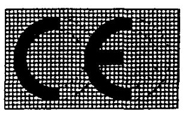
>
> bash En cas de réduction ou d’agrandissement du marquage «CE», les propositions telles qu’elles ressortent du graphisme gradué figurant ci-dessus doivent être respectées.
>
> cash Les différents éléments du marquage «CE» doivent avoir sensiblement la même dimension verticale, laquelle ne peut être inférieure à 5 mm.
>
> Il peut être dérogé à cette dimension minimale pour les dispositifs de petite taille.

#### Version consolidée applicable au 23/03/2009 : Règlement grand-ducal du 11 août 1996 relatif aux dispositifs médicaux.

##### Art. 1er — Définitions, champ d’application

1\. Le présent règlement s’applique aux dispositifs médicaux et à leurs accessoires. Aux fins du présent règlement, les accessoires sont traités comme des dispositifs médicaux à part entière. Les dispositifs et leurs accessoires sont dénommés ci-après «dispositifs».

2\. Aux fins du présent règlement, on entend par:

a) dispositif médical: tout instrument, appareil, équipement, logiciel, matière ou autre article, utilisé seul ou en association, y compris le logiciel destiné par le fabricant à être utilisé spécifiquement à des fins diagnostique et/ou thérapeutique, et nécessaire au bon fonctionnement de celui-ci, destiné par le fabricant à être utilisé chez l’homme à des fins:

aash de diagnostic, prévention, contrôle, traitement ou atténuation d’une maladie,

bash de diagnostic, contrôle, traitement, atténuation ou compensation d’une blessure ou d’un handicap,

cash d’étude ou de remplacement ou modification de l’anatomie ou d’un processus physiologique,

dash de maîtrise de la conception,

et dont l’action principale voulue dans ou sur le corps humain n’est pas obtenue par des moyens pharmacologiques ou immunologiques ni par métabolisme, mais dont la fonction peut être assistée par de tels moyens;

b) accessoire: tout article qui, bien que n’étant pas un dispositif, est destiné spécifiquement par son fabricant à être utilisé avec un dispositif pour permettre l’utilisation dudit dispositif conformément aux intentions du fabricant de ce dispositif;

c) dispositif médical de diagnostic in vitro: tout dispositif médical qui consiste en un réactif, un produit réactif, un matériau d’étalonnage, un matériau de contrôle, une trousse, un instrument, un appareil, un équipement ou un système, utilisé seul ou en combinaison, destiné par le fabricant à être utilisé in vitro dans l’examen d’échantillons provenant du corps humain, y compris les dons de sang et de tissus, uniquement ou principalement dans le but de fournir une information:

aash concernant un état physiologique ou pathologique

ou

aash concernant une anomalie congénitale

ou

aash permettant de déterminer la sécurité et la compatibilité avec des receveurs potentiels

ou

aash permettant de contrôler des mesures thérapeutiques.

Les récipients pour échantillons sont considérés comme des dispositifs médicaux de diagnostic in vitro. On entend par «récipients pour échantillons» des dispositifs, qu’ils soient sous vide ou non, spécifiquement destinés par leur fabricant à recevoir directement l’échantillon provenant du corps humain et à le conserver en vue d’un examen de diagnostic in vitro.

Les produits destinés à des usages généraux en laboratoire ne sont pas des dispositifs médicaux de diagnostic à moins que, eu égard à leurs caractéristiques, ils soient spécifiquement destinés par leur fabricant à des examens de diagnostic in vitro;

d) dispositif sur mesure: tout dispositif fabriqué spécifiquement suivant la prescription écrite d’un praticien dûment qualifié indiquant, sous la responsabilité de ce dernier, les caractéristiques de conception spécifiques et destiné à n’être utilisé que pour un patient déterminé.

La prescription susmentionnée peut également être établie par toute autre personne qui, en vertu de ses qualifications professionnelles, y est autorisée.

Les dispositifs fabriqués suivant des méthodes de fabrication continue ou en série qui nécessitent une adaptation pour répondre à des besoins spécifiques du médecin ou d’un autre utilisateur professionnel ne doivent pas être considérés comme des dispositifs sur mesure;

e) dispositif destiné à des investigations cliniques: tout dispositif destiné à être mis à la disposition d’un médecin dûment qualifié en vue de faire l’objet des investigations visées à l’annexe X point 2.1 et effectuées dans un environnement clinique humain adéquat.

f) fabricant: La personne physique ou morale responsable de la conception, de la fabrication, du conditionnement et de l’étiquetage d’un dispositif en vue de sa mise sur le marché en son propre nom, que ces opérations soient effectuées par cette même personne ou pour son compte par une tierce personne; Les obligations du présent règlement qui s’imposent aux fabricants s’appliquent également à la personne physique ou morale qui assemble, conditionne, traite, remet à neuf et/ou étiquette un ou plusieurs produits préfabriqués et/ou leur assigne la destination d’un dispositif en vue de sa mise sur le marché en son nom propre. Cela ne s’applique pas à la personne qui, sans être fabricant aux termes du premier alinéa, assemble ou adapte conformément à leur destination des dispositifs déjà mis sur le marché, pour un patient individuel;

g) destination: L’utilisation à laquelle le dispositif est destiné d’après les indications fournies par le fabricant dans l’étiquetage, la notice d’instruction et/ou les matériels promotionnels;

h) mise sur le marché: première mise à disposition à titre onéreux ou gratuit d’un dispositif, autre que celui destiné à des investigations cliniques, en vue de sa distribution et/ou utilisation sur le marché, qu’il s’agisse d’un dispositif neuf ou remis à neuf;

i) mise en service: le stade auquel un dispositif est mis à la disposition de l’utilisateur final, étant prêt à être utilisé pour la première fois sur le marché communautaire conformément à sa destination;

j) mandataire: toute personne physique ou morale établie dans la Communauté qui, après avoir été expressément désignée par le fabricant, agit et peut être contactée par le ministre et le directeur de la Santé et les instances dans la Communauté en lieu et place du fabricant en ce qui concerne les obligations que le présent règlement impose à ce dernier.

k) données cliniques: informations relatives à la sécurité et aux performances obtenues dans le cadre de l’utilisation clinique d’un dispositif. Les données cliniques proviennent:

– des investigation(s) clinique(s) du dispositif concerné, ou

– des investigation(s) clinique(s) ou d’autres études citées dans la littérature scientifique d’un dispositif similaire pour lequel l’équivalence avec le dispositif concerné peut être démontrée, ou

– des rapports, publiés ou non, relatifs à une autre expérience clinique acquise sur le dispositif concerné ou un dispositif similaire pour lequel l’équivalence avec le dispositif concerné peut être démontrée;

l) sous-catégorie de dispositifs: un ensemble de dispositifs ayant des domaines d’utilisation communs ou une technologie commune;

m) groupe générique de dispositifs: un ensemble de dispositifs destinés à une utilisation identique ou similaire, ou possédant une technologie commune permettant une classification générique de ces dispositifs, ne reflétant pas leurs caractéristiques spécifiques;

n) dispositif à usage unique: un dispositif destiné à être utilisé une seule fois pour un seul patient.

3\. Les dispositifs destinés à l’administration d’un médicament au sens de l’article 1er de la [directive 2001/83/CE](https://legilux.public.lu/eli/dir_ue/2001/83/jo) du Parlement européen et du Conseil sont régis par le présent règlement, sans préjudice des dispositions de la [directive 2001/83/CE](https://legilux.public.lu/eli/dir_ue/2001/83/jo) pour ce qui concerne le médicament. Toutefois, si ces dispositifs sont mis sur le marché de telle sorte qu’ils forment avec le médicament un seul produit intégré qui est destiné à être exclusivement utilisé dans l’association donnée et qui n’est pas réutilisable, ce produit est régi par la [directive 2001/83/CE](https://legilux.public.lu/eli/dir_ue/2001/83/jo). Les exigences essentielles pertinentes de l’annexe I du présent règlement ne s’appliquent que pour ce qui concerne les caractéristiques liées à la sécurité et aux performances du dispositif.

4\. Lorsqu’un dispositif incorpore comme partie intégrante une substance qui, si elle est utilisée séparément, est susceptible d’être considérée comme un médicament et qui peut agir sur le corps humain par une action accessoire à celle du dispositif, ce dispositif est évalué et autorisé conformément au présent règlement.

4bis. Lorsqu’un dispositif incorpore comme partie intégrante une substance qui, si elle est utilisée séparément, est susceptible d’être considérée comme un composant de médicament ou un médicament dérivé du sang ou du plasma humains au sens de l’article 1er de la [directive 2001/83/CE](https://legilux.public.lu/eli/dir_ue/2001/83/jo), et qui peut agir sur le corps humain par une action accessoire à celle du dispositif, ci-après dénommée «substance dérivée du sang humain», ce dispositif est évalué et autorisé conformément aux dispositions du présent règlement.

5\. Le présent règlement ne s’applique pas:

a) aux dispositifs destinés au diagnostic in-vitro;

b) aux dispositifs implantables actifs couverts par le [règlement grand-ducal du 5 février 1993](https://legilux.public.lu/eli/etat/leg/rgd/1993/02/05/n1/jo) relatif aux dispositifs médicaux implantables actifs;

c) aux médicaments couverts par la [directive 2001/83/CE](https://legilux.public.lu/eli/dir_ue/2001/83/jo). Pour décider si un produit relève de [ladite directive](https://legilux.public.lu/eli/dir_ue/2001/83/jo) ou du présent règlement, il est tenu compte tout particulièrement du mode d’action principal du produit;

d) aux produits cosmétiques;

e) au sang humain, aux produits sanguins, au plasma ou aux cellules sanguines d’origine humaine, ou aux dispositifs qui contiennent, au moment de leur mise sur le marché, de tels produits sanguins, du plasma ou des cellules sanguines, à l’exception des dispositifs visés au paragraphe 4 bis;

f) aux organes, aux tissus ou aux cellules d’origine humaine, ni aux produits incorporant des tissus ou des cellules d’origine humaine, ou qui en sont dérivés, à l’exception des dispositifs visés au paragraphe 4 bis;

g) aux organes, aux tissus ou aux cellules d’origine animale, sauf si, pour la fabrication d’un dispositif, on utilise un tissu d’origine animale rendu non viable ou des produits non viables dérivés de tissus d’origine animale.

6\. Lorsqu’un dispositif est destiné par le fabricant à être utilisé à la fois selon les dispositions du [règlement grand-ducal du 10 août 1992](https://legilux.public.lu/eli/etat/leg/rgd/1992/08/10/n9/jo) relatif aux équipements de protection individuelle et selon celles du présent règlement, les exigences essentielles applicables du [règlement grand-ducal du 10 août 1992](https://legilux.public.lu/eli/etat/leg/rgd/1992/08/10/n9/jo) précité doivent également être satisfaites.

7\. Le présent règlement ne porte pas atteinte à l’application des dispositions existantes en matière d’utilisation médicale des rayonnements ionisants et de protection de la population contre les dangers résultant des rayonnements ionisants.

##### Art. 2 — Mise sur le marché et mise en service

Les dispositifs ne peuvent être mis sur le marché et/ou mis en service que lorsqu’ils sont dûment fournis et sont correctement installés, entretenus et utilisés conformément à leur destination.

Les médecins de la direction de la Santé procèdent à des contrôles par sondage pour s’assurer du respect de la prédite disposition.

##### Art. 3 — Exigences essentielles

Les dispositifs doivent satisfaire aux exigences essentielles figurant à l’annexe 1 qui leur sont applicables en tenant compte de la destination des dispositifs concernés.

Si un risque spécifique existe, les dispositifs qui sont aussi des machines au sens de l’article 1er, paragraphe 2 du [règlement grand-ducal modifié du 8 janvier 1992](https://legilux.public.lu/eli/etat/leg/rgd/1992/01/08/n2/jo) relatif aux machines sont également conformes aux exigences essentielles de santé et de sécurité figurant à l’annexe I de ladite directive, dans la mesure où ces exigences essentielles sont plus spécifiques que les exigences essentielles visées à l’annexe I du présent règlement.

##### Art. 4 — Libre circulation, dispositifs à destination particulière

1\. Peuvent être mis sur le marché et mis en service les dispositifs portant le marquage CE prévu à l’article 15 indiquant qu’ils ont été soumis à une évaluation de leur conformité conformément à l’article 9.

2\. aash les dispositifs destinés à des investigations cliniques peuvent être mis à la disposition des médecins ou des personnes autorisées à cet effet s’ils répondent aux conditions prévues à l’article 13 et à l’annexe VIII;

bash les dispositifs sur mesure peuvent être mis sur le marché et mis en service s’ils satisfont aux conditions prévues à l’article 9 en liaison avec l’annexe VIII; les dispositifs des classes II a, II b et III sont accompagnés de la déclaration visée à l’annexe VIII, qui est mise à la disposition du patient identifié par son nom, un acronyme ou un code numérique.

Ces dispositifs ne portent pas le marquage CE.

3\. Est autorisée lors de manifestations telles que foires, expositions et démonstrations, la présentation de dispositifs qui ne sont pas conformes au présent règlement pour autant qu’un panneau visible indique clairement que ces dispositifs ne peuvent être ni mis sur le marché ni mis en service avant leur mise en conformité.

4\. Les indications qui doivent être fournies à l’utilisateur et au patient conformément à l’annexe I point 13 doivent être rédigées dans une des langues française, allemande ou luxembourgeoise lors de la remise à l’utilisateur final, que ce soit pour utilisation professionnelle ou autre.

Lorsque le dispositif est exclusivement destiné à une utilisation professionnelle, ces indications peuvent aussi être rédigées en langue anglaise.

5\. Lorsque les dispositifs font l’objet d’autres directives communautaires portant sur d’autres aspects et qui prévoient l’apposition du marquage CE, celle-ci indique que les dispositifs satisfont également aux dispositions de ces autres directives.

Toutefois, si l’une de ces directives ou plusieurs d’entre elles autorisent le fabricant, pendant une période transitoire, à choisir le régime qu’il applique, le marquage CE indique que les dispositifs satisfont aux dispositions des seules directives appliquées par le fabricant. Dans ce cas, les références de ces directives, telles que publiées au Journal officiel des Communautés européennes, doivent être indiquées sur les documents, notices ou instructions qui conformément à ces directives accompagnent ces dispositifs.

##### Art. 5 — Renvoi aux normes

1\. Sont présumés conformes aux exigences essentielles visées à l’article 3 les dispositifs qui satisfont aux normes correspondantes adoptées dans un autre pays membre conformément aux normes harmonisées dont les numéros de référence ont été publiés au Journal officiel des Communautés européennes.

En cas de besoin le ministre de la Santé arrête ces normes pour le Luxembourg et les publie au Mémorial.

2\. Aux fins du présent règlement, le renvoi aux normes harmonisées inclut également les monographies de la Pharmacopée européenne relatives notamment aux sutures chirurgicales ainsi qu’aux interactions entre médicaments et matériaux composant les dispositifs dans lesquels ces médicaments sont contenus, dont les références ont été publiées au Journal officiel des Communautés européennes.

##### Art. 6 — Clause de sauvegarde

1\. Lorsqu’il est constaté que des dispositifs visés à l’article 4 paragraphes 1 et 2 deuxième tiret correctement installés, entretenus et utilisés conformément à leur destination risquent de compromettre la santé et/ou la sécurité des patients, des utilisateurs ou, le cas échéant, d’autres personnes, le ministre de la Santé prend toutes mesures utiles provisoires. Suivant le degré de risque il retire ces dispositifs du marché, interdit ou restreint leur mise sur le marché ou leur mise en service. Ces mesures sont immédiatement notifiées à la Commission. Cette notification indique les raisons de cette décision et, en particulier, si la non-conformité avec le présent règlement résulte:

a) du non-respect des exigences essentielles visées à l’article 3,

b) d’une mauvaise application des normes visées à l’article 5 pour autant que l’application de ces normes est prétendue,

c) d’une lacune dans lesdites normes elles-mêmes.

2\. Pour sa décision définitive le ministre de la Santé s’en tient à la décision prise par la Commission à la suite de sa consultation avec toutes les parties concernées.

3\. Lorsqu’un dispositif non conforme est muni du marquage CE, le ministre de la Santé en interdit la mise sur le marché, la mise en service et l’utilisation, sans préjudice des sanctions pénales à l’égard du contrevenant. Il en informe la Commission et les autres Etats membres.

##### Art. 7 — Classification

1\. Les dispositifs sont répartis en classe I, classe IIa, classe IIb et classe III. La classification se fait conformément aux règles figurant en annexe IX.

2\. En cas de litige entre le fabricant et l’organisme notifié concerné résultant de l’application des règles de classification, le ministre de la Santé est saisi en vue d’une décision. Toutefois s’il s’agit, conformément à l’article 14 paragraphe 1 du deuxième alinéa d’un organisme situé dans un autre Etat membre, il est procédé conformément à la réglementation afférente de cet Etat.

3\. Lorsque les règles de classification figurant à l’annexe IX nécessitent d’être adaptées en fonction du progrès technique et des informations rendues disponibles en vertu du système d’information prévu à l’article 8, le ministre peut introduire une demande dûment justifiée auprès de la Commission l’invitant à prendre les mesures nécessaires en vue de l’adaptation des règles de classification.

##### Art. 8 — Informations sur des incidents intervenus après la mise des dispositifs sur le marché

1\. Le directeur de la Santé est chargé de recevoir, de recenser et d’évaluer toutes données communiquées, conformément aux dispositions du présent règlement, concernant les incidents mentionnés ci-après et liés à un dispositif de la classe I, IIa, IIb ou III:

a) tout dysfonctionnement ou toute altération des caractéristiques et/ou de performances d’un dispositif ainsi que toute inadéquation de l’étiquetage ou de la notice d’instructions susceptibles d’entraîner ou d’avoir entraîné la mort ou une dégradation grave de l’état de santé d’un patient ou d’un utilisateur,

b) toute raison d’ordre technique ou médical liée aux caractéristiques ou aux performances d’un dispositif pour les raisons visées au point a) et ayant entraîné le rappel systématique du marché par le fabricant des dispositifs appartenant au même type.

2\. Le directeur de la Santé informe le ministre de la Santé des incidents rapportés en vertu du paragraphe qui précède.

Après avoir procédé à une évaluation, si possible conjointement avec le fabricant ou son mandataire, le ministre, sans préjudice de l’article 6, informe immédiatement la Commission et les autres Etats membres des mesures prises ou qu’il envisage de prendre pour réduire au minimum la répétition des incidents visés au paragraphe 1, en les informant également des incidents qui en sont à l’origine.

##### Art. 9 — Evaluation de la conformité

1\. Pour les dispositifs de la classe III, autres que ceux sur mesure et ceux destinés à des investigations cliniques, le fabricant doit, aux fins de l’apposition du marquage CE:

a) soit suivre la procédure relative à la déclaration CE de conformité (système complet d’assurance de qualité) visée à l’annexe II;

b) soit suivre la procédure relative à l’examen CE de type visée à l’annexe III en liaison:

i) avec la procédure relative à la vérification CE visée à l’annexe IV

ou

ii) avec la procédure relative à la déclaration CE de conformité (assurance de qualité de la production) visée à l’annexe V.

2\. Pour les dispositifs de la classe IIa, autres que ceux sur mesure et ceux destinés à des investigations cliniques, le fabricant doit, aux fins de l’apposition du marquage CE, suivre la procédure relative à la déclaration CE de conformité visée à l’annexe VII en liaison

a) avec la procédure relative à la vérification CE visée à l’annexe IV

ou

b) avec la procédure relative à la déclaration CE de conformité (assurance de qualité de la production) visée à l’annexe V

ou

c) avec la procédure relative à la déclaration CE de conformité (assurance de qualité du produit) visée à l’annexe VI.

Au lieu d’appliquer ces procédures, le fabricant peut également suivre la procédure visée au paragraphe 3 point a).

3\. Pour les dispositifs de la classe IIb, autres que ceux sur mesure et ceux destinés à des investigations cliniques, le fabricant doit, aux fins de l’apposition du marquage CE:

a) soit suivre la procédure relative à la déclaration CE de conformité (système complet d’assurance de qualité) visée à l’annexe II; dans ce cas, le point 4 de l’annexe II n’est pas d’application,

b) soit suivre la procédure relative à l’examen CE de type visée à l’annexe III en liaison:

i) avec la procédure relative à la vérification CE visée à l’annexe IV, ou

ii) avec la procédure relative à la déclaration CE de conformité (assurance de qualité de la production) visée à l’annexe V,

ou

iii) avec la procédure relative à la déclaration CE de conformité (assurance de qualité du produit) visée à l’annexe VI.

4\. Pour les dispositifs de la classe I, autres que ceux sur mesure et ceux destinés à des investigations cliniques, le fabricant suit, pour apposer le marquage CE, la procédure visée à l’annexe VII et établit, avant la mise sur le marché du dispositif, la déclaration CE de conformité requise.

5\. Pour les dispositifs sur mesure, le fabricant doit suivre la procédure visée à l’annexe VIII et établir, avant la mise sur le marché de chaque dispositif, la déclaration visée à ladite annexe.

Le fabricant est tenu de présenter à la direction de la Santé une liste des dispositifs qui ont été mis en service sur le territoire du Luxembourg.

6\. Lors de la procédure d’évaluation de conformité portant sur un dispositif, le fabricant et/ou l’organisme notifié tiennent compte des résultats disponibles en vertu des opérations d’évaluation et de vérification qui ont eu lieu le cas échéant, conformément aux dispositions du présent règlement, à un stade intermédiaire de fabrication.

7\. Le fabricant peut charger son mandataire établi dans la Communauté d’engager les procédures prévues aux annexes III, IV, VII et VIII.

8\. Lorsque la procédure d’évaluation de conformité présuppose une intervention d’un organisme notifié, le fabricant, ou son mandataire, peut s’adresser à un organisme de son choix dans le cadre des tâches pour lesquelles cet organisme a été notifié.

9\. L’organisme notifié peut, lorsque cela est dûment justifié, exiger toute donnée ou information qui est nécessaire pour établir et maintenir l’attestation de conformité compte tenu de la procédure choisie.

10\. Les décisions prises par les organismes notifiés conformément aux annexes II, III, V et VI ont une validité maximale de cinq ans et sont reconductibles sur demande introduite au moment convenu dans le contrat signé entre les deux parties par périodes de cinq ans maximum.

11\. Les dossiers et la correspondance se rapportant aux procédures visées aux paragraphes 1 à 5 sont rédigés dans une des langues française, allemande ou luxembourgeoise. Toutefois, dans ses relations avec l’organisme notifié, toute autre langue communautaire acceptée par celui-ci peut également être employée.

12\. Par dérogation aux paragraphes 1 à 5, le ministre de la Santé peut sur demande dûment justifiée, autoriser la mise sur le marché et la mise en service, sur le territoire du Luxembourg, de dispositifs individuels pour lesquels les procédures visées aux paragraphes 1 à 5 n’ont pas été appliquées et dont l’utilisation est dans l’intérêt de la protection de la santé.

##### Art. 10 — Procédure spéciale pour les systèmes et nécessaires et procédure de stérilisation

1\. Par dérogation à l’article 9, le présent article s’applique aux systèmes et nécessaires.

2\. Toute personne physique ou morale qui réassemble des dispositifs portant le marquage CE, conformément à leur destination et dans les limites d’utilisation prévues par leurs fabricants, afin de les mettre sur le marché sous la forme d’un système ou d’un nécessaire doit établir une déclaration par laquelle elle déclare:

a) avoir vérifié la compatibilité réciproque des dispositifs, conformément aux instructions des fabricants et que ce réassemblage a été réalisé en suivant ces instructions; et

b) avoir effectué l’emballage du système ou du nécessaire et fourni aux utilisateurs des informations pertinentes qui reprennent les instructions pertinentes des fabricants; et

c) que toutes ces activités sont soumises aux méthodes appropriées de maîtrise et de contrôle interne.

Si les conditions susmentionnées ne sont pas remplies, comme c’est le cas lorsque le système ou le nécessaire contient des dispositifs qui ne portent pas un marquage CE ou lorsque la combinaison de dispositifs choisie n’est pas compatible compte tenu de l’utilisation qui est prévue à l’origine pour ces dispositifs, le système ou le nécessaire est considéré comme un dispositif à part entière et, en tant que tel, soumis à la procédure pertinente prévue à l’article 9.

3\. Toute personne physique ou morale qui stérilise aux fins de leur mise sur le marché des systèmes ou des nécessaires visés au paragraphe 2 ou d’autres dispositifs médicaux portant un marquage CE conçus par leur fabricant pour être stérilisés avant usage doit, au choix, suivre l’une des procédures visées aux annexes II ou V. L’application de ces annexes et l’intervention de l’organisme notifié sont limitées aux aspects de la procédure concernant l’obtention de la stérilité aussi longtemps que l’emballage stérile n’aura pas été ouvert ou endommagé. La personne doit produire une déclaration établissant que la stérilisation a été effectuée conformément aux instructions du fabricant.

4\. Les produits visés aux paragraphes 2 et 3 ne doivent pas porter eux mêmes de marquage CE additionnel. Ils doivent être accompagnés des informations visées au point 13 de l’annexe I qui reprennent, le cas échéant, les informations fournies par les fabricants des dispositifs qui ont été réassemblés. Les déclarations prévues aux paragraphes 2 et 3 sont tenues à la disposition de la direction pendant une période de cinq ans.

##### Art. 11.

Lorsque le ministre de la Santé considère:

b) que l’application des règles de décision figurant à l’annexe IX nécessite une décision sur la classification d’un dispositif ou d’une catégorie de dispositifs donnés;

c) qu’un dispositif, ou une famille de dispositifs donnés, doit être classifié par dérogation aux dispositions de l’annexe IX dans une autre classe;

d) que la conformité d’un dispositif ou d’une famille de dispositifs doit être établie, par dérogation à l’article 9, en application exclusive de l’une des procédures déterminées choisie parmi celles visées à l’article 9;

e) qu’il est nécessaire de décider si un produit déterminé, ou un groupe de produits, répond à une des définitions de l’article 1, paragraphe 2, points a) à e),

il introduit une demande dûment justifiée auprès de la Commission l’invitant à prendre les mesures nécessaires. Les mesures communautaires arrêtées à la suite de cette démarche lient le ministre de la Santé.

##### Art. 12 — Enregistrement des personnes responsables pour la mise des dispositifs sur le marché

1\. Tout fabricant qui met, en son nom propre, des dispositifs sur le marché conformément aux procédures visées à l’article 9 paragraphes 4 et 5 et toute autre personne physique ou morale exerçant les activités visées à l’article 10 doit, s’il est établi à Luxembourg, notifier au directeur de la Santé l’adresse du siège social ainsi que la désignation des dispositifs concernés.

Pour tous les dispositifs médicaux des classes II a, II b et III, le ministre de la Santé peut, lors de la mise en service au Grand-Duché de Luxembourg, demander la communication de toutes les données permettant d’identifier de tels dispositifs, avec leur étiquette et leur mode d’emploi.

2\. Lorsqu’un fabricant qui met un dispositif sur le marché en son nom propre n’a pas de siège social au Luxembourg, il désigne un mandataire unique pour l’Union européenne.

Pour les dispositifs visés au paragraphe 1, premier alinéa, le mandataire établi au Luxembourg informe le directeur de la Santé des données visées au paragraphe 1.

3\. Le ministre de la Santé informe, sur demande, les autres Etats membres et la Commission des données, fournies par le fabricant ou par son mandataire, visées au paragraphe 1, premier alinéa.

##### Art. 12-1.

1\. Les données réglementaires conformes au présent règlement sont stockées dans une banque de données européenne qui est accessible au ministre et au directeur de la Santé afin de leur permettre d’accomplir en connaissance de cause les tâches qui leur incombent au titre du présent règlement.

La base de données contient les informations suivantes:

a) les données relatives à l’enregistrement des fabricants et des dispositifs conformément à l’article 14;

b) les données relatives aux certificats délivrés, modifiés, complétés, suspendus, retirés ou refusés conformément aux procédures fixées aux annexes II à VII;

c) les données obtenues conformément à la procédure de vigilance définie à l’article 8.

2\. Les données sont transmises sous une forme normalisée.

3\. Les modalités de mise en œuvre du présent article sont arrêtées selon la procédure visée à l’article 7, paragraphe 2 de la [directive 98/79/CE](https://legilux.public.lu/eli/dir_ue/1998/79/jo) du Parlement européen et du Conseil du 27 octobre 1998 relative aux dispositifs médicaux de diagnostic in vitro.

##### Art. 12-2.

Lorsque le ministre de la Santé estime, en ce qui concerne un produit ou groupe de produits donné, qu’il y a lieu, pour protéger la santé et la sécurité ou pour assurer le respect des impératifs de santé publique conformément à l’article 30 du Traité instituant la Communauté européenne, d’interdire ou de restreindre leur mise à disposition ou de l’assortir de conditions particulières, il est habilité à prendre toutes les mesures transitoires nécessaires et justifiées. Il en informe alors la Commission et les autres Etats membres, en indiquant les raisons de sa décision.

Pour sa décision définitive le ministre de la Santé s’en tient à la décision prise par la Commission à la suite de sa consultation avec toutes les parties concernées.

##### Art. 13 — Investigations cliniques

1\. Dans le cas de dispositifs destinés à des investigations cliniques, le fabricant ou son mandataire, établi dans la Communauté, applique la procédure définie à l’annexe VIII et informe les autorités compétentes des Etats membres où doivent être effectuées les investigations au moyen de la déclaration visée à l’annexe VIII, section 2.2.

2\. Pour les dispositifs de la classe III ainsi que les dispositifs implantables et les dispositifs invasifs à long terme de la classe II a ou II b, le fabricant peut entamer les investigations cliniques concernées au terme d’un délai de soixante jours à compter de la notification, sauf si le ministre de la Santé lui a communiqué, dans ce délai, une décision contraire fondée sur des considérations de santé publique ou d’ordre public.

Le ministre de la Santé peut toutefois autoriser des fabricants à entamer les investigations cliniques en question avant l’expiration du délai de soixante jours pour autant que le comité d’éthique concerné ait émis un avis favorable concernant le programme d’investigations en question, y compris l’examen du protocole d’investigation clinique.

3\. Dans le cas de dispositifs autres que ceux visés au paragraphe 2, le ministre de la Santé peut autoriser les fabricants à entamer les investigations cliniques immédiatement après la date de notification pour autant que le comité d’éthique concerné ait émis un avis favorable concernant le programme d’investigations concerné, y compris l’examen du protocole d’investigation clinique.

4\. Les médecins de la direction de la Santé prennent, si nécessaire, les mesures appropriées pour assurer la santé publique.

5\. Les investigations cliniques sont effectuées conformément aux dispositions de l’annexe X.

6\. Lorsque le ministre de la Santé refuse ou interrompt une investigation clinique, il communique sa décision, ainsi que les raisons qui l’ont motivée, à tous les Etats membres et à la Commission.

Si le ministre de la Santé a demandé une modification substantielle ou l’interruption provisoire d’une investigation clinique, il informe les Etats membres concernés des actions qu’il a engagées et des raisons qui les ont motivées.

7\. Le fabricant ou son mandataire notifie au ministre de la Santé la fin de l’investigation clinique, en justifiant, le cas échéant, l’arrêt prématuré de l’investigation. Si l’investigation clinique a été interrompue prématurément pour des raisons de sécurité, la notification est adressée à tous les Etats membres et à la Commission.

Le fabricant ou son mandataire tient le rapport visé à l’annexe X, point 2.3.7, à la disposition du ministre de la Santé.

##### Art. 14 — Organismes notifiés

1\. Le Ministre de la Santé notifie à la Commission et aux autres Etats membres les organismes qu’il a désignés pour effectuer les tâches se rapportant aux procédures visées à l’article 9 ainsi que les tâches spécifiques pour lesquelles ces organismes ont été désignés.

Le ministre peut désigner un organisme situé dans un autre Etat membre, de l’accord des autorités compétentes de l’Etat membre en question.

2\. Le ministre de la Santé applique les critères énoncés à l’annexe XI pour la désignation des organismes.

3\. Le ministre de la Santé retire la notification s’il constate que l’organisme notifié ne satisfait plus aux critères visés au paragraphe 2, en observant les règles en vigueur en matière de procédure administrative non contentieuse. Il en informe immédiatement les autres Etats membres et la Commission.

4\. L’organisme notifié et le fabricant, ou son mandataire, fixent d’un commun accord les délais pour l’achèvement des opérations d’évaluation et de vérification visées aux annexes II à VI.

5\. L’organisme notifié informe le ministre de l’Economie de tous les certificats délivrés, modifiés, complétés, suspendus, retirés ou refusés, et les autres organismes notifiés des certificats suspendus, retirés ou refusés, ainsi que, sur demande, des certificats délivrés. En outre, l’organisme notifié met à disposition, sur demande, toutes les informations pertinentes supplémentaires.

6\. Lorsqu’un organisme notifié constate que les exigences pertinentes du présent règlement n’ont pas été respectées ou ne le sont plus par le fabricant ou lorsqu’un certificat n’aurait pas dû être délivré, il suspend ou retire le certificat délivré, en tenant compte du principe de proportionnalité, ou l’assortit de restrictions, sauf si le fabricant applique, pour que ces exigences soient respectées, des mesures correctives appropriées. Dans le cas d’une suspension ou d’un retrait du certificat ou d’une quelconque restriction, ou si une intervention des autorités compétentes s’avère nécessaire, l’organisme notifié en informe le directeur de la Santé. Le ministre de la Santé informe les autres Etats membres et la Commission.

7\. L’organisme notifié fournit, sur demande, toutes les informations et documents pertinents, y compris les documents budgétaires, propres à permettre au ministre de la Santé de vérifier le respect des exigences prévues à l’annexe XI.

##### Art. 15 — Marquage CE

1\. Les dispositifs, autres que ceux sur mesure et ceux destinés à des investigations cliniques, qui sont réputés satisfaire aux exigences essentielles visées à l’article 3, doivent porter le marquage CE de conformité lors de leur mise sur le marché.

2\. Le marquage CE de conformité tel que reproduit à l’annexe XII doit être apposé de façon visible, lisible et indélébile sur le dispositif ou sur l’emballage assurant la stérilité, lorsque cela est possible et approprié, et sur les instructions d’utilisation. Le cas échéant, le marquage CE de conformité doit également apparaître sur l’emballage commercial.

Le marquage CE doit être accompagné du numéro d’identification de l’organisme notifié responsable de la mise en oeuvre des procédures visées aux annexes II, IV, V et VI.

3\. Il est interdit d’apposer des marques ou des inscriptions pouvant induire des tiers en erreur quant à la signification ou au graphisme du marquage CE. D’autres marques peuvent être apposées sur le dispositif, sur l’emballage ou sur la notice d’instructions l’accompagnant, à condition qu’elles ne réduisent pas la visibilité et la lisibilité du marquage CE.

##### Art. 16 — Marquage CE indûment apposé

Sans préjudice de l’article 6:

a) Tout constat par le ministre de la Santé, sur avis du directeur de la Santé, de l’apposition indue du marquage CE ou du défaut du marquage CE, entraîne pour le fabricant ou son mandataire l’obligation de faire cesser l’infraction dans les conditions fixées par le ministre;

b) En cas de persistance de l’infraction, le ministre de la Santé peut, suivant le cas, restreindre ou interdire la mise sur le marché du produit en question. Il charge les médecins de la direction de la Santé de prendre les mesures d’urgence qui s’imposent dans l’intérêt de la santé publique.

Les dispositions du présent article s’appliquent également lorsque le marquage CE a été apposé conformément aux procédures prévues au présent règlement, mais de manière indue, sur des produits qui ne sont pas couverts par le présent règlement.

##### Art. 17 — Décisions de refus ou de restriction

1\. Toute décision basée sur le présent règlement:

a) consistant à refuser ou à restreindre la mise sur le marché, la mise en service d’un dispositif ou la conduite des investigations cliniques ou

b) imposant le retrait des dispositifs du marché doit être prise dans le respect du [règlement grand-ducal du 8 juin 1979](https://legilux.public.lu/eli/etat/leg/rgd/1979/06/08/n7/jo) relatif à la procédure à suivre par les administrations relevant de l’Etat et des communes. Sont cependant applicables les dispositions particulières du [prédit règlement](https://legilux.public.lu/eli/etat/leg/rgd/1979/06/08/n7/jo) dans le cas où il y a péril en la demeure.

##### Art. 18 — Confidentialité

Tous fonctionnaires et employés publics et toutes autres personnes recueillant ou obtenant des informations dans l’exécution d’une mission en application du présent règlement, sont tenus de les garder confidentielles. Cela n’affecte pas les obligations du ministre de la Santé et des organismes notifiés visant l’information réciproque et la diffusion des mises en garde.

Ne sont pas considérées comme confidentielles les informations suivantes:

a) informations relatives à l’enregistrement des personnes responsables pour la mise sur le marché des dispositifs conformément à l’article 12;

b) informations aux utilisateurs établies par le fabricant, son mandataire ou un distributeur concernant une mesure au sens de l’article 8, paragraphe 2;

c) informations contenues dans les certificats délivrés, modifiés, complétés, suspendus ou retirés.

##### Art. 18-1 — Coopération

Le ministre de la Santé coopère avec les autorités compétentes des autres Etats membres et leur transmet les informations nécessaires requises conformément aux dispositions du présent règlement.

##### Art. 19 — Abrogations

1\. Le [règlement grand-ducal du 9 mai 1986](https://legilux.public.lu/eli/etat/leg/rgd/1986/05/09/n2/jo) portant application des [directives 82/128/CEE](https://legilux.public.lu/eli/dir_ue/1982/128/jo) et [84/414/CEE](https://legilux.public.lu/eli/dir_ue/1984/414/jo) modifiant la [directive 76/764/CEE](https://legilux.public.lu/eli/dir_ue/1976/764/jo) concernant le rapprochement des législations des Etats membres relatives aux thermomètres médicaux à mercure, en verre, avec dispositif à maximum, est abrogé.

2\. Le [règlement grand-ducal du 8 août 1985](https://legilux.public.lu/eli/etat/leg/rgd/1985/08/08/n5/jo) concernant les appareils électriques utilisés en médecine humaine et vétérinaire est abrogé pour autant qu’il s’applique aux appareils électriques utilisés en médecine humaine.

Il reste cependant applicable aux appareils électriques utilisés en médecine vétérinaire. Toutefois, si un appareil électrique utilisé en médecine vétérinaire est en même temps un dispositif médical au sens du présent règlement et s’il satisfait aux exigences essentielles y prévues pour ce dispositif, le dispositif est réputé conforme aux exigences du présent règlement.

3\. Le [règlement grand-ducal du 31 janvier 1992](https://legilux.public.lu/eli/etat/leg/rgd/1992/01/31/n1/jo) portant exécution de la [loi du 16 janvier 1990](https://legilux.public.lu/eli/etat/leg/loi/1990/01/16/n1/jo) relative aux appareils médicaux est abrogé, pour autant qu’il s’applique aux appareils médicaux utilisés en médecine humaine et sous réserve des dispositions de l’article 21 alinéa 1er ci-après.

##### Art. 20 — Dispositions modificatives

Les modifications suivantes sont apportées au [règlement grand-ducal du 5 février 1993](https://legilux.public.lu/eli/etat/leg/rgd/1993/02/05/n1/jo) relatif aux dispositifs médicaux implantables actifs:

1\. A l’article 1er paragraphe 2, les deux alinéas suivants sont ajoutés:

> h) mise sur le marché: première mise à disposition à titre onéreux ou gratuit d’un dispositif, autre que celui destiné à des investigations cliniques, en vue de sa distribution et/ou utilisation sur le marché, qu’il s’agisse d’un dispositif neuf ou remis à neuf;
>
> i) fabricant: la personne physique ou morale responsable de la conception, de la fabrication, du conditionnement et de l’étiquetage d’un dispositif en vue de la mise sur le marché en son propre nom, que ces opérations soient effectuées par cette même personne ou pour son compte par une tierce personne;
>
> Les obligations du présent règlement qui s’imposent aux fabricants s’appliquent également à la personne physique ou morale qui assemble, conditionne, traite, remet à neuf et/ou étiquette un ou plusieurs produits préfabriqués et/ou leur assigne la destination d’un dispositif en vue de sa mise sur le marché en son nom propre. Cela ne s’applique pas à la personne qui, sans être fabricant aux termes du premier alinéa, assemble ou adapte conformément à leur destination des dispositifs déjà mis sur le marché, pour un patient individuel.

2\. A l’article 9, les paragraphes suivants sont ajoutés:

> 5\. Lors de la procédure d’évaluation de conformité portant sur un dispositif, le fabricant et/ou l’organisme notifié tiennent compte des résultats disponibles en vertu des opérations d’évaluation et de vérification qui ont eu lieu le cas échéant, conformément aux dispositions du présent règlement, à un stade intermédiaire de fabrication.
>
> 6\. Lorsque la procédure d’évaluation de conformité présuppose une intervention d’un organisme notifié, le fabricant, ou son mandataire établi dans la Communauté, peut s’adresser à un organisme de son choix dans le cadre des tâches pour lesquelles cet organisme a été notifié.
>
> 7\. L’organisme notifié peut, lorsque cela est dûment justifié, exiger toute donnée ou information qui est nécessaire pour établir et maintenir l’attestation de conformité compte tenu de la procédure choisie.
>
> 8\. Les décisions prises par les organismes notifiés conformément aux annexes II et III ont une validité maximale de cinq ans et sont reconductibles sur demande introduite au moment convenu dans le contrat signé entre les deux parties par périodes de cinq ans.
>
> 9\. Par dérogation aux paragraphes 1 et 2, le ministre de la Santé peut, sur demande dûment justifiée, autoriser la mise sur le marché et la mise en service de dispositifs individuels pour lesquels les procédures visées aux paragraphes 1 et 2 n’ont pas été appliquées et dont l’utilisation est dans l’intérêt de la protection de la santé.

3\. A l’article 14, l’alinéa suivant est ajouté:

> Sauf le cas d’urgence le fabricant ou son mandataire établi dans la Communauté est entendu avant toute décision de refus ou de refus partiel.

##### Art. 21 — Dispositions transitoires

La mise sur le marché et la mise en service des dispositifs conformes au [règlement grand-ducal du 31 janvier 1992](https://legilux.public.lu/eli/etat/leg/rgd/1992/01/31/n1/jo) portant exécution de la [loi du 16 janvier 1990](https://legilux.public.lu/eli/etat/leg/loi/1990/01/16/n1/jo) relative aux appareils médicaux restent admises jusqu’au 14 juin 1998.

La mise sur le marché et la mise en service des dispositifs ayant fait l’objet d’une approbation CEE de modèle conformément au [règlement grand-ducal du 9 mai 1986](https://legilux.public.lu/eli/etat/leg/rgd/1986/05/09/n2/jo) portant application des [directives 82/128/CEE](https://legilux.public.lu/eli/dir_ue/1982/128/jo) et [84/414/CEE](https://legilux.public.lu/eli/dir_ue/1984/414/jo) modifiant la [directive 76/764/CEE](https://legilux.public.lu/eli/dir_ue/1976/764/jo) concernant le rapprochement des législations des Etats membres relatives aux thermomètres médicaux à mercure, en verre, avec dispositif à maximum restent admises jusqu’au 30 juin 2004.

La mise en service des dispositifs visés à l’alinéa 1er du présent article reste admise jusqu’au 20 juin 2001.

##### Art. 22 — Dispositions pénales

Sont interdites la mise sur le marché, la mise en service, la vente, l’offre en vente et la cession de dispositifs qui sont visés par le présent règlement et qui ne sont pas conformes à ses prescriptions.

Les infractions aux dispositions de l’alinéa qui précède sont punies des peines prévues par la [loi du 16 janvier 1990](https://legilux.public.lu/eli/etat/leg/loi/1990/01/16/n1/jo) relative aux appareils médicaux.

##### Art. 23 — Annexes

Les annexes au présent règlement en forment partie intégrante. Toute référence faite dans une annexe à une disposition de la [directive 93/42/CEE](https://legilux.public.lu/eli/dir_ue/1993/42/jo) s’entend comme étant faite à la disposition correspondante du présent règlement.

##### Art. 24 — Exécution

Notre ministre de la Santé et Notre ministre de la Justice sont chargés, chacun en ce qui le concerne, de l’exécution du présent règlement qui sera publié au Mémorial.

> \**Annexe I**
>
> \**Exigences essentielles**
>
> \***I. Exigences générales***
>
> 1\. Les dispositifs doivent être conçus et fabriqués de telle manière que, lorsqu’ils sont utilisés dans les conditions et aux fins prévues, leur utilisation ne compromette pas l’état clinique et la sécurité des patients ni la sécurité et la santé des utilisateurs ou, le cas échéant, d’autres personnes, étant entendu que les risques éventuels liés à leur utilisation constituent des risques acceptables au regard du bienfait apporté au patient et compatibles avec un niveau élevé de protection de la santé et de la sécurité.
>
> Il s’agit notamment:
>
> aash de réduire, dans toute la mesure du possible, le risque d’une erreur d’utilisation due aux caractéristiques ergonomiques du dispositif et à l’environnement dans lequel le dispositif doit être utilisé (conception pour la sécurité du patient), et
>
> bash de prendre en compte les connaissances techniques, l’expérience, l’éducation et la formation et, lorsque cela est possible, l’état de santé et la condition physique des utilisateurs auxquels les dispositifs sont destinés (conception pour les utilisateurs profanes, professionnels, handicapés ou autres).
>
> 2\. Les solutions choisies par le fabricant dans la conception et la construction des dispositifs doivent se tenir aux principes d’intégration de la sécurité en tenant compte de l’état de la technique généralement reconnu.
>
> Pour retenir les solutions les mieux appropriées, le fabricant doit appliquer les principes suivants dans l’ordre indiqué:
>
> aash éliminer ou réduire autant que possible les risques (sécurité inhérente à la conception et à la fabrication),
>
> bash le cas échéant, prendre les mesures de protection appropriées, y compris des dispositifs d’alarme au besoin, pour les risques qui ne peuvent être éliminés,
>
> cash informer les utilisateurs des risques résiduels dus à l’insuffisance des mesures de protection adoptées.
>
> 3\. Les dispositifs doivent atteindre les performances qui leur sont assignées par le fabricant et être conçus, fabriqués et conditionnés de manière à être aptes à remplir une ou plusieurs des fonctions visées à l’article 1er paragraphe 2 point a) et telles que spécifiées par le fabricant.
>
> 4\. Les caractéristiques et les performances visées aux points 1, 2 et 3 ne doivent pas être altérées de façon à compromettre l’état clinique et la sécurité des patients et, le cas échéant, d’autres personnes pendant la durée de vie des dispositifs suivant les indications du fabricant lorsque ces derniers sont soumis aux contraintes pouvant survenir dans les conditions normales d’utilisation.
>
> 5\. Les dispositifs doivent être conçus, fabriqués et conditionnés de façon à ce que leurs caractéristiques et leurs performances en vue de leur utilisation prévue ne soient pas altérées au cours du stockage et du transport compte tenu des instructions et des informations fournies par le fabricant.
>
> 6\. Tout effet secondaire et indésirable doit constituer un risque acceptable au regard des performances assignées.
>
> 6bis. La démonstration de la conformité aux exigences essentielles doit inclure une évaluation clinique conformément à l’annexe X.
>
> \***II. Exigences relatives à la conception et à la construction***
>
> 7\. **Propriétés chimiques, physiques et biologiques**
>
> 7.1. Les dispositifs doivent être conçus et fabriqués de façon à assurer les caractéristiques et les performances visées à la section I «Exigences générales». Une attention particulière doit être apportée:
>
> aash au choix des matériaux utilisés, notamment en ce qui concerne les aspects de la toxicité et, le cas échéant, de l’inflammabilité,
>
> bash à la compatibilité réciproque entre les matériaux utilisés, les tissus et les cellules biologiques, ainsi que les liquides corporels en tenant compte de la destination du dispositif,
>
> cash le cas échéant, les résultats des recherches en biophysique ou de modélisation dont la validité a été préalablement démontrée.
>
> 7.2. Les dispositifs doivent être conçus, fabriqués et conditionnés de manière à minimiser le risque que présentent les contaminants et les résidus pour le personnel participant au transport, au stockage et à l’utilisation ainsi que pour les patients, conformément à la destination du produit. Une attention particulière doit être donnée aux tissus exposés ainsi qu’à la durée et à la fréquence d’exposition.
>
> 7.3. Les dispositifs doivent être conçus et fabriqués de manière à pouvoir être utilisés en toute sécurité avec les matériaux, substances et gaz avec lesquels ils entrent en contact au cours de leur utilisation normale ou de procédures de routine; si les dispositifs sont destinés à administrer des médicaments, ils doivent être conçus et fabriqués de manière à être compatibles avec les médicaments concernés conformément aux dispositions et restrictions applicables à ceux-ci, et de manière que leurs performances soient maintenues conformes à leur destination.
>
> 7.4. Lorsqu’un dispositif incorpore comme partie intégrante une substance qui, si elle est utilisée séparément, est susceptible d’être considérée comme un médicament au sens de l’article 1er de la [directive 2001/83/CE](https://legilux.public.lu/eli/dir_ue/2001/83/jo) et qui peut agir sur le corps humain par une action accessoire à celle du dispositif, la qualité, la sécurité et l’utilité de cette substance doivent être vérifiées par analogie avec les méthodes prévues à l’annexe I de la [directive 2001/83/CE](https://legilux.public.lu/eli/dir_ue/2001/83/jo).
>
> Pour les substances visées au premier alinéa, l’organisme notifié, après avoir vérifié l’utilité de la substance en tant que partie d’un dispositif médical et en tenant compte de la destination du dispositif, demande un avis scientifique à l’une des autorités compétentes désignées par les États membres ou à l’Agence européenne des médicaments (EMEA) agissant en particulier par le biais de son comité conformément au [règlement (CE) no 726/2004](https://legilux.public.lu/eli/reg_ue/2004/726/jo) du Parlement européen et du Conseil[^1-7], sur la qualité et la sécurité de la substance, y compris sur le profil bénéfice/risque lié à l’incorporation de la substance dans le dispositif. Pour émettre son avis, l’autorité compétente ou l’EMEA tient compte du procédé de fabrication et des données relatives à l’utilité de l’incorporation de la substance dans le dispositif telle qu’elle a été déterminée par l’organisme notifié.
>
> Lorsqu’un dispositif incorpore comme partie intégrante une substance dérivée du sang humain, l’organisme notifié, après avoir vérifié l’utilité de la substance en tant que partie d’un dispositif médical et en tenant compte de la destination du dispositif, demande un avis scientifique à l’EMEA agissant en particulier par le biais de son comité sur la qualité et la sécurité de la substance, y compris sur le profil bénéfice/risque lié à l’incorporation du dérivé du sang humain dans le dispositif. Pour émettre son avis, l’EMEA tient compte du procédé de fabrication et des données relatives à l’utilité de l’incorporation de la substance dans le dispositif telle qu’elle a été déterminée par l’organisme notifié.
>
> Lorsque des modifications sont apportées à une substance accessoire incorporée dans un dispositif médical, en particulier en rapport avec son procédé de fabrication, l’organisme notifié est informé des modifications et consulte l’autorité compétente pour les médicaments (à savoir celle ayant participé à la consultation initiale), afin d’obtenir la confirmation du maintien de la qualité et de la sécurité de la substance accessoire. L’autorité compétente prend en considération les données relatives à l’utilité de l’incorporation de la substance dans le dispositif telle qu’elle a été déterminée par l’organisme notifié afin de garantir que les modifications n’ont pas d’impact négatif sur le profil bénéfice/risque lié à l’ajout de la substance au dispositif médical qui a été établi.
>
> Lorsque l’autorité compétente pour le médicament concerné (à savoir celle qui ayant participé à la consultation initiale) a obtenu des informations sur la substance accessoire qui pourrait avoir un impact sur le profil bénéfice/risque lié à l’ajout de la substance dans le dispositif médical, elle donne un avis à l’organisme notifié, que cette information ait ou non un impact sur le profil bénéfice/risque lié à l’ajout de la substance dans le dispositif médical. L’organisme notifié prend en considération l’avis scientifique mis à jour en reconsidérant son évaluation de la procédure d’évaluation de la conformité.
>
> 7.5. Les dispositifs doivent être conçus et fabriqués de manière à réduire au minimum les risques découlant des substances dégagées par le dispositif. Une attention particulière doit être accordée aux substances carcinogènes, mutagènes ou toxiques pour la reproduction conformément à l’annexe I de la [directive 67/ 548/CEE](https://legilux.public.lu/eli/dir_ue/1967/548/jo) du Conseil du 27 juin 1967 concernant le rapprochement des dispositions législatives, réglementaires et administratives relatives à la classification, l’emballage et l’étiquetage des substances dangereuses[^1-8].
>
> Si des parties d’un dispositif (ou un dispositif lui-même) destiné à administrer dans l’organisme et/ou à retirer de l’organisme des médicaments, des liquides biologiques ou autres substances ou des dispositifs destinés au transport et au stockage de ces liquides ou substances, contiennent des phtalates classés comme carcinogènes, mutagènes ou toxiques pour la reproduction, de la classe 1 ou 2 conformément à l’annexe I de la [directive 67/548/CEE](https://legilux.public.lu/eli/dir_ue/1967/548/jo), ces dispositifs doivent être étiquetés sur le dispositif lui-même et/ou sur l’emballage de chaque unité ou, le cas échéant, sur l’emballage de vente, en tant que dispositif contenant des phtalates.
>
> Si l’utilisation prévue de ces dispositifs inclut le traitement d’enfants ou le traitement de femmes enceintes ou allaitant, le fabricant doit fournir une justification spécifique pour l’utilisation de ces substances en ce qui concerne le respect des exigences essentielles, notamment du présent paragraphe, dans la documentation technique et, dans la notice d’utilisation, des informations sur les risques résiduels pour ces groupes de patients et, le cas échéant, sur des mesures de précaution appropriées.
>
> 7.6. Les dispositifs doivent être conçus et fabriqués de manière à minimiser autant que possible les risques dus à la pénétration non intentionnelle de substances dans le dispositif, en tenant compte du dispositif et de la nature du milieu dans lequel il est destiné à être utilisé.
>
> 8\. **Infection et contamination microbienne**
>
> 8.1. Les dispositifs et leurs procédés de fabrication doivent être conçus de manière à éliminer ou réduire autant que possible le risque d’infection pour le patient, l’utilisateur et les tiers. La conception doit permettre une manipulation facile et, pour autant que nécessaire, minimiser la contamination du dispositif par le patient ou inversement au cours de l’utilisation.
>
> 8.2. Les tissus d’origine animale doivent provenir d’animaux qui ont été soumis à des contrôles vétérinaires et à des mesures de surveillance adaptées à l’utilisation à laquelle les tissus sont destinés.
>
> Les organismes notifiés conservent les informations relatives à l’origine géographique des animaux.
>
> La transformation, la conservation, la manipulation des tissus, des cellules et des substances d’origine animale et les essais auxquels ils sont soumis doivent se faire dans des conditions optimales de sécurité. En particulier, la sécurité en ce qui concerne les virus et autres agents transmissibles doit être assurée par la mise en oeuvre de méthodes validées d’élimination ou d’inactivation des virus au cours du processus de fabrication.
>
> 8.3. Les dispositifs qui sont délivrés en état stérile doivent être conçus, fabriqués et conditionnés dans un emballage non réutilisable et/ou selon des procédures appropriées de façon à ce qu’ils soient stériles lors de leur mise sur le marché et qu’ils maintiennent, dans les conditions prévues de stockage et de transport, cette qualité jusqu’à ce que la protection assurant la stérilisation soit endommagée ou ouverte.
>
> 8.4. Les dispositifs qui sont délivrés en état stérile doivent avoir été fabriqués et stérilisés selon une méthode appropriée et validée.
>
> 8.5. Les dispositifs destinés à être stérilisés doivent être fabriqués dans des conditions satisfaisant aux contrôles appropriés (par exemple, contrôle de l’environnement).
>
> 8.6. Les systèmes d’emballage destinés aux dispositifs non stériles doivent être de nature à conserver le produit sans détérioration au niveau de propreté prévu et, s’ils sont destinés à être stérilisés avant leur utilisation, à minimiser le risque de contamination microbienne; le système d’emballage doit être approprié compte tenu de la méthode de stérilisation indiquée par le fabricant.
>
> 8.7. L’emballage et/ou l’étiquetage du dispositif doivent permettre de distinguer les produits identiques ou similaires vendus à la fois sous forme stérile et non stérile.
>
> 9\. Propriétés relatives à la fabrication et à l’environnement
>
> 9.1. Lorsque le dispositif est destiné à être utilisé en combinaison avec d’autres dispositifs ou équipements, l’ensemble de la combinaison, y compris le système de raccordement, doit être sûr et ne pas porter atteinte aux performances prévues des dispositifs. Toute restriction d’utilisation doit figurer sur l’étiquetage ou dans la notice d’instructions.
>
> 9.2. Les dispositifs doivent être conçus et fabriqués de manière à éliminer ou à réduire dans toute la mesure du possible:
>
> aash les risques de lésions liés à leur caractéristiques physiques, y compris le rapport volume/pression, les caractéristiques dimensionnelles et le cas échéant ergonomiques,
>
> bash les risques liés à des conditions d’environnement raisonnablement prévisibles, telles que les champs magnétiques, les influences électriques externes, les décharges électrostatiques, la pression, la température ou les variations de pression et d’accélération,
>
> cash les risques d’interférences réciproques avec d’autres dispositifs, normalement utilisés lors des investigations ou pour le traitement administré,
>
> dash les risques découlant du vieillissement des matériaux utilisés ou de la diminution de la précision d’un mécanisme de mesure ou de contrôle, lorsqu’un entretien ou un étalonnage n’est pas possible (par exemple, pour les dispositifs implantables).
>
> 9.3. Les dispositifs doivent être conçus et fabriqués de façon à réduire à un minimum les risques d’incendie ou d’explosion en cas d’utilisation normale et en condition de premier défaut. Une attention particulière devra être apportée aux dispositifs dont la destination comporte l’exposition à des substances inflammables ou à des substances susceptibles de favoriser la combustion.
>
> 10\. **Dispositifs ayant une fonction de mesurage**
>
> 10.1. Les dispositifs ayant une fonction de mesurage doivent être conçus et fabriqués de manière à fournir une exactitude et une constance de mesurage suffisantes, dans des limites d’exactitude appropriées en tenant compte de leur destination. Les limites d’exactitude sont indiquées par le fabricant.
>
> 10.2. L’échelle de mesure, de contrôle et d’affichage doit être conçue suivant des principes ergonomiques, en tenant compte de la destination du dispositif.
>
> 10.3. Les mesures effectuées par les dispositifs ayant une fonction de mesurage doivent être exprimées en unités légales en conformité avec les dispositions de la [directive 80/181/CEE](https://legilux.public.lu/eli/dir_ue/1980/181/jo)[^1-9].
>
> 11\. **Protection contre les rayonnements**
>
> 11.1. Généralités
>
> 11.1.1. Les dispositifs sont conçus et fabriqués de façon à réduire l’exposition des patients, utilisateurs et autres personnes aux émissions de rayonnements au minimum compatible avec le but recherché, sans toutefois restreindre l’application des doses indiquées comme appropriées pour les buts thérapeutiques ou diagnostiques.
>
> 11.2. Rayonnements intentionnels
>
> 11.2.1. Lorsque des dispositifs sont conçus pour émettre des doses dangereuses de rayonnements dans un but médical précis qui présente des avantages supérieurs aux risques inhérents à l’émission, l’utilisateur doit pouvoir contrôler les émissions. Ces dispositifs sont conçus et fabriqués de façon à assurer que les paramètres variables pertinents sont reproductibles et assortis d’une marge de tolérance.
>
> 11.2.2. Lorsque des dispositifs sont destinés à émettre des rayonnements potentiellement dangereux, visibles ou invisibles, ils doivent être équipés, dans la mesure du possible, d’indicateurs visuels et/ou sonores signalant les émissions de rayonnements.
>
> 11.3. Rayonnements non intentionnels
>
> 11.3.1. Les dispositifs sont conçus et fabriqués de façon à réduire autant que possible l’exposition des patients, utilisateurs et autres personnes à l’émission de rayonnements non intentionnels, parasites ou diffus.
>
> 11.4. Instructions d’utilisation
>
> 11.4.1. Les instructions d’utilisation des dispositifs émettant des rayonnements doivent comporter des informations détaillées sur la nature des rayonnements émis, les moyens de protéger le patient et l’utilisateur et sur les façons d’éviter les fausses manoeuvres et d’éliminer les risques inhérents à l’installation.
>
> 11.5. Rayonnements ionisants
>
> 11.5.1. Les dispositifs destinés à émettre des rayonnements ionisants doivent être conçus et fabriqués de façon à assurer que, dans la mesure du possible, la quantité, la géométrie et la qualité des rayonnements émis puissent être réglées et contrôlées en fonction du but prévu.
>
> 11.5.2. Les dispositifs émettant des rayonnements ionisants destinés au radiodiagnostic sont conçus et fabriqués de façon à atteindre une qualité d’image et/ou de résultat convenant au but médical prévu tout en réduisant au minimum l’exposition du patient et de l’utilisateur aux rayonnements.
>
> 11.5.3. Les dispositifs émettant des rayonnements ionisants destinés à la radiothérapie doivent être conçus et fabriqués de façon à permettre une surveillance et un contrôle fiables de la dose administrée, du type et de l’énergie du faisceau et, le cas échéant, de la qualité des rayonnements.
>
> 12\. **Exigences pour les dispositifs médicaux raccordés à une source d’énergie ou équipés d’une telle source**
>
> 12.1. Les dispositifs comportant des systèmes électroniques programmables doivent être conçus de façon à assurer la répétabilité, la fiabilité et les performances de ces systèmes conformément à l’utilisation prévue. Dans l’éventualité où le système se trouve en condition de premier défaut, il convient de prévoir les moyens nécessaires pour supprimer ou réduire autant que possible les risques pouvant en découler.
>
> 12.1bis. Pour les dispositifs qui incorpore des logiciels ou qui sont eux-mêmes des logiciels médicaux, le logiciel doit être validé sur la base de l’état de l’art, en tenant compte des principes du cycle de développement ainsi que de gestion des risques, de validation et de vérification.
>
> 12.2. Les dispositifs incorporant une source d’énergie interne dont dépend la sécurité des patients doivent être munis d’un moyen permettant de déterminer l’état de cette source.
>
> 12.3. Les dispositifs raccordés à une source d’énergie externe dont dépend la sécurité des patients doivent comporter un système d’alarme signalant toute défaillance de cette source.
>
> 12.4. Les dispositifs destinés à surveiller un ou plusieurs paramètres cliniques d’un patient doivent être munis de systèmes d’alarme appropriés permettant de prévenir l’utilisateur des situations pouvant entraîner la mort du patient ou une dégradation grave de son état de santé.
>
> 12.5. Les dispositifs doivent être conçus et fabriqués de façon à réduire à un minimum les risques de création de champs électromagnétiques susceptibles d’affecter le fonctionnement d’autres dispositifs ou équipements placés dans l’environnement habituel.
>
> 12.6. Protection contre les risques électriques
>
> Les dispositifs doivent être conçus et fabriqués de façon à éviter, dans toute la mesure du possible, les risques de chocs électriques accidentels dans des conditions normales d’utilisation et en condition de premier défaut, lorsque les dispositifs sont correctement installés.
>
> 12.7. Protection contre les risques mécaniques et thermiques
>
> 12.7.1. Les dispositifs doivent être conçus et fabriqués de façon à protéger le patient et l’utilisateur des risques mécaniques liés, par exemple, à la résistance, à la stabilité et aux pièces mobiles.
>
> 12.7.2. Les dispositifs doivent être conçus et fabriqués de façon que les risques résultant des vibrations produites par les dispositifs soient réduits au niveau le plus bas possible, compte tenu du progrès technique et des moyens disponibles pour réduire les vibrations, notamment à la source, sauf si les vibrations font partie des performances prévues.
>
> 12.7.3. Les dispositifs doivent être conçus et fabriqués de façon que les risques résultant des émissions sonores soient réduits au niveau le plus bas possible, compte tenu du progrès technique et des moyens disponibles pour réduire le bruit, notamment à la source, sauf si les émissions sonores font partie des performances prévues.
>
> 12.7.4. Les terminaux et les dispositifs de connexion à des sources d’énergie électrique, gazeuse, hydraulique ou pneumatique qui doivent être manipulés par l’utilisateur, doivent être conçus et fabriqués de façon à réduire à un minimum tout risque possible.
>
> 12.7.5. Les parties accessibles des dispositifs (à l’exclusion des parties ou des zones destinées à fournir de la chaleur ou à atteindre des températures données) et leur environnement ne doivent pas atteindre des températures susceptibles de présenter un danger dans des conditions normales d’utilisation.
>
> 12.8. Protection contre les risques que peut présenter pour le patient la fourniture d’énergie ou l’administration de substances
>
> 12.8.1. Les dispositifs destinés à fournir de l’énergie ou à administrer des substances au patient doivent être conçus et fabriqués de façon que le débit puisse être réglé et maintenu avec une précision suffisante pour garantir la sécurité du patient et de l’utilisateur.
>
> 18.2.2. Les dispositifs doivent être dotés de moyens permettant d’empêcher et/ou de signaler toute anomalie du débit susceptible de présenter un danger.
>
> Les dispositifs doivent être munis de systèmes appropriés permettant d’éviter, autant que possible, le dégagement accidentel à des niveaux dangereux d’énergie provenant d’une source d’énergie et/ou des substances.
>
> 12.9. La fonction des commandes et des indicateurs doit être clairement indiquée sur les dispositifs.
>
> Lorsqu’un dispositif porte des instructions nécessaires à son fonctionnement ou indique des paramètres de fonctionnement ou de réglage à l’aide d’un système de visualisation, ces informations doivent pouvoir être comprises par l’utilisateur et, le cas échéant, par le patient.
>
> 13\. **Informations fournies par le fabricant**
>
> 13.1. Chaque dispositif doit être accompagné des informations nécessaires pour pouvoir être utilisé correctement et en toute sécurité, en tenant compte de la formation et des connaissances des utilisateurs potentiels et pour permettre d’identifier le fabricant.
>
> Ces informations sont constituées des indications figurant dans la notice d’instruction.
>
> Dans la mesure où cela est possible et approprié, les informations nécessaires pour utiliser le dispositif en toute sécurité doivent figurer sur le dispositif même et/ou sur l’emballage de chaque unité ou, le cas échéant, sur l’emballage commercial. S’il n’est pas possible d’emballer séparément chaque unité, les informations doivent figurer sur une notice accompagnant un ou plusieurs dispositifs.
>
> L’emballage de chaque dispositif doit contenir une notice d’instruction. Une exception est faite pour les dispositifs des classes I et IIa, s’ils peuvent être utilisés en toute sécurité sans l’aide de telles instructions.
>
> 13.2. Ces informations devraient, le cas échéant, prendre la forme de symboles. Tout symbole ou toute couleur d’identification doit être conforme aux normes harmonisées. Dans les domaines où il n’existe aucune norme, les symboles et couleurs doivent être décrits dans la documentation fournie avec le dispositif.
>
> 13.3. L’étiquetage doit comporter les indications suivantes:
>
> a) le nom ou la raison sociale et l’adresse du fabricant. Pour les dispositifs importés dans la Communauté pour y être distribués, l’étiquetage, le conditionnement extérieur ou la notice d’utilisation contiennent, en outre, le nom et l’adresse du mandataire lorsque le fabricant n’est pas établi dans la Communauté;
>
> b) les indications strictement nécessaires pour identifier le dispositif et le contenu de l’emballage en particulier pour les utilisateurs;
>
> c) le cas échéant, la mention «STERILE»;
>
> d) le cas échéant, le code du lot, précédé par la mention «LOT», ou le numéro de série;
>
> e) le cas échéant, la date jusqu’à laquelle le dispositif devrait être utilisé, en toute sécurité, exprimée par l’année et le mois;
>
> f) le cas échéant, une indication précisant que le dispositif est à usage unique. Une indication par le fabricant de l’usage unique doit être uniforme dans l’ensemble de la Communauté;
>
> g) s’il s’agit d’un dispositif sur mesure, la mention «dispositif sur mesure»;
>
> h) s’il s’agit d’un dispositif destiné à des investigations cliniques, la mention «exclusivement pour investigations cliniques»;
>
> i) les conditions particulières de stockage et/ou de manutention;
>
> j) les instructions particulières d’utilisation;
>
> k) les mises en garde et/ou les précautions à prendre;
>
> l) l’année de fabrication pour les dispositifs actifs, autre que ceux couverts par le point e). Cette indication peut être incluse dans le numéro du lot ou de série;
>
> m) le cas échéant, la méthode de stérilisation;
>
> n) dans le cas d’un dispositif au sens de l’article 1er, paragraphe 4 bis, une mention indiquant que le dispositif incorpore comme partie intégrante une substance dérivée du sang humain.
>
> 13.4. Si la destination du dispositif n’est pas évidente pour l’utilisateur, le fabricant doit la mentionner clairement sur l’étiquetage et dans la notice d’instruction.
>
> 13.5. Dans la mesure où cela est raisonnablement possible, les dispositifs et les composants détachables doivent être identifiés, le cas échéant en termes de lots, de façon à permettre toute action appropriée destinée à détecter un risque potentiel lié aux dispositifs et aux composants détachables.
>
> 13.6. La notice d’instruction doit comprendre, le cas échéant, les indications suivantes:
>
> a) les indications visées au point 13.3, à l’exception de celles figurant aux points d) et e);
>
> b) les performances visées au point 3, ainsi que tout effet secondaire indésirable;
>
> c) si le dispositif doit être installé avec d’autres dispositifs ou équipements médicaux ou raccordé à ceux-ci pour fonctionner conformément à sa destination, des indications suffisantes sur ses caractéristiques pour identifier les dispositifs ou équipements corrects qui doivent être utilisés afin d’obtenir une combinaison sûre;
>
> d) toutes les informations nécessaires pour vérifier si le dispositif est bien installé et peut fonctionner correctement et en toute sécurité, ainsi que les indications concernant la nature et la fréquence des opérations d’entretien et d’étalonnage nécessaires pour assurer en permanence le bon fonctionnement et la sécurité des dispositifs;
>
> e) le cas échéant, les informations permettant d’éviter certains risques liés à l’implantation du dispositif;
>
> f) les informations relatives aux risques d’interférence réciproques liés à la présence du dispositif lors d’investigations ou de traitements spécifiques;
>
> g) les instructions nécessaires en cas d’endommagement de l’emballage assurant la stérilité et, le cas échéant, l’indication des méthodes appropriées de restérilisation;
>
> h) si le dispositif est destiné à être réutilisé, les informations relatives aux procédés appropriés pour pouvoir le réutiliser, y compris le nettoyage, la désinfection, le conditionnement et, le cas échéant, la méthode de stérilisation si le dispositif doit être restérilisé ainsi que toute restriction sur le nombre possible de réutilisations.
>
> Lorsque les dispositifs fournis doivent être stérilisés avant utilisation, les instructions de nettoyage et de stérilisation sont telles que, si elles sont correctement suivies, le dispositif satisfait encore aux exigences de la section I.
>
> Si le dispositif porte une indication précisant que le dispositif est à usage unique, des informations sur les caractéristiques connues et les facteurs techniques connus du fabricant qui pourraient présenter un risque si le dispositif devait être réutilisé. Si, conformément au point 13.1, aucune notice d’utilisation n’est nécessaire, l’information doit être rendue disponible pour l’utilisateur sur demande;
>
> i) les indications concernant tout traitement ou toute manipulation supplémentaire nécessaire avant que le dispositif puisse être utilisé (par exemple, stérilisation, assemblage final, etc.);
>
> j) dans le cas de dispositifs émettant des rayonnements dans un but médical, des indications sur la nature, le type, l’intensité et la répartition de ce rayonnement.
>
> La notice d’instruction doit en outre comporter des informations permettant au personnel médical de renseigner le patient sur les contre-indications et les précautions à prendre. Ces informations comprennent notamment:
>
> k) les précautions à prendre en cas de changement de performances du dispositif;
>
> l) les précautions à prendre en ce qui concerne l’exposition, dans des conditions d’environnement raisonnablement prévisibles, à des champs magnétiques, à des influences électriques externes, à des décharges électrostatiques, à la pression ou à des variations de pression, à l’accélération, à des sources thermiques d’ignition, etc.;
>
> m) des informations suffisantes sur le (les) médicament(s) que le dispositif en question est destiné à administrer, y compris toute restriction dans le choix des substances à administrer;
>
> n) les précautions à prendre contre tout risque spécial ou inhabituel lié à l’élimination du dispositif;
>
> o) un médicament ou une substance dérivée du sang humain incorporée dans le dispositif comme partie intégrante conformément au point 7.4;
>
> p) le degré de précision indiqué pour les dispositifs de mesurage;
>
> q) date de publication ou dernière révision de la notice d’utilisation.
>
> \**ANNEXE II**
>
> \**Déclaration CE de conformité**
>
> \*(Système complet d’assurance de qualité)*
>
> 1\. Le fabricant veille à l’application du système de qualité approuvé pour la conception, la fabrication et le contrôle final des produits concernés, tel qu’il est décrit au point 3, et est soumis à la vérification prévue aux points 3.3 et 4 et à la surveillance CE prévue au point 5.
>
> 2\. La déclaration CE de conformité est la procédure par laquelle le fabricant, qui remplit les obligations imposées par le point 1, garantit et déclare que les produits concernés répondent aux dispositions de la présente directive qui s’y appliquent.
>
> Le fabricant doit apposer le marquage CE conformément à l’article 17 et rédiger une déclaration de conformité écrite. Cette déclaration doit couvrir un ou plusieurs dispositifs médicaux fabriqués, clairement identifiés à l’aide du nom du produit, du code du produit ou d’une autre référence non équivoque et doit être conservée par le fabricant.
>
> 3\. **Système de qualité**
>
> 3.1. Le fabricant introduit une demande d’évaluation de son système de qualité auprès d’un organisme notifié.
>
> La demande comprend:
>
> aash le nom et l’adresse du fabricant et de tout autre lieu de fabrication couvert par le système de qualité,
>
> bash toutes les informations appropriées concernant les produits ou la catégorie de produits faisant l’objet de la procédure,
>
> cash une déclaration écrite spécifiant qu’aucune demande portant sur le même système de qualité lié au produit n’a été introduite auprès d’un autre organisme notifié,
>
> dash la documentation sur le système de qualité,
>
> eash un engagement du fabricant de remplir les obligations découlant du système de qualité approuvé,
>
> fash un engagement du fabricant de veiller à ce que le système de qualité approuvé demeure adéquat et efficace,
>
> gash un engagement du fabricant de mettre en place et de tenir à jour une procédure systématique d’examen des données acquises sur le dispositif depuis sa production, y compris les dispositions visées à l’annexe X, et de mettre en oeuvre des moyens appropriés pour appliquer les mesures correctives nécessaires. Cet engagement comprend l’obligation pour le fabricant d’informer les autorités compétentes des incidents suivants dès qu’il en a connaissance:
>
> i) tout dysfonctionnement ou toute altération des caractéristiques et/ou des performances d’un dispositif ainsi que toute inadéquation dans l’étiquetage ou dans la notice d’instructions susceptibles d’entraîner ou d’avoir entraîné la mort ou une dégradation grave de l’état de santé d’un patient ou d’un utilisateur;
>
> ii) toute raison d’ordre technique ou médical liée aux caractéristiques ou aux performances d’un dispositif et ayant entraîné, pour les raisons visées au point i), le rappel systématique par le fabricant des dispositifs appartenant au même type.
>
> 3.2. L’application du système de qualité doit garantir que les produits satisfont aux dispositions de la présente directive qui leur sont applicables à toutes les phases, depuis la conception jusqu’à l’inspection finale. L’ensemble des éléments, exigences et dispositions adoptés par le fabricant pour son système de qualité doivent figurer dans une documentation tenue de manière systématique et ordonnée sous la forme de politiques et de procédures écrites telles que les programmes, les plans, les manuels et les enregistrements relatifs à la qualité.
>
> Elle comprend en particulier les documents, données et enregistrements provenant des procédures visées au point c).
>
> Cette documentation comprend en particulier une description adéquate:
>
> a) des objectifs de qualité du fabricant;
>
> b) de l’organisation de l’entreprise, et notamment:
>
> aash des structures organisationnelles, des responsabilités des cadres et de leur autorité organisationnelle en matière de qualité de la conception et de la fabrication des produits,
>
> bash des méthodes permettant de contrôler le fonctionnement efficace du système de qualité et notamment son aptitude à atteindre la qualité voulue de la conception et des produits, y compris le contrôle des produits non conformes;
>
> cash lorsque la conception, la fabrication et/ou l’inspection finale et les essais des produits ou de certains de leurs éléments sont effectués par un tiers, les méthodes permettant de contrôler l’efficacité du système de qualité et notamment le type et l’ampleur du contrôle auquel le tiers est soumis;
>
> c) des procédures permettant de contrôler et de vérifier la conception des produits, y compris la documentation y afférente, et notamment:
>
> aash une description générale du produit, y compris les variantes envisagées et leur(s) utilisation(s) prévue(s),
>
> bash des spécifications de conception, y compris les normes qui seront appliquées et les résultats de l’analyse de risques ainsi que la description des solutions adoptées pour satisfaire aux exigences essentielles qui s’appliquent aux produits lorsque les normes visées à l’article 5 ne sont pas appliquées entièrement,
>
> cash les techniques de contrôle et de vérification de la conception ainsi que les procédés et les actions systématiques qui seront utilisés lors de la conception des produits,
>
> dash si le dispositif doit être raccordé à un (d’) autre(s) dispositif(s) pour pouvoir fonctionner conformément à sa destination, la preuve qu’il satisfait aux exigences essentielles lorsqu’il est raccordé à l’un quelconque de ces dispositifs ayant les caractéristiques indiquées par le fabricant doit être apportée,
>
> eash une déclaration indiquant si le dispositif incorpore comme partie intégrante une substance, une substance dérivée du sang humain visée au point 7.4 de l’annexe I et des données relatives aux essais effectués à cet égard qui sont nécessaires pour évaluer la sécurité, la qualité et l’utilité de cette substance ou de la substance dérivée du sang humain, en tenant compte de la destination du dispositif,
>
> fash une déclaration indiquant si le dispositif est fabriqué ou non à partir de tissus d’origine animale tels que visés à la [directive 2003/32/CE](https://legilux.public.lu/eli/dir_ue/2003/32/jo) de la Commission[^1-10],
>
> gash les solutions choisies visées à l’annexe I, chapitre I, point 2,
>
> hash l’évaluation préclinique,
>
> iash l’évaluation clinique visée à l’annexe X,
>
> jash le projet d’étiquetage et, le cas échéant, de notice d’utilisation;
>
> d) des techniques d’inspection et d’assurance de la qualité au niveau de la fabrication et notamment:
>
> aash les procédés et procédures qui seront utilisés, notamment en matière de stérilisation, d’achats et les documents pertinents,
>
> bash des procédures d’identification du produit établies et tenues à jour à partir de dessins, de spécifications ou d’autres documents pertinents, à chaque étape de la fabrication;
>
> e) des examens et des essais appropriés qui seront effectués avant, pendant et après la fabrication, de la fréquence à laquelle ils auront lieu et des équipements d’essai utilisés; il doit être possible de s’assurer, de manière appropriée, de l’étalonnage des équipements d’essai.
>
> 3.3. L’organisme notifié effectue une vérification du système de qualité pour déterminer s’il répond aux exigences visées au point 3.2. Il présume que les systèmes de qualité qui mettent en oeuvre les normes harmonisées correspondantes sont conformes à ces exigences.
>
> L’équipe chargée de l’évaluation comprend au moins un membre ayant déjà l’expérience d’évaluations dans la technologie concernée. La procédure d’évaluation comprend une évaluation, sur une base représentative, de la documentation relative à la conception du ou des produits concernés, une visite dans les locaux du fabricant et, en cas dûment justifié, dans les locaux des fournisseurs et/ou des sous-traitants du fabricant, pour contrôler les procédés de fabrication.
>
> La décision est notifiée au fabricant. Elle contient les conclusions de l’inspection et une évaluation motivée.
>
> 3.4. Le fabricant informe l’organisme notifié qui a approuvé le système de qualité de tout projet de modification importante de ce système ou de la gamme des produits couverts. L’organisme notifié évalue les modifications proposées et vérifie si le système de qualité ainsi modifié répond encore aux exigences visées au point 3.2. Il notifie sa décision au fabricant. Cette décision contient les conclusions de l’inspection et une évaluation motivée.
>
> 4\. **Examen de la conception du produit**
>
> 4.1. Outre les obligations lui incombant en vertu du point 3, le fabricant doit introduire auprès de l’organisme notifié une demande d’examen du dossier de conception relatif au produit qu’il prévoit de fabriquer et qui relève de la catégorie visée au point 3.1.
>
> 4.2. La demande décrit la conception, la fabrication et les performances du produit en question. Elle comprend les documents nécessaires pour évaluer la conformité du produit aux exigences de la présente directive et visés au point 3.2.c).
>
> 4.3. L’organisme notifié examine la demande et, si le produit est conforme aux dispositions applicables de la présente directive, délivre au demandeur un certificat d’examen CE de la conception. L’organisme notifié peut exiger que la demande soit complétée par des essais ou preuves supplémentaires, afin de permettre l’évaluation de la conformité aux exigences de la directive. Le certificat contient les conclusions de l’examen, les conditions de validité, les données nécessaires à l’identification de la conception approuvée et, le cas échéant, une description de la destination du produit.
>
> S’il s’agit de dispositifs visés à l’annexe I, point 7.4, deuxième alinéa, l’organisme notifié consulte, pour ce qui est des aspects visés sous ce point, l’une des autorités compétentes désignées par les États membres conformément à la [directive 2001/83/CE](https://legilux.public.lu/eli/dir_ue/2001/83/jo) ou l’EMEA avant de prendre une décision. L’avis de l’autorité nationale compétente ou de l’EMEA doit être rédigé dans les 210 jours suivant la réception d’une documentation recevable. L’avis scientifique de l’autorité nationale compétente ou de l’EMEA doit être inclus dans la documentation concernant le dispositif. En arrêtant sa décision, l’organisme notifié prend dûment en considération les avis exprimés lors de la consultation. Il informe l’organisme compétent concerné de sa décision finale.
>
> S’il s’agit de dispositifs visés à l’annexe I, point 7.4, troisième alinéa, l’avis scientifique de l’EMEA doit être intégré dans la documentation concernant le dispositif. L’avis de l’EMEA doit être rédigé dans les 210 jours après la réception d’une documentation recevable. En arrêtant sa décision, l’organisme notifié prend dûment en considération l’avis de l’EMEA. L’organisme notifié ne peut pas délivrer le certificat si l’avis scientifique de l’EMEA est défavorable. Il informe l’EMEA de sa décision finale.
>
> S’il s’agit de dispositifs fabriqués à partir de tissus d’origine animale tels que visés à la [directive 2003/32/CE](https://legilux.public.lu/eli/dir_ue/2003/32/jo), l’organisme notifié suit les procédures prévues par [ladite directive](https://legilux.public.lu/eli/dir_ue/2003/32/jo).
>
> L’organisme notifié ne peut pas délivrer le certificat si l’avis scientifique de l’EMEA est défavorable. Il informe l’EMEA de sa décision finale.
>
> 4.4. Les modifications de la conception approuvée doivent recevoir une approbation complémentaire de l’organisme notifié qui a délivré le certificat d’examen CE de la conception, lorsque ces modifications peuvent remettre en cause la conformité aux exigences essentielles de la présente directive ou aux conditions prescrites pour l’utilisation du produit.
>
> Le demandeur informe l’organisme notifié qui a délivré le certificat d’examen CE de la conception de toute modification apportée à la conception approuvée.
>
> L’approbation complémentaire prend la forme d’un addendum au certificat d’examen CE de la conception.
>
> 5\. **Surveillance**
>
> 5.1. Le but de la surveillance est d’assurer que le fabricant remplit correctement les obligations qui découlent du système de qualité approuvé.
>
> 5.2. Le fabricant autorise l’organisme notifié à effectuer toutes les inspections nécessaires et lui fournit toutes les informations pertinentes, en particulier:
>
> aash la documentation relative au système de qualité,
>
> bash les données prévues dans la partie du système de qualité relative à la conception, telles que les résultats des analyses, les calculs, les essais, les solutions choisies visées au chapitre I, point 2, de l’annexe I, les évaluations précliniques et cliniques le plan et les résultats du suivi clinique après commercialisation, le cas échéant, etc.,
>
> cash les données prévues dans la partie du système de qualité consacrée à la fabrication, telles que les rapports d’inspection et les données d’essais, les données d’étalonnage, les rapports sur la qualification du personnel concerné, etc.
>
> 5.3. L’organisme notifié procède périodiquement aux inspections et aux évaluations appropriées afin de s’assurer que le fabricant applique le système de qualité approuvé et fournit un rapport d’évaluation au fabricant.
>
> 5.4. En outre, l’organisme notifié peut faire des visites inopinées au fabricant. Lors de ces visites, il peut, s’il l’estime nécessaire, effectuer ou faire effectuer des essais pour vérifier le bon fonctionnement du système de qualité. Il fournit au fabricant un rapport d’inspection et, si un essai a été effectué, un rapport d’essai.
>
> 6\. **Dispositions administratives**
>
> 6.1. Le fabricant ou son mandataire tient à la disposition des autorités nationales, pendant une période expirant au moins cinq ans, et dans le cas de dispositifs implantables, au moins quinze ans, après la fabrication du dernier produit:
>
> aash la déclaration de conformité,
>
> bash la documentation visée au point 3.1 quatrième tiret, et en particulier les documents, données et enregistrements provenant des procédures visées au second alinéa du point 3.2,
>
> cash les modifications visées au point 3.4,
>
> dash la documentation visée au point 4.2,
>
> eash les décisions et rapports de l’organisme notifié visés aux points 3.3, 4.3, 4.4, 5.3 et 5.4.
>
> 7\. **Application aux dispositifs de la classe IIa et IIb**
>
> 7.1. Conformément à l’article 11, paragraphes 2 et 3, la présente annexe peut s’appliquer aux produits de la classe IIa et IIb.
>
> Le point 4, toutefois, ne s’applique pas.
>
> 7.2. Pour les dispositifs de la classe IIa, l’organisme notifié évalue, dans le cadre de l’évaluation prévue au point 3.3, la documentation technique telle que décrite dans le point 3.2, sous c), pour au moins un échantillon représentatif de chaque sous-catégorie de dispositif, pour vérifier sa conformité avec les dispositions de la présente directive.
>
> 7.3. Pour les dispositifs de la classe IIb, l’organisme notifié évalue, dans le cadre de l’évaluation prévue au point 3.3, la documentation technique telle que décrite dans le point 3.2, sous c), pour au moins un échantillon représentatif de chaque groupe générique, pour vérifier sa conformité avec les dispositions de la présente directive.
>
> 7.4. Pour sélectionner le ou les échantillons représentatifs, l’organisme notifié tient compte de la nouveauté de la technologie, des similitudes de conception, de technologie, de méthode de fabrication et de stérilisation, de l’utilisation prévue et des résultats de toute évaluation antérieure pertinente (notamment concernant les propriétés physiques, chimiques ou biologiques) qui a été effectuée conformément à la présente directive.
>
> L’organisme notifié établit un dossier justifiant le choix du ou des échantillons et le tient à la disposition de l’autorité compétente.
>
> 7.5. D’autres échantillons sont évalués par l’organisme notifié dans le cadre de la procédure de surveillance visée au point 5.
>
> 8\. Application aux dispositifs visés à l’article 1er, paragraphe 4 bis
>
> Au terme de la fabrication de chaque lot de dispositifs visés à l’article 1er, paragraphe 4 bis, le fabricant informe l’organisme notifié de la libération de ce lot de dispositifs et lui transmet le certificat officiel de libération du lot de la substance dérivée du sang humain utilisée dans ce dispositif, établi par le Laboratoire national de santé ou par un laboratoire désigné à cet effet par le ministre de la Santé, conformément à l’article 114, paragraphe 2, de la [directive 2001/83/CE](https://legilux.public.lu/eli/dir_ue/2001/83/jo).
>
> \**ANNEXE III**
>
> \**Examen CE de ce type**
>
> 1\. L’examen CE de type est la procédure par laquelle un organisme notifié constate et atteste qu’un échantillon représentatif de la production en question satisfait aux dispositions pertinentes de la présente directive.
>
> 2\. La demande comporte:
>
> aash le nom et l’adresse du fabricant, ainsi que le nom et l’adresse du mandataire si la demande est introduite par celui-ci,
>
> bash la documentation décrite au point 3, nécessaire pour permettre l’évaluation de la conformité aux exigences de la présente directive, de l’échantillon représentatif de la production en question, ci-après dénommé «type». Le demandeur met un type à la disposition de l’organisme notifié, qui peut demander d’autres exemplaires en tant que de besoin,
>
> cash une déclaration écrite spécifiant qu’aucune demande portant sur le même type n’a été introduite auprès d’un autre organisme notifié.
>
> 3\. La documentation doit permettre de comprendre la conception, la fabrication et les performances du produit et doit contenir notamment les éléments suivants:
>
> aash une description générale du type, y compris les variantes envisagées et leur(s) utilisation(s) prévue(s),
>
> bash les dessins de conception, les méthodes de fabrication envisagées, notamment en ce qui concerne la stérilisation, ainsi que les schémas des composants, sous-ensembles, circuits, etc.,
>
> cash les descriptions et explications nécessaires pour comprendre les dessins et schémas susmentionnés et le fonctionnement du produit,
>
> dash une liste des normes visées à l’article 5, appliquées entièrement ou partiellement, et une description des solutions adoptées pour satisfaire aux exigences essentielles, lorsque les normes visées à l’article 5 n’ont pas été appliquées entièrement,
>
> eash les résultats des calculs de conception, de l’analyse des risques, des études, des essais techniques, etc., qui ont été effectués,
>
> fash une déclaration indiquant si le dispositif incorpore comme partie intégrante une substance, ou une substance dérivée du sang humain visée au point 7.4 de l’annexe I et des données relatives aux essais effectués à cet égard qui sont nécessaires pour évaluer la sécurité, la qualité et l’utilité de cette substance ou de la substance dérivée du sang humain, en tenant compte de la destination du dispositif,
>
> gash une déclaration indiquant si le dispositif est fabriqué ou non à partir de tissus d’origine animale tels que visés à la [directive 2003/32/CE](https://legilux.public.lu/eli/dir_ue/2003/32/jo),
>
> hash les solutions choisies visées à l’annexe I, chapitre I, point 2,
>
> iash l’évaluation préclinique,
>
> jash l’évaluation clinique visée à l’annexe X,
>
> kash le projet d’étiquetage et, le cas échéant, de notice d’utilisation.
>
> 4\. L’organisme notifié:
>
> 4.1. examine et évalue la documentation et vérifie que le type a été fabriqué en conformité avec celle-ci; il établit également un relevé des éléments qui ont été conçus conformément aux dispositions applicables des normes visées à l’article 5, ainsi que des éléments pour lesquels la conception ne s’appuie pas sur les dispositions pertinentes des normes susmentionnées;
>
> 4.2. effectue ou fait effectuer les inspections appropriées et les essais nécessaires pour vérifier si les solutions adoptées par le fabricant satisfont aux exigences essentielles de la présente directive lorsque les normes visées à l’article 5 n’ont pas été appliquées; si le dispositif doit être raccordé à un(d’) autre(s) dispositif(s) pour pouvoir fonctionner conformément à sa destination, la preuve qu’il satisfait aux exigences essentielles lorsqu’il est raccordé aux dispositifs ayant les caractéristiques indiquées par le fabricant, doit être fournie;
>
> 4.3. effectue ou fait effectuer les inspections appropriées et les essais nécessaires pour vérifier, au cas où le fabricant a choisi d’appliquer les normes pertinentes, si celles-ci ont réellement été appliquées;
>
> 4.4. convient avec le demandeur de l’endroit où les inspections et essais nécessaires seront effectués.
>
> 5\. Lorsque le type satisfait aux dispositions de la présente directive, l’organisme notifié délivre au demandeur un certificat d’examen CE de type. Le certificat comporte le nom et l’adresse du fabricant, les conclusions de l’inspection, les conditions de validité et les données nécessaires à l’identification du type approuvé. Les parties pertinentes de la documentation sont annexées au certificat et une copie est conservée par l’organisme notifié.
>
> S’il s’agit de dispositifs visés à l’annexe I, point 7.4, deuxième alinéa, l’organisme notifié consulte, pour ce qui est des aspects visés sous ce point, l’une des autorités compétentes désignées par les États membres conformément à la [directive 2001/83/CE](https://legilux.public.lu/eli/dir_ue/2001/83/jo) ou l’EMEA avant de prendre une décision. L’avis de l’autorité nationale compétente ou de l’EMEA doit être rédigé dans les 210 jours suivants la réception d’une documentation recevable. L’avis scientifique de l’autorité nationale compétente ou de l’EMEA doit être inclus dans la documentation concernant le dispositif. En arrêtant sa décision, l’organisme notifié prend dûment en considération les avis exprimés lors de la consultation. Il informe l’organisme compétent concerné de sa décision finale.
>
> S’il s’agit de dispositifs visés à l’annexe I, point 7.4, troisième alinéa, l’avis scientifique de l’EMEA doit être intégré dans la documentation concernant le dispositif. L’avis de l’EMEA doit être rédigé dans les 210 jours suivant la réception d’une documentation recevable. En arrêtant sa décision, l’organisme notifié prend dûment en considération l’avis de l’EMEA. L’organisme notifié ne peut pas délivrer le certificat si l’avis scientifique de l’EMEA est défavorable. Il informe l’EMEA de sa décision finale.
>
> S’il s’agit de dispositifs fabriqués à partir de tissus d’origine animale tels que visés à la [directive 2003/32/CE](https://legilux.public.lu/eli/dir_ue/2003/32/jo), l’organisme notifié suit les procédures prévues par [ladite directive](https://legilux.public.lu/eli/dir_ue/2003/32/jo).
>
> 6\. Le demandeur informe l’organisme notifié qui a délivré le certificat d’examen CE de type de toute modification importante apportée au produit approuvé.
>
> Les modifications du produit approuvé doivent recevoir une approbation complémentaire de l’organisme notifié qui a délivré le certificat d’examen CE de type, lorsque ces modifications peuvent remettre en cause la conformité aux exigences essentielles ou aux conditions prescrites pour l’utilisation du produit. Cette approbation complémentaire prend, le cas échéant, la forme d’un addendum au certificat initial d’examen CE de type.
>
> 7\. **Dispositions administratives**
>
> 7.2. Les autres organismes notifiés peuvent obtenir une copie des certificats d’examen CE de type et/ou de leurs addenda. Les annexes des certificats sont tenues à la disposition des autres organismes notifiés sur demande motivée, après information du fabricant.
>
> 7.3. Le fabricant ou son mandataire conserve avec la documentation technique des copies des attestations d’examen CE de type et de leurs compléments pendant une période d’au moins cinq ans après que la fabrication du dernier dispositif. Dans le cas de dispositifs implantables, la période est d’au moins quinze ans après la fabrication du dernier produit.
>
> \**ANNEXE IV**
>
> \**Vérification CE**
>
> 1\. La vérification CE est la procédure par laquelle le fabricant, ou son mandataire, assure et déclare que les produits qui ont été soumis aux dispositions du point 4 sont conformes au type décrit dans le certificat d’examen CE de type et répondent aux exigences de la présente directive qui leur sont applicables.
>
> 2\. Le fabricant prend toutes les mesures nécessaires pour que le procédé de fabrication assure la conformité des produits au type décrit dans le certificat d’examen CE de type et aux exigences de la directive qui s’y appliquent. Il établit, avant le début de la fabrication, une documentation définissant les procédés de fabrication, en particulier, le cas échéant, en matière de stérilisation, ainsi que l’ensemble des dispositions préétablies et systématiques qui seront mises en oeuvre pour assurer l’homogénéité de la production et la conformité des produits, le cas échéant, au type décrit dans le certificat d’examen CE de type ainsi qu’aux exigences de la présente directive qui leur sont applicables. Il appose le marquage CE conformément à l’article 17 et établit une déclaration de conformité.
>
> En outre, dans le cas des produits mis sur le marché à l’état stérile, et pour les seuls aspects de la fabrication destinés à l’obtention de l’état stérile et à son maintien, le fabricant applique les dispositions de l’annexe V points 3 et 4.
>
> 3\. Le fabricant s’engage à mettre en place et à tenir à jour une procédure systématique d’examen des données acquises sur les dispositifs depuis leur production, y compris les dispositions visées à l’annexe X, et à mettre en oeuvre des moyens appropriés pour appliquer les mesures correctives nécessaires. Cet engagement comprend l’obligation pour le fabricant d’informer les autorités compétentes des incidents suivants dès qu’il en a connaissance:
>
> i) tout dysfonctionnement ou toute altération des caractéristiques et/ou des performances d’un dispositif ainsi que toute inadéquation dans l’étiquetage ou dans la notice d’instructions susceptible d’entraîner ou d’avoir entraîné la mort ou une dégradation grave de l’état de santé d’un patient ou d’un utilisateur;
>
> ii) toute raison d’ordre technique ou médical liée aux caractéristiques ou aux performances d’un dispositif et ayant entraîné, pour les raisons visées au point i), le rappel systématique par le fabricant des dispositifs appartenant au même type.
>
> 4\. L’organisme notifié effectue les examens et essais appropriés, afin de vérifier la conformité du produit aux exigences de la directive, soit par contrôle et essai de chaque produit comme spécifié au point 5, soit par contrôle et essai des produits sur une base statistique comme spécifié au point 6, au choix du fabricant.
>
> Les vérifications susmentionnées ne sont pas d’application en ce qui concerne les aspects de fabrication ayant trait à l’obtention de stérilité.
>
> 5\. **Vérification par contrôle et essai de chaque produit**
>
> 5.1. Chaque produit est examiné individuellement et les essais appropriés, définis dans la (les) norme(s) applicable(s) visée(s) à l’article 5, ou des essais équivalents sont effectués afin de vérifier, le cas échéant, la conformité des produits avec le type décrit dans le certificat d’examen CE de type et avec les exigences de la directive qui leur sont applicables.
>
> 5.2. L’organisme notifié appose ou fait apposer son numéro d’identification sur chaque produit approuvé et établit une attestation de conformité écrite relative aux essais effectués.
>
> 6\. **Vérification statistique**
>
> 6.1. Le fabricant présente les produits fabriqués sous la forme de lots homogènes.
>
> 6.2. Un échantillon est prélevé au hasard dans chaque lot. Les produits constituant l’échantillon sont examinés individuellement et les essais appropriés, définis dans la (les) norme(s) applicable(s) visée(s) à l’article 5, ou des essais équivalents sont effectués pour vérifier, le cas échéant, la conformité des produits avec le type décrit dans le certificat d’examen CE de type et avec les exigences de la directive qui leur sont applicables afin de déterminer si le lot est accepté ou rejeté.
>
> 6.3. Le contrôle statistique des produits sera fait par attributs et/ou variables, impliquant un plan d’échantillonnage présentant des caractéristiques opérationnelles assurant un niveau élevé de sécurité et de performance conformément à l’état de l’art. Le plan d’échantillonnage est établi conformément aux normes harmonisées visées à l’article 5, en tenant compte de la nature spécifique des catégories de produits concernées.
>
> 6.4. Si le lot est accepté, l’organisme notifié appose ou fait apposer son numéro d’identification sur chaque produit et établit une attestation de conformité écrite relative aux essais effectués. Tous les produits du lot peuvent être mis sur le marché, à l’exception des produits de l’échantillon qui n’étaient pas conformes.
>
> Si un lot est rejeté, l’organisme notifié compétent prend les mesures appropriées pour empêcher la mise sur le marché de ce lot. En cas de rejet fréquent de lots, l’organisme notifié peut suspendre la vérification statistique.
>
> Le fabricant peut, sous la responsabilité de l’organisme notifié, apposer le numéro d’identification de cedernier au cours du processus de fabrication.
>
> 7\. **Dispositions administratives**
>
> Le fabricant ou son mandataire tient à la disposition des autorités nationales, pendant une période expirant au moins cinq ans, et dans le cas de dispositifs implantables, au moins quinze ans, après que la fabrication du dernier produit:
>
> aash la déclaration de conformité,
>
> bash la documentation visée au point 2,
>
> cash les attestations visées aux points 5.2 et 6.4,
>
> dash le cas échéant, le certificat d’examen CE de type visé à l’annexe III.
>
> 8\. **Application aux dispositifs de la classe IIa**
>
> La présente annexe peut s’appliquer, conformément à l’article 11 paragraphe 2, aux produits de la classe IIa moyennant les dérogations suivantes.
>
> 8.1. Par dérogation aux points 1 et 2, le fabricant assure et déclare par la déclaration de conformité que les produits de la classe IIa sont fabriqués conformément à la documentation technique visée à l’annexe VII point 3 et répondent aux exigences de la présente directive qui leur sont applicables.
>
> 8.2. Par dérogation aux points 1, 2, 5 et 6, les vérifications effectuées par l’organisme notifié ont pour objet de confirmer la conformité des produits de la classe IIa à la documentation technique visée à l’annexe VII point 3.
>
> 9\. **Application aux dispositifs visés à l’article 1er, paragraphe 4 bis.**
>
> Dans le cas du point 5,le fabricant, au terme de la fabrication de chaque lot de dispositifs visés à l’article 1er, paragraphe 4 bis, et en cas de vérification prévue au point 6, informe l’organisme notifié de la libération de ce lot de dispositif et lui transmet le certificat officiel de libération du lot de la substance dérivée du sang humain utilisée dans ce dispositif, établi par le Laboratoire national de Santé ou un laboratoire désigné à cet effet par le ministre de la Santé, conformément à l’article 114, paragraphe 2, de la [directive 2001/83/CE](https://legilux.public.lu/eli/dir_ue/2001/83/jo).
>
> \**ANNEXE V**
>
> \**Déclaration CE de conformité**
>
> \*(Assurance de la qualité de la production)*
>
> 1\. Le fabricant veille à l’application du système de qualité approuvé pour la fabrication et effectue l’inspection finale des produits concernés comme spécifié au point 3 et est soumis à la surveillance visée au point 4.
>
> 2\. La déclaration CE de conformité est l’élément de procédure par lequel le fabricant qui remplit les obligations du point 1 assure et déclare que les produits concernés sont conformes au type décrit dans le certificat d’examen CE de type et satisfont aux dispositions de la présente directive qui leur sont applicables.
>
> Le fabricant appose le marquage CE conformément à l’article 17 et établit une déclaration écrite de conformité. Cette déclaration doit couvrir un ou plusieurs dispositifs médicaux fabriqués, clairement identifiés au moyen du nom du produit, du code du produit ou d’une autre référence non équivoque, et doit être conservée par le fabriquant.
>
> 3\. **Système de qualité**
>
> 3.1. Le fabricant introduit une demande d’évaluation de son système de qualité auprès d’un organisme notifié.
>
> La demande comprend:
>
> aash le nom et l’adresse du fabricant,
>
> bash toutes les informations appropriées concernant les produits ou la catégorie des produits faisant l’objet de la procédure,
>
> cash une déclaration écrite spécifiant qu’une demande portant sur les mêmes produits n’a pas été introduite auprès d’un autre organisme notifié,
>
> dash la documentation sur le système de qualité,
>
> eash un engagement de remplir les obligations découlant du système de qualité tel qu’approuvé,
>
> fash un engagement d’entretenir le système de qualité approuvé de sorte qu’il demeure adéquat et efficace,
>
> gash le cas échéant, la documentation technique relative aux types approuvés et une copie des certificats d’examen CE de type,
>
> hash un engagement du fabricant de mettre en place et de tenir à jour une procédure systématique d’examen des données acquises sur le dispositif depuis sa production, y compris les dispositions visées à l’annexe X, et de mettre en oeuvre des moyens appropriés pour appliquer les mesures correctives nécessaires. Cet engagement comprend l’obligation pour le fabricant d’informer les autorités compétentes des incidents suivants dès qu’il en a connaissance:
>
> i) tout dysfonctionnement ou toute altération des caractéristiques et/ou des performances d’un dispositif ainsi que toute inadéquation dans l’étiquetage ou dans la notice d’instructions susceptibles d’entraîner ou d’avoir entraîné la mort ou une dégradation grave de l’état de santé d’un patient ou d’un utilisateur;
>
> ii) toute raison d’ordre technique ou médical liée aux caractéristiques ou aux performances d’un dispositif et ayant entraîné, pour les raisons visées au point i), le rappel systématique par le fabricant des dispositifs appartenant au même type.
>
> 3.2. L’application du système de qualité doit assurer la conformité des produits au type décrit dans le certificat d’examen CE de type.
>
> Tous les éléments, exigences et dispositions adoptés par le fabricant pour son système de qualité doivent figurer dans une documentation tenue de manière systématique et ordonnée sous la forme de politiques et de procédures écrites. La documentation du système de qualité doit permettre une interprétation uniforme des politiques et des procédures en matière de qualité, telles que les programmes, les plans, les manuels et les enregistrements relatifs à la qualité.
>
> Elle comprend en particulier une description adéquate:
>
> a) des objectifs de qualité du fabricant;
>
> b) de l’organisation de l’entreprise et notamment:
>
> aash des structures organisationnelles, des responsabilités des cadres et de leur autorité organisationnelle en matière de fabrication des produits,
>
> bash des moyens pour contrôler le fonctionnement efficace du système de qualité et notamment son aptitude à réaliser la qualité voulue des produits, y compris la maîtrise des produits non conformes;
>
> cash lorsque la conception, la fabrication et/ou l’inspection finale et les essais des produits ou de certains de leurs éléments sont effectués par un tiers, les méthodes permettant de contrôler l’efficacité du système de qualité et notamment le type et l’ampleur du contrôle auquel le tiers est soumis;
>
> c) des techniques de contrôle et d’assurance de la qualité au niveau de la fabrication, et notamment:
>
> aash des procédés et des procédures qui seront utilisés, notamment en matière de stérilisation, d’achats et en ce qui concerne les documents pertinents,
>
> bash des procédures d’identification du produit établies et tenues à jour à partir de dessins, de spécifications applicables ou d’autres documents pertinents, au cours de toutes les phases de la fabrication;
>
> d) des examens et des essais appropriés qui seront effectués avant, pendant et après la production, de la fréquence à laquelle ils auront lieu et des équipements d’essai utilisés; le calibrage des équipements d’essai doit être fait de façon à permettre une traçabilité appropriée.
>
> 3.3. L’organisme notifié effectue un audit du système de qualité pour déterminer s’il répond aux exigences visées au point 3.2. Il présume la conformité à ces exigences pour les systèmes de qualité qui mettent en oeuvre les normes harmonisées correspondantes.
>
> L’équipe chargée de l’évaluation comprend au moins un membre ayant déjà l’expérience d’évaluations dans la technologie concernée. La procédure d’évaluation comprend une visite dans les locaux du fabricant et, en cas dûment justifié, dans les locaux des fournisseurs du fabricant pour contrôler les procédés de fabrication.
>
> La décision est notifiée au fabricant après la visite finale. Elle contient les conclusions du contrôle et une évaluation motivée.
>
> 3.4. Le fabricant informe l’organisme notifié qui a approuvé le système de qualité de tout projet d’adaptation importante du système de qualité.
>
> L’organisme notifié évalue les modifications proposées et vérifie si le système de qualité ainsi modifié répond aux exigences visées au point 3.2.
>
> La décision est notifiée au fabricant après réception de l’information précitée. Elle contient les conclusions du contrôle et une évaluation motivée.
>
> 4\. **Surveillance**
>
> 4.1. Le but de la surveillance est d’assurer que le fabricant remplit correctement les obligations qui découlent du système de qualité approuvé.
>
> 4.2. Le fabricant autorise l’organisme notifié à effectuer toutes les inspections nécessaires et lui fournit toute information adéquate, en particulier:
>
> aash la documentation sur le système de qualité,
>
> bash la documentation technique,
>
> cash les données prévues dans la partie du système de qualité consacrée à la fabrication, telles que les rapports d’inspection et les données d’essais, les données d’étalonnage et les rapports sur la qualification du personnel concerné, etc.
>
> 4.3. L’organisme notifié procède périodiquement aux inspections et aux évaluations appropriées afin de s’assurer que le fabricant applique le système de qualité approuvé et fournit un rapport d’évaluation au fabricant.
>
> 4.4. En outre, l’organisme notifié peut faire des visites inopinées au fabricant. À l’occasion de telles visites, l’organisme notifié peut, s’il l’estime nécessaire, effectuer ou faire effectuer des essais pour vérifier le bon fonctionnement du système de qualité. Il fournit au fabricant un rapport de visite et, si un essai a été effectué, un rapport d’essai.
>
> 5\. **Dispositions administratives**
>
> 5.1. Le fabricant ou son mandataire tient à la disposition des autorités nationales, pendant une période d’au moins cinq ans et, dans le cas des dispositifs implantables, d’au moins quinze ans, après la fabrication du dernier produit:
>
> aash la déclaration de conformité,
>
> bash la documentation visée au point 3.1 quatrième tiret,
>
> cash les adaptations visées au point 3.4,
>
> dash la documentation visée au point 3.1 septième tiret,
>
> eash les décisions et rapports de l’organisme notifié visés aux points 4.3 et 4.4,
>
> fash le cas échéant, le certificat d’examen CE de type visé à l’annexe III.
>
> 6\. **Application aux dispositifs de la classe IIa**
>
> La présente annexe peut s’appliquer, conformément à l’article 11, paragraphe 2, aux produits de la classe IIa moyennant les dispositions suivantes:
>
> 6.1. Par dérogation aux points 2, 3.1 et 3.2, le fabricant assure et déclare par la déclaration de conformité que les produits de la classe IIa sont fabriqués conformément à la documentation technique visée à l’annexe VII, point 3, et répondent aux exigences de la présente directive qui leur sont applicables.
>
> 6.2. Pour les dispositifs de la classe IIa, l’organisme notifié évalue, dans le cadre de l’évaluation visée au point 3.3, la conformité aux dispositions de la présente directive de la documentation technique décrite à l’annexe VII, point 3, pour au moins un échantillon représentatif de chaque sous-catégorie de dispositif.
>
> 6.3. Pour sélectionner le ou les échantillons représentatifs, l’organisme notifié tient compte de la nouveauté de la technologie, des similitudes dans la conception, la technologie, la fabrication et les méthodes de stérilisation, de l’utilisation prévue et des résultats de toute évaluation antérieure pertinente (concernant, par exemple, les propriétés physiques, chimiques ou biologiques) réalisée conformément à la présente directive. L’organisme notifié établit un dossier justifiant le choix du ou des échantillons et le tient à la disposition de l’autorité compétente.
>
> 6.4. L’organisme notifié évalue d’autres échantillons dans le cadre de l’évaluation de surveillance visée au point 4.3.
>
> 7\. **Application aux dispositifs visés à l’article 1er, paragraphe 4 bis**
>
> Au terme de la fabrication de chaque lot de dispositifs visés à l’article 1er, paragraphe 4 bis, le fabricant informe l’organisme notifié de la libération de ce lot de dispositifs et lui transmet le certificat officiel de libération du lot de la substance dérivée du sang humain utilisée dans ce dispositif, établi par un laboratoire d’État ou un laboratoire désigné à cet effet par un État membre, conformément à l’article 114, paragraphe 2, de la [directive 2001/83/CE](https://legilux.public.lu/eli/dir_ue/2001/83/jo).
>
> \**ANNEXE VI**
>
> \**Déclaration CE de conformité**
>
> \*(Assurance de la qualité des produits)*
>
> 1\. Le fabricant veille à l’application du système de qualité approuvé pour l’inspection finale du produit et les essais, comme spécifié au point 3, et est soumis à la surveillance visée au point 4.
>
> En outre, dans le cas des produits mis sur le marché en état stérile, et pour les seuls aspects de la fabrication destinés à l’obtention de l’état stérile et à son maintien, le fabricant applique les dispositions de l’annexe V points 3 et 4.
>
> 2\. La déclaration CE de conformité est l’élément de procédure par lequel le fabricant qui remplit les obligations du point 1 assure et déclare que les produits concernés sont conformes au type décrit dans le certificat d’examen CE de type et satisfont aux dispositions de la présente directive qui leur sont applicables.
>
> Le fabricant appose le marquage CE conformément à l’article 17 et établit une déclaration écrite de conformité. Cette déclaration doit couvrir un ou plusieurs dispositifs médicaux fabriqués, clairement identifiés au moyen du nom du produit, du code du produit ou d’une autre référence non équivoque, et doit être conservée par le fabricant. Le marquage CE est accompagné du numéro d’identification de l’organisme notifié qui accomplit les tâches visées dans la présente annexe.
>
> 3\. **Système de qualité**
>
> 3.1. Le fabricant introduit une demande d’évaluation de son système de qualité auprès d’un organisme notifié.
>
> La demande comprend:
>
> aash le nom et l’adresse du fabricant,
>
> bash toutes les informations appropriées concernant les produits ou la catégorie des produits faisant l’objet de la procédure,
>
> cash une déclaration écrite spécifiant qu’aucune demande portant sur les mêmes produits n’a été introduite auprès d’un autre organisme notifié,
>
> dash la documentation sur le système de qualité,
>
> eash un engagement du fabricant de remplir les obligations découlant du système de qualité approuvé,
>
> fash un engagement du fabricant de veiller à ce que le système de qualité approuvé demeure adéquat et efficace,
>
> gash le cas échéant, la documentation technique relative aux types approuvés et une copie des certificats d’examen CE de type,
>
> hash un engagement du fabricant de mettre en place et de tenir à jour une procédure systématique d’examen des données acquises sur le dispositif depuis sa production, y compris les dispositions visées à l’annexe X, et de mettre en oeuvre des moyens appropriés pour appliquer les mesures correctives nécessaires. Cet engagement comprend l’obligation pour le fabricant d’informer les autorités compétentes des incidents suivants dès qu’il en a connaissance:
>
> i) tout dysfonctionnement ou toute altération des caractéristiques et/ou des performances d’un dispositif, ainsi que toute inadéquation dans l’étiquetage ou dans la notice d’instructions susceptibles d’entraîner ou d’avoir entraîné la mort ou une dégradation grave de l’état de santé d’un patient ou d’un utilisateur;
>
> ii) toute raison d’ordre technique ou médical liée aux caractéristiques ou aux performances d’un dispositif et ayant entraîné, pour les raisons visées au point i), le rappel systématique par le fabricant des dispositifs appartenant au même type,
>
> 3.2. Dans le cadre du système de qualité, chaque produit ou un échantillonnage représentatif de chaque lot est examiné et des essais appropriés, définis dans la (les) norme(s) applicable(s) visée(s) à l’article 5, ou des essais équivalents sont effectués pour vérifier sa conformité au type décrit dans le certificat d’examen CE de type et aux dispositions de la présente directive qui lui sont applicables. Tous les éléments, exigences et dispositions adoptés par le fabricant doivent figurer dans une documentation tenue de manière systématique et ordonnée sous la forme de mesures, de procédures et d’instructions écrites. Cette documentation sur le système de qualité permet une interprétation uniforme des programmes, plans, manuels et enregistrements relatifs à la qualité.
>
> Elle comprend en particulier une description adéquate:
>
> aash des objectifs de qualité, de l’organigramme, des responsabilités des cadres et de leurs pouvoirs en matière de qualité des produits,
>
> bash des contrôles et des essais qui seront effectués après la fabrication; le calibrage des équipements d’essai doit être fait de façon à permettre une traçabilité appropriée,
>
> cash des moyens de vérifier le fonctionnement efficace du système de qualité,
>
> dash des enregistrements relatifs à la qualité, tels que les rapports d’inspection et les données d’essais, les données d’étalonnage, les rapports sur la qualification du personnel concerné, etc.
>
> eash lorsque la conception, la fabrication et/ou l’inspection finale et les essais des produits ou de certains de leurs éléments sont effectués par un tiers, les méthodes permettant de contrôler l’efficacité du système de qualité et notamment le type et l’ampleur du contrôle auquel le tiers est soumis;
>
> Les vérifications susmentionnées ne sont pas d’application en ce qui concerne les aspects de fabrication ayant trait à l’obtention de la stérilité.
>
> 3.3. L’organisme notifié effectue un audit du système de qualité pour déterminer s’il répond aux exigences visées au point 3.2. Il présume la conformité à ces exigences pour les systèmes de qualité qui mettent en oeuvre les normes harmonisées correspondantes.
>
> L’équipe chargée de l’évaluation comprend au moins un membre ayant déjà l’expérience d’évaluations dans la technologie concernée. La procédure d’évaluation comprend une visite dans les locaux du fabricant et, en cas dûment justifié, dans les locaux des fournisseurs du fabricant, pour contrôler les procédés de fabrication.
>
> La décision est notifiée au fabricant. Elle contient les conclusions du contrôle et une évaluation motivée.
>
> 3.4. Le fabricant informe l’organisme notifié qui a approuvé le système de qualité de tout projet d’adaptation importante du système de qualité.
>
> L’organisme notifié évalue les modifications proposées et vérifie si le système de qualité ainsi modifié répond aux exigences visées au point 3.2.
>
> La décision est notifiée au fabricant après réception de l’information précitée. Elle contient les conclusions du contrôle et une évaluation motivée.
>
> 4\. **Surveillance**
>
> 4.1. Le but de la surveillance est d’assurer que le fabricant remplit correctement les obligations qui découlent du système de qualité approuvé.
>
> 4.2. Le fabricant autorise l’organisme notifié à accéder, à des fins d’inspection, aux lieux d’inspection, d’essai et de stockage et lui fournit toute information adéquate, en particulier:
>
> aash la documentation sur le système de qualité,
>
> bash la documentation technique,
>
> cash les enregistrements relatifs à la qualité, tels que les rapports d’inspection et les données d’essais, les données d’étalonnage, les rapports sur la qualification du personnel concerné, etc.
>
> 4.3. L’organisme notifié procède périodiquement aux inspections et aux évaluations appropriées pour s’assurer que le fabricant applique le système de qualité et fournit un rapport d’évaluation au fabricant.
>
> 4.4. En outre, l’organisme notifié peut effectuer des visites inopinées au fabricant. À l’occasion de telles visites, l’organisme notifié peut, s’il l’estime nécessaire, effectuer ou faire effectuer des essais pour vérifier le bon fonctionnement du système de qualité et la conformité de la production aux exigences de la directive qui lui sont applicables. À cette fin, un échantillon approprié de produits finis, prélevés sur place par l’organisme notifié, est contrôlé et des essais appropriés définis dans la (les) norme(s) applicable(s) visée(s) à l’article 5 ou des essais équivalents sont effectués. Dans le cas où un ou plusieurs exemplaires des produits contrôlés ne sont pas conformes, l’organisme notifié prend les mesures appropriées.
>
> L’organisme notifié fournit au fabricant un rapport de visite et, si un essai a été effectué, un rapport d’essai.
>
> 5\. **Dispositions administratives**
>
> 5.1. Le fabricant ou son mandataire tient à la disposition des autorités nationales, pendant une période expirant au moins cinq ans et, dans le cas des dispositifs implantables, au moins quinze ans, après la fabrication du dernier produit:
>
> aash la déclaration de conformité,
>
> bash la documentation visée au point 3.1 septième tiret,
>
> cash les adaptations visées au point 3.4,
>
> dash les décisions et rapports de l’organisme notifié visés au point 3.4 dernier alinéa et aux points 4.3 et 4.4,
>
> eash le cas échéant, le certificat de conformité visé à l’annexe III.
>
> 6\. **Application aux dispositifs de la classe IIa**
>
> La présente annexe peut s’appliquer, conformément à l’article 11, paragraphe 2, aux produits de la classe IIa moyennant les dispositions suivantes:
>
> 6.1. Par dérogation aux points 2, 3.1 et 3.2, le fabricant assure et déclare par la déclaration de conformité que les produits de la classe IIa sont fabriqués conformément à la documentation technique visée à l’annexe VII, point 3, et répondent aux exigences de la présente directive qui leur sont applicables.
>
> 6.2. Pour les dispositifs de la classe IIa, l’organisme notifié évalue, dans le cadre de l’évaluation visée au point 3.3, la conformité aux dispositions de la présente directive de la documentation technique décrite à l’annexe VII, point 3, pour au moins un échantillon représentatif de chaque sous-catégorie de dispositif.
>
> 6.3. Pour sélectionner le ou les échantillons représentatifs, l’organisme notifié tient compte de la nouveauté de la technologie, des similitudes dans la conception, la technologie, la fabrication et les méthodes de stérilisation, de l’utilisation prévue et des résultats de toute évaluation antérieure pertinente (concernant, par exemple, les propriétés physiques, chimiques ou biologiques) réalisée conformément à la présente directive. L’organisme notifié établit un dossier justifiant le choix du ou des échantillons et le tient à la disposition de l’autorité compétente.
>
> 6.4. L’organisme notifié évalue d’autres échantillons dans le cadre de l’évaluation de surveillance visée au point 4.3.
>
> \**ANNEXE VII**
>
> \**Déclaration CE de conformité**
>
> 1\. La déclaration CE de conformité est la procédure par laquelle le fabricant ou son mandataire qui remplit les obligations du point 2 ainsi que, pour les produits mis sur le marché à l’état stérile et les dispositifs ayant une fonction de mesurage, celles du point 5, assure et déclare que les produits concernés satisfont aux dispositions de la présente directive qui leur sont applicables.
>
> 2\. Le fabricant établit la documentation technique décrite au point 3. Le fabricant ou son mandataire établi dans la Communauté tient cette documentation, y compris la déclaration CE de conformité, à la disposition des autorités nationales à des fins d’inspection pendant une période expirant au moins cinq ans après la fabrication du dernier produit. Dans le cas des dispositifs implantables, la période est d’au moins quinze ans après la fabrication du dernier produit.
>
> 3\. La documentation technique doit permettre d’évaluer la conformité du produit aux exigences de la directive. Elle comprend en particulier:
>
> aash une description générale du produit, y compris les variantes envisagées et leur(s) utilisation(s) prévue(s),
>
> bash les dessins de conception, les méthodes de fabrication envisagées, ainsi que les schémas des composants, sous-ensembles, circuits, etc.,
>
> cash les descriptions et explications nécessaires pour comprendre les dessins et schémas susmentionnés et le fonctionnement du produit,
>
> dash les résultats de l’analyse des risques ainsi qu’une liste des normes visées à l’article 5, appliquées entièrement ou partiellement, et une description des solutions adoptées pour satisfaire aux exigences essentielles de la directive lorsque les normes visées à l’article 5 n’ont pas été appliquées entièrement,
>
> eash pour les produits mis sur le marché à l’état stérile, une description des méthodes utilisées et le rapport de validation,
>
> fash les résultats des calculs de conception et des inspections effectuées, etc.; si le dispositif doit être raccordé à un (d’) autre(s) dispositif(s) pour pouvoir fonctionner conformément à sa destination, la preuve qu’il satisfait aux exigences essentielles lorsqu’il est raccordé à l’un quelconque de ces dispositifs ayant les caractéristiques indiquées par le fabricant doit être apportée,
>
> gash les solutions choisies visées à l’annexe I, chapitre I, point 2,
>
> hash l’évaluation préclinique,
>
> iash l’évaluation clinique conformément à l’annexe X,
>
> jash l’étiquetage et les instructions d’utilisation.
>
> 4\. Le fabricant met en place et tient à jour une procédure systématique d’examen des données acquises sur les dispositifs depuis leur production, y compris les dispositions visées à l’annexe X, et s’engage à mettre en oeuvre des moyens appropriés pour appliquer toutes les mesures correctives nécessaires en tenant compte de la nature du produit et des risques qui y sont liés. Il informe les autorités compétentes des incidents suivants dès qu’il en a connaissance:
>
> i) tout dysfonctionnement ou toute altération des caractéristiques et/ou des performances d’un dispositif, ainsi que toute inadéquation dans l’étiquetage ou la notice d’instructions susceptibles d’entraîner ou d’avoir entraîné la mort ou une dégradation grave de l’état de santé d’un patient ou d’un utilisateur;
>
> ii) toute raison d’ordre technique ou médical liée aux caractéristiques ou aux performances d’un dispositif ayant entraîné, pour les raisons visées au point i), le rappel systématique par le fabricant des dispositifs appartenant au même type.
>
> 5\. Pour les produits mis sur le marché à l’état stérile et les dispositifs de la classe I ayant une fonction de mesurage, le fabricant doit suivre non seulement les dispositions de la présente annexe mais également l’une des procédures visées aux annexe II, IV, V ou VI. L’application des annexes susmentionnées et l’intervention de l’organisme notifié sont limitées:
>
> aash dans le cas des produits mis sur le marché à l’état stérile, aux seuls aspects de la fabrication liés à l’obtention et au maintien de l’état stérile,
>
> bash dans le cas des dispositifs ayant une fonction de mesurage, aux seuls aspects de la fabrication liés à la conformité des produits aux exigences métrologiques.
>
> Le point 6.1 de la présente annexe est d’application.
>
> 6\. **Application aux dispositifs de la classe IIa**
>
> Conformément à l’article 11 paragraphe 2, la présente annexe peut s’appliquer aux produits de la classe IIa sous réserve de la dérogation suivante.
>
> 6.1. Lorsque la présente annexe est appliquée en liaison avec la procédure visée à l’annexe IV, V ou VI, la déclaration CE de conformité visée aux annexes susmentionnées forme une déclaration unique.
>
> En ce qui concerne la déclaration fondée sur la présente annexe, le fabricant assure et déclare que la conception du produit satisfait aux dispositions de la présente directive qui lui sont applicables.
>
> \**ANNEXE VIII**
>
> \**Déclaration relative aux dispositifs ayant une destination particulière**
>
> 1\. Pour les dispositifs sur mesure ou les dispositifs destinés à des investigations cliniques, le fabricant ou son mandataire rédige la déclaration comprenant les informations visées au point 2.
>
> 2\. La déclaration comprend les informations suivantes:
>
> 2.1. Pour les dispositifs sur mesure:
>
> aash le nom et l’adresse du fabricant,
>
> bash les données permettant d’identifier le dispositif en question,
>
> cash une déclaration selon laquelle le dispositif est destiné à l’usage exclusif d’un patient déterminé et le nom de ce dernier,
>
> dash le nom du médecin ou d’une autre personne autorisée qui a établi la prescription et, le cas échéant, le nom de l’institution médicale concernée,
>
> eash les caractéristiques spécifiques du produit, telles qu’indiquées par la prescription,
>
> fash une déclaration selon laquelle le dispositif en question est conforme aux exigences essentielles énoncées à l’annexe I et, le cas échéant, l’indication des exigences essentielles auxquelles il n’a pas été entièrement satisfait, avec mention des motifs.
>
> 2.2. Pour les dispositifs destinés aux investigations cliniques visées à l’annexe X:
>
> aash les données permettant d’identifier le dispositif en question,
>
> bash le protocole des investigations cliniques,
>
> cash l’avis délivré par le comité éthique concerné et l’indication des aspects sur lesquels porte cet avis,
>
> dash la brochure pour l’investigateur,
>
> eash l’attestation d’assurance des personnes,
>
> fash les documents utilisés pour obtenir le consentement éclairé,
>
> gash une déclaration indiquant si le dispositif incorpore comme partie intégrante une substance ou une substance dérivée du sang humain, visée à l’annexe I, point 7.4,
>
> hash une déclaration indiquant si le dispositif est fabriqué ou non à partir de tissus d’origine animale visés par la [directive 2003/32/CE](https://legilux.public.lu/eli/dir_ue/2003/32/jo),
>
> iash le nom du médecin ou d’une autre personne autorisée ainsi que de l’institution chargés des investigations,
>
> jash le lieu où se déroulent les investigations, la date à laquelle elles commencent et leur durée probable,
>
> kash une déclaration établissant que le dispositif en question est conforme aux exigences essentielles, à l’exception des aspects faisant l’objet des investigations et que, quant à ces aspects, toutes les précautions ont été prises pour protéger la santé et la sécurité du patient.
>
> 3\. Le fabricant s’engage en outre à tenir à la disposition des autorités nationales compétentes:
>
> 3.1. pour les dispositifs sur mesure, la documentation indiquant le ou les lieux de fabrication et permettant de comprendre la conception, la fabrication et les performances du produit, y compris les performances prévues, de manière à permettre l’évaluation de sa conformité aux exigences de la présente directive.
>
> Le fabricant prend toutes les mesures nécessaires pour que le procédé de fabrication assure que les produits fabriqués sont conformes à la documentation mentionnée au premier alinéa;
>
> 3.2. pour les dispositifs destinés à des investigations cliniques, la documentation contient:
>
> aash une description générale du produit et de son utilisation prévue,
>
> bash les dessins de conception, les méthodes de fabrication envisagées, notamment en ce qui concerne la stérilisation, ainsi que les schémas des composants, sous-ensembles, circuits, etc.,
>
> cash les descriptions et explications nécessaires pour comprendre les dessins et schémas susmentionnés et le fonctionnement du produit,
>
> dash les résultats de l’analyse des risques ainsi qu’une liste des normes visées à l’article 5, appliquées entièrement ou partiellement, et une description des solutions adoptées pour satisfaire aux exigences essentielles de la présente directive lorsque les normes visées à l’article 5 n’ont pas été appliquées,
>
> eash si le dispositif incorpore comme partie intégrante une substance ou une substance dérivée du sang humain dont question au point 7.4 de l’annexe I, des données relatives aux essais effectués à cet égard qui sont nécessaires pour évaluer la sécurité, la qualité et l’utilité de la substance ou de la substance dérivée du sang humain, en tenant compte de la destination du dispositif,
>
> fash si le dispositif est fabriqué à partir de tissus d’origine animale tels que visés à la [directive 2003/32/ CE](https://legilux.public.lu/eli/dir_ue/2003/32/jo), les mesures de gestion des risques qui ont été appliquées pour diminuer le risque d’infection,
>
> gash les résultats des calculs de conception et des inspections et essais techniques, etc., qui ont été effectués.
>
> Le fabricant prend toutes les mesures nécessaires pour que le procédé de fabrication assure que les produits fabriqués sont conformes à la documentation mentionnée au premier alinéa du présent point.
>
> Le fabricant autorise l’évaluation ou, le cas échéant, la vérification de l’efficacité de ces mesures.
>
> 4\. Les informations contenues dans les déclarations prévues à la présente annexe doivent être conservées pendant une période d’au moins cinq ans. Dans le cas des dispositifs implantables, cette période est d’au moins quinze ans.
>
> 5\. Pour les dispositifs sur mesure, le fabricant s’engage à examiner et à enregistrer les données acquises après la production, y compris les dispositions visées à l’annexe X, et à mettre en oeuvre des moyens appropriés pour appliquer les mesures correctives nécessaires. Cet engagement comprend l’obligation pour le fabricant d’informer les autorités compétentes des incidents suivants dès qu’il en a connaissance, ainsi que des mesures correctives s’y rapportant:
>
> i) tout dysfonctionnement ou toute altération des caractéristiques et/ou des performances d’un dispositif, ainsi que toute inadéquation dans l’étiquetage ou la notice d’utilisation susceptibles d’entraîner ou d’avoir entraîné la mort ou une dégradation grave de l’état de santé d’un patient ou d’un utilisateur;
>
> ii) toute raison d’ordre technique ou médical liée aux caractéristiques ou aux performances d’un dispositif et ayant entraîné, pour les raisons visées au point i), le rappel systématique par le fabricant des dispositifs du même type.
>
> \**ANNEXE IX**
>
> \**Critères utilisés ppour la classification**
>
> \*I. DEFINITIONS*
>
> 1\. **Définitions pour les règles de classification**
>
> 1.1. *Durée*
>
> Temporaire
>
> Normalement destiné à être utilisé en continu pendant moins de soixante minutes.
>
> Court terme
>
> Normalement destiné à être utilisé en continu pendant trente jours au maximum.
>
> Long terme
>
> Normalement destiné à être utilisé en continu pendant plus de trente jours.
>
> 1.2. *Dispositifs invasifs*
>
> Dispositif invasif
>
> Dispositif qui pénètre partiellement ou entièrement à l’intérieur du corps, soit par un orifice du corps soit à travers la surface du corps.
>
> Orifice du corps
>
> Toute ouverture naturelle du corps, ainsi que la surface externe du globe oculaire, ou toute ouverture artificielle permanente, par exemple une stomie.
>
> Dispositif invasif de type chirurgical
>
> Dispositif invasif qui pénètre à l’intérieur du corps à travers la surface du corps, à l’aide ou dans le cadre d’un acte chirurgical.
>
> Aux fins de la présente directive, les dispositifs, autres que ceux visés au premier alinéa, opérant une pénétration par une voie autre qu’un orifice existant du corps, sont considérés comme des dispositifs invasifs de type chirurgical.
>
> Dispositif implantable
>
> Tout dispositif destiné:
>
> aash à être implanté en totalité dans le corps humain
>
> ou
>
> bash à remplacer une surface épithéliale ou la surface de l’oeil,
>
> grâce à une intervention chirurgicale et à demeurer en place après l’intervention.
>
> Est également considéré comme dispositif implantable tout dispositif destiné à être introduit partiellement dans le corps humain par une intervention chirurgicale et qui est destiné à demeurer en place après l’intervention pendant une période d’au moins trente jours.
>
> 1.3. *Instrument chirurgical réutilisable*
>
> Instrument destiné à accomplir, sans être raccordé à un dispositif médical actif, un acte chirurgical tel que couper, forer, scier, gratter, racler, serrer, rétracter ou attacher, et pouvant être réutilisé après avoir été soumis aux procédures appropriées.
>
> 1.4. *Dispositif médical actif*
>
> Tout dispositif médical dépendant pour son fonctionnement d’une source d’énergie électrique ou de toute source d’énergie autre que celle générée directement par le corps humain ou par la pesanteur et agissant par conversion de cette énergie. Les dispositifs médicaux destinés à transmettre de l’énergie, des substances ou d’autres éléments, sans modification significative, entre un dispositif médical actif et le patient ne sont pas considérés comme des dispositifs médicaux actifs. Tout logiciel autonome est considéré comme un dispositif médical actif.
>
> 1.5. *Dispositif actif thérapeutique*
>
> Tout dispositif médical actif, utilisé soit seul soit en combinaison avec d’autres dispositifs médicaux, pour soutenir, modifier, remplacer ou restaurer des fonctions ou des structures biologiques en vue de traiter ou de soulager une maladie, une blessure ou un handicap.
>
> 1.6. *Dispositif actif destiné au diagnostic*
>
> Tout dispositif médical actif, utilisé soit seul soit en combinaison avec d’autres dispositifs médicaux, pour fournir des informations en vue de détecter, diagnostiquer, contrôler ou traiter des états physiologiques, des états de santé, des maladies ou des malformations congénitales.
>
> 1.7. *Système circulatoire central*
>
> Aux fins de la présente directive, on entend par «système circulatoire central», les vaisseaux suivants:
>
> arteriae pulmonales, aorta ascendens, arcus aortae, aorta descendens jusqu’aux bifurcatio aortae, arteriae coronariae, arteria carotis communis, arteria carotis externa, arteria carotis interna, arteriae cerebrales, truncus brachiocephalicus, venae cordis, venae pulmonales, vena cava superior, vena cava inferior.
>
> 1.8. *Système nerveux central*
>
> Aux fins de la présente directive, on entend par «système nerveux central» l’encéphale, la moelle épinière et les méninges.
>
> \*II. REGLES D’APPLICATION*
>
> 2\. **Règles d’application**
>
> 2.1. Les règles de classification s’appliquent en fonction de la destination des dispositifs.
>
> 2.2. Si le dispositif est destiné à être utilisé en combinaison avec un autre dispositif, les règles de classification s’appliquent séparément à chacun des dispositifs. Les accessoires sont classés en tant que tels, indépendamment des dispositifs avec lesquels ils sont utilisés.
>
> 2.3. Le logiciel informatique commandant un dispositif ou agissant sur son utilisation relève automatiquement de la même classe.
>
> 2.4. Si le dispositif n’est pas destiné à être utilisé exclusivement ou essentiellement dans une partie spécifique du corps, il doit être considéré et classé suivant l’utilisation la plus critique telle que spécifiée.
>
> 2.5. Si plusieurs règles s’appliquent au même dispositif du fait des utilisations indiquées par le fabricant, la règle qui s’applique est la plus stricte, le dispositif étant classé dans la classe la plus élevée.
>
> 2.6. Pour le calcul de la durée visée au point 1.1 de la section I, l’expression «utilisé en continu» doit être entendue au sens d’une utilisation effective ininterrompue du dispositif conformément à sa destination. Toutefois, lorsqu’un dispositif cesse d’être utilisé afin d’être remplacé immédiatement par le même dispositif ou par un dispositif identique, il convient de considérer cette nouvelle période comme une prolongation de l’utilisation continue du dispositif.
>
> \*III. CLASSIFICATION*
>
> 1\. **Dispositifs non invasifs**
>
> 1.1. *Règle 1*
>
> Tous les dispositifs non invasifs font partie de la classe I, sauf si l’une des règles suivantes est d’application.
>
> 1.2. *Règle 2*
>
> Tous les dispositifs non invasifs destinés à conduire ou à stocker du sang, des liquides ou tissus corporels, des liquides ou des gaz en vue d’une perfusion, administration ou introduction dans le corps appartiennent à la classe IIa:
>
> aash s’ils peuvent être raccordés à un dispositif médical actif de la classe IIa ou d’une classe supérieure,
>
> bash s’ils sont destinés à être utilisés pour le stockage ou la canalisation du sang ou d’autres liquides corporels ou le stockage d’organes, de parties d’organes ou tissus corporels.
>
> Dans tous les autres cas, ils appartiennent à la classe I.
>
> 1.3. *Règle 3*
>
> Tous les dispositifs non invasifs visant à modifier la composition biologique ou chimique du sang, d’autres liquides corporels ou d’autres liquides destinés à être perfusés dans le corps appartiennent à la classe IIb, sauf si le traitement consiste en une filtration, une centrifugation ou en échanges de gaz ou de chaleur, auquel cas ils appartiennent à la classe IIa.
>
> 1.4. *Règle 4*
>
> Tous les dispositifs non invasifs qui entrent en contact avec de la peau lésée:
>
> aash relèvent de la classe I s’ils sont destinés à être utilisés comme barrière mécanique, pour la compression ou pour l’absorption des exsudats,
>
> bash relèvent de la classe IIb s’ils sont destinés à être utilisés principalement pour des plaies comportant une destruction du derme et ne pouvant se cicatriser que par deuxième intention,
>
> cash appartiennent à la classe IIa dans tous les autres cas, y compris les dispositifs destinés principalement à agir sur le microenvironnement des plaies.
>
> 2\. **Dispositifs invasifs**
>
> 2.1. *Règle 5*
>
> Tous les dispositifs invasifs en rapport avec les orifices du corps, autres que les dispositifs invasifs de type chirurgical et qui ne sont pas destinés à être raccordés à un dispositif médical actif ou qui sont destinés à être raccordés à un dispositif médical actif de classe I:
>
> aash font partie de la classe I s’ils sont destinés à un usage temporaire,
>
> bash font partie de la classe IIa s’ils sont destinés à un usage à court terme, sauf s’ils sont utilisés dans la cavité buccale jusqu’au pharynx, dans le conduit auditif externe, jusqu’au tympan ou dans une cavité nasale auxquels cas ils font partie de la classe I,
>
> cash font partie de la classe IIb s’ils sont destinés à un usage à long terme, sauf s’ils sont utilisés dans la cavité buccale jusqu’au pharynx, dans le conduit auditif externe, jusqu’au tympan ou dans une cavité nasale et ne sont pas susceptibles d’être absorbés par la muqueuse, auxquels cas ils font partie de la classe IIa.
>
> Tous les dispositifs invasifs en rapport avec les orifices du corps, autres que les dispositifs invasifs de type chirurgical, destinés à être raccordés à un dispositif médical actif de la classe IIa ou d’une classe supérieure, font partie de la classe IIa.
>
> 2.2. *Règle 6*
>
> Tous les dispositifs invasifs de type chirurgical destinés à un usage temporaire font partie de la classe IIa, sauf:
>
> aash s’ils sont spécifiquement destinés à contrôler, diagnostiquer, surveiller ou corriger une défaillance du coeur ou du système circulatoire central par contact direct avec ces parties du corps, auxquels cas ils font partie de la classe III,
>
> bash s’il s’agit d’instruments chirurgicaux réutilisables, auquel cas ils font partie de la classe I,
>
> cash s’ils sont spécifiquement destinés à être utilisés en contact direct avec le système nerveux central, auquel cas ils font partie de la classe III,
>
> dash s’ils sont destinés à fournir de l’énergie sous la forme de rayonnements ionisants, auquel cas ils font partie de la classe IIb,
>
> eash s’ils sont destinés à avoir un effet biologique ou à être absorbés en totalité ou en grande partie, auxquels cas ils font partie de la classe IIb,
>
> fash s’ils sont destinés à administrer des médicaments par un mécanisme de libération et que le mode d’administration peut présenter des risques, auquel cas ils font partie de la classe IIb.
>
> 2.3. *Règle 7*
>
> Tous les dispositifs invasifs de type chirurgical destinés à un usage à court terme appartiennent à la classe IIa, sauf s’ils sont destinés:
>
> aash spécifiquement à contrôler, diagnostiquer, surveiller ou corriger une défaillance du coeur ou du système circulatoire central par contact direct avec ces parties du corps, auxquels cas ils font partie de la classe III,
>
> ou
>
> bash spécifiquement à être utilisés en contact direct avec le système nerveux central, auquel cas ils font partie de la classe III
>
> ou
>
> cash à fournir de l’énergie sous la forme de rayonnements ionisants, auquel cas ils font partie de la classe IIb
>
> ou
>
> aash à avoir un effet biologique ou à être absorbés en totalité ou en grande partie, auxquels cas ils font partie de la classe III
>
> ou
>
> bash à subir une transformation chimique dans le corps, sauf s’ils sont placés dans les dents, ou à administrer des médicaments, auxquels cas ils font partie de la classe IIb.
>
> 2.4. *Règle 8*
>
> Tous les dispositifs implantables et les dispositifs invasifs à long terme de type chirurgical font partie de la classe IIb sauf s’ils sont destinés:
>
> aash à être placés dans les dents, auquel cas ils font partie de la classe IIa,
>
> bash à être utilisés en contact direct avec le coeur, le système circulatoire central ou le système nerveux central, auxquels cas ils font partie de la classe III,
>
> cash à avoir un effet biologique ou à être absorbés en totalité ou en grande partie, auxquels cas ils font partie de la classe III,
>
> dash à subir une transformation chimique dans le corps, sauf s’ils sont placés dans les dents, ou à administrer des médicaments, auxquels cas ils font partie de la classe III.
>
> 3\. **Autres règles applicables aux dispositifs actifs**
>
> 3.1. *Règle 9*
>
> Tous les dispositifs actifs thérapeutiques destinés à fournir ou échanger de l’énergie font partie de la classe IIa, sauf si leurs caractéristiques sont telles qu’ils peuvent fournir de l’énergie au corps humain ou assurer des transferts d’énergie avec celui-ci d’une manière potentiellement dangereuse, compte tenu de la nature, de la densité et du site d’application de cette énergie, auquel cas ils font partie de la classe IIb.
>
> Tous les dispositifs actifs destinés à contrôler et à surveiller les performances des dispositifs actifs thérapeutiques de la classe IIb ou destinés à agir directement sur les performances de ces dispositifs font partie de la classe IIb.
>
> 3.2. *Règle 10*
>
> Les dispositifs actifs destinés au diagnostic font partie de la classe IIa:
>
> aash s’ils sont destinés à fournir de l’énergie qui sera absorbée par le corps humain, à l’exception des dispositifs utilisés pour éclairer le corps du patient dans le spectre visible,
>
> bash s’ils sont destinés à visualiser la distribution de produits radiopharmaceutiques in vivo,
>
> cash s’ils sont destinés à permettre un diagnostic ou un contrôle direct des processus physiologiques vitaux, sauf s’ils sont spécifiquement destinés à surveiller les paramètres physiologiques vitaux, lorsque des variations de certains de ces paramètres, notamment ceux des fonctions cardiaques ou respiratoires ou de l’activité du système nerveux central, peuvent présenter un danger immédiat pour la vie du patient, auquel cas ils font partie de la classe IIb.
>
> Les dispositifs actifs destinés à émettre des rayonnements ionisants et destinés au radiodiagnostic et à la radiologie interventionnelle thérapeutique, y compris les dispositifs qui commandent ou contrôlent ces dispositifs ou agissent directement sur leurs performances, font partie de la classe IIb.
>
> \*Règle 11*
>
> Tous les dispositifs actifs destinés à administrer dans le corps et/ou à en soustraire des médicaments, des liquides biologiques ou d’autres substances font partie de la classe IIa, sauf si cette opération est potentiellement dangereuse, compte tenu de la nature des substances administrées, de la partie du corps concernée et du mode d’administration, auquel cas ils font partie de la classe IIb.
>
> 3.3. *Règle 12*
>
> Tous les autres dispositifs actifs font partie de la classe I.
>
> 4\. **Règles spéciales**
>
> 4.1. *Règle 13*
>
> Tous les dispositifs incorporant comme partie intégrante une substance qui, si elle est utilisée séparément, peut être considérée comme un médicament au sens de l’article 1er de la [directive 2001/83/CE](https://legilux.public.lu/eli/dir_ue/2001/83/jo) et qui est susceptible d’agir sur le corps par une action accessoire à celle des dispositifs font partie de la classe III.
>
> Tous les dispositifs incorporant comme partie intégrante une substance dérivée du sang humain font partie de la classe III.
>
> 4.2. *Règle 14*
>
> Tous les dispositifs utilisés pour la contraception ou pour prévenir la transmission de maladies sexuellement transmissibles font partie de la classe IIb, sauf s’il s’agit de dispositifs implantables ou de dispositifs invasifs à long terme, auxquels cas ils font partie de la classe III.
>
> 4.3. *Règle 15*
>
> Tous les dispositifs destinés spécifiquement à désinfecter, nettoyer, rincer ou, le cas échéant, hydrater des lentilles de contact font partie de la classe IIb.
>
> Tous les dispositifs destinés spécifiquement à désinfecter les dispositifs médicaux font partie de la classe IIa à moins qu’ils ne soient destinés spécifiquement à désinfecter les dispositifs invasifs auquel cas ils font partie de la classe IIb.
>
> Cette règle ne s’applique pas aux produits destinés à nettoyer les dispositifs médicaux autres que les verres de contact par des moyens physiques.
>
> 4.4. *Règle 16*
>
> Les dispositifs destinés spécifiquement à enregistrer les images de radiodiagnostic font partie de la classe IIa.
>
> 4.5. *Règle 17*
>
> Tous les dispositifs fabriqués à partir de tissus d’origine animale ou de dérivés rendus non viables entrent dans la classe III, sauf si ces dispositifs sont destinés à entrer en contact uniquement avec une peau intacte.
>
> 5\. *Règle 18*
>
> Par dérogation aux autres règles, les poches à sang figurent dans la classe IIb.
>
> \**ANNEXE X**
>
> \**Evaluation clinique**
>
> 1\. **Dispositions générales**
>
> 1.1. En règle générale, la confirmation du respect des exigences concernant les caractéristiques et performances visées aux points 1 et 3 de l’annexe I dans des conditions normales d’utilisation d’un dispositif ainsi que l’évaluation des effets indésirables et du caractère acceptable du rapport bénéfice/risque visé au point 6 de l’annexe I doivent être fondées sur des données cliniques. L’évaluation de ces données, ci-après dénommée “l’évaluation clinique”, doit, en tenant compte, le cas échéant, des normes harmonisées pertinentes, suivre une procédure définie et fondée au plan méthodologique, basée:
>
> 1.1.1. soit sur une évaluation critique de la littérature scientifique pertinente actuellement disponible concernant la sécurité, les performances, les caractéristiques de conception et de la destination du dispositif démontrant:
>
> aash l’équivalence du dispositif avec le dispositif auquel se rapportent les données, et
>
> bash le respect des exigences essentielles concernées;
>
> 1.1.2. soit sur une évaluation critique des résultats de toutes les investigations cliniques réalisées;
>
> 1.1.3. soit sur une évaluation critique de la combinaison des données cliniques visées aux points 1.1.1 et 1.1.2.
>
> 1.1bis. Dans le cas de dispositifs implantables et de dispositifs faisant partie de la classe III, les investigations cliniques doivent être réalisées, sauf si le recours aux données cliniques existantes peut être dûment justifié.
>
> 1.1ter. L’évaluation clinique et ses résultats doivent figurer dans une documentation qui est incluse et/ou dûment référencée dans la documentation technique du dispositif.
>
> 1.1quater. L’évaluation clinique et sa documentation doivent être mises à jour activement au moyen des données obtenues par la surveillance après commercialisation. La décision de ne pas mener un suivi clinique dans le cadre du plan de surveillance du dispositif après commercialisation doit être dûment justifiée et documentée.
>
> 1.1quinquies. Lorsque la démonstration de la conformité aux exigences essentielles basée sur les données cliniques n’est pas considérée comme appropriée, une justification appropriée doit être donnée sur la base des résultats de la gestion des risques et en tenant compte des caractéristiques spécifiques de l’interaction entre le dispositif et le corps humain, des performances cliniques recherchées et des revendications du fabricant. Si la démonstration de la conformité aux exigences essentielles est fondée uniquement sur l’évaluation de la performance, les bancs d’essai et l’évaluation préclinique, la validité de cette démonstration doit être dûment étayée.
>
> 1.2. Toutes les données doivent demeurer confidentielles conformément à l’article 20.
>
> 2\. **Investigations cliniques**
>
> 2.1. *Objectifs*
>
> Les objectifs des investigations cliniques sont:
>
> aash de vérifier que, dans des conditions normales d’utilisation, les performances du dispositif sont conformes à celles visées à l’annexe I point 3
>
> et
>
> bash de déterminer les éventuels effets secondaires indésirables dans des conditions normales d’utilisation et d’évaluer si ceux-ci constituent des risques au regard des performances assignées au dispositif.
>
> 2.2. *Considérations éthiques*
>
> Les investigations cliniques sont effectuées conformément à la déclaration d’Helsinki adoptée en 1964 par la dix-huitième assemblée médicale mondiale à Helsinki, Finlande, telle que modifiée en dernier lieu par l’assemblée médicale mondiale.» Il est impératif que toutes les mesures relatives à la protection de la personne humaine soient appliquées dans l’esprit de la déclaration d’Helsinki. Il doit en être ainsi pour chaque étape des investigations cliniques, depuis la première réflexion sur la nécessité et la justification de l’étude jusqu’à la publication des résultats.
>
> 2.3. *Méthodes*
>
> 2.3.1. Les investigations cliniques sont effectuées selon un plan d’essai approprié correspondant au dernier état de la science et de la technique, défini de manière à confirmer ou à réfuter les affirmations du fabricant à propos du dispositif; ces investigations comportent un nombre d’observations suffisant pour garantir la validité scientifique des conclusions.
>
> 2.3.2. Les méthodes utilisées pour réaliser les investigations sont adaptées au dispositif examiné.
>
> 2.3.3. Les investigations cliniques sont effectuées dans des conditions similaires aux conditions normales d’utilisation du dispositif.
>
> 2.3.4. Toutes les caractéristiques pertinentes, y compris celles relatives à la sécurité, aux performances du dispositif et aux effets sur le patient sont examinées.
>
> 2.3.5. Tous les événements indésirables graves doivent être intégralement enregistrés et communiqués immédiatement à l’ensemble des autorités compétentes des États membres dans lesquels sont réalisées les investigations cliniques.
>
> 2.3.6. Les investigations sont effectuées sous la responsabilité d’un médecin ou d’une autre personne autorisée à cette fin possédant les qualifications requises dans un environnement adéquat.
>
> Le médecin ou une autre personne autorisée aura accès aux données techniques et cliniques relatives au dispositif.
>
> 2.3.7. Le rapport écrit, signé par le médecin ou une autre personne autorisée responsable, contient une évaluation critique de toutes les données obtenues au cours des investigations cliniques.
>
> \**ANNEXE XI**
>
> \**Critères minimaux devant être réunis pour la désignation des organismes à notifier**
>
> 1\. L’organisme notifié, son directeur et le personnel chargé d’exécuter les opérations d’évaluation et de vérification ne peuvent être ni le concepteur, ni le constructeur, ni le fournisseur, ni l’installateur, ni l’utilisateur des dispositifs qu’ils contrôlent, ni le mandataire de l’une de ces personnes. Ils ne peuvent intervenir, ni directement ni comme mandataires des parties engagées dans ces activités, dans la conception, la construction, la commercialisation ou l’entretien de ces dispositifs. Ceci n’exclut pas la possibilité d’un échange d’informations techniques entre le constructeur et l’organisme.
>
> 2\. L’organisme et le personnel chargé du contrôle doivent exécuter les opérations d’évaluation et de vérification avec la plus grande intégrité professionnelle et la plus grande compétence requise dans le secteur des dispositifs médicaux et doivent être libres de toutes les pressions et incitations, notamment d’ordre financier, pouvant influencer leur jugement ou les résultats de leur contrôle, en particulier de celles émanant de personnes ou de groupements de personnes intéressés par les résultats des vérifications.
>
> Lorsqu’un organisme notifié confie des travaux spécifiques à un sous-traitant portant sur la constatation et la vérification de faits, il doit s’assurer préalablement que les dispositions de la directive et, en particulier, de la présente annexe, soient respectées par le sous-traitant. L’organisme notifié tient à la disposition des autorités nationales les documents pertinents relatifs à l’évaluation de la compétence du sous-traitant et aux travaux effectués par ce dernier dans le cadre de la présente directive.
>
> 3\. L’organisme notifié doit pouvoir assurer l’ensemble des tâches assignées dans l’une des annexes II à VI à un tel organisme et pour lesquelles il a été notifié, que ces tâches soient effectuées par l’organisme même ou sous sa responsabilité. Il doit notamment disposer du personnel et posséder les moyens nécessaires pour accomplir de façon adéquate les tâches techniques et administratives liées à l’exécution des évaluations et vérifications. Cela suppose qu’il y ait au sein de l’organisation un personnel scientifique en nombre suffisant et doté d’une expérience et de connaissances suffisantes pour évaluer, sur le plan médical, le caractère fonctionnel et les performances des dispositifs qui lui ont été notifiés par rapport aux exigences du présent règlement et notamment celles de l’annexe I. Il doit également avoir accès au matériel pour les vérifications requises.
>
> 4\. Le personnel chargé des contrôles doit posséder:
>
> aash une bonne formation professionnelle portant sur l’ensemble des opérations d’évaluation et de vérification pour lesquelles l’organisme est désigné,
>
> bash une connaissance satisfaisante des prescriptions relatives aux contrôles qu’il effectue et une pratique suffisante des contrôles,
>
> cash l’aptitude requise pour rédiger les attestations, procès-verbaux et rapports qui constituent la matérialisation des contrôles effectués.
>
> 5\. L’indépendance du personnel chargé du contrôle doit être garantie. La rémunération de chaque agent ne doit être fonction ni du nombre des contrôles qu’il effectue, ni des résultats de ces contrôles.
>
> 6\. L’organisme doit souscrire une assurance de responsabilité civile à moins que cette responsabilité ne soit couverte par l’Etat sur la base du droit interne ou que les contrôles ne soient effectués directement par l’Etat membre.
>
> 7\. Le personnel de l’organisme chargé des contrôles est lié par le secret professionnel pour tout ce qu’il apprend dans l’exercice de ses fonctions (sauf à l’égard des autorités administratives compétentes de l’Etat où il exerce ses activités) dans le cadre de la présente directive ou de toute disposition de droit interne lui donnant effet.
>
> \**ANNEXE XII**
>
> \**Marquage CE de conformité**
>
> Le marquage CE de conformité se compose des initiales «CE» ayant la forme suivante:
>
> 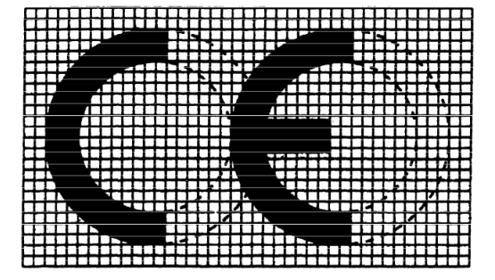
>
> aash Si le marquage est réduit ou agrandi, les proportions figurées dans le dessin gradué ci-dessus sont à respecter.
>
> bash Les différents éléments du marquage CE doivent avoir sensiblement la même dimension verticale, qui ne peut être inférieure à 5 mm.
>
> Cette dimension minimale n’est pas obligatoire pour les dispositifs de petites dimensions.

#### Version consolidée applicable au 01/07/2012 : Règlement grand-ducal du 24 juillet 2001 relatif aux dispositifs médicaux de diagnostic in vitro.

##### Chapitre Ier: Champ d’application

###### Art. 1er — - Définitions

1\. Le présent règlement s’applique aux dispositifs médicaux de diagnostic in vitro et à leurs accessoires. Aux fins du présent règlement, les accessoires sont traités comme des dispositifs médicaux de diagnostic in vitro à part entière. Les dispositifs médicaux de diagnostic in vitro et leurs accessoires sont dénommés ci-après «dispositifs».

Aux fins du présent règlement, on entend par:

a) «dispositif médical»: tout instrument, appareil, équipement, matière ou autre article, utilisé seul ou en association, y compris le logiciel nécessaire pour le bon fonctionnement de celui-ci, destiné par le fabricant à être utilisé chez l’homme à des fins

aash de diagnostic, de prévention, de contrôle, de traitement ou d’atténuation d’une maladie,

bash de diagnostic, de contrôle, de traitement, d’atténuation ou de compensation d’une blessure ou d’un handicap,

cash d’étude ou de remplacement ou modification de l’anatomie ou d’un processus physiologique,

dash de maîtrise de la conception,

et dont l’action principale voulue dans ou sur le corps humain n’est pas obtenue par des moyens pharmacologiques ou immunologiques ni par métabolisme, mais dont la fonction peut être assistée par de tels moyens;

b) «dispositif médical de diagnostic in vitro»: tout dispositif médical qui consiste en un réactif, un produit réactif, un matériau d’étalonnage, un matériau de contrôle, une trousse, un instrument, un appareil, un équipement ou un système, utilisé seul ou en combinaison, destiné par le fabricant à être utilisé in vitro dans l’examen d’échantillons provenant du corps humain, y compris les dons de sang et de tissus, uniquement ou principalement dans le but de fournir une information:

aash concernant un état physiologique ou pathologique

ou

aash concernant une anomalie congénitale

ou

aash permettant de déterminer la sécurité et la compatibilité avec des receveurs potentiels

ou

aash permettant de contrôler des mesures thérapeutiques.

Les récipients pour échantillons sont considérés comme des dispositifs médicaux de diagnostic in vitro. On entend par «récipients pour échantillons» des dispositifs, qu’ils soient sous vide ou non, spécifiquement destinés par leur fabricant à recevoir directement l’échantillon provenant du corps humain et à le conserver en vue d’un examen de diagnostic in vitro.

Les produits destinés à des usages généraux en laboratoire ne sont pas des dispositifs médicaux de diagnostic in vitro à moins que, eu égard à leurs caractéristiques, ils soient spécifiquement destinés par leur fabricant à des examens de diagnostic in vitro;

c) «accessoire»: tout article qui, bien que n’étant pas un dispositif médical de diagnostic in vitro, est destiné spécifiquement par son fabricant à être utilisé avec un dispositif pour permettre l’utilisation dudit dispositif conformément à sa destination.

Aux fins de la présente définition, les dispositifs invasifs destinés à prélever des échantillons ainsi que les dispositifs placés en contact direct avec le corps humain dans le but d’obtenir un échantillon, au sens du [règlement grand-ducal du 11 août 1996](https://legilux.public.lu/eli/etat/leg/rgd/1996/08/11/n12/jo) relatif aux dispositifs médicaux, ne sont pas considérés comme des accessoires de dispositifs médicaux de diagnostic in vitro;

d) «dispositif destiné à des autodiagnostics»: tout dispositif destiné par le fabricant à pouvoir être utilisé par des profanes dans un environnement domestique;

e) dispositif destiné à l’évaluation des performances»: tout dispositif destiné par le fabricant à subir une ou plusieurs études d’évaluation de ses performances dans des laboratoires d’analyses médicales ou dans d’autres environnements appropriés extérieurs à ses propres installations;

f) «fabricant»: la personne physique ou morale responsable de la conception, de la fabrication, du conditionnement et de l’étiquetage d’un dispositif en vue de sa mise sur le marché en son nom propre, que ces opérations soient effectuées par cette même personne ou pour son compte par une tierce personne.

Les obligations du présent règlement qui s’imposent aux fabricants s’appliquent également à la personne physique ou morale qui assemble, conditionne, traite, remet à neuf ainsi qu’à celle qui étiquette un ou plusieurs produits préfabriqués et/ou leur assigne la destination d’un dispositif en vue de sa mise sur le marché en son nom propre. Cela ne s’applique pas à la personne qui, sans être fabricant aux termes du premier alinéa, assemble ou adapte conformément à leur destination, des dispositifs déjà mis sur le marché pour un patient individuel;

g) «mandataire»: toute personne physique ou morale établie dans la Communauté qui, après avoir été expressément désignée par le fabricant, agit et peut être contactée par les autorités et les instances dans la Communauté en lieu et place du fabricant en ce qui concerne les obligations que le présent règlement impose à ce dernier;

h) «destination»: l’utilisation à laquelle le dispositif est destiné d’après les indications fournies par le fabricant dans l’étiquetage, la notice d’utilisation ainsi que les matériels promotionnels;

i) «mise sur le marché»: la première mise à disposition à titre onéreux ou gratuit d’un dispositif autre qu’un dispositif destiné à l’évaluation des performances, en vue de sa distribution et/ou de son utilisation sur le marché, qu’il s’agisse d’un dispositif neuf ou remis à neuf;

j) «mise en service»: le stade auquel un dispositif est mis à la disposition de l’utilisateur final, étant prêt à être utilisé pour la première fois sur le marché conformément à sa destination.

3\. Aux fins du présent règlement, les matériaux d’étalonnage et de contrôle recouvrent tout type de substance, matériau ou article conçu par son fabricant pour établir des rapports de mesure ou vérifier les caractéristiques de performance d’un dispositif au regard de l’usage auquel il est destiné.

4\. Aux fins du présent règlement, le prélèvement, la collecte et l’utilisation de tissus, de cellules et de substances d’origine humaine sont régis, pour les aspects éthiques, par les principes énoncés dans la convention du Conseil de l’Europe pour la protection des droits de l’homme et de la dignité de l’être humain à l’égard des applications de la biologie et de la médecine, ainsi que par les dispositions contenues à la [loi du 28 août 1998](https://legilux.public.lu/eli/etat/leg/loi/1998/08/28/n1/jo) sur les établissements hospitaliers. En ce qui concerne le diagnostic, la protection de la confidentialité des informations liées à la vie privée ainsi que le principe de non-discrimination à partir des caractéristiques génétiques familiales des hommes et des femmes sont primordiaux.

5\. Le présent règlement ne s’applique pas aux dispositifs fabriqués et utilisés au sein d’une seule et même institution de santé et sur leur lieu de fabrication ou utilisés dans des locaux situés à proximité immédiate, sans faire l’objet d’un transfert à une autre entité juridique.

###### Art. 2 — - Mise sur le marché et mise en service

Les dispositifs ne peuvent être mis sur le marché et/ou mis en service que s’ils satisfont aux exigences énoncées au présent règlement lorsqu’ils sont dûment fournis et sont correctement installés, entretenus et utilisés conformément à leur destination.

Les médecins de la direction de la Santé procèdent à des contrôles par sondage pour s’assurer du respect de la prédite disposition.

Le présent article s’applique également aux dispositifs destinés à l’évaluation des performances.

###### Art. 3 — - Exigences essentielles

Les dispositifs doivent satisfaire aux exigences essentielles qui figurent à l’annexe I du présent règlement et qui leur sont applicables en tenant compte de la destination des dispositifs concernés.

###### Art. 4 — - Libre circulation

1\. Peuvent être mis sur le marché ou mis en service les dispositifs portant le marquage CE prévu à l’article 14 et qui ont préalablement été soumis à une évaluation de leur conformité en vertu des dispositions prévues à l’article 7 du présent règlement sans autorisation préalable du ministre de la Santé.

2\. Les dispositifs destinés à l’évaluation des performances peuvent être mis à la disposition de laboratoires ou d’autres institutions visés à l’annexe VIII, dans la mesure où ils remplissent les conditions fixées à l’article 7, paragraphe 4, et à l’annexe VIII du présent règlement.

3\. Est autorisée lors de manifestations telles que foires, expositions, démonstrations ou de réunions scientifiques ou techniques, la présentation de dispositifs qui ne sont pas conformes au présent règlement pour autant que ceux-ci ne soient pas utilisés sur des échantillons provenant de participants et qu’un panneau visible indique clairement que ces dispositifs ne peuvent être ni mis sur le marché ni mis en service avant leur mise en conformité.

4\. Les indications qui doivent être fournies lors de la remise à l’utilisateur final conformément à l’annexe I, partie B, point 8 doivent être rédigées dans une des langues française, allemande ou luxembourgeoise.

Lorsque le dispositif est exclusivement destiné à une utilisation professionnelle, ces indications peuvent aussi être rédigées en langue anglaise.

5\. Lorsque les dispositifs font l’objet d’autres directives communautaires que la [directive 98/79/CE](https://legilux.public.lu/eli/dir_ue/1998/79/jo) du Parlement européen et du Conseil du 27 octobre 1998 relative aux dispositifs médicaux de diagnostic in vitro, qui portent sur d’autres aspects et qui prévoient l’apposition du marquage CE, celle-ci indique que les dispositifs satisfont également aux dispositions de ces autres directives.

Toutefois, si l’une de ces directives ou plusieurs d’entre elles autorisent le fabricant, pendant une période transitoire, à choisir le régime qu’il applique, le marquage CE indique que les dispositifs satisfont aux dispositions des seules directives appliquées par le fabricant. Dans ce cas, les références de ces directives, telles que publiées au Journal officiel des Communautés européennes, doivent être indiquées sur les documents, notices ou instructions qui, conformément à ces directives, accompagnent ces dispositifs.

###### Art. 5 — - Renvoi aux normes

1\. Sont présumés conformes aux exigences essentielles visées à l’article 3 les dispositifs qui satisfont aux normes correspondantes adoptées dans un autre Etat membre conformément aux normes harmonisées dont les numéros de référence ont été publiés au Journal officiel des Communautés européennes.

En cas de besoin, le ministre de la Santé arrête ces normes pour le Luxembourg et les publie au Mémorial.

2\. Sont présumés conformes aux exigences essentielles visées à l’article 3, les dispositifs conçus et fabriqués conformément aux spécifications techniques communes, élaborées pour les dispositifs de l’annexe II, liste A, et, en tant que de besoin, pour les dispositifs de l’annexe II, liste B. Ces spécifications établissent, d’une manière appropriée, les critères d’évaluation et de réévaluation des performances, les critères de libération des lots, les méthodes de références et les matériaux de référence.

Les spécifications techniques communes adoptées conformément à la procédure visée à l’article 7, paragraphe 2 de la [directive 98/79/CE](https://legilux.public.lu/eli/dir_ue/1998/79/jo) du Parlement européen et du Conseil du 27 octobre 1998 relative aux dispositifs médicaux de diagnostic in vitro sont applicables au Luxembourg

3\. Les fabricants sont tenus de respecter les spécifications techniques communes; si néanmoins, pour des raisons dûment justifiées, ils ne se conforment pas à ces spécifications, ils doivent adopter des solutions de niveau au moins équivalent à celles-ci.

Lorsqu’il est fait référence, dans le présent règlement, aux normes harmonisées, cette référence vise également les spécifications techniques communes.

###### Art. 6 — - Clause de sauvegarde

1\. Lorsqu’il est constaté que des dispositifs visés à l’article 4, paragraphe 1, ont été correctement installés, entretenus et utilisés conformément à leur destination, risquent de compromettre la santé ainsi que la sécurité des patients, des utilisateurs ou, le cas échéant, d’autres personnes, ainsi que la sécurité des biens, le ministre de la Santé prend toutes mesures utiles provisoires. Suivant le degré du risque, il retire ces dispositifs du marché, interdit ou restreint leur mise sur le marché ou leur mise en service. Ces mesures sont immédiatement notifiées à la Commission. Cette notification indique les raisons de cette décision et, en particulier, si la non-conformité avec le présent règlement résulte:

a) du non-respect des exigences essentielles visées à l’article 3,

b) d’une mauvaise application des normes visées à l’article 5 pour autant que l’application de ces normes est invoquée,

c) d’une lacune dans lesdites normes elles-mêmes.

2\. Pour sa décision définitive le ministre de la Santé s’en tient à la décision prise par la Commission à la suite de sa consultation avec toutes les parties concernées.

3\. Lorsqu’un dispositif non conforme est muni du marquage CE, le ministre de la Santé en interdit la mise sur le marché, la mise en service et l’utilisation, sans préjudice des sanctions pénales à l’égard du contrevenant. Il en informe la Commission et les autres États membres.

###### Art. 7 — - Évaluation de la conformité

1\. Pour tous les dispositifs autres que ceux visés à l’annexe II du présent règlement et que ceux destinés à l’évaluation des performances, le fabricant suit, aux fins de l’apposition du marquage CE, la procédure énoncée à l’annexe III et établit la déclaration CE de conformité requise avant de mettre ces dispositifs sur le marché.

Pour tous les dispositifs destinés à des autodiagnostics autres que ceux visés à l’annexe II et que ceux destinés à l’évaluation des performances, le fabricant satisfait, avant d’établir la déclaration susmentionnée, aux exigences additionnelles énumérées à l’annexe III, point 6. Au lieu d’appliquer cette procédure, le fabricant peut suivre la procédure dont il est question au paragraphe 2 ou au paragraphe 3.

2\. Pour les dispositifs énumérés dans la liste A de l’annexe II autres que ceux destinés à l’évaluation des performances, le fabricant doit, aux fins de l’apposition du marquage CE:

a) soit suivre la procédure relative à la déclaration CE de conformité (système complet d’assurance de la qualité) visée à l’annexe IV;

b) soit suivre la procédure relative à l’examen CE de type visée à l’annexe V, en liaison avec la procédure relative à la déclaration CE de conformité (assurance de la qualité de la production) visée à l’annexe VII.

3\. Pour les dispositifs énumérés dans la liste B de l’annexe II autres que ceux destinés à l’évaluation des performances, le fabricant doit, aux fins de l’apposition du marquage CE:

a) soit suivre la procédure relative à la déclaration CE de conformité (système complet d’assurance de la qualité) visée à l’annexe IV;

b) soit suivre la procédure relative à l’examen CE du type visée à l’annexe V, en liaison avec:

i) la procédure relative à la vérification CE visée à l’annexe VI

ou

ii) la procédure relative à la déclaration CE de conformité (assurance de la qualité de la production) visée à l’annexe VII.

4\. Dans le cas des dispositifs destinés à l’évaluation des performances, le fabricant suit la procédure visée à l’annexe VIII et établit, avant la mise à disposition de ces dispositifs, la déclaration prévue dans cette annexe.

5\. Lors de la procédure d’évaluation de la conformité portant sur un dispositif, le fabricant et, s’il intervient, l’organisme notifié tiennent compte des résultats des opérations d’évaluation et de vérification qui ont eu lieu le cas échéant, conformément aux dispositions du présent règlement, à un stade intermédiaire de fabrication.

6\. Le fabricant peut charger son mandataire d’engager les procédures prévues aux annexes III, V, VI et VIII.

7\. Le fabricant doit conserver la déclaration de conformité, la documentation technique visée aux annexes III à VIII ainsi que les décisions, rapports et certificats établis par des organismes notifiés et les mettre à la disposition du ministre de la Santé aux fins de contrôle pendant une période de cinq ans après la fabrication du dernier produit. Lorsque le fabricant n’est pas établi dans la Communauté, l’obligation de mise à disposition, sur demande, de la documentation précitée s’applique à son mandataire.

8\. Lorsque la procédure d’évaluation de la conformité présuppose une intervention d’un organisme notifié, le fabricant, ou son mandataire, peut s’adresser à un organisme de son choix dans le cadre des tâches pour lesquelles cet organisme a fait l’objet d’une notification.

9\. L’organisme notifié peut, lorsque cela est dûment justifié, exiger toute donnée ou information qui est nécessaire pour établir et maintenir l’attestation de conformité compte tenu de la procédure choisie.

10\. Les décisions prises par les organismes notifiés conformément aux annexes III, IV et V ont une validité maximale de cinq ans et sont reconductibles, sur demande introduite au moment cvonvenu dans le contrat signé entre les deux parties par périodes de cinq ans au maximum.

11\. Les dossiers et la correspondance se rapportant aux procédures visées aux paragraphes 1 à 4 sont rédigés dans une des langues visées à l’article 4, point 4 du présent règlement. Toutefois, dans ses relations avec l’organisme notifié, toute autre langue communautaire acceptée par celui-ci peut également être employée.

12\. Par dérogation aux paragraphes 1 à 4, le ministre de la Santé peut, sur demande dûment justifiée, autoriser la mise sur le marché et la mise en service sur le territoire du Grand-Duché de Luxembourg, de dispositifs individuels pour lesquels les procédures visées aux paragraphes 1 à 4 n’ont pas été appliquées et dont l’utilisation est dans l’intérêt de la protection de la santé.

13\. Les dispositions du présent article s’appliquent par analogie à toute personne physique ou morale qui fabrique des dispositifs relevant du présent règlement et qui, sans les mettre sur le marché, les met en service et les utilise dans le cadre de ses activités professionnelles.

###### Art. 8 — - Enregistrement des fabricants et des dispositifs

1\. Tout fabricant qui met, en son nom propre, des dispositifs sur le marché doit, s’il est établi au Luxembourg, notifier au directeur de la Santé les éléments suivants:

aash l’adresse du siège social,

bash les informations relatives aux réactifs, produits réactifs, et aux matériaux d’étalonnage et de contrôle, en termes de caractéristiques technologiques communes et/ou de substances à analyser, ainsi que toute modification importante y apportée, y compris la suspension de la mise sur le marché; pour les autres dispositifs, les indications appropriées,

cash dans le cas des dispositifs visés à l’annexe II et des dispositifs destinés à l’autodiagnostic, toutes les données permettant d’identifier ces dispositifs, les paramètres analytiques et, le cas échéant, diagnostiques tels que visés à l’annexe I, partie A, point 3, les résultats de l’évaluation de performances conformément à l’annexe VIII, les certificats, ainsi que toute modification importante y apportée, y compris la suspension de la mise sur le marché.

2\. Pour les dispositifs visés à l’annexe II et les dispositifs destinés à l’autodiagnostic, le ministre de la Santé peut demander communication des données permettant d’identifier les dispositifs accompagnées de l’étiquette et du mode d’emploi lorsque ces dispositifs sont mis sur le marché et/ou mis en service sur le territoire national.

Ces mesures ne peuvent pas constituer une condition préalable à la mise sur le marché ou à la mise en service des dispositifs qui sont conformes aux dispositions du présent règlement.

3\. Lorsqu’un fabricant qui met, en son nom propre, des dispositifs sur le marché n’a pas de siège social dans un Etat membre, il désigne un ou plusieurs mandataires. Le mandataire notifie au ministre de la Santé toutes les indications visées au paragraphe 1.

4\. En outre, la notification visée au paragraphe 1 concerne aussi les nouveaux produits. Lorsque, dans le cadre de cette notification, un dispositif notifié portant un marquage CE est un «nouveau produit», le fabricant l’indique dans sa notification.

Aux fins du présent article, un dispositif est «nouveau» lorsque:

a) pour la substance à analyser en question ou un autre paramètre, la disponibilité permanente d’un tel dispositif n’a pas été assurée sur le marché communautaire durant les trois années précédentes;

b) la procédure recourt à une technologie analytique qui, sur le marché communautaire, n’a pas été utilisée en permanence, durant les trois années précédentes, en liaison avec une substance déterminée à analyser ou un autre paramètre donné.

5\. Le directeur de la Santé fait enregistrer sans délai les notifications visées aux paragraphes 1 et 3 dans la banque de données prévue à l’article 10. Les modalités de mise en œuvre du présent article, et notamment celles se rapportant à la notification et la définition de la notion de modification importante, arrêtées par les instances communautaires conformément à la procédure visée à l’article 7 de la [directive 98/79/CE](https://legilux.public.lu/eli/dir_ue/1998/79/jo) précitée, sont applicables au Luxembourg.

6\. De manière transitoire, dans l’attente de la mise en place par les autorités communautaires d’une banque de données européenne visée à l’article 10, le directeur de la Santé est chargé d’assurer la gestion des données énumérées aux paragraphes 1 et 3.

###### Art. 9 — - Procédure de vigilance

1\. Le directeur de la Santé est chargé de recevoir, de recenser et d’évaluer toute information communiquée, conformément aux dispositions du présent règlement, relative aux incidents mentionnés ci-après qui concernent des dispositifs portant le marquage CE:

a) tout dysfonctionnement, défaillance ou altération des caractéristiques et/ou des performances d’un dispositif, ainsi que toute inadéquation dans l’étiquetage ou les instructions d’utilisation susceptibles d’entraîner ou d’avoir entraîné, directement ou indirectement, la mort ou la dégradation grave de l’état de santé d’un patient, d’un utilisateur ou d’autres personnes;

b) toute raison d’ordre technique ou médical liée aux caractéristiques ou aux performances d’un dispositif et ayant entraîné, pour les raisons visées au point a), le rappel systématique par le fabricant des dispositifs du même type.

2\. Lorsque le ministre de la Santé demande aux médecins praticiens, aux institutions médicales ou aux organisateurs de programmes d’évaluation externe de la qualité d’informer le directeur de la Santé de tout incident visé au paragraphe 1, ce dernier est chargé d’en informer le fabricant du dispositif concerné ou son mandataire.

3\. Le directeur de la Santé informe le ministre de la Santé des incidents rapportés en vertu du paragraphe 1.

Après avoir procédé à une évaluation, le cas échéant conjointement avec le fabricant, le ministre de la Santé informe, sans préjudice de l’article 6, immédiatement la Commission et les autres États membres des incidents visés au paragraphe 1 pour lesquels des mesures ont été prises ou sont envisagées.

4\. Lorsque, dans le cadre de la notification visée à l’article 8, un dispositif notifié portant un marquage CE est un «nouveau produit», le fabricant l’indique dans sa notification. Le ministre de la Santé ainsi notifié peut, à tout moment durant une période subséquente de deux ans et pour des motifs justifiés, demander au fabricant de fournir un rapport sur l’expérience acquise relative à ce dispositif après sa mise sur le marché.

5\. Le ministre de la Santé informe sur demande les autres États membres des données énoncées aux paragraphes 1 à 4. Les modalités de mise en oeuvre du présent article arrêté par les instances communautaires conformément à la procédure visée à l’article 7, paragraphe 2 de la [directive du 98/79/CE](https://legilux.public.lu/eli/dir_ue/1998/79/jo) précitée, sont applicables au Luxembourg.

###### Art. 10 — - Banque de données européenne

1\. Les données réglementaires conformes au présent règlement sont stockées dans une banque de données européenne accessible au ministre et au directeur de la Santé.

La base de données contient les informations suivantes:

a) les données relatives à l’enregistrement des fabricants et des dispositifs conformément à l’article 8;

b) les données relatives aux certificats délivrés, modifiés, complétés, suspendus, retirés ou refusés conformément aux procédures fixées aux annexes III à VII;

c) les données obtenues conformément à la procédure de vigilance définie à l’article 9.

2\. Les données sont transmises sous une forme normalisée.

3\. Les modalités de mise en oeuvre du présent article arrêtées selon la procédure visée à l’article 7, paragraphe 2 de la directive du [directive 98/79/CE](https://legilux.public.lu/eli/dir_ue/1998/79/jo) précitée, sont applicables au Luxembourg.

###### Art. 11 — - Mesures particulières de veille sanitaire

Lorsque le ministre de la Santé estime, en ce qui concerne un produit ou groupe de produits donné, qu’il y a lieu, pour protéger la santé et la sécurité et/ou assurer le respect des impératifs de santé publique conformément à l’article 30 du Traité instituant la Communauté européenne, d’interdire ou de restreindre leur mise à disposition ou de l’assortir de conditions particulières, il est habilité à prendre toutes les mesures transitoires nécessaires et justifiées. Il en informe alors la Commission et les autres États membres, en indiquant les raisons de sa décision.

Pour sa décision définitive le ministre de la Santé s’en tient à la décision prise par la Commission à la suite de sa consultation avec toutes les parties concernées.

###### Art. 12 — - Modification de l’annexe II et clause de dérogation

1\. Lorsque le ministre de la Santé considère que:

a) la liste des dispositifs visés à l’annexe II doit être modifiée ou étendue

ou que

b) la conformité d’un dispositif ou d’une catégorie de dispositifs doit être établie, par dérogation à l’article 7, en application de l’une ou de plusieurs des procédures déterminées choisies parmi celles visées au prédit article,

il introduit une demande dûment justifiée auprès de la Commission l’invitant à prendre les mesures nécessaires. Les mesures communautaires arrêtées à la suite de cette démarche lient le ministre de la Santé.

2\. Lorsqu’une décision doit être prise conformément au paragraphe 1 du présent article, il est dûment tenu compte:

a) de toute information disponible en vertu des procédures de vigilance et des programmes d’évaluation externe de la qualité décrits à l’article 9;

b) des critères suivants:

i) s’il faut se fier exclusivement au résultat obtenu avec un dispositif donné qui se répercute directement sur l’action médicale ultérieure,

et

ii) si une action prise en fonction d’un résultat incorrect obtenu en utilisant un dispositif donné peut s’avérer dangereuse pour le patient, un tiers ou le public, en particulier si elle est prise en conséquence d’un résultat faussement positif ou faussement négatif et

iii) si l’intervention d’un organisme notifié est de nature à favoriser la constatation de la conformité du dispositif.

###### Art. 13 — - Organismes notifiés

1\. Le ministre de la Santé peut désigner des organismes qu’il charge d’effectuer les tâches se rapportant aux procédures visées à l’article 7 ainsi que les tâches spécifiques pour lesquelles ces organismes ont été désignés. Dans ce cas, le ministre de la Santé notifie lesdits organismes à la Commission et aux autres États membres.

Le ministre de la Santé peut désigner un organisme situé dans un autre Etat membre, de l’accord des autorités compétentes de l’Etat en question.

2\. Le ministre de la Santé applique les critères énoncés à l’annexe IX pour la désignation des organismes.

3\. Le directeur de la Santé exerce une surveillance permanente sur les organismes notifiés pour s’assurer qu’ils respectent les critères énoncés à l’annexe IX. Le ministre de la Santé, qui a notifié un organisme, retire ou restreint cette notification s’il constate que cet organisme ne satisfait plus aux critères visés à l’annexe IX. Il informe immédiatement les autres États membres et la Commission de tout retrait ou de toute restriction de la notification de cet organisme.

4\. L’organisme notifié et le fabricant, ou son mandataire, fixent d’un commun accord les délais pour l’achèvement des opérations d’évaluation et de vérification visées aux annexes III à VII.

5\. L’organisme notifié informe les autres organismes notifiés et les autorités compétentes de tous les certificats suspendus ou retirés, ainsi que, sur demande, des certificats délivrés ou refusés. En outre, il met à disposition, sur demande, toutes les informations pertinentes supplémentaires.

6\. Lorsqu’un organisme notifié constate que les exigences pertinentes du présent règlement n’ont pas été respectées ou ne le sont plus par le fabricant ou lorsqu’un certificat n’aurait pas dû être délivré, il suspend ou retire le certificat délivré, en tenant compte du principe de proportionnalité, ou l’assortit de restrictions, sauf si le fabricant applique, pour que ces exigences soient respectées, des mesures correctives appropriées. Dans le cas d’une suspension ou d’un retrait du certificat ou d’une quelconque restriction, ou si une intervention des autorités compétentes s’avère nécessaire, l’organisme notifié en avertit le ministre de la Santé qui informe les autres États membres et la Commission.

7\. L’organisme notifié fournit, sur demande, toutes les informations et documents pertinents, y compris les documents budgétaires, propres à permettre au ministre de la Santé de vérifier le respect des exigences prévues à l’annexe IX.

###### Art. 14 — - Marquage CE

1\. Les dispositifs, autres que ceux destinés à l’évaluation des performances, qui sont réputés satisfaire aux exigences essentielles visées à l’article 3, doivent porter le marquage CE de conformité lors de leur mise sur le marché.

2\. Le marquage CE de conformité, tel que reproduit à l’annexe X, doit être apposé de façon visible, lisible et indélébile sur le dispositif, lorsque cela est possible et approprié, et sur les instructions d’utilisation. Le marquage CE de conformité doit également apparaître sur l’emballage commercial. Le marquage CE doit être accompagné du numéro d’identification de l’organisme notifié responsable de la mise en œuvre des procédures visées aux annexes III, IV, VI et VII.

3\. Il est interdit d’apposer des marques ou des inscriptions pouvant induire des tiers en erreur quant à la signification ou au graphisme du marquage CE. D’autres marques peuvent être apposées sur le dispositif, sur l’emballage ou sur la notice d’utilisation l’accompagnant, à condition qu’elles ne réduisent pas la visibilité et la lisibilité du marquage CE.

###### Art. 15 — - Marquage CE indûment apposé

Sans préjudice de l’article 6 et des dispositions de l’article 18 ci-après:

a) tout constat par le ministre de la Santé, sur avis du directeur de la Santé, de l’apposition indue du marquage CE entraîne pour le fabricant ou son mandataire l’obligation de faire cesser l’infraction dans les conditions fixées par le ministre;

b) en cas de persistance de l’infraction, le ministre de la Santé peut, suivant le cas, restreindre ou interdire la mise sur le marché du produit en question. Il charge les médecins de la direction de la Santé de prendre les mesures d’urgence qui s’imposent dans l’intérêt de la santé publique.

###### Art. 16 — - Confidentialité

Tous fonctionnaires et employés publics et toutes autres personnes recueillant ou obtenant des informations dans l’exécution d’une mission en application du présent règlement, sont tenus de les garder confidentielles. Cela n’affecte pas les obligations du ministre de la Santé et des organismes notifiés visant l’information réciproque et la diffusion des mises en garde.

###### Art. 17 — - Coopération

Le ministre de la Santé coopère avec les autorités compétentes des autres États membres et leur transmet les informations nécessaires requises conformément aux dispositions du présent règlement.

###### Art. 18 — - Dispositions générales

Sont interdites la mise sur le marché, la mise en service, la vente, l’offre en vente et la cession de dispositifs qui sont visés par le présent règlement et qui ne sont pas conformes à ses prescriptions.

###### Art. 19. -

Notre Ministre de la Santé et Notre Ministre de la Justice sont chargés, chacun en ce qui le concerne, de l’exécution du présent règlement qui sera publié au Mémorial ensemble avec ses annexes, qui en font partie intégrante.

> ANNEXE I
>
> \**Exigences essentielles**
>
> **A. Exigences générales**
>
> 1\. Les dispositifs doivent être conçus et fabriqués de telle manière que leur utilisation ne compromette pas, directement ou indirectement, l’état clinique et la sécurité des patients, la sécurité et la santé des utilisateurs ou, le cas échéant, d’autres personnes ni la sécurité des biens, lorsqu’ils sont utilisés dans les conditions et aux fins prévues. Les risques éventuels liés à leur utilisation doivent être acceptables au regard du bienfait apporté au patient et compatibles avec un niveau élevé de protection de la santé et de la sécurité.
>
> 2\. Les solutions choisies par le fabricant dans la conception et la fabrication des dispositifs doivent se tenir aux principes de sécurité en tenant compte de l’état de la technique généralement reconnu. Pour retenir les solutions les mieux appropriées, le fabricant doit appliquer les principes suivants dans l’ordre indiqué:
>
> aash éliminer ou réduire autant que possible les risques (sécurité inhérente à la conception et à la fabrication),
>
> bash le cas échéant, prendre les mesures de protection appropriées pour les risques qui ne peuvent être éliminés,
>
> cash informer les utilisateurs des risques résiduels dus à l’insuffisance des mesures de protection adoptées.
>
> 3\. Les dispositifs doivent être conçus et fabriqués de manière qu’ils puissent être utilisés aux fins prévues à l’article 1er, paragraphe 2, point b), comme spécifié par le fabricant compte tenu de l’état de la technique généralement reconnu. Ils doivent atteindre les performances, notamment, lorsqu’il y a lieu, en termes de sensibilité analytique, de sensibilité diagnostique, de spécificité analytique, de spécificité diagnostique, d’exactitude, de répétabilité, de reproductibilité, y compris la maîtrise des interférences connues pertinentes, et de limites de détection indiquées par le fabricant.
>
> La traçabilité des valeurs attribuées aux matériaux d’étalonnage et/ou matériaux de contrôle doit être garantie par des procédures de mesure de référence existantes et/ou des matériaux de référence disponibles de niveau supérieur.
>
> 4\. Les caractéristiques et les performances visées aux points 1 et 3 ne doivent pas être altérées de façon à compromettre la santé ou la sécurité du patient ou de l’utilisateur et, le cas échéant, d’autres personnes pendant la durée de vie du dispositif indiquée par le fabricant lorsque ce dernier est soumis aux contraintes pouvant survenir dans les conditions normales d’utilisation. Lorsque aucune durée de vie n’est indiquée, ces conditions s’appliquent à la durée de vie à laquelle on peut raisonnablement s’attendre pour un dispositif de ce type, compte tenu de la destination et de l’utilisation prévue dudit dispositif.
>
> Les dispositifs doivent être conçus, fabriqués et conditionnés de façon à ce que leurs caractéristiques et leurs performances en vue de leur utilisation prévue ne soient pas altérées dans les conditions de stockage et de transport (température, humidité, etc.) tenant compte des instructions et des informations fournies par le fabricant.
>
> **B. Exigences relatives à la conception et la fabrication**
>
> **1. Propriétés chimiques et physiques**
>
> 1.1. Les dispositifs doivent être conçus et fabriqués de façon à assurer les caractéristiques et les performances visées à la partie A "Exigences générales". Une attention particulière doit être accordée à la possibilité d’une diminution des performances analytiques en raison d’une incompatibilité entre les matériaux utilisés et les échantillons (tels que tissus biologiques, cellules, liquides organiques et micro-organismes) destinés à être utilisés avec le dispositif, en tenant compte de la destination du dispositif.
>
> 1.2. Les dispositifs doivent être conçus, fabriqués et conditionnés de manière à réduire autant que possible le risque engendré par les fuites de produits, les contaminants et les résidus pour le personnel participant au transport, au stockage et à l’utilisation des dispositifs, en tenant compte de la destination prévue des produits.
>
> **2. Infection et contamination microbienne**
>
> 2.1. Les dispositifs et leurs procédés de fabrication doivent être conçus de manière à éliminer ou réduire au minimum le risque d’infection pour l’utilisateur ou toute autre personne. La conception doit permettre une manipulation facile et, si nécessaire, réduire au minimum la contamination et les fuites du dispositif au cours de l’utilisation et, dans le cas de récipients pour échantillons, le risque de contamination de l’échantillon. Les procédés de fabrication doivent convenir pour atteindre ces objectifs.
>
> 2.2. Lorsqu’un dispositif contient des substances biologiques, les risques d’infection doivent être réduits au minimum par la sélection de donneurs et de substances appropriés ainsi que par l’utilisation de procédures appropriées et validées d’inactivation, de conservation, d’essai et de contrôle.
>
> 2.3. Les dispositifs portant soit la mention "STÉRILE", soit la mention d’un état microbiologique particulier, doivent être conçus, fabriqués et conditionnés dans un emballage approprié, selon des procédures capables de maintenir l’état microbiologique indiqué sur l’étiquette lors de leur mise sur le marché, dans les conditions de stockage et de transport indiquées par le fabricant, jusqu’à ce que l’emballage de protection soit endommagé ou ouvert.
>
> 2.4. Les dispositifs portant soit la mention "STÉRILE", soit la mention d’un état microbiologique particulier, doivent avoir été traités selon une méthode appropriée et validée.
>
> 2.5. Les systèmes d’emballage destinés aux dispositifs autres que ceux visés au point 2.3 doivent être de nature à conserver le produit sans détérioration au niveau de propreté indiqué par le fabricant et, s’ils sont destinés à être stérilisés avant leur utilisation, à réduire autant que possible le risque de contamination microbienne.
>
> Il convient de prendre des mesures propres à réduire autant que possible la contamination microbienne durant la sélection et la manipulation des matières premières, la fabrication, le stockage et la distribution lorsque les performances du dispositif peuvent être altérées par une telle contamination.
>
> 2.6. Les dispositifs destinés à être stérilisés doivent être fabriqués dans des conditions satisfaisant aux contrôles appropriés (par exemple, contrôle de l’environnement).
>
> 2.7. Les systèmes d’emballage destinés aux dispositifs non stériles doivent être de nature à conserver le produit sans détérioration au niveau de propreté prévu et, s’ils sont destinés à être stérilisés avant leur utilisation, à minimiser le risque de contamination microbienne; le système d’emballage doit être approprié compte tenu de la méthode de stérilisation indiquée par le fabricant.
>
> **3. Propriétés relatives à la fabrication et à l’environnement**
>
> 3.1. Lorsque le dispositif est destiné à être utilisé en combinaison avec d’autres dispositifs ou équipements, l’ensemble de la combinaison, y compris le système de raccordement, doit être sûr et ne pas porter atteinte aux performances prévues des dispositifs. Toute restriction d’utilisation doit figurer sur l’étiquetage et/ou dans la notice d’utilisation.
>
> 3.2. Les dispositifs doivent être conçus et fabriqués de manière à réduire au minimum les risques liés à leur utilisation en conjonction avec les matériaux, substances et gaz avec lesquels ils peuvent entrer en contact au cours de leur utilisation normale.
>
> 3.3. Les dispositifs doivent être conçus et fabriqués de manière à éliminer ou à réduire autant que possible:
>
> aash les risques de lésions liés à leurs caractéristiques physiques (en particulier, les aspects de volume x pression, les caractéristiques dimensionnelles et, le cas échéant, ergonomiques),
>
> bash les risques liés à des influences externes raisonnablement prévisibles, telles que les champs magnétiques, les effets électriques externes, les décharges électrostatiques, la pression, l’humidité, la température ou les variations de pression et d’accélération ou la pénétration accidentelle de substances dans le dispositif.
>
> Les dispositifs doivent être conçus et fabriqués de manière à garantir un niveau approprié d’immunité intrinsèque contre les perturbations électromagnétiques de sorte qu’ils puissent fonctionner conformément à leur destination.
>
> 3.4. Les dispositifs doivent être conçus et fabriqués de façon à réduire autant que possible les risques d’incendie ou d’explosion dans les conditions d’utilisation normales et en condition de premier défaut. Une attention particulière doit être apportée aux dispositifs dont la destination comporte l’exposition à des substances inflammables ou à des substances susceptibles de favoriser la combustion, ou l’association avec de telles substances.
>
> 3.5. Les dispositifs doivent être conçus et fabriqués de manière à faciliter la gestion d’une élimination sûre des déchets.
>
> 3.6. L’échelle de mesure, de contrôle ou d’affichage (y compris les changements de couleur et autres indicateurs optiques) doit être conçue et fabriquée suivant des principes ergonomiques, en tenant compte de la destination du dispositif.
>
> **4. Dispositifs qui sont des instruments ou des appareils ayant une fonction de mesurage**
>
> 4.1. Les dispositifs qui sont des instruments ou des appareils dont la fonction primaire est le mesurage analytique doivent être conçus et fabriqués de manière à fournir une constance et une précision de mesurage adéquates, dans des limites de précision appropriées, en tenant compte de la destination du dispositif et des procédures et matériaux de mesure de référence disponibles et appropriés. Les limites de précision doivent être spécifiées par le fabricant.
>
> 4.2. Lorsque les valeurs mesurées sont numériques, elles doivent être exprimées en unités légales en conformité avec les dispositions de la [directive 80/181/CEE](https://legilux.public.lu/eli/dir_ue/1980/181/jo) du Conseil du 20 décembre 1979 concernant le rapprochement des législations des États membres relatives aux unités de mesure[^1-11].
>
> **5. Protection contre les rayonnements**
>
> 5.1. Les dispositifs doivent être conçus, fabriqués et conditionnés de façon à réduire au minimum l’exposition des utilisateurs et autres personnes aux émissions de rayonnements.
>
> 5.2. Lorsque les dispositifs doivent émettre des rayonnements potentiellement dangereux, visibles et/ou invisibles, ils doivent, dans la mesure du possible:
>
> aash être conçus et fabriqués de façon à assurer que les caractéristiques et la quantité des rayonnements émis puissent être contrôlées et/ou réglées,
>
> bash être équipés d’indicateurs visuels et/ou sonores signalant les émissions de rayonnement.
>
> 5.3. Les instructions d’utilisation des dispositifs émettant des rayonnements doivent comporter des informations détaillées sur la nature des rayonnements émis, les moyens de protéger l’utilisateur et sur les façons d’éviter les fausses manœuvres et d’éliminer les risques inhérents à l’installation.
>
> **6. Exigences applicables aux dispositifs médicaux raccordés à une source d’énergie ou équipés d’une telle source**
>
> 6.1. Les dispositifs comportant des systèmes électroniques programmables, y compris les logiciels, doivent être conçus de façon à assurer la répétabilité, la fiabilité et les performances de ces systèmes conformément à l’utilisation prévue.
>
> 6.2. Les dispositifs doivent être conçus et fabriqués de façon à réduire au minimum les risques de création de perturbations électromagnétiques susceptibles d’affecter le fonctionnement d’autres dispositifs ou équipements placés dans l’environnement habituel.
>
> 6.3. Les dispositifs doivent être conçus et fabriqués de façon à éviter autant que possible les risques de chocs électriques accidentels dans des conditions normales d’utilisation et en condition de premier défaut, lorsque les dispositifs sont correctement installés et entretenus.
>
> 6.4. Protection contre les risques mécaniques et thermiques
>
> 6.4.1. Les dispositifs doivent être conçus et fabriqués de façon à protéger l’utilisateur contre les risques mécaniques. Ils doivent avoir une stabilité suffisante dans les conditions de travail prévu et conserver cette résistance durant leur durée d’usage attendue, sous réserve des exigences de contrôle et d’entretien indiquées par le fabricant.
>
> Lorsqu’il existe des risques dus à la présence de pièces mobiles, des risques de rupture ou de détachement, ou des risques de fuite de substances, des moyens appropriés de protection doivent être incorporés.
>
> Tout protecteur ou autre moyen de protection, notamment contre les éléments mobiles, inclus dans le dispositif doit être solidement fixé et ne doit pas gêner l’accès au dispositif pour son fonctionnement normal ou empêcher l’entretien normal du dispositif tel qu’il est prévu par le fabricant.
>
> 6.4.2. Les dispositifs doivent être conçus et fabriqués de façon que les risques résultant des vibrations produites par les dispositifs soient réduits au niveau le plus bas possible, compte tenu du progrès technique et des moyens disponibles pour réduire les vibrations, notamment à la source, sauf si les vibrations font partie des performances prévues.
>
> 6.4.3. Les dispositifs doivent être conçus et fabriqués de façon que les risques résultant des émissions sonores soient réduits au niveau le plus bas possible, compte tenu du progrès technique et des moyens disponibles pour réduire le bruit, notamment à la source, sauf si les émissions sonores font partie des performances prévues.
>
> 6.4.4. Les terminaux et les dispositifs de connexion à des sources d’énergie électrique, gazeuse, hydraulique ou pneumatique qui doivent être manipulés par l’utilisateur doivent être conçus et fabriqués de façon à réduire au minimum tout risque possible.
>
> 6.4.5. Les parties accessibles des dispositifs (à l’exclusion des parties ou des zones destinées à fournir de la chaleur ou à atteindre des températures données) et leur environnement ne doivent pas atteindre des températures susceptibles de présenter un danger dans des conditions normales d’utilisation.
>
> **7. Exigences applicables aux dispositifs destinés à des autodiagnostics**
>
> Les dispositifs destinés à des autodiagnostics doivent être conçus et fabriqués de manière à avoir des performances en rapport avec leur destination compte tenu des aptitudes et des moyens dont disposent les utilisateurs ainsi que des variations auxquelles on peut raisonnablement s’attendre dans la technique et l’environnement des utilisateurs. Les informations et les instructions fournies par le fabricant doivent être faciles à comprendre et à appliquer par l’utilisateur.
>
> 7.1. Les dispositifs destinés à des autodiagnostics doivent être conçus et fabriqués de manière à:
>
> aash assurer que le dispositif est facile à utiliser par l’utilisateur profane prévu dans toutes les phases de la manipulation,
>
> et
>
> bash réduire autant que possible le risque d’erreurs de la part des utilisateurs dans la manipulation du dispositif et dans l’interprétation des résultats.
>
> 7.2. Les dispositifs destinés à des autodiagnostics doivent, dans les limites du raisonnable, comprendre un contrôle par l’utilisateur, c’est-à-dire une procédure lui permettant de vérifier, au moment de l’emploi, que le produit va fonctionner comme prévu.
>
> **8. Informations fournies par le fabricant**
>
> 8.1. Chaque dispositif doit être accompagné des informations nécessaires pour pouvoir être utilisé correctement et en toute sécurité, en tenant compte de la formation et des connaissances des utilisateurs potentiels, et permettre d’identifier le fabricant.
>
> Ces informations sont constituées des indications figurant sur l’étiquetage et dans la notice d’utilisation.
>
> Dans la mesure où cela est possible et approprié, les informations nécessaires pour utiliser le dispositif correctement et en toute sécurité doivent figurer sur le dispositif même et/ou, le cas échéant, sur l’emballage commercial. Si l’étiquetage complet à l’unité n’est pas praticable, les informations doivent figurer sur le conditionnement et/ou dans la notice d’utilisation accompagnant un ou plusieurs dispositifs.
>
> Une notice d’utilisation doit accompagner chaque dispositif ou être contenue dans l’emballage d’un ou plusieurs dispositifs.
>
> Dans des cas dûment justifiés et à titre exceptionnel, la notice d’utilisation n’est pas nécessaire si l’utilisation correcte et en toute sécurité du dispositif peut être assurée sans l’aide de celle-ci. La traduction de la notice et de l’étiquetage peut se faire dans une des langues visées à l’article 4 paragraphe 4 du présent règlement sous réserve que la notice et l’étiquetage des dispositifs destinés à un autodiagnostic comportent une traduction dans la ou les langue(s) officielle(s) de l’État membre dans lequel le dispositif destiné à un autodiagnostic est remis à l’utilisateur final.
>
> 8.2. Les informations à fournir devraient, le cas échéant, prendre la forme de symboles. Tout symbole et toute couleur d’identification doit être conforme aux normes harmonisées. Dans les domaines où il n’existe aucune norme, les symboles et couleurs utilisés doivent être décrits dans la documentation fournie avec le dispositif.
>
> 8.3. Dans le cas de dispositifs contenant une substance ou une préparation pouvant être considérée comme dangereuse compte tenu de la nature et de la quantité de ses éléments constitutifs et de la forme dans laquelle ils y sont présents, les symboles de danger pertinents et les exigences d’étiquetage de la [directive 67/548/CEE](https://legilux.public.lu/eli/dir_ue/1967/548/jo)[^2-4] et de la [directive 88/379/CEE](https://legilux.public.lu/eli/dir_ue/1988/379/jo)[^3] sont d’application. Si l’espace disponible ne permet pas d’apposer toutes les informations sur le dispositif lui-même ou sur son étiquette, les symboles de danger sont apposés sur l’étiquette et les autres informations requises par ces directives sont fournies dans la notice d’utilisation.
>
> Les dispositions des directives susmentionnées relatives aux fiches de sécurité sont d’application à moins que toutes les informations appropriées ne figurent déjà dans la notice d’utilisation.
>
> 8.4. L’étiquetage doit comporter les indications suivantes qui, le cas échéant, peuvent prendre la forme de symboles:
>
> a) le nom ou la raison sociale et l’adresse du fabricant. Pour les dispositifs importés dans la Communauté pour y être distribués, l’étiquetage, le conditionnement extérieur ou la notice d’utilisation contiennent en outre le nom et l’adresse du mandataire du fabricant;
>
> b) les indications strictement nécessaires à l’utilisateur pour identifier sans équivoque le dispositif et le contenu de l’emballage;
>
> c) le cas échéant, la mention "STÉRILE" ou une mention indiquant tout état microbiologique ou état de propreté spécial;
>
> d) le code du lot, précédé de la mention "LOT", ou le numéro de série;
>
> e) si nécessaire, la date jusqu’à laquelle le dispositif ou un de ses éléments peut être utilisé en toute sécurité, sans dégradation de performances, exprimée dans cet ordre par l’année, le mois, et, le cas échéant, le jour;
>
> f) s’il s’agit d’un dispositif destiné à l’évaluation des performances, la mention "réservé à l’évaluation des performances";
>
> g) le cas échéant, une mention indiquant l’usage in vitro du dispositif;
>
> h) les conditions particulières de stockage et/ou de manutention;
>
> i) le cas échéant, toute instruction particulière d’utilisation;
>
> j) les mises en garde appropriées et/ou les précautions à prendre;
>
> k) si le dispositif est destiné à l’autodiagnostic, cette information doit être indiquée clairement.
>
> 8.5. Si la destination du dispositif n’est pas évidente pour l’utilisateur, le fabricant doit la mentionner clairement dans la notice d’utilisation et, le cas échéant, sur l’étiquette.
>
> 8.6. Dans la mesure où cela est raisonnablement possible, les dispositifs et les composants séparés doivent être identifiés, le cas échéant en termes de lots, de façon à permettre toute action appropriée destinée à détecter un risque potentiel lié aux dispositifs et aux composants détachables.
>
> 8.7. La notice d’utilisation doit comprendre, le cas échéant, les indications suivantes:
>
> a) les indications visées au point 8.4, à l’exception de celles figurant aux points d) et e);
>
> b) la composition du produit réactif avec la nature et la quantité ou la concentration du ou des ingrédient(s) actif(s) du (des) réactif(s) ou de l’ensemble ainsi que la mention, le cas échéant, que le dispositif contient d’autres ingrédients pouvant influencer la mesure;
>
> c) les conditions de stockage et la durée de vie à partir de la première ouverture de l’emballage primaire, ainsi que les conditions de stockage et la stabilité des réactifs de travail;
>
> d) les performances visées au point 3 de la partie A;
>
> e) l’indication de tout matériel particulier requis, y compris les informations nécessaires à l’identification de ce matériel en vue d’une utilisation correcte;
>
> f) le type d’échantillon à utiliser, toute condition particulière relative à la collecte, au prétraitement et, le cas échéant, aux conditions de stockage et les instructions relatives à la préparation du patient;
>
> g) une description détaillée de la procédure d’utilisation à suivre;
>
> h) la procédure de mesure à suivre avec le dispositif, y compris le cas échéant:
>
> aash le principe de la méthode,
>
> bash les caractéristiques de performance analytique (par exemple sensibilité, spécificité, précision, répétabilité, reproductibilité, limites de détection et plage de mesure, y compris les informations nécessaires pour la maîtrise des interférences pertinentes connues), les limites de la méthode et des informations sur l’utilisation des procédures de mesure et matériaux de référence à la disposition de l’utilisateur;
>
> cash des renseignements sur toute autre procédure ou manipulation nécessaire avant d’utiliser le dispositif (par exemple, reconstitution, incubation, dilution, contrôle des instruments, etc.);
>
> dash l’indication de toute formation spécifique nécessaire;
>
> i) la méthode mathématique servant de base au calcul du résultat analytique;
>
> j) les mesures à prendre en cas de modification de la performance analytique du dispositif;
>
> k) les informations nécessaires à l’utilisateur sur:
>
> aash le contrôle de qualité interne, y compris les méthodes de validation,
>
> bash la traçabilité d’étalonnage du dispositif;
>
> l) les intervalles de référence pour les quantités à déterminer, y compris une indication de la population de référence considérée;
>
> m) si le dispositif doit être utilisé en combinaison ou être installé avec d’autres dispositifs ou équipements médicaux ou raccordé à ceux-ci pour fonctionner conformément à sa destination, des indications suffisantes sur ses caractéristiques pour identifier les dispositifs ou équipements corrects qui doivent être utilisés afin d’obtenir une combinaison sûre et adéquate;
>
> n) toutes les informations nécessaires pour vérifier si le dispositif est bien installé et peut fonctionner correctement et en toute sécurité, ainsi que les indications concernant la nature et la fréquence des opérations d’entretien et d’étalonnage nécessaires pour assurer en permanence le bon fonctionnement et la sécurité du dispositif; des informations sur l’élimination sûre des déchets;
>
> o) les indications concernant tout traitement ou toute manipulation supplémentaire nécessaire avant que le dispositif puisse être utilisé (par exemple, stérilisation, assemblage final, etc.);
>
> p) les instructions nécessaires en cas d’endommagement de l’emballage protecteur et, le cas échéant, l’indication des méthodes appropriées de restérilisation ou de décontamination;
>
> q) si le dispositif est destiné à être réutilisé, les informations relatives aux procédés appropriés pour pouvoir le réutiliser, y compris le nettoyage, la désinfection, le conditionnement et la restérilisation ou la décontamination ainsi que toute restriction sur le nombre possible de réutilisations;
>
> r) les précautions à prendre en ce qui concerne l’exposition, dans des conditions d’environnement raisonnablement prévisibles, à des champs magnétiques, à des influences électriques externes, à des décharges électrostatiques, à la pression ou à des variations de pression, à l’accélération, à des sources thermiques d’ignition, etc.;
>
> s) les précautions à prendre contre tout risque spécial ou inhabituel lié à l’utilisation ou à l’élimination du dispositif, y compris les mesures spéciales de protection; lorsque le dispositif contient des substances d’origine humaine ou animale, l’attention sera attirée sur leur nature infectieuse potentielle;
>
> t) les spécifications applicables aux dispositifs destinés à des autodiagnostics:
>
> aash les résultats doivent être exprimés et présentés de telle manière qu’ils puissent être compris aisément par un profane; les informations doivent comporter des conseils aux utilisateurs sur les mesures à prendre (en cas de résultat positif, négatif ou indéterminé) et mentionner la possibilité de résultats faussement positifs ou négatifs;
>
> bash certaines informations peuvent être omises à condition que les autres informations fournies par le fabricant soient suffisantes pour permettre à l’utilisateur de se servir du dispositif et de comprendre le ou les résultat(s) obtenu(s);
>
> cash l’information fournie doit comporter une mention précisant que l’utilisateur ne doit pas prendre de décision médicale importante sans consulter d’abord son médecin traitant;
>
> dash les informations doivent également préciser que, lorsqu’un dispositif destiné à des autodiagnostics est utilisé à des fins de contrôle d’une maladie existante, le patient ne doit adapter le traitement que s’il a reçu la formation nécessaire à cette fin;
>
> u) la date de la publication ou de la révision la plus récente de la notice d’utilisation.
>
> ANNEXE II
>
> \**Liste des dispositifs visés à l’article 7, paragraphes 2 et 3**
>
> \***Liste A***
>
> aash Réactifs et produits réactifs, y compris les matériaux associés d’étalonnage et de contrôle, pour la détermination des groupes sanguins suivants: système ABO, rhésus (C, c, D, E, e) anti-kell.
>
> bash Réactifs et produits réactifs, y compris les matériaux associés d’étalonnage et de contrôle, pour la détection, la confirmation et la quantification dans des spécimens humains de marqueurs de l’infection HIV (HIV 1 et 2), HTLV I et II et hépatite B, C et D.
>
> cash Tests sanguins de dépistage, de diagnostic et de confirmation de la variante de la maladie de Creutzfeldt-Jakob (vMCJ).
>
> \***Liste B***
>
> aash Réactifs et produits réactifs, y compris les matériaux associés d’étalonnage et de contrôle, pour la détermination des groupes sanguins suivants: anti-Duffy et anti-Kidd.
>
> bash Réactifs et produits réactifs, y compris les matériaux associés d’étalonnage et de contrôle, pour la détermination d’anticorps irréguliers antiérythrocytaires.
>
> cash Réactifs et produits réactifs, y compris les matériaux associés d’étalonnage et de contrôle, pour la détection et la quantification dans des échantillons humains des infections congénitales suivantes: rubéole, toxoplasmose.
>
> dash Réactifs et produits réactifs, y compris les matériaux associés d’étalonnage et de contrôle, pour le diagnostic de la maladie héréditaire suivante: phénylcétonurie.
>
> eash Réactifs et produits réactifs, y compris les matériaux associés d’étalonnage et de contrôle, pour la détermination des infections humaines suivantes: cytomégalovirus, chlamydia.
>
> fash Réactifs et produits réactifs, y compris les matériaux associés d’étalonnage et de contrôle, pour la détermination des groupes tissulaires HLA suivants: DR, A et B.
>
> gash Réactifs et produits réactifs, y compris les matériaux associés d’étalonnage et de contrôle, pour la détermination du marqueur tumoral suivant: PSA.
>
> hash Réactifs et produits réactifs, y compris les matériaux associés d’étalonnage et de contrôle, ainsi que le logiciel, spécifiquement destinés à l’évaluation du risque de trisomie 21.
>
> iash Les dispositifs destinés aux autodiagnostics suivants, y compris les matériaux associés d’étalonnage et de contrôle: dispositif pour la mesure du glucose sanguin.
>
> ANNEXE III
>
> \**Déclaration CE de conformité**
>
> 1\. La déclaration CE de conformité est la procédure par laquelle le fabricant ou son mandataire, qui remplit les obligations des points 2 à 5 et, dans le cas de dispositifs destinés à des autodiagnostics, du point 6, assure et déclare que les produits concernés satisfont aux dispositions du présent règlement qui leur sont applicables. Le fabricant doit apposer le marquage CE conformément à l’article 14.
>
> 2\. Le fabricant doit rédiger la documentation technique décrite au point 3 et assurer que le procédé de fabrication suit les principes d’assurance de la qualité énoncés au point 4.
>
> 3\. La documentation technique doit permettre d’évaluer la conformité du produit aux exigences du présent règlement. Elle doit notamment comprendre:
>
> aash une description générale du produit, y compris les variantes envisagées,
>
> bash la documentation sur le système de qualité,
>
> cash les informations de conception, y compris la détermination des caractéristiques des matériaux de base, les caractéristiques et les limites de performance des dispositifs, les méthodes de fabrication et, dans le cas d’instruments, les dessins de conception, les diagrammes des composants, sous-ensembles, circuits, etc.,
>
> dash dans le cas de dispositifs contenant des tissus d’origine humaine ou des substances dérivées de ces tissus, des informations sur l’origine et sur les conditions de collecte de ces matériaux,
>
> eash les descriptions et explications nécessaires pour comprendre les caractéristiques, les dessins et les diagrammes visés ci-dessus, ainsi que l’utilisation du produit,
>
> fash les résultats de l’analyse des risques et, le cas échéant, une liste des normes visées à l’article 5, appliquées en tout ou en partie, et les descriptions des solutions adoptées pour satisfaire aux exigences essentielles du présent règlement lorsque les normes visées à l’article 5 n’ont pas été appliquées dans leur intégralité,
>
> gash dans le cas de produits stériles ou de produits présentant un état microbiologique ou un état de propreté spécial, une description des procédures utilisées,
>
> hash les résultats des calculs de conception et des inspections effectuées, etc.,
>
> iash si le dispositif doit être combiné avec un (ou des) autre(s) dispositif(s) pour pouvoir fonctionner conformément à sa destination, la preuve qu’il satisfait aux exigences essentielles lorsqu’il est combiné avec un ou plusieurs de ces dispositifs ayant les caractéristiques indiquées par le fabricant,
>
> jash les rapports d’essais,
>
> kash les données adéquates de l’évaluation des performances, démontrant les performances alléguées par le fabricant et fondées sur un système de mesure de référence (lorsqu’il existe), avec des informations concernant les méthodes de référence, les matériaux de référence, les valeurs de référence connues, l’exactitude et les unités de mesure utilisées; ces données devront provenir d’études menées dans un environnement clinique ou un autre environnement adéquat ou résulter de références bibliographiques pertinentes,
>
> lash les étiquettes et la notice d’utilisation,
>
> mash les résultats des études de stabilité.
>
> 4\. Le fabricant prend les mesures nécessaires pour assurer que le procédé de fabrication suit les principes de l’assurance de la qualité applicables aux produits fabriqués.
>
> Le système concerne:
>
> aash la structure organisationnelle et les responsabilités,
>
> bash les procédés de fabrication et un contrôle systématique de la qualité de la production,
>
> cash les moyens de surveiller les performances du système de qualité.
>
> 5\. Le fabricant met en place et tient à jour une procédure systématique d’examen des données acquises sur les dispositifs depuis leur production et met en œuvre les moyens appropriés pour appliquer les mesures correctives nécessaires, compte tenu de la nature et des risques liés au produit. Il informe les autorités compétentes des incidents suivants dès qu’il en a connaissance:
>
> i) tout dysfonctionnement, défaillance ou altération des caractéristiques et/ou des performances d’un dispositif ainsi que toute inadéquation dans l’étiquetage ou dans la notice d’utilisation susceptibles d’entraîner ou d’avoir entraîné, directement ou indirectement, la mort ou une dégradation grave de l’état de santé d’un patient ou d’un utilisateur ou d’autres personnes;
>
> ii) toute raison d’ordre technique ou médical liée aux caractéristiques ou aux performances d’un dispositif et ayant entraîné, pour les raisons visées au point i) ci-dessus, le rappel systématique par le fabricant des dispositifs appartenant au même type.
>
> 6\. Pour les dispositifs destinés à des autodiagnostics, le fabricant introduit une demande d’examen de la conception auprès d’un organisme notifié.
>
> 6.1. La demande doit permettre de comprendre la conception du dispositif et d’évaluer sa conformité aux exigences de conception énoncées par la directive. Elle comporte:
>
> aash des rapports d’essais comprenant, le cas échéant, les résultats des études menées avec des profanes,
>
> bash des données montrant que le dispositif est adapté à son utilisation aux fins d’un autodiagnostic,
>
> cash les informations à fournir avec le dispositif sur son étiquette et dans sa notice d’utilisation.
>
> 6.2. L’organisme notifié examine la demande et, si la conception est conforme aux dispositions pertinentes du présent règlement, délivre au demandeur un certificat d’examen CE de la conception. L’organisme notifié peut exiger que la demande soit complétée par des exigences du présent règlement relatives à la conception. Le certificat contient les conclusions de l’examen, les conditions de validité, les données nécessaires à l’identification de la conception approuvée et, le cas échéant, une description de la destination du produit.
>
> 6.3. Le demandeur informe l’organisme notifié qui a délivré le certificat d’examen CE de la conception de toute modification importante apportée à la conception approuvée. Les modifications apportées à la conception approuvée doivent recevoir une approbation complémentaire de l’organisme notifié qui a délivré le certificat d’examen CE de la conception, lorsque ces modifications peuvent remettre en cause la conformité aux exigences essentielles du présent règlement ou aux conditions prescrites pour l’utilisation du produit. Cette approbation complémentaire prend la forme d’un addendum au certificat d’examen CE de la conception.
>
> ANNEXE IV
>
> \**Déclaration CE de conformité (système complet d’assurance de la qualité)**
>
> 1\. Le fabricant veille à l’application du système de qualité approuvé pour la conception, la fabrication et le contrôle final des dispositifs concernés, tel qu’il est décrit au point 3, et est soumis à la vérification prévue au point 3.3 et à la surveillance prévue au point 5. En outre, le fabricant applique, pour les dispositifs énumérés à l’annexe II, liste A, les procédures prévues aux points 4 et 6.
>
> 2\. La déclaration de conformité est la procédure par laquelle le fabricant, qui remplit les obligations du point 1, assure et déclare que les dispositifs concernés satisfont aux dispositions du présent règlement qui leur sont applicables.
>
> Le fabricant appose le marquage CE conformément à l’article 16 et établit une déclaration de conformité relative aux dispositifs concernés.
>
> 3\. Système de qualité
>
> 3.1. Le fabricant introduit une demande d’évaluation de son système de qualité auprès d’un organisme notifié.
>
> La demande comporte:
>
> aash le nom et l’adresse du fabricant et de tout autre lieu de fabrication couvert par le système de qualité,
>
> bash les informations appropriées concernant le dispositif ou la catégorie de dispositifs faisant l’objet de la procédure,
>
> cash une déclaration écrite spécifiant qu’aucune demande portant sur le même système de qualité lié au dispositif n’a été introduite auprès d’un autre organisme notifié,
>
> dash la documentation sur le système de qualité,
>
> eash un engagement du fabricant de remplir les obligations découlant du système de qualité approuvé,
>
> fash un engagement du fabricant de veiller à ce que le système de qualité approuvé demeure adéquat et efficace,
>
> gash un engagement du fabricant de mettre en place et de tenir à jour une procédure systématique d’examen des données acquises sur les dispositifs depuis leur production, et de mettre en oeuvre des moyens appropriés pour appliquer les mesures correctives nécessaires et procéder à la notification conformément à l’annexe III, point 5.
>
> 3.2. L’application du système de qualité doit garantir que les dispositifs satisfont aux dispositions du présent règlement qui leur sont applicables à toutes les phases, depuis la conception jusqu’à l’inspection finale. L’ensemble des éléments, exigences et dispositions adoptés par le fabricant pour son système de qualité doit figurer dans une documentation tenue de manière systématique et ordonnée sous la forme de règles et de procédures écrites, telles que des programmes, plans, manuels et dossiers de qualité.
>
> Cette documentation comprend en particulier une description adéquate:
>
> a) des objectifs de qualité du fabricant;
>
> b) de l’organisation de l’entreprise, et notamment:
>
> aash des structures organisationnelles, des responsabilités des cadres et de leur autorité organisationnelle en matière de qualité de la conception et de la fabrication des dispositifs,
>
> bash des méthodes permettant de contrôler le fonctionnement efficace du système de qualité, et notamment son aptitude à atteindre la qualité voulue de la conception et des produits, y compris le contrôle des dispositifs non conformes;
>
> c) des procédures permettant de contrôler et de vérifier la conception des dispositifs, et notamment:
>
> aash une description générale du dispositif, y compris les variantes envisagées,
>
> bash toute la documentation visée à l’annexe III, point 3, troisième au treizième tirets,
>
> cash dans le cas de dispositifs destinés à l’autodiagnostic, les informations visées à l’annexe III, point 6.1,
>
> dash les techniques de contrôle et de vérification de la conception ainsi que les procédés et les actions systématiques qui seront utilisés lors de la conception des dispositifs;
>
> d) des techniques de contrôle et d’assurance de la qualité au niveau de la fabrication, et notamment:
>
> aash les procédés et procédures qui seront utilisés notamment en matière de stérilisation,
>
> bash les procédures relatives aux achats,
>
> cash les procédures d’identification du produit établies et tenues à jour à partir de dessins, de spécifications ou d’autres documents pertinents, à chaque étape de la fabrication;
>
> e) des examens et des essais appropriés qui seront effectués avant, pendant et après la fabrication, de la fréquence à laquelle ils auront lieu et des équipements d’essai utilisés; la traçabilité de l’étalonnage doit être assurée;
>
> f) le fabricant procède aux contrôles et essais requis conformément à l’état le plus récent de la technique. Les contrôles et les essais portent sur le procédé de fabrication y compris la caractérisation de la matière première ainsi que sur les différents dispositifs ou sur chaque lot de dispositifs fabriqués.
>
> Pour les dispositifs énumérés à l’annexe II, liste A, le fabricant tient compte des connaissances les plus récentes, notamment en ce qui concerne la complexité et la variabilité biologiques des échantillons à examiner à l’aide du dispositif destiné à des diagnostics in vitro.
>
> 3.3. L’organisme notifié effectue une vérification du système de qualité pour déterminer s’il répond aux exigences visées au point 3.2. Il présume que les systèmes de qualité qui mettent en œuvre les normes harmonisées correspondantes sont conformes aux exigences.
>
> L’équipe chargée de l’évaluation dispose de l’expérience de l’évaluation de la technologie concernée. La procédure d’évaluation comprend une inspection dans les locaux du fabricant et, dans des cas dûment motivés, dans les locaux des fournisseurs et/ou des sous-traitants du fabricant pour contrôler les procédés de fabrication.
>
> La décision est notifiée au fabricant. Elle contient les conclusions de l’inspection et une évaluation motivée.
>
> 3.4. Le fabricant informe l’organisme notifié qui a approuvé le système de qualité de tout projet de modification importante de ce système ou de la gamme des produits couverts.
>
> L’organisme notifié évalue les modifications proposées et vérifie si le système de qualité ainsi modifié répond encore aux exigences visées au point 3.2. Il notifie sa décision au fabricant. Cette décision contient les conclusions de l’inspection et une évaluation motivée.
>
> 4\. Examen de la conception du produit
>
> 4.1. Pour les dispositifs énumérés à l’annexe II, liste A, outre les obligations lui incombant en vertu du point 3, le fabricant doit introduire auprès de l’organisme notifié une demande d’examen du dossier de conception relatif au dispositif qu’il prévoit de fabriquer et qui relève de la catégorie visée au point 3.1.
>
> 4.2. La demande décrit la conception, la fabrication et les performances du dispositif en question. Elle comprend les documents nécessaires pour évaluer la conformité du dispositif aux exigences du présent règlement et visés au point 3.2 c).
>
> 4.3. L’organisme notifié examine la demande et, si le dispositif est conforme aux dispositions applicables du présent règlement, délivre au demandeur un certificat d’examen CE de la conception. L’organisme notifié peut exiger que la demande soit complétée par des essais ou preuves supplémentaires, afin de permettre l’évaluation de la conformité aux exigences du présent règlement. Le certificat contient les conclusions de l’examen, les conditions de validité, les données nécessaires à l’identification de la conception approuvée et, le cas échéant, une description de la destination du dispositif.
>
> 4.4. Les modifications de la conception approuvée doivent recevoir une approbation complémentaire de l’organisme notifié qui a délivré le certificat d’examen CE de la conception, lorsque ces modifications peuvent remettre en cause la conformité aux exigences essentielles du présent règlement ou aux conditions prescrites pour l’utilisation du dispositif. Le demandeur informe l’organisme notifié qui a délivré le certificat d’examen CE de la conception de toute modification apportée à la conception approuvée. L’approbation complémentaire prend la forme d’un addendum au certificat d’examen CE de la conception.
>
> 4.5. Le fabricant informe immédiatement l’organisme notifié s’il a obtenu des informations sur des modifications de l’agent pathogène et du marqueur d’infection à examiner, notamment en raison de la complexité et de la variabilité biologiques. Le fabricant fait savoir à cet égard à l’organisme notifié si cette modification est susceptible d’avoir des incidences sur les performances du dispositif médical de diagnostic in vitro concerné.
>
> 5\. Surveillance
>
> 5.1. Le but de la surveillance est d’assurer que le fabricant remplit correctement les obligations qui découlent du système de qualité approuvé.
>
> 5.2. Le fabricant autorise l’organisme notifié à effectuer toutes les inspections nécessaires et lui fournit toutes les informations pertinentes, en particulier:
>
> aash la documentation relative au système de qualité,
>
> bash les données prévues dans la partie du système de qualité relative à la conception, telles que les résultats des analyses, des calculs, des essais, etc.,
>
> cash les données prévues dans la partie du système de qualité consacrée à la fabrication, telles que les rapports d’inspection et les données d’essais, les données d’étalonnage, les rapports sur la qualification du personnel concerné, etc.
>
> 5.3. L’organisme notifié procède périodiquement aux inspections et aux évaluations appropriées afin de s’assurer que le fabricant applique le système de qualité approuvé et fournit un rapport d’évaluation au fabricant.
>
> 5.4. En outre, l’organisme notifié peut faire des visites inopinées au fabricant. Lors de ces visites, il peut, s’il l’estime nécessaire, effectuer ou faire effectuer des essais pour vérifier le bon fonctionnement du système de qualité. Il fournit au fabricant un rapport d’inspection et, si un essai a été effectué, un rapport d’essai.
>
> 6\. Vérification des produits fabriqués visés à l’annexe II, liste A
>
> 6.1. Dans le cas des dispositifs énumérés à l’annexe II, liste A, le fabricant transmet à l’organisme notifié, immédiatement après la fin des contrôles et essais, les rapports correspondants relatifs aux essais effectués sur les dispositifs ou sur chaque lot de dispositifs fabriqués. En outre, le fabricant met à la disposition de l’organisme notifié les échantillons de dispositifs ou de lots de dispositifs fabriqués, selon des conditions et des modalités convenues au préalable.
>
> 6.2. Le fabricant peut mettre les dispositifs sur le marché, à moins que, dans un délai convenu qui ne peut cependant excéder 30 jours à compter de la réception des échantillons, l’organisme notifié ne lui communique toute autre décision, y compris, notamment, toute condition de validité des certificats délivrés.
>
> ANNEXE V
>
> \**Examen CE de type**
>
> 1\. L’examen CE de type est la partie de la procédure par laquelle un organisme notifié constate et atteste qu’un échantillon représentatif de la production projetée satisfait aux dispositions pertinentes du présent règlement.
>
> 2\. La demande d’examen CE de type est introduite par le fabricant ou par son mandataire auprès de l’organisme notifié.
>
> La demande comporte:
>
> aash le nom et l’adresse du fabricant, ainsi que le nom et l’adresse du mandataire si la demande est introduite par celui-ci,
>
> bash la documentation décrite au point 3, nécessaire pour permettre l’évaluation de la conformité aux exigences du présent règlement de l’échantillon représentatif de la production en question, ci-après dénommé "type". Le demandeur met un type à la disposition de l’organisme notifié, qui peut demander d’autres exemplaires en tant que de besoin,
>
> cash une déclaration écrite spécifiant qu’aucune demande portant sur le même type n’a été introduite auprès d’un autre organisme notifié.
>
> 3\. La documentation doit permettre de comprendre la conception, la fabrication et les performances du dispositif.
>
> Elle contient notamment les éléments suivants:
>
> aash une description générale du type, y compris les variantes envisagées,
>
> bash toute la documentation visée à l’annexe III, point 3, troisième au treizième tirets,
>
> cash dans le cas des dispositifs destinés à des autodiagnostics, les informations visées à l’annexe III, point 6.1.
>
> 4\. L’organisme notifié:
>
> 4.1. examine et évalue la documentation et vérifie que le type a été fabriqué en conformité avec celle-ci; il établit également un relevé des éléments qui ont été conçus conformément aux dispositions applicables des normes visées à l’article 5, ainsi que des éléments pour lesquels la conception ne s’appuie pas sur les dispositions pertinentes des normes susmentionnées;
>
> 4.2. effectue ou fait effectuer les examens appropriés et les essais nécessaires pour vérifier si les solutions adoptées par le fabricant satisfont aux exigences essentielles du présent règlement lorsque les normes visées à l’article 5 n’ont pas été appliquées; si le dispositif doit être combiné avec un (d’) autre(s) dispositif(s) pour pouvoir fonctionner conformément à sa destination, la preuve qu’il satisfait aux exigences essentielles lorsqu’il est combiné avec les dispositifs ayant les caractéristiques indiquées par le fabricant doit être fournie;
>
> 4.3. effectue ou fait effectuer les examens appropriés et les essais nécessaires pour vérifier, au cas où le fabricant a choisi d’appliquer les normes pertinentes, si celles-ci ont réellement été appliquées;
>
> 4.4. convient avec le demandeur de l’endroit où les examens et essais nécessaires seront effectués.
>
> 5\. Lorsque le type satisfait aux dispositions du présent règlement, l’organisme notifié délivre au demandeur un certificat d’examen CE de type. Le certificat comporte le nom et l’adresse du fabricant, les conclusions de l’examen, les conditions de validité et les données nécessaires à l’identification du type approuvé. Les parties pertinentes de la documentation sont annexées au certificat et une copie est conservée par l’organisme notifié.
>
> 6\. Le fabricant informe sans tarder l’organisme notifié dans le cas où il obtient des informations sur des modifications des agents pathogènes ou des marqueurs de l’infection à rechercher, notamment dues à la complexité et la variabilité biologiques. À cet égard, le fabricant fait savoir à l’organisme notifié si la modification en question est susceptible d’avoir des répercussions sur le fonctionnement du dispositif in vitro concerné.
>
> 6.1. Les modifications du dispositif approuvé doivent recevoir une approbation complémentaire de l’organisme notifié qui a délivré le certificat d’examen CE de type, lorsque ces modifications peuvent remettre en cause la conformité aux exigences essentielles du présent règlement ou aux conditions prescrites pour l’utilisation du dispositif. Le demandeur informe l’organisme notifié qui a délivré le certificat d’examen CE de type de toute modification de cette nature du dispositif approuvé. Cette nouvelle approbation doit prendre la forme d’un addendum au certificat initial d’examen CE de type.
>
> 7\. Dispositions administratives
>
> Les autres organismes notifiés peuvent obtenir une copie des certificats d’examen CE de type et/ou de leurs addenda. Les annexes des certificats sont tenues à la disposition des autres organismes notifiés sur demande motivée, après information du fabricant.
>
> ANNEXE VI
>
> \**Vérification CE**
>
> 1\. La vérification CE est la procédure par laquelle le fabricant ou son mandataire assure et déclare que les produits qui ont été soumis à la procédure décrite au point 4 sont conformes au type décrit dans le certificat d’examen CE de type et répondent aux exigences du présent règlement qui leur sont applicables.
>
> 2.1. Le fabricant prend toutes les mesures nécessaires pour que le procédé de fabrication assure la conformité des produits au type décrit dans le certificat d’examen CE de type et aux exigences du présent règlement qui leur sont applicables. Il établit, avant le début de la fabrication, une documentation définissant les procédés de fabrication, en particulier, en matière de stérilisation et d’adéquation des matériels initiaux, si besoin est, et détermine les procédures d’essais nécessaires selon l’état de la technique. Toutes les dispositions préétablies et systématiques doivent être mises en œuvre pour assurer l’homogénéité de la production et la conformité des produits au type décrit dans le certificat d’examen CE de type ainsi qu’aux exigences du présent règlement qui leur sont applicables.
>
> 2.2. Dans la mesure où, pour certains aspects, le contrôle final visé au point 6.3 est inadéquat, des méthodes d’essai, de surveillance et de contrôle en cours de fabrication sont établies par le fabricant avec l’accord de l’organisme notifié. Les dispositions de l’annexe IV, point 5, s’appliquent par analogie dans le cadre des procédures approuvées ci-dessus.
>
> 3\. Le fabricant s’engage à mettre en place et à tenir à jour une procédure systématique d’examen des données acquises sur les dispositifs depuis leur production et à mettre en œuvre des moyens appropriés pour appliquer les mesures correctives nécessaires et procéder à la notification conformément à l’annexe III, point 5.
>
> 4\. L’organisme notifié effectue les examens et essais appropriés, en tenant compte du point 2.2, afin de vérifier la conformité du produit aux exigences du présent règlement, soit par contrôle et essai de chaque produit comme spécifié au point 5, soit par contrôle et essai des produits sur une base statistique comme spécifié au point 6, au choix du fabricant. En procédant à la vérification statistique décrite au point 6, l’organisme notifié doit décider quand il convient d’appliquer les méthodes statistiques de contrôle lot par lot ou de contrôle d’un lot isolé. Cette décision doit être prise après consultation du fabricant.
>
> Si la réalisation des contrôles et essais sur une base statistique est inappropriée, les contrôles et essais peuvent être effectués sur une base aléatoire, à condition que cette procédure associée aux mesures prises en vertu du point 2.2 assure un niveau de conformité équivalent.
>
> 5\. Vérification par contrôle et essai de chaque produit
>
> 5.1. Chaque produit est examiné individuellement et les essais appropriés, définis dans la (les) norme(s) applicable(s) visée(s) à l’article 5, ou des essais équivalents sont effectués afin de vérifier la conformité des produits avec le type décrit dans le certificat d’examen CE de type et avec les exigences du présent règlement qui leur sont applicables.
>
> 5.2. L’organisme notifié appose ou fait apposer son numéro d’identification sur chaque produit approuvé et établit une attestation de conformité écrite relative aux essais effectués.
>
> 6\. Vérification statistique
>
> 6.1. Le fabricant présente les produits fabriqués sous la forme de lots homogènes.
>
> 6.2. Un ou plusieurs échantillons, selon les besoins, sont prélevés au hasard dans chaque lot. Les produits constituant l’échantillon sont examinés et les essais appropriés, définis dans la (les) norme(s) applicable(s) visée(s) à l’article 5, ou des essais équivalents sont effectués pour vérifier, le cas échéant, la conformité des produits avec le type décrit dans le certificat d’examen CE de type et avec les exigences du présent règlement qui leur sont applicables afin de déterminer si le lot est accepté ou rejeté.
>
> 6.3. Le contrôle statistique des produits sera fait par attributs et/ou variables, impliquant des plans d’échantillonnage dont les caractéristiques de fonctionnement garantissent un niveau élevé de sécurité et de fonctionnement conforme aux techniques les plus avancées. La méthode d’échantillonnage sera établie par les normes harmonisées visées à l’article 5, en tenant compte de la spécificité des catégories de produits en question.
>
> 6.4. Si le lot est accepté, l’organisme notifié appose ou fait apposer son numéro d’identification sur chaque produit et établit une attestation de conformité écrite relative aux essais effectués. Tous les produits du lot peuvent être mis sur le marché, à l’exception des produits de l’échantillon qui n’étaient pas conformes.
>
> Si un lot est rejeté, l’organisme notifié compétent prend les mesures appropriées pour empêcher la mise sur le marché de ce lot. En cas de rejet fréquent de lots, l’organisme notifié peut suspendre la vérification statistique.
>
> Le fabricant peut, sous la responsabilité de l’organisme notifié, apposer le numéro d’identification de ce dernier au cours du processus de fabrication.
>
> ANNEXE VII
>
> \**Déclaration CE de conformité (assurance de la qualité de la production)**
>
> 1\. Le fabricant veille à l’application du système de qualité approuvé pour la fabrication et effectue l’inspection finale des dispositifs concernés comme spécifié au point 3 et est soumis à la surveillance visée au point 4.
>
> 2\. Cette déclaration de conformité est l’élément de la procédure par lequel le fabricant, qui remplit les obligations énoncées au point 1, assure et déclare que les produits concernés sont conformes au type décrit dans le certificat d’examen CE de type et satisfont aux dispositions du présent règlement qui leur sont applicables.
>
> Le fabricant appose le marquage CE conformément à l’article 16 et établit une déclaration de conformité portant sur les dispositifs concernés.
>
> 3\. Système de qualité
>
> 3.1. Le fabricant introduit une demande d’évaluation de son système de qualité auprès d’un organisme notifié.
>
> La demande comporte:
>
> aash la totalité de la documentation et des engagements visés à l’annexe IV, point 3.1;
>
> bash la documentation technique relative aux types approuvés et une copie des certificats d’examen CE de type.
>
> 3.2. L’application du système de qualité doit assurer la conformité des dispositifs au type décrit dans le certificat d’examen CE de type.
>
> Tous les éléments, exigences et dispositions adoptés par le fabricant pour son système de qualité doivent figurer dans une documentation tenue de manière systématique et ordonnée sous la forme de politiques et de procédures écrites. La documentation du système de qualité doit permettre une interprétation uniforme des politiques et des procédures en matière de qualité, telles que les programmes, les plans, les manuels et les enregistrements relatifs à la qualité.
>
> Elle comprend en particulier une description adéquate:
>
> a) des objectifs de qualité du fabricant;
>
> b) de l’organisation de l’entreprise, et notamment:
>
> aash des structures organisationnelles, des responsabilités des cadres et de leur autorité organisationnelle en matière de qualité de fabrication des dispositifs;
>
> bash des moyens pour contrôler le fonctionnement efficace du système de qualité, et notamment son aptitude à réaliser la qualité voulue des produits, y compris la maîtrise des dispositifs non conformes;
>
> c) des techniques de contrôle et d’assurance de la qualité au niveau de la fabrication, et notamment:
>
> aash des procédés et des procédures qui seront utilisés notamment en matière de stérilisation,
>
> bash les procédures à suivre en matière d’achats,
>
> cash des procédures d’identification du produit établies et tenues à jour à partir de dessins, de spécifications applicables ou d’autres documents pertinents, au cours de toutes les phases de la fabrication;
>
> d) des examens et des essais appropriés qui seront effectués avant, pendant et après la production, de la fréquence à laquelle ils auront lieu et des équipements d’essai utilisés; la traçabilité de l’étalonnage doit être assurée.
>
> 3.3. L’organisme notifié effectue un audit du système de qualité pour déterminer s’il répond aux exigences visées au point 3.2. Il présume que les systèmes de qualité qui mettent en œuvre les normes harmonisées correspondantes sont conformes à ces exigences.
>
> L’équipe chargée de l’évaluation dispose de l’expérience de l’évaluation de la technologie concernée. La procédure d’évaluation comprend une inspection dans les locaux du fabricant et, dans des cas dûment motivés, dans les locaux des fournisseurs et/ou des sous-traitants du fabricant pour contrôler les procédés de fabrication.
>
> La décision est notifiée au fabricant. Elle contient les conclusions du contrôle et une évaluation motivée.
>
> 3.4. Le fabricant informe l’organisme notifié qui a approuvé le système de qualité de tout projet de modification importante du système de qualité.
>
> L’organisme notifié évalue les modifications proposées et vérifie si le système de qualité ainsi modifié répond encore aux exigences visées au point 3.2. Il notifie sa décision au fabricant. Cette décision contient les conclusions du contrôle et une évaluation motivée.
>
> 4\. Surveillance
>
> aone Les dispositions de l’annexe IV, point 5, sont applicables.
>
> 5\. Contrôle des dispositifs fabriqués visés à l’annexe II, liste A
>
> 5.1. Dans le cas des dispositifs visés à l’annexe II, liste A, le fabricant transmet à l’organisme notifié dès la fin des contrôles et des essais les rapports d’essai correspondant aux essais effectués sur les dispositifs ou sur chaque lot de dispositifs fabriqués. En outre, le fabricant met à la disposition de l’organisme notifié, selon des conditions et modalités convenues au préalable, les échantillons des dispositifs ou des lots de dispositifs fabriqués.
>
> 5.2. Le fabricant peut mettre les dispositifs sur le marché, à moins que, dans un délai convenu - qui ne peut toutefois dépasser 30 jours à compter de la réception des échantillons, - l’organisme notifié ne lui communique toute autre décision, notamment toute condition de validité des certificats délivrés.
>
> ANNEXE VIII
>
> \**Déclaration et procédures relatives aux dispositifs destinés à l’évaluation des performances**
>
> 1\. Pour les dispositifs destinés à l’évaluation des performances, le fabricant ou son mandataire rédige la déclaration contenant les informations mentionnées au point 2 et s’assure que les dispositions pertinentes du présent règlement sont satisfaites.
>
> 2\. La déclaration contient les informations suivantes:
>
> aash les données permettant d’identifier le dispositif en question,
>
> bash un plan d’évaluation indiquant notamment l’objet, la motivation scientifique, technique ou médicale, la portée de l’évaluation et le nombre de dispositifs concernés,
>
> cash la liste des laboratoires ou autres institutions qui participent à l’étude d’évaluation des performances,
>
> dash la date de début et la durée projetée des évaluations et, dans le cas de dispositifs destinés à des autodiagnostics, l’emplacement ainsi que le nombre de profanes concernés,
>
> eash une déclaration attestant que le dispositif satisfait aux exigences du présent règlement , indépendamment des aspects couverts par l’évaluation et de ceux qui figurent spécifiquement dans la déclaration, et que toutes les précautions ont été prises pour protéger la santé et la sécurité du patient, de l’utilisateur ou d’autres personnes.
>
> 3\. Le fabricant s’engage également à tenir à la disposition des autorités nationales compétentes la documentation permettant de comprendre la conception, la fabrication et les performances du produit, y compris les performances attendues, pour permettre d’évaluer la conformité aux exigences du présent règlement. Cette documentation doit être conservée pendant une durée de cinq ans au moins après la fin de l’évaluation des performances.
>
> Le fabricant prend toutes les mesures nécessaires pour que le procédé de fabrication garantisse la conformité des produits fabriqués à la documentation mentionnée au point 1.
>
> 4\. Pour les dispositifs destinés à l’évaluation des performances, les dispositions de l’article 10, paragraphes 1, 3 et 5 sont applicables.
>
> ANNEXE IX
>
> \**Critères devant être réunis pour la désignation des organismes notifiés**
>
> 1\. L’organisme notifié, son directeur et le personnel chargé d’exécuter les opérations d’évaluation et de vérification ne peuvent être ni le concepteur, ni le fabricant, ni le fournisseur, ni l’installateur, ni l’utilisateur des dispositifs qu’ils contrôlent, ni le mandataire de l’une de ces personnes. Ils ne peuvent intervenir, ni directement dans la conception, la construction, la commercialisation ou l’entretien de ces dispositifs, ni comme mandataires des parties engagées dans ces activités. Ceci n’exclut pas la possibilité d’un échange d’informations techniques entre le fabricant et l’organisme.
>
> 2\. L’organisme notifié et son personnel doivent exécuter les opérations d’évaluation et de vérification avec la plus grande intégrité professionnelle et la compétence requise dans le secteur des dispositifs médicaux et doivent être libres de toute pression et incitation, notamment d’ordre financier, pouvant influencer leur jugement ou les résultats de leur contrôle, et pouvant en particulier émaner de personnes ou de groupements de personnes intéressés par les résultats des vérifications.
>
> Lorsqu’un organisme notifié confie des travaux spécifiques à un sous-traitant portant sur la constatation et la vérification de faits, il doit s’assurer préalablement que le sous-traitant respecte les dispositions du présent règlement. L’organisme notifié tient à la disposition des autorités nationales les documents relatifs à l’évaluation de la compétence du sous-traitant et des travaux effectués par ce dernier dans le cadre du présent règlement.
>
> 3\. L’organisme notifié doit pouvoir assurer l’ensemble des tâches assignées dans l’une des annexes III à VII à un tel organisme et pour lesquelles il a été notifié, que ces tâches soient effectuées par l’organisme même ou sous sa responsabilité. Il doit notamment disposer du personnel et posséder les moyens nécessaires pour accomplir de façon adéquate les tâches techniques et administratives liées à l’exécution des évaluations et vérifications. Cela suppose qu’il y ait au sein de l’organisation un personnel scientifique en nombre suffisant et doté d’une expérience et de connaissances suffisantes pour évaluer, sur le plan biologique et médical, le caractère fonctionnel et les performances des dispositifs qui lui ont été notifiés par rapport aux exigences du présent règlement et notamment celles de l’annexe I. Il doit également avoir accès au matériel nécessaire pour les vérifications requises.
>
> 4\. Le personnel chargé du contrôle doit posséder:
>
> aash une bonne formation professionnelle portant sur l’ensemble des opérations d’évaluation et de vérification pour lesquelles l’organisme a été désigné,
>
> bash une connaissance satisfaisante des règles relatives aux contrôles qu’il effectue et une pratique suffisante des contrôles,
>
> cash l’aptitude requise pour rédiger les attestations, procès-verbaux et rapports qui constituent la matérialisation des contrôles effectués.
>
> 5\. L’indépendance du personnel chargé du contrôle doit être garantie. La rémunération de chaque agent ne doit être fonction ni du nombre de contrôles qu’il effectue, ni des résultats de ces contrôles.
>
> 6\. L’organisme doit souscrire une assurance de responsabilité civile à moins que cette responsabilité ne soit couverte par l’État ou que les contrôles ne soient effectués directement par les autorités compétentes.
>
> 7\. Dans le cadre du présent règlement, le personnel de l’organisme notifié chargé des contrôles est lié par le secret professionnel pour tout ce qu’il apprend dans l’exercice de ses fonctions (sauf à l’égard des autorités administratives compétentes).
>
> ANNEXE X
>
> \**Marquage CE de conformité**
>
> Le marquage CE de conformité se compose des initiales "CE" ayant la forme suivante:
>
> 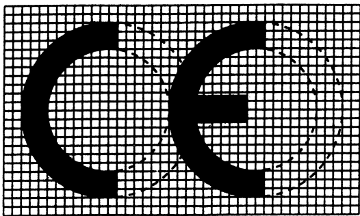
>
> aash Si le marquage est réduit ou agrandi, les proportions figurées dans le dessin gradué ci-dessus sont à respecter.
>
> bash Les différents éléments du marquage CE doivent avoir sensiblement la même dimension verticale, qui ne peut être inférieure à 5 mm. Cette dimension minimale n’est pas obligatoire pour les dispositifs de petites dimensions.

#### Règlement grand-ducal du 19 novembre 2008 relatif à l'utilisation des défibrillateurs externes automatiques.

##### Art. 1er.

Au sens du présent règlement, on entend par:

a) «défibrillateur externe automatique»: tout défibrillateur externe entièrement automatique ou semi-automatique permettant d'administrer un choc électrique sur analyse, que ce soit ou non en devant appuyer au préalable sur un bouton;

b) «défibrillateur externe automatique de catégorie 1»: un défibrillateur externe automatique ne permettant pas de passer en mode manuel ni, dès lors, d'administrer un choc électrique de manière autonome, et qui ne dispose pas d'un écran permettant de suivre le rythme cardiaque;

c) «défibrillateur externe automatique de catégorie 2»: un défibrillateur externe automatique qui permet de passer en mode manuel et, dès lors, d'administrer un choc électrique de manière autonome ou qui dispose d'un écran permettant de suivre le rythme cardiaque.

##### Art. 2.

(1) Un défibrillateur de catégorie 1 peut être utilisé par toute personne.

(2) Est habilitée à utiliser un défibrillateur externe automatique de catégorie 2 toute personne pouvant se prévaloir d'une formation à la prise en charge de l'arrêt cardio-respiratoire validée par le ministre ayant la santé dans ses attributions.

Le défibrillateur visé au présent paragraphe ne peut toutefois être utilisé en mode manuel que par un médecin ou par un infirmier.

##### Art. 3.

Le contrôle du défibrillateur externe automatique se fera conformément aux instructions du fabricant.

Le propriétaire ou le détenteur d'un défibrillateur externe automatique est tenu de vérifier ou de faire vérifier une fois par mois l'état de son défibrillateur automatique et, en particulier, de noter les éventuels messages d'alerte concernant la batterie de l'appareil. La présence d'une paire d'électrodes intacte sera vérifiée.

Il documente l'ensemble de ces vérifications dans un registre.

##### Art. 4.

Après chaque utilisation, le défibrillateur externe automatique fera l'objet d'une révision conformément aux instructions du fabricant. Cette révision inclut notamment un contrôle portant sur l'état de la batterie ainsi que sur l'existence d'une paire d'électrodes en état de fonctionnement.

##### Art. 5.

Lorsqu'à la suite d'une défibrillation ou d'une tentative de défibrillation à l'aide d'un défibrillateur externe automatique, le patient est pris en charge par un établissement hospitalier ou, le cas échéant, par l'antenne mobile d'un service d'urgence d'un établissement hospitalier, les données recueillies par le défibrillateur seront enregistrées dans le dossier individuel du patient visé à [l'article 36 de la loi du 28 août 1998](https://legilux.public.lu/eli/etat/leg/loi/1998/08/28/n1) sur les établissements hospitaliers.

##### Art. 6.

Notre Ministre de la Santé est chargé de l'exécution du présent règlement qui sera publié au Mémorial.

#### Règlement grand-ducal du 4 octobre 2018 portant réglementation des dispositifs médicaux qualifiés de « lasers à visée cosmétique et/ou esthétique ».

##### Art. 1er.

(1) Au sens du présent règlement, on entend par laser à visée cosmétique et/ou esthétique, les appareils à laser destinés à une application directe du rayonnement laser sur la peau ou les tissus corporels internes dans le cadre de procédures cosmétique et/ou esthétique. Il s’agit des lasers à visée cosmétique et/ou esthétique utilisés pour :

1\. l’épilation ;

2\. le détatouage ;

3\. la photoréjuvénation ;

4\. le traitement des rides et cicatrices ;

5\. la destruction et/ou l’atténuation des angiomes superficiels, des varicosités, de la couperose, ou de toute autre lésion artérielle et veineuse ;

6\. la destruction et/ou l’atténuation des lentigos solaires, des taches de vieillesse, des taches de rousseur, des points rubis, des taches café au lait, de l’hyperpigmentation post inflammatoire, des mélanoses dermiques dont les taches mongoloïde et autres naevus ou de toute autre tâche pigmentaire.

(2) Les lasers à visée cosmétique et/ou esthétique sont classés en trois classes, à savoir la classe 3R, la classe 3B et la classe 4 selon la norme ILNAS-EN 60825-1:2014/AC:2017-06 concernant la sécurité des appareils à laser et la classification des matériels et exigences.

Toute application nécessite une protection contre l’exposition oculaire, conformément à la norme ILNAS-EN 207:2017.

##### Art. 2.

(1) Les esthéticiens titulaires d’une autorisation d’établissement sont autorisés à utiliser les lasers à visée cosmétique et/ou esthétique visés au paragraphe 1er de l’article 1er à des fins d’épilation s’ils peuvent se prévaloir d’une formation répondant aux critères visés au paragraphe 2.

(2) Cette formation doit permettre aux esthéticiens d’acquérir des connaissances théoriques et pratiques concernant :

aash les dangers liés à l’utilisation des lasers à visée cosmétique et/ou esthétique visés au paragraphe 1er de l’article 1er ;

bash les précautions d’utilisation de ces lasers à visée cosmétique et/ou esthétique et des indications visées au paragraphe 1er de l’article 1er ;

cash les manipulations appropriées de ces des lasers à visée cosmétique et/ou esthétique et les contre-indications d’utilisation ;

Le contenu, les modalités et la durée de la ou des formations doivent être documentés. La durée totale de la formation ne peut pas être inférieure à 8 heures.

##### Art. 3.

Les esthéticiens s’informent auprès de l’Inspection du Travail et des Mines des exigences concernant les installations des locaux et de l’équipement.

Les esthéticiens notifient à la Direction de la santé, moyennant un formulaire mise en ligne par la Direction de la santé, la mise en service, respectivement la mise hors service des lasers à visée cosmétique et/ou esthétique visés à l’article 1er.

##### Art. 4.

Les esthéticiens disposant d’un laser à visée cosmétique et/ou esthétique visé à l’article 1erau jour d’entrée en vigueur du présent règlement, disposent d’un délai de douze mois pour faire la notification visée à l’article 3.

##### Art. 5.

Notre Ministre de la Santé est chargé de l’exécution du présent règlement qui sera publié au Journal officiel du Grand-Duché du Luxembourg.

#### Version consolidée applicable au 15/02/2021 : Règlement grand-ducal du 4 octobre 2018 fixant les conditions de réalisation des tests rapides à orientation diagnostique de l’infection à virus de l’immunodéficience humaine, d’hépatites virales et d’autres infections sexuellement transmissibles.

##### Art. 1er.

Au sens du présent règlement, on entend par « test rapide » tout test à orientation diagnostique soit de l’infection à virus de l’immunodéficience humaine, soit des hépatites virales, soit d’une autre infection sexuellement transmissible, soit de l’infection au SARS-CoV-2. Pour laquelle il existe un test rapide.

Le présent règlement ne s’applique pas aux dispositifs d’autodiagnostic servant au dépistage du VIH et que le fabricant destine à être utilisés par une personne profane.

##### Art. 2.

(1) Un test rapide peut être réalisé chez toute personne, soit dans son intérêt et pour son seul bénéfice, soit dans un objectif de santé publique , après l'avoir informée et avoir recueilli son consentement libre et éclairé, par :

1\. un médecin ;

2\. un infirmier ;

3\. un laborantin exerçant dans un laboratoire d’analyses médicales ;

4\. une sage-femme ;

5\. un assistant social ;

6\. un salarié ou un bénévole relevant du champ d’application de [loi modifiée du 26 mars 1992](https://legilux.public.lu/eli/etat/leg/loi/1992/03/26/n1/jo) sur l’exercice et la revalorisation de certaines professions de santé, désigné par une association agréée par le ministre ayant la Santé dans ses attributions, ci-après « le ministre » et , ayant suivi la formation prévue à l’article 5**,** qui réalisent le test rapide sous la direction et sous la responsabilité d’un médecin.

(2) Préalablement à la réalisation d’un test rapide, les personnes visées au paragraphe 1er doivent avoir suivi une formation sur l’utilisation et l’administration des tests rapides. Cette formation est validée par le ministre ayant la Santé dans ses attributions.

(3) L’association visée au paragraphe 1er, point 6, est agréée par le ministre ayant la Santé dans ses attributions sur base d’un cahier de charge fixé à l’annexe I au présent règlement grand-ducal.

(4) Les professionnels de la santé désigné par une association agréée en application du paragraphe 1er, point 6, sont soumis au respect du secret médical ou professionnel dont la révélation est punie dans les conditions définies par l’article 458 du [code pénal](https://legilux.public.lu/eli/etat/leg/code/penal).

##### Art. 3.

(1) Chaque test rapide doit être précédé et suivi d’un entretien ayant pour objet d’informer en application du paragraphe 1er la personne sur laquelle est pratiqué le test sur l’objectif du test, le délai de fiabilité du test ainsi le déroulement de la procédure en cas de test positif. L’entretien a également pour objectif de conseiller la personne testée.

(2) Le test rapide est réalisé de manière anonyme.

(3) En cas de test rapide positif, la personne concernée est orientée systématiquement vers un médecin.

##### Art. 4.

(1) Toute association agréée en application de l’article 2, paragraphe 1er, point 6, doit conclure une convention avec un laboratoire d’analyses médicales autorisé par le ministre ayant la Santé dans ses attributions conformément à l’article 3 de la [loi modifiée du 16 juillet 1984](https://legilux.public.lu/eli/etat/leg/loi/1984/07/16/n1/jo) relative aux laboratoires d’analyses médicales pour effectuer la réalisation du diagnostic biologique de l’infection, pour l’exploration d’une recherche positive, et en vue de l'orientation de la personne testée vers une prise en charge adaptée.

##### Art. 5.

Le contenu de la formation visée au paragraphe (3) de l’article 2 est fixé par l’annexe II au présent règlement grand-ducal.

##### Art. 6.

Notre Ministre de la Santé est chargé de l’exécution du présent règlement qui sera publié au Journal officiel du Grand-Duché du Luxembourg.

> \**Annexe I**
>
> \**Cahier de charges relatif à l’utilisation des tests rapides d’orientation diagnostique (TROD) en milieu associatif**
>
> \**Préambule**
>
> Le recours aux tests rapides d'orientation diagnostique (TROD) de l’infection VIH, des hépatites virales et d’autres infections sexuellement transmissibles doit contribuer à compléter l'offre traditionnelle de dépistage des infections auprès des populations et des individus les plus exposés au risque de transmission, notamment les populations ayant des difficultés à recourir à des structures de soins ou de prévention quelle qu'en soit la raison (géographique, sociale...) et les populations non ou insuffisamment dépistées qui seraient plus facilement convaincues du fait d'un dépistage immédiat par un test rapide.
>
> Les associations qui souhaitent disposer d'un agrément délivré par le ministre ayant la Santé dans ses attributions, participent à cet objectif de prévention et de dépistage de l’infection VIH, des hépatites virales et d’autres infections sexuellement transmissibles, chez les publics auprès desquels ils interviennent. L'usage de tests rapides d'orientation diagnostique (TROD) est subordonné au respect du cahier des charges détaillé ci-dessous.
>
> \**Cahier des charges**
>
> Objectifs de l'offre de dépistage par tests rapides d'orientation diagnostique de l'infection par le VIH, des hépatites virales ou d’autres infections sexuellement transmissibles
>
> Les offres de dépistage recourant à des tests rapides d'orientation diagnostique (TROD) de l’infection par le VIH, des hépatites virales ou d’autres infections sexuellement transmissibles ont pour objectif de permettre aux populations les plus exposées au risque de transmission de ces virus ou les plus isolées du système de soins :
>
> aash un accès facilité et renouvelé à la connaissance de leur statut sérologique ;
>
> bash une adaptation des stratégies préventives de chacun en fonction de la connaissance actualisée de son statut sérologique et de celle de ses partenaires ou de son entourage ;
>
> cash l'entrée et l'accompagnement dans une démarche de soins la plus précoce possible pour les personnes découvertes porteuses du VHC ou d'un VIH. (ou autres infections sexuellement transmissibles)
>
> La facilité d'utilisation du TROD de l'infection par le VHC ou à VIH permet son usage « hors les murs » et à des horaires diurnes ou nocturnes en vue d'aller au-devant des populations les plus éloignées d'une offre traditionnelle de dépistage ou de celles qui n'y ont pas recours. Il s'agit de proposer à ces populations un dépistage par TROD intégré dans une offre complète de prévention (information, conseils, distribution de documents et de matériel de prévention ou de réduction des risques, orientation éventuelle vers d'autres dépistages…).
>
> Publics concernés
>
> Les TROD de l'infection par le VHC, VIH ou autre maladie sexuellement transmissibles n'ont pas d'indication pour le dépistage de ces infections en population générale. Peuvent bénéficier prioritairement du TROD de l'infection par le VHC, VIH ou autre maladie sexuellement transmissibles, les populations et les personnes les plus exposées au risque de transmission du VHC, VIH ou d’autre maladie sexuellement transmissibles.
>
> Sont concernées par exemple :
>
> aash pour l'infection à VIH : les hommes ayant des relations sexuelles avec des hommes (HSH), les personnes hétérosexuelles ayant eu plus d'un partenaire sexuel au cours des 12 derniers mois, les personnes consommant ou ayant consommé des substances psychoactives par injection, les personnes en situation de prostitution, les personnes détenues, les personnes transsexuelles, les personnes dont les partenaires sexuels sont infectés par le VIH ;
>
> bash pour l'infection par le VHC : les personnes consommant ou ayant consommé des substances psychoactives, les personnes détenues, les personnes vivant avec le VIH, les personnes ayant au moins un autre facteur de risque (antécédent de transfusion, situation de précarité, pratiques sexuelles traumatiques, réalisation d'un tatouage ou d'un piercing…).
>
> Association pouvant être agrée par le ministre ayant la Santé dans ses attributions pour la réalisation du dépistage par TROD VIH, VHC ou autres maladies sexuellement transmissibles
>
> Il s'agit de structures associatives impliquées dans la prévention sanitaire ou la réduction des risques et des dommages associés à la consommation de substances psychoactives conformément à leur objet statutaire ou social.
>
> Le personnel intervenant dans le cadre de cette association
>
> Le personnel intervenant dans le cadre de cette association doit être en nombre suffisant pour répondre à l'organisation de l'offre de dépistage proposée.
>
> Au sein de l’association, les personnes pouvant réaliser un dépistage par tests rapides d'orientation diagnostique de l'infection à VIH sont les personnes salariées ou les personnes bénévoles ayant suivi la formation définie à l'annexe II. La liste nominative et la qualité des personnes formées pouvant réaliser ces tests au sein de l’association est annexée à l’agrément de l’association.
>
> Le responsable de l’association est tenu d'informer le ministre ayant la Santé dans ses attributions de tout changement intervenant dans cette liste. Cette liste nominative est tenue à la disposition du public accueilli par l’association.
>
> Le responsable de l’association veille à la mise à jour des compétences de ce personnel, notamment au vu des évolutions intervenant dans le champ du VIH/IST.
>
> Locaux et lieux d'intervention
>
> Les locaux et lieux d'intervention des personnes pouvant réaliser des tests rapides d'orientation diagnostique de l'infection à VIH conformément aux dispositions du présent règlement grand-ducal peuvent être fixes (exemple : local associatif, lieux de vie et de convivialité des populations ciblées) ou mobiles (bus, tente, stand itinérant...) mais toujours être organisés, selon leur configuration, de telle manière à préserver un accueil individualisé et une remise du résultat du test rapide d'orientation diagnostique de l'infection à VIH dans des conditions garantissant la confidentialité.
>
> Le dossier de demande d'agrément
>
> Le dossier de demande d'agrément doit contenir tous les éléments permettant d'identifier que l’association est impliquée en matière de prévention sanitaire est en mesure de se conformer aux prescriptions du cahier des charges. Ce dossier comprend les informations suivantes :
>
> \*Informations générales :*
>
> aash nom de l’association ;
>
> bash forme juridique et statuts de l’association ;
>
> cash nom et qualité de la personne responsable de l'activité de réalisation des tests rapides d'orientation diagnostique de l'infection à VIH ;
>
> dash activités autres de l’association.
>
> \*Descriptif des objectifs et du public ciblé par l'offre de dépistage :*
>
> aash description des résultats attendus de l'offre de dépistage proposée et de son insertion dans le contexte luxembourgeois d'offre de dépistage ;
>
> bash description du public ciblé par cette offre.
>
> \*Informations relatives au personnel :*
>
> aash nombre et qualification des personnes dédiées à l'activité ; répartition de leurs rôles ;
>
> bash procédures de formation (interne ou externe) et de mise à jour des compétences du personnel réalisant les tests rapides d'orientation diagnostique de l'infection à VIH.
>
> \*Informations relatives aux lieux et matériel d'intervention :*
>
> aash mention des locaux fixes ou mobiles et lieux d'intervention ;
>
> bash type/marque de tests rapides d'orientation diagnostique de l'infection à VIH et matrices utilisés ;
>
> cash conditions de conservation de ces tests rapides d'orientation diagnostique ;
>
> dash mode de financement prévu pour ces tests rapides d'orientation diagnostique.
>
> \*Conditions générales de fonctionnement :*
>
> aash horaires d'ouverture des lieux fixes ; permanence téléphonique ;
>
> bash organisation prévue pour la réalisation des tests : procédures encadrant l'accueil et l'information du public ciblé, le recueil du consentement de la personne concernée, la réalisation technique et la remise des résultats ; documents donnés à la personne ;
>
> cash description des conditions garantissant la confidentialité des échanges avec la personne accueillie à l'intérieur des locaux fixes ou mobiles servant de lieux d'intervention ;
>
> dash conditions d'orientation et d'accompagnement des personnes vers un médecin et une prise en charge médicale, si nécessaire ;
>
> eash conditions de conservation des données permettant de garantir la confidentialité des informations.
>
> \*Attestations à fournir :*
>
> aash attestations de suivi de formation du personnel dédié à la réalisation des tests rapides d'orientation diagnostique de l'infection à VIH = dans la structure ;
>
> bash assurances responsabilité civile souscrites par la structure pour la réalisation des tests rapides d'orientation diagnostique.
>
> cash convention avec le ou les laboratoires d’analyses médicales autorisé par le ministre ayant la Santé dans ses attributions, conformément à l’article 3 de la [loi modifiée du 16 juillet 1984](https://legilux.public.lu/eli/etat/leg/loi/1984/07/16/n1/jo) relative aux laboratoires d’analyses médicales pour effectuer la réalisation du diagnostic biologique de l’infection, pour l’exploration d’une recherche positive, et en vue de l'orientation de la personne testée vers une prise en charge adaptée.
>
> \**Annexe II**
>
> \**Formation des personnes exerçant ou intervenant dans les associations agréées par le ministre**
>
> \**Objectifs de la formation**
>
> Les objectifs pédagogiques de la formation sont les suivants :
>
> aash compléter les connaissances sur les risques et les modes de transmission du VIH et des IST associés aux différentes pratiques des populations et individus rencontrés ;
>
> bash renforcer les capacités à mener des entretiens de prévention adaptés aux besoins des publics et au cadre particulier des entretiens pré- et posttests ;
>
> cash acquérir les connaissances et compétences nécessaires à une utilisation de tests rapides d'orientation diagnostique de l'infection à VIH.
>
> Ces objectifs sont à adapter au niveau de compétences et d'expérience déjà acquis sur le VIH par les personnes à former.
>
> \**Contenu de la formation**
>
> La formation comporte un volet théorique et un volet pratique.
>
> Contenu de l'enseignement théorique (minimum de 12 heures)
>
> aash Principes juridiques et éthiques applicables en matière de dépistage et l’entretien avec le patient.
>
> \*Information de la personne concernée, règles relatives au recueil du consentement, secret médical et professionnel, principes de conservation des données à caractère personnel ([Loi du 24 juillet 2014](https://legilux.public.lu/eli/etat/leg/loi/2014/07/24/n2/jo) relative aux droits et obligations du patient, portant création d'un service national d'information et de médiation dans le domaine de la santé, [Règlement (UE) 2016/679](https://legilux.public.lu/eli/reg_ue/2016/679/jo) du Parlement européen et du Conseil du 27 avril 2016 relatif à la protection des personnes physiques à l’égard du traitement des données à caractère personnel et à la libre circulation de ces données, et abrogeant la [directive 95/46/CE](https://legilux.public.lu/eli/dir_ue/1995/46/jo).)*
>
> bash Infection à VIH.
>
> \*Epidémiologie. Définition et symptômes. Prévention du VIH. Principes et bases de l'information-conseil.*
>
> cash Prévention des hépatites virales et des infections sexuellement transmissibles.
>
> dash Les tests rapides d'orientation diagnostique (TROD) de l'infection à VIH.
>
> \*Les différents types de tests. Leur stockage. Leurs principes d'utilisation et de réalisation, dans le respect du mode opératoire mentionné dans la notice du fabricant du test. L'interprétation des résultats. Les règles d'asepsie et d'hygiène, notamment lors des prélèvements de liquides biologiques. Les règles d'élimination des déchets. Le processus de signalement auprès de la Direction de la Santé au titre de la réactovigilance de toute défaillance ou altération d'un réactif susceptible d'entraîner des effets néfastes pour la santé des personnes.*
>
> eash La conduite à tenir en cas d'accident d'exposition au sang.
>
> Contenu de l'enseignement pratique
>
> La formation pratique comprend, au minimum, la réalisation de cinq tests, hors condition d'intervention, sous le contrôle d'un formateur référent, lui-même préalablement formé à la réalisation de ces tests. Cette formation pratique comprend les gestes de tri et la manipulation des collecteurs. Les tests ainsi réalisés doivent permettre de visualiser au moins un résultat positif. La formation doit comporter des mises en situation d'information-conseil pré- et posttest.

## DONNÉES MÉDICALES

### DISPOSITIONS GÉNÉRALES

#### Version consolidée applicable au 26/12/2025 : Loi du 1er août 2018 portant organisation de la Commission nationale pour la protection des données et mise en oeuvre du règlement (UE) 2016/679 du Parlement européen et du Conseil du 27 avril 2016 relatif à la protection des personnes physiques à l'égard du traitement des données à caractère personnel et à la libre circulation de ces données, et abrogeant la directive 95/46/CE (règlement général sur la protection des données), portant modification du Code du travail et de la loi modifiée du 25 mars 2015 fixant le régime des traitements et les conditions et modalités d'avancement des fonctionnaires de l'État.

##### Art. 66.

Le traitement de données génétiques aux fins de l’exercice des droits propres au responsable du traitement en matière de droit du travail et d’assurance est interdit.

#### [Règlement (UE) 2016/679](http://data.europa.eu/eli/reg/2016/679/oj) du Parlement européen et du Conseil du 27 avril 2016 relatif à la protection des personnes physiques à l'égard du traitement des données à caractère personnel et à la libre circulation de ces données, et abrogeant la directive 95/46/CE (règlement général sur la protection des données) (Texte présentant de l'intérêt pour l'EEE)

## DROITS ET OBLIGATIONS DU PATIENT

### Version consolidée applicable au 07/03/2021 : Loi du 24 juillet 2014 relative aux droits et obligations du patient, portant création d'un service national d'information et de médiation dans le domaine de la santé et modifiant: - la loi modifiée du 28 août 1998 sur les établissements hospitaliers; - la loi modifiée du 2 août 2002 relative à la protection des personnes à l'égard du traitement des données à caractère personnel; - le Code civil.

#### Chapitre 1er: — Champ d’application et définitions

##### Art. 1er — Champ d'application

(1) La présente loi s’applique à la relation qui se met en place quand un patient s’adresse à un prestataire de soins de santé pour bénéficier ou pouvoir bénéficier de soins de santé indépendamment de leur mode d’organisation, de prestation ou de financement, y compris les soins de santé transfrontaliers prestés dans le cas de la télémédecine par un prestataire de soins établi au Luxembourg.

(2) Les personnes physiques ou morales qui ont conclu un contrat de collaboration avec un prestataire de soins de santé ayant pour objet de faire bénéficier des patients de soins de santé prennent les mesures nécessaires pour assurer le respect des dispositions de la présente loi.

(3) Les dispositions de la présente loi s’entendent sans préjudice des dispositions déterminant les modalités de prise en charge des soins de santé par les organismes de sécurité sociale.

(4) Sont exclus du champ d’application de la loi les services fournis dans le domaine des soins de longue durée dont le but principal est d’aider les personnes qui ont besoin d’aide pour accomplir des tâches quotidiennes courantes, y compris dans le cadre de l’assurance dépendance.

##### Art. 2 — Définitions

Pour l’application de la présente loi, on entend par:

a) «ministre»: le ministre ayant la Santé dans ses attributions;

b) «patient»: toute personne physique qui cherche à bénéficier ou bénéficie de soins de santé;

c) «soins de santé»: des services de santé fournis par des professionnels de santé aux patients pour évaluer, maintenir ou rétablir leur état de santé, y compris la prescription, la délivrance et la fourniture de médicaments et de dispositifs médicaux;

d) «professionnel de santé»: toute personne physique exerçant légalement une profession réglementée du domaine de la santé;

e) «prestataire de soins de santé»: tout professionnel de santé, tout établissement hospitalier, ainsi que tout prestataire de soins, exerçant légalement sa profession en dehors du secteur hospitalier, visé par l’alinéa second de l’article 61 du [Code de la sécurité sociale](https://legilux.public.lu/eli/etat/leg/code/securite_sociale);

f) «dossier patient»: l’ensemble des documents contenant les données, les évaluations et les informations de toute nature concernant l’état de santé d’un patient et son évolution au cours du traitement, indépendamment de la nature de leur support.

#### Chapitre 2: — Droits et obligations du patient

##### *Section 1:* — *Droits et obligations généraux du patient*

###### Art. 3 — Respect mutuel, dignité et loyauté

(1) Le patient a droit à la protection de sa vie privée, à la confidentialité, à la dignité et au respect de ses convictions religieuses et philosophiques.

(2) En fournissant conformément à ses facultés les informations pertinentes pour sa prise en charge, en adhérant et en collaborant à celle-ci, le patient participe à la prestation optimale des soins de santé.

Lors de sa prise en charge, il respecte les droits du prestataire de soins de santé et des autres patients.

###### Art. 4 — Accès à des soins de santé de qualité

(1) Sans préjudice des priorités dues au degré d’urgence, le patient jouit d’un égal accès aux soins de santé que requiert son état de santé. Les soins de santé sont prodigués de façon efficace et sont conformes aux données acquises de la science et aux normes légalement prescrites en matière de qualité et de sécurité.

(2) Les soins de santé doivent être organisés de façon à garantir la continuité des soins en toutes circonstances.

###### Art. 5 — Libre choix du prestataire de soins de santé

(1) Sous réserve de l’application des dispositions de l’article 6, et sous réserve des impératifs d’organisation de la prestation des soins, chaque patient a le droit de choisir librement le prestataire de soins de santé par lequel il désire être pris en charge en vue de la prestation de soins de santé. Ce choix peut être modifié à tout moment.

(2) Pour tous les actes médicaux prestés à l’intérieur d’un établissement hospitalier, ce choix est limité aux prestataires agréés par l’établissement.

###### Art. 6 — Refus de prise en charge d'un patient et continuité des soins

(1) Le prestataire de soins de santé peut refuser la prise en charge d’un patient pour des raisons personnelles ou professionnelles. Il refuse toute prise en charge lorsqu’il estime ne pas pouvoir utilement prodiguer les soins requis.

A la demande du patient, le prestataire assiste ce dernier dans la recherche d’un autre prestataire de soins de santé apte à assurer les soins requis.

(2) Le refus de prester des soins de santé ne peut en aucun cas être lié à des considérations discriminatoires.

Lorsque le patient peut présenter des éléments de fait de nature à présumer l’existence d’une discrimination, il incombe au prestataire de soins de santé de justifier sa décision de refus par des éléments objectifs non discriminatoires.

(3) Dans la mesure de ses possibilités, le prestataire de soins de santé assure toujours les premiers soins urgents et la continuité des soins.

###### Art. 7 — Droit à l'assistance

(1) Le patient est en droit de se faire assister dans ses démarches et décisions de santé par une tierce personne, professionnel de santé ou non, qu’il choisit librement. La personne ainsi choisie par le patient pour le soutenir et l’aider est appelée «accompagnateur du patient».

(2) Dans la mesure souhaitée par le patient, l’accompagnateur est, pour autant que possible, intégré dans la prise en charge du patient.

Dans la mesure où le patient majeur le demande, le secret professionnel visé à l’article 458 du [Code pénal](https://legilux.public.lu/eli/etat/leg/code/penal) est levé à l’égard de l’accompagnateur. L’identité de l’accompagnateur est notée dans le dossier. Le professionnel de santé peut cependant à tout moment décider librement de s’échanger en dehors de la présence de l’accompagnateur.

###### Art. 8 — Droit à l'information sur l'état de santé

(1) Le patient a droit aux informations relatives à son état de santé et à son évolution probable, sous réserve de l’application des dispositions de l’article 9.

(2) Il incombe à chaque professionnel de santé d’informer le patient dans un langage clair et compréhensible, adapté aux facultés de compréhension de ce dernier. L’information est valablement donnée dans une des langues prévues à l’article 3 de la [loi du 24 février 1984](https://legilux.public.lu/eli/etat/leg/loi/1984/02/24/n1/jo) sur le régime des langues, le cas échéant, par l’intermédiaire d’un accompagnateur du patient assurant la traduction sous la responsabilité de ce dernier.

Le professionnel de santé informe, d’une part, sur les prestations dont il a la responsabilité, d’autre part, par rapport à son implication dans la prise en charge et dans le cadre de ses compétences et dans le respect des règles professionnelles qui lui sont applicables, sur l’état de santé du patient et son évolution probable.

Lorsque plusieurs professionnels de santé collaborent à la prise en charge d’un patient, ils se tiennent mutuellement informés, sauf opposition du patient.

(3) Le patient prend avec les professionnels de santé, compte tenu, d’une part, des informations pertinentes pour sa prise en charge qu’il leur a fournies et, d’autre part, des informations et conseils que ceux-ci lui ont fournis, les décisions concernant sa santé.

(4) Les soins de santé à un patient disposant de la capacité nécessaire ne peuvent être prestés que moyennant son consentement préalable, libre et éclairé, donné à la suite d’une information adéquate.

Sans préjudice des dispositions des articles 9 et 10, l’information préalable porte sur les éléments essentiels caractérisant les soins de santé proposés, y compris une information adéquate sur les objectifs et les conséquences prévisibles de ces soins, leur bénéfice, leur urgence éventuelle, les risques ou événements fréquents et graves généralement connus, appréciés en tenant compte des caractéristiques spécifiques du patient, ainsi que sur les alternatives ou options thérapeutiques éventuellement envisageables et les conséquences prévisibles en cas de refus. Il incombe au professionnel de santé d’évaluer les risques et événements indésirables spécifiquement liés à l’état de santé du patient.

L’information sur les risques et événements indésirables fréquents et graves généraux connus peut être donnée sur base d’un référentiel. Le Conseil scientifique dans le domaine de la santé élabore des recommandations de bonne pratique relatives à la délivrance de l’information aux patients sur leur état de santé. Il peut diffuser des référentiels par type d’intervention.

L’information préalable du patient inclut sur sa demande une estimation du coût global inhérent aux soins de santé proposés et aux modalités de prise en charge envisagées.

Sur demande du patient, l’information préalable porte sur la disponibilité prévisible des soins proposés, la qualité et la sécurité des soins de santé, y compris le nombre d’actes effectués par le prestataire, le taux de complications, la durée de séjour prévisible en cas d’hospitalisation, le statut d’autorisation ou d’enregistrement du prestataire de soins de santé, ainsi que sur la couverture d’assurance au titre de la responsabilité professionnelle.

(5) Le patient peut refuser ou retirer son consentement à tout moment, sans qu’une telle décision n’entraîne l’extinction du droit à des soins de santé de qualité en fonction des options thérapeutiques acceptées, tel que visé à l’article 4 de la présente loi.

(6) Le professionnel de santé dispensant des soins de santé au patient s’assure avant toute intervention que le patient ait reçu en temps utile les informations préalables conformément à la présente loi et qu’il consent librement aux soins dispensés.

Si au cours d’une prestation de soins de santé une circonstance raisonnablement imprévisible requiert une adaptation des soins envisagés, la prestation entamée peut être poursuivie malgré l’impossibilité de recueillir le consentement complémentaire du patient ou celui de son représentant, lorsqu’elle ne fait courir à celui-ci aucun risque complémentaire significatif ou lorsqu’il s’agit d’une mesure urgente médicalement indispensable.

(7) L’information du patient en application de la présente loi est en principe donnée oralement et peut, le cas échéant, être précisée par une information écrite.

(8) Le consentement ou le refus de consentir du patient est en principe donné de façon expresse. Le consentement peut être tacite lorsque le professionnel de santé, après avoir adéquatement informé le patient, peut raisonnablement déduire du comportement de celui-ci qu’il consent aux soins de santé conseillés.

Le professionnel de santé qui recueille la décision du patient veille à ce que le patient ait compris les informations fournies au moment de prendre une décision concernant sa santé.

(9) En cas de contestation, la preuve de l’information fournie et celle du consentement du patient incombent au prestataire de soins de santé sous la responsabilité duquel les soins ont été dispensés ou proposés. Une telle preuve peut en être délivrée par tout moyen, la tenue régulière du dossier valant présomption simple des éléments y consignés ou versés.

###### Art. 9 — Droit d'être tenu dans l'ignorance

(1) La volonté du patient d’être tenu dans l’ignorance d’un diagnostic, d’un pronostic ou d’une information relatifs à son état de santé ou à son évolution probable est respectée, à moins que la non-communication de cette information au patient ne risque de causer manifestement un grave préjudice à la santé du patient ou à la santé de tiers.

(2) Le souhait d’être tenu dans l’ignorance est consigné ou ajouté au dossier patient.

###### Art. 10 — Exception thérapeutique

(1) A titre exceptionnel, le médecin traitant peut décider qu’il y a lieu de s’abstenir de communiquer les informations dont la communication risque manifestement de causer un préjudice grave à la santé du patient. Le médecin traitant consulte préalablement un autre confrère à ce sujet et entend, dans la mesure du possible, la personne de confiance du patient. Il ajoute une motivation explicite dans le dossier patient. Cette décision s’impose aux professionnels de la santé non médecin.

Dès que la communication des informations ne risque plus de causer un tel préjudice, le médecin traitant lève l’exception thérapeutique.

(2) Les informations qui ont été exclues de la communication directe au patient peuvent toujours être obtenues ou consultées par un autre médecin traitant du patient, le cas échéant désigné par le patient.

Si ce médecin estime que le secret n’est pas ou plus justifié eu égard à l’état de santé du patient, il lève l’exception thérapeutique. Il ajoute une motivation dans le dossier patient.

(3) Le médecin qui lève l’exception thérapeutique fournit au patient les informations conformément aux dispositions de la présente loi ou s’assure de ce que le patient reçoive dans les meilleurs délais ces informations par un confrère.

###### Art. 11 — De la volonté du patient hors d'état de manifester sa volonté

(1) Si le patient est, de façon temporaire ou permanente, hors d’état de manifester sa volonté, le prestataire de soins de santé cherche à établir sa volonté présumée.

Dans le cadre de l’établissement de cette volonté, le professionnel de santé fait appel à la personne de confiance éventuellement désignée conformément à l’article 12 ci-après. Il peut faire appel à toute autre personne susceptible de connaître la volonté du patient.

(2) Lorsqu’en situation d’urgence médicale, le patient n’est pas en mesure de prendre les décisions concernant sa santé et que sa volonté n’est pas établie, le prestataire de soins de santé peut immédiatement prendre dans l’intérêt du patient toutes les mesures urgentes d’ordre médical que la situation requiert.

##### *Section 2:* — *Représentation du patient*

###### Art. 12 — Désignation d'une personne de confiance

(1) Tout patient majeur disposant de la capacité de consentir peut, pour le cas où il ne serait plus en mesure d’exprimer sa volonté et de recevoir l’information nécessaire à la prise d’une décision relative à sa santé, désigner une personne de confiance. Cette personne peut être toute personne physique, professionnel de santé ou non, désigné par lui.

(2) La désignation s’effectue par un écrit, daté et signé par le patient.

Lorsque le patient, bien qu’en état d’exprimer sa volonté, est dans l’impossibilité d’écrire et de signer lui-même, il peut demander à deux témoins d’attester que le document qu’il n’a pu rédiger lui-même est l’expression de sa volonté libre et éclairée. Ces témoins indiquent leur nom et qualité et leur attestation est jointe au mandat.

(3) Le patient ou tout autre dépositaire du document désignant une personne de confiance, peut à tout moment la remettre au prestataire de soins de santé prenant en charge le patient, aux fins de le verser, en original ou en copie, au dossier patient.

(4) La personne de confiance agit dans l’intérêt du patient qui est dans l’impossibilité temporaire ou permanente d’exercer ses droits. A cet effet, elle a accès au dossier patient et le secret professionnel visé à l’article 458 du [Code pénal](https://legilux.public.lu/eli/etat/leg/code/penal) est levé à son égard.

Si le prestataire de soins de santé se départ de l’avis de la personne de confiance, il en informe celle-ci et consigne les raisons de sa décision au dossier patient.

(5) Sauf volonté contraire exprimée par le patient, la désignation d’une personne de confiance conformément au présent article vaut, en situation de fin de vie, désignation de cette personne en tant que personne de confiance au sens de la [loi du 16 mars 2009](https://legilux.public.lu/eli/etat/leg/loi/2009/03/16/n1/jo) relative aux soins palliatifs, à la directive anticipée et à l’accompagnement en fin de vie ainsi qu’au sens de la [loi du 16 mars 2009](https://legilux.public.lu/eli/etat/leg/loi/2009/03/16/n2/jo) sur l’euthanasie et l’assistance au suicide.

La personne désignée comme personne de confiance en fin de vie conformément aux dispositions des lois précitées du 16 mars 2009 peut, sauf volonté contraire du patient, agir en tant que personne de confiance en application des dispositions de la présente loi.

###### Art. 13 — Patient mineur non émancipé

(1) Les droits du patient mineur non émancipé sont exercés par ses parents ou par tout autre représentant légal. Suivant son âge et sa maturité et dans la mesure du possible, le mineur est associé à l’exercice des droits relatifs à sa santé.

(2) Si le patient mineur non émancipé dispose de la capacité de discernement nécessaire pour apprécier raisonnablement ses intérêts, il peut être admis par le médecin traitant ou tout autre prestataire de soins de santé responsable de la prise en charge à exercer les droits relatifs à sa santé de manière autonome. Dans cette hypothèse, il peut aussi, en cas d’avance des frais, exercer de manière autonome le droit au remboursement des soins de santé afférents par les organismes de sécurité sociale.

Sauf opposition du patient mineur d’associer son ou ses représentants légaux à l’exercice de ses droits, le prestataire de soins de santé peut déroger au secret professionnel à l’égard de son ou de ses représentants légaux. Il en est de même des organismes de sécurité sociale.

(3) Le prestataire de soins de santé responsable de la prise en charge prend, en cas de danger grave et immédiat pour la vie ou la santé d’un patient mineur, toutes mesures d’ordre médical que la situation requiert.

Ces mesures d’urgence peuvent le cas échéant être prises en passant outre l’éventuel refus de consentement des parents ou des représentants légaux. En ce cas, le prestataire de soins de santé doit adresser dans les trois jours ouvrables au procureur d’Etat un rapport motivé sur les mesures d’ordre médical qu’il a prises.

###### Art. 14 — Patient sous régime de protection

(1) A défaut de personne de confiance désignée conformément à l’article 12 ou de personne spécialement désignée à cette fin par le juge des tutelles, les intérêts du patient placé sous tutelle sont exercés par son tuteur. Le juge des tutelles peut toutefois, lors de l’ouverture de la tutelle ou dans un jugement postérieur, procéder à la désignation d’un représentant spécifique chargé d’exercer ces droits.

Sauf s’il a été autorisé par décision de justice à exercer seul les droits relatifs à sa santé, le patient sous curatelle exerce ses droits avec l’assistance du curateur.

(2) Sans préjudice de ce qui précède en ce qui concerne le consentement du tuteur, du curateur ou de la personne spécialement désignée pour agir dans l’intérêt du patient, le patient sous régime de protection est associé à l’exercice de ses droits suivant sa capacité de compréhension et reçoit une information adaptée à son état. Son consentement personnel est recherché dans la mesure du possible.

(3) Le prestataire de soins de santé responsable de la prise en charge prend, en cas de danger grave et immédiat pour la vie ou la santé d’un patient relevant d’un régime de protection visé à l’alinéa premier, toutes mesures d’ordre médical que la situation requiert.

Ces mesures d’urgence peuvent le cas échéant être prises en passant outre l’éventuel refus de consentement des personnes investies du pouvoir de tutelle ou de curatelle. En ce cas, le prestataire de soins de santé responsable de la prise en charge doit adresser dans les trois jours ouvrables au procureur d’Etat un rapport motivé sur les mesures d’ordre médical qu’il a prises.

##### *Section 3:* — *Dossier patient et données relatives à la santé du patient*

###### Art. 15 — Droit à un dossier patient soigneusement tenu à jour

(1) Le patient a droit, de la part du prestataire de soins de santé, à un dossier patient soigneusement tenu à jour. Le dossier patient retrace, de façon chronologique et fidèle, l’état de santé du patient et son évolution au cours de la prise en charge. Il renseigne toute information pertinente pour la sécurité et l’évolution de l’état de santé du patient. Le contenu minimal du dossier patient tenu par les différentes catégories de professionnels de santé ainsi que ses éléments sont déterminés par règlement grand-ducal, l’avis de la commission nationale pour la protection des données ayant été demandé. Ce règlement grand-ducal peut aussi fixer le format, les standards et les normes à utiliser aux fins d’assurer l’interopérabilité du dossier individuel du patient hospitalier et l’établissement du résumé clinique de sortie et de ses éléments, de faciliter la tenue de bases de données communes standardisées, de tableaux de bord, et de permettre à l’aide de techniques d’anonymisation la conservation et l’extraction des données relatives au fonctionnement, à la performance et à la gestion du système de santé ainsi qu’à des fins statistiques, de recherche et d’amélioration continue.

(2) En fonction de ses attributions, le professionnel de santé intervenant dans la prise en charge du patient est responsable de ce que ses instructions, ses prescriptions et ses prestations, ainsi que toute autre information pertinente pour la sécurité et l’évolution de l’état de santé du patient sont consignés au dossier du patient. Dans le cas où ces éléments sont consignés par un tiers, il lui appartient de les valider.

Pour chaque prestation, le professionnel de santé qui est à l’origine de la prestation est identifié. La date et, le cas échéant, l’heure de la prestation doivent être précisées afin de pouvoir situer chronologiquement la prestation dans le parcours de soins du patient.

(3) Lorsque plusieurs professionnels de santé, médecin ou non médecin, interviennent dans la prise en charge du même patient et ont recours à un dossier patient utilisé de façon partagée, ils sont dispensés de tenir à jour un dossier patient propre pour y consigner ou verser les éléments ou informations déjà valablement documentées. Après la fin de leur prestation, ils gardent accès aux éléments du dossier partagé en rapport avec leur prestation.

(4) Le dépositaire d’un dossier patient est tenu d’en assurer la garde pendant dix ans au moins à partir de la date de la fin de la prise en charge.

(5) Ni le prestataire, ni le patient, ne peuvent avant l’expiration du délai de garde du dossier patient effectuer le retrait d’éléments pertinents pour la tenue du dossier patient.

La rectification d’une inscription inexacte ou incomplète peut être opérée sous la responsabilité du professionnel de santé qui est à l’origine de la prestation. Elle doit être réversible et documentée.

###### Art. 16 — Droit d'accès au dossier patient et aux données relatives à sa santé

(1) Le patient a un droit d’accès au dossier patient et à l’ensemble des informations relatives à sa santé détenues, à quelque titre que ce soit, par un prestataire de soins de santé ou toute autre instance médicale.

Il dispose en outre du droit à s’en faire expliquer le contenu. Les explications sont données conformément à l’article 8 paragraphe 2 ci-avant.

(2) Le patient peut exercer son droit d’accès en consultant le dossier patient ou en demandant accès aux données relatives à sa santé. Il peut se faire assister par l’accompagnateur du patient conformément aux dispositions de l’article 7.

Si la consultation du dossier patient ou l’accès aux données relatives à sa santé se fait en dehors de la présence du patient par l’intermédiaire d’une tierce personne physique qui n’est pas un professionnel de santé agissant dans l’exercice de sa profession, celui-ci doit pouvoir se prévaloir d’un écrit daté et signé par le patient. Lorsque le patient, bien qu’en état d’exprimer sa volonté, est dans l’impossibilité d’écrire et de signer lui-même, il peut demander à deux témoins d’attester que le document qu’il n’a pu rédiger lui-même est l’expression de sa volonté libre et éclairée. Ces témoins indiquent leur nom et qualité et leur attestation est jointe au mandat.

(3) Le patient a en outre le droit d’obtenir une copie de l’intégralité ou d’éléments du dossier patient. Il peut en demander la transmission au prestataire de soins de santé de son choix.

Les copies sont établies sur papier, ou sur un support informatique permettant une consultation ultérieure, au choix du patient et dans la limite des possibilités techniques du prestataire de soins de santé.

La contribution aux frais de copie éventuellement mis à charge du patient ne peut excéder le coût de la reproduction et, le cas échéant, de l’envoi.

(4) Sauf lorsque l’état de santé du patient requiert un accès plus urgent, il est donné suite à ces demandes dans un délai maximal de 15 jours ouvrables à compter de la réception de la demande par le détenteur du dossier patient.

(5) Une consultation d’annonce peut être exigée par le professionnel de santé qui est responsable de la prise en charge du patient ou qui a produit les informations consignées au dossier patient, lorsqu’il estime que la révélation directe de certains éléments du dossier patient peut faire courir un risque au patient.

La première consultation de ces éléments du dossier par le patient n’est alors possible qu’en cas de présence d’un professionnel de santé en mesure de conseiller le patient dans la prise de connaissance de ces informations. Lorsque dans la situation précitée la consultation du dossier patient ou l’accès aux données relatives à sa santé se fait en dehors de la présence du patient par l’intermédiaire d’une tierce personne, celle-ci doit obligatoirement être un professionnel de santé en mesure de conseiller le patient dans la prise de connaissance de ces informations.

(6) Sans préjudice des autres dispositions de la présente loi, l’accès du patient à son dossier de soins partagé s’exerce conformément à l’article 60quater du [Code de la sécurité sociale](https://legilux.public.lu/eli/etat/leg/code/securite_sociale).

###### Art. 17 — Annotations personnelles et données concernant des tiers

(1) Les annotations personnelles du professionnel de santé sont des annotations à usage personnel au dossier patient et qui reflètent ses points de réflexions, ses impressions ou considérations.

(2) Les annotations personnelles et les données fournies par des tiers peuvent ne pas être divulguées au patient, pour autant qu’elles n’intéressent ni les soins, ni la continuité des soins. Les données à caractère personnel concernant des tiers ne sont jamais révélées.

###### Art. 18 — Confidentialité et secret professionnel

(1) Par dérogation à l’article 458 du [Code pénal](https://legilux.public.lu/eli/etat/leg/code/penal), le professionnel de santé donne aux proches du patient, après avoir recueilli son consentement, des informations indispensables pour leur permettre d’intervenir dans son intérêt. Le consentement n’est pas requis lorsque le patient, en cas de diagnostic ou de pronostic grave, est hors d’état de manifester sa volonté et ne s’est pas préalablement opposé à cette levée du secret médical.

L’article 458 du [Code pénal](https://legilux.public.lu/eli/etat/leg/code/penal) s’applique à l’accompagnateur qui assiste le patient dans ses démarches et à la personne de confiance.

(2) Deux ou plusieurs professionnels de la santé peuvent, sauf opposition du patient dûment averti, échanger des informations relatives à une même personne prise en charge, afin d’assurer la continuité des soins ou de déterminer la meilleure prise en charge possible. Lorsque la personne est prise en charge par une équipe de soins dans un établissement hospitalier ou toute autre personne morale ou entité au sein duquel des soins de santé sont légalement prestés, les informations la concernant sont réputées confiées par le malade à l’ensemble de l’équipe.

Le patient, dûment informé, peut refuser à tout moment que soient communiquées des informations le concernant à un ou plusieurs professionnels de santé. Le professionnel de santé qui est à l’origine de la prestation garde toutefois toujours un accès aux éléments du dossier en rapport avec sa prestation.

###### Art. 19 — Accès au dossier patient et aux données du patient décédé

(1) Sauf volonté contraire exprimée par écrit de son vivant par le patient disposant de la capacité nécessaire, la personne de confiance éventuellement désignée, le conjoint non séparé de corps, les enfants majeurs, les autres ayants droit du patient, son partenaire légal, ainsi que toute personne qui, au moment du décès, a vécu avec lui en communauté de vie, ont, après son décès, accès au dossier patient du défunt et aux données relatives à sa santé et peuvent s’en faire délivrer copie pour leur permettre de connaître les causes de sa mort, de défendre sa mémoire, ou de faire valoir leurs droits légitimes.

(2) Sauf volonté contraire exprimée par écrit de son vivant par un patient mineur admis conformément à l’article 13 paragraphe 2 à exercer soi-même ses droits, les parents ou toute autre personne investie de l’autorité parentale d’un mineur conservent après le décès de ce dernier un accès discrétionnaire au dossier patient du mineur décédé et aux données relatives à sa santé et peuvent s’en faire délivrer copie sans indication de motifs.

#### Chapitre 3: — Service national d'information et de médiation dans le domaine de la santé

##### Art. 20 — Mission du service national d'information et de médiation santé

(1) Il est créé, sous l’autorité du ministre, un service national d’information et de médiation santé, qui a pour mission:

1\. la prévention des différends par le biais de la promotion de la communication entre le patient et le prestataire de soins de santé;

2\. l’information sur les droits et obligations du patient, de même que sur les droits et obligations correspondants du prestataire de soins de santé;

3\. l’information sur le droit d’un prestataire déterminé de prester des services ou sur toute restriction éventuelle à sa pratique, les normes et orientations en matière de qualité et de sécurité, y compris les dispositions sur la surveillance et l’évaluation des prestataires de soins de santé, ainsi que des informations indiquant quels prestataires de soins de santé sont soumis à ces normes et orientations et des informations sur l’accessibilité des centres hospitaliers aux personnes handicapées.

4\. l’émission de recommandations aux prestataires de soins de santé relatives à la mise en œuvre des droits et obligations du patient et du prestataire de soins de santé, de même que relatives à la gestion des plaintes et différends;

5\. l’information sur l’organisation, le fonctionnement et les règles de procédure de la médiation dans le domaine de la santé;

6\. l’information et le conseil du patient au sujet des possibilités en matière de règlement de sa réclamation en l’absence de solution par la voie de la médiation;

7\. la conduite, avec l’accord des parties, d’une mission de médiation dans un différend ayant pour objet la prestation de soins de santé;

8\. la transmission d’informations et, s’il y a lieu, de suggestions au Comité national de coordination de l’assurance qualité des prestations hospitalières dont question à l’article 23 de la [loi modifiée du 28 août 1998](https://legilux.public.lu/eli/etat/leg/loi/1998/08/28/n1/jo) sur les établissements hospitaliers.

Le service peut, en cas de besoin, se déplacer auprès des parties à la médiation ou établir une présence auprès d’un prestataire de soins de santé.

(2) Le recours au service national d’information et de médiation santé est gratuit.

(3) L’Etat met à la disposition du service national d’information et de médiation santé les locaux nécessaires à son fonctionnement. Les frais de fonctionnement du service national d’information et de médiation santé sont à charge du budget de l’Etat.

(4) Le service national d’information et de médiation santé établit son règlement d’ordre.

(5) Le service national d’information et de médiation santé élabore un rapport annuel qui établit un bilan de son activité et qu’il remet au ministre. Ce rapport peut également contenir des recommandations et expose les difficultés éventuelles que ledit service a rencontrées dans l’exercice de ses missions.

##### Art. 21 — Saisine du service national d'information et de médiation santé dans le cadre de sa mission de prévention, d'information et de conseil

(1) Dans le cadre de sa mission de prévention, d’information et de conseil, le service national d’information et de médiation santé peut être saisi par:

– le patient, ou la personne qui le représente dans l’exercice des droits du patient conformément aux articles 12 à 14 de la présente loi;

– après le décès du patient, par l’une des personnes disposant conformément à l’article 19 de la présente loi d’un droit d’accès au dossier et aux données relatives à la santé du défunt;

– tout prestataire de soins de santé dans le cadre d’un différend ayant pour objet la prestation de soins de santé.

Le patient peut se faire assister dans ses démarches par un accompagnateur conformément aux dispositions de l’article 7.

La saisine du service national d’information et de médiation santé peut se faire par écrit ou moyennant une déclaration orale faite dans une des langues prévue à l’article 3 de la [loi du 24 février 1984](https://legilux.public.lu/eli/etat/leg/loi/1984/02/24/n1/jo) sur le régime des langues.

(2) Sur mandat écrit du patient ou de la personne qui le représente, le service national d’information et de médiation santé est en droit d’obtenir communication de tous les éléments pertinents en rapport avec le traitement du dossier dont il a été saisi, notamment les éléments médicaux, soignants ou administratifs du dossier patient. Il peut prendre tous renseignements utiles auprès des organismes de sécurité sociale ou d’autres administrations.

##### Art. 22 — Procédure de médiation devant le service national d'information et de médiation santé

(1) Avec l’accord des parties le service national d’information et de médiation santé peut procéder à la médiation des parties à un différend ayant pour objet la prestation de soins de santé.

Le patient peut se faire assister par un accompagnateur conformément aux dispositions de l’article 7.

(2) Le médiateur peut, avant d’accepter une mission de médiation, proposer aux parties une rencontre informelle d’échange et de discussion, en l’absence de leurs conseils juridiques éventuels. Dès l’acceptation de la mission de médiation, les parties sont libres de se faire assister par leurs conseils juridiques éventuels.

(3) Dans le cadre du processus de médiation et avec l’accord des parties en médiation, le médiateur peut se faire assister par un expert à chaque fois qu’il l’estimera nécessaire pour assumer sa mission.

(4) L’assureur éventuel d’une des parties à la médiation est admis à intervenir dans le processus de médiation.

Si au cours du processus de médiation il apparaît que le différend est susceptible d’engager la responsabilité d’une des parties à la médiation, le médiateur informe cette partie que conformément à l’article 88 de la [loi modifiée sur le contrat d’assurance](https://legilux.public.lu/eli/etat/leg/loi/1997/07/27/n10/jo) l’indemnisation ou la promesse d’indemnisation de la personne lésée faite par l’assuré sans l’accord de l’assureur n’est pas opposable à ce dernier.

(5) Lorsque les parties parviennent à un accord total ou partiel de médiation, celui-ci fait l’objet d’un écrit daté et signé par toutes les parties à la médiation.

L’accord de médiation contient les engagements précis pris par chacune des parties. Les articles 2044 et suivants du [Code civil](https://legilux.public.lu/eli/etat/leg/code/civil) sont applicables.

##### Art. 23 — Statut du médiateur et du personnel affecté au service du médiateur

(1) Le service national d’information et de médiation santé est dirigé par un médiateur nommé par le Gouvernement en Conseil et ce sur proposition du ministre ayant la Santé dans ses attributions.

Le médiateur doit être porteur d’un diplôme d’études universitaires documentant un cycle complet d’études d’au moins quatre années. Il doit disposer d’une expérience professionnelle d’au moins cinq années dans un domaine utile à l’exercice de sa fonction. Dans l’exercice de sa fonction, il est dispensé de l’agrément en tant que médiateur agréé prévu à l’article 1251-3 du Nouveau Code de procédure civile.

Il est nommé pour une durée de cinq ans et son mandat est renouvelable.

(2) Le Gouvernement en Conseil peut, sur proposition du ministre ayant la Santé dans ses attributions, révoquer le médiateur lorsqu’il se trouve dans une incapacité durable d’exercer son mandat ou lorsqu’il perd l’honorabilité requise pour l’exercice de son mandat.

(3) En cas de démission, de décès ou de révocation avant terme du mandat du médiateur, il est pourvu à son remplacement au plus tard dans un délai de trois mois à partir de la vacance de poste par la nomination d’un nouveau médiateur qui achève le mandat de celui qu’il remplace.

(4) Lorsque le médiateur est issu du secteur public, il est mis en congé pour la durée de son mandat de son administration d’origine avec maintien de tous les avantages et droits découlant de son statut respectif. Il continue notamment à jouir de son traitement, indemnité ou salaire suivant le cas, ainsi que du régime de sécurité sociale correspondant à son statut.

En cas de cessation du mandat avant l’âge de la retraite, il est réintégré sur sa demande dans son administration d’origine à un emploi correspondant au traitement qu’il a touché précédemment, augmenté des échelons et majorations de l’indice se rapportant aux années de service passées comme médiateur jusqu’à concurrence du dernier échelon du grade. A défaut de vacance, il peut être créé un emploi hors cadre correspondant à ce traitement. Cet emploi est supprimé de plein droit à la première vacance qui se produit dans une fonction appropriée du cadre normal.

(5) Lorsque le médiateur est issu du secteur privé, il touche une rémunération calculée par référence à la réglementation fixant le régime des indemnités des employés occupés dans les administrations et services de l’Etat qui est applicable en la matière, sur base d’une décision individuelle prise en vertu de l’article 23 du règlement grand-ducal du 28 juillet 2000 fixant le régime des indemnités des employés occupés dans les administrations et services de l’Etat.

Il reste affilié au régime de sécurité sociale auquel il était soumis pendant l’exercice de sa dernière occupation.

En cas de cessation du mandat, il touche pendant une durée maximale d’un an une indemnité d’attente mensuelle correspondant au salaire ou traitement mensuel moyen du dernier revenu professionnel cotisable annuel mis en compte au titre de sa carrière d’assurance en cours avant le début de sa fonction de médiateur.

Cette indemnité d’attente est réduite dans la mesure où l’intéressé touche un revenu professionnel ou bénéficie d’une pension personnelle.

Le médiateur bénéficie d’une indemnité spéciale tenant compte de l’engagement requis par les fonctions, à fixer par règlement grand-ducal.

(6) Le secrétariat du service national d’information et de médiation santé est assuré par des fonctionnaires et employés de l’Etat. Ces personnes peuvent être détachées de l’administration gouvernementale.

(7) Le médiateur ainsi que tous les autres membres ou collaborateurs du service national de médiation santé sont soumis au secret professionnel dans l’exercice de leur mission. L’article 458 du Code pénal leur est applicable.

(8) La fonction de médiateur au sein du service national d’information et de médiation santé est incompatible avec l’exercice de toute autre fonction ou mission au sein ou pour le compte d’un établissement hospitalier, d’un autre prestataire de soins de santé ou d’une association ayant la défense des intérêts du patient dans ses missions, à l’exception d’une mission dans le domaine de la médiation.

#### Chapitre 4: — Dispositions modificatives, abrogatoire et finales

##### Art. 24 — Modifications de la loi hospitalière

La [loi modifiée du 28 août 1998](https://legilux.public.lu/eli/etat/leg/loi/1998/08/28/n1/jo) sur les établissements hospitaliers est modifiée comme suit:

1°) Le second tiret de l’article 11 de la [loi précitée](https://legilux.public.lu/eli/etat/leg/loi/1998/08/28/n1/jo) est remplacé par la disposition suivante:

2°) Le second alinéa de l’article 15 de la [loi précitée](https://legilux.public.lu/eli/etat/leg/loi/1998/08/28/n1/jo) est remplacé par la disposition suivante:

3°) L’article 16 est rétabli dans la teneur suivante:

4°) A l’article 31, premier tiret du second alinéa, le numéro d’article 23 est remplacé par le numéro d’article 22.

5°) L’article 36 de la [loi précitée](https://legilux.public.lu/eli/etat/leg/loi/1998/08/28/n1/jo) est remplacé par la disposition suivante:

6°) L’intitulé du chapitre 10 est remplacé par l’intitulé suivant: Droits et devoirs des patients, sécurité, assurance qualité et gestion des plaintes.

7°) L’article 37 actuel de la [loi précitée](https://legilux.public.lu/eli/etat/leg/loi/1998/08/28/n1/jo) est remplacé par la disposition suivante:

8°) L’article 38 actuel de la [loi précitée](https://legilux.public.lu/eli/etat/leg/loi/1998/08/28/n1/jo) est remplacé par la disposition suivante:

9°) L’article 39 actuel de la [loi précitée](https://legilux.public.lu/eli/etat/leg/loi/1998/08/28/n1/jo) est remplacé par une disposition ayant la teneur suivante:

10°) Les articles 40, 41, 43, 44 et 46 de la [loi précitée](https://legilux.public.lu/eli/etat/leg/loi/1998/08/28/n1/jo) sont abrogés.

11°) Les articles 42, 45 et 47 à 54 sont renumérotés et deviennent respectivement les articles 40, 41 et 42 à 49 nouveaux.

##### Art. 25 — Modification de la loi relative à la protection des données

L’article 28 paragraphe 3 de la [loi modifiée du 2 août 2002](https://legilux.public.lu/eli/etat/leg/loi/2002/08/02/n2/jo) relative à la protection des personnes à l’égard du traitement des données à caractère personnel est remplacé par la disposition suivante:

##### Art. 26 — Disposition abrogatoire

L’article 506-1 du [Code civil](https://legilux.public.lu/eli/etat/leg/code/civil) est abrogé.

##### Art. 27 — Forme abrégée

La référence à la présente loi peut se faire sous une forme abrégée en recourant à l’intitulé suivant: «Loi du 24 juillet 2014 relative aux droits et obligations du patient.»

##### Art. 28 — Entrée en vigueur

La présente loi entre en vigueur le premier jour du mois qui suit sa publication au Mémorial, à l’exception des dispositions du chapitre 3 qui entreront en vigueur le premier jour du sixième mois qui suit la publication de la présente loi au Mémorial.

## ÉTABLISSEMENTS PUBLICS RELEVANT DE LA TUTELLE DU MINISTRE DE LA SANTÉ

### ÉTABLISSEMENTS PUBLICS HOSPITALIERS

#### CENTRE HOSPITALIER DE LUXEMBOURG

##### Version consolidée applicable au 23/02/2010 : Loi du 10 décembre 1975 relative au Centre hospitalier de Luxembourg.

###### Art. 1er.

II est créé, sous la dénomination «Centre hospitalier de Luxembourg», un établissement public jouissant de la personnalité juridique, groupant la maternité Grande-Duchesse Charlotte, la clinique pédiatrique fondation Grand-Duc Jean et Grande-Duchesse Joséphine Charlotte et l’hôpital municipal, inscrits au cadastre de l’ancienne commune de Hollerich, section F de Merl Nord, suivant relevé joint en annexe à la présente loi dont il fait partie intégrante.

Le siège de l’établissement est fixé à Luxembourg.

L’établissement a l’autonomie financière et administrative sous la tutelle du ministre de la santé publique.

II est géré dans les formes et d’après les méthodes du droit privé.

###### Art. 2.

Les terrains visés à l’article 1er et les bâtiments y construits ou en voie de construction ainsi que leurs équipements sont affectés par l’Etat et la Ville de Luxembourg à l’établissement dans l’intérêt de la réalisation de ses missions. L’établissement assumera l’actif et le passif tels qu’ils seront constatés par un bilan d’ouverture au moment de l’entrée en vigueur de la présente loi. Le passif comprendra les engagements que l’Etat et la Ville de Luxembourg ont pu souscrire à l’égard des tiers, à l’exception des sommes empruntées ayant servi en tout ou en partie à l’acquisition ou à la constitution des biens affectés.

###### Art. 3.

L’établissement est un centre de diagnostic, de soins, de traitement, d’hospitalisation, de recherche et d’enseignement.

Des établissements et services à caractère sanitaire, hospitalier, éducatif et social, pourront être intégrés ou rattachés, à leur demande ou de leur accord, par arrêté grand-ducal et sur avis du collège médical, au Centre hospitalier de Luxembourg.

###### Art. 4.

L’établissement est administré par une commission administrative composée de treize membres effectifs, à savoir six délégués de l’Etat, dont deux médecins et un délégué du ministre ayant le Budget dans ses attributions, trois délégués de la Ville de Luxembourg, deux délégués de la Fondation Norbert-Metz et deux délégués du personnel du Centre hospitalier, dont un médecin et un membre du personnel de soins, administratif, technique ou ouvrier.

Pour chaque membre effectif il y a un membre suppléant.

La présidence de la commission administrative est assumée par un des délégués de l’Etat désigné à cet effet par le ministre de la Santé. En l’absence du président, la commission est présidée par le vice-président désigné à cet effet par le ministre de la Santé parmi les délégués de la Ville de Luxembourg, et sur proposition de celle-ci. Le président peut se faire représenter par le vice-président. La commission administrative choisit un secrétaire qui peut être un employé ou un fonctionnaire.

Les membres de la commission administrative sont nommés par le Grand-Duc sur proposition, par le ministre ayant la Santé dans ses attributions, d’une liste de candidats à présenter par les ministres concernés pour les délégués de l’Etat, par le conseil communal de la Ville de Luxembourg pour les délégués de la Ville de Luxembourg, par le conseil d’administration de la Fondation Norbert-Metz pour les délégués de cette fondation, par le conseil médical du Centre hospitalier pour le délégué des médecins du Centre hospitalier, par la délégation des ouvriers et la délégation des employés du Centre hospitalier pour le délégué du personnel du Centre hospitalier, conformément aux dispositions établies à l’article 5 ci-dessous.

Ne peuvent devenir membres de la commission administrative le ou les fonctionnaires qui, en vertu de leurs fonctions, sont appelés à surveiller ou à contrôler le Centre ou qui, en vertu des pouvoirs leur délégués, approuvent des actes administratifs ou signent des ordonnances de paiement ou d’autres pièces administratives entraînant une dépense de l’Etat en faveur du Centre.

###### Art. 5.

Les membres de la commission administrative sont nommés pour tin terme de six ans. Toutefois, le Grand-Duc pourra révoquer un membre avant l’expiration de son mandat sur proposition du ministre de la santé publique et à la demande de l’autorité ou de l’organisme qui l’a proposé, la commission entendue au préalable en son avis.

La commission se renouvelle par moitié tous les trois ans. Pour le premier ordre de sortie il est procédé par tirage au sort à la désignation des membres dont le mandat prend fin après trois ans.

Le mandat des membres sortants est renouvelable.

En cas de vacance au sein de la commission, le suppléant achève le mandat du membre qu’il remplace. II est procédé à la nomination d’un nouveau suppléant suivant les modalités prévues à l’article 4.

Par dérogation à l’alinéa premier ci-dessus le mandat du délégué du personnel de soins, administratif, technique ou ouvrier est scindé en deux périodes de trois années chacune, en ce sens que le délégué proposé par la délégation des ouvriers et celui proposé par la délégation des employés exercent chacun un mandat de trois ans comme membre effectif et un mandat de trois ans comme membre suppléant de la commission administrative. Un règlement grand-ducal arrête la mise en œuvre des modalités d’exécution des dispositions qui précèdent.

###### Art. 6.

La commission se réunit sur convocation de son président aussi souvent que les intérêts de l’établissement l’exigent. Elle doit être convoquée à la demande de trois de ses membres et au moins une fois tous les trois mois.

Le délai de convocation est de cinq jours, sauf le cas d’urgence à apprécier par le président. La convocation indiquera l’ordre du jour.

###### Art. 7.

La commission ne peut prendre de résolution que si la majorité de ses membres en fonction est présente.

Cependant, si sur une première convocation la commission ne peut pas délibérer valablement parce qu’elle ne s’est pas trouvée en nombre requis, elle pourra, après une deuxième convocation et quel que soit le nombre des membres présents, prendre une résolution sur les objets mis pour la deuxième fois à l’ordre du jour.

La commission décide à la majorité absolue des suffrages.

En cas de partage le président a voix prépondérante.

Les membres de la commission votent à haute voix ou par mains levées. Toutefois, il est procédé par scrutin secret aux nominations et licenciements prévus à l’article 10. Dans ce cas le scrutin se fait conformément aux article 41, 42 et 43 de la [loi du 24 février 1843](https://legilux.public.lu/eli/etat/leg/loi/1843/02/24/n1/jo) sur l’organisation communale et des districts.

###### Art. 8.

Les résolutions de la commission administrative sont consignées dans des procès-verbaux signés par le président et le secrétaire.

Les procès-verbaux sont communiqués au ministre de la santé publique et au bourgmestre de la Ville de Luxembourg.

###### Art. 9.

Un règlement grand-ducal pris sur avis du Collège médical, le Conseil d’Etat entendu, arrête l’organisation médicale, pharmaceutique et paramédicale du Centre hospitalier, notamment en ce qui concerne les principes régissant l’admission, les activités professionnelles et les rémunérations.

Ce règlement prévoira que les médecins sont payés forfaitairement et que leur rémunération est prélevée sur la masse des honoraires pour prestations et actes médicaux qui sont recouvrés par l’établissement et comptabilisés à part.

Un règlement grand-ducal, à prendre sur avis du collège médical, le Conseil d’Etat entendu, peut déroger exceptionnellement à la rémunération forfaitaire pour des médecins admis à exercer leur profession au service d’obstétrique.

Le même règlement grand-ducal détermine notamment la durée de l’engagement de ces médecins, leur mode de rémunération et de participation aux frais d’exploitation du Centre hospitalier ainsi que les modalités de leur participation au tour de garde.

###### Art. 10.

La commission administrative décide sur:

1\) le budget, les crédits supplémentaires, le bilan et les comptes de profits et pertes;

2\) les acquisitions, aliénations et échanges d’immeubles et leur affectation, les conditions des baux de plus de neuf ans;

3\) les emprunts;

4\) les projets de travaux de constructions, grosses réparations et démolitions;

5\) le règlement général qui comporte entre autres:

a) le règlement intérieur,

b) les règles concernant l’emploi des diverses catégories de personnel pour autant qu’elles n’ont pas été fixées par des dispositions législatives ou réglementaires,

c) le tableau des effectifs du personnel,

d) les descriptions d’emplois du directeur, des chefs de département et des différentes catégories de personnel,

e) un modèle de contrat déterminant les conditions de travail et de rémunération des médecins, élaboré après négociation avec l’organisation professionnelle nationale représentative des médecins,

f) les règles relatives à la composition du conseil médical.

Si après un délai de deux mois les parties n’arrivent pas à se mettre d’accord sur le modèle de contrat, chacune des parties peut soumettre le désaccord à une commission de conciliation et d’arbitrage qui statuera.

Celle-ci sera présidée par le ministre de la santé publique ou son délégué et comprendra un membre d’une commission administrative d’un hôpital et un médecin agréé à exercer dans un établissement hospitalier du pays. Ces deux membres seront désignés par le ministre de la santé publique et choisis sur deux listes doubles présentées l’une par l’Entente des hôpitaux pour le membre d’une commission administrative d’un hôpital et l’autre par l’organisation professionnelle nationale représentative des médecins pour le membre médecin.

6\) les créations, transformations et suppressions de services;

7\) l’acceptation et le refus de dons et de legs;

8\) les actions judiciaires et les transactions;

9\) l’engagement et le licenciement du directeur, des chefs de département, des médecins, du personnel de la carrière supérieure ainsi que du personnel responsable de services à désigner au règlement général;

10\) l’acquisition des appareils et équipements nécessitant une autorisation préalable du ministre de la santé publique, en vertu de dispositions légales ou réglementaires;

11\) la fixation des modalités selon lesquelles le centre sera obligé à l’égard des tiers ainsi que la délégation de signatures.

Poursuite et diligence de son président ou de celui qui le remplace, elle représente l’établissement dans les actions judiciaires.

Sont soumises à l’approbation du ministre de la santé publique les délibérations prévues sous 1 à 7 ainsi que la nomination et le licenciement du directeur, des chefs de département et des médecins.

Les délibérations prévues sub 1 à 4 sont également soumises à l’approbation de la Ville de Luxembourg dans la mesure où la Ville est appelée à participer au financement.

###### Art. 12.

1\. La direction du Centre hospitalier est confiée à un directeur. Le directeur est assisté d’un chef de département pour chacun des départements médical, de soins et administratif.

2\. Les chefs de département doivent répondre aux qualifications suivantes:

aash le chef du département médical

médecin autorisé à exercer sa profession au Luxembourg.

bash le chef du département paramédical:

titulaire d’un diplôme d’études supérieures en soins infirmiers ou en organisation hospitalière

ou titulaire d’un diplôme d’infirmier hospitalier gradué

ou titulaire d’un diplôme d’infirmier pouvant se prévaloir d’une large expérience en matière de soins infirmiers;

cash le chef du département administratif:

titulaire d’un diplôme sanctionnant un cycle universitaire complet de quatre années au moins en droit ou en économie

ou en gestion hospitalière

ou titulaire d’un diplôme de fin d’études secondaires pouvant se prévaloir d’une large expérience en matière de gestion hospitalière.

3\. Le directeur doit répondre à l’une des qualifications suivantes:

soit être médecin autorisé à exercer sa profession au Luxembourg,

soit être titulaire d’un diplôme d’études supérieures en soins infirmiers et en organisation hospitalière

soit être titulaire d’un diplôme sanctionnant un cycle universitaire complet de quatre années au moins en droit ou en économie ou en gestion hospitalière.

4\. En cas d’empêchement ou de vacance de poste du directeur ses fonctions sont exercées temporairement par le chef de département à désigner par la commission administrative.

###### Art. 13.

Le directeur est chargé de l’exécution des décisions de la commission administrative et a compétence pour régler toutes les autres affaires non spécialement dévolues à celle-ci. Il doit tenir la commission administrative régulièrement informée de la marche générale des services et lui présenter trimestriellement un rapport d’activité.

Sous l’autorité du directeur les chefs de département sont responsables de l’organisation, de la planification et du contrôle des activités de leur département respectif.

###### Art. 14.

Au Centre hospitalier il y a un comité mixte régi selon les dispositions de la [loi du 6 mai 1974](https://legilux.public.lu/eli/etat/leg/loi/1974/05/06/n1/jo) instituant des comités mixtes dans les entreprises du secteur privé et organisant la représentation des salariés dans les sociétés anonymes.

###### Art. 15.

Le directeur, les chefs de département et les membres du personnel médical, paramédical, administratif et ouvrier sont liés au Centre hospitalier par un contrat de droit privé.

Des fonctionnaires ou employés de l’Etat ou de la Ville de Luxembourg peuvent être détachés à titre temporaire au service du Centre hospitalier. Ce détachement est fait respectivement par le ministre du département auquel ressortit le fonctionnaire ou l’employé concerné ou par le collège des bourgmestre et échevins de la Ville de Luxembourg.

Les rémunérations restant à charge de l’Etat ou de la Ville leur seront remboursés par le Centre hospitalier de Luxembourg.

###### Art. 16.

Les ressources du Centre hospitalier comprennent notamment:

1\. les paiements pour prestations et actes médicaux;

2\. le paiement pour prestations hospitalières, médicales et autres;

3\. les donations et legs;

4\. les subventions prévues aux budgets de l’Etat et de la Ville de Luxembourg;

5\. les emprunts.

###### Art. 17.

L’exercice budgétaire et comptable coïncide avec l’année civile, sauf que le premier exercice courra de la date du bilan d’ouverture visé par l’article 2 jusqu’au 31 décembre de l’année subséquente.

Les comptes du Centre sont tenus suivant les principes et règles applicables aux sociétés commerciales tels que ceux-ci sont notamment définis par la [loi modifiée du 10 août 1915](https://legilux.public.lu/eli/etat/leg/loi/1915/08/10/n1/jo) concernant les sociétés commerciales.

A la clôture de chaque exercice le directeur établit un projet de bilan et un projet de compte de profits et pertes, dans lesquels les amortissements nécessaires doivent être faits.

###### Art. 18.

Le directeur fait annuellement un rapport sur la situation de l’établissement. Il soumet ce rapport, avant le 1er avril de l’année qui suit la date de clôture de l’exercice ensemble avec le projet de bilan et le projet de compte de profits et pertes visés à l’article qui précède, à la commission administrative et au réviseur d’entreprises agréé mentionnés à l’article 19.

###### Art. 19.

Le Gouvernement nomme un réviseur d’entreprises agréé sur proposition de la commission administrative.

Son mandat a une durée de trois ans et est renouvelable. Sa rémunération est à charge du Centre hospitalier de Luxembourg.

Le réviseur d’entreprises agréé a pour mission de contrôler les comptes du Centre hospitalier de Luxembourg ainsi que la régularité des opérations effectuées et des écritures comptables. Il dresse, à l’intention de la commission administrative, du Gouvernement et de la Ville de Luxembourg, un rapport détaillé sur les comptes du Centre hospitalier à la clôture de l’exercice financier. Il peut être chargé par la commission administrative de procéder à des vérifications spécifiques.

###### Art. 20.

Après examen des documents visés aux articles 18 et 19, la commission arrête le bilan et le compte de profits et pertes et envoie ceux-ci ainsi que les rapports du directeur et du réviseur d’entreprises agréé au ministre de la santé publique et au collège des bourgmestre et échevins de la Ville de Luxembourg, avant le 15 mai de l’année qui suit la date de clôture de l’exercice.

###### Art. 21.

La commission établit tous les ans, à l’époque déterminée par le ministre de la santé publique, le budget des recettes et des dépenses de l’établissement pour l’année suivante.

###### Art. 22.

Le Centre hospitalier est affranchi de tous impôts et taxes au profit de l’Etat et des communes à l’exception des taxes rémunératoires.

L’application de l’article 150 de la [loi du 4 décembre 1967](https://legilux.public.lu/eli/etat/leg/loi/1967/12/04/n1/jo) concernant l’impôt sur le revenu est étendue au Centre hospitalier.

Les actes passés au nom et en faveur du Centre hospitalier sont exempts des droits de timbre, d’enregistrement, d’hypothèque et de succession.

Les dons en espèces faits à l’établissement sont déductibles comme dépenses spéciales conformément à l’article 109 de la [loi du 4 décembre 1967](https://legilux.public.lu/eli/etat/leg/loi/1967/12/04/n1/jo) concernant l’impôt sur le revenu. A cet effet, l’article 112, alinéa 1er, numéro 1 de la [loi précitée](https://legilux.public.lu/eli/etat/leg/loi/1967/12/04/n1/jo) est modifié comme suit:

> 1\. «Les dons en espèces à des sociétés reconnues d’utilité publique par la loi pour autant qu’elles seront désignées par arrêté grand-ducal, aux bureaux de bienfaisance et hospices civils, au Centre hospitalier de Luxembourg, à l’institut grand-ducal, au Centre universitaire de Luxembourg, aux musées de l’Etat et des communes, à la bibliothèque nationale et aux bibliothèques municipales.»

\**Dispositions transitoires**

###### Art. 23.

Les membres du personnel entrés en service avant la mise en vigueur de la présente loi et jouissant du statut d’employés de l’Etat auront le droit d’opter dans un délai de trois mois à partir de l’entrée en vigueur de la loi, soit pour leur statut actuel, soit pour le nouveau statut visé à l’article 15. S’ils n’ont pas fait connaître leur option endéans ledit délai, ils sont censés avoir opté pour le nouveau statut.

Les rémunérations restant à charge de l’Etat lui seront remboursées par le Centre hospitalier de Luxembourg.

###### Art. 24.

Pendant un délai de quatre années à partir de la date d’entrée en vigueur de la présente loi, les conditions actuelles de travail et de rémunération des médecins exerçant à cette date à la maternité Grande-Duchesse Charlotte et à la clinique pédiatrique fondation Grand-Duc Jean et Grande-Duchesse Joséphine-Charlotte resteront applicables.

Si cependant la majorité du corps médical de l’un des deux établissements en question se prononce, en accord avec la commission administrative, pour le statut à édicter par le règlement grand-ducal prévu à l’article 9 et pour le contrat-type visé à l’article 10 n° 5 de la présente loi, ceux-ci seront immédiatement applicables.

###### Art. 25.

Le cadre des fonctionnaires du Centre hospitalier comprendra dans la carrière de l’artisan:

aash un artisan dirigeant;

bash un premier artisan principal;

cash trois artisans principaux ou premiers artisans ou artisans.

Les artisans détenteurs du brevet de maîtrise âgés de moins de cinquante-cinq ans au moment de l’entrée en vigueur de la présente loi et qui peuvent faire valoir au moins trois années de service sous le régime du contrat collectif des ouvriers de l’Etat pourront être nommés aux fonctions de premier artisan. Ils sont dispensés de l’examen-concours pour l’admission au stage, du stage et de l’examen d’admission définitive.

Ils pourront être nommés aux fonctions d’artisan principal et de premier artisan principal à condition de passer avec succès un examen de promotion conformément aux dispositions du [règlement grand-ducal du 9 mars 1971](https://legilux.public.lu/eli/etat/leg/rgd/1971/03/09/n1/jo) déterminant les conditions d’admission, de nomination et de promotion des fonctionnaires de la carrière de l’artisan dans les administrations et services de l’Etat.

Toutefois, le nombre des emplois de ces fonctions est déterminé par les pourcentages prévus pour la carrière de l’artisan à l’article 17 section II de la [loi modifiée du 22 juin 1963](https://legilux.public.lu/eli/etat/leg/loi/1963/06/22/n1/jo) fixant le régime des traitements des fonctionnaires de l’Etat.

Les années passées au service de l’Etat, déduction faite d’une période de stage de trois ans, seront mises en compte au intéressés pour l’application de l’article 8 de la [loi du 22 juin 1963](https://legilux.public.lu/eli/etat/leg/loi/1963/06/22/n1/jo) fixant le régime des traitements des fonctionnaires de l’Etat tel que cet article a été modifié par la [loi du 21 décembre 1973](https://legilux.public.lu/eli/etat/leg/loi/1973/12/21/n1/jo).

L’artisan dirigeant, ayant été nommé dans les conditions de l’alinéa 2 ci-dessus, pourra accéder à la carrière de l’expéditionnaire technique conformément au [règlement grand-ducal modifié du 5 février 1979](https://legilux.public.lu/eli/etat/leg/rgd/1979/02/05/n1/jo) fixant les conditions et modalités de l’accès du fonctionnaire à une carrière supérieure à la sienne. A cet effet, le cadre des fonctionnaires du Centre hospitalier comprendra les fonctions de commis technique principal et de premier commis technique principal dans la carrière de l’expéditionnaire technique. Le nombre des emplois de cette carrière est limité à une unité.

Le cadre prévu par la présente disposition n’est que temporairement créé pour les maîtres artisans visés à l’alinéa 2 du présent article. Il sera supprimé au moment du départ du dernier titulaire.

###### Art. 26.

Par dérogation aux disposition de l’article 5, le mandat des membres de la première commission administrative instituée expirera le 31 mai de la troisième année qui suit l’entrée en vigueur de la présente loi.

###### Art. 26-1.

Par dérogation à l’article 9, les médecins agréés par la Fondation Norbert-Metz à la date du 31 décembre 2003, peuvent continuer à exercer leur activité médicale à titre d’indépendant et sous statut libéral au Centre hospitalier de Luxembourg.

###### Art. 27.

La [loi du 15 avril 1877](https://legilux.public.lu/eli/etat/leg/loi/1877/04/15/n1/jo) concernant la création d’une école d’accouchement et d’un établissement de maternité est abrogée.

Les règlements pris sur la base de la prédite [loi du 15 avril 1877](https://legilux.public.lu/eli/etat/leg/loi/1877/04/15/n1/jo), pour autant qu’ils ne sont pas contraires à la présente loi, resteront en vigueur aussi longtemps que les nouveaux règlements à prendre en vertu de la présente loi en la même matière, n’auront pas été publiés au Mémorial.

###### Art. 28.

La présente loi entrera en vigueur le premier jour du mois qui suit sa publication au Mémorial.

> ANNEXE
>
> à la [loi du 10 décembre 1975](https://legilux.public.lu/eli/etat/leg/loi/1975/12/10/n1/jo) créant un établissement public dénommé Centre hospitalier de Luxembourg groupant la Maternité Grande-Duchesse Charlotte, la Clinique pédiatrique fondation Grand-Duc Jean et Grande-Duchesse Joséphine-Charlotte et l’Hôpital Municipal (cf. article 1er).
>
> Grand-Duché de Luxembourg
>
> \**BULLETIN DES PROPRIETES**
>
> \**Cadastre**
>
> \**Commune de Hollerich, Section F de Merl-Nord**
>
> <table>
> <tr>
> <td rowspan="3">Section cadastrale</td>
> <td colspan="2">NUMERO</td>
> <td rowspan="3">LIEU-DIT</td>
> <td rowspan="3">NATURE DE CULTURE</td>
> <td colspan="3" rowspan="2">Contenance</td>
> </tr>
> <tr>
> <td>principal</td>
> <td>supplé mentaire</td>
> </tr>
> <tr>
> <td colspan="2">de la parcelle</td>
> <td>H.</td>
> <td>A.</td>
> <td>C.</td>
> </tr>
> <tr>
> <td></td>
> <td></td>
> <td></td>
> <td colspan="2">article: 704 <b>Domaine de l’Etat</b></td>
> <td></td>
> <td></td>
> <td></td>
> </tr>
> <tr>
> <td></td>
> <td>partie de</td>
> <td></td>
> <td></td>
> <td></td>
> <td></td>
> <td></td>
> <td></td>
> </tr>
> <tr>
> <td></td>
> <td>68</td>
> <td>4941</td>
> <td>route d’Arlon</td>
> <td>maternité pl.</td>
> <td></td>
> <td></td>
> <td></td>
> </tr>
> <tr>
> <td></td>
> <td></td>
> <td></td>
> <td></td>
> <td>clin. infant.</td>
> <td>4</td>
> <td>29</td>
> <td>15</td>
> </tr>
> <tr>
> <td></td>
> <td></td>
> <td></td>
> <td colspan="2">article: 2430 <b>Luxembourg, la Ville</b></td>
> <td></td>
> <td></td>
> <td></td>
> </tr>
> <tr>
> <td></td>
> <td>30</td>
> <td>5054</td>
> <td>rue Barblé</td>
> <td>place</td>
> <td></td>
> <td>21</td>
> <td>70</td>
> </tr>
> <tr>
> <td></td>
> <td>30</td>
> <td>5055</td>
> <td>Val St-André</td>
> <td>place</td>
> <td></td>
> <td>09</td>
> <td>99</td>
> </tr>
> <tr>
> <td></td>
> <td>30</td>
> <td>5056</td>
> <td>id.</td>
> <td>place</td>
> <td></td>
> <td>10</td>
> <td>44</td>
> </tr>
> <tr>
> <td></td>
> <td>30</td>
> <td>5057</td>
> <td>id.</td>
> <td>place</td>
> <td></td>
> <td>09</td>
> <td>17</td>
> </tr>
> <tr>
> <td></td>
> <td>38</td>
> <td>1472</td>
> <td>Bommenberg</td>
> <td>lab.</td>
> <td></td>
> <td>28</td>
> <td>00</td>
> </tr>
> <tr>
> <td></td>
> <td>48</td>
> <td>152</td>
> <td>id.</td>
> <td>lab.</td>
> <td></td>
> <td>27</td>
> <td>10</td>
> </tr>
> <tr>
> <td></td>
> <td>49</td>
> <td>4585</td>
> <td>id.</td>
> <td>maison pl.</td>
> <td></td>
> <td>25</td>
> <td>40</td>
> </tr>
> <tr>
> <td></td>
> <td>49</td>
> <td>5052</td>
> <td>rue Nic. Braunshausen</td>
> <td>lab.</td>
> <td>1</td>
> <td>30</td>
> <td>61</td>
> </tr>
> <tr>
> <td></td>
> <td>60</td>
> <td>5059</td>
> <td>rue Barblé</td>
> <td>lab.</td>
> <td>1</td>
> <td>53</td>
> <td>75</td>
> </tr>
> <tr>
> <td></td>
> <td>partie de</td>
> <td></td>
> <td></td>
> <td></td>
> <td></td>
> <td></td>
> <td></td>
> </tr>
> <tr>
> <td></td>
> <td>60</td>
> <td>5058</td>
> <td>id.</td>
> <td>place</td>
> <td></td>
> <td>38</td>
> <td>75</td>
> </tr>
> <tr>
> <td></td>
> <td colspan="2">partie sans N° cadastral</td>
> <td>id.</td>
> <td>place</td>
> <td></td>
> <td>27</td>
> <td>44</td>
> </tr>
> <tr>
> <td></td>
> <td colspan="2">sentier sans N° cadastral</td>
> <td>rue Nic. Braunshausen</td>
> <td>sentier</td>
> <td></td>
> <td>01</td>
> <td>70</td>
> </tr>
> </table>

##### Version consolidée applicable au 14/08/1993 : Règlement grand-ducal du 8 juillet 1976 concernant l'organisation médicale, pharmaceutique et paramédicale du Centre hospitalier de Luxembourg.

###### Art. 1er.

Sous réserve des dispositions transitoires prévues à l'article 24 de la [loi du 10 décembre 1975](https://legilux.public.lu/eli/etat/leg/loi/1975/12/10/n1/jo) créant un établissement public dénommé Centre hospitalier de Luxembourg groupant la Maternité Grande-Duchesse Charlotte, la Clinique pédiatrique fondation Grand-Duc Jean et Grande-Duchesse Joséphine-Charlotte et l'Hôpital municipal, le Centre hospitalier de Luxembourg est régi par les principes d'organisation prévus ci-après.

###### Art. 2.

(1) Le Centre hospitalier de Luxembourg est un centre de diagnostic, de soins, de traitement, d'hospitalisation, de recherche et d'enseignement qui fonctionne comme établissement fermé à services structurés.

(2) Le Centre hospitalier comprend les spécialités suivantes:

aash disciplines médicales,

bash disciplines chirurgicales,

cash gynécologie-obstétrique,

dash pédiatrie.

La commission administrative détermine au réglement général les spécialités médicales et chirurgicales qui sont représentées au Centre hospitalier. Elle fixe la répartition des lits entre les différentes disciplines et le nombre des services médicaux et chirurgicaux. Elle détermine également la nature et le nombre des services médico-techniques du Centre.

(3) Les services hospitaliers médicaux, paramédicaux et médico-techniques sont placés sous l'autorité du directeur médecin.

###### Art. 3.

(1) Les services hospitaliers médicaux et chirurgicaux sont dirigés par des médecins chefs de service.

Ils sont choisis parmi les médecins exerçant à temps plein au Centre et nommés par la commission administrative, le directeur médecin et les médecins faisant partie de service concerné entendus en leur avis.

(2) Sans préjudice des attributions du directeur médecin, le médecin chef de service est responable de l'organisation médicale de son service et de son bon fonctionnement. Sauf le cas d'urgence il n'intervient pas directement, sans consultation préalable de ses collaborateurs, dans le traitement médical prescrit par un médecin du service.

###### Art. 4.

(1) Ne peuvent exercer au Centre que les médecins engagés par la commission administrative.

(2) Les médecins engagés par le Centre travaillent à plein temps.Toutefois des médecins travaillant à temps partiel peuvent être attachés au Centre selon les besoins du service et de la spécialité.

(3) Sous réserve des expertises ou consultations qu'ils sont éventuellement amenés à donner à la demande d'une autorité administrative ou judiciaire, les médecins engagés à plein temps consacrent la totalité de leur activité professionnelle au Centre hospitalier. Ils y ont un cabinet de consultation à leur disposition. Ils ne peuvent exercer leur art dans une autre clinique ni faire de visites à domicile. Il leur est interdit d'avoir un cabinet, une officine ou un laboratoire privés ou une activité médicale privée rémunérée en dehors du service. A titre exceptionnel ils peuvent avec l'accord du directeur être appelés comme consultants à un autre établissement hospitalier.

(4) Les médecins engagés à temps plein et à temps partiel sont tenus d'assurer un service de permanence et de disponibilité, de prêter leur concours actif à la formation des étudiants en médecine hospitaliers et des médecins stagiaires, du personnel et des élèves des professions de santé.

(5) Par dérogation aux dispositions des paragraphes (1) et (2) ci-dessus des consultations occasionnelles peuvent être demandées, à la demande du chef du département médical et de l'accord du directeur, à des médecins consultants non attachés au Centre.

(6) Par dérogation aux dispositions du paragraphe (2) ci-dessus le Centre hospitalier peut conclure des contrats de coopération avec des médecins exerçant leur profession à titre d'indépendant. Ces contrats stipulent que le médecin coopérant est rémunéré forfaitairement.

(7) Par dérogation au paragraphe (2) ci-dessus des médecins peuvent être admis à pratiquer l'obstétrique pour des périodes renouvelables de trois ans.

Ces médecins exercent leur profession à titre d'indépendants. Ils sont rémunérés à l'acte par leurs patientes. Toutefois, le Centre encaisse les honoraires pour leur compte et les transmet aux ayants droit après déduction d'une partie qu'il perçoit à titre de participation aux frais. Cette déduction est calculée en fonction des éléments de frais résultant de la comptabilité analytique, tels que utilisation des locaux, services administratifs, assistance de médecins en voie de spécialisation, assistance opératoire en cas de césarienne.

La limite d'âge des médecins admis à pratiquer l'obstétrique est la même que celle qui est prévue pour les médecins travaillant à plein temps.

Ces médecins assurent le service de garde pour leurs patientes. Ils organisent leur remplacement en cas d'absence en recourant à la collaboration d'un autre médecin agréé par le Centre au sens du présent paragraphe ou d'un médecin plein temps du service.

Au sens du présent paragraphe on entend par obstétrique la médecine s'occupant de la femme enceinte.

(8) En ce qui concerne l'organisation du service, les médecins coopérants et les médecins admis à pratiquer l'obstétrique exercent leur activité sous l'autorité de la direction et des médecins chef de département et chefs de service.

(9) Les médecins travaillant au Centre doivent se conformer au règlement général élaboré par la commission administrative en vertu de l'article 10 (5) de la [loi modifiée du 10 décembre 1975 précitée](https://legilux.public.lu/eli/etat/leg/loi/1975/12/10/n1/jo).

###### Art. 5.

(1) Les médecins travaillant à temps plein ou à temps partiel sont engagés sur contrat et rémunérés forfaitairement par le Centre. Leur rémunération est prélevée sur la masse des honoraires pour prestations et actes médicaux qui sont recouvrés par le Centre et comptabilisés à part.

(2) L'engagement est fait par la commission administrative, conformément à l'article 10 sous 9) de la [loi du 10 décembre 1975](https://legilux.public.lu/eli/etat/leg/loi/1975/12/10/n1/jo). Pour le choix des candidats cette commission tient compte des besoins du Centre hospitalier tant au point de vue médical, qu'au point de vue des possibilités techniques, et prend en considération principalement la formation du candidat, son expérience professionnelle, ses titres et travaux scientifiques.

###### Art. 6.

La délivrance des médicaments à l'intérieur du Centre hospitalier se fait sous la surveillance et la responsabilité d'un pharmacien diplômé qui y travaille à plein temps. Ce pharmacien ne peut gérer une autre pharmacie, ni y être employé, ni être responsable d'un établissement de gros ou de fabrication de produits pharmaceutiques.

###### Art. 7.

(1) Sous l'autorité du directeur médecin un infirmier général, assisté d'un infirmier général adjoint et de deux surveillants généraux, dirige le travail du personnel infirmier du Centre hospitalier.

(2) Chaque service est dirigé par un infirmier chef de service. Pour certaines unités spécialisées d'un service l'infirmier chef de service est assisté d'un infirmier responsable.

###### Dispositions transitoires

**Art. 8.**

(1) Pendant la période transitoire visée à l'article 24 de la [loi du 10 décembre 1975](https://legilux.public.lu/eli/etat/leg/loi/1975/12/10/n1/jo), les médecins travaillant à la maternité Grand-Duchesse Charlotte et à la clinique pédiatrique fondation Grand-Duc Jean et Grande-Duchesse Joséphine-Charlotte sont agréés par la commission adminitsrative du Centre hospitalier sur la base d'un nouveau contrat. Ils sont tenus de se conformer au règlement général du Centre dans la mesure où il est applicable aux services de gynécologie-obstétrique et de pédiatrie.

(2) Pendant la même période un médecin responsable exerce les fonctions de chef de service à la maternité. Il en est de même à la clinique pédiatrique. Ces médecins sont désignés par la commission administrative et choisis parmi le staff médical respectivement de la maternité et de la clinique pédiatrique.

**Art. 9.**

Notre Ministre de la Santé Publique et de l'Environnement est chargé de l'exécution du présent règlement qui sera publié au Mémorial.

##### Règlement grand-ducal du 19 septembre 1991 fixant les conditions d'accès et d'utilisation de l'appareillage pour lithotritie extracorporelle par des usagers extérieurs au Centre Hospitalier de Luxembourg.

###### Art. 1er.

L'accès à l'appareillage pour lithotritie extracorporelle installé au Centre Hospitalier de Luxembourg et son utilisation sont réservés, outre aux médecins de cet hôpital, à des médecins agréés par le Ministre de la Santé suivant les dispositions qui vont suivre.

###### Art. 2.

L'agrément est accordé aux médecins-spécialistes en urologie et aux médecins-spécialistes en gastro-entérologie autorisés à exercer leur profession au Luxembourg qui en font la demande auprès du Ministre de la Santé.

###### Art. 3.

Pour pouvoir être agréés les médecins dont question à l'article 2 doivent justifier, pièces à l'appui, d'une formation spécifique dans le domaine de la lithotritie extracorporelle de l'appareil urinaire pour les médecins-spécialistes en urologie ou des voies biliaires pour les médecins-spécialistes en gastro-entérologie.

Une partie de la formation dont question à l'alinéa qui précède doit être acquise sur le type d'appareil de lithotritie installé au Centre Hospitalier de Luxembourg.

###### Art. 4.

Le Ministre accorde l'agrément sur avis de la commission dont il est question à l'article 8 ci-dessous. Il précise le domaine, appareil urinaire ou voies biliaires, pour lequel il est accordé.

Le Ministre peut retirer l'agrément, sur avis de la commission précitée, si le médecin contrevient aux obligations qui découlent pour lui de l'application du présent règlement ou aux règles de la déontologie en relation avec l'utilisation de l'appareil de lithotritie.

###### Art. 5.

Sauf pour les médecins attachés au Centre Hospitalier de Luxembourg les médecins agréés sont rémunérés à l'acte par le patient. Ils s'occupent eux-mêmes de l'établissement des notes d'honoraires afférentes.

Ils endossent la responsabilité de leur activité médicale au service de lithotritie et contractent une assurance qui la couvre.

###### Art. 6.

Le Centre Hospitalier de Luxembourg met à la disposition du service de lithotritie le secrétariat, le personnel paramédical et le matériel nécessaires pour son fonctionnement.

Le (la) secrétaire médical(e) note les demandes d'utilisation de l'appareil et, sous la direction du chef du département médical du Centre Hospitalier de Luxembourg, assigne à chaque médecin l'horaire d'utilisation, dans l'ordre chronologique des demandes et suivant la disponibilité du médecin demandeur.

###### Art. 7.

Le médecin agréé s'engage à utiliser l'appareil de lithotritie en bon père de famille.

Il est responsable des détériorations qui lui sont imputables.

Il s'engage à respecter les horaires d'utilisation lui attribués, sauf justes motifs, et de signaler toute annulation de séance, dès qu'elle lui est connue.

###### Art. 8.

Il est institué une commission consultative avec la mission de conseiller le Ministre de la Santé pour les agréments et retraits d'agrément dont question aux articles 2 et 4 ci-dessus, de surveiller l'application des dispositions du présent règlement, de tenter de régler à l'amiable les litiges auxquels son application pourrait donner lieu, et de faire de son initiative au Ministre de la Santé toute proposition qu'elle jugerait opportune pour le fonctionnement du service de lithotritie en relation avec l'accès des médecins non attachés au Centre Hospitalier de Luxembourg.

Cette commission se compose de six membres nommés par le Ministre de la Santé, dont deux sur proposition du directeur du Centre Hospitalier de Luxembourg, un sur proposition de la société luxembourgeoise d'urologie et un sur proposition de la société luxembourgeoise de gastro-entérologie.

###### Art. 9.

Notre Ministre de la Santé est chargé de l'exécution du présent règlement qui sera publié au Mémorial.

##### Règlement grand-ducal du 31 octobre 2018 relatif au conseil médical des hôpitaux.

###### Art. 1er.

Chaque hôpital détermine dans son règlement général la composition de son conseil médical, sans préjudice des conditions fixées ci-après :

1\. Les trois catégories de personnel, médecins, chefs de laboratoire et pharmaciens doivent dans la mesure du possible être représentées chacune au conseil médical ; toutefois les pharmaciens et les chefs de laboratoire peuvent être représentés ensemble par un membre ;

2\. En ce qui concerne la représentation des médecins il y a lieu de faire le cas échéant une distinction suivant le mode d’activité hospitalière exercé par les médecins dans l’établissement ;

3\. Les médecins sont représentés dans le conseil médical par trois membres effectifs au moins ;

4\. Dans les établissements de plus de deux cents lits il y a lieu de veiller à ce que, dans la mesure du possible, les différents services médicaux de l’établissement soient représentés ; il y aura au moins un membre effectif par service ou groupement de service ;

5\. Pour chaque membre effectif, il y a un membre suppléant.

###### Art. 2.

Sont électeurs les médecins, les pharmaciens et chefs de laboratoire exerçant depuis six mois au moins dans l’établis­sement à la date fixée pour les élections.

Sont éligibles les médecins, pharmaciens et chefs de laboratoire y exerçant depuis un an au moins à la date fixée pour les élections.

Ne sont pas éligibles les personnes membres d’un conseil médical d’un autre établissement hospitalier ou inscrites sur la liste des candidats à élire au conseil médical d’un autre établissement. Nul ne peut être membre effectif ou suppléant dans plus d’un Conseil médical.

Ne peuvent être électeurs, ni être éligibles au conseil médical le directeur général et le directeur médical.

###### Art. 3.

Les membres du conseil médical sont élus par les catégories d’électeurs qu’ils représentent, et le cas échéant suivant les distinctions visées à l’article 1er.

Uniquement dans les hôpitaux ayant plus de deux cents lits, les élections peuvent se faire par service ou groupement de services en ce qui concerne la représentation des médecins qui y exercent à titre exclusif ou principal. Dans ce cas, les médecins d’un service ou groupement de services déterminé n’élisent que les représentants de leur service ou groupement de services et ne parti­cipent pas à l’élection des représentants d’un autre service.

Lorsque pour une catégorie le nombre de candidats est égal au nombre de postes à pourvoir ceux-ci sont élus de plein droit. Lorsqu’il n’y a pas de candidat pour une catégorie, celle-ci n’est pas représentée au conseil médical qui sera cependant valablement constitué.

Les membres suppléants sont élus de la même manière que les membres effectifs.

###### Art. 4.

Les élections ont lieu au mois de novembre précédant l’échéance du mandat, aux date et heure à fixer par le bureau électoral.

Le bureau électoral est composé du directeur général ou du directeur médical ou à défaut d’un médecin non candidat aux élections désigné par le directeur général, et de deux représentants de l’organisme gestionnaire. Il peut être assisté d’un secrétaire administratif désigné par l’organisme gestionnaire.

Six semaines au moins avant la date fixée pour les élections, la liste des électeurs et des candidats éligibles ainsi que la date fixée pour le dépôt des candidatures sont arrêtées par le bureau électoral et affichées dans un espace prévu pour l’affichage des notes de service.

Les contestations concernant la liste des électeurs et des candidats éligibles doivent parvenir au président du bureau électoral un mois au moins avant la date fixée pour les élections. La décision du bureau électoral ne peut faire l’objet d’un recours.

Deux semaines au moins avant les élections, le président du bureau électoral transmet par lettre recommandée à la poste aux électeurs un bulletin de vote avec la liste des candidats ainsi que les indications concernant le lieu, la date et l’heure des élections. Ces informations sont également affichées.

Les élections se font par vote secret, à la majorité relative. Chaque électeur dispose d’autant de suffrages qu’il y a de membres effectifs à élire pour son groupe. Les candidats sont élus suivant les voix obtenues, jusqu’à ce que tous les membres effectifs et suppléants soient désignés. Au cas où le dernier poste à pourvoir réunit deux ou plusieurs candidats à égalité de voix le candidat le plus âgé est élu.

Le vote par procuration est autorisé, chaque électeur ne pouvant disposer que d’une seule procuration. La procuration doit être écrite et signée par l’électeur qui se fait représenter.

Le bureau électoral procède au dépouillement des bulletins de vote. Le résultat du vote est à communiquer aux électeurs dans les plus brefs délais par tout moyen approprié. Un procès-verbal des opérations est dressé et envoyé à l’organisme gestionnaire.

###### Art. 5.

Le conseil médical établit son règlement interne.

Il se réunit aussi souvent que les besoins l’exigent ou si un tiers au moins de ses membres le demande.

Les membres du conseil médical élisent en leur sein un président et un secrétaire et ils peuvent désigner un trésorier. Ils désignent le ou les délégués qui repré­sentent le conseil médical auprès de l’organisme gestionnaire et le cas échéant du comité de gestion interhospitalière.

La fonction de médecin-coordinateur est incompatible avec la fonction de président du conseil médical.

Le conseil médical fait rapport de son activité à ses électeurs convoqués en assemblée générale au moins une fois par an.

Le directeur médical peut proposer des points à inscrire à l’ordre du jour du conseil médical et peut assister aux réunions du conseil médical sur invitation avec voix consultative.

###### Art. 6.

La durée du mandat des membres du conseil médical est de trois ans. Le mandat est renouvelable. Il commence le premier janvier suivant la date des élections.

Les membres du conseil médical qui au cours de leur mandat accèdent à la fonction de directeur général ou de directeur médical doivent démissionner du conseil médical.

En cas de décès ou de démission d’un membre effectif ou, lorsque le membre effectif n’exerce plus dans l’établissement, son mandat est achevé par son membre suppléant.

En cas de démission de la majorité des membres du conseil médical, de nouvelles élections devront avoir lieu endéans huit semaines.

###### Art. 7.

Les conseils médicaux en place au moment de l’entrée en vigueur du présent règlement continueront leurs activités jusqu’à l’élection d’un nouveau conseil médical conformément à l’article 4, alinéa 1er.

###### Art. 8.

Le [règlement grand-ducal du 22 août 2003](https://legilux.public.lu/eli/etat/leg/rgd/2003/08/22/n2/jo) relatif au conseil médical des hôpitaux et établissements hospitaliers spécialisés est abrogé.

###### Art. 9.

Notre Ministre de la Santé est chargé de l’exécution du présent règlement qui sera publié au Journal officiel du Grand-Duché de Luxembourg.

#### CENTRE HOSPITALIER NEUROPSYCHIATRIQUE

##### Version consolidée applicable au 17/03/2026 : Loi du 17 avril 1998 portant création d’un établissement public dénommé centre hospitalier neuropsychiatrique.

###### Art. 1er.

Il est créé un établissement public dénommé «centre hospitalier neuropsychiatrique», désigné ci-après l’établissement.

L’établissement dispose de la personnalité juridique et jouit de l’autonomie financière et administrative sous la tutelle du ministre de la Santé. Il est géré dans les formes et d’après les méthodes du droit privé.

###### Art. 2.

L’établissement gère trois entités:

a) un établissement hospitalier au sens de la [loi du 28 août 1998](https://legilux.public.lu/eli/etat/leg/loi/1998/08/28/n1/jo) sur les établissements hospitaliers, spécialisé dans le domaine de la neuropsychiatrie;

b) des services intégrés de soins pour seniors;

c) des services pour personnes atteintes d’un handicap mental.

L’établissement peut être autorisé par le gouvernement à créer des structures supplémentaires pour gérer d’autres activités visées par la [loi du 8 septembre 1998](https://legilux.public.lu/eli/etat/leg/loi/1998/09/08/n4/jo) réglant les relations entre l’Etat et les organismes oeuvrant dans les domaines social, familial et thérapeutique.

###### Art. 2-1.

(1) L’établissement gère une unité de psychiatrie socio-judiciaire qui est implantée sur le site du centre pénitentiaire de Luxembourg. L’unité est gérée de façon indépendante par rapport au centre pénitentiaire de Luxembourg.

(2) L’unité accueille les personnes placées en application de l’article 71 du [Code pénal](https://legilux.public.lu/eli/etat/leg/code/penal) ainsi que les personnes détenues dans un centre pénitentiaire faisant l’objet d’une admission et d’un placement au sens de la [loi du 10 décembre 2009](https://legilux.public.lu/eli/etat/leg/loi/2009/12/10/n1/jo) relative à l’hospitalisation sans leur consentement de personnes atteintes de troubles mentaux.

(3) L’unité peut accueillir par ailleurs les détenus visés à l’article 71-1 du [Code pénal](https://legilux.public.lu/eli/etat/leg/code/penal) et les détenus nécessitant des soins psychologiques ou psychiatriques particuliers qui ne peuvent être dispensés convenablement au sein du centre pénitentiaire. Ces détenus y sont admis sur décision du directeur de l’établissement au vu d’un certificat médical, n’ayant pas plus de trois jours et attestant la nécessité de l’admission, délivré par un médecin après examen du détenu concerné.

(4) L’unité est compétente pour assurer sa sécurité intérieure, seule sa sécurité extérieure étant assurée par le centre pénitentiaire de Luxembourg. Lorsque la gravité ou l’ampleur d’un incident survenu ou redouté à l’entrée ou à l’intérieur de l’unité ne permet pas d’assurer le rétablissement ou le maintien de la sûreté et de la sécurité par les seuls moyens de son personnel, le directeur de l’établissement ou celui qui le remplace requiert auprès du directeur du centre pénitentiaire de Luxembourg l’assistance de l’administration pénitentiaire, sans préjudice d’un recours à la Police, conformément à l’article 46, paragraphes 1 et 2, de la [loi du 20 juillet 2018](https://legilux.public.lu/eli/etat/leg/loi/2018/07/20/a626/jo) portant réforme de l’administration pénitentiaire, lorsque la gravité ou l’ampleur de l’incident le justifie.

(5) Les modalités de coopération fonctionnelle, technique et infrastructurelle entre l’unité de psychiatrie socio-judiciaire et le centre pénitentiaire de Luxembourg sont déterminées par une convention à conclure entre le ministre ayant l’administration pénitentiaire dans ses attributions et l’établissement.

(6) Jusqu’à la mise en service de l’unité de psychiatrie socio-judiciaire, l’admission et l’observation des détenus placés médicaux visés par le présent article se font dans une autre unité ou un autre service du centre hospitalier neuropsychiatrique.

###### Art. 3.

L’établissement reprend la gestion de l’Hôpital Neuro-Psychiatrique de l’Etat, du Centre Thérapeutique pour malades d’alcoolisme d’Useldange et du Centre Thérapeutique pour toxicomanes de Manternach.

Les propriétés domaniales inscrites au cadastre des communes d’Useldange, de Manternach et de Bech figurant au relevé joint en annexe à la présente loi dont il fait partie intégrante. , comprenant les terrains y visés, les bâtiments construits ou en voie de construction ainsi que tous leurs équipements, sont affectés par l’Etat à l’établissement dans l’intérêt de la réalisation de sa mission. Toute réaffectation d’un terrain ou bâtiment à d’autres fins est soumise à l’accord préalable du ministre ayant les domaines dans ses attributions, qui en arrête les conditions.

Au moment de l’entrée en vigueur de la loi l’établissement établit un inventaire du patrimoine immobilier et mobilier et assume l’actif et le passif, tels qu’ils seront constatés par un bilan d’ouverture.

###### Art. 4.

(1) L’établissement est administré par un conseil d’administration composé de dix membres, nommés et révoqués par le Grand-Duc, à savoir:

aash huit membres proposés par le Conseil de Gouvernement,

bash un membre proposé par le personnel non-médical,

cash un membre proposé par le corps médical de l’établissement.

(2) Ne peuvent devenir membre du conseil d’administration:

aash le directeur de la Santé,

bash le ou les fonctionnaires qui, en vertu de leurs fonctions, sont appelés à surveiller ou à contrôler l’établissement ou qui, en vertu des pouvoirs leur délégués, approuvent des actes administratifs de l’établissement ou signent des ordonnances de paiement ou toute autre pièce administrative entraînant une dépense de l’Etat en faveur de l’établissement.

(3) Le président et le vice-président du conseil d’administration sont désignés par le miniLe membre du personnel est désigné par le personnel non-médecin, au scrutin direct et secret, parmi les salariés de l’établissement. Le scrutin a lieu dans le mois qui précède le renouvellement du conseil d’administration.stre de la Santé.

(4) Le Conseil peut choisir un secrétaire administratif hors de son sein.

(5) Le membre du personnel est désigné par le personnel non-médecin, au scrutin direct et secret, parmi les salariés de l’établissement. Le scrutin a lieu dans le mois qui précède le renouvellement du conseil d’administration.

(6) Les mêmes dispositions d’élection et d’échéances que celles prévues pour le membre non-médecin s’appliquent à la désignation du membre médecin, élu par le corps médical de l’établissement.

(7) Les membres du Conseil sont nommés pour une durée de six ans renouvelable à son terme.

(8) Le conseil d’administration peut à tout moment être révoqué par le Grand-Duc. Toutefois, le Grand-Duc peut révoquer un membre avant l’expiration de son mandat sur proposition du ministre de la Santé, le conseil d’administration entendu en son avis.

(9) En cas de démission, de décès ou de révocation avant terme du mandat d’un membre, il est pourvu à son remplacement dans le délai de deux mois par la nomination d’un nouveau membre qui achève le mandat de celui qu’il remplace.

(10) Le conseil d’administration a la faculté de recourir à l’avis d’experts s’il le juge nécessaire.

(11) Les experts peuvent assister avec voix consultative aux réunions du conseil d’administration si celui-ci le leur demande.

###### Art. 5.

Le conseil d’administration se réunit sur convocation du président ou du vice-président aussi souvent que les intérêts de l’établissement l’exigent. Il doit être convoqué au moins deux fois par an ou lorsqu’au moins trois de ses membres le demandent. Le délai de convocation est d’au moins cinq jours, sauf le cas d’urgence à apprécier par le président.

La convocation indique l’ordre du jour.

Le conseil d’administration ne peut délibérer que si la majorité de ses membres sont présents.

Les décisions sont prises à la majorité des voix.

En cas d’égalité de voix, la voix du président ou, en son absence, celle du vice-président est prépondérante.

###### Art. 6.

Le conseil d’administration décide notamment sur les points suivants, sous réserve de l’approbation du ministre de la Santé pour les points sous (1) :

(1)

 –  le budget d’investissement et d’exploitation et les comptes de fin d’exercice;

 –  les emprunts à contracter;

 –  l’acceptation ou le refus de dons et de legs;

 –  les travaux de construction, de grosses réparations ou de démolitions;

 –  les acquisitions, les aliénations, les échanges d’immeubles;

 –  les créations ou suppressions d’emploi et les principes d’organisation interne des services;

 –  le règlement d’ordre intérieur;

 –  l’engagement et le licenciement du directeur;

 –  l’engagement et le licenciement du personnel dirigeant de l’établissement ainsi que des chargés de direction des différentes structures;

 –  la grille des emplois et leur classification ainsi que le niveau de rémunération du personnel;

(2)

– les conventions à conclure;

– les modalités d’obligation de l’établissement à l’égard de tiers;

– les actions judiciaires à intenter et les transactions à conclure;

– les affectations d’immeubles et les baux à contracter.

– le prix de pension et les suppléments éventuels, ainsi que les conditions d’octroi d’éventuelles réductions;

Les actions judiciaires sont intentées et défendues au nom de l’établissement, poursuite et diligence du président du conseil d’administration, qui représente l’établissement dans tous les actes publics et privés.

###### Art. 7.

Le président du conseil d’administration peut, dans les quarante-huit heures, former opposition contre une décision du conseil qui lui semble contraire à la loi ou au règlement d’ordre intérieur de l’établissement. Cette opposition est vidée dans les huit jours par le ministre de la Santé qui statue en dernier ressort.

L’opposition a un caractère suspensif. Elle est levée, si la décision du ministre n’intervient pas dans le délai prescrit.

###### Art. 8.

La direction de l’établissement est confiée à un directeur nommé conformément aux dispositions de l’article 6 de la présente loi, sans préjudice des dispositions des articles 27 et 28 de la [loi du 28 août 1998](https://legilux.public.lu/eli/etat/leg/loi/1998/08/28/n1/jo) sur les établissements hospitaliers.

Le directeur assure la gestion journalière de l’établissement. Il assiste aux réunions du conseil d’administration avec voix consultative.

Conformément aux dispositions de l’article 29 de la [loi du 28 août 1998 précitée](https://legilux.public.lu/eli/etat/leg/loi/1998/08/28/n1/jo), le directeur est assisté par un ou plusieurs chargés de direction.

###### Art. 9.

Sous réserve des dispositions transitoires prévues à l’article 17, le personnel est lié à l’établissement par un contrat de louage de services de droit privé.

###### Art. 10.

Les ressources de l’établissement sont constituées notamment par

– les recettes pour prestations et services offerts;

– les donations et legs;

– les emprunts;

– les participations financières de l’Etat.

###### Art. 11.

Les comptes de l’établissement sont tenus selon les principes et les modalités de la comptabilité commerciale.

L’exercice coïncide avec l’année civile.

A la clôture de chaque exercice le directeur de l’établissement soumet au conseil d’administration un projet de bilan et un projet de compte de profits et pertes dans lesquels les amortissements et provisions nécessaires doivent être faits.

###### Art. 12.

Un réviseur d’entreprises agréé, désigné par le gouvernement en conseil, est chargé de contrôler les comptes de l’établissement ainsi que la régularité des opérations effectuées et des écritures comptables.

Le réviseur d’entreprise doit remplir les conditions requises par la [loi du 28 juin 1984](https://legilux.public.lu/eli/etat/leg/loi/1984/06/28/n2/jo) portant organisation de la profession de réviseur d’entreprise.

Son mandat a une durée de trois ans et il est renouvelable. Sa rémunération est à charge de l’établissement.

Il remet son rapport au conseil d’administration pour le premier avril de l’année qui suit l’exercice contrôlé. Il peut être chargé par le conseil d’administration de procéder à des vérifications spécifiques.

###### Art. 13.

Pour le 1er mai au plus tard, le conseil d’administration présente au gouvernement les comptes de fin d’exercice auxquels est joint un rapport circonstancié sur la situation et le fonctionnement de l’établissement, ainsi que le rapport du réviseur d’entreprises agréé.

Le gouvernement en conseil décide sur la décharge à donner aux organes de l’établissement.

Si le gouvernement en conseil n’a pas pris de décision dans le délai de deux mois à dater de la remise des comptes et des documents annexés, la décharge est acquise de plein droit.

###### Art. 14.

L’établissement est soumis à la surveillance du ministre de la Santé, qui peut, en tout temps, en contrôler ou faire contrôler la gestion.

###### Art. 15.

L’établissement est affranchi de tous impôts et taxes au profit de l’Etat et des communes à l’exception des taxes rémunératoires.

L’application de l’article 150 de la [loi du 4 décembre 1967](https://legilux.public.lu/eli/etat/leg/loi/1967/12/04/n1/jo) concernant l’impôt sur le revenu est étendue à l’établissement.

Les actes passés au nom et en faveur de l’établissement sont exempts des droits de timbre, d’enregistrement, d’hypothèque et de succession.

Les dons en espèces faits à l’établissement sont déductibles comme dépenses spéciales conformément à l’article 109 de la [loi du 4 décembre 1967](https://legilux.public.lu/eli/etat/leg/loi/1967/12/04/n1/jo) concernant l’impôt sur le revenu. A cet effet, l’article 112, alinéa 1er, numéro 1 de la [loi précitée](https://legilux.public.lu/eli/etat/leg/loi/1967/12/04/n1/jo) est complété par l’ajout des termes «au centre hospitalier neuropsychiatrique».

###### Art. 16.

L’Etat met à la disposition de l’établissement un fonds de roulement de un million deux-cent-trente-neuf mille quatre-cent-soixante-sept euros et soixante-deux centimes remboursable au Trésor sur décision du Gouvernement en Conseil.

\**Dispositions transitoires**

###### Art. 17.

Les fonctionnaires, employés ou ouvriers de l’Etat en service auprès de l’Hôpital Neuro-Psychiatrique sont repris par l’établissement suivant les modalités ci-après:

(1) Les fonctionnaires de l’Hôpital Neuro-Psychiatrique de l’Etat obtiennent une nomination auprès de l’établissement au niveau des fonctions qu’ils occupent au moment de l’entrée en vigueur de la présente loi.

Les fonctionnaires stagiaires obtiennent une admission au stage dans leur carrière respective. Ils bénéficient d’une réduction de stage égale à la période de stage accomplie auprès de l’ancienne administration.

Les carrières sont réglées en ce qui concerne les différentes fonctions qu’elles comportent, le nombre d’emplois, les fonctions de promotion ainsi que les conditions et la forme des nominations par les dispositions de la [loi modifiée du 22 juin 1963](https://legilux.public.lu/eli/etat/leg/loi/1963/06/22/n1/jo) fixant le régime des traitements des fonctionnaires de l’Etat et de la [loi modifiée du 28 mars 1986](https://legilux.public.lu/eli/etat/leg/loi/1986/03/28/n3/jo) portant harmonisation des conditions et modalités d’avancement dans les différentes carrières des administrations et services de l’Etat.

Le nombre des fonctions du cadre fermé et des grades de substitution est arrêté pour l’établissement au niveau du nombre des emplois occupés au moment de la mise en vigueur de la présente loi.

Les modifications législatives, apportées ultérieurement aux carrières, sont applicables aux agents précités de l’établissement.

Les fonctionnaires et les fonctionnaires stagiaires, les employés de l’Etat et les ouvriers de l’Etat de l’Hôpital NeuroPsychiatrique de l’Etat, en service à la date d’entrée en vigueur de la présente loi, peuvent opter entre leur statut actuel et le nouveau régime établi par la présente loi.

(2) Le personnel visé à l’alinéa final du paragraphe (1) ci-dessus peut être changé d’office d’administration par le gouvernement en conseil sur initiative soit du ministre de la Santé soit du conseil d’administration de l’établissement.

Nonobstant les dispositions contenues dans la [loi modifiée du 16 avril 1979](https://legilux.public.lu/eli/etat/leg/loi/1979/04/16/n1/jo) fixant le statut général des fonctionnaires de l’Etat et concernant notamment la protection et la discipline, et celles contenues dans la [loi modifiée du 27 janvier 1972](https://legilux.public.lu/eli/etat/leg/loi/1972/01/27/n2/jo) fixant le régime des employés de l’Etat et concernant notamment la résiliation du contrat, les décisions et interventions que les lois ou règlements régissant le statut de ce personnel attribuent au gouvernement en conseil ou à un membre du gouvernement sont prises respectivement soit par le ministre compétent soit par le conseil d’administration.

(3) L’établissement rembourse au Trésor les traitements, indemnités, salaires et charges sociales patronales des agents publics.

\**Dispositions finales**

###### Art. 19.

La [loi modifiée du 1er mars 1974](https://legilux.public.lu/eli/etat/leg/loi/1974/03/01/n1/jo) portant réorganisation de la maison de santé d’Ettelbruck est abrogée.

###### Art. 20.

La présente loi entre en vigueur le 1er janvier de l’année qui suit sa publication au Mémorial.

Toutefois les membres du conseil d’administration de l’établissement sont nommés dès la publication de la présente loi au Mémorial.

Durant la phase de transition jusqu’à l’entrée en vigueur de la présente loi, le conseil d’administration exerce les compétences limitativement définies à l’alinéa qui suit.

Le conseil d’administration prépare la mise en oeuvre des nouvelles modalités de gestion de l’établissement, sans s’immiscer, durant la phase de transition, dans la gestion quotidienne de l’hôpital neuropsychiatrique. Il établit le budget de la première année de fonctionnement de l’établissement et négocie la convention à conclure avec l’Union des caisses de maladie.

Pour permettre au conseil d’administration d’exercer ces attributions, la direction de l’hôpital neuropsychiatrique met à sa disposition l’infrastructure requise et lui fournit le soutien nécessaire en personnel.

La durée du mandat des membres du conseil d’administration, définie à l’article 4 alinéa 7 de la présente loi, commence à prendre effet à la date de la nomination prévue à l’alinéa 2 du présent article.

> \**ANNEXE**
>
> \**Commune d’Ettelbruck Section C**
>
> <table>
> <tr>
> <td colspan="2" rowspan="2">N° parcelle</td>
> <td colspan="3">Contenance</td>
> </tr>
> <tr>
> <td>HA</td>
> <td>AR</td>
> <td>CA</td>
> </tr>
> <tr>
> <td>1054</td>
> <td>7541</td>
> <td></td>
> <td>26</td>
> <td>10</td>
> </tr>
> <tr>
> <td>1140</td>
> <td>4626</td>
> <td></td>
> <td>22</td>
> <td>00</td>
> </tr>
> <tr>
> <td>1152</td>
> <td>2</td>
> <td></td>
> <td>19</td>
> <td>00</td>
> </tr>
> <tr>
> <td>1152</td>
> <td>4628</td>
> <td></td>
> <td>67</td>
> <td>30</td>
> </tr>
> <tr>
> <td>1154</td>
> <td>4629</td>
> <td></td>
> <td>32</td>
> <td>80</td>
> </tr>
> <tr>
> <td>1156</td>
> <td></td>
> <td></td>
> <td>27</td>
> <td>00</td>
> </tr>
> <tr>
> <td>1158</td>
> <td>2287</td>
> <td></td>
> <td>20</td>
> <td>00</td>
> </tr>
> <tr>
> <td>1178</td>
> <td>3098</td>
> <td></td>
> <td>20</td>
> <td>20</td>
> </tr>
> <tr>
> <td>1185</td>
> <td>2440</td>
> <td>1</td>
> <td>45</td>
> <td>00</td>
> </tr>
> <tr>
> <td>1185</td>
> <td>3492</td>
> <td>1</td>
> <td>89</td>
> <td>30</td>
> </tr>
> <tr>
> <td></td>
> <td></td>
> <td>1</td>
> <td>26</td>
> <td>10</td>
> </tr>
> <tr>
> <td>1186</td>
> <td></td>
> <td>1</td>
> <td>18</td>
> <td>10</td>
> </tr>
> <tr>
> <td>1187</td>
> <td></td>
> <td></td>
> <td>14</td>
> <td>40</td>
> </tr>
> <tr>
> <td>1188</td>
> <td></td>
> <td></td>
> <td>08</td>
> <td>20</td>
> </tr>
> <tr>
> <td>1189</td>
> <td></td>
> <td></td>
> <td>33</td>
> <td>60</td>
> </tr>
> <tr>
> <td>1190</td>
> <td>1771</td>
> <td></td>
> <td>29</td>
> <td>60</td>
> </tr>
> <tr>
> <td>1192</td>
> <td>4652</td>
> <td></td>
> <td>51</td>
> <td>50</td>
> </tr>
> <tr>
> <td>1194</td>
> <td>7545</td>
> <td></td>
> <td>85</td>
> <td>60</td>
> </tr>
> <tr>
> <td>1197</td>
> <td>7546</td>
> <td></td>
> <td>47</td>
> <td>30</td>
> </tr>
> <tr>
> <td>1197</td>
> <td>7548</td>
> <td></td>
> <td>10</td>
> <td>00</td>
> </tr>
> <tr>
> <td></td>
> <td></td>
> <td>1</td>
> <td>30</td>
> <td>30</td>
> </tr>
> <tr>
> <td>1198</td>
> <td>7549</td>
> <td></td>
> <td>10</td>
> <td>00</td>
> </tr>
> <tr>
> <td></td>
> <td></td>
> <td></td>
> <td>30</td>
> <td>50</td>
> </tr>
> <tr>
> <td>1222</td>
> <td>7547</td>
> <td>1</td>
> <td>33</td>
> <td>70</td>
> </tr>
> <tr>
> <td>1227</td>
> <td>4653</td>
> <td></td>
> <td>55</td>
> <td>70</td>
> </tr>
> <tr>
> <td></td>
> <td></td>
> <td></td>
> <td>55</td>
> <td>80</td>
> </tr>
> <tr>
> <td>1272</td>
> <td>3780</td>
> <td></td>
> <td>02</td>
> <td>80</td>
> </tr>
> <tr>
> <td>1272</td>
> <td>3781</td>
> <td></td>
> <td>01</td>
> <td>90</td>
> </tr>
> <tr>
> <td>1273</td>
> <td></td>
> <td></td>
> <td>28</td>
> <td>00</td>
> </tr>
> <tr>
> <td>1307</td>
> <td>5349</td>
> <td>4</td>
> <td>07</td>
> <td>59</td>
> </tr>
> <tr>
> <td>1309</td>
> <td>5350</td>
> <td></td>
> <td>08</td>
> <td>20</td>
> </tr>
> <tr>
> <td>1327</td>
> <td>5352</td>
> <td></td>
> <td>09</td>
> <td>90</td>
> </tr>
> <tr>
> <td>1327</td>
> <td>6716</td>
> <td></td>
> <td>09</td>
> <td>56</td>
> </tr>
> <tr>
> <td>1329</td>
> <td>6717</td>
> <td>3</td>
> <td>66</td>
> <td>04</td>
> </tr>
> <tr>
> <td>1329</td>
> <td>7977</td>
> <td></td>
> <td>84</td>
> <td>92</td>
> </tr>
> <tr>
> <td>1332</td>
> <td>1252</td>
> <td></td>
> <td>05</td>
> <td>80</td>
> </tr>
> <tr>
> <td>1333</td>
> <td>4455</td>
> <td></td>
> <td>29</td>
> <td>70</td>
> </tr>
> <tr>
> <td>1337</td>
> <td>4992</td>
> <td></td>
> <td>10</td>
> <td>70</td>
> </tr>
> <tr>
> <td>1337</td>
> <td>4993</td>
> <td></td>
> <td>02</td>
> <td>70</td>
> </tr>
> <tr>
> <td>1440</td>
> <td>7952</td>
> <td>1</td>
> <td>02</td>
> <td>72</td>
> </tr>
> <tr>
> <td>1440</td>
> <td>7951</td>
> <td></td>
> <td>52</td>
> <td>83</td>
> </tr>
> <tr>
> <td>1440</td>
> <td>7975</td>
> <td></td>
> <td>17</td>
> <td>54</td>
> </tr>
> <tr>
> <td>1442</td>
> <td>7978</td>
> <td></td>
> <td>02</td>
> <td>11</td>
> </tr>
> <tr>
> <td>2729</td>
> <td>466</td>
> <td></td>
> <td>26</td>
> <td>00</td>
> </tr>
> <tr>
> <td>2730</td>
> <td>468</td>
> <td></td>
> <td>07</td>
> <td>00</td>
> </tr>
> <tr>
> <td>2742</td>
> <td></td>
> <td></td>
> <td>44</td>
> <td>00</td>
> </tr>
> <tr>
> <td>2743</td>
> <td></td>
> <td>1</td>
> <td>18</td>
> <td>30</td>
> </tr>
> <tr>
> <td>2745</td>
> <td></td>
> <td></td>
> <td>36</td>
> <td>70</td>
> </tr>
> <tr>
> <td>2746</td>
> <td></td>
> <td></td>
> <td>79</td>
> <td>60</td>
> </tr>
> <tr>
> <td>2747</td>
> <td></td>
> <td></td>
> <td>36</td>
> <td>70</td>
> </tr>
> <tr>
> <td>2748</td>
> <td></td>
> <td></td>
> <td>10</td>
> <td>70</td>
> </tr>
> <tr>
> <td>2749</td>
> <td></td>
> <td></td>
> <td>20</td>
> <td>60</td>
> </tr>
> <tr>
> <td>2750</td>
> <td>1540</td>
> <td></td>
> <td>10</td>
> <td>40</td>
> </tr>
> <tr>
> <td>2782</td>
> <td>5355</td>
> <td>1</td>
> <td>12</td>
> <td>68</td>
> </tr>
> </table>
>
> \**Commune de Manternach Section B**
>
> <table>
> <tr>
> <td colspan="2" rowspan="2">N° parcelle</td>
> <td colspan="3">Contenance</td>
> </tr>
> <tr>
> <td>HA</td>
> <td>AR</td>
> <td>CA</td>
> </tr>
> <tr>
> <td>1301</td>
> <td></td>
> <td></td>
> <td>01</td>
> <td>90</td>
> </tr>
> <tr>
> <td>1302</td>
> <td></td>
> <td></td>
> <td>05</td>
> <td>90</td>
> </tr>
> <tr>
> <td>1303</td>
> <td></td>
> <td></td>
> <td>18</td>
> <td>40</td>
> </tr>
> <tr>
> <td>1304</td>
> <td>1420</td>
> <td></td>
> <td>06</td>
> <td>70</td>
> </tr>
> <tr>
> <td>1305</td>
> <td>1847</td>
> <td></td>
> <td>16</td>
> <td>20</td>
> </tr>
> <tr>
> <td>1305</td>
> <td>1848</td>
> <td></td>
> <td>02</td>
> <td>60</td>
> </tr>
> <tr>
> <td>1306</td>
> <td>1116</td>
> <td></td>
> <td>09</td>
> <td>70</td>
> </tr>
> <tr>
> <td>1307</td>
> <td></td>
> <td></td>
> <td>02</td>
> <td>80</td>
> </tr>
> <tr>
> <td>1308</td>
> <td></td>
> <td></td>
> <td>01</td>
> <td>60</td>
> </tr>
> <tr>
> <td>1309</td>
> <td>1435</td>
> <td></td>
> <td>04</td>
> <td>40</td>
> </tr>
> <tr>
> <td>1310</td>
> <td>1436</td>
> <td></td>
> <td>03</td>
> <td>90</td>
> </tr>
> <tr>
> <td>1311</td>
> <td></td>
> <td></td>
> <td>06</td>
> <td>10</td>
> </tr>
> <tr>
> <td>1312</td>
> <td></td>
> <td></td>
> <td>05</td>
> <td>10</td>
> </tr>
> <tr>
> <td>1313</td>
> <td></td>
> <td></td>
> <td>15</td>
> <td>20</td>
> </tr>
> <tr>
> <td>1314</td>
> <td></td>
> <td></td>
> <td></td>
> <td>66</td>
> </tr>
> <tr>
> <td>1315</td>
> <td></td>
> <td></td>
> <td>22</td>
> <td>40</td>
> </tr>
> <tr>
> <td>1412</td>
> <td>1131</td>
> <td></td>
> <td>10</td>
> <td>30</td>
> </tr>
> <tr>
> <td>1413</td>
> <td></td>
> <td></td>
> <td>38</td>
> <td>80</td>
> </tr>
> <tr>
> <td>1413</td>
> <td>1395</td>
> <td></td>
> <td>03</td>
> <td>00</td>
> </tr>
> <tr>
> <td>1414</td>
> <td>1132</td>
> <td></td>
> <td>07</td>
> <td>40</td>
> </tr>
> <tr>
> <td>1414</td>
> <td>1133</td>
> <td></td>
> <td>11</td>
> <td>90</td>
> </tr>
> <tr>
> <td>1415</td>
> <td></td>
> <td></td>
> <td>05</td>
> <td>80</td>
> </tr>
> <tr>
> <td>1416</td>
> <td></td>
> <td></td>
> <td>02</td>
> <td>30</td>
> </tr>
> <tr>
> <td>1332</td>
> <td>3778</td>
> <td></td>
> <td>39</td>
> <td>07</td>
> </tr>
> </table>
>
> \***Commune de Manternach Section C Münschecker***
>
> <table>
> <tr>
> <td colspan="2" rowspan="2">N° parcelle</td>
> <td colspan="3">Contenance</td>
> </tr>
> <tr>
> <td>HA</td>
> <td>AR</td>
> <td>CA</td>
> </tr>
> <tr>
> <td>3471</td>
> <td>8513</td>
> <td></td>
> <td>46</td>
> <td>62</td>
> </tr>
> </table>
>
> \***Commune de Manternach Section D de l’Eglise***
>
> <table>
> <tr>
> <td colspan="2" rowspan="2">N° parcelle</td>
> <td colspan="3">Contenance</td>
> </tr>
> <tr>
> <td>HA</td>
> <td>AR</td>
> <td>CA</td>
> </tr>
> <tr>
> <td>270</td>
> <td>1299</td>
> <td>1</td>
> <td>80</td>
> <td>00</td>
> </tr>
> <tr>
> <td>270</td>
> <td>1300</td>
> <td>2</td>
> <td>11</td>
> <td>00</td>
> </tr>
> <tr>
> <td></td>
> <td></td>
> <td>8</td>
> <td>44</td>
> <td>10</td>
> </tr>
> <tr>
> <td>272</td>
> <td>1302</td>
> <td></td>
> <td>07</td>
> <td>20</td>
> </tr>
> <tr>
> <td>280</td>
> <td>551</td>
> <td></td>
> <td>11</td>
> <td>20</td>
> </tr>
> <tr>
> <td>604</td>
> <td>2498</td>
> <td></td>
> <td>24</td>
> <td>30</td>
> </tr>
> <tr>
> <td>606</td>
> <td>2501</td>
> <td></td>
> <td>15</td>
> <td>40</td>
> </tr>
> <tr>
> <td></td>
> <td></td>
> <td></td>
> <td>22</td>
> <td>80</td>
> </tr>
> <tr>
> <td>610</td>
> <td>766</td>
> <td></td>
> <td>17</td>
> <td>30</td>
> </tr>
> <tr>
> <td>610</td>
> <td>767</td>
> <td></td>
> <td>09</td>
> <td>10</td>
> </tr>
> <tr>
> <td>611</td>
> <td>2241</td>
> <td></td>
> <td>15</td>
> <td>90</td>
> </tr>
> <tr>
> <td></td>
> <td></td>
> <td></td>
> <td>15</td>
> <td>90</td>
> </tr>
> <tr>
> <td>612</td>
> <td>2108</td>
> <td></td>
> <td>06</td>
> <td>80</td>
> </tr>
> <tr>
> <td>613</td>
> <td></td>
> <td></td>
> <td>13</td>
> <td>60</td>
> </tr>
> <tr>
> <td>614</td>
> <td>1144</td>
> <td></td>
> <td>30</td>
> <td>20</td>
> </tr>
> <tr>
> <td>614</td>
> <td>1145</td>
> <td></td>
> <td>30</td>
> <td>20</td>
> </tr>
> <tr>
> <td>615</td>
> <td>1146</td>
> <td></td>
> <td>33</td>
> <td>50</td>
> </tr>
> <tr>
> <td>615</td>
> <td>1147</td>
> <td></td>
> <td>33</td>
> <td>50</td>
> </tr>
> <tr>
> <td>620</td>
> <td>920</td>
> <td></td>
> <td>13</td>
> <td>20</td>
> </tr>
> <tr>
> <td>621</td>
> <td>28</td>
> <td></td>
> <td>11</td>
> <td>20</td>
> </tr>
> <tr>
> <td>621</td>
> <td>838</td>
> <td></td>
> <td>05</td>
> <td>60</td>
> </tr>
> <tr>
> <td>621</td>
> <td>839</td>
> <td></td>
> <td>05</td>
> <td>70</td>
> </tr>
> <tr>
> <td>621</td>
> <td>2055</td>
> <td></td>
> <td>05</td>
> <td>60</td>
> </tr>
> <tr>
> <td>621</td>
> <td>2056</td>
> <td></td>
> <td>05</td>
> <td>70</td>
> </tr>
> <tr>
> <td>622</td>
> <td>2</td>
> <td></td>
> <td>03</td>
> <td>60</td>
> </tr>
> <tr>
> <td>622</td>
> <td>6</td>
> <td></td>
> <td>03</td>
> <td>20</td>
> </tr>
> <tr>
> <td>622</td>
> <td>91</td>
> <td></td>
> <td>10</td>
> <td>40</td>
> </tr>
> <tr>
> <td>623</td>
> <td>841</td>
> <td></td>
> <td>04</td>
> <td>20</td>
> </tr>
> <tr>
> <td>624</td>
> <td>1275</td>
> <td></td>
> <td>14</td>
> <td>80</td>
> </tr>
> <tr>
> <td>625</td>
> <td>1257</td>
> <td></td>
> <td>15</td>
> <td>00</td>
> </tr>
> <tr>
> <td>625</td>
> <td>1258</td>
> <td></td>
> <td>07</td>
> <td>10</td>
> </tr>
> <tr>
> <td>626</td>
> <td></td>
> <td></td>
> <td>18</td>
> <td>00</td>
> </tr>
> <tr>
> <td>627</td>
> <td></td>
> <td></td>
> <td>04</td>
> <td>40</td>
> </tr>
> <tr>
> <td>627</td>
> <td>2</td>
> <td></td>
> <td>03</td>
> <td>80</td>
> </tr>
> <tr>
> <td>627</td>
> <td>4</td>
> <td></td>
> <td>06</td>
> <td>20</td>
> </tr>
> <tr>
> <td>627</td>
> <td>672</td>
> <td></td>
> <td>03</td>
> <td>40</td>
> </tr>
> <tr>
> <td>627</td>
> <td>673</td>
> <td></td>
> <td>03</td>
> <td>40</td>
> </tr>
> <tr>
> <td>628</td>
> <td></td>
> <td></td>
> <td>08</td>
> <td>50</td>
> </tr>
> <tr>
> <td>629</td>
> <td>1081</td>
> <td></td>
> <td>03</td>
> <td>80</td>
> </tr>
> <tr>
> <td>629</td>
> <td>1082</td>
> <td></td>
> <td>03</td>
> <td>90</td>
> </tr>
> <tr>
> <td>630</td>
> <td></td>
> <td></td>
> <td>04</td>
> <td>00</td>
> </tr>
> <tr>
> <td>630</td>
> <td>2</td>
> <td></td>
> <td>03</td>
> <td>60</td>
> </tr>
> <tr>
> <td>631</td>
> <td></td>
> <td></td>
> <td>08</td>
> <td>20</td>
> </tr>
> <tr>
> <td>632</td>
> <td></td>
> <td></td>
> <td>11</td>
> <td>60</td>
> </tr>
> <tr>
> <td>633</td>
> <td>2</td>
> <td></td>
> <td>05</td>
> <td>60</td>
> </tr>
> <tr>
> <td>633</td>
> <td>773</td>
> <td></td>
> <td>02</td>
> <td>80</td>
> </tr>
> <tr>
> <td>633</td>
> <td>774</td>
> <td></td>
> <td>02</td>
> <td>80</td>
> </tr>
> <tr>
> <td>634</td>
> <td>2171</td>
> <td></td>
> <td>04</td>
> <td>70</td>
> </tr>
> <tr>
> <td>635</td>
> <td></td>
> <td></td>
> <td>05</td>
> <td>00</td>
> </tr>
> <tr>
> <td>636</td>
> <td></td>
> <td></td>
> <td>04</td>
> <td>90</td>
> </tr>
> <tr>
> <td>638</td>
> <td>2170</td>
> <td></td>
> <td>08</td>
> <td>30</td>
> </tr>
> <tr>
> <td>639</td>
> <td>2</td>
> <td></td>
> <td>03</td>
> <td>05</td>
> </tr>
> <tr>
> <td>639</td>
> <td>2242</td>
> <td></td>
> <td>03</td>
> <td>22</td>
> </tr>
> <tr>
> <td>643</td>
> <td></td>
> <td></td>
> <td>01</td>
> <td>05</td>
> </tr>
> <tr>
> <td>644</td>
> <td>324</td>
> <td></td>
> <td>02</td>
> <td>10</td>
> </tr>
> <tr>
> <td>654</td>
> <td></td>
> <td></td>
> <td>01</td>
> <td>82</td>
> </tr>
> <tr>
> <td>663</td>
> <td></td>
> <td></td>
> <td>04</td>
> <td>80</td>
> </tr>
> <tr>
> <td>664</td>
> <td></td>
> <td></td>
> <td>01</td>
> <td>25</td>
> </tr>
> <tr>
> <td>664</td>
> <td>2</td>
> <td></td>
> <td>01</td>
> <td>30</td>
> </tr>
> <tr>
> <td>664</td>
> <td>3</td>
> <td></td>
> <td>01</td>
> <td>55</td>
> </tr>
> <tr>
> <td>665</td>
> <td>139</td>
> <td></td>
> <td>03</td>
> <td>70</td>
> </tr>
> <tr>
> <td>667</td>
> <td>866</td>
> <td></td>
> <td></td>
> <td>95</td>
> </tr>
> <tr>
> <td>667</td>
> <td>867</td>
> <td></td>
> <td>04</td>
> <td>30</td>
> </tr>
> <tr>
> <td>667</td>
> <td>868</td>
> <td></td>
> <td>04</td>
> <td>20</td>
> </tr>
> <tr>
> <td>667</td>
> <td>869</td>
> <td></td>
> <td></td>
> <td>80</td>
> </tr>
> <tr>
> <td>671</td>
> <td>1197</td>
> <td></td>
> <td></td>
> <td>85</td>
> </tr>
> <tr>
> <td>672</td>
> <td></td>
> <td></td>
> <td>02</td>
> <td>30</td>
> </tr>
> <tr>
> <td>672</td>
> <td>2</td>
> <td></td>
> <td>02</td>
> <td>30</td>
> </tr>
> <tr>
> <td>815</td>
> <td>2471</td>
> <td></td>
> <td>37</td>
> <td>55</td>
> </tr>
> </table>
>
> \***Commune de Manternach Section E de Berbourg***
>
> <table>
> <tr>
> <td colspan="2" rowspan="2">N° parcelle</td>
> <td colspan="3">Contenance</td>
> </tr>
> <tr>
> <td>HA</td>
> <td>AR</td>
> <td>CA</td>
> </tr>
> <tr>
> <td>110</td>
> <td>2046</td>
> <td>1</td>
> <td>44</td>
> <td>00</td>
> </tr>
> <tr>
> <td>110</td>
> <td>3062</td>
> <td></td>
> <td>36</td>
> <td>20</td>
> </tr>
> <tr>
> <td></td>
> <td></td>
> <td></td>
> <td></td>
> <td></td>
> </tr>
> </table>
>
> \***Commune de Bech Section B de Bech***
>
> <table>
> <tr>
> <td colspan="2" rowspan="2">N° parcelle</td>
> <td colspan="3">Contenance</td>
> </tr>
> <tr>
> <td>HA</td>
> <td>AR</td>
> <td>CA</td>
> </tr>
> <tr>
> <td>484</td>
> <td></td>
> <td>2</td>
> <td>90</td>
> <td>80</td>
> </tr>
> <tr>
> <td>485</td>
> <td>168</td>
> <td>1</td>
> <td>00</td>
> <td>70</td>
> </tr>
> <tr>
> <td></td>
> <td></td>
> <td></td>
> <td></td>
> <td></td>
> </tr>
> </table>
>
> \***Commune d’Useldange Section B***
>
> <table>
> <tr>
> <td colspan="2" rowspan="2">N° parcelle</td>
> <td colspan="3">Contenance</td>
> </tr>
> <tr>
> <td>HA</td>
> <td>AR</td>
> <td>CA</td>
> </tr>
> <tr>
> <td>701</td>
> <td>2530</td>
> <td></td>
> <td>27</td>
> <td>30</td>
> </tr>
> <tr>
> <td>701</td>
> <td>2919</td>
> <td></td>
> <td>17</td>
> <td>85</td>
> </tr>
> <tr>
> <td>701</td>
> <td>2920</td>
> <td></td>
> <td>18</td>
> <td>80</td>
> </tr>
> <tr>
> <td>701</td>
> <td>2921</td>
> <td></td>
> <td>84</td>
> <td>25</td>
> </tr>
> <tr>
> <td>701</td>
> <td>2922</td>
> <td></td>
> <td>11</td>
> <td>40</td>
> </tr>
> <tr>
> <td>710</td>
> <td>3107</td>
> <td>1</td>
> <td>25</td>
> <td>00</td>
> </tr>
> </table>

##### Version consolidée applicable au 07/08/2022 : Loi du 10 décembre 2009 a) relative à l'hospitalisation sans leur consentement de personnes atteintes de troubles mentaux, b) modifiant la loi modifiée du 31 mai 1999 sur la Police et l'Inspection générale de la Police et c) modifiant l'article 73 de la loi communale modifiée du 13 décembre 1988.

###### Chapitre 1er — Champ d'application, définitions, généralités

**Art. 1er.**

La présente loi règle l’admission, le placement et le séjour sans leur consentement de personnes atteintes de troubles mentaux dans un service de psychiatrie d’un hôpital ou dans un établissement psychiatrique spécialisé.

**Art. 2.**

Par admission on entend au sens de la présente loi l’hospitalisation sans son consentement d’une personne atteinte de troubles mentaux.

Par placement on entend au sens de la présente loi la décision judiciaire de maintenir sans son consentement la personne admise en milieu hospitalier au-delà de la période d’observation dont question à l’article 12 ci-dessous, sans préjudice des particularités qui régissent l’hospitalisation des placés judiciaires.

Une personne séjournant sans son consentement dans un service ou établissement visé à l’article qui précède est désignée dans la suite par l’expression «personne admise» depuis le jour de son admission jusqu’à la décision d’élargissement ou de placement visée à l’article ci-après. Elle est désignée par l’expression «personne placée» à partir de la prédite décision de placement jusqu’à ce qu’il soit mis fin au placement.

Si le placement intervient sur ordre d’une juridiction de jugement ou d’instruction en application de l’article 71 du [code pénal](https://legilux.public.lu/eli/etat/leg/code/penal), la personne concernée est désignée par «placé judiciaire».

Dans la suite l’expression «le patient» est employée chaque fois que sont visées indistinctement les personnes admises et placées, ainsi que les placés judiciaires.

**Art. 3.**

Dans la mesure du possible les personnes atteintes de troubles mentaux doivent être traitées dans le milieu dans lequel elles vivent. Elles ne peuvent faire l’objet d’une admission ou d’un placement que si des troubles psychiques graves les rendent dangereuses pour elles-mêmes ou pour autrui ou si le placement a été ordonné par une juridiction de jugement ou d’instruction en application de l’article 71 du [code pénal](https://legilux.public.lu/eli/etat/leg/code/penal).

La diminution des facultés mentales due au vieillissement n’est pas, à elle seule, un motif suffisant pour l’admission ou le placement.

Le défaut d’adaptation aux valeurs morales, sociales, politiques ou autres de la société ne peut être considéré en soi comme un trouble mental.

**Art. 4.**

(1) Sans préjudice des dispositions de l’article 2-1 de la [loi modifiée du 17 avril 1998](https://legilux.public.lu/eli/etat/leg/loi/1998/04/17/n1/jo) portant création d’un établissement public dénommé «centre hospitalier neuropsychiatrique», l’admission et le placement d’une personne atteinte de troubles mentaux ne peuvent avoir lieu que dans un service ou établissement visé à l’article 1er.

L’admission, le placement et le séjour sont soumis aux conditions de fond et de forme prévues par la présente loi.

Sauf pour les cas visés à l’article 2-1 de la [loi modifiée du 17 avril 1998](https://legilux.public.lu/eli/etat/leg/loi/1998/04/17/n1/jo) portant création d’un établissement public dénommé «centre hospitalier neuropsychiatrique», l’admission ne peut intervenir que dans un service de psychiatrie d’un hôpital.

Les établissements et services psychiatriques visés à l’article 1er sont désignés par le terme «établissement». Par «directeur de l’établissement» on entend dans la suite, suivant le cas, soit le directeur de l’établissement psychiatrique spécialisé, ou, s’il n’est pas médecin, le médecin qui en dirige le département médical, soit le médecin responsable du service de psychiatrie d’un hôpital.

(2) Dans chaque arrondissement judiciaire il incombe à un juge spécialement désigné à ces fins par le président du tribunal d’arrondissement, dit ci-après «le juge», de veiller au respect des conditions de fond et de forme auxquelles sont soumis l’admission, le placement et le séjour de personnes atteintes de troubles mentaux et de prendre en matière de mise en observation et de placement les décisions lui spécialement dévolues par la présente loi.

**Art. 5.**

Les hôpitaux autorisés par le ministre de la Santé à exploiter un service de psychiatrie sont tenus d’y créer une section pour le séjour et le traitement de personnes admises ou placées et d’y hospitaliser aux fins d’admission et de placement, conformément à la présente loi, des personnes atteintes de troubles mentaux.

Les établissements doivent répondre à des normes architecturales, fonctionnelles et d’organisation, à déterminer par règlement grand-ducal. Ce règlement grand-ducal arrête notamment le nombre maximum de lits par chambre, la superficie par lit de chaque chambre, ainsi que les effectifs minima du personnel médical et paramédical.

**Art. 6.**

Pendant son hospitalisation tout patient a droit à un traitement médical approprié à son état. Le traitement doit être basé sur un plan de traitement personnalisé, appliqué par un personnel médical et de soins qualifié. Il doit être orienté vers la réintégration du patient dans la société.

Sans préjudice des dispositions des articles 43 et 44 ci-après, le traitement doit être appliqué dans le respect de la liberté d’opinion du patient ainsi que de ses convictions religieuses ou philosophiques. Il doit favoriser la santé physique du patient tout comme ses contacts familiaux et sociaux ainsi que son épanouissement culturel.

###### Chapitre 2 — Procédure d'admission et mise en observation

**Art. 7.**

(1) Une personne ne peut être admise et le directeur de l’établissement ne peut l’admettre que sur une demande écrite d’admission à présenter par une des personnes ou autorités suivantes :

1\. le tuteur ou curateur d’un incapable majeur ;

2\. un membre de la famille de la personne à admettre ou toute autre personne intéressée. La demande indique le degré de parenté ou bien la nature des relations qui existent entre l’auteur de la demande et la personne concernée ;

3\. le bourgmestre de la commune sur le territoire de laquelle se trouve la personne concernée ou celui qui le remplace ;

4\. les chefs des commissariats de la Police grand-ducale et, en leur absence, un officier de police administrative ;

5\. le procureur d’État de l’arrondissement judiciaire dans lequel se trouve la personne concernée.

Les autorités visées sous 3., 4. et 5. ci-dessus ne peuvent intervenir que si la personne compromet l’ordre ou la sécurité publics. Cette condition est légalement présumée remplie dès lors que la personne à placer est détenue dans un centre pénitentiaire.

La demande est accompagnée dans tous les cas d’un exposé énumérant les principales circonstances de fait qui la motivent.

(2) L’admission se fait dans le service de psychiatrie de l’hôpital de la région dans laquelle se situe le domicile de la personne à admettre.

Si plus d’un hôpital est éligible en vertu de l’alinéa qui précède, l’admission se fait à l’hôpital de la région qui est de garde le jour de l’admission.

Si l’admission intervient à la demande d’une des autorités visées au paragraphe qui précède sous 3., 4. et 5., elle se fait, par dérogation à l’alinéa 1er du présent paragraphe, à l’hôpital de la région dans laquelle se trouve la personne à admettre au moment de la demande d’admission.

Si la personne à admettre n’a pas de domicile connu au pays, l’admission se fait à l’hôpital de la région dans laquelle elle se trouve au moment de la demande d’admission.

Par dérogation aux alinéas 1er, 2, 3 et 4, l’hospitalisation de personnes atteintes de troubles mentaux et souffrant de Covid-19 peut avoir lieu dans les services hospitaliers offrant les conditions requises pour une prise en charge adéquate.

Si la personne est détenue dans un centre pénitentiaire, l’admission se fait à l’unité de psychiatrie socio-judiciaire visée à l’article 2-1 de la [loi modifiée du 17 avril 1998](https://legilux.public.lu/eli/etat/leg/loi/1998/04/17/n1/jo) portant création d’un établissement public dénommé «centre hospitalier neuropsychiatrique.»

**Art. 8.**

À titre exceptionnel et en cas de péril imminent pour la santé de la personne concernée ou pour la sécurité d’autrui, dûment constaté par un médecin de l’établissement non attaché au service de psychiatrie, le directeur peut, par dérogation aux dispositions de l’article 7 ci-dessus, procéder à l’admission sans être en possession de la demande y prévue.

La demande visée à l’article 7 doit être versée dans les vingt-quatre heures, faute de quoi le directeur informe la personne concernée qu’elle peut immédiatement quitter l’établissement, sans préjudice du droit de cette dernière de continuer de son propre gré la thérapie proposée.

Si en application de l’alinéa qui précède la personne concernée quitte l’établissement ou poursuit la thérapie proposée de son propre gré, l’inscription au registre prévue à l’article 40 ci-dessous n’est pas faite et l’avis dont question à l’article 11 ci-dessous n’est pas donné.

**Art. 9.**

Un certificat médical n’ayant pas plus de trois jours de date et délivré par un médecin non attaché au service de psychiatrie de l’hôpital d’admission doit être joint à la demande d’admission. Ce certificat qui est établi après un examen de la personne concernée effectué le même jour décrit les symptômes du trouble mental et atteste la nécessité de l’admission.

Le certificat ne peut être délivré ni par le conjoint, ni par un parent ou allié en ligne directe, ni par un héritier présomptif de la personne dont l’admission est demandée.

Le médecin établit le certificat suivant un modèle déterminé par règlement grand-ducal, l’avis du Collège médical ayant été demandé.

**Art. 10.**

Le directeur de l’établissement qui reçoit la personne à admettre fait transcrire sur le registre visé à l’article 40 ci-dessous les pièces exigées aux termes des articles 7 et 9.

**Art. 11.**

Le jour même de l’admission information en est donnée par écrit au juge.

Le juge vérifie si les conditions de fond et de forme de l’admission sont remplies. Il demande, s’il y a lieu, à qui de droit de compléter ou de rectifier les formalités.

Dès son admission la personne admise est informée par le directeur ou la personne par lui désignée à cet effet de son droit de s’adresser par écrit au juge.

**Art. 12.**

(1) Après l’admission la personne admise est mise en observation pour une période qui ne peut excéder 30 jours. Pendant cette période le médecin traitant procède aux investigations requises en vue de juger si le maintien dans l’établissement est nécessaire et, dans l’affirmative, d’établir le diagnostic de la maladie.

(2) Le sixième jour qui suit celui de l’admission le médecin traitant fait parvenir au juge un rapport motivé dans lequel il s’exprime sur l’opportunité du maintien de la mise en observation.

**Art. 13.**

Dans les trois jours de la réception du rapport visé à l’article qui précède, le juge

aash soit fait part au médecin traitant de ce que rien ne s’oppose au maintien provisoire de la mise en observation,

bash soit décide que la mise en observation n’est pas ou plus indiquée et ordonne la sortie de la personne admise, en quel cas information en est donnée à la personne qui a demandé l’admission,

cash soit demande au médecin traitant un supplément d’information.

**Art. 14.**

Avant de prendre sa décision conformément à l’article qui précède le juge peut se déplacer auprès de la personne admise et entendre toute personne pouvant lui donner des avis ou renseignements utiles pour sa prise de décision.

**Art. 15.**

Si le juge prononce le maintien de la mise en observation, il ne peut le faire que pour un maximum de 21 jours qui suivent sa décision.

Si le juge a demandé un supplément d’information au médecin traitant, le délai couru entre cette demande et la réception des informations supplémentaires est imputé sur la période de 21 jours dont question à l’alinéa qui précède, de façon à ce que la période d’observation ne puisse excéder 30 jours, sans préjudice de l’alinéa 3 de l’article 19 ci-après.

La décision de maintien de la mise en observation n’est pas susceptible de recours.

**Art. 16.**

Avant la fin de la période de mise en observation le médecin traitant fait parvenir au juge un rapport dûment motivé ospitalisation s’impose, il fait de suite parvenir le rapport dont question à l’alinéa 1er du présent article au juge, qui entamera sa procédure de décision.

Si, sans attendre la fin de la période de mise en observation, le médecin traitant a la conviction que le maintien de l'hospitalisation s'impose, il fait de suite parvenir le rapport dont question à l'alinéa 1er du présent article au juge, qui entamera sa procédure de décision.

**Art. 17.**

Les dispositions des articles 24 à 28 et 30 ci-dessous s’appliquent également à la personne admise.

###### Chapitre 3 — Procédure de placement

**Art. 18.**

(1) La décision de mettre fin à l’admission, soit en ordonnant la sortie de la personne admise, soit en prononçant son placement, relève du juge.

(2) Le juge prend sa décision sur base des critères énoncés à l’article 3 ci-dessus.

(3) Avant de prendre sa décision, le juge entend dans l’établissement de traitement la personne admise.

(4) Le juge communique la date de cette audition trois jours à l’avance à la personne admise et, s’il y a lieu, à son représentant légal. Lors de l’audition la personne admise peut se faire assister par une personne de son choix. Son représentant légal peut également, s’il y a lieu, assister à l’audition.

**Art. 19.**

Lors de l’audition le juge donne connaissance à la personne admise des conclusions du rapport de son médecin traitant et il l’entend en ses observations.

Le juge peut, s’il l’estime opportun, entendre la personne admise en présence de son médecin traitant. Il peut aussi entendre ce dernier séparément.

S’il ne s’estime pas suffisamment éclairé par les éléments du dossier et les informations recueillies lors de l’audition, le juge peut ordonner toute mesure supplémentaire qu’il juge utile. Dans ce cas la période d’observation est prorogée jusqu’à l’accomplissement de ladite mesure, sans que cette prorogation puisse excéder 30 jours.

**Art. 20.**

(1) Dans les 48 heures de l’audition ou, le cas échéant, de l’accomplissement de la mesure supplémentaire, le juge rend une ordonnance prononçant soit l’élargissement de la personne admise, soit son placement.

(2) L’ordonnance prise en vertu de l’alinéa qui précède n’est pas susceptible de recours, sans préjudice du pourvoi offert à la personne placée à l’article 30 ci-après. L’ordonnance informe la personne placée des droits dont elle jouit en vertu du prédit article. Si la personne placée n’est pas en mesure de saisir la portée de cette information, celle-ci lui est fournie par son médecin traitant dès qu’elle est en mesure d’en comprendre la signification.

**Art. 21.**

L’ordonnance est communiquée sans délai par tout moyen utile à la personne concernée et à son médecin traitant. Ce dernier s’assure de la remise effective de l’ordonnance à la personne concernée, lui en explique la teneur et lui fait signer un récépissé qui sera renvoyé au greffe. Si au moment de la remise de l’ordonnance la personne concernée n’est pas en mesure d’en saisir la portée, les diligences dont question ci-avant sont accomplies dès que la personne concernée est en mesure d’en comprendre la signification. Si l’ordonnance a prononcé le placement, celui-ci devient néanmoins effectif à la date de l’ordonnance.

**Art. 22.**

Le juge donne avis dans les vingt-quatre heures de sa décision de placement au directeur de l’établissement.

Si l’ordonnance prononce l’élargissement, le directeur ou la personne par lui désignée à cet effet en donne connaissance à la personne admise, qui peut immédiatement quitter l’établissement ou continuer de son propre gré la thérapie proposée.

###### Chapitre 4 — Du séjour de la personne placée

**Art. 23.**

Si, après la décision de placement, le médecin traitant est d’avis que l’état de la personne placée nécessite une hospitalisation de longue durée, il la transfère dans un établissement psychiatrique spécialisé.

Il en donne avis trois jours au moins avant le transfert au directeur du prédit établissement. Il lui remet un dossier comprenant copie des pièces dont question aux articles 7 et 9 ci-dessus et de la décision de placement, un rapport médical retraçant l’évolution de l’état de la personne placée depuis son admission, ainsi que copie du dossier social.

Mention du transfert est faite tant au registre tenu en vertu de l’article 40 ci-dessous par l’hôpital de départ de la personne placée qu’à celui tenu par l’établissement psychiatrique spécialisé d’arrivée.

**Art. 24.**

Le médecin traitant consigne au moins tous les mois sur le registre tenu en vertu de l’article 40 ci-dessous les changements intervenus dans l’état mental de la personne placée.

En outre il réexamine la nécessité du maintien dans l’établissement à la fin du troisième mois qui suit la décision de placement dont question à l’article 18 ci-dessus.

**Art. 25.**

De sa propre initiative ou à la demande de la personne placée ou de toute personne intéressée, le médecin traitant peut, à titre d’essai, accorder à la personne placée l’autorisation de quitter l’établissement. Il fixe la durée de la période d’essai qui ne peut cependant être supérieure à un an, ainsi que, s’il y a lieu, les modalités de résidence et de surveillance médicale.

Si les conditions imposées ne sont pas respectées ou si l’état de la personne placée se modifie au point qu’il devient nécessaire de mettre fin à la période d’essai, le médecin traitant en informe le procureur d’État de la résidence de la personne placée, qui prend toutes les mesures utiles pour la faire rentrer dans l’établissement.

A la fin de la période d’essai le médecin décide si la personne placée peut quitter l’établissement. Le médecin peut également accorder des sorties de courte durée, uniques, journalières ou hebdomadaires, suivant l’état de la personne placée. Information en est donnée au juge.

###### Chapitre 5 — De la sortie de la personne placée

**Art. 26.**

Si le médecin traitant est d’avis que la personne placée est guérie ou que son état s’est amélioré de telle façon que le placement n’est plus nécessaire, il en fait la déclaration dans le registre tenu en vertu de l’article 40 ci-dessous.

Il en donne connaissance à la personne placée qui peut immédiatement quitter l’établissement ou se faire hospitaliser de son propre gré. Information en est donnée au juge.

Si la personne qui fait l’objet d’une décision de sortie en vertu du présent article ou de l’article 13 est un détenu, elle est remise à l’administration pénitentiaire.

**Art. 27.**

Si la personne placée quitte l’établissement en vertu de l’article qui précède, le médecin peut assortir la sortie de conditions de résidence et/ou de surveillance médicale.

En cas d’inobservation de ces conditions la personne qui avait requis le placement peut faire réadmettre la personne concernée à l’établissement sur simple demande, sans produire de nouveau certificat médical, mais en versant les pièces qui documentent qu’elle s’est soustraite aux conditions de sortie. Il ne peut être fait usage de cette faculté que pendant une période de trois mois qui prend cours à la date de la sortie de la personne concernée.

**Art. 28.**

Si la personne placée quitte l’établissement sans y être autorisée par le médecin traitant ou si elle n’observe pas les conditions dont est assortie sa sortie conformément à l’article qui précède, le procureur d’État de l’arrondissement judiciaire dans lequel se situe l’établissement peut prendre toutes les mesures utiles pour la faire rentrer dans l’établissement.

**Art. 29.**

Un an après la date de la décision de placement une commission composée d’un magistrat du siège qui la préside, d’un médecin spécialiste en psychiatrie ou en psychiatrie infantile et d’un assistant d’hygiène sociale ou assistant social non attachés à l’établissement, nommée par le ministre de la Santé pour une durée de trois ans, décide, après avoir pris l’avis du médecin traitant et s’être entourée de tous les renseignements nécessaires, si le maintien du placement reste justifiée. Le directeur de l’établissement est tenu d’aviser la commission deux semaines avant l’expiration de la période annale. Si la commission estime que le placement n’est plus nécessaire, la personne placée est immédiatement élargie. Information en est donnée au juge.

Si le placement est maintenu, ladite commission procède tous les deux ans à un réexamen de la personne placée.

La commission peut également décider que la personne placée bénéficie d’une sortie en congé d’une durée maximum de trois mois, à l’issue de laquelle une décision définitive est prise.

**Art. 30.**

La personne placée peut à tout moment se pourvoir devant le tribunal d’arrondissement du lieu de la situation de l’établissement en sollicitant son élargissement. Le tribunal peut également être saisi par toute personne intéressée, qui indique dans sa demande son degré de parenté avec la personne en question ou la nature de ses relations avec elle. Une demande nouvelle n’est pas recevable tant qu’il n’est pas statué définitivement sur une demande antérieure.

La demande signée par la partie sera communiquée par le président du tribunal au ministère public qui prend l’avis du directeur de l’établissement et ordonne toute autre vérification utile. La personne placée est entendue par le tribunal en chambre du conseil ou par un juge commis à cet effet. La décision est rendue en audience publique sur rapport, le cas échéant, du juge commis.

La décision prononçant l’élargissement est exécutoire par provision et nonobstant appel.

Appel peut être interjeté dans le délai de 15 jours à partir de la notification par le greffe de la décision. L’article 1089 du [nouveau code de procédure civile](https://legilux.public.lu/eli/etat/leg/code/procedure_civile) est applicable pour ce qui est de la forme dans laquelle l’appel est à interjeter. L’appel est porté devant la Cour d’appel siégeant en chambre du conseil et est jugé dans les mêmes formes que la décision attaquée.

Les ordonnances, arrêts, décisions, procès-verbaux, copies, avertissements et lettres recommandées qui pourront intervenir en exécution du présent article, ainsi que les pièces de toute nature produites en cours d’instance, sont exempts des droits de timbre et dispensés de la formalité d’enregistrement.

**Art. 31.**

Dans chacune des trois régions hospitalières du pays le gouvernement installe ou favorise l’installation de centres de postcure, que les personnes ayant séjourné dans un établissement peuvent consulter gratuitement après leur sortie.

Ces centres peuvent se voir confier les missions de surveillance médicale dont question aux articles 25 et 27 ci-dessus.

###### Chapitre 6 — Des placés judiciaires

**Art. 32.**

L’admission de toute personne ordonné par une juridiction de jugement ou d’instruction en application de l’article 71 du [Code pénal](https://legilux.public.lu/eli/etat/leg/code/penal) est effectué dans l’unité de psychiatrie socio-judiciaire, conformément à 2-1 de la [loi modifiée du 17 avril 1998](https://legilux.public.lu/eli/etat/leg/loi/1998/04/17/n1/jo) portant création d’un établissement public dénommé «centre hospitalier neuropsychiatrique».

**Art. 33.**

Il est institué une commission spéciale chargée de l’exécution des décisions judiciaires de placement.

La commission spéciale se compose comme suit: un magistrat du siège qui préside la commission, un magistrat du ministère public, ainsi que deux membres désignés sur proposition du ministre de la Santé, dont un médecin spécialiste en psychiatrie ou en psychiatrie infantile. En cas de partage des voix, le président de la commission a voix prépondérante.

Un membre suppléant est désigné pour chacun des quatre membres effectifs.

Les membres titulaires ainsi que leurs suppléants sont nommés par le ministre de la Justice pour une durée de trois ans.

Leur mandat est renouvelable.

L’indemnisation des membres de la commission spéciale est déterminée par règlement grand-ducal.

**Art. 34.**

Dans un délai de deux mois à partir de l’admission du placé judiciaire, le médecin traitant établit un rapport sur l’état mental du placé judiciaire ainsi que sur l’opportunité de maintenir le placement et transmet ce rapport à la commission spéciale prévue à l’article qui précède. La commission spéciale est tenue de statuer sur le maintien du placé judiciaire dans l’établissement dans un délai d’un mois à partir de la réception du rapport du médecin traitant prévu ci-avant.

Si le placement judiciaire est maintenu, la commission spéciale procède tous les ans à un réexamen de l’état du placé judiciaire sur avis du médecin traitant.

**Art. 35.**

Dans les quarante-huit heures de la décision de maintien du placé judiciaire dans l’établissement, le président de la commission spéciale en donne avis par écrit au directeur de l’établissement et au procureur d’État.

**Art. 36.**

Si le médecin traitant est d’avis que le placé judiciaire est guéri ou que son état s’est amélioré de telle façon que le placement n’est plus nécessaire, il en informe de suite la commission spéciale qui statue dans un délai d’un mois sur la nécessité de maintenir la mesure de placement.

Afin de se tenir informée de l’état du placé judiciaire, la commission spéciale peut à tout moment se rendre au lieu de son placement ou y déléguer un de ses membres. Après avoir pris l’avis du médecin traitant elle peut ordonner la sortie définitive ou à l’essai du placé judiciaire, lorsque l’état mental de celui-ci s’est suffisamment amélioré et que les conditions de sa réadaptation sociale sont réunies.

La commission spéciale peut également accorder des sorties de courte durée, uniques, journalières ou hebdomadaires suivant l’état du placé judiciaire et sur avis du médecin traitant.

Le président de la commission spéciale donne immédiatement avis écrit au directeur de l’établissement et aux procureurs d’État de toute autorisation de sortie.

**Art. 37.**

Le placé judiciaire peut à tout moment se pourvoir devant le tribunal d’arrondissement du lieu de la situation de l’établissement en sollicitant son élargissement. Le tribunal peut également être saisi par toute personne intéressée, qui indique dans sa demande son degré de parenté avec le placé judiciaire ou la nature de ses relations avec lui. Une demande nouvelle n’est pas recevable tant qu’il n’est pas statué sur une demande antérieure.

La demande signée par la partie sera communiquée par le président du tribunal au ministère public qui prend l’avis du directeur de l’établissement et ordonne toute autre vérification utile. Le placé judiciaire est entendu par le tribunal en chambre du conseil ou par un juge commis à cet effet.

La décision est rendue en audience publique, sur les conclusions du ministère public et sur le rapport, le cas échéant, du juge commis.

L’élargissement ne peut être accordé que si le tribunal a de sérieuses raisons de conclure que le placé judiciaire ne constitue plus un danger pour lui-même ou pour autrui.

Appel pourra être interjeté par les personnes mentionnées à l’alinéa 1er ci-dessus dans le délai de 5 jours à partir de la notification par le greffe de la décision. La faculté d’appeler, dans les 5 jours à partir du prononcé de la décision, appartient également au procureur d’État. En cas de décision d’élargissement, le placement judiciaire est maintenu pendant ce délai. En cas d’appel du procureur d’État contre la décision d’élargissement, le maintien se poursuit jusqu’à la décision sur l’appel. L’article 1089 du [nouveau code de procédure civile](https://legilux.public.lu/eli/etat/leg/code/procedure_civile) est applicable pour ce qui est de la forme dans laquelle appel est à interjeter. L’appel est porté devant la Cour d’appel siégeant en chambre du conseil et est jugé dans les mêmes formes que la décision attaquée.

Le placé judiciaire est informé des droits dont il jouit en vertu du présent article au plus tard dans les douze heures qui suivent son admission. Si pendant toute cette période l’état du placé judiciaire est tel qu’il n’est pas en mesure de saisir la portée de cette information, le délai de douze heures ne commence à courir qu’à partir du moment où l’état du placé judiciaire s’est amélioré au point où il comprend le sens de l’information lui transmise.

**Art. 38.**

Si la sortie est ordonnée à titre d’essai par la commission spéciale, le placé judiciaire est soumis à une tutelle médicopsychosociale dont la durée et les modalités sont fixées par la décision de sortie.

Si son comportement ou son état mental révèle un danger pour sa personne ou pour autrui, ou s’il ne respecte pas les conditions qui lui ont été imposées, la commission spéciale peut décider de mettre fin à la décision de sortie.

###### Chapitre 7 — Surveillance des établissements

**Art. 39.**

Les établissements sont placés sous la surveillance du ministre de la Santé qui les fait visiter par un fonctionnaire spécialement délégué à cet effet.

Il est institué dans chaque arrondissement judiciaire une commission de surveillance chargée de veiller, dans les établissements relevant de sa compétence territoriale, à l’exécution de toutes les mesures prescrites par la présente loi ainsi que de recevoir et de traiter les doléances que des patients peuvent lui adresser. La commission, composée de cinq membres, est nommée pour une période de trois ans par le ministre de la Santé.

Les établissements sont visités à des jours indéterminés, et cela une fois par an au moins, par la commission de surveillance et par le ministre ou son délégué.

Le droit de visite de ces autorités, ainsi que celui du juge, est illimité.

**Art. 40.**

Dans chaque établissement il est tenu un registre coté et paraphé à chaque feuillet par le juge.

Le registre indique les nom, prénoms, âge, lieu de naissance, domicile et profession de chaque patient, ainsi que la date du placement ou du transfert, les nom, profession et demeure de la personne qui l’a demandé ou la mention de l’ordre ou du jugement en vertu duquel il a eu lieu.

Le certificat médical dont question à l’article 9 est transcrit sur ce registre, qui mentionne également la date et la cause de sortie du patient.

Ce registre est présenté, à leur demande, aux personnes chargées de la surveillance de l’établissement.

**Art. 41.**

Le directeur de l’établissement et la commission de surveillance transmettent annuellement un rapport au ministre de la Santé.

**Art. 42.**

Le ministre de la Santé présente tous les trois ans à la Chambre des Députés un rapport sur la situation des établissements et services visés par la présente loi.

###### Chapitre 8 — De quelques modalités particulières du traitement de la personne placée

**Art. 43.**

(1) Un patient ne peut faire l’objet d’un traitement involontaire en rapport avec son trouble mental que si son état présente un risque de dommage grave pour sa santé ou pour autrui.

(2) Le traitement involontaire, qui doit répondre à des signes et à des symptômes cliniques spécifiques, doit être proportionné à l’état de santé du patient. A efficacité égale, la préférence doit être donnée au traitement le moins invasif.

Au cours du traitement l’adhésion du patient au traitement appliqué ou à un traitement alternatif doit être recherchée.

(3) Le patient ainsi que, le cas échéant, son représentant légal ou, à défaut, une personne de confiance doit être consulté avant l’application du traitement involontaire. L’avis du patient doit être pris en considération.

(4) Le traitement involontaire ne peut être appliqué que sous la responsabilité d’un médecin spécialiste en psychiatrie ou en psychiatrie infantile pouvant se prévaloir d’une pratique de deux ans au moins en milieu psychiatrique hospitalier.

(5) Le fait de pratiquer un traitement involontaire, les modalités du traitement ainsi que sa durée doivent être consignés au dossier médical du patient.

**Art. 44.**

(1) Un patient ne peut faire l’objet d’une mesure d’isolement ou de contention que dans le but de prévenir tout dommage imminent pour lui-même ou pour autrui. La mesure doit être appliquée suivant le principe de restriction minimale, de façon à rester proportionnée aux risques courus par le patient ou son entourage.

(2) Il ne peut être recouru à des mesures d’isolement ou de contention que sous contrôle médical.

(3) Pendant qu’il fait l’objet d’une mesure d’isolement ou de contention le patient doit bénéficier d’un suivi régulier.

(4) Les raisons du recours à une mesure d’isolement et de contention ainsi que la durée de leur application doivent être consignées au dossier médical du patient.

(5) Le paragraphe (2) ci-dessus ne s’applique pas à la contention momentanée, nécessaire pour faire face à une situation d’urgence.

Le personnel procédant à la contention momentanée en l’absence d’un médecin est tenu d’informer de suite un médecin du service de la contention intervenue.

###### Chapitre 9 — Dispositions générales et pénales

**Art. 45.**

(1) Aucune requête ou réclamation adressée par un patient à une autorité judiciaire ou administrative, aucune lettre adressée par lui à son conseil juridique ou à son représentant légal ni aucune lettre adressée à un particulier ne peut être supprimée ni retenue.

(2) Aucune communication faite à un patient par une autorité judiciaire ou administrative, son conseil juridique ou son représentant légal ne peut être supprimée ni retenue.

**Art. 46.**

(1) Le règlement d’ordre intérieur de l’établissement détermine les modalités des visites que peut recevoir le patient.

Ce règlement tiendra compte d’une part de l’intérêt que les visites peuvent présenter pour le patient et d’autre part de la nécessité de protéger les personnes vulnérables et des exigences du service.

(2) Si le patient ou la personne qui entend lui rendre visite estime que le droit de visite est indûment limité, il peut en saisir la commission de surveillance et, dans le cas d’un placé judiciaire, la commission spéciale, qui statuent à cet égard.

La commission de surveillance ou, le cas échéant la commission spéciale, peut étendre le droit de visite d’un patient sur réclamation au-delà des limites tracées par la direction, même nonobstant des dispositions contraires du règlement d’ordre intérieur, si elle estime ces limites disproportionnées.

(3) Si la commission de surveillance ou la commission spéciale est d’avis que l’une ou l’autre disposition du règlement d’ordre intérieur limite le droit de visite d’une façon disproportionnée, elle peut formuler des recommandations d’amendement à l’intention de l’organisme gestionnaire de l’hôpital. Si ce dernier ne tient pas compte des recommandations de la commission, celle-ci peut saisir le ministre de la Santé, dont la décision s’impose à l’organisme gestionnaire.

**Art. 47.**

Le ministre de la Santé désigne une personne de contact à laquelle les patients peuvent s’adresser s’ils veulent s’informer sur leurs droits, notamment ceux auxquels ils peuvent prétendre en vertu de la présente loi, ou s’ils veulent être conseillés dans des affaires juridiques ou autres qui les concernent.

**Art. 48.**

Un traitement qui n’est pas encore généralement reconnu par la science médicale ou qui présente un risque sérieux d’entraîner des dommages irréversibles au cerveau ou de détériorer la personnalité du patient ne pourra être administré que si le médecin l’estime indispensable et si le patient, dûment informé, y consent expressément.

Lorsque le patient n’est pas capable de comprendre la portée du traitement, le médecin doit soumettre la question à un comité de trois experts, dont deux médecins, nommé par le ministre de la Santé. Le traitement ne peut être administré que si le comité, qui prend l’avis du représentant légal du patient, s’il y en a, émet un avis favorable.

Il est interdit de pratiquer sur des patients des essais cliniques de produits ou des essais de techniques médicales qui n’ont pas un but thérapeutique psychiatrique. S’ils ont un but thérapeutique psychiatrique ils sont soumis à une autorisation préalable du ministre de la Santé, qui prend l’avis du comité d’éthique de recherche.

**Art. 49.**

Les infractions aux dispositions des articles 7, 8, 43, 44 et 48 de la présente loi, qui sont commises par le directeur d’un établissement ainsi que par les médecins y occupés, sont punies d’une amende de 251 à 20.000 euros, sans préjudice des dispositions des articles 434 et suivants du [code pénal](https://legilux.public.lu/eli/etat/leg/code/penal). En cas de récidive dans un délai de cinq années il pourra être prononcé une peine d’emprisonnement de 8 jours à 1 an.

Le médecin qui, dans le cas de l’article 9, a délivré un faux certificat, ainsi que toutes les personnes qui ont fabriqué ou falsifié un certificat de l’espèce prévue audit article, ou qui ont fait usage d’un pareil certificat faux, fabriqué ou falsifié, sont punis d’un emprisonnement de six mois à cinq ans et d’une amende de 251 à 20.000 euros.

**Art. 50.**

La [loi du 26 mai 1988](https://legilux.public.lu/eli/etat/leg/loi/1988/05/26/n1) relative au placement des personnes atteintes de troubles mentaux, telle qu'elle a été modifiée dans la suite, est abrogée.

**Art. 51.**

L'article 37 de la [loi modifiée du 31 mai 1999](https://legilux.public.lu/eli/etat/leg/loi/1999/05/31/n7/jo) sur la Police et l'Inspection générale de la Police est remplacé par le texte suivant:

**Art. 52.**

L'article 73 de la [loi communale modifiée du 13 décembre 1988](https://legilux.public.lu/eli/etat/leg/loi/1988/12/13/n1/jo) est remplacé par le texte suivant:

**Art. 53.**

La référence à la présente loi pourra se faire sous une forme abrégée en utilisant les termes de «[loi du 10 décembre 2009](https://legilux.public.lu/eli/etat/leg/loi/2009/12/10/n1/jo) relative à l’hospitalisation sans leur consentement de personnes atteintes de troubles mentaux».

#### CENTRE HOSPITALIER DU NORD

##### Loi du 20 avril 2009 portant création de l'établissement public «Centre Hospitalier du Nord».

###### Art. 1er.

Il est créé un établissement public dénommé «Centre hospitalier du Nord», désigné par la suite par le terme «établissement», qui a pour mission l'exploitation de l'«Hôpital St Louis» à Ettelbruck et de la «Clinique St Joseph» à Wiltz, dont il reprend la gestion, d'après les dispositions de la [loi du 28 août 1998](https://legilux.public.lu/eli/etat/leg/loi/1998/08/28/n1) sur les établissements hospitaliers, désignée ci-après par «loi hospitalière».

L'établissement dispose de la personnalité juridique et jouit de l'autonomie financière et administrative sous la tutelle du ministre ayant la Santé dans ses attributions, désigné ci-après par le terme «le ministre».

L'établissement est géré dans les formes et d'après les méthodes du droit privé.

L'établissement a son siège à Ettelbruck.

###### Art. 2.

(1) L'établissement est administré par un conseil d'administration, qui assume les fonctions d'organisme gestionnaire au sens de la loi hospitalière.

(2) Le conseil d'administration comprend quatorze membres, dont un président et un vice-président, désignés comme suit:

a) sept membres, dont le président, parmi lesquels il doit y avoir au moins un membre du collège des bourgmestre et échevins, sont désignés par le Conseil communal de la Ville d'Ettelbruck;

b) quatre membres, dont un vice-président, parmi lesquels il doit y avoir au moins un membre du collège des bourgmestre et échevins, sont désignés par le Conseil communal de la Ville de Wiltz;

c) un membre et un membre suppléant sont désignés par le conseil médical de l'établissement;

d) un membre et un membre suppléant, représentant le personnel, sont désignés par la délégation du personnel de l'établissement;

e) un membre est désigné par le ministre.

Le mandat prend fin pour les membres visés sous a) et b) avec l'entrée en fonctions d'un nouveau conseil communal ou de la nomination d'un nouveau collège des bourgmestre et échevins; pour les membres et membre suppléant visés sous c) à la suite de l'élection du conseil médical de l'établissement; pour les membre et membre suppléant visés sous d) avec l'élection d'une nouvelle délégation du personnel. Le membre visé sous e) dispose d'un mandat renouvelable de cinq ans.

(3) Ne peuvent devenir membres du conseil d'administration le ou les fonctionnaires qui, en vertu de leurs fonctions, sont appelés à surveiller ou à contrôler l'établissement, ou qui, en vertu des pouvoirs leur délégués, approuvent des actes administratifs ou signent des ordonnances de paiement ou toute autre pièce administrative entraînant une dépense de l'Etat en faveur de l'établissement. Il en est de même des mandataires, fonctionnaires ou employés de la Caisse nationale de santé.

(4) Les membres du conseil d'administration condamnés pour un acte commis intentionnellement à une peine privative de liberté de plus d'un an sans sursis ou à l'interdiction de tout ou partie des droits énumérés à l'article 11 du Code pénal sont révoqués. La révocation est prononcée par l'instance qui a procédé à la désignation.

(5) En cas de démission, de décès ou de révocation avant terme du mandat d'un administrateur, il est pourvu à son remplacement par la nomination d'un nouveau membre qui achève le mandat de celui qu'il remplace.

(6) Le conseil d'administration peut s'adjoindre un secrétaire administratif choisi hors de son sein.

###### Art. 3.

(1) Le conseil d'administration se réunit sur convocation de son président aussi souvent que les intérêts de l'établissement l'exigent. Il doit être convoqué à la demande de quatre de ses membres et au moins une fois tous les trois mois. Le délai de convocation est de cinq jours ouvrables, sauf le cas d'urgence à apprécier par le président. La convocation indique l'ordre du jour.

(2) Le conseil d'administration ne peut valablement délibérer que si la majorité de ses membres est présente et il décide à la majorité simple des voix des membres présents. En cas d'égalité des voix, la voix de celui qui assure la présidence est prépondérante.

(3) Le directeur général, les chefs de département chargés de la direction du département de soins, du département médical et du département administratif et technique et le chargé de direction du site de Wiltz assistent aux réunions du conseil d'administration avec voix consultative.

Le commissaire aux hôpitaux peut assister aux réunions du conseil d'administration avec voix consultative.

Le conseil d'administration a la faculté de recourir à l'avis d'experts s'il le juge nécessaire. Les experts peuvent assister avec voix consultative aux réunions du conseil d'administration, si celui-ci le leur demande.

###### Art. 4.

(1) Le conseil d'administration définit la politique générale de l'établissement dans le respect des lois, règlements et conventions applicables.

(2) Il statue notamment sur les points suivants:

1\. l'acceptation et le refus de dons et de legs;

2\. le budget prévisionnel à négocier avec l'organisme gestionnaire de l'assurance maladie;

3\. les actions judiciaires et les transactions;

4\. l'engagement, la désignation et le licenciement du directeur général, des chefs de département, du chargé de direction du site de Wiltz et du personnel spécialisé ou à responsabilité particulière à désigner au règlement général;

5\. l'engagement ou l'agrément des médecins;

6\. les règles relatives à la composition du conseil médical;

7\. les projets d'acquisition d'appareils et équipements coûteux soumis à une planification nationale en vertu de la loi hospitalière;

8\. la fixation des modalités selon lesquelles l'établissement sera obligé à l'égard des tiers ainsi que la délégation de signatures;

9\. le règlement général, conforme à la loi hospitalière, qui comporte entre autres:

a) le règlement intérieur;

b) l'organigramme médical;

c) les descriptions de poste du directeur général, des chefs de département, du chargé de direction du site de Wiltz et des différentes catégories de personnel.

(3) Le conseil d'administration statue sur les points suivants sous réserve de l'approbation du ministre:

1\. le bilan et les comptes de profits et pertes;

2\. les emprunts;

3\. les acquisitions, aliénations et échanges d'immeubles et leur affectation, les conditions des baux de plus de neuf ans;

4\. les projets de création, transformation et suppression de services;

5\. les grands projets de travaux de construction, de démolition ou de transformation et les grosses réparations;

6\. les indemnités des membres du conseil d'administration.

(4) Le conseil d'administration représente l'établissement judiciairement et extrajudiciairement, poursuite et diligence de son président.

###### Art. 5.

La direction de l'établissement est confiée à un directeur général nommé par le conseil d'administration et exclusivement responsable devant lui.

Il a compétence pour toute question non dévolue au conseil d'administration.

Le directeur général est chargé d'exécuter les décisions du conseil d'administration et assure avec les chefs de département et le chargé de direction du site de Wiltz la gestion courante de l'établissement.

Il veille avec les chefs de département et le chargé de direction du site de Wiltz à ce que la continuité des missions imparties soit assurée pendant toute la durée de la présence des patients faisant appel aux services de l'établissement.

###### Art. 6.

(1) Le directeur général est assisté par des chefs de département chargés de la direction du département de soins, du département médical et du département administratif et technique et par un chargé de direction du site de Wiltz. Ceux-ci répondent de leur gestion devant le directeur général.

(2) Sous l'autorité du directeur général, les chefs de département sont responsables de l'organisation, de la planification et du contrôle des activités de leur département respectif.

(3) Le chargé de direction du site de Wiltz est en charge, sous l'autorité du directeur général, de la coordination de l'activité hospitalière de ce site et a celui-ci comme lieu principal d'affectation. Toutefois, lorsque l'un des chefs de département visés au paragraphe 1er du présent article a comme lieu d'affectation ce site, il peut cumuler sa fonction avec celle de chargé de direction du site de Wiltz.

###### Art. 7.

Il est institué un conseil de direction en vue de la coordination de l'activité hospitalière. Le conseil de direction comprend le directeur général, les chefs de département et le chargé de direction du site de Wiltz.

###### Art. 8.

Les ressources de l'établissement sont constituées par:

– les recettes pour prestations et services fournis;

– les donations et legs;

– les emprunts;

– les participations financières de l'Etat et des institutions de sécurité sociale.

###### Art. 9.

Les comptes de l'établissement sont tenus conformément aux dispositions légales et réglementaires applicables aux établissements hospitaliers.

Le conseil d'administration nomme un réviseur d'entreprises dont le mandat, renouvelable, expire après trois ans.

###### Art. 10.

L'établissement est affranchi de tous impôts et taxes au profit de l'Etat et des communes, à l'exception des taxes rémunératoires.

L'application de l'[article 150 de la loi du 4 décembre 1967](https://legilux.public.lu/eli/etat/leg/loi/1967/12/04/n1) concernant l'impôt sur le revenu est étendue à l'établissement. Les actes passés au nom et en faveur de l'établissement sont exempts des droits de timbre, d'enregistrement, d'hypothèque et de succession.

Les dons en espèces faits à l'établissement sont déductibles comme dépenses spéciales conformément à l'[article 109 de la loi du 4 décembre 1967](https://legilux.public.lu/eli/etat/leg/loi/1967/12/04/n1) concernant l'impôt sur le revenu.

A cet effet, l'[article 112, alinéa 1er](https://legilux.public.lu/eli/etat/leg/loi/1967/12/04/n1), numéro 1 de la loi précitée est complété par l'ajout des termes: «à l'établissement public «Centre hospitalier du Nord»».

###### Art. 11.

(1) Sous réserve des dispositions transitoires fixées à l'article 12 ci-après, le personnel salarié est lié à l'établissement par un contrat de travail au sens de l'article L. 121-1 du Code du travail.

(2) Les prestataires de soins non salariés sont liés à l'établissement par un contrat d'agrément conforme aux exigences de la loi hospitalière.

###### Art. 12.

(1) Le personnel engagé avant l'entrée en vigueur de la présente loi auprès de l'Hôpital St Louis d'Ettelbruck ainsi qu'auprès de la Clinique St Joseph sous le statut de l'ouvrier communal, de l'employé privé, de l'employé communal ou du fonctionnaire communal, est transféré au moment de l'entrée en vigueur de la présente loi vers l'établissement.

(2) Les fonctionnaires et employés communaux, visés au paragraphe 1er du présent article, peuvent opter dans un délai de trois mois à partir de l'entrée en vigueur de la présente loi, soit pour le maintien de leur statut actuel, soit pour le régime contractuel prévu à l'article 11 de la présente loi.

Si les agents en question n'ont pas fait connaître dans le délai visé par lettre recommandée au président du conseil d'administration leur option, ils sont censés avoir opté pour le statut qui était le leur avant l'entrée en vigueur de la présente loi.

(3) Les fonctionnaires communaux, qui gardent en exécution du paragraphe 2 du présent article le statut qui était le leur avant l'entrée en vigueur de la présente loi, continuent de jouir du traitement tel qu'il est défini pour leur carrière par le [règlement grand-ducal modifié du 4 avril 1964](https://legilux.public.lu/eli/etat/leg/rgd/1964/04/04/n2) portant assimilation des traitements des fonctionnaires des communes, syndicats de communes et établissements publics placés sous la surveillance des communes, à ceux des fonctionnaires de l'Etat.

A cette fin, ils sont transférés vers l'établissement en tenant compte du grade et de l'échelon atteints au moment de leur mutation ainsi que de l'ancienneté de service et de grade qu'ils ont acquis. Ils conservent leur statut et l'ensemble des avantages dont ils bénéficiaient avant leur mutation.

(4) Les employés communaux, qui gardent en exécution du paragraphe 2 du présent article le statut qui était le leur avant l'entrée en vigueur de la présente loi, continuent d'être soumis aux dispositions légales et réglementaires régissant le régime statutaire et la rémunération des employés communaux ainsi qu'aux dispositions de leur contrat de travail et continuent d'être rémunérés dans les mêmes conditions que s'ils étaient restés engagés auprès de l'Hôpital St Louis d'Ettelbruck ou de la Clinique St Joseph.

(5) Pour les fonctionnaires et employés communaux visés par les paragraphes 3 et 4 du présent article, les compétences que les lois ou règlements grand-ducaux attribuent à l'égard des fonctionnaires et employés communaux au conseil communal, incombent au conseil d'administration de l'établissement et celles attribuées au collège des bourgmestre et échevins incombent au directeur général. Toutefois, les attributions que la [loi modifiée du 24 décembre 1985](https://legilux.public.lu/eli/etat/leg/loi/1985/12/24/n3) fixant le statut général des fonctionnaires communaux confie au collège des bourgmestre et échevins en matière disciplinaire sont exercées par le conseil d'administration.

(6) Les fonctionnaires et employés communaux, qui gardent en exécution du paragraphe 2 du présent article le statut qui était le leur avant l'entrée en vigueur de la présente loi et qui, à ce moment, sont affiliés à la Caisse de prévoyance des fonctionnaires et employés communaux ainsi qu'à la Caisse de maladie des fonctionnaires et employés communaux, restent affiliés aux caisses visées.

###### Art. 13.

Avec l'entrée en vigueur de la présente loi, les hospices civils d'Ettelbruck et de Wiltz sont dissous.

Toutefois, ils continuent d'exister pour les besoins de leur liquidation, notamment jusqu'à ce que soient clôturés définitivement tous les points inscrits dans la convention conclue en exécution de l'article 74 et suivants du Code de la sécurité sociale pour les années antérieures à l'entrée en vigueur de la présente loi.

Sur proposition de l'hospice civil en dissolution, à approuver par le conseil communal de l'administration communale concernée, l'actif ou le passif final résultant des opérations de dissolution est transmis soit à l'administration communale dont relève l'hospice, soit à l'établissement lorsqu'il résulte de l'activité hospitalière. Dans la répartition d'un éventuel actif résiduel à l'établissement, il est tenu compte du soutien financier apporté par la commune à l'activité hospitalière de son hospice civil à liquider, suivant convention à conclure entre les parties concernées.

###### Art. 14.

(1) Les terrains inscrits au relevé joint en annexe, qui fait partie intégrante de la présente loi, sont affectés à l'établissement dès que les deux communes concernées en seront devenues propriétaires. L'affectation se fait sous la forme d'un bail emphytéotique pour un euro symbolique.

Ce bail est conclu pour une durée de quatre-vingt-dix-neuf ans et prend effet de plein droit à l'entrée en vigueur de la présente loi. Il inclut la pleine jouissance des bâtiments construits sur ces terrains aussi longtemps que ceux-ci continueront d'être exploités par l'établissement dans l'intérêt de sa mission hospitalière. Toute nouvelle affectation des terrains non bâtis ne peut se faire que de l'assentiment du conseil communal respectif. Les parties peuvent, d'un commun accord, porter au bail emphytéotique toute modification requise, le cas échéant en l'abolissant en tout ou en partie.

(2) Les équipements mobiliers et autres actifs mobiliers des deux hospices civils affectés à l'activité hospitalière sont transférés en pleine propriété à l'établissement. Il en est de même du passif lié à l'activité hospitalière.

A cette fin, il est dressé un bilan d'ouverture à l'entrée en vigueur de la présente loi, qui reprend, à l'actif de l'établissement, l'actif immobilisé et les stocks repris et au passif les subventions, les dettes à long terme, les fournisseurs jusqu'à concurrence du stock des deux hôpitaux.

Les chiffres correspondent aux valeurs comptables inscrites aux bilans des hospices civils lors de l'entrée en vigueur de la présente loi.

###### Art. 15.

(1) La présente loi entre en vigueur le 1er janvier de l'année qui suit sa publication au Mémorial.

(2) Toutefois, les membres du conseil d'administration de l'établissement sont nommés dès la publication de la présente loi au Mémorial. Durant la phase de transition jusqu'à l'entrée en vigueur de la présente loi, le conseil d'administration prépare la mise en oeuvre des nouvelles modalités de gestion de l'établissement public, sans s'immiscer, durant la phase de transition, dans la gestion quotidienne des hospices civils actuels. Il établit et négocie ensemble avec les directeurs en place le budget de la première année de fonctionnement.

Pour permettre au conseil d'administration d'exercer ses attributions, la direction des deux hospices concernés met à sa disposition l'infrastructure requise et lui fournit le soutien nécessaire en personnel.

(3) Par dérogation à l'article 2, paragraphe 2, le conseil d'administration comporte pendant une période transitoire prenant fin au 1er janvier 2014, deux membres désignés par le conseil médical et deux membres représentant le personnel non médical, désignés par les délégations de personnel de l'établissement.

#### CENTRE NATIONAL DE RÉÉDUCATION FONCTIONNELLE ET DE RÉADAPTATION

##### Version consolidée applicable au 01/04/2018 : Loi du 19 décembre 2003 portant création de l'établissement public « Centre national de rééducation fonctionnelle et de réadaptation ».

###### Art. 1er.

Il est créé un établissement public dénommé «Centre national de rééducation fonctionnelle et de réadaptation», désigné ci-après par «le Centre».

Le Centre est doté de la personnalité juridique et jouit de l’autonomie financière et administrative. Il est placé sous la tutelle du ministre ayant la Santé dans ses attributions. Il est géré dans les formes et selon les méthodes du droit privé.

Le Centre a son siège à Luxembourg.

###### Art. 2.

Le Centre a pour mission la création et la gestion d’un établissement hospitalier spécialisé chargé de prester des soins stationnaires et ambulatoires dans le traitement, la rééducation fonctionnelle et la réadaptation des personnes accidentées de la vie.

Il peut initier et poursuivre des programmes scientifiques de recherche clinique en matière de rééducation fonctionnelle et de réadaptation.

Il constitue un lieu d’enseignement en matière de rééducation fonctionnelle et de réadaptation.

###### Art. 3.

Les propriétés domaniales inscrites au cadastre de la commune de Luxembourg figurant au relevé joint en annexe à la présente loi dont il fait partie intégrante sont mises par l’Etat à disposition du Centre dans l’intérêt de la réalisation de sa mission.

###### Art. 4.

(1) Les fonctions d’organisme gestionnaire sont assurées par un conseil d’administration composé de onze membres effectifs et de onze membres suppléants, nommés et révoqués par le Grand-Duc, sur proposition du ministre ayant la Santé dans ses attributions, dont :

aash cinq membres proposés par le Conseil de Gouvernement, dont deux pour représenter plus particulièrement les intérêts des usagers ;

bash quatre membres représentant chacun un des centres hospitaliers proposés par l’organisme gestionnaire de l’hôpital respectif ;

cash un membre proposé par le Conseil médical de l’établissement ;

dash un membre représentant le personnel non-médecin, proposé par les délégations du personnel.

(2) Ne peuvent devenir membres du conseil d’administration le ou les fonctionnaires qui, en vertu de leurs fonctions, sont appelés à surveiller ou à contrôler le Centre ou qui, en vertu des pouvoirs leur délégués, approuvent des actes administratifs ou signent des ordonnances de paiement ou toute autre pièce administrative entraînant une dépense de l’Etat en faveur du Centre.

(3) Le président et le vice-président du conseil d’administration sont nommés par le Grand-Duc.

(4) Le conseil d’administration peut choisir un secrétaire administratif hors de son sein.

(5) Les membres du conseil d’administration sont nommés pour une durée de six ans, renouvelable à son terme.

(6) Le conseil d’administration peut à tout moment être révoqué par le Grand-Duc. Par ailleurs, le Grand-Duc peut révoquer un membre avant l’expiration de son mandat sur proposition du ministre de tutelle, le conseil d’administration entendu en son avis.

(7) En cas de démission, de décès ou de révocation avant terme du mandat d’un administrateur, il est pourvu à son remplacement par la nomination d’un nouveau membre qui achève le mandat de celui qu’il remplace.

(8) Le conseil d’administration a la faculté de recourir à l’avis d’experts s’il le juge nécessaire. Les experts peuvent assister avec voix consultative aux réunions du conseil d’administration, si celui-ci le leur demande.

(9) Les indemnités des membres du conseil d’administration sont fixées par règlement grand-ducal et sont à charge du Centre.

###### Art. 5.

Le conseil d’administration se réunit sur convocation de son président aussi souvent que les intérêts du Centre l’exigent. Il doit être convoqué à la demande de deux de ses membres et au moins une fois tous les trois mois. Le délai de convocation est de cinq jours, sauf le cas d’urgence à apprécier par le président. La convocation indique l’ordre du jour.

Le conseil d’administration ne peut valablement délibérer que si la majorité de ses membres est présente et il décide à la majorité simple des voix des membres présents. En cas d’égalité des voix, le vote de celui qui assure la présidence est prépondérant.

###### Art. 6.

Le conseil d’administration représente et gère le Centre dans toutes les affaires qui n’ont pas été déférées à d’autres organes par la loi ou les règlements et notamment par la [loi du 28 août 1998](https://legilux.public.lu/eli/etat/leg/loi/1998/08/28/n1/jo) sur les établissements hospitaliers.

Sont toutefois soumises à l’approbation du ministre ayant la Santé dans ses attributions, les décisions relatives:

aash à l’engagement et au licenciement du directeur et du personnel dirigeant;

bash à l’acceptation et au refus de dons et de legs;

cash aux budgets d’investissement et d’exploitation ainsi qu’aux comptes de fin d’exercice;

dash aux acquisitions, aliénations et échanges d’immeubles et à leur affectation, aux travaux de construction, de démolition et de grosses réparations ainsi qu’aux conditions de baux à contracter;

eash aux emprunts à contracter;

fash à la grille des emplois et à leur classification ainsi qu’au niveau de rémunération du personnel;

gash aux créations, transformations et suppressions de services;

hash au règlement général tel que prévu à l’article 22 de la [loi du 28 août 1998](https://legilux.public.lu/eli/etat/leg/loi/1998/08/28/n1/jo) sur les établissements hospitaliers.

Le président du conseil d’administration représente le Centre judiciairement et extrajudiciairement.

###### Art. 7.

Le conseil d’administration est assisté par du personnel qui est lié au Centre par un contrat de louage de services de droit privé. Le conseil d’administration définit les attributions administratives et financières du directeur. Le directeur assiste aux réunions du conseil d’administration avec voix consultative.

###### Art. 8.

Il sera institué un conseil scientifique interhospitalier, pouvant s’adjoindre des experts, qui, sur demande du conseil d’administration, donne un avis sur toutes les questions relatives à l’orientation médicale de l’établissement.

La composition et le fonctionnement du conseil scientifique sont fixés au règlement général.

###### Art. 9.

Les ressources du Centre sont constituées notamment par:

aash les recettes pour prestations et services fournis,

bash les donations et les legs,

cash les emprunts,

dash les participations financières de l’Etat.

Les comptes du Centre sont tenus conformément aux dispositions des articles 34 et 35 de la [loi du 28 août 1998](https://legilux.public.lu/eli/etat/leg/loi/1998/08/28/n1/jo) sur les établissements hospitaliers.

###### Art. 10.

Le Centre est affranchi de tous impôts et taxes au profit de l’Etat et des communes à l’exception des taxes rémunératoires. L’application de l’article 150 de la [loi du 4 décembre 1967](https://legilux.public.lu/eli/etat/leg/loi/1967/12/04/n1/jo) concernant l’impôt sur le revenu est étendue au Centre. Les actes passés au nom et en faveur du Centre sont exempts des droits de timbre, d’enregistrement, d’hypothèque et de succession.

Les dons en espèces faits au Centre sont déductibles comme dépenses spéciales conformément à l’article 109 de la [loi du 4 décembre 1967](https://legilux.public.lu/eli/etat/leg/loi/1967/12/04/n1/jo) concernant l’impôt sur le revenu. A cet effet, l’article 112 alinéa 1er, numéro 1 de la [loi précitée](https://legilux.public.lu/eli/etat/leg/loi/1967/12/04/n1/jo) est complété par l’ajout des termes «au Centre national de rééducation fonctionnelle et de réadaptation».

\**Dispositions transitoires**

###### Art. 11.

Les employés et ouvriers en service auprès des Hospices Civils de la Ville de Luxembourg et affectés au service de rééducation fonctionnelle et de réadaptation à la date d’entrée en vigueur de la présente loi, peuvent opter dans un délai de trois mois à partir de cette entrée en vigueur, pour leur statut actuel ou le nouveau régime applicable en vertu de l’article 7 de la présente loi.

S’ils n’ont pas fait connaître leur option endéans ledit délai par lettre recommandée au président du conseil d’administration, ils sont censés avoir opté pour leur statut actuel. Ils conservent les emplois et fonctions ainsi que les modalités fixés dans leur contrat originaire.

L’établissement public rembourse aux Hospices Civils de la Ville de Luxembourg les traitements, indemnités, salaires et charges sociales patronales des agents publics communaux ayant opté pour leur statut actuel.

\**Dispositions finales**

###### Art. 12.

Le Centre est autorisé à reprendre, s’il y a lieu, l’actif et le passif que l’association sans but lucratif «Rehazenter» voudra lui transmettre, pour autant que, s’agissant du passif, celui-ci résulte d’engagements contractés par l’association dans l’intérêt de la réalisation du Centre et qui profitent à ce dernier.

###### Art. 13.

(1) Le solde des dettes contractées par l’a.s.b.l. Rehazenter en vue de la réalisation d’un centre de rééducation fonctionnelle et de réadaptation à Dudelange de 520.829,03 euros (cinq cent vingt mille huit cent vingt-neuf euros et trois cents) tel qu’il a été arrêté au 30 juin 2003 augmenté des intérêts courant jusqu’à la date de clôture du compte, sera pris en charge par le fonds spécial des investissements hospitaliers.

(2) Une dotation initiale de 4.636.821 euros (quatre millions six cent trente-six mille huit cent vingt et un euros) à charge du fonds spécial des investissements hospitaliers est accordée à l’établissement public.

###### Art. 14.

La présente loi entrera en vigueur le premier jour du mois qui suit sa publication au Mémorial.

> \**ANNEXE**
>
> \***Relevé des propriétés domaniales mises à disposition  **du Centre national de rééducation fonctionnelle et de réadaptation*****
>
> Commune de Luxembourg
>
> Section – ED – de Neudorf
>
> Lieux-dits «Auf Breieschhoecht»
>
> «Im langen Grund»
>
> «Kirchberg»
>
> <table>
> <tr>
> <td>Lot</td>
> <td>Nature de culture</td>
> <td colspan="3">Contenance</td>
> <td>Partie Numéro</td>
> </tr>
> <tr>
> <td></td>
> <td></td>
> <td>ha</td>
> <td>a</td>
> <td>ca</td>
> <td></td>
> </tr>
> <tr>
> <td>1</td>
> <td>place</td>
> <td>02</td>
> <td>33</td>
> <td>91</td>
> <td>435/4495</td>
> </tr>
> <tr>
> <td>2</td>
> <td>place</td>
> <td>00</td>
> <td>93</td>
> <td>49</td>
> <td>290/3572, 296/1227 et 323</td>
> </tr>
> </table>

#### ÉTABLISSEMENT THERMAL

##### Version consolidée applicable au 10/09/2018 : Loi du 18 décembre 1987 organisant le centre thermal et de santé de Mondorf-les-Bains.

###### Art. 1er.

Il est créé un établissement public dénommé «centre thermal et de santé». Il groupe les propriétés domaniales inscrites au cadastre de la commune de Mondorf suivant relevé joint en annexe à la présente loi dont il fait partie intégrante.

Il dispose de la personnalité juridique et jouit de l´autonomie financière et administrative sous la tutelle du ministre de la santé. Il est géré dans les formes et d´après les méthodes du droit privé.

Le siège de l´établissement est fixé à Mondorf.

###### Art. 2.

L'établissement est un centre de cure, de rééducation, de réadaptation, de récréation et d'hébergement.

###### Art. 3.

Les terrains visés à l´article 1er et les bâtiments y construits ou en voie de construction ainsi que leurs équipements sont affectés par l´Etat à l´établissement dans l´intérêt de la réalisation de sa mission.

Au moment de l´entrée en vigueur de la loi le centre établit un inventaire du patrimoine mobilier.

###### Art. 4.

L´établissement est administré par un conseil d´administration composé de sept membres.

Parmi eux cinq sont nommés et révoqués par le Grand-Duc.

Trois administrateurs représentent directement l´Etat et sont proposés respectivement par le ministre de la santé, par le ministre de la sécurité sociale et par les ministre des finances.

Deux administrateurs sont proposés par le Gouvernement en conseil parmi des personnalités du secteur privé, choisies pour leur compétence dans l´administration d´entreprises.

Un administrateur est désigné par le Conseil communal de Mondorf-les-Bains, parmi les membres de son Collège des bourgmestre et échevins.

Un représentant du personnel est élu au scrutin direct et secret parmi les salariés employés par le centre ou détachés auprès de lui. L´élection du représentant du personnel a lieu dans le mois qui précède le renouvellement du mandat. La première élection a lieu au plus tard dix mois après l´entrée en vigueur de la présente loi.

Les membres du conseil sont nommés pour un terme renouvelable de six ans., à l’exception du mandat du membre du collège des bourgmestre et échevins, qui prend fin avec l’entrée en fonctions d’un nouveau conseil communal ou de la nomination d’un nouveau collège des bourgmestre et échevins.

Le conseil d´administration peut, à tout moment, être révoqué par le Grand-Duc.

En cas de démission, de révocation ou de décès d´un membre du conseil d´administration, il est pourvu, dans le délai d´un mois, à la vacance de poste par respectivement la nomination ou l´élection d´un nouveau membre qui achève le mandat de celui qu´il remplace.

Le conseil d’administration désigne deux experts, dont l’un est docteur en médecine et l’autre est choisi parmi les délégués de l’union des caisses de maladie visés aux points 1 à 5 de l’article 48 du [code des assurances sociales](https://legilux.public.lu/eli/etat/leg/code/securite_sociale).

Les experts assistent aux réunions du conseil d´administration avec voix consultative.

###### Art. 5.

Parmi les représentants de l'Etat, le Gouvernement choisit un président du conseil. En cas d'égalité de voix, celle du président ou de celui qui le remplace est prépondérante.

###### Art. 6.

Le conseil d'administration décide notamment sur

— les créations et suppressions de services ainsi que leur cadre de fonctionnement,

— le budget d'investissement et d'exploitation et les comptes de fin d'exercice,

— les acquisitions, aliénations et échanges d'immeubles,

— les emprunts,

— l'acceptation et le refus de dons et de legs,

— les travaux de construction et de grosses réparations,

— l'engagement et le licenciement du personnel responsable de services,

— l'organigramme des services,

— la grille des emplois et leur classification,

— le niveau de rémunération du personnel,

— les conventions à passer avec les organismes de sécurité sociale.

Les actions judiciaires sont intentées et défendues au nom du centre, poursuite et diligence du président du conseil d´administration.

Le conseil d´administration élabore un règlement d´ordre intérieur déterminant les modalités de fonctionnement. Ce règlement est soumis à l´approbation du ministre de la santé.

###### Art. 7.

Le conseil d´administration se réunit sur convocation de son président aussi souvent que les intérêts de l´établissement l´exigent. Il doit être convoqué à la demande de deux de ses membres et au moins une fois tous les trois mois. Le délai de convocation est de cinq jours sauf le cas d´urgence à apprécier par le président.

La convocation indique l´ordre du jour.

Le conseil d´administration ne peut prendre de décision que si la majorité de ses membres est présente.

###### Art. 8.

La direction de l´établissement est confiée à un directeur nommé par le conseil d´administration sous réserve d´approbation par le Gouvernement en conseil.

Le directeur est lié au centre par un contrat de droit privé.

Le directeur assiste aux réunions du conseil d´administration avec voix consultative.

Il exécute les décisions du conseil d´administration et assure la gestion courante de l´établissement. Il est compétent pour régler toutes les affaires non spécialement dévolues au conseil d´administration.

Il représente le centre dans tous les actes publics et privés.

###### Art. 9.

Sous réserve des dispositions transitoires prévues à l'article 20, le personnel est lié au centre par un contrat de droit privé.

###### Art. 9bis.

Les médecins exerçcant au centre décident, sur présentation d’un dossier médical, de l’admission pour indication médicale des curistes au traitement, sans préjudice des attributions du contrôle médical de la sécurité sociale quant à la prise en charge du traitement thermal par l’assurance maladie.

Les médecins exercent leur fonction en toute indépendance déontologique à l’égard du centre et de l’assurance maladie.

###### Art. 10.

Les ressources du centre sont constituées notamment par;

— les recettes pour prestations et services offerts

— les donations et legs

— les emprunts.

###### Art. 11.

Les comptes du centre sont tenus selon les principes et les modalités de la comptabilité commerciale.

L´exercice coïncide avec l´année civile.

A la clôture de chaque exercice le directeur établit un projet de bilan et un projet de compte de profits et pertes dans lesquels les amortissements nécessaires doivent être faits.

###### Art. 12.

Un réviseur d’entreprises agréé, désigné par le Gouvernement en conseil, est chargé de contrôler les comptes du centre ainsi que la régularité des opérations effectuées et des écritures comptables.

Le réviseur d´entreprise doit remplir les conditions requises par la [loi du 28 juin 1984](https://legilux.public.lu/eli/etat/leg/loi/1984/06/28/n2/jo) portant organisation de la profession de réviseur d´entreprise.

Son mandat a une durée de trois ans et il est renouvelable. Sa rémunération est à charge du centre.

Il remet son rapport au conseil d´administration pour le premier avril. Il peut être chargé par le conseil d´administration de procéder à des vérifications spécifiques.

###### Art. 13.

Pour le 1er mai au plus tard, le conseil d’administration présente au Gouvernement les comptes de fin d’exercice accompagnés d’un rapport circonstancié sur la situation et le fonctionnement du centre, ainsi que du rapport du réviseur d’entreprises agréé.

Le Gouvernement en conseil est appelé à décider sur la décharge à donner aux organes de l´établissement.

Si le Gouvernement en conseil n´a pas pris de décision dans le délai de deux mois, la décharge est acquise de plein droit.

###### Art. 14.

Le centre est soumis à la surveillance du ministre de la santé, qui peut, en tout temps, contrôler ou faire contrôler la gestion du centre.

###### Art. 15.

Le président du conseil d´administration peut, dans les quarante-huit heures, former opposition contre une décision du conseil qui lui semble contraire à la loi ou au règlement d´ordre intérieur du centre.

Cette opposition est vidée dans les huit jours par le ministre de la santé qui statue en dernier ressort.

Elle a un caractère suspensif. Elle est levée si la décision du ministre n´intervient pas dans le délai prescrit.

###### Art. 16.

Le centre thermal et de santé est affranchi de tous impôts et taxes au profit de l´Etat et des communes à l´exception des taxes rémunératoires.

L´application de l´article 150 de la [loi du 4 décembre 1967](https://legilux.public.lu/eli/etat/leg/loi/1967/12/04/n1/jo) concernant l´impôt sur le revenu est étendue au centre thermal et de santé.

Les actes passés au nom et en faveur du centre thermal et de santé sont exempts des droits de timbre, d´enregistrement, d´hypothèque et de succession.

Les dons en espèces faits au centre sont déductibles comme dépenses spéciales conformément à l´article 109 de la [loi du 4 décembre 1967](https://legilux.public.lu/eli/etat/leg/loi/1967/12/04/n1/jo) concernant l´impôt sur le revenu. A cet effet, l´article 112, alinéa 1er, numéro 1 de la loi précitée est modifié comme suit:

> 1\. les dons en espèces à des organismes reconnus d´utilité publique par une loi spéciale ou en vertu des articles 27 et suivants de la [loi du 21 avril 1928](https://legilux.public.lu/eli/etat/leg/loi/1928/04/21/n2/jo) concernant les associations sans but lucratif et les établissements d´utilité publique pour autant qu´ils seront désignés par règlement grand-ducal, aux bureaux de bienfaisance et hospices civils, au Centre hospitalier de Luxembourg, au Fonds d´aide au développement, au centre thermal et de santé de Mondorf-les-Bains.

\**Dispositions financières**

###### Art. 17

Pendant cinq ans l´Etat prend à sa charge l´entretien et l´aménagement des espaces extérieurs selon les conditions et modalités d´une convention à passer entre le centre thermal et de santé et l´Etat, représenté par le ministre de la santé et le ministre des finances.

Passé ce délai, l´Etat accorde au centre thermal et de santé une participation aux mêmes frais modulée en fonction des résultats financiers du centre.

###### Art. 18.

L´Etat peut prendre à sa charge le réaménagement de l´ancien bâtiment des thermes selon une convention à passer entre l´Etat et le centre thermal et de santé.

###### Art. 19.

L´Etat fournit au centre thermal et de santé une dotation initiale de 300 millions.

A cet effet il est ajouté un article 44.1.81.00 au budget des recettes et des dépenses de l´Etat pour l´exercice 1987, libellé 17.2. Dotation du centre thermal et de santé, d´un montant de 300 millions.

La moitié de cette somme est remboursable au Trésor sur décision du Gouvernement en conseil.

\**Dispositions transitoires et diverses**

###### Art. 20

I. Les employés et ouvriers de l´Etat actuellement engagés par le ministre de la santé pour les besoins de l´établissement thermal de Mondorf-Etat, sont repris par le centre thermal et de santé.

Ils conservent le régime juridique et les emplois et fonctions fixés par leur contrat de travail originaire, qu´ils sont appelés à accomplir dans tous les services du centre pour autant que les besoins du service l´exigent.

II. Ils peuvent bénéficier d´un changement d´administration dans les conditions et selon les modalités fixées par la [loi modifiée du 27 mars 1986](https://legilux.public.lu/eli/etat/leg/loi/1986/03/27/n1/jo) selon lesquelles le fonctionnaire de l´Etat peut se faire changer d´administration.

Ils peuvent être changés d´office d´administration par le Gouvernement en conseil sur initiative soit du ministre de la santé, soit du conseil d´administration du centre.

Sans préjudice des dispositions contenues dans la [loi modifiée du 16 avril 1979](https://legilux.public.lu/eli/etat/leg/loi/1979/04/16/n1/jo) fixant le statut général des fonctionnaires de l´Etat et concernant notamment la protection et la discipline, et de celles contenues dans la [loi modifiée du 27 janvier 1972](https://legilux.public.lu/eli/etat/leg/loi/1972/01/27/n2/jo) fixant le régime des employés de l´Etat et concernant notamment la résiliation du contrat, les décisions et interventions que les lois ou règlements régissant le statut de ce personnel attribuent au Gouvernement en conseil ou à un membre du Gouvernement, sont prises par le directeur du centre.

III. Le centre thermal et de santé rembourse au Trésor les salaires et traitements des employés et ouvriers repris.

###### Art. 21.

Le Gouvernement soumet annuellement à la Chambre des Députés un rapport global sur les activités du centre.

###### Art. 22.

La présente loi entre en vigueur trois jours après sa publication au Mémorial.

Toutefois, jusqu´au 1er mai 1988, l´actuel établissement thermal de Mondorf-Etat fonctionne encore dans le cadre défini par la [loi](https://legilux.public.lu/eli/etat/leg/loi/1987/12/22/n1/jo) concernant le budget des recettes et dépenses de l´Etat pour 1988.

La présente loi ne modifie pas les dispositions de la [loi du 4 mai 1979](https://legilux.public.lu/eli/etat/leg/loi/1979/05/04/n1/jo) autorisant le Gouvernement à procéder à la construction, à l´équipement et à l´ameublement d´un nouveau centre thermal à Mondorf-les-Bains y compris l´aménagement des alentours et la construction d´une route. L´Etat assume la garantie pour vices de contruction pour ces bâtiments.

> ANNEXE
>
> <table>
> <tr>
> <td colspan="6"><i>Commune de Mondorf Section B</i></td>
> </tr>
> <tr>
> <td colspan="2" rowspan="2">no parcelle</td>
> <td></td>
> <td colspan="3">Contenance</td>
> </tr>
> <tr>
> <td></td>
> <td>HA</td>
> <td>AR</td>
> <td>CA</td>
> </tr>
> <tr>
> <td>2277</td>
> <td>2999</td>
> <td></td>
> <td></td>
> <td>22</td>
> <td>30</td>
> </tr>
> <tr>
> <td>2277</td>
> <td>3000</td>
> <td></td>
> <td></td>
> <td>18</td>
> <td>70</td>
> </tr>
> <tr>
> <td>2277</td>
> <td>3390</td>
> <td></td>
> <td>6</td>
> <td>55</td>
> <td>70</td>
> </tr>
> <tr>
> <td>2067</td>
> <td></td>
> <td></td>
> <td></td>
> <td>81</td>
> <td>20</td>
> </tr>
> <tr>
> <td>2176</td>
> <td>2484</td>
> <td></td>
> <td>9</td>
> <td>29</td>
> <td>00</td>
> </tr>
> <tr>
> <td>2068</td>
> <td>24</td>
> <td></td>
> <td></td>
> <td>29</td>
> <td>70</td>
> </tr>
> <tr>
> <td>2260</td>
> <td>1842</td>
> <td></td>
> <td></td>
> <td>17</td>
> <td>50</td>
> </tr>
> <tr>
> <td>2262</td>
> <td>1843</td>
> <td></td>
> <td></td>
> <td>30</td>
> <td>40</td>
> </tr>
> <tr>
> <td>2260</td>
> <td>2775</td>
> <td></td>
> <td></td>
> <td>31</td>
> <td>00</td>
> </tr>
> <tr>
> <td>2407</td>
> <td>3002</td>
> <td></td>
> <td></td>
> <td>83</td>
> <td>40</td>
> </tr>
> <tr>
> <td>2366</td>
> <td>4022</td>
> <td></td>
> <td>9</td>
> <td>35</td>
> <td>95</td>
> </tr>
> <tr>
> <td>2348</td>
> <td>3699</td>
> <td></td>
> <td></td>
> <td>39</td>
> <td>60</td>
> </tr>
> <tr>
> <td>2167</td>
> <td>2451</td>
> <td></td>
> <td>2</td>
> <td>36</td>
> <td>00</td>
> </tr>
> <tr>
> <td>2167</td>
> <td>2452</td>
> <td></td>
> <td></td>
> <td>1</td>
> <td>70</td>
> </tr>
> <tr>
> <td>2389</td>
> <td>3758</td>
> <td></td>
> <td></td>
> <td>25</td>
> <td>30</td>
> </tr>
> <tr>
> <td>2333</td>
> <td>3698</td>
> <td></td>
> <td></td>
> <td>11</td>
> <td>55</td>
> </tr>
> <tr>
> <td>2257</td>
> <td>884</td>
> <td></td>
> <td></td>
> <td>29</td>
> <td>00</td>
> </tr>
> <tr>
> <td>2257</td>
> <td>883</td>
> <td></td>
> <td></td>
> <td>04</td>
> <td>60</td>
> </tr>
> <tr>
> <td>2329</td>
> <td>3384</td>
> <td></td>
> <td></td>
> <td>9</td>
> <td>00</td>
> </tr>
> <tr>
> <td>2349</td>
> <td>3701</td>
> <td></td>
> <td>1</td>
> <td>70</td>
> <td>86</td>
> </tr>
> <tr>
> <td>2333</td>
> <td>3697</td>
> <td></td>
> <td></td>
> <td>25</td>
> <td>65</td>
> </tr>
> <tr>
> <td>2348</td>
> <td>3700</td>
> <td></td>
> <td></td>
> <td>79</td>
> <td>60</td>
> </tr>
> <tr>
> <td>2257</td>
> <td>885</td>
> <td></td>
> <td></td>
> <td>25</td>
> <td>40</td>
> </tr>
> <tr>
> <td>2389</td>
> <td>3757</td>
> <td></td>
> <td></td>
> <td>12</td>
> <td>20</td>
> </tr>
> <tr>
> <td>2257</td>
> <td>883</td>
> <td></td>
> <td></td>
> <td>4</td>
> <td>60</td>
> </tr>
> <tr>
> <td>2347</td>
> <td>3404</td>
> <td></td>
> <td></td>
> <td>10</td>
> <td>10</td>
> </tr>
> <tr>
> <td>2329</td>
> <td>3380</td>
> <td></td>
> <td></td>
> <td>6</td>
> <td>85</td>
> </tr>
> <tr>
> <td>2306</td>
> <td>4349</td>
> <td>lots 2, 3, 4, 5</td>
> <td></td>
> <td>76</td>
> <td>17</td>
> </tr>
> <tr>
> <td>2403</td>
> <td>3734</td>
> <td></td>
> <td></td>
> <td>18</td>
> <td>45</td>
> </tr>
> <tr>
> <td>2403</td>
> <td>3735</td>
> <td></td>
> <td></td>
> <td>6</td>
> <td>50</td>
> </tr>
> <tr>
> <td>2403</td>
> <td>3736</td>
> <td></td>
> <td></td>
> <td>12</td>
> <td>55</td>
> </tr>
> <tr>
> <td>2403</td>
> <td>3737</td>
> <td></td>
> <td></td>
> <td>12</td>
> <td>70</td>
> </tr>
> <tr>
> <td>2330</td>
> <td>3388</td>
> <td></td>
> <td></td>
> <td>5</td>
> <td>98</td>
> </tr>
> <tr>
> <td>2355</td>
> <td>3434</td>
> <td></td>
> <td></td>
> <td>1</td>
> <td>85</td>
> </tr>
> <tr>
> <td>2394</td>
> <td>3150</td>
> <td></td>
> <td></td>
> <td>7</td>
> <td>03</td>
> </tr>
> <tr>
> <td>2332</td>
> <td>4021</td>
> <td></td>
> <td></td>
> <td>12</td>
> <td>30</td>
> </tr>
> <tr>
> <td>2300</td>
> <td>3052</td>
> <td></td>
> <td></td>
> <td>05</td>
> <td>30</td>
> </tr>
> <tr>
> <td>2300</td>
> <td>3117</td>
> <td></td>
> <td></td>
> <td>02</td>
> <td>05</td>
> </tr>
> <tr>
> <td>731</td>
> <td>3515</td>
> <td></td>
> <td></td>
> <td>12</td>
> <td>54</td>
> </tr>
> <tr>
> <td>731</td>
> <td>3516</td>
> <td></td>
> <td></td>
> <td>6</td>
> <td>27</td>
> </tr>
> <tr>
> <td>731</td>
> <td>3517</td>
> <td></td>
> <td></td>
> <td>6</td>
> <td>27</td>
> </tr>
> <tr>
> <td>731</td>
> <td>3518</td>
> <td></td>
> <td></td>
> <td>6</td>
> <td>27</td>
> </tr>
> <tr>
> <td>731</td>
> <td>3519</td>
> <td></td>
> <td></td>
> <td>6</td>
> <td>27</td>
> </tr>
> <tr>
> <td>731</td>
> <td>3520</td>
> <td></td>
> <td></td>
> <td>6</td>
> <td>27</td>
> </tr>
> <tr>
> <td>731</td>
> <td>3671</td>
> <td></td>
> <td></td>
> <td>6</td>
> <td>09</td>
> </tr>
> </table>
>
> \*Commune de Mondorf/Moselle (République Française)*
>
> <table>
> <tr>
> <td></td>
> <td colspan="2">Contenance</td>
> </tr>
> <tr>
> <td></td>
> <td>AR</td>
> <td>CA</td>
> </tr>
> <tr>
> <td>86</td>
> <td>39</td>
> <td>63</td>
> </tr>
> <tr>
> <td>91</td>
> <td>5</td>
> <td>89</td>
> </tr>
> <tr>
> <td>92, 94, 180/92, 181/93</td>
> <td>45</td>
> <td>92</td>
> </tr>
> <tr>
> <td>183/95</td>
> <td>2</td>
> <td>33</td>
> </tr>
> <tr>
> <td>96</td>
> <td>8</td>
> <td>23</td>
> </tr>
> <tr>
> <td>97</td>
> <td>11</td>
> <td>21</td>
> </tr>
> <tr>
> <td>98</td>
> <td>8</td>
> <td>01</td>
> </tr>
> <tr>
> <td>99</td>
> <td>17</td>
> <td>83</td>
> </tr>
> <tr>
> <td>100</td>
> <td>26</td>
> <td>44</td>
> </tr>
> <tr>
> <td>101</td>
> <td>4</td>
> <td>24</td>
> </tr>
> <tr>
> <td>102a</td>
> <td>14</td>
> <td>22</td>
> </tr>
> <tr>
> <td>102b</td>
> <td>3</td>
> <td>64</td>
> </tr>
> <tr>
> <td>103</td>
> <td>48</td>
> <td>26</td>
> </tr>
> <tr>
> <td>104</td>
> <td>6</td>
> <td>64</td>
> </tr>
> <tr>
> <td>105</td>
> <td>6</td>
> <td>93</td>
> </tr>
> <tr>
> <td>106</td>
> <td>24</td>
> <td>80</td>
> </tr>
> <tr>
> <td>107</td>
> <td>12</td>
> <td>96</td>
> </tr>
> <tr>
> <td>108</td>
> <td>5</td>
> <td>16</td>
> </tr>
> <tr>
> <td>109</td>
> <td>5</td>
> <td>68</td>
> </tr>
> <tr>
> <td>110</td>
> <td>6</td>
> <td>13</td>
> </tr>
> <tr>
> <td>111</td>
> <td>6</td>
> <td>60</td>
> </tr>
> <tr>
> <td>112</td>
> <td>19</td>
> <td>02</td>
> </tr>
> <tr>
> <td>113</td>
> <td>7</td>
> <td>90</td>
> </tr>
> <tr>
> <td>140</td>
> <td>99</td>
> <td>46</td>
> </tr>
> <tr>
> <td>142</td>
> <td>01</td>
> <td>31</td>
> </tr>
> <tr>
> <td>143</td>
> <td>02</td>
> <td>52</td>
> </tr>
> <tr>
> <td>145</td>
> <td>84</td>
> <td>17</td>
> </tr>
> </table>

### LABORATOIRE NATIONAL DE SANTÉ

#### Version consolidée applicable au 07/03/2021 : Loi du 7 août 2012 portant création de l'établissement public « Laboratoire national de santé » et modifiant : - la loi modifiée du 4 décembre 1967 concernant l'impôt sur le revenu ; - la loi modifiée du 16 juillet 1984 relative aux laboratoires d'analyses médicales ; - la loi modifiée du 15 juin 1994 relative à la classification, l'emballage et l'étiquetage des substances dangereuses ; - la loi modifiée du 13 janvier 1997 relative au contrôle de l'utilisation et de la dissémination des organismes génétiquement modifiés ; - la loi modifiée du 24 novembre 2002 relative aux produits biocides ; - la loi du 3 août 2005 relative à la classification, à l'emballage et à l'étiquetage des préparations dangereuses.

##### Chapitre 1er — *Statut juridique, missions et siège*

###### Art. 1er.

(1) Il est créé un établissement public dénommé «Laboratoire national de santé», désigné par la suite par le terme «établissement».

L'établissement est doté de la personnalité juridique et jouit de l'autonomie financière et administrative sous la tutelle du ministre ayant la Santé dans ses attributions, désigné ci-après par le terme «le ministre».

(2) L'établissement est géré dans les formes et d'après les méthodes du droit privé.

(3) L'établissement a son siège à Dudelange.

###### Art. 2.

(1) L'établissement a pour objet:

– de développer des activités analytiques et d'expertise scientifique liées à la prévention, au diagnostic et au suivi des maladies humaines;

– d'assurer le rôle d'un laboratoire national de contrôle ou de référence;

– d'assurer des missions à caractère médico-légal.

– d’assurer les missions d’analyse, de contrôle, d’expertise et de recherche dans le cadre de la protection des consommateurs.

(2) L'établissement contribue au développement, à l'harmonisation et à la promotion des méthodes et techniques de laboratoire, en étroite collaboration avec les laboratoires d'analyse du pays et de l'étranger.

(3) Dans le cadre de ses attributions, l'établissement développe des activités de recherche et d'enseignement.

(4) L’établissement gère le centre de diagnostic dans les domaines :

1\. de la génétique humaine, constitutionnelle et somatique, y compris l’interprétation de ces examens et le conseil génétique ;

2\. de l’anatomie pathologique assurant au niveau national les examens cytologiques et histologiques visés à l’article 6 de la [loi du 8 mars 2018](https://legilux.public.lu/eli/etat/leg/loi/2018/03/08/a222/jo) relative aux établissements hospitaliers et à la planification hospitalière.

###### Art. 2-1.

(1) L’établissement gère en outre l’unité de documentation médico-légale des violences qui a comme mission de fournir sans frais à toute personne majeure ayant subi des blessures physiques suite à la commission d’une infraction pénale une documentation médico-légale de leurs blessures, ainsi que de toute trace en relation avec les blessures documentées. Cette documentation est réalisée indépendamment de toute plainte ou action judiciaire pénale ou civile.

(2) L’unité de documentation médico-légale des violences prend en charge la conservation de la documentation réalisée conformément aux dispositions de la [loi modifiée du 2 août 2002](https://legilux.public.lu/eli/etat/leg/loi/2002/08/02/n2/jo) relative à la protection des personnes à l'égard du traitement des données à caractère personnel. La documentation est conservée pendant une durée maximale de dix ans qui court à partir du jour de sa réalisation. Elle ne peut être conservée au-delà de cette durée qu’à des fins statistiques, d’archivage, ou de recherche scientifique ou historique et uniquement sous une forme anonymisée, ou avec l’accord écrit de la personne concernée qui fixe également la durée de la prorogation de la durée de conservation. Sans préjudice des dispositions applicables du [Code de procédure pénale](https://legilux.public.lu/eli/etat/leg/code/procedure_penale) et de l’article 12, paragraphe 4, de la [loi du 24 juillet 2014](https://legilux.public.lu/eli/etat/leg/loi/2014/07/24/n2/jo) relative aux droits et obligations du patient, seule la personne ayant subi les blessures documentées a le droit de disposer de la documentation réalisée à son égard.

Le système informatique par lequel l’accès au fichier est opéré doit être aménagé de sorte que l’accès soit sécurisé moyennant une authentification forte, que les informations relatives à la personne concernée, les informations consultées, la date, l’heure et la référence du dossier dans le cadre duquel la consultation a été effectuée, ainsi que le motif précis de la consultation puissent être retracés. Les données de journalisation doivent être conservées pendant un délai de cinq ans à partir de leur enregistrement, après lequel elles sont effacées, sauf lorsqu’elles font l’objet d’une procédure de contrôle.

(3) Le secret professionnel prévu à l’article 458 du [Code pénal](https://legilux.public.lu/eli/etat/leg/code/penal/) ne s’oppose pas à l’échange d’informations effectué entre, d’une part, le personnel employé au sein de l’unité de documentation médico-légale des violences et, d’autre part, les médecins et autres professionnels de santé qui sont consultés dans le cadre de cette unité.

(4) L’obligation d’information prévue à l’article 23, paragraphe 2, du [Code de procédure pénale](https://legilux.public.lu/eli/etat/leg/code/procedure_penale) ne s’applique pas aux faits confiés par une personne à l’unité de documentation médico-légale des violences et dont le personnel employé au sein de cette unité acquiert la connaissance dans l’exercice de ses fonctions. Cette obligation d’information ne s’applique pas non plus aux personnes autorisées à exercer une profession réglementée du domaine de la santé qui sont consultées par le personnel employé au sein de cette unité dans l’exercice de leurs fonctions. La dérogation prévue par le présent paragraphe ne s’applique pas aux faits commis à l’égard de mineurs.

###### Art. 3.

(1) L'établissement conclut avec le ministre une convention pluriannuelle qui détermine des objectifs précis à atteindre dans l'intérêt de la santé publique. Cette convention porte sur les délais et modalités d'exécution de ces missions, les ressources matérielles et humaines à y affecter, ainsi que sur les modalités de financement de ces missions.

(2) L'établissement conclut avec le ministre ayant la justice dans ses attributions une convention pluriannuelle relative aux missions visées à l'article 2 (1), troisième tiret, notamment en ce qui concerne les modalités de coopération avec les autorités judiciaires et policières. Cette convention porte en outre sur les délais et modalités d'exécution de ces missions, les ressources matérielles et humaines à y affecter, ainsi que sur les modalités de financement de ces missions.

(2*bis*) L’établissement conclut avec le ministre ayant la Protection des consommateurs dans ses attributions une convention pluriannuelle relative aux missions visées à l’article 2, paragraphe 1er, quatrième tiret, notamment en ce qui concerne les modalités de coopération avec les autorités d’inspection en matière de protection des consommateurs. Cette convention porte sur les délais et modalités d’exécution de ces missions ainsi que sur les modalités de financement de ces missions.

(3) Au plus tard le premier avril de l'année qui précède l'expiration de la convention en vigueur, des projets de convention sont soumis aux ministres respectifs. Ils sont accompagnés de l'avis du conseil scientifique de l'établissement.

##### Chapitre 2 — *Organes et fonctionnement*

###### Art. 4.

(1) L'établissement est administré par un conseil d'administration qui comprend douze membres, dont un président et un vice-président, nommés et révoqués par le Grand-Duc:

– six membres sont proposés par le ministre en raison de leur expérience ou qualification dans le domaine général d'activité de l'établissement;

– un membre est proposé par le ministre ayant la Justice dans ses attributions en raison de son expérience ou de sa qualification dans le domaine d'activité visé à l'article 2 (1), troisième tiret;

– un membre est proposé par le ministre ayant la Recherche publique dans ses attributions;

– un membre est proposé par le ministre ayant l'Economie dans ses attributions;

– un membre est proposé par le ministre ayant les Finances dans ses attributions;

– un membre est proposé par le ministre ayant la Protection des consommateurs dans ses attributions :

– un membre, représentant du personnel, est élu par scrutin direct et secret parmi tous les membres du personnel.

Un expert, proposé par le ministre ayant la Justice dans ses attributions sur proposition du procureur général d'Etat, assiste aux réunions du conseil d'administration avec voix consultative.

(2) Les membres du conseil d'administration sont nommés pour un terme de cinq ans, renouvelable. Un renouvellement partiel est effectué tous les deux ans et demi. Pour le premier ordre de sortie, un tirage au sort désigne les cinq membres dont le mandat prend fin après deux ans et demi.

(3) Ne peuvent devenir membres du conseil d'administration le ou les fonctionnaires qui, en vertu de leurs fonctions, sont appelés à surveiller ou à contrôler l'établissement, ou qui, en vertu des pouvoirs leur délégués, approuvent des actes administratifs ou signent des ordonnances de paiement ou toute autre pièce administrative entraînant une dépense de l'Etat en faveur de l'établissement. Il en est de même des mandataires, fonctionnaires ou employés de la Caisse nationale de santé.

(4) En cas de démission, de décès ou de révocation avant terme du mandat d'un administrateur, il est pourvu à son remplacement par la nomination d'un nouveau membre qui achève le mandat de celui qu'il remplace.

(5) Le conseil d'administration peut s'adjoindre un secrétaire administratif choisi hors de son sein.

(6) Les indemnités des membres du conseil d'administration sont à charge de l'établissement.

###### Art. 5.

(1) Le conseil d'administration se réunit sur convocation de son président ou en cas d'empêchement de son vice-président, sinon du membre le plus âgé non empêché, aussi souvent que les intérêts de l'établissement l'exigent.

(2) La présidence du conseil d'administration est assurée par le président, en cas d'empêchement par le vice-président, sinon par le membre du conseil non empêché le plus âgé.

Le conseil d'administration ne peut valablement délibérer que si la majorité de ses membres est présente et il décide à la majorité simple des voix des membres présents. En cas d'égalité des voix, la voix de celui qui assure la présidence est prépondérante.

(3) Le directeur assiste aux réunions du conseil d'administration avec voix consultative.

Le conseil d'administration a la faculté de recourir à l'avis d'experts s'il le juge nécessaire. Les experts peuvent assister avec voix consultative aux réunions du conseil d'administration, si celui-ci le leur demande.

(4) Le fonctionnement du conseil d'administration est précisé par le règlement d'ordre intérieur dont question à l'article 10 (4).

###### Art. 6.

(1) Le conseil d'administration définit la politique générale de l'établissement.

(2) Il statue notamment sur les points suivants:

– l'approbation du rapport général d'activités;

– les actions judiciaires à intenter et les transactions à conclure;

– les conventions à conclure;

– l'acceptation et le refus de dons et de legs;

– l'engagement et le licenciement du personnel scientifique et dirigeant du laboratoire, à l'exception du directeur;

– la nomination du réviseur d'entreprises agréé;

– la désignation des membres du conseil scientifique.

(3) Le conseil d'administration statue sur les points suivants sous réserve de l'approbation du ministre:

– la politique générale et le plan stratégique de l'établissement;

– l'approbation du budget annuel;

– le règlement d'ordre intérieur;

– l'organigramme, la grille et le nombre des emplois ainsi que les conditions et modalités de rémunération;

– les acquisitions, aliénations et échanges d'immeubles et leur affectation, les conditions des baux de plus de neuf ans;

– les grands projets de travaux de construction, de démolition ou de transformation et les grosses réparations;

– l'engagement et le licenciem–ent du directeur;

– les indemnités des membres du conseil d'administration et du conseil scientifique.

(4) Le conseil d'administration statue sur les points suivants sous réserve de l'approbation du Gouvernement en conseil:

– l'approbation des comptes annuels à la clôture d'exercice, présentés conformément à l'article 14;

– les emprunts et les garanties.

(5) Le conseil d'administration représente l'établissement judiciairement et extrajudiciairement, poursuite et diligence de son président.

###### Art. 7.

(1) Le conseil d'administration est assisté d'un conseil scientifique composé de cinq membres, choisis parmi les personnalités nationales et étrangères des milieux scientifiques relevant du domaine d'activité du laboratoire, dont au moins un membre ayant des compétences particulières dans le domaine d'activité visé à l'article 2 (1), troisième tiret.

(2) Les membres du conseil scientifique sont nommés pour un mandat de cinq ans renouvelable à son terme. Ils élisent un président et un vice-président.

###### Art. 8.

(1) Le conseil scientifique a pour mission:

– de contribuer à garantir la qualité scientifique de l'établissement;

– d'émettre son avis sur les projets de convention pluriannuelle d'objectifs et de moyens dont question à l'article 3;

– de se prononcer sur les orientations générales quant aux activités complémentaires du laboratoire.

(2) Le conseil scientifique donne son avis sur toutes les questions relevant du domaine de compétence de l'établissement que le conseil d'administration ou le ministre lui soumettra.

(3) Le fonctionnement du conseil scientifique est précisé par le règlement d'ordre intérieur dont question à l'article 10 (4).

###### Art. 9.

(1) La direction de l'établissement est confiée à un directeur nommé par le conseil d'administration conformément aux dispositions de l'article 6 (3) et exclusivement responsable devant lui.

Le directeur est chargé d'exécuter les décisions du conseil d'administration et assure avec les chefs de département la gestion courante de l'établissement. Le directeur a compétence pour toute question non dévolue au conseil d'administration. Il a sous ses ordres tout le personnel de l'établissement.

(2) Le directeur doit être titulaire d'un diplôme universitaire sanctionnant au moins un cycle d'études universitaires complet du niveau d'un master ou d'un diplôme reconnu équivalent.

(3) Le directeur ne peut diriger aucun département ou service du laboratoire. Il ne peut accepter ou exercer une activité accessoire que sur autorisation du conseil d'administration, qui n'est accordée que dans la mesure où celle-ci est compatible avec ses devoirs de disponibilité, d'indépendance et de neutralité.

###### Art. 10.

(1) L'établissement est organisé en départements qui peuvent être subdivisés en services.

L'organigramme de l'établissement distingue des départements scientifiques dont il fixe les dénominations et un département administratif et financier qui assure les services généraux communs aux différents départements.

Le directeur est assisté par une cellule d'assurance qualité.

(2) Sous l'autorité du directeur, les chefs de département sont responsables de l'organisation, de la planification et du contrôle des activités de leur département respectif.

(3) Il est institué un comité de direction en vue de la coordination de l'activité de l'établissement, présidé par le directeur. Le comité de direction comprend le directeur et les chefs de département auprès de l'établissement. Il peut s'adjoindre un secrétaire général.

(4) Le fonctionnement de l'établissement est détaillé dans un règlement d'ordre intérieur arrêté conformément à l'article 6 (3) ci-avant.

##### Chapitre 3 — *Budget et comptes*

###### Art. 11.

Les ressources de l'établissement sont constituées notamment par:

– une dotation financière annuelle de base et des contributions financières annuelles, provenant du budget des recettes et des dépenses de l'Etat;

– des recettes ou dotations budgétaires réservées à l'exécution de tâches de laboratoire spécifiques, provenant des organismes de sécurité sociale;

– les interventions financières du Fonds national de la Recherche;

– d'autres participations financières de l'Etat;

– des recettes pour prestations et services offerts à des tiers;

– des revenus provenant d'une cession de propriété intellectuelle ou d'une attribution de licences;

– des donations et legs;

– des emprunts.

###### Art. 12.

(1) La comptabilité de l'établissement est conforme aux principes et modalités régissant la comptabilité des entreprises commerciales. L'exercice coïncide avec l'année civile.

(2) L'établissement est soumis au contrôle de la Cour des comptes quant à l'emploi conforme des concours financiers publics qui lui sont affectés.

(3) A la clôture de chaque exercice, le directeur de l'établissement soumet à l'approbation du conseil d'administration les comptes annuels de l'établissement arrêtés au 31 décembre de l'exercice écoulé, ensemble avec le rapport du réviseur d'entreprises agréé.

Les comptes annuels sont composés du bilan, du compte de profits et pertes et de l'annexe. L'annexe apporte des précisions sur les rubriques du bilan et du compte de profits et pertes nécessaires à la bonne compréhension de la situation financière de l'établissement.

###### Art. 13.

(1) Le conseil d'administration nomme un réviseur d'entreprises agréé pour un mandat de trois ans, renouvelable.

(2) Le réviseur d'entreprises agréé a pour mission de vérifier et de certifier les comptes annuels de l'établissement. Il remet son rapport détaillé sur les comptes annuels à la clôture de l'exercice financier au conseil d'administration au plus tard pour le premier avril de l'année qui suit la clôture de l'exercice. Il peut être chargé par le conseil d'administration de procéder à des vérifications spécifiques.

(3) La rémunération du réviseur d'entreprises est à charge de l'établissement.

###### Art. 14.

(1) Pour le 1er mai de chaque année au plus tard, le conseil d'administration présente au Gouvernement en conseil les comptes annuels à la clôture d'exercice financier auxquels est joint un rapport circonstancié sur la situation et le fonctionnement de l'établissement ainsi que le rapport du réviseur d'entreprises agréé.

(2) Le Gouvernement en conseil décide sur la décharge à donner au conseil d'administration.

###### Art. 15.

L'établissement est affranchi de tous impôts et taxes au profit de l'Etat et des communes, à l'exception des taxes rémunératoires, de la taxe sur la valeur ajoutée et sous réserve qu'en matière d'impôt sur le revenu des collectivités et de l'impôt commercial, l'établissement reste passible de l'impôt dans la mesure où il exerce une activité à caractère industriel et commercial.

L'établissement public peut demander la restitution de la retenue d'impôts sur le revenu des capitaux prévus à l'article 150 de la [loi modifiée du 4 décembre 1967](https://legilux.public.lu/eli/etat/leg/loi/1967/12/04/n1/jo) concernant l'impôt sur le revenu. A cet effet, l'article 150 de la [loi précitée](https://legilux.public.lu/eli/etat/leg/loi/1967/12/04/n1/jo) est complété par les termes «le Laboratoire national de santé».

Les actes passés au nom et en faveur de l'établissement sont exempts des droits de timbre, d'enregistrement, d'hypothèque et de succession.

Les dons en espèces faits à l'établissement sont déductibles comme dépenses spéciales conformément à l'article 109 de la [loi modifiée du 4 décembre 1967](https://legilux.public.lu/eli/etat/leg/loi/1967/12/04/n1/jo) concernant l'impôt sur le revenu. A cet effet, l'article 112, alinéa 1, numéro 1 de la [loi précitée](https://legilux.public.lu/eli/etat/leg/loi/1967/12/04/n1/jo), est complété par l'ajout des termes suivants: «à l'établissement public «Laboratoire national de santé»».

##### Chapitre 4 — Personnel

###### Art. 16.

Le personnel salarié est lié à l'établissement par un contrat de travail régi par les dispositions du [Code du travail](https://legilux.public.lu/eli/etat/leg/code/travail).

##### Chapitre 5 — *Dispositions modificatives, abrogatoires, transitoires et finales*

###### Art. 17.

Les membres du personnel engagés comme fonctionnaires, employés ou ouvriers de l'Etat avant l'entrée en vigueur de la présente loi et actuellement en service auprès du Laboratoire national de santé sont repris par l'établissement suivant les modalités ci-après:

1° Les membres du personnel engagés comme fonctionnaires, fonctionnaires stagiaires, employés de l'Etat ou ouvriers de l'Etat, en service au Laboratoire national de santé à la date d'entrée en vigueur de la présente loi, peuvent opter entre leur statut actuel et le nouveau régime établi par la présente loi. A cette fin, ils disposent d'un délai de trois mois après l'entrée en vigueur de la présente loi pour exprimer leur option par lettre recommandée au directeur de l'établissement. Les membres du personnel qui ne se sont pas valablement exprimés avant l'expiration de ce délai sont censés avoir opté pour le statut dont ils disposaient avant l'entrée en vigueur de la présente loi.

2° Pour les membres du personnel engagés comme fonctionnaires, employés ou ouvriers de l'Etat avant l'entrée en vigueur de la présente loi et actuellement en service auprès du Laboratoire national de santé qui n'ont pas opté pour le nouveau régime établi par la présente loi, les lois ou règlements régissant leur statut restent applicables.

Les fonctionnaires obtiennent une nomination auprès de l'établissement au niveau des fonctions qu'ils occupent au moment de l'entrée en vigueur de la présente loi, en conservant leur ancienneté de service et d'échelon acquis.

Les fonctionnaires stagiaires obtiennent une admission au stage dans leur carrière respective. Ils bénéficient d'une réduction de stage égale à la période de stage accomplie auprès de l'ancienne administration.

Les carrières sont soumises, en ce qui concerne les différentes fonctions qu'elles comportent, le nombre d'emplois, les fonctions de promotion ainsi que les conditions et la forme des nominations à la législation et à la réglementation en vigueur et applicables au fonctionnaire de l'Etat.

Le nombre des fonctions du cadre fermé et des grades de substitution est arrêté pour l'établissement au niveau du nombre des emplois occupés au moment de la mise en vigueur de la présente loi. Les modifications législatives, apportées ultérieurement aux carrières, sont applicables aux agents précités de l'établissement.

Les membres du personnel engagés comme employés et ouvriers de l'Etat conservent leur statut actuel et les emplois et fonctions, fixés par leur contrat de travail originaire, qu'ils sont appelés à accomplir dans l'établissement.

Les conditions particulières d'admission, de nomination et de promotion du personnel n'ayant pas opté pour le nouveau régime qui ne sont pas fixées par la présente loi sont déterminées par règlement grand-ducal.

3° Nonobstant les dispositions contenues dans la [loi modifiée du 16 avril 1979](https://legilux.public.lu/eli/etat/leg/loi/1979/04/16/n1/jo) fixant le statut général des fonctionnaires de l'Etat et concernant notamment la protection et la discipline, et celles contenues dans la [loi modifiée du 27 janvier 1972](https://legilux.public.lu/eli/etat/leg/loi/1972/01/27/n2/jo) fixant le régime des employés de l'Etat et concernant notamment la résiliation du contrat, les décisions et interventions que les lois ou règlements régissant le statut de ce personnel attribuent au Gouvernement en conseil ou à un membre du Gouvernement sont prises respectivement soit par le ministre compétent, soit par le conseil d'administration.

4° L'établissement rembourse au Trésor les traitements, indemnités, salaires et charges sociales patronales des agents publics qui ont été avancés par l'Etat.

###### Art. 18.

(1) Les dispositions attribuant la qualité d'officier de police judiciaire à des fonctionnaires du Laboratoire national de santé sont abrogées. A cette fin, les dispositions légales ci-après sont ainsi modifiées:

1°) L'article 12 de la [loi modifiée du 16 juillet 1984](https://legilux.public.lu/eli/etat/leg/loi/1984/07/16/n1/jo) relative aux laboratoires d'analyses médicales est remplacé par la disposition suivante:

> «Le contrôle général des laboratoires d'analyses de biologie médicale est assuré par les médecins, ingénieurs et les pharmaciens-inspecteurs de la Direction de la Santé. Ils peuvent se faire accompagner d'un expert à cette fin. Dans l'exécution de leur mission ils ont la qualité d'officier de police judiciaire.»

2°) A l'alinéa premier de l'article 29 de la [loi modifiée du 15 juin 1994](https://legilux.public.lu/eli/etat/leg/loi/1994/06/15/n1/jo) relative à la classification, l'emballage et l'étiquetage des substances dangereuses, modifiant la [loi du 11 mars 1981](https://legilux.public.lu/eli/etat/leg/loi/1981/03/11/n1/jo) portant réglementation de la mise sur le marché et de l'emploi de certaines substances et préparations dangereuses, les termes et du Laboratoire national de santé sont supprimés.

3°) L'article 39 de la [loi modifiée du 13 janvier 1997](https://legilux.public.lu/eli/etat/leg/loi/1997/01/13/n1/jo) relative au contrôle de l'utilisation et de la dissémination des organismes génétiquement modifiés est ainsi modifié:

(a) à l'alinéa premier les termes et les médecins, pharmaciens et ingénieurs du Laboratoire national de santé sont supprimés;

(b) à l'alinéa second les termes de la Direction de la Santé et du Laboratoire national de santé sont remplacés par les termes de la Direction de la Santé.

4°) L'article 13 de la [loi modifiée du 24 décembre 2002](https://legilux.public.lu/eli/etat/leg/loi/2002/12/24/n1/jo) relative aux produits biocides est ainsi modifié:

(a) à l'alinéa premier les termes et les médecins, pharmaciens et ingénieurs du Laboratoire national de santé sont supprimés;

(b) à l'alinéa second les termes de la Direction de la Santé et du Laboratoire national de santé sont remplacés par les termes de la Direction de la Santé.

5°) L'article 14 de la [loi du 3 août 2005](https://legilux.public.lu/eli/etat/leg/loi/2005/08/03/n8/jo) relative à la classification, à l'emballage et à l'étiquetage des préparations dangereuses est ainsi modifié:

(a) à l'alinéa premier les termes et du Laboratoire national de santé sont supprimés;

(b) à l'alinéa second les termes ainsi que du Laboratoire national de santé sont supprimés.

(2) Les officiers de police judiciaire assermentés en vertu des dispositions abrogées ci-avant en fonction auprès du laboratoire au jour de l'entrée en vigueur de la présente loi continueront de jouir de cette qualité et des pouvoirs afférents à titre transitoire.

###### Art. 19.

(1) L'établissement reprend la gestion des activités de l'administration portant actuellement la dénomination de «Laboratoire national de santé».

L'établissement assume les conventions et autres engagements contractés par l'Etat dans l'intérêt de l'activité dont il reprend la gestion.

(2) Les terrains inscrits au relevé joint en annexe, qui fait partie intégrante de la présente loi, sont affectés à l'établissement aussi longtemps que ceux-ci continueront d'être exploités par l'établissement dans l'intérêt de sa mission. L'affectation se fait sous la forme d'un bail emphytéotique pour un euro symbolique. L'affectation inclut la pleine jouissance des bâtiments construits sur ces terrains, y compris les bâtiments construits ou en voie de construction et les équipements acquis ou à acquérir en exécution de la [loi du 19 décembre 2003](https://legilux.public.lu/eli/etat/leg/loi/2003/12/19/n8/jo) relative à la construction d'un nouveau Laboratoire national de santé à Dudelange et de la [loi du 18 décembre 2009](https://legilux.public.lu/eli/etat/leg/loi/2009/12/18/n11/jo) relative à la construction de la deuxième phase du Laboratoire national de santé à Dudelange. Les parties peuvent, d'un commun accord, porter au bail emphytéotique toute modification requise, le cas échéant en l'abolissant en tout ou en partie.

(3) Au moment de l'entrée en vigueur de la loi l'établissement établit un inventaire du patrimoine immobilier et mobilier et assume l'actif et le passif, tels qu'ils seront constatés par un bilan d'ouverture.

(4) Jusqu'à l'entrée en jouissance effective des bâtiments visés au paragraphe 2, l'Etat met gratuitement à la disposition de l'établissement les locaux et les équipements nécessaires au maintien de son activité sur le site de l'implantation de l'administration portant actuellement la dénomination de «Laboratoire national de santé».

###### Art. 20.

La [loi modifiée du 21 novembre 1980](https://legilux.public.lu/eli/etat/leg/loi/1980/11/21/n2/jo) portant réorganisation de l'Institut d'hygiène et de santé publique et changeant sa dénomination en Laboratoire national de santé est abrogée.

###### Art. 21.

La référence à la présente loi peut être faite sous une forme abrégée en recourant à l'intitulé suivant: «Loi du 7 août 2012 portant création de l'établissement public «Laboratoire national de santé»».

###### Art. 22.

(1) La présente loi entre en vigueur le 1er janvier de l'année qui suit sa publication au Mémorial.

Toutefois les membres du conseil d'administration et les membres du conseil scientifique de l'établissement sont nommés dès la publication de la présente loi au Mémorial. Durant la phase de transition jusqu'à l'entrée en vigueur de la présente loi, le conseil d'administration exerce les compétences limitativement définies à l'alinéa qui suit.

(2) Le conseil d'administration prépare la mise en œuvre des nouvelles modalités de gestion de l'établissement, sans s'immiscer, durant la phase de transition, dans la gestion quotidienne du laboratoire. Il établit le budget de la première année de fonctionnement et négocie les conventions pluriannuelles visées à l'article 3.

Pour permettre au conseil d'administration d'exercer ces attributions, la direction du Laboratoire national de santé met à sa disposition l'infrastructure requise et lui fournit le soutien nécessaire en personnel.

(3) La première élection du membre, représentant du personnel, au conseil d'administration se fait par scrutin direct et secret parmi tous les membres du personnel, et aura lieu au plus tard dans les trois mois qui suivent l'entrée en vigueur de la présente loi.

> \**Annexe**
>
> \**Relevé des propriétés mises à disposition du Laboratoire national de Santé**
>
> <table>
> <tr>
> <td colspan="3"><b>Commune de Dudelange</b> <b><i>Section A de Budersberg</b></i></td>
> </tr>
> <tr>
> <td><b>Parcelle</b></td>
> <td><b>Lieu-dit</b></td>
> <td><b>Contenance totale</b></td>
> </tr>
> <tr>
> <td><b>1562/9307</b></td>
> <td rowspan="2">In den Koibenstrachen</td>
> <td><b>3 ha. 90 a. et 42 ca.</b></td>
> </tr>
> <tr>
> <td><b>1508/9315</b></td>
> <td><b>3 a. et 74 ca.</b></td>
> </tr>
> </table>

## FIN DE VIE

### DISPOSITIONS GÉNÉRALES

#### Loi du 16 mars 2009 relative aux soins palliatifs, à la directive anticipée et à l'accompagnement en fin de vie et modifiant: 1. le Code de la sécurité sociale; 2. la loi modifiée du 16 avril 1979 fixant le statut général des fonctionnaires de l'Etat; 3. la loi modifiée du 24 décembre 1985 fixant le statut général des fonctionnaires communaux; 4. le Code du travail.

##### Chapitre Ier – Du droit aux soins palliatifs

###### Art. 1er — Enoncé du droit aux soins palliatifs et définition

Toute personne en phase avancée ou terminale d'une affection grave et incurable, quelle qu'en soit la cause, désignée ci-après par les termes «la personne en fin de vie», a accès à des soins palliatifs.

Les soins palliatifs sont des soins actifs, continus et coordonnés, pratiqués par une équipe pluridisciplinaire dans le respect de la dignité de la personne soignée. Ils visent à couvrir l'ensemble des besoins physiques, psychiques et spirituels de la personne soignée et à soutenir son entourage. Ils comportent le traitement de la douleur et de la souffrance psychique.

Les soins palliatifs sont assurés à l'hôpital, dans un établissement conventionné suivant les lois sur l'assurance maladie et l'assurance dépendance ou à domicile. Pour les personnes soignées à domicile ou en institution d'aides et de soins, la collaboration étroite d'un hôpital est assurée. La délivrance des fournitures et des actes et services par les différentes catégories de prestataires intervenant auprès de la personne soignée est consignée dans un carnet de soins dont la forme et le contenu sont déterminés par règlement grand-ducal, les avis des groupements représentatifs des prestataires ayant été demandés.

L'Etat assure la formation adéquate du personnel médical et soignant. Un règlement grand-ducal détermine l'organisation de formations médicales spécifiques en soins palliatifs pour les médecins et les autres professions de santé.

###### Art. 2 — Refus de l'obstination déraisonnable

N'est pas sanctionné pénalement et ne peut donner lieu à une action civile en dommages-intérêts le fait par un médecin de refuser ou de s'abstenir de mettre en œuvre, en phase avancée ou terminale d'une affection grave et incurable, quelle qu'en soit la cause, des examens et traitements inappropriés par rapport à l'état de la personne en fin de vie et qui, selon les connaissances médicales du moment, n'apporteraient à la personne en fin de vie ni soulagement ni amélioration de son état ni espoir de guérison.

La disposition qui précède s'entend sans préjudice de l'obligation pour le médecin soit de prodiguer lui-même à la personne en fin de vie les soins palliatifs définis à l'article qui précède soit de les initier.

###### Art. 3 — Effet secondaire du traitement de la douleur

Le médecin a l'obligation de soulager efficacement la souffrance physique et psychique de la personne en fin de vie.

Si le médecin constate qu'il ne peut efficacement soulager la souffrance d'une personne en phase avancée ou terminale d'une affection grave et incurable, quelle qu'en soit la cause, qu'en lui appliquant un traitement qui peut avoir pour effet secondaire d'avancer sa fin de vie, il doit l'en informer et recueillir son consentement.

##### Chapitre II – De la volonté de la personne en fin de vie et de la directive anticipée

###### Art. 4 — De la volonté de la personne en fin de vie

Si la personne en fin de vie se trouvant dans la situation visée au chapitre qui précède n'est pas en mesure d'exprimer sa volonté relative à sa fin de vie, dont les conditions, la limitation et l'arrêt de traitement, y compris le traitement de la douleur visé à l'article qui précède, le médecin cherche à établir sa volonté présumée.

Dans le cadre de l'établissement de cette volonté, le médecin fait appel à la personne de confiance désignée conformément à l'article 5. Il peut faire appel à toute autre personne susceptible de connaître la volonté de la personne en fin de vie.

###### Art. 5 — Contenu et forme de la directive anticipée

(1) Toute personne peut exprimer dans un document dit «directive anticipée» sa volonté relative à sa fin de vie, dont les conditions, la limitation et l'arrêt du traitement, y compris le traitement de la douleur visé à l'article 3, ainsi que l'accompagnement psychologique et spirituel, pour le cas où elle se trouverait en phase avancée ou terminale d'une affection grave et incurable, quelle qu'en soit la cause, et ne serait plus en mesure d'exprimer sa volonté.

(2) Lorsque l'auteur de ces directives, bien qu'en état d'exprimer sa volonté, est dans l'impossibilité d'écrire et de signer lui-même le document, il peut demander à deux témoins d'attester que le document qu'il n'a pu rédiger lui-même est l'expression de sa volonté libre et éclairée. Ces témoins indiquent leur nom et qualité et leur attestation est jointe aux directives anticipées.

(3) La directive anticipée peut contenir la désignation d'une personne de confiance qui doit être entendue par le médecin si la personne en fin de vie n'est plus en mesure d'exprimer sa volonté.

(4) La directive anticipée peut être amendée ou annulée à tout moment par son auteur. La directive anticipée, ainsi que les amendements qui peuvent y être apportés, doivent être consignés par écrit, datés et signés par leur auteur, sous réserve des dispositions prévues au paragraphe 2.

###### Art. 6 — Effet de la directive anticipée

(1) Le médecin traitant doit prendre en compte la directive anticipée versée au dossier médical ou dont il a obtenu connaissance.

(2) Si la personne en fin de vie se trouvant dans la situation visée au chapitre qui précède n'est pas en mesure d'exprimer sa volonté concernant les conditions, la limitation et l'arrêt de traitement, y compris le traitement de la douleur, et à moins qu'une directive anticipée ne figure déjà dans le dossier médical en sa possession, le médecin s'enquiert de l'existence éventuelle d'une telle directive auprès de la personne de confiance, si elle est désignée, ou auprès de toute autre personne qu'il estime susceptible d'en connaître l'existence.

(3) Le médecin évalue si les prévisions de la directive correspondent à la situation envisagée par la personne en fin de vie et tient compte de l'évolution des connaissances médicales depuis sa rédaction.

(4) Si le médecin se départ du contenu de la directive anticipée, il en indique les raisons au dossier médical de la personne en fin de vie et en informe la personne de confiance ou, à défaut, la famille.

(5) Si la directive anticipée est contraire aux convictions du médecin traitant, ce dernier, en concertation avec la personne de confiance ou la famille, doit dans les 24 heures transférer la personne en fin de vie à un confrère disposé à la respecter.

###### Art. 7 — Accès à la directive anticipée

L'accès à la directive anticipée est ouvert, à sa demande, à tout médecin en charge d'une personne en phase avancée ou terminale d'une affection grave et incurable, quelle qu'en soit la cause.

L'auteur de la directive anticipée peut la remettre lui-même, à l'occasion d'une hospitalisation, au personnel médical ou soignant. Il peut également, à tout moment, la remettre à son médecin traitant.

Si la directive anticipée a été remise à un autre dépositaire par la personne en fin de vie et que celui-ci prend connaissance de l'état avancé ou terminal d'une affection grave et incurable, quelle qu'en soit la cause, chez son auteur, il la remet au personnel médical en charge de la personne en fin de vie.

Dans tous les cas, la directive anticipée est jointe au dossier médical ou, suivant le cas, de soins.

###### Art. 8 — Règlement d'exécution

Un règlement grand-ducal peut prévoir la mise en place d'un enregistrement centralisé des directives anticipées. Il détermine la procédure selon laquelle est assuré l'enregistrement ainsi que les modalités d'accès au registre central.

##### Chapitre III – Du congé pour l'accompagnement des personnes en fin de vie

###### Art. 9.

Le Code du travail est complété au livre II, titre III, chapitre IV sous l'intitulé «Section 10.- Congé d'accompagnement» par le dispositif suivant:

##### Chapitre IV – Dispositions modificatives et finales

###### Art. 10.

Le Code de la sécurité sociale est modifié comme suit:

1\. L'article 9 est complété par un alinéa 3 libellé comme suit:

2\. L'article 17, alinéa 1, est complété par un point 10 libellé comme suit:

3\. L'article 17 est complété par l'alinéa suivant:

4\. L'article 61, alinéa 2, est complété par un point 12 libellé comme suit:

5\. L'article 65, alinéas 1er et 2, est modifié comme suit:

6\. L'article 66, alinéa 2, est modifié comme suit:

7\. L'article 349 est complété par l'alinéa suivant:

8\. L'article 350, paragraphe 2 est complété d'un point d) libellé comme suit:

9\. L'article 350 est complété par un paragraphe 6 libellé comme suit:

10\. L'article 351 est complété par un alinéa libellé comme suit:

11\. L'article 354 est complété par l'alinéa suivant:

###### Art. 11.

La [loi modifiée du 16 avril 1979](https://legilux.public.lu/eli/etat/leg/loi/1979/04/16/n1) fixant le statut général des fonctionnaires de l'Etat est complétée comme suit:

1\. A [l'article 28, paragraphe 1er, alinéa 2](https://legilux.public.lu/eli/etat/leg/loi/1979/04/16/n1), est ajoutée une lettre q) libellée comme suit:

2\. A la suite de l'article 29octies, il est ajouté un article 29nonies ayant la teneur suivante:

###### Art. 12.

La [loi modifiée du 24 décembre 1985](https://legilux.public.lu/eli/etat/leg/loi/1985/12/24/n3) fixant le statut général des fonctionnaires communaux est complétée comme suit:

1\. A [l'article 29, paragraphe 1er, deuxième alinéa](https://legilux.public.lu/eli/etat/leg/loi/1985/12/24/n3), est ajoutée une lettre m) libellée comme suit:

2\. A la suite de l'article 30octies, il est ajouté un article 30nonies ayant la teneur suivante:

###### Art. 13.

La référence à la présente loi pourra se faire sous une forme abrégée en utilisant les termes de «loi du 16 mars 2009 relative aux soins palliatifs, à la directive anticipée et à l'accompagnement en fin de vie».

###### Art. 14.

La présente loi entre en vigueur le premier jour du mois suivant celui de sa publication au Mémorial, à l'exception de l'article 10 qui ne sort ses effets qu'à partir du premier jour du quatrième mois suivant celui de sa publication au Mémorial.

#### Version consolidée applicable au 07/03/2021 : Loi du 16 mars 2009 sur l'euthanasie et l'assistance au suicide.

##### Chapitre I — Dispositions générales

###### Art. 1er.

Pour l'application de la présente loi, il y a lieu d'entendre par euthanasie l'acte, pratiqué par un médecin, qui met intentionnellement fin à la vie d'une personne à la demande expresse et volontaire de celle-ci.

Par assistance au suicide il y a lieu d'entendre le fait qu'un médecin aide intentionnellement une autre personne à se suicider ou procure à une autre personne les moyens à cet effet, ceci à la demande expresse et volontaire de celle-ci.

##### Chapitre II — La demande d'euthanasie ou d'assistance au suicide, conditions et procédure

###### Art. 2.

1\. N'est pas sanctionné pénalement et ne peut donner lieu à une action civile en dommages-intérêts le fait par un médecin de répondre à une demande d'euthanasie ou d'assistance au suicide, si les conditions de fond suivantes sont remplies:

1\) le patient est majeur capable et conscient au moment de sa demande;

2\) la demande est formulée de manière volontaire, réfléchie et, le cas échéant, répétée, et elle ne résulte pas d'une pression extérieure;

3\) le patient se trouve dans une situation médicale sans issue et fait état d'une souffrance physique ou psychique constante et insupportable sans perspective d'amélioration, résultant d'une affection accidentelle ou pathologique;

4\) la demande du patient d'avoir recours à une euthanasie ou une assistance au suicide est consignée par écrit.

2\. Le médecin doit dans tous les cas, avant de procéder à une euthanasie ou une aide au suicide, respecter les conditions de forme et de procédure suivantes:

1\) informer le patient de son état de santé et de son espérance de vie, se concerter avec le patient sur sa demande d'euthanasie ou d'assistance au suicide et évoquer avec lui les possibilités thérapeutiques encore envisageables ainsi que les possibilités qu'offrent les soins palliatifs et leurs conséquences. Il doit arriver à la conviction que la demande du patient est volontaire et qu'aux yeux du patient il n'y a aucune autre solution acceptable dans sa situation. Les entretiens sont consignés au dossier médical, la consignation valant preuve de l'information;

2\) s'assurer de la persistance de la souffrance physique ou psychique du patient et de sa volonté exprimée récemment respectivement réitérée. A cette fin, il mène avec le patient plusieurs entretiens, espacés d'un délai raisonnable au regard de l'évolution de l'état du patient;

3\) consulter un autre médecin quant au caractère grave et incurable de l'affection, en précisant les raisons de la consultation. Le médecin consulté prend connaissance du dossier médical, examine le patient et s'assure du caractère constant, insupportable et sans perspective d'amélioration de sa souffrance physique ou psychique. Il rédige un rapport concernant ses constatations. Le médecin consulté doit être impartial, tant à l'égard du patient qu'à l'égard du médecin traitant et être compétent quant à la pathologie concernée. Le médecin traitant informe le patient concernant les résultats de cette consultation;

4\) sauf opposition du patient, s'entretenir de sa demande avec l'équipe soignante en contact régulier avec le patient ou des membres de celle-ci;

5\) sauf opposition du patient, s'entretenir de sa demande avec la personne de confiance que celui-ci désigne dans ses dispositions de fin de vie ou au moment de sa demande d'euthanasie ou d'assistance au suicide;

6\) s'assurer que le patient a eu l'occasion de s'entretenir de sa demande avec les personnes qu'il souhaitait rencontrer;

7\) s'informer auprès de la Commission Nationale de Contrôle et d'Evaluation si des dispositions de fin de vie au nom du patient y sont enregistrées.

La demande du patient doit être actée par écrit. Le document est rédigé, daté et signé par le patient lui-même. S'il se trouve dans l'impossibilité physique permanente de rédiger et de signer sa demande, cette dernière est actée par écrit par une personne majeure de son choix.

Cette personne mentionne le fait que le patient n'est pas en état de formuler sa demande par écrit et en indique les raisons. Dans ce cas, la demande est actée par écrit et signée par le patient ou la personne qui a rédigé la demande en présence du médecin traitant dont le nom devra également être indiqué dans le document. Ce document doit être versé au dossier médical.

Le patient peut révoquer sa demande à tout moment, auquel cas le document est retiré du dossier médical et restitué au patient.

L'ensemble des demandes formulées par le patient, ainsi que les démarches du médecin traitant et leur résultat, y compris le(s) rapport(s) du (des) médecin(s) consulté(s), sont consignés régulièrement dans le dossier médical du patient.

###### Art. 3.

Le médecin traitant peut, s'il en éprouve le besoin, se faire accompagner voire conseiller par un expert de son choix et verser l'avis ou l'attestation de l'intervention de ce dernier au dossier du patient. S'il s'agit d'une expertise médicale, l'avis ou l'attestation est versé au dossier du patient.

##### Chapitre III — Des dispositions de fin de vie

###### Art. 4.

1\. Toute personne majeure et capable peut, pour le cas où elle ne pourrait plus manifester sa volonté, consigner par écrit dans des dispositions de fin de vie les circonstances et conditions dans lesquelles elle désire subir une euthanasie si le médecin constate:

aash qu'elle est atteinte d'une affection accidentelle ou pathologique grave et incurable,

bash qu'elle est inconsciente,

cash et que cette situation est irréversible selon l'état actuel de la science.

Les dispositions de fin de vie peuvent comprendre par ailleurs un volet spécifique où le déclarant fixe les dispositions à prendre quant au mode de sépulture et à la cérémonie de ses funérailles.

Dans les dispositions de fin de vie, le déclarant peut désigner une personne de confiance majeure, qui met le médecin traitant au courant de la volonté du déclarant selon ses dernières déclarations à son égard.

Les dispositions de fin de vie peuvent être faites à tout moment. Elles doivent être constatées par écrit, datées et signées par le déclarant.

2\. Si la personne qui souhaite rédiger des dispositions de fin de vie est dans l'impossibilité physique permanente de rédiger et de signer, ses dispositions de fin de vie peuvent être actées par écrit par une personne majeure de son choix.

Les dispositions de fin de vie se feront en présence de deux témoins majeurs. Les dispositions de fin de vie doivent alors préciser que le déclarant ne peut pas rédiger et signer, et en énoncer les raisons. Les dispositions de fin de vie doivent être datées et signées par la personne qui a acté par écrit la déclaration, par les témoins et, le cas échéant, par la personne de confiance.

Une attestation médicale certifiant cette impossibilité physique permanente est jointe aux dispositions de fin de vie.

Les dispositions de fin de vie seront enregistrées, dans le cadre d'un système officiel d'enregistrement systématique des dispositions de fin de vie auprès de la Commission Nationale de Contrôle et d'Evaluation.

Les dispositions de fin de vie peuvent être réitérées, retirées ou adaptées à tout moment. La Commission Nationale de Contrôle et d'Evaluation est tenue de demander une fois tous les cinq ans, à partir de la demande d'enregistrement, la confirmation de la volonté du déclarant. Tous les changements doivent être enregistrés auprès de la Commission Nationale de Contrôle et d'Evaluation. Toutefois, aucune euthanasie ne peut être pratiquée si, à la suite des démarches qu'il est amené à faire en vertu du paragraphe 3 qui suit, le médecin obtient connaissance d'une manifestation de volonté du patient postérieure aux dispositions de fin de vie dûment enregistrées, au moyen de laquelle il retire son souhait de subir une euthanasie.

Tout médecin traitant un patient en fin de vie ou un patient se trouvant dans une situation médicale sans issue est tenu de s'informer auprès de la Commission Nationale de Contrôle et d'Evaluation si des dispositions de fin de vie au nom du patient y sont enregistrées.

Les modalités relatives à l'enregistrement des dispositions de fin de vie ainsi qu'à l'accès de ces dispositions par les médecins en charge d'une personne en fin de vie peuvent être déterminées par règlement grand-ducal.

Ce règlement pourra proposer une formule de disposition de fin de vie dont les déclarants peuvent se servir.

3\. N'est pas sanctionné pénalement et ne peut donner lieu à une action civile en dommages-intérêts, le fait par un médecin de répondre à une demande d'euthanasie à la suite de dispositions de fin de vie telles que prévues aux paragraphes 1er et 2, si le médecin constate:

1\) que le patient est atteint d'une affection accidentelle ou pathologique grave et incurable,

2\) qu'il est inconscient,

3\) que cette situation est irréversible selon l'état actuel de la science.

Le médecin doit, dans tous les cas et avant de procéder à l'euthanasie, respecter les conditions de forme et de procédure suivantes:

1\) consulter un autre médecin quant à l'irréversibilité de la situation médicale du patient, en l'informant des raisons de cette consultation. Le médecin consulté prend connaissance du dossier médical et examine le patient. Il rédige un rapport de ses constatations. Si une personne de confiance est désignée dans les dispositions de fin de vie, le médecin traitant met cette personne de confiance au courant des résultats de cette consultation. Le médecin consulté doit être impartial à l'égard du patient ainsi qu'à l'égard du médecin traitant et être compétent quant à la pathologie concernée;

2\) s'il existe une équipe soignante en contact régulier avec le patient, s'entretenir du contenu des dispositions de fin de vie avec l'équipe soignante ou des membres de celle-ci;

3\) si les dispositions de fin de vie désignent une personne de confiance, s'entretenir avec elle de la volonté du patient;

4\) si les dispositions de fin de vie désignent une personne de confiance, s'entretenir de la volonté du patient avec les proches du patient que la personne de confiance désigne.

Les dispositions de fin de vie ainsi que l'ensemble des démarches du médecin traitant et leur résultat, y compris le rapport du médecin consulté, sont consignés dans le dossier médical du patient.

##### Chapitre IV — La déclaration officielle

###### Art. 5.

Le médecin qui pratique une euthanasie ou une assistance au suicide doit remettre, dans les huit jours, le document d'enregistrement visé à l'article 7, dûment complété, à la Commission Nationale de Contrôle et d'Evaluation visée à l'article 6 de la présente loi.

##### Chapitre V — La Commission Nationale de Contrôle et d'Evaluation

###### Art. 6.

1\. Il est institué une Commission Nationale de Contrôle et d'Evaluation de l'application de la présente loi, ci-après dénommée «la Commission».

2\. La Commission se compose de neuf membres, désignés sur base de leurs connaissances et de leur expérience dans les matières qui relèvent de la compétence de la Commission.

Trois membres sont docteurs en médecine. Un membre est proposé par le Collège médical. L'organisation la plus représentative des médecins et médecins-dentistes propose deux membres dont un possède une qualification et une expérience spécifique relative au traitement de la douleur.

Trois membres sont juristes, dont un avocat à la Cour proposé par le conseil de l'Ordre des Avocats, un magistrat proposé par la Cour supérieure de Justice et un professeur en droit de l'Université du Luxembourg.

Un membre est issu des professions de santé et proposé par le Conseil supérieur de certaines professions de santé.

Deux membres sont représentants d'une organisation ayant comme objet la défense des droits du patient.

Faute par un des organismes prémentionnés de procéder à une proposition dans le délai imparti, le ministre ayant la Santé dans ses attributions procédera à la proposition faisant défaut.

Les membres de la Commission sont nommés par le Grand-Duc pour une durée de trois ans. Le mandat est renouvelable trois fois.

Il est désigné pour chacun des membres ci-avant un membre suppléant dans les conditions et selon les modalités prévues pour la désignation du membre effectif.

La qualité de membre de la Commission est incompatible avec le mandat de député ou la qualité de membre du gouvernement ou du Conseil d'Etat. La Commission élit parmi ses membres un président. La Commission ne peut délibérer valablement qu'à condition qu'au moins sept de ses membres soient présents. Elle prend ses décisions à la majorité simple.

3\. La Commission établit son règlement d'ordre intérieur.

###### Art. 7.

La Commission établit un document de déclaration officielle qui doit être complété par le médecin et adressé à la Commission chaque fois qu'il pratique une euthanasie.

Ce document est composé de deux volets. Le premier volet doit être scellé par le médecin. Il contient les données suivantes:

aash les nom, prénoms, domicile du patient;

bash les nom, prénoms, code médecin et domicile du médecin traitant;

cash les nom, prénoms, code médecin et domicile du (des) médecin(s) qui a (ont) été consulté(s) concernant la demande d'euthanasie ou d'assistance au suicide;

dash les nom, prénoms, domicile et qualité de toutes les personnes consultées par le médecin traitant, ainsi que la date de ces consultations;

eash s'il existait des dispositions de fin de vie et qu'ils désignaient une personne de confiance, les nom et prénoms de la personne de confiance qui est intervenue.

Ce premier volet est confidentiel. Il est transmis par le médecin à la Commission. Il ne peut être consulté qu'après une décision, telle que visée à l'alinéa suivant du présent article. Ce volet ne peut en aucun cas servir de base à la mission d'évaluation de la Commission.

Le deuxième volet est également confidentiel et contient les données suivantes:

aash s'il existe des dispositions de fin de vie ou une demande d'euthanasie ou de suicide assisté;

bash l'âge et le sexe du patient;

cash la mention de l'affection accidentelle ou pathologique grave et incurable dont souffrait le patient;

dash la nature de la souffrance qui était constante et insupportable;

eash les raisons pour lesquelles cette souffrance a été qualifiée sans perspective d'amélioration;

fash les éléments qui ont permis de s'assurer que la demande a été formulée de manière volontaire, réfléchie et répétée et sans pressions extérieures;

gash la procédure suivie par le médecin;

hash la qualification du ou des médecins consultés, l'avis et les dates de ces consultations;

iash la qualité des personnes et de l'expert éventuellement consultés par le médecin, et les dates de ces consultations;

jash les circonstances précises dans lesquelles le médecin traitant a pratiqué l'euthanasie ou l'assistance au suicide et par quels moyens.

###### Art. 8.

La Commission examine le document de déclaration officielle dûment complété que lui communique le médecin. Elle vérifie, sur base du deuxième volet du document d'enregistrement, si les conditions et la procédure prévues par la présente loi ont été respectées.

En cas de doute, la Commission peut décider, à la majorité simple de sept membres présents au moins, de lever l'anonymat. Elle prend alors connaissance du premier volet du document. Elle peut demander au médecin traitant de lui communiquer tous les éléments du dossier médical relatifs à l'euthanasie ou à l'assistance au suicide.

Elle se prononce dans un délai de deux mois.

Lorsque, par décision prise à la majorité des voix de sept membres présents au moins, la Commission estime que les conditions prévues au paragraphe 2 de l'article 2 par la présente loi ne sont pas respectées, elle communique sa décision motivée au médecin traitant et envoie le dossier complet ainsi qu'une copie de la décision motivée au Collège médical. Ce dernier se prononce dans un délai d'un mois. Le Collège médical décidera à la majorité de ses membres s'il y a lieu à poursuite disciplinaire. En cas de non-respect d'une des conditions prévues au paragraphe 1 de l'article 2 de la présente loi, la Commission transmet le dossier au Parquet.

###### Art. 9.

La Commission établit à l'attention de la Chambre des Députés, la première fois endéans les deux ans de l'entrée en vigueur de la présente loi, et, par la suite, tous les deux ans:

a) un rapport statistique basé sur les informations recueillies dans le second volet du document d'enregistrement que les médecins remettent complété en vertu de l'article 8;

b) un rapport contenant une description et une évaluation de l'application de la présente loi;

c) le cas échéant, des recommandations susceptibles de déboucher sur une initiative législative et/ou d'autres mesures concernant l'exécution de la présente loi.

Pour l'accomplissement de ces missions, la Commission peut recueillir toutes les informations utiles auprès des diverses autorités et institutions. Les renseignements recueillis par la Commission sont confidentiels.

Aucun de ces documents ne peut contenir l'identité d'aucune personne citée dans les dossiers remis à la Commission dans le cadre du contrôle prévu à l'article 8.

La Commission peut décider de communiquer des informations statistiques et purement techniques, à l'exclusion de toutes données à caractère personnel, aux équipes de recherche qui en feraient la demande motivée.

Elle peut entendre des experts.

###### Art. 10.

Pour l'accomplissement de sa mission, la Commission, peut recourir au personnel administratif mis à sa disposition par l'administration gouvernementale.

###### Art. 11.

Les frais de fonctionnement de la Commission Nationale de Contrôle et d'Evaluation sont à charge du budget de l'Etat.

###### Art. 12.

Quiconque prête son concours, en quelque qualité que ce soit, à l'application de la présente loi, est tenu de respecter la confidentialité des données qui lui sont confiées dans l'exercice de sa mission et qui ont trait à l'exercice de celle-ci.

###### Art. 13.

Dans les six mois du dépôt du premier rapport et, le cas échéant, des recommandations de la Commission, visés à l'article 9, la Chambre des Députés organise un débat à ce sujet. Ce délai de six mois est suspendu pendant la période de dissolution de la Chambre des Députés et/ou d'absence de gouvernement ayant la confiance de la Chambre des Députés.

##### Chapitre VI — Disposition modificative

###### Art. 14.

Est introduit dans le [Code pénal](https://legilux.public.lu/eli/etat/leg/code/penal) un article 397-1 nouveau ainsi libellé:

##### Chapitre VII — Dispositions particulières

###### Art. 15.

Aucun médecin n'est tenu de pratiquer une euthanasie ou une assistance au suicide.

Aucune autre personne ne peut être tenue de participer à une euthanasie ou une assistance au suicide.

Si le médecin consulté refuse de pratiquer une euthanasie ou une assistance au suicide, il est tenu d'en informer le patient et/ou la personne de confiance, s'il en existe une, dans les 24 heures en précisant les raisons de son refus.

Le médecin qui refuse de donner suite à une demande d'euthanasie ou d'assistance au suicide est tenu, à la demande du patient ou de la personne de confiance, de communiquer le dossier médical du patient au médecin désigné par ce dernier ou par la personne de confiance.

###### Art. 15*bis*.

La personne décédée à la suite d’une euthanasie ou d’une assistance au suicide dans le respect des dispositions de la présente loi est réputée décédée de mort naturelle pour ce qui concerne l’exécution des contrats auxquels elle était partie.

##### Chapitre VIII — Disposition transitoire

###### Art. 16.

Le ministre ayant dans ses attributions la Santé peut procéder, par dépassement des nombres limite fixés dans la loi budgétaire, à l'engagement de deux agents pour les besoins de l'application de la présente loi.

### RÈGLEMENTS D’EXÉCUTION

#### Version consolidée applicable au 24/02/2026 : Règlement grand-ducal du 28 avril 2009 précisant les modalités d’attribution du droit aux soins palliatifs.

##### Art. 1er.

Le droit aux soins palliatifs visé à l’article 1er de la [loi du 16 mars 2009](https://legilux.public.lu/eli/etat/leg/loi/2009/03/16/n1/jo) relative aux soins palliatifs, à la directive anticipée et à l’accompagnement en fin de vie est ouvert sur déclaration présentée par le médecin traitant sur un formulaire spécial comprenant un volet administratif et un volet médical et formant annexe du présent règlement.

##### Art. 2.

La déclaration est à adresser par le médecin traitant signataire du formulaire au Contrôle médical de la sécurité sociale, sous pli fermé. Lorsqu’une donnée du volet administratif de la déclaration change, le médecin traitant signataire notifie ce changement au Contrôle médical de la sécurité sociale par l’envoi du volet administratif modifié.

##### Art. 3.

La déclaration est validée par le Contrôle médical de la sécurité sociale conformément à l’article 420 du [Code de la sécurité sociale](https://legilux.public.lu/eli/etat/leg/code/securite_sociale). Cette validation est inscrite sur le volet administratif du formulaire de déclaration qui est communiqué à la Caisse nationale de santé endéans les trois jours ouvrables de son entrée auprès du Contrôle médical de la sécurité sociale.

La validation indique la date de l’ouverture du droit aux soins palliatifs, fixée d’après les indications du médecin traitant.

##### Art. 5.

La Caisse nationale de santé notifie l’ouverture du droit aux soins palliatifs endéans les trois jours ouvrables de la réception de la validation par le Contrôle médical de la sécurité sociale au médecin traitant signataire de la déclaration et, si la personne en fin de vie est prise en charge par un des prestataires visés à l’article 61, alinéa 2, sous 12) du [Code de la sécurité sociale](https://legilux.public.lu/eli/etat/leg/code/securite_sociale), à ces prestataires. La Caisse nationale de santé en informe la personne soignée concernée en lui faisant parvenir une copie du document de notification. Le titre de prise en charge qui documente l’ouverture du droit aux soins palliatifs est repris sous le volet 1 du carnet de soins prévu par le [règlement grand-ducal du 28 avril 2009](https://legilux.public.lu/eli/etat/leg/rgd/2009/04/28/n2/jo) déterminant la forme et le contenu du carnet de soins de la personne soignée en fin de vie dûment rempli par la Caisse nationale de santé.

##### Art. 6.

Si la déclaration concerne une personne soignée non affiliée à l’assurance maladie et à l’assurance dépendance, la Caisse nationale de santé en informe le ministre ayant la Santé dans ses attributions. La décision du ministre de prendre en charge ces prestations est transmise à la Caisse nationale de santé endéans trois jours ouvrables. La Caisse nationale de santé assure le service de ces prestations, à charge de remboursement par l’Etat.

##### Art. 7.

Notre Ministre de la Santé et de la Sécurité sociale et Notre Ministre du Trésor et du Budget sont chargés, chacun en ce qui le concerne, de l’exécution du présent règlement, qui sera publié au Mémorial.

> \**Annexe**
>
> Pour visualiser l’annexe, veuillez consulter la version pdf du [Mémorial](http://data.legilux.public.lu/filestore/eli/etat/leg/memorial/2009/a91/fr/pdf/eli-etat-leg-memorial-2009-a91-fr-pdf.pdf).[^1-12]

#### Règlement grand-ducal du 28 avril 2009 déterminant la forme et le contenu du carnet de soins de la personne soignée en fin de vie.

##### Définition et contenu du carnet de soins

###### Art. 1er.

Le carnet de soins est un outil de liaison, de communication et de coordination. Il contient les informations administratives de base sur la personne soignée en fin de vie, appelée ci-après personne soignée, les coordonnées des intervenants auprès de la personne soignée et consigne les fournitures, actes et services délivrés conformément à l’annexe du présent règlement.

Les prestataires de soins conventionnés en vertu des articles 61 à 73 ou des articles 74 à 79 du [Code de la sécurité sociale](https://legilux.public.lu/eli/etat/leg/code/securite_sociale), ainsi que les prestataires visés aux articles 389 à 391 du [Code de la sécurité sociale](https://legilux.public.lu/eli/etat/leg/code/securite_sociale), sont appelés ci-après prestataires.

Le carnet de soins ne remplace pas les ordonnances prévues par les législations de la santé et de la sécurité sociale. Il ne se substitue pas au dossier du patient hospitalier, à la documentation de soins de dépendance, au plan de prise en charge ou à d’autres documents de soins prévus par les différentes législations. Il ne peut se substituer ni aux réunions de concertation, ni aux réunions de coordination.

##### Mise en place du carnet de soins

###### Art. 2.

La Caisse nationale de santé fait parvenir au médecin traitant ayant introduit la déclaration prévue par le [règlement grand-ducal du 28 avril 2009](https://legilux.public.lu/eli/etat/leg/rgd/2009/04/28/n1/jo) précisant les modalités d’attribution du droit aux soins palliatifs le carnet de soins avec le titre de prise en charge qui documente l’ouverture du droit aux soins palliatifs. Le médecin traitant met le carnet de soins à disposition des différents prestataires auprès de la personne soignée.

##### Inscriptions au carnet de soins

###### Art. 3.

Chaque prestataire contribuant aux soins d’une personne séjournant à domicile ou en établissement d’aides et de soins et admise aux soins palliatifs, transcrit les fournitures, actes et services délivrés dans le carnet de soins. Cette transcription se fait conformément à l’annexe du présent règlement.

Chaque prestataire contribuant aux soins d’une personne séjournant en établissement hospitalier et admise aux soins palliatifs transcrit les fournitures, actes et services délivrés dans le carnet de soins qui est annexé transitoirement au dossier hospitalier. Lorsque la personne soignée quitte l’établissement hospitalier vers le secteur ambulatoire, le médecin s’assure de la remise du carnet de soins à la personne soignée, en y joignant le résumé clinique comportant obligatoirement le(s) diagnostic(s) sur l’évolution en cours d’hospitalisation, les résultats d’examens pertinents et le traitement de sortie.

##### Transfert et conservation du carnet de soins

###### Art. 4.

Le carnet de soins reste constamment à disposition auprès de la personne soignée et l’accompagne vers tous les endroits où elle séjourne. L’accès au carnet de soins doit être garanti à la personne soignée et à tous les prestataires.

Chaque prestataire prend les mesures nécessaires pour déterminer la personne responsable pour la surveillance de la bonne tenue des interventions effectuées sous sa responsabilité.

Lors d’un changement du lieu de séjour de la personne soignée, le médecin traitant en charge de la personne soignée au moment du transfert, s’assure de la continuité de la mise à disposition du carnet de soins aux prestataires intervenant auprès de la personne soignée.

Au décès de la personne soignée, le carnet de soins est remis entre les mains du Directeur de la santé pour archivage. La remise est assurée par le médecin ayant établi le certificat de décès.

###### Art. 5.

Notre Ministre de la Santé et de la Sécurité sociale est chargé de l’exécution du présent règlement, qui sera publié au Mémorial.

> ANNEXE
>
> 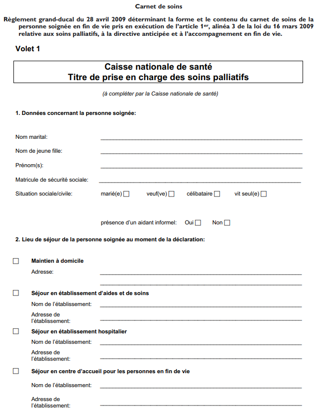
>
> 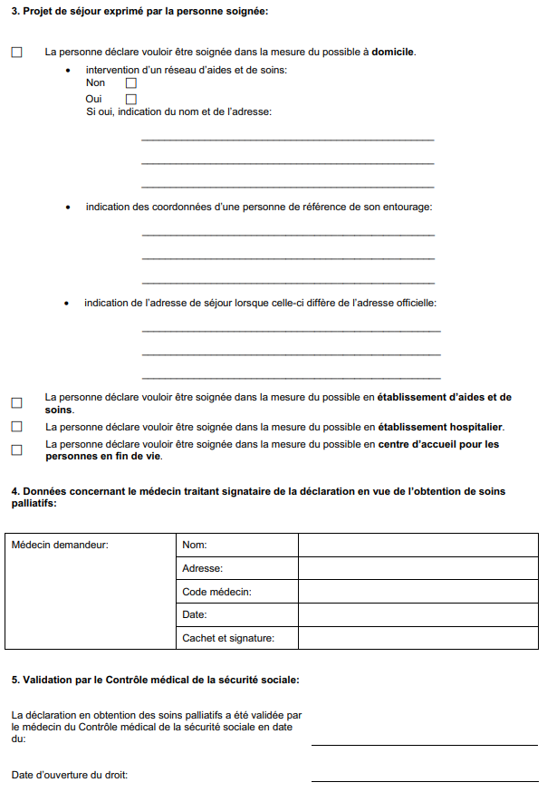
>
> 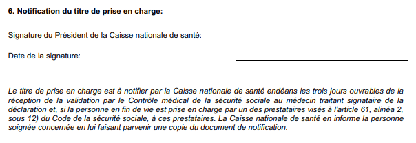
>
> 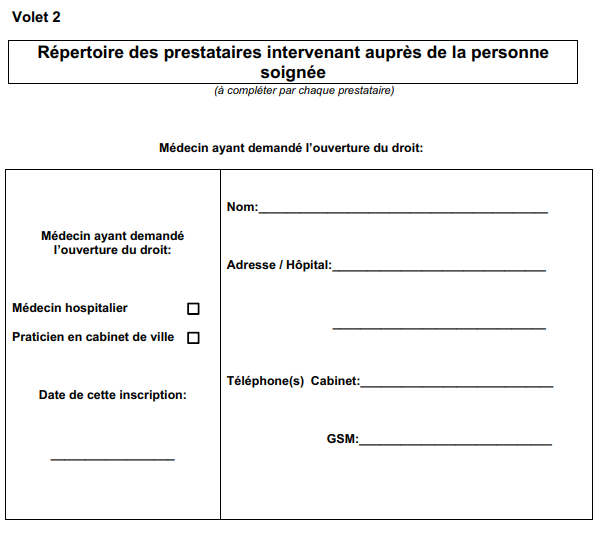
>
> 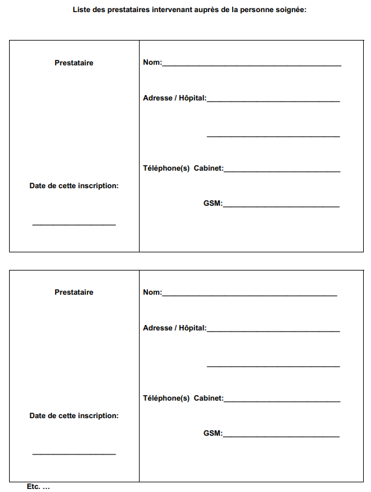
>
> 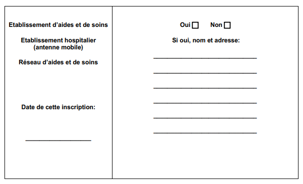
>
> 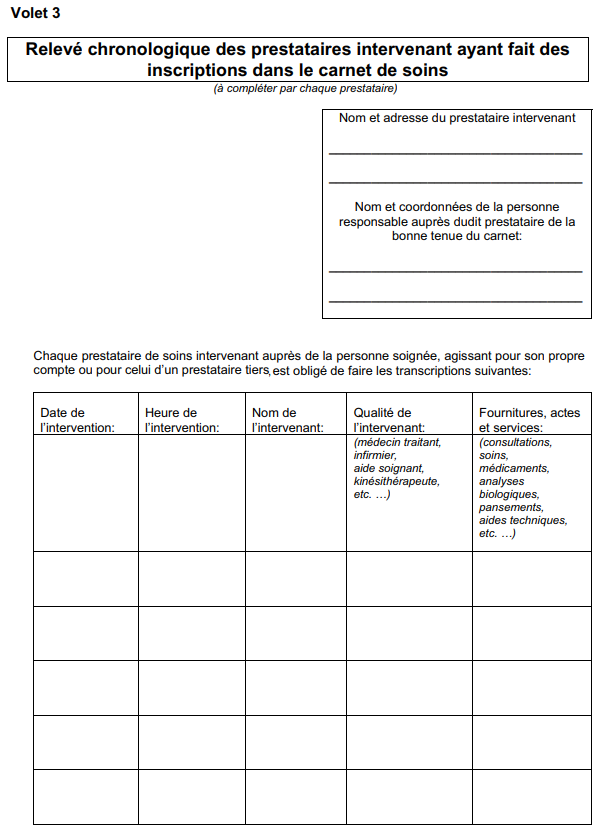

## HÔPITAUX - LÉGISLATION HOSPITALIÈRE

### DISPOSITIONS GÉNÉRALES

#### Version consolidée applicable au 01/02/2026 : Version consolidée applicable au 19/10/2021 : Loi du 8 mars 2018 relative aux établissements hospitaliers et à la planification hospitalière, et portant modification : 1. du Code de la sécurité sociale ; 2. de la loi modifiée du 21 novembre 1980 portant organisation de la Direction de la santé ; 3. de la loi modifiée du 16 juillet 1984 relative aux laboratoires d’analyses médicales ; 4. de la loi du 19 décembre 2003 portant création de l’établissement public « Centre national de rééducation fonctionnelle et de réadaptation » ; 5. de la loi du 7 août 2012 portant création de l’établissement public « Laboratoire national de santé » ; 6. de la loi du 24 juillet 2014 relative aux droits et obligations du patient ; 7. de la loi modifiée du 25 mars 2015 fixant le régime des traitements et les conditions et modalités d’avancement des fonctionnaires de l’État.

##### Art. 1er.

(1) La présente loi est applicable :

1\. aux hôpitaux ;

2\. aux établissements d’accueil pour personnes en fin de vie ;

3\. aux établissements de cures thermales ;

4\. aux centres de diagnostic ;

qu’ils soient gérés par une personne morale de droit public ou de droit privé.

Les établissements visés aux points 1. à 4. sont désignés par l’expression « établissement hospitalier ».

(2) Les établissements hospitaliers ont pour mission de dispenser dans leur domaine d’activités des soins de santé stationnaires ou ambulatoires dans un contexte pluridisciplinaire, dans les conditions de soins et le cadre médical, médico-technique, professionnel et logistique requis et appropriés, pour ou à des patients qui y sont admis parce que leur état de santé exige cet ensemble de soins afin de traiter ou de soulager la maladie, de rétablir ou d’améliorer l’état de santé ou de stabiliser les lésions dans les plus brefs délais.

Ils peuvent être autorisés par le ministre ayant la Santé dans ses attributions, dénommé ci-après « le ministre », à accomplir une mission d’enseignement et de recherche en matière de santé ou toute autre mission de santé publique.

Les établissements hospitaliers doivent disposer d’une personnalité juridique.

(3) Est considéré comme :

1\. « hôpital », tout établissement ayant principalement une mission de diagnostic, de surveillance et de traitement relevant de la médecine, de la chirurgie ou de l’obstétrique ainsi que de soins préventifs et palliatifs et disposant de services dans lesquels les patients sont admis ;

2\. « centre hospitalier », tout hôpital assurant une large offre de prises en charge diagnostiques et thérapeutiques ;

3\. « établissement hospitalier spécialisé », tout hôpital qui répond aux besoins spécifiques de certaines prises en charge diagnostiques et thérapeutiques ou à des affections particulières ;

4\. « établissement d’accueil pour personnes en fin de vie », tout établissement qui a pour mission principale de dispenser des soins stationnaires à des personnes en phase avancée ou terminale d’une affection grave et incurable, à l’exclusion de soins à visée essentiellement curative ;

5\. « établissement de cures thermales », tout établissement qui a pour mission de dispenser des cures thérapeutiques ;

6\. « centre de diagnostic », tout établissement qui répond à des besoins spécifiques de certaines prises en charge diagnostiques de patients, y compris les analyses de biologie médicale conformément à l’article 1erde la [loi modifiée du 16 juillet 1984](https://legilux.public.lu/eli/etat/leg/loi/1984/07/16/n1/jo) relative aux laboratoires d’analyses médicales, à l’exclusion de tous les traitements et soins.

(4) Dans le cadre de l’exercice d’activités réservées à une profession réglementée du domaine de la santé, l’utilisation des termes « hôpital », « clinique », « centre de diagnostic » ou de tout autre terme pouvant être confondu avec ces trois termes dans la dénomination sur les notes d’honoraires ou dans des actes officiels est réservée aux établissements hospitaliers autorisés conformément à l’article 7.

##### Art. 2.

(1) Sont considérés comme :

1\. « unité de soins » : une unité fonctionnelle soit d’hospitalisation, soit médico-technique, prenant en charge des patients, située dans une même enceinte architecturale et relevant d’une dotation et d’une gestion communes ;

2\. « service hospitalier » : unité d’organisation et de gestion comportant une ou plusieurs unités de soins où s’exerce l’activité médico-soignante de l’hôpital ;

3\. « service national » : service hospitalier unique pour le pays regroupant les pathologies nécessitant le recours à des compétences, des équipements ou des infrastructures spécifiques. Il garantit la continuité des soins sur le plan national ;

4\. « lits » : les lits hospitaliers qui sont de façon continue à la disposition des patients dans les services hospitaliers, en distinguant entre :

a) lits aigus ;

b) lits de moyen séjour ;

c) lits d’hospitalisation de longue durée ;

d) lits de réserve sanitaire.

Les lits d’hospitalisation de jour et lits-portes ne sont pas considérés comme lits au sens de l’alinéa qui précède ;

5\. « lits aigus » : les lits, y compris les lits de soins intensifs, hormis les lits de moyen séjour et les lits d’hospitalisation de longue durée, les lits de soins intensifs étant des lits réservés aux patients nécessitant des soins intensifs ;

6\. « lits de moyen séjour » : lits réservés à la rééducation et à la réhabilitation de patients ainsi que les lits de soins palliatifs ;

On entend par « lits de rééducation et de réhabilitation » : lits de moyen séjour des établissements hospitaliers et des services hospitaliers ayant pour mission la rééducation ou la réhabilitation sous ses différentes formes, que sont la rééducation et la réhabilitation fonctionnelle, la rééducation gériatrique, la réhabilitation physique et post-oncologique, la réhabilitation et la réadaptation de malades souffrant de troubles psychiques.

7\. « lits d’hospitalisation de longue durée » : lits réservés aux soins hospitaliers de longue durée destinés aux patients souffrant de restrictions fonctionnelles justifiant une surveillance médicale, une prise en charge de même que des soins particuliers et continus par du personnel spécifiquement qualifié ainsi que des traitements d’entretien ;

8\. « lits d’hospitalisation de jour » : lits d’hôpital ou places situés dans un hôpital de jour ou un service de dialyse, réservés aux activités suivantes :

a) actes chirurgicaux ou interventionnels nécessitant une surveillance et des soins pré- ou post-interventionnels ;

b) autres actes diagnostiques et thérapeutiques avec ou sans sédation majeure, à savoir :

aash explorations fonctionnelles et endoscopiques ;

bash imagerie interventionnelle ;

cash ponctions et biopsies non-chirurgicales ;

c) diverses prises en charge thérapeutiques :

aash épuration extra-rénale ;

bash chimiothérapie, antibiothérapie, immunothérapie intraveineuses ;

cash transfusion de produits et dérivés sanguins cytaphérèse ;

dash traitements et prise en charge de situations spécifiques ;

d) soins de rééducation psychiatrique adulte, juvénile ou infantile ;

e) soins de revalidation, y compris gériatrique.

9\. « lits-portes » : lits d’hôpital ou places situés dans l’enceinte d’un service d’urgence, exclusivement à la disposition des prises en charge urgentes nécessitant une présence médicale et une présence continue par du personnel soignant spécifiquement qualifié pendant une durée inférieure à 12 heures ;

10\. « lits de réserve sanitaire » : lits hospitaliers aigus ou de moyen séjour dédiés à la prise en charge de patients dans le cadre d’une crise sanitaire, d’une catastrophe, d’une crise internationale grave, d’une pandémie, d’un acte de terrorisme ou d’un accident de grande envergure, qui nécessite le recours à des compétences, des ressources humaines, des équipements ou des infrastructures spécifiques ;

11\. « site » : zone accueillant un ou plusieurs bâtiments exploités par un même organisme gestionnaire et dans laquelle la distance entre un bâtiment et le bâtiment le plus proche ne dépasse pas 500 mètres.

(2) Le nombre maximum de lits par catégories de lits pouvant être autorisé au niveau national est fixé à l’annexe 1 .

La dénomination des différents types de service, les normes essentielles y afférentes, le nombre maximal au niveau national par type de service, le nombre minimal de lits par service et le nombre maximal de lits au niveau national par type de service figurent à l’annexe 2 à l’exception des lits visés au paragraphe 1er, point 10 .

##### Art. 3.

(1) Le ministre procède à une évaluation des besoins sanitaires de la population résidente et non-résidente protégée sur base des données établies par la carte sanitaire, d’une évaluation démographique de la population résidente, de données relatives à l’état de santé de cette population ainsi que d’une comparaison internationale. Cette évaluation des besoins sanitaires nationaux a pour objectifs de :

1\. définir les besoins au niveau national en établissements hospitaliers et en réseaux de compétences ;

2\. définir les services hospitaliers autorisés et fixer leur nombre maximal au niveau national ;

3\. fixer au niveau national un nombre maximal de lits pour l’ensemble des services de même dénomination, le nombre maximal de lits pouvant être autorisé.

(2) La carte sanitaire est un ensemble d’informations établi et mis à jour tous les deux ans par l’Observatoire national de la santé et constitué par :

1\. l’inventaire de tous les établissements hospitaliers existants, de leurs services, de leur agencement général, du niveau de qualité des prestations et de leur taux d’utilisation ;

2\. l’inventaire des réseaux de compétences, de leurs services hospitaliers et de leurs membres extrahospitaliers, de leur organisation générale, du niveau de qualité des prestations et de leur taux d’utilisation ;

3\. les motifs d’hospitalisation stationnaire et ambulatoire des patients admis dans un établissement hospitalier ;

4\. le relevé des médecins agréés, de leur spécialité, des professions de santé et du personnel administratif et technique desdits établissements ;

5\. l’inventaire des équipements et appareils soumis à une planification nationale ou exigeant des conditions d’emploi particulières ;

6\. l’inventaire des établissements ou services prestataires en milieu extrahospitalier collaborant activement avec le secteur hospitalier dans le cadre de réseaux de compétences ;

7\. l’inventaire des services d’urgence et des modalités de prise en charge qui y sont proposées ;

8\. le nombre et les motifs des transferts ou hospitalisations dans des établissements qui se trouvent à l’étranger ;

9\. l’utilisation des prestations des établissements hospitaliers nationaux par des non-résidents.

Tous les établissements hospitaliers doivent fournir les renseignements nécessaires à l’élaboration de la carte sanitaire et à sa mise à jour biennale. À défaut de ce faire, le ministre n’accordera pas ou, le cas échéant, ne prorogera pas les autorisations dont question aux articles 7, 9 et 11.

(3) Le ministre doit recourir aux données dépersonnalisées des administrations publiques, des établissements publics ou d’autres organismes luxembourgeois ou étrangers, ainsi que des différents établissements hospitaliers, relatives :

1\. aux séjours hospitaliers: données démographiques des patients, diagnostics, procédures médicales et des autres professions de santé, services d’hospitalisation et durée de séjour, mode d’entrée, provenance, mode de sortie, destination du patient après sortie ;

2\. à l’utilisation des lits, lits d’hospitalisation de jour et équipements médicaux des établissements hospitaliers: la fréquence des différentes prestations par patient hospitalisé et ambulatoire, nombre de patients ;

3\. à l’utilisation des services d’urgence: fréquence et distribution du recours à ces services, caractéristiques démographiques des patients et du degré d’urgence, mode d’entrée, provenance, mode de sortie et destination après sortie, taux d’utilisation des lits-portes au service d’urgence ;

4\. à la fréquence et aux motifs d’un transfert à un établissement hospitalier situé à l’étranger ;

5\. aux délais d’attente pour toutes les prestations hospitalières.

##### Art. 4.

(1) La gestion d’un hôpital ainsi que son exploitation sont assurées par un même organisme gestionnaire.

Un centre hospitalier peut être exploité sur un ou plusieurs sites.

Quatre centres hospitaliers peuvent être autorisés au maximum par le ministre. Chaque centre hospitalier dispose au maximum de trois sites hospitaliers et participe au service d’urgence sur un seul de ses sites.

Par dérogation à l’alinéa 3 et dans les limites visées à l’article 9, paragraphe 6, chaque centre hospitalier peut disposer de sites supplémentaires dédiés aux soins de santé ambulatoires dans le cadre des services visés au paragraphe 2, points 2 et 6 pour les interventions légères en ophtalmologie et en dermatologie, ainsi qu’aux points 3, 7 et 8 et au paragraphe 3, point 5. Pour les sites supplémentaires, un centre hospitalier peut conclure avec un ou plusieurs médecins autorisés à exercer la médecine en vertu de la [loi modifiée du 29 avril 1983](https://legilux.public.lu/eli/etat/leg/loi/1983/04/29/n1/jo) relative à l’exercice de la profession de médecin, de médecin-dentiste et de médecin-vétérinaire un contrat précisant les modalités de gestion et d’utilisation des équipements et appareils visés à l’annexe 3, ainsi que des parties d’infrastructures les hébergeant.

Un centre hospitalier doit disposer de 300 lits aigus au moins et peut être autorisé à exploiter 700 lits aigus au maximum. Il exploite des lits aigus sur au maximum deux sites hospitaliers. Pour chaque centre hospitalier, le nombre exact de lits est arrêté dans l’autorisation d’exploitation.

(2) Tout centre hospitalier doit obligatoirement disposer d’une autorisation d’exploitation pour les services hospitaliers suivants, dans le respect des dispositions de l’annexe 2 :

1\. Cardiologie

2\. Chirurgie générale, digestive ou viscérale

3\. Dialyse

4\. Gastroentérologie

5\. Gériatrie aiguë

6\. Hospitalisation de jour chirurgicale

7\. Hospitalisation de jour non chirurgicale

8\. Imagerie médicale

9\. Médecine interne générale

10\. Neurologie

11\. Obstétrique

12\. ORL

13\. Pneumologie

14\. Psychiatrie aiguë

15\. Soins intensifs et anesthésie

16\. Soins palliatifs

17\. Traumatologie et orthopédie

18\. Urgence

19\. Urologie

Les centres hospitaliers, qui ne disposent pas du service national de néphrologie, doivent disposer d’un service de dialyse.

(3) Chaque centre hospitalier peut exploiter un des services hospitaliers suivants, dans le respect des dispositions de l’annexe 2 et dans la limite du nombre maximal autorisable au niveau national :

1\. Chirurgie esthétique

2\. Chirurgie vasculaire

3\. Gynécologie

4\. Neuro-vasculaire (stroke unit niveau 1)

5\. Oncologie

6\. Pédiatrie de proximité

7\. Rééducation gériatrique

Les centres hospitaliers, qui ne disposent pas du service national de pédiatrie spécialisée, peuvent être autorisés à exploiter un service de pédiatrie de proximité. Les centres hospitaliers, qui ne disposent pas du service national de chirurgie plastique, peuvent être autorisés à exploiter un service de chirurgie esthétique.

(4) Chacun des services hospitaliers suivants est qualifié de « service national » et, en tant que tel, son exploitation ne peut être autorisée que dans un seul hôpital :

1\. Chirurgie pédiatrique

2\. Chirurgie plastique

3\. Hémato-oncologie

4\. Hospitalisation de longue durée médicale

5\. Immuno-allergologie

6\. Maladies infectieuses

7\. Médecine de l’environnement

8\. Néonatologie intensive

9\. Néphrologie

10\. Neurochirurgie

11\. Stroke unit niveau 2

12\. Ophtalmologie spécialisée

13\. Pédiatrie spécialisée

14\. Procréation médicalement assistée

15\. Psychiatrie infantile

16\. Psychiatrie juvénile

17\. Soins intensifs pédiatriques

18\. Urgence pédiatrique

Les services de chirurgie pédiatrique, de néonatologie intensive, de pédiatrie spécialisée, de procréation médicalement assistée, de soins intensifs pédiatriques et d’urgence pédiatrique sont obligatoirement réunis dans un même centre hospitalier disposant d’une maternité de niveau 2, telle que définie à l’annexe 2.

(5) Un centre hospitalier qui en fait la demande peut être autorisé à exploiter 30 à 70 lits de moyen séjour dans le domaine de la rééducation gériatrique.

Un seul centre hospitalier peut être autorisé à exploiter 20 lits d’hospitalisation de longue durée au maximum.

(6) Les centres hospitaliers sont obligés de participer au service de garde.

Ils conviennent entre eux de l’établissement du plan du service de garde, le directeur de la Santé entendu en son avis. Ils communiquent ce plan pour approbation au ministre, six mois à l’avance et pour une période semestrielle. Le plan indique la personne responsable de l’organisation du service de garde de chaque centre hospitalier. Tout changement à ce plan est immédiatement communiqué au ministre, qui est censé ratifier le changement, à moins de faire connaître sans délai son opposition. Dans ce cas, il doit prendre les mesures propres à assurer le fonctionnement du service. Si les centres hospitaliers n’arrivent pas à se mettre d’accord sur l’établissement du plan du service de garde, le ministre établit ce plan d’office.

(7) Un règlement grand-ducal précise les exigences auxquelles les services d’urgence doivent répondre en ce qui concerne leur équipement et la présence effective ou la disponibilité du personnel médical et soignant, ainsi que les modalités suivant lesquelles ces services assurent la prise en charge des urgences.

(8) En cas de besoins sanitaires liés à tout type de catastrophes ou d’une crise internationale grave , de pandémies, d’actes de terrorisme ou d’accidents de grande envergure déclarés par une décision du Gouvernement en conseil ou de catastrophe, le ministre ou le membre du Gouvernement qui le remplace en cas d’empêchement peut prendre toutes les mesures que la situation exige, et même ordonner la réquisition des établissements hospitaliers et du personnel médical, soignant et technique qui leur est attaché. La réquisition est faite oralement ou par écrit à un responsable de l’établissement. Elle comporte pour celui-ci l’obligation d’avertir, en spécifiant qu’il agit sur ordre du ministre, un nombre suffisant de médecins et de membres du personnel soignant et technique pour assurer le service qui est demandé à l’établissement. Toute prestation effectuée en vertu de la réquisition par un établissement hospitalier ou par un médecin donne droit à une indemnisation. Si celle-ci ne peut pas être obtenue de la part de la personne qui a bénéficié de la prestation ou de l’organisme de sécurité sociale dont elle relève, elle est à charge de l’État.

Dans les hypothèses visées à l’alinéa 1er, le ministre peut également autoriser les établissements hospitaliers qu’il désigne, à exploiter le nombre de lits de réserve sanitaire qu’il estime nécessaire et ce en dépassement du nombre maximum de lits autorisables au titre des articles 4 et 5, de l’annexe 1 et 2 ainsi que du nombre maximum de lits retenus dans les différentes autorisations d’exploitation et de services des établissements hospitaliers. Ces lits peuvent être exploités soit dans un ou plusieurs services hospitaliers autorisés conformément à l’annexe 2, soit dans un service hospitalier spécifique y dédié et non prévu à l’annexe 2.

Dans les hypothèses visées à l’alinéa 1er, le ministre peut également autoriser un hôpital à acquérir, détenir ou utiliser temporairement tout équipement national au-delà du nombre maximal déterminé à l’annexe 3 ou tout équipement de plus de 250 000 euros nécessaire à la gestion d’un tel événement sans devoir se soumettre à la procédure prévue à l’article 14, paragraphe 2.

Les moyens financiers, structurels, en ressources humaines nécessaires à l’exploitation des lits de réserve sanitaire autorisés selon l’alinéa 2 et les équipements autorisés selon l’alinéa 4 sont à charge du budget de l’État.

##### Art. 5.

(1) Les services hospitaliers nationaux suivants peuvent constituer un établissement hospitalier spécialisé de :

1\. cardiologie interventionnelle et chirurgie cardiaque avec un nombre maximum de 30 lits aigus pouvant y être autorisé ;

2\. radiothérapie avec un nombre maximum de 2 lits aigus pouvant y être autorisé.

(2) L’établissement public dénommé « Centre hospitalier neuropsychiatrique » constitue un établissement hospitalier spécialisé en réhabilitation psychiatrique et exploite le service national de réhabilitation psychiatrique ainsi que le service d’hospitalisation de longue durée psychiatrique. Le nombre maximum de lits pouvant y être autorisé ne peut être supérieur à 240 lits de moyen séjour et 140 lits d’hospitalisation de longue durée.

(3) L’établissement public dénommé « Centre national de rééducation fonctionnelle et de réadaptation » constitue un établissement hospitalier spécialisé en rééducation fonctionnelle et exploite le service national de rééducation fonctionnelle. Le nombre maximum de lits pouvant y être autorisé ne peut être supérieur à 150 lits de moyen séjour.

(4) Outre les services de rééducation gériatrique autorisés dans les hôpitaux, le ministre peut autoriser un établissement hospitalier spécialisé en rééducation gériatrique à exploiter un service de rééducation gériatrique. Le nombre maximum de lits pouvant y être autorisé ne peut être supérieur à 40 lits de moyen séjour.

(5) Le ministre peut autoriser au maximum un établissement hospitalier spécialisé en réhabilitation physique et post-oncologique qui exploite les services nationaux de réhabilitation physique et de réhabilitation post-oncologique. Le nombre maximum de lits pouvant y être autorisé ne peut être supérieur à 60 lits de moyen séjour.

(6) Pour chaque établissement hospitalier spécialisé, le nombre exact de lits autorisés est arrêté dans l’autorisation d’exploitation. Les établissements hospitaliers spécialisés visés aux paragraphes 2 à 5 doivent disposer de 30 lits au moins.

##### Art. 6.

(1) Le ministre peut autoriser au maximum un établissement d’accueil pour personnes en fin de vie. Le nombre maximum de lits de cet établissement pouvant être autorisé ne peut être supérieur à 25 lits de moyen séjour. Le nombre exact de lits de l’établissement hospitalier qui est autorisé ci-avant est arrêté dans son autorisation d’exploitation.

(2) Le ministre peut autoriser au maximum un établissement de cures thermales.

(3) À l’exception du centre de diagnostic dans le domaine de la génétique humaine et de l’anatomopathologie visé à l’article 2 de la [loi du 7 août 2012](https://legilux.public.lu/eli/etat/leg/loi/2012/08/07/n1/jo) portant création de l’établissement public « Laboratoire national de santé », aucun centre de diagnostic ne peut être autorisé par le ministre.

Le centre de diagnostic visé à l’alinéa précédent a pour objet de réaliser des examens en ce qui concerne :

a) l’anatomie pathologique : les examens relevant de la cytologie et de l’histologie ;

b) la génétique humaine : les examens portant sur l’hérédité ou non de malformations et d’anomalies, tant physiques que psychiques, la nature moléculaire de ces malformations et anomalies ou le fait d’être porteur de caractères héréditaires, y compris l’interprétation de ces examens et le conseil génétique.

##### Art. 7.

(1) L’exploitation et l’extension de tout établissement hospitalier sont soumises à l’autorisation du ministre conformément à la procédure prévue ci-dessous.

(2) L’organisme gestionnaire de l’établissement hospitalier sollicite, sur base d’un projet d’établissement, une autorisation d’exploitation auprès du ministre qui décide après avoir demandé l’avis du Collège médical et de la Commission permanente pour le secteur hospitalier.

(3) Ce projet d’établissement comporte :

1\. la dénomination de l’établissement hospitalier ;

2\. les objectifs et missions de l’établissement ;

3\. la dénomination et la forme juridique de son organisme gestionnaire ;

4\. l’organigramme général de l’établissement ;

5\. le nombre ainsi que la localisation de ses sites et bâtiments hospitaliers ;

6\. le nombre et le type de lits, y compris les lits d’hospitalisation de jour et de lits-portes, que l’établissement souhaite exploiter ;

7\. le nombre et la localisation des services hospitaliers stationnaires et ambulatoires sollicités ;

8\. les équipements ou les appareils soumis à planification nationale.

Au projet d’établissement est joint l’avis y relatif du Conseil médical.

(4) L’autorisation d’exploitation délivrée par le ministre à un établissement hospitalier reprendra les points 1. à 8. retenus ou rectifiés par le ministre suite à l’examen du projet d’établissement, y compris le nombre de lits autorisés pour chaque service.

(5) Lorsqu’un organisme gestionnaire d’un établissement hospitalier modifie son projet d’établissement, il en avise le ministre, qui décide sur le bien-fondé de cette modification en respectant la procédure prévue au paragraphe 2 du présent article.

(6) Un établissement hospitalier ne peut bénéficier des subventions financières étatiques visées à l’article 15 qu’à condition de disposer d’une autorisation d’exploitation valable.

##### Art. 8.

(1) Sur base de l’évaluation des besoins de santé sanitaires et dans la limite des besoins en lits et services hospitaliers autorisables en vertu de la présente loi, seuls peuvent être autorisés :

1\. des projets de modernisation, d’extension ou de mise en conformité avec des normes de sécurité ou d’hygiène de structures hospitalières existantes ;

2\. des projets de construction nouvelle en remplacement de structures existantes ou résultant de synergies ou de coopérations entre plusieurs établissements hospitaliers existants entraînant une désaffectation des structures hospitalières remplacées ou leur réaffectation à une destination hospitalière dûment autorisée ;

3\. des projets de construction nouvelle ou de réaménagement ou de transformation de structures existantes visant à développer la prise en charge ambulatoire  .

(2) Seuls les projets mentionnés aux points 1. à 3. sont financés par le biais du fonds pour le financement des infrastructures hospitalières au titre de l’article 15.

##### Art. 9.

(1) L’exploitation d’un service hospitalier ainsi que toute demande de création, d’extension ou de modernisation d’un service hospitalier ou de prorogation d’autorisation d’un service hospitalier doit être soumise par l’organisme gestionnaire de l’établissement hospitalier pour autorisation au ministre qui décide après avoir demandé l’avis du Collège médical et de la Commission permanente pour le secteur hospitalier.

(2) Par extension d’un service hospitalier, on entend l’augmentation des surfaces architecturales destinées à l’accueil et au séjour des patients ou l’augmentation du nombre des lits. Une extension limitée en mètres carrés pour des petits travaux d’agrandissement de fonctions existantes, et qui ne donnent pas lieu à de nouvelles fonctionnalités, n’est pas considérée comme une extension de service.

(3) Par modernisation d’un service hospitalier, on entend les adaptations nécessaires pour que ce service puisse se conformer aux normes de sécurité ou d’hygiène, aux critères contenus dans les définitions de services visés à l’annexe 2 ou dans les normes réglementaires prévues à l’article 10.

(4) La demande d’exploitation d’un service doit être accompagnée, pour chaque service hospitalier, d’un projet de service cohérent avec le projet d’établissement visé à l’article 7 et respectant les critères fixés dans les définitions de services prévues à l’annexe 2 ainsi que d’autres normes déterminées par règlement grand-ducal conformément à l’article 10.

(5) Ce projet de service comporte :

1\. la dénomination du service, le type de patients et de pathologies pris en charge et le volume d’activités attendu ;

2\. les unités de soins au sens de l’article 2, stationnaires, ambulatoires, médico-techniques ou autres qui le constituent ainsi que les liens organisationnels et fonctionnels entre elles et avec d’autres services hospitaliers ;

3\. les ressources humaines, l’organigramme, les équipements y affectés spécifiquement, le nombre de lits et le type de lits ainsi que le nombre de lits d’hospitalisation de jour ou de lits-portes ;

4\. la localisation principale du service et de ses antennes éventuelles sur un ou plusieurs sites hospitaliers ;

5\. l’organisation et les moyens mis en place pour assurer la continuité des soins ;

6\. la prise en charge dans laquelle les activités médicales et chirurgicales du service s’inscrivent ;

7\. le volume d’activités en cas d’extension et de modernisation d’un service hospitalier ou de prorogation d’autorisation d’un service hospitalier ;

8\. la politique d’admission, de transfert et de sortie de patients.

Au projet de service est joint l’avis y relatif du Conseil médical.

(6) Chaque établissement hospitalier ne peut disposer que d’un seul service hospitalier de la même nature et sur un site unique. Toutefois, lorsqu’il s’agit d’un établissement multi-sites, un service hospitalier autorisé peut comprendre une unité de soins située sur un autre site hospitalier du même établissement hospitalier. Dans ce cas, l’unité est considérée comme une « antenne de service ». Un centre hospitalier peut disposer de deux antennes supplémentaires par service visé à l’article 4, paragraphe 1er, alinéa 4.

(7) L’antenne de service répond aux conditions ci-après :

1\. assurer une amélioration objective de l’accessibilité des soins prodigués par le service hospitalier correspondant ;

2\. être en liaison fonctionnelle étroite avec le service hospitalier ;

3\. disposer de la même équipe de médecins spécialisés pour assurer la continuité des soins dans le service hospitalier et son « antenne », et appliquer les mêmes procédures de prise en charge.

Une « antenne de service » peut également être exploitée par un établissement hospitalier ne disposant pas du service hospitalier en question, sur base d’une convention de collaboration interhospitalière avec un établissement hospitalier disposant d’un tel service, dont le projet de service reprend les modalités de cette collaboration.

(8) Un établissement hospitalier ne peut bénéficier des subventions financières étatiques visées à l’article 15 au profit des services hospitaliers qu’à condition de disposer d’une autorisation d’exploitation valable.

##### Art. 10.

Les normes des services hospitaliers mentionnées aux articles 4 et 5 et qui figurent à l’annexe 2 peuvent être précisées par règlement grand-ducal en ce qui concerne :

1\. l’aménagement, l’organisation générale ainsi que le taux d’occupation du service ;

2\. les effectifs médicaux requis, les spécialités médicales concernées, les professionnels de santé et leur dotation ;

3\. le niveau de continuité de service à respecter ;

4\. l’environnement, l’infrastructure et l’architecture requis sur le site hospitalier abritant le service, dont la disponibilité d’autres services et de compétences médicales et professionnelles extérieures au service ;

5\. les procédures, les activités ainsi que les modalités de documentation de l’activité et de l’évaluation des résultats d’activité ;

6\. la politique d’admission, de transfert et de sortie de patients.

##### Art. 11.

(1) La première autorisation d’exploitation d’un établissement hospitalier ou d’un service hospitalier, suite à la procédure prévue aux articles 7 et 9, est accordée pour une durée maximale de cinq ans.

(2) Les autorisations mentionnées au paragraphe précédent sont prorogées à chaque fois pour une durée maximale de cinq ans. L’autorisation d’exploitation d’un établissement hospitalier peut être adaptée avant l’échéance de cinq ans. Au cas où un organisme gestionnaire modifie son projet d’établissement ou de service, et que ce changement affecte les conditions de l’autorisation d’exploitation, il sollicite une adaptation de son autorisation d’exploitation avant son délai d’échéance.

(3) La demande de prorogation est faite par l’organisme gestionnaire moyennant une lettre recommandée à adresser au ministre au plus tard six mois avant l’échéance de l’autorisation.

À l’appui de la demande visée à l’alinéa qui précède, l’organisme gestionnaire doit établir :

1\. pour la prorogation de l’autorisation d’exploitation, que l’établissement hospitalier continue à respecter, son projet d’établissement ;

2\. pour la prorogation des autorisations de services hospitaliers, que l’établissement hospitalier continue à respecter, toutes les prescriptions des définitions des services mentionnées à l’annexe 2 ainsi que les normes réglementaires fixées conformément à l’article 10.

(4) Sans préjudice du paragraphe 2 et de l’article 12 ci-après et après avoir demandé l’avis du Collège médical et de la Commission permanente pour le secteur hospitalier, le ministre peut refuser :

1\. l’autorisation d’exploitation d’un établissement hospitalier ou sa prorogation s’il ne respecte plus son projet d’établissement ou s’il ne répond plus aux besoins sanitaires nationaux ;

2\. l’autorisation d’exploitation d’un service hospitalier ou sa prorogation s’il ne répond pas aux prescriptions des définitions mentionnées à l’annexe 2, aux normes déterminées conformément à l’article 10 ou aux besoins sanitaires nationaux.

(5) En cas de non-prorogation de l’autorisation d’exploitation d’un établissement hospitalier ou d’un service hospitalier ou de fermeture d’un site hospitalier, le ministre fixe le délai endéans lequel l’établissement hospitalier, le service hospitalier ou le site hospitalier doit être fermé. Ce délai est de deux ans au maximum dans le cas de la fermeture d’un établissement hospitalier ou d’un site hospitalier. Dans le cas d’un service hospitalier, ce délai est d’un an au maximum.

(6) Aux termes des délais visés au paragraphe précédent, l’organisme gestionnaire doit cesser l’exploitation de l’établissement hospitalier, du service hospitalier ou toute activité sur le site hospitalier.

##### Art. 12.

(1) Lorsqu’il appert, au vu d’un rapport du directeur de la Santé, qu’un établissement ou service hospitalier :

1\. ne répond pas aux conditions mentionnées aux définitions de l’annexe 2 ou aux normes déterminées conformément à l’article 10, ou

2\. ne dispose pas des autorisations d’exploitation requises en vertu des articles 7 et 9 ;

3\. contrevient aux autres dispositions de la présente loi ;

4\. ne répond plus aux besoins sanitaires déterminés conformément à l’article 3 ;

le ministre met l’organisme gestionnaire de l’établissement concerné en demeure de se conformer aux procédures, définitions et normes dans un délai qu’il fixera et qui sera inférieur à un an.

(2) Passé ce délai et à défaut par l’organisme gestionnaire de s’être conformé aux prescriptions, le ministre peut ordonner endéans les délais prévus à l’article 11, paragraphe 5, la fermeture de l’établissement ou du service après avis du Collège médical et de la Commission permanente pour le secteur hospitalier. Ces avis doivent être fournis dans le mois de leur saisine.

(3) Lorsque des raisons urgentes de santé publique le justifient, le ministre, au vu d’un rapport du directeur de la Santé et après avoir entendu l’organisme gestionnaire concerné, peut ordonner, par décision motivée et à titre provisoire, la fermeture immédiate d’un établissement hospitalier ou d’un service hospitalier. Le ministre en informe immédiatement le Collège médical et la Commission permanente pour le secteur hospitalier. Ceux-ci doivent fournir leurs avis dans un délai d’un mois. Après avoir reçu communication de l’avis du Collège médical et de la Commission permanente pour le secteur hospitalier, le ministre prend une décision définitive dans le délai d’un mois. La décision est notifiée à l’intéressé par lettre recommandée.

##### Art. 13.

L’organisme gestionnaire qui veut cesser l’exploitation totale d’un établissement hospitalier ou d’un service hospitalier doit en aviser au préalable le ministre au moins un an à l’avance. Ce délai peut être abrégé par le ministre à la demande de l’organisme gestionnaire si aucune raison majeure de santé publique ne s’y oppose.

##### Art. 14.

(1) Les équipements et appareils utilisés en vue d’une prise en charge médicale , qui soit en raison de leur coût dépassant 250.000 euros HTVA valeur à neuf, soit en raison du personnel hautement qualifié que leur utilisation requiert , soit exigeant des conditions d’emploi particulières, sont réservés aux centres hospitaliers sur leurs sites visés à l’article 4 . Les équipements et appareils utilisés en vue d’une prise en charge médicale nécessitant une planification nationale sont limités par un nombre maximum. Les équipements et appareils utilisés en vue d’une prise en charge médicale nécessitant une planification nationale, du personnel hautement qualifié ou des conditions d’emploi particulières sont déterminés à l’annexe 3.

Ne sont pas visés par l’alinéa 1er, les laboratoires d’analyses médicales au sens de la [loi modifiée du 16 juillet 1984](https://legilux.public.lu/eli/etat/leg/loi/1984/07/16/n1/jo) relative aux laboratoires d’analyses médicales.

(2) Tout établissement hospitalier ayant l'intention d'acquérir ou d’utiliser un appareil ou un équipement hospitalier mentionné au paragraphe 1er ou un équipement ou appareil médical dont le coût dépasse 250.000 euros doit soumettre son projet à l'autorisation du ministre qui sollicite l'avis de la Commission permanente pour le secteur hospitalier. La demande d’autorisation doit être accompagnée d’une analyse des coûts et des charges du personnel qui utilise cet équipement ou appareil, des coûts de formation de ce personnel et des coûts d’entretien relatifs à cet équipement ou appareil.

(3) Le choix des établissements hospitaliers dans lesquels peuvent être installés les équipements prévus au paragraphe 1er se fait en fonction d’une activité correspondante adéquate ainsi que de l’attribution des services hospitaliers dont ils relèvent, pour ce qui est des équipements uniques, de la disponibilité d’autres équipements et ressources indispensables ou utiles au fonctionnement de l’équipement à installer.

(4) L’autorisation d’exploitation de chaque établissement mentionnera le lieu d’installation des appareils et équipements visés au paragraphe 1er.

(5) Un règlement grand-ducal peut déterminer les conditions d’accès et d’utilisation des appareils et équipements médicaux mentionnés au paragraphe 1er par des usagers extérieurs à l’établissement propriétaire, le Collège médical et la Commission permanente pour le secteur hospitalier demandés en leurs avis.

##### Art. 15.

L’État participe à raison de 80 pour cent aux frais des investissements mobiliers et immobiliers des établissements hospitaliers autorisés par le ministre conformément à l’article 17, la Commission permanente pour le secteur hospitalier demandée en son avis et qui ont trait :

1\. aux équipements et appareils dont question à l’article 14, paragraphe 1er , et soumis à planification nationale ;

2\. aux projets visés aux points 1. à 3. de l’article 8 :

a) lorsqu’un tel projet concerne un centre hospitalier et dépasse un montant de 500.000 euros hors TVA ;

b) lorsqu’un tel projet concerne un établissement hospitalier spécialisé mentionné à l’article 5 ou un autre établissement hospitalier mentionné à l’article 6 et dépasse un montant de 250.000 euros hors TVA.

##### Art. 16.

(1) Sur décision de leurs organismes gestionnaires respectifs, des établissements hospitaliers peuvent mettre en commun des activités et bénéficier à ce titre des subventions prévues à l’article qui précède, lorsqu’ils procèdent à des investissements communs.

(2) L’allocation de l’aide financière pour les projets en commun suit les mêmes règles que pour les projets individuels des établissements hospitaliers, en ce qui concerne la définition des parties subventionnables et des besoins des établissements hospitaliers.

##### Art. 17.

(1) En vue d’obtenir une subvention conformément aux dispositions qui précèdent, la direction d’un établissement hospitalier doit présenter une demande au ministre. La demande doit être accompagnée des pièces justificatives requises. Elle est instruite par la Commission permanente pour le secteur hospitalier conformément aux dispositions de l’article 22.

(2) Un règlement grand-ducal détermine les modalités détaillées de la procédure de demande, notamment en ce qui concerne :

1\. les délais et modalités d’instruction du dossier ;

2\. les pièces justificatives à joindre ;

3\. une étude des besoins et de l’impact sur le système de santé ainsi que l’étendue et les modalités de cette étude.

(3) La subvention est allouée par décision du ministre.

##### Art. 18.

(1) Il est institué un fonds pour le financement des infrastructures hospitalières appelé par la suite « fonds », conformément aux articles 76 et 77 de la [loi modifiée du 8 juin 1999](https://legilux.public.lu/eli/etat/leg/loi/1999/06/08/n2/jo) sur le budget, la comptabilité et la trésorerie de l’État.

Le fonds est destiné à honorer les engagements pris par l’État conformément à l’article 15, point 2. ainsi qu’à l’article 16, y compris les frais financiers .

(2) Les subventions pour équipements et appareils nécessitant une planification nationale ou exigeant des conditions d’emploi particulières qui sont sollicitées par les établissements hospitaliers conformément à l’article 15, point 1., sont à charge du budget de l’État et non du fonds.

(3) Le fonds est placé sous l’autorité du ministre et alimenté par des dotations budgétaires annuelles.

Les dépenses imputables au fonds font l’objet d’une programmation pluriannuelle par le gouvernement.

(4) Les subventions prévues à la présente loi sont accordées sur base de conventions signées avec les maîtres d’ouvrage respectifs telles que prévues à l’article 1er, dernier alinéa de la [loi modifiée du 21 juin 1999](https://legilux.public.lu/eli/etat/leg/loi/1999/06/21/n1/jo) autorisant l’État à participer au financement de la modernisation, de l’aménagement ou de la construction de certains établissements hospitaliers.

Ces conventions prévoient les modalités de contrôle par rapport à la conformité des investissements autorisés et de la liquidation des subventions consenties.

(5) La liquidation, à charge du fonds, des subventions accordées au titre d’un projet d’investissement déterminé est effectuée, le cas échéant, après déduction des avances éventuellement déjà accordées au titre du même projet d’investissement.

(6) Après signature de la convention prévue au paragraphe 4, chaque établissement hospitalier fait parvenir au ministre les factures dont il sollicite le remboursement. Le remboursement des factures payées est à solliciter dans un délai de six mois à compter de la date de paiement ou de la libération de garantie.

Le remboursement des factures payées avant la date de signature de la convention est à solliciter dans un délai de six mois à compter de la date de signature de la convention, sur la base d’un décompte certifié par le réviseur d’entreprises agréé de l’établissement hospitalier.

##### Art. 19.

Pour chaque projet pour lequel la participation étatique visée à l’article 15 dépasse le seuil fixé à l’article 80 de la [loi modifiée du 8 juin 1999](https://legilux.public.lu/eli/etat/leg/loi/1999/06/08/n2/jo) sur le budget, la comptabilité et la trésorerie de l’État, une loi spéciale fixe le montant des subventions à charge du fonds à ne pas dépasser.

##### Art. 20.

(1) Les bénéficiaires des subventions régies par la présente loi perdent les avantages qui leur ont été consentis si, avant l’expiration d’un délai de 5 ans pour les investissements mobiliers et d’un délai de 20 ans pour les investissements immobiliers, à partir de leur octroi, ils :

1\. aliènent à titre onéreux, cèdent ou échangent les biens mobiliers ou immobiliers en vue desquels les subventions ont été consenties, ou

2\. modifient l’affectation originaire des biens mobiliers ou immobiliers.

La perte des avantages est calculée au prorata du temps restant à courir jusqu’à la fin des délais respectifs prévus à l’alinéa 1er.

(2) Sans préjudice des dispositions prévues au paragraphe 1er, les subventions financières restent acquises si les biens mobiliers ou immobiliers continuent d’être affectés à une utilisation poursuivant un objectif de santé publique ou un objectif de service public.

(3) L’organisme gestionnaire d’un établissement hospitalier qui souhaite aliéner à titre onéreux, céder, échanger ou modifier un bien mobilier ou immobilier qui a fait l’objet d’un subventionnement au titre de la présente loi, doit en informer le ministre par lettre recommandée au plus tard trois mois avant l’opération envisagée.

##### Art. 20*bis*.

L’État participe à raison de 80 pour cent aux frais de location des infrastructures mobilières et immobilières qui ont trait aux équipements, appareils ou projets visés aux articles 4, paragraphe 1er, alinéa 4, et 15, à condition qu’ils sont autorisés par le ministre et qu’une subvention en vertu de l’article 17 n’est pas demandée. La participation financière de l’État est à charge du budget de l’État sur base d’un décompte annuel de la Caisse nationale de santé à établir sur les montants payés aux établissements hospitaliers sur base de l’article 78, alinéa 3 du [Code de la sécurité sociale](https://legilux.public.lu/eli/etat/leg/code/securite_sociale).

##### Art. 21.

(1) Le commissaire du Gouvernement aux hôpitaux ci-après dénommé le « commissaire » est nommé par le ministre.

Pour pouvoir être nommé commissaire, le candidat doit remplir les conditions pour l’admission à l’examen-concours d’admission au stage du groupe de traitement A1.

(2) Les missions du commissaire consistent à :

1\. exercer un droit d’information et de contrôle sur l’activité des établissements hospitaliers ainsi que sur leur gestion technique, administrative et financière ;

2\. contrôler le respect des dispositions de la présente loi et de ses règlements d’exécution ;

3\. contrôler l’affectation des subventions publiques versées au titre de l’article 15 ;

4\. faire toute proposition en relation avec une meilleure utilisation des ressources ;

5\. faciliter les projets d’intérêt commun ou de mutualisation des établissements hospitaliers.

Pour l’exécution de sa mission le commissaire peut requérir l’assistance des services d’un établissement hospitalier. Il a le droit, aussi souvent qu’il le juge utile, de demander rapport aux organes de direction et de gestion des établissements hospitaliers ainsi que de prendre connaissance, même sans se déplacer, des livres, comptes et autres documents des établissements hospitaliers.

(3) Le commissaire ou son délégué assiste avec voix consultative aux assemblées générales et aux réunions des organismes gestionnaires de tous les établissements hospitaliers. Les avis de convocation contenant l’ordre du jour de ces assemblées et réunions lui sont adressés en même temps qu’aux membres des organes statutaires. Il obtient tous les documents et renseignements fournis à ces membres. Il doit être entendu en ses observations à chaque fois qu’il le demande.

Le commissaire suspend l’exécution des décisions d’un organisme gestionnaire d’un établissement hospitalier, lorsqu’il estime que celles-ci sont contraires aux lois, aux règlements et aux conventions conclues avec l’État. Il fait acter son veto. Si, dans le mois de la suspension, l’organisme gestionnaire de l’établissement hospitalier visé n’a pas été informé des suites que le ministre a réservées à ce veto, la suspension est présumée levée et la décision peut être mise à exécution.

##### Art. 22.

(1) Une Commission permanente pour le secteur hospitalier, ci-après dénommé « Commission », exerce des fonctions consultatives auprès du ministre et du ministre ayant la Sécurité sociale dans ses attributions et a pour mission d’aviser :

1\. toute modification à la présente loi ;

2\. les demandes de subventions financières des établissements hospitaliers telle que prévues aux articles 15 et 16 ;

3\. les demandes d’autorisation de création, de modernisation ou d’extension d’un établissement hospitalier conformément à l’article 7 ;

4\. les demandes d’autorisation de création, d’extension ou de modernisation d’un service hospitalier conformément à l’article 9 ;

5\. les demandes de prorogation des demandes visées aux points 3 et 4 du présent article et ce conformément à l’article 11 ;

6\. tous les projets de règlements grand-ducaux qui sont applicables aux établissements hospitaliers ;

7\. tout projet de création d’un réseau de compétences conformément à l’article 28.

(2) Dès qu’il apparaît à un maître d’ouvrage qu’un projet de modernisation ou de construction d’un établissement hospitalier financé conformément à l’article 15 dépasse de 5 pour cent le montant global arrêté dans la convention de financement prévue à l’article 18 paragraphe 4, pour autant que ce montant soit supérieur à 50.000 euros, il doit saisir dans les deux mois de cette constatation la Commission qui est demandée une nouvelle fois en son avis sur ce projet avec toutes les pièces justifiant ce dépassement de budget. Le subventionnement de ce dépassement par le fonds est ensuite soumis pour autorisation au ministre.

(3) La Commission peut, de sa propre initiative, proposer aux ministres tous voies et moyens d’ordre sanitaire, financier ou administratif portant amélioration du système et des services hospitaliers.

La Commission peut être demandée en son avis par le ministre ou le ministre ayant la Sécurité sociale dans ses attributions sur toute question relevant du secteur hospitalier.

(4) La Commission se compose :

1\. de deux représentants du ministre dont l’un est le directeur de la Santé ou son représentant ;

2\. de deux représentants du ministre ayant dans ses attributions la Sécurité sociale dont l’un est le directeur du Contrôle médical de la sécurité sociale ou son représentant ;

3\. d’un représentant du ministre ayant dans ses attributions le budget ;

4\. de trois représentants de la Caisse nationale de santé dont l’un est le président ou son représentant ;

5\. de deux représentants proposés par le groupement le plus représentatif des hôpitaux luxembourgeois ;

6\. de deux représentants des professions de la santé dont l’un est médecin proposé par l’association la plus représentative des médecins et médecins-dentistes et l’autre professionnel de santé proposé par le Conseil supérieur de certaines professions de santé.

II y a autant de membres suppléants qu’il y a de membres effectifs.

Les membres effectifs et suppléants sont nommés pour une durée de cinq ans par arrêté grand-ducal sur proposition du ministre.

Le commissaire du Gouvernement aux hôpitaux assiste aux réunions de la Commission avec voix consultative.

(5) La Commission est présidée par le directeur de la Santé ou son représentant. Elle peut se constituer en sous-commissions de travail et s’adjoindre des experts. Les avis de la Commission sont pris dans un délai fixé par le ministre qui ne peut être supérieur à six mois, à la majorité des voix, chaque membre pouvant faire constater son vote au procès-verbal et y faire joindre un exposé de ses motifs. Le vote séparé et l’exposé des motifs sont transmis aux ministres compétents. En cas d’égalité des voix, celle du président est prépondérante.

(6) Si les représentants de la Caisse nationale de santé estiment que la décision à prendre comporte des répercussions financières importantes pour l’assurance maladie-maternité, ils peuvent demander une prolongation du délai fixé afin de faire examiner la proposition soumise par expertise à charge de la Caisse nationale de santé. La prolongation doit être accordée par le ministre et ne saurait être inférieure à trois mois.

(7) Un règlement grand-ducal détermine le fonctionnement de la Commission, les procédures à suivre et l’indemnisation des membres qui n’ont pas le statut d’agent de l’État, y compris celle des experts et du secrétaire administratif.

Les frais de fonctionnement et les indemnités des membres de la Commission sont à charge du budget de l’État.

##### Art. 23.

(1) L’organisme gestionnaire arrête la politique générale, les choix stratégiques et définit les activités de l’établissement. Il exerce le contrôle sur les activités de l’établissement.

(2) Il assume les fonctions suivantes :

1\. il engage et licencie le directeur général ;

2\. il engage et licencie le directeur médical, le directeur des soins et le directeur administratif et financier sur proposition du directeur général ;

3\. il arrête le règlement général de l’établissement hospitalier ;

4\. il arrête le budget annuel et les comptes annuels ;

5\. il arrête le rapport d’activité ;

6\. il approuve les acquisitions, aliénations et échanges d’immeubles ;

7\. il approuve les emprunts ;

8\. il approuve les dons et legs.

(3) Par organisme gestionnaire d’un établissement hospitalier, on entend l’organe qui, selon le statut juridique de l’établissement hospitalier, est chargé de la gestion et de l’exploitation de l’établissement.

(4) La gestion et l’exploitation d’un établissement hospitalier autorisé selon les dispositions de la présente loi ne peuvent être assurées que par un seul gestionnaire. Le Conseil médical de l’établissement hospitalier doit être représenté avec au moins une voix délibérative et une voix consultative au sein de l’organisme gestionnaire. La même représentation doit être garantie pour la délégation du personnel au sein de l’organisme gestionnaire sans préjudice des dispositions des articles L.426-1, L.426-2 et L.426-3 et suivants du [Code du travail](https://legilux.public.lu/eli/etat/leg/loi/2006/07/31/n2/jo) qui s’appliquent aux établissements hospitaliers qui revêtent la forme juridique y visée.

(5) Les membres de l’organisme gestionnaire agissent dans l’intérêt de l’établissement hospitalier.

Ne peuvent devenir membres d’un organisme gestionnaire le ou les fonctionnaires qui, en vertu de leurs fonctions, sont appelés à surveiller ou à contrôler l’établissement hospitalier ou qui, en vertu des pouvoirs leur délégués, approuvent des actes administratifs ou signent des ordonnances de paiement ou d’autres pièces administratives entraînant une dépense de l’État en faveur de l’établissement hospitalier.

Il est interdit à tout membre d’un organisme gestionnaire d’un établissement hospitalier d’être présent aux délibérations sur des objets auxquels il a un intérêt direct, soit personnellement, soit comme chargé d’affaires ou fondé de pouvoir ou auxquels, son conjoint, son partenaire au sens de l'article 2 de la [loi modifiée du 9 juillet 2004](https://legilux.public.lu/eli/etat/leg/loi/2004/07/09/n3/jo) relative aux effets légaux de certains partenariats, ses parents ou alliés jusqu'au troisième degré inclusivement ont un intérêt personnel et direct. Cette interdiction s'applique tant aux discussions qu’au vote. Mention en est faite au procès-verbal de la réunion de l’organisme gestionnaire.

##### Art. 24.

(1) L’organisme gestionnaire adopte le règlement général de l’hôpital.

Le règlement général porte sur :

1\. les objectifs et les modalités du fonctionnement hospitalier et notamment des actions concourant à une prise en charge globale des patients, à la prévention de la dépendance et à l’amélioration continue de la qualité des prestations hospitalières ;

2\. la qualité des prestations globales et spécifiquement celles dans le domaine médical et des soins ;

3\. le système d’information, l’utilisation rationnelle et scientifique des médicaments et des équipements ;

4\. l’organisation médicale, des soins et administrative ainsi que le mode d’exercice de la médecine, des soins et de leurs disciplines annexes ;

5\. l’organigramme et le tableau des effectifs du personnel, les règles concernant l’engagement, l’emploi, le remplacement et les tâches des différentes catégories de personnel ;

6\. la politique sociale et de formation continue du personnel ;

7\. le règlement d’ordre intérieur relatif aux dispositions concernant les patients et les visiteurs ;

8\. l’organisation et le contrôle de la prévention et du contrôle de l’infection nosocomiale ;

9\. les règlements de sécurité et les plans d’intervention pour faire face aux catastrophes et événements analogues ;

10\. la prévention et l’élimination des déchets.

(2) Les différentes parties du règlement général et leurs mises à jour sont portées à la connaissance du ministre et des personnes concernées par tout moyen approprié.

(3) Pour assurer l’organisation des gardes et astreintes découlant des dispositions relatives aux services hospitaliers prévues à l’annexe 2 ainsi que des règlements d’exécution de la présente loi, l’organisme gestionnaire est indemnisé, à charge du budget de l’État, sur base du nombre d’heures et des taux horaires visés aux alinéas 4, 5 et 6.

On entend par « garde », le temps de présence effective des médecins hospitaliers au sein des services hospitaliers concernés.

On entend par « astreinte », le temps de disponibilité des médecins hospitaliers sur appel au bénéfice des services hospitaliers concernés.

En ce qui concerne les gardes, le nombre d’heures indemnisé est de vingt-quatre heures par jour de garde.

En ce qui concerne les astreintes, le nombre d’heures indemnisé est de treize heures allant de dix-huit le soir à sept heures le lendemain matin les jours ouvrables et de vingt-quatre heures les weekends et les jours fériés.

Les taux horaires du temps de présence effective et de disponibilité sont fixés respectivement à 10,95 euros et à 4,56 euros et correspondent à la cote 100 de l’indice des prix à la consommation au 1er janvier 1948.

##### Art. 25.

(1) Dans chaque hôpital, l’organisme gestionnaire met en place des structures et des mécanismes de gestion des risques, d’évaluation et de promotion de la qualité des prestations, ainsi que de prévention, de signalement et de lutte contre les évènements indésirables, y inclus la prévention et le contrôle des infections nosocomiales.

(2) Tout hôpital fournit au comité national de gestion interhospitalière visé à l’article 28 un rapport annuel portant sur les données et informations recueillies et traitées par le système de signalement, les actions entreprises en matière de lutte contre les évènements indésirables et un rapport biennal portant sur la culture de sécurité des soins dans l’établissement.

##### Art. 26.

(1) Tout hôpital doit se doter, seul ou en association avec un ou plusieurs autres hôpitaux ou établissements hospitaliers spécialisés, d'un comité d'éthique hospitalier.

(2) L'organisme gestionnaire compose le comité d'éthique de manière à assurer une diversité des compétences tant dans le domaine médical qu'à l'égard des questions éthiques, sociales et juridiques. Il est mis en place par l'organisme gestionnaire de l'hôpital, ou, dans le cas d'un comité compétent pour plus d'un hôpital, par décision conjointe de leurs organismes gestionnaires. Le comité peut comprendre tant des membres extérieurs à l'hôpital que des membres attachés à celui-ci.

(3) Le comité d'éthique hospitalier a pour attribution :

1\. de fournir, en l’absence de disposition de fin de vie ou de directive anticipée une aide à la décision au patient ou à ses proches, si le patient n'est plus en état de s'exprimer, ainsi qu'aux médecins traitants hospitaliers, chaque fois qu'une pluralité de démarches peut être envisagée du point de vue médical et que le choix entre elles donne lieu à des dilemmes éthiques ;

2\. de préparer des orientations internes à l'hôpital pour autant qu'elles concernent des questions d'éthique.

Tout membre du personnel ainsi que tous les médecins exerçant à l'hôpital peuvent émettre des suggestions au comité d'éthique hospitalier en vue de l'établissement de ces orientations internes.

(4) Dans l'exercice de sa mission définie sous 1. au paragraphe qui précède, le comité d'éthique émet ses avis en toute indépendance de l'organisme gestionnaire et de la direction de l'hôpital. Ces avis sont confidentiels et non contraignants. Le comité d'éthique est en droit d'obtenir communication des éléments médicaux et autres du dossier du patient concerné dont il a besoin pour se prononcer en connaissance de cause.

##### Art. 27.

(1) Aucun essai, étude ou expérimentation clinique ne peut être pratiqué sur l'être humain en vue du développement des connaissances biologiques ou médicales sans autorisation préalable du ministre, les avis de la Direction de la santé et du Comité national d’éthique de recherche ayant été demandés au préalable.

(2) Le Comité national d'éthique de recherche est composé, outre d'une majorité de personnes ayant des compétences en médecine, en pharmacie, en biologie ou en chimie, de personnes ayant des compétences dans les domaines éthique, social ou juridique. Les membres du comité sont nommés par le ministre. La proportion des membres du comité de chaque sexe ne peut être inférieure à quarante pour cent.

L'organisation et le fonctionnement du Comité national d'éthique de recherche, le montant précis des taxes à percevoir ainsi que l’indemnisation de ses membres qui n’ont pas le statut d’agent de l’État, font l'objet d'un règlement grand-ducal.

(3) Le Comité national d'éthique de recherche émet ses avis en toute indépendance. Si et dans la mesure où l'avis du Comité national d'éthique de recherche n'est pas favorable au projet ou le soumet à des conditions ou restrictions jugées inacceptables par le promoteur de la recherche, celui-ci ne peut passer outre qu'après en avoir référé au ministre, dont la décision est contraignante pour le promoteur de la recherche et l'investigateur.

Ni l'avis du comité ni la décision du ministre ne dégagent le promoteur de la recherche ou l'investigateur de leur responsabilité.

(4) Le promoteur ou, à défaut l’investigateur, souscrit une assurance couvrant sa responsabilité et celle de tous les intervenants.

Une taxe d’un montant maximal de 2.000 euros est due pour toute demande d’autorisation en vue de la décision visée au paragraphe 1er.

Une taxe d’un montant maximal de 600 euros est également due en cas de demande de modification ou de renouvellement de l’autorisation.

Une taxe d’un montant maximal de 20 euros est due en cas d’établissement d’un duplicata du document attestant les autorisations visées aux alinéas précédents.

La taxe est à acquitter moyennant un versement ou un virement sur un compte bancaire de l’Administration de l’enregistrement et des domaines, comprenant indication de l’identité du requérant ainsi que l’objet du virement ou versement. La preuve de paiement est à joindre à la demande et constitue une pièce obligatoire du dossier.

##### Art. 28.

(1) Un « réseau de compétences » est une entité organisationnelle qui rassemble à l’intérieur d’un ou de plusieurs établissements hospitaliers des ressources d’un ou de plusieurs services, assurant une prise en charge interdisciplinaire intégrée de patients présentant une pathologie ou un groupe de pathologies, garantissant le respect de critères de qualité élevés par tous les intervenants et la prise en compte des avancées médicales et scientifiques les plus récentes. Les réseaux de compétences peuvent inclure des prestataires extrahospitaliers, institutionnels et individuels, y compris les ressources d’un ou de plusieurs établissements de recherche. Ils peuvent exercer, outre leur mission de diagnostic et de soins, une mission de recherche et d’enseignement.

(2) Des réseaux de compétences pourront être créés afin d’assurer la prise en charge interdisciplinaire des patients atteints des pathologies ou groupes de pathologies suivants :

1\. accidents vasculaires cérébraux (1) ;

2\. cancers intégrant le service de radiothérapie (2) ;

3\. affections rachidiennes à traitement chirurgical (1) ;

4\. diabète et obésité avec comorbidité de l’adulte (1) ;

5\. diabète et obésité avec comorbidité de l’enfant (1) ;

6\. immuno-rhumatologie de l’adulte et de l’enfant (1) ;

7\. maladies psychosomatiques (1) ;

8\. douleur chronique (1) ;

9\. maladies neuro-dégénératives (1).

(3) La demande d’autorisation est introduite par au moins deux hôpitaux sous forme d’un projet de réseau de compétences auprès du Comité de gestion interhospitalière mentionné au paragraphe 5. Tous les hôpitaux traitant la pathologie ou le groupe de pathologies en question peuvent y participer.

(4) Ce projet précise :

1\. les disciplines médicales impliquées, le domaine d’activité médicale projeté ;

2\. les objectifs quantitatifs et qualitatifs visés ;

3\. les ressources et équipements à y affecter spécifiquement pour atteindre ces objectifs, y inclus le nombre de lits et d’emplacements dans le ou les établissements abritant le réseau ;

4\. les modalités d’organisation médicale et soignante et de gestion du réseau ;

5\. les qualifications et compétences déterminant les modalités d’agrément des médecins et, le cas échéant, d’autres professionnels de santé collaborant dans le réseau ;

6\. l’organisation et les moyens mis en place pour assurer la continuité des prises en charge afférentes, conformes aux acquis de la science ;

7\. la composition et la mission du Conseil scientifique ;

8\. le contenu minimal du rapport d’activité annuel ;

9\. les modalités d’évaluation et d’assurance qualité des prestations ;

10\. le cas échéant, les activités de recherche et d’enseignement envisagées.

Chaque projet de réseau de compétences doit être accompagné d’un Conseil scientifique.

Le projet de réseau de compétences ne peut être soumis au ministre que si au moins la moitié des membres du Comité de gestion interhospitalière visé au paragraphe 5 y donnent un avis favorable.

(5) Il est créé un Comité de gestion interhospitalière qui est composé des membres suivants :

1\. quatre membres désignés par les directions des hôpitaux ;

2\. deux représentants des conseils médicaux ;

3\. deux représentants du Conseil supérieur de certaines professions de santé ;

4\. un représentant du ministre ;

5\. un représentant du ministre ayant la Sécurité sociale dans ses attributions ;

6\. un membre représentant les établissements de recherche ;

7\. le directeur de la Santé ou son représentant ;

8\. un représentant de l’organisme gestionnaire de l’assurance maladie ;

9\. en cas de discussion d’un projet de réseau de compétences, un représentant de l’association des patients la plus représentative de la pathologie visée.

(6) II y a autant de membres suppléants qu’il y a de membres effectifs.

Les membres effectifs et suppléants sont nommés pour une durée de cinq ans renouvelable par arrêté grand-ducal sur proposition du ministre. Le Président du comité est nommé par arrêté grand-ducal parmi ses membres sur proposition du ministre. La proportion de chaque sexe des membres du comité ne peut être inférieure à quarante pour cent.

Le commissaire du Gouvernement aux hôpitaux assiste comme observateur aux réunions du comité.

Le comité peut s’adjoindre les experts qu’il estime nécessaire.

(7) Le comité a pour mission de :

1\. soutenir les établissements hospitaliers dans l’élaboration des projets de réseaux de compétences et d’aviser leur projet de réseau ;

2\. de retenir les modalités organisationnelles des réseaux de compétences ;

3\. de proposer les modalités de collaboration entre les services nationaux et les différents hôpitaux ;

4\. d’élaborer des projets de mutualisation interhospitalière ;

5\. de proposer les modalités de collaboration des médecins exerçant dans les réseaux de compétences et dans les services nationaux ;

6\. de définir le système d’assurance qualité des prestations hospitalières, d’assurer la coordination nationale de la politique de promotion de la qualité des prestations hospitalières dans les établissements hospitaliers et d’en dresser un état dans un rapport annuel.

(8) Les modalités relatives à la coordination de la politique de promotion de la qualité des prestations hospitalières et à la coordination des structures mises en place dans les établissements hospitaliers conformément à l’article 25, ainsi que les indemnités des membres du comité qui n’ont pas le statut d’agent de l’État, y compris celle des experts, sont définies par règlement grand-ducal.

Le comité a accès, sous une forme dépersonnalisée, aux données et informations nécessaires à l’exécution de ses missions.

Un règlement d’ordre intérieur détermine les modalités de fonctionnement du comité.

(9) L’autorisation d’exploitation d’un réseau de compétences délivrée par le ministre mentionnera les sites hospitaliers et les services hospitaliers faisant partie du réseau de compétences.

La première autorisation d’exploitation et les prolongements successifs de l’autorisation d’exploitation d’un réseau de compétences sont valables pour une durée de cinq ans.

L’autorisation d’exploitation d’un réseau de compétences est à chaque fois prorogée pour une durée de cinq ans, à condition que les établissements hospitaliers faisant partie du réseau de compétences adressent une lettre recommandée dans un délai de six mois avant l’échéance de l’autorisation au ministre confirmant qu’ils respectent toujours leur projet de réseau de compétences.

Sans préjudice de l’alinéa précédent, le ministre ne peut refuser la prorogation de l’autorisation d’exploitation d’un réseau de compétences que si ce dernier ne respecte plus son projet de réseau de compétences ou qu’il ne corresponde plus aux besoins sanitaires nationaux.

En cas de non-prorogation de l’autorisation d’exploitation d’un réseau de compétences, le ministre fixe le délai endéans lequel le réseau doit être fermé. Ce délai est au maximum de deux ans.

##### Art. 29.

(1) Dans chaque hôpital la direction est confiée à un directeur général, nommé par l’organisme gestionnaire et exclusivement responsable devant celui-ci.

(2) Le directeur général de tous les hôpitaux, à l’exception de celui des hôpitaux visés à l’article 5, paragraphes 4 et 5 doit disposer d’une autorisation d’exercer la médecine au sens de la [loi modifiée du 29 avril 1983](https://legilux.public.lu/eli/etat/leg/loi/1983/04/29/n1/jo) concernant l'exercice des professions de médecin, de médecin-dentiste et de médecin-vétérinaire. Le directeur général doit aussi pouvoir se prévaloir d’une formation certifiée en gestion hospitalière et d'une expérience de deux années au moins dans le domaine de la gestion hospitalière.

(3) Le directeur général est lié à l’hôpital par un contrat de louage de services.

En cas d’empêchement ou de vacance de poste de directeur général, ses fonctions sont exercées temporairement par un des directeurs visés à l’article 31 à désigner par l’organisme gestionnaire.

##### Art. 30.

(1) Le directeur général veille à ce que la continuité des missions imparties à l’hôpital soit assurée pendant toute la durée de la présence des patients faisant appel à ses services.

(2) Le directeur général est chargé d'exécuter les décisions de l'organisme gestionnaire et de régler toutes les affaires lui dévolues par celui-ci. Il assure la gestion journalière de l’établissement et organise son fonctionnement. L’organisme gestionnaire définit les attributions du directeur général devant lui permettre d’assumer la mise en œuvre de ses missions. Le directeur général rend compte à l’organisme gestionnaire de sa gestion et sur les activités de l’établissement.

(3) Les fonctions de directeur général sont incompatibles avec celle de membre de l’organisme gestionnaire.

##### Art. 31.

(1) Dans les hôpitaux de plus de 200 lits, le directeur général est assisté par un directeur des soins, un directeur médical ainsi qu’un directeur administratif et financier. Le directeur général est le chef hiérarchique du directeur médical, du directeur des soins et du directeur administratif et financier de l’établissement.

En cas d'empêchement ou de vacance de poste visé à l’alinéa 1er de ce paragraphe, les fonctions de ceux-ci sont exercées par le directeur général de l’établissement.

Les directeurs des soins, médical ainsi qu’administratif et financier répondent de leur gestion au directeur général.

(2) Chaque hôpital de plus de 200 lits est structuré en trois départements: un département médical, un département des soins et un département administratif et technique.

Le département médical se trouve sous l’autorité du directeur médical, le département des soins sous l’autorité du directeur des soins et le département administratif et technique sous l’autorité du directeur administratif et financier.

Un Conseil de direction comprenant tous les directeurs est institué en vue de la coordination de l’activité hospitalière. Le Conseil de direction et le Conseil médical visés à l’article 32 se réunissent au moins six fois par an afin de se concerter sur toutes les questions relatives à l’organisation médicale.

(3) Le directeur médical doit être médecin. Il a pour mission de mettre en place, sous l’autorité du directeur général auquel il rapporte, la politique médicale générale définie par l’organisme gestionnaire et les actions décidées en Conseil de direction pour le département médical. Il participe à la conception et au pilotage du projet médical d’établissement.

(4) Le directeur médical propose à l’instance dotée du pouvoir de nomination les engagements, les agréments ou révocations de médecins. Ces propositions ne pourront se faire qu’après avoir entendu le Conseil médical en son avis.

(5) Le directeur médical s’assure, assisté par le médecin-coordinateur concerné et dans le respect des compétences légales et réglementaires attribuées au Conseil médical, de la bonne application du règlement général ainsi que des prescriptions de l’article 33.

Il est assisté par les médecins-coordinateurs pour définir les objectifs à atteindre en relation avec le projet médical d’établissement et les efforts de standardisation des procédures thérapeutiques et de matériel médical.

(6) Des médecins-coordinateurs, nommés par l’organisme gestionnaire, participent au sein du département médical et sans préjudice des attributions de la direction médicale, au développement et à la coordination de l’activité médicale d’un service ou d’un groupement de services hospitaliers conformément aux objectifs du ou des projet(s) de service afférents et aux orientations du projet d’établissement.

(7) Ils assurent des fonctions de coordination et de planification de l’activité médicale du ou des service(s) et veillent :

1\. au bon fonctionnement du ou des services et à la qualité des prestations ;

2\. à la standardisation de la prise en charge des patients ;

3\. à l’utilisation efficiente des ressources disponibles.

Ils exercent leurs missions en collaboration avec le responsable des soins et le pharmacien responsable.

(8) Les médecins-coordinateurs disposent dans l’exercice de leurs missions d’un droit de regard sur l’activité de tous les intervenants du ou des services.

(9) Un règlement grand-ducal précise le statut, les missions et les attributions des médecins-coordinateurs, ainsi que les modalités de leur désignation.

##### Art. 32.

(1) Chaque hôpital dispose d’un Conseil médical.

Le Conseil médical est l’organe représentant les médecins, les pharmaciens et les chefs de laboratoire exerçant à l’hôpital, par lequel ceux-ci peuvent collaborer à la prise de décision à l’hôpital.

Les membres du Conseil médical sont élus par les médecins exerçant à l’hôpital ainsi que par les pharmaciens et chefs de laboratoire.

Le Conseil médical fait régulièrement rapport sur l’exécution de son mandat devant l’assemblée de ses électeurs convoquée à cet effet.

(2) Le Conseil médical veille à la discipline des professionnels qu’il représente, au respect des dispositions légales et réglementaires et des règles de déontologie les concernant ainsi qu’aux bonnes relations entre les médecins, les pharmaciens et les chefs de laboratoire, sans préjudice des attributions du Collège médical, du directeur général et directeur médical.

Le Conseil médical est appelé à donner son avis sur les questions suivantes :

1\. le règlement général ;

2\. le budget prévisionnel de l’établissement, le bilan et les comptes de profits et pertes ;

3\. les projets de constructions, grosses réparations et transformations ;

4\. les créations, transformations ou suppressions de services médicaux ou médico-techniques ;

5\. l’acquisition des appareils et équipements visés à l’article 14 paragraphe 1er;

6\. l’agrément ou la nomination des médecins, des chefs de laboratoire et des pharmaciens ;

7\. la composition et le fonctionnement du comité d’éthique hospitalier.

(3) Le Conseil médical peut en outre, de sa propre initiative, soumettre au directeur médical, qui les transmet à l’organisme gestionnaire, des avis ou propositions concernant toute question en rapport avec l’organisation médicale ou pharmaceutique de l’établissement ou ayant une influence sur l’exercice de la médecine à l’établissement.

(4) Le Conseil médical peut émettre un avis renforcé lorsque les questions lui soumises pour avis par l’organisme gestionnaire concernent :

1\. les dispositions du règlement général relatives à l’organigramme structurel du département médical et à la composition du Conseil médical ;

2\. la nomination du directeur médical ;

3\. la nomination des médecins responsables de service ;

4\. les méthodes de contrôle de qualité de l’activité médicale ;

5\. le licenciement ou le retrait d’agrément d’un médecin hors motif grave.

Lorsque cet avis a été pris à la majorité des deux tiers des membres votants du Conseil médical et que le gestionnaire ne peut s’y rallier, ce dernier ne peut prendre de décision en la matière que suivant la procédure prévue au paragraphe 6.

(5) Sous réserve des avis renforcés qui sont toujours donnés par écrit, les avis du Conseil médical peuvent être soit donnés par écrit, soit exprimés oralement au cours d’une réunion de l’organisme gestionnaire. Ils doivent être donnés dans un délai d’un mois à partir de la saisine du Conseil médical, sauf si un autre délai a été convenu entre le gestionnaire et le président du Conseil médical.

Les résolutions du Conseil médical sont arrêtées à la majorité des voix. En cas de partage des voix, les membres dissidents peuvent donner un avis séparé. Le résultat du vote est joint à l’avis.

(6) Si l’organisme gestionnaire ne peut pas, dans les cas prévus au paragraphe 4, se rallier à l’avis renforcé émis par le Conseil médical, il se concerte préalablement à toute décision avec ce dernier.

Si cette concertation n’aboutit pas à un accord, les parties procèdent d’un commun accord à la désignation d’un médiateur. Si elles ne peuvent pas se concilier sur la personne du médiateur, celui-ci est désigné par le directeur de la Santé.

La prise de décision de l’organisme gestionnaire est suspendue à partir de la désignation du médiateur et jusqu’à l’aboutissement de la procédure de médiation, sans que le délai de suspension puisse dépasser trois mois.

Le médiateur soumet une proposition de médiation aux parties. Si aucun accord n’est trouvé, l’organisme gestionnaire prend la décision finale qui sera motivée et consignée au procès-verbal de la réunion.

Un règlement grand-ducal arrête les règles relatives aux modalités d’élection des membres, à la désignation du président et de son délégué, à la durée des mandats et au fonctionnement du Conseil médical.

##### Art. 33.

(1) Le médecin hospitalier exerce son activité à titre principal ou accessoire dans un ou plusieurs services hospitaliers. Il respecte les dispositions du règlement général visé à l’article 24 et du règlement interne du ou des services auxquels il est attaché selon l’organigramme de l’établissement hospitalier, ainsi que toute procédure interne et directive du directeur médical qui le concerne dans son exercice. Les procédures de l’établissement impliquant une utilisation rationnelle et scientifique des pratiques médicales ou des thérapies et dispositifs médicaux sont motivées et prises en concertation avec le Conseil médical.

(2) Il tient compte des recommandations et respecte les décisions du Comité d’évaluation et d’assurance qualité des prestations hospitalières visé à l’article 25, paragraphe 1er et participe activement au système de signalement et de surveillance mis en place conformément à l’article 25, paragraphe 2.

(3) Il participe à la continuité des soins et des gardes, y compris, le cas échéant, des réseaux de compétences au sein desquels il exerce son activité hospitalière en coordination étroite avec l’organisation générale de l’hôpital. Il respecte le plan de service établi notamment en vue d’assurer la permanence médicale dans l’établissement pendant le temps où celui-ci est de garde.

(4) Il utilise de manière efficiente les ressources disponibles.

(5) Il tient à jour le dossier du patient conformément aux prescriptions légales et réglementaires. Il tient à jour un relevé par patient comportant les interventions et examens et établit le diagnostic principal et les diagnostics auxiliaires suivant les classifications mentionnées à l’article 38. Il inscrit les codes dans le dossier du patient.

(6) Sans préjudice des prescriptions établies par les paragraphes qui précèdent, le médecin exerce sa profession sans lien de subordination sur le plan médical, sous sa propre responsabilité. Les décisions individuelles prises par le médecin dans l’intérêt du patient relèvent de la liberté thérapeutique. L’établissement hospitalier n’intervient pas dans la relation individuelle du médecin avec son patient.

(7) Les médecins libéraux agréés à un établissement hospitalier y exercent sur base d’un contrat de collaboration. Ce contrat doit correspondre à un contrat-type, dont le contenu minimal est arrêté d’un commun accord entre l’association la plus représentative des médecins et les groupements des hôpitaux prévus à l’article 62 du [Code de la sécurité sociale](https://legilux.public.lu/eli/etat/leg/loi/1925/12/17/n1/jo).

A défaut d’accord endéans les 12 mois, le ministre peut en arrêter le contenu.

Le modèle de contrat-type de collaboration une fois arrêté fait, à l’initiative du ministre, l’objet d’une publication au Journal officiel du Grand-Duché de Luxembourg.

Le contenu essentiel du contrat-type de collaboration entre un établissement hospitalier et les médecins libéraux y agréés comprend :

1\. son objet et les activités médicales que le médecin exerce dans l’établissement hospitalier ;

2\. le respect des objectifs de qualité et de sécurité arrêtés par l’établissement hospitalier conformément au règlement général de l’établissement et aux considérations du Comité de gestion interhospitalière ;

3\. la durée du contrat et ses règles de prorogation ;

4\. les conditions d’accès aux unités de soins ainsi que les conditions d’utilisation rationnelle et scientifique des équipements médico-techniques et des infrastructures ;

5\. les modalités de gestion des absences des médecins ;

6\. l’obligation pour le médecin de souscrire une assurance responsabilité civile ;

7\. les modalités de résolution extra-judiciaire des conflits entre les établissements hospitaliers et les médecins ;

8\. les modalités d’application pratiques des droits et obligations prévus aux paragraphes 1er à 6 du présent article et les conséquences sur le contrat de collaboration en cas de non-respect par l’une des parties contractantes de ces prescriptions et ce dans le respect des procédures applicables à l’article 32.

##### Art. 34.

Les dispositions des articles L.421-1 et suivants du [Code du travail](https://legilux.public.lu/eli/etat/leg/loi/2006/07/31/n2/jo) relatifs aux comités mixtes dans les entreprises du secteur privé et organisant la représentation des salariés dans les sociétés anonymes sont applicables aux établissements hospitaliers.

##### Art. 35.

(1) La pharmacie hospitalière, obligatoire dans les hôpitaux, fonctionne sous l’autorité et la surveillance d’un pharmacien-gérant. Les pharmaciens y organisent une activité hospitalière de pharmacie clinique.

(2) Elle peut fonctionner sous forme d’un service intégré à l’établissement hospitalier ou être assurée à travers une structure interne réduite associée à une ou plusieurs structures externes à l’établissement hospitalier, de façon à garantir la continuité des soins et les besoins urgents de l’établissement hospitalier.

En cas de recours à une structure externe, disposant d’un pharmacien-gérant, la structure interne réduite et la structure externe fonctionnent, chacune dans le cadre des activités qui leurs sont confiées, sous la responsabilité de leur pharmacien-gérant respectif.

La pharmacie hospitalière de la Centrale nationale d’achat et de logistique constitue une structure externe au titre du présent article.

(3) Un règlement grand-ducal détermine les conditions auxquelles la pharmacie hospitalière ou la structure externe doit répondre, en ce qui concerne :

1\. les exigences et modalités d’organisation et d’aménagement, y inclus les surfaces et équipements minimaux requis ;

2\. les exigences et conditions auxquelles le pharmacien-gérant, les pharmaciens-assistants et le personnel doivent répondre, ainsi que leur statut et leurs attributions ;

3\. les conditions et exigences minimales du stock pharmaceutique ;

4\. la préparation, la division, le conditionnement et le reconditionnement des médicaments et autres produits relevant de la pharmacie hospitalière, dans des conditions de sécurité et de qualité optimales, en assurant leur traçabilité ;

5\. les catégories de médicaments ou autres produits relevant de la pharmacie hospitalière qui peuvent être délivrés à des patients ne séjournant pas à l’hôpital, ainsi que les modalités et conditions sous lesquelles la délivrance peut se faire.

##### Art. 36.

(1) Chaque hôpital dispose d’un laboratoire d’analyses de biologie médicale suivant les conditions et modalités de la [loi modifiée du 16 juillet 1984](https://legilux.public.lu/eli/etat/leg/loi/1984/07/16/n1/jo) relative aux laboratoires d’analyses médicales et de ses règlements d’exécution.

(2) L’exploitation du laboratoire d’analyses de biologie médicale hospitalier visé au paragraphe 1er est assurée soit par un service faisant partie de l’hôpital soit par une structure commune à plusieurs hôpitaux.

(3) Toute analyse de biologie médicale prélevée dans le cadre d’une prise en charge médicale concomitante en policlinique ou sur un plateau méico-technique de l’hôpital ou de l’établissement hospitalier et effectuée par le laboratoire hospitalier de cet hôpital ou établissement est considérée comme prestation du secteur hospitalier au sens de l’article 74, alinéa 4 du Code de la sécurité sociale.

(4) Lorsque, pour des raisons techniques, d’équipement ou de qualification un laboratoire hospitalier ne peut pas effectuer des analyses, il peut déléguer la phase analytique ou post-analytique d’analyses de biologie médicale relevant du secteur hospitalier, conformément aux dispositions de la [loi modifiée du 16 juillet 1984](https://legilux.public.lu/eli/etat/leg/loi/1984/07/16/n1/jo) précitée, à un autre laboratoire d’analyses de biologie médicale hospitalier. Lorsque ces phases ne peuvent pas être assurées en milieu hospitalier, elles peuvent être déléguées vers un laboratoire d’analyses biologiques relevant du secteur extrahospitalier.

##### Art. 37.

(1) Pour les hôpitaux un dossier patient individuel du patient hospitalier retrace, de façon chronologique et fidèle, l’état de santé du patient et son évolution au cours de la prise en charge. Il comporte les volets médical, de soins et administratif et renseigne toute information pertinente pour la sécurité et l’évolution de l’état de santé du patient. Le contenu minimal du dossier individuel du patient hospitalier et du résumé clinique de sortie est déterminé par règlement grand-ducal, l’avis de la Commission nationale pour la protection des données ayant été demandé. Ce règlement grand-ducal peut aussi fixer le format, les standards et les normes à utiliser aux fins d’assurer l’interopérabilité du dossier individuel du patient hospitalier et l’établissement du résumé clinique de sortie et de ses éléments, de faciliter la tenue de bases de données communes standardisées, de tableaux de bord, et de permettre à l’aide de techniques d’anonymisation la conservation et l’extraction des données relatives au fonctionnement, à la performance et à la gestion du système de santé ainsi qu’à des fins statistiques, de recherche et d’amélioration continue.

(2) Sans préjudice des dispositions particulières de la présente loi et de ses règlements d’exécution, les dispositions de la [loi du 24 juillet 2014](https://legilux.public.lu/eli/etat/leg/loi/2014/07/24/n2/jo) relative aux droits et obligations du patient s’appliquent au dossier individuel du patient hospitalier.

(3) A la sortie de l’établissement hospitalier, il est établi un résumé clinique par le ou les médecin(s) traitant(s). Si la codification d’éléments du dossier patient aux fins de leur utilisation secondaire ultérieure légitime est déléguée à un tiers encodeur disposant des qualifications nécessaires, les informations pertinentes lui sont transmises par les intervenants de façon à ce que la codification puisse être faite fidèlement et sans délai.

(4) Le directeur général de l’établissement hospitalier veille à l’observation des prescriptions prévues par le présent article. Il prend les mesures organisationnelles requises pour prévenir tout accès illicite au dossier et assurer le respect des droits du patient à l’égard de son dossier conformément à la [loi du 24 juillet 2014](https://legilux.public.lu/eli/etat/leg/loi/2014/07/24/n2/jo) relative aux droits et obligations du patient.

##### Art. 38.

(1) Tout hôpital procède à l’analyse quantitative et qualitative de son activité.

Cette analyse repose sur les données administratives, médicales et de soins, produites pour chaque séjour en hospitalisation stationnaire ou de jour.

(2) Ces données concernent en particulier :

1\. les diagnostics des affections ayant motivé l’hospitalisation, y compris les diagnostics des affections ayant eu une influence sur la prise en charge hospitalière ;

2\. les interventions, les examens médicaux et les prestations des professionnels de santé impliqués dans la prise en charge ;

3\. les prescriptions ;

4\. le service et, le cas échéant, l’unité de soins où le patient a été pris en charge et où ces prestations ont été dispensées ;

5\. les dates et horaires de l’admission, de la sortie et des prestations médicales dispensées tout au long du séjour ;

6\. le mode d’entrée, la provenance, le mode de sortie et la destination du patient.

(3) La production de ces informations repose sur les éléments du dossier individuel du patient hospitalier et sur le résumé clinique de sortie, établi pour tout patient pris en charge dans un service d’hospitalisation stationnaire ou d’hospitalisation de jour.

Les médecins agréés ou salariés ainsi que les professionnels de santé des établissements hospitaliers transmettent ce dossier au médecin responsable de l’information médicale pour l’établissement hospitalier.

Les médecins agréés ou salariés des établissements hospitaliers encodent les actes ainsi que les examens prestés par eux et les diagnostics qu’ils établissent selon la méthodologie retenue. Ils rapportent de même les codes de facturation de leurs honoraires médicaux relatifs à ces actes et examens.

(4) Afin de mettre l’établissement hospitalier en mesure de produire ces informations, de constituer des bases de données nécessaires aux fins de l’analyse de son activité, de réponse aux exigences de l’article 3, un service d’information médicale est créé dans tout établissement hospitalier visé à l’article 1er, paragraphe 3, points 1. à 3.. Ce service procède à la collecte ainsi qu’au traitement des données administratives, médicales et de soins nécessaires à la documentation des séjours stationnaires et de jour.

(5) Les diagnostics et les interventions et examens médicaux sont codés suivant les classifications ICD-10-CM et ICD-10-PCS mises à disposition par le ministre, dans le respect des consignes de bonnes pratiques de codage établies par la commission consultative de la documentation hospitalière.

(6) Le service de documentation médicale est dirigé par un médecin responsable de la documentation médicale, qui est nommé par l’organisme gestionnaire. Ce médecin est engagé sous le statut de salarié et fait partie du département médical. Il peut déléguer les activités de codage à des tiers encodeurs au sein de son service.

Dans le respect du secret médical et des droits des patients, le service de documentation médicale a pour mission :

1\. la collecte des données administratives, médicales et de soins relatives à l’ensemble des séjours hospitaliers stationnaires et ambulatoires ;

2\. le traitement de ces données et la production de tableaux de bord en vue d’améliorer la connaissance et l’évaluation de l’activité et de favoriser l’optimisation de l’offre de soins ;

3\. l’assurance de la qualité des données produites ;

4\. la transmission d’informations structurées relatives à ces séjours hospitaliers vers les administrations de la santé et de la sécurité sociale, selon des formats et des modalités à fixer par règlement grand-ducal ;

5\. la conservation des données produites pendant une durée de 10 ans.

Un règlement grand-ducal fixe les normes ayant trait à l’organisation générale, la dotation en personnel et les procédures de documentation que le service de documentation médicale doit respecter.

(7) Il est institué, sous l’autorité du ministre et du ministre de la Sécurité sociale, une Commission consultative de la documentation hospitalière qui a pour mission d’assurer au niveau national le suivi du système de documentation médicale hospitalière et d’élaborer des bonnes pratiques de codage.

La commission peut de sa propre initiative, proposer aux ministres tous voies et moyens d’ordre financier ou administratif portant amélioration du système.

La commission peut être demandée en son avis par le ministre ou le ministre ayant la Sécurité sociale dans ses attributions sur toute question relevant de la documentation médicale hospitalière.

La commission se compose :

1\. d’un représentant du ministre ;

2\. d’un représentant du ministre ayant dans ses attributions la Sécurité sociale ;

3\. d’un représentant de la Direction de la Santé ;

4\. d’un représentant de la Caisse nationale de santé ;

5\. d’un représentant du groupement le plus représentatif des hôpitaux luxembourgeois ;

6\. d’un représentant de l’association la plus représentative des médecins et médecins-dentistes ;

7\. d’un représentant du Conseil supérieur de certaines professions de santé.

II y a autant de membres suppléants qu’il y a de membres effectifs.

La présidence de la commission est assurée par le représentant de la Direction de la santé, la vice-présidence par le représentant du ministre ayant dans ses attributions la Sécurité sociale. Elle peut constituer des sous-groupes de travail en y incluant des experts.

Un règlement grand-ducal détermine le fonctionnement de la commission et des sous-groupes de travail, les procédures à suivre et l’indemnisation des membres qui n’ont pas le statut d’agent de l’État y compris celle des experts et du secrétaire administratif.

Les frais de fonctionnement et les indemnités des membres de la commission et des sous-groupes de travail sont à charge du budget de l’État.

##### Art. 39.

(1) Chaque patient reçoit, lors de son admission dans un établissement hospitalier, une information par écrit sur ses droits et ses devoirs, ainsi que sur les conditions générales de son séjour.

(2) Cette information porte en outre sur les mécanismes de traitement d’une éventuelle plainte et les possibilités de résolution de celle-ci par la voie de la médiation. Elle inclut les modalités pratiques de saisine du service national d’information et de médiation santé.

##### Art. 40.

(1) Dans chaque établissement hospitalier, l’organisme gestionnaire met en place un mécanisme de traitement et de ventilation des suggestions, doléances et plaintes lui adressées.

(2) Le gestionnaire des plaintes peut être saisi par le patient, ou la personne qui le représente dans l’exercice des droits du patient conformément aux articles 12 à 14 de la [loi du 24 juillet 2014](https://legilux.public.lu/eli/etat/leg/loi/2014/07/24/n2/jo) relative aux droits et obligations du patient, ainsi que, après le décès du patient, par l’une des personnes disposant conformément à l’article 19 de la prédite loi d’un droit d’accès au dossier et aux données relatives à la santé du défunt.

La saisine peut se faire par une réclamation écrite ou moyennant une déclaration orale faite dans une des langues prévues à l’article 3 de la [loi du 24 février 1984](https://legilux.public.lu/eli/etat/leg/loi/1984/02/24/n1/jo) sur le régime des langues.

(3) Sur mandat écrit du patient ou de la personne qui le représente, le directeur général de l’établissement hospitalier, le gestionnaire des plaintes et tout autre collaborateur délégué à cet effet par le directeur général est en droit de requérir et d’obtenir communication de tous les éléments pertinents en rapport avec le traitement du dossier dont il a été saisi, notamment les éléments médicaux, soignants ou administratifs du dossier patient. Il peut prendre tous les renseignements utiles auprès des organismes de sécurité sociale ou d’autres administrations.

##### Art. 41.

(1) Le directeur de la Santé instruit toute plainte faisant état d’un manquement général ou du fonctionnement défectueux d’un service hospitalier.

(2) La plainte peut émaner d’un patient, d’une association ayant la défense des intérêts du patient dans ses missions ou d’un prestataire de soins de santé. La plainte peut par ailleurs émaner d’une personne représentant valablement le patient conformément aux dispositions de la [loi du 24 juillet 2014](https://legilux.public.lu/eli/etat/leg/loi/2014/07/24/n2/jo) relative aux droits et obligations du patient. Après le décès du patient elle peut émaner des personnes disposant, conformément à l’article 19 de la [loi du 24 juillet 2014](https://legilux.public.lu/eli/etat/leg/loi/2014/07/24/n2/jo) relative aux droits et obligations du patient, d’un droit d’accès au dossier et aux données relatives à la santé du défunt.

(3) Dans l’exercice de sa mission d’instruction, le directeur de la Santé ou le fonctionnaire de sa direction délégué par lui à cet effet a notamment accès aux dossiers individuels du patient hospitalier dont question à l’article 37.

(4) Le directeur de la Santé informe le plaignant, le directeur général de l’établissement et le ministre du résultat de son instruction.

##### Art. 42.

Dans chaque hôpital, le règlement d’ordre intérieur contient les dispositions nécessaires pour garantir la sécurité des patients et des visiteurs. Il précise notamment les heures et modalités de visite auprès des patients.

##### Art. 43.

L’identité et la qualification des prestataires de soins et de services hospitaliers doivent être facilement connaissables à tout moment par les patients avec lesquels ceux-ci sont en contact.

##### Art. 44.

(1) Un recours est ouvert auprès du tribunal administratif contre toute décision de refus ou de fermeture définitive prise en vertu de la présente loi ainsi que contre la décision de mise en demeure dont question à l’article 12.

(2) Le recours doit être introduit, sous peine de forclusion, dans le délai de trois mois à partir de la notification de la décision. Le tribunal administratif statue comme juge du fond.

##### Art. 45.

(1) Les personnes qui ont obtenu une subvention prévue par la présente loi sur la base de renseignements sciemment inexacts ou incomplets sont passibles des peines prévues à l’article 496 du Code pénal, sans préjudice de la restitution de la subvention.

(2) Est punie d’une amende de 5.000 à 100.000 euros, la personne physique ou morale qui contreviendra au dernier paragraphe de l’article 1er.

(3) Sont punis d’un emprisonnement de huit jours à six mois et d’une amende de 251 à 5.000 euros ou d’une de ces peines seulement :

1\. toute personne qui, responsable d’organiser le service d’urgences d’un hôpital ou chargée de participer à cette organisation, refuse ou omet de prendre ou faire prendre tout ou partie des mesures ou dispositions nécessaires pour assurer le fonctionnement normal de ces services ;

2\. toute personne qui, tenue ou chargée de participer au service d’urgences d’un hôpital ou d’un service de garde, refuse ou omet d’assurer ce service ou de remplir sans retard tout ou partie des devoirs que l’exécution normale exige.

En cas de récidive dans le délai de deux ans après une condamnation définitive à une peine d’emprisonnement du chef d’une infraction au présent article, les peines prévues peuvent être portées au double du maximum.

(4) Est puni d’une amende de 5.000 à 100.000 euros, la personne physique ou morale qui utilise, exploite ou met à la disposition en vue d’une prise en charge médicale soit un appareil ou équipement visés à l’article 14, paragraphe 1er, soit une unité fonctionnelle d’hospitalisation ou médico-technique prenant en charge des patients aux termes de la présente loi sans pouvoir se prévaloir d’une autorisation d’exploitation visée à l’article 7, paragraphe 1er.

Ne sont pas visés par l’alinéa 1er, les laboratoires d’analyses médicales au sens de la [loi modifiée du 16 juillet 1984](https://legilux.public.lu/eli/etat/leg/loi/1984/07/16/n1/jo) relative aux laboratoires d’analyses médicales.

##### Art. 46.

L’article 60, alinéa 2 du [Code de la sécurité sociale](https://legilux.public.lu/eli/etat/leg/loi/1925/12/17/n1/jo) est modifié comme suit :

> Sont considérées comme prestations du secteur hospitalier toutes les prestations en nature dispensées à des assurés traités dans un hôpital, un établissement hospitalier spécialisé, un établissement d’accueil pour personnes en fin de vie ou un centre de diagnostic au sens de la [loi du 8 mars 2018](https://legilux.public.lu/eli/etat/leg/loi/2018/03/08/a222/jo) relative aux établissements hospitaliers et à la planification hospitalière.

##### Art. 47.

L’article 60bis, alinéa 3 du [Code de la sécurité sociale](https://legilux.public.lu/eli/etat/leg/loi/1925/12/17/n1/jo) est modifié comme suit :

> Les dispositions organisant la documentation des diagnostics, des prescriptions et des prestations effectuées relevant du secteur extrahospitalier peuvent être fixées par règlement grand-ducal.

##### Art. 48.

L’alinéa 2 de l’article 74 du [Code de la sécurité sociale](https://legilux.public.lu/eli/etat/leg/loi/1925/12/17/n1/jo) est modifié comme suit :

> Les éléments de l’enveloppe sont établis sur base de l’évolution démographique de la population résidente, de la morbidité, des pratiques d’une médecine basée sur des preuves scientifiques et en tenant compte de la croissance économique du pays. L’enveloppe budgétaire globale et les budgets spécifiques des hôpitaux tiennent compte des dispositions de la [loi du 8 mars 2018](https://legilux.public.lu/eli/etat/leg/loi/2018/03/08/a222/jo) relative aux établissements hospitaliers et à la planification hospitalière, des autorisations d’exploitation et des autorisations de services des établissements hospitaliers, des spécificités des services spécialisés et nationaux et des réseaux de compétences, ainsi que des obligations découlant de la participation au service médical d’urgence.

##### Art. 49.

La [loi modifiée du 21 novembre 1980](https://legilux.public.lu/eli/etat/leg/loi/1980/11/21/n1/jo) portant organisation de la Direction de la santé est modifiée comme suit :

1° À l’article 1er, deuxième alinéa, à la fin du point 9, il est rajouté un nouveau point 10, libellé comme suit :

> 10\) assurer une protection de la santé publique au niveau des denrées alimentaires.

2° L’article 2 est modifié comme suit :

Au paragraphe 2, deuxième alinéa, la deuxième phrase prend la rédaction suivante :

> Si le directeur est empêché d’exercer ses fonctions, il est remplacé par un directeur adjoint.

3° L’article 4, deuxième alinéa, est modifié comme suit :

1\. au point 4, à la première phrase, les termes et des dispositifs médicaux sont supprimés ;

2\. au point 5, à la fin de la deuxième phrase, les termes organismes génétiquement modifiés sont remplacés par les termes dispositifs médicaux ;

3\. à la fin du point 9, est rajoutée la phrase suivante :

> Sa compétence s’étend également aux organismes génétiquement modifiés.

4° À l’article 6, au paragraphe 1er, point 1, les termes organismes génétiquement modifiéssont remplacés par les termes dispositifs médicaux.

5° L’article 16 est modifié comme suit :

1\. au paragraphe 1er, le deuxième alinéa est supprimé ;

2\. l’alinéa 1er du paragraphe 2 est remplacé par la disposition suivante :

> Les candidats au poste de directeur, de directeur adjoint médical et technique ou à un poste de médecin ou de médecin-dentiste à la Direction de la santé doivent être autorisés à exercer la profession de médecin ou de médecin-dentiste au Luxembourg suivant les dispositions légales en vigueur au moment où il est pourvu à la vacance de poste.

##### Art. 50.

La [loi modifiée du 16 juillet 1984](https://legilux.public.lu/eli/etat/leg/loi/1984/07/16/n1/jo) relative aux laboratoires d’analyses médicales est modifiée comme suit :

1\. À l’article 1er, le paragraphe 3 est complété in fine par la phrase suivante :

> Les examens relevant de l’anatomopathologie et de la génétique humaine sont effectués exclusivement dans le centre de diagnostic visé à l’article 2, paragraphe 4 de la [loi du 7 août 2012](https://legilux.public.lu/eli/etat/leg/loi/2012/08/07/n1/jo) portant création de l’établissement public « Laboratoire national de santé.

2\. À l’article 2, le paragraphe 1er est modifié comme suit :

> (1) Un laboratoire d’analyses de biologie médicale peut être exploité soit à titre personnel par une ou plusieurs personnes physiques, soit par une personne morale de droit privé ou public.
>
> Ne peuvent, directement ou indirectement, s’associer au sein d’une personne morale exploitant un laboratoire de biologie médicale ou en détenir de façon directe ou indirecte une fraction du capital social, mettre à disposition ou partager avec un laboratoire de biologie médicale des locaux :
>
> aash un médecin, médecin-dentiste, ainsi que tout autre professionnel de santé autorisé à prescrire des examens de biologie médicale, à l’exception du ou des responsable(s) de laboratoire dont question à l’article 4 ;
>
> bash un établissement hospitalier, sans préjudice de la faculté de s’associer dans une structure commune conformément à l’article 36 de la [loi du 8 mars 2018](https://legilux.public.lu/eli/etat/leg/loi/2018/03/08/a222/jo) relative aux établissements hospitaliers et à la planification hospitalière ;
>
> cash les personnes associées au sein de l’organisme gestionnaire d’un établissement hospitalier, ainsi que toute autre personne qui détient directement ou indirectement une fraction du capital social de l’organisme gestionnaire d’un établissement hospitalier.

##### Art. 51.

L’article 4, paragraphe 1er, de la [loi du 19 décembre 2003](https://legilux.public.lu/eli/etat/leg/loi/2003/12/19/n14/jo) portant création de l’établissement public « Centre national de rééducation fonctionnelle et de réadaptation » est modifié comme suit :

> (1) Les fonctions d’organisme gestionnaire sont assurées par un conseil d’administration composé de onze membres effectifs et de onze membres suppléants, nommés et révoqués par le Grand-Duc, sur proposition du ministre ayant la Santé dans ses attributions, dont :
>
> aash cinq membres proposés par le Conseil de Gouvernement, dont deux pour représenter plus particulièrement les intérêts des usagers ;
>
> bash quatre membres représentant chacun un des centres hospitaliers proposés par l’organisme gestionnaire de l’hôpital respectif ;
>
> cash un membre proposé par le Conseil médical de l’établissement ;
>
> dash un membre représentant le personnel non-médecin, proposé par les délégations du personnel.

##### Art. 52.

L’article 2 de la [loi du 7 août 2012](https://legilux.public.lu/eli/etat/leg/loi/2012/08/07/n1/jo) portant création de l’établissement public « Laboratoire national de santé » est complété par un paragraphe 4 qui prend la teneur suivante :

> (4) L’établissement gère le centre de diagnostic dans les domaines :
>
> 1\. de la génétique humaine, constitutionnelle et somatique, y compris l’interprétation de ces examens et le conseil génétique ;
>
> 2\. de l’anatomie pathologique assurant au niveau national les examens cytologiques et histologiques visés à l’article 6 de la [loi du 8 mars 2018](https://legilux.public.lu/eli/etat/leg/loi/2018/03/08/a222/jo) relative aux établissements hospitaliers et à la planification hospitalière.

##### Art. 53.

À l’article 15, paragraphe 1er de la [loi du 24 juillet 2014](https://legilux.public.lu/eli/etat/leg/loi/2014/07/24/n2/jo) relative aux droits et obligations du patient, la dernière phrase est remplacée par Ce règlement grand-ducal peut aussi fixer le format, les standards et les normes à utiliser aux fins d’assurer l’interopérabilité du dossier individuel du patient hospitalier et l’établissement du résumé clinique de sortie et de ses éléments, de faciliter la tenue de bases de données communes standardisées, de tableaux de bord, et de permettre à l’aide de techniques d’anonymisation la conservation et l’extraction des données relatives au fonctionnement, à la performance et à la gestion du système de santé ainsi qu’à des fins statistiques, de recherche et d’amélioration continue.

##### Art. 54.

La [loi modifiée du 25 mars 2015](https://legilux.public.lu/eli/etat/leg/loi/2015/03/25/n3/jo) fixant le régime des traitements et les conditions et modalités d’avancement des fonctionnaires de l’État est modifiée comme suit :

1\. à l’article 12, paragraphe 1er, alinéa 7, à la fin du point 10., les termes le commissaire du Gouvernement aux hôpitaux sont intercalés entre les termes de commissaire du Gouvernement chargé de l’instruction disciplinaire et ceux de classées au grade 17 ;

2\. à l’annexe A, au tableau « Classification des fonctions », dans la rubrique « Sous-groupe à attributions particulières » de la catégorie A, sous-groupe de traitement A1, la fonction de « commissaire du Gouvernement aux hôpitaux » est classée dans la colonne de droite correspondant au grade 17.

##### Art. 55.

Dans tous les textes législatifs et réglementaires les termes centre de compétences sont remplacés par réseaux de compétences.

##### Art. 56.

L’article 29, paragraphe 2 ne s’applique pas aux directeurs généraux des hôpitaux actuellement en fonction.

##### Art. 57.

Au plus tard 4 mois après l’entrée en vigueur de la présente loi, doivent être soumis pour autorisation au ministre

1\. les projets d’établissement des établissements hospitaliers tels que prévus à l’article 7 ;

2\. les projets de services visés à l’article 9 des services hospitaliers que les établissements sont tenus ou souhaitent exploiter conformément aux articles 4 et 5 ;

3\. les demandes d’autorisation, d'acquisition ou d’utilisation :

a) d’un équipement ou d’un appareil médical nécessitant une planification nationale ou exigeant des conditions d’emploi particulières tel que déterminé à l’annexe 3 ;

b) d’un équipement ou d’un appareil médical dont le coût dépasse 250.000 euros.

##### Art. 58.

La [loi modifiée du 28 août 1998](https://legilux.public.lu/eli/etat/leg/loi/1998/08/28/n1/jo) sur les établissements hospitaliers et la [loi du 27 février 1986](https://legilux.public.lu/eli/etat/leg/loi/1986/02/27/n1/jo) concernant l’aide médicale urgente sont abrogées.

##### Art. 59.

La référence à la présente loi se fait sous la forme suivante : « Loi du 8 mars 2018 relative aux établissements hospitaliers et à la planification hospitalière ».

##### Art. 60.

La présente loi entre en vigueur le premier jour du mois suivant celui de sa publication au Journal officiel du Grand-Duché de Luxembourg.

> \**Annexe 1** **- Nombre maximal de lits pouvant être autorisé au niveau national**
>
> 1\. Lits aigus
>
> Total du nombre maximal de lits aigus pouvant être autorisé : 2.745, dont un nombre maximal de lits de réserve sanitaire : 200
>
> 2\. Lits de moyen séjour
>
> Total du nombre maximal des lits de moyen séjour pouvant être autorisé : 840
>
> dont
>
> a) un nombre maximal de lits de rééducation gériatrique pouvant être autorisé : 310
>
> b) un nombre maximal de lits de rééducation fonctionnelle pouvant être autorisé : 150
>
> c) un nombre maximal de lits de réhabilitation physique et post oncologique pouvant être autorisé : 60
>
> d) un nombre maximal de lits de réhabilitation psychiatrique pouvant être autorisé : 240
>
> e) un nombre maximal de lits de soins palliatifs situés dans un établissement d’accueil pour personnes en fin de vie pouvant être autorisé : 25
>
> 3\. Lits d’hospitalisation de longue durée
>
> Total du nombre maximal de lits d’hospitalisation de longue durée pouvant être autorisé : 160
>
> 4\. Total des lits hospitaliers
>
> Total du nombre maximal de lits hospitaliers pouvant être autorisé : 3.745
>
> \**Annexe 2 - Définitions des services hospitaliers**
>
> A. Services de soins aigus (lits aigus)
>
> | **Dénomination du service, nombre max de services, nombre de lits min par service, nombre de lits max nationaux** | **Définition** |
> |---|---|
> | Cardiologie 4 services # lits min/service : 14 # lits max nationaux : 140 | Un service de diagnostic, de traitement et de soins médicaux, prenant en charge des patients présentant des problèmes cardio-vasculaires qui sont de nature à nécessiter une exploration diagnostique et un traitement de nature non-invasive. Il est en mesure d’assurer la défibrillation, la thrombolyse coronaire, le placement d’un stimulateur cardiaque provisoire, la prise de la pression cardiaque droite et de tension intra-artérielle. Le service de cardiologie a recours aux soins de kinésithérapie et dispose d’un accès au plateau médicotechnique d’investigations cardio-circulatoires d’électrocardiographie, d’échocardiographie, de cyclométrie et de monitorage de Holter. Il dispose d’un lien fonctionnel direct avec un service d’urgence et un service de soins intensifs établis sur le même site. Il dispose également d’un lien fonctionnel direct avec le service de cardiologie interventionnelle et de chirurgie cardiaque et un service de chirurgie vasculaire, soit au sein du même établissement, soit dans un autre établissement sur base d’une convention écrite. |
> | Cardiologie interventionnelle et chirurgie cardiaque Service national # lits min/service : 20 # lits max nationaux : 30 | Un service de diagnostic, de traitement et de soins médicaux, disponible 24h/24 et 7jours/7, prenant en charge des patients adultes présentant des problèmes cardiaques qui sont de nature à nécessiter une exploration diagnostique invasive poussée ou nécessiter un traitement à caractère invasif prononcé, y compris la thérapie interventionnelle, l’électrophysiologie et l’implantation d’un stimulateur cardiaque et un traitement chirurgical invasif, à l’exception de la transplantation et du traitement des anomalies congénitales durant l’enfance. Le service de cardiologie interventionnelle et de chirurgie cardiaque dispose de liens fonctionnels étroits avec les services de secours, les services d’urgence, ainsi qu’avec un service de soins intensifs et un service de cardiologie établis sur le même site. Les transferts de patients et les modalités de ces transferts entre les services sont établis en commun et font l’objet de procédures écrites*.* L’autorisation de pratiquer la chirurgie cardiaque ne peut être accordée ou renouvelée que sur base de l’activité annuelle de chirurgie cardiaque pour adultes établie sur base des interventions pratiquées sous circulation extracorporelle ou par la technique à « cœur battant ». |
> | Chirurgie esthétique # services max _3 #lits min par service : 5 #lits max nationaux : 15 | Un service de traitement chirurgical à visée esthétique, prenant en charge des personnes, à la suite d’altérations morphologiques ou de disgrâces acquises ou constitutionnelles non pathologiques. Il a recours aux compétences de chirurgie plastique ou maxillo-faciale et, selon le territoire anatomique des interventions réalisées, aux compétences chirurgicales des spécialités concernées. La chirurgie esthétique est soumise aux conditions suivantes : Fournir à la personne concernée, pour toute prestation de chirurgie esthétique, les informations relatives aux conditions de l’intervention, les risques et éventuelles conséquences et complications, ainsi qu’un devis détaillé des honoraires médicaux, frais et durée estimée de séjour hospitalier, produits, médicaments et dispositifs médicaux ; ce devis est daté et signé du ou des chirurgiens devant réaliser l’intervention prévue. Respecter un délai minimal de quinze jours entre la remise du devis et l’intervention éventuelle. Disposer de l’accès au soutien psychologique pour tout patient tout au long de la prise en charge. |
> | Chirurgie pédiatrique Service national # lits min/service : 15 # lits max nationaux : 20 | Un service de diagnostic et de traitement chirurgical, prenant en charge des enfants et adolescents âgés de 0 à 16 ans et, le cas échéant jusqu’à 18 ans, relevant d’une discipline chirurgicale, à la suite de blessures, de malformation ou de maladie. Le service dispose d’infrastructures, d’équipement et d’une organisation adaptés aux besoins de l’enfant. Le service dispose d’un lien fonctionnel avec un service d’imagerie disposant de compétences en radiologie pédiatrique, un service d’urgences pédiatriques, un service de soins intensifs pédiatriques et un service de pédiatrie établis sur le même site. Le service a accès à des compétences en anesthésiologie pédiatrique, garantissant la sécurité anesthésique aux nourrissons et jeunes enfants (moins de 10 kg et/ou moins de 2 ans). Il participe aux réunions de concertation pluridisciplinaire pour toute son activité oncologique. |
> | Chirurgie plastique Service national # lits min/service : 10 # lits max nationaux : 15 | Un service de diagnostic et de traitement chirurgical à visée thérapeutique, reconstructive ou fonctionnelle, prenant en charge des patients, à la suite d’un accident, d’un traitement, de blessures, de malformation ou d’un déficit fonctionnel. Il a recours aux soins de kinésithérapie et au soutien psychologique et dispose de liens fonctionnels étroits avec un service de rééducation fonctionnelle musculo-squelettique, situé ou non sur le même site. Le service de chirurgie plastique peut pratiquer la chirurgie esthétique s’il se soumet aux conditions applicables au service de chirurgie esthétique. |
> | Chirurgie vasculaire # services max 4 # lits min/service : 10 # lits max nationaux : 70 | Un service prenant en charge des patients présentant des problèmes vasculaires qui sont de nature à nécessiter un traitement interventionnel par voie chirurgicale, endovasculaire, ou mixte (hybride) intéressant les vaisseaux périphériques. Le service de chirurgie vasculaire dispose d’un lien fonctionnel direct avec un service d’imagerie et un service de soins intensifs établis sur le même site. Le service de chirurgie vasculaire peut assurer le traitement de patients présentant des pathologies carotidiennes s’il dispose, sur le même site, d’un service neuro-vasculaire. |
> | Chirurgie générale, digestive ou viscérale 4 services # lits min/service : 15 # lits max nationaux : 105 | Un service de diagnostic et de traitement chirurgical, prenant en charge des patients relevant d’une discipline chirurgicale générale, digestive ou viscérale, à la suite de blessures, de malformation ou de maladie. Le service de chirurgie viscérale dispose d’un accès à un plateau médicotechnique d’imagerie et d’investigations fonctionnelles situé sur le même site. Le service dispose de liens fonctionnels étroits avec le service des urgences et, le cas échéant, les services de médecine interne générale, de gastro-entérologie et d’oncologie établis sur le même site. Le service participe aux réunions de concertation pluridisciplinaire pour toute son activité oncologique et participe aux réunions de concertation multidisciplinaire bariatrique pour toute son activité de chirurgie bariatrique. |
> | Gastroentérologie 4 services # lits min/service : 12 # lits max nationaux : 85 | Un service de diagnostic, de traitement et de soins médicaux, prenant en charge des patients présentant des affections des organes digestifs et de leurs voies. Le service de gastro-entérologie dispose d’un accès à un plateau médicotechnique d’imagerie, d’endoscopie et d’investigations fonctionnelles digestives, ainsi que d’un lien fonctionnel avec un service de soins intensifs établis sur le même site qui précise les conditions de transfert des patients dans ces services. Le service participe aux réunions de concertation pluridisciplinaire pour toute son activité oncologique. |
> | Gériatrie aiguë 4 services # lits min/service : 15 # lits max nationaux : 195 | Un service de diagnostic, de traitement, de soins et de suivi de patients gériatriques, dans une approche pluridisciplinaire, dont l’objectif est la récupération optimale des performances fonctionnelles, de la meilleure autonomie et qualité de vie de la personne âgée. Un service de gériatrie aiguë dispose d’un accès à un plateau médicotechnique d’imagerie et d’investigations fonctionnelles. Le service de gériatrie aiguë a recours aux soins de kinésithérapie, orthophonie, ergothérapie, en soutien psychologique, à l’assistance sociale et diététique sur le même site et d’un lien fonctionnel avec un service de rééducation gériatrique, établi ou non sur le même site ; dans ce dernier cas, une convention écrite précise les critères et modalités de transfert des patients. Un service de gériatrie aiguë peut être localisé sur un site hospitalier ne disposant pas d’un service de médecine interne générale, de chirurgie viscérale, ou d’urgence ; dans ce cas, le service de gériatrie est considéré comme isolé et doit répondre aux conditions ci-après : Être en liaison fonctionnelle avec un service hospitalier réservé aux malades les plus aigus, soit au sein du même établissement, soit dans un autre établissement proche en faisant l’objet d’une convention écrite, précisant les modalités de recours au plateau technique. Disposer de la même équipe de médecins spécialistes en gériatrie pour assurer le traitement dans les deux services. Appliquer une politique d’admission, de transfert et de sortie transparente reposant sur des critères objectifs. |
> | Gynécologie # service max : 4 # lits min/service : 8 # lits max nationaux : 85 | Un service de diagnostic et de traitement, médical et chirurgical, prenant en charge les patientes présentant des pathologies de l’appareil génital féminin, pouvant inclure les pathologies endocriniennes, les interventions plastiques et reconstructives, et l’oncologie gynécologique. Le service a recours aux soins de kinésithérapie et dispose d’un accès à un plateau médicotechnique d’imagerie et d’investigations fonctionnelles gynécologiques situé sur le même site et participe aux réunions de concertation pluridisciplinaire pour toute son activité oncologique. |
> | Hémato-oncologie Service national # lits min/service : 7 # lits max nationaux : 25 | Le service d’hémato-oncologie répond à la définition du service d’oncologie et assure en outre la prise en charge des patients atteints d’affections hématologiques malignes. Il dispose de l’expertise et des équipements propres à la réalisation d’aphérèses, de greffes de cellules hématopoïétiques et de thérapie cellulaire. |
> | Immuno-allergologie Service national # lits min/service : 1 # lits max nationaux : 5 | Un service de diagnostic et de traitement, prenant en charge des patients affectés de troubles immunitaires, y compris allergiques, et de maladies auto-inflammatoires. Le service dispose de compétences en allergologie, immunologie et rhumatologie et dispense des traitements immuno-modulateurs. Le centre hospitalier disposant du service d’immuno-allergologie établit obligatoirement une convention avec, le cas échéant, celui disposant d’une unité de transplantation d’organes, précisant les critères et modalités de transfert des patients d’un service à l’autre. |
> | Maladies infectieuses Service national # lits min/service : 18 # lits max nationaux : 30 | Un service de diagnostic, de traitement et de soins médicaux, prenant en charge des patients présentant des affections causées par des agents infectieux et, dans certaines conditions, des patients présentant des formes inhabituelles et/ou sévères de maladies infectieuses. Un service de maladies infectieuses dispose de chambres d’isolement à pression négative ; des procédures spécifiques y sont prévues pour la prise en charge des patients contagieux ainsi que pour la prise en charge de maladies causées par des germes émergents, l’admission et le transfert de patients hautement infectieux depuis et vers d’autres services hospitaliers et les structures extrahospitalières. |
> | Médecine de l’environnement Service national # lits min/service : 0 # lits max nationaux : 2 | Un service de diagnostic et de traitement prenant en charge des patients atteints de problèmes de santé liés à l’exposition à des facteurs environnementaux. Il dispose de compétences médicales en médecine de l’environnement et en santé au travail et travaille en lien étroit avec les services de l’Etat et les établissements publics qui analysent l’exposition à des polluants, ainsi qu’avec les services de médecine du travail. Le médecin-spécialiste expérimenté en médecine environnementale collabore à une prise en charge interdisciplinaire en fonction de la symptomatologie du patient et dans le respect des aspects somatiques, psychiques et sociaux du patient. Le service assure les soins ambulatoires et a accès à des lits d’hospitalisation dans un environnement répondant à des critères protecteurs stricts en matière de polluants. Il contribue à une documentation exhaustive des pathologies liées à l’environnement, des expositions à des facteurs environnementaux et des actions entreprises, dans un but de santé publique, de prévention et d’analyse de son activité en réseau avec d’autres services de médecine environnementale notamment universitaires, à l’étranger. |
> | Médecine interne générale 4 services # lits min/service : 10 # lits max nationaux : 140 | Un service de diagnostic, de traitement et de soins médicaux, prenant en charge des patients adultes présentant une ou plusieurs affections complexes, aiguës ou chroniques relevant d’une discipline médicale, à l’exception des disciplines chirurgicales et psychiatriques, dans le respect de leurs aspects somatiques, psychiques et sociaux et, le cas échéant, par une approche multidisciplinaire coordonnée. Un service de médecine interne dispose d’un accès à un plateau médicotechnique d’imagerie et d’investigations fonctionnelles et de liens fonctionnels avec le service des urgences et le service de soins intensifs établis sur le même site. Le service participe aux réunions de concertation pluridisciplinaire pour toute son activité oncologique. |
> | Néonatologie intensive Service national # lits min/service : 14 # lits max nationaux : 25 | Un service assurant l’accueil, la surveillance et la prise en charge des nouveau-nés, prématurés ou à terme, 24h/24 et 7j/7, qui présentent ou sont susceptibles de présenter des problèmes d’adaptation mettant directement en jeu leur pronostic vital ou leur avenir fonctionnel ou une défaillance aiguë d’un ou plusieurs organes mettant directement en jeu à court terme leur pronostic vital ou leur avenir fonctionnel, et qui nécessitent en conséquence le recours à des techniques de surveillance, de suppléance et de soins spécifiques, intensives ou non. Le service de néonatologie intensive assure également les soins intensifs postopératoires des nouveau-nés relevant de la chirurgie pédiatrique. Le service est organisé de telle façon qu’il puisse assurer : la permanence médicale et de professions de santé sur place permettant l’accueil des patients et leur prise en charge 24h/24 et 7j/7, la mise en œuvre prolongée de techniques spécifiques, invasives ou non, l’utilisation de dispositifs médicaux spécialisés, la sécurité et la continuité des soins en organisant le retour et le transfert des nouveau-nés à la maternité, dans les services d’hospitalisation ou au domicile dès que leur état de santé le permet. Le service de néonatologie intensive est en lien direct et fonctionnel avec un service d’obstétrique situé sur le même site ainsi qu’avec toutes les maternités ne disposant pas de service de néonatologie intensive ; les critères et les modalités de transfert des nouveau-nés ex utero vers le service de néonatologie intensive font l’objet d’une convention et sont portés à la connaissance du public. Le service de néonatologie intensive dispose de liens fonctionnels directs, sur le même site, avec un service de chirurgie pédiatrique et un service d’imagerie avec compétences en imagerie médicale pédiatrique, ainsi qu’avec un service de soins intensifs pédiatriques. |
> | Néphrologie Service national # lits min/service : 5 # lits max nationaux : 45 | Un service répondant à la définition du service de dialyse, assurant en outre le diagnostic, le traitement, les soins et le suivi de patients atteints d’affections rénales et la prise en charge de patients soumis à un traitement de suppléance rénale à tout stade de leur affection et de leur traitement. Le service de néphrologie dispose d’un accès au plateau médicotechnique d’imagerie et d’investigations fonctionnelles néphrologiques sur le même site. Le service participe aux réunions de concertation pluridisciplinaire pour toute son activité oncologique. Le service de néphrologie dispose de la capacité à assurer l’épuration extra-rénale sur le même site et peut assurer de tels services sur d’autres sites hospitaliers. Le service assure le suivi de patients après transplantation rénale. |
> | Neurochirurgie Service national # lits min/service : 30 # lits max nationaux : 55 | Un service assurant le diagnostic, le traitement chirurgical et la prise en charge péri-opératoire des malformations, maladies, traumatismes, y compris leurs séquelles, du système nerveux central, de ses enveloppes, de ses vaisseaux et de ses cavités, ainsi que du système nerveux périphérique et végétatif. Le service de neurochirurgie dispose d’un lien fonctionnel, sur le même site, avec un service d’imagerie médicale pratiquant la neuro-imagerie interventionnelle, un service de neurologie, un service neuro-vasculaire (de niveau 2) et un service de soins intensifs pratiquant des soins intensifs spécialisés en neurologie et en neurochirurgie ; les critères et les modalités d’accès et de transfert des patients entre ces services font l’objet de dispositions établies en commun. Il participe aux réunions de concertations pluridisciplinaires pour toute son activité oncologique. Il dispose d’une convention avec un service de réhabilitation neurologique et avec tout service d’orthopédie d’un autre site réalisant des interventions sur le squelette axial, précisant les critères et les modalités de transfert des patients. Le service de neurochirurgie est autorisé à pratiquer la chirurgie stéréotaxique à condition de disposer de l’équipement nécessaire. |
> | Neurologie 4 services # lits min/service : 14 # lits max nationaux : 90 | Un service de diagnostic, de traitement et de soins médicaux, prenant en charge des patients présentant des affections du système nerveux central, périphérique et végétatif, y compris leurs conséquences fonctionnelles. Le service de neurologie a recours aux soins en médecine physique et réadaptation, en kinésithérapie, en ergothérapie, en orthophonie et au soutien psychologique. Le service de neurologie dispose d’un accès à un plateau médicotechnique sur le même site, permettant de réaliser des examens d’imagerie par radiographie, scannographie computérisée et résonnance magnétique nucléaire, ainsi que des examens fonctionnels d’électromyographie, d’électro-encéphalographie, d’urodynamique et d’analyse du mouvement. Le service participe aux réunions de concertation pluridisciplinaire pour toute son activité oncologique. En l’absence de lien fonctionnel direct avec un service neuro-vasculaire établi sur le même site, le service dispose obligatoirement d’une convention avec un service neuro-vasculaire, précisant les critères et les modalités d’admission et de transfert entre les deux services. |
> | Neuro-vasculaire de niveau 1 (stroke unit niveau 1) # service max : 4 # lits min/service : 4 # lits max nationaux : 18 | Un service fonctionnellement identifié, comprenant des lits de soins intensifs neuro-vasculaires et des lits d’hospitalisation «classiques» dédiés exclusivement à l’accueil 24h/24 et 7j/7 et à la prise en charge aiguë et en temps utile des patients présentant des accidents vasculaires cérébraux, en lien fonctionnel avec les services de secours, les structures d’accueil des urgences, et les structures de revalidation. Le service stroke unit niveau 1 dispose sur son site d’une expertise médicale en pathologie neuro-vasculaire 24h/24 et 7j/7 dans un délai de 30 minutes et d’un accès direct à l’imagerie par scannographie computérisée et par résonnance magnétique. Il dispose de critères d’admission et d’évaluation ainsi que de processus standardisés pour le diagnostic, la surveillance et le traitement des patients atteints d’un accident vasculaire cérébral, et se soumet à une évaluation externe annuelle selon des indicateurs de résultats définis. Il a recours aux soins en kinésithérapie, en ergothérapie, en orthophonie, au soutien psychologique et à l’assistance sociale. Les hôpitaux disposant d’un service stroke unit type niveau 1 établissent obligatoirement une convention avec celui disposant d’un service stroke unit niveau 2, précisant les critères et les modalités de transfert des patients d’un service à l’autre. Le service stroke est organisé afin de garantir aux patients présentant des accidents vasculaires cérébraux la continuité de l’accès à l’expertise et à la prise en charge neuro-vasculaire. Il organise la réhabilitation précoce multidisciplinaire des patients concernés. |
> | Neuro-vasculaire de niveau 2 (stroke unit niveau 2) Service national # lits min/service : 6 # lits max nationaux : 12 | Le service stroke niveau 2 répond aux critères du service stroke unit niveau 1 défini ci-dessus et assure en outre, sur le même site, la prise en charge des accidents vasculaires hémorragiques et des patients relevant des techniques de neuro-imagerie interventionnelle et de neurochirurgie. Il dispose d’un accès direct, sur le même site, à une salle d’angiographie numérisée interventionnelle. |
> | Obstétrique (niveau 1 et 2) 4 services # lits min/service : 10 # lits max nationaux : 130 | Un service de diagnostic, de suivi et de traitement de la femme et de l’enfant durant la grossesse normale et pathologique, ainsi que lors de l’accouchement, et qui assure le suivi postnatal immédiat de la mère et de l’enfant, par l’intervention coordonnée des professionnels concernés. Le service d’obstétrique doit être accessible 24h/24 et 7j/7 et assure un nombre minimum de 300 accouchements par an. Tout service d’obstétrique a recours aux soins de kinésithérapie, au soutien psychologique et à l’assistance sociale. Le service est en lien direct et fonctionnel avec un service de soins intensifs pour adultes établi sur le même site et avec un service de néonatologie intensive, situé ou non sur le même site ; les critères et les modalités de transfert des nouveau-nés in utero vers une autre maternité et ex utero vers le service national de néonatologie intensive font l’objet de conventions et sont portés à la connaissance du public. Un service d’obstétrique fait partie intégrante de la maternité, unité organisationnelle d’un hôpital, dont on distingue 2 niveaux : une maternité de niveau 1 comporte un service d’obstétrique pour la prise en charge des grossesses normales et l’examen et la prise en charge du nouveau-né auprès de sa mère, dans des situations fréquentes et sans gravité. Si une maternité de niveau 1 réalise 1.500 accouchements par an ou plus, elle peut assurer le suivi des grossesses pathologiques et le service de pédiatrie de proximité peut y disposer d’une unitéde néonatologie (non-intensive) pour la prise en charge des nouveau-nés pouvant présenter des difficultés d’adaptation et qui nécessitent des soins néonataux non-intensifs spécialisés. Une convention avec l’hôpital exploitant le service national de néonatologie précise les critères et les modalités de transfert des nouveau-nés, une maternité de niveau 2 comporte un service d’obstétrique et un service de néonatologie intensive pour la prise en charge des grossesses normales, pathologiques et à haut risque et des nouveau-nés pouvant présenter des difficultés d’adaptation nécessitant des soins néonataux spécialisés, ainsi que des nouveau-nés présentant des détresses graves. Une maternité qui assure moins de 1500 accouchements par an dispose au moins d’une disponibilité 24h/24 et 7j/7 sur appel et dans des délais compatibles avec l’impératif de sécurité, du médecin spécialiste en gynécologie-obstétrique et du médecin spécialiste en anesthésie pour la prise en charge de la femme enceinte et parturiente, ainsi que du médecin spécialiste en pédiatrie pour la prise en charge du nouveau-né. Une maternité de niveau 1 qui assure annuellement 1500 accouchements ou plus, ou une maternité de niveau 2 quel que soit son niveau d’activité, doit disposer d’une présence, 24h/24 et 7j/7 sur le site de l’établissement, d’un médecin spécialiste en gynécologie-obstétrique, d’un médecin spécialiste en anesthésie pour la prise en charge de la femme enceinte et parturiente, ainsi que de la présence d’un médecin spécialiste en pédiatrie pour la prise en charge du nouveau-né. |
> | Oncologie # service max : 4 # lits min/service : 8 # lits max nationaux : 145 | Un service de diagnostic et de traitement pluridisciplinaires, de soins et de suivi des affections oncologiques des patients âgés de 18 ans ou plus. Le service d’oncologie est organisé afin d’assurer à chaque patient : l’accès rapide au diagnostic, l’annonce du diagnostic et d’une proposition thérapeutique fondée sur une concertation pluridisciplinaire, selon des modalités conformes aux référentiels de prise en charge et traduite dans un programme de soins remis au patient et accepté par celui-ci, la mise en œuvre de traitements conformes à des référentiels de bonne pratique clinique publiés ou, à défaut, à des recommandations faisant l’objet d’un consensus des sociétés savantes, l’accès aux soins et aux soutiens nécessaires aux personnes malades tout au long de la maladie, notamment la prise en charge de la douleur, le soutien psychologique, le renforcement de l’accès aux services sociaux, et s’il y a lieu, la démarche palliative, l’organisation de la prise en charge pluridisciplinaire en collaboration formelle avec d’autres services hospitaliers, le cas échéant, et, dans tous les cas, avec le secteur des soins primaires. Le service dispose d’un accès direct à une unité hospitalière de diagnostic, de traitement et de soins médicaux prenant en charge des patients présentant un état de douleurs chroniques, par une approche multidisciplinaire incluant les aspects somatiques, psychologiques et sociaux. Cette unité dispose de compétences médicales en algologie et en anesthésie et a recours à des compétences en psychologie, en kinésithérapie, en relaxation et en éducation thérapeutique. Elle offre une consultation spécialisée accessible aux patients ambulatoires au moins trois demi-journées par semaine, tient des réunions de concertation interdisciplinaires régulières et travaille en réseau avec les médecins et structures de soins extrahospitaliers. En l’absence d’un accès direct à une telle unité, le service d’oncologie dispose d’une convention avec un établissement hospitalier disposant d’une telle unité, précisant les modalités de la prise en charge coordonnée des patients. L’établissement hospitalier dispose d’une convention avec le centre de diagnostic visé à l’article 2, paragraphe 5, de la [loi du 7 août 2012](https://legilux.public.lu/eli/etat/leg/loi/2012/08/07/n1/jo) portant création de l’établissement public « Laboratoire national de santé » précisant les critères et les modalités d’analyse des prélèvements, ainsi qu’avec le service de radiothérapie, précisant les critères et les modalités de transfert des patients. Ce service doit de plus satisfaire aux critères définis en matière de qualité de la prise en charge des affections cancéreuses et assurer aux patients, soit par lui-même, le cas échéant en lien avec une des structures existant dans des pays étrangers, soit par une convention avec d’autres établissements de santé, l’accès aux traitements innovants et aux essais cliniques. Le service dispose d’une charte de bonnes pratiques dans sa version la plus récente en matière d’oncologie, établie par le Conseil scientifique du domaine de la santé et accessible au public. Le service d’oncologie dispose d’un lien fonctionnel avec le service de réhabilitation post-oncologique, avec lequel il établit une convention, précisant les critères et les modalités de transfert des patients. Les services d’oncologie et d’hémato-oncologie sont soumis à un seuil d’activité minimal annuel à respecter en tenant compte de l’évidence disponible en matière de sécurité et de qualité des pratiques médicales, définis par le Conseil scientifique du domaine de la santé composé d’experts nationaux et internationaux. Ces seuils concernent certaines thérapeutiques ou certaines interventions chirurgicales éventuellement par appareil anatomique ou par pathologie, déterminées en raison de leur fréquence, ou de la complexité de leur réalisation ou de la prise en charge ultérieure. Ils prennent en compte le nombre d’interventions effectuées ou le nombre de patients traités sur les 3 années écoulées. |
> | Ophtalmologie spécialisée Service national # lits min/service : 6 # lits max nationaux : 10 | Un service de diagnostic, de traitement et de soins, prenant en charge des patients présentant des troubles réfractifs, des pathologies médicales et chirurgicales de l’œil et de la sphère péri-oculaire. Il dispose d’un plateau d’explorations fonctionnelles des troubles de la vue. Il garantit la continuité des soins sur le plan national et participe au service d’urgence*.* Le service participe aux réunions de concertation pluridisciplinaire pour toute son activité oncologique. |
> | ORL 4 services # lits min/service : 7 # lits max nationaux : 50 | Un service de diagnostic, de traitement et de soins, prenant en charge des patients présentant des affections de l’oreille, du nez et des sinus, de la face, de la gorge et du cou. Il a recours aux soins d’orthophonie et dispose d’un plateau d’explorations fonctionnelles des troubles de l’audition, de l’équilibre et de la voix et de liens fonctionnels étroits avec un service d’imagerie établi sur le même site. Le service participe aux réunions de concertation pluridisciplinaire pour toute son activité oncologique. |
> | Orthopédie 4 services # lits min/service : 15 # lits max nationaux : 170 | Un service de diagnostic, de traitement et de suivi, prenant en charge des patients atteints d’affections innées et acquises de l’appareil musculo-squelettique axial et périphérique. Le service d’orthopédie qui assure une prise en charge interventionnelle des affections du squelette axial dispose de procédures précisant les modalités de prise en charge de ces affections et d’un lien fonctionnel direct avec le service de neurochirurgie ou, dans le cas où ce service n’est pas disponible sur le même site, d’une convention écrite précisant les critères et les modalités de transfert des patients. Le service d’orthopédie a recours aux soins de kinésithérapie sur le même site, et dispose d’un lien fonctionnel direct avec un service de rééducation fonctionnelle ou, dans le cas où un tel service n’est pas disponible sur le même site, d’une convention écrite précisant les critères et les modalités de transfert des patients. Le service participe aux réunions de concertation pluridisciplinaire pour toute son activité oncologique. Le service dispose d’un accès direct à une unité hospitalière de diagnostic, de traitement et de soins médicaux prenant en charge des patients présentant un état de douleurs chroniques, par une approche multidisciplinaire incluant les aspects somatiques, psychologiques et sociaux. Cette unité dispose de compétences médicales en algologie et en anesthésie et a recours à des compétences en psychologie, en kinésithérapie, en relaxation et en éducation thérapeutique. Elle offre une consultation spécialisée accessible aux patients ambulatoires au moins trois demi-journées par semaine, tient des réunions de concertation interdisciplinaires régulières et travaille en réseau avec les médecins et structures de soins extrahospitaliers. En l’absence d’un accès direct à une telle unité, une convention avec un hôpital disposant d’une telle unité, précise les modalités de la prise en charge coordonnée des patients. |
> | Pédiatrie de proximité # service max : 3 # lits min/service : 3 # lits max nationaux : 40 | Un service axé sur le diagnostic, le traitement et le suivi des affections des enfants et adolescents, couvrant les âges de 0 à 16 ans, et le cas échéant jusqu’à 18 ans, dont la prise en charge est assurée lors de séjours hospitaliers ne dépassant pas en moyenne 48 heures. Le service dispose d’infrastructures, d’équipements et d’une organisation adaptés aux besoins de l’enfant. Le service peut disposer d’une unité dédiée à la prise en charge ambulatoire, qui répond aux conditions du service d’hospitalisation de jour. Le service assure une disponibilité du médecin spécialiste en pédiatrie pour toute consultation pédiatrique de 08h à 20h les jours ouvrables. En dehors de ces heures et en cas de disponibilité du médecin spécialiste en pédiatrie, le service peut participer au service de garde de pédiatrie. Une convention avec l’hôpital exploitant le service national de pédiatrie spécialisée précise les critères et les modalités de transfert des enfants à pathologies complexes. |
> | Pédiatrie spécialisée Service national # lits min/service : 15 # lits max nationaux : 50 | Un service spécialisé axé sur le diagnostic, le traitement et le suivi des affections des enfants et adolescents, couvrant les âges de 0 à 16 ans et, le cas échéant jusqu’à 18 ans. Le service dispose d’infrastructures, d’équipements et d’une organisation adaptés aux besoins de l’enfant. Il est en lien fonctionnel direct avec le service d’imagerie disposant de compétences en imagerie pédiatrique, le service d’urgences pédiatriques, le service de soins intensifs pédiatriques*,* le service de néonatologie intensive et le service de chirurgie pédiatrique, sur le même site. Il dispose d’une structure et de compétences permettant d’offrir l’enseignement aux enfants relevant de traitements hospitaliers dès le 7ème jour, en lien avec l’établissement scolaire habituellement fréquenté par l’enfant. Pour les enfants atteints d’une pathologie chronique grave, le service assure : la communication entre, d'une part, l'équipe hospitalière et, d'autre part, les acteurs de première ligne, la continuité du traitement hospitalier lorsque le jeune patient quitte l'hôpital pour poursuivre le traitement à son domicile ou inversement. Pour les enfants atteints d’une affection oncologique ou cardiologique faisant l’objet d’une prise en charge à l’étranger, le service assure le transfert vers une structure établie à l’étranger, dont les critères et les modalités sont précisées par convention. Le service participe aux réunions de concertation pluridisciplinaire pour toute son activité oncologique. Le service dispose : d’une unité dédiée à la prise en charge ambulatoire, qui répond aux conditions du service d’hospitalisation de jour, d’une unité dédiée à la prise en charge ambulatoire et stationnaire d’enfants atteints de cancer ou de maladies hématologiques oncologiques dans la mesure où il met en œuvre un processus de prise en charge structurée et coordonnée de ces patients, en collaboration avec des centres étrangers avec lesquels une convention de collaboration est établie, d’une unité dédiée à la prise en charge ambulatoire et stationnaire de l’adolescent dans la mesure où il met en œuvre un processus de prise en charge multidisciplinaire répondant aux besoins spécifiques des adolescents et de leur développement et qui prépare et soutient la transition vers une prise en charge médicale de l’adulte. |
> | Pneumologie 4 services # lits min/service : 8 # lits max nationaux : 100 | Un service de diagnostic, de traitement et de soins médicaux, prenant en charge des patients présentant des affections des organes respiratoires, de leurs voies et de leurs vaisseaux. Les techniques de ventilation mécanique non-invasive, d’oxygénothérapie avec surveillance continue de l’oxymétrie et de kinésithérapie respiratoire y sont mises en œuvre. Le service de pneumologie dispose d’un accès à un plateau médicotechnique d’imagerie, de bronchoscopie et d’investigations fonctionnelles respiratoires, ainsi que d’un lien fonctionnel avec un service de soins intensifs établis sur le même site précisant les conditions de transfert des patients entre ces services. Le service participe aux réunions de concertation pluridisciplinaire pour toute son activité oncologique. |
> | Psychiatrie aiguë 4 services # lits min/service : 35 # lits max nationaux : 260 | Un service assurant la prévention, l’observation, le diagnostic, les soins, le traitement, la réadaptation et la réinsertion sociale d’adultes atteints de troubles mentaux ou de problèmes liés à l’abus de substance, dans une approche pluridisciplinaire. Il doit être en lien fonctionnel étroit avec un service d’urgence et de médecine interne établis sur le même site, ainsi qu’avec un service de réhabilitation psychiatrique, les structures extrahospitalières de santé mentale, les soins de santé primaire et les institutions appropriées pour les personnes handicapées. Les transferts de patients et les modalités de ces transferts entre les services sont établis en commun et font l’objet de procédures écrites. Le service doit disposer 24h/24, 7j/7, d’une capacité d’accueil appropriée aux besoins urgents spécifiques des patients qui y sont pris en charge et d’une section fermée protectrice pour les patients qui le nécessitent. |
> | Psychiatrie infantile Service national # lits min/service : 8 # lits max nationaux : 16 | Un service assurant l’observation, le diagnostic, le traitement et le suivi d’enfants âgés de moins de 13 ans, atteints de troubles mentaux ou de problèmes liés à l’abus de substance, dans une approche pluridisciplinaire. Il doit être en lien fonctionnel étroit avec un service de pédiatrie spécialisée et un service de psychiatrie juvénile, un service d’urgence pédiatrique, un service d’hospitalisation de jour assurant la réadaptation socio-éducative maximale des enfants, les structures extrahospitalières de santé mentale, les soins de santé primaire ainsi qu’avec les institutions appropriées pour les personnes handicapées. Les transferts de patients et les modalités de ces transferts entre les services sont établis en commun et font l’objet de procédures écrites. Le service doit disposer 24h/24, 7j/7, d’une capacité d’accueil appropriée aux besoins urgents spécifiques des patients qui y sont pris en charge. |
> | Psychiatrie juvénile Service national # lits min/service : 15 # lits max nationaux : 45 | Un service assurant l’observation, le diagnostic, le traitement et le suivi d’adolescents âgés de 13 à 18 ans, atteints de troubles mentaux ou de problèmes liés à l’abus de substance, dans une approche pluridisciplinaire. Il doit être en lien fonctionnel étroit avec un service de pédiatrie ou médecine interne, un service d’urgence et un service d’hospitalisation de jour assurant la réadaptation socio-éducative maximale des adolescents, les structures extrahospitalières de santé mentale, les soins de santé primaire ainsi qu’avec les institutions appropriées pour les personnes handicapées. Les transferts de patients et les modalités de ces transferts entre les services sont établis en commun et font l’objet de procédures écrites. Le service doit disposer 24h/24, 7j/7, d’une capacité d’accueil appropriée aux besoins urgents spécifiques des patients qui y sont pris en charge et d’une section fermée protectrice pour les patients qui le nécessitent. |
> | Soins intensifs et anesthésie 4 services # lits min/service : 12 # lits max nationaux : 120 | Un service assurant l’accueil, la prise en charge diagnostique et thérapeutique ainsi que la surveillance des patients qui présentent ou sont susceptibles de présenter une ou plusieurs défaillance(s) aiguë(s) d’organe(s), mettant directement en jeu à court terme leur pronostic vital et impliquant le recours à une méthode de suppléance. Le service prend également en charge des patients nécessitant le recours à l’anesthésie, sous quelque modalité que ce soit (générale, locorégionale, épidurale, rachianesthésie ou autre), cette prise en charge incluant l’évaluation pré-anesthésique des facteurs de risque et le suivi post-anesthésique jusqu’à récupération des fonctions vitales, ainsi que l’analgésie pour la prise en charge de la douleur post-interventionnelle. Il assure : une permanence médicale et de professions de santé permettant l’accueil des patients et leur prise en charge 24h/24 et 7j/7, la mise en œuvre prolongée de techniques spécifiques, l’utilisation de dispositifs médicaux spécialisés, la sécurité et la continuité des soins en organisant le retour et le transfert des patients dans les services d’hospitalisation dès que leur état de santé le permet. Le service de soins intensifs dispose de liens fonctionnels directs avec le service d’urgence, avec le service d’imagerie médicale et avec d’autres services d’hospitalisation dédiés à des patients présentant des affections médicales ou chirurgicales sur le même site ; le transfert des patients de et vers un service de soins intensifs répond à des critères documentés et accessibles à tous les médecins de l’établissement. Des conditions particulières aux soins intensifs spécialisés en cardiologie et en neurologie-neurochirurgie peuvent être déterminées. |
> | Soins intensifs pédiatriques Service national # lits min/service : 5 # lits max nationaux : 10 | Un service prenant en charge des nourrissons, enfants et adolescents, à partir de la 5ème semaine de vie et jusqu’à l’âge de 16 ans et, le cas échéant jusqu’à 18 ans, qui présentent ou sont susceptibles de présenter une défaillance aiguë d’un ou plusieurs organes, mettant directement en jeu à court terme leur pronostic vital et impliquant le recours à une méthode de suppléance ou dont l’affection requiert des avis et prises en charge spécialisés du fait de sa rareté ou de sa complexité. Il assure également la réanimation postopératoire des enfants relevant de la chirurgie pédiatrique. Il assure : une permanence médicale et de professions de santé permettant l’accueil des enfants et adolescents et leur prise en charge 24h/24 et 7j/7, la mise en œuvre prolongée de techniques invasives spécifiques, l’utilisation de dispositifs médicaux spécialisés, la sécurité et la continuité des soins en organisant le retour et le transfert des enfants et adolescents dans les services d’hospitalisation dès que leur état de santé le permet. Le service de soins intensifs pédiatriques dispose de liens fonctionnels direct avec les services de secours extrahospitaliers et avec le service des urgences, de néonatologie intensive, le service d’imagerie disposant de compétences en imagerie pédiatrique et avec d’autres services d’hospitalisation dédiés à des enfants présentant des affections médicales ou chirurgicales sur le même site ; le transfert des patients de et vers un service de soins intensifs pédiatriques répond à des critères documentés et accessibles à tous les médecins de l’établissement. |
> | Traumatologie 4 services # lits min/service : 15 # lits max nationaux : 120 | Un service de diagnostic, de traitement et de suivi, prenant en charge des patients atteints de lésions traumatiques intéressant la peau et les muqueuses, l’appareil musculo-squelettique, les organes internes, pouvant inclure les interventions plastiques et reconstructives. Un service de traumatologie dispose d’un lien fonctionnel direct avec le service d’urgence, le service des soins intensifs et le service d’imagerie médicale situés sur le même site. Il dispose en outre d’une convention avec le service de neurochirurgie précisant les critères et les modalités de transfert des patients. Le service de traumatologie a recours aux soins de kinésithérapie sur le même site, et dispose d’un lien fonctionnel direct avec un service de rééducation fonctionnelle ou, dans le cas où un tel service n’est pas disponible sur le même site, d’une convention écrite précisant les critères et les modalités de transfert des patients. |
> | Urologie 4 services # lits min/service : 5 # lits max nationaux : 70 | Un service de diagnostic, de traitement et de suivi, prenant en charge des patients atteints de pathologies innées et acquises de l’appareil et des voies urinaires, pouvant inclure les interventions plastiques et reconstructives et l’oncologie de l’appareil urinaire et de ses annexes. Le service d’urologie dispose d’un accès à un plateau médicotechnique d’imagerie, d’endoscopie et d’investigations fonctionnelles urologiques situé sur le même site et participe aux réunions de concertation pluridisciplinaires pour toute son activité oncologique. Il a recours à au moins un médecin spécialiste en urologie disposant d’un agrément pour l’accès à et l’utilisation de l’équipement de lithotritie extracorporelle. |
> | Radiothérapie Service national # lits min/service : 2 # lits max nationaux : 2 | Un service assurant, au bénéfice de patients atteints d’affections tumorales, cancéreuses ou hématologiques, des traitements de radiothérapie à visée curative ou palliative, dans un contexte pluridisciplinaire de cancérologie. Le service de radiothérapie participe aux décisions thérapeutiques oncologiques dans le cadre des réunions de concertation pluridisciplinaires. Le service dispose d’une convention avec tous les services d’oncologie autorisés, précisant les critères et les modalités de transfert des patients, et d’un lien fonctionnel étroit avec les soins de santé primaires et spécialisés. Ce service doit de plus satisfaire aux critères définis en matière de qualité de la prise en charge des affections cancéreuses et assurer aux patients, soit par lui-même, le cas échéant en lien avec une des structures existant dans des pays étrangers, soit par une convention avec d’autres établissements de santé, l’accès aux traitements innovants et aux essais cliniques. Le service dispose d’une charte de bonnes pratiques dans sa version la plus récente en matière de radiothérapie oncologique, approuvée par le Conseil scientifique du domaine de la santé et accessible au public. Le service de radiothérapie est soumis à un seuil d’activité minimal annuel à respecter, de l’ordre de 400 traitements par an et par accélérateur linéaire. |
>
> B. Services de moyen séjour (lits de moyen séjour)
>
> | Rééducation fonctionnelle Service national # lits min/service : 30 # lits max nationaux : 150 | Un service assurant la récupération optimale des performances fonctionnelles, de la meilleure autonomie et qualité de vie de la personne présentant un déficit neurologique, cardiaque ou musculo-squelettique, en vue du retour ou maintien dans le milieu de vie du patient à la suite d’une maladie ou d’un événement de santé. Si le service de rééducation fonctionnelle travaille en lien fonctionnel avec les services de neurologie, de neurochirurgie, de cardiologie, d’orthopédie, de rhumatologie ou de traumatologie, l’établissement hospitalier spécialisé dispose d’une convention avec les centres hospitaliers exploitant ces services, précisant les critères et les modalités de transfert des patients. En outre, il dispose de liens fonctionnels avec le secteur extrahospitalier ; il met à la disposition du public les critères d’admission, de début et de fin de prise en charge des patients, ainsi que l’offre de soins disponible, qui doit couvrir quotidiennement au moins deux des disciplines suivantes : kinésithérapie, orthophonie, ergothérapie, au soutien psychologique, à l’assistance sociale et diététique. Pour chaque patient, il réalise un bilan interdisciplinaire d’admission, un programme individualisé de rééducation précisant les objectifs et la durée prévisible du projet thérapeutique, et une réévaluation hebdomadaire interdisciplinaire. Le service dispose d’un accès direct à une unité hospitalière de diagnostic, de traitement et de soins médicaux prenant en charge des patients présentant un état de douleurs chroniques, par une approche multidisciplinaire incluant les aspects somatiques, psychologiques et sociaux. Cette unité dispose de compétences médicales en algologie et en anesthésie et a recours à des compétences en psychologie, en kinésithérapie, en relaxation et en éducation thérapeutique. Elle offre une consultation spécialisée accessible aux patients ambulatoires au moins trois demi-journées par semaine, tient des réunions de concertation interdisciplinaires régulières et travaille en réseau avec les médecins et structures de soins extrahospitaliers. En l’absence d’un accès direct à une telle unité, une convention est établie avec un établissement hospitalier disposant d’une telle unité, précisant les modalités de la prise en charge coordonnée des patients. |
> |---|---|
> | Rééducation gériatrique # service max : 4 # lits min/service : 30 # lits max nationaux : 310 | Un service assurant la récupération optimale des performances fonctionnelles, de la meilleure autonomie et qualité de vie de la personne fragile d’âge gériatrique, tenant compte de ses spécificités médicales, cognitives, psychiques, sociales, nutritionnelles et culturelles, en vue du retour ou maintien dans le milieu de vie du patient à la suite d’un événement de santé. Le service de rééducation gériatrique travaille en lien fonctionnel avec un service de gériatrie aiguë ou de médecine interne de l’établissement ou dispose d’une convention avec au moins un service de gériatrie aiguë d’un autre établissement, précisant les critères et les modalités de transfert des patients. En outre, il dispose de liens fonctionnels avec le secteur extrahospitalier ; il met à la disposition du public les critères d’admission, de début et de fin de prise en charge des patients, ainsi que l’offre de soins disponible, qui doit couvrir quotidiennement au moins 2 des disciplines suivantes : kinésithérapie, orthophonie, ergothérapie, au soutien psychologique, à l’assistance sociale et diététique. Pour chaque patient, il réalise un bilan interdisciplinaire d’admission, un programme individualisé de rééducation précisant les objectifs et la durée prévisible du projet thérapeutique et une réévaluation hebdomadaire interdisciplinaire. Un service de rééducation gériatrique peut disposer d’un hôpital de jour accueillant des patients ambulatoires pour rééducation gériatrique. Un service de rééducation gériatrique peut héberger une unité de rééducation neurologique et orthopédique, en l’absence de service dédié à ce type de rééducation sur le territoire. |
> | Réhabilitation physique Service national # lits min/service : 30 # lits max nationaux : 40 | Un service assurant la récupération optimale des performances fonctionnelles, de la meilleure autonomie et qualité de vie de la personne présentant un état général affaibli suite à une pathologie médicale ou chirurgicale aiguë, ou suite à une aggravation récente d’une affection chronique. La prise en charge tient compte des spécificités médicales, cognitives, psychiques, sociales, nutritionnelles et culturelles de la personne ; elle met en œuvre, après un bilan et l’établissement d’un plan de traitement en vue du retour ou maintien dans le milieu de vie du patient, des actes de réentraînement à l’effort, d’ergothérapie, de soutien psychologique et à l’éducation thérapeutique. Le service de réhabilitation physique dispose d’une convention avec au moins un service de médecine interne et un service de chirurgie d’un autre établissement, précisant les critères et les modalités de transfert des patients. En outre, il dispose de liens fonctionnels avec le secteur extrahospitalier ; il met à la disposition du public les critères d’admission, de début et de fin de prise en charge des patients, ainsi que l’offre de soins disponible, qui doit couvrir quotidiennement au moins deux des disciplines suivantes: kinésithérapie, ergothérapie, soutien psychologique, assistance sociale et diététique. Pour chaque patient, il réalise un bilan interdisciplinaire d’admission, un programme individualisé de rééducation précisant les objectifs et la durée prévisible du projet thérapeutique et une réévaluation hebdomadaire interdisciplinaire. |
> | Réhabilitation post-oncologique Service national # lits min/service : 20 # lits max nationaux : 30 | Un service assurant la récupération optimale des performances fonctionnelles, de la meilleure autonomie et qualité de vie de la personne présentant un déficit fonctionnel, en vue du retour ou maintien dans le milieu de vie du patient à la suite d’une affection oncologique ou d’un événement de santé lié à une telle affection. Le service de réhabilitation post-oncologique travaille en lien fonctionnel avec les services d’oncologie ou, selon la spécificité d’organe concerné, avec d’autres services hospitaliers ayant une activité d’oncologie, avec lesquels il dispose d’une convention, précisant les critères et les modalités de transfert des patients. En outre, il dispose de liens fonctionnels avec le secteur extrahospitalier ; il met à la disposition du public les critères d’admission, de début et de fin de prise en charge des patients, ainsi que l’offre de soins disponible, qui doit couvrir quotidiennement au moins deux des disciplines suivantes : kinésithérapie, orthophonie, ergothérapie, au soutien psychologique, à l’assistance sociale et diététique. Pour chaque patient, il réalise un bilan interdisciplinaire d’admission, un programme individualisé de rééducation précisant les objectifs et la durée prévisible du projet thérapeutique, et une réévaluation hebdomadaire interdisciplinaire. |
> | Réhabilitation psychiatrique Service national # lits min/service : 30 # lits max nationaux : 240 | Un service assurant la récupération optimale des performances fonctionnelles, la meilleure autonomie et qualité de vie des personnes atteintes de troubles mentaux ou de problèmes liés à l’abus de substances dans une approche pluridisciplinaire. Le service de réhabilitation psychiatrique travaille en lien fonctionnel avec les services de psychiatrie du pays. L’établissement public établit une convention avec les centres hospitaliers, précisant les critères et les modalités de transfert des patients. L’offre de soins disponible doit couvrir les besoins psychiques, sociaux, éducatifs et thérapeutiques de la population ciblée. En outre, le service dispose de liens fonctionnels avec le secteur extrahospitalier. Pour chaque patient, il réalise un bilan interdisciplinaire d’admission, un programme individualisé de rééducation et une réévaluation hebdomadaire interdisciplinaire. Le service comprend une unité de psychiatrie socio-judiciaire implantée sur le site du Centre pénitentiaire de Luxembourg. |
> | Soins palliatifs 5 services # lits min/service : 6 # lits max nationaux : 70 | Un service destiné à des patients souffrant d’une affection grave et incurable en phase avancée ou terminale et dispensant des soins actifs, continus et coordonnés, pratiqués par une équipe pluridisciplinaire dans le respect de la personne soignée, visant à couvrir l’ensemble des besoins physiques, psychiques et spirituels de la personne soignée et de son entourage et comportant le traitement de la douleur et de la souffrance psychique. Le personnel médical et soignant du service atteste d’une formation spécifique en soins palliatifs et en accompagnement de patients en fin de vie, conformément aux dispositions prises sur base de l’article 1er, alinéa 4 de la [loi du 16 mars 2009](https://legilux.public.lu/eli/etat/leg/loi/2009/03/16/n1/jo) relative aux soins palliatifs, à la directive anticipée et à l’accompagnement en fin de vie. Le service a recours aux soins de kinésithérapie, au soutien psychologique et à l’assistance sociale, et dispose de liens fonctionnels étroits avec des services médicaux et chirurgicaux hospitaliers, ainsi qu’avec les prestataires d’aide et de soins extrahospitaliers, qui précisent les critères et les modalités de transfert des patients. Le service garantit le respect de la [loi du 16 mars 2009](https://legilux.public.lu/eli/etat/leg/loi/2009/03/16/n2/jo) sur l’euthanasie et l’assistance au suicide, ainsi que la [loi du 24 juillet 2014](https://legilux.public.lu/eli/etat/leg/loi/2014/07/24/n2/jo) relative aux droits et obligations du patient. |
>
> C. Services d’hospitalisation de longue durée (lits d’hospitalisation de longue durée)
>
> | Hospitalisation de longue durée médicale Service national # lits min/ service : 8 # lits max nationaux : 20 | Un service de surveillance médicale, de soins particuliers et continus et de traitements d’entretien de longue durée destinés aux patients souffrant de restrictions fonctionnelles prolongées ou permanentes de nature neurologique ou musculo-squelettique, pour lesquels une amélioration ne peut être atteinte à moyen terme par une prise en charge en rééducation ou en réhabilitation. Le service dispose de compétences médicales et professionnelles adaptées à la prise en charge et aux soins de patients en état pauci-relationnel ou affectés de déficiences neurologiques ou sensori-motrices graves. |
> |---|---|
> | Hospitalisation de longue durée psychiatrique Service national # lits min/ service : 67 # lits max nationaux : 140 | Un service de surveillance médicale, de soins particuliers et continus et de traitements d’entretien de longue durée destinés aux patients souffrant de restrictions fonctionnelles prolongées ou permanentes relevant de troubles de la santé mentale, pour lesquels une amélioration ne peut être atteinte à moyen terme par une prise en charge en rééducation ou en réhabilitation. Le service dispose de compétences médicales et professionnelles et d’un environnement adaptés à la prise en charge et aux soins de patients souffrant de troubles de la santé mentale graves et prolongés. |
>
> D. Services hospitaliers prenant en charge des patients mais ne disposant pas de lit hospitalier
>
> | Dialyse 4 services # lits min/service : 0 # lits max nationaux : 0 | Un service de soins ambulatoires dispensant la pratique de l’épuration extra-rénale aux patients âgés de plus de 8 ans atteints d’insuffisance rénale, par hémodialyse périodique. Le service se situe au sein d’un établissement hospitalier et dispose de liens fonctionnels étroits avec un service de médecine interne, un service d’imagerie médicale et un service de soins intensifs . Le centre hospitalier disposant d’un service de dialyse établit une convention avec le service de néphrologie, précisant les critères et les modalités de transfert des patients. Le service de dialyse est placé sous la responsabilité d’un médecin spécialiste en néphrologie et comporte au moins huit postes d’hémodialyse de traitement, chaque poste de traitement ne pouvant servir à plus de trois patients par 24h. Le service de dialyse peut dispenser, sous la responsabilité du médecin spécialiste en néphrologie, la formation du patient pour l’autodialyse ; dans ce cas, le service dispose d’un poste d’entraînement situé dans un local spécifique au sein du service. Au sein du service, on distingue : L’unité d’hémodialyse médicalisée, accueillant des patients qui nécessitent une présence médicale non-continue pendant la séance de traitement. L’unité d’autodialyse, accueillant des patients formés à l’hémodialyse et ne requérant pas une présence médicale pendant la séance de traitement. L’unité d’autodialyse simple accueille des patients en mesure d’assurer eux-mêmes tous les gestes nécessaires à leur traitement ; l’unité d’autodialyse assistée accueille des patients qui requièrent l’assistance d’un infirmier pour certains gestes. Le service peut également dispenser, sous la responsabilité du médecin spécialiste en néphrologie, la formation du patient et de la tierce personne aidant le patient pour la dialyse à domicile par hémodialyse ou par dialyse péritonéale. Le service veille à orienter les patients vers l’unité et la modalité de dialyse la mieux adaptée à leur situation ; le centre hospitalier ne disposant pas d’une unité d’autodialyse conclut une convention de coopération avec un service offrant cette modalité de traitement, dès que disponible, précisant les critères et les modalités de la prise en charge coordonnée des patients. La convention prévoit la mise à disposition, dans l’unité d’hémodialyse médicalisée, de postes de repli réservés à la prise en charge temporaire des patients autodialysés pour motif médical, technique ou social. |
> |---|---|
> | Imagerie médicale 4 services # lits min/service : 0 #lits max nationaux : 0 | Un service de diagnostic, pouvant également héberger des prestations de traitement et de soins pour des patients stationnaires ou ambulatoires, disposant de compétences médicales et professionnelles spécialisées en radiodiagnostic ou en médecine nucléaire utilisant les techniques d’acquisition et de restitution d’images du corps humain, structurelles et fonctionnelles. Le service est composé d’un plateau technique comprenant des équipements fixes ou mobiles d’imagerie médicale telles que l’échographie, la radiologie conventionnelle digitalisée, la radiologie par tomographie computérisée (CT-scanner), la résonnance magnétique nucléaire et la médecine nucléaire, dans leurs applications diagnostiques et dans leurs applications thérapeutiques telles que la réalisation d’actes médicaux guidés par l’imagerie, à l’exception de la radiothérapie externe. Le service se soumet aux lois et règlements en vigueur en matière d’utilisation médicale des rayonnements ionisants et en matière d’imagerie par résonnance magnétique nucléaire et assure le contrôle qualité de l’imagerie médicale de l’établissement. En vue d’une utilisation appropriée des ressources d’imagerie médicale, le service applique les principes de la justification des examens, de l’optimisation des examens et des doses, et de la limitation des risques. Il enregistre son activité afin de répondre aux exigences du carnet radiologique du patient. Un service d’imagerie médicale peut héberger un équipement pour mesure de la densité osseuse selon le procédé DEXA (absorption biphotonique à rayons X). |
> | Hospitalisation de jour # services : non défini # lits min/service : non défini # lits max nationaux : non défini | Un service, faisant l’objet de dispositions organisationnelles et fonctionnelles distinctes, où sont dispensées des prestations de soins programmées dont la durée n’excède pas douze heures et qui ne donnent pas lieu à une nuitée. Le service est exploité par le même gestionnaire que celui de l’établissement hospitalier sur le site duquel il se trouve, dont il utilise l’infrastructure et emploie le personnel médical et les professions de santé. Le service exerce ses activités en lien fonctionnel et organisationnel direct avec les services hospitaliers correspondants aux domaines d’activité médicale ou chirurgicale couverts, ainsi qu’avec les plateaux médicotechniques associés dans cette prise en charge. Le service dispose de procédures écrites concernant la sécurité, la qualité, la continuité des soins et le suivi de la prise en charge des patients qui y sont admis. Un service d’hospitalisation de jour peut accueillir des enfants et adolescents âgés de moins de 16 ans à condition que la disponibilité sur appel d’un médecin spécialiste en pédiatrie pendant toute la durée de la prise en charge des enfants et adolescents y soit garantie. On distingue : Le service d’hospitalisation de jour chirurgical, prenant en charge des patients pour des interventions chirurgicales programmées, dans le cadre de procédures établies d’évaluation préopératoire, d’admission, de sortie, de continuité des soins et de prise en charge de la douleur, en lien fonctionnel et organisationnel direct avec le plateau technique chirurgical de l’établissement dont il dépend. Les modalités d’accès et de transfert des patients entre le service d’hospitalisation de jour chirurgical et le bloc opératoire font l’objet de procédures écrites. Le service d’hospitalisation de jour non-chirurgical, prenant en charge des patients pour des actes diagnostiques et thérapeutiques non-chirurgicaux planifiés, dans le cadre de procédures établies d’admission, de sortie et de continuité des soins. Outre le service d’hospitalisation de jour médical, des services d’hospitalisation de jour couvrant les domaines spécifiques de la rééducation, de la psychiatrie et de la pédiatrie peuvent être autorisés. |
> | Procréation médicalement assistée Service national # lits min/service : 0 # lits max nationaux : 0 | Un service réalisant, dans le cadre de la médecine de la reproduction, des pratiques cliniques et biologiques permettant la conception in vitro, la conservation des ovocytes, des tissus germinaux et des embryons, le transfert d’embryons et l’insémination artificielle. Le service de procréation médicalement assistée dispose d’un lien fonctionnel direct avec un ou des services d’obstétrique, établis ou non sur le même site. Ce service doit de plus satisfaire aux critères définis en matière de qualité de la prise en charge de la stérilité et assurer aux patients, soit sur le même site et en lien avec son service d’obstétrique, soit par une convention avec d’autres établissements de santé, l’accès au suivi des grossesses à haut risque et au soutien psychologique. Le service dispose d’une charte de bonnes pratiques en matière de procréation médicalement assistée, approuvée par le comité d’éthique national et accessible au public. Il se soumet à un audit externe annuel évaluant le respect des dispositions de cette charte pour l’ensemble de son activité. |
> | Urgence 4 services # lits min/service : 0 # lits max nationaux : 0 (lits porte) | Un service tenu d’accueillir toute personne en situation d’urgence qui s’y présente spontanément ou qui lui est adressée. Il doit assurer la prise en charge diagnostique et thérapeutique, les soins, la surveillance et l’observation du patient, le cas échéant jusqu’à son orientation vers le service adéquat. Le service d’urgence travaille en lien étroit avec les services de secours et les maisons médicales et dispose d’un accès à un service d’imagerie médicale, aux services de médecine interne générale, de traumatologie, de chirurgie viscérale, de soins intensifs et anesthésie et de psychiatrie aiguë, ainsi qu’au plateau technique de chirurgie, établis sur le même site. Les critères et les modalités de transfert des patients vers le service de soins intensifs et anesthésie sont précisés et portés à la connaissance du personnel de l’établissement. L’organisation de l’orientation du patient vers une autre structure se fait selon des procédures préalablement définies et l’orientation vers un autre établissement fait l’objet d’une convention entre les établissements concernés. Lorsqu’elle n’a pas lieu dans un service d’urgence pédiatrique, la prise en charge des enfants dans un service d’urgence est organisée en collaboration avec une structure pédiatrique située ou non dans l’établissement ou avec les médecins spécialistes concernés, selon une filière d’accueil et de soins séparée. Lorsque l’activité le justifie, l’accueil des enfants est organisé dans des locaux individualisés de manière à permettre une prise en charge adaptée à leur âge et à leur état de santé. L’organisation est adaptée pour favoriser la présence des proches, et notamment des parents, auprès des enfants pris en charge. |
> | Urgence pédiatrique service national # lits min/service : 0 # lits max nationaux : 0 (lits porte) | Un service tenu d’accueillir tout enfant ou adolescent âgé de 0 à 16 ans et, le cas échéant jusqu’à 18 ans en situation d’urgence qui s’y présente spontanément ou qui lui est adressé, et organisé de manière à permettre une prise en charge spécifique adaptée à leur âge et à leur état de santé 24h/24 et 7j/7. L’organisation du service favorise la présence des proches, notamment des parents de l’enfant ou de l’adolescent lors de sa prise en charge. Il doit assurer l’observation, les soins, la surveillance de l’enfant ou de l’adolescent et le cas échéant sa prise en charge diagnostique et thérapeutique jusqu’à son orientation vers la structure adéquate. L’orientation du patient vers une autre structure de prise en charge se fait selon des procédures préalablement définies ; l’orientation vers un autre établissement fait l’objet d’une convention entre les établissements concernés, précisant les modalités et les critères de transfert entre les deux établissements. Le service d’urgence pédiatrique travaille en lien étroit avec les services de secours et les maisons médicales et dispose d’un accès à un service d’imagerie médicale disposant de compétences pédiatriques, à un service de pédiatrie spécialisée, à un plateau technique de chirurgie pédiatrique et à un service de soins intensifs pédiatriques établis sur le même site. Les critères et les modalités de transfert des patients vers ces services sont précisés et portés à la connaissance du personnel de l’établissement. |
>
> Annexe 3 – Tableau des équipements et appareils médicaux nécessitant une planification nationale, du personnel hautement qualifié ou des conditions d’emploi particulières
>
> | **Type d’appareil ou équipement** | **Nombre maximum** |
> |---|---|
> | Equipement de coronarographie par cathétérisme | 2 |
> | Ensemble de dispositifs de radiothérapie | 1 |
> | Tomographe à émission de positrons | 2 |
> | Caisson d'oxygénothérapie hyperbare | 1 |
> | Equipement de lithotritie extracorporelle | 1 |
> | Prone-table | 1 |
> | Equipements de neurochirurgie pour stéréotaxie neurologique et endoscopie intra ventriculaire | 1 |
> | Equipements servant à la fécondation in-vitro | 1 |
> | Equipement propre à la réalisation d’aphérèses de cellules souches hématopoiétiques | 1 |
> | Equipement pour mesure de la densité osseuse selon le procédé DXA | 3 |
> | Tomographie à résonnance magnétique nucléaire |  |
> | Équipement d’imagerie médicale fonctionnant sur le principe de la tomodensitométrie à rayons X ou sur le principe de la tomosynthèse à rayons X, à l’exception d’un équipement de type tomographe volumique à faisceau conique (CBCT) à emplacement fixe utilisé à des fins de radiodiagnostic dans le domaine de la radiologie dentaire |  |
> | Équipement de radiologie permettant de pratiquer des artériographies et/ou des angiographies digitalisées et/ou des cathétérismes vasculaires. |  |
> | Équipement de diagnostic utilisant l’émission de radioéléments artificiels : caméra à scintillation, tomographe à émissions, caméra à positrons |  |
> | Laser à utilisation endovasculaire et les lasers urologiques |  |
> | Appareils ou équipements d’épuration extra-rénale par hémodialyse |  |
> | Équipement permettant la réalisation de circulation sanguine extracorporelle |  |
> | Tout équipement supplémentaire à l’appareil d’EEG et qui est nécessaire pour le monitoring ambulatoire EEG respectivement pour la polysomnographie |  |
> | Appareil ou équipement nécessaire à l’anesthésie générale |  |
> | Équipement nécessaire à la robotique chirurgicale de chirurgie assistée par ordinateur |  |
> | Équipement de mammographie |  |

#### Version consolidée applicable au 10/04/2009 : Loi du 21 juin 1999 autorisant l'Etat à participer au financement de la modernisation, de l'aménagement ou de la construction de certains établissements hospitaliers.

##### Art. 1er.

L'Etat est autorisé à participer, conformément aux dispositions des articles 11 et 13 et suivant les modalités prévues aux articles 15 à 17 de la [loi du 28 août 1998](https://legilux.public.lu/eli/etat/leg/loi/1998/08/28/n1/jo) sur les établissements hospitaliers, au financement:

aash de la modernisation de l'Hôpital de la Ville d'Esch-sur-Alzette, pour un montant qui ne peut dépasser 67.758.500 euros,

bash de l’aménagement du Centre national de radiothérapie François Baclesse, pour un montant qui ne peut dépasser 8.407.075 euros»,

cash de la modernisation de la Clinique Sainte Marie à Esch-sur- Alzette, pour un montant qui ne peut dépasser 14.304.575 euros,

dash de la modernisation de l’Hôpital Princesse Marie-Astrid à Differdange - Niedercorn, pour un montant qui ne peut dépasser 10.038.300 euros,

eash de la modernisation de l’Hôpital de la Ville de Dudelange (partie hôpital), pour un montant qui ne peut dépasser 9.034.475 euros,

fash de la construction du Centre National de rééducation fonctionnelle et de réadaptation, à Luxembourg-Kirchberg, pour un montant qui ne peut dépasser 60.053.312 euros,

gash de la modernisation du Centre hospitalier de Luxembourg, hôpital municipal, Maternité et Clinique pédiatrique, pour un montant qui ne peut dépasser 47.479.220 euros; ce montant est majoré de 30.521.340 euros pour la modernisation de la Clinique pédiatrique et 3.644.564 euros pour la modernisation de la Maternité,

hash de la construction de l’Institut national de chirurgie cardiaque et de cardiologie interventionnelle, pour un montant ne pouvant dépasser 7.873.602 euros,

iash de la modernisation de la Clinique d’Eich, Fondation N. Metz, pour un montant ne pouvant dépasser 18.669.448 euros,

jash de la construction de l’Hôpital François-Elisabeth à Luxembourg-Kirchberg, pour un montant qui ne peut dépasser 113.261.353 euros,

kash de la construction de la Clinique Dr Bohler à Luxembourg-Kirchberg, pour un montant qui ne peut dépasser 17.060.375 euros,

lash de la modernisation de la Clinique Sainte Thérèse à Luxembourg, pour un montant qui ne peut dépasser 21.331.375 euros,

mash de la construction d’un nouvel hôpital à Ettelbruck, pour un montant qui ne peut dépasser 98.395.382 euros,

nash de la modernisation du Centre hospitalier neuropsychiatrique à Ettelbruck, pour autant qu’il s’agit des lits et structures aigus et de réadaptation, pour un montant qui ne peut dépasser 47.631.725 euros,

oash de la modernisation de la Clinique St. Joseph de Wiltz, pour un montant qui ne peut dépasser 9.410.900 euros,

pash de l’extension du Centre national de radiothérapie François Baclesse, pour un montant ne pouvant dépasser 17.169.315 euros

qash de la modernisation du Centre de convalescence Fondation Emile Mayrisch à Colpach, pour un montant ne pouvant dépasser 18.742.643 euros.

Un règlement grand-ducal établit le modèle de la convention à conclure avec les maîtres d’ouvrage et détermine les modalités de la participation de l’Etat dans les investissements hospitaliers.

##### Art. 2.

Les montants dont question ci-dessus correspondent à la valeur 503,26 de l’indice annuel des prix à la construction et s’entendent sans préjudice de l’évolution de cet indice.

##### Art. 3.

Au cas où l’avancement des travaux obligerait l’un ou l’autre établissement visé ci-avant à préfinancer la part des subventions accordées par l’Etat, mais non encore versées, l’Etat s’engage à supporter la charge d’intérêt relative à cette part.

##### Art. 4.

(1) Les frais des experts chargés par l’Etat du contrôle général de la mise au point et de l’exécution des projets d’investissements hospitaliers subventionnés à charge du fonds spécial des investissements hospitaliers sont à charge des établissements hospitaliers; ils sont éligibles pour l’octroi d’une aide de l’Etat au même titre que les investissements auxquels ils se rapportent, conformément aux conditions et modalités prévues par les articles 11 et 13 de la [loi du 28 août 1998](https://legilux.public.lu/eli/etat/leg/loi/1998/08/28/n1/jo) sur les établissements hospitaliers.

(2) Les participations aux frais afférents de l’Etat sont liquidées à charge du fonds spécial des investissements hospitaliers par dépassement, le cas échéant, des plafonds fixés à la présente loi.

(3) Le Gouvernement est autorisé à imputer à charge du fonds la participation de l’Etat aux frais d’études en vue de l’établissement de l’avant-projet sommaire, de l’avant-projet détaillé, du dossier d’autorisation, du dossier projet de loi ainsi que les intérêts débiteurs des lignes de crédit, concernant les projets de construction et de modernisation énumérés au plan hospitalier en vigueur.

Par projet, les dépenses pour frais d’études et lignes de crédit ne peuvent dépasser le montant plafond fixé à l’article 80, paragraphe (1) sous d) de la [loi du 8 juin 1999](https://legilux.public.lu/eli/etat/leg/loi/1999/06/08/n2/jo) sur le budget, la comptabilité et la trésorerie de l’Etat.

#### Loi du 16 avril 2015 autorisant l’État à participer au financement des travaux de modernisation et d’extension de la ZithaKlinik.

##### Article unique.

L’Etat est autorisé à participer, conformément aux dispositions des articles 11 et 13, 15 et 17 de la [loi modifiée du 28 août 1998](https://legilux.public.lu/eli/etat/leg/loi/1998/08/28/n1) sur les établissements hospitaliers, au financement des travaux de modernisation et d’agrandissement de la ZithaKlinik à Luxembourg pour un montant ne pouvant dépasser 55.593.942 euros.

Le montant mentionné à l’alinéa précédent correspond à la valeur indice 749,40 de l’indice semestriel des prix de la construction d’octobre 2014.

#### Loi du 1er août 2018 autorisant l'État à participer au financement des travaux de construction du « Südspidol ».

##### Art. 1er.

Le Gouvernement est autorisé à participer, conformément aux dispositions des articles 8, 15 et 17 à 19 de la [loi du 8 mars 2018](https://legilux.public.lu/eli/etat/leg/loi/2018/03/08/a222/jo) relative aux établissements hospitaliers et à la planification hospitalière, au financement des travaux de construction du « Südspidol » à Esch-sur-Alzette.

##### Art. 2.

Les dépenses engagées au titre du projet visé à l’article 1er ne peuvent pas dépasser le montant de 433 542 551 euros. Ce montant correspond à la valeur 779,82 de l’indice semestriel des prix de la construction au 1er octobre 2017. Déduction faite des dépenses déjà engagées par le pouvoir adjudicateur, ce montant est adapté semestriellement en fonction de la variation de l’indice des prix de la construction précité.

##### Art. 3.

Les dépenses sont imputables sur les crédits du Fonds pour le financement des infrastructures hospitalières.

### RÈGLEMENTS D’EXÉCUTION

#### Règlement grand-ducal du 19 septembre 1991 fixant les conditions d'accès et d'utilisation de l'appareillage pour lithotritie extracorporelle par des usagers extérieurs au Centre Hospitalier de Luxembourg.

##### Art. 1er.

L'accès à l'appareillage pour lithotritie extracorporelle installé au Centre Hospitalier de Luxembourg et son utilisation sont réservés, outre aux médecins de cet hôpital, à des médecins agréés par le Ministre de la Santé suivant les dispositions qui vont suivre.

##### Art. 2.

L'agrément est accordé aux médecins-spécialistes en urologie et aux médecins-spécialistes en gastro-entérologie autorisés à exercer leur profession au Luxembourg qui en font la demande auprès du Ministre de la Santé.

##### Art. 3.

Pour pouvoir être agréés les médecins dont question à l'article 2 doivent justifier, pièces à l'appui, d'une formation spécifique dans le domaine de la lithotritie extracorporelle de l'appareil urinaire pour les médecins-spécialistes en urologie ou des voies biliaires pour les médecins-spécialistes en gastro-entérologie.

Une partie de la formation dont question à l'alinéa qui précède doit être acquise sur le type d'appareil de lithotritie installé au Centre Hospitalier de Luxembourg.

##### Art. 4.

Le Ministre accorde l'agrément sur avis de la commission dont il est question à l'article 8 ci-dessous. Il précise le domaine, appareil urinaire ou voies biliaires, pour lequel il est accordé.

Le Ministre peut retirer l'agrément, sur avis de la commission précitée, si le médecin contrevient aux obligations qui découlent pour lui de l'application du présent règlement ou aux règles de la déontologie en relation avec l'utilisation de l'appareil de lithotritie.

##### Art. 5.

Sauf pour les médecins attachés au Centre Hospitalier de Luxembourg les médecins agréés sont rémunérés à l'acte par le patient. Ils s'occupent eux-mêmes de l'établissement des notes d'honoraires afférentes.

Ils endossent la responsabilité de leur activité médicale au service de lithotritie et contractent une assurance qui la couvre.

##### Art. 6.

Le Centre Hospitalier de Luxembourg met à la disposition du service de lithotritie le secrétariat, le personnel paramédical et le matériel nécessaires pour son fonctionnement.

Le (la) secrétaire médical(e) note les demandes d'utilisation de l'appareil et, sous la direction du chef du département médical du Centre Hospitalier de Luxembourg, assigne à chaque médecin l'horaire d'utilisation, dans l'ordre chronologique des demandes et suivant la disponibilité du médecin demandeur.

##### Art. 7.

Le médecin agréé s'engage à utiliser l'appareil de lithotritie en bon père de famille.

Il est responsable des détériorations qui lui sont imputables.

Il s'engage à respecter les horaires d'utilisation lui attribués, sauf justes motifs, et de signaler toute annulation de séance, dès qu'elle lui est connue.

##### Art. 8.

Il est institué une commission consultative avec la mission de conseiller le Ministre de la Santé pour les agréments et retraits d'agrément dont question aux articles 2 et 4 ci-dessus, de surveiller l'application des dispositions du présent règlement, de tenter de régler à l'amiable les litiges auxquels son application pourrait donner lieu, et de faire de son initiative au Ministre de la Santé toute proposition qu'elle jugerait opportune pour le fonctionnement du service de lithotritie en relation avec l'accès des médecins non attachés au Centre Hospitalier de Luxembourg.

Cette commission se compose de six membres nommés par le Ministre de la Santé, dont deux sur proposition du directeur du Centre Hospitalier de Luxembourg, un sur proposition de la société luxembourgeoise d'urologie et un sur proposition de la société luxembourgeoise de gastro-entérologie.

##### Art. 9.

Notre Ministre de la Santé est chargé de l'exécution du présent règlement qui sera publié au Mémorial.

#### Version rectifiée applicable au 25/02/1994 : Règlement grand-ducal du 2 février 1994 relatif à la Commission permanente pour le secteur hospitalier.

##### Art. 1er.

La Commission permanente pour le secteur hospitalier se réunit sur convocation de son président aussi souvent que sa mission l’exige. Elle doit être convoquée au moins une fois tous les deux mois.

Les réunions ont lieu à l’endroit, au jour et à l’heure désignés dans les avis de convocation.

Sauf le cas d’urgence, les convocations sont faites dix jours à l’avance et contiennent l’ordre du jour.

Les convocations et tous les documents sont à adresser aux membres effectifs ainsi qu’aux membres suppléants.

Parmi les documents visés au paragraphe 4 du présent article doit figurer obligatoirement le procès-verbal de la dernière réunion.

##### Art. 2.

Les membres effectifs empêchés d’assister à une réunion en avertissent leur suppléant.

##### Art. 3.

Dans les cas où l’ordre du jour prévoit la discussion d’un dossier concernant un établissement hospitalier déterminé, le délégué effectif de l’Entente des Hôpitaux représentant le secteur dont l’hôpital mentionné ci-dessus fait partie ne prend pas part au vote lorsque le dossier concerne l’hôpital dont il relève.

Il se fait remplacer par le membre suppléant représentant l’autre secteur hospitalier.

Dans le cas où ce membre suppléant serait empêché de prendre part au vote, il est sursis à statuer jusqu’à ce que le membre suppléant puisse voter.

##### Art. 4.

La Commission permanente ne peut délibérer valablement que si au moins 7 de ses membres sont présents ou représentés par leurs suppléants.

Les membres de la Commission permanente votent à haute voix ou par main levée toutes les affaires d’ordre général. Pour toutes les questions d’ordre personnel il est procédé par scrutin secret.

Les membres de la Commission permanente sont tenus de garder le secret des délibérations vis-à-vis du public; ils peuvent toutefois en référer aux organismes qu’ils représentent.

##### Art. 5.

Dans les cas où la procédure administrative non contentieuse trouve application, les dispositions afférentes du [règlement grand-ducal du 8 juin 1979](https://legilux.public.lu/eli/etat/leg/rgd/1979/06/08/n7/jo) et notamment son article 4 sont à respecter.

##### Art. 6.

En cas d’absence ou d’empêchement du président la réunion sera présidée par le membre présent de la Commission permanente le plus âgé.

##### Art. 7.

Les demandes d’avis sont centralisées par le secrétariat qui constitue un dossier administratif pour chaque requête.

##### Art. 8.

Les délibérations de la Commission permanente doivent être consignées dans un procès-verbal qui est soumis à l’approbation de la Commission permanente lors de la prochaine réunion.

##### Art. 9.

La Commission permanente peut adopter son propre règlement interne. Il a pour objet de préciser les dispositions du présent règlement grand-ducal.

##### Art. 10.

Les membres de la Commission permanente et le secrétaire administratif bénéficient d’une indemnité fixée en conseil de gouvernement.

Les experts désignées par la Commission permanente bénéficient également d’une indemnité.

##### Art. 11.

Notre ministre de la Santé et Notre secrétaire d’Etat à la Sécurité sociale sont chargés, chacun en ce qui le concerne, de l’exécution du présent règlement qui sera publié au Mémorial.

#### Version consolidée applicable au 01/01/2002 : Règlement grand-ducal du 18 avril 2001 établissant le modèle de la convention avec les hôpitaux fixant les modalités de la participation de l’Etat dans les investissements hospitaliers.

##### Art. 1er.

Le modèle de la convention à conclure avec les hôpitaux fixant les modalités de la participation de l’Etat dans les investissements hospitaliers est établi à l’annexe du présent règlement, dont il fait partie intégrante.

##### Art. 2.

Notre Ministre de la Santé et de la Sécurité Sociale et Notre Ministre du Trésor et du Budget sont chargés, chacun en ce qui le concerne, de l’exécution du présent règlement qui sera publié au Mémorial.

> ANNEXE
>
> MODELE DE CONVENTION
>
> L’Etat du Grand-Duché, représenté par son Ministre de la Santé et son Ministre du Budget, ci-après « l’Etat », d’une part,
>
> et
>
> L’Hôpital . . . . . . . . . . . . . . . . . . , ci-après «l’hôpital», d’autre part,
>
> Vu l’arrêté du Ministre de la Santé du . . . . . . par lequel les travaux d’investissements de l’hôpital plus amplement spécifiés ci-après ont été autorisés;
>
> Vu la [loi du 21 juin 1999](https://legilux.public.lu/eli/etat/leg/loi/1999/06/21/n1/jo) autorisant l’Etat à participer au financement de la modernisation, de l’aménagement ou de la construction de certains établissements hospitaliers, qui prévoit pour les travaux d’investissements une aide à charge du Fonds spécial des investissements hospitaliers jusqu’à concurrence de . . . . . euros ;
>
> Conviennent sur base de l’article 15, alinéas 5 et 6 de la [loi du 28 août 1998](https://legilux.public.lu/eli/etat/leg/loi/1998/08/28/n1/jo) sur les établissements hospitaliers et de l’article 1er, alinéa 2 de la [loi du 21 juin 1999](https://legilux.public.lu/eli/etat/leg/loi/1999/06/21/n1/jo) autorisant l’Etat à participer au financement de la modernisation, de l’aménagement ou de la construction de certains établissements hospitaliers de ce qui suit :
>
> **Art. 1er.**
>
> Le Fonds spécial des investissements hospitaliers participe à raison de . . . . . . euros au nombre indice . . . . . au projet d’investissement de l’hôpital faisant l’objet de l’autorisation du Ministre de la Santé sur base des plans à l’échelle 1/100, de leur échéancier et des devis joints à l’annexe de la présente convention, qui en fait partie intégrante.
>
> **Art. 2.**
>
> (1) L’hôpital s’engage à requérir toutes les autorisations requises pour la réalisation du projet.
>
> (2) Il s’engage à réaliser le projet suivant les plans et devis autorisés et l’échéancier prévu.
>
> **Art. 3.**
>
> (1) L’hôpital s’engage à assurer la gestion du projet en bon père de famille, et notamment à respecter les principes découlant d’une gestion économique des deniers publics.
>
> (2) L’hôpital s’assure de disposer pour l’exécution du projet des compétences administratives, techniques et financières nécessaires au regard de l’importance de ce dernier.
>
> (3) Outre les assurances techniques nécessaires et usuelles, l’hôpital contractera une assurance garantie décennale et chargera le bureau de contrôle technique engagé dans le cadre de cette assurance de dresser des rapports trimestriels sur la conformité technique.
>
> (4) Le Ministre de la Santé pourra demander le contrôle, par les personnes de son choix, de l’exécution des travaux et de l’acquisition des équipements, ainsi que de leur conformité par rapport aux autorisations.
>
> (5) Sans préjudice des dispositions légales et réglementaires y relatives, toute modification des plans, échéanciers, devis et autres éléments définitivement autorisés par le Ministre de la Santé, ainsi que des conditions attachées à cette autorisation, devra faire l’objet d’une autorisation préalable du Ministre de la Santé précité.
>
> Cette autorisation est ajoutée à la présente convention.
>
> **Art. 4.**
>
> (1) Le coût global du projet est fixé à . . . . . . euros au nombre indice . . . . . . du coût de la construction.
>
> Ce montant est annuellement révisé en fonction de l’évolution de l’indice des prix à la construction déduction faite des dépenses déjà réalisées.
>
> (2) Le coût global inclut:
>
> a) Les parties A, B et C du projet telles qu’elles sont définies à l’annexe 2 de la présente convention dont elle fait partie intégrante ;
>
> b) Les honoraires de tout genre revenant à des experts commandités par l’hôpital ;
>
> c) La TVA sur les travaux, fournitures et prestations de service ;
>
> d) Toute dépense engagée par le maître d’œuvre dans l’intérêt du projet pendant la période de sa réalisation ;
>
> e) Les frais des experts chargés par l’Etat du contrôle général de la mise au point de l’exécution des projets d’investissements hospitaliers subventionnés à charge du fonds spécial des investissements hospitaliers sont à charge des établissements hospitaliers ; ils sont éligibles pour l’octroi d’une aide de l’Etat au même titre que les investissements auxquels ils se rapportent, conformément aux conditions et modalités prévues par les articles 11 et 13 de la [loi du 28 août 1998](https://legilux.public.lu/eli/etat/leg/loi/1998/08/28/n1/jo) sur les établissements hospitaliers.
>
> Les participations aux frais afférents de l’Etat sont liquidées à charge du fonds spécial des investissements hospitaliers par dépassement, le cas échéant, des plafonds fixés à l’article 1er de la [loi du 21 juin 1999](https://legilux.public.lu/eli/etat/leg/loi/1999/06/21/n1/jo) autorisant l’Etat à participer au financement de la modernisation, de l’aménagement ou de la construction de certains établissements hospitaliers.
>
> Les dépenses sous b), c) et d) sont inclues pour autant qu’elles se rapportent aux parties A, B et C énumérées sub a).
>
> (3) Les intérêts et autres frais financiers ne sont pas inclus dans le coût global tel que défini ci-dessus mais sont à charge de l’Etat pour les parties A et B au prorata de sa participation.
>
> (4) Le coût fixé au paragraphe (1) est réévalué en fonction de l’indice des prix à la construction, compte tenu de l’échéancier normal des travaux ou, en cas de retard dans l’échéancier intervenu pour des raisons échappant à l’emprise de l’hôpital, par décision conjointe des Ministres de la Santé et du Budget, sur demande préalable motivée de l’hôpital.
>
> (5) Les dépenses imputables sur le projet sont déterminées par application des règles comptables usuelles, du plan comptable uniforme pour le secteur hospitalier ainsi que des règles définies par la section XIII de la [loi modifiée du 15 août 1915](https://legilux.public.lu/eli/etat/leg/loi/1915/08/10/n1/jo) sur les sociétés commerciales. Des règles d’éligibilité uniformes pour tous les hôpitaux peuvent être arrêtées par le Ministre de la Santé. L’imputation correcte des dépenses sur le projet est certifiée par le réviseur aux comptes de l’hôpital à l’occasion de la certification par celui-ci des comptes annuels de l’hôpital.
>
> **Art. 5.**
>
> La participation de l’Etat est de 80% pour les parties A et B. Les parties sub C ne sont pas subventionnées.
>
> **Art. 6.**
>
> (1) Le financement de la part de l’Etat se fera par des allocations de la part du fonds d’investissements hospitaliers.
>
> (2) A cet effet l’hôpital dispose d’un compte bancaire réservé exclusivement aux transactions financières de l’Etat en rapport avec l’objet de la présente convention. Le compte de l’hôpital est alimenté sur base des factures documentant les dépenses engagées et effectuées par l’hôpital.
>
> (3) Les charges et produits de ce compte sont capitalisés et sont à charge ou au profit de l’Etat.
>
> (4) En principe, les factures en relation avec les parties subventionnables A et B seront scindées par l’hôpital dans la proportion 80:20 et la part de l’Etat sera directement versée au fournisseur en débitant ce compte.
>
> (5) Pour les parties du projet ou les corps de métiers pour lesquels une séparation à la base n’est pas ou difficilement possible, le décompte sera effectué à la fin des travaux concernés.
>
> (6) Ne peuvent être imputées à ce compte que les factures se rapportant à des prestations engagées en conformité avec le projet définitivement autorisé et les dispositions de la présente convention.
>
> **Art. 7.**
>
> L’hôpital adresse au Ministre de la Santé et au Ministre du Budget chaque trimestre un rapport mettant en évidence:
>
> (1) l’état de réalisation par rapport aux plans et l’échéancier autorisés ;
>
> (2) l’état financier par rapport à l’évolution du projet en relation avec les devis, l’échéancier et l’enveloppe autorisés;
>
> (3) les éventuelles modifications, dûment motivées et autorisées, ou à autoriser, par rapport à 1) et/ou 2) ci-avant.
>
> **Art. 8.**
>
> (1) La présente convention entre en vigueur le jour de la signature entre parties.
>
> (2) Les dépenses déjà engagées ou payées par l’hôpital à cette date et se rapportant au projet visé à l’article 1 peuvent être déclarées éligibles à l’aide de l’Etat dans le cadre du montant du coût fixé en vertu de l’article 4, par décision conjointe du Ministre de la Santé et du Ministre du Budget émis sur la base d’un décompte certifié par le réviseur aux comptes à présenter par l’hôpital à l’occasion de sa plus prochaine révision annuelle, à partir de la signature de la présente.
>
> (3) Les aides de l’Etat déjà versées au titre du projet visé à l’article 1, y compris les intérêts produits par le placement de ces aides, sont déduites de la participation totale calculée sur la base de l’article 5. Le montant total en cause est arrêté au cours du mois suivant l’entrée en vigueur de la présente convention.
>
> ANNEXES AU MODELE DE CONVENTION
>
> La présente convention est accompagnée des annexes suivantes qui en font partie intégrante :
>
> | Annexe | 1) | Documents à produire par le maître d’ouvrage ; |
> |---|---|---|
> | Annexe | 2) | Définition du contenu de l’enveloppe et ventilation des composantes. |
>
> ANNEXE 1
>
> \**Documents à produire par le maître d’ouvrage**
>
> A) Autorisation définitive du ministre de la Santé relatif au projet/phase du projet de l’hôpital . . . . . . (lettre et plans 1/100 paraphés par le ministre) tels que découlant des plans et devis à l’échelle 1/200 ayant fait l’objet de l’évocation en Conseil de Gouvernement en date du . . . . . . comme suite à l’avis de la commission permanente pour le secteur hospitalier du . . . . . .
>
> B) Attestation par l’expert du ministre, sur base des devis calculés par les architectes, du coût global du projet visé ci-dessus, réparti en les parties A, B et C, tels que définies à l’annexe 2 ci-après.
>
> C) Ajoutes dont question à l’article 3 du modèle de la convention.
>
> ANNEXE 2
>
> \**Définition du contenu de l’enveloppe et ventilation des composantes**
>
> \**1. Contenu de l’enveloppe**
>
> L’enveloppe représentant le coût total de la modernisation, de l’aménagement ou de la construction de l’établissement hospitalier est subdivisée en 4 parties.
>
> Le croisement des 2 critères « subventionnable par le ministère de la santé » et « opposable à l’assurance maladie » donne la répartition suivante des éléments du projet d’investissement de chaque établissement concerné.
>
> <table>
> <tr>
> <td></td>
> <td></td>
> <td colspan="2">SUBVENTIONNABLE</td>
> </tr>
> <tr>
> <td></td>
> <td></td>
> <td>OUI</td>
> <td>NON</td>
> </tr>
> <tr>
> <td></td>
> <td>OUI</td>
> <td><b>A</b></td>
> <td><b>B</b></td>
> </tr>
> <tr>
> <td>OPPOSABLE</td>
> <td></td>
> <td></td>
> <td></td>
> </tr>
> <tr>
> <td></td>
> <td>NON</td>
> <td><b>C</b></td>
> <td><b>D</b></td>
> </tr>
> </table>
>
> L’enveloppe d’investissement couvre les parties A, B et C de l’hôpital en état de fonctionnement achevé. Les devis et plafonds incluent tous les honoraires et la TVA.
>
> \**2. Parties subventionnables, mais non opposables (partie B)**
>
> Le surcoût des chambres de 1ière classe n’est jamais opposable à l’assurance maladie.
>
> \**3. Parties non subventionnables, mais opposables (partie C)**
>
> Cuisine, Buanderie et Centrale de Cogénération
>
> \***ad Cuisine et Buanderie***
>
> Les hôpitaux ont en principe le choix entre trois possibilités:
>
> 1\) L’hôpital prévoit la construction, l’extension ou la modernisation de sa cuisine ou de sa buanderie dans le cadre de son projet global de construction ou de modernisation. L’investissement en relation avec les deux services fait partie de l’enveloppe, il n’est pas subventionnable mais opposable à l’Union des Caisses de Maladie (UCM) par le biais des amortissements et des frais financiers sur emprunt dans la mesure de son utilisation pour les besoins de l’hôpital.
>
> 2\) L’hôpital charge une entreprise commerciale spécialisée ou une autre société, distincte de celle qui exploite l’hôpital, de moderniser la cuisine ou la buanderie existante ou d’en construire une autre dans l’enceinte de l’hôpital. Cette entreprise effectue les investissements nécessaires, elle exploite le ou les services en question et facture à l’hôpital les services rendus en englobant dans son prix et les frais de fonctionnement et le coût de l’investissement. Ce prix pour autant qu’il est défendable par rapport à celui pratiqué dans d’autres hôpitaux est opposable à l’Union des Caisses de Maladie.
>
> L’hôpital peut réaliser la même opération en optant pour la création d’une section de frais autonome non opposable à l’Union des Caisses de Maladie en tant que service. Dans ce cas la section non opposable vendra son produit aux sections opposables moyennant une facturation interne (sans TVA).
>
> L’investissement relatif à ces services n’entre pas dans l’enveloppe d’investissement prévu par le Gouvernement et laisse plus de marge de manœuvre à l’hôpital pour ses services médicaux.
>
> 3\) L’hôpital n’envisage pas la construction ou la modernisation des deux services mais décide d’acheter ces services auprès d’un fournisseur spécialisé ou auprès d’un autre hôpital. L’enveloppe ne se trouve pas entamé, le volume utilisé jusqu’à présent devient disponible et le prix facturé pour les services rendus est opposable à l’Union des Caisses de Maladie dans la mesure du défendable.
>
> \***ad Centrale de Cogénération***
>
> En principe l’hôpital dispose des mêmes possibilités que pour les services cuisine et buanderie. Toutefois les problèmes de l’implantation et du choix de la ou des techniques employées sont d’une autre portée.
>
> Si l’implantation d’un chauffage central classique reste possible, les aspects écologiques et économiques poussent dans la direction d’une centrale de cogénération (Blockheizkraftwerk BHKW).
>
> Ce système peut s’installer dans un hôpital et il peut produire exclusivement pour cette institution mais permet aussi, et ce avantageusement, à servir plusieurs clients de taille à condition que la distance entre eux ne soit pas trop grande.
>
> La technicité élevée d’une telle installation nécessite une gestion et une manipulation très compétente de sorte qu’il paraît avantageux de le confier à un exploitant expérimenté.
>
> 1\) L’hôpital a donc la possibilité de construire cette centrale lui-même, le coût est opposable aux caisses de maladie (amortissement et frais financiers) et le montant investi fait partie de l’enveloppe. Il peut l’exploiter lui-même ou de préférence faire exploiter pour son compte par une firme spécialisée.
>
> 2\) L’hôpital peut charger une firme spécialisée de construire et d’exploiter cette installation sur son site et de facturer à l’hôpital l’énergie fournie. Dans ce cas l’enveloppe reste intacte, il n’y a pas d’investissement de la part de l’hôpital et partant pas d’amortissement.
>
> Afin de réaliser des économies d’échelle l’exploitant peut fournir ses produits à d’autres clients. A titre d’exemple la centrale d’une clinique peut fournir l’énergie pour une autre clinique, une maison de soins, une maison de retraite, une école, etc. des environs.
>
> 3\) L’hôpital achète son énergie chez une société qui exploite une telle installation dans une institution similaire ou sur un site adéquat à proximité de l’hôpital. Pas d’investissement pour l’hôpital, qui en plus gagne en surface et en volume ou qui peut utiliser l’espace disponible pour d’autres activités.
>
> \**4. Parties non subventionnables et non opposables (partie D)**
>
> aash locaux mis à la disposition des médecins et des secrétaires médicales pour l’activité de consultation des médecins
>
> bash locaux mis à la disposition de kinésithérapeutes en exercice libéral
>
> cash locaux loués à des tiers pour leurs activités de services (ex. : kiosque, magasin de fleurs, salon de coiffure)
>
> dash cafétéria ouverte au public.

#### Version consolidée applicable au 22/07/2013 : Règlement grand-ducal du 1er mars 2002 relatif à la pharmacie hospitalière et au dépôt hospitalier de médicaments.

##### Chapitre 1er — De la pharmacie hospitalière

###### Art. 1er.

Les locaux et les installations de la pharmacie hospitalière doivent répondre aux conditions suivantes :

1\. la pharmacie doit constituer une unité fonctionnelle, située de façon à être facilement accessible et à permettre un fonctionnement aisé dans les règles de l’art pharmaceutique;

2\. les locaux doivent permettre l’exécution des tâches ci-après :

aash le stockage et la distribution des médicaments et autres produits relevant de la pharmacie,

bash les préparations galéniques, les préparations magistrales, les préparations stériles et la reconstitution de médicaments,

cash l’analyse des médicaments, des préparations galéniques, des préparations magistrales, des matières premières,

dash l’archivage,

eash la documentation et l’information,

fash les tâches administratives;

3\. la superficie requise est fonction de l’activité pharmaceutique de l’établissement et de 1,2 m2 par lit au moins;

4\. la pharmacie doit pouvoir être fermée à clef et doit être équipée d’un système d’alarme;

5\. l’équipement en matériel de laboratoire, appareillages et ouvrages de référence doit permettre au pharmacien hospitalier d’exercer son activité selon les règles de l’art, cet équipement variant suivant la nature des activités exercées par le pharmacien hospitalier et les spécificités des services hospitaliers;

6\. les installations réfrigérantes doivent être conçues de manière à garantir le stockage des médicaments à conserver aux températures préconisées par les fabricants;

7\. les préparations stériles doivent se faire sous hotte à flux laminaire d’air stérile ou dans une chambre stérile, dont l’air est amené en surpression à travers un filtre absolu;

8\. les préparations de cytostatiques doivent se faire dans un espace séparé réservé à cet usage et permettant de prendre les mesures particulières pour la protection du préparateur et des personnes qui sont amenées à manipuler ces médicaments. Elles ne peuvent se faire que pour chaque patient individuellement.

###### Art. 2.

Relèvent du domaine de la pharmacie visée au présent règlement les produits suivants:

1\. les médicaments,

2\. les préparations magistrales, les préparations galéniques,

3\. les antiseptiques et les désinfectants à usage médical,

4\. les aliments particuliers dont la nutrition entérale et les compléments alimentaires,

5\. les médicaments faisant l’objet d’essais cliniques,

6\. les échantillons médicaux,

7\. le matériel médico-chirurgical stérile,

8\. les pansements et autres accessoires pharmaceutiques,

9\. les implants et prothèses stériles.

###### Art. 3.

Le pharmacien chargé de diriger une pharmacie hospitalière, appelé pharmacien–gérant, doit remplir les conditions suivantes :

1\. être autorisé à exercer la profession de pharmacien au Luxembourg ,

2\. avoir travaillé postérieurement à l’obtention du diplôme de pharmacien au moins pendant deux années et à mi-temps au moins ou en équivalent mi-temps dans une pharmacie du pays,

3\. avoir exercé pendant les deux années précédant sa candidature à mi-temps au moins une profession pour l’exercice de laquelle le diplôme de pharmacien est requis par la loi, dont les derniers six mois au moins dans une pharmacie du pays.

###### Art. 4.

(1) Le pharmacien-gérant est responsable du fonctionnement technique de la pharmacie. Il a autorité sur le personnel attaché à la pharmacie; il dirige et surveille le travail des pharmaciens stagiaires et des étudiants en pharmacie.

Dans l’exercice de ses activités pharmaceutiques telles qu’elles sont définies à l’article 3 de la [loi du 31 juillet 1991](https://legilux.public.lu/eli/etat/leg/loi/1991/07/31/n3/jo) déterminant les conditions de l’autorisation d’exercer la profession de pharmacien, le pharmacien –gérant bénéficie d’une totale indépendance. Il ne peut recevoir d’ordre de la part de son employeur relatif à ces activités.

(2) Les autres pharmaciens travaillant à la pharmacie hospitalière doivent avoir l’autorisation d’exercer la profession de pharmacien au Luxembourg

###### Art. 5.

La continuité de l’approvisionnement des médicaments à l’intérieur de l’établissement hospitalier doit être garantie à tout moment, suivant les modalités à prévoir au règlement général de l’hôpital.

###### Art. 6.

(1) En cas d’absence du pharmacien-gérant pour raison de congé de maladie ou de récréation, il est remplacé dans les trois jours par un autre pharmacien ayant une expérience en pharmacie hospitalière ou à défaut en officine ouverte au public du pays. Le pharmacien remplaçant ne pourra pas assurer plus d’un remplacement à la fois. Ce remplacement ne peut en aucun cas excéder trois mois.

En cas de congé de maladie prolongé ou de démission du pharmacien gérant, la nomination d’un nouveau pharmacien-gérant doit se faire dans les trois mois.

Si l’établissement hospitalier est dans l’impossibilité de pourvoir dans les trois jours au remplacement, la pharmacie est considérée comme un dépôt hospitalier de médicaments et fonctionne conformément aux dispositions prévues à ce sujet au présent règlement.

Toute absence du pharmacien-gérant et son remplacement sont à signaler immédiatement par écrit à la direction de la Santé, division des médicaments et de la pharmacie.

(2) En l’absence du pharmacien-gérant en dehors de ses heures normales de travail, l’accès à la pharmacie est réservé à une personne responsable désignée à cet effet au règlement général. Exception est faite, sauf le cas de catastrophe, pour les installations destinées à la conservation des stupéfiants et substances assimilées, dont l’accès requiert la présence du pharmacien. De même les médicaments et préparations visés à l’article 9 du présent règlement ne peuvent être délivrés que par le pharmacien-gérant ou le pharmacien qui le remplace.

###### Art. 7.

Le pharmacien-gérant est responsable de l’achat, du stockage, de la conservation, de la préparation et de la délivrance des médicaments et autres produits définis à l’article 2 à l’intérieur de l’hôpital. Il assure ou fait assurer sous sa responsabilité l’exécution des prescriptions, la garde des toxiques et des stupéfiants.

**1 — Tâches générales du pharmacien-gérant :**

a. l’organisation d’une distribution sûre, économique et efficace pour autant que faire se peut sur base de prescriptions médicales nominatives, en vue d’une distribution unitaire dans l’établissement, y compris l’étiquetage individuel de chaque préparation,

b. la préparation de médicaments non stériles et stériles. Par préparation, il faut entendre tout traitement de matières premières ou de produits finis ayant pour but de réaliser une nouvelle composition ou une nouvelle forme d’administration du médicament. Le reconditionnement d’un médicament en vue de la préparation de doses unitaires est assimilé à une préparation sous la responsabilité du pharmacien-gérant,

c. l’approvisionnement, le stockage permanent et la conservation des produits visés à l’article 2,

d. La responsabilité du contrôle de qualité des matières premières et des médicaments.

**2 — Tâches spécifiques du pharmacien-gérant :**

a. l’organisation d’un système de distribution efficace, sûr et économique dans les diverses unités hospitalières, la collecte, le traitement et la diffusion, d’une manière structurée, de toutes les informations pharmacologiques, toxicologiques et pharmacotechniques nécessaires concernant les médicaments utilisés à l’hôpital.

Toutes ces informations sont tenues à la disposition du corps médical et de tout le personnel impliqué chacun dans son domaine.

b. l’organisation et la promotion, en collaboration avec le corps médical, d’activités de pharmacovigilance et de matériovigilance, comprenant :

aash la collecte des rapports sur les effets secondaires graves et/ou inattendus des médicaments,

bash la transmission de ces rapports au centre de pharmacovigilance agréé par le ministre de la Santé ,

cash l’instruction des professionnels de santé quant à leur obligation de signaler les effets secondaires et les conduites à tenir en cas d’incident,

dash la traçabilité de certains groupes de médicaments, produits et dispositifs médicaux dont la liste est fixées par le ministre de la santé, et des dérivés plasmatiques stables,

eash un rapport annuel au directeur de l’établissement sur les activités de pharmacovigilance et de matériovigilance.

c. une collaboration étroite avec le directeur de l’établissement hospitalier ainsi qu’avec les responsables des départements médical, de soins et administratif pour tous les problèmes en rapport avec l’activité pharmaceutique.

d. la participation aux essais cliniques de médicaments pour autant qu’ils sont effectués dans l’établissement, notamment la gestion des échantillons de médicaments utilisés pour ces essais.

e. la participation au comité médico-pharmaceutique et au comité du matériel médical visés à l’article 14 du présent règlement .

**3 — Tâches administratives du pharmacien-gérant :**

a. description des tâches et des obligations du personnel de l’officine,

b. avis à l’organisme gestionnaire ou à la direction concernant le personnel de la pharmacie à engager,

c. planification, direction et contrôle des activités du personnel de l’officine,

d. participation à l’élaboration et au suivi du budget de la pharmacie d’hôpital en collaboration avec les services chargé de la gestion financière de l’établissement,

e. gestion économique des médicaments et autres produits visés à l’article 2 :

aash par un choix judicieux des fournisseurs,

bash par une gestion appropriée des stocks,

cash par la tenue de l’inventaire..

###### Art. 8.

Le pharmacien-gérant est responsable de l’entreposage des médicaments dans les différents services de l’établissement hospitalier et de leur état de conservation ainsi que de l’organisation fonctionnelle et de la bonne tenue des armoires de stockage des médicaments aux unités de soins. Il peut être assisté d’un professionnel de santé ayant ces activités dans ses attributions et désigné à cet effet dans chaque service. Ce professionnel est responsable devant le pharmacien pour l’inventaire régulier des dépôts et des armoires de stockage. L’approvisionnement des différents services en médicaments, sauf en ce qui concerne les stupéfiants et les substances assimilées, se fait au moyen d’ordonnances nominatives.

La prescription peut être faite de manière informatisée sous réserve que le prescripteur soit identifié, la prescription mémorisable et l’édition sur papier réalisable. En cas de doute, le pharmacien-gérant doit consulter le médecin prescripteur avant la délivrance des médicaments prescrits.

###### Art. 9.

Sur ordonnance médicale individuelle nominative le pharmacien-gérant ou le pharmacien qui le remplace peuvent délivrer certains médicaments, dispositifs médicaux ou aliments particuliers visés à l'article 2 ci-avant vers le secteur extrahospitalier. Tombent sous cette disposition:

1\. les préparations magistrales dont la réalisation présente des contraintes techniques nécessitant un appareillage spécifique non disponible dans les officines ouvertes au public;

2\. les médicaments orphelins, les médicaments antirétroviraux et les autres médicaments pour lesquels, conformément à leur classement, la délivrance hospitalière vers des patients ne séjournant pas à l’hôpital est permise en application des dispositions du règlement grand-ducal modifié du 15 décembre 1992 relatif à la mise sur le marché des médicaments;

3\. indépendamment de leur classement, les médicaments, les stupéfiants, les dispositifs médicaux et les aliments délivrés à des personnes bénéficiant du droit aux soins palliatifs en application de la [loi du 16 mars 2009](https://legilux.public.lu/eli/etat/leg/loi/2009/03/16/n1/jo) relative aux soins palliatifs, à la directive anticipée et à l'accompagnement en fin de vie;

4\. les médicaments et dispositifs médicaux délivrés conformément au protocole d'un essai clinique approuvé, fournis pour le temps de l'essai gratuitement par le promoteur de cet essai.

Les ordonnances sont gardées pendant au moins dix ans dans un registre spécial à la pharmacie.

###### Art. 9-1

Sur ordonnance médicale précisant qu'ils sont destinés à être administrés à un patient remplissant les conditions de la [loi du 16 mars 2009](https://legilux.public.lu/eli/etat/leg/loi/2009/03/16/n1/jo) sur l'euthanasie et l'assistance au suicide, le pharmacien-gérant ou le pharmacien qui le remplace peuvent délivrer à un médecin les médicaments nécessaires pour répondre en milieu hospitalier ou en milieu extrahospitalier à une demande d'euthanasie ou d'assistance au suicide.

##### Chapitre 2 — Du dépôt hospitalier de médicaments

###### Art. 10.

Par dépôt hospitalier de médicaments on entend un stock de médicaments et d’autres produits pharmaceutiques établi à l’intérieur d’un établissement hospitalier non desservi par une pharmacie hospitalière propre et destinés aux seuls patients de cet établissement.

###### Art. 11.

Le dépôt de médicaments est placé sous la responsabilité d’un pharmacien qui peut être :

a. - soit le pharmacien gérant de la pharmacie hospitalière qui dessert l’hôpital ou l’établissement hospitalier spécialisé dans le cas visé à l’alinéa 2 de l’article 33 de la [loi du 28 août 1998](https://legilux.public.lu/eli/etat/leg/loi/1998/08/28/n1/jo) sur les établissements hospitaliers

b. - soit un pharmacien tenant officine ouverte au public du Luxembourg assisté d’un pharmacien assistant,

c. - soit un pharmacien engagé par l’établissement hospitalier, remplissant les conditions visées à l’article 4.

###### Art. 12.

Le pharmacien responsable du dépôt de médicaments doit assurer une présence effective à l’établissement hospitalier qui est fonction de l’activité pharmaceutique de ce dernier, sans pouvoir être inférieure à trois heures par jour ouvrable. Dans le cas visé à l’article 11 c) la présence du pharmacien doit être à mi-temps au moins.

Le pharmacien assure l’approvisionnement, le stockage, la conservation, la préparation et l’organisation de la délivrance des médicaments et autres produits définis à l’article 2 à l’intérieur de l’établissement hospitalier. La continuité de l’approvisionnement à l’intérieur de l’établissement doit être garantie à tout moment.

###### Art. 13.

Les locaux et les installations prévues pour un dépôt de médicaments doivent répondre aux conditions suivantes :

1\. Le dépôt doit constituer une unité fonctionnelle, situé de façon à être facilement accessible et à permettre un fonctionnement aisé dans les règles de l’art pharmaceutique.

2\. Les locaux doivent permettre l’exécution des tâches suivantes :

aash le stockage et la distribution des médicaments et autres produits relevant de la pharmacie tels que définis à l’article 2 du présent règlement,

bash l’archivage,

cash la documentation,

dash les tâches administratives éventuelles .

3\. Le dépôt doit pouvoir être fermé à clef et être équipée d’un système d’alarme.

4\. Les installations réfrigérantes doivent être conçues de manière à garantir le stockage des médicaments à conserver aux températures préconisées par les fabricants.

##### Chapitre 3 — Dispositions additionnelles et transitoires

###### Art. 14.

Dans les établissements hospitaliers disposant d’une pharmacie hospitalière, il est institué un comité médico-pharmaceutique et un comité du matériel médical.

Le comité médico-pharmaceutique a entre autres pour mission :

1\. l’établissement et la mise à jour d’un formulaire thérapeutique.

Il s’agit d’une liste obligatoire de médicaments, sélectionnés de manière raisonnée et économiquement justifiée, disponibles en permanence, afin de répondre aux besoins diagnostiques et thérapeutiques.

2\. la standardisation des procédures relatives à l’utilisation des médicaments.

Le comité du matériel médical a pour mission :

1\. l’établissement et la mise à jour du matériel médico-chirugical,

2\. la standardisation des procédures relatives à l’utilisation du matériel médico-chirurgical.

La composition du comité médico-pharmaceutique et du comité du matériel médical sont fixées au règlement général de l’établissement. Toutefois sont obligatoirement membres de ces comités : le directeur de l’établissement et/ou son représentant médecin, le pharmacien-gérant ou son représentant, un médecin au moins représentant le corps médical, le chef du département de soins ou son représentant.

Le gestionnaire de l’établissement peut décider de fusionner les deux comités en un seul comité. appelé comité des médicaments et du matériel médical qui exerce les compétences des deux premiers .

###### Art. 15.

Le règlement général de l’établissement hospitalier déterminera entre autres :

aash les modalités du système de distribution des médicaments dans l’établissement hospitalier,

bash l’organigramme de la pharmacie, respectivement les modalités concernant le fonctionnement du dépôt de médicaments,

cash les modalités concernant le fonctionnement de la pharmacie ou du dépôt en cas d’absence du pharmacien,

dash la composition des comités pharmaceutiques et du matériel médical.

Les dispositions du règlement général concernant la pharmacie et le dépôt de médicaments sont à communiquer au ministre de la santé et à la Direction de la Santé, division de la pharmacie et des médicaments.

###### Art. 16.

L’activité professionnelle d’un pharmacien à la pharmacie d’hôpital est à considérer comme occupation pharmaceutique au sens de la réglementation relative à l’octroi des concessions de pharmacie.

###### Art. 17.

Le pharmacien-gérant peut être inscrit sur la liste des maîtres de stage agréés pour les études en pharmacie établie par le ministre de l’Education Nationale.

###### Art. 18.

Par dérogation aux dispositions de l’article 1er point 3) du présent règlement, pour les pharmacies hospitalières agrées en vertu du [règlement grand-ducal du 2 décembre 1981](https://legilux.public.lu/eli/etat/leg/rgd/1981/12/02/n1/jo) fixant les conditions et les modalités concernant l’installation et le fonctionnement de la pharmacie d’hôpital ainsi que le statut du pharmacien-gérant , la surface minimum de la pharmacie pourra rester de 0,9 m2 par lit en une seule unité fonctionnelle, non compris la surface nécessaire pour le stockage des produits visés à l’article 2 points 7, 8 et 9 du présent règlement qui pourront être stockés dans un local à part , à accès séparé et réservé à son pharmacien et à son délégué Toutefois une extension de la surface utile de la pharmacie au minimum prévu à l’article 2 devra se faire au moment où des locaux adéquats deviendront disponibles. L’unité fonctionnelle de la pharmacie devra rester garantie.

###### Art. 19.

Le [règlement grand-ducal du 2 décembre 1981](https://legilux.public.lu/eli/etat/leg/rgd/1981/12/02/n1/jo) fixant les conditions et les modalités concernant l’installation et le fonctionnement de la pharmacie d’hôpital ainsi que le statut du pharmacien-gérant est abrogé.

###### Art. 20.

Le [règlement grand-ducal modifié du 19 février 1974](https://legilux.public.lu/eli/etat/leg/rgd/1974/02/19/n1/jo) portant exécution de la [loi modifiée du 19 février 1973](https://legilux.public.lu/eli/etat/leg/loi/1973/02/19/n1/jo) sur la vente des substances médicamenteuses et la lutte contre la toxicomanie est modifié comme suit :

1\. A l’article 2, les alinéas 1 et 2 sont remplacés par les dispositions suivantes :

> « Nul ne peut détenir, délivrer ou acquérir, à titre onéreux ou gratuit, les substances ou préparations visées à l’article précédent, s’il n’a obtenu l’autorisation préalable du Ministre de la Santé, excepté les catégories de personnes et établissements suivants :
>
> 1\. Les pharmaciens tenant officine ouverte au public,
>
> 2\. Les hôpitaux et établissements hospitaliers spécialisés visées par la [loi du 28 août 1998](https://legilux.public.lu/eli/etat/leg/loi/1998/08/28/n1/jo) sur les établissements hospitaliers et disposant d’une pharmacie hospitalière.
>
> 3\. les médecins et médecins-vétérinaires autorisés à détenir des médicaments dans la limite d’une provision pour les soins urgents en vertu de l’article 9 ci-après.
>
> A l’exception des personnes visées à l’alinéa 1er sous 1), nul ne peut vendre ou offrir en vente les substances ou préparations visées à l’article 1e r, s’il n’en a pas reçu l’autorisation préalable du Ministre de la Santé . »

2\. L’article 11 est abrogé et remplacé par les dispositions suivantes :

> **« **Art. 11.****
>
> (1) Les hôpitaux et établissements hospitaliers spécialisés visés à l’article 1er sous a) et b) de la [loi du 28 août 1998](https://legilux.public.lu/eli/etat/leg/loi/1998/08/28/n1/jo) sur les établissements hospitaliers qui disposent d’un dépôt de médicaments, peuvent, sur demande écrite adressée au ministre de la Santé, être autorisés à détenir les substances et préparations visés à l’article 1er du présent règlement.
>
> L’acquisition de ces substances et préparations se fait à l’aide d’une ordonnance médicale hospitalière collective, extraite d’un carnet à souches, datée et signée par un médecin attaché à l’établissement. L’exécution des ordonnances ne peut être faite que par le pharmacien responsable du dépôt de médicaments.
>
> (2) Dans les établissements hospitaliers où il existe une pharmacie hospitalière, l’acquisition des substances et préparations visées à l’article 1er du présent règlement se fait par le pharmacien–gérant auprès des grossistes établis au Luxembourg, au moyen de bons de commande spéciaux dont le modèle est établi par le ministre de la Santé.
>
> (3) Ces substances et préparations doivent être conservées dans une armoire à part, avec système de fermeture de sécurité spéciale, et réservée uniquement à cet effet. Elles ne peuvent être administrées qu’aux patients de l’établissement, sur prescription individuelle, au moyen d’une fiche de dispensation spéciale devant comporter au moins les indications suivantes: nom du patient, date de la dispensation, nom et signature du médecin prescripteur, nom et signature de la personne ayant administré le médicament. Le modèle de cette fiche sera établi par le ministre de la Santé.
>
> Le pharmacien responsable du dépôt de médicaments, respectivement le pharmacien-gérant de la pharmacie hospitalière doit tenir le registre des entrées et sorties prévues à l’article 5 du présent règlement.

###### Art. 21.

Notre ministre de la Santé est chargé de l’exécution du présent règlement qui sera publié au Mémorial.

#### Règlement grand-ducal du 12 juin 2004 fixant les normes pour un service d'imagerie médicale travaillant avec un tomographe à résonance magnétique nucléaire.

##### Art. 1er.

Pour l'application du présent règlement, il faut entendre par:

aash «tomographe à résonance magnétique»: l'ensemble d'un appareil à résonance magnétique, de ses accessoires, de son alimentation et de ses supports d'installation,

bash classification ICD: la classification statistique internationale des maladies et des problèmes de santé connexes,

cash IRM: l'imagerie médicale basée sur la résonance magnétique,

dash normes EN: les normes élaborées au niveau de la Commission électrotechnique internationale (CIE) adoptées par le comité technique CENELEC et publiées au Mémorial.

##### Art. 2.

Le tomographe à résonance magnétique est à installer dans un service d'imagerie médicale tel que visé à l'article 26 de la loi du 28 août 1998 sur les établissements hospitaliers.

##### Art. 3.

Sans préjudice des normes générales à remplir par un service d'imagerie médicale, le service dans lequel est installé un tomographe à résonance magnétique doit répondre aux conditions spécifiques suivantes:

a) Le service doit occuper au moins quatre médecins spécialistes en radiodiagnostic ou en radiologie avec dominante radiodiagnostic, exerçant à titre exclusif ou principal.

b) Le tomographe à résonance magnétique ne peut être utilisé que par des médecins autorisés à exercer la médecine en qualité de médecin-spécialiste et justifiant d'une compétence spécifique dans l'application de la technique du tomographe à résonance magnétique et de l'interprétation des images obtenues. Celle-ci est obtenue

– soit par une formation spécifique au cours de la formation de spécialisation,

– soit par une formation complémentaire attestée par le médecin chef de service du service où le stage de formation a été effectué.

c) Au moins deux des assistants techniques médicaux de radiologie travaillant dans le service doivent justifier d'une formation spécifique dans le domaine du tomographe à résonance magnétique.

Les assistants techniques médicaux de radiologie dont les études ne comportent pas de formation spécifique du tomographe à résonance magnétique adapteront leurs connaissances par le biais de la formation continue. La formation doit être attestée par le responsable du stage visé et par la direction de l'établissement ou la direction de l'école responsable de l'organisation de la formation.

##### Art. 4.

Le médecin ou l'assistant technique médical appelé à travailler avec un tomographe à résonance magnétique dans un service d'imagerie médicale soumettra au ministre de la santé pour agrément les documents visés à l'article 3 attestant sa compétence dans le domaine de la résonance magnétique nucléaire. Le ministre délivrera l'agrément si les conditions de formation sont remplies.

##### Art. 5.

Le tomographe à résonance magnétique ne peut être installé que pour autant que les conditions techniques et d'infrastructure suivantes sont remplies:

a) l'installation doit être équipée des antennes spécialisées nécessaires et adaptées aux différentes indications;

b) les installations de sécurité suivantes doivent être présentes:

– installations permettant un contact visuel et acoustique entre le patient et l'examinateur,

– installations permettant un monitorage par électrocardiogramme et saturation d'oxygène sanguin,

– un dispositif de détection de métaux,

– un système non ferromagnétique de transport du patient,

– un système de réanimation adapté,

– un système anti-incendie adapté,

c) l'équipement doit être conforme à la réglementation relative aux dispositifs médicaux ainsi qu'aux normes européennes EN applicables au tomographe à résonance magnétique,

d) l'exploitant prendra toutes les mesures afin que

– les champs émanant du tomographe à résonance magnétique ne perturbent pas les fonctions d'autres équipements,

– d'autres objets, - ferromagnétiques, installations électriques ou autres - ne perturbent pas le fonctionnement du tomographe à résonance magnétique.

Une réception du tomographe à résonance magnétique sera effectuée conjointement par l'Inspection du Travail et des Mines et la Direction de la Santé.

##### Art. 6.

(1) L'utilisation du tomographe à résonance magnétique sera soumise à une évaluation qualitative annuelle effectuée sous l'autorité du directeur de l'établissement hospitalier et coordonnée par un médecin spécialiste en radiodiagnostic désigné parmi les médecins du service. Cette évaluation est transmise au Ministre de la Santé.

A la base de l'évaluation se trouve l'enregistrement des paramètres suivants:

aash données anonymisées concernant le patient: âge, sexe, lieu de résidence,

bash patient hospitalisé/ ambulatoire; si hospitalisé, hôpital de provenance,

cash médecin prescripteur avec indication de la spécialité,

dash motivation clinique de l'examen IRM suivant la classification ICD 10 (4 digits),

eash diagnostic ICD 10 (4 digits) suite à l'examen IRM,

fash organe ou partie du corps examiné en IRM,

gash date de demande de l'examen IRM,

hash date de réalisation de l'examen IRM,

iash durée de l'examen,

jash produits de contraste utilisés,

kash facteurs alourdissants éventuels et plus particulièrement: sédation, anesthésie, alitement, monitoring,

lash postprocessing utilisé (reconstruction 3D,……),

mash destination du patient après l'examen IRM: domicile, hospitalisation.

L'évaluation tiendra également compte de la formation continue des médecins autorisés à utiliser l'équipement ainsi que des données fournies par le rapport périodique du service de contrôle physique et de l'organisme chargé de l'entretien de l'équipement.

(2) Un programme d'assurance qualité de l'équipement résonance magnétique nucléaire ainsi que des équipements connexes sera établi par l'exploitant de l'installation, sur avis de la Direction de la Santé, et placé sous la responsabilité de l'expert en physique médicale de l'établissement hospitalier.

##### Art. 7.

Notre Ministre de la Santé est chargé de l'exécution du présent règlement qui sera publié au Mémorial.

#### Version consolidée applicable au 06/07/2019 : Règlement grand-ducal du 30 mai 2005 relatif à l’application de bonnes pratiques cliniques dans la conduite d’essais cliniques de médicaments à usage humain.

##### Art. 1er — Champ d’application.

(1) Le présent règlement fixe des dispositions spécifiques concernant la conduite des essais cliniques, y compris des essais multicentriques, effectués sur des êtres humains et portant sur les médicaments tels que définis par la [loi du 11 avril 1983](https://legilux.public.lu/eli/etat/leg/loi/1983/04/11/n4/jo) portant réglementation de la mise sur le marché et de la publicité de médicaments, en particulier en ce qui concerne l’application de bonnes pratiques cliniques. Il ne s’applique pas aux essais non interventionnels.

(2) Les bonnes pratiques cliniques constituent un ensemble d’exigences de qualité dans les domaines éthique et scientifique, reconnues au plan international, qui doivent être respectées lors de la planification, la mise en œuvre et la procédure d’autorisation des essais cliniques auxquels des êtres humains participent. Le respect de ces bonnes pratiques garantit la protection des droits, de la sécurité et du bien-être des participants à des essais cliniques, ainsi que la crédibilité des résultats des essais cliniques.

(3) Tous les essais cliniques, y compris les études de biodisponibilité et de bioéquivalence, sont conçus, mis en œuvre et notifiés conformément aux principes des bonnes pratiques cliniques.

(4) Les dispositions du présent règlement s’appliquent quel que soit le milieu, hospitalier ou extrahospitalier, dans lequel la recherche est conduite.

##### Art. 2 — Définitions.

Aux fins du présent règlement, on entend par :

a) «essai clinique»: toute investigation menée chez l’homme, afin de déterminer ou de confirmer les effets cliniques, pharmacologiques et/ou les autres effets pharmacodynamiques d’un ou de plusieurs médicaments expérimentaux, et/ou de mettre en évidence tout effet indésirable d’un ou de plusieurs médicaments expérimentaux, et/ou d’étudier l’absorption, la distribution, le métabolisme et l’élimination d’un ou de plusieurs médicaments expérimentaux, dans le but de s’assurer de leur innocuité et/ou efficacité.

Sont compris les essais cliniques réalisés sur un site unique ou sur des sites multiples au Luxembourg ou dans un ou plusieurs autres Etats membres de la Communauté européenne.

b) «essai clinique multicentrique»: essai clinique réalisé selon un même protocole, émis sur des sites différents et donc par plusieurs investigateurs, les sites de l’essai pouvant se trouver exclusivement au Luxembourg ou dans un ou plusieurs autres pays.

c) «essai non interventionnel»: étude dans le cadre de laquelle le ou les médicaments sont prescrits de la manière habituelle conformément aux conditions fixées dans l’autorisation de mise sur le marché. L’affectation du patient à une stratégie thérapeutique donnée n’est pas fixée à l’avance par un protocole d’essai, elle relève de la pratique courante et la décision de prescrire le médicament est clairement dissociée de celle d’inclure le patient dans l’étude. Aucune procédure supplémentaire de diagnostic ou de surveillance ne doit être appliquée aux patients et des méthodes épidémiologiques sont utilisées pour analyser les données recueillies;

d) «médicament expérimental»: principe actif sous forme pharmaceutique ou placebo expérimenté ou utilisé comme référence dans un essai clinique, y compris les produits bénéficiant déjà d’une autorisation de mise sur le marché, mais utilisés ou formulés (présentation ou conditionnement) différemment de la forme autorisée, ou utilisés pour une indication non autorisée ou en vue d’obtenir de plus amples informations sur la forme autorisée;

e) «promoteur»: personne, entreprise, institut ou organisme responsable du lancement, de la gestion et/ou du financement d’un essai clinique; Le promoteur peut déléguer une partie ou la totalité de ses fonctions liées à l’essai à un particulier, une société, une institution ou un organisme. Toutefois le promoteur demeure personnellement responsable de la conformité des essais réalisés et des données finales obtenues.

f) «investigateur»: un médecin ou une personne exerçant une profession agréée au Luxembourg aux fins de travaux d’investigation en raison des connaissances scientifiques et de l’expérience dans le domaine des soins aux patients qu’elle requiert. L’investigateur est responsable de la conduite de l’essai clinique sur un site. Si, sur un site, l’essai est réalisé par une équipe, l’investigateur est le responsable de l’équipe et peut être appelé investigateur principal; L’investigateur et le promoteur peuvent être une même personne.

g) «brochure pour l’investigateur»: ensemble des données cliniques ou non concernant le ou les médicaments expérimentaux, et qui sont pertinentes pour l’étude de ce(s) produit(s) chez l’homme. Ces informations sont validées et actualisées par le promoteur au moins une fois par an.

Ces informations sont présentées sous une forme concise, simple, objective, équilibrée et non promotionnelle, de telle sorte qu’un médecin ou un investigateur éventuel puisse les comprendre et effectuer sa propre évaluation impartiale du bien-fondé de l’essai clinique proposé en se basant essentiellement sur le rapport risque/bénéfice. Il doit en rester de même après toute mise à jour de la brochure de l’investigateur.

Si le médicament expérimental fait l’objet d’une autorisation de mise sur le marché, le résumé des caractéristiques du produit peut être utilisé en lieu et place de la brochure de l’investigateur.

h) «protocole»: document décrivant le ou les objectifs, la conception, la méthode, les aspects statistiques et l’organisation d’un essai. Le terme protocole recouvre le protocole, ses versions successives et ses modifications;

i) «participant»: personne qui participe à un essai clinique, qu’elle reçoive le médicament expérimental ou serve de témoin;

j) «consentement éclairé»: décision, qui doit être écrite, datée et signée, de participer à un essai clinique, prise de plein gré après avoir été dûment informé de la nature, de la portée, des conséquences et des risques et avoir reçu une documentation appropriée, par une personne capable de donner son consentement ou, s’il s’agit d’une personne qui n’est pas en mesure de le faire, par son représentant légal ; si la personne concernée n’est pas en mesure d’écrire, elle peut donner, dans des cas exceptionnels prévus par la loi, son consentement oral en présence d’au moins un témoin;

k) « comité d’éthique » ou « comité d’éthique de recherche » : ces termes se réfèrent au Comité national d’éthique de recherche au sens de l’article 27 de la [loi du 8 mars 2018](https://legilux.public.lu/eli/etat/leg/loi/2018/03/08/a222/jo) relative aux établissements hospitaliers et à la planification hospitalière ;

l) «inspection»: activité menée par les pharmaciens-inspecteurs de la Direction de la Santé et consistant à procéder à l’examen officiel des documents, installations, enregistrements, systèmes d’assurance qualité et de tout autre élément qui, de l’avis des inspecteurs, ont trait à l’essai clinique et qui peuvent se trouver sur le site de l’essai, dans les locaux du promoteur et/ou de l’organisme de recherche sous-traitant ou dans tout autre établissement que les inspecteurs jugent nécessaire d’inspecter;

m) «événement indésirable»: toute manifestation nocive chez un patient ou un participant à un essai clinique traité par un médicament, et qui n’est pas nécessairement liée à ce traitement;

n) «effet indésirable»: toute réaction nocive et non désirée à un médicament expérimental, quelle que soit la dose administrée;

o) «événement indésirable grave ou effet indésirable grave»: événement indésirable ou effet indésirable qui, quelle que soit la dose, entraîne la mort, met en danger la vie du participant, nécessite une hospitalisation ou la prolongation de l’hospitalisation, provoque un handicap ou une incapacité importants ou durables, ou bien se traduit par une anomalie ou une malformation congénitales;

p) «effet indésirable inattendu»: effet indésirable dont la nature ou la gravité ne concorde pas avec les informations relatives au produit (par exemple: la brochure pour l’investigateur pour un produit expérimental non autorisé ou, dans le cas d’un produit autorisé, la notice jointe au résumé des caractéristiques du produit);

q) «le ministre»: le ministre de la Santé;

r) «Agence»: l’Agence européenne du médicament.

##### Art. 3 — Protection des participants aux essais cliniques.

(1) Un essai clinique ne peut être entrepris que si, notamment :

a) les risques et inconvénients prévisibles ont été pesés au regard du bénéfice attendu pour le sujet participant à l’essai et pour d’autres patients actuels et futurs. Un essai clinique ne peut commencer que si le ministre conclut que les bénéfices attendus sur le plan thérapeutique et en matière de santé publique justifient les risques et ne peut se poursuivre que si le respect de cette exigence est constamment surveillé;

b) le sujet participant à l’essai ou, lorsque cette personne n’est pas en mesure de donner son consentement éclairé, son représentant légal, a eu la possibilité, par le biais d’un entretien préalable avec l’investigateur ou un membre de l’équipe d’investigation, de comprendre les objectifs de l’essai, ses risques et ses inconvénients, ainsi que les conditions dans lesquelles il sera réalisé, et a, en outre, été informé de son droit de se retirer des essais à tout moment;

c) sont garantis le droit du participant au respect de son intégrité physique et mentale tout comme le droit du participant à la vie privée, ainsi qu’à la protection des données le concernant selon la réglementation en la matière;

d) le sujet participant à l’essai ou, lorsque cette personne n’est pas en mesure de donner son consentement éclairé, son représentant légal, a donné son consentement écrit après avoir été informé de la nature, de la portée, des conséquences et des risques de l’essai clinique ; si la personne concernée n’est pas en mesure d’écrire, elle peut, dans des cas exceptionnels prévus par la loi, donner son consentement oral en présence d’au moins un témoin;

e) le participant peut, à tout moment et sans qu’il n’encoure aucun préjudice de ce fait, se retirer de l’essai clinique du fait de la révocation de son consentement éclairé;

f) il existe des dispositions relatives à l’assurance ou à l’indemnité couvrant la responsabilité de l’investigateur et du promoteur.

(2) Les soins médicaux dispensés aux participants et les décisions médicales prises à leur égard sont de la responsabilité d’un médecin dûment qualifié ou, le cas échéant, d’un dentiste qualifié.

(3) Le participant dispose d’un point de contact, auprès duquel il peut obtenir de plus amples informations.

##### Art. 4 — Essais cliniques sur les mineurs.

Outre toute autre restriction pertinente, un essai clinique sur des mineurs ne peut être entrepris que si:

a) le consentement éclairé des parents ou du représentant légal a été obtenu ; ce consentement doit exprimer la volonté présumée du mineur et peut être annulé à tout moment sans que ce dernier en pâtisse;

b) le mineur a reçu des informations, en fonction de sa capacité de compréhension, de la part d’un personnel pédagogiquement qualifié, au sujet de l’essai, des risques et des bénéfices;

c) le souhait explicite d’un mineur, capable de se former une opinion et d’évaluer ces informations, de refuser de participer à l’essai clinique ou d’en être retiré à tout moment est examiné par l’investigateur ou, le cas échéant, l’investigateur principal;

d) aucun encouragement ni avantage financier n’est accordé hormis des compensations ;

e) certains avantages directs résultant de l’essai clinique sont obtenus pour le groupe de patients, et seulement dans le cas où cette recherche est essentielle, pour valider des données obtenues dans des essais cliniques sur des personnes capables de donner leur consentement éclairé ou par d’autres méthodes de recherche ; en outre, cette recherche doit soit se rapporter directement à un condition clinique dont le mineur concerné souffre, soit être telle qu’elle ne puisse être conduite que sur des mineurs ;

f) les orientations scientifiques correspondantes de l’Agence ont été suivies ;

g) les essais cliniques ont été conçus pour minimiser la douleur, les désagréments, la peur et tout autre risque prévisible lié à la maladie et au niveau de développement ; le seuil de risque et le degré d’atteinte doivent être expressément définis et constamment réexaminés ;

h) le protocole a été adopté par le comité d’éthique après consultation sur des problèmes cliniques, éthiques et psychosociaux liés à la pédiatrie ;

i) les intérêts du patient priment toujours ceux de la science et de la société.

##### Art. 5 — Essais cliniques sur les incapables majeurs non en mesure de donner leur consentement éclairé légal.

Toutes les exigences énumérées pour les personnes capables de donner leur consentement éclairé légal s’appliquent à d’autres personnes qui ne sont pas en mesure de donner un tel consentement. Outre ces exigences, la participation à un essai clinique des incapables majeurs qui n’ont pas donné ou pas refusé de donner leur consentement éclairé avant le début de leur incapacité n’est possible que si:

a) le consentement éclairé du représentant légal a été obtenu; ce consentement doit exprimer la volonté présumée du patient et peut être annulé à tout moment sans que ce dernier en pâtisse;

b) la personne qui n’est pas en mesure de donner un consentement éclairé légal a reçu des informations, en fonction de sa capacité de compréhension, au sujet de l’essai, des risques et des bénéfices;

c) le souhait explicite d’un sujet, capable de se former une opinion et d’évaluer ces informations, de refuser de participer à l’essai clinique ou d’en être retiré à tout moment est examiné par l’investigateur ou, le cas échéant, l’investigateur principal;

d) aucun encouragement ni avantage financier n’est accordé hormis des compensations;

e) cette recherche est essentielle pour valider des données obtenues dans des essais cliniques sur des personnes capables de donner leur consentement éclairé ou par d’autres méthodes de recherche et elle se rapporte directement à une condition clinique mettant la vie en danger, ou débilitante dont souffre l’incapable majeur concerné;

f) les essais cliniques ont été conçus pour minimiser la douleur, les désagréments, la peur et tout autre risque prévisible lié à la maladie et au niveau de développement; le seuil de risque et le degré d’atteinte sont expressément définis et constamment réexaminés;

g) le protocole a été adopté par le comité d’éthique après consultation sur des problèmes cliniques, éthiques et psychosociaux liés à la maladie et à la population concernées;

h) les intérêts du patient priment toujours ceux de la science et de la société;

i) il existe un espoir justifié que l’administration du médicament à tester offre un bénéfice plus grand que le risque pour le patient concerné ou ne présente aucun risque.

##### Art. 6 — Comité d’éthique de recherche.

(1) Le comité d’éthique de recherche est tenu d’émettre son avis avant le commencement de tout essai clinique au sujet duquel il a été sollicité.

(2) Si l’essai, l’étude ou l’expérimentation est pratiqué sur un mineur d’âge ou un incapable majeur, le comité d’éthique est tenu de consulter un expert sur les problèmes cliniques, éthiques et psychosociaux liés respectivement à la pédiatrie et à la maladie et à la population concernée.

(3) Le comité d’éthique formule son avis en prenant en compte, notamment, les éléments suivants:

a) la pertinence de l’essai clinique et de sa conception;

b) le caractère satisfaisant de l’évaluation des bénéfices et des risques attendus, telle que prévue à l’article 3 (1) point a), et le bien-fondé des conclusions;

c) le protocole;

d) l’aptitude de l’investigateur et de ses collaborateurs;

e) la brochure pour l’investigateur;

f) la qualité des installations;

g) l’adéquation et l’exhaustivité des informations écrites à fournir ainsi que la procédure à suivre pour obtenir le consentement éclairé, et la justification de la recherche sur des personnes incapables de donner leur consentement éclairé en ce qui concerne les restrictions spécifiques visées à l’article 3;

h) les dispositions prévues en vue de la réparation ou de l’indemnisation en cas de dommages ou de décès imputables à l’essai clinique;

i) toutes assurances ou indemnités couvrant la responsabilité de l’investigateur et du promoteur;

j) les montants et les modalités de rétribution ou d’indemnisation éventuelles des investigateurs et des participants à l’essai clinique et les éléments pertinents de tout contrat prévu entre le promoteur et le site;

k) les modalités de recrutement des participants.

(5) Le comité d’éthique dispose d’un délai maximum de 60 jours à compter de la date de la réception de la demande en bonne et due forme, pour communiquer son avis motivé au demandeur ainsi qu’au ministre.

(6) Pendant la période d’examen de la demande d’avis, le comité d’éthique ne peut formuler qu’une seule demande de renseignements en complément des informations déjà fournies par le demandeur. Le délai prévu au paragraphe (5) est suspendu jusqu’à la réception des renseignements complémentaires.

(7) Aucune prolongation du délai de 60 jours visé au paragraphe (5) ne peut être accordée sauf s’il s’agit d’essais impliquant les médicaments de thérapie génique et de thérapie cellulaire somatique et tous les médicaments contenant des organismes génétiquement modifiés. Dans ce cas une prolongation maximale de 30 jours peut être accordée. Pour ces produits, cette période de 90 jours peut être prolongée de 90 jours supplémentaires en cas de consultation supplémentaire d’un autre organisme. Il n’existe pas de limitation de la durée du délai d’autorisation pour la thérapie cellulaire xénogénique.

(8) Le comité d’éthique conserve les documents essentiels relatifs à un essai clinique pendant au moins cinq ans après l’achèvement de l’essai en question.

##### Art. 7 — Bonnes pratiques cliniques.

(1) Les droits, la sécurité et le bien-être des participants de l’essai prévalent sur les intérêts de la science et de la société.

Toute personne participant à la conduite d’un essai a le niveau d’études, la formation et l’expérience appropriés pour accomplir les tâches qui lui incombent.

Les essais cliniques sont scientifiquement fondés et guidés par des principes éthiques dans tous leurs aspects.

Les procédures nécessaires pour assurer la qualité de chaque aspect des essais sont respectées.

(2) Des informations cliniques et non cliniques disponibles sur le médicament expérimental sont disponibles à l’appui de l’essai clinique proposé.

Les essais cliniques sont menés dans le respect de la déclaration modifiée d’Helsinki sur les principes éthiques applicables aux recherches médicales sur des sujets humains, adoptée par l’assemblée générale de l’Association médicale mondiale, publiée en annexe A du présent règlement grand-ducal.

(3) Toutes les informations relatives à l’essai clinique sont consignées, traitées et archivées de manière à pouvoir être précisément rapportées, interprétées et vérifiées tout en protégeant la confidentialité des dossiers des personnes participant à l’essai.

(4) Dans l’application des principes de bonnes pratiques cliniques et lignes directrices détaillées et exigences conformes à ces principes, il est tenu compte de la version la plus récente disponible des modalités techniques de mise en œuvre prévues dans les lignes directrices détaillées publiées par la Commission dans le document «La réglementation des médicaments dans l’Union européenne». La Direction de la Santé, Division de la Pharmacie et des Médicaments, tient à disposition du promoteur ou de son délégué ces lignes directrices détaillées.

##### Art. 8 — Commencement d’un essai clinique.

(1) Le commencement d’un essai clinique doit s’effectuer suivant la procédure prévue au présent article.

Le promoteur ne peut commencer un essai clinique qu’après délivrance d’un avis favorable de la part du comité d’éthique de recherche et après approbation explicite ou implicite du ministre.

Les procédures visant à la prise des décisions du comité d’éthique de recherche et de l’approbation ministérielle peuvent ou non être entamées de façon parallèle selon ce que souhaite le promoteur.

(2) Avant le commencement de tout essai clinique, le promoteur est tenu de présenter au ministre une demande d’autorisation en bonne et due forme.

(3) Pour les essais cliniques impliquant des médicaments bénéficiant d’une autorisation de mise sur le marché et qui ne relèvent ni de la thérapie génique, ni de la thérapie cellulaire somatique, y compris la thérapie cellulaire xénogénique, ni ne contiennent des organismes génétiquement modifiés, l’approbation dont question au paragraphe (1) est censée accordée implicitement si le ministre n’a pas signifié au demandeur dans les 60 jours de la réception du dossier de demande d’autorisation jugé complet des objections motivées.

(4) Sont soumis à autorisation écrite préalable à leur commencement, les essais cliniques impliquant les médicaments de thérapie génique, de thérapie cellulaire somatique, y compris la thérapie cellulaire xénogénique, ainsi que tous les médicaments contenant des organismes génétiquement modifiés.

Cette autorisation est délivrée sans préjudice des dispositions de la [loi modifiée du 13 janvier 1997](https://legilux.public.lu/eli/etat/leg/loi/1997/01/13/n1/jo) relative au contrôle de l’utilisation et de la dissémination des organismes génétiquement modifiés.

(5) sont de même soumis à autorisation écrite préalable à leur commencement tous les essais cliniques à l’aide de médicaments qui ne disposent pas d’une autorisation de mise sur le marché délivrée conformément aux dispositions de la [loi modifiée du 4 août 1975](https://legilux.public.lu/eli/etat/leg/loi/1975/08/04/n4/jo) concernant la fabrication et l’importation des médicaments.

La demande d’autorisation de l’essai peut contenir la demande de fabrication ou d’importation visée à l’article 12 ci-après. L’autorisation de l’essai accordée conformément au présent alinéa implique dans ce cas l’autorisation de fabriquer, d’importer et de distribuer les médicaments expérimentaux pour les besoins de l’essai clinique autorisé.

(6) Si le ministre signifie au promoteur qu’il a des objections motivées, le promoteur peut, une fois et une seule, modifier le contenu de la demande visée au paragraphe (2) afin de prendre en compte les objections qui lui ont été signifiées. Si le promoteur ne modifie pas en conséquence ladite demande, cette dernière est alors considérée comme rejetée et l’essai clinique ne peut pas commencer.

(7) L’examen d’une demande d’autorisation en bonne et due forme par le ministre est achevé le plus rapidement possible et ne dépasse pas 60 jours.

Aucune nouvelle prolongation du délai visé au premier alinéa ne peut être accordée sauf s’il s’agit d’essais impliquant les médicaments de thérapie génique, de thérapie cellulaire somatique, y compris de thérapie cellulaire xénogénique, ainsi que les médicaments contenant des organismes génétiquement modifiés, pour lesquels une prolongation maximale de 30 jours est accordée. Pour ces produits, cette période de 90 jours peut être prolongée de 90 jours supplémentaires en cas de consultation supplémentaire d’un autre organisme. Il n’existe pas de limitation de la durée du délai d’autorisation pour la thérapie cellulaire xénogénique.

(8) Si l’autorisation est délivrée, elle s’entend sans préjudice de la réglementation en matière d’organismes génétiquement modifiés.

##### Art. 9 — Conduite d’un essai clinique.

La conduite d’un essai clinique peut être modifiée selon les modalités suivantes:

a) après le commencement de l’essai clinique, le promoteur peut apporter des modifications au protocole. Lorsque ces modifications sont substantielles et de nature à avoir des incidences sur la sécurité des participants ou à changer l’interprétation des pièces scientifiques qui viennent appuyer le déroulement de l’essai, ou si elles sont significatives de quelque autre point de vue que ce soit, le promoteur notifie les raisons et le contenu de ces modifications au ministre et en informe le comité d’éthique.

Sur la base des éléments visés à l’article 6 (3), le comité d’éthique rend un avis dans un délai maximum de 35 jours à compter de la date de la réception de la proposition de modification en bonne et due forme. Si cet avis n’est pas favorable, le promoteur ne peut pas mettre en œuvre la modification du protocole

Si l’avis du comité d’éthique est favorable, et si le ministre n’a pas émis d’objections motivées à l’encontre de ces modifications substantielles, le promoteur poursuit la conduite de l’essai clinique en suivant le protocole modifié. Dans le cas contraire, soit le promoteur tient compte de ces objections et adapte, en conséquence, la modification envisagée du protocole, soit il retire sa proposition de modification;

b) sans préjudice du point a), et selon les circonstances, notamment la survenue de tout fait nouveau concernant le déroulement de l’essai ou le développement du médicament expérimental lorsque ce fait nouveau est susceptible de porter atteinte à la sécurité des participants de l’essai, le promoteur ainsi que l’investigateur prennent les mesures urgentes de sécurité appropriées afin de protéger les participants contre un danger immédiat. Le promoteur informe sans délai les autorités compétentes de ces faits nouveaux et des mesures prises et s’assure que le comité d’éthique est informé simultanément;

c) dans un délai de 90 jours suivant la fin d’un essai clinique, le promoteur avise le ministre ainsi que le comité d’éthique que l’essai clinique est terminé. Lorsque l’arrêt de l’essai clinique doit être anticipé, ce délai est ramené à 15 jours et les raisons qui le motivent sont clairement exposées.

##### Art. 10 — Echange d’informations.

(1) Le ministre introduit dans une base européenne de données accessible uniquement aux autorités compétentes des Etats membres, à l’Agence et à la Commission:

a) des données extraites de la demande d’autorisation visée à l’article 8 (2),

b) d’éventuelles modifications apportées à cette demande, conformément à l’article 8 (3),

c) d’éventuelles modifications apportées au protocole, conformément à l’article 9, point a),

d) l’avis favorable du comité d’éthique,

e) la déclaration de fin de l’essai clinique,

f) la mention des inspections réalisées sur la conformité aux bonnes pratiques cliniques.

(2) A la demande justifiée d’un Etat membre, de l’Agence ou de la Commission, le ministre fournit tous les renseignements complémentaires autres que ceux déjà introduits dans la base européenne de données concernant l’essai clinique en question.

##### Art. 11 — Suspension ou retrait de l’autorisation.

(1) Le ministre peut suspendre ou retirer l’autorisation donnée en vu de la conduite d’un essai, s’il a des raisons objectives de considérer que les conditions de la demande d’autorisation ne sont plus réunies ou s’il détient des informations qui suscitent des doutes quant à la sécurité ou le bien-fondé de l’essai.

Si le ministre de la Santé a des raisons objectives de considérer que le promoteur ou l’investigateur ou tout autre intervenant dans l’essai ne répond plus aux obligations qui lui incombent, il peut aussi soumettre la poursuite de l’essai à la mise en oeuvre d’un plan d’action susceptible de remédier à cet état de fait.

(2) Avant de prendre une décision de suspension ou de retrait d’autorisation, le ministre, sauf en cas de risque imminent, demande l’avis du promoteur et/ou de l’investigateur ; cet avis doit lui être notifié dans un délai d’une semaine.

(3) Le ministre informe immédiatement les autres Etats membres, le comité d’éthique, l’Agence ainsi que la Commission de toute décision de suspension, d’interdiction ou de mise en œuvre d’un plan d’action, ainsi que des raisons qui l’ont motivée.

##### Art. 12 — Fabrication et importation des médicaments expérimentaux.

(1) La fabrication totale ou partielle de médicaments expérimentaux et l’importation de médicaments expérimentaux sont soumises à la possession d’une autorisation. L’autorisation est requise même si les produits fabriqués sont destinés à être exportés.

L’autorisation est également requise pour les importations provenant de pays tiers.

L’autorisation de fabrication est exigée pour les opérations de division, de conditionnement ou de présentation, elle n’est toutefois pas requise pour la reconstitution préalable à l’utilisation ou le conditionnement, lorsque ces opérations sont effectuées dans des hôpitaux, des centres de santé ou des cliniques, par les pharmaciens hospitaliers ou par d’autres personnes légalement autorisées à effectuer lesdites opérations et si les médicaments expérimentaux sont destinés à être utilisés exclusivement dans ces institutions.

(2) Pour obtenir l’autorisation, le demandeur doit satisfaire aux exigences fixées par le [règlement grand-ducal modifié du 19 novembre 2004](https://legilux.public.lu/eli/etat/leg/rgd/2004/11/19/n4/jo) concernant la fabrication de médicaments, les bonnes pratiques de fabrication de médicaments et les bonnes pratiques de fabrication de médicaments expérimentaux à usage humain.

##### Art. 13 — Etiquetage.

Dès leur publication par la Commission au Journal des publications officielles des Communautés européennes, seront applicables au Luxembourg les renseignements devant figurer sur l’emballage extérieur des médicaments expérimentaux ou, à défaut d’emballage extérieur sur le conditionnement primaire, ainsi que les dispositions appropriées sur l’étiquetage, tels qu’établis dans le guide des bonnes pratiques de fabrication des médicaments expérimentaux.

Les renseignements dont question à l’alinéa qui précède doivent être rédigés dans une des langues française, allemande ou luxembourgeoise.

##### Art. 14 — Vérification de la conformité avec les bonnes pratiques cliniques et de fabrication des médicaments expérimentaux.

(1) Les pharmaciens-inspecteurs de la Direction de la Santé procèdent à l’inspection des lieux concernés par la conduite d’un essai clinique, en particulier : le ou les sites où se déroule l’essai clinique, le site de fabrication du médicament expérimental, tout laboratoire d’analyses utilisé pour l’essai clinique et/ou les locaux du promoteur.

L’Agence est informée des inspections. Les résultats des inspections effectuées dans un autre Etat membre sont reconnus au Luxembourg.

(2) A la suite de l’inspection, un rapport d’inspection est établi. Ce rapport doit être tenu à la disposition du promoteur tout en sauvegardant les aspects confidentiels. Il peut être mis à la disposition des autres Etats membres, du comité d’éthique ainsi que de l’Agence sur demande motivée.

##### Art. 14-1 — Dossier permanent de l’essai et archivage.

(1) La documentation se rapportant à l’essai clinique, qui constitue le dossier permanent de l’essai, comprend les documents essentiels qui permettent d’évaluer la réalisation d’un essai clinique et la qualité des données produites. Ces documents montrent si l’investigateur et le promoteur se sont conformés aux principes et lignes directrices de bonnes pratiques cliniques et aux exigences en vigueur.

Le dossier permanent de l’essai sert de base pour l’audit à réaliser par un auditeur indépendant du promoteur et pour l’inspection. Le contenu des documents essentiels correspond aux spécificités de chaque phase de l’essai clinique.

(2) Le promoteur et l’investigateur conservent les documents essentiels relatifs à un essai clinique pendant au moins cinq ans après son achèvement. Ils conservent ces documents pendant une période plus longue si d’autres exigences applicables ou un accord entre eux l’imposent.

Les documents essentiels sont archivés de manière à pouvoir être rapidement mis à la disposition des autorités compétentes qui en feraient la demande. Les dossiers médicaux des participants à l’essai sont conservés conformément à la loi.

(3) Tout transfert de la propriété de données ou de documents est consigné dans un écrit. Le nouveau propriétaire assume la responsabilité de la conservation et de l’archivage des données.

(4) Le promoteur nomme les personnes responsables des archives dans son organisation. L’accès aux archives est limité aux personnes nommées responsables des archives.

(5) Les supports employés pour conserver les documents essentiels sont de nature à garantir que ces documents restent complets et lisibles tout au long de la période de conservation requise et peuvent être mis à la disposition des autorités compétentes qui en feraient la demande. Toute modification des enregistrements est traçable.

##### Art. 15 — Notification des événements indésirables.

(1) L’investigateur notifie immédiatement au promoteur tous les événements indésirables graves, à l’exception de ceux qui sont recensés dans le protocole ou dans la brochure de l’investigateur comme ne nécessitant pas une notification immédiate. La notification immédiate est suivie de rapports écrits détaillés. Dans cette notification comme dans les rapports ultérieurs, les participants sont identifiés par un numéro de code.

(2) Les événements indésirables et/ou les résultats d’analyse anormaux définis dans le protocole comme déterminants pour les évaluations de la sécurité sont notifiés au promoteur, conformément aux exigences de notification et dans les délais spécifiés dans le protocole.

(3) En cas de décès notifié d’un participant, l’investigateur communique au promoteur et au comité d’éthique tous les renseignements complémentaires demandés.

(4) Le promoteur tient des registres détaillés de tous les événements indésirables qui lui sont notifiés par le ou les investigateurs. Ces registres sont remis au ministre, à sa demande.

##### Art. 16 — Notification des effets indésirables graves.

(1) a) Le promoteur s’assure que toutes les informations importantes concernant les suspicions d’effets indésirables graves inattendus ayant entraîné ou pouvant entraîner la mort sont enregistrées et notifiées le plus rapidement possible au ministre ainsi qu’au comité d’éthique, en tout état de cause, dans un délai maximum de 7 jours à compter du moment où le promoteur a eu connaissance de ce cas, et que des informations pertinentes concernant les suites soient ensuite communiquées dans un nouveau délai de 8 jours.

b) Toutes les suspicions d’autres effets indésirables graves inattendus sont notifiées au ministre ainsi qu’au comité d’éthique le plus rapidement possible, mais au plus tard dans un délai maximum de 15 jours à compter du jour où le promoteur en a eu connaissance pour la première fois.

c) Le ministre assure l’enregistrement de toutes les suspicions d’effets indésirables graves inattendus d’un médicament expérimental qui ont été portées à sa connaissance.

d) Le promoteur informe également les autres investigateurs.

(2) Une fois par an pendant toute la durée de l’essai clinique, le promoteur fournit au ministre et au comité d’éthique une liste de toutes les suspicions d’effets indésirables graves survenus au cours de cette durée, ainsi qu’un rapport concernant la sécurité des participants.

(3) Le ministre veille à ce que toutes les suspicions d’effets indésirables graves inattendus d’un médicament expérimental qui ont été portées à sa connaissance soient immédiatement introduites dans une banque européenne de données accessible uniquement, conformément à l’article 10 (1) aux autorités compétentes des Etats membres, à l’Agence et à la Commission.

##### Art. 17 — Essais thérapeutiques géniques.

Aucun essai thérapeutique génique mené à l’aide de médicaments aboutissant à des modifications de l’identité génétique du participant ne peut être conduit.

##### Art. 18 — Gratuité des médicaments expérimentaux.

Les médicaments expérimentaux et, le cas échéant, les dispositifs utilisés pour les administrer sont fournis gratuitement par le promoteur.

##### Art. 19 — Pénalités.

Les infractions aux dispositions du présent règlement sont punies des peines prévues à l’article 48 alinéa 2 de la [loi modifiée du 28 août 1998](https://legilux.public.lu/eli/etat/leg/loi/1998/08/28/n1/jo) précitée.

##### Art. 20.

Notre Ministre de la Santé, Notre Ministre de la Culture, de l’Enseignement Supérieur et de la Recherche et Notre Ministre de la Justice sont chargés, chacun en ce qui le concerne, de l’exécution du présent règlement qui sera publié au Mémorial.

> \**Annexe:**
>
> \**DECLARATION D’HELSINKI DE L’ASSOCIATION MEDICALE MONDIALE ** **relative aux principes éthiques applicables aux recherches médicales sur des sujets humains**
>
> Adoptée par la 18e Assemblée générale, Helsinki, juin 1964 et amendée par les
>
> 29e Assemblée générale, Tokyo, octobre 1975
>
> 35e Assemblée générale, Venise, octobre 1983
>
> 41e Assemblée générale, Hong Kong, septembre 1989
>
> 48e Assemblée générale, Somerset West (Afrique du Sud), octobre 1996
>
> et la 52e Assemblée générale, Edimbourg, octobre 2000
>
> Addition d’une note explicative concernant le paragraphe 29 à l’Assemblée générale de l’AMM, Washington 2002
>
> Addition d’une note explicative concernant le paragraphe 30 à l’Assemblée générale de l’AMM, Tokyo 2004
>
> \**Introduction**
>
> La Déclaration d’Helsinki, élaborée par l’Association médicale mondiale, constitue une déclaration de principes éthiques dont l’objectif est de fournir des recommandations aux médecins et autres participants à la recherche médicale sur des êtres humains. Celle-ci comprend également les études réalisées sur des données à caractère personnel ou des échantillons biologiques non anonymes.
>
> La mission du médecin est de promouvoir et de préserver la santé de l’être humain. Il exerce ce devoir dans la plénitude de son savoir et de sa conscience.
>
> Le Serment de Genève de l’Association médicale mondiale lie le médecin dans les termes suivants: «La santé de mon patient sera mon premier souci» et le Code international d’éthique médicale énonce que «le médecin devra agir uniquement dans l’intérêt de son patient lorsqu’il lui procure des soins qui peuvent avoir pour conséquence un affaiblissement de sa condition physique ou mentale».
>
> Les progrès de la médecine sont fondés sur des recherches qui, in fine, peuvent imposer de recourir à l’expérimentation humaine.
>
> Dans la recherche médicale sur les sujets humains, les intérêts de la science et de la société ne doivent jamais prévaloir sur le bien-être du sujet.
>
> L’objectif essentiel de la recherche médicale sur des sujets humains doit être l’amélioration des méthodes diagnostiques, thérapeutiques et de prévention, ainsi que la compréhension des causes et des mécanismes des maladies. Les méthodes diagnostiques, thérapeutiques et de prévention, même les plus éprouvées, doivent constamment être remises en question par des recherches portant sur leur efficacité, leur efficience et leur accessibilité.
>
> Dans la recherche médicale comme dans la pratique médicale courante, la mise en œuvre de la plupart des méthodes diagnostiques, thérapeutiques et de prévention expose à des risques et à des contraintes.
>
> La recherche médicale est soumise à des normes éthiques qui visent à garantir le respect de tous les êtres humains et la protection de leur santé et de leurs droits. Certaines catégories de sujets sont plus vulnérables que d’autres et appellent une protection adaptée. Les besoins spécifiques des sujets défavorisés au plan économique comme au plan médical doivent être identifiés. Une attention particulière doit être portée aux personnes qui ne sont pas en mesure de donner ou de refuser elles-mêmes leur consentement, à celles qui sont susceptibles de donner leur consentement sous la contrainte, à celles qui ne bénéficieront pas personnellement de la recherche et à celles pour lesquelles la recherche est conduite au cours d’un traitement.
>
> L’investigateur doit être attentif aux dispositions éthiques, légales et réglementaires applicables à la recherche sur les sujets humains dans son propre pays ainsi qu’aux règles internationales applicables. Aucune disposition nationale d’ordre éthique, légal et réglementaire ne doit conduire à affaiblir ou supprimer les mesures protectrices énoncées dans la présente déclaration.
>
> \**Principes fondamentaux applicables à toute forme de recherche médicale**
>
> Dans la recherche médicale, le devoir du médecin est de protéger la vie, la santé, la dignité et l’intimité de la personne.
>
> La recherche médicale sur des êtres humains doit se conformer aux principes scientifiques généralement reconnus. Elle doit se fonder sur une connaissance approfondie de la littérature scientifique et des autres sources pertinentes d’information ainsi que sur une expérimentation appropriée réalisée en laboratoire et, le cas échéant, sur l’animal.
>
> Des précautions particulières doivent entourer les recherches pouvant porter atteinte à l’environnement et le bien-être des animaux utilisés au cours des recherches doit être préservé.
>
> La conception et l’exécution de chaque phase de l’expérimentation sur des sujets humains doivent être clairement définies dans un protocole expérimental. Ce protocole doit être soumis pour examen, commentaires, avis et, le cas échéant, pour approbation, à un comité d’éthique mis en place à cet effet. Ce comité doit être indépendant du promoteur, de l’investigateur ou de toute autre forme d’influence indue. Il doit respecter les lois et règlements en vigueur dans le pays où s’effectuent les recherches. Il a le droit de suivre le déroulement des études en cours. L’investigateur a l’obligation de fournir au comité des informations sur le déroulement de l’étude portant en particulier sur la survenue d’événements indésirables d’une certaine gravité. L’investigateur doit également communiquer au comité, pour examen, les informations relatives au financement, aux promoteurs, à toute appartenance à une ou des institutions, aux éventuels conflits d’intérêt ainsi qu’aux moyens d’inciter des personnes à participer à une recherche.
>
> Le protocole de la recherche doit contenir une déclaration sur les implications éthiques de cette recherche. Il doit préciser que les principes énoncés dans la présente déclaration sont respectés.
>
> Les études sur l’être humain doivent être conduites par des personnes scientifiquement qualifiées et sous le contrôle d’un médecin compétent. La responsabilité à l’égard d’un sujet inclus dans une recherche doit toujours incomber à une personne médicalement qualifiée et non au sujet, même consentant.
>
> Toute étude doit être précédée d’une évaluation soigneuse du rapport entre d’une part, les risques et les contraintes et d’autre part, les avantages prévisibles pour le sujet ou d’autres personnes. Cela n’empêche pas la participation à des recherches médicales de volontaires sains. Le plan de toutes les études doit être accessible.
>
> Un médecin ne doit entreprendre une étude que s’il estime que les risques sont correctement évalués et qu’ils peuvent être contrôlés de manière satisfaisante. Il doit être mis un terme à la recherche si les risques se révèlent l’emporter sur les bénéfices escomptés ou si des preuves consistantes de résultats positifs et bénéfiques sont apportées.
>
> Une étude ne peut être réalisée que si l’importance de l’objectif recherché prévaut sur les contraintes et les risques encourus par le sujet. C’est particulièrement le cas lorsqu’il s’agit d’un volontaire sain.
>
> Une recherche médicale sur des êtres humains n’est légitime que si les populations au sein desquelles elle est menée ont des chances réelles de bénéficier des résultats obtenus.
>
> Les sujets se prêtant à des recherches médicales doivent être des volontaires informés des modalités de leur participation au projet de recherche.
>
> Le droit du sujet à la protection de son intégrité doit toujours être respecté. Toutes précautions doivent être prises pour respecter la vie privée du sujet, la confidentialité des données le concernant et limiter les répercussions de l’étude sur son équilibre physique et psychologique.
>
> Lors de toute étude, la personne se prêtant à la recherche doit être informée de manière appropriée des objectifs, méthodes, financement, conflits d’intérêts éventuels, appartenance de l’investigateur à une ou des institutions, bénéfices attendus ainsi que des risques potentiels de l’étude et des contraintes qui pourraient en résulter pour elle. Le sujet doit être informé qu’il a la faculté de ne pas participer à l’étude et qu’il est libre de revenir à tout moment sur son consentement sans crainte de préjudice. Après s’être assuré de la bonne compréhension par le sujet de l’information donnée, le médecin doit obtenir son consentement libre et éclairé, de préférence par écrit. Lorsque le consentement ne peut être obtenu sous forme écrite, la procédure de recueil doit être formellement explicitée et reposer sur l’intervention de témoins.
>
> Lorsqu’il sollicite le consentement éclairé d’une personne à un projet de recherche, l’investigateur doit être particulièrement prudent si le sujet se trouve vis-à-vis de lui dans une situation de dépendance ou est exposé à donner son consentement sous une forme de contrainte. Il est alors souhaitable que le consentement soit sollicité par un médecin bien informé de l’étude mais n’y prenant pas part et non concerné par la relation sujet-investigateur.
>
> Lorsque le sujet pressenti est juridiquement incapable, physiquement ou mentalement hors d’état de donner son consentement ou lorsqu’il s’agit d’un sujet mineur, l’investigateur doit obtenir le consentement éclairé du représentant légal en conformité avec le droit en vigueur. Ces personnes ne peuvent être inclues dans une étude que si celle-ci est indispensable à l’amélioration de la santé de la population à laquelle elles appartiennent et ne peut être réalisée sur des personnes aptes à donner un consentement.
>
> Lorsque le sujet, bien que juridiquement incapable (un mineur par exemple), est cependant en mesure d’exprimer son accord à la participation à l’étude, l’investigateur doit obtenir que cet accord accompagne celui du représentant légal.
>
> La recherche sur des personnes dont il est impossible d’obtenir le consentement éclairé, même sous forme de procuration ou d’expression préalable d’un accord, ne doit être conduite que si l’état physique ou mental qui fait obstacle à l’obtention de ce consentement est une des caractéristiques requises des sujets à inclure dans l’étude. Les raisons spécifiques d’inclure des sujets dans une étude en dépit de leur incapacité à donner un consentement éclairé doivent être exposées dans le protocole qui sera soumis au comité pour examen et approbation. Le protocole doit également préciser que le consentement du sujet ou de son représentant légal à maintenir sa participation à l’étude doit être obtenu le plus rapidement possible.
>
> Les auteurs et les éditeurs de publications scientifiques ont des obligations d’ordre éthique. Lors de la publication des résultats d’une étude, les investigateurs doivent veiller à l’exactitude des résultats. Les résultats négatifs aussi bien que les résultats positifs doivent être publiés ou rendus accessibles. Le financement, l’appartenance à une ou des institutions et les éventuels conflits d’intérêt doivent être exposés dans les publications. Le compte-rendu d’une étude non conforme aux principes énoncés dans cette déclaration ne doit pas être accepté pour publication.
>
> \**Principes applicables à la recherche médicale conduite au cours d’un traitment**
>
> Le médecin ne peut mener une recherche médicale au cours d’un traitement que dans la mesure où cette recherche est justifiée par un possible intérêt diagnostique, thérapeutique ou de prévention. Quand la recherche est associée à des soins médicaux, les patients se prêtant à la recherche doivent bénéficier de règles supplémentaires de protection.
>
> Les avantages, les risques, les contraintes et l’efficacité d’une nouvelle méthode doivent être évalués par comparaison avec les meilleures méthodes diagnostiques, thérapeutiques ou de prévention en usage. Cela n’exclut ni le recours au placebo ni l’absence d’intervention dans les études pour lesquelles il n’existe pas de méthode diagnostique, thérapeutique ou de prévention éprouvée.[^1-13]
>
> Afin de clarifier la position de l’AMM sur l’utilisation des essais avec témoins sous placebo, le Conseil de l’AMM a rédigé en octobre 2001 une note explicative, que vous trouverez sur cette page.[^2-5]
>
> Tous les patients ayant participé à une étude doivent être assurés de bénéficier à son terme des moyens diagnostiques, thérapeutiques et de prévention dont l’étude aura montré la supériorité.
>
> Le médecin doit donner au patient une information complète sur les aspects des soins qui sont liés à des dispositions particulières du protocole de recherche. Le refus d’un patient de participer à une étude ne devra en aucun cas porter atteinte aux relations que le médecin entretient avec ce patient.
>
> Lorsqu’au cours d’un traitement, les méthodes établies de prévention, de diagnostic ou de thérapeutique s’avèrent inexistantes ou insuffisamment efficaces, le médecin, avec le consentement éclairé du patient, doit pouvoir recourir à des méthodes non éprouvées ou nouvelles s’il juge que celles-ci offrent un espoir de sauver la vie, de rétablir la santé ou de soulager les souffrances du malade. Ces mesures doivent, dans toute la mesure du possible, faire l’objet d’une recherche destinée à évaluer leur sécurité et leur efficacité. Toute nouvelle information sera consignée et, le cas échéant, publiée. Les autres recommandations appropriées énoncées dans la présente déclaration s’appliquent.

#### Règlement grand-ducal du 1er décembre 2011 modifiant 1. le règlement grand-ducal modifié du 23 décembre 1993 concernant l'abattement accordé par les pharmaciens à l'assurance maladie et 2. le règlement grand-ducal modifié du 12 décembre 2002 précisant les conditions et déterminant la procédure relative à l'inscription d'un médicament sur la liste positive des médicaments pris en charge par l'assurance maladie et modifiant a) le règlement grand-ducal modifié du 13 décembre 1988 concernant les prix des spécialités pharmaceutiques et des médicaments; b) le règlement grand-ducal du 29 avril 1983 fixant la composition et le fonctionnement de la commission d'experts chargée de donner son avis sur les demandes d'autorisation de mise sur le marché des spécialités pharmaceutiques et des médicaments préfabriqués et abrogeant le règlement grand-ducal du 28 février 1994 fixant un schéma de présentation uniforme des comptes annuels des hôpitaux.

##### Art. Ier.

Le [règlement grand-ducal modifié du 23 décembre 1993](https://legilux.public.lu/eli/etat/leg/rgd/1993/12/23/n5) concernant l'abattement accordé par les pharmaciens à l'assurance maladie est modifié comme suit:

1° [L'article 2](https://legilux.public.lu/eli/etat/leg/rgd/1993/12/23/n5) est remplacé par un article 2 nouveau, ainsi rédigé:

2° [L'article 3](https://legilux.public.lu/eli/etat/leg/rgd/1993/12/23/n5) est modifié comme suit:

a) «3,75» pour cent est remplacé par «1,40» pour cent.

b) Il est complété par la fin de phrase suivante:.

3° [L'article 5](https://legilux.public.lu/eli/etat/leg/rgd/1993/12/23/n5) est remplacé par un article 5 nouveau, ainsi rédigé:

##### Art. II.

Le [règlement grand-ducal modifié du 12 décembre 2002](https://legilux.public.lu/eli/etat/leg/rgd/2002/12/12/n2) précisant les conditions et déterminant la procédure relative à l'inscription d'un médicament sur la liste positive des médicaments pris en charge par l'assurance maladie et modifiant a) le [règlement grand-ducal modifié du 13 décembre 1988](https://legilux.public.lu/eli/etat/leg/rgd/1988/12/13/n2) concernant les prix des spécialités pharmaceutiques et des médicaments; b) le [règlement grand-ducal du 29 avril 1983](https://legilux.public.lu/eli/etat/leg/rgd/1983/04/29/n3) fixant la composition et le fonctionnement de la commission d'experts chargée de donner son avis sur les demandes d'autorisation de mise sur le marché des spécialités pharmaceutiques et des médicaments préfabriqués est modifié comme suit:

1° [L'article 1er du règlement grand-ducal modifié du 12 décembre 2002](https://legilux.public.lu/eli/etat/leg/rgd/2002/12/12/n2) précisant les conditions et déterminant la procédure relative à l'inscription d'un médicament sur la liste positive des médicaments pris en charge par l'assurance maladie est modifié comme suit:

a) Le renvoi à l'article 47 du Code de la sécurité sociale dans la première phrase est remplacé par le renvoi à l'article 22 du Code de la sécurité sociale.

b) La définition des termes «fixation d'un prix au public» est remplacée par la définition suivante: «la décision prise en vertu de l'article 22*ter* du Code de la sécurité sociale».

c) La définition des termes «numéro national» est remplacée par la définition suivante: «le numéro d'identification attribué par le ministre ayant la Santé dans ses attributions à une présentation d'un médicament lors de l'attribution de l'autorisation de mise sur le marché».

d) La définition du terme «présentation» est remplacée par la définition suivante: «l'unité formée par le médicament avec son conditionnement primaire et l'emballage extérieur».

2° La deuxième phrase de [l'article 5](https://legilux.public.lu/eli/etat/leg/rgd/2002/12/12/n2) du même règlement est remplacée comme suit:

3° Il est ajouté une quatrième phrase à l'article 6 libellée comme suit:

4° [L'article 8](https://legilux.public.lu/eli/etat/leg/rgd/2002/12/12/n2) du même règlement est abrogé.

5° [L'article 9](https://legilux.public.lu/eli/etat/leg/rgd/2002/12/12/n2) du même règlement est abrogé.

6° [L'article 11](https://legilux.public.lu/eli/etat/leg/rgd/2002/12/12/n2) du même règlement est remplacé comme suit:

7° [L'article 12](https://legilux.public.lu/eli/etat/leg/rgd/2002/12/12/n2) du même règlement est remplacé comme suit:

8° [L'article 16](https://legilux.public.lu/eli/etat/leg/rgd/2002/12/12/n2) du même règlement est remplacé comme suit:

9° [L'article 17](https://legilux.public.lu/eli/etat/leg/rgd/2002/12/12/n2) du même règlement est abrogé.

10° [L'article 18](https://legilux.public.lu/eli/etat/leg/rgd/2002/12/12/n2) du même règlement est abrogé.

11° A [l'article 20](https://legilux.public.lu/eli/etat/leg/rgd/2002/12/12/n2), le terme «inférieur» est remplacé par les termes «inférieur ou égal».

12° [L'article 22](https://legilux.public.lu/eli/etat/leg/rgd/2002/12/12/n2) du même règlement est abrogé.

##### Art. III.

Le [règlement grand-ducal du 28 février 1994](https://legilux.public.lu/eli/etat/leg/rgd/1994/02/28/n7) fixant un schéma de présentation uniforme des comptes annuels des hôpitaux est abrogé.

##### Art. IV.

Le présent règlement entre en vigueur le 1er septembre 2011.

##### Art. V.

Notre Ministre de la Sécurité sociale est chargé de l'exécution du présent règlement qui sera publié au Mémorial.

#### Règlement grand-ducal du 27 février 2015 relatif au statut, aux modalités de désignation et aux attributions du médecin-coordinateur.

##### Art. 1er.

Tout organisme gestionnaire d'un hôpital ou d'un établissement hospitalier spécialisé de plus de 175 lits nomme sur proposition du chef du département médical, ayant pris les avis du Conseil médical et des médecins du ou des services concernés, un ou plusieurs médecins-coordinateurs.

##### Art. 2.

Le médecin qui est nommé médecin-coordinateur souscrit avec l'hôpital ou l'établissement hospitalier spécialisé visé à l'article 1er un contrat de travail qui précisera la durée de son mandat, la durée hebdomadaire ou mensuelle qu'il devra dédier à ses missions de médecin-coordinateur ainsi que les modalités de calcul et le montant de sa rémunération.

La fonction de médecin-coordinateur est incompatible avec la fonction de directeur, de chef de département ou de président du conseil médical.

##### Art. 3.

Le médecin-coordinateur est responsable de la coordination des soins médicaux. Il établit le tableau de garde et le plan de service des médecins du ou des services dont il assume la coordination.

Il coordonne et assure la mise en place de processus explicites de prise en charge des patients dans son service ou groupement de services, dans une perspective d'amélioration continue des résultats cliniques.

Avec les services compétents de l'hôpital ou de l'établissement hospitalier spécialisé, il optimise les flux de patients de son service ou groupement de services, détermine les modalités d'accès ainsi que d'utilisation des plateaux et équipements techniques de même qu'il coordonne les activités ambulatoires du ou des services.

##### Art. 4.

Le médecin-coordinateur veille à la qualité de la documentation, à la traçabilité et à la transparence de l'activité médicale du ou des services qu'il coordonne.

A condition que le patient y consente expressément et pour les seuls besoins de sa mission, le médecin-coordinateur a accès aux dossiers individuels visés à l'article 36 de la loi modifiée du 28 août 1998 sur les établissements hospitaliers des patients qui sont pris en charge dans le service ou groupement de services qu'il coordonne.

Le consentement du patient visé à l'alinéa précédent est consigné dans son dossier individuel.

Le médecin-coordinateur participe activement au paramétrage et à l'implantation du dossier patient informatisé.

##### Art. 5.

Le médecin-coordinateur dispose d'un droit de regard sur les activités médicales du service ou du groupement de services dont il coordonne l'activité. Hormis les cas d'urgence, son statut de médecin-coordinateur ne l'autorise cependant pas à intervenir ou à prendre une décision relative au traitement médical d'un patient pris en charge par un médecin de son service ou groupement de services.

##### Art. 6.

Le médecin-coordinateur promeut la qualité et l'amélioration continue des prestations médicales et de soins de son service ou groupement de services, en collaboration avec les médecins et le responsable soignant du ou des services.

Dans un but d'optimiser les procédures de traitement, d'utilisation des médicaments, de matériels médicaux et de dispositifs médicaux, le médecin-coordinateur prévoit en concertation avec les médecins de son service ou groupement de services des conduites de prises en charge diagnostiques et thérapeutiques en accord avec les bonnes pratiques médicales et les acquis de la science.

Le médecin-coordinateur assure, ensemble avec ces médecins, le responsable soignant du service et le pharmaciengérant la promotion d'une politique de standardisation des médicaments, matériels et procédures utilisés. En concertation avec le responsable soignant du ou des services, il transpose la politique de qualité définie au niveau institutionnel, qu'il se charge de faire respecter et appliquer.

Le médecin-coordinateur analyse l'activité médicale, les indicateurs de sécurité, de qualité et de satisfaction des patients de son service ou groupement de services. Il collabore avec le chef du département médical et les structures compétentes de l'hôpital ou de l'établissement hospitalier spécialisé à l'élaboration d'indicateurs de qualité et de sécurité ainsi que de critères d'évaluation et d'amélioration des pratiques médicales.

Le médecin-coordinateur se réunit aussi souvent que les besoins l'exigent avec le chef du département médical pour évaluer ensemble l'orientation de la politique médicale ainsi que les besoins des services qu'il est appelé à coordonner.

##### Art. 7.

Le directeur de l'hôpital ou de l'établissement hospitalier spécialisé met à disposition du médecincoordinateur toutes les données statistiques disponibles relatives à l'activité du ou des services qu'il coordonne.

Le médecin-coordinateur met à disposition du directeur les informations nécessaires à l'évaluation des prestations médicales, à l'élaboration du budget du ou des services qu'il coordonne, ainsi qu'à l'élaboration des dossiers concernant les procédures d'autorisation des établissements hospitaliers, centres de compétence et services hospitaliers.

Le médecin-coordinateur donne son avis sur:

a) les questions de dépenses budgétaires et d'investissement de son service ou groupement de services,

b) les questions relatives à la gestion des ressources humaines, en particulier sur la nomination, l'agréation, le statut, les modifications contractuelles ou la révocation d'un médecin ainsi que du personnel soignant et administratif de son service ou groupement de services,

c) les questions relatives à la politique de développement professionnel continu de l'effectif et aux besoins en formation continue des médecins ainsi que du personnel soignant et technique de son service ou groupement de services.

##### Art. 8.

Le médecin-coordinateur favorise la communication entre les médecins de son service ou groupement de services. Il est l'interlocuteur du chef du département médical, des autres services de son établissement ainsi que des autres prestataires de soins impliqués dans un centre de compétences dont fait partie son service ou son groupement de services.

##### Art. 9.

Dans son service ou groupement de services, le médecin-coordinateur, ensemble avec le responsable soignant promeut, avec l'appui du directeur, le respect:

a) de la législation et de la réglementation médicale et hospitalière;

b) du Code de déontologie médicale sans préjudice des compétences du Collège médical en la matière;

c) du Code de déontologie des professions de santé sans préjudice des compétences du Conseil supérieur des professions de santé;

d) des droits des patients;

e) du règlement général de l'établissement hospitalier dont il dépend;

f) des projets du service ou du groupement de services;

g) des contraintes budgétaires de son ou ses services;

h) des contrats et conventions conclus avec d'autres prestataires dans le cadre de coopérations de centres de compétences.

Lorsque le médecin-coordinateur constate dans ses services le non-respect par un médecin, un membre du personnel soignant ou un membre du personnel administratif des prescriptions visées à l'alinéa premier, il en avise la personne en question. Si le médecin-coordinateur estime qu'il s'agit d'un manquement grave ou répété à une des prédites règles, il en informe le chef du département compétent et le président du conseil médical.

##### Art. 10.

Le médecin-coordinateur est informé par le chef du département médical de toute réclamation, plainte ou procédure disciplinaire engagée contre un médecin ou tout autre membre du personnel du service ou groupement de services dont il assure la coordination.

##### Art. 11.

Notre Ministre de la Santé est chargée de l'exécution du présent règlement qui sera publié au Mémorial.

#### Règlement grand-ducal du 11 septembre 2018 déterminant : 1° la coordination de la politique de promotion de la qualité des prestations et des structures mises en place dans les établissements hospitaliers ; 2° les indemnités des membres du Comité de gestion interhospitalière.

##### Art. 1er.

Dans l’accomplissement de ses missions relatives à la coordination de la politique de promotion de la qualité des prestations hospitalières, le Comité de gestion interhospitalière :

1° établit les objectifs et les orientations stratégiques en matière de qualité et de sécurité des prestations hospitalières ;

2° garantit la transparence et la comparabilité des informations et des résultats en matière de qualité et de sécurité des prestations hospitalières par l’adoption de standards, normes et indicateurs communs ;

3° procède à une évaluation commune des évènements indésirables survenus au sein des établissements hospitaliers du pays sur base d’une classification homogène et reconnue, en vue d’élaborer des recommandations à l’attention des établissements et de coordonner la gestion des risques au niveau national ;

4° élabore et met en place entre les hôpitaux un système rapide d’échange et de signalement de problèmes de qualité et d’évènements indésirables importants ;

5° facilite le recensement, la diffusion et la visibilité nationale des initiatives et des bonnes pratiques en matière de gestion de la qualité des prestations hospitalières et des risques en créant un répertoire et une plateforme d’échange de ces bonnes pratiques et en établissant des liens avec toutes les autres instances et initiatives ayant un impact sur la qualité et la sécurité des prestations hospitalières ;

6° avise les objectifs qualitatifs des bases de données et registres nationaux relatifs aux prestations hospitalières ;

7° se prononce sur toute question de son domaine de compétence, qu’il juge opportune d’examiner ou dont il aura été saisi par le ministre ayant la Santé dans ses attributions ;

8° évalue les rapports lui adressés par les structures mises en place dans les établissements hospitaliers conformément à l’article 25 de la [loi du 8 mars 2018](https://legilux.public.lu/eli/etat/leg/loi/2018/03/08/a222/jo) relative aux établissements hospitaliers et à la planification hospitalière.

##### Art. 2.

Les membres et les experts du Comité de gestion interhospitalière qui n’ont pas le statut d’agent de l’État touchent pour chaque réunion une indemnité d’un montant de 100 euros.

##### Art. 3.

Le [règlement grand-ducal du 13 mars 2009](https://legilux.public.lu/eli/etat/leg/rgd/2009/03/13/n6/jo) établissant le plan hospitalier national et déterminant les missions et la composition minimales des structures d’évaluation et d’assurance qualité des prestations hospitalières et les modalités de coordination nationale de ces structures est abrogé.

##### Art. 4.

Notre ministre de la Santé et Notre ministre des Finances sont chargés, chacun en ce qui le concerne, de l’exécution du présent règlement qui sera publié au Journal officiel du Grand-Duché de Luxembourg.

#### Règlement grand-ducal du 31 octobre 2018 relatif au conseil médical des hôpitaux.

##### Art. 1er.

Chaque hôpital détermine dans son règlement général la composition de son conseil médical, sans préjudice des conditions fixées ci-après :

1\. Les trois catégories de personnel, médecins, chefs de laboratoire et pharmaciens doivent dans la mesure du possible être représentées chacune au conseil médical ; toutefois les pharmaciens et les chefs de laboratoire peuvent être représentés ensemble par un membre ;

2\. En ce qui concerne la représentation des médecins il y a lieu de faire le cas échéant une distinction suivant le mode d’activité hospitalière exercé par les médecins dans l’établissement ;

3\. Les médecins sont représentés dans le conseil médical par trois membres effectifs au moins ;

4\. Dans les établissements de plus de deux cents lits il y a lieu de veiller à ce que, dans la mesure du possible, les différents services médicaux de l’établissement soient représentés ; il y aura au moins un membre effectif par service ou groupement de service ;

5\. Pour chaque membre effectif, il y a un membre suppléant.

##### Art. 2.

Sont électeurs les médecins, les pharmaciens et chefs de laboratoire exerçant depuis six mois au moins dans l’établis­sement à la date fixée pour les élections.

Sont éligibles les médecins, pharmaciens et chefs de laboratoire y exerçant depuis un an au moins à la date fixée pour les élections.

Ne sont pas éligibles les personnes membres d’un conseil médical d’un autre établissement hospitalier ou inscrites sur la liste des candidats à élire au conseil médical d’un autre établissement. Nul ne peut être membre effectif ou suppléant dans plus d’un Conseil médical.

Ne peuvent être électeurs, ni être éligibles au conseil médical le directeur général et le directeur médical.

##### Art. 3.

Les membres du conseil médical sont élus par les catégories d’électeurs qu’ils représentent, et le cas échéant suivant les distinctions visées à l’article 1er.

Uniquement dans les hôpitaux ayant plus de deux cents lits, les élections peuvent se faire par service ou groupement de services en ce qui concerne la représentation des médecins qui y exercent à titre exclusif ou principal. Dans ce cas, les médecins d’un service ou groupement de services déterminé n’élisent que les représentants de leur service ou groupement de services et ne parti­cipent pas à l’élection des représentants d’un autre service.

Lorsque pour une catégorie le nombre de candidats est égal au nombre de postes à pourvoir ceux-ci sont élus de plein droit. Lorsqu’il n’y a pas de candidat pour une catégorie, celle-ci n’est pas représentée au conseil médical qui sera cependant valablement constitué.

Les membres suppléants sont élus de la même manière que les membres effectifs.

##### Art. 4.

Les élections ont lieu au mois de novembre précédant l’échéance du mandat, aux date et heure à fixer par le bureau électoral.

Le bureau électoral est composé du directeur général ou du directeur médical ou à défaut d’un médecin non candidat aux élections désigné par le directeur général, et de deux représentants de l’organisme gestionnaire. Il peut être assisté d’un secrétaire administratif désigné par l’organisme gestionnaire.

Six semaines au moins avant la date fixée pour les élections, la liste des électeurs et des candidats éligibles ainsi que la date fixée pour le dépôt des candidatures sont arrêtées par le bureau électoral et affichées dans un espace prévu pour l’affichage des notes de service.

Les contestations concernant la liste des électeurs et des candidats éligibles doivent parvenir au président du bureau électoral un mois au moins avant la date fixée pour les élections. La décision du bureau électoral ne peut faire l’objet d’un recours.

Deux semaines au moins avant les élections, le président du bureau électoral transmet par lettre recommandée à la poste aux électeurs un bulletin de vote avec la liste des candidats ainsi que les indications concernant le lieu, la date et l’heure des élections. Ces informations sont également affichées.

Les élections se font par vote secret, à la majorité relative. Chaque électeur dispose d’autant de suffrages qu’il y a de membres effectifs à élire pour son groupe. Les candidats sont élus suivant les voix obtenues, jusqu’à ce que tous les membres effectifs et suppléants soient désignés. Au cas où le dernier poste à pourvoir réunit deux ou plusieurs candidats à égalité de voix le candidat le plus âgé est élu.

Le vote par procuration est autorisé, chaque électeur ne pouvant disposer que d’une seule procuration. La procuration doit être écrite et signée par l’électeur qui se fait représenter.

Le bureau électoral procède au dépouillement des bulletins de vote. Le résultat du vote est à communiquer aux électeurs dans les plus brefs délais par tout moyen approprié. Un procès-verbal des opérations est dressé et envoyé à l’organisme gestionnaire.

##### Art. 5.

Le conseil médical établit son règlement interne.

Il se réunit aussi souvent que les besoins l’exigent ou si un tiers au moins de ses membres le demande.

Les membres du conseil médical élisent en leur sein un président et un secrétaire et ils peuvent désigner un trésorier. Ils désignent le ou les délégués qui repré­sentent le conseil médical auprès de l’organisme gestionnaire et le cas échéant du comité de gestion interhospitalière.

La fonction de médecin-coordinateur est incompatible avec la fonction de président du conseil médical.

Le conseil médical fait rapport de son activité à ses électeurs convoqués en assemblée générale au moins une fois par an.

Le directeur médical peut proposer des points à inscrire à l’ordre du jour du conseil médical et peut assister aux réunions du conseil médical sur invitation avec voix consultative.

##### Art. 6.

La durée du mandat des membres du conseil médical est de trois ans. Le mandat est renouvelable. Il commence le premier janvier suivant la date des élections.

Les membres du conseil médical qui au cours de leur mandat accèdent à la fonction de directeur général ou de directeur médical doivent démissionner du conseil médical.

En cas de décès ou de démission d’un membre effectif ou, lorsque le membre effectif n’exerce plus dans l’établissement, son mandat est achevé par son membre suppléant.

En cas de démission de la majorité des membres du conseil médical, de nouvelles élections devront avoir lieu endéans huit semaines.

##### Art. 7.

Les conseils médicaux en place au moment de l’entrée en vigueur du présent règlement continueront leurs activités jusqu’à l’élection d’un nouveau conseil médical conformément à l’article 4, alinéa 1er.

##### Art. 8.

Le [règlement grand-ducal du 22 août 2003](https://legilux.public.lu/eli/etat/leg/rgd/2003/08/22/n2/jo) relatif au conseil médical des hôpitaux et établissements hospitaliers spécialisés est abrogé.

##### Art. 9.

Notre Ministre de la Santé est chargé de l’exécution du présent règlement qui sera publié au Journal officiel du Grand-Duché de Luxembourg.

#### Règlement grand-ducal du 13 janvier 2019 déterminant le contenu minimal du dossier individuel du patient hospitalier et du résumé clinique de sortie.

##### Art. 1er — Champ d’application

Le présent règlement s’applique au dossier patient individuel, ci-après dénommé « dossier », constitué pour chaque admission en hospitalisation stationnaire ou de jour dans un hôpital.

##### Art. 2 — Identification du patient

Au moment de l’admission du patient en hospitalisation stationnaire ou de jour dans un hôpital, les professionnels de santé ou le personnel administratif d’accueil assurent, selon les procédures arrêtées par l’hôpital, un identifiant permanent pour ce dernier.

Lorsqu’il ressort de l’identification du patient que ce dernier dispose déjà d’un identifiant permanent et d’un dossier archivé, ce dossier est rouvert. Dans tous les autres cas, un nouveau dossier est ouvert et un identifiant permanent est attribué au patient.

##### Art. 3 — Contenu du dossier individuel du patient hospitalier

Le dossier comporte au moins les éléments décrits dans l’annexe 1.

Les informations à verser au dossier concernant les prestations des professionnels de santé sont consignées sous forme de compte-rendu dont le contenu est précisé dans l’annexe 2.

Le résumé clinique de sortie fait partie intégrante du dossier. Son contenu est précisé dans l’annexe 3.

##### Art. 4 — Contenu du résumé clinique de sortie

Le résumé clinique de sortie comporte au moins les éléments décrits dans l’annexe 3.

En cas de décès du patient, le résumé clinique de sortie comporte au moins les éléments 1, 2 et 3 du volet A, les éléments 1 et 2 du volet B et les éléments 1 et 2 du volet C de l’annexe 3 et mentionne les circonstances, l’heure et les causes suspectées du décès. Il précise si le patient a bénéficié d’une prise en charge palliative. L’identité et la qualification du médecin qui a constaté le décès sont consignées.

##### Art. 5 — Formule exécutoire

Notre ministre de la Santé est chargé de l’exécution du présent règlement qui sera publié au Journal officiel du Grand-Duché de Luxembourg.

> \**Annexe 1 : contenu minimal du dossier individuel du patient hospitalier**
>
> \**A. Les données administratives individuelles**
>
> 1° Données d'identification du patient :
>
> a) le nom et le(s) prénom(s), selon les informations présentes sur la carte d’identité ou le passeport ;
>
> b) le numéro luxembourgeois d'identification numérique des personnes physiques, à défaut, l'identifiant numérique étranger ou le numéro de carte européenne d'assurance maladie ;
>
> c) la date et le lieu de naissance ;
>
> d) la nationalité ;
>
> e) le sexe ;
>
> f) le lieu de résidence officielle ;
>
> g) l’identifiant permanent du patient dans l’établissement.
>
> 2° Le cas échéant, les données d'identification de la personne de confiance ou du représentant légal du patient : nom, prénom, numéro de téléphone et adresse de contact.
>
> 3° Le cas échéant, les données d'identification du médecin référent ou du médecin assurant le suivi extrahospitalier du patient : nom, prénom, numéro de téléphone et adresse de contact.
>
> \**B. Les données administratives du séjour hospitalier**
>
> 1° L'identification du séjour, incluant l’établissement et le site hospitaliers, le numéro d’admission, le mode d'admission, le mode d’entrée et la provenance du patient, les dates et heures d'entrée et de sortie de l'établissement, le mode de sortie et la destination du patient.
>
> 2° Les données administratives liées à la prise en charge médicale, par service :
>
> a) l'identification du ou des médecins traitants hospitaliers, le cas échéant avec les dates et heures des changements de médecin traitant : nom, prénom, spécialité médicale ;
>
> b) le nom et le type du ou des services hospitaliers avec, pour chaque service, le mode d'entrée et la provenance du patient, les date et heure du début et de la fin de la prise en charge et le mode de sortie et la destination.
>
> \**C**. **Les données médicales et de soins**
>
> 1° Le motif d’hospitalisation, indiqué par le médecin ayant admis le patient, incluant le cas échéant le nom du médecin ayant adressé le patient ainsi que son ordonnance de transfert.
>
> 2° L'anamnèse de l'affection ayant motivé l'hospitalisation.
>
> 3° Les antécédents familiaux, personnels (médicaux, chirurgicaux et obstétricaux), les traitements en cours, les facteurs individuels de risque ou autre (ex. les allergies), les données pertinentes des consultations et hospitalisations antérieures du patient.
>
> 4° Le bilan d’autonomie, les habitudes de vie.
>
> 5° L'examen physique d'entrée dans le service hospitalier.
>
> 6° L’identification des problèmes et le plan de traitement et de soins prévus pour y remédier.
>
> 7° Le cas échéant, le consentement du patient si celui-ci a été formulé de manière écrite ainsi que d’une disposition de fin de vie ou d’une directive anticipée.
>
> 8° Les comptes rendus d'interventions diagnostiques et thérapeutiques réalisées durant le séjour, le lieu de leur réalisation, datés et validés par leur prestataire de soins.
>
> 9° Les avis médicaux des médecins, les rapports des réunions de concertation pluridisciplinaire.
>
> 10° La démarche de soins, la surveillance clinique et l'évolution du patient durant le séjour.
>
> 11° Les rapports des professionnels de santé consultés, ainsi que les bilans et rapports interdisciplinaires prévus selon l’annexe 2 de la [loi du 8 mars 2018](https://legilux.public.lu/eli/etat/leg/loi/2018/03/08/a222/jo) relative aux établissements hospitaliers et à la planification hospitalière, datés et validés par leur prestataire de soins.
>
> 12° Les prescriptions médicales diagnostiques, thérapeutiques et de surveillance, datées et validées par leur prescripteur, les rapports datés et validés de transfusion sanguine.
>
> 13° Les protocoles opératoire et d'anesthésie de chaque intervention chirurgicale, le compte-rendu d'accouchement, le cas échéant, datés et validés.
>
> 14° La nature et le type de tout dispositif implantable posé, le cas échéant.
>
> 15° Le(s) diagnostic(s) définitif(s).
>
> 16° Le résumé clinique de sortie.
>
> 17° Le cas échéant, le constat de décès, le rapport d'autopsie.
>
> \**Annexe 2 : contenu des comptes rendus d’intervention, d’examen médical et de prestation des professionnels de santé**
>
> 1° L’identité du patient.
>
> 2° L’identité du demandeur.
>
> 3° Le motif de demande et les renseignements cliniques utiles et pertinents.
>
> 4° L’identité et la qualification du ou des prestataires.
>
> 5° La date, l’heure de début et de fin et l’unité de soins de leur réalisation.
>
> 6° La dénomination et la description précise de la prestation et de la ou des procédure(s) réalisée(s), permettant le codage de ces prestations et procédures conformément aux dispositions de la [loi du 8 mars 2018](https://legilux.public.lu/eli/etat/leg/loi/2018/03/08/a222/jo) relative aux établissements hospitaliers et à la planification hospitalière et, le cas échéant, le procédé, l’équipement et les médications utilisés, les prélèvements effectués ou le dispositif médical implanté. En cas d’emploi de matériel stérile lors d’une intervention invasive, les témoins de stérilité sont documentés.
>
> 7° Les observations faites en cours de prestation, y compris tout incident dans son déroulement pouvant restreindre la fiabilité de l’interprétation, pouvant expliquer des déviations du protocole technique, ou pouvant motiver l’indication d’examens ultérieurs.
>
> 8° Les résultats et les conclusions de la prestation, incluant la réponse au motif de la demande et, si indiqué, les instructions ou recommandations pour la poursuite de la prise en charge.
>
> \**Annexe 3 : contenu minimal du résumé clinique de sortie**
>
> \**A.** **Les données administratives**
>
> 1° Données d'identification du patient :
>
> a) le nom et le(s) prénom(s), selon les informations présentes sur la carte d’identité ou le passeport ;
>
> b) le numéro luxembourgeois d'identification numérique des personnes physiques, à défaut, l'identifiant numérique étranger ou le numéro de carte européenne d'assurance maladie.
>
> 2° Les données d'identification du médecin traitant responsable du résumé clinique de sortie : nom, prénom, numéro de téléphone et adresse de contact.
>
> 3° Les données d'identification du médecin référent ou du médecin assurant le suivi extrahospitalier du patient : nom, prénom et adresse de contact.
>
> \**B. Les données administratives du séjour hospitalier**
>
> 1° Les date d’entrée et de sortie de l’hôpital, le mode de sortie de l’hôpital.
>
> 2° Le nom du service hospitalier d’entrée et le nom du service hospitalier de sortie du patient.
>
> \**C. Les données** **médicales et de soins**
>
> 1° Le motif de l'hospitalisation.
>
> 2° Les éléments résumant et caractérisant au mieux la prise en charge, dont les diagnostics, les actes ou procédures essentielles et leurs résultats.
>
> 3° Les traitements durant le séjour ainsi que ceux prescrits à la sortie, en précisant les modifications par rapport au traitement du patient avant l'hospitalisation.
>
> 4° Le résultat constaté à la sortie comme suite aux buts et motifs de la prise en charge.
>
> 5° Les facteurs de risque et l'état de dépendance résiduels, le cas échéant.
>
> 6° En fonction de leur destinataire, les informations nécessaires pour assurer la continuité des soins au-delà de l'établissement et les conseils, notamment en matière de sécurité et de prévention ciblée d'événements indésirables.
>
> 7° Les instructions ou recommandations données au patient pour la poursuite de sa prise en charge, ainsi que les prescriptions faites et certificats établis.
>
> 8° Le plan de suivi recommandé, incluant les divers prestataires et les échéances à respecter.

#### Version consolidée applicable au 31/12/2025 : Règlement grand-ducal du 25 janvier 2019 déterminant les exigences et les normes auxquelles doivent répondre les services hospitaliers d’urgence des hôpitaux et le service hospitalier national d’urgence pédiatrique.

##### Art. 1er.

Les services hospitaliers d’urgence des hôpitaux et le service hospitalier national d’urgence pédiatrique doivent répondre aux exigences et aux normes déterminées à l’annexe du présent règlement.

##### Art. 2.

Le [règlement grand-ducal modifié du 29 août 1979](https://legilux.public.lu/eli/etat/leg/rgd/1979/08/29/n3/jo) établissant les normes auxquelles doivent répondre les établissements hospitaliers qui participent au service d'urgence est abrogé.

##### Art. 3.

Le service hospitalier d’urgence est continu vingt-quatre heures sur vingt-quatre, sept jours sur sept.

Par dérogation à l’alinéa 1er, le service hospitalier d’urgence des deux centres hospitaliers situés sur le territoire de la Ville de Luxembourg est organisé comme suit :

aash une garde diurne est assurée en parallèle de sept heures à dix-sept heures les jours ouvrables ;

bash une garde nocturne est assurée en alternance de dix-sept heures à sept heures les jours ouvrables ;

cash une garde continu vingt-quatre heures sur vingt-quatre est assurée les fins de semaine à partir de vendredi dix-sept heures au lundi sept heures, ainsi que les jours fériés selon un plan de garde établi en vertu de l’article 4, paragraphe 6, de la [loi modifiée du 8 mars 2018](https://legilux.public.lu/eli/etat/leg/loi/2018/03/08/a222/jo) relative aux établissements hospitaliers et à la planification hospitalière.

##### Art. 4.

Notre Ministre de la Santé, Notre Ministre des Finances et Notre Ministre de la Sécurité sociale sont chargés, chacun en ce qui le concerne, de l’exécution du présent règlement qui sera publié au Journal officiel du Grand-Duché de Luxembourg.

> \**Annexe**
>
> **1. Normes architecturales**
>
> Le service d’urgence est composé d’une partie administrative et d’une partie technique qui forment un ensemble continu et cohérent des points de vue architectural et fonctionnel.
>
> L’ensemble des locaux du service d’urgence est accessible aux personnes à mobilité réduite.
>
> L’ensemble des locaux du service d’urgence doit permettre de garantir l’intimité des patients.
>
> La conception architecturale du service d’urgence doit permettre une gestion efficace des flux de patients valides et de patients alités.
>
> Le service d’urgence dispose d’une entrée clairement identifiée permettant l’accès vingt-quatre heures sur vingt-quatre. Cette entrée comporte deux accès séparés, l’un piéton et l’autre pour ambulances, couvert, chauffé, pouvant être fermé.
>
> **1.1 Partie administrative.**
>
> La partie administrative se compose au minimum :
>
> a.) D’un espace de réception des patients et de réalisation des formalités administratives permettant un accueil garantissant la confidentialité.
>
> b.) D’une salle d’attente assise pour les patients et leurs accompagnants.
>
> c.) Des installations sanitaires publiques hommes et femmes séparées, dont au moins une installation sanitaire accessible aux personnes à mobilité réduite.
>
> d.) D’un espace avec table à langer.
>
> e.) Des installations sanitaires pour le personnel du service d’urgence, hommes et femmes séparées.
>
> f.) Des bureaux adaptés aux besoins des médecins.
>
> g.) D’un bureau destiné au chef soignant du service.
>
> h.) Des locaux de travail adaptés aux besoins du personnel soignant.
>
> i.) D’une pièce de repos et repas pour le personnel permettant d’accueillir de manière assise au moins la moitié du personnel en poste du service d’urgence.
>
> j.) D’une pièce de repos (agrémentée d’un lit) par médecin travaillant de minuit à 6 heures du matin, située dans une partie attenante au service d’urgence.
>
> **1.2 Partie technique.**
>
> La zone technique est composée d’un ensemble d’espaces et de pièces qui permettent la prise en charge des patients.
>
> Chaque espace ou pièce a une vocation définie mais doit être polyvalent pour l’accueil des patients.
>
> Chaque espace ou pièce sauf celui mentionné aux points k) et o) ci-dessous doit disposer d’un site de lavage de mains.
>
> La partie technique du service d’urgence comprend au minimum :
>
> a.) Une pièce à accès sécurisé hébergeant une réserve de médicaments et de matériel médical permettant de faire face aux urgences.
>
> b.) Au minimum deux pièces dédiées à l’accueil et au triage des patients.
>
> c.) Des salles d’examen polyvalentes et de soins, avec arrivées fixes d’oxygène, air et vide.
>
> d.) Une salle dédiée constituée de deux espaces de déchoquage d’au moins 25 m2 chacun, permettant la préservation, la stabilisation et la restauration des fonctions vitales, avec arrivées fixes d’oxygène, air et vide, à l’exception du service national d’urgence pédiatrique qui ne peut disposer que d’un espace de déchoquage.
>
> e.) Une salle d’accueil dédiée aux urgences pédiatriques, avec arrivées fixes d’oxygène, air et vide (sauf pour le service national d’urgence pédiatrique dont l’ensemble des salles a vocation à accueillir les patients de moins de seize ans et le cas échéant jusqu’à dix-huit ans).
>
> f.) Une pièce équipée pour la petite chirurgie réalisée sous anesthésie locorégionale ou locale .
>
> g.) Une pièce équipée pour la pose de plâtre, ou à défaut un chariot mobile dédié à la pose de plâtre.
>
> h.) Un espace proche de l’entrée permettant un triage supplémentaire si besoin, avec accès fixes d’oxygène et vide.
>
> i.) Une salle permettant l’accueil d’un patient souffrant de troubles psychiatriques (sauf pour le service hospitalier national d’urgence pédiatrique) avec des fenêtres sécurisées.
>
> j.) Une salle de bain permettant de prodiguer des soins d’hygiène au patient même alité.
>
> k.) Des locaux pour le stockage du linge, du matériel, des vêtements et un coffre permettant de stocker les objets de valeur des patients. Ces locaux peuvent être partagés avec un autre service.
>
> l.) Si le service d’urgence dispose de lits-portes, chaque lit-porte est équipé de matériel de surveillance adapté à un patient nécessitant un suivi continu des paramètres vitaux et relié à un dispositif de monitorage centralisé. Chaque lit-porte possède un accès fixe d’oxygène, air et vide et est équipé d’un système d’appel.
>
> m.) Les salles d’examen, les espaces de déchoquage et la salle d’examen d’urgence pédiatrique doivent permettre l’utilisation d’appareils mobiles d’imagerie médicale (radiographie et échographie).
>
> n.) Un espace d’attente pour patients allongés sur brancard.
>
> o.) Une salle permettant de recevoir les accompagnants.
>
> o.) Une salle équipée pour l’accueil d’un patient suspect d’être atteint d’une pathologie infectieuse à transmission aérienne, disposant d’un système de filtration d’air de type filtre à particules aériennes à haute efficacité (Hepa) et si possible d’un sas.
>
> **2. Équipements spécifiques**
>
> **2.1 Équipement médical**
>
> Chaque service d’urgence, doit disposer de matériel adapté permettant les prises en charge des urgences vitales de l’adulte et de l’enfant, à l’exception du service d’urgence pédiatrique qui se limitera à l’équipement pédiatrique.
>
> L’équipement minimum obligatoire pour chaque service d’urgence est composé des éléments suivants :
>
> a.) Trois appareillages de ventilation artificielle permettant une ventilation contrôlée et assistée ainsi que la pression expiratoire positive, dont un appareillage mobile permettant le transport du malade. (deux appareils pour le service hospitalier national d’urgence pédiatrique).
>
> b.) Un appareil permettant la ventilation non invasive (sauf pour le service hospitalier national d’urgence pédiatrique).
>
> c.) Trois appareils de monitorage électrocardioscopique dont un au moins mobile (sauf le service hospitalier national d’urgence pédiatrique : deux appareils adaptés aux enfants dont au moins un mobile).
>
> d.) Trois défibrillateurs avec écran pour le monitorage du rythme cardiaque, dont au moins un mobile (deux défibrillateurs pour le service hospitalier national d’urgence pédiatrique).
>
> e.) Six pousses-seringues pourvus de batteries (quatre pousse-seringues pour le service hospitalier national d’urgence pédiatrique).
>
> f.) Trois appareils permettant le monitorage en continu en O2et CO2, dont au moins un mobile (sauf pour le service hospitalier national d’urgence pédiatrique : deux appareils adaptés aux enfants dont au moins de transport).
>
> g.) Trois aspirateurs électriques de mucosité (sauf pour le service hospitalier national d’urgence pédiatrique : un appareil adapté aux enfants).
>
> h.) Deux électrocardiographes permettant l’enregistrement selon les douze dérivations connectables au réseau informatique de l’établissement (sauf le service hospitalier national d’urgence pédiatrique : un appareil adapté aux enfants).
>
> i.) Le matériel de réanimation cardio respiratoire de l’enfant et de l’adulte.
>
> j.) Des sources d’oxygène portable permettant le transport intra hospitalier.
>
> k.) k.)
>
> Un appareil de massage cardiaque (sauf pour le service hospitalier national d’urgence pédiatrique).
>
> q.) l.)
>
> Deux plateaux d’intubation classique pour enfants et deux pour adultes (sauf pour le service hospitalier national d’urgence pédiatrique) et vidéolaryngoscope.
>
> r.) m.)
>
> Insufflateurs manuels.
>
> s.) n.)
>
> Du matériel permettant l’accès veineux périphérique, l’accès intra-osseux et vasculaire central.
>
> t.) o.)
>
> Un réchauffeur pour transfusion rapide.
>
> u.) p.)
>
> Un système de couverture chauffante.
>
> v.) q.)
>
> Un appareil de mesure instantanée de l’hémoglobine.
>
> k.) r.)
>
> Un nombre adapté de brancards permettant la réanimation cardiopulmonaire et équipés de barrières dont au moins un bariatrique. Le brancard bariatrique n’est pas exigé dans le service hospitalier national d’urgence pédiatrique.
>
> **2.2 Équipement logistique**
>
> Le service d’urgence doit disposer des moyens suivants :
>
> a) Postes de travail équipés de logiciel informatique spécifique aux urgences permettant la tenue des dossiers médicaux et de soins, horodatés, couplés à l’échelle nationale de tri unique compatibles avec l’environnement informatique de l’hôpital et le Dossier de Soins Partagés, dans chaque salle d’examen et de soins ainsi que dans chaque pièce dédiée à l’accueil et au triage des patients et dans les bureaux des médecins et personnels de soins.
>
> b) Équipement digital permettant la pratique de la télémédecine composée de matériel informatique, audio et vidéo permettant la réalisation au lit du malade de consultations et examens audiovisuels à distance, ainsi que la transmission sécurisée de données médicales.
>
> c) Liens fonctionnels et procédures permettant un accès rapide à la banque de sang gérée par l’établissement hospitalier.
>
> En cas de panne électrique, l’ensemble des matériels électriques sus mentionnés doit être automatiquement connecté à la source autonome électrique de l’établissement hospitalier.
>
> Le service d’urgence doit disposer d’au moins une ligne téléphonique indépendante du central téléphonique de l’établissement hospitalier lui permettant de communiquer directement avec l’extérieur de l’établissement hospitalier et inversement.
>
> **3. Ressources humaines et organigramme**
>
> **3.1 Gestion du service**
>
> L’organisation et la gestion du service sont assurés par un binôme médico-soignant composé d’un médecin du service, appelé médecin chef de service, et d’un chef soignant.
>
> Le chef soignant est chargé de la gestion du personnel soignant, de la gestion administrative du service d’urgence et des liens avec le directeur des soins et le directeur administratif et financier.
>
> Le médecin chef de service coordonne et planifie l’action médicale au sein du service d’urgence et assure le lien avec le directeur médical de l’établissement et le cas échéant, le médecin coordinateur. Il est responsable du planning de garde des médecins intervenants dans le service d’urgence.
>
> **3.2 Personnel médical**
>
> La garde médicale est continue vingt-quatre heures sur vingt-quatre, sept jours sur sept et s’effectue au sein même du service d’urgence.
>
> Est présent au minimum, vingt-quatre heures sur vingt-quatre dans les locaux du service d’urgence, un médecin titulaire d’un diplôme sanctionnant une formation spécifique en médecine générale ou d’une spécialité en médecine reconnue au Luxembourg.
>
> Pour exercer au service d’urgence, le médecin doit y exercer régulièrement sur base d’un contrat avec l’hôpital.
>
> Des médecins pourront de façon ponctuelle effectuer des gardes dans le service d’urgence après accord du médecin chef de service et du directeur médical et selon le règlement de chaque hôpital.
>
> Le nombre de médecins par service d’urgence doit être adapté à une prise en charge de qualité et permettre de garantir la sécurité des patients se présentant au service d’urgence. Un médecin ne peut prendre en charge, sur trois mois lissés, plus de quarante-huit patients par vingt-quatre heures.
>
> **3.3 Personnel soignant.**
>
> Le personnel soignant se compose de chefs soignants, d’infirmiers et d’aides-soignants.
>
> Le nombre de personnel soignant doit être adapté à une prise en charge de qualité et permettre de garantir la sécurité des patients se présentant aux services d’urgence en tenant compte des dispositions particulières requises en fonction des exigences de prise en charge énoncées au point 4.6. .
>
> Chacune des fonctions suivantes doit être assurée par au moins un infirmier :
>
> a.) Tri et orientation des malades.
>
> b.) Coordination et gestion des flux et des filières de patients.
>
> c.) Prise en charge du flux des patients valides.
>
> d.) Prise en charge du flux des patients alités.
>
> e.) Prise en charge du déchoquage.
>
> f.) Prise en charge des lits portes.
>
> g.) Gestion des lits et de la sortie des patients.
>
> L’équipe infirmière présente au service d’urgence ne doit pas compter plus de deux infirmiers non affectés à temps plein au service d’urgence, représentant au plus 50 % de l’équipe infirmière en poste sauf en cas de catastrophe sanitaire ou plan blanc.
>
> Le nombre d’aides-soignants doit permettre d’assurer simultanément la prise en charge des patients au sein de la zone de prise en charge des urgences et des lits-portes.
>
> **3.4 Personnel administratif, logistique et social**
>
> L’établissement hospitalier doit mettre à disposition du service d’urgence en nombre suffisant pour assurer une prise en charge de qualité :
>
> a.) Des agents dédiés à l’accueil administratif.
>
> b.) Un service de transport des malades.
>
> c.) Une équipe de nettoyage.
>
> d.) Un service de sécurité.
>
> e.) un service d’assistance sociale.
>
> **3.5 Personnel supplémentaire stratégique**
>
> En cas de mise en place de la filière telle que définie au point 4.7, le nombre de médecins et de personnel soignant nécessaire à son fonctionnement doit y être mis à disposition par l’établissement.
>
> **4. Normes fonctionnelles**
>
> **4.1 Services présents**
>
> L’établissement hospitalier exploitant un service hospitalier d’urgence doit au minimum comporter les services et unités de soins ci-dessous qui sont localisés sur le même site :
>
> a.) Service d’imagerie médicale, avec nécessité d’au moins une salle de radiographie standard et d’un scanner dédié au service d’urgence,
>
> b.) Service de médecine interne générale,
>
> c.) Service de traumatologie,
>
> d.) Service de chirurgie viscérale,
>
> e.) Service de soins intensifs et anesthésie,
>
> f.) Service de psychiatrie aigue,
>
> g.) Plateau technique de chirurgie
>
> Le service d’urgence doit avoir organisé des liens fonctionnels avec ces services et unités de soins afin d’assurer la coordination et la sécurité des prises en charge des patients.
>
> Chaque service d’urgence doit disposer d’un protocole fixant les modalités de transfert inter-hospitaliers du service d’urgence vers un service d’un autre hôpital, le cas échéant dans un service national.
>
> **4.2 Accès aux compétences médicales**
>
> Le médecin du service d’urgence doit pouvoir faire appel à tout moment et selon des modalités pré- établies au sein de chaque établissement à un médecin hospitalier pour tout service hospitalier autorisé de cet établissement.
>
> En complément l’alinéa 1er, le médecin du service d’urgence doit pouvoir faire appel à tout moment et selon des modalités préétablies au sein de chaque établissement à un médecin hospitalier spécialiste en ophtalmologie pour sécuriser une prise en charge adéquate du patient. Le médecin du service d’urgence doit également pouvoir à tout moment et selon les modalités préétablies entre les différents établissements, avoir accès à un médecin hospitalier spécialisé en endocrinologie, exerçant dans l’un des établissements, pour sécuriser une prise en charge adéquate du patient.
>
> L’hôpital organise sur prescription médicale le transfert du patient dans les services nationaux pour lesquels la [loi du 8 mars 2018](https://legilux.public.lu/eli/etat/leg/loi/2018/03/08/a222/jo) relative aux établissements hospitaliers et à la planification hospitalière prévoit une obligation de permanence 24 h /24 et 7j/7 respectivement un lien fonctionnel avec le service des urgences.
>
> Les médecins hospitaliers visés à l’alinéa 1er doivent pouvoir fournir un avis médical sur place ou à distance dès que la demande leur en est faite et se rendre, si nécessaire, au service d’urgence dans un délai adapté à l’état clinique du patient.
>
> Lorsqu’après avis du médecin hospitalier visé à l’alinéa 1er une décision d’hospitalisation est prise, ni la consultation de ce médecin ni la réalisation d’examens complémentaires non indispensables à la prise en charge ne doivent retarder l’admission du patient dans le service d’hospitalisation, sauf raison médicale justifiée.
>
> **4.3 Accès aux examens d’imagerie et de laboratoire**
>
> Chaque établissement hospitalier hébergeant un service d’urgence doit s’assurer de pouvoir réaliser en urgence en son sein et à tout moment un examen de radiologie conventionnelle, une échographie, un scanner ainsi qu’une imagerie par résonance magnétique nucléaire. Un seul établissement hospitalier doit s’assurer de pouvoir réaliser en urgence en son sein et à tout moment les examens de radiologie interventionnelle.
>
> Le délai d’obtention d’un examen d’imagerie est fonction du degré d’urgence de l’état du patient.
>
> Le délai maximum de réalisation d’un examen après la demande du médecin urgentiste au radiologue est d’une heure sauf en cas d’urgence réelle ou suspectée annoncée par le médecin urgentiste où le délai doit être réduit au minimum.
>
> Le compte-rendu écrit de scanner, d’échographie ou d’IRM doit être fourni au maximum une demi-heure après la réalisation de l’examen sauf urgence avérée où le compte-rendu écrit est remis immédiatement au médecin du service d’urgence.
>
> Les résultats d’examens de laboratoire doivent être disponibles et validés au maximum une heure après l’arrivée du prélèvement au laboratoire, sauf impossibilité technique justifiée.
>
> **4.4 Tri unique**
>
> La dernière version actualisée de l’Échelle canadienne de triage et de gravité est utilisée dans chaque service d’urgence permettant de définir cinq niveaux de priorités.
>
> Tout infirmier occupant le poste d’Infirmier d’accueil et d’orientation doit avoir été formé à l’utilisation de l’Échelle canadienne de triage et de gravité et avoir au minimum une ancienneté d’un an dans un service d’urgence.
>
> Les niveaux de priorité de l’Échelle canadienne de triage et de gravité doivent être connus du personnel médical et soignant travaillant au service d’urgence.
>
> Tout patient se présentant au service d’urgence doit bénéficier du tri dès son arrivée aux urgences.
>
> La prise en charge des patients aux services d’urgence est réalisée en fonction du niveau de priorité de l’Échelle canadienne de Triage et de Gravité.
>
> **4.5 Flux des patients.**
>
> Il existe pour chaque service d’urgence deux circuits permettant la gestion des flux de patients valides et alités : l’un dit debout et l’autre couché.
>
> La gestion des lits d’hospitalisation doit être réalisée par le gestionnaire de lit selon des protocoles décisionnels mis en place dans chaque établissement.
>
> Chaque centre hospitalier possède un protocole en cas d’engorgement du service d’urgence et d’indisponibilité de lits d’hospitalisation appelé « Protocole hôpital sous tension » qu’il transmet pour information au ministre ayant la Santé dans ses attributions, ci-après « ministre ». L’activation du « Protocole hôpital sous tension » est notifiée aux autres centres hospitaliers et au ministre.
>
> **4.6. Filières de prises en charges spécifiques**
>
> Chaque service d’urgence, à l’exception du service national d’urgence pédiatrique, doit mettre en place au minimum les six filières décrites aux alinéas suivants :
>
> ***4.6.1* *Filière gériatrique.***
>
> Cette filière concerne les patients de soixante-quinze ans ou plus ainsi que tout patient dont l’état de santé requiert, pour des raisons médicales, une prise en charge en gériatrie. Chaque établissement doit mettre en place une filière permettant une prise en charge adaptée, efficace et rapide de ces patients dans une surface dédiée.
>
> Ces patients doivent bénéficier au sein du service d’urgence, d’un dépistage de leur fragilité gériatrique par l’infirmier d’accueil et d’orientation selon les recommandations en vigueur du Conseil scientifique du domaine de la santé.
>
> ***4.6.2* *Filière pédiatrique***
>
> La filière pédiatrique concerne les patients de moins de 16 ans et le cas échéant jusqu’à dix-huit ans.
>
> Chaque établissement doit mettre en place une filière permettant la prise en charge adaptée, efficace et rapide de patients de moins de seize ans et le cas échéant jusqu’à dix-huit ans.
>
> Conformément à l’annexe 2 de la [loi du 8 mars 2018](https://legilux.public.lu/eli/etat/leg/loi/2018/03/08/a222/jo) relative aux établissements hospitaliers et à la planification hospitalière, une convention entre chaque centre hospitalier et le centre hospitalier hébergeant le service national d’urgence pédiatrique précisant les critères d’admission et d’orientation entre ces établissements doit être rédigée, signée et transmise pour information au ministre.
>
> Tout enfant dont le niveau de priorité de l’Échelle canadienne de triage et de gravité se situe entre un et trois doit être vu en urgence par un médecin spécialiste en pédiatrie ou par un autre médecin spécialiste selon la pathologie qu’il présente. L’enfant après stabilisation est adressé, avec accord du médecin receveur, au service national d’urgence pédiatrique dans les plus brefs délais si son état clinique le justifie, selon les termes de la convention visée à l’alinéa 3. Si le service national ne peut l’accueillir, le transfert se fera vers un service spécialisé en pédiatrie à l’étranger ayant des capacités de prise en charge au moins similaires à celles du service national d’urgence pédiatrique.
>
> Tout enfant vu pour le même motif à deux reprises aux urgences en moins de vingt-quatre heures doit être vu par un pédiatre en urgence ou adressé au service national d’urgence pédiatrique pour avis spécialisé.
>
> ***4.6.3* *Filière psychiatrique***
>
> Chaque établissement doit mettre en place une filière permettant la prise en charge adaptée, efficace et rapide de patients présentant une pathologie psychiatrique et veiller à ce que le parcours de soins assure la sécurisation des patients à risque pour eux-mêmes ou autrui.
>
> Chaque patient présentant une pathologie psychiatrique, doit pouvoir bénéficier après examen par le médecin du service d’urgence et à la demande de celui-ci, d’un entretien psychiatrique effectué soit par un psychologue soit par un infirmier psychiatrique soit encore par un psychiatre. Le psychologue et l’infirmier psychiatrique travaillent sous la responsabilité du psychiatre de garde.
>
> ***4.6.4* *Filière Accident Vasculaire Cérébral (AVC)***
>
> Chaque établissement possède un protocole de prise en charge des Accidents Vasculaires Cérébraux ischémiques avec indication de thrombolyse ou thrombectomie selon les recommandations en vigueur du Conseil scientifique du domaine de la santé .
>
> ***4.6.5* *Filière coronaropathie.***
>
> Chaque établissement possède un protocole de prise en charge des « ST-segment elevation myocardial infarction » (STEMI) selon les recommandations en vigueur du Conseil scientifique du domaine de la santé .
>
> ***4.6.6* *Filière gynéco-obstétrique***
>
> Chaque établissement possède un protocole de prise en charge spécifique à la gynécologie et l’obstétrique.
>
> ***4.6.7* *Filière de prise en charge rapide***
>
> Chaque établissement peut mettre en place une filière organisationnelle rapide de prise en charge de patients présentant des scores d’évaluation de faible gravité, tel qu’évalué par l’échelle de tri visée au point 4.4, et ne nécessitant pas d’examen complémentaire qui demande un délai important.
>
> Cette filière a pour objectif d’assurer une prise en charge sélective de ces patients, et d’optimiser la gestion des flux au sein des services d’urgences en évitant l’encombrement du circuit principal par des cas non critiques.
>
> **4.7 Afflux de patient / Situations de catastrophe / Filière spécifique**
>
> Chaque établissement doit disposer d’un plan tel que défini dans le [règlement grand-ducal du 21 février 2018](https://legilux.public.lu/eli/etat/leg/rgd/2018/02/21/a151/jo) fixant la structure des plans de sécurité et de continuité de l’activité des infrastructures critiques. Ce plan, ci-après désigné par « plan blanc », doit notamment être adapté aux situations suivantes : afflux massif de victimes, accueil et prise en charge de patients contaminés radiologiques ou chimiques, pandémie.
>
> Une filière spécifique est définie dans le plan blanc pour assurer une prise en charge rapide et adaptée de patients suspects de présenter un risque de transfert de contamination. Elle assure la protection du personnel et des autres patients vis-à-vis du risque en mettant en place une séparation par cohortes des patients et du personnel.
>
> Le plan blanc peut être déclenché selon la nature des évènements par le directeur général de l’établissement qui en informe le ministre, ou sur décision du ministre ou du Haut-Commissariat à la protection nationale.
>
> Le personnel affecté aux urgences doit connaitre le fonctionnement du « Plan Blanc » de son établissement, y compris en cas de menace chimique, radiologique, nucléaire et connaitre le rôle et les missions qui sont les siennes lors de son déclenchement.
>
> Un exercice de mise en œuvre du « Plan Blanc » est effectué annuellement au sein de chaque établissement.
>
> Un exercice d’accueil de patients contaminés radioactifs ou chimiques est mis en place annuellement à l’accueil du service d’urgence de chaque établissement.
>
> **5. Dossier médical et courrier de sortie**
>
> L’ensemble des données médicales et soignantes de tout patient pris en charge dans le service des urgences doit être consigné dans un dossier informatisé horodaté.
>
> Le dossier médical et soignant du service d’urgence comporte le motif d’admission, le niveau de priorité de l’Échelle canadienne de triage et de gravité , l’histoire de la maladie, les antécédents et allergies, l’examen cliniques, les résultats des examens paracliniques, des hypothèses diagnostiques ou une conclusion ainsi que les soins et traitements entrepris au service d’urgence et les traitements de sortie.
>
> Un résumé clinique de la prise en charge du patient au service d’urgence est transmis au médecin traitant (ou au médecin indiqué par le patient) au plus tard le premier jour ouvrable après la sortie du patient. Sauf raison majeure, un double de ce courrier doit être remis au patient. Le motif de sollicitation du service d’urgence par le patient est codé selon la dernière version actualisée de la classification unique ICPC (« International classification of primary care ») de l’Organisation mondiale de la santé.
>
> **6. Veille sanitaire**
>
> Chaque service d’urgence participe à la veille sanitaire en rapport avec la protection de la santé publique. Il recueille et transmet les informations demandées par le ministre dans les délais et selon les moyens de communication que ce dernier définit.
>
> **7. Indicateurs d’activité et de processus des services d’urgence**
>
> Chaque établissement fournit annuellement au ministre un rapport annuel comportant :
>
> 7.1 Les indicateurs d’activité
>
> aash Le nombre de passages aux urgences par an.
>
> bash Le nombre de passages aux urgences par jour de la semaine.
>
> cash Le nombre de passages aux urgences par tranche horaire.
>
> 7.2 Le caractère démographique des patients
>
> aash Nombre d’enfants de 0 à moins de 3 mois admis aux urgences par an.
>
> bash Nombre d’enfants de 3 mois à moins de 2 ans admis aux urgences par an.
>
> cash Nombre d’enfants de 2 ans à moins de 8 ans admis aux urgences par an.
>
> dash Nombre d’enfants de 8 ans à moins de 16 ans admis aux urgences par an
>
> eash Nombre patients de 75 ans et plus admis aux urgences par an.
>
> fash Distribution des admissions aux urgences par classes d’âge de 10 ans.
>
> gash Sexe des patients admis aux urgences.
>
> 7.3 Les indicateurs de processus : en amont du service d’urgence
>
> aash Mode d’entrée.
>
> bash Motif d’admission selon la classification internationale des maladies (CIM) publiée par l’Organisation mondiale de la Santé (OMS).
>
> cash Degré d’urgence : Distribution des patients admis par niveau de priorité de l’Échelle canadienne de triage et de gravité par an.
>
> dash Provenance du patient.
>
> 7.4 Les indicateurs de processus au et en aval du service d’urgence
>
> aash Pourcentage de patients bénéficiant d’un triage par l’infirmière d’accueil et d’orientation endéans 10 minutes.
>
> bash Délai moyen entre l’admission administrative et l’ouverture du dossier informatisé par le médecin.
>
> cash Durée moyenne de séjour aux urgences selon le niveau de l’Échelle canadienne de triage et de gravité.
>
> dash Durée moyenne de séjour aux urgences des patients de plus de 75 ans selon le niveau de l’Échelle canadienne de triage et de gravité.
>
> eash Délai moyen entre la décision médicale de sortie et la sortie effective du patient du service d’urgence
>
> fash Délai moyen pour l’obtention des résultats de l’urée et de la créatinine dans le sang.
>
> gash Délai médian entre la prescription de la tomodensitométrie et sa réalisation.
>
> hash Délai médian entre la prescription de l’imagerie par résonance magnétique et sa réalisation.
>
> iash Délai médian entre la réalisation de la tomodensitométrie et la disponibilité du compte-rendu de l’examen.
>
> jash Délai médian entre la réalisation de l’imagerie par résonance magnétique et la disponibilité du compte-rendu de l’examen.
>
> kash Nombre d’hospitalisations et pourcentage par rapport aux admissions.
>
> lash Taux de rotation des patients en lits portes.
>
> mash Ratio de patients admis au service d’urgence par médecin par heure.
>
> nash Ratio de patents admis au service d’urgence par soignant par heure.
>
> 7.5 Les indicateurs des filières de prise en charge
>
> aash filière AVC : Délai moyen entre l’heure de début des symptômes neurologiques et l’heure d’admission au service d’urgence.
>
> bash filière AVC : Délai moyen entre l’heure d’admission au service d’urgence et la thrombolyse.
>
> cash filière AVC : Pourcentage de patients de la filière AVC transférés vers la stroke unit de niveau 2.
>
> dash filière coronarienne : délai moyen entre l’admission au service d’urgence et la coronarographie.
>
> eash filière coronarienne : pourcentage de patients de la filière coronarienne Stemi-positifs transférés à l’INCCI.
>
> fash filière gériatrique : pourcentage de patients pris en charge au service urgences de plus de 75 ans et ceux dont l’état de santé requiert, pour des raisons médicales, une prise en charge en gériatrie, ayant bénéficié d’un scoring de fragilité gériatrique.
>
> gash filière gériatrique : pourcentage de patients de plus de 75 ans et ceux dont l’état de santé requiert, pour des raisons médicales, une prise en charge en gériatrie, hospitalisés à la suite du passage au service d’urgence.
>
> hash filière gériatrique : pourcentage de patients pris en charge au service urgences de plus de 75 ans et ceux dont l’état de santé requiert, pour des raisons médicales, une prise en charge en gériatrie, avec un score de fragilité pathologique bénéficiant d’une demande d’évaluation gériatrique ultérieure.
>
> iash filière pédiatrique : pourcentage de patients pédiatriques transférés au service hospitalier national de pédiatrie selon les 5 degrés de l’Échelle canadienne de triage et de gravité.
>
> jash filière pédiatrique : pourcentage de patients pédiatriques vus par un médecin spécialiste en pédiatre.
>
> kash filière psychiatrique : nombre de patients admis pour tentative de suicide.
>
> lash filière psychiatrique : pourcentage de patients psychiatriques hospitalisés suite au passage au service d’urgence.
>
> mash filière psychiatrique : pourcentage de patients psychiatriques ambulatoires avec  proposition de prise en charge ambulatoire.
>
> nash filière spécifique : nombre de patients traités dans la filière spécifique.
>
> oash filière spécifique : pourcentage de patients vus au service d’urgence traités dans la filière spécifique.
>
> pash filière spécifique : pourcentage de patients hospitalisés suite au passage dans la filière spécifique.

#### Règlement grand-ducal du 26 juin 2019 relatif - à l’organisation et au fonctionnement du Comité national d’éthique de recherche ; - à la fixation des taxes à percevoir pour un projet de recherche ; et modifiant le règlement grand-ducal modifié du 30 mai 2005 relatif à l'application de bonnes pratiques cliniques dans la conduite d'essais cliniques de médicaments à usage humain.

##### Art. 1er.

Le Comité national d’éthique de recherche, ci-après le « Comité », visé à l’article 27, paragraphe 2, de la [loi du 8 mars 2018](https://legilux.public.lu/eli/etat/leg/loi/2018/03/08/a222/jo) relative aux établissements hospitaliers et à la planification hospitalière, formule un avis au sujet d’un essai, d’une étude ou d’une expérimentation clinique, qui est à adresser au ministre ayant la Santé dans ses attributions, ci-après le « ministre », après avoir procédé à un examen indépendant de la pertinence scientifique, ainsi qu’après un examen pluridisciplinaire de son acceptabilité sur le plan éthique.

##### Art. 2.

Le Comité est composé de quinze membres nommés par le ministre, dont :

1° sur proposition du Collège médical, six médecins-spécialistes, dont au moins un oncologue et un médecin ayant des compétences dans le domaine de la génétique ;

2° sur proposition du Collège médical, un pharmacien ;

3° sur proposition du ministre ayant la Recherche dans ses attributions, deux membres ayant des compétences dans le domaine de la recherche fondamentale en sciences biologiques ou biomédicales ;

4° sur proposition du ministre ayant la Recherche dans ses attributions, un membre ayant des compétences dans le domaine psychosocial ;

5° sur proposition du médiateur de la Santé, une personne profane ;

6° sur proposition du Conseil supérieur de certaines professions de santé, un représentant du domaine des soins de santé ;

7° sur proposition du ministre ayant la Recherche dans ses attributions, un spécialiste du domaine des sciences de la vie, sciences sociales et comportementales, anthropologiste culturel, philosophe, psychologue ou spécialiste de la sociologie de la médecine ;

8° sur proposition du ministre, un biostatisticien ;

9° sur proposition du ministre, un juriste.

Les membres du Comité sont nommés pour un mandat de quatre ans, renouvelable trois fois.

##### Art. 3.

Les membres siègent en toute indépendance de leur institution d’origine. Les conflits d’intérêts sont déclarés pour chaque étude, essai ou expérimentation clinique.

##### Art. 4.

Les membres désignent un président et un vice-président.

Le Comité dispose d’un secrétariat composé d’au moins deux assistants de gestion scientifique.

Le Comité se réunit au moins une fois toutes les six semaines.

Le Comité rend son avis dans un délai de cinq jours ouvrables après la réunion durant laquelle l’essai, l’étude ou l’expérimentation clinique a été évalué.

##### Art. 5.

De manière ponctuelle le Comité peut inviter des experts à ses réunions.

##### Art. 6.

Le Comité élabore un règlement d’ordre intérieur.

##### Art. 7.

Les membres du Comité qui n’ont pas le statut d’agent de l’État ont droit à une indemnité de présence fixe de 300 euros par séance. L’indemnisation des membres du Comité est à charge du budget de l’État.

L’État met le secrétariat et les locaux à disposition du Comité.

##### Art. 8.

Le montant précis des taxes à percevoir par l’État est fixé à l’annexe. Cette taxe est due pour chaque demande d’autorisation par le promoteur, à défaut l’investigateur, en vertu du paragraphe 1er de l’article 27 de la [loi du 8 mars 2018](https://legilux.public.lu/eli/etat/leg/loi/2018/03/08/a222/jo) relative aux établissements hospitaliers et à la planification hospitalière.

##### Art. 9.

Le [règlement grand-ducal modifié du 30 mai 2005](https://legilux.public.lu/eli/etat/leg/rgd/2005/05/30/n5/jo) relatif à l’application de bonnes pratiques cliniques dans la conduite d’essais cliniques de médicaments à usage humain est modifié comme suit :

1° à l’article 2, la lettre k) est remplacée par la disposition suivante :

> « k) « comité d’éthique » ou « comité d’éthique de recherche » : ces termes se réfèrent au Comité national d’éthique de recherche au sens de l’article 27 de la [loi du 8 mars 2018](https://legilux.public.lu/eli/etat/leg/loi/2018/03/08/a222/jo) relative aux établissements hospitaliers et à la planification hospitalière ; » ;

2° à l’article 6, le paragraphe 4 est abrogé.

##### Art. 10.

Le ministre ayant la Santé dans ses attributions, le ministre ayant la Recherche dans ses attributions et le ministre ayant les Finances dans ses attributions sont chargés, chacun en ce qui le concerne, de l’exécution du présent règlement qui sera publié au Journal officiel du Grand-Duché de Luxembourg.

> \**Annexe**
>
> | **Projet de recherche : Essai, étude ou expérimentation clinique** | **Redevance** |
> |---|---|
> | Projet de recherche soumis au ministre ayant la Santé dans ses attributions par un promoteur industriel (à défaut, par l’investigateur) | 1000 euros |
> | Étude académique soumise au ministre ayant la Santé dans ses attributions par un promoteur (à défaut, par l’investigateur) | 500 euros |
> | Pour toute modification substantielle au sens du [Règlement (UE) n°536/2014](https://legilux.public.lu/eli/reg_ue/2014/536/jo) du Parlement européen et du Conseil du 16 avril 2014 relatif aux essais cliniques de médicaments à usage humain et abrogeant la [directive 2001/20/CE](http://legilux.public.lu/eli/dir_ue/2001/20/jo), d’un projet de recherche | 250 euros |

#### Règlement grand-ducal du 26 mai 2020 déterminant le fonctionnement de la Commission consultative de la documentation hospitalière ainsi que l’indemnisation de ses membres qui n’ont pas le statut d’agent de l’État et des experts.

##### Art. 1er.

La Commission consultative de la documentation hospitalière, ci-après « commission » se réunit sur convocation de son président aussi souvent que ses missions l’exigent et au moins deux fois par an.

Sauf en cas d’urgence à apprécier par le président de la commission, les membres effectifs de la commission sont convoqués au moins deux semaines avant la date de la réunion de la commission.

La convocation contenant l’ordre du jour, le lieu, le jour et l’heure de la réunion ainsi que tous les documents y relatifs sont envoyés par voie électronique sécurisée aux membres effectifs ainsi qu’aux membres suppléants de la commission.

Parmi les documents visés à l’alinéa 3 doit figurer obligatoirement le procès-verbal de la dernière réunion.

##### Art. 2.

En cas d’empêchement du président de la commission celui-ci est remplacé par le vice-président.

Les membres effectifs empêchés d’assister à une réunion de la commission y sont remplacés par leur suppléant. Les membres effectifs empêchés d’assister à une réunion en avertissent leur suppléant.

De manière ponctuelle, la commission peut inviter des experts aux réunions des sous-groupes de travail visés à l’article 4.

##### Art. 3.

La commission ne peut valablement délibérer que si au moins six de ses sept membres sont présents.

Lorsque le président constate que la commission ne dispose pas du quorum de présence suffisant pour délibérer valablement, il clôt la réunion. Dans ce cas, il convoque une nouvelle réunion dans un délai de quinze jours.

Le président ouvre et clôt la réunion et dirige les débats. Il formule les questions à soumettre au vote.

Le président et les autres membres disposent chacun d’une voix. Ils votent à main levée. Les décisions sont prises à la majorité simple des voix exprimées. En cas de partage des voix, celle du président ou, en cas d’empêchement du président celle du vice-président, est prépondérante.

Les membres de la commission sont tenus au secret des délibérations sauf à l’égard des organismes qu’ils représentent.

##### Art. 4.

La commission peut décider de la mise en place de sous-groupes de travail pour l’examen des dossiers et questions particulières ou techniques. L’objet de chaque sous-groupe de travail est défini par la commission.

Chaque sous-groupe de travail est composé d’au moins un membre de la commission et d’experts qui sont choisis en raison de leurs compétences ou expériences professionnelles particulières dans le domaine dont est en charge ce sous-groupe de travail.

Les membres des sous-groupes de travail sont nommés par la commission.

La commission nomme pour chaque sous-groupe de travail un coordinateur qui lui fait régulièrement rapport des travaux du sous-groupe de travail.

Les conclusions définitives de chaque sous-groupe de travail sont transmises à la commission.

##### Art. 5.

La commission est assistée par un secrétaire administratif, et en cas d’empêchement par un suppléant, nommé par le ministre ayant la Santé dans ses attributions, parmi les agents de la Direction de la santé.

Le secrétaire établit pour chaque réunion un procès-verbal indiquant le nom des membres présents ou excusés, l’ordre du jour de la réunion ainsi que les décisions ou recommandations de la commission.

Le procès-verbal de la réunion précédente de la commission est soumis pour approbation aux membres de la commission lors de sa prochaine réunion.

##### Art. 6.

Les membres de la commission qui n’ont pas le statut d’agents de l’État ainsi que les experts mentionnés à l’article 2, dernier alinéa touchent pour chaque réunion une indemnité d’un montant de 100 euros.

Le secrétaire administratif touche pour chaque réunion une indemnité d’un montant de 30 euros.

##### Art. 7.

La commission élabore au moins une fois par année, et au plus tard au 31 mars de l’année suivante, un rapport général d’activité contenant les éléments suivants :

1° une description sommaire de ses recommandations ;

2° les propositions d’amélioration de son fonctionnement et de ses méthodes de travail ;

3° les propositions portant amélioration du système de documentation médicale hospitalière.

Ce rapport est transmis au ministre ayant la Santé dans ses attributions et au ministre ayant la Sécurité sociale dans ses attributions.

##### Art. 8.

La commission élabore un règlement d’ordre intérieur.

##### Art. 9.

Notre ministre ayant la Santé dans ses attributions, Notre ministre ayant la Sécurité sociale dans ses attributions et Notre ministre ayant les Finances dans ses attributions sont chargés, chacun en ce qui le concerne, de l’exécution du présent règlement qui sera publié au Journal officiel du Grand-Duché de Luxembourg.

## INCAPABLES MAJEURS

### DISPOSITIONS GÉNÉRALES

#### Loi du 11 août 1982 portant réforme du droit des incapables majeurs.

##### Art. Ier.

Le titre onzième du livre Ier du Code civil est remplacé par les dispositions suivantes:

##### Art. II.

Les articles ci-dessous énoncés du Code civil sont modifiés ainsi qu'il suit:

##### Art. III.

Il est introduit dans le Code civil un nouvel article 1125 -1 ainsi rédigé:

##### Art. IV.

Dans tous les textes où il est fait mention de l'interdiction judiciaire et de l'interdit, cette mention sera remplacée par celle de la tutelle des majeurs et du majeur en tutelle.

Dans tous les textes où il est fait mention du conseil judiciaire, et du faible d'esprit ou prodigue pourvu d'un conseil judiciaire, cette mention sera remplacée par celle de la curatelle et du majeur en curatelle.

##### Art. V.

Les règles édictées pour la tutelle des majeurs sont applicables à l'interdiction légale prévue par les articles 20 à 24 du Code pénal.

Toutefois, le condamné en état d'interdiction légale reste capable de tester et il peut se marier sans les autorisations particulières prévues à l'article 506 du Code civil.

##### ENTREE EN VIGUEUR ET DISPOSITIONS TRANSITOIRES

###### Art. VI.

La présente loi entrera en vigueur le premier jour du troisième mois qui suivra celui de sa publication au Mémorial.

###### Art. VII.

A partir de cette date, les dispositions de la loi nouvelle seront immédiatement applicables à la capacité des personnes protégées et à la gestion de leurs biens.

Les personnes en état d'interdiction judiciaire seront, de plein droit, placées sous le régime de la tutelle des majeurs; les personnes pourvues d'un conseil judiciaire, sous le régime de la curatelle.

###### Art. VIII.

Quant aux biens des malades internés qui ne sont ni interdits, ni placés sous tutelle, ni pourvus d'un administrateur provisoire en vertu de l'article 497 ancien du Code civil, les administrateurs provisoires déjà en fonction par application des articles 29 et 30 de la loi du 7 juillet 1880 sur le régime des aliénés, telle qu'elle a été modifiée par celle du 21 avril 1970, continueront leur gestion en conformité des articles 31 et 32 de la même loi.

Toutefois, leurs pouvoirs cesseront à l'expiration d'un délai de cinq ans à compter de l'entrée en vigueur de la présente loi.

Durant ce délai, le juge des tutelles pourra, soit à la demande des administrateurs provisoires visés à l'alinéa 1er, soit à la demande des parties visées par le nouvel article 493, alinéa 1er, du Code civil, soit même d'office, décider d'ouvrir la tutelle ou la curatelle.

###### Art. IX.

Le nouvel article 490-2 du Code civil n'affectera pas la validité des conventions antérieurement conclues.

###### Art. X.

Les actions en nullité antérieurement ouvertes resteront soumises au délai de dix ans que prévoyait l'ancien article 1304 du Code civil, sans pouvoir néanmoins être introduites plus de cinq ans après l'entrée en vigueur de la loi nouvelle.

###### Art. XI.

Les instances en interdiction ou en dation de conseil judiciaire qui seront, au jour de l'entrée en vigueur de la présente loi, pendantes devant un tribunal d'arrondissement, seront poursuivies devant le juge des tutelles. Le tribunal d'arrondissement sera dessaisi par une ordonnance de son président qui prescrira la transmission du dossier au juge des tutelles.

En cas d'appel d'une décision du tribunal d'arrondissement, la cour d'appel connaîtra de l'affaire selon les dispositions antérieures de procédure.

Si la cour estime que la demande est justifiée, elle prescrira la transmission du dossier au juge des tutelles pour procéder, s'il y a lieu, à l'organisation de la tutelle ou de la curatelle.

###### Art. XII.

Les ordonnances, arrêts, décisions, procès-verbaux, copies, avertissements et lettres recommandées qui pourront intervenir en exécution de la présente loi, ainsi que les pièces de toute nature produites en cours d'instance, sont exempts des droits de timbre et dispensés de la formalité de l'enregistrement.

###### Art. XIII.

Les articles 11, 12 et 15 de la loi du 7 mars 1980 sur l'organisation judiciaire sont remplacés par les dispositions suivantes:

###### Art. XIV.

L'article 76 de la loi du 7 mars 1980 sur l'organisation judiciaire est modifié comme suit:

Sous I. a) de cet article, les termes. «onze rédacteurs principaux» sont remplacés par les termes «quinze rédacteurs principaux».

###### Art. XV.

Les alinéas 3 et 4 de l'article 77 de la loi du 7 mars 1980 sur l'organisation judiciaire sont remplacés par les dispositions suivantes:

###### Art. XVI.

Les annexes de la loi du 22 juin 1963 fixant le régime de traitement des fonctionnaires de l'Etat, telles qu'elles ont été modifiées et complétées par les lois subséquentes sont modifiées et complétées comme suit:

1\) A l'annexe A Classification des fonctions la rubrique «II. Magistrature» est modifiée comme suit:

A au grade M 3 est ajoutée la mention suivante:

B au grade M 4 est ajoutée la mention suivante:

2\) A l'annexe D Détermination la rubrique «II. Magistrature» est complétée comme suit:

A au grade M 3 est ajoutée la dénomination suivante:

B au grade M 4 est ajoutée la dénomination suivante:

###### Art. XVII.

Les engagements aux postes nouveaux créés par la présente loi se font par dépassement des contingents budgétaires prévus pour les engagements nouveaux.

##### DISPOSITIONS ABROGATOIRES

###### Art. XVIII.

Sont abrogés:

aash l'arrêté souverain du 23 février 1815 concernant la séquestration des personnes dont la liberté compromet l'ordre public;

bash la loi du 4 juillet 1843 sur la séquestration des personnes dont la liberté compromet l'ordre public;

cash sans préjudice des dispositions de l'article IX, les articles 29 à 34 de la loi du 7 juillet 1880 sur le régime des aliénés, telle qu'elle a été modifiée par la loi du 21 avril 1970;

dash l'alinéa 2 de l'article 27 de la loi du 12 novembre 1971 relative à la protection de la jeunesse, tel qu'il a été modifié par la loi du 6 février 1975;

eash la dernière ligne du No A 1) de l'article 5 de la loi du 21 mai 1964 portant

1\) réorganisation des établissements pénitentiaires et des maisons d'éducation;

2\) création d'un service de défense sociale, tel qu'il a été modifié par la loi du 30 avril 1974;

fash ainsi que toutes les dispositions contraires à la présente loi.

#### Version consolidée applicable au 17/03/2026 : Loi du 17 avril 1998 portant création d’un établissement public dénommé centre hospitalier neuropsychiatrique.

##### Art. 1er.

Il est créé un établissement public dénommé «centre hospitalier neuropsychiatrique», désigné ci-après l’établissement.

L’établissement dispose de la personnalité juridique et jouit de l’autonomie financière et administrative sous la tutelle du ministre de la Santé. Il est géré dans les formes et d’après les méthodes du droit privé.

##### Art. 2.

L’établissement gère trois entités:

a) un établissement hospitalier au sens de la [loi du 28 août 1998](https://legilux.public.lu/eli/etat/leg/loi/1998/08/28/n1/jo) sur les établissements hospitaliers, spécialisé dans le domaine de la neuropsychiatrie;

b) des services intégrés de soins pour seniors;

c) des services pour personnes atteintes d’un handicap mental.

L’établissement peut être autorisé par le gouvernement à créer des structures supplémentaires pour gérer d’autres activités visées par la [loi du 8 septembre 1998](https://legilux.public.lu/eli/etat/leg/loi/1998/09/08/n4/jo) réglant les relations entre l’Etat et les organismes oeuvrant dans les domaines social, familial et thérapeutique.

##### Art. 2-1.

(1) L’établissement gère une unité de psychiatrie socio-judiciaire qui est implantée sur le site du centre pénitentiaire de Luxembourg. L’unité est gérée de façon indépendante par rapport au centre pénitentiaire de Luxembourg.

(2) L’unité accueille les personnes placées en application de l’article 71 du [Code pénal](https://legilux.public.lu/eli/etat/leg/code/penal) ainsi que les personnes détenues dans un centre pénitentiaire faisant l’objet d’une admission et d’un placement au sens de la [loi du 10 décembre 2009](https://legilux.public.lu/eli/etat/leg/loi/2009/12/10/n1/jo) relative à l’hospitalisation sans leur consentement de personnes atteintes de troubles mentaux.

(3) L’unité peut accueillir par ailleurs les détenus visés à l’article 71-1 du [Code pénal](https://legilux.public.lu/eli/etat/leg/code/penal) et les détenus nécessitant des soins psychologiques ou psychiatriques particuliers qui ne peuvent être dispensés convenablement au sein du centre pénitentiaire. Ces détenus y sont admis sur décision du directeur de l’établissement au vu d’un certificat médical, n’ayant pas plus de trois jours et attestant la nécessité de l’admission, délivré par un médecin après examen du détenu concerné.

(4) L’unité est compétente pour assurer sa sécurité intérieure, seule sa sécurité extérieure étant assurée par le centre pénitentiaire de Luxembourg. Lorsque la gravité ou l’ampleur d’un incident survenu ou redouté à l’entrée ou à l’intérieur de l’unité ne permet pas d’assurer le rétablissement ou le maintien de la sûreté et de la sécurité par les seuls moyens de son personnel, le directeur de l’établissement ou celui qui le remplace requiert auprès du directeur du centre pénitentiaire de Luxembourg l’assistance de l’administration pénitentiaire, sans préjudice d’un recours à la Police, conformément à l’article 46, paragraphes 1 et 2, de la [loi du 20 juillet 2018](https://legilux.public.lu/eli/etat/leg/loi/2018/07/20/a626/jo) portant réforme de l’administration pénitentiaire, lorsque la gravité ou l’ampleur de l’incident le justifie.

(5) Les modalités de coopération fonctionnelle, technique et infrastructurelle entre l’unité de psychiatrie socio-judiciaire et le centre pénitentiaire de Luxembourg sont déterminées par une convention à conclure entre le ministre ayant l’administration pénitentiaire dans ses attributions et l’établissement.

(6) Jusqu’à la mise en service de l’unité de psychiatrie socio-judiciaire, l’admission et l’observation des détenus placés médicaux visés par le présent article se font dans une autre unité ou un autre service du centre hospitalier neuropsychiatrique.

##### Art. 3.

L’établissement reprend la gestion de l’Hôpital Neuro-Psychiatrique de l’Etat, du Centre Thérapeutique pour malades d’alcoolisme d’Useldange et du Centre Thérapeutique pour toxicomanes de Manternach.

Les propriétés domaniales inscrites au cadastre des communes d’Useldange, de Manternach et de Bech figurant au relevé joint en annexe à la présente loi dont il fait partie intégrante. , comprenant les terrains y visés, les bâtiments construits ou en voie de construction ainsi que tous leurs équipements, sont affectés par l’Etat à l’établissement dans l’intérêt de la réalisation de sa mission. Toute réaffectation d’un terrain ou bâtiment à d’autres fins est soumise à l’accord préalable du ministre ayant les domaines dans ses attributions, qui en arrête les conditions.

Au moment de l’entrée en vigueur de la loi l’établissement établit un inventaire du patrimoine immobilier et mobilier et assume l’actif et le passif, tels qu’ils seront constatés par un bilan d’ouverture.

##### Art. 4.

(1) L’établissement est administré par un conseil d’administration composé de dix membres, nommés et révoqués par le Grand-Duc, à savoir:

aash huit membres proposés par le Conseil de Gouvernement,

bash un membre proposé par le personnel non-médical,

cash un membre proposé par le corps médical de l’établissement.

(2) Ne peuvent devenir membre du conseil d’administration:

aash le directeur de la Santé,

bash le ou les fonctionnaires qui, en vertu de leurs fonctions, sont appelés à surveiller ou à contrôler l’établissement ou qui, en vertu des pouvoirs leur délégués, approuvent des actes administratifs de l’établissement ou signent des ordonnances de paiement ou toute autre pièce administrative entraînant une dépense de l’Etat en faveur de l’établissement.

(3) Le président et le vice-président du conseil d’administration sont désignés par le miniLe membre du personnel est désigné par le personnel non-médecin, au scrutin direct et secret, parmi les salariés de l’établissement. Le scrutin a lieu dans le mois qui précède le renouvellement du conseil d’administration.stre de la Santé.

(4) Le Conseil peut choisir un secrétaire administratif hors de son sein.

(5) Le membre du personnel est désigné par le personnel non-médecin, au scrutin direct et secret, parmi les salariés de l’établissement. Le scrutin a lieu dans le mois qui précède le renouvellement du conseil d’administration.

(6) Les mêmes dispositions d’élection et d’échéances que celles prévues pour le membre non-médecin s’appliquent à la désignation du membre médecin, élu par le corps médical de l’établissement.

(7) Les membres du Conseil sont nommés pour une durée de six ans renouvelable à son terme.

(8) Le conseil d’administration peut à tout moment être révoqué par le Grand-Duc. Toutefois, le Grand-Duc peut révoquer un membre avant l’expiration de son mandat sur proposition du ministre de la Santé, le conseil d’administration entendu en son avis.

(9) En cas de démission, de décès ou de révocation avant terme du mandat d’un membre, il est pourvu à son remplacement dans le délai de deux mois par la nomination d’un nouveau membre qui achève le mandat de celui qu’il remplace.

(10) Le conseil d’administration a la faculté de recourir à l’avis d’experts s’il le juge nécessaire.

(11) Les experts peuvent assister avec voix consultative aux réunions du conseil d’administration si celui-ci le leur demande.

##### Art. 5.

Le conseil d’administration se réunit sur convocation du président ou du vice-président aussi souvent que les intérêts de l’établissement l’exigent. Il doit être convoqué au moins deux fois par an ou lorsqu’au moins trois de ses membres le demandent. Le délai de convocation est d’au moins cinq jours, sauf le cas d’urgence à apprécier par le président.

La convocation indique l’ordre du jour.

Le conseil d’administration ne peut délibérer que si la majorité de ses membres sont présents.

Les décisions sont prises à la majorité des voix.

En cas d’égalité de voix, la voix du président ou, en son absence, celle du vice-président est prépondérante.

##### Art. 6.

Le conseil d’administration décide notamment sur les points suivants, sous réserve de l’approbation du ministre de la Santé pour les points sous (1) :

(1)

 –  le budget d’investissement et d’exploitation et les comptes de fin d’exercice;

 –  les emprunts à contracter;

 –  l’acceptation ou le refus de dons et de legs;

 –  les travaux de construction, de grosses réparations ou de démolitions;

 –  les acquisitions, les aliénations, les échanges d’immeubles;

 –  les créations ou suppressions d’emploi et les principes d’organisation interne des services;

 –  le règlement d’ordre intérieur;

 –  l’engagement et le licenciement du directeur;

 –  l’engagement et le licenciement du personnel dirigeant de l’établissement ainsi que des chargés de direction des différentes structures;

 –  la grille des emplois et leur classification ainsi que le niveau de rémunération du personnel;

(2)

– les conventions à conclure;

– les modalités d’obligation de l’établissement à l’égard de tiers;

– les actions judiciaires à intenter et les transactions à conclure;

– les affectations d’immeubles et les baux à contracter.

– le prix de pension et les suppléments éventuels, ainsi que les conditions d’octroi d’éventuelles réductions;

Les actions judiciaires sont intentées et défendues au nom de l’établissement, poursuite et diligence du président du conseil d’administration, qui représente l’établissement dans tous les actes publics et privés.

##### Art. 7.

Le président du conseil d’administration peut, dans les quarante-huit heures, former opposition contre une décision du conseil qui lui semble contraire à la loi ou au règlement d’ordre intérieur de l’établissement. Cette opposition est vidée dans les huit jours par le ministre de la Santé qui statue en dernier ressort.

L’opposition a un caractère suspensif. Elle est levée, si la décision du ministre n’intervient pas dans le délai prescrit.

##### Art. 8.

La direction de l’établissement est confiée à un directeur nommé conformément aux dispositions de l’article 6 de la présente loi, sans préjudice des dispositions des articles 27 et 28 de la [loi du 28 août 1998](https://legilux.public.lu/eli/etat/leg/loi/1998/08/28/n1/jo) sur les établissements hospitaliers.

Le directeur assure la gestion journalière de l’établissement. Il assiste aux réunions du conseil d’administration avec voix consultative.

Conformément aux dispositions de l’article 29 de la [loi du 28 août 1998 précitée](https://legilux.public.lu/eli/etat/leg/loi/1998/08/28/n1/jo), le directeur est assisté par un ou plusieurs chargés de direction.

##### Art. 9.

Sous réserve des dispositions transitoires prévues à l’article 17, le personnel est lié à l’établissement par un contrat de louage de services de droit privé.

##### Art. 10.

Les ressources de l’établissement sont constituées notamment par

– les recettes pour prestations et services offerts;

– les donations et legs;

– les emprunts;

– les participations financières de l’Etat.

##### Art. 11.

Les comptes de l’établissement sont tenus selon les principes et les modalités de la comptabilité commerciale.

L’exercice coïncide avec l’année civile.

A la clôture de chaque exercice le directeur de l’établissement soumet au conseil d’administration un projet de bilan et un projet de compte de profits et pertes dans lesquels les amortissements et provisions nécessaires doivent être faits.

##### Art. 12.

Un réviseur d’entreprises agréé, désigné par le gouvernement en conseil, est chargé de contrôler les comptes de l’établissement ainsi que la régularité des opérations effectuées et des écritures comptables.

Le réviseur d’entreprise doit remplir les conditions requises par la [loi du 28 juin 1984](https://legilux.public.lu/eli/etat/leg/loi/1984/06/28/n2/jo) portant organisation de la profession de réviseur d’entreprise.

Son mandat a une durée de trois ans et il est renouvelable. Sa rémunération est à charge de l’établissement.

Il remet son rapport au conseil d’administration pour le premier avril de l’année qui suit l’exercice contrôlé. Il peut être chargé par le conseil d’administration de procéder à des vérifications spécifiques.

##### Art. 13.

Pour le 1er mai au plus tard, le conseil d’administration présente au gouvernement les comptes de fin d’exercice auxquels est joint un rapport circonstancié sur la situation et le fonctionnement de l’établissement, ainsi que le rapport du réviseur d’entreprises agréé.

Le gouvernement en conseil décide sur la décharge à donner aux organes de l’établissement.

Si le gouvernement en conseil n’a pas pris de décision dans le délai de deux mois à dater de la remise des comptes et des documents annexés, la décharge est acquise de plein droit.

##### Art. 14.

L’établissement est soumis à la surveillance du ministre de la Santé, qui peut, en tout temps, en contrôler ou faire contrôler la gestion.

##### Art. 15.

L’établissement est affranchi de tous impôts et taxes au profit de l’Etat et des communes à l’exception des taxes rémunératoires.

L’application de l’article 150 de la [loi du 4 décembre 1967](https://legilux.public.lu/eli/etat/leg/loi/1967/12/04/n1/jo) concernant l’impôt sur le revenu est étendue à l’établissement.

Les actes passés au nom et en faveur de l’établissement sont exempts des droits de timbre, d’enregistrement, d’hypothèque et de succession.

Les dons en espèces faits à l’établissement sont déductibles comme dépenses spéciales conformément à l’article 109 de la [loi du 4 décembre 1967](https://legilux.public.lu/eli/etat/leg/loi/1967/12/04/n1/jo) concernant l’impôt sur le revenu. A cet effet, l’article 112, alinéa 1er, numéro 1 de la [loi précitée](https://legilux.public.lu/eli/etat/leg/loi/1967/12/04/n1/jo) est complété par l’ajout des termes «au centre hospitalier neuropsychiatrique».

##### Art. 16.

L’Etat met à la disposition de l’établissement un fonds de roulement de un million deux-cent-trente-neuf mille quatre-cent-soixante-sept euros et soixante-deux centimes remboursable au Trésor sur décision du Gouvernement en Conseil.

\**Dispositions transitoires**

##### Art. 17.

Les fonctionnaires, employés ou ouvriers de l’Etat en service auprès de l’Hôpital Neuro-Psychiatrique sont repris par l’établissement suivant les modalités ci-après:

(1) Les fonctionnaires de l’Hôpital Neuro-Psychiatrique de l’Etat obtiennent une nomination auprès de l’établissement au niveau des fonctions qu’ils occupent au moment de l’entrée en vigueur de la présente loi.

Les fonctionnaires stagiaires obtiennent une admission au stage dans leur carrière respective. Ils bénéficient d’une réduction de stage égale à la période de stage accomplie auprès de l’ancienne administration.

Les carrières sont réglées en ce qui concerne les différentes fonctions qu’elles comportent, le nombre d’emplois, les fonctions de promotion ainsi que les conditions et la forme des nominations par les dispositions de la [loi modifiée du 22 juin 1963](https://legilux.public.lu/eli/etat/leg/loi/1963/06/22/n1/jo) fixant le régime des traitements des fonctionnaires de l’Etat et de la [loi modifiée du 28 mars 1986](https://legilux.public.lu/eli/etat/leg/loi/1986/03/28/n3/jo) portant harmonisation des conditions et modalités d’avancement dans les différentes carrières des administrations et services de l’Etat.

Le nombre des fonctions du cadre fermé et des grades de substitution est arrêté pour l’établissement au niveau du nombre des emplois occupés au moment de la mise en vigueur de la présente loi.

Les modifications législatives, apportées ultérieurement aux carrières, sont applicables aux agents précités de l’établissement.

Les fonctionnaires et les fonctionnaires stagiaires, les employés de l’Etat et les ouvriers de l’Etat de l’Hôpital NeuroPsychiatrique de l’Etat, en service à la date d’entrée en vigueur de la présente loi, peuvent opter entre leur statut actuel et le nouveau régime établi par la présente loi.

(2) Le personnel visé à l’alinéa final du paragraphe (1) ci-dessus peut être changé d’office d’administration par le gouvernement en conseil sur initiative soit du ministre de la Santé soit du conseil d’administration de l’établissement.

Nonobstant les dispositions contenues dans la [loi modifiée du 16 avril 1979](https://legilux.public.lu/eli/etat/leg/loi/1979/04/16/n1/jo) fixant le statut général des fonctionnaires de l’Etat et concernant notamment la protection et la discipline, et celles contenues dans la [loi modifiée du 27 janvier 1972](https://legilux.public.lu/eli/etat/leg/loi/1972/01/27/n2/jo) fixant le régime des employés de l’Etat et concernant notamment la résiliation du contrat, les décisions et interventions que les lois ou règlements régissant le statut de ce personnel attribuent au gouvernement en conseil ou à un membre du gouvernement sont prises respectivement soit par le ministre compétent soit par le conseil d’administration.

(3) L’établissement rembourse au Trésor les traitements, indemnités, salaires et charges sociales patronales des agents publics.

\**Dispositions finales**

##### Art. 19.

La [loi modifiée du 1er mars 1974](https://legilux.public.lu/eli/etat/leg/loi/1974/03/01/n1/jo) portant réorganisation de la maison de santé d’Ettelbruck est abrogée.

##### Art. 20.

La présente loi entre en vigueur le 1er janvier de l’année qui suit sa publication au Mémorial.

Toutefois les membres du conseil d’administration de l’établissement sont nommés dès la publication de la présente loi au Mémorial.

Durant la phase de transition jusqu’à l’entrée en vigueur de la présente loi, le conseil d’administration exerce les compétences limitativement définies à l’alinéa qui suit.

Le conseil d’administration prépare la mise en oeuvre des nouvelles modalités de gestion de l’établissement, sans s’immiscer, durant la phase de transition, dans la gestion quotidienne de l’hôpital neuropsychiatrique. Il établit le budget de la première année de fonctionnement de l’établissement et négocie la convention à conclure avec l’Union des caisses de maladie.

Pour permettre au conseil d’administration d’exercer ces attributions, la direction de l’hôpital neuropsychiatrique met à sa disposition l’infrastructure requise et lui fournit le soutien nécessaire en personnel.

La durée du mandat des membres du conseil d’administration, définie à l’article 4 alinéa 7 de la présente loi, commence à prendre effet à la date de la nomination prévue à l’alinéa 2 du présent article.

> \**ANNEXE**
>
> \**Commune d’Ettelbruck Section C**
>
> <table>
> <tr>
> <td colspan="2" rowspan="2">N° parcelle</td>
> <td colspan="3">Contenance</td>
> </tr>
> <tr>
> <td>HA</td>
> <td>AR</td>
> <td>CA</td>
> </tr>
> <tr>
> <td>1054</td>
> <td>7541</td>
> <td></td>
> <td>26</td>
> <td>10</td>
> </tr>
> <tr>
> <td>1140</td>
> <td>4626</td>
> <td></td>
> <td>22</td>
> <td>00</td>
> </tr>
> <tr>
> <td>1152</td>
> <td>2</td>
> <td></td>
> <td>19</td>
> <td>00</td>
> </tr>
> <tr>
> <td>1152</td>
> <td>4628</td>
> <td></td>
> <td>67</td>
> <td>30</td>
> </tr>
> <tr>
> <td>1154</td>
> <td>4629</td>
> <td></td>
> <td>32</td>
> <td>80</td>
> </tr>
> <tr>
> <td>1156</td>
> <td></td>
> <td></td>
> <td>27</td>
> <td>00</td>
> </tr>
> <tr>
> <td>1158</td>
> <td>2287</td>
> <td></td>
> <td>20</td>
> <td>00</td>
> </tr>
> <tr>
> <td>1178</td>
> <td>3098</td>
> <td></td>
> <td>20</td>
> <td>20</td>
> </tr>
> <tr>
> <td>1185</td>
> <td>2440</td>
> <td>1</td>
> <td>45</td>
> <td>00</td>
> </tr>
> <tr>
> <td>1185</td>
> <td>3492</td>
> <td>1</td>
> <td>89</td>
> <td>30</td>
> </tr>
> <tr>
> <td></td>
> <td></td>
> <td>1</td>
> <td>26</td>
> <td>10</td>
> </tr>
> <tr>
> <td>1186</td>
> <td></td>
> <td>1</td>
> <td>18</td>
> <td>10</td>
> </tr>
> <tr>
> <td>1187</td>
> <td></td>
> <td></td>
> <td>14</td>
> <td>40</td>
> </tr>
> <tr>
> <td>1188</td>
> <td></td>
> <td></td>
> <td>08</td>
> <td>20</td>
> </tr>
> <tr>
> <td>1189</td>
> <td></td>
> <td></td>
> <td>33</td>
> <td>60</td>
> </tr>
> <tr>
> <td>1190</td>
> <td>1771</td>
> <td></td>
> <td>29</td>
> <td>60</td>
> </tr>
> <tr>
> <td>1192</td>
> <td>4652</td>
> <td></td>
> <td>51</td>
> <td>50</td>
> </tr>
> <tr>
> <td>1194</td>
> <td>7545</td>
> <td></td>
> <td>85</td>
> <td>60</td>
> </tr>
> <tr>
> <td>1197</td>
> <td>7546</td>
> <td></td>
> <td>47</td>
> <td>30</td>
> </tr>
> <tr>
> <td>1197</td>
> <td>7548</td>
> <td></td>
> <td>10</td>
> <td>00</td>
> </tr>
> <tr>
> <td></td>
> <td></td>
> <td>1</td>
> <td>30</td>
> <td>30</td>
> </tr>
> <tr>
> <td>1198</td>
> <td>7549</td>
> <td></td>
> <td>10</td>
> <td>00</td>
> </tr>
> <tr>
> <td></td>
> <td></td>
> <td></td>
> <td>30</td>
> <td>50</td>
> </tr>
> <tr>
> <td>1222</td>
> <td>7547</td>
> <td>1</td>
> <td>33</td>
> <td>70</td>
> </tr>
> <tr>
> <td>1227</td>
> <td>4653</td>
> <td></td>
> <td>55</td>
> <td>70</td>
> </tr>
> <tr>
> <td></td>
> <td></td>
> <td></td>
> <td>55</td>
> <td>80</td>
> </tr>
> <tr>
> <td>1272</td>
> <td>3780</td>
> <td></td>
> <td>02</td>
> <td>80</td>
> </tr>
> <tr>
> <td>1272</td>
> <td>3781</td>
> <td></td>
> <td>01</td>
> <td>90</td>
> </tr>
> <tr>
> <td>1273</td>
> <td></td>
> <td></td>
> <td>28</td>
> <td>00</td>
> </tr>
> <tr>
> <td>1307</td>
> <td>5349</td>
> <td>4</td>
> <td>07</td>
> <td>59</td>
> </tr>
> <tr>
> <td>1309</td>
> <td>5350</td>
> <td></td>
> <td>08</td>
> <td>20</td>
> </tr>
> <tr>
> <td>1327</td>
> <td>5352</td>
> <td></td>
> <td>09</td>
> <td>90</td>
> </tr>
> <tr>
> <td>1327</td>
> <td>6716</td>
> <td></td>
> <td>09</td>
> <td>56</td>
> </tr>
> <tr>
> <td>1329</td>
> <td>6717</td>
> <td>3</td>
> <td>66</td>
> <td>04</td>
> </tr>
> <tr>
> <td>1329</td>
> <td>7977</td>
> <td></td>
> <td>84</td>
> <td>92</td>
> </tr>
> <tr>
> <td>1332</td>
> <td>1252</td>
> <td></td>
> <td>05</td>
> <td>80</td>
> </tr>
> <tr>
> <td>1333</td>
> <td>4455</td>
> <td></td>
> <td>29</td>
> <td>70</td>
> </tr>
> <tr>
> <td>1337</td>
> <td>4992</td>
> <td></td>
> <td>10</td>
> <td>70</td>
> </tr>
> <tr>
> <td>1337</td>
> <td>4993</td>
> <td></td>
> <td>02</td>
> <td>70</td>
> </tr>
> <tr>
> <td>1440</td>
> <td>7952</td>
> <td>1</td>
> <td>02</td>
> <td>72</td>
> </tr>
> <tr>
> <td>1440</td>
> <td>7951</td>
> <td></td>
> <td>52</td>
> <td>83</td>
> </tr>
> <tr>
> <td>1440</td>
> <td>7975</td>
> <td></td>
> <td>17</td>
> <td>54</td>
> </tr>
> <tr>
> <td>1442</td>
> <td>7978</td>
> <td></td>
> <td>02</td>
> <td>11</td>
> </tr>
> <tr>
> <td>2729</td>
> <td>466</td>
> <td></td>
> <td>26</td>
> <td>00</td>
> </tr>
> <tr>
> <td>2730</td>
> <td>468</td>
> <td></td>
> <td>07</td>
> <td>00</td>
> </tr>
> <tr>
> <td>2742</td>
> <td></td>
> <td></td>
> <td>44</td>
> <td>00</td>
> </tr>
> <tr>
> <td>2743</td>
> <td></td>
> <td>1</td>
> <td>18</td>
> <td>30</td>
> </tr>
> <tr>
> <td>2745</td>
> <td></td>
> <td></td>
> <td>36</td>
> <td>70</td>
> </tr>
> <tr>
> <td>2746</td>
> <td></td>
> <td></td>
> <td>79</td>
> <td>60</td>
> </tr>
> <tr>
> <td>2747</td>
> <td></td>
> <td></td>
> <td>36</td>
> <td>70</td>
> </tr>
> <tr>
> <td>2748</td>
> <td></td>
> <td></td>
> <td>10</td>
> <td>70</td>
> </tr>
> <tr>
> <td>2749</td>
> <td></td>
> <td></td>
> <td>20</td>
> <td>60</td>
> </tr>
> <tr>
> <td>2750</td>
> <td>1540</td>
> <td></td>
> <td>10</td>
> <td>40</td>
> </tr>
> <tr>
> <td>2782</td>
> <td>5355</td>
> <td>1</td>
> <td>12</td>
> <td>68</td>
> </tr>
> </table>
>
> \**Commune de Manternach Section B**
>
> <table>
> <tr>
> <td colspan="2" rowspan="2">N° parcelle</td>
> <td colspan="3">Contenance</td>
> </tr>
> <tr>
> <td>HA</td>
> <td>AR</td>
> <td>CA</td>
> </tr>
> <tr>
> <td>1301</td>
> <td></td>
> <td></td>
> <td>01</td>
> <td>90</td>
> </tr>
> <tr>
> <td>1302</td>
> <td></td>
> <td></td>
> <td>05</td>
> <td>90</td>
> </tr>
> <tr>
> <td>1303</td>
> <td></td>
> <td></td>
> <td>18</td>
> <td>40</td>
> </tr>
> <tr>
> <td>1304</td>
> <td>1420</td>
> <td></td>
> <td>06</td>
> <td>70</td>
> </tr>
> <tr>
> <td>1305</td>
> <td>1847</td>
> <td></td>
> <td>16</td>
> <td>20</td>
> </tr>
> <tr>
> <td>1305</td>
> <td>1848</td>
> <td></td>
> <td>02</td>
> <td>60</td>
> </tr>
> <tr>
> <td>1306</td>
> <td>1116</td>
> <td></td>
> <td>09</td>
> <td>70</td>
> </tr>
> <tr>
> <td>1307</td>
> <td></td>
> <td></td>
> <td>02</td>
> <td>80</td>
> </tr>
> <tr>
> <td>1308</td>
> <td></td>
> <td></td>
> <td>01</td>
> <td>60</td>
> </tr>
> <tr>
> <td>1309</td>
> <td>1435</td>
> <td></td>
> <td>04</td>
> <td>40</td>
> </tr>
> <tr>
> <td>1310</td>
> <td>1436</td>
> <td></td>
> <td>03</td>
> <td>90</td>
> </tr>
> <tr>
> <td>1311</td>
> <td></td>
> <td></td>
> <td>06</td>
> <td>10</td>
> </tr>
> <tr>
> <td>1312</td>
> <td></td>
> <td></td>
> <td>05</td>
> <td>10</td>
> </tr>
> <tr>
> <td>1313</td>
> <td></td>
> <td></td>
> <td>15</td>
> <td>20</td>
> </tr>
> <tr>
> <td>1314</td>
> <td></td>
> <td></td>
> <td></td>
> <td>66</td>
> </tr>
> <tr>
> <td>1315</td>
> <td></td>
> <td></td>
> <td>22</td>
> <td>40</td>
> </tr>
> <tr>
> <td>1412</td>
> <td>1131</td>
> <td></td>
> <td>10</td>
> <td>30</td>
> </tr>
> <tr>
> <td>1413</td>
> <td></td>
> <td></td>
> <td>38</td>
> <td>80</td>
> </tr>
> <tr>
> <td>1413</td>
> <td>1395</td>
> <td></td>
> <td>03</td>
> <td>00</td>
> </tr>
> <tr>
> <td>1414</td>
> <td>1132</td>
> <td></td>
> <td>07</td>
> <td>40</td>
> </tr>
> <tr>
> <td>1414</td>
> <td>1133</td>
> <td></td>
> <td>11</td>
> <td>90</td>
> </tr>
> <tr>
> <td>1415</td>
> <td></td>
> <td></td>
> <td>05</td>
> <td>80</td>
> </tr>
> <tr>
> <td>1416</td>
> <td></td>
> <td></td>
> <td>02</td>
> <td>30</td>
> </tr>
> <tr>
> <td>1332</td>
> <td>3778</td>
> <td></td>
> <td>39</td>
> <td>07</td>
> </tr>
> </table>
>
> \***Commune de Manternach Section C Münschecker***
>
> <table>
> <tr>
> <td colspan="2" rowspan="2">N° parcelle</td>
> <td colspan="3">Contenance</td>
> </tr>
> <tr>
> <td>HA</td>
> <td>AR</td>
> <td>CA</td>
> </tr>
> <tr>
> <td>3471</td>
> <td>8513</td>
> <td></td>
> <td>46</td>
> <td>62</td>
> </tr>
> </table>
>
> \***Commune de Manternach Section D de l’Eglise***
>
> <table>
> <tr>
> <td colspan="2" rowspan="2">N° parcelle</td>
> <td colspan="3">Contenance</td>
> </tr>
> <tr>
> <td>HA</td>
> <td>AR</td>
> <td>CA</td>
> </tr>
> <tr>
> <td>270</td>
> <td>1299</td>
> <td>1</td>
> <td>80</td>
> <td>00</td>
> </tr>
> <tr>
> <td>270</td>
> <td>1300</td>
> <td>2</td>
> <td>11</td>
> <td>00</td>
> </tr>
> <tr>
> <td></td>
> <td></td>
> <td>8</td>
> <td>44</td>
> <td>10</td>
> </tr>
> <tr>
> <td>272</td>
> <td>1302</td>
> <td></td>
> <td>07</td>
> <td>20</td>
> </tr>
> <tr>
> <td>280</td>
> <td>551</td>
> <td></td>
> <td>11</td>
> <td>20</td>
> </tr>
> <tr>
> <td>604</td>
> <td>2498</td>
> <td></td>
> <td>24</td>
> <td>30</td>
> </tr>
> <tr>
> <td>606</td>
> <td>2501</td>
> <td></td>
> <td>15</td>
> <td>40</td>
> </tr>
> <tr>
> <td></td>
> <td></td>
> <td></td>
> <td>22</td>
> <td>80</td>
> </tr>
> <tr>
> <td>610</td>
> <td>766</td>
> <td></td>
> <td>17</td>
> <td>30</td>
> </tr>
> <tr>
> <td>610</td>
> <td>767</td>
> <td></td>
> <td>09</td>
> <td>10</td>
> </tr>
> <tr>
> <td>611</td>
> <td>2241</td>
> <td></td>
> <td>15</td>
> <td>90</td>
> </tr>
> <tr>
> <td></td>
> <td></td>
> <td></td>
> <td>15</td>
> <td>90</td>
> </tr>
> <tr>
> <td>612</td>
> <td>2108</td>
> <td></td>
> <td>06</td>
> <td>80</td>
> </tr>
> <tr>
> <td>613</td>
> <td></td>
> <td></td>
> <td>13</td>
> <td>60</td>
> </tr>
> <tr>
> <td>614</td>
> <td>1144</td>
> <td></td>
> <td>30</td>
> <td>20</td>
> </tr>
> <tr>
> <td>614</td>
> <td>1145</td>
> <td></td>
> <td>30</td>
> <td>20</td>
> </tr>
> <tr>
> <td>615</td>
> <td>1146</td>
> <td></td>
> <td>33</td>
> <td>50</td>
> </tr>
> <tr>
> <td>615</td>
> <td>1147</td>
> <td></td>
> <td>33</td>
> <td>50</td>
> </tr>
> <tr>
> <td>620</td>
> <td>920</td>
> <td></td>
> <td>13</td>
> <td>20</td>
> </tr>
> <tr>
> <td>621</td>
> <td>28</td>
> <td></td>
> <td>11</td>
> <td>20</td>
> </tr>
> <tr>
> <td>621</td>
> <td>838</td>
> <td></td>
> <td>05</td>
> <td>60</td>
> </tr>
> <tr>
> <td>621</td>
> <td>839</td>
> <td></td>
> <td>05</td>
> <td>70</td>
> </tr>
> <tr>
> <td>621</td>
> <td>2055</td>
> <td></td>
> <td>05</td>
> <td>60</td>
> </tr>
> <tr>
> <td>621</td>
> <td>2056</td>
> <td></td>
> <td>05</td>
> <td>70</td>
> </tr>
> <tr>
> <td>622</td>
> <td>2</td>
> <td></td>
> <td>03</td>
> <td>60</td>
> </tr>
> <tr>
> <td>622</td>
> <td>6</td>
> <td></td>
> <td>03</td>
> <td>20</td>
> </tr>
> <tr>
> <td>622</td>
> <td>91</td>
> <td></td>
> <td>10</td>
> <td>40</td>
> </tr>
> <tr>
> <td>623</td>
> <td>841</td>
> <td></td>
> <td>04</td>
> <td>20</td>
> </tr>
> <tr>
> <td>624</td>
> <td>1275</td>
> <td></td>
> <td>14</td>
> <td>80</td>
> </tr>
> <tr>
> <td>625</td>
> <td>1257</td>
> <td></td>
> <td>15</td>
> <td>00</td>
> </tr>
> <tr>
> <td>625</td>
> <td>1258</td>
> <td></td>
> <td>07</td>
> <td>10</td>
> </tr>
> <tr>
> <td>626</td>
> <td></td>
> <td></td>
> <td>18</td>
> <td>00</td>
> </tr>
> <tr>
> <td>627</td>
> <td></td>
> <td></td>
> <td>04</td>
> <td>40</td>
> </tr>
> <tr>
> <td>627</td>
> <td>2</td>
> <td></td>
> <td>03</td>
> <td>80</td>
> </tr>
> <tr>
> <td>627</td>
> <td>4</td>
> <td></td>
> <td>06</td>
> <td>20</td>
> </tr>
> <tr>
> <td>627</td>
> <td>672</td>
> <td></td>
> <td>03</td>
> <td>40</td>
> </tr>
> <tr>
> <td>627</td>
> <td>673</td>
> <td></td>
> <td>03</td>
> <td>40</td>
> </tr>
> <tr>
> <td>628</td>
> <td></td>
> <td></td>
> <td>08</td>
> <td>50</td>
> </tr>
> <tr>
> <td>629</td>
> <td>1081</td>
> <td></td>
> <td>03</td>
> <td>80</td>
> </tr>
> <tr>
> <td>629</td>
> <td>1082</td>
> <td></td>
> <td>03</td>
> <td>90</td>
> </tr>
> <tr>
> <td>630</td>
> <td></td>
> <td></td>
> <td>04</td>
> <td>00</td>
> </tr>
> <tr>
> <td>630</td>
> <td>2</td>
> <td></td>
> <td>03</td>
> <td>60</td>
> </tr>
> <tr>
> <td>631</td>
> <td></td>
> <td></td>
> <td>08</td>
> <td>20</td>
> </tr>
> <tr>
> <td>632</td>
> <td></td>
> <td></td>
> <td>11</td>
> <td>60</td>
> </tr>
> <tr>
> <td>633</td>
> <td>2</td>
> <td></td>
> <td>05</td>
> <td>60</td>
> </tr>
> <tr>
> <td>633</td>
> <td>773</td>
> <td></td>
> <td>02</td>
> <td>80</td>
> </tr>
> <tr>
> <td>633</td>
> <td>774</td>
> <td></td>
> <td>02</td>
> <td>80</td>
> </tr>
> <tr>
> <td>634</td>
> <td>2171</td>
> <td></td>
> <td>04</td>
> <td>70</td>
> </tr>
> <tr>
> <td>635</td>
> <td></td>
> <td></td>
> <td>05</td>
> <td>00</td>
> </tr>
> <tr>
> <td>636</td>
> <td></td>
> <td></td>
> <td>04</td>
> <td>90</td>
> </tr>
> <tr>
> <td>638</td>
> <td>2170</td>
> <td></td>
> <td>08</td>
> <td>30</td>
> </tr>
> <tr>
> <td>639</td>
> <td>2</td>
> <td></td>
> <td>03</td>
> <td>05</td>
> </tr>
> <tr>
> <td>639</td>
> <td>2242</td>
> <td></td>
> <td>03</td>
> <td>22</td>
> </tr>
> <tr>
> <td>643</td>
> <td></td>
> <td></td>
> <td>01</td>
> <td>05</td>
> </tr>
> <tr>
> <td>644</td>
> <td>324</td>
> <td></td>
> <td>02</td>
> <td>10</td>
> </tr>
> <tr>
> <td>654</td>
> <td></td>
> <td></td>
> <td>01</td>
> <td>82</td>
> </tr>
> <tr>
> <td>663</td>
> <td></td>
> <td></td>
> <td>04</td>
> <td>80</td>
> </tr>
> <tr>
> <td>664</td>
> <td></td>
> <td></td>
> <td>01</td>
> <td>25</td>
> </tr>
> <tr>
> <td>664</td>
> <td>2</td>
> <td></td>
> <td>01</td>
> <td>30</td>
> </tr>
> <tr>
> <td>664</td>
> <td>3</td>
> <td></td>
> <td>01</td>
> <td>55</td>
> </tr>
> <tr>
> <td>665</td>
> <td>139</td>
> <td></td>
> <td>03</td>
> <td>70</td>
> </tr>
> <tr>
> <td>667</td>
> <td>866</td>
> <td></td>
> <td></td>
> <td>95</td>
> </tr>
> <tr>
> <td>667</td>
> <td>867</td>
> <td></td>
> <td>04</td>
> <td>30</td>
> </tr>
> <tr>
> <td>667</td>
> <td>868</td>
> <td></td>
> <td>04</td>
> <td>20</td>
> </tr>
> <tr>
> <td>667</td>
> <td>869</td>
> <td></td>
> <td></td>
> <td>80</td>
> </tr>
> <tr>
> <td>671</td>
> <td>1197</td>
> <td></td>
> <td></td>
> <td>85</td>
> </tr>
> <tr>
> <td>672</td>
> <td></td>
> <td></td>
> <td>02</td>
> <td>30</td>
> </tr>
> <tr>
> <td>672</td>
> <td>2</td>
> <td></td>
> <td>02</td>
> <td>30</td>
> </tr>
> <tr>
> <td>815</td>
> <td>2471</td>
> <td></td>
> <td>37</td>
> <td>55</td>
> </tr>
> </table>
>
> \***Commune de Manternach Section E de Berbourg***
>
> <table>
> <tr>
> <td colspan="2" rowspan="2">N° parcelle</td>
> <td colspan="3">Contenance</td>
> </tr>
> <tr>
> <td>HA</td>
> <td>AR</td>
> <td>CA</td>
> </tr>
> <tr>
> <td>110</td>
> <td>2046</td>
> <td>1</td>
> <td>44</td>
> <td>00</td>
> </tr>
> <tr>
> <td>110</td>
> <td>3062</td>
> <td></td>
> <td>36</td>
> <td>20</td>
> </tr>
> <tr>
> <td></td>
> <td></td>
> <td></td>
> <td></td>
> <td></td>
> </tr>
> </table>
>
> \***Commune de Bech Section B de Bech***
>
> <table>
> <tr>
> <td colspan="2" rowspan="2">N° parcelle</td>
> <td colspan="3">Contenance</td>
> </tr>
> <tr>
> <td>HA</td>
> <td>AR</td>
> <td>CA</td>
> </tr>
> <tr>
> <td>484</td>
> <td></td>
> <td>2</td>
> <td>90</td>
> <td>80</td>
> </tr>
> <tr>
> <td>485</td>
> <td>168</td>
> <td>1</td>
> <td>00</td>
> <td>70</td>
> </tr>
> <tr>
> <td></td>
> <td></td>
> <td></td>
> <td></td>
> <td></td>
> </tr>
> </table>
>
> \***Commune d’Useldange Section B***
>
> <table>
> <tr>
> <td colspan="2" rowspan="2">N° parcelle</td>
> <td colspan="3">Contenance</td>
> </tr>
> <tr>
> <td>HA</td>
> <td>AR</td>
> <td>CA</td>
> </tr>
> <tr>
> <td>701</td>
> <td>2530</td>
> <td></td>
> <td>27</td>
> <td>30</td>
> </tr>
> <tr>
> <td>701</td>
> <td>2919</td>
> <td></td>
> <td>17</td>
> <td>85</td>
> </tr>
> <tr>
> <td>701</td>
> <td>2920</td>
> <td></td>
> <td>18</td>
> <td>80</td>
> </tr>
> <tr>
> <td>701</td>
> <td>2921</td>
> <td></td>
> <td>84</td>
> <td>25</td>
> </tr>
> <tr>
> <td>701</td>
> <td>2922</td>
> <td></td>
> <td>11</td>
> <td>40</td>
> </tr>
> <tr>
> <td>710</td>
> <td>3107</td>
> <td>1</td>
> <td>25</td>
> <td>00</td>
> </tr>
> </table>

#### Version consolidée applicable au 07/08/2022 : Loi du 10 décembre 2009 a) relative à l'hospitalisation sans leur consentement de personnes atteintes de troubles mentaux, b) modifiant la loi modifiée du 31 mai 1999 sur la Police et l'Inspection générale de la Police et c) modifiant l'article 73 de la loi communale modifiée du 13 décembre 1988.

##### Chapitre 1er — Champ d'application, définitions, généralités

###### Art. 1er.

La présente loi règle l’admission, le placement et le séjour sans leur consentement de personnes atteintes de troubles mentaux dans un service de psychiatrie d’un hôpital ou dans un établissement psychiatrique spécialisé.

###### Art. 2.

Par admission on entend au sens de la présente loi l’hospitalisation sans son consentement d’une personne atteinte de troubles mentaux.

Par placement on entend au sens de la présente loi la décision judiciaire de maintenir sans son consentement la personne admise en milieu hospitalier au-delà de la période d’observation dont question à l’article 12 ci-dessous, sans préjudice des particularités qui régissent l’hospitalisation des placés judiciaires.

Une personne séjournant sans son consentement dans un service ou établissement visé à l’article qui précède est désignée dans la suite par l’expression «personne admise» depuis le jour de son admission jusqu’à la décision d’élargissement ou de placement visée à l’article ci-après. Elle est désignée par l’expression «personne placée» à partir de la prédite décision de placement jusqu’à ce qu’il soit mis fin au placement.

Si le placement intervient sur ordre d’une juridiction de jugement ou d’instruction en application de l’article 71 du [code pénal](https://legilux.public.lu/eli/etat/leg/code/penal), la personne concernée est désignée par «placé judiciaire».

Dans la suite l’expression «le patient» est employée chaque fois que sont visées indistinctement les personnes admises et placées, ainsi que les placés judiciaires.

###### Art. 3.

Dans la mesure du possible les personnes atteintes de troubles mentaux doivent être traitées dans le milieu dans lequel elles vivent. Elles ne peuvent faire l’objet d’une admission ou d’un placement que si des troubles psychiques graves les rendent dangereuses pour elles-mêmes ou pour autrui ou si le placement a été ordonné par une juridiction de jugement ou d’instruction en application de l’article 71 du [code pénal](https://legilux.public.lu/eli/etat/leg/code/penal).

La diminution des facultés mentales due au vieillissement n’est pas, à elle seule, un motif suffisant pour l’admission ou le placement.

Le défaut d’adaptation aux valeurs morales, sociales, politiques ou autres de la société ne peut être considéré en soi comme un trouble mental.

###### Art. 4.

(1) Sans préjudice des dispositions de l’article 2-1 de la [loi modifiée du 17 avril 1998](https://legilux.public.lu/eli/etat/leg/loi/1998/04/17/n1/jo) portant création d’un établissement public dénommé «centre hospitalier neuropsychiatrique», l’admission et le placement d’une personne atteinte de troubles mentaux ne peuvent avoir lieu que dans un service ou établissement visé à l’article 1er.

L’admission, le placement et le séjour sont soumis aux conditions de fond et de forme prévues par la présente loi.

Sauf pour les cas visés à l’article 2-1 de la [loi modifiée du 17 avril 1998](https://legilux.public.lu/eli/etat/leg/loi/1998/04/17/n1/jo) portant création d’un établissement public dénommé «centre hospitalier neuropsychiatrique», l’admission ne peut intervenir que dans un service de psychiatrie d’un hôpital.

Les établissements et services psychiatriques visés à l’article 1er sont désignés par le terme «établissement». Par «directeur de l’établissement» on entend dans la suite, suivant le cas, soit le directeur de l’établissement psychiatrique spécialisé, ou, s’il n’est pas médecin, le médecin qui en dirige le département médical, soit le médecin responsable du service de psychiatrie d’un hôpital.

(2) Dans chaque arrondissement judiciaire il incombe à un juge spécialement désigné à ces fins par le président du tribunal d’arrondissement, dit ci-après «le juge», de veiller au respect des conditions de fond et de forme auxquelles sont soumis l’admission, le placement et le séjour de personnes atteintes de troubles mentaux et de prendre en matière de mise en observation et de placement les décisions lui spécialement dévolues par la présente loi.

###### Art. 5.

Les hôpitaux autorisés par le ministre de la Santé à exploiter un service de psychiatrie sont tenus d’y créer une section pour le séjour et le traitement de personnes admises ou placées et d’y hospitaliser aux fins d’admission et de placement, conformément à la présente loi, des personnes atteintes de troubles mentaux.

Les établissements doivent répondre à des normes architecturales, fonctionnelles et d’organisation, à déterminer par règlement grand-ducal. Ce règlement grand-ducal arrête notamment le nombre maximum de lits par chambre, la superficie par lit de chaque chambre, ainsi que les effectifs minima du personnel médical et paramédical.

###### Art. 6.

Pendant son hospitalisation tout patient a droit à un traitement médical approprié à son état. Le traitement doit être basé sur un plan de traitement personnalisé, appliqué par un personnel médical et de soins qualifié. Il doit être orienté vers la réintégration du patient dans la société.

Sans préjudice des dispositions des articles 43 et 44 ci-après, le traitement doit être appliqué dans le respect de la liberté d’opinion du patient ainsi que de ses convictions religieuses ou philosophiques. Il doit favoriser la santé physique du patient tout comme ses contacts familiaux et sociaux ainsi que son épanouissement culturel.

##### Chapitre 2 — Procédure d'admission et mise en observation

###### Art. 7.

(1) Une personne ne peut être admise et le directeur de l’établissement ne peut l’admettre que sur une demande écrite d’admission à présenter par une des personnes ou autorités suivantes :

1\. le tuteur ou curateur d’un incapable majeur ;

2\. un membre de la famille de la personne à admettre ou toute autre personne intéressée. La demande indique le degré de parenté ou bien la nature des relations qui existent entre l’auteur de la demande et la personne concernée ;

3\. le bourgmestre de la commune sur le territoire de laquelle se trouve la personne concernée ou celui qui le remplace ;

4\. les chefs des commissariats de la Police grand-ducale et, en leur absence, un officier de police administrative ;

5\. le procureur d’État de l’arrondissement judiciaire dans lequel se trouve la personne concernée.

Les autorités visées sous 3., 4. et 5. ci-dessus ne peuvent intervenir que si la personne compromet l’ordre ou la sécurité publics. Cette condition est légalement présumée remplie dès lors que la personne à placer est détenue dans un centre pénitentiaire.

La demande est accompagnée dans tous les cas d’un exposé énumérant les principales circonstances de fait qui la motivent.

(2) L’admission se fait dans le service de psychiatrie de l’hôpital de la région dans laquelle se situe le domicile de la personne à admettre.

Si plus d’un hôpital est éligible en vertu de l’alinéa qui précède, l’admission se fait à l’hôpital de la région qui est de garde le jour de l’admission.

Si l’admission intervient à la demande d’une des autorités visées au paragraphe qui précède sous 3., 4. et 5., elle se fait, par dérogation à l’alinéa 1er du présent paragraphe, à l’hôpital de la région dans laquelle se trouve la personne à admettre au moment de la demande d’admission.

Si la personne à admettre n’a pas de domicile connu au pays, l’admission se fait à l’hôpital de la région dans laquelle elle se trouve au moment de la demande d’admission.

Par dérogation aux alinéas 1er, 2, 3 et 4, l’hospitalisation de personnes atteintes de troubles mentaux et souffrant de Covid-19 peut avoir lieu dans les services hospitaliers offrant les conditions requises pour une prise en charge adéquate.

Si la personne est détenue dans un centre pénitentiaire, l’admission se fait à l’unité de psychiatrie socio-judiciaire visée à l’article 2-1 de la [loi modifiée du 17 avril 1998](https://legilux.public.lu/eli/etat/leg/loi/1998/04/17/n1/jo) portant création d’un établissement public dénommé «centre hospitalier neuropsychiatrique.»

###### Art. 8.

À titre exceptionnel et en cas de péril imminent pour la santé de la personne concernée ou pour la sécurité d’autrui, dûment constaté par un médecin de l’établissement non attaché au service de psychiatrie, le directeur peut, par dérogation aux dispositions de l’article 7 ci-dessus, procéder à l’admission sans être en possession de la demande y prévue.

La demande visée à l’article 7 doit être versée dans les vingt-quatre heures, faute de quoi le directeur informe la personne concernée qu’elle peut immédiatement quitter l’établissement, sans préjudice du droit de cette dernière de continuer de son propre gré la thérapie proposée.

Si en application de l’alinéa qui précède la personne concernée quitte l’établissement ou poursuit la thérapie proposée de son propre gré, l’inscription au registre prévue à l’article 40 ci-dessous n’est pas faite et l’avis dont question à l’article 11 ci-dessous n’est pas donné.

###### Art. 9.

Un certificat médical n’ayant pas plus de trois jours de date et délivré par un médecin non attaché au service de psychiatrie de l’hôpital d’admission doit être joint à la demande d’admission. Ce certificat qui est établi après un examen de la personne concernée effectué le même jour décrit les symptômes du trouble mental et atteste la nécessité de l’admission.

Le certificat ne peut être délivré ni par le conjoint, ni par un parent ou allié en ligne directe, ni par un héritier présomptif de la personne dont l’admission est demandée.

Le médecin établit le certificat suivant un modèle déterminé par règlement grand-ducal, l’avis du Collège médical ayant été demandé.

###### Art. 10.

Le directeur de l’établissement qui reçoit la personne à admettre fait transcrire sur le registre visé à l’article 40 ci-dessous les pièces exigées aux termes des articles 7 et 9.

###### Art. 11.

Le jour même de l’admission information en est donnée par écrit au juge.

Le juge vérifie si les conditions de fond et de forme de l’admission sont remplies. Il demande, s’il y a lieu, à qui de droit de compléter ou de rectifier les formalités.

Dès son admission la personne admise est informée par le directeur ou la personne par lui désignée à cet effet de son droit de s’adresser par écrit au juge.

###### Art. 12.

(1) Après l’admission la personne admise est mise en observation pour une période qui ne peut excéder 30 jours. Pendant cette période le médecin traitant procède aux investigations requises en vue de juger si le maintien dans l’établissement est nécessaire et, dans l’affirmative, d’établir le diagnostic de la maladie.

(2) Le sixième jour qui suit celui de l’admission le médecin traitant fait parvenir au juge un rapport motivé dans lequel il s’exprime sur l’opportunité du maintien de la mise en observation.

###### Art. 13.

Dans les trois jours de la réception du rapport visé à l’article qui précède, le juge

aash soit fait part au médecin traitant de ce que rien ne s’oppose au maintien provisoire de la mise en observation,

bash soit décide que la mise en observation n’est pas ou plus indiquée et ordonne la sortie de la personne admise, en quel cas information en est donnée à la personne qui a demandé l’admission,

cash soit demande au médecin traitant un supplément d’information.

###### Art. 14.

Avant de prendre sa décision conformément à l’article qui précède le juge peut se déplacer auprès de la personne admise et entendre toute personne pouvant lui donner des avis ou renseignements utiles pour sa prise de décision.

###### Art. 15.

Si le juge prononce le maintien de la mise en observation, il ne peut le faire que pour un maximum de 21 jours qui suivent sa décision.

Si le juge a demandé un supplément d’information au médecin traitant, le délai couru entre cette demande et la réception des informations supplémentaires est imputé sur la période de 21 jours dont question à l’alinéa qui précède, de façon à ce que la période d’observation ne puisse excéder 30 jours, sans préjudice de l’alinéa 3 de l’article 19 ci-après.

La décision de maintien de la mise en observation n’est pas susceptible de recours.

###### Art. 16.

Avant la fin de la période de mise en observation le médecin traitant fait parvenir au juge un rapport dûment motivé ospitalisation s’impose, il fait de suite parvenir le rapport dont question à l’alinéa 1er du présent article au juge, qui entamera sa procédure de décision.

Si, sans attendre la fin de la période de mise en observation, le médecin traitant a la conviction que le maintien de l'hospitalisation s'impose, il fait de suite parvenir le rapport dont question à l'alinéa 1er du présent article au juge, qui entamera sa procédure de décision.

###### Art. 17.

Les dispositions des articles 24 à 28 et 30 ci-dessous s’appliquent également à la personne admise.

##### Chapitre 3 — Procédure de placement

###### Art. 18.

(1) La décision de mettre fin à l’admission, soit en ordonnant la sortie de la personne admise, soit en prononçant son placement, relève du juge.

(2) Le juge prend sa décision sur base des critères énoncés à l’article 3 ci-dessus.

(3) Avant de prendre sa décision, le juge entend dans l’établissement de traitement la personne admise.

(4) Le juge communique la date de cette audition trois jours à l’avance à la personne admise et, s’il y a lieu, à son représentant légal. Lors de l’audition la personne admise peut se faire assister par une personne de son choix. Son représentant légal peut également, s’il y a lieu, assister à l’audition.

###### Art. 19.

Lors de l’audition le juge donne connaissance à la personne admise des conclusions du rapport de son médecin traitant et il l’entend en ses observations.

Le juge peut, s’il l’estime opportun, entendre la personne admise en présence de son médecin traitant. Il peut aussi entendre ce dernier séparément.

S’il ne s’estime pas suffisamment éclairé par les éléments du dossier et les informations recueillies lors de l’audition, le juge peut ordonner toute mesure supplémentaire qu’il juge utile. Dans ce cas la période d’observation est prorogée jusqu’à l’accomplissement de ladite mesure, sans que cette prorogation puisse excéder 30 jours.

###### Art. 20.

(1) Dans les 48 heures de l’audition ou, le cas échéant, de l’accomplissement de la mesure supplémentaire, le juge rend une ordonnance prononçant soit l’élargissement de la personne admise, soit son placement.

(2) L’ordonnance prise en vertu de l’alinéa qui précède n’est pas susceptible de recours, sans préjudice du pourvoi offert à la personne placée à l’article 30 ci-après. L’ordonnance informe la personne placée des droits dont elle jouit en vertu du prédit article. Si la personne placée n’est pas en mesure de saisir la portée de cette information, celle-ci lui est fournie par son médecin traitant dès qu’elle est en mesure d’en comprendre la signification.

###### Art. 21.

L’ordonnance est communiquée sans délai par tout moyen utile à la personne concernée et à son médecin traitant. Ce dernier s’assure de la remise effective de l’ordonnance à la personne concernée, lui en explique la teneur et lui fait signer un récépissé qui sera renvoyé au greffe. Si au moment de la remise de l’ordonnance la personne concernée n’est pas en mesure d’en saisir la portée, les diligences dont question ci-avant sont accomplies dès que la personne concernée est en mesure d’en comprendre la signification. Si l’ordonnance a prononcé le placement, celui-ci devient néanmoins effectif à la date de l’ordonnance.

###### Art. 22.

Le juge donne avis dans les vingt-quatre heures de sa décision de placement au directeur de l’établissement.

Si l’ordonnance prononce l’élargissement, le directeur ou la personne par lui désignée à cet effet en donne connaissance à la personne admise, qui peut immédiatement quitter l’établissement ou continuer de son propre gré la thérapie proposée.

##### Chapitre 4 — Du séjour de la personne placée

###### Art. 23.

Si, après la décision de placement, le médecin traitant est d’avis que l’état de la personne placée nécessite une hospitalisation de longue durée, il la transfère dans un établissement psychiatrique spécialisé.

Il en donne avis trois jours au moins avant le transfert au directeur du prédit établissement. Il lui remet un dossier comprenant copie des pièces dont question aux articles 7 et 9 ci-dessus et de la décision de placement, un rapport médical retraçant l’évolution de l’état de la personne placée depuis son admission, ainsi que copie du dossier social.

Mention du transfert est faite tant au registre tenu en vertu de l’article 40 ci-dessous par l’hôpital de départ de la personne placée qu’à celui tenu par l’établissement psychiatrique spécialisé d’arrivée.

###### Art. 24.

Le médecin traitant consigne au moins tous les mois sur le registre tenu en vertu de l’article 40 ci-dessous les changements intervenus dans l’état mental de la personne placée.

En outre il réexamine la nécessité du maintien dans l’établissement à la fin du troisième mois qui suit la décision de placement dont question à l’article 18 ci-dessus.

###### Art. 25.

De sa propre initiative ou à la demande de la personne placée ou de toute personne intéressée, le médecin traitant peut, à titre d’essai, accorder à la personne placée l’autorisation de quitter l’établissement. Il fixe la durée de la période d’essai qui ne peut cependant être supérieure à un an, ainsi que, s’il y a lieu, les modalités de résidence et de surveillance médicale.

Si les conditions imposées ne sont pas respectées ou si l’état de la personne placée se modifie au point qu’il devient nécessaire de mettre fin à la période d’essai, le médecin traitant en informe le procureur d’État de la résidence de la personne placée, qui prend toutes les mesures utiles pour la faire rentrer dans l’établissement.

A la fin de la période d’essai le médecin décide si la personne placée peut quitter l’établissement. Le médecin peut également accorder des sorties de courte durée, uniques, journalières ou hebdomadaires, suivant l’état de la personne placée. Information en est donnée au juge.

##### Chapitre 5 — De la sortie de la personne placée

###### Art. 26.

Si le médecin traitant est d’avis que la personne placée est guérie ou que son état s’est amélioré de telle façon que le placement n’est plus nécessaire, il en fait la déclaration dans le registre tenu en vertu de l’article 40 ci-dessous.

Il en donne connaissance à la personne placée qui peut immédiatement quitter l’établissement ou se faire hospitaliser de son propre gré. Information en est donnée au juge.

Si la personne qui fait l’objet d’une décision de sortie en vertu du présent article ou de l’article 13 est un détenu, elle est remise à l’administration pénitentiaire.

###### Art. 27.

Si la personne placée quitte l’établissement en vertu de l’article qui précède, le médecin peut assortir la sortie de conditions de résidence et/ou de surveillance médicale.

En cas d’inobservation de ces conditions la personne qui avait requis le placement peut faire réadmettre la personne concernée à l’établissement sur simple demande, sans produire de nouveau certificat médical, mais en versant les pièces qui documentent qu’elle s’est soustraite aux conditions de sortie. Il ne peut être fait usage de cette faculté que pendant une période de trois mois qui prend cours à la date de la sortie de la personne concernée.

###### Art. 28.

Si la personne placée quitte l’établissement sans y être autorisée par le médecin traitant ou si elle n’observe pas les conditions dont est assortie sa sortie conformément à l’article qui précède, le procureur d’État de l’arrondissement judiciaire dans lequel se situe l’établissement peut prendre toutes les mesures utiles pour la faire rentrer dans l’établissement.

###### Art. 29.

Un an après la date de la décision de placement une commission composée d’un magistrat du siège qui la préside, d’un médecin spécialiste en psychiatrie ou en psychiatrie infantile et d’un assistant d’hygiène sociale ou assistant social non attachés à l’établissement, nommée par le ministre de la Santé pour une durée de trois ans, décide, après avoir pris l’avis du médecin traitant et s’être entourée de tous les renseignements nécessaires, si le maintien du placement reste justifiée. Le directeur de l’établissement est tenu d’aviser la commission deux semaines avant l’expiration de la période annale. Si la commission estime que le placement n’est plus nécessaire, la personne placée est immédiatement élargie. Information en est donnée au juge.

Si le placement est maintenu, ladite commission procède tous les deux ans à un réexamen de la personne placée.

La commission peut également décider que la personne placée bénéficie d’une sortie en congé d’une durée maximum de trois mois, à l’issue de laquelle une décision définitive est prise.

###### Art. 30.

La personne placée peut à tout moment se pourvoir devant le tribunal d’arrondissement du lieu de la situation de l’établissement en sollicitant son élargissement. Le tribunal peut également être saisi par toute personne intéressée, qui indique dans sa demande son degré de parenté avec la personne en question ou la nature de ses relations avec elle. Une demande nouvelle n’est pas recevable tant qu’il n’est pas statué définitivement sur une demande antérieure.

La demande signée par la partie sera communiquée par le président du tribunal au ministère public qui prend l’avis du directeur de l’établissement et ordonne toute autre vérification utile. La personne placée est entendue par le tribunal en chambre du conseil ou par un juge commis à cet effet. La décision est rendue en audience publique sur rapport, le cas échéant, du juge commis.

La décision prononçant l’élargissement est exécutoire par provision et nonobstant appel.

Appel peut être interjeté dans le délai de 15 jours à partir de la notification par le greffe de la décision. L’article 1089 du [nouveau code de procédure civile](https://legilux.public.lu/eli/etat/leg/code/procedure_civile) est applicable pour ce qui est de la forme dans laquelle l’appel est à interjeter. L’appel est porté devant la Cour d’appel siégeant en chambre du conseil et est jugé dans les mêmes formes que la décision attaquée.

Les ordonnances, arrêts, décisions, procès-verbaux, copies, avertissements et lettres recommandées qui pourront intervenir en exécution du présent article, ainsi que les pièces de toute nature produites en cours d’instance, sont exempts des droits de timbre et dispensés de la formalité d’enregistrement.

###### Art. 31.

Dans chacune des trois régions hospitalières du pays le gouvernement installe ou favorise l’installation de centres de postcure, que les personnes ayant séjourné dans un établissement peuvent consulter gratuitement après leur sortie.

Ces centres peuvent se voir confier les missions de surveillance médicale dont question aux articles 25 et 27 ci-dessus.

##### Chapitre 6 — Des placés judiciaires

###### Art. 32.

L’admission de toute personne ordonné par une juridiction de jugement ou d’instruction en application de l’article 71 du [Code pénal](https://legilux.public.lu/eli/etat/leg/code/penal) est effectué dans l’unité de psychiatrie socio-judiciaire, conformément à 2-1 de la [loi modifiée du 17 avril 1998](https://legilux.public.lu/eli/etat/leg/loi/1998/04/17/n1/jo) portant création d’un établissement public dénommé «centre hospitalier neuropsychiatrique».

###### Art. 33.

Il est institué une commission spéciale chargée de l’exécution des décisions judiciaires de placement.

La commission spéciale se compose comme suit: un magistrat du siège qui préside la commission, un magistrat du ministère public, ainsi que deux membres désignés sur proposition du ministre de la Santé, dont un médecin spécialiste en psychiatrie ou en psychiatrie infantile. En cas de partage des voix, le président de la commission a voix prépondérante.

Un membre suppléant est désigné pour chacun des quatre membres effectifs.

Les membres titulaires ainsi que leurs suppléants sont nommés par le ministre de la Justice pour une durée de trois ans.

Leur mandat est renouvelable.

L’indemnisation des membres de la commission spéciale est déterminée par règlement grand-ducal.

###### Art. 34.

Dans un délai de deux mois à partir de l’admission du placé judiciaire, le médecin traitant établit un rapport sur l’état mental du placé judiciaire ainsi que sur l’opportunité de maintenir le placement et transmet ce rapport à la commission spéciale prévue à l’article qui précède. La commission spéciale est tenue de statuer sur le maintien du placé judiciaire dans l’établissement dans un délai d’un mois à partir de la réception du rapport du médecin traitant prévu ci-avant.

Si le placement judiciaire est maintenu, la commission spéciale procède tous les ans à un réexamen de l’état du placé judiciaire sur avis du médecin traitant.

###### Art. 35.

Dans les quarante-huit heures de la décision de maintien du placé judiciaire dans l’établissement, le président de la commission spéciale en donne avis par écrit au directeur de l’établissement et au procureur d’État.

###### Art. 36.

Si le médecin traitant est d’avis que le placé judiciaire est guéri ou que son état s’est amélioré de telle façon que le placement n’est plus nécessaire, il en informe de suite la commission spéciale qui statue dans un délai d’un mois sur la nécessité de maintenir la mesure de placement.

Afin de se tenir informée de l’état du placé judiciaire, la commission spéciale peut à tout moment se rendre au lieu de son placement ou y déléguer un de ses membres. Après avoir pris l’avis du médecin traitant elle peut ordonner la sortie définitive ou à l’essai du placé judiciaire, lorsque l’état mental de celui-ci s’est suffisamment amélioré et que les conditions de sa réadaptation sociale sont réunies.

La commission spéciale peut également accorder des sorties de courte durée, uniques, journalières ou hebdomadaires suivant l’état du placé judiciaire et sur avis du médecin traitant.

Le président de la commission spéciale donne immédiatement avis écrit au directeur de l’établissement et aux procureurs d’État de toute autorisation de sortie.

###### Art. 37.

Le placé judiciaire peut à tout moment se pourvoir devant le tribunal d’arrondissement du lieu de la situation de l’établissement en sollicitant son élargissement. Le tribunal peut également être saisi par toute personne intéressée, qui indique dans sa demande son degré de parenté avec le placé judiciaire ou la nature de ses relations avec lui. Une demande nouvelle n’est pas recevable tant qu’il n’est pas statué sur une demande antérieure.

La demande signée par la partie sera communiquée par le président du tribunal au ministère public qui prend l’avis du directeur de l’établissement et ordonne toute autre vérification utile. Le placé judiciaire est entendu par le tribunal en chambre du conseil ou par un juge commis à cet effet.

La décision est rendue en audience publique, sur les conclusions du ministère public et sur le rapport, le cas échéant, du juge commis.

L’élargissement ne peut être accordé que si le tribunal a de sérieuses raisons de conclure que le placé judiciaire ne constitue plus un danger pour lui-même ou pour autrui.

Appel pourra être interjeté par les personnes mentionnées à l’alinéa 1er ci-dessus dans le délai de 5 jours à partir de la notification par le greffe de la décision. La faculté d’appeler, dans les 5 jours à partir du prononcé de la décision, appartient également au procureur d’État. En cas de décision d’élargissement, le placement judiciaire est maintenu pendant ce délai. En cas d’appel du procureur d’État contre la décision d’élargissement, le maintien se poursuit jusqu’à la décision sur l’appel. L’article 1089 du [nouveau code de procédure civile](https://legilux.public.lu/eli/etat/leg/code/procedure_civile) est applicable pour ce qui est de la forme dans laquelle appel est à interjeter. L’appel est porté devant la Cour d’appel siégeant en chambre du conseil et est jugé dans les mêmes formes que la décision attaquée.

Le placé judiciaire est informé des droits dont il jouit en vertu du présent article au plus tard dans les douze heures qui suivent son admission. Si pendant toute cette période l’état du placé judiciaire est tel qu’il n’est pas en mesure de saisir la portée de cette information, le délai de douze heures ne commence à courir qu’à partir du moment où l’état du placé judiciaire s’est amélioré au point où il comprend le sens de l’information lui transmise.

###### Art. 38.

Si la sortie est ordonnée à titre d’essai par la commission spéciale, le placé judiciaire est soumis à une tutelle médicopsychosociale dont la durée et les modalités sont fixées par la décision de sortie.

Si son comportement ou son état mental révèle un danger pour sa personne ou pour autrui, ou s’il ne respecte pas les conditions qui lui ont été imposées, la commission spéciale peut décider de mettre fin à la décision de sortie.

##### Chapitre 7 — Surveillance des établissements

###### Art. 39.

Les établissements sont placés sous la surveillance du ministre de la Santé qui les fait visiter par un fonctionnaire spécialement délégué à cet effet.

Il est institué dans chaque arrondissement judiciaire une commission de surveillance chargée de veiller, dans les établissements relevant de sa compétence territoriale, à l’exécution de toutes les mesures prescrites par la présente loi ainsi que de recevoir et de traiter les doléances que des patients peuvent lui adresser. La commission, composée de cinq membres, est nommée pour une période de trois ans par le ministre de la Santé.

Les établissements sont visités à des jours indéterminés, et cela une fois par an au moins, par la commission de surveillance et par le ministre ou son délégué.

Le droit de visite de ces autorités, ainsi que celui du juge, est illimité.

###### Art. 40.

Dans chaque établissement il est tenu un registre coté et paraphé à chaque feuillet par le juge.

Le registre indique les nom, prénoms, âge, lieu de naissance, domicile et profession de chaque patient, ainsi que la date du placement ou du transfert, les nom, profession et demeure de la personne qui l’a demandé ou la mention de l’ordre ou du jugement en vertu duquel il a eu lieu.

Le certificat médical dont question à l’article 9 est transcrit sur ce registre, qui mentionne également la date et la cause de sortie du patient.

Ce registre est présenté, à leur demande, aux personnes chargées de la surveillance de l’établissement.

###### Art. 41.

Le directeur de l’établissement et la commission de surveillance transmettent annuellement un rapport au ministre de la Santé.

###### Art. 42.

Le ministre de la Santé présente tous les trois ans à la Chambre des Députés un rapport sur la situation des établissements et services visés par la présente loi.

##### Chapitre 8 — De quelques modalités particulières du traitement de la personne placée

###### Art. 43.

(1) Un patient ne peut faire l’objet d’un traitement involontaire en rapport avec son trouble mental que si son état présente un risque de dommage grave pour sa santé ou pour autrui.

(2) Le traitement involontaire, qui doit répondre à des signes et à des symptômes cliniques spécifiques, doit être proportionné à l’état de santé du patient. A efficacité égale, la préférence doit être donnée au traitement le moins invasif.

Au cours du traitement l’adhésion du patient au traitement appliqué ou à un traitement alternatif doit être recherchée.

(3) Le patient ainsi que, le cas échéant, son représentant légal ou, à défaut, une personne de confiance doit être consulté avant l’application du traitement involontaire. L’avis du patient doit être pris en considération.

(4) Le traitement involontaire ne peut être appliqué que sous la responsabilité d’un médecin spécialiste en psychiatrie ou en psychiatrie infantile pouvant se prévaloir d’une pratique de deux ans au moins en milieu psychiatrique hospitalier.

(5) Le fait de pratiquer un traitement involontaire, les modalités du traitement ainsi que sa durée doivent être consignés au dossier médical du patient.

###### Art. 44.

(1) Un patient ne peut faire l’objet d’une mesure d’isolement ou de contention que dans le but de prévenir tout dommage imminent pour lui-même ou pour autrui. La mesure doit être appliquée suivant le principe de restriction minimale, de façon à rester proportionnée aux risques courus par le patient ou son entourage.

(2) Il ne peut être recouru à des mesures d’isolement ou de contention que sous contrôle médical.

(3) Pendant qu’il fait l’objet d’une mesure d’isolement ou de contention le patient doit bénéficier d’un suivi régulier.

(4) Les raisons du recours à une mesure d’isolement et de contention ainsi que la durée de leur application doivent être consignées au dossier médical du patient.

(5) Le paragraphe (2) ci-dessus ne s’applique pas à la contention momentanée, nécessaire pour faire face à une situation d’urgence.

Le personnel procédant à la contention momentanée en l’absence d’un médecin est tenu d’informer de suite un médecin du service de la contention intervenue.

##### Chapitre 9 — Dispositions générales et pénales

###### Art. 45.

(1) Aucune requête ou réclamation adressée par un patient à une autorité judiciaire ou administrative, aucune lettre adressée par lui à son conseil juridique ou à son représentant légal ni aucune lettre adressée à un particulier ne peut être supprimée ni retenue.

(2) Aucune communication faite à un patient par une autorité judiciaire ou administrative, son conseil juridique ou son représentant légal ne peut être supprimée ni retenue.

###### Art. 46.

(1) Le règlement d’ordre intérieur de l’établissement détermine les modalités des visites que peut recevoir le patient.

Ce règlement tiendra compte d’une part de l’intérêt que les visites peuvent présenter pour le patient et d’autre part de la nécessité de protéger les personnes vulnérables et des exigences du service.

(2) Si le patient ou la personne qui entend lui rendre visite estime que le droit de visite est indûment limité, il peut en saisir la commission de surveillance et, dans le cas d’un placé judiciaire, la commission spéciale, qui statuent à cet égard.

La commission de surveillance ou, le cas échéant la commission spéciale, peut étendre le droit de visite d’un patient sur réclamation au-delà des limites tracées par la direction, même nonobstant des dispositions contraires du règlement d’ordre intérieur, si elle estime ces limites disproportionnées.

(3) Si la commission de surveillance ou la commission spéciale est d’avis que l’une ou l’autre disposition du règlement d’ordre intérieur limite le droit de visite d’une façon disproportionnée, elle peut formuler des recommandations d’amendement à l’intention de l’organisme gestionnaire de l’hôpital. Si ce dernier ne tient pas compte des recommandations de la commission, celle-ci peut saisir le ministre de la Santé, dont la décision s’impose à l’organisme gestionnaire.

###### Art. 47.

Le ministre de la Santé désigne une personne de contact à laquelle les patients peuvent s’adresser s’ils veulent s’informer sur leurs droits, notamment ceux auxquels ils peuvent prétendre en vertu de la présente loi, ou s’ils veulent être conseillés dans des affaires juridiques ou autres qui les concernent.

###### Art. 48.

Un traitement qui n’est pas encore généralement reconnu par la science médicale ou qui présente un risque sérieux d’entraîner des dommages irréversibles au cerveau ou de détériorer la personnalité du patient ne pourra être administré que si le médecin l’estime indispensable et si le patient, dûment informé, y consent expressément.

Lorsque le patient n’est pas capable de comprendre la portée du traitement, le médecin doit soumettre la question à un comité de trois experts, dont deux médecins, nommé par le ministre de la Santé. Le traitement ne peut être administré que si le comité, qui prend l’avis du représentant légal du patient, s’il y en a, émet un avis favorable.

Il est interdit de pratiquer sur des patients des essais cliniques de produits ou des essais de techniques médicales qui n’ont pas un but thérapeutique psychiatrique. S’ils ont un but thérapeutique psychiatrique ils sont soumis à une autorisation préalable du ministre de la Santé, qui prend l’avis du comité d’éthique de recherche.

###### Art. 49.

Les infractions aux dispositions des articles 7, 8, 43, 44 et 48 de la présente loi, qui sont commises par le directeur d’un établissement ainsi que par les médecins y occupés, sont punies d’une amende de 251 à 20.000 euros, sans préjudice des dispositions des articles 434 et suivants du [code pénal](https://legilux.public.lu/eli/etat/leg/code/penal). En cas de récidive dans un délai de cinq années il pourra être prononcé une peine d’emprisonnement de 8 jours à 1 an.

Le médecin qui, dans le cas de l’article 9, a délivré un faux certificat, ainsi que toutes les personnes qui ont fabriqué ou falsifié un certificat de l’espèce prévue audit article, ou qui ont fait usage d’un pareil certificat faux, fabriqué ou falsifié, sont punis d’un emprisonnement de six mois à cinq ans et d’une amende de 251 à 20.000 euros.

###### Art. 50.

La [loi du 26 mai 1988](https://legilux.public.lu/eli/etat/leg/loi/1988/05/26/n1) relative au placement des personnes atteintes de troubles mentaux, telle qu'elle a été modifiée dans la suite, est abrogée.

###### Art. 51.

L'article 37 de la [loi modifiée du 31 mai 1999](https://legilux.public.lu/eli/etat/leg/loi/1999/05/31/n7/jo) sur la Police et l'Inspection générale de la Police est remplacé par le texte suivant:

###### Art. 52.

L'article 73 de la [loi communale modifiée du 13 décembre 1988](https://legilux.public.lu/eli/etat/leg/loi/1988/12/13/n1/jo) est remplacé par le texte suivant:

###### Art. 53.

La référence à la présente loi pourra se faire sous une forme abrégée en utilisant les termes de «[loi du 10 décembre 2009](https://legilux.public.lu/eli/etat/leg/loi/2009/12/10/n1/jo) relative à l’hospitalisation sans leur consentement de personnes atteintes de troubles mentaux».

### RÈGLEMENTS D’EXÉCUTION

#### Version rectifiée applicable au 31/10/1982 : Règlement grand-ducal du 27 octobre 1982 relatif à la procédure en matière de protection des incapables majeurs.

##### Art. 1er.

Le titre XI du livre Ier de la IIe partie du [code de procédure civile](https://legilux.public.lu/eli/etat/leg/code/procedure_civile) (articles 890 à 897) est abrogé et remplacé par les dispositions suivantes:

##### Art. II.

L’article 83 du [code de procédure civile](https://legilux.public.lu/eli/etat/leg/code/procedure_civile) est modifié comme suit:

##### Art. III.

Notre Ministre de la justice est chargé de l’exécution du présent règlement qui sera publié au Mémorial.

#### Règlement grand-ducal du 21 juillet 1989 établissant le modèle de certificat médical en vue du placement dans un hôpital psychiatrique fermé.

##### Art. 1er.

Le modèle de certificat à établir par le médecin en vue du placement d’une personne atteinte de troubles mentaux dans un établissement ou service psychiatrique fermé est déterminé à l’annexe du présent règlement.

##### Art. 2.

Notre Ministre de la Santé est chargé de l’exécution du présent règlement qui sera publié au Mémorial avec son annexe.

> Annexe
>
> \**MODELE DE CERTIFICAT MEDICAL**
>
> <table>
> <tr>
> <td colspan="5">Je soussigné Dr</td>
> </tr>
> <tr>
> <td></td>
> <td></td>
> <td colspan="3">(nom, prénom)</td>
> </tr>
> <tr>
> <td></td>
> <td>médecin généraliste</td>
> <td></td>
> <td></td>
> <td></td>
> </tr>
> <tr>
> <td></td>
> <td colspan="4">médecin-spécialiste en</td>
> </tr>
> <tr>
> <td></td>
> <td colspan="2">(biffer ce qui ne convient pas)</td>
> <td></td>
> <td></td>
> </tr>
> <tr>
> <td colspan="5">certifie avoir examiné en date de ce jour</td>
> </tr>
> <tr>
> <td>M.</td>
> <td></td>
> <td></td>
> <td></td>
> <td></td>
> </tr>
> <tr>
> <td colspan="2">Mme.</td>
> <td colspan="3">demeurant à</td>
> </tr>
> <tr>
> <td>Mlle</td>
> <td>(nom, prénom)</td>
> <td></td>
> <td></td>
> <td></td>
> </tr>
> <tr>
> <td colspan="3">né(e) le</td>
> <td></td>
> <td></td>
> </tr>
> <tr>
> <td colspan="5">Les symptômes et les motifs suivants nécessitent le placement de l’intéressé(e) en un établissement psychiatrique fermé:</td>
> </tr>
> <tr>
> <td></td>
> <td></td>
> <td colspan="2">.,</td>
> <td>le</td>
> </tr>
> <tr>
> <td></td>
> <td></td>
> <td colspan="2">(localité)</td>
> <td>(date)</td>
> </tr>
> <tr>
> <td></td>
> <td></td>
> <td colspan="3">.</td>
> </tr>
> <tr>
> <td></td>
> <td></td>
> <td colspan="3">(signature et cachet du médecin)</td>
> </tr>
> </table>

## INTERRUPTION VOLONTAIRE DE GROSSESSE

### Version consolidée applicable au 04/08/2025 : Loi du 15 novembre 1978 relative à l'information sexuelle, à la prévention de l'avortement clandestin et à la réglementation de l'interruption de la grossesse.

#### Art. 1er.

La loi garantit le respect de tout être humain dès le commencement de la vie. Il ne saurait être porté atteinte à ce principe qu´en cas de nécessité et selon les conditions définies par la présente loi.

#### Chapitre I — Des mesures de prévention et de protection

##### Art. 2.

L´enseignement comprend, à tous les niveaux, l´information et l´éducation sexuelle incombant à la famille. Il est adapté à l´âge des élèves et complète l´éducation sexuelle incombant à la famille. Il est intégré dans différentes disciplines et ne fait pas l´objet d´une branche spéciale.

##### Art. 3.

La formation des enseignants en fonction est assurée par des cours spéciaux.

Des séances spéciales d´information et d´éducation sexuelles sont introduites dans les cours ou stages de formation pédagogique des candidats enseignants.

##### Art. 4.

Un dossier d´information gratuit, élaboré sous la responsabilité du Ministre de la Famille, en collaboration avec le Ministre de l´Education Nationale et le Ministre de la Santé Publique, est déposé dans toutes les maisons communales du pays ainsi que dans tout autre lieu public jugé utile.

Ce dossier est obligatoirement remis par les autorités communales à tous les candidats au mariage et par les autorités scolaires aux élèves des ordres d´enseignement postprimaires.

##### Art. 5.

Le Gouvernement crée ou subventionne des centres régionaux de consultation et d´information familiale. Ces centres renseignent soit sous forme d´entretien particulier, soit sous forme de séances collectives d´information sur tous les aspects du bien-être physique, social et psychique des membres de la famille.

Ces centres sont appelés à aider et à conseiller les personnes qui le demandent en les informant:

— sur les différents moyens de la contraception et de la stérilisation volontaire;

— sur les droits, aides et avantages garantis par la loi aux familles, aux mères célibataires ou non;

— sur les possibilités offertes par l´adoption;

— sur les possibilités légales d´interruption volontaire de la grossesse en soulignant les risques médicaux et psychiques que comporte cette intervention.

Un dossier guide comportant tous ces renseignements est remis à chaque consultant.

Ces centres sont placés sous la tutelle du ministre ayant la Santé dans ses attributions.

##### Art. 6.

Dans ces centres peuvent être pratiqués tous les soins médicaux en relation avec l´hygiène sexuelle, pour autant qu´ils puissent être donnés en milieu extra-hospitalier et qu´ils soient pratiqués par un médecin habilité à exercer l´art de guérir.

Les centres sont autorisés à délivrer les médicaments et accessoires afférents aux soins donnés.

##### Art. 7.

Les activités d´information et de consultation sont entièrement gratuites.

##### Art. 8.

Les prestations médicales autres que les consultations sont mises en compte au tarif conventionné de la Sécurité Sociale sauf celles pratiquées lors de la première consultation.

##### Art. 9.

Les prestations et médicaments des centres sont gratuits:

° pour tous les consultants mineurs

° pour tout autre consultant, au vu de sa situation sociale, sur avis motivé de l´assistante sociale.

##### Art. 10.

Ces centres organisent, en collaboration étroite avec le Ministère de l´Education Naionale, des cours d´information et d´éducation sexuelles pour les adultes dans les différents chefs-lieux de cantons.

##### Art. 11.

Les associations-gérantes des centres visés à l´article 5 ci-dessus sont habilitées à recevoir tout soutien financier sous forme de dons, de legs et de toute autre contribution particulière.

#### Chapitre II — De l´interruption volontaire de la grossesse

##### Art. 12.

(1) Avant la fin de la 12e semaine de grossesse ou avant la fin de la 14e semaine d’aménorrhée, une interruption volontaire de grossesse peut être pratiquée lorsque la femme enceinte la demande, à condition:

1\. que la femme enceinte ait consulté un médecin spécialiste en gynécologie et obstétrique avant que ne soit pratiquée l’interruption volontaire de grossesse qui lui fournit :

a) une attestation de grossesse datée qui renseigne sur le siège et l’âge exact de la grossesse qui sera remise au médecin qui réalise l’interruption volontaire de grossesse;

b) des informations médicales sur les différentes méthodes d’interruption volontaire de grossesse existantes, ainsi que sur les risques médicaux et les effets secondaires potentiels de ces méthodes;

c) une liste des établissements agréés pour pratiquer une interruption volontaire de grossesse selon les modalités prévues au présent article, qui est mise à disposition par le ministre ayant la Santé dans ses attributions, lorsque le médecin, pour une raison quelconque, n’est pas en mesure de pratiquer lui-même une telle intervention; et

d) une documentation qui est mise à disposition par le ministre ayant la Santé dans ses attributions, informant sur les droits de la femme enceinte, les aides aux enfants et familles, et les différents choix qui s’offrent dans la situation où elle se trouve, ainsi que leurs conséquences. Cette documentation comprend une liste des services d’assistance psychosociale dont question au paragraphe 2;

2\. que l’interruption volontaire de grossesse soit réalisée par un médecin spécialiste en gynécologie et obstétrique autorisé à pratiquer l’art de guérir au Grand-Duché de Luxembourg et pratiquée dans un établissement hospitalier ou tout autre établissement agréé à cette fin par arrêté du ministre ayant la Santé dans ses attributions.

L’interruption de grossesse réalisée par moyens médicamenteux peut également être réalisée par un médecin, autorisé à pratiquer l’art de guérir au Grand-Duché de Luxembourg, qui n’est pas spécialiste en gynécologie et obstétrique. Elle peut être pratiquée par le médecin en cabinet médical s’il le juge possible, à condition qu’il ait passé une convention avec un établissement hospitalier disposant d’un service de gynécologie-obstétrique qui assure un service d’urgence permanent.

(2) Le médecin informe systématiquement la femme enceinte qui le demande et avant que ne soit pratiquée l’interruption volontaire de grossesse, qu’elle a droit, tant avant qu’après l’interruption volontaire de grossesse, à une consultation dans un service d’assistance psychosociale établi auprès d’un établissement hospitalier ou tout autre établissement agréé pour réaliser une interruption volontaire de grossesse par arrêté du ministre ayant la Santé dans ses attributions. Le service lui fournit des informations circonstanciées sur les droits, aides et avantages garantis par la loi aux familles ainsi qu’une assistance et des conseils sur les moyens auxquels la femme pourra avoir recours pour résoudre les problèmes psychologiques et sociaux éventuels posés par sa situation et qui ont pour but d’accompagner la femme dans son choix.

(3) Si la femme enceinte est une mineure non émancipée, elle doit consulter un service d’assistance psychosociale visé au paragraphe 2 et y avoir obtenu les informations mentionnées au même point. Le consentement de l’un des titulaires de l’autorité parentale ou de son représentant légal est requis. Si la femme enceinte mineure non émancipée désire garder le secret à l’égard du ou des titulaires de l’autorité parentale ou de son représentant légal, l’interruption volontaire de grossesse ainsi que les actes médicaux et les soins qui sont liés peuvent être pratiqués à sa demande à condition toutefois que la mineure se fasse accompagner tout au long de la procédure par une personne de confiance majeure qu’elle désigne. Dans ce cas, le service d’assistance psychosociale conseillera la mineure sur le choix de la personne majeure.

La femme mineure non émancipée doit par ailleurs confirmer par écrit:

a) être déterminée à faire procéder à une interruption volontaire de grossesse;

b) consentir à l’intervention prévue après avoir obtenu de la part du médecin les informations mentionnées au point 1 du paragraphe 1er.

La confirmation écrite est versée au dossier médical et doit être contresignée soit par l’un des titulaires de l’autorité parentale ou par le représentant légal, soit par la personne de confiance ci-avant désignée.

(4) Il n’y a pas d’infraction lorsque l’interruption volontaire de grossesse est pratiquée après la fin de la 12e semaine de grossesse ou après la fin de la 14e semaine d’aménorrhée, et lorsque deux médecins qualifiés attestent par écrit qu’il existe une menace grave pour la santé ou la vie de la femme enceinte ou de l’enfant à naître.

##### Art. 13.

Aucun médecin ne sera tenu de pratiquer une interruption volontaire de grossesse.

De même aucun professionnel de santé ne sera tenu de concourir à une telle intervention.

##### Art. 14.

Les frais de l’interruption volontaire de grossesse sont remboursés par les caisses de maladie.

Les articles 60 et suivants du [Code des assurances sociales](https://legilux.public.lu/eli/etat/leg/code/securite_sociale) sont applicables.

##### Art. 15.

(1) Celui qui, par quelque moyen que ce soit, aura avorté ou tenté d’avorter en dehors des conditions posées à l’article 12 une femme enceinte ou supposée enceinte qui y a consenti, sera condamné à un emprisonnement de deux à cinq ans et à une amende de 251 euros à 25.000 euros.

(2) La femme enceinte qui interrompt volontairement sa grossesse en dehors des conditions posées à l’article 12, sera punie d’une amende de 251 euros à 2.000 euros.

## LABORATOIRES D’ANALYSES MÉDICALES

### DISPOSITIONS GÉNÉRALES

#### Version consolidée applicable au 25/08/2018 : Loi du 16 juillet 1984 relative aux laboratoires d'analyses médicales.

##### Art. 1er.

(1) Les laboratoires dans lesquels sont effectuées des analyses de biologie médicale doivent répondre aux conditions prévues par la présente loi.

(2) Sont considérées comme analyses de biologie médicale les examens biologiques qui concourent à la prévention, au diagnostic et au traitement des maladies humaines ou qui font apparaître toute autre modification de l´état physiologique; ces analyses ne peuvent être effectuées que dans les laboratoires mentionnés à l´alinéa 1er sous la responsabilité des personnes visées à l´article 4 de la présente loi. Ces laboratoires sont seuls autorisés à utiliser l´appellation de laboratoire d´analyses de biologie médicale.

Ne constituent pas un examen biologique au sens de la présente loi un test, un recueil et un traitement de signaux biologiques, à visées de dépistage, d’orientation diagnostique ou d’adaptation thérapeutique immédiate.

(3) Un laboratoire d´analyses de biologie médicale peut comporter plusieurs disciplines dont la liste est fixée par règlement grand-ducal. Un laboratoire peut exercer ses activités soit dans toutes ces disciplines, soit dans l´une ou plusieurs d´entre elles seulement. Les examens relevant de l’anatomopathologie et de la génétique humaine sont effectués exclusivement dans le centre de diagnostic visé à l’article 2, paragraphe 4 de la [loi du 7 août 2012](https://legilux.public.lu/eli/etat/leg/loi/2012/08/07/n1/jo) portant création de l’établissement public « Laboratoire national de santé.

##### Art. 2.

(1) Un laboratoire d’analyses de biologie médicale peut être exploité soit à titre personnel par une ou plusieurs personnes physiques, soit par une personne morale de droit privé ou public.

Ne peuvent, directement ou indirectement, s’associer au sein d’une personne morale exploitant un laboratoire de biologie médicale ou en détenir de façon directe ou indirecte une fraction du capital social, mettre à disposition ou partager avec un laboratoire de biologie médicale des locaux :

aash un médecin, médecin-dentiste, ainsi que tout autre professionnel de santé autorisé à prescrire des examens de biologie médicale, à l’exception du ou des responsable(s) de laboratoire dont question à l’article 4 ;

bash un établissement hospitalier, sans préjudice de la faculté de s’associer dans une structure commune conformément à l’article 36 de la [loi du 8 mars 2018](https://legilux.public.lu/eli/etat/leg/loi/2018/03/08/a222/jo) relative aux établissements hospitaliers et à la planification hospitalière ;

cash les personnes associées au sein de l’organisme gestionnaire d’un établissement hospitalier, ainsi que toute autre personne qui détient directement ou indirectement une fraction du capital social de l’organisme gestionnaire d’un établissement hospitalier.

(2) Lorsque le laboratoire est exploité par une ou par plusieurs personnes physiques, celles-ci ont toutes la qualité de directeur du laboratoire et doivent exercer effectivement les fonctions de responsable du laboratoire définies à l’article 4 de la présente loi.

Lorsque le laboratoire est exploité par une personne morale, celle-ci désigne un ou plusieurs responsables de laboratoire définis à l’article 4 de la présente loi.

##### Art. 3.

(1) L´ouverture et l´exploitation d´un laboratoire d´analyses de biologie médicale doivent être autorisées par le Ministre de la Santé, le Collège médical entendu en son avis. Cette autorisation sera délivrée si la création du laboratoire répond à un besoin sur le plan national, régional ou local et si les conditions prévues par la présente loi et ses règlements d´exécution sont remplies.

(2) Toute modification survenue postérieurement à la décision d´autorisation, soit dans la personne du responsable du laboratoire, soit dans les activités du laboratoire, doit faire l´objet d´une déclaration et d´une nouvelle autorisation du Ministre de la Santé.

(3) L´autorisation est retirée lorsque les conditions légales et réglementaires cessent d´être remplies.

Le Ministre de la Santé sur rapport de la personne chargée d´effectuer le contrôle des laboratoires visé à l´article 12 de la présente loi, met l´exploitant en demeure de se conformer aux conditions fixées dans un délai qu´il détermine et qui ne peut dépasser trois mois. Passé ce délai et à défaut par l´exploitant de s´être conformé aux prescriptions, l´autorisation est retirée. Lorsque des raisons urgentes de santé publique le justifient, le Ministre de la Santé, sur avis des personnes visées ci-dessus, et après avoir entendu l´exploitant en ses explications, peut ordonner la fermeture immédiate du laboratoire pour une période qui ne peut dépasser deux mois. A l´expiration de ce délai le Ministre prend une décision définitive de retrait ou non de l´autorisation.

(4) Le refus ou le retrait de l´autorisation est motivé.

(5) Un recours peut être introduit auprès du Conseil d´Etat, comité du contentieux, contre une décision de refus ou de retait d´autorisation d´exploitation d´un laboratoire d´analyses de biologie médicale. Le comité du contentieux statue en dernière instance et comme juge de fond.

(6) Les décisions concernant l´octroi, le refus ou le retrait de l´autorisation sont prises sur avis du Collège médical et de la Commission consultative des laboratoires visée à l´article 14 de la présente loi.

##### Art. 3*bis*.

(1) Un examen de biologie médicale se déroule en trois phases:

1° La phase pré-analytique, qui comprend le prélèvement d’un échantillon biologique sur un être humain, le recueil des éléments cliniques pertinents, la préparation, le transport et la conservation de l’échantillon biologique jusqu’à l’endroit où il est analysé;

2° La phase analytique, qui est le processus technique permettant l’obtention d’un résultat d’analyse biologique;

3° La phase post-analytique, qui comprend la validation, l’interprétation contextuelle du résultat ainsi que la communication appropriée du résultat au prescripteur et le cas échéant au patient.

(2) Le responsable d’un laboratoire de biologie médicale auquel le patient s’est adressé garde la responsabilité de l’ensemble des phases de l’examen de biologie médicale, y compris lorsque l’une d’elles est réalisée, en tout ou en partie, par un autre laboratoire de biologie médicale.

Le responsable d’un laboratoire d’analyses médicales qui délègue une partie de l’analyse à un autre laboratoire doit s’assurer que toutes les phases de l’analyse se sont faites dans des conditions prévues par la présente loi ou de façon équivalente.

##### Art. 4.

(1) Un laboratoire d´analyses de biologie médicale doit être placé sous la direction responsable, personnelle et effective des personnes visées à l´article 2 alinéa 2.

Le responsable d´un laboratoire d´analyses de biologie médicale ne peut exercer ses fonctions dans un autre laboratoire, ni exercer une autre activité professionnelle régulière, à l´exception des actes médicaux et prescriptions pharmacologiques directement liés à l´exercice de la biologie ainsi que des fonctions d´enseignement exercées à titre accessoire.

(2) Des dérogations à l´interdiction du cumul d´activités peuvent être accordées à titre exceptionnel par le Ministre de la Santé, après avis de la Commission consultative des laboratoires, en tenant compte de conditions géographiques particulières, soit de l´organisation de l´établissement sanitaire dans lequel est implanté le laboratoire, soit des nécessités inhérentes à certains moyens de diagnostic ou à certaines thérapeutiques. L´autorisation peut être limitée dans le temps et être assortie d´une liste limitative d´actes de laboratoire pouvant être effectués.

##### Art. 5.

Le responsable d’un laboratoire d’analyses de biologie médicale doit être titulaire

– d’un diplôme universitaire sanctionnant un cycle complet de formation de médecin et comportant une formation de base reconnue conformément aux dispositions de l’article 1er, paragraphe 1er, sous b) de la [loi modifiée du 29 avril 1983](https://legilux.public.lu/eli/etat/leg/loi/1983/04/29/n1/jo) concernant l’exercice des professions de médecin, de médecin-dentiste et de médecin-vétérinaire, ou

– d’un diplôme universitaire sanctionnant un cycle complet de formation de pharmacien reconnue conformément aux dispositions de l’article 1er, paragraphe 2, sous b) de la [loi modifiée du 31 juillet 1991](https://legilux.public.lu/eli/etat/leg/loi/1991/07/31/n3/jo) déterminant les conditions d’autorisation d’exercer la profession de pharmacien, ou

– d’un diplôme de Master en chimie ou en biochimie ou correspondant à une formation équivalente.

Le médecin ou le pharmacien responsable d’un laboratoire d’analyses de biologie médicale est tenu de respecter les règles professionnelles et déontologiques en vigueur au Luxembourg et y est soumis au contrôle disciplinaire du Collège médical.

Le médecin, le pharmacien et le chimiste respectivement le biochimiste doivent en outre avoir acquis une formation spécialisée dont la nature et les modalités sont fixées par règlement grand-ducal.

Ce règlement déterminera également pour quelle discipline de la biologie médicale ces formations sont valables.

Si le laboratoire a des activités qui relèvent de plusieurs disciplines de la biologie médicale, il doit être dirigé par une personne ayant acquis la formation requise pour chacune des activités en question ou par plusieurs personnes ayant chacune la formation requise pour une des activités prévues.

##### Art. 6.

A l´occasion des actes médicaux auxquels ils procèdent les médecins sont autorisés à effectuer personnellement et dans leur cabinet des analyses de pratique courante figurant sur une liste limitative fixée par le Ministre de la Santé sur avis de la Commission consultative des laboratoires et du Collège médical; cette liste peut réserver certaines de ces analyses à des médecins spécialistes dans des disciplines qu´elle détermine.

De même les pharmaciens d´officine peuvent effectuer des analyses de routine figurant sur une seconde liste limitative fixée par le Ministre de la Santé sur avis de la Commission consultative des laboratoires et du Collège médical.

Les autres dispositions de la présente loi ne sont pas applicables aux médecins et aux pharmaciens visés aux alinéas qui précèdent.

##### Art. 7.

Les personnes physiques et les organismes qui exploitent un laboratoire d´analyses de biologie médicale ne peuvent consentir à des tiers, sous quelque forme que ce soit. des ristournes pour les analvses ou examens dont ils sont chargés. Ils ne peuvent passer d´accord ou de convention accordant à un tiers la totalité ou une quote-part des revenus provenant de l´activité du laboratoire d´analyses de biologie médicale.

##### Art. 8.

Après le décès du directeur d´un laboratoire d´analyses de biologie médicale exploité sous forme individuelle, les héritiers disposent de trois mois pour procéder à la liquidation ou à la cession du laboratoire. Toutefois lorsque la personne décédée laisse un conjoint à charge ou des descendants à charge, ceux-ci peuvent mettre le laboratoire en gérance pour une période qui ne peut excéder deux ans, sauf dérogation accordée par le Ministre de la Santé lorsque les descendants sont mineurs ou poursuivent des études en vue d´acquérir la formation requise à l´article 5 de la présente loi. Le titulaire de la gérance doit remplir les conditions prévues aux articles 4 et 5 de la présente loi.

Un règlement grand-ducal fixe les conditions dans lesquelles, par dérogation aux articles 4 et 5 de la présente loi, un responsable de laboratoire peut se faire remplacer à titre temporaire.

##### Art. 9.

(1) Un laboratoire d´analyses de biologie médicale doit être doté d´un personnel qualifié en nombre suffisant compte tenu de l´activité globale du laboratoire. II doit comporter les locaux, installations et équipements nécessaires pour garantir l´exercice efficace des activités envisagées. Un règlement grand-ducal, pris sur avis du Collège médical, détermine les critères minima à observer.

##### Art. 10.

(1) Le personnel d´un laboratoire d´analyses de biologie médicale travaille sôus la responsabilité du responsable de laboratoire.

(2) Les attributions des laborantins et assistants techniques médicaux sont déterminées par les loi et règlements régissant ces deux professions.

##### Art. 11.

A l´exception de l´information scientifique auprès du corps médical et pharmaceutique, toute publicité en faveur d´un laboratoire d´analyses de biologie médicale est interdite.

Toutefois ne sont pas considérées comme constituant une publicité illégale les indications relatives à l´existence et à la localisation du laboratoire. Le responsable du laboratoire ne peut signer de publications qui n´ont pas de caractère scientifique en faisant état de sa qualité de responsable.

##### Art. 12.

Le contrôle général des laboratoires d’analyses de biologie médicale est assuré par les médecins, ingénieurs et les pharmaciens-inspecteurs de la Direction de la Santé. Ils peuvent se faire accompagner d’un expert à cette fin. Dans l’exécution de leur mission ils ont la qualité d’officier de police judiciaire.

##### Art. 13.

Les laboratoires d´analyses de biologie médicale doivent se soumettre à des contrôles de qualité qui sont assurés par des organismes publics ou privés agréés par le Ministre de la Santé, après avis de la Commission consultative des laboratoires. Le Ministre de la Santé fixera chaque année la liste des organismes de contrôle agréés et la liste des contrôles de qualité obligatoires pour les différents domaines des analyses de biologie médicale.

##### Art. 14.

II est institué une Commission consultative des laboratoires dont la composition et le fonctionnement sont fixés par règlement grand-ducal.

Cette commission a pour mission de fournir au Ministre de la Santé des avis concernant l´application de la présente loi ainsi que sur tout problème intéressant les laboratoires d´analyses de biologie médicale, soit de sa propre initiative soit à la demande de celui-ci.

##### Art. 15.

(1) Sous réserve des dispositions prévues aux alinéas 2 et 4 du présent article les infractions aux dispositions de la présente loi et des règlements pris en son exécution sont punies d´un emprisonnement de 8 jours à 6 mois et d´une amende de trente mille à trois cent mille francs ou d´une de ces peines seulement. Le tribunal peut en outre ordonner la confiscation du matériel ayant servi à l´activité illégale ainsi que la fermeture totale ou partielle du laboratoire.

(2) Les infractions aux dispositions des articles 11 et 13 sont punies d´une amende de cinq mille à cinquante mille francs.

(3) En cas de récidive les peines prévues aux alinéas qui précédent peuvent être portées au double.

(4) Les infractions aux dispositions de l´article 10 sont punies des peines prévues par la [loi du 18 novembre 1967](https://legilux.public.lu/eli/etat/leg/loi/1967/11/18/n1/jo) portant réglementation de certaines professions paramédicales.

(5) Les dispositions du livre 1er du [code pénal](https://legilux.public.lu/eli/etat/leg/code/penal) et de la [loi du 18 juin 1879](https://legilux.public.lu/eli/etat/leg/loi/1879/06/18/n2/jo) portant attribution aux cour et tribunaux de l´appréciation des circonstances atténuantes, telle qu´elle a été modifiée par la [loi du 16 mai 1904](https://legilux.public.lu/eli/etat/leg/loi/1904/05/16/n3/jo), sont applicables aux infractions prévues au présent article.

\**Dispositions transitoires.**

##### Art. 16.

Par dérogation aux dispositions de l´article 5 les personnes titulaires d´un diplôme de médecin ou de pharmacien qui les autorise à exercer cette profession au Luxembourg, qui exercent les fonctions de responsable d´un laboratoire d´analyses de biologie médicale depuis trois années au moins à la date de la mise en vigueur de la présente loi peuvent continuer leurs activités sans être tenues de justifier de la formation spécialisée prévue à l´article 5. Elles doivent cependant satisfaire aux autres obligations leur imposées par la présente loi.

La présente disposition est également applicable au responsable de laboratoire titulaire d´un diplôme de chimiste sanctionnant un cycle universitaire complet de quatre années d´études au moins et inscrit au registre des diplômes prévu par la [loi du 17 juin 1963](https://legilux.public.lu/eli/etat/leg/loi/1963/06/17/n1/jo) ayant pour objet de protéger les titres d´enseignement supérieur.

Les personnes concernées par la présente disposition présentent une demande au Ministre de la Santé dans les trois mois de la mise en vigueur de la présente loi en vue de recevoir l´autorisation de continuer l´exercice de leurs fonctions de responsable de laboratoire.

##### Art. 17.

Les laboratoires d´analyses de biologie médicale en activité à la date de mise en vigueur de la présente loi présentent une demande au Ministre de la Santé dans les trois mois qui suivent cette mise en vigueur, en vue d´obtenir l´autorisation requise à l´article 3.

Un accusé de réception sera délivré aux demandeurs qui leur servira d´autorisation provisoire en attendant une décision définitive. Les laboratoires qui ne remplissent pas les conditions exigées par la présente loi et ses règlements d´exécution peuvent poursuivre leurs activités pendant un délai maximum de deux ans à compter de la décision du Ministre, sans péjudice des dispositions finales du troisième alinéa de Particle 3. Passé ce délai, ils ne pourront continuer leurs activités que s´ils remplissent les conditions légales et réglementaires prévues.

### RÈGLEMENTS D’EXÉCUTION

#### Règlement grand-ducal du 7 février 1990 déterminant la composition et le fonctionnement de la commission consultative des laboratoires.

##### Art. 1er.

La commission consultative des laboratoires, dénommée ci-après la commission, a pour mission de fournir au Ministre de la Santé des avis concernant l'application des dispositions de la loi du 16 juillet 1984 relative aux laboratoires d'analyses médicales ainsi que sur tout problème intéressant les laboratoires d'analyses médicales, soit de sa propre initiative, soit à la demande du Ministre de la Santé.

##### Art. 2.

(1) La commission est composée de 16 membres effectfs et de 15 membres suppléants, à savoir:

(1) - un représentant du Ministre de la Santé,

(2) - un représentant du Ministre de la Sécurité Sociale,

(3) - un représentant de la Direction de la Santé,

(4) - un représentant du Contrôle médical de la Sécurité sociale,

(5) - un représentant du Collège médical,

(6) - un représentant des laboratoires hospitaliers,

(7) - un représentant des laboratoires non hospitaliers,

(8) - un représentant du Laboratoire national de santé,

(9) - un représentant de la société luxembourgeoise de biologie clinique,

(10) - un représentant de l'Association des médecins et médecins-dentistes,

(11) - un représentant du Comité central de l'Union des Caisses de maladie,

(12) - un représentant de la profession de laborantin travaillant dans un laboratoire,

(13) - un représentant de la profession d'assistant technique médical de laboratoire travaillant dans un laboratoire,

(14) - un représentant de l'Union des pharmaciens,

(15) - un représentant de l'Entente des hôpitaux luxembourgeois,

(16) - la personne chargée de la coordination du contrôle de qualité.

(2) Les membres effectifs et suppléants sont nommés par le Ministre de la Santé sur proposition des autorités, institutions ou organisations qu'ils représentent. Les membres représentant les laboratoires hospitaliers sont proposés par l'Entente des hôpitaux luxembourgeois, ceux représentant les laboratoires non hospitaliers par la société luxembourgeoise de biologie clinique.

Les membres représentant les professions paramédicales sont proposés par les associations professionnelles représentatives de ces professions.

##### Art. 3.

Le mandat de membre de la Commission a une durée de cinq ans. Après l'expiration de cette période les membres de la Commission restent en fonction jusqu'à ce qu'il soit pourvu à leur remplacement ou au renouvellement de leur mandat.

Le mandat d'un membre prend fin avant l'expiration de la période de cinq ans par sa démission, son décès ou son remplacement par un autre membre suivant la procédure prévue à l'article 2.

La nomination d'un nouveau membre porte sur la durée du mandat restant à courir.

En cas d'absence d'un membre effectif, celui-ci est remplacé par le membre suppléant nommé à cet effet.

##### Art. 4.

(1) Le président de la Commission est nommé par le Ministre de la Santé parmi les représentants du Ministère de la Santé ou de la Direction de la Santé.

La commission élit en son sein un vice-président. En cas d'absence du président, les fonctions de président sont exercées par le vice-président ou à défaut par le membre du comité le plus âgé.

(2) Le secrétariat du comité est assumé par un fonctionnaire ou employé du Ministère de la Santé ou de la Direction de la Santé nommé par le Ministre.

##### Art. 5.

La commission peut créer des groupes de travail et inviter et admettre des observateurs ou des experts à l'assister pour ce qui concerne tous les aspects particuliers de ses travaux.

##### Art. 6.

La commission établit son règlement d'ordre intérieur qu'il soumet pour approbation au Ministre de la Santé. Ce règlement établit notamment les modalités concernant la fréquence des réunions, l'organisation des débats et les modalités des scrutins de vote.

##### Art. 7.

La commission délibère valablement lorsque plus de la moitié des membres est présente.

Les avis de la commission sont motivés; ils sont pris à la majorité des suffrages exprimés, les abstentions n'entrant pas en ligne de compte pour la calcul de la majorité. Les avis et propositions énoncent, le cas échéant, les opinions exprimées par les différents membres de la commission lorsque ceux-ci le demandent.

En cas d'égalité de suffrages le président a voix prépondérante.

##### Art. 8.

Notre Ministre de la Santé est chargé de l'exécution du présent règlement qui sera publié au Mémorial.

#### Règlement grand-ducal du 18 décembre 1998 déterminant les disciplines d'un laboratoire d'analyses de biologie médicale et réglementant la formation spécialisée des responsables de laboratoire.

##### Art. 1er.

Les disciplines qu'un laboratoire d'analyses de biologie médicale peut comporter sont les suivantes:

a) la chimie médicale,

b) l'hématologie,

c) la microbiologie,

d) l'anatomie pathologique.

##### Art. 2.

(1) Les médecins, pharmaciens et chimistes responsables d'un laboratoire d'analyses de biologie médicale effectuant des prestations relevant d'une ou de plusieurs des disciplines prévues aux points a), b) et c) de l'article 1er doivent justifier d'une formation spécialisée telle que prévue aux dispositions ci-après:

Le candidat qui se propose d'exercer la fonction de responsable de laboratoire d'analyses de biologie médicale doit justifier d'une formation spécialisée en biologie médicale de cinq années au moins et à plein temps.

La formation spécialisée dans la discipline principale pour laquelle le candidat demande l'autorisation est de trois ans au moins et à temps plein et d'un an au moins et à plein temps dans chacune des deux autres disciplines, à l'exception de l'anatomie pathologique.

(2) Le responsable d'un laboratoire d'analyses de biologie médicale effectuant des prestations relevant de la discipline d'anatomie pathologique doit être autorisé à exercer la médecine en qualité de médecin-spécialiste en anatomie pathologique, conformément au [règlement grand-ducal du 10 juin 1997](https://legilux.public.lu/eli/etat/leg/rgd/1997/06/10/n2/jo) portant fixation de la liste des spécialités en médecine reconnues au Luxembourg ainsi que détermination des conditions de formation à remplir en vue de la reconnaissance de ces titres.

##### Art. 3.

La formation spécialisée comporte un enseignement théorique et des stages pratiques à plein temps sous la responsabilité et la direction d'un ou de plusieurs maîtres de stage qualifiés à cet effet. Elle est respectivement dispensée par une école d'enseignement supérieur et par un laboratoire de niveau universitaire agréé comme établissement de formation. Elle doit être sanctionnée par un diplôme, certificat ou tout autre titre donnant accès dans le pays de formation à la fonction de responsable de laboratoire dans la ou les disciplines concernées.

##### Art. 4.

Une liste des matières de base et par discipline qui doivent obligatoirement avoir fait partie de l'enseignement théorique et pratique et qui permet l'accès à la profession de responsable de laboratoire d'analyses de biologie médicale au Luxembourg est annexée au présent règlement et en fait partie intégrante.

##### Art. 5.

Le candidat qui a terminé sa formation de spécialisation adresse au ministre de la Santé une demande en vue d'obtenir l'autorisation d'exercer la fonction de responsable d'un laboratoire d'analyses de biologie médicale. La demande est accompagnée d'un dossier contenant les renseignements et pièces justificatives attestant que les conditions de formation exigées par la [loi du 16 juillet 1984](https://legilux.public.lu/eli/etat/leg/loi/1984/07/16/n1/jo) relative aux laboratoires d'analyses de biologie médicale et le présent règlement sont remplies.

##### Art. 6.

Le ministre transmet cette demande à la Commission consultative des laboratoires qui lui fera parvenir son avis dans les deux mois. Passé ce délai, le ministre pourra passer outre.

##### Art. 7.

L'arrêté d'autorisation indique pour quelle discipline de la biologie médicale la formation est reconnue.

##### Art. 8.

Notre ministre de la Santé est chargé de l'exécution du présent règlement qui sera publié au Mémorial.

> Annexe
>
> Pour visualiser l'annexe, veuillez consulter la [version pdf du Mémorial](https://legilux.public.lu/filestore/eli/etat/leg/memorial/1998/a124/fr/pdf/eli-etat-leg-memorial-1998-a124-fr-pdf.pdf).

#### Règlement grand-ducal du 27 mai 2004 déterminant les critères minima à observer dans le cadre des activités globales d'un laboratoire d'analyses médicales.

##### Art. 1er.

Le présent règlement a pour objet de déterminer les critères minima à observer par un laboratoire d'analyses médicales, ci-après dénommé «le laboratoire», conformément aux dispositions de l'article 9 de la [loi du 16 juillet 1984](https://legilux.public.lu/eli/etat/leg/loi/1984/07/16/n1/jo) relative aux laboratoires d'analyses médicales.

##### Art. 2.

Tout membre du personnel d'un laboratoire doit pouvoir à tout moment en référer au responsable de laboratoire.

Le responsable de laboratoire doit, lors des phases diurnes d'activité maximale des jours ouvrables, être présent dans son laboratoire. Il doit pouvoir être appelé en dehors des heures ouvrables et notamment la nuit lorsqu'une permanence par du personnel qualifié est organisée dans le laboratoire.

Le responsable de laboratoire doit fournir les garanties nécessaires en vue d'assurer la continuité et la qualité des analyses. Il mettra en place un système d'assurance de la qualité basé sur des procédures opératoires standardisées.

Ce système d'assurance de la qualité est permanent et permettra les traçabilités des contrôles effectués et des actions correctrices.

L'organisation du système d'assurance de qualité du laboratoire, sous la responsabilité du responsable de laboratoire, pourra être déléguée à toute autre personne disposant de la formation, de la compétence et de l'expérience nécessaires pour accomplir la tâche qui lui sera confiée.

##### Art. 3.

L'effectif minimum du personnel qui participe à l'exécution des analyses de biologie médicale, travaillant dans le laboratoire est déterminé en fonction de l'activité annuelle du laboratoire. Cette activité est appréciée d'après le volume global des analyses exécutées dans le courant de l'année civile précédente.

##### Art. 4.

Tout laboratoire doit être signalé au public par une plaque professionnelle apposée, suite à l'avis de la Commission consultative des laboratoires, à la porte des locaux du laboratoire et de l'immeuble dans lequel il est installé. Cette plaque comporte les indications suivantes:

aash le nom du laboratoire;

bash le nom du responsable respectivement des responsables de laboratoire;

cash les disciplines pour lesquelles il est autorisé à effectuer des analyses;

dash les heures d'ouverture et de fermeture du laboratoire.

##### Art. 5.

Le laboratoire doit disposer des infrastructures nécessaires en vue de garantir l'anonymat et la dignité des patients. Il disposera au moins:

aash d'une réception,

bash d'une salle d'attente chauffée, éclairée et ventilée,

cash de toilettes ventilées. Si le local des toilettes est destiné à la récolte des échantillons frais d'urine et de selles, il sera veillé à ce que le stockage et le transfert des échantillons récoltés vers le local où sont effectuées les analyses se fassent de manière discrète tout en respectant la dignité des patients. Le local des toilettes doit également disposer d'un évier permettant de se laver les mains;

dash de locaux de prélèvement séparés, individuels et indépendants des locaux où sont effectués les analyses;

eash de locaux destinés à effectuer les analyses. Ces locaux ne seront pas accessibles au public;

fash d'un local faisant office de bureau.

Les locaux doivent être accessibles aux personnes handicapées.

L'accès et l'utilisation des divers locaux doivent être réglementés et surveillés.

Les locaux et surfaces de travail doivent être d'une superficie permettant de réaliser dans de bonnes conditions les diverses prestations. Les surfaces de travail en matériel facilement lavable doivent être régulièrement nettoyées voire désinfectées sans préjudice d'autres dispositions légales et réglementaires prévues en la matière.

##### Art. 6.

Dans le cadre des procédures préanalytiques, il sera veillé au niveau de la réception à ce que soient recueillis sous forme informatisée notamment les renseignements suivants:

aash l'identité du patient

bash les coordonnées exactes du médecin prescripteur

cash le type de spécimen destiné à être analysé

dash la date et autres données en rapport avec la collecte de spécimens à analyser

eash les données cliniques

fash le degré d'urgence.

##### Art. 7.

Le local de prélèvement doit être aménagé de façon à permettre le prélèvement des spécimens dans les meilleures conditions d'hygiène et de sécurité tant en ce qui concerne le public que le personnel.

Il doit également permettre de préserver la dignité et l'anonymat des personnes chez qui sont effectués les prélèvements.

Le local de prélèvement doit disposer d'un fauteuil de prélèvement permettant de prélever les échantillons tant du côté gauche que du côté droit. L'accès au site de prélèvement doit être aisé.

Le local de prélèvement doit disposer du matériel de protection et de prélèvement adéquat.

##### Art. 8.

Les locaux destinés à effectuer les analyses doivent être agencés et équipés de façon à permettre

aash de réaliser dans des conditions optimales les diverses analyses demandées;

bash d'effectuer les analyses dans un délai de temps conforme aux bonnes pratiques de laboratoire;

cash de garantir la sécurité et l'hygiène du personnel et de l'environnement;

dash le stockage dans les conditions optimales des réactifs et des échantillons à analyser ou déjà analysés;

eash de stocker dans des endroits aisément accessibles les registres de maintenance et de sécurité, les diverses procédures décrivant les opérations à effectuer, les précautions à prendre ainsi que les diverses mesures à appliquer dans le laboratoire;

fash de stocker les résultats des analyses de biologie médicale;

gash de valider les résultats de biologie médicale par le responsable du laboratoire;

hash de transmettre les divers résultats validés dans des délais compatibles avec leur bonne utilisation clinique et médicale et dans des conditions de confidentialité permettant de sauvegarder le secret professionnel.

##### Art. 9.

Les prélèvements des spécimens destinés à l'analyse peuvent également avoir lieu dans des locaux ou centres de prélèvements indépendants du laboratoire. Ceux-ci doivent disposer des infrastructures nécessaires en vue de garantir l'anonymat et la dignité des patients et notamment:

aash d'une salle d'attente chauffée, éclairée et ventilée;

bash de toilettes ventilées. Le local des toilettes doit être conçu de façon à ce que les échantillons d'urine ou de selles fraîchement émis puissent être récoltés par le personnel dans le respect de la dignité du patient. Le local disposera également d'un évier permettant de se laver les mains;

cash d'un local de prélèvement répondant aux critères tels que prévus à l'article 7 ci-dessus.

L'accès et l'utilisation des divers locaux doivent être réglementés et surveillés.

Les locaux et surfaces de travail doivent être suffisants pour permettre de réaliser dans de bonnes conditions les diverses prestations. Les surfaces de travail en matériel facilement lavable doivent être régulièrement nettoyées voire désinfectées.

Les locaux et centres de prélèvements sont à considérer comme faisant partie intégrante du laboratoire et doivent répondre aux critères pertinents nécessaires à la bonne exécution des différentes catégories d'analyses pratiquées par ledit laboratoire.

##### Art. 10.

Les récipients destinés à recevoir les spécimens prélevés doivent être adaptés à la nature du spécimen et au type d'analyses.

L'étiquetage des récipients contenant les spécimens doit être fait au moment du prélèvement par la personne ayant réalisé celui-ci. L'étiquetage doit être conçu pour éviter toute erreur sur l'identité de la personne. Il doit mentionner de façon non équivoque l'identité du patient, la nature de l'échantillon, la date et l'heure du prélèvement.

Si un étiquetage code/barre est utilisé, il ne doit pas masquer les renseignements énoncés en clair dont question cidessus.

Le mélange de plusieurs spécimens issus d'individus différents est interdit pour des analyses individuelles de biologie médicale. Chaque spécimen doit être traité séparément.

Le laboratoire doit être aménagé de façon à permettre d'isoler les activités susceptibles d'entraîner une contamination de l'opérateur et/ou de l'analyse.

Des mesures doivent être mises en place pour éviter une pollution tant à l'intérieur qu'à l'extérieur du laboratoire.

En cas de besoin des zones de stockage à différentes températures pour les matières premières, les réactifs et les consommables doivent être prévues.

Les zones de stockage des matières premières et/ou des réactifs toxiques ou potentiellement dangereux ou contaminants doivent être séparées.

Les zones de conservation des échantillons biologiques doivent être différentes des zones de stockage.

##### Art. 11.

Tout laboratoire doit être équipé du matériel nécessaire à la bonne exécution des différentes catégories d'analyses y pratiquées.

Le responsable de laboratoire doit tenir à jour une liste des analyses effectivement réalisées avec le matériel présent et la mettre à la disposition des autorités compétentes.

Il doit s'assurer du respect des modalités de fonctionnement préconisées par la notice du fabricant des matériels et des automates présents dans le laboratoire.

Les appareils doivent être périodiquement et efficacement inspectés, nettoyés, entretenus et vérifiés selon une procédure opératoire et en tenant compte des recommandations et exigences spécifiques exprimées par le fabricant.

L'ensemble de ces opérations ainsi que les visites d'entretien et de réparation du constructeur ou de l'organisme de maintenance doivent être consignées par écrit dans un registre de maintenance affecté à chaque instrument.

Les notices d'utilisation et de maintenance d'appareils doivent être mises en permanence à la disposition du personnel utilisateur et respectées.

Des procédures de secours doivent être prévues en cas de dysfonctionnement d'un automate, notamment par la mise en oeuvre d'autres techniques ou la transmission des échantillons à un autre laboratoire.

Le responsable de laboratoire doit vérifier que les réactifs répondent à la réglementation en vigueur et qu'ils sont employés selon le mode opératoire préconisé par le fabricant sur leur notice d'utilisation.

Les réactifs préparés et reconstitués au laboratoire doivent porter la date de leur préparation ou reconstitution ainsi que celle de leur péremption. Les réactifs d'origine industrielle doivent comporter en outre la date de leur réception au laboratoire.

La stabilité des réactifs préparés et reconstitués au laboratoire doit être indiquée et vérifiée.

Les instructions précises sur les conditions de stockage du matériel et des réactifs doivent être respectées.

##### Art. 12.

Les résultats des analyses de biologie médicale doivent être validés par le responsable de laboratoire.

Les comptes-rendus d'analyses doivent figurer sur un papier à en-tête du laboratoire et être signés par le responsable de laboratoire. Les comptes-rendus doivent mentionner de façon apparente le nom et l'adresse du laboratoire qui a pratiqué les analyses ainsi que le nom du ou des responsables sous le contrôle duquel ou desquels les analyses ont été effectuées. Le signataire du compte-rendu garantit l'exactitude de ces mentions.

Le responsable de laboratoire doit s'assurer que la transmission des résultats se fasse dans les délais compatibles avec leur bonne utilisation clinique et dans des conditions de confidentialité préservant le secret professionnel.

Les résultats d'analyses doivent être transmis au médecin prescripteur du patient et au patient, si ce dernier en fait la demande.

Les résultats d'analyses effectuées sur des échantillons transmis par un laboratoire vers un autre laboratoire doivent être transmis par le laboratoire ayant effectué les analyses, au médecin prescripteur, au laboratoire ayant transmis les échantillons et au patient, si ce dernier en fait la demande.

Les résultats ne peuvent être remis à une tierce personne sans l'autorisation du patient.

Lorsque le patient est un incapable majeur ou mineur, les résultats pourront être transmis au représentant légal qui en fait la demande.

Lorsque le résultat d'une analyse met en jeu le pronostic vital, le biologiste doit tout mettre en oeuvre pour joindre et avertir le médecin traitant ou l'équipe médicale dans les plus brefs délais.

Les résultats d'analyses chronologiques et nominatifs doivent être archivés et conservés pour une période de dix ans.

Toutes les mesures propres à assurer la confidentialité des résultats nominatifs doivent être prises.

##### Art. 13.

Pour la transmission de spécimens entre des laboratoires, le laboratoire doit utiliser le document tel que prévu à l'annexe I du présent règlement.

##### Art. 14.

Des échantillons de certains spécimens prélevés doivent être conservés selon les modalités fixées à l'annexe II du présent règlement.

##### Art. 15.

Pour l'application de la présente réglementation, les laboratoires s'appuient sur le guide de bonnes pratiques des analyses de biologie médicale figurant à l'annexe III du présent règlement.

##### Art. 16.

Les laboratoires d'analyses de biologie médicale agréés conformément à la loi précitée du 16 juillet 1984 qui, au moment de la mise en vigueur du présent règlement ne répondent pas aux conditions y prévues, disposent d'un délai de deux ans pour une mise en conformité.

Toutefois en ce qui concerne les conditions d'accessibilité pour personnes handicapées, ce délai peut être prolongé par le Ministre de la Santé, après avis de la Commission consultative des laboratoires.

##### Art. 17.

Les infractions aux dispositions du présent règlement sont punies des peines prévues à l'article 15 de la [loi du 16 juillet 1984](https://legilux.public.lu/eli/etat/leg/loi/1984/07/16/n1/jo) relative aux laboratoires d'analyses médicales.

##### Art. 18.

Notre Ministre de la Santé et Notre Ministre de la Justice sont chargés, chacun en ce qui le concerne, de l'exécution du présent règlement qui sera publié au Mémorial.

> Annexe
>
> Pour visualiser les annexes, veuillez consulter la [version pdf du mémorial](https://legilux.public.lu/filestore/eli/etat/leg/memorial/2004/a88/fr/pdf/eli-etat-leg-memorial-2004-a88-fr-pdf.pdf).

#### Règlement grand-ducal du 22 juin 2018 modifiant le règlement grand-ducal du 30 janvier 2004 fixant la liste des analyses de laboratoire que les médecins peuvent effectuer dans leur cabinet médical.

##### Art. 1er.

La liste limitative des analyses de pratique courante que les médecins sont autorisés à effectuer personnellement dans leur cabinet médical à l'occasion des actes médicaux auxquels ils procèdent, est fixée à l'annexe du présent règlement.

##### Art. 2.

Le [règlement grand-ducal du 30 janvier 2004](https://legilux.public.lu/eli/etat/leg/rgd/2004/01/30/n1/jo) fixant la liste des analyses de laboratoire que les médecins peuvent effectuer dans leur cabinet est abrogé.

##### Art. 3.

Notre Ministre de la Santé est chargé de l'exécution du présent règlement qui sera publié au Journal officiel du Grand-Duché de Luxembourg.

> \**ANNEXE**
>
> | **LIBELLÉ** | **CODE** |
> |---|---|
> | Test post-coïtal (test de Huhner) | **BC602** |
> | Glucose | **BC001** |
> | Glucose, plusieurs déterminations par jour, par glycémie | **BC002** |
> | CRP - Protéine C réactive, dosage | **BC042** |
> | Gaz du sang (pH, pO2, pCO2, HCO3) | **BC141** |
> | Analyse d'urines partielle par bandelette | **BC203** |
> | Analyse d'urines par bandelette avec sédiment | **BC202** |
> | Recherche d'hémoglobine humaine dans les selles | **BC403** |
> | (Bêta-) HCG - gonadotrophines chorioniques, dosage dans le sang ou dans les urines | **BD701** |
> | Vitesse de sédimentation (VS) | **BG001** |
> | Hémoglobine, hématocrite, numération des érythrocytes, leucocytes et thrombocytes, un ou plusieurs de ces examens | **BG002** |
> | Hémogramme complet : examen automatisé et contrôle microscopique sur frottis pour anomalie signalée, avec formule sanguine relue au microscope, recherche ou confirmation d'anomalies sur une ou plusieurs lignées sanguines périphériques | **BG003** |
> | Taux de prothrombine (temps de Quick), détermination en dehors d'un laboratoire, sur bandelette | **BG212** |
> | Urines : culture en étuve sur lame (type Uricult) | **BH991** |
> | Frottis cervico-vaginal : examen microscopique pour la recherche de microorganismes | **BH993** |
> | Frottis de gorge : recherche d'antigène de streptococcus pyogènes par test direct | **BH994** |
> | Autres prélèvements : examen microscopique pour recherche de microorganismes | **BH995** |
> | Identification d'œufs de vers | **BH996** |
> | Recherche d'œufs d'helminthes sur la marge de l'anus (méthode de la cellophane adhésive, ou autre) | **BH503** |

## MALADIES À DÉCLARATION OBLIGATOIRE

### Règlement du Gouvernement en Conseil du 23 mars 2011 portant institution d’un Conseil supérieur des maladies infectieuses.

#### Art. 1er.

Il est institué auprès du Ministre ayant dans ses attributions la Santé, dénommé ci-après «le ministre», un Conseil supérieur des maladies infectieuses dénommé ci-après «le conseil» qui a pour mission:

aash de donner son avis sur toutes les questions dans le domaine de la santé publique ayant trait aux maladies infectieuses qui lui sont soumises par le ministre;

bash d’étudier et de proposer de sa propre initiative toute mesure ou amélioration en matière de prévention et de lutte contre les maladies infectieuses.

#### Art. 2.

Le conseil travaille en toute indépendance. Il élabore et publie ses recommandations en s’appuyant sur les données scientifiques disponibles.

#### Art. 3.

Le conseil est composé de membres nommés par le ministre dont

aash des représentants de la Direction de la santé;

bash des représentants du Laboratoire national de santé;

cash des médecins du Service national des maladies infectieuses;

dash un médecin spécialiste en pédiatrie représentant la société luxembourgeoise de pédiatrie;

eash un médecin spécialiste en pneumologie représentant de la société luxembourgeoise de pneumologie;

fash un médecin généraliste représentant le cercle des médecins généralistes;

gash un médecin spécialiste en gériatrie représentant la société médicale luxembourgeoise de géronto-gériatrie;

hash un médecin dentiste représentant l’association des médecins-dentistes.

Le nombre des membres ne peut pas dépasser 16.

Les membres du conseil désignent un président, un vice-président et un rapporteur.

Le conseil dispose d’un secrétariat administratif assuré par un fonctionnaire ou un employé de la direction de la santé.

Les membres du conseil sont nommés pour une durée de 4 ans et leur mandat est renouvelable.

#### Art. 4.

Le conseil élaborera son règlement interne.

#### Art. 5.

Le conseil peut, dans la limite des disponibilités budgétaires, faire appel à des experts nationaux ou internationaux.

#### Art. 6.

Les membres du conseil ainsi que les experts visés à l’article 5 appelés à participer aux travaux du conseil touchent par séance une indemnité de 20 euros s’il s’agit de membres fonctionnaires, respectivement de 100 euros, s’il s’agit de membres non fonctionnaires.

#### Art. 7.

Les frais de fonctionnement du conseil sont à charge du budget de l’Etat.

#### Art. 8.

Le présent règlement sera publié au Mémorial.

### Version consolidée applicable au 16/12/2020 : Loi du 1er août 2018 sur la déclaration obligatoire de certaines maladies dans le cadre de la protection de la santé publique et modifiant : 1. la loi modifiée du 29 avril 1983 concernant l’exercice des professions de médecin, de médecin-dentiste et de médecin-vétérinaire ; 2. la loi modifiée du 16 juillet 1984 relative aux laboratoires d’analyses médicales ; 3. la loi modifiée du 16 janvier 1990 relative aux dispositifs médicaux ; 4. la loi modifiée du 8 juin 1999 relative au Collège médical ; 5. la loi du 24 mai 2018 sur les conditions d’hygiène et de salubrité relatives à la pratique des techniques de tatouage par effraction cutanée, du perçage, du branding, cutting, ainsi que du bronzage UV.

#### Art. 1er.

(1) Il est institué auprès du ministre ayant dans ses attributions la Santé, dénommé ci-après « le ministre », un Conseil supérieur des maladies infectieuses dénommé ci-après « le conseil » qui a pour mission :

aash de donner son avis sur toutes les questions dans le domaine de la santé publique ayant trait aux maladies infectieuses qui lui sont soumises par le ministre ;

bash d'étudier et de proposer de sa propre initiative toute mesure ou amélioration en matière de prévention et de lutte contre les maladies infectieuses.

(2) Le conseil travaille en toute indépendance. Il élabore et publie ses recommandations en s'appuyant sur les données scientifiques disponibles.

(3) Le conseil est composé de 14 membres nommés par le ministre dont :

aash cinq représentants de la Direction de la santé, dont le Directeur de la santé ;

bash deux représentants du Laboratoire national de santé ;

cash un représentant des laboratoires d’analyses médicales non hospitaliers ;

dash un médecin représentant du groupement le plus représentatif des professionnels impliqués dans le domaine des maladies infectieuses ;

eash un médecin représentant du groupement le plus représentatif des professionnels impliqués dans le domaine de la pédiatrie ;

fash un médecin représentant du groupement des professionnels impliqués dans le domaine de la pneumologie ;

gash un médecin représentant du groupement des professionnels impliqués dans le domaine de la géronto-gériatrie ;

hash un médecin-dentiste représentant de l’association la plus représentative des médecins-dentistes ;

iash un médecin représentant du groupement des médecins généralistes.

(4) Un règlement grand-ducal détermine le fonctionnement du conseil, les méthodes de travail du conseil, ainsi que l’indemnisation des membres qui n’ont pas le statut d’agent de l’État, y compris celle des experts et du secrétaire administratif.

#### Art. 2.

(1) Font l’objet d’une déclaration obligatoire avec transmission de données individuelles des cas diagnostiqués au directeur de la Santé ou à son délégué, ci-après « l’autorité sanitaire », par les médecins, médecins-dentistes et les responsables des laboratoires d’analyses médicales :

1\. les maladies qui nécessitent une intervention urgente locale, nationale ou internationale ;

2\. les maladies dont la surveillance est nécessaire à la conduite et à l’évaluation de la politique de santé publique.

(2) Un règlement grand-ducal, à tenir à jour selon les recommandations du conseil, définit la liste des maladies à déclaration obligatoire correspondant aux points 1. et 2. du paragraphe 1er.

Ce même règlement grand-ducal fixe, pour chaque maladie à déclaration obligatoire, le délai endéans duquel la déclaration doit être faite.

#### Art. 3.

(1) Le médecin ou le médecin-dentiste, qui, dans le cadre de son activité établit le diagnostic d’une des maladies visées à l’article 2 transmet, endéans le délai fixé par règlement grand-ducal, conformément au paragraphe 2 de l’article 2, à l’autorité sanitaire, un document daté et signé contenant toutes les données pertinentes dont il a connaissance, en vue de la surveillance épidémiologique.

(2) La déclaration comprend au moins les données individuelles suivantes :

1\. nom, prénom du patient et son adresse ;

2\. date de naissance et sexe du patient ;

3\. diagnostic médical ;

4\. date des 1ers symptômes ;

5\. date du diagnostic ;

6\. pays où la maladie a été contractée ;

7\. source d’infection si connue.

#### Art. 3*bis*.

(1) La personne autorisée à exercer une profession de santé au sens de la [loi modifiée du 26 mars 1992](https://legilux.public.lu/eli/etat/leg/loi/1992/03/26/n1/jo) sur l’exercice et la revalorisation de certaines professions de santé, et dont la profession fait partie de celles déterminées par voie de règlement grand-ducal en exécution de la [loi modifiée du 16 janvier 1990](https://legilux.public.lu/eli/etat/leg/loi/1990/01/16/n1/jo) relative aux dispositifs médicaux pour effectuer un test rapide d’orientation diagnostique, qui constate, dans le cadre de son activité un résultat positif par test rapide d’orientation diagnostique qu’elle a effectué à la recherche d’une des maladies visées à l’article 2, est soumise aux mêmes conditions de transmission de données que les médecins et médecins-dentistes visées au paragraphe 1er de l’article 3.

(2) En vue de la surveillance épidémiologique, la personne visée au paragraphe 1er transmet, conformément au paragraphe 2 de l’article 2, à l’autorité sanitaire un document daté et signé contenant les données pertinentes dont elle a connaissance. Cette déclaration comprend au moins les données individuelles suivantes :

1\. nom, prénom du patient et son adresse ;

2\. date de naissance et sexe du patient ;

3\. date du test ;

4\. source d’infection si connue.

#### Art. 4.

(1) Le responsable de laboratoire d’analyses médicales, qui dans le cadre de son activité établit le diagnostic d’une des maladies visées à l’article 2, transmet, endéans le délai fixé par règlement grand-ducal, conformément au paragraphe 2 de l’article 2, à l’autorité sanitaire un document daté et signé contenant toutes les données individuelles dont il a connaissance, en vue de la surveillance épidémiologique.

(2) La déclaration comprend au moins les données individuelles suivantes :

1\. nom, prénom du patient et son adresse ;

2\. date de naissance et sexe du patient ;

3\. date de prélèvement ;

4\. origine du prélèvement ;

5\. diagnostic médical.

#### Art. 5.

(1) Les déclarations prévues aux articles 3 et 4 sont faites par voie électronique sécurisée, par téléfax, ou par voie postale.

(2) Un règlement grand-ducal détermine les maladies présentant une menace grave pour la santé publique. Dans ces cas, la déclaration est faite sans délai, dès que le diagnostic est posé, de jour et de nuit, par téléphone, sinon par tout autre moyen de communication approprié. Une déclaration sans délai, selon les modalités établies par les articles 3 et 4, est également appliquée en cas de suspicion de diagnostic d’une telle maladie.

#### Art. 6.

Un règlement grand-ducal détermine, sur avis du conseil, des formulaires-type afin de structurer la transmission des données visées aux articles 3 et 4.

#### Art. 7.

(1) Les laboratoires d’analyses médicales sont tenus de collaborer avec les laboratoires nationaux de référence.

(2) Les responsables des laboratoires nationaux de référence communiquent à l’autorité sanitaire toutes informations nécessaires à la surveillance épidémiologique visées à l’article 4.

(3) Un règlement grand-ducal, à tenir à jour selon les recommandations du conseil, définit une liste de maladies pour lesquelles la souche isolée ou le matériel biologique à partir duquel le diagnostic a été établi est à transférer par le laboratoire d’analyses médicales après établissement du diagnostic au laboratoire de référence, sans demande spécifique par l’autorité sanitaire.

Ce même règlement grand-ducal fixe pour chaque maladie une liste avec le délai endéans lequel la souche isolée ou le matériel biologique à partir duquel le diagnostic a été établi, est à transférer au laboratoire national de référence, tel que prévu au 1er alinéa du paragraphe 3.

#### Art. 8.

(1) À l’exception de la liste visée au paragraphe 3 de l’article 7, l’autorité sanitaire peut exiger, pour des raisons de santé publique, le transfert par un laboratoire d’analyses médicales de toute souche bactérienne, virale ou parasitaire isolée d’un patient, qui est associée à une des maladies à déclaration obligatoire visées aux points 1. et 2. du paragraphe 1er de l’article 2, vers le laboratoire national de référence ou à défaut de laboratoire de référence national, vers le laboratoire désigné par l’autorité sanitaire.

(2) À défaut de souche, le laboratoire d’analyses médicales est tenu de transférer le matériel biologique à partir duquel le diagnostic a été établi.

#### Art. 9.

Tout laboratoire national de référence doit répondre aux critères ci-après :

1\. Garantir une expertise nationale concernant la microbiologie, la pathologie des agents infectieux et leur sensibilité aux agents anti-infectieux, et plus particulièrement :

aash identifier et caractériser les agents infectieux transférés par les laboratoires d’analyses médicales ;

bash maintenir des collections nationales d’agents infectieux, d’antigènes, de marqueurs épidémiologiques et d’immun-sérums de référence ;

cash participer à la mise au point, à l’évaluation et aux recommandations concernant les techniques de diagnostic, d’identification et de typage ;

dash participer à la surveillance de la résistance des agents infectieux aux anti-infectieux ;

eash maintenir un système d’assurance qualité, notamment par la participation à des contrôles de qualité externes.

2\. Contribuer à la surveillance épidémiologique aux niveaux national et international, et plus particulièrement :

aash participer à l’investigation de phénomènes épidémiques ;

bash mettre à disposition et transmettre électroniquement des données selon les modalités déterminées par l’autorité sanitaire et des organismes internationaux ;

cash participer aux réseaux de surveillance internationaux, notamment l’« European Centre for Disease Prevention and Control » (ECDC) et l’Organisation mondiale de la Santé (OMS) ;

dash contribuer à la détection et à l’analyse d’infections nosocomiales ;

eash surveiller l’évolution et les caractéristiques des agents infectieux ;

fash si indiqué, contribuer à l’étude de la couverture immunitaire de la population par les vaccins.

3\. Alerter l’autorité sanitaire de toute constatation pouvant avoir des répercussions sur l’état de santé de la population, et plus particulièrement :

aash signaler à l’autorité sanitaire tout phénomène (plus particulièrement l’augmentation excessive des cas de maladies, détection de cas groupés, de cas isolés d’une maladie rare, d’identification d’un nouvel agent infectieux, l’apparition de nouvelles formes cliniques ou d’une variation ou mutation d’un agent infectieux connu) ;

bash informer l’autorité sanitaire concernant des évènements de même nature dans des pays étrangers ;

cash contribuer à des enquêtes à la demande de l’autorité sanitaire.

4\. Conseiller les pouvoirs publics et les professionnels de la santé, et plus particulièrement :

aash participer à l’élaboration de mesures de lutte contre les infections ;

bash répondre aux demandes d’expertise ;

cash donner des conseils techniques aux professionnels de la santé.

5\. Satisfaire aux normes et aux réglementations légales en matière de biosécurité, ainsi qu’aux exigences fixées par la législation applicable aux laboratoires d’analyses médicales.

#### Art. 10.

(1) Le ministre ayant la Santé dans ses attributions, ci-après « le ministre », désigne les laboratoires nationaux de référence pour certaines souches bactériennes, virales ou parasitaires selon les critères retenus au paragraphe 1er de l’article 9. Pendant la durée de la désignation du laboratoire national de référence le directeur de la santé est chargé de veiller au respect des critères retenus au paragraphe 1er de l’article 9.

(2) Le laboratoire national de référence est désigné pour une durée de sept ans sur un appel à candidatures du ministre.

L’appel à candidatures est réalisé sous forme d’un cahier des charges dont le modèle sera fixé par règlement grand-ducal.

(3) La liste des souches bactériennes, virales ou parasitaires pour lesquelles un laboratoire national de référence peut être désigné, est déterminée par règlement grand-ducal.

#### Art. 11.

Le nombre des différents cas de maladies infectieuses déclarés, est rendu public par le ministre.

#### Art. 12.

(1) Est puni d’une amende de 25 euros à 250 euros pour les contraventions suivantes :

aash le médecin, le médecin-dentiste ainsi que le responsable d’un laboratoire d’analyses médicales, pour le fait de ne pas déclarer, endéans les délais prévus par règlement grand-ducal, les maladies à déclaration obligatoire, dans les conditions prévues à l’article 2, et selon les modalités de transmission des données individuelles précisées aux articles 3 et 4 ;

bash le responsable du laboratoire national de référence, pour le fait de ne pas avoir communiqué les informations visées au paragraphe 2 de l’article 7 ;

cash le responsable du laboratoire d’analyses médicales, pour le fait de ne pas avoir transféré la souche isolée ou le matériel biologique, sans demande spécifique de l’autorité sanitaire, vers le laboratoire national de référence, selon les cas visés au paragraphe 3 de l’article 7 ;

dash le responsable d’un laboratoire d’analyses médicales, pour le fait de ne pas avoir transféré la souche isolée ou le matériel biologique, sur demande de l’autorité sanitaire, vers le laboratoire national de référence ou à défaut vers le laboratoire désigné par l’autorité sanitaire, conformément aux dispositions de l’article 8, paragraphe 1er.

(2) En cas de récidive dans les deux ans qui suivent une condamnation définitive, les amendes infligées sur base du paragraphe 1er, peuvent être portées au double du maximum.

(3) Les dispositions du livre 1er du [Code pénal](https://legilux.public.lu/eli/etat/leg/code/penal) ainsi que les articles 130-1 à 132-1 du [Code de procédure pénale](https://legilux.public.lu/eli/etat/leg/code/procedure_penale) sont appli­cables aux peines prévues au paragraphe 1er.

(4) En cas de contraventions prévues au paragraphe 1er, des avertissements taxés peuvent être décernés par l’autorité sanitaire ou par les médecins de la Direction de la santé, qui ont qualité d’officier de police judiciaire au sens de l’article 8 de la [loi modifiée du 21 novembre 1980](https://legilux.public.lu/eli/etat/leg/loi/1980/11/21/n1/jo) portant organisation de la Direction de la santé. L'avertissement taxé est subordonné à la condition que le contrevenant s’en acquitte dans le délai de 45 jours, lui imparti par sommation. Le versement de l’avertissement taxé est fait au compte postal ou bancaire indiqué par la même sommation.

L’avertissement taxé est remplacé par un procès-verbal ordinaire :

aash si le contrevenant n'a pas payé dans le délai imparti de 45 jours, ou

bash si le contrevenant déclare ne pas vouloir ou ne pas pouvoir payer la ou les taxes.

Le montant de l'avertissement taxé ainsi que les modes du paiement sont fixés par règlement grand-ducal qui détermine aussi les modalités d'application du présent article et qui établira un catalogue groupant les contraventions suivant le montant des avertissements taxés à percevoir.

#### Art. 13.

La [loi modifiée du 29 avril 1983](https://legilux.public.lu/eli/etat/leg/loi/1983/04/29/n1/jo) concernant l’exercice des professions de médecin, de médecin-dentiste et de médecin-vétérinaire est modifiée comme suit :

1\. l’article 17 est supprimé ;

2\. à l’article 42, au paragraphe 1er, la référence à l’article 17 est supprimée.

#### Art. 14.

L’article 1er paragraphe 2, de la [loi modifiée du 16 juillet 1984](https://legilux.public.lu/eli/etat/leg/loi/1984/07/16/n1/jo) relative aux laboratoires d’analyses médicales est complété par un deuxième alinéa, libellé comme suit :

> Ne constituent pas un examen biologique au sens de la présente loi un test, un recueil et un traitement de signaux biologiques, à visées de dépistage, d’orientation diagnostique ou d’adaptation thérapeutique immédiate.

#### Art. 15.

À l’article 1er, paragraphe 1er, alinéa 3, de la [loi modifiée du 16 janvier 1990](https://legilux.public.lu/eli/etat/leg/loi/1990/01/16/n1/jo) relative aux dispositifs médicaux est rajouté un sixième tiret libellé comme suit :

> « - prévoir une formation en vue de l’utilisation d’un tel dispositif et en définir les modalités ».

#### Art. 16.

La [loi modifiée du 8 juin 1999](https://legilux.public.lu/eli/etat/leg/loi/1999/06/08/n8/jo) relative au Collège médical est modifiée comme suit :

Entre les articles 9 et 10 est inséré un nouvel article 9*bis* qui prend la teneur suivante :

> **Art. 9*bis*.**
>
> Par dérogation à l’article 9 paragraphe 1er, les psychothérapeutes autorisés à exercer la psychothérapie au Luxembourg dans les six années qui suivent l’entrée en vigueur de la [loi du 14 juillet 2015](https://legilux.public.lu/eli/etat/leg/loi/2015/07/14/n1/jo) portant création de la profession de psychothérapeute, ne doivent pas satisfaire à la condition d’exercice professionnel de cinq ans pour être éligibles.

#### Art. 17.

La [loi du 24 mai 2018](https://legilux.public.lu/eli/etat/leg/loi/2018/05/24/a442/jo) sur les conditions d’hygiène et de salubrité relatives à la pratique des techniques de tatouage par effraction cutanée, du perçage, du branding, cutting, ainsi que du bronzage UV est modifiée comme suit :

1° À l’article 7 paragraphe 2 et à l’article 8 paragraphe 1er point 8, la référence à l’article 7 est remplacée par la référence à l’article 6.

2° À l’article 8 paragraphe 3 point 1 et point 2, la référence à l’article 5 est remplacée par la référence à l’article 4.

3° À l’article 14, les références aux articles 10, 11, 12, 13 et 14 sont remplacées par les références aux articles 9, 10, 11, 12 et 13.

#### Art. 18.

La présente loi entre en vigueur le 1er janvier 2019 à l’exception des articles 13, 14, 15, 16 et 17.

#### Art. 19.

La référence à la présente loi se fait sous la forme suivante :

> « [loi du 1er août 2018](https://legilux.public.lu/eli/etat/leg/loi/2018/08/01/a705/jo) sur la déclaration obligatoire de certaines maladies dans le cadre de la protection de la santé publique ».

### Règlement grand-ducal du 15 février 2019 relatif au fonctionnement et aux méthodes de travail du Conseil supérieur des maladies infectieuses.

#### Art. 1er.

Les membres du Conseil supérieur des maladies infectieuses, dénommé ci-après « conseil », désignent un président, un vice-président et un rapporteur.

Le conseil dispose d’un secrétariat administratif assuré par un fonctionnaire ou un employé de la Direction de la santé.

#### Art. 2.

Les membres du conseil sont nommés pour une durée de quatre ans. Leur mandat est renouvelable.

#### Art. 3.

Le conseil se réunit sur convocation de son président ou, en cas d’empêchement de celui-ci, du vice-président. Il est convoqué au moins six fois par an ou lorsque au moins huit de ses membres le demandent.

Les séances du conseil ne sont pas publiques. Le vote au scrutin secret est de droit sur décision du président ou du vice-président, ou sur demande d’un des membres présents. Le conseil ne peut délibérer que si la moitié au moins de ses membres est présente.

Le conseil peut mettre en place des groupes de travail.

Au moins une fois par an, le conseil adresse au Gouvernement un rapport général sur ses activités. Ce rapport est rendu public.

#### Art. 4.

Le conseil peut, dans la limite des disponibilités budgétaires, faire appel à des experts nationaux ou internationaux, auxquels il confie des missions ponctuelles d’information et de consultation. Les experts peuvent assister aux réunions avec voix consultative.

#### Art. 5.

Les membres du conseil qui n’ont pas le statut d’agent de l’État reçoivent par séance une indemnité fixe de présence de 100 euros. L’indemnisation des membres du conseil est à charge du budget de l’État.

#### Art. 6.

Les frais de fonctionnement du conseil sont à charge du budget de l’État.

#### Art. 7.

Les experts appelés à participer aux travaux du conseil touchent par séance une indemnité de 100 euros, s’ils n’ont pas le statut d’agent de l’État.

#### Art. 8.

Notre ministre de la Santé et Notre ministre des Finances sont chargés, chacun en ce qui le concerne, de l’exécution du présent règlement qui sera publié au Journal officiel du Grand-Duché de Luxembourg.

### Règlement grand-ducal du 15 février 2019 relatif aux avertissements taxés, modes de paiement, catalogue regroupant les contraventions suivant le montant des avertissements taxés et les modalités d’application de l’article 12 de la loi du 1er août 2018 sur la déclaration obligatoire de certaines maladies dans le cadre de la protection de la santé publique.

#### Art. 1er.

Le catalogue regroupant les contraventions et le montant des avertissements taxés est fixé à l’annexe A.

#### Art. 2.

Le versement de la somme due est fait au compte postal ou bancaire de l’Administration de l’enregistrement, des domaines et de la TVA.

Le récépissé, en cas de versement de la somme due, ou la copie en cas de virement au compte postal ou bancaire indiqué sur l’avis de constatation ou le relevé en cas de paiement par carte bancaire servent de reçu à l’intéressé.

#### Art. 3.

Notre Ministre de la Santé et Notre Ministre des Finances, sont chargés, chacun en ce qui le concerne, de l'exécution du présent règlement qui sera publié au Journal officiel du Grand-Duché de Luxembourg.

> \**Annexe A – Catalogue regroupant les contraventions et le montant des avertissements taxés**
>
> | **Référence à l’article de la [loi du 1er août 2018](https://legilux.public.lu/eli/etat/leg/loi/2018/08/01/a705/jo) sur la déclaration obligatoire de certaines maladies dans le cadre de la protection de la santé publique** | **Contravention prévue à l’article 12 de la [loi du 1er août 2018](https://legilux.public.lu/eli/etat/leg/loi/2018/08/01/a705/jo) sur la déclaration obligatoire de certaines maladies dans le cadre de la protection de la santé publique** | **Montant de l’avertissement taxé** |
> |---|---|---|
> | article 12, premier tiret | le médecin, le médecin-dentiste ainsi que le responsable d’un laboratoire d’analyses médicales, pour le fait de ne pas déclarer, endéans les délais prévus par règlement grand-ducal, les maladies à déclaration obligatoire, dans les conditions prévues à l’article 2, et selon les modalités de transmission des données individuelles précisées aux articles 3 et 4 | 50 euros |
> | article 12, deuxième tiret | le responsable du laboratoire national de référence, pour le fait de ne pas avoir communiqué les informations visées au paragraphe 2 de l’article 7 | 100 euros |
> | article 12, troisième tiret | le responsable du laboratoire d’analyses médicales, pour le fait de ne pas avoir transféré la souche isolée ou le matériel biologique, sans demande spécifique de l’autorité sanitaire, vers le laboratoire national de référence, selon les cas visés au paragraphe 3 de l’article 7 | 50 euros |
> | article 12, quatrième tiret | le responsable d’un laboratoire d’analyses médicales, pour le fait de ne pas avoir transféré la souche isolée ou le matériel biologique, sur demande de l’autorité sanitaire, vers le laboratoire national de référence ou à défaut vers le laboratoire désigné par l’autorité sanitaire, conformément aux dispositions de l’article 8, paragraphe 1er . | 100 euros |
>
> \*** Note :** Les amendes infligées peuvent être portées au double du maximum en cas de récidive dans les deux ans qui suivent une condamnation définitive selon le paragraphe 2 de l’article 12 de la [loi du 1er août 2018](https://legilux.public.lu/eli/etat/leg/loi/2018/08/01/a705/jo) sur la déclaration obligatoire de certaines maladies dans le cadre de la protection de la santé publique.

### Version consolidée applicable au 17/02/2023 : Règlement grand-ducal du 15 février 2019 portant énumération des maladies sujettes à déclaration obligatoire et fixant les délais de déclaration ainsi que les informations à reprendre au cahier des charges pour la désignation comme laboratoire national de référence d’un laboratoire d’analyses médicales.

#### Art. 1er.

Les maladies sujettes à déclaration obligatoire par les médecins, médecins-dentistes ou responsables de laboratoires d’analyses médicales ainsi que les maladies présentant une menace grave pour la santé publique sont énumérées à l’annexe A qui fixe pour chacune de ces maladies le délai maximal endéans duquel la déclaration doit être faite.

#### Art. 2.

L’annexe B détermine les délais endéans desquels la souche ou le matériel biologique est à transférer par le laboratoire d’analyses médicales au laboratoire national de référence après établissement du diagnostic, ainsi que :

1° la liste des maladies à déclaration obligatoire pour lesquelles, la souche bactérienne, virale ou parasitaire isolée sur un patient, ou à défaut de souche, le matériel biologique, est à transférer d’emblée, après établissement du diagnostic, au laboratoire national de référence, sans demande spécifique de l’autorité sanitaire ;

2° les souches bactériennes, virales ou parasitaires pour lesquelles le ministre ayant la Santé dans ses attributions peut nommer un laboratoire national de référence.

#### Art. 3.

L’annexe C prévoit le cahier des charges pour la désignation comme laboratoire national de référence d’un laboratoire d’analyses médicales.

#### Art. 4.

Le [règlement grand-ducal du 10 septembre 2004](https://legilux.public.lu/eli/etat/leg/rgd/2004/09/10/n5/jo) portant désignation des maladies infectieuses ou transmissibles sujettes à déclaration obligatoire est abrogé.

#### Art. 5.

Notre ministre de la Santé est chargé de l’exécution du présent règlement qui sera publié au Journal officiel du Grand-Duché de Luxembourg.

> \**Annexe A**
>
> \**Liste des maladies à déclaration obligatoire et des maladies présentant une menace grave pour la santé publique**
>
> | **Maladies transmissibles (germes)** | **Déclaration Médecin** | **Délai de déclaration** |  | **Déclaration Labo** | **Délai de déclaration** |
> |---|---|---|---|---|---|
> | **Anthrax *(Bacillus anthracis)*** | **X** | **TÉLÉPHONE** |  | **X** | **TÉLÉPHONE** |
> | **Botulisme *(Clostridium botulinum)*** | **X** | **TÉLÉPHONE** |  |  |  |
> | Brucellose *(Brucella spp)* | X | 1 semaine |  | X | 1 semaine |
> | Campylobactériose *(Campylobacter spp)* |  |  |  | X | 1 semaine |
> | Chlamydiose *(Chlamydia trachomatis)* |  |  |  | X | 1 semaine |
> | Choléra *(Vibrio cholerae)* | X | 1 jour |  | X | 1 jour |
> | Colite à Clostridium difficile | X | 1 semaine |  |  |  |
> | Coqueluche *(Bordetella pertussis)* | X | 1 jour |  | X | 1 jour |
> | Cryptosporidiose *(Cryptosporidium spp)* |  |  |  | X | 1 semaine |
> | Dipthérie *(C. diphteriae, C. ulcerans, et C. pseudotuberculosis)* | X | 1 jour |  | X | 1 jour |
> | Echinococcose *(Echinococcus spp)* | X | 1 semaine |  | X | 1 semaine |
> | Fièvre jaune | X | 1 semaine |  | X | 1 semaine |
> | Fièvre Q *(Coxiella burnetti)* |  |  |  | X | 1 semaine |
> | **Fièvres hémorragiques virales à transmission interhumaine** ***(Ebola, Marburg, Crimée-Congo, Lassa et autres Arenavirus)*** | **X** | **TÉLÉPHONE** |  | **X** | **TÉLÉPHONE** |
> | Fièvres hémorragiques virales transmises par vecteurs *(Hantavirose, Dengue, Rift Valley, West Nile, Zika, Zika congénital, Chikungunya)* | X | 1 semaine |  | X | 1 semaine |
> | Giardiase *(Giardia lamblia)* |  |  |  | X | 1 semaine |
> | Gonorrhée (Neisseria gonorrhoeae) |  |  |  | X | 1 semaine |
> | Grippe saisonnière |  |  |  | X | 1 semaine |
> | **Grippe (nouveau sous-type)** | **X** | **TÉLÉPHONE** |  | **X** | **TÉLÉPHONE** |
> | Hépatite A aiguë | X | 1 jour |  | X | 1 jour |
> | Hépatite B |  |  |  | X | 1 semaine |
> | Hépatite B porteur chronique |  |  |  | X | 1 semaine |
> | Hépatite C |  |  |  | X | 1 semaine |
> | Hépatite E aiguë | X | 1 jour |  | X | 1 jour |
> | Infection HIV |  |  |  | X | 1 semaine |
> | Infection invasive à Candida auris |  |  |  | X | 1 semaine |
> | Infection invasive à Haemophilus influenzae | X | 1 jour |  | X | 1 jour |
> | **Infection invasive à Meningocoque *(N. meningitidis)*** | **X** | **TÉLÉPHONE** |  | **X** | **TÉLÉPHONE** |
> | Infection invasive à Pneumocoque (S. pneumoniae) | X | 1 jour |  | X | 1 jour |
> | Infection invasive à MRSA *(Meticillin resistant S. aureus)* | X | 1 semaine |  | X | 1 semaine |
> | Infection à Escherichia coli VTEC / STEC gastro-entérite | X | 1 jour |  | X | 1 jour |
> | Infection à Escherichia coli VTEC / STEC SHU | X | 1 jour |  |  |  |
> | Infection invasive à Entérobactéries résistantes aux carbapénèmes ou aux céphalosporines de 3e ou 4e génération |  |  |  | X | 1 semaine |
> | Infection à Norovirus |  |  |  | X | 1 jour |
> | Infection à Rotavirus |  |  |  | X | 1 jour |
> | Infection par le virus respiratoire syncytial |  |  |  | X | 1 semaine |
> | Infection invasive à Streptocoque du groupe A (*Streptococcus pyogenes*) |  |  |  | X | 1 semaine |
> | Légionellose *(Legionella spp)* | X | 1 semaine |  | X | 1 semaine |
> | Leptospirose *(Leptospira spp)* | X | 1 jour |  | X | 1 jour |
> | Lèpre | X | 1 semaine |  | X | 1 semaine |
> | LGV *(Lymphgranuloma venereum)* |  |  |  | X | 1 semaine |
> | Listériose *(Listeria monocytogenes)* |  |  |  | X | 1 semaine |
> | Maladie à CMV congénital | X | 1 semaine |  |  |  |
> | **Maladie à coronavirus 2019 (COVID-19) causée par SARS-CoV-2** |  |  |  | **X** | **1 jour** |
> | Maladie de Creutzfeld-Jacob | X | 1 semaine |  | X | 1 semaine |
> | Maladie de Creutzfeld-Jacob, variant vCJD | X | 1 semaine |  | X | 1 semaine |
> | Maladie de Lyme *(Borréliose)* *Seulement Erythèmes migrants et formes neurologiques aiguës* | X | 1 semaine |  |  |  |
> | Méningoencéphalite à tiques (FSME) |  |  |  | X | 1 semaine |
> | Oreillons | X | 1 jour |  | X | 1 jour |
> | **Orthopoxviroses dont la variole du singe** | **X** | **TÉLÉPHONE** |  | **X** | **TÉLÉPHONE** |
> | Paludisme / Malaria *(Plasmodium spp)* | X | 1 semaine |  | X | 1 semaine |
> | **Peste *(Yersinia pestis)*** | **X** | **TÉLÉPHONE** |  | **X** | **TÉLÉPHONE** |
> | Poliomyélite | X | 1 jour |  | X | 1 jour |
> | **Rage** | **X** | **TÉLÉPHONE** |  | **X** | **TÉLÉPHONE** |
> | Rougeole | X | 1 jour |  | X | 1 jour |
> | Rubéole | X | 1 jour |  | X | 1 jour |
> | Rubéole congénitale | X | 1 semaine |  |  |  |
> | Salmonellose *(Salmonella spp)* *y compris Fièvre typhoïde et paratyphoïde* |  |  |  | X | 1 jour |
> | Shigellose *(Shigella spp)* |  |  |  | X | 1 semaine |
> | SIDA | X | 1 semaine |  |  |  |
> | **Syndrome respiratoire aigu sévère dû au coronavirus SARS-CoV-1 ou MERS** | **X** | **TÉLÉPHONE** |  | **X** | **TÉLÉPHONE** |
> | Syphilis (Treponema pallidum) *y compris Syphilis congénitale* | X | 1 semaine |  | X | 1 semaine |
> | Tétanos *(Clostridium tetani)* | X | 1 semaine |  |  |  |
> | Toxoplasmose *y compris Toxoplasmose congénitale* | X | 1 semaine |  |  |  |
> | Trichinellose *(Trichinella spiralis)* | X | 1 semaine |  | X | 1 semaine |
> | Tuberculose *(Mycobacterium tuberculosis complex)* | X | 1 semaine |  | X | 1 semaine |
> | Tuberculose extra-pulmonaire active *(Mycobacterium tuberculosis complex)* | X | 1 semaine |  | X | 1 semaine |
> | Tuberculose latente (IGRA positifs) |  |  |  | X | 1 semaine |
> | Tuberculose latente (IDR positives) | X | 1 semaine |  |  |  |
> | Tularémie (Franciscella tularensis) | X | 1 semaine |  | X | 1 semaine |
> | Varicelle | X | 1 semaine |  |  |  |
> | **Variole** | **X** | **TÉLÉPHONE** |  | **X** | **TÉLÉPHONE** |
> |  |  |  |  |  |  |
> | Yersiniose (Y. enterolitica, Y. pseudotuberculosis) |  |  |  | X | 1 semaine |
> | **Flambées de symptômes cliniques ou de diagnostics de laboratoires** | **X** | **TÉLÉPHONE** |  | **X** | **TÉLÉPHONE** |
>
> \**Précision :**
>
> Les maladies présentant une menace grave pour la santé publique figurent **en gras**.
>
> \**TÉLÉPHONE** - déclaration par téléphone endéans les deux heures après suspicion de diagnostic ou diagnostic confirmé à Inspection sanitaire (à joindre au numéro 247-85650 ou en-dehors des heures ouvrables via les Services des Secours au numéro de téléphone 112).
>
> Heures ouvrables de la Direction de la santé : de 9 heures à 12 heures le matin et de 14 heures à 17 heures l’après-midi.
>
> \**1 jour** - déclaration endéans 24 heures après le diagnostic.
>
> \**1 semaine** - déclaration endéans une semaine après le diagnostic.
>
> \**Annexe B**
>
> \**Liste des pathogènes pour lesquels le Ministre ayant la santé dans ses attributions peut désigner un laboratoire national de référence et dont la souche ou le matériel biologique est à transférer par le laboratoire d’analyses médicales au laboratoire national de référence après établissement du diagnostic sans demande spécifique par l’autorité sanitaire**
>
> | Maladie | Matériel | Délai |
> |---|---|---|
> | Anthrax | Souche ou matériel biologique | 1 jour |
> | Infections invasives à *Streptococcus* *pneumoniae* *Haemophilus influenzae* *Neisseria meningitidis* *Streptococcus pyogenes (groupe A)* | Souche | 1 semaine 1 semaine 1 jour 1 semaine |
> | Infections invasives à Staphylocoques résistants à la méthicilline (MRSA) Entérobactéries résistantes aux carbapénemes ou aux céphalosporines de 3e ou 4e générations Entérocoques résistants à la vancomycine | Souche | 1 semaine |
> | Brucellose (toutes espèces) | Souche | 1 semaine |
> | Campylobacteriose (toutes espèces) | Souche | 1 semaine |
> | Infection invasive à *Candida auris* | Souche | 1 semaine |
> | Colite à *Clostridium difficile* | Souche | 1 semaine |
> | Diphtérie | Souche ou matériel biologique | 1 jour |
> | Infections méningées à Entérovirus | Matériel biologique isolé du LCR | 1 semaine |
> | Infections à *Escherichia coli* producteur de vérotoxines | Souche | 1 semaine |
> | Tularémie | Souche ou matériel biologique | 1 semaine |
> | Fièvres hémorragiques à transmission interhumaine | Matériel biologique | 1 jour |
> | Grippe (nouvelle variante épidémique) | Matériel biologique | 1 semaine |
> | Hépatite A | Matériel biologique | 1 semaine |
> | Hépatite B | Matériel biologique | 1 semaine |
> | Hépatite C | Matériel biologique | 1 semaine |
> | Infection HIV | Matériel biologique | 1 semaine |
> | Legionnellose (toutes espèces) | Souche ou matériel biologique | 1 semaine |
> | Listeriose (toutes espèces) | Souche | 1 semaine |
> | Mycobacteriose (toutes espèces) | Souche ou matériel biologique | 1 semaine |
> | Gonorrhée | Souche | 1 semaine |
> | Oreillons | Matériel biologique | 1 semaine |
> | Orthopoxviroses dont la variole du singe | Matériel biologique | 1 jour |
> | Poliomyélite virale | Matériel biologique | 1 jour |
> | Rougeole | Matériel biologique | 1 jour |
> | Rubéole | Matériel biologique | 1 jour |
> | Salmonellose (toutes espèces) | Souche | 1 semaine |
> | SARS-CoV-1 ou SARS-CoV-2 ou MERS | Matériel biologique | 1 jour |
> | Shigellose (toutes espèces) | Souche | 1 semaine |
> | Cholera (toutes espèces) | Souche ou matériel biologique | 1 jour |
> | Yersiniose (toutes espèces) | Souche | 1 semaine |
>
> \**Annexe C**
>
> \**Cahier des charges pour la désignation d’un laboratoire national de référence**
>
> Outre les exigences spécifiées dans la loi du 1er août 2018 sur la déclaration obligatoire de certaines maladies dans le cadre de la protection de la santé publique, le laboratoire candidat doit fournir les informations suivantes :
>
> PARTIE I
>
> Coordonnées administratives du laboratoire d’analyses médicales candidat
>
> Coordonnées administratives usuelles (nom, adresse, téléphone, e-mail) ;
>
> Nom, prénom, diplômes et coordonnées des médecins ou pharmaciens biologistes en charge de l’activité de référence pour laquelle le laboratoire d’analyses médicales est candidat.
>
> PARTIE II
>
> Activité de référence *(à remplir autant de fois que de pathologies demandées)*
>
> Description des examens d’analyses médicales (y compris méthodologie analytique) de la pathologie déterminée pour lequel le laboratoire d’analyses médicales est candidat comme laboratoire national de référence ;
>
> Quantité d’examens d’analyses médicales concernés réalisés l’année précédente par le laboratoire d’analyses médicales ;
>
> Quantité d’examens d’analyses médicales concernés réalisables si le laboratoire est choisi comme laboratoire de référence ;
>
> Volume d’échantillons susceptibles d’être traités par jour pour les examens d’analyses médicales concernés ;
>
> Délai de rendu des résultats pour les examens d’analyses médicales concernés ;
>
> Description du système d’assurance qualité en place, y compris certifications, accréditations, labellisations.
>
> PARTIE III
>
> Justification du haut niveau de compétence du laboratoire candidat pour l’activité de référence pour laquelle le laboratoire d’analyses médicales est candidat
>
> Nombre ETP et titres des médecins ou pharmaciens biologistes dédiés ou contribuant à l’activité de référence pour laquelle le laboratoire d’analyses médicales est candidat ;
>
> Nombre ETP et qualifications professionnelles des autres personnels dédiés à cette activité ;
>
> Travaux des médecins ou pharmaciens biologistes en charge de cette activité : dernières publications dans des revues et ouvrages scientifiques, des guides techniques, interventions et publications de posters dans des colloques.
>
> PARTIE IV
>
> Missions de santé publique en lien avec l’activité de référence pour laquelle le laboratoire d’analyses médicales est candidat: acquis et perspectives
>
> Description du rôle d’expert du laboratoire d’analyses médicales pour le maintien et l’innovation dans les techniques de diagnostic ;
>
> Description de l’action de conseil du laboratoire d’analyses médicales pour les services cliniques et les autres laboratoires ;
>
> Description des activités de conseil et d’alerte du laboratoire liées à l’activité de référence ;
>
> Description des participations à des manifestations scientifiques ou à des formations à l’enseignement universitaire et autres formations réalisées relativement à l’activité de référence pour laquelle le laboratoire d’analyses médicales est candidat ;
>
> Description des recommandations, référentiels ou arbres décisionnels relatifs à cette activité de référence que le laboratoire a aidé à élaborer ;
>
> Description succincte des projets de recherche ou d’essai clinique en cours ou demandés relatifs à l’activité de référence pour laquelle le laboratoire d’analyses médicales est candidat.

### Règlement grand-ducal du 2 juin 2021 déterminant les formulaires-types structurant la transmission des données relatives aux maladies sujettes à déclaration obligatoire par le médecin ou le médecin-dentiste et modifiant le règlement grand-ducal du 15 février 2019 portant énumération des maladies sujettes à déclaration obligatoire et fixant les délais de déclaration ainsi que les informations à reprendre au cahier des charges pour la désignation comme laboratoire national de référence d’un laboratoire d’analyses médicales.

#### Art. 1er.

Les formulaires-types visés à l’annexe contiennent les données relatives aux maladies sujettes à déclaration obligatoire que le médecin ou le médecin-dentiste transmet à l’autorité sanitaire en application de l’article 3 de la [loi du 1er août 2018](https://legilux.public.lu/eli/etat/leg/loi/2018/08/01/a705/jo) sur la déclaration obligatoire de certaines maladies dans le cadre de la protection de la santé publique.

#### Art. 2.

L’annexe A du [règlement grand-ducal du 15 février 2019](https://legilux.public.lu/eli/etat/leg/rgd/2019/02/15/a104/jo) portant énumération des maladies sujettes à déclaration obligatoire et fixant les délais de déclaration ainsi que les informations à reprendre au cahier des charges pour la désignation comme laboratoire national de référence d’un laboratoire national de référence d’un laboratoire d’analyses médicales est remplacée par l’annexe suivante :

> \**Annexe A**
>
> \**Liste des maladies à déclaration obligatoire et des maladies présentant une menace grave pour la santé publique**
>
> | **Maladies transmissibles (germes)** | **Déclaration Médecin** | **Délai de déclaration** |  | **Déclaration Labo** | **Délai de déclaration** |
> |---|---|---|---|---|---|
> | **Anthrax *(Bacillus anthracis)*** | **X** | **TÉLÉPHONE** |  | **X** | **TÉLÉPHONE** |
> | **Botulisme *(Clostridium botulinum)*** | **X** | **TÉLÉPHONE** |  |  |  |
> | Brucellose *(Brucella spp)* | X | 1 semaine |  | X | 1 semaine |
> | Campylobactériose *(Campylobacter spp)* |  |  |  | X | 1 semaine |
> | Chlamydiose *(Chlamydia trachomatis)* |  |  |  | X | 1 semaine |
> | Choléra *(Vibrio cholerae)* | X | 1 jour |  | X | 1 jour |
> | Colite à Clostridium difficile | X | 1 semaine |  |  |  |
> | Coqueluche *(Bordetella pertussis)* | X | 1 jour |  | X | 1 jour |
> | Cryptosporidiose *(Cryptosporidium spp)* |  |  |  | X | 1 semaine |
> | Dipthérie *(C. diphteriae, C. ulcerans, et C. pseudotuberculosis)* | X | 1 jour |  | X | 1 jour |
> | Echinococcose *(Echinococcus spp)* | X | 1 semaine |  | X | 1 semaine |
> | Fièvre jaune | X | 1 semaine |  | X | 1 semaine |
> | Fièvre Q *(Coxiella burnetti)* |  |  |  | X | 1 semaine |
> | **Fièvres hémorragiques virales à transmission interhumaine** ***(Ebola, Marburg, Crimée-Congo, Lassa et autres Arenavirus)*** | **X** | **TÉLÉPHONE** |  | **X** | **TÉLÉPHONE** |
> | Fièvres hémorragiques virales transmises par vecteurs *(Hantavirose, Dengue, Rift Valley, West Nile, Zika, Zika congénital, Chikungunya)* | X | 1 semaine |  | X | 1 semaine |
> | Giardiase *(Giardia lamblia)* |  |  |  | X | 1 semaine |
> | Gonorrhée (Neisseria gonorrhoeae) |  |  |  | X | 1 semaine |
> | Grippe saisonnière |  |  |  | X | 1 semaine |
> | **Grippe (nouveau sous-type)** | **X** | **TÉLÉPHONE** |  | **X** | **TÉLÉPHONE** |
> | Hépatite A aiguë | X | 1 jour |  | X | 1 jour |
> | Hépatite B |  |  |  | X | 1 semaine |
> | Hépatite B porteur chronique |  |  |  | X | 1 semaine |
> | Hépatite C |  |  |  | X | 1 semaine |
> | Hépatite E aiguë | X | 1 jour |  | X | 1 jour |
> | Infection HIV |  |  |  | X | 1 semaine |
> | Infection invasive à Candida auris |  |  |  | X | 1 semaine |
> | Infection invasive à Haemophilus influenzae | X | 1 jour |  | X | 1 jour |
> | **Infection invasive à Meningocoque *(N. meningitidis)*** | **X** | **TÉLÉPHONE** |  | **X** | **TÉLÉPHONE** |
> | Infection invasive à Pneumocoque (S. pneumoniae) | X | 1 jour |  | X | 1 jour |
> | Infection invasive à MRSA *(Meticillin resistant S. aureus)* | X | 1 semaine |  | X | 1 semaine |
> | Infection à Escherichia coli VTEC / STEC gastro-entérite | X | 1 jour |  | X | 1 jour |
> | Infection à Escherichia coli VTEC / STEC SHU | X | 1 jour |  |  |  |
> | Infection invasive à Entérobactéries résistantes aux carbapénèmes ou aux céphalosporines de 3e ou 4e génération |  |  |  | X | 1 semaine |
> | Infection à Norovirus |  |  |  | X | 1 jour |
> | Infection à Rotavirus |  |  |  | X | 1 jour |
> | Légionellose *(Legionella spp)* | X | 1 semaine |  | X | 1 semaine |
> | Leptospirose *(Leptospira spp)* | X | 1 jour |  | X | 1 jour |
> | Lèpre | X | 1 semaine |  | X | 1 semaine |
> | LGV *(Lymphgranuloma venereum)* |  |  |  | X | 1 semaine |
> | Listériose *(Listeria monocytogenes)* |  |  |  | X | 1 semaine |
> | Maladie à CMV congénital | X | 1 semaine |  |  |  |
> | Maladie de Creutzfeld-Jacob | X | 1 semaine |  | X | 1 semaine |
> | Maladie de Creutzfeld-Jacob, variant vCJD | X | 1 semaine |  | X | 1 semaine |
> | Maladie de Lyme *(Borréliose)* *Seulement Erythèmes migrants et formes neurologiques aiguës* | X | 1 semaine |  |  |  |
> | Méningoencéphalite à tiques (FSME) |  |  |  | X | 1 semaine |
> | Oreillons | X | 1 jour |  | X | 1 jour |
> | Paludisme / Malaria *(Plasmodium spp)* | X | 1 semaine |  | X | 1 semaine |
> | **Peste *(Yersinia pestis)*** | **X** | **TÉLÉPHONE** |  | **X** | **TÉLÉPHONE** |
> | Poliomyélite | X | 1 jour |  | X | 1 jour |
> | **Rage** | **X** | **TÉLÉPHONE** |  | **X** | **TÉLÉPHONE** |
> | Rougeole | X | 1 jour |  | X | 1 jour |
> | Rubéole | X | 1 jour |  | X | 1 jour |
> | Rubéole congénitale | X | 1 semaine |  |  |  |
> | Salmonellose *(Salmonella spp)* *y compris Fièvre typhoïde et paratyphoïde* |  |  |  | X | 1 jour |
> | Shigellose *(Shigella spp)* |  |  |  | X | 1 semaine |
> | SIDA | X | 1 semaine |  |  |  |
> | **Syndrome respiratoire aigu sévère** ***(SARS-COV-1 ou SARS-COV-2 ou MERS)*** | **X** | **TÉLÉPHONE** |  | **X** | **TÉLÉPHONE** |
> | Syphilis (Treponema pallidum) *y compris Syphilis congénitale* | X | 1 semaine |  | X | 1 semaine |
> | Tétanos *(Clostridium tetani)* | X | 1 semaine |  |  |  |
> | Toxoplasmose *y compris Toxoplasmose congénitale* | X | 1 semaine |  |  |  |
> | Trichinellose *(Trichinella spiralis)* | X | 1 semaine |  | X | 1 semaine |
> | Tuberculose *(Mycobacterium tuberculosis complex)* | X | 1 semaine |  | X | 1 semaine |
> | Tuberculose extra-pulmonaire active *(Mycobacterium tuberculosis complex)* | X | 1 semaine |  | X | 1 semaine |
> | Tuberculose latente (IGRA positifs) |  |  |  | X | 1 semaine |
> | Tuberculose latente (IDR positives) | X | 1 semaine |  |  |  |
> | Tularémie (Franciscella tularensis) | X | 1 semaine |  | X | 1 semaine |
> | Varicelle | X | 1 semaine |  |  |  |
> | **Variole** | **X** | **TÉLÉPHONE** |  | **X** | **TÉLÉPHONE** |
> | Yersiniose (Y. enterolitica, Y. pseudotuberculosis) |  |  |  | X | 1 semaine |
> | **Flambées de symptômes cliniques ou de diagnostics de laboratoires** | **X** | **TÉLÉPHONE** |  | **X** | **TÉLÉPHONE** |
>
> \**Précision :**
>
> Les maladies présentant une menace grave pour la santé publique figurent **en gras**.
>
> \**TÉLÉPHONE** - déclaration par téléphone endéans les deux heures après suspicion de diagnostic ou diagnostic confirmé à Inspection sanitaire (à joindre au numéro 247-85650 ou en-dehors des heures ouvrables via les Services des Secours au numéro de téléphone 112).
>
> Heures ouvrables de la Direction de la santé : de 9 heures à 12 heures le matin et de 14 heures à 17 heures l’après-midi.
>
> \**1 jour** - déclaration endéans 24 heures après le diagnostic.
>
> \**1 semaine** - déclaration endéans une semaine après le diagnostic.

#### Art. 3.

Le Ministre ayant la Santé dans ses attributions est chargé de l’exécution du présent règlement qui sera publié au Journal officiel du Grand-Duché de Luxembourg.

> \**Annexe**
>
> \**Formulaires-types** **structurant la transmission des données relatives à une maladie sujette à déclaration obligatoire par le médecin ou le médecin-dentiste**
>
> Les formulaires-types nécessaires à la transmission des données relatives à une maladie sujette à déclaration obligatoire par le médecin ou le médecin-dentiste sont mis à disposition sur Internet. Les formulaires peuvent être remplis et transmis par voie sécurisée via une plateforme électronique ou peuvent également être imprimés par le médecin ou le médecin-dentiste et être transmis par voie postale à la Direction de la santé.

## MÉDECINE PRÉVENTIVE

### A. FEMMES ENCEINTES ET ENFANTS EN BAS ÂGE

#### DISPOSITIONS GÉNÉRALES

##### Loi du 15 mai 1984 introduisant des examens médicaux systématiques pour les enfants âgés de deux à quatre ans.

###### Art. 1er.

Tout enfant élevé au Grand-Duché de Luxembourg est soumis par celui des parents ou toute autre personne qui en a la garde à deux examens médicaux et à deux examens dentaires entre l'âge de deux ans accomplis et l'âge de quatre ans accomplis.

Les examens médicaux sont effectués soit par un médecin-spécialiste en pédiatrie, soit par un médecin-spécialist e en maladies internes, soit par un médecin-généraliste. Les examens dentaires sont effectués par un médecin-dentiste.

###### Art. 2.

Les modalités de ces examens médicaux et dentaires et leur périodicité sont fixées par règlement grand-ducal pris sur avis du collège médical.

###### Art. 3.

Le médecin examinateur consigne les résultats de l'examen auquel il a procédé dans le carnet de santé de l'enfant.

###### Art. 4.

Les frais des examens médicaux dont il est question dans la présente loi sont à charge de la caisse de maladie dont relève l'enfant. A défaut ils sont à charge de l'Etat.

###### Art. 5.

Les dispositions de la présente loi ne prennent effet qu'au moment de l'entrée en vigueur du règlement grand-ducal prévu à l'article 2.

###### Art. 6.

Les enfants ayant dépassé l'âge de deux ans sans avoir atteint celui de quatre ans au moment de l'entrée en vigueur du règlement grand-ducal prévu à l'article 2 sont soumis à l'examen correspondant à leur tranche d'âge, suivant les spécifications fournies par le règlement précité, ainsi que, le cas échéant, aux examens subséquents.

##### Version consolidée applicable au 01/01/2013 : Loi du 13 mai 2008 portant introduction d’un statut unique pour les salariés du secteur privé et modifiant: 1. Le Code du travail; 2. le Code des assurances sociales; 3. la loi modifiée du 8 juin 1999 relative aux régimes complémentaires de pension; 4. la loi modifiée du 4 avril 1924 portant création de chambres professionnelles à base élective; 5. le chapitre VI du Titre I de la loi modifiée du 7 mars 1980 sur l’organisation judiciaire; 6. la loi modifiée du 4 décembre 1967 concernant l’impôt sur le revenu; 7. la loi modifiée du 22 juin 1963 fixant le régime des traitements des fonctionnaires de l’Etat.

###### Art. 2.

Le [Code des assurances sociales](https://legilux.public.lu/eli/etat/leg/code/securite_sociale), qui prend la dénomination de «Code de la sécurité sociale», est modifié comme suit:

\**1°** L’alinéa 2 de l’article 9 prend la teneur suivante:

> L’indemnité pécuniaire de maladie est due pareillement pendant les périodes de congé pour raisons familiales, déterminées par référence à l’article L. 234-51 du [Code du travail](https://legilux.public.lu/eli/etat/leg/code/travail).

\**2°** L’article 10 prend la teneur suivante:

> **Art. 10.**
>
> Pour les salariés, l’indemnité pécuniaire de maladie est calculée sur la base de l’assiette cotisable définie aux articles 34 et 39 relative aux affiliations en cours au moment de la survenance de l’incapacité de travail.
>
> Sont portées en compte séparément:
>
> 1\) la rémunération de base la plus élevée qui fait partie de l’assiette appliquée au cours de l’un des trois mois de calendrier précédant le début du paiement de l’indemnité pécuniaire par la caisse;
>
> 2\) la moyenne des compléments et accessoires de la rémunération qui font partie des assiettes des douze mois de calendrier précédant le mois antérieur à la survenance de l’incapacité de travail; si cette période de référence n’est pas entièrement couverte par une activité soumise à l’assurance, la moyenne est calculée sur base des mois de calendrier entièrement couverts.
>
> A défaut d’un seul mois entièrement couvert, la rémunération de base ainsi que les compléments et accessoires sont portés en compte suivant leur valeur convenue dans le contrat de travail.
>
> Par dérogation aux alinéas qui précèdent l’indemnité pécuniaire pour les assurés visés à l’article 426, alinéa 2 est calculée sur base du nombre d’heures pendant lesquelles l’assuré remplit les conditions d’octroi de l’indemnité pécuniaire ainsi que du salaire horaire mis en compte pour le calcul des cotisations pour le mois de calendrier précédent.
>
> Les éléments de la rémunération entrant dans le calcul de l’indemnité pécuniaire sont réduits au nombre indice cent du coût de la vie et adaptés à l’évolution de cet indice suivant les modalités applicables aux traitements et pensions des fonctionnaires de l’Etat.
>
> Les fractions de cents sont arrondies vers le haut si elles sont supérieures ou égales à cinq millièmes d’euros. Les fractions de cents sont arrondies vers le bas si elles sont strictement inférieures à cinq millièmes d’euros.
>
> Le paiement du montant total de l’indemnité pécuniaire s’effectue postnumerando.
>
> L’indemnité pécuniaire mensuelle ne saurait être inférieure au salaire social minimum, sauf cause légitime de dispense ou de réduction. En cas de travail à temps partiel, ce seuil est établi sur base du salaire social minimum horaire. Pour les apprentis, l’indemnité d’apprentissage constitue la base de calcul. L’indemnité pécuniaire mensuelle ne saurait dépasser le quintuple du salaire social minimum.

\**3°** L’article 11 est modifié comme suit:

a) l’alinéa 2 est complété par la phrase suivante:

> Cette disposition ne s’applique pas aux personnes visées à l’article 426, alinéa 2.

b) les alinéas 3 et 4 prennent la teneur suivante:

> La Caisse nationale de santé rembourse à l’employeur les sommes payées à titre d’indemnisation des incapacités de travail au cours de la période de conservation légale de la rémunération aux assurés visés à l’article 426, alinéa 2.
>
> Nonobstant la conservation légale ou conventionnelle de la rémunération, les assurés sont tenus de déclarer les incapacités de travail à la Caisse nationale de santé conformément à l’alinéa 1.

c) la dernière phrase de l’article 11, alinéa 5 est abrogée.

\**4°** L’alinéa 3 de l’article 12 prend la teneur suivante:

> L’indemnité pécuniaire accordée aux non-salariés reste suspendue jusqu’à la fin du mois de calendrier au cours duquel se situe le soixante-dix-septième jour d’incapacité de travail pendant une période de référence de douze mois de calendrier successifs. L’indemnité pécuniaire est de nouveau suspendue au début du mois suivant celui pour lequel cette limite n’est plus atteinte.

\**4bis°** L’article 14 du [Code de la sécurité sociale](https://legilux.public.lu/eli/etat/leg/code/securite_sociale) prend la teneur suivante:

> **Art. 14.**
>
> L’indemnité pécuniaire est accordée tant que persiste l’incapacité de travail suivant l’avis du Contrôle médical de la sécurité sociale. Les prolongations éventuelles sont à déclarer dans les formes et délais prévus par les statuts. Après la période de suspension visée aux articles 11, alinéa 2 et 12, alinéa 3, l’indemnité pécuniaire ne peut être accordée que si l’assuré présente un rapport médical circonstancié, établi par son médecin traitant.
>
> Le droit à l’indemnité pécuniaire est limité à un total de cinquante-deux semaines pour une période de référence de cent quatre semaines. A cette fin sont mises en compte toutes les périodes d’incapacité de travail personnelle pour cause de maladie, de maladie professionnelle ou d’accident du travail, intervenues au cours de la période de référence qui prend fin la veille d’une nouvelle période d’incapacité de travail. Les statuts peuvent définir des situations particulières pour lesquelles la limite et la période de référence sont adaptées.
>
> En cas de cessation de l’affiliation, le droit à l’indemnité pécuniaire est maintenu conformément aux alinéas précédents à condition que l’assuré ait été affilié pendant une période continue de six mois précédant immédiatement la désaffiliation. La condition de continuité de l’affiliation ne vient pas à défaillir par une interruption de moins de huit jours.

\**4ter°**

a) L’article 15, alinéa 1er du [Code de la sécurité sociale](https://legilux.public.lu/eli/etat/leg/code/securite_sociale) prend la teneur suivante:

> L’indemnité pécuniaire n’est accordée qu’aux personnes âgées de moins de soixante-huit ans et assurées en vertu de l’article 1er, numéros 1) à 5), 7) et 18).

b) A l’article 15, alinéa 2 du [Code de la Sécurité sociale](https://legilux.public.lu/eli/etat/leg/code/securite_sociale), la dernière phrase prend la teneur suivante:

> En cas de reprise d’une activité soumise à l’assurance, l’article 14, alinéa 2 est applicable.

\**5°** L’article 16, alinéa 2 est modifié comme suit:

> Les statuts déterminent les modalités de contrôle des incapacités de travail, y compris celles indemnisées au titre de l’article L. 121-6 du [Code du travail](https://legilux.public.lu/eli/etat/leg/code/travail). Ils peuvent imposer aux personnes ayant droit à l’indemnité pécuniaire l’observation de certaines règles sous peine d’une amende d’ordre ne dépassant pas le triple de l’indemnité pécuniaire journalière.

A la suite de l’alinéa 2, il est ajouté un alinéa 3 libellé comme suit:

> Les statuts peuvent préciser les modalités d’application des articles 9 à 15.

\**5bis°** L’article 24 du [Code de la sécurité sociale](https://legilux.public.lu/eli/etat/leg/code/securite_sociale) prend la teneur suivante:

> **Art. 24.**
>
> Les prestations de soins de santé sont accordées, soit sous forme de remboursement par la Caisse nationale de santé et les caisses de maladie aux personnes protégées qui ont fait l’avance des frais, soit sous forme de prise en charge directe par la Caisse nationale de santé, le prestataire de soins n’ayant dans ce dernier cas d’action contre la personne protégée que pour la participation statutaire éventuelle de celle-ci. A défaut de disposition conventionnelle contraire, le mode de la prise en charge directe ne s’applique qu’aux actes, services et fournitures ci-après:
>
> – les analyses et examens de laboratoire;
>
> – en cas de séjour de douze heures au moins en milieu hospitalier, l’ensemble des frais d’entretien et de traitement, à l’exception des honoraires médicaux;
>
> – les produits et spécialités pharmaceutiques, dispensés en dehors du milieu hospitalier stationnaire;
>
> – la rééducation et la réadaptation fonctionnelles dans un établissement spécialisé;
>
> – la transfusion sanguine.

\**5ter°** L’article 25, alinéa 6 du [Code de la sécurité sociale](https://legilux.public.lu/eli/etat/leg/code/securite_sociale) prend la teneur suivante:

> Les dispositions prévues aux articles 10, 11, alinéas 2, 4 et 5, 12, alinéas 1 et 2, et 13 sont applicables.

\**5quater°** L’article 28 du [Code de la sécurité sociale](https://legilux.public.lu/eli/etat/leg/code/securite_sociale) est modifié comme suit:

a) l’alinéa 3 prend la teneur suivante:

> Le budget global de l’assurance maladie-maternité est établi par la Caisse nationale de santé en intégrant les budgets relatifs aux frais d’administration et aux frais de gestion du patrimoine des caisses de maladie visées à l’article 48.

b) l’alinéa 4 est abrogé.

L’alinéa 5 actuel devient l’alinéa 4 nouveau.

\**6°** L’article 29 du [Code de la sécurité sociale](https://legilux.public.lu/eli/etat/leg/code/securite_sociale) prend la teneur suivante:

> **Art. 29.**
>
> Les taux de cotisation sont fixés séparément pour le financement:
>
> a) des soins de santé;
>
> b) de l’indemnité pécuniaire de maladie, y compris le remboursement à la Mutualité des charges résultant de l’article 54, alinéa 2, sous 2) et 3) ainsi que de l’alinéa 3, sous 2).
>
> Le taux de cotisation pour les soins de santé est applicable à tous les assurés.
>
> Le taux de cotisation pour l’indemnité pécuniaire de maladie est applicable aux assurés visés à l’article 15, alinéa 1, à l’exception de ceux au service de l’Etat, des communes, des syndicats de communes, des établissements publics administratifs et de la Société nationale des chemins de fer luxembourgeois qui bénéficient de la conservation de la rémunération sans limitation dans le temps en vertu d’une disposition légale, réglementaire ou conventionnelle particulière.
>
> Les frais d’administration, la dotation à la réserve et les autres recettes et dépenses non ventilées sont répartis au prorata des différentes prestations y visées par rapport au total des prestations. L’indemnité funéraire est assimilée aux soins de santé pour l’application des dispositions du présent chapitre.

\**7°** L’alinéa 1 de l’article 31 prend la teneur suivante:

> L’Etat supporte trente-sept pour cent des cotisations dues au titre des soins de santé et 29,5 pour cent des cotisations dues au titre des indemnités pécuniaires.

\**7bis°** L’article 32, alinéa 1, 3e tiret du [Code de la sécurité sociale](https://legilux.public.lu/eli/etat/leg/code/securite_sociale) prend la teneur suivante:

> – entièrement à charge de l’employeur en ce qui concerne les membres de l’armée, de la police grand-ducale ainsi que le personnel des établissements pénitentiaires et le personnel infirmier du Centre hospitalier neuropsychiatrique;

\**8°** L’article 34 est modifié comme suit:

a) L’alinéa 1 est modifié comme suit:

> Pour les activités salariées, le revenu professionnel visé à l’article qui précède correspond à la rémunération de base ainsi qu’aux compléments et accessoires, à condition qu’ils soient payables mensuellement en espèces, à l’exception de la rémunération des heures supplémentaires.

b) L’alinéa 3 est modifié comme suit:

> Un règlement grand-ducal peut préciser les éléments de l’assiette de cotisation.

\**9°** Le premier tiret de l’alinéa 1 de l’article 38 prend la teneur suivante:

> – le revenu professionnel visé aux articles 33 à 37 ainsi que les gratifications, participations et autres avantages même non exprimés en espèces dont l’assuré jouit en raison de son occupation soumise à l’assurance, à l’exclusion toutefois des majorations sur les heures supplémentaires; la valeur des rémunérations en nature est portée en compte suivant la valeur fixée par règlement grand-ducal;

\**9bis°** L’article 40 du [Code de la sécurité sociale](https://legilux.public.lu/eli/etat/leg/code/securite_sociale) prend la teneur suivante:

> **Art. 40.**
>
> L’Etat prend intégralement en charge l’indemnité pécuniaire de maternité et le forfait de maternité prévu à l’article 26, ainsi que l’indemnité pécuniaire de maladie due au titre d’un congé pour raisons familiales prévu à l’article 9, alinéa 2.
>
> L’article 29, alinéa 4, première phrase, et l’article 31, alinéa 2 sont applicables.
>
> La Caisse nationale de santé rembourse à la Mutualité les charges résultant d’un congé pour raisons familiales payé aux salariés en vertu de l’article 54, alinéa 2, sous 1) et les charges résultant d’un congé pour raisons familiales payé aux non salariés en vertu de l’article 54, alinéa 3, sous 1).

\**9ter°** L’article 41 du [Code de la sécurité sociale](https://legilux.public.lu/eli/etat/leg/code/securite_sociale) prend la teneur suivante:

> **Art. 41.**
>
> La réserve visée à l’article 28 est placée par la Caisse nationale de santé sans préjudice des alinéas 3 et 4 du présent article à court terme auprès d’un ou de plusieurs établissements de crédit agréés à cet effet par le ministre ayant dans ses attributions la Sécurité sociale.
>
> La Caisse nationale de santé ne peut contracter des emprunts ou bénéficier de lignes de crédit que pour faire face à des difficultés de trésorerie momentanées. Ils ne sauraient dépasser la durée d’une année et sont soumis à l’autorisation du ministre ayant dans ses attributions la Sécurité sociale.
>
> Les immeubles qui sont la propriété de la Caisse nationale de santé et des caisses de maladie sont mis en compte pour la détermination de la réserve prévue à l’article 28.
>
> Pour la gestion de leurs immeubles, la Caisse nationale de santé met à la disposition des caisses de maladie concernées les fonds nécessaires. Les revenus des immeubles sont imputés à la réserve prévue à l’article 28.

\**10°** Au livre Ier, le chapitre IV. – Organisation, prend la teneur suivante:

> **Art. 44.**
>
> La gestion de l’assurance maladie-maternité incombe à la Caisse nationale de Santé et, dans les limites des attributions leur dévolues en application de l’article 48, à
>
> 1\) la Caisse de maladie des fonctionnaires et employés publics dont relèvent les assurés exerçant une activité professionnelle ressortissant de la Chambre des fonctionnaires et employés publics, les assurés bénéficiant d’une pension auprès d’un régime de pension spécial, à l’exclusion de ceux visés sous 2) et 3) ainsi que les personnes assurées en application de l’article 2, alinéa 3;
>
> 2\) la Caisse de maladie des fonctionnaires et employés communaux dont relèvent les assurés au service des communes, des syndicats intercommunaux et des établissements publics placés sous le contrôle des communes ainsi que les bénéficiaires d’une pension auprès de la caisse de prévoyance des fonctionnaires et employés communaux;
>
> 3\) l’Entraide médicale de la société nationale des chemins de fer luxembourgeois dont relèvent les agents, employés et stagiaires de cette société ainsi que les bénéficiaires de pension afférents. Un règlement grand-ducal peut préciser la caisse compétente en cas de cumul d’activités ou de pensions relevant de caisses ou de régimes différents.
>
> \**Caisse nationale de Santé**
>
> **Art. 45.**
>
> La Caisse nationale de santé est placée sous la responsabilité d’un comité directeur.
>
> Le comité directeur gère la caisse dans toutes les affaires qui n’ont pas été déférées à un autre organe par la loi ou les règlements.
>
> Il lui appartient notamment:
>
> 1\) de statuer sur le budget annuel global de l’assurance maladie-maternité, compte tenu du budget des frais administratifs établi par les caisses prévues à l’article 44 sous 1) à 3);
>
> 2\) d’établir la programmation pluriannuelle visée à l’article 28, alinéa 4;
>
> 3\) de refixer les taux de cotisation conformément à l’article 30;
>
> 4\) de statuer sur le décompte annuel global des recettes et des dépenses ainsi que sur le bilan de l’assurance maladie-maternité;
>
> 5\) d’établir les statuts réglant, dans la limite des dispositions légales, réglementaires et conventionnelles, tout ce qui concerne les prestations;
>
> 6\) d’établir les règles relatives au fonctionnement de la Caisse nationale de santé;
>
> 7\) de préparer les négociations à mener par le président ou son représentant avec les prestataires de soins et de se prononcer sur le résultat de ces négociations;
>
> 8\) de gérer le patrimoine immobilier propre à la caisse;
>
> 9\) de prendre les décisions concernant le personnel de la caisse.
>
> Les décisions prévues aux points 1) à 6) de l’alinéa qui précède sont soumises à l’approbation du ministre ayant dans ses attributions la Sécurité sociale, sur avis de l’Inspection générale de la sécurité sociale.
>
> Les décisions prévues aux points 1) à 6) de l’alinéa qui précède sont soumises à l’approbation du ministre ayant dans ses attributions la Sécurité sociale, sur avis de l’Inspection générale de la sécurité sociale.
>
> **Art. 46.**
>
> Le comité directeur se compose en dehors du président, fonctionnaire de l’Etat, nommé par le Grand-Duc:
>
> 1\) de cinq délégués des salariés du secteur privé désignés par la Chambre des salariés à l’exception du groupe des agents du chemin de fer;
>
> 2\) d’un délégué des cheminots désigné par le groupe des agents du chemin de fer de la Chambre des salariés;
>
> 3\) d’un délégué des salariés du secteur public désigné par le groupe des fonctionnaires et employés communaux de la Chambre des fonctionnaires et employés publics;
>
> 4\) d’un délégué des salariés du secteur public désigné par la Chambre des fonctionnaires et employés publics à l’exception du groupe des fonctionnaires et employés communaux;
>
> 5\) d’un délégué des non-salariés désigné par la Chambre de commerce;
>
> 6\) d’un délégué des non-salariés désigné par la Chambre des métiers;
>
> 7\) d’un délégué des non-salariés désigné par la Chambre d’agriculture;
>
> 8\) de cinq délégués des employeurs désignés par la Chambre de commerce et par la Chambre des métiers suivant une clé de répartition à déterminer par règlement grand-ducal sur proposition desdites chambres.
>
> Il y a autant de membres suppléants qu’il y a de membres effectifs.
>
> Le groupe des délégués visés aux points 1) à 4) et le groupe des délégués visés aux points 5) à 8) de l’alinéa 1 ci-dessus désignent chacun un vice-président, appelés à suppléer le président dans les organes de la caisse. Le rang des vice-présidents alterne annuellement.
>
> En matière de frais de soins de santé avancés par les assurés, du forfait de maternité, d’indemnités pécuniaires de maladie et de maternité, de l’indemnité funéraire et d’indemnités pour congé pour raisons familiales concernant des assurés de la Caisse nationale de Santé, le comité directeur siège en l’absence des délégués visés à l’alinéa 1, sous 2), 3) et 4), qui sont remplacés en l’occurrence par trois suppléants désignés par la Chambre des salariés parmi les suppléants des délégués visés à l’alinéa 1, sous 1.
>
> Les décisions sont prises à la majorité des voix. Dans tous les votes, chaque délégué dispose d’un nombre de voix pondéré en fonction du nombre des assurés relevant de la compétence des différentes chambres professionnelles et de leurs sous-groupes. Les délégués employeurs disposent, ensemble avec les délégués des assurés non salariés, du même nombre de voix que les délégués des assurés salariés. Il en est de même pour le président. Le nombre de voix dont disposent les délégués employeurs et le président est recalculé au début de chaque séance du comité directeur en tenant compte des présences effectives.
>
> Un règlement grand-ducal détermine les modalités de la désignation des délégués et du remplacement par un suppléant et du vote par procuration, ainsi que la pondération et le calcul des voix.
>
> Le comité directeur peut nommer en son sein des commissions auxquelles il peut confier l’accomplissement de certaines tâches ou l’exercice de certaines de ses attributions. Les modalités de la nomination sont déterminées par le règlement d’ordre intérieur.
>
> **Art. 47.**
>
> A la demande de l’assuré, toute question à portée individuelle à son égard en matière de prestations ou d’amendes d’ordre peut faire l’objet d’une décision du président de la Caisse ou de son délégué. Cette décision est acquise à défaut d’une opposition écrite formée par l’intéressé dans les quarante jours de la notification. L’opposition est vidée par le comité directeur.
>
> Tout litige au sujet d’un tarif en application des nomenclatures ou des conventions ou au sujet d’un dépassement des tarifs visés à l’article 66, alinéa 2 fait l’objet d’une décision du président du comité directeur ou de son délégué. Cette décision est notifiée à l’assuré et au prestataire de soins en cause. L’assuré ou le prestataire de soins peuvent porter le litige dans les quarante jours de la notification devant la commission de surveillance prévue à l’article 72.
>
> Si un litige porte tant sur une question visée à l’alinéa 1 que sur une question visée à l’alinéa 2, le litige visé à l’alinéa 2 doit être vidé préalablement.
>
> Tout litige opposant un prestataire de soins à la Caisse nationale de Santé dans le cadre de la prise en charge directe prévue à l’article 24 fait l’objet d’une décision du président ou de son délégué. Cette décision est acquise à défaut d’une opposition écrite formée par le prestataire dans les quarante jours de la notification. L’opposition est vidée par la commission de surveillance prévue à l’article 72 ou, s’il s’agit d’un hôpital, par la commission des budgets hospitaliers prévue à l’article 77.
>
> Le président prend les décisions relatives à l’inscription ou non des médicaments sur la liste positive prévue à l’article 22 et décide du taux de prise en charge qui leur est applicable. Il décide pareillement de l’exclusion d’un médicament de la liste positive.
>
> Les décisions du président sont prises sur base d’un avis motivé du Contrôle médical de la sécurité sociale. Cet avis s’impose au président. Les décisions sont acquises à défaut d’une opposition écrite formée par le titulaire de l’autorisation de mise sur le marché dans les quarante jours de la notification. L’opposition, qui est suspensive, est vidée par le comité directeur.
>
> \**Les caisses de maladie**
>
> **Art. 48.**
>
> La Caisse de maladie des fonctionnaires et employés publics, la Caisse de maladie des fonctionnaires et employés communaux et l’Entraide médicale de la société nationale des chemins de fer luxembourgeois sont compétentes pour la liquidation des prestations de soins de santé avancées par les assurés et du forfait de maternité ainsi que pour la liquidation de l’indemnité pécuniaire de maternité et de l’indemnité funéraire. Elles peuvent encore être chargées des attributions d’une agence au sens de l’article 413, alinéa 3, d’après les modalités y prévues.
>
> **Art. 49.**
>
> Les caisses de maladie sont placées sous l’autorité d’un comité directeur.
>
> Dans le cadre des attributions de la caisse de maladie, le comité directeur est compétent pour toutes les matières non attribuées à un autre organe.
>
> Il lui appartient notamment:
>
> 1\) d’établir le budget des frais administratifs de la caisse;
>
> 2\) d’établir les règles relatives au fonctionnement de la caisse;
>
> 3\) de prendre les décisions individuelles, sans préjudice de l’art. 51, alinéa 2 en matière de prestations à l’exclusion de celles concernant les prestations prises directement en charge par la Caisse nationale de Santé;
>
> 4\) de gérer le patrimoine immobilier propre de la caisse;
>
> 5\) de prendre les décisions concernant le personnel de la caisse.
>
> A sa demande, le comité directeur peut bénéficier de l’assistance des services de la Caisse nationale de Santé.
>
> Les décisions prévues aux points 1) et 2) de l’alinéa 3 sont soumises à l’approbation du ministre ayant dans ses attributions la Sécurité sociale, sur avis de l’Inspection générale de la sécurité sociale.
>
> **Art. 50.**
>
> Dans la Caisse de maladie des fonctionnaires et employés publics le comité directeur se compose:
>
> – de six délégués des assurés désignés par les membres de la Chambre des fonctionnaires et employés publics, à l’exception de ceux représentant les fonctionnaires et employés communaux;
>
> – de six délégués des employeurs, désignés par le Gouvernement en Conseil.
>
> Dans la Caisse de maladie des fonctionnaires et employés communaux le comité directeur se compose:
>
> – de six délégués des assurés désignés par les membres de la Chambre des fonctionnaires et employés publics qui représentent les fonctionnaires et employés communaux;
>
> – de six délégués des employeurs, désignés par le Syndicat intercommunal des villes et communes luxembourgeoises.
>
> Dans l’Entraide médicale de la société nationale des chemins de fer luxembourgeois le comité directeur se compose du chef d’entreprise ou de son représentant comme président et de six délégués des assurés, désignés par le groupe des agents du chemin de fer de la Chambre des salariés.
>
> Il y a autant de délégués suppléants qu’il y a de délégués effectifs.
>
> Lors de sa constitution, le comité directeur procède à l’élection en son sein d’un président et d’un vice-président. Le président et le vice-président sont élus alternativement et pour une période quinquennale par les délégués des assurés et les délégués des employeurs du comité directeur. Dans l’Entraide médicale de la société nationale des chemins de fer luxembourgeois il n’est procédé qu’à l’élection d’un vice-président par les membres assurés du comité directeur.
>
> **Art. 51.**
>
> A la demande de l’assuré toute question à portée individuelle à son égard en matière de prestations ou d’amendes d’ordre fait l’objet d’une décision du président du comité directeur ou d’un employé de la caisse délégué à cette fin par le président. Cette décision est acquise à défaut d’une opposition écrite de l’intéressé dans les quarante jours de la notification. L’opposition est vidée par le comité directeur.
>
> Tout litige au sujet d’un tarif en application des nomenclatures ou des conventions ou au sujet d’un dépassement des tarifs visés à l’article 66, alinéa 2 fait l’objet d’une décision du président du comité directeur ou de son délégué. Cette décision est notifiée à l’assuré et au prestataire de soins en cause. L’assuré ou le prestataire de soins peuvent porter le litige dans les quarante jours de la notification devant la commission de surveillance prévue à l’article 72.
>
> Si un litige porte tant sur une question visée à l’alinéa 1 que sur une question visée à l’alinéa 2, le litige visé à l’alinéa 2 doit être vidé préalablement.

\**11°** Sous l’intitulé «Mutualité des employeurs» les articles 52 à 59 prennent la teneur suivante:

> **Art. 52.**
>
> Il est créé une Mutualité des employeurs désignée ci-après par la «Mutualité», ayant pour objet d’assurer les employeurs contre les charges salariales résultant de l’article L. 121-6 du [Code du travail](https://legilux.public.lu/eli/etat/leg/code/travail).
>
> La Mutualité peut, en outre, assurer le versement d’indemnités pécuniaires aux travailleurs non salariés affiliés, pendant la période de suspension prévue à l’article 12, alinéa 3.
>
> Si l’employeur possède contre des tiers un droit légal à réparation du dommage résultant pour lui de l’article L. 121-6 du [Code du travail](https://legilux.public.lu/eli/etat/leg/code/travail), ce droit à réparation passe à la Mutualité jusqu’à concurrence des prestations payées par la Mutualité à l’employeur.
>
> Si le travailleur non salarié affilié à la Mutualité possède contre des tiers un droit légal à réparation du dommage résultant pour lui de la suspension de l’indemnité pécuniaire de maladie en vertu de l’article 12, alinéa 3, ce droit à réparation passe à la Mutualité jusqu’à concurrence des prestations payées par la Mutualité aux travailleurs non salariés affiliés.»
>
> **Art. 53.**
>
> Sont affiliés obligatoirement à la Mutualité tous les employeurs occupant des salariés au sens de l’article L. 121-1 du [Code du travail](https://legilux.public.lu/eli/etat/leg/code/travail). Sont toutefois exemptés de l’affiliation obligatoire:
>
> 1\) l’Etat, les établissements publics administratifs, les communes, les syndicats de communes, les établissements publics placés sous le contrôle des communes et la Société nationale des chemins de fer luxembourgeois, pour ceux de leurs salariés qui bénéficient de la conservation de la rémunération sans limitation dans le temps en vertu d’une disposition légale, réglementaire ou conventionnelle particulière;
>
> 2\) les employeurs visés à l’article 426, alinéa 2.
>
> Peuvent s’affilier volontairement à la Mutualité les personnes assurées en application de l’article 1er, alinéa 1, sous 4) ensemble avec celles visées par l’article 1er, alinéa 1, sous 5).
>
> **Art. 54.**
>
> Les statuts de la Mutualité déterminent les conditions, modalités et limites des remboursements qui peuvent être différenciés suivant des critères qu’ils fixent. Les remboursements sont effectués par le Centre commun de la sécurité sociale pour compte de la Mutualité.
>
> Pendant la période de conservation légale visée à l’article L. 121-6, paragraphe (3), alinéa 2 du [Code du travail](https://legilux.public.lu/eli/etat/leg/code/travail), la Mutualité assure en outre le remboursement intégral du salaire et autres avantages, charges patronales inclues, avancés par l’employeur pour les incapacités de travail concernant:
>
> 1\) le congé pour raisons familiales;
>
> 2\) le congé d’accompagnement;
>
> 3\) les périodes d’essai des apprentis et des salariés prévues aux articles L. 111-14, L. 121-5 et L. 122-11 du [Code du travail](https://legilux.public.lu/eli/etat/leg/code/travail); la période à prendre en considération comprend le mois de calendrier entier au cours duquel se situe la fin de la période d’essai ou la fin des trois premiers mois d’une période d’essai plus longue.
>
> Pendant la période de suspension prévue à l’article 12, alinéa 3, la Mutualité assure également le paiement aux non salariés du montant intégral des indemnités pécuniaires dues au titre:
>
> 1\) du congé pour raisons familiales;
>
> 2\) du congé d’accompagnement.
>
> **Art. 55.**
>
> Pour faire face aux charges qui lui incombent, la Mutualité applique le système de la répartition de la charge avec constitution d’une réserve qui ne peut être inférieure à dix pour cent du montant annuel des dépenses.
>
> Les statuts peuvent prévoir une différenciation des taux de cotisation en raison du risque assuré, de la durée ou du niveau des prestations.
>
> Les taux de cotisation sont refixés par le conseil d’administration avec effet au 1er janvier de l’année pour laquelle le budget fait apparaître, compte tenu des autres ressources de la Mutualité, que le montant de la réserve prévue à l’alinéa 1 se situe en dessous de la limite.
>
> L’assiette de cotisation est fixée par référence aux articles 34, 35 et 36.
>
> **Art. 56.**
>
> L’Etat intervient dans le financement de la Mutualité par un apport correspondant à 0,3 pour cent de la masse cotisable des assurés obligatoires au sens de l’article 53, alinéa 1er.
>
> **Art. 57.**
>
> La gestion de la Mutualité incombe à un conseil d’administration comprenant:
>
> – six délégués désignés par la Chambre de commerce et par la Chambre des métiers;
>
> – un délégué de la Chambre d’agriculture;
>
> – un représentant des professions libérales, désigné par le ministre ayant dans ses attributions la Sécurité sociale sur proposition des organisations représentatives;
>
> – les présidents de la Caisse nationale de santé et du Centre commun de la sécurité sociale ou leurs délégués, représentant l’Etat.
>
> Pour chaque délégué effectif, il y a un délégué suppléant.
>
> Le conseil d’administration désigne en son sein un président et un vice-président.
>
> **Art. 58.**
>
> Le conseil d’administration a notamment pour mission:
>
> 1\) d’établir et de modifier les statuts de la Mutualité;
>
> 2\) de statuer sur le budget annuel;
>
> 3\) de fixer les taux de cotisation, sans préjudice des dispositions de l’article 55;
>
> 4\) de statuer sur le décompte annuel des recettes et des dépenses ainsi que sur le bilan de la Mutualité;
>
> 5\) d’établir et de modifier les règles relatives au fonctionnement de la Mutualité;
>
> 6\) de gérer le patrimoine de la Mutualité;
>
> 7\) de prendre les décisions concernant le personnel de la Mutualité.
>
> Les décisions prévues aux points 1) à 5) sont soumises à l’approbation du ministre ayant dans ses attributions la Sécurité sociale sur avis de l’Inspection générale de la sécurité sociale.
>
> Les décisions du conseil d’administration sont prises à la majorité absolue des voix exprimées. En cas de partage des votes, la voix du président ou de son remplaçant est prépondérante.
>
> Dans l’accomplissement de sa mission, la Mutualité peut recourir aux services administratifs de la Caisse nationale de Santé et du Centre commun de la sécurité sociale. Toutefois, la Mutualité peut, de l’accord du ministre ayant dans ses attributions la Sécurité sociale, l’Inspection générale de la sécurité sociale entendue en son avis, engager moyennant contrat de travail des experts en vue de la réalisation de missions spécifiques.
>
> **Art. 59.**
>
> Les contestations entre la Mutualité et ses affiliés sont jugées, en première instance, par le président du Conseil arbitral des assurances sociales et en instance d’appel, par le président du Conseil supérieur des assurances sociales et les assesseurs-magistrats.
>
> Le Conseil arbitral et le Conseil supérieur statuent dans les formes prévues aux articles 454 à 456.

\**11bis°** L’article 72bis du [Code de la sécurité sociale](https://legilux.public.lu/eli/etat/leg/code/securite_sociale) est modifié comme suit:

a) l’alinéa 1 prend la teneur suivante:

> La commission de surveillance est compétente:
>
> 1\) pour les litiges lui déférés par les prestataires de soins en application des articles 47, alinéa 4 et 128, alinéa 5;
>
> 2\) pour les litiges lui déférés par un assuré ou par un prestataire de soins en application des articles 47, alinéa 2 et 51, alinéa 2.

b) l’alinéa 3 prend la teneur suivante:

> Dans les litiges visés à l’alinéa 1, sous le numéro 2), la Caisse nationale de santé ou la caisse de maladie et, suivant le cas, l’assuré ou le prestataire de soins sont mis en intervention par le président de la commission de surveillance. Si la commission de surveillance décide que le prestataire n’a pas respecté les tarifs fixés en vertu des nomenclatures, des conventions ou des stipulations relatives au dépassement des tarifs, elle prononce la restitution à l’assuré de la somme indûment mis en compte. Dans le cas contraire, elle liquide les droits de l’assuré conformément aux lois, règlements et statuts.

\**11ter°** A l’article 73, alinéa 1 du [Code de sécurité sociale](https://legilux.public.lu/eli/etat/leg/code/securite_sociale), les termes l’article 341 sont remplacés par les termes l’article 418.

\**11quater°** L’article 83 du [Code de la sécurité sociale](https://legilux.public.lu/eli/etat/leg/code/securite_sociale) prend la teneur suivante:

> **Art. 83.**
>
> Les décisions prises en matière de prestations et d’amendes d’ordre par les comités directeurs de la Caisse nationale de santé ou des caisses de maladie visées à l’article 48 sont susceptibles d’un recours, conformément aux articles 454 et 455, devant le Conseil arbitral des assurances sociales.
>
> Le Conseil arbitral des assurances sociales statue en dernier ressort jusqu’à la valeur de mille deux cent cinquante euros et à charge d’appel, lorsque la valeur du litige dépasse cette somme. L’appel est porté devant le Conseil supérieur des assurances sociales.

\**11quinquies°** L’article 97 du [Code de la sécurité sociale](https://legilux.public.lu/eli/etat/leg/code/securite_sociale) est modifié comme suit:

a) L’alinéa 2 prend la teneur suivante:

> La réparation comprend:
>
> 1\) les prestations de santé visées à l’article 17, les prestations de l’assurance dépendance visées à l’article 347 ainsi que tout autre moyen capable d’amoindrir les suites de l’accident ou de la maladie;
>
> 2\) pour les périodes d’incapacité de travail totale imputable à l’accident et dans les limites prévues à l’alinéa 10 du présent article:
>
> – pour les assurés ayant exercé une activité professionnelle pour compte d’autrui, la prise en charge du salaire et autres avantages avancés par l’employeur conformément à l’article L. 121-6 du [Code du travail](https://legilux.public.lu/eli/etat/leg/code/travail),
>
> – pour les assurés ayant exercé une activité professionnelle pour leur propre compte, le paiement d’une indemnité calculée sur base de l’assiette cotisable pendant la période prévue à l’article 12, alinéa 3;
>
> 3\) l’octroi d’une indemnité pécuniaire à l’assuré ayant exercé une activité professionnelle pour les périodes d’incapacité de travail totale imputable à l’accident; cette indemnité est due, calculée et payée conformément aux articles 9 à 16 ainsi qu’aux dispositions réglementaires et statutaires afférentes;
>
> 4\) le paiement d’une rente en cas d’incapacité de travail totale ou partielle postérieure à la fin du droit à l’indemnité pécuniaire, mais au plus tôt, pour ceux n’ayant pas exercé d’activité professionnelle, à partir de l’expiration des treize semaines consécutives à l’accident.

b) L’alinéa 10 est rétabli dans la teneur suivante:

> Les prestations visées à l’alinéa 2, sous 2) ne sont accordées que dans les limites fixées en vertu de l’article 54 par les statuts de la Mutualité qui déterminent également les conditions et modalités suivant lesquelles l’Association d’assurance contre les accidents rembourse à celle-ci les indemnités accordées.

\**11sexties°** L’article 171, alinéa 2, dernière phrase du [Code la sécurité sociale](https://legilux.public.lu/eli/etat/leg/code/securite_sociale) prend la teneur suivante:

> Ce délai est porté à trente ans s’il est prouvé par les livres de l’employeur, par des décomptes réguliers de salaires ou une condamnation en vertu de l’article 449, alinéa 1, sous 3) que des cotisations ont été retenues sur les salaires sans avoir été versées dans les délais impartis.

\**12°** A l’article 203, l’alinéa 2 prend la teneur suivante:

> En cas d’application de l’article 125-1 du [Code du travail](https://legilux.public.lu/eli/etat/leg/code/travail) les pensions de survie ainsi que le complément dû en application de l’alinéa 1 du présent article sont versés à titre de compensation à l’employeur pour le mois de la survenance du décès de l’assuré et les trois mois subséquents.

\**12bis°** L’article 213bis du [Code de la sécurité sociale](https://legilux.public.lu/eli/etat/leg/code/securite_sociale) prend la teneur suivante:

> Lorsqu’une personne passe à un régime de pension d’un organisme international prévoyant le rachat des droits à pension acquis pendant les périodes d’occupation antérieures à sa titularisation, les cotisations versées sont transférées sur demande présentée par l’intéressé avant l’échéance du risque au régime de pension de l’organisme international compte tenu d’intérêts composés de quatre pour cent l’an à partir du 31 décembre de chaque année d’affiliation.

\**13°** L’article 238 prend la teneur suivante:

> **Art. 238.**
>
> Pour faire face aux charges qui incombent au régime général de pension, la Caisse nationale d’assurance pension applique le système de la répartition des charges par périodes de couverture de sept ans avec constitution d’une réserve de compensation qui doit être supérieure à 1,5 fois le montant des prestations annuelles.
>
> En dehors des revenus de placement et d’autres ressources diverses, les charges du régime général de pension sont couvertes par des cotisations.
>
> Le taux de cotisation global est fixé au début de chaque période de couverture et reste applicable pour la période entière. Toutefois, le taux de cotisation est adapté par règlement grand-ducal pris sur avis du Conseil d’Etat et de l’assentiment de la Conférence des présidents de la Chambre des Députés au 1er janvier de la deuxième année suivant celle pour laquelle le bilan consolidé fait apparaître que la réserve de compensation est descendue en dessous de la limite inférieure prévue à l’alinéa 1. Si l’augmentation du taux de cotisation éventuellement nécessaire afin de garantir l’équilibre financier, est égale ou supérieure à un pour cent, l’alinéa final du présent article est applicable.
>
> Pour la période de couverture allant de 2006 à 2012, le taux de cotisation global est fixé à vingt-quatre pour cent.
>
> Pour chaque période de couverture ultérieure, le taux de cotisation global est soit reconduit, soit refixé par loi spéciale sur la base d’un bilan technique de la période révolue et de prévisions actuarielles pour la nouvelle période de couverture à établir par l’autorité de surveillance.

\**14°** L’article 239 prend la teneur suivante:

> **Art. 239.**
>
> L’Etat supporte un tiers des cotisations.
>
> Il verse mensuellement des avances fixées à un douzième de la part de l’Etat, telle que prévue dans le budget annuel de la caisse pour l’exercice en cours.

\**15°** L’article 241 est modifié comme suit:

a) L’alinéa 5 prend la teneur suivante:

> Pour les périodes correspondant à une activité salariée le revenu professionnel au sens de l’alinéa 1 est constitué par la rémunération brute gagnée, y compris tous les appointements et avantages même non exprimés en numéraire dont l’assuré jouit à raison de son occupation soumise à l’assurance, à l’exclusion de la rémunération des heures supplémentaires. Les rémunérations en nature sont portées en compte suivant la valeur fixée par règlement grand-ducal. Le règlement grand-ducal peut exclure de l’assiette de cotisation certains éléments de la rémunération non soumis à l’impôt sur le revenu.

b) L’alinéa 13 est abrogé.

\**16°** L’article 246 prend la teneur suivante:

> **Art. 246.**
>
> Les recettes en cotisations sont réparties mensuellement par le Centre commun de la sécurité sociale entre la Caisse nationale d’assurance pension et le Fonds de compensation. La Caisse reçoit un montant lui permettant de couvrir ses charges et de parfaire, le cas échéant, ses moyens de trésorerie jusqu’à concurrence de quinze pour cent du montant des prestations annuelles de l’exercice précédent. L’excédent revient au Fonds de compensation.
>
> En cas d’insuffisance des recettes en cotisations à répartir conformément à l’alinéa 1, il incombe au Fonds de compensation de mettre à la disposition de la Caisse les moyens nécessaires en les prélevant sur la réserve de compensation.

\**17°** L’article 247 prend la teneur suivante:

> **Art. 247.**
>
> La gestion de la réserve de compensation incombe à un établissement public dénommé Fonds de compensation commun au régime général de pension, dénommé ci-après «le Fonds de compensation», constitué suivant l’article 260.

\**18°** L’article 248 du [Code de la sécurité sociale](https://legilux.public.lu/eli/etat/leg/code/securite_sociale) est modifié comme suit:

a) l’alinéa 2 prend la teneur suivante:

> Les placements effectués par la Caisse nationale d’assurance pension sont limités à des placements à court terme en euros.

b) L’article 248 est complété par l’alinéa suivant:

> La Caisse nationale d’assurance pension et le Fonds de compensation ne peuvent effectuer des placements que dans la limite de leurs moyens de trésorerie.

\**19°** Au livre III le chapitre IV. – Organisation de l’assurance prend la teneur suivante:

> \**Gestion de l’assurance pension**
>
> **Art. 250.**
>
> La gestion de l’assurance pension incombe à la Caisse nationale d’assurance pension.
>
> **Art. 251.**
>
> La Caisse nationale d’assurance pension est placée sous la responsabilité d’un comité directeur.
>
> Le comité directeur gère la caisse dans toutes les affaires qui n’ont pas été déférées à un autre organe par la loi ou les règlements.
>
> Il lui appartient notamment:
>
> 1\) d’établir le règlement d’ordre intérieur de la caisse;
>
> 2\) de statuer sur le budget annuel;
>
> 3\) de statuer sur le décompte annuel des recettes et dépenses et sur le bilan;
>
> 4\) de statuer au sujet des prestations légales dans les limites des lois et règlements;
>
> 5\) de prendre les décisions concernant le personnel de la caisse.
>
> Les décisions prévues aux points 1) à 3) de l’alinéa qui précède sont soumises à l’approbation du ministre ayant dans ses attributions la Sécurité sociale sur avis de l’Inspection générale de la sécurité sociale.
>
> Le règlement d’ordre intérieur est publié au Mémorial.
>
> **Art. 252.**
>
> Le comité directeur se compose en dehors du président, fonctionnaire de l’Etat, nommé par le Grand-Duc:
>
> 1\) de huit délégués des salariés du secteur privé, désignés par la Chambre des salariés;
>
> 2\) d’un délégué des non-salariés désigné par la Chambre de commerce;
>
> 3\) d’un délégué des non-salariés désigné par la Chambre des métiers;
>
> 4\) d’un délégué des non-salariés désigné par la Chambre d’agriculture;
>
> 5\) de quatre délégués des employeurs désignés par la Chambre de commerce;
>
> 6\) d’un délégué des employeurs désigné par la Chambre des métiers.
>
> Il y a autant de membres suppléants qu’il y a de membres effectifs.
>
> Un vice-président est élu alternativement et pour une période quinquennale par le groupe des délégués visés au point 1) et le groupe des délégués visés aux points 2) à 6) de l’alinéa 1 ci-dessus.
>
> Les décisions sont prises à la majorité des voix. Dans les votes, chaque délégué dispose d’un nombre de voix pondéré en fonction du nombre des assurés relevant de la compétence des différentes chambres professionnelles et de leurs sous-groupes. Les délégués employeurs disposent, ensemble avec les délégués des assurés non salariés, du même nombre de voix que les délégués des assurés salariés. Il en est de même pour le président. Le nombre de voix dont disposent les délégués employeurs et le président est recalculé au début de chaque séance du comité directeur en tenant compte des présences effectives.
>
> Un règlement grand-ducal détermine les modalités de la désignation des délégués, du remplacement par un suppléant et du vote par procuration, ainsi que la pondération et le calcul des voix.
>
> **Art. 253.**
>
> Le comité directeur peut nommer en son sein des commissions auxquelles il peut confier l’accomplissement de certaines tâches ou l’exercice de certaines de ses attributions.
>
> Les modalités de la nomination sont déterminées par règlement d’ordre intérieur.
>
> **Art. 254.**
>
> Toute demande de l’assuré en rapport avec une prestation à charge de la Caisse est tranchée par décision du président ou de son délégué. Cette décision est acquise à défaut d’une opposition écrite formée par l’intéressé dans les quarante jours de la notification. L’opposition est vidée par le comité directeur.
>
> \**Détermination de la pension**
>
> **Art. 255.**
>
> La demande en obtention d’une pension est présentée, accompagnée des pièces justificatives, à la Caisse nationale d’assurance pension.
>
> Un règlement grand-ducal peut préciser les formalités à remplir et les pièces à produire pour l’obtention des prestations.
>
> Si la demande est admise, le montant et le point de départ de la pension, à l’exclusion de l’allocation de fin d’année, sont déterminés aussitôt par une décision notifiée au bénéficiaire à laquelle est joint le relevé des périodes d’assurance servant de base à ce calcul.
>
> Aussi longtemps que la fixation définitive des pensions n’est pas possible, des avances sont accordées sur les pensions.
>
> L’octroi, le rejet, le retrait ou la suspension d’une pension ne peut être prononcé que par une décision écrite et motivée qui indique le délai du recours et l’instance compétente pour en connaître.
>
> \**Voies de recours**
>
> **Art. 256.**
>
> Les décisions prises par le comité directeur conformément à l’article 255 peuvent être attaquées par le demandeur devant le Conseil arbitral des assurances sociales.
>
> Le recours n’est pas suspensif.
>
> Une copie de la décision du Conseil arbitral est notifiée au demandeur et au comité directeur.
>
> **Art. 257.**
>
> Si le Conseil arbitral juge la demande en obtention de la pension fondée, il détermine le point de départ de la pension.
>
> Du moment que la décision adjugeant la demande en principe a acquis force de chose jugée, la Caisse nationale d’assurance pension détermine le montant de la pension.
>
> **Art. 258.**
>
> Le Conseil arbitral statue en dernier ressort jusqu’à la valeur de mille deux cent cinquante euros et à charge d’appel, lorsque la valeur du litige dépasse cette somme. Un règlement grand-ducal fixe la valeur en capital pour laquelle les pensions demandées entrent en ligne de compte au point de vue de l’application du présent article.
>
> L’appel est porté devant le Conseil supérieur des assurances sociales et a un effet suspensif.
>
> Si, tout en admettant la demande en principe le Conseil arbitral ou le Conseil supérieur n’ont pas fixé le montant et le point de départ de la pension, la Caisse nationale d’assurance pension accorde aussitôt, en cas de pourvoi en cassation, par une décision non susceptible de recours, une pension provisoire.
>
> La Caisse nationale d’assurance pension ne procède pas à la répétition de la pension provisoire, mais l’impute, le cas échéant, sur la pension accordée à titre définitif.
>
> **Art. 259.**
>
> En cas de rejet d’une demande en obtention d’une pension d’invalidité au motif que les conditions prévues à l’article 187 du présent livre ne sont pas remplies, la reproduction de cette demande n’est pas recevable avant l’expiration d’une année depuis la notification de la décision définitive, à moins qu’il ne résulte à suffisance de droit d’un certificat joint à la demande que, dans l’intervalle, il y a eu un changement fondamental des circonstances.
>
> A défaut de ce certificat la demande est rejetée par une décision non susceptible de recours.
>
> \**Fonds de compensation**
>
> **Art. 260.**
>
> Il est créé un Fonds de compensation qui a pour mission d’assurer la gestion de la réserve de compensation conformément aux dispositions des articles 247 et 248.
>
> **Art. 261.**
>
> Le Fonds de compensation est placé sous la responsabilité d’un conseil d’administration. Le conseil d’administration gère le Fonds de compensation dans toutes les affaires qui n’ont pas été déférées à un autre organe par la loi ou les règlements.
>
> Il lui appartient notamment:
>
> 1\) d’établir les statuts du Fonds de compensation;
>
> 2\) d’établir les directives concernant les principes et règles de gestion du patrimoine;
>
> 3\) de statuer sur le budget annuel;
>
> 4\) de statuer sur le décompte annuel des recettes et dépenses et sur le bilan.
>
> Les décisions visées aux points 1) à 4) de l’alinéa qui précède sont soumises à l’approbation du ministre ayant dans ses attributions la Sécurité sociale, sur avis de l’Inspection générale de la sécurité sociale.
>
> **Art. 262.**
>
> Le conseil d’administration du Fonds de compensation se compose:
>
> 1\) du président du comité directeur de la Caisse nationale d’assurance pension et de trois membres désignés par le Gouvernement en Conseil;
>
> 2\) de quatre membres délégués par les assurés;
>
> 3\) de quatre membres délégués par les employeurs.
>
> Pour chaque membre effectif il y a un membre suppléant.
>
> Le mode de désignation des délégués des assurés et des employeurs et de leurs suppléants est déterminé par règlement grand-ducal.
>
> La présidence du conseil d’administration est exercée par le président du comité directeur de la Caisse nationale d’assurance pension.
>
> Les décisions du conseil d’administration sont prises à la majorité absolue des voix exprimées. En cas de partage des votes, la voix du président ou de son remplaçant est prépondérante.
>
> **Art. 263.**
>
> Le conseil d’administration est assisté par un comité d’investissement.
>
> Le comité d’investissement comprend en dehors du président du Fonds de compensation ou de son délégué, un délégué des assurés, un délégué des employeurs et trois membres externes désignés par le conseil d’administration en raison de leur compétence dans le domaine financier.
>
> En matière d’investissement les décisions du conseil d’administration sont préparées par le comité d’investissement.
>
> Les membres du comité d’investissement touchent une indemnité dont le montant est fixé par les statuts.
>
> Le conseil d’administration peut instituer des commissions et recourir au service d’experts.
>
> **Art. 264.**
>
> Les membres des organes du Fonds de compensation sont tenus d’agir dans l’intérêt exclusif du Fonds de compensation. Un membre, qui dans l’exercice de ses fonctions est amené à se prononcer sur une affaire dans laquelle il peut avoir un intérêt personnel, direct ou indirect, de nature à compromettre son indépendance doit en informer l’organe auquel il appartient.
>
> Les membres des organes du Fonds de compensation sont responsables conformément au droit commun, de l’exécution du mandat qu’ils ont reçu et des fautes commises dans leur gestion. Cette action en responsabilité est engagée pour le compte du Fonds de compensation par le conseil d’administration.
>
> **Art. 265.**
>
> Dans l’accomplissement de sa mission le Fonds de compensation peut recourir aux services administratifs de la Caisse nationale d’assurance pension.
>
> En dehors du personnel mis à sa disposition par la Caisse nationale d’assurance pension, le Fonds de compensation peut, de l’accord du ministre ayant dans ses attributions la Sécurité sociale, l’autorité de surveillance entendue en son avis, engager moyennant contrat de travail des experts en vue de la réalisation de missions spécifiques.
>
> Les frais de gestion de la réserve de compensation sont intégralement pris en charge par le Fonds de compensation à l’exception des frais exposés par la Caisse nationale d’assurance pension dans le cadre de l’alinéa 1.
>
> **Art. 266.**
>
> Le Fonds de compensation est autorisé à créer un ou plusieurs organismes de placement collectif, ci-après dénommés «OPC», régis par la [loi du 13 février 2007](https://legilux.public.lu/eli/etat/leg/loi/2007/02/13/n1/jo) concernant les fonds d’investissement spécialisés. Un règlement grand-ducal détermine les valeurs de la réserve investies à travers ces OPC.
>
> Les membres effectifs du conseil d’administration visé à l’article 262 et les membres externes du comité d’investissement prévu à l’article 263 composent l’organe dirigeant du ou des organismes de placement collectif dont question à l’alinéa précédent. La responsabilité de ces membres se détermine conformément à l’alinéa 3 de l’article unique de la [loi du 25 juillet 1990](https://legilux.public.lu/eli/etat/leg/loi/1990/07/25/n3/jo) concernant le statut des administrateurs représentant l’Etat ou une personne morale de droit public dans une société anonyme.
>
> En dehors des placements par l’intermédiaire des OPC, le Fonds de compensation peut effectuer des investissements en prêts nantis d’une hypothèque ou d’un cautionnement et, moyennant autorisation du ministre ayant dans ses attributions la Sécurité sociale, sur avis de l’Inspection générale de la sécurité sociale, en prêts aux communes et aux entreprises, en acquisitions immobilières et en acquisitions de valeurs mobilières.
>
> Sont considérées comme valeurs mobilières:
>
> – les actions et autres valeurs assimilables à des actions,
>
> – les obligations et les autres titres de créances, et
>
> – toutes les autres valeurs négociables donnant le droit d’acquérir de telles valeurs mobilières par voie de souscription ou d’échange.
>
> **Art. 267.**
>
> Les OPC créés en vertu de l’article 266 sont soumis au régime fiscal et comptable des organismes de placement collectif tel qu’il résulte de la législation concernant les organismes de placement collectif, à l’exception de la taxe d’abonnement qui n’est pas due.
>
> L’application de l’article 150 de la [loi modifiée du 4 décembre 1967](https://legilux.public.lu/eli/etat/leg/loi/1967/12/04/n1/jo) concernant l’impôt sur le revenu est étendue aux organismes de placement collectif ci-dessus visés.
>
> Les actes passés au nom et en faveur des organismes de placement collectif créés par le Fonds de compensation sont exempts des droits de timbre, d’enregistrement, d’hypothèques ou de succession.
>
> **Art. 268.**
>
> Le Fonds de compensation est placé sous la haute surveillance du ministre ayant dans ses attributions la Sécurité sociale laquelle s’exerce par l’Inspection générale de la sécurité sociale conformément à l’article 409, sans préjudice des compétences de la Commission de surveillance du secteur financier dans le cadre de la [loi du 13 février 2007](https://legilux.public.lu/eli/etat/leg/loi/2007/02/13/n1/jo) concernant les fonds d’investissement spécialisés.
>
> Un règlement grand-ducal peut préciser les modalités de la surveillance de la gestion de la réserve de compensation.

\**20°** Il est introduit à la suite du livre III un livre IV nouveau ayant la teneur suivante:

> **«LIVRE IV  PRESTATIONS FAMILIALES**
>
> **Chapitre Ier Allocations familiales**
>
> \**Conditions d’attribution**
>
> **Art. 269.**
>
> A droit aux allocations familiales dans les conditions prévues par le présent chapitre,
>
> a) pour lui-même, tout enfant résidant effectivement et d’une façon continue au Luxembourg et y ayant son domicile légal;
>
> b) pour les membres de sa famille, conformément à l’instrument international applicable, toute personne soumise à la législation luxembourgeoise et relevant du champ d’application des règlements communautaires ou d’un autre instrument bi- ou multilatéral conclu par le Luxembourg en matière de sécurité sociale et prévoyant le paiement des allocations familiales suivant la législation du pays d’emploi. Est considéré comme membre de la famille d’une personne l’enfant appartenant au groupe familial de cette personne, tel que défini à l’article 270. Les membres de la famille visés par le présent texte doivent résider dans un pays visé par les règlements ou instruments en question.
>
> La condition suivant laquelle l’enfant doit avoir son domicile légal au Luxembourg est présumée remplie dans le chef de l’enfant mineur lorsque la personne
>
> – auprès de laquelle l’enfant a son domicile légal conformément à l’article 108 du [Code civil](https://legilux.public.lu/eli/etat/leg/code/civil), ou bien
>
> – dans le ménage de laquelle l’enfant est élevé et au groupe familial de laquelle il appartient en application de l’article 270, a elle-même son domicile légal au Luxembourg conformément à l’alinéa 3.
>
> Est considérée comme ayant son domicile légal au Luxembourg toute personne qui est autorisée à y résider, y est légalement déclarée et y a établi sa résidence principale. Pour la personne reconnue apatride sur base de l’article 23 de la convention relative au statut des apatrides faite à New York, le 28 septembre 1954 et pour celle reconnue réfugiée politique au sens de l’article 23 de la convention relative au statut de réfugié politique, signée à Genève, le 28 juillet 1951, la décision de reconnaissance vaut autorisation de résider. Les dispositions du présent alinéa sont applicables au mineur émancipé et au bénéficiaire majeur continuant à avoir droit aux allocations familiales.
>
> La condition suivant laquelle l’enfant doit résider effectivement et d’une façon continue au Luxembourg
>
> a) ne vient pas à défaillir par une interruption de moins de trois mois. En cas d’interruptions successives, la durée totale des périodes d’absence ne doit pas dépasser trois mois par an.
>
> b) est présumée remplie lorsque l’enfant a la qualité de membre de famille d’une personne qui, tout en conservant son domicile légal au Luxembourg, réside temporairement à l’étranger avec les membres de sa communauté domestique, du fait qu’elle-même, son conjoint ou son partenaire au sens de l’article 2 de la [loi du 9 juillet 2004](https://legilux.public.lu/eli/etat/leg/loi/2004/07/09/n3/jo) relative aux effets légaux de certains partenariats non séparé
>
> – y poursuit des études supérieures, universitaires ou professionnelles ou un stage afférent, reconnus par les autorités luxembourgeoises compétentes, ou bien
>
> – y est détachée par son employeur et qu’elle reste soumise à la législation luxembourgeoise sur la sécurité sociale, ou bien
>
> – fait partie d’une mission diplomatique luxembourgeoise à l’étranger ou du personnel de pareille mission, ou bien
>
> – se trouve en mission de coopération au développement en qualité d’agent de la coopération ou de coopérant dans le cadre de la [loi du 25 avril 1989](https://legilux.public.lu/eli/etat/leg/loi/1989/04/25/n2/jo) remplaçant la [loi du 13 juillet 1982](https://legilux.public.lu/eli/etat/leg/loi/1982/07/13/n2/jo) relative à la coopération au développement, ou bien
>
> – participe à une opération pour le maintien de la paix en exécution de la [loi du 27 juillet 1992](https://legilux.public.lu/eli/etat/leg/loi/1992/07/27/n5/jo) relative à la participation du Grand-Duché de Luxembourg à des opérations pour le maintien de la paix dans le cadre d’organisations internationales, ou bien
>
> – exerce une activité en qualité de volontaire au sens de la [loi du 28 janvier 1999](https://legilux.public.lu/eli/etat/leg/loi/1999/01/28/n1/jo) sur le service volontaire.
>
> La Caisse nationale des prestations familiales peut déroger, à titre exceptionnel et individuel, à l’une des conditions prévues à l’alinéa 1.
>
> Par dérogation à l’alinéa 1, les personnes soumises à la législation luxembourgeoise ont droit, pour les enfants résidant à l’étranger qui ont la qualité de membres de leur famille, aux allocations familiales conformément aux dispositions afférentes des règlements communautaires ou d’autres instruments internationaux conclus par le Luxembourg en matière de sécurité sociale.
>
> Les conditions d’application du présent article peuvent être précisées par règlement grand-ducal.
>
> \**Détermination du groupe familial**
>
> **Art. 270.**
>
> Le montant de l’allocation prévue à l’article 272, alinéa 1 est déterminé en fonction du groupe familial auquel appartient l’enfant bénéficiaire.
>
> Sont considérés comme appartenant à un même groupe familial, pour autant qu’ils remplissent les conditions d’octroi des allocations familiales, tous les enfants légitimes ou légitimés issus des mêmes conjoints, ainsi que tous les enfants adoptés par les mêmes conjoints en vertu d’une adoption plénière.
>
> Sont assimilés aux enfants légitimes d’une personne, aussi longtemps qu’ils sont légalement déclarés et élevés dans son ménage et qu’ils remplissent les conditions visées à l’alinéa précédent
>
> a) les enfants adoptés en vertu d’une adoption simple;
>
> b) ses enfants naturels qu’elle a reconnus;
>
> c) les enfants du conjoint ou du partenaire au sens de l’article 2 de la [loi du 9 juillet 2004](https://legilux.public.lu/eli/etat/leg/loi/2004/07/09/n3/jo) relative aux effets légaux de certains partenariats;
>
> d) ses petits-enfants, lorsqu’ils sont orphelins ou que les parents ou celui d’entre eux qui en a la garde effective sont incapables au sens de la loi.
>
> Lorsqu’un des enfants énumérés à l’alinéa 3 ci-dessus cesse d’être élevé dans le ménage y visé, le montant des allocations familiales dû en sa faveur est refixé par rapport à son groupe d’origine. A défaut de groupe d’origine ou dans le cas où la situation actuelle est plus favorable, il est fixé par rapport à la situation actuelle de l’enfant. Le groupe des enfants continuant à être élevés dans le ménage visé à l’alinéa 3 est réduit en conséquence.
>
> La Caisse nationale des prestations familiales peut étendre le groupe familial du tuteur ou du gardien effectif aux enfants recueillis par une personne qui exerce la tutelle ou le droit de garde en vertu d’une décision judiciaire coulée en force de chose jugée ou de toute autre mesure légale de garde, dûment certifiée par l’autorité compétente, à condition que le placement soit durable et que cette solution soit plus favorable pour le bénéficiaire. Est considéré comme durable tout placement ordonné pour la durée d’une année au moins.
>
> \**Durée du paiement**
>
> **Art. 271.**
>
> L’allocation est due à partir du mois de naissance jusqu’à l’âge de dix-huit ans accomplis.
>
> Sauf pour le mois de la naissance, les conditions pour l’octroi de l’allocation doivent être remplies au premier de chaque mois. En cas d’arrivée de l’enfant sur le territoire luxembourgeois, elles sont remplies à partir du premier du mois suivant celui au cours duquel l’enfant remplissant les conditions prévues à l’article 269 est légalement déclaré au Luxembourg. Tout changement intervenu au cours d’un mois n’est pris en considération qu’au premier du mois suivant.
>
> L’allocation est maintenue jusqu’à l’âge de vingt-sept ans accomplis au plus, si le bénéficiaire s’adonne à titre principal à des études secondaires, secondaires techniques, professionnelles, supérieures ou universitaires ainsi qu’aux activités de volontariat au sens de la [loi du 28 janvier 1999](https://legilux.public.lu/eli/etat/leg/loi/1999/01/28/n1/jo) sur le service volontaire. Les périodes passées à l’étranger pour le besoin des études, de la formation professionnelle ou du service volontaire sont assimilées à des périodes de résidence au Luxembourg, à condition que le bénéficiaire conserve son domicile légal au Luxembourg, qu’il reste soumis à la législation luxembourgeoise en matière de sécurité sociale et que les études ou la formation professionnelle conduisent à une qualification officiellement reconnue par les autorités luxembourgeoises, sinon par celles de l’Etat sur le territoire duquel les études ou la formation professionnelle sont effectuées, ou que le service volontaire effectué à l’étranger corresponde aux activités définies par la [loi du 28 janvier 1999](https://legilux.public.lu/eli/etat/leg/loi/1999/01/28/n1/jo). La Caisse nationale des prestations familiales peut déroger, à titre exceptionnel et individuel, à la condition suivant laquelle le bénéficiaire doit rester soumis à la législation luxembourgeoise en matière de sécurité sociale. Un règlement grand-ducal peut déterminer les conditions d’application des présentes dispositions.
>
> L’allocation est pareillement maintenue jusqu’à l’âge de vingt-sept ans accomplis au plus pour la personne atteinte depuis sa minorité d’une ou de plusieurs affections telles que définies à l’article 272, alinéa 4 et qui suit une formation adaptée à ses capacités dans un institut, service ou centre d’éducation différenciée, conformément à la [loi modifiée du 14 mars 1973](https://legilux.public.lu/eli/etat/leg/loi/1973/03/14/n1/jo) portant création d’instituts et de services d’éducation différenciée ou dans tout autre établissement spécialisé agréé par le ministre ayant la Famille dans ses attributions, ou dans un établissement équivalent sis à l’étranger, pour autant que cette personne ne soit bénéficiaire ni du revenu pour travailleurs handicapés ou du revenu pour personnes gravement handicapées visés par la [loi du 12 septembre 2003](https://legilux.public.lu/eli/etat/leg/loi/2003/09/12/n1/jo) relative aux personnes handicapées ou de revenus de toute nature égaux ou supérieurs à ce revenu, ni d’un revenu garanti ou de remplacement ou de toute prestation pour adultes handicapés prévus par un régime non luxembourgeois. Le comité directeur peut, à titre exceptionnel et individuel, relever la limite d’âge jusqu’à concurrence de trois années au plus. Un règlement grand-ducal peut déterminer les conditions d’application des présentes dispositions.
>
> L’allocation cesse à partir du mois suivant le décès de l’enfant bénéficiaire. Les arrérages échus mais non encore payés au moment du décès passent à la personne physique qui a vécu en communauté domestique avec le défunt et en a assumé la garde effective ou l’entretien. A défaut, ils restent acquis à la Caisse.
>
> Sauf en cas d’études, l’allocation cesse également, à titre définitif, à partir du mois suivant le mariage ou la déclaration de partenariat au sens de l’article 2 de la [loi du 9 juillet 2004](https://legilux.public.lu/eli/etat/leg/loi/2004/07/09/n3/jo) relative aux effets légaux de certains partenariats du bénéficiaire.
>
> Elle cesse encore dans le même délai si l’une des conditions prévues par le présent chapitre n’est plus remplie.
>
> \**Montant de l’allocation**
>
> **Art. 272.**
>
> L’allocation est fixée à
>
> a) 185,60 euros par mois pour un enfant;
>
> b) 220,36 euros par mois pour chaque enfant d’un groupe de deux enfants;
>
> c) 267,58 euros par mois pour chaque enfant d’un groupe de trois enfants.
>
> Le montant alloué pour chaque enfant d’un groupe de quatre enfants ou plus est déterminé par la division de la somme du montant des allocations dues pour un groupe de trois enfants et d’un montant de 361,82 euros pour chaque enfant à partir du quatrième, par le nombre d’enfants présents dans le groupe. Le montant ainsi calculé est fixé à deux décimales près. Les fractions de cents sont arrondies vers le bas si elles sont strictement inférieures à cinq millièmes d’euros.
>
> Les montants ainsi fixés sont majorés mensuellement de 16,17 euros pour chaque enfant à partir du mois où il atteint l’âge de six ans et de 48,52 euros pour chaque enfant à partir du mois où il atteint l’âge de douze ans.
>
> Tout enfant âgé de moins de dix-huit ans, atteint d’une ou de plusieurs affections constitutives d’une insuffisance ou diminution permanente d’au moins cinquante pour cent de la capacité physique ou mentale d’un enfant normal du même âge a droit à une allocation spéciale supplémentaire de 185,60 euros. Ce droit cesse à partir du mois suivant celui au cours duquel il est constaté médicalement que la diminution de la capacité de l’enfant, telle que définie ci-avant, est inférieure à cinquante pour cent.
>
> L’allocation spéciale supplémentaire est continuée jusqu’à l’âge de vingt-sept ans accomplis au plus pour la personne bénéficiaire d’allocations familiales en application de l’article 271, alinéa 4, pour autant que les revenus de cette personne, y compris les allocations familiales, ne soient égaux ou supérieurs aux revenus visés à l’article 271 alinéa 4, ou ne constituent un revenu garanti ou de remplacement ou une prestation pour adultes handicapés au titre d’un régime non luxembourgeois.
>
> \**Paiement de l’allocation**
>
> **Art. 273.**
>
> Les allocations prévues à l’article 272 sont payées au cours du mois pour lequel elles sont dues.
>
> Elles sont versées aux parents si l’enfant est élevé dans leur ménage commun. Les parents désignent librement celui d’entre eux entre les mains duquel le paiement doit se faire.
>
> Dans les autres cas elles sont versées à celui des parents ou à la personne physique ou morale qui exerce la garde effective de l’enfant. En cas de placement de l’enfant dans une institution publique ou privée, le paiement peut être maintenu en faveur des parents lorsque les frais du placement ne sont pas à charge de l’institution ou que les parents y contribuent.
>
> Au cas où les allocations sont versées pour le compte d’une institution non luxembourgeoise en application de l’article 311, alinéa 2, elles peuvent être payées, avec effet libératoire, à la personne à laquelle les allocations doivent être versées en vertu de la législation ou réglementation applicable à l’institution compétente.
>
> L’allocation familiale est versée à l’enfant mineur émancipé et au bénéficiaire majeur continuant à y avoir droit, s’ils en font la demande.
>
> En cas de contestation, la Caisse nationale des prestations familiales décide du paiement dans l’intérêt de l’enfant.
>
> **Chapitre II Allocation de rentrée scolaire**
>
> \**Conditions d’attribution**
>
> **Art. 274.**
>
> Une allocation de rentrée scolaire est allouée pour les enfants âgés de plus de six ans; elle est différenciée suivant l’âge des enfants et suivant le groupe familial.
>
> Les enfants ayant droit à l’allocation et le groupe familial sont déterminés conformément aux articles 269 et 270.
>
> Les enfants admis à l’enseignement primaire sans avoir atteint l’âge de six ans accomplis au moment de la rentrée scolaire, bénéficient de l’allocation de rentrée scolaire sur présentation d’un certificat d’inscription scolaire.
>
> \**Montant de l’allocation**
>
> **Art. 275.**
>
> L’allocation de rentrée scolaire s’élève:
>
> a) pour un enfant à
>
> – 113,15 euros s’il est âgé de plus de six ans;
>
> – 161,67 euros s’il est âgé de plus de douze ans;
>
> b) pour un groupe de deux enfants à
>
> – 194,02 euros pour chaque enfant âgé de plus de six ans;
>
> – 242,47 euros pour chaque enfant âgé de plus de douze ans;
>
> c) pour un groupe de trois enfants et plus à
>
> – 274,82 euros pour chaque enfant âgé de plus de six ans;
>
> – 323,34 euros pour chaque enfant âgé de plus de douze ans.
>
> Les enfants visés à l’alinéa 3 de l’article qui précède ont droit à l’allocation prévue pour les enfants de plus de six ans.
>
> \**Paiement de l’allocation**
>
> **Art. 276.**
>
> L’allocation est due pour la rentrée scolaire.
>
> Elle est versée d’office en faveur des enfants bénéficiaires d’allocations familiales pour le mois d’août de la même année. Elle cesse et n’est plus versée pendant l’année civile au cours de laquelle les études sont clôturées.
>
> L’allocation est suspendue jusqu’à concurrence des prestations non luxembourgeoises de même nature. En cas de cumul avec une allocation scolaire mensuelle, elle est mise en compte à raison de un douzième par mois à compter du mois d’août ou, le cas échéant, du mois de la rentrée.
>
> **Chapitre III Allocation de naissance**
>
> \**Protection des femmes enceintes**
>
> **Art. 277.**
>
> Pour pouvoir bénéficier de l’allocation prénatale, la femme enceinte doit se soumettre au cours de sa grossesse à au moins cinq examens médicaux et à un examen dentaire.
>
> Par règlement grand-ducal pris sur avis obligatoire du Conseil d’Etat, l’avis du collège médical demandé, le nombre des examens médicaux pourra être porté au-delà de cinq et au maximum à neuf.
>
> Les examens médicaux sont à la fois obstétricaux et généraux et doivent être effectués par un médecin-spécialiste en gynécologie-obstétrique pour ce qui concerne les examens obstétricaux et par un médecin-spécialiste en maladies internes ou par un omnipraticien pour ce qui concerne les examens généraux. L’examen dentaire doit être effectué par un médecin-dentiste.
>
> Des consultations complémentaires peuvent être prestées par des sages-femmes. Les modalités d’exécution sont précisées par règlement grand-ducal. Les consultations des sages-femmes seront prises en charge par l’Etat.
>
> **Art. 278.**
>
> Les modalités des examens médicaux et dentaires et leur périodicité sont fixées par règlement grand-ducal.
>
> **Art. 279.**
>
> Si de l’avis du médecin examinateur la femme enceinte nécessite, en raison de son état de santé ou de sa situation, une protection particulière, il en avise le médecin-inspecteur de la circonscription, qui peut charger une assistante d’hygiène sociale ou une assistante sociale de visiter la femme à domicile. L’assistante conseille la femme enceinte sur les mesures et les précautions particulières à prendre et en fait rapport au médecin examinateur et au médecin-inspecteur.
>
> **Art. 280.**
>
> Le médecin examinateur consigne les résultats de l’examen auquel il a procédé dans le carnet de maternité dont toute femme enceinte est pourvue. Ce carnet est délivré à la future mère lors du premier examen médical. A cet effet le ministre ayant dans ses attributions la Santé met des carnets de maternité à la disposition des médecins.
>
> Un règlement grand-ducal, l’avis du collège médical demandé, détermine le modèle du carnet de maternité et les inscriptions qui doivent y être portées obligatoirement.
>
> \**Examen postnatal de la mère**
>
> **Art. 281.**
>
> Pour pouvoir bénéficier de l’allocation de naissance proprement dite, la mère doit se soumettre à un examen postnatal permettant de vérifier si son état de santé a été modifié par la grossesse.
>
> Les modalités et le délai d’exécution de cet examen, qui doit être effectué par un médecin-spécialiste en gynécologie-obstétrique, sont fixés par règlement grand-ducal, l’avis du collège médical demandé.
>
> Le médecin examinateur consigne ses observations dans le carnet de maternité.
>
> Un règlement grand-ducal peut prévoir la prestation de consultations complémentaires par des sages-femmes. Ce règlement en fixera les modalités d’exécution.
>
> \**Protection des enfants en bas âge**
>
> **Art. 282.**
>
> Pour pouvoir bénéficier de l’allocation postnatale, celui des parents ou toute autre personne qui en a la garde doit soumettre l’enfant à deux examens périnatals et à quatre examens subséquents jusqu’à l’âge de deux ans.
>
> Ces examens doivent être effectués soit par un médecin-spécialiste en pédiatrie, soit par un médecin-spécialiste en maladies internes, soit par un médecin établi en qualité d’omnipraticien. Les examens périnatals ne peuvent être effectués que par un médecin-spécialiste en pédiatrie.
>
> **Art. 283.**
>
> Les modalités des examens médicaux et leur périodicité sont fixées par règlement grand-ducal, l’avis du collège médical demandé.
>
> **Art. 284.**
>
> Le médecin examinateur consigne les résultats de l’examen auquel il a procédé dans le carnet de santé dont tout enfant est pourvu. Ce carnet est délivré lors de la déclaration de naissance de l’enfant à la mère ou à la personne qui a la garde de l’enfant par l’officier de l’état civil ou par l’administration de l’hôpital dans lequel l’accouchement a eu lieu.
>
> Un règlement grand-ducal, l’avis du collège médical demandé, détermine le modèle du carnet de santé et les inscriptions qui doivent y être portées obligatoirement. Ce même règlement peut introduire un modèle réduit du carnet de santé, sur lequel seules les inscriptions les plus importantes du carnet proprement dit sont portées.
>
> \**Allocation de naissance**
>
> **Art. 285.**
>
> La naissance de tout enfant viable ouvre droit à une allocation de naissance qui est versée en trois tranches: la première tranche à titre d’allocation prénatale, la deuxième tranche à titre d’allocation de naissance proprement dite, et la troisième tranche à titre d’allocation postnatale.
>
> Est présumé viable au sens du présent chapitre l’enfant dont la gestation a duré, selon le certificat médical, plus de six mois.
>
> **Art. 286.**
>
> L’allocation de naissance est de 1.740,09 euros. Elle sera versée sur demande et en trois tranches de 580,03 euros chacune.
>
> **Art. 287.**
>
> La première tranche de l’allocation de naissance n’est versée qu’à condition que la future mère ait son domicile légal au Luxembourg au moment du dernier examen médical prévu à l’article 277 et rapporte la preuve des différents examens médicaux y prévus au moyen des certificats établis à cet effet par le médecin examinateur lors de chaque visite.
>
> **Art. 288.**
>
> La deuxième tranche de l’allocation de naissance n’est versée qu’à condition que la mère ait son domicile légal au Luxembourg au moment de la naissance de l’enfant, qu’elle rapporte la preuve de l’examen postnatal prévu à l’article 281 au moyen du certificat établi à cet effet par le médecin examinateur lors de la visite et que l’enfant naisse, soit au Luxembourg, soit à l’étranger pendant une absence motivée et temporaire de la mère.
>
> Les conditions prévues à l’alinéa qui précède sont présumées remplies, s’il s’agit, soit d’un enfant né au Luxembourg et dont aucun des parents n’a été désigné à l’officier de l’état civil lors de la déclaration de naissance, conformément à l’article 57, alinéa 3 du [Code civil](https://legilux.public.lu/eli/etat/leg/code/civil), soit d’un enfant né à l’étranger et adopté par une personne domiciliée au Luxembourg.
>
> Les deux premières tranches de l’allocation de naissance peuvent être versées conjointement après la naissance de l’enfant.
>
> **Art. 289.**
>
> La troisième tranche de l’allocation de naissance n’est versée qu’à condition que l’enfant soit élevé de façon continue au Luxembourg depuis la naissance et que le bénéficiaire rapporte la preuve des examens médicaux prévus à l’article 282 au moyen des certificats établis à cet effet par le médecin examinateur lors de chaque visite.
>
> La condition que l’enfant doit être élevé d’une façon continue au Luxembourg depuis la naissance n’est pas requise s’il s’agit d’un enfant né à l’étranger et adopté par une personne domiciliée au Luxembourg. Dans ce cas, les examens médicaux effectués à l’étranger sont pris en compte, s’ils sont équivalents aux examens prévus à l’article 282 pour la tranche d’âge correspondante, ou, à défaut de tels examens, l’allocation est versée au prorata des examens effectués à partir de la date à laquelle la résidence de l’enfant a été établie au Luxembourg.
>
> En cas de décès de l’enfant avant l’âge de deux ans accomplis, les conditions relatives aux six examens médicaux sont présumées remplies si les examens correspondant aux tranches d’âge antérieures au décès ont été effectués conformément aux articles 282 à 284. L’allocation postnatale est alors versée intégralement.
>
> **Art. 290.**
>
> La circonstance que les conditions exigées pour l’obtention d’une ou de deux tranches de l’allocation ne sont pas remplies ne fait pas obstacle à l’obtention de l’autre ou des autres tranches.
>
> **Art. 291.**
>
> La condition de la naissance au Luxembourg prévue à l’article 288 et celle exigeant que l’enfant soit élevé d’une façon continue au Luxembourg prévue à l’article 289 sont présumées remplies si le bénéficiaire de l’allocation réside temporairement à l’étranger avec sa famille dans les conditions visées à l’article 269, alinéa 4, sub b).
>
> \**Paiement de l’allocation**
>
> **Art. 292.**
>
> L’allocation prénatale est versée à la future mère. A défaut, elle est versée après la naissance au père à condition que celui-ci assure l’éducation et l’entretien de l’enfant.
>
> L’allocation de naissance proprement dite et l’allocation postnatale sont versées à la mère si les parents vivent en commun.
>
> Dans les autres cas, l’allocation de naissance proprement dite est versée, jusqu’à concurrence des frais d’accouchement, à la personne ou à l’institution publique ou privée qui assume ces frais, et pour le surplus, à celui des parents ou à la personne qui assure l’éducation et l’entretien de l’enfant au moment de l’échéance de la prestation. En cas de prise en charge des frais d’accouchement par l’assurance maladie, elle est versée pour la totalité à celui des parents ou à la personne qui assure l’éducation et l’entretien de l’enfant.
>
> L’allocation postnatale est versée à celui qui supporte les charges d’entretien de l’enfant au moment de l’échéance de la prestation.
>
> **Art. 293.**
>
> L’allocation de naissance se prescrit par un an à partir de la naissance. Toutefois, la prescription de la troisième tranche de l’allocation de naissance ne prend cours qu’à la date à laquelle l’enfant pour lequel elle est due obtient l’âge de deux ans.
>
> **Chapitre IV Allocation de maternité**
>
> \**Conditions d’attribution**
>
> **Art. 294.**
>
> A droit à une allocation de maternité toute femme enceinte et toute femme accouchée à condition qu’elle ait eu son domicile légal au Luxembourg au moment de l’ouverture du droit tel que prévu à l’article 295.
>
> La condition de la résidence effective au Luxembourg est présumée remplie si la bénéficiaire de l’allocation réside temporairement à l’étranger avec sa famille dans les conditions visées à l’article 269, alinéa 4, sub b).
>
> En cas d’adoption d’un enfant non encore admis à la première année d’études primaires, l’allocation est versée pendant les huit semaines qui suivent la transcription du jugement d’adoption dans les registres de l’état civil, à condition toutefois que l’allocation n’ait pas été accordée en application de l’article 298. La condition de domicile légal doit être remplie dans le chef du ou des adoptants.
>
> \**Montant et paiement de l’allocation**
>
> **Art. 295.**
>
> L’allocation de maternité est versée sur demande pendant une période maximum de seize semaines à partir de la huitième semaine précédant la date présumée de l’accouchement attestée par certificat médical. Le versement de l’allocation pendant la période postnatale est subordonné à la présentation de l’acte de naissance. Si l’enfant est mort-né ou décédé avant l’inscription au registre de l’état civil, l’acte de naissance est remplacé par un certificat médical attestant l’accouchement.
>
> En cas de concours d’une indemnité pécuniaire de maternité avec une allocation de maternité la date du début du droit prévue ci-avant est celle fixée par la caisse de maladie compétente.
>
> Le paiement de l’allocation se fait par tranches de huit semaines. Les termes de paiement peuvent être modifiés par règlement grand-ducal.
>
> **Art. 296.**
>
> L’allocation est fixée à 194,02 euros par semaine.
>
> **Art. 297.**
>
> L’allocation de maternité est suspendue jusqu’à concurrence
>
> a) du montant de l’indemnité pécuniaire de maternité prévue à l’article 25 du présent Code ou d’une prestation d’un régime non luxembourgeois de même nature;
>
> b) de la rémunération, dont l’intéressée continue à bénéficier en vertu d’une disposition légale ou conventionnelle;
>
> c) de l’indemnité pécuniaire de maladie ou de l’indemnité de chômage.
>
> Sont mis en compte pour l’application de la disposition qui précède les montants versés aux intéressés après déduction des charges fiscales et sociales.
>
> **Art. 298.**
>
> L’allocation est versée à la mère.
>
> En cas de décès de la mère elle est versée, à partir du décès, à la personne qui prend à sa charge l’entretien de l’enfant.
>
> Au cas où le nom de la mère n’est pas indiqué dans l’acte de naissance de l’enfant, les mensualités dues après l’accouchement sont versées à la personne ou à l’institution qui supporte les charges d’entretien de l’enfant au moment de l’échéance de ces mêmes prestations.
>
> L’allocation n’est plus due en cas de décès de la mère et de l’enfant.
>
> **Chapitre V Allocation d’éducation**
>
> \**Conditions d’attribution**
>
> **Art. 299.**
>
> (1) Une allocation d’éducation est accordée sur demande à toute personne qui:
>
> a) a son domicile légal au sens de l’article 269 au Grand-Duché de Luxembourg et y réside effectivement, ou qui est affiliée obligatoirement à la sécurité sociale luxembourgeoise au titre d’une activité professionnelle et relève du champ d’application des règlements communautaires;
>
> b) élève dans son foyer un ou plusieurs enfants pour lesquels sont versées au requérant ou à son conjoint non séparé ou à son partenaire au sens de l’article 2 de la [loi du 9 juillet 2004](https://legilux.public.lu/eli/etat/leg/loi/2004/07/09/n3/jo) relative aux effets légaux de certains partenariats, des allocations familiales et qui remplissent à son égard les conditions prévues à l’article 270;
>
> c) s’adonne principalement à l’éducation des enfants au foyer familial et n’exerce pas d’activité professionnelle ou ne bénéficie pas d’un revenu de remplacement.
>
> (2) Par dérogation à la condition prévue au paragraphe (1) sous c) peut également prétendre à l’allocation toute personne qui exerce une ou plusieurs activités professionnelles ou bénéficie d’un revenu de remplacement et qui, indépendamment de la durée de travail presté, dispose ensemble avec son conjoint non séparé ou la personne avec laquelle elle vit en communauté domestique, d’un revenu ne dépassant pas, déduction faite des cotisations de sécurité sociale,
>
> a) trois fois le salaire social minimum si elle élève un enfant;
>
> b) quatre fois le salaire social minimum si elle élève deux enfants;
>
> c) cinq fois le salaire social minimum si elle élève trois enfants et plus.
>
> (3) Par dérogation aux conditions prévues au paragraphe (1) sous c) et au paragraphe (2), peut prétendre à la moitié de l’allocation d’éducation, indépendamment du revenu dont elle dispose, toute personne qui
>
> a) exerce une ou plusieurs activités professionnelles à temps partiel sans que la durée de travail hebdomadaire totale effectivement presté ne dépasse la moitié de la durée normale de travail lui applicable sur cette même période en vertu de la loi ou de la convention collective de travail, ou bénéficie d’un revenu de remplacement correspondant à la durée de travail déterminée ci-avant;
>
> b) s’adonne principalement à l’éducation des enfants au foyer familial pendant une durée au moins équivalente à la moitié de la durée normale de travail, telle qu’elle est déterminée sub a).
>
> Un règlement grand-ducal peut préciser les conditions d’application des présentes dispositions.
>
> **Art. 300.**
>
> Est considérée comme activité professionnelle aux termes de l’article 299, l’activité donnant lieu à affiliation obligatoire à l’assurance pension au titre de l’article 171, alinéa 1, points 1), 2), 5) et 8) du présent Code ou celle exercée en tant que fonctionnaire, employé ou agent de l’Etat et des communes, d’un établissement public, des chemins de fer et d’un organisme international.
>
> Sont considérés comme revenus de remplacement au sens de l’article 299, les indemnités pécuniaires en cas de maladie, maternité, de chômage, d’accident de travail et de maladies professionnelles, l’indemnité de congé parental, ainsi que toutes prestations non luxembourgeoises de même nature. Est considérée au même titre la conservation légale ou conventionnelle de la rémunération à l’échéance d’un des risques prévisés.
>
> **Art. 301.**
>
> Sont considérés comme revenus aux termes de l’article 299, les revenus professionnels tels que définis à l’article 241, alinéas 5, 9 et 11 du présent Code.
>
> Un règlement grand-ducal peut préciser les catégories de revenus ainsi que les modalités de leur mise en compte.
>
> \**Durée du paiement**
>
> **Art. 302.**
>
> L’allocation d’éducation est due à partir du premier jour du mois qui suit, soit l’expiration du congé de maternité ou du congé d’accueil, soit l’expiration de la huitième semaine qui suit la naissance.
>
> Elle est payée au cours du mois pour lequel elle est due.
>
> L’allocation cesse le premier jour du mois qui suit celui au cours duquel l’enfant atteint l’âge de deux ans accomplis.
>
> Par dérogation à l’alinéa qui précède,
>
> a) l’allocation est maintenue en faveur de l’attributaire qui élève dans son foyer, soit des jumeaux, soit trois enfants ou plus tant que les ou l’un des enfants sont âgés de moins de quatre ans accomplis;
>
> b) la limite d’âge pour le paiement de l’allocation en cas de naissance ou d’adoption multiple de plus de deux enfants, est relevée de deux ans par enfant supplémentaire en faveur de l’attributaire remplissant les conditions sous a).
>
> En cas d’adoption multiple d’enfants d’âges différents, la limite d’âge est appliquée par rapport au plus jeune des enfants adoptés.
>
> Elle est maintenue également en faveur de toute personne qui élève dans son foyer un enfant âgé de moins de quatre ans accomplis pour lequel est versée l’allocation spéciale supplémentaire prévue à l’article 272, alinéa 4.
>
> Le droit à l’allocation prend fin si les conditions d’octroi prévues par le présent Chapitre ne sont plus remplies.
>
> \**Montant de l’allocation**
>
> **Art. 303.**
>
> L’allocation d’éducation est fixée à 485,01 euros par mois quel que soit le nombre des enfants élevés dans un même foyer. En cas d’application des seuils visés à l’article 299, paragraphe (2), l’allocation est réduite dans la mesure où la somme des revenus, déduction faite des cotisations de sécurité sociale et de l’allocation d’éducation dépasse les seuils visés.
>
> \**Paiement de l’allocation**
>
> **Art. 304.**
>
> L’allocation d’éducation est suspendue jusqu’à concurrence de toute prestation non luxembourgeoise de même nature due pour le ou les mêmes enfants.
>
> A l’exception de l’allocation d’éducation prolongée pour un groupe de trois enfants ou plus ou pour un enfant handicapé, elle n’est pas due au cas où l’un des parents bénéficie pour le ou les mêmes enfants de l’indemnité de congé parental prévue au chapitre VI du présent livre ou d’une prestation non luxembourgeoise versée au titre d’un congé parental. Toutefois, au cas où, pour une naissance ou une adoption multiple, la prestation non luxembourgeoise n’est pas prolongée en fonction du nombre d’enfants, l’interdiction du cumul porte sur la seule période de l’allocation jusqu’à l’âge de deux ans des enfants, ou, lorsque le congé parental non luxembourgeois couvre une période supérieure à celle de l’allocation d’éducation non prolongée, sur la période du congé parental donnant lieu au paiement.
>
> **Art. 305.**
>
> L’allocation d’éducation est versée à l’attributaire des allocations familiales prévu à l’article 299, paragraphe (1) sous b); en cas de contestation, la Caisse nationale des prestations familiales désigne l’attributaire.
>
> **Chapitre VI Indemnité de congé parental**
>
> **Art. 306.**
>
> (1) Pendant la durée du congé parental accordé en application des articles L. 234-43 à L. 234-49 du [Code du travail](https://legilux.public.lu/eli/etat/leg/code/travail), 29bis à 29septies de la [loi modifiée du 16 avril 1979](https://legilux.public.lu/eli/etat/leg/loi/1979/04/16/n1/jo) fixant le statut général des fonctionnaires de l’Etat et 30bis à 30septies de la [loi modifiée du 24 décembre 1985](https://legilux.public.lu/eli/etat/leg/loi/1985/12/24/n3/jo) fixant le statut général des fonctionnaires communaux la rémunération de travail est remplacée par une indemnité pécuniaire forfaitaire, désignée par la suite «l’indemnité», qui est fixée à 1.778,31 euros par mois pour le congé à plein temps et à 889,15 euros par mois pour le congé parental à temps partiel. Elle est versée en tranches mensuelles pendant toute la durée du congé parental prévue par le présent chapitre.
>
> L’indemnité n’est pas due en cas d’attribution d’un congé parental en application des articles L. 234-45, paragraphe 4 du [Code du travail](https://legilux.public.lu/eli/etat/leg/code/travail), 29quater, paragraphe 4, de la [loi modifiée du 16 avril 1979](https://legilux.public.lu/eli/etat/leg/loi/1979/04/16/n1/jo) fixant le statut général des fonctionnaires de l’Etat et 30quater, paragraphe 4 de la [loi modifiée du 24 décembre 1985](https://legilux.public.lu/eli/etat/leg/loi/1985/12/24/n3/jo) fixant le statut général des fonctionnaires communaux.
>
> (2) Le droit à l’indemnité est encore ouvert au travailleur non salarié pendant la durée du congé parental, accordé en raison de la naissance ou de l’adoption d’un ou de plusieurs enfants pour lesquels sont versées des allocations familiales et qui remplissent à l’égard de la personne qui prétend au congé parental les conditions prévues à l’article 270, alinéas 2 et 3, tant que ces enfants n’ont pas atteint l’âge de cinq ans accomplis, à condition
>
> a) qu’il soit domicilié et réside d’une façon continue au Luxembourg, ou relève du champ d’application des règlements communautaires;
>
> b) qu’il soit établi légalement sur le territoire du Grand-Duché de Luxembourg au moment de la naissance ou de l’accueil du ou des enfants à adopter;
>
> c) qu’il soit affilié obligatoirement et d’une manière continue à ce titre pendant au moins douze mois précédant immédiatement le début du congé parental à ce titre en application de l’article 1er, alinéa 1, sous 4), 5) et 10) du présent Code;
>
> d) qu’il élève dans son foyer le ou les enfants visés depuis la naissance ou l’accueil en vue de l’adoption et s’adonne principalement à leur éducation pendant toute la durée du congé parental en ce qui concerne le congé parental consécutif au congé de maternité et au moins à partir de la date prévue à l’article 307, paragraphe 2, alinéa 2 pour la notification du congé parental jusqu’à l’âge de cinq ans accomplis de l’enfant;
>
> e) qu’il n’exerce aucune activité professionnelle pendant la durée du congé parental à plein temps ou exerce pendant la durée du congé parental à temps partiel une ou plusieurs activités professionnelles à temps partiel sans que la durée mensuelle totale de travail effectivement prestée ne dépasse la moitié de la durée mensuelle normale de travail.
>
> La condition d’affiliation continue pendant les douze mois précédant immédiatement le début du congé parental ne vient pas à défaillir par une ou plusieurs interruptions ne dépassant pas sept jours au total.
>
> Est assimilée au congé d’accueil la période indemnisée au même titre par la caisse de maladie compétente pour les professions visées à l’article 1er, alinéa 1, sous 4) et 5) du présent Code.
>
> La durée et les modalités du congé parental alloué au travailleur non salarié sont déterminées par référence aux dispositions des articles L. 234-44 et L. 234-45 du [Code du travail](https://legilux.public.lu/eli/etat/leg/code/travail). Elles peuvent être précisées par règlement grand-ducal. Le même règlement peut déterminer les délais dans lesquels le parent exerçant une activité indépendante qui entend prendre son congé parental doit notifier le début du congé à la Caisse nationale des prestations familiales et en rapporter la preuve.
>
> (3) L’indemnité est exempte d’impôts et de cotisations d’assurance sociale à l’exception de la cotisation d’assurance maladie pour soins de santé et de la contribution dépendance qui seront déduites d’office par la Caisse du montant mensuel de l’indemnité prévue au paragraphe 1er du présent article. La part patronale de la cotisation d’assurance maladie est dans tous les cas à charge de la caisse. L’abattement pour la cotisation d’assurance dépendance est déduit forfaitairement pour toutes les catégories d’assurés.
>
> (4) L’indemnité est mise en compte intégralement en vue de la détermination des prestations dues au titre de la [loi modifiée du 29 avril 1999](https://legilux.public.lu/eli/etat/leg/loi/1999/04/29/n11/jo) portant création d’un droit à un revenu minimum garanti.
>
> (5) L’indemnité est continuée en cas de survenance d’une maladie pendant le congé parental pour autant que les autres conditions restent remplies. Le droit à l’indemnité pécuniaire de maladie ou à la continuation de la rémunération est suspendu. Toutefois, en cas de congé parental à temps partiel, ce droit est maintenu pour la durée de travail restante.
>
> Par dérogation à l’alinéa qui précède, le paiement de l’indemnité cesse et l’indemnité pécuniaire de maladie est seule versée dans les cas où le bénéficiaire d’un congé parental à temps partiel est non-salarié.
>
> (6) L’indemnité est suspendue pendant la période nécessaire pour la protection de la sécurité ou de la santé de la femme enceinte ou allaitante prévue à l’article L. 334-4, paragraphe 5 du [Code du travail](https://legilux.public.lu/eli/etat/leg/code/travail).
>
> (7) En cas de cessation du congé parental, le bénéficiaire a droit à un prorata de l’indemnité pour la fraction du mois entamée.
>
> (8) Toutefois, en cas de violation des dispositions des articles L. 234-43, paragraphe 1er, et L. 234-45, paragraphe 1er, première phrase, du [Code du travail](https://legilux.public.lu/eli/etat/leg/code/travail), 29bis, paragraphe 1er et 29quater, paragraphe 1er, première phrase, de la [loi modifiée du 16 avril 1979](https://legilux.public.lu/eli/etat/leg/loi/1979/04/16/n1/jo) fixant le statut général des fonctionnaires de l’Etat et 30bis, paragraphe 1er et 30quater, paragraphe 1er, première phrase, de la [loi modifiée du 24 décembre 1985](https://legilux.public.lu/eli/etat/leg/loi/1985/12/24/n3/jo) fixant le statut général des fonctionnaires communaux et notamment en cas
>
> a) de résiliation volontaire du contrat de travail par le parent, lorsque la résiliation prend effet avant l’expiration du congé parental, ou
>
> b) d’interruption du congé non motivée par une cause extérieure au parent bénéficiaire et entièrement indépendante de sa volonté, les mensualités déjà versées donnent lieu à restitution intégrale. Toutefois, en cas de changement d’employeur pendant le congé parental pour des raisons de nécessité économique, le parent bénéficiaire est obligé de reprendre son travail avant l’expiration du congé, les prestations versées jusqu’à cette date restant acquises. La preuve de la nécessité économique incombe au parent bénéficiaire.
>
> Les exceptions prévues au point b) ci-dessus ne sont prises en considération qu’à condition que l’interruption du congé et la cause de l’interruption aient été notifiées préalablement à la Caisse par le parent bénéficiaire. Lorsque la cause de l’interruption est extérieure au bénéficiaire, la notification doit être complétée d’une attestation émanant de l’employeur si la cause est inhérente à l’entreprise sinon de l’autorité compétente pour constater la cause en question.
>
> (9) Un règlement grand-ducal peut préciser les modalités d’exécution du présent article.
>
> **Art. 307.**
>
> (1) Pour pouvoir prétendre au paiement de l’indemnité, le parent qui a obtenu le congé parental doit présenter une demande écrite à la Caisse.
>
> (2) La demande présentée par le parent salarié doit être dûment certifiée par l’employeur et remise à la Caisse au plus tard dans la quinzaine de la notification de la demande à l’employeur pour ce qui est du congé consécutif au congé de maternité ou au congé d’accueil et dans la quinzaine de la notification de la décision de l’employeur, ou, à défaut, dans la quinzaine de l’expiration du délai de quatre semaines prévu en cas de report du congé pour ce qui est du congé demandé par l’autre parent.
>
> Le parent qui exerce une activité indépendante certifie le début de son congé parental moyennant déclaration sur l’honneur jointe à sa demande, qui est à notifier à la Caisse deux mois avant le début du congé de maternité en ce qui concerne le congé parental consécutif au congé de maternité et au moins six mois avant le début du congé parental jusqu’à l’âge de cinq ans accomplis de l’enfant.
>
> (3) La naissance dûment certifiée par l’officier de l’état civil doit être déclarée à la Caisse dans le même délai à compter de la déclaration prévue à l’article 55 du [Code civil](https://legilux.public.lu/eli/etat/leg/code/civil), ensemble avec les attestations nécessaires à la détermination du droit et de la période de paiement.
>
> En cas d’allaitement, la prolongation du congé de maternité doit être communiquée à la Caisse avant la septième semaine suivant l’accouchement.
>
> Dans le cas contraire, le parent concerné en informe par écrit la Caisse dans le même délai.
>
> En cas d’adoption d’un enfant de moins de cinq ans, les adoptants doivent transmettre à la Caisse, ensemble avec la demande prévue au paragraphe 2, un certificat du tribunal attestant que la procédure en vue de l’adoption a été entamée.
>
> (4) Dès que le début du congé parental peut être déterminé sur base des pièces justificatives fournies, en l’occurrence sur base de la communication du terme du congé de maternité par l’organisme gestionnaire de l’indemnité pécuniaire de maternité en ce qui concerne le congé demandé consécutivement au congé de maternité ou au congé d’accueil, la Caisse notifie aux parents la décision d’octroi de l’indemnité et la période pour laquelle l’indemnité est accordée. En même temps, elle en informe utilement l’employeur du parent salarié et l’Administration de l’emploi.
>
> A partir de la notification de la décision d’octroi de l’indemnité, le choix du congé parental est définitif et le parent n’est plus recevable à renoncer au congé parental et à solliciter l’allocation d’éducation en lieu et place de l’indemnité prévue à l’article 306.
>
> Toutefois, en cas de naissance d’un enfant atteint d’une maladie grave ou d’un handicap ouvrant droit à l’allocation spéciale supplémentaire prévue à l’article 272, alinéa 4, le président du comité directeur de la Caisse nationale des prestations familiales peut convertir à tout moment l’indemnité en allocation d’éducation pour autant que les conditions d’octroi de cette allocation sont remplies. Les mensualités de l’indemnité déjà versées sont soit restituées, soit compensées avec l’allocation d’éducation. La part des cotisations à charge de la Caisse donne lieu à restitution.
>
> Lorsque la Caisse constate que l’une des conditions d’attribution n’est pas remplie ou vient à défaillir, elle en informe aussitôt le parent concerné par décision motivée et recommandée à la poste avec copie à l’employeur.
>
> (5) L’indemnité demandée conformément aux paragraphes (2) et (3) du présent article est versée au cours de chaque mois pour lequel elle est due, à condition que la demande et les autres pièces justificatives aient été introduites dans le délai prescrit. En cas de présentation tardive de la demande ou des autres pièces justificatives requises, elle est versée dès que l’instruction du dossier par la Caisse est terminée.
>
> (6) Un règlement grand-ducal pourra prévoir les conditions et modalités d’application du présent article aux fonctionnaires, employés ou ouvriers de l’Etat, des communes, des établissements publics et de la Société nationale des chemins de fer.
>
> **Art. 308.**
>
> (1) L’indemnité accordée pour le congé consécutif au congé de maternité ou au congé d’accueil n’est cumulable ni avec l’allocation d’éducation ou une prestation non luxembourgeoise de même nature, ni avec une prestation non luxembourgeoise due au titre d’un congé parental, accordées pour le ou les mêmes enfants, à l’exception de l’allocation d’éducation prolongée pour un groupe de trois enfants ou plus ou pour un enfant handicapé, ou d’une prestation non luxembourgeoise équivalente.
>
> (2) Au cas où l’un des parents demande et accepte, nonobstant l’interdiction de cumul et même postérieurement à la cessation du paiement de l’indemnité, une prestation non luxembourgeoise telle que visée à l’alinéa précédent pour la période jusqu’à l’âge de deux ans de l’enfant, les mensualités de l’indemnité déjà versées donnent lieu à restitution. En cas de cumul avec une allocation d’éducation prévue à l’article 299, l’indemnité accordée pour le congé parental est maintenue et le montant de l’allocation d’éducation déjà versé est compensé avec les mensualités de l’indemnité à échoir. A défaut de pouvoir être compensé, le montant visé ci-avant donne lieu à restitution.
>
> (3) Le parent qui a bénéficié de l’allocation d’éducation ou d’une prestation non luxembourgeoise de même nature n’a plus droit, pour le même enfant, à l’indemnité accordée pour le congé (pris en deuxième lieu) jusqu’à l’âge de cinq ans accomplis de l’enfant.
>
> (4) L’indemnité accordée pour le congé pris (en deuxième lieu) jusqu’à l’âge de cinq ans accomplis de l’enfant ne peut être versée simultanément avec l’allocation d’éducation ou une prestation non luxembourgeoise de même nature demandée par l’autre parent pour le ou les mêmes enfants, à l’exception de l’allocation d’éducation prolongée pour un groupe de trois enfants ou plus ou pour un enfant handicapé ou d’une prestation non luxembourgeoise équivalente. Au cas où les deux prestations sont demandées pour la même période, seule l’indemnité de congé parental est versée. Le montant correspondant aux mensualités de l’allocation d’éducation ou de la prestation non luxembourgeoise déjà versées cumulativement avec l’indemnité accordée pour le congé parental est compensé avec les mensualités de l’indemnité à échoir. A défaut de pouvoir être compensé, le montant visé ci-avant donne lieu à restitution.
>
> (5) En cas de concours des deux prestations dans le chef du même parent pour deux enfants différents, les mensualités de l’allocation d’éducation échues pendant la durée du congé parental sont suspendues. Le montant mensuel de l’allocation de même nature versée au titre d’un régime non luxembourgeois est déduit du montant mensuel de l’indemnité accordée pour le congé parental jusqu’à concurrence de six mensualités par enfant. A défaut de pouvoir être compensé, le montant visé ci-avant donne lieu à restitution.
>
> **Chapitre VII Dispositions communes aux prestations**
>
> \**Demande en obtention des prestations**
>
> **Art. 309.**
>
> Les prestations prévues au présent livre sont payées sur la déclaration écrite des personnes qui prétendent au droit au paiement, pour autant qu’il ne soit pas autrement disposé. La demande n’est admissible que si elle est complète et signée par le demandeur, à charge pour la Caisse de le prévenir dans le mois du dépôt d’une omission éventuelle.
>
> Les déclarants sont tenus à notifier dans le délai d’un mois tout fait pouvant donner lieu à réduction ou extinction de leurs droits. Ils sont tenus d’une façon générale à fournir tous les renseignements et données jugés nécessaires pour pouvoir constater l’accomplissement des conditions prévues pour l’octroi des prestations prévues par le présent livre.
>
> Les administrations et établissements publics, notamment les autres institutions de sécurité sociale, sont tenus à fournir à la Caisse nationale des prestations familiales les renseignements que celle-ci leur demande pour le calcul et le contrôle des prestations prévues par le présent livre. La même obligation incombe aux employeurs concernés en ce qui concerne l’indemnité de congé parental.
>
> \**Paiement des prestations**
>
> **Art. 310.**
>
> Les allocations familiales et l’allocation d’éducation sont payées au cours du mois pour lequel elles sont dues. L’allocation de rentrée scolaire est versée d’office en faveur des enfants bénéficiaires d’allocations familiales pour le mois d’août de la même année, à condition de satisfaire aux dispositions des articles 274 et 276.
>
> **Art. 311.**
>
> Le paiement effectué conformément à l’article 208, alinéa 4 du présent Code par virement bancaire ou postal sur le compte indiqué par l’attributaire ou par assignation postale à son domicile est réputé fait avec effet libératoire. Lorsque le paiement n’est pas possible suivant les modalités y prévues, la Caisse est autorisée à ouvrir d’office un compte bancaire ou chèque postal au nom et pour le compte de l’attributaire.
>
> Par dérogation à l’article 310, le paiement mensuel des compléments différentiels dus, soit au titre de la législation nationale, soit au titre de la réglementation communautaire, peut se faire au cours du mois qui suit celui pour lequel le complément est dû. La Caisse est autorisée à verser, en lieu et place du complément différentiel en application des règlements communautaires, le montant intégral des prestations prévues par le présent livre à titre d’avance sur les prestations non luxembourgeoises dues prioritairement et pour le compte de l’institution compétente. Les modalités de remboursement seront réglées par voie d’accord bilatéral dans le cadre des règlements communautaires.
>
> Lorsque le paiement mensuel du complément différentiel est effectué à titre provisionnel, il donne lieu à un décompte annuel. Dans les cas où le paiement mensuel n’est pas possible, le complément différentiel est effectué annuellement ou semestriellement sur présentation d’une attestation de paiement des prestations non luxembourgeoises touchées pendant la période de référence.
>
> \**Dispositions pénales**
>
> **Art. 312.**
>
> (1) Sont punis des peines prévues à l’article 496 du [Code pénal](https://legilux.public.lu/eli/etat/leg/code/penal), indépendamment du remboursement des sommes indûment perçues, ceux qui ont frauduleusement amené la Caisse à fournir une prestation qui n’était pas due ou qui n’était due qu’en partie.
>
> Celui qui a indûment obtenu une prestation par défaut de la déclaration prescrite ou qui a frauduleusement amené la Caisse à fournir une prestation qui n’était pas due ou qui n’était due qu’en partie, peut être puni d’une amende d’ordre jusqu’à concurrence des sommes indûment perçues sans préjudice de la répétition desdites sommes. Cette amende est fixée par le comité directeur de la Caisse ou l’organe administratif qui en assure la gestion. Est considéré comme défaut de la déclaration prescrite au sens du présent article le défaut de déclarer le changement de résidence auprès de la ou des administrations communales compétentes.
>
> La répétition ainsi que le recouvrement de l’amende s’opèrent conformément à l’article 321, alinéa 2.
>
> (2) Quiconque s’est approprié un carnet de santé ou l’a ouvert à l’insu du titulaire ou de son représentant légal dans l’intention d’en violer le secret, est puni d’un emprisonnement de huit jours à six mois et d’une amende de 251 euros à 1.250 euros, ou d’une de ces peines seulement.
>
> (3) Est puni des mêmes peines quiconque fait de la production du carnet de santé une condition en vue de l’octroi d’une prestation quelconque ou de la conclusion d’un contrat quelconque.
>
> \**Prescription**
>
> **Art. 313.**
>
> Le droit aux prestations prévues aux articles 272 et 275 ne se prescrit pas.
>
> Les arrérages non payés des prestations prévues aux articles 272, 275, 303 et 306 se prescrivent par deux ans à partir de la fin du mois pour lequel ils sont dus. Les arrérages non payés de l’allocation de maternité se prescrivent, pour chaque tranche, par deux ans à partir de la fin de la période à laquelle se rapporte cette tranche.
>
> Le droit au remboursement des cotisations payées indûment se prescrit dans le même délai à partir de l’expiration de l’année au cours de laquelle elles ont été payées.
>
> La prescription n’est interrompue valablement que par une demande admissible au sens de l’article 309, alinéa 1.
>
> Le délai prévu à l’alinéa qui précède est interrompu si la demande en allocation a été adressée à une autorité ou une institution de sécurité sociale incompétentes.
>
> \**Cession, mise en gage et saisie des prestations**
>
> **Art. 314.**
>
> (1) Toutes les prestations prévues au présent livre peuvent être cédées, mises en gage ou saisies pour couvrir des frais avancés pour l’entretien ou l’éducation des enfants bénéficiaires.
>
> (2) Les prestations prévues aux articles 272, 275, 303 et 306 peuvent en outre être cédées, mises en gage ou saisies pour couvrir:
>
> 1\) les créances qui compètent aux communes et établissements de bienfaisance en remboursement de secours alloués à des personnes indigentes, dans la mesure où ces secours concernent les enfants bénéficiaires;
>
> 2\) les mensualités à verser à titre de remboursement d’un prêt consenti pour la construction ou l’acquisition, d’un logement familial, à condition que les enfants bénéficiaires soient héritiers réservataires du débiteur concerné;
>
> 3\) une avance qui a été faite à l’attributaire par une institution de sécurité sociale.
>
> Pour l’application du présent paragraphe, les limites suivantes sont applicables:
>
> – les prestations prévues aux articles 272, 275 et 303 peuvent être cédées, mises en gage ou saisies jusqu’à concurrence de la moitié du terme mensuel dû;
>
> – la prestation prévue à l’article 306 peut être cédée, mise en gage ou saisie dans les limites fixées par la [loi modifiée du 11 novembre 1970](https://legilux.public.lu/eli/etat/leg/loi/1970/11/11/n1/jo) sur les cessions et saisies des rémunérations de travail ainsi que des pensions et rentes.
>
> (3) Les prestations prévues aux articles 285 et 294 peuvent en outre être cédées ou saisies pour les frais de couche.
>
> (4) Dans tous les autres cas, les prestations prévues au présent livre ne peuvent être ni cédées, ni saisies, ni mises en gage.
>
> \**Dispositions diverses**
>
> **Art. 315.**
>
> Toute prestation est supprimée si les conditions qui l’ont motivée viennent à défaillir.
>
> Si les éléments de calcul se modifient ou s’il est constaté qu’elle a été accordée par suite d’une erreur matérielle, la prestation est relevée, réduite ou supprimée.
>
> Les prestations octroyées ou liquidées de trop peuvent être récupérées. La restitution de prestations est obligatoire si l’attributaire ou le bénéficiaire a provoqué leur attribution en alléguant des faits inexacts ou en dissimulant des faits importants ou s’il a omis de signaler de tels faits après l’attribution.
>
> Les sommes indûment touchées sont restituées sans préjudice de poursuites judiciaires éventuelles; elles peuvent également être déduites des prestations ou des arrérages restant dus.
>
> Une décision attaquable concernant la restitution ne peut être prise qu’après que l’intéressé aura été entendu soit verbalement, soit par écrit. La décision doit être motivée.
>
> **Art. 316.**
>
> Les prestations prévues aux articles 272, 275, 285 et 294 sont exemptes d’impôts et de cotisations d’assurance sociale. Les cotisations constituent une dépense d’exploitation au sens de la loi sur l’impôt sur le revenu des personnes physiques et des collectivités.
>
> **Art. 317.**
>
> Il n’est dû en toute hypothèse qu’une prestation de même nature par enfant.
>
> Il est pourvu par règlement grand-ducal à la prévention ou la restriction du cumul, à concurrence de l’allocation la plus élevée, des prestations prévues au présent livre avec celles prévues aux mêmes fins par un régime non luxembourgeois.
>
> \**Contestations et recours**
>
> **Art. 318.**
>
> Toute question de prestations, de cotisations ou d’amendes d’ordre peut faire l’objet d’une décision du président du comité directeur de la Caisse ou de son délégué. Cette décision est acquise à défaut d’une opposition écrite formée par l’intéressé dans les quarante jours de la notification. L’opposition est vidée par le comité directeur.
>
> Les décisions du comité directeur de la Caisse sont susceptibles d’un recours, conformément aux articles 454 et 455, devant le Conseil arbitral des assurances sociales et en appel devant le Conseil supérieur des assurances sociales.
>
> **Chapitre VIII Voies et moyens**
>
> \**Financement des allocations familiales**
>
> **Art. 319.**
>
> Pour faire face aux charges d’allocations familiales qui lui incombent, la Caisse applique le système de la répartition des charges avec constitution d’une réserve.
>
> **Art. 320.**
>
> Les ressources nécessaires au paiement des allocations familiales sont constituées pour moitié par des cotisations et pour moitié par une contribution de l’Etat.
>
> Le taux de cotisation est refixé par règlement grand-ducal au premier janvier de l’année pour laquelle le budget de la Caisse fait apparaître que le montant de la réserve dépasse les quinze pour cent du montant annuel des allocations familiales de l’année concernée.
>
> La charge des cotisations incombe:
>
> a) à l’employeur pour les personnes occupées moyennant rémunération, autrement que de façon purement occasionnelle, par l’Etat, les établissements publics, les communes, les syndicats intercommunaux, les établissements publics placés sous le contrôle des communes ainsi que la société nationale des chemins de fer luxembourgeois;
>
> b) à l’Etat pour les personnes occupées moyennant rémunération, autrement que de façon purement occasionnelle, par tout employeur autre que celui visé au point a) du présent alinéa;
>
> c) à l’Etat pour les personnes exerçant à titre principal une activité professionnelle ressortissant de la chambre d’agriculture;
>
> d) à l’Etat pour toute personne affiliée obligatoirement au titre d’une activité non salariée aux termes de l’article 171, alinéa 1er, point 2) du présent Code, à moins qu’elle n’exerce une activité ressortissant de la Chambre d’agriculture ou qu’elle n’exerce une profession salariée à titre principal ou qu’elle ne bénéficie d’une pension de vieillesse, d’invalidité ou d’orphelin ou qu’elle n’ait atteint l’âge de 65 ans.
>
> **Art. 321.**
>
> Les cotisations à verser aux termes de l’article 320, alinéa 3 sous a) et b) sont fixées à 1,7 pour cent des traitements, salaires ou rémunérations.
>
> La détermination de l’assiette cotisable, la fixation des cotisations et leur perception s’opèrent suivant les dispositions légales applicables aux cotisations dues à l’assurance pension. Les cotisations sont recouvrées d’après les modalités et avec les garanties, privilèges et hypothèques applicables aux cotisations dues à l’assurance pension.
>
> La fixation de l’assiette des cotisations notamment pour les salariés relevant des régimes de pension statutaires peut être précisée par règlement grand-ducal.
>
> **Art. 322.**
>
> Pour les personnes exerçant une activité non salariée autre qu’agricole, la cotisation est fixée en proportion du revenu net au sens de l’article 10 numéros 1 à 3 de la [loi modifiée du 4 décembre 1967](https://legilux.public.lu/eli/etat/leg/loi/1967/12/04/n1/jo) concernant l’impôt sur le revenu.
>
> Les délimitations et précisions nécessaires pour l’application des dispositions qui précèdent seront fixées par règlement grand-ducal.
>
> Le taux de cotisation est fixé par règlement grand-ducal. Le même règlement peut fixer un seuil cotisable.
>
> **Art. 323.**
>
> Pour les personnes exerçant une activité ressortissant de la Chambre d’agriculture et affiliées à l’assurance maladie en vertu de l’article 1er, alinéa 1, sous 4) du présent Code, la cotisation est fixée en proportion du revenu professionnel de l’exploitation agricole déterminé conformément à l’article 36, alinéas 1 et 2 du même Code. Les dispositions de l’alinéa 3 de l’article 322 qui précède sont applicables.
>
> **Art. 324.**
>
> Les renseignements nécessaires à la fixation de l’assiette de cotisation seront fournis respectivement par l’Administration des contributions et les communes suivant des modalités à établir par règlement grand-ducal.
>
> **Art. 325.**
>
> La contribution de l’Etat est versée par avances mensuelles à la Caisse.
>
> **Art. 326.**
>
> L’Etat prend en charge l’excédent des dépenses courantes sur les recettes courantes tel qu’il est arrêté au compte d’exploitation de la Caisse. A cette fin, l’Etat verse des avances à la Caisse. Si à la clôture de l’exercice, les avances versées excèdent le montant justifié, l’excédent est restitué à l’Etat.
>
> \**Financement des autres prestations familiales**
>
> **Art. 327.**
>
> Les prestations prévues aux articles 275, 285, 294 et 303 sont à charge de l’Etat.
>
> Celui-ci verse chaque mois des avances à la Caisse nationale des prestations familiales. Si, à la fin de l’année, les avances excèdent les dépenses justifiées, l’excédent est restitué à l’Etat.
>
> **Art. 328.**
>
> (1) Les ressources nécessaires au paiement de l’indemnité de congé parental sont constituées par une participation à charge du fonds pour l’emploi et par une dotation à charge du budget de l’Etat.
>
> La participation du fonds pour l’emploi correspond au produit de la majoration de la contribution sociale prélevée sur les carburants en application de la loi budgétaire.
>
> La dotation à charge du budget de l’Etat correspond aux dépenses restant à charge de la Caisse au titre de l’indemnité de congé parental après défalcation de la participation du fonds pour l’emploi.
>
> (2) La Caisse touche des avances mensuelles au titre de la participation du fonds pour l’emploi et au titre de la dotation à charge du budget de l’Etat.
>
> Le solde éventuel des recettes est versé au Trésor.
>
> **Art. 329.**
>
> Les frais des examens médicaux visés aux articles 277 à 284 sont à charge de la caisse de maladie dont relèvent respectivement la femme enceinte et l’enfant en bas âge.
>
> Les frais des examens des personnes non assurées sont à charge de l’Etat suivant les modalités à déterminer par règlement grand-ducal.
>
> **Chapitre IX. Organisation**
>
> \**Caisse nationale des prestations familiales**
>
> **Art. 330.**
>
> La gestion des prestations prévues au présent livre incombe à la Caisse nationale des prestations familiales.
>
> \**Le comité directeur**
>
> **Art. 331.**
>
> La Caisse nationale des prestations familiales est placée sous la responsabilité d’un comité directeur.
>
> Le comité directeur gère la Caisse dans toutes les affaires qui n’ont pas été déférées à un autre organe par la loi ou les règlements.
>
> Il lui appartient notamment:
>
> 1\) de présenter au ministre compétent en matière d’allocations familiales le projet de budget, le compte d’exploitation et le bilan;
>
> 2\) de statuer au sujet des cotisations et amendes d’ordre, sous réserve des dispositions du livre VI du présent Code;
>
> 3\) de statuer sur le placement à court terme des réserves de la Caisse;
>
> 4\) de prendre les décisions concernant le personnel de la Caisse.
>
> Les décisions visées au point 1) ci-avant sont soumises à l’approbation du ministre ayant dans ses attributions la Famille sur avis de l’Inspection générale de la sécurité sociale.
>
> Le comité directeur peut faire réaliser, à la demande ou avec l’accord du ministre compétent et en relation avec la mission de la Caisse, des études et des publications relatives aux prestations familiales et aux familles bénéficiaires financées moyennant les recettes courantes de la Caisse, à l’exception de celles des cotisations et de la contribution étatique.
>
> **Art. 332.**
>
> Le comité directeur se compose en dehors du président:
>
> 1\) de quatre représentants des syndicats des salariés des secteurs public et privé les plus représentatifs sur le plan national,
>
> 2\) de trois représentants des chambres professionnelles patronales et
>
> 3\) d’un représentant des professions libérales.
>
> Il y a autant de membres suppléants qu’il y a de membres effectifs. Le président, représentant du ministre ayant dans ses attributions la Famille, et son suppléant sont obligatoirement choisis parmi les fonctionnaires de l’Etat.
>
> **Art. 333.**
>
> Le président et son suppléant sont nommés par le Gouvernement sur proposition du ministre ayant dans ses attributions la Famille. Les autres membres du comité directeur sont désignés par le ministre ayant dans ses attributions la Famille parmi les candidats à présenter par les organisations et chambres concernées. Les listes des candidats doivent parvenir au ministre au moins trois mois avant l’expiration des anciens mandats.
>
> Dans les votes du comité directeur de la Caisse la voix du président prévaut en cas de partage.
>
> En cas d’absence du président, son suppléant préside les réunions du comité directeur. Le président du comité directeur assume la direction administrative de la Caisse.

Les articles 334 à 346 sont abrogés.

\**21°** Les articles 380 à 384 prennent la teneur suivante:

> **Art. 380.**
>
> La gestion de l’assurance dépendance est assumée par la Caisse nationale de Santé.
>
> **Art. 381.**
>
> Le comité directeur a pour mission:
>
> 1\) de statuer sur le budget annuel et le décompte annuel des recettes et des dépenses de l’assurance dépendance, à approuver par le ministre ayant dans ses attributions la Sécurité sociale sur avis de l’autorité de surveillance;
>
> 2\) de préparer les négociations à mener par le président ou son délégué avec les prestataires d’aides et de soins et de se prononcer sur le résultat de ces négociations;
>
> 3\) de prendre les décisions individuelles en matière de prestations.
>
> Dans les matières visées ci-dessus, le comité directeur délibère en l’absence des délégués visés à l’article 46, alinéa 1, sous 8).
>
> Les décisions du comité directeur sont prises à la majorité des voix.
>
> Dans tous les votes, chaque délégué dispose d’un nombre de voix pondéré en fonction du nombre des assurés relevant de la compétence des différentes chambres professionnelles et de leurs sous-groupes. Le président dispose du même nombre de voix que les délégués des assurés. Le nombre de voix dont dispose le président est recalculé au début de chaque séance du comité directeur en tenant compte des présences effectives.
>
> Un règlement grand-ducal détermine les modalités de la désignation des délégués, du remplacement par un suppléant et du vote par procuration, ainsi que la pondération et le calcul des voix.
>
> **Art. 382.**
>
> A la demande de l’assuré, toute question à portée individuelle peut faire l’objet d’une décision du président de la Caisse nationale de Santé ou de son délégué. Cette décision est acquise à défaut d’une opposition écrite de l’intéressé dans les quarante jours de la notification. L’opposition est vidée par le comité directeur.
>
> Les demandes en obtention de prestations et les oppositions formées à la suite d’une décision du président de la Caisse nationale de Santé ou de son délégué sont régulièrement posées si elles émanent du demandeur lui-même, de son représentant légal, de son partenaire ou d’une des personnes énumérées à l’article 106 du [Nouveau Code de procédure civile](https://legilux.public.lu/eli/etat/leg/code/procedure_civile) comme ayant qualité de représenter le demandeur à l’audience des justices de paix. Le représentant, s’il n’est avocat, doit justifier d’une procuration écrite.
>
> Les prérogatives visées à l’alinéa précédent peuvent être également exercées par les délégués des organisations professionnelles ou syndicales dûment mandatés, visés à l’article 2 de la [loi modifiée du 10 août 1991](https://legilux.public.lu/eli/etat/leg/loi/1991/08/10/n3/jo) sur la profession d’avocat.
>
> Les demandes en obtention de prestations sont encore régulièrement posées si sur le formulaire de demande dûment complété, le médecin traitant du demandeur certifie une incapacité d’agir de ce dernier et si le médecin certifie avoir procédé à la déclaration visée à l’article 491-1 du [Code civil](https://legilux.public.lu/eli/etat/leg/code/civil).
>
> Les décisions prises en matière de prestations par le comité directeur sont susceptibles d’un recours, conformément aux articles 454 et 455, devant le Conseil arbitral des assurances sociales.
>
> Le Conseil arbitral des assurances sociales statue en dernier ressort jusqu’à la valeur de mille deux cent cinquante euros et à charge d’appel, lorsque la valeur du litige dépasse cette somme. L’appel est porté devant le Conseil supérieur des assurances sociales.
>
> **Art. 383.**
>
> Sont applicables par analogie les dispositions de l’article 47, alinéa 4 du présent Code.
>
> **Art. 384.**
>
> Les frais d’administration propres à la Caisse nationale de Santé sont répartis entre l’assurance maladie et l’assurance dépendance au prorata de leurs prestations respectives au cours du pénultième exercice.

\**21bis°** L’article 391, alinéa 1 du [Code de la sécurité sociale](https://legilux.public.lu/eli/etat/leg/code/securite_sociale) prend la teneur suivante:

> Sont considérées comme établissements d’aides et de soins à séjour intermittent, les institutions hébergeant de jour et de nuit de façon prépondérante des personnes dépendantes relevant de la [loi du 12 septembre 2003](https://legilux.public.lu/eli/etat/leg/loi/2003/09/12/n1/jo) relative aux personnes handicapées ou bénéficiant de l’allocation spéciale supplémentaire prévue à l’article 272, alinéas 4 et 5.

\**22°** Il est introduit, à la suite du livre V, un livre VI intitulé «Dispositions communes» ayant la teneur suivante:

> **LIVRE VI DISPOSITIONS COMMUNES**
>
> **TITRE PREMIER Organisation de la sécurité sociale**
>
> **Chapitre Ier Institutions de sécurité sociale**
>
> \**Situation juridique des institutions de sécurité sociale**
>
> **Art. 396.**
>
> La Caisse nationale de Santé, les caisses de maladie visées à l’article 48, la Mutualité des employeurs, l’Association d’assurance contre les accidents, la Caisse nationale d’assurance pension, le Fonds de compensation, la Caisse nationale des prestations familiales et le Centre commun de la sécurité sociale, désignés ci-après comme «institutions de sécurité sociale», sont des établissements publics. Ils jouissent de la personnalité civile.
>
> Ils peuvent recevoir des dons et legs conformément à l’article 910 du [Code civil](https://legilux.public.lu/eli/etat/leg/code/civil).
>
> Ils ne peuvent pareillement acquérir des droits immobiliers dépassant la valeur de quatre mille euros sans l’autorisation du ministre de tutelle, sur avis de l’Inspection générale de la sécurité sociale, et si de ces droits leur adviennent par donation ou legs, l’acte portant autorisation de les accepter disposera en même temps s’il y aura lieu de les garder ou de les aliéner, en fixant dans ce dernier cas, le délai dans lequel l’aliénation devra être faite.
>
> Ils estent en justice, représentés par le président de l’organe directeur respectif et sont assimilés aux établissements de bienfaisance mentionnés dans la [loi du 23 mars 1893](https://legilux.public.lu/eli/etat/leg/loi/1893/03/23/n4/jo) pour l’obtention de la faveur de plaider en débet pour tous les actes d’instance et d’exécution quelconques, sans préjudice des dispositions de l’article 454, alinéas 3 et 4.
>
> Ils peuvent se porter partie civile aux fins des articles 82, 118, 232 et 374 devant les juridictions répressives et être appelés en cause aux mêmes fins et devant les mêmes juridictions par les demandeurs et défendeurs au civil.
>
> **Art. 397.**
>
> Le président du comité directeur respectivement du conseil d’administration représente l’institution de sécurité sociale judiciairement et extrajudiciairement. Cette délégation s’étend aussi aux affaires et actes judiciaires pour lesquels les lois exigent une procuration spéciale.
>
> Les actes posés par le président et le comité directeur dans les limites de leurs pouvoirs engagent l’institution de sécurité sociale.
>
> Le président peut déléguer l’évacuation des affaires courantes et la représentation devant les juridictions de sécurité sociale et autres instances à un fonctionnaire ou employé dirigeant de l’institution de sécurité sociale.
>
> En cas d’absence prolongée, le président est remplacé pendant l’absence par le fonctionnaire le plus ancien en rang. Dans les caisses visées à l’article 48, le président est remplacé par le vice-président.
>
> **Art. 398.**
>
> Les actes passés au nom ou en faveur des institutions de sécurité sociale sont exempts des droits de timbre, d’enregistrement, d’hypothèques ou de succession.
>
> Leurs valeurs mobilières et immobilières ainsi que les revenus en provenant sont affranchis de tous impôts de l’Etat et des communes y compris la taxe sur la valeur ajoutée.
>
> Tous les actes dont la production est la suite du présent Code et, notamment les extraits de registres de l’état civil, les certificats, les actes de notoriété, d’autorisation ou de révocation, sont délivrés gratuitement avec exemption de tous droits.
>
> **Art. 399.**
>
> L’avoir social de l’institution de sécurité sociale garantit seul ses obligations.
>
> Aucune saisie ne peut être pratiquée à sa charge qu’après une communication écrite faite au Gouvernement.
>
> \**Mandataires**
>
> **Art. 400.**
>
> Ne peuvent être désignées délégués des assurés et des employeurs faisant partie d’un organe d’une institution de sécurité sociale que les personnes qui sont âgées de dix-huit ans au moins au jour de la désignation.
>
> Les délégués sont désignés pour cinq ans à moins qu’ils n’achèvent le mandat de leurs prédécesseurs. Ils restent en fonction jusqu’à l’entrée en fonction de leur successeur.
>
> En cas de démission d’un délégué, la chambre professionnelle ou l’autorité compétente pour sa désignation procède à son remplacement.
>
> Les conditions et les modalités de la désignation et de la démission des délégués des différents organes sont déterminées par règlement grand-ducal.
>
> Si des faits constituant des manquements graves aux devoirs du délégué viennent à être connus, le ministre de tutelle peut, sur proposition de l’Inspection générale de la sécurité sociale, relever le délégué de ses fonctions après l’avoir entendu dans ses explications.
>
> **Art. 401.**
>
> Les membres des organes des institutions de sécurité sociale sont responsables, conformément au droit commun, de l’exécution du mandat qu’ils ont reçu et des fautes commises dans leur gestion.
>
> **Art. 402.**
>
> (1) Les membres des organes des institutions de sécurité sociale remplissent leur mandat à titre honorifique et ont droit au remboursement de leurs dépenses effectives et à une indemnité.
>
> (2) Les membres des professions indépendantes qui font partie d’un organe d’une institution de sécurité sociale touchent en outre une indemnité pour pertes de revenu dont le montant est fixé forfaitairement et uniformément.
>
> (3) Un règlement grand-ducal détermine le tarif applicable au remboursement des débours et des indemnités prévus au paragraphe (1), ainsi que le montant de l’indemnité allouée aux membres des professions indépendantes en application du paragraphe (2).
>
> **Art. 403.**
>
> Des amendes d’ordre de vingt-cinq à deux cent cinquante euros peuvent être infligées par le directeur de l’Inspection générale de la sécurité sociale ou son délégué aux membres des organes des institutions de sécurité sociale qui, sans motif légitime, refusent le mandat leur confié ou n’assistent pas régulièrement aux séances ou manquent de toute autre manière à leurs devoirs. Le produit de l’amende revient à l’institution de sécurité sociale concernée.
>
> \**Personnel**
>
> **Art. 404.**
>
> Les comités directeurs des institutions de sécurité sociale sont assistés par des employés publics, assimilés aux fonctionnaires de l’Etat, ainsi que par des salariés assimilés aux salariés de l’Etat. Les modalités de cette assimilation, en ce qui concerne notamment les droits et devoirs, la formation et les examens, la nomination, la rémunération, la cessation des fonctions et la retraite, sont déterminées par règlement grand-ducal, le Conseil d’Etat entendu en son avis. Ce règlement peut avoir un effet rétroactif en tant qu’il a pour objet de prendre des dispositions correspondant à celles applicables au personnel de l’Etat. Il détermine le cadre des employés publics et fixe en outre un nombre limite pour l’effectif total affecté à chacune de ces institutions.
>
> Un ou plusieurs fonctionnaires de la carrière supérieure de l’Etat peuvent être adjoints aux présidents de la Caisse nationale de Santé, de l’Association d’assurance contre les accidents, de la Caisse nationale d’assurance pension, de la Caisse nationale des prestations familiales et du Centre commun de la sécurité sociale auxquels le président peut, pour autant que de besoin, déléguer ses fonctions. Les traitements et pensions des fonctionnaires sont pris en charge par les institutions conformément à l’article 408.
>
> Les fonctionnaires et employés publics des institutions de sécurité sociale prêtent avant d’entrer en fonction entre les mains du ministre de tutelle ou de son délégué le serment suivant: «Je jure fidélité au Grand-Duc, obéissance à la [Constitution](https://legilux.public.lu/eli/etat/leg/constitution/1868/10/17/n1/jo) et aux lois de l’Etat. Je promets de remplir mes fonctions avec intégrité, exactitude et impartialité.»
>
> \**Budgets et comptes**
>
> **Art. 405.**
>
> Chaque année, l’institution de sécurité sociale établit le budget pour l’exercice subséquent dans les formes et délais prescrits par l’autorité de surveillance.
>
> Le budget arrêté par l’organe compétent est immédiatement soumis pour approbation au ministre de tutelle sur avis de l’autorité de surveillance.
>
> L’approbation du budget se fait en fonction de sa conformité avec les lois, règlements, statuts et conventions, du caractère réaliste des prévisions des recettes et des dépenses ainsi que de la croissance globale des frais d’administration.
>
> L’exécution du budget est soumise au contrôle du ministre de tutelle qui peut autoriser le dépassement de crédits sur avis de l’autorité de surveillance.
>
> **Art. 406.**
>
> Les institutions de sécurité sociale produisent les comptes annuels de l’exercice écoulé à l’autorité de surveillance dans les formes et délais que celle-ci prescrit.
>
> Les comptes annuels peuvent être arrêtés par l’organe compétent au plus tôt six semaines après la transmission des documents à l’autorité de surveillance.
>
> **Art. 407.**
>
> Un règlement grand-ducal précise les règles applicables à la tenue de la comptabilité, à la procédure budgétaire et aux comptes annuels.
>
> **Art. 408.**
>
> Les institutions de sécurité sociale supportent leurs propres frais d’administration. Par dérogation à l’alinéa 1, les frais d’administration de la Caisse nationale des prestations familiales sont entièrement à charge de l’Etat.
>
> Les frais d’administration communs à plusieurs institutions de sécurité sociale sont répartis entre elles suivant une clé à fixer par règlement grand-ducal qui peut également définir les frais concernés.
>
> Les frais d’administration des caisses de maladie visées à l’article 48 sont assumés par la Caisse nationale de Santé dans les conditions et limites déterminées par règlement grand-ducal.
>
> La retenue pour pension due au titre de l’article 61 de la [loi modifiée du 3 août 1998](https://legilux.public.lu/eli/etat/leg/loi/1998/08/03/n10/jo) instituant des régimes de pension spéciaux pour les fonctionnaires de l’Etat et des communes ainsi que pour les agents de la Société nationale des Chemins de Fer luxembourgeois est perçue au bénéfice de l’institution de sécurité sociale si un droit à pension existe auprès de cette institution.
>
> \**Surveillance**
>
> **Art. 409.**
>
> Les institutions de sécurité sociale sont soumises à la haute surveillance du Gouvernement, laquelle s’exerce par l’Inspection générale de la sécurité sociale.
>
> L’autorité de surveillance veille à l’observation des prescriptions légales, réglementaires, statutaires et conventionnelles ainsi qu’à la régularité des opérations financières.
>
> A cette fin, elle peut en tout temps contrôler ou faire contrôler la gestion des institutions de sécurité sociale. Celles-ci sont tenues de mettre en œuvre une gestion des risques et une assurance qualité appropriée suivant des critères prescrits par l’autorité de surveillance.
>
> L’institution de sécurité sociale est tenue de présenter ses livres, pièces justificatives, valeurs et espèces, ainsi que les documents relatifs au contenu des livres et à la détermination des prestations, et de faire toutes autres communications que l’autorité de surveillance juge nécessaires à l’exercice de son droit de surveillance.
>
> Le procès-verbal des délibérations des organes de ces institutions est communiqué sans délai à l’autorité de surveillance.
>
> Toute décision d’un organe d’une institution qui est contraire aux lois, règlements, conventions ou statuts est déférée par son président à l’autorité de surveillance en vue de la suspension conformément à l’article 410.
>
> **Art. 410.**
>
> Si une décision d’un organe d’une institution de sécurité sociale est contraire aux lois, règlements, conventions ou statuts, l’Inspection générale de la sécurité sociale peut en suspendre l’exécution par décision motivée jusqu’à décision du ministre de tutelle qu’elle saisit aux fins d’annulation.
>
> Les motifs de la suspension sont communiqués au président de l’institution concernée dans les cinq jours de la suspension; celui-ci peut, le cas échéant, présenter des observations endéans la quinzaine. Si l’annulation de la décision par le ministre n’intervient pas dans les quarante jours à partir de la communication au président, la suspension est levée.
>
> Au cas où l’institution de sécurité sociale refuse de remplir les obligations lui imposées par les lois, règlements, statuts ou conventions, le ministre de tutelle peut après deux avertissements consécutifs, charger l’Inspection générale de la sécurité sociale de mettre à exécution les mesures prescrites par les lois, règlements, statuts et conventions aux frais de l’institution.
>
> Si un recours est introduit par un assuré devant le Conseil arbitral des assurances sociales contre une décision de l’institution de sécurité sociale, la procédure prévue aux alinéas 1 et 2 du présent article ne peut s’exercer.
>
> \**Obligation de secret**
>
> **Art. 411.**
>
> Les mandataires et le personnel des institutions de sécurité sociale, des juridictions sociales ainsi que des autorités exerçant le contrôle, sont tenus de garder le secret sur les faits et installations qu’ils parviennent à connaître dans l’accomplissement de leur mission et de s’abstenir d’utiliser ou de révéler les secrets de fabrication ou les secrets d’affaires.
>
> Les personnes chargées spécialement du contrôle prêtent avant d’entrer en fonction, devant le juge de paix de leur résidence, le serment suivant: «Je jure de remplir mes fonctions avec intégrité, exactitude et impartialité. Je jure de garder le secret sur les faits et installations que je parviendrai à connaître dans l’accomplissement de ma mission et de m’abstenir d’utiliser ou de révéler les secrets d’affaires.»
>
> En cas de contravention aux dispositions de l’alinéa 1, les personnes y désignées seront passibles des peines édictées par l’article 458 du [Code pénal](https://legilux.public.lu/eli/etat/leg/code/penal).
>
> \**Assistance administrative**
>
> **Art. 412.**
>
> Les autorités publiques donnent suite aux demandes qui leur parviennent dans l’intérêt de l’exécution du présent Code de la part des comités directeurs, du Conseil arbitral des assurances sociales ou d’autres organes des institutions de sécurité sociale ou d’autres autorités publiques et adressent spontanément aux organes des institutions de sécurité sociale toutes les communications pouvant intéresser leur fonctionnement.
>
> Le même devoir incombe aux organes des institutions de sécurité sociale dans leurs rapports réciproques.
>
> Les institutions de sécurité sociale, le Contrôle médical, l’autorité de surveillance et les juridictions arbitrales sont habilités à obtenir tous les renseignements individuels indispensables à l’exécution de leurs missions.
>
> Les frais résultant de l’exécution de ces devoirs sont remboursés par les institutions de sécurité sociale, comme faisant partie des frais d’administration, en tant qu’ils consistent en frais de voyage et de séjour, ainsi qu’en taxe aux témoins et aux experts ou en d’autres déboursés.
>
> **Chapitre II Centre commun de la sécurité sociale**
>
> **Art. 413.**
>
> Un centre d’informatique, d’affiliation et de perception des cotisations commun aux institutions de sécurité sociale, qui porte la dénomination «Centre commun de la sécurité sociale» est chargé de:
>
> 1\) l’organisation de l’informatisation, la collecte et le traitement des données informatiques pour le compte des différentes institutions de sécurité sociale, du Fonds national de solidarité, de l’Administration de l’emploi, de l’Inspection générale de la sécurité sociale, du Contrôle médical de la sécurité sociale et de l’Administration du personnel de l’Etat, dans le cadre des missions légales, réglementaires et statutaires dévolues à ces institutions et administrations;
>
> 2\) l’affiliation des assurés, la détermination, la perception et le recouvrement des cotisations d’après les dispositions y relatives en matière de sécurité sociale, la comptabilisation et la répartition de celles-ci entre les différentes institutions;
>
> 3\) la création d’une banque de données de la sécurité sociale et l’exploitation de cette banque selon les besoins spécifiques des institutions et administrations de la sécurité sociale;
>
> 4\) la liquidation des rémunérations et des pensions du personnel des différentes institutions de sécurité sociale;
>
> 5\) la réalisation de tâches communes et d’études lui confiées par l’une ou l’autre ou par plusieurs des institutions et administrations prévues au point 1);
>
> 6\) la perception et le recouvrement forcé des cotisations légalement dues aux chambres professionnelles, ceci à leur demande et à leurs frais;
>
> 7\) la collaboration avec l’Administration du personnel de l’Etat et les autres administrations compétentes pour l’application des régimes spéciaux de pensions;
>
> 8\) la fourniture au ministre ayant le Travail et l’Emploi dans ses attributions ainsi qu’aux administrations et services qui en relèvent des données nécessaires à l’application de la législation du travail.
>
> Sont dévolues au Centre les compétences des différentes institutions et de leurs organes prévues en matière d’affiliation, de détermination, de perception et de recouvrement des cotisations prévues au titre des lois et règlements.
>
> Le Centre maintient un réseau d’agences locales multifonctionnelles, servies par des agents détachés par les différentes institutions de sécurité sociale. Le fonctionnement de ces agences est déterminé par règlement grand-ducal.
>
> Le Centre délivre aux assurés et aux ayants droit une carte indiquant les données personnelles et le numéro d’identité.
>
> Il fournit à l’Inspection générale de la sécurité sociale toutes données nécessaires à l’accomplissement de sa mission.
>
> Un règlement grand-ducal détermine les données nominatives contenues dans les banques de données gérées par le Centre qui peuvent être consultées par télétraitement en vue de l’exercice de leurs missions légales, réglementaires et statutaires respectives, par les institutions et administrations visées aux points 1) et 8) de l’alinéa 1 ci-dessus.
>
> L’organisation et le fonctionnement du Centre ainsi que ses relations avec les institutions de sécurité sociale sont fixés par règlement grand-ducal.
>
> **Art. 414.**
>
> Le Centre est placé sous la responsabilité d’un comité directeur comprenant:
>
> 1\) les présidents de la Caisse nationale de santé, de la Caisse nationale d’assurance pension, de l’Association d’assurance contre les accidents, de la Caisse nationale des prestations familiales et du Fonds national de solidarité ou leurs délégués;
>
> 2\) cinq délégués des assurés du secteur privé désignés par la Chambre des salariés;
>
> 3\) un délégué des assurés du secteur public désigné par la Chambre des fonctionnaires et employés publics;
>
> 4\) cinq délégués des employeurs désignés par la Chambre de commerce et la Chambre des métiers;
>
> 5\) un délégué désigné par la Chambre d’agriculture.
>
> Il y a autant de délégués suppléants que de délégués effectifs.
>
> La présidence du comité directeur est exercée par le président de l’Association d’assurance contre les accidents.
>
> Dans les votes la voix du président prévaut en cas d’égalité des voix.
>
> **Art. 415.**
>
> Le comité directeur gère le Centre dans toutes les affaires qui n’ont pas été déférées à un autre organe par la loi ou les règlements.
>
> Il lui appartient notamment:
>
> 1\) d’arrêter le budget annuel;
>
> 2\) de statuer sur le bilan annuel;
>
> 3\) d’établir les règles relatives au fonctionnement des organes du Centre;
>
> 4\) d’établir le schéma directeur informatique du Centre;
>
> 5\) de prendre les décisions concernant le personnel du Centre.
>
> Les décisions visées aux points 1) à 4) ci-avant sont soumises à l’approbation du ministre ayant dans ses attributions la Sécurité sociale sur avis de l’Inspection générale de la sécurité sociale.
>
> **Art. 416.**
>
> Toutes les questions d’affiliation, de cotisations et d’amendes d’ordre peuvent faire l’objet d’une décision du président ou de son délégué et doivent le faire à la demande de l’assuré ou de l’employeur. Cette décision est acquise à défaut d’une opposition écrite de l’intéressé dans les quarante jours de la notification. L’opposition est vidée par le comité directeur.
>
> Le président peut déléguer à un fonctionnaire ou employé dirigeant du Centre la signature des décisions prévues à l’alinéa qui précède et des contraintes visées à l’article 429, alinéa 2.
>
> **Art. 417.**
>
> Les frais du Centre sont à charge des administrations et institutions de sécurité sociale d’après une clé de répartition déterminée par règlement grand-ducal.
>
> **Chapitre III Contrôle médical de la sécurité sociale**
>
> **Art. 418.**
>
> Une administration de l’Etat dénommée «Contrôle médical de la sécurité sociale», placée sous la haute autorité du ministre ayant dans ses attributions la Sécurité sociale a dans ses attributions:
>
> 1\) la constatation de l’incapacité de travail et, le cas échéant, la fixation de son degré provisoire ou définitif par rapport à la capacité de travail normale;
>
> 2\) les examens de contrôle périodiques en relation avec l’incapacité de travail, l’hospitalisation et les cures;
>
> 3\) l’autorisation de la prise en charge des traitements médicaux, médico-dentaires et paramédicaux, pour autant qu’elle est prescrite par les lois, règlements ou statuts, et leur surveillance;
>
> 4\) l’avis au sujet des normes à établir par les statuts conformément à l’article 23 en vue de définir la consommation abusive de soins de santé par les assurés;
>
> 5\) l’établissement par voie informatique, selon les modalités arrêtées dans les conventions visées à l’article 61, avec la collaboration du Centre commun de la sécurité sociale, sur base de la banque de données afférente de l’Association d’assurance contre les accidents, des caisses de maladie, d’un rapport de l’activité de chaque médecin ou médecin-dentiste en ce qui concerne notamment le nombre, la nature et le coût des actes réalisés ainsi que des prescriptions et des certificats d’incapacité de travail en vue de constater éventuellement la non-observation des références médicales opposables ou toute autre déviation injustifiée de l’activité professionnelle du prestataire;
>
> 6\) l’étude, l’examen et la recommandation de mesures appropriées en matière de prévention et de réadaptation;
>
> 7\) l’autorisation de la prise en charge de prothèses, orthèses et épithèses de tous genres, la surveillance de leur mise en place en bonne et due forme et le contrôle périodique afférent;
>
> 8\) la vérification et le contrôle périodique des maladies ou infirmités donnant droit à des indemnités ou subventions à charge d’institutions ou de services à caractère social pour autant que les dispositions légales ou réglementaires ne disposent pas autrement;
>
> 9\) les avis et examens médicaux en vue de l’octroi des cartes de priorité et d’invalidité;
>
> 10\) l’établissement de statistiques concernant l’état de santé des personnes protégées;
>
> 11\) l’information et la formation continue du corps médical en matière de législation sociale;
>
> 12\) les avis à fournir à la demande de la Caisse nationale de Santé, notamment en matière de médicaments visés aux articles 22 et 47;
>
> 13\) la constatation du droit aux soins palliatifs.
>
> Les attributions prévues à l’alinéa 1, points 1), 2) et 8), sont exercées également pour les incapacités de travail indemnisées au titre de l’article L. 121-6 du [Code du travail](https://legilux.public.lu/eli/etat/leg/code/travail), suivant des critères à définir par les statuts de la Caisse nationale de Santé.
>
> Les avis du Contrôle médical de la sécurité sociale à caractère médical et à portée individuelle s’imposent aux institutions et administrations concernées qui peuvent demander de la part du Contrôle médical la motivation de son avis en vue d’appuyer leur position devant le Conseil arbitral et le Conseil supérieur des assurances sociales. Sans préjudice des dispositions qui précèdent, le Conseil arbitral et le Conseil supérieur des assurances sociales peuvent en tout état de cause instituer des experts indépendants. Si l’avis du Contrôle médical a été contredit par expertise médicale en première instance, l’institution ou l’administration concernée juge elle-même de l’opportunité de l’appel.
>
> Si pour une même personne il y a contrariété entre les avis d’un médecin-conseil du Contrôle médical de la sécurité sociale et la Cellule d’évaluation et d’orientation, l’affaire est portée devant le médecin directeur du Contrôle médical de la sécurité sociale qui arrête l’avis définitif.
>
> En vue de l’établissement des rapports d’activité visés au numéro 5 de l’alinéa 2 du présent article, le Contrôle médical de la sécurité sociale est autorisé à créer une banque de données des incapacités de travail de tous les assurés. Les employeurs sont tenus de transmettre au Contrôle médical de la sécurité sociale, le cas échéant, sur support informatique les données nominatives concernant les congés de maladie des personnes relevant des caisses visées à l’article 44.
>
> **Art. 419.**
>
> Un Conseil supérieur exerce des fonctions consultatives auprès du Contrôle médical de la sécurité sociale. Les missions et la composition de ce Conseil sont déterminées par règlement grand-ducal.
>
> **Art. 420.**
>
> Les attributions de contrôle et de surveillance peuvent avoir lieu en dehors de la Ville de Luxembourg.
>
> **Art. 421.**
>
> Les médecins du Contrôle médical de la sécurité sociale ne peuvent s’immiscer dans les rapports du malade et du médecin traitant. Ils doivent s’abstenir de formuler devant le malade un diagnostic ou une appréciation sur le traitement.
>
> Les médecins traitants sont tenus de fournir sous pli fermé aux médecins du Contrôle médical de la sécurité sociale toutes indications concernant le diagnostic et le traitement.
>
> Toutes les fois qu’ils le jugent utile dans l’intérêt du malade ou des missions de contrôle et de surveillance, les médecins du Contrôle médical de la sécurité sociale doivent entrer en rapport avec le médecin traitant, toutes les précautions étant prises pour que le secret professionnel soit respecté. Pour la fixation du degré de l’incapacité de travail, ils prennent l’avis d’hommes de l’art toutes les fois qu’ils le jugent nécessaire.
>
> **Chapitre IV Inspection générale de la sécurité sociale**
>
> **Art. 422.**
>
> Il est institué au sein de l’administration gouvernementale une Inspection générale de la sécurité sociale, placée sous l’autorité du ministre ayant dans ses attributions la Sécurité sociale, désignée ci-après par les termes «Inspection générale».
>
> **Art. 423.**
>
> L’Inspection générale a pour mission:
>
> 1\) de contribuer à l’élaboration des mesures législatives et réglementaires en matière de sécurité sociale;
>
> 2\) d’assurer le contrôle des institutions sociales qui en vertu des lois et règlements est exercé par le Gouvernement ou un membre du Gouvernement;
>
> 3\) d’établir, pour les besoins du Gouvernement, le bilan actuariel des régimes de pension en étroite collaboration avec les organismes concernés;
>
> 4\) de recueillir les données statistiques nécessaires tant sur le plan national que sur le plan international suivant un plan statistique et comptable uniforme pour toutes les institutions sociales;
>
> 5\) de préparer des projets concernant la programmation sociale, à moyen ou à long terme, suivant les lignes de conduite à définir par le Gouvernement;
>
> 6\) de contribuer, sur le plan international, à tout travail d’élaboration en rapport avec les règlements communautaires et les conventions multi- ou bilatérales en matière de sécurité sociale des travailleurs migrants et d’en surveiller l’exécution dans le pays;
>
> 7\) d’assister les institutions de sécurité sociale dans l’élaboration des processus et procédures administratifs sur base d’un cadre méthodologique commun qu’elle détermine et d’assurer, en cas de besoin, les arbitrages nécessaires pour l’implémentation de ces processus et procédures.
>
> **Art. 424.**
>
> L’Inspection générale peut être chargée de l’examen de toutes autres questions que le ministre ayant dans ses attributions la Sécurité sociale ou un autre membre du Gouvernement ayant dans ses attributions une branche ou un régime de sécurité sociale juge utile de lui soumettre.
>
> Elle peut faire au Gouvernement toute suggestion susceptible d’améliorer la législation de sécurité sociale ou l’organisation des institutions de sécurité sociale.
>
> **TITRE II Fonctionnement de la sécurité sociale**
>
> **Chapitre Ier Affiliation et perception des cotisations**
>
> **Art. 425.**
>
> Toutes déclarations d’entrée ou de sortie ainsi que tout changement généralement quelconque ayant une influence sur les modalités de l’assurance sont adressés au Centre commun de la sécurité sociale dans un délai de huit jours. Ces déclarations sont faites par l’assuré, ou par l’employeur si l’assuré exerce pour le compte d’autrui une occupation donnant lieu à assurance.
>
> Un règlement grand-ducal peut préciser les indications à fournir sur l’employeur, sur l’assuré et sur la relation de travail.
>
> **Art. 426.**
>
> Les employeurs sont tenus de déclarer tous les mois pour chaque salarié l’ensemble des informations relatives aux assiettes cotisables et au remboursement par la Mutualité ainsi que le nombre d’heures supplémentaires prestées.
>
> Par dérogation à l’alinéa qui précède, les employeurs déclarent les rémunérations nettes convenues, le cas échéant, avec les personnes qu’ils occupent dans le cadre de leur vie privée pour des travaux de ménage, pour la garde de leurs enfants ainsi que pour leur assurer des aides et des soins nécessaires en raison de leur état de dépendance. Un règlement grand-ducal peut prévoir que la rémunération déclarée est adaptée d’office à l’évolution de l’indice du coût de la vie et du salaire social minimum et sert d’assiette de cotisation, à moins que l’employeur ou l’assuré ne signale dans un délai déterminé une divergence avec la rémunération effectivement payée.
>
> Pour les occupations visées à l’alinéa qui précède, le Centre commun procède à la perception de l’impôt sur le revenu simultanément à celle des cotisations. L’impôt perçu est transmis chaque mois à l’Etat ensemble avec les données nominatives servant de base à cette perception.
>
> L’employeur est tenu de fournir mensuellement les périodes d’incapacité de travail de ses salariés, y compris celles pour lesquelles ceux-ci bénéficient de la conservation légale ou conventionnelle de la rémunération.
>
> **Art. 427.**
>
> Les données de base servant au calcul des cotisations sont à communiquer au Centre dans les formes et délais fixés par règlement grand-ducal. Les indications nécessaires pour la constatation et la fixation des activités non salariées même exercées à titre accessoire sont fournies par l’Administration des contributions directes, sans préjudice des dispositions de l’article 241, alinéas 11 et 12 relatives à la détermination du revenu de l’exploitation agricole. A défaut de ces données le Centre procède d’office aux estimations nécessaires à l’établissement de la cotisation. Il en est de même en cas de contestation relative à l’assiette cotisable, sous réserve de redressement éventuel.
>
> Les données nominatives nécessaires à la constatation des revenus professionnels agricoles servant d’assiette à la fixation des cotisations sont recueillies en tout ou en partie au moyen d’un recensement annuel par le ministre de l’Agriculture et de la viticulture ou les services placés sous son autorité. Elles sont transmises ensemble avec d’autres données intervenant dans la détermination de l’assiette cotisable, le cas échéant, sur support informatique au Centre commun de la sécurité sociale ou à l’institution de sécurité sociale chargée de la perception des cotisations afférentes.
>
> Le Centre est tenu de conserver les données ci-dessus visées pendant cinq ans au moins à compter de l’année au cours de laquelle elles ont été établies.
>
> **Art. 428.**
>
> Les employeurs et assurés sont tenus de se libérer des cotisations, amendes et autres redevances leur réclamées par le Centre, dans les dix jours de l’émission des extraits de comptecotisations, nonobstant toute contestation relative à l’assiette cotisable.
>
> Si l’assuré exerce pour le compte d’autrui une occupation ou s’il est bénéficiaire de pension ou de rente, l’employeur ou l’organisme luxembourgeois, débiteur de la pension ou de la rente, doit effectuer le versement et de la part de la cotisation incombant à l’assuré et de la part incombant, soit à l’employeur, soit à l’organisme. A cet effet, l’employeur ou l’organisme retient la part des cotisations qui est à supporter par les assurés sur la rémunération, la pension ou la rente. Si l’assuré est bénéficiaire d’une indemnité pécuniaire de maladie, de maternité ou d’accident ou s’il est bénéficiaire d’une indemnité de chômage, le même devoir incombe aux organismes payeurs de ces indemnités.
>
> La cotisation individuelle est comptée en euros à deux décimales près, les fractions de cents étant arrondies vers le haut si elles sont supérieures ou égales à cinq millièmes d’euros et vers le bas si elles sont strictement inférieures à cinq millièmes d’euros.
>
> Les cotisations non payées à l’échéance sont productives d’intérêts moratoires à percevoir avec les mêmes garanties que le principal; le taux d’intérêt et toutes les autres modalités d’application nécessaires sont fixés par règlement grand-ducal.
>
> Le Centre peut accorder des délais de paiement. Le règlement grand-ducal prévu à l’alinéa qui précède peut fixer les conditions dans lesquelles le respect des délais de paiement ouvre droit à l’application d’un taux d’intérêt réduit.
>
> **Art. 429.**
>
> La perception des cotisations, des amendes d’ordre et d’autres redevances que les lois et règlements mettent à charge des assurés et des employeurs se fait par le Centre commun de la sécurité sociale et, pour autant que de besoin, par l’Administration des contributions directes. Elle s’opère et se poursuit dans les mêmes formes, avec les mêmes privilèges et hypothèque légale, dispensée d’inscription, que ceux des impôts directs, le droit de priorité de ces derniers étant réservé, sauf que la part de l’assuré aura une priorité absolue.
>
> Le Centre peut toutefois lui-même procéder au recouvrement forcé des créances au moyen d’une contrainte rendue exécutoire par le président du comité directeur et notifiée au débiteur par lettre recommandée. L’exécution du titre est poursuivie par voie d’huissier conformément au [Code de procédure civile](https://legilux.public.lu/eli/etat/leg/code/procedure_civile). Les actes de poursuite, de saisie ou de procédure auxquels le recouvrement des créances donne lieu, sont dispensés des droits de timbre et d’enregistrement.
>
> **Art. 430.**
>
> L’imputation des paiements s’effectue successivement sur les intérêts, les amendes et le principal de la dette de cotisation la plus ancienne.
>
> La répartition du produit entre les différentes institutions créancières s’effectue proportionnellement aux redevances respectivement dues.
>
> **Art. 431.**
>
> L’entrepreneur principal et les sous-entrepreneurs sont solidairement tenus au paiement des cotisations et autres prestations que la loi et les règlements mettent à leur charge.
>
> Les personnes physiques et morales peuvent, au moment d’engager du personnel assujetti à la sécurité sociale, être tenues par le comité directeur du Centre commun de la sécurité sociale soit au dépôt d’un cautionnement soit à la présentation d’une garantie bancaire servant à garantir l’exécution de leurs obligations légales et réglementaires. Le montant de la garantie à fournir correspond à la somme présumée de six mensualités de cotisations sans toutefois être inférieur à deux mille cinq cents euros. Ce montant peut être adapté tous les six mois. Le dépôt du cautionnement s’opère dans les conditions de la [loi du 12 février 1872](https://legilux.public.lu/eli/etat/leg/loi/1872/02/12/n3/jo) et de l’[arrêté grand-ducal du 9 juillet 1945](https://legilux.public.lu/eli/etat/leg/agd/1945/07/09/n4/jo) relatif aux consignations.
>
> La garantie bancaire exigible sur première demande du Centre doit être fournie par une banque agréée au Grand-Duché de Luxembourg.
>
> La libération soit des sommes consignées soit de la garantie bancaire s’effectue sur décision coulée en force à prendre par le comité directeur du Centre au moment de la cessation des activités de l’employeur et notamment en cas de liquidation de faillite ou de gestion contrôlée d’une entreprise. Le cautionnement y compris les intérêts est liquidé au profit du Centre jusqu’à concurrence de ses créances.
>
> **Art. 432.**
>
> La prescription des cotisations, des amendes d’ordre et autres redevances connexes est régie par la législation relative au recouvrement des contributions directes, des droits d’accises et des cotisations de sécurité sociale. Cependant, lorsqu’il est prouvé par les livres de l’employeur, par des décomptes réguliers de salaires ou par une condamnation en vertu de l’article 449, alinéa 1er, numéro 3 que les cotisations ont été retenues sur les salaires sans avoir été versées dans les délais impartis, la prescription n’est acquise que trente ans après le 31 décembre de l’année au cours de laquelle la retenue a été opérée.
>
> Le droit au remboursement des cotisations payées indûment se prescrit dans un délai de cinq ans à partir de l’expiration de l’année au cours de laquelle elles ont été payées.
>
> **Art. 433.**
>
> Les décisions du comité directeur du Centre, en matière d’affiliation, de cotisations et d’amendes d’ordre sont susceptibles d’un recours auprès du Conseil arbitral et du Conseil supérieur des assurances sociales qui statuent dans la composition prévue pour le régime de sécurité sociale concerné.
>
> Au cas où le litige a trait à des dispositions légales, réglementaires ou statutaires concernant plusieurs régimes, l’article 24 de la [loi modifiée du 28 juillet 2000](https://legilux.public.lu/eli/etat/leg/loi/2000/07/28/n2/jo) ayant pour objet la coordination des régimes légaux de pension est applicable.
>
> **Art. 434.**
>
> Le comité directeur ou son président et délégué peuvent à tout moment et en tout état de procédure ordonner l’exécution provisoire des décisions au sujet de l’affiliation et des cotisations.
>
> **Art. 435.**
>
> Un règlement grand-ducal peut prévoir des dispositions dérogatoires pour les gens de mer en ce qui concerne les modalités administratives relatives à l’affiliation, la perception des cotisations et le service des prestations.
>
> **Chapitre II Prestations**
>
> \**Caractère des indemnités**
>
> **Art. 436.**
>
> Les prestations allouées conformément au présent Code ne sont pas considérées comme secours de l’assistance publique.
>
> Les capitaux alloués pour le rachat des rentes en vertu du présent Code donnent lieu à récompense au profit du conjoint ou du partenaire au sens de l’article 2 de la [loi du 9 juillet 2004](https://legilux.public.lu/eli/etat/leg/loi/2004/07/09/n3/jo) relative aux effets légaux de certains partenariats, bénéficiaire du rachat lors de la liquidation de la communauté de biens entre époux ou de la dissolution du partenariat lorsque le rachat a eu lieu au cours de cette communauté ou de ce partenariat. Les arrérages censés échus pendant le mariage ou le partenariat sont toutefois portés en déduction.
>
> Les sommes représentatives des mensualités de rentes qui seraient venues à échéance après la dissolution de la communauté donnent lieu à récompense, dans les hypothèses de la disposition finale de l’alinéa 7 de l’article 102 et de l’alinéa final de l’article 113 et de l’alinéa 2 de l’article 205.
>
> **Art. 437.**
>
> S’il est établi que le bénéficiaire d’une pension ou indemnité en espèces la détourne ou pourrait la détourner de son but naturel ou que les intérêts de ses ayants droit sont lésés, le juge de paix de sa résidence pourra désigner une tierce personne qui emploiera ladite pension ou indemnité aux fins auxquelles elle est destinée.
>
> Il fixera la durée et les autres modalités de cette mission qui, le cas échéant, pourra être prorogée.
>
> Le juge de paix est saisi par requête présentée:
>
> – soit par le conjoint de l’assuré contre lequel il n’existe pas de jugement de séparation de corps coulé en force de chose jugée;
>
> – soit par le partenaire au sens de l’article 2 de la [loi du 9 juillet 2004](https://legilux.public.lu/eli/etat/leg/loi/2004/07/09/n3/jo) relative aux effets légaux de certains partenariats;
>
> – soit par les père ou mère de l’assuré;
>
> – soit par le subrogé tuteur de l’assuré majeur incapable;
>
> – soit par le collège des bourgmestre et échevins de la commune dans laquelle l’assuré a son domicile de secours; le collège est dispensé de l’autorisation du conseil communal et de l’approbation de l’autorité supérieure;
>
> – soit par l’institution de sécurité sociale concernée.
>
> L’instruction de la requête se fera en chambre du conseil. Le juge ordonnera toutes mesures d’investigation; à ces fins, il pourra requérir directement les agents de la force publique. L’assuré et le requérant seront entendus ou dûment convoqués. Il sera statué par ordonnance rendue en chambre du conseil. L’ordonnance sera notifiée à l’assuré et à l’organisme d’assurances sociales intéressé. Elle sortira ses effets dès la notification.
>
> L’ordonnance ne sera pas susceptible d’opposition.
>
> Si la valeur du litige dépasse trois cents euros en principal ou quinze euros de revenu, l’assuré pourra se pourvoir en appel devant le tribunal d’arrondissement. L’appel sera formé par requête à déposer au greffe du tribunal dans les quarante jours de la notification de l’ordonnance. Il n’aura pas d’effet suspensif. Il sera instruit et jugé en chambre du conseil, sur les conclusions du procureur d’Etat, l’assuré et le demandeur entendus ou dûment convoqués. Le jugement ne sera pas susceptible d’opposition.
>
> Un règlement d’administration publique détermine la procédure à suivre devant le juge de paix et devant le tribunal d’arrondissement. Les actes de procédure sont dispensés des droits de timbre et d’enregistrement.
>
> **Art. 438.**
>
> A l’exclusion de celles accordées en vertu du livre III du présent Code, les prestations dues à un assuré lors de son décès, qu’elles aient été fixées ou non, passent par priorité au conjoint survivant non séparé de corps ou au partenaire au sens de l’article 2 de la [loi du 9 juillet 2004](https://legilux.public.lu/eli/etat/leg/loi/2004/07/09/n3/jo) relative aux effets légaux de certains partenariats survivant, sinon à ses successeurs légaux ou testamentaires à condition qu’ils aient vécu en communauté domestique avec lui à l’époque du décès; dans les autres cas ces prestations sont payées jusqu’à concurrence des frais funéraires exposés. Il en est de même pour les remboursements dus pour les prestations en nature.
>
> **Art. 439.**
>
> Les prestations en espèces sont productives d’intérêts moratoires au taux légal calculés pour les mois entiers de calendrier se situant entre leur échéance et leur paiement. Ces intérêts ne commencent toutefois à courir qu’à l’expiration d’une période de six mois de calendrier suivant l’introduction de la demande dûment remplie auprès de l’institution débitrice.
>
> \**Saisissabilité et cessibilité des droits**
>
> **Art. 440.**
>
> A l’exception des rentes et pensions, les autres droits dérivant de la présente loi peuvent être engagés, cédés ou saisis sans limitation pour couvrir:
>
> 1\) une avance qui a été faite à l’intéressé sur ses droits par son employeur, une institution de sécurité sociale ou le Fonds national de solidarité;
>
> 2\) les créances qui compètent aux communes, aux offices sociaux et au Fonds national de solidarité, en vertu des articles 120 et 235;
>
> 3\) les créances résultant des articles 203, 205, 206, 207, 212, 214, 268, 280, 301, 359 et 385 du [Code civil](https://legilux.public.lu/eli/etat/leg/code/civil).
>
> Dans tous les autres cas les prestations autres que les rentes et pensions prévues par la présente loi ne peuvent être cédées ni saisies. Les montants des prestations indûment touchées ne peuvent être répétés ou compensés par la Caisse nationale d’assurance de pension ou l’Association d’assurance contre les accidents que s’ils ont été obtenus, gardés ou consommés de mauvaise foi par les bénéficiaires.
>
> **Art. 441.**
>
> Les créances réciproques entre une institution de sécurité sociale ou le Fonds national de solidarité et un assuré se compensent d’après les règles du droit commun.
>
> Lorsqu’une institution de sécurité sociale ou le Fonds national de solidarité possède une créance contre un assuré et que celui-ci possède une créance envers une autre institution de sécurité sociale ou le Fonds national de solidarité, cette dernière créance passe jusqu’à concurrence de la première de l’assuré à l’institution de sécurité sociale créancier ou au Fonds national de solidarité.
>
> Toutefois, la compensation et la cession prévues aux alinéas qui précèdent ne s’appliquent au terme mensuel courant d’une prestation périodique que dans la limite des parties saisissable et cessible déterminées d’après les dispositions de l’article 4, alinéas 1 et 2, de la [loi modifiée du 11 novembre 1970](https://legilux.public.lu/eli/etat/leg/loi/1970/11/11/n1/jo) sur les cessions et saisies des rémunérations de travail ainsi que des rentes et pensions.
>
> **Chapitre III Obligations des employeurs et des assurés**
>
> \**Obligations des employeurs**
>
> **Art. 442.**
>
> Les organes et mandataires des organismes de sécurité sociale, ainsi que les autres autorités, fonctionnaires ou employés exerçant le contrôle sont autorisés à procéder à tous les examens, contrôles ou enquêtes jugés nécessaires pour s’assurer que les dispositions légales, réglementaires, administratives et conventionnelles relevant de leur champ de compétence sont effectivement observées et notamment:
>
> a) à s’informer auprès de l’employeur sur la nature, l’établissement et l’activité de l’entreprise ainsi que sur l’identité, la résidence, l’activité, le lieu de travail, la durée d’occupation et le montant de la rémunération des personnes qu’elle occupe;
>
> b) à demander à l’employeur la communication dans les meilleurs délais de tous documents et pièces relatifs aux renseignements prévus au point a);
>
> c) à visiter, pendant les heures de travail, les locaux de l’entreprise et les lieux d’occupation du personnel et à prendre inspection de tous documents et pièces ayant trait aux renseignements prévus au point a).
>
> **Art. 443.**
>
> Les frais de contrôle feront partie des frais d’administration. Les comités directeurs pourront, pour autant qu’ils consisteront en déboursés, les imposer au patron qui les aura occasionnés par l’inexécution des obligations.
>
> **Art. 444.**
>
> L’entrepreneur principal est solidairement responsable avec le sous-entrepreneur de l’accomplissement de toutes les obligations imposées aux employeurs par les lois, règlements et statuts concernant la matière des assurances sociales.
>
> **Art. 445.**
>
> Les chefs d’entreprise et autres employeurs qui n’exécutent pas ou qui exécutent tardivement les obligations leur imposées par des dispositions légales, réglementaires ou statutaires, ceux qui fournissent tardivement ou d’une façon inexacte les renseignements auxquels ils sont tenus, ceux qui ne se conforment pas aux mesures de contrôle ainsi que ceux qui ne paient pas les cotisations à l’échéance peuvent être frappés d’une amende d’ordre ne pouvant pas dépasser deux mille cinq cents euros.
>
> **Art. 446.**
>
> Les chefs d’entreprise ou autres employeurs pourront déléguer l’accomplissement des devoirs leur imposés conformément à l’article précédent, aux personnes chargées de la direction ou de la gérance d’une exploitation, à condition d’en indiquer les noms et le domicile au comité directeur compétent.
>
> Dans ce cas, le délégué qui contreviendra à l’un de ces devoirs, de la manière prévue au même article, sera passible de l’amende édictée par cet article.
>
> \**Obligations des assurés**
>
> **Art. 447.**
>
> Les assurés sont tenus de fournir tous renseignements, documents et pièces demandés sur les éléments énumérés à l’article 442, alinéa 1 sous a).
>
> Les assurés qui n’exécutent pas ou qui exécutent tardivement les obligations leur imposées par des dispositions légales, réglementaires ou statutaires, ceux qui fournissent tardivement ou d’une façon inexacte les renseignements auxquels ils sont tenus ou qui ne se conforment pas aux mesures de contrôle peuvent être frappés d’une amende d’ordre ne pouvant pas dépasser sept cent cinquante euros.
>
> \**Produit des amendes d’ordre**
>
> **Art. 448.**
>
> Les amendes d’ordre prononcées en vertu du présent Code profitent à l’institution de sécurité sociale concernée.
>
> \**Dispositions pénales**
>
> **Art. 449.**
>
> Sont punis d’une amende de deux cent cinquante et un euros à six mille deux cent cinquante euros, à moins qu’une peine plus forte ne résulte d’une autre disposition légale ou réglementaire:
>
> 1\) le chef d’entreprise, le patron ou l’employé qui, sciemment, aura exclu, par des conventions ou des règlements de travail, l’application totale ou partielle des dispositions de la présente loi, au détriment des assurés, ou restreint la liberté de ceux-ci dans l’acceptation ou l’exercice d’une fonction honorifique leur conférée par la même loi;
>
> 2\) le chef d’entreprise, le patron ou l’employé qui, sciemment, aura opéré, sur les salaires des assurés, des retenues non autorisées par la loi;
>
> 3\) le chef d’entreprise ou le patron qui n’aura pas employé aux fins de l’assurance les retenues par lui opérées, en vertu de la présente loi, sur les salaires des personnes qu’il occupe.
>
> Si, dans ce dernier cas, le coupable a agi dans une intention frauduleuse ou méchante, le juge pourra prononcer, en dehors de l’amende, une peine d’emprisonnement de huit jours à trois mois.
>
> Les conventions et règlements visés au point 1) seront nuls et de nul effet.
>
> En outre, le tribunal peut exclure le chef d’entreprise de la participation aux marchés publics passés par l’Etat, les communes, les syndicats de communes et les établissements publics pour une durée de trois mois à trois ans.
>
> **Art. 450.**
>
> Les dispositions de l’article précédent s’appliquent également aux représentants légaux de patrons incapables, aux membres de la direction d’une société commerciale ou d’une association.
>
> **Art. 451.**
>
> Sont punis d’un emprisonnement d’un mois à cinq ans et d’une amende de deux cent cinquante et un euros à quinze mille euros à moins qu’une peine plus forte ne résulte d’une autre disposition légale, ceux qui ont frauduleusement amené les institutions de sécurité sociale à fournir des prestations, une pension, des secours ou d’autres avantages qui n’étaient pas dus ou n’étaient dus qu’en partie.
>
> La tentative de ce délit sera punie d’un emprisonnement de huit jours à deux ans et d’une amende de deux cent cinquante et un euros à dix mille euros.
>
> Les coupables pourront de plus être placés, pour un terme de deux à cinq ans, sous la surveillance spéciale de la police et condamnés à l’interdiction de tout ou partie des droits énumérés à l’article 31 du [Code pénal](https://legilux.public.lu/eli/etat/leg/code/penal), pour un terme de cinq à dix ans.
>
> **Art. 452.**
>
> Dans les enquêtes instituées par une institution de sécurité sociale, les témoins peuvent être entendus sous la foi du serment.
>
> Les personnes qui refuseraient de comparaître ou de déposer sont passibles des peines comminées par l’article 77 du [Code d’instruction criminelle](https://legilux.public.lu/eli/etat/leg/code/procedure_penale); le procès-verbal constatant le refus est transmis au procureur d’Etat.
>
> La taxe des témoins est celle applicable devant la justice de paix, en matière civile.
>
> **Chapitre IV Recours**
>
> \**Mise en intervention des institutions de sécurité sociale**
>
> **Art. 453.**
>
> Les agents de la force publique et les officiers de police judiciaire chargés de l’instruction d’une infraction pouvant donner lieu à un recours des institutions de sécurité sociale en vertu des dispositions légales en vigueur, vérifieront si la victime de l’infraction a ou avait la qualité d’assuré social. Ils recherchent les institutions de sécurité sociale qui possédent un droit légal à réparation.
>
> Dans les affaires portées devant les juridictions répressives, les officiers du ministère public sont tenus d’informer en temps utile les institutions de sécurité sociale intéressées de l’ouverture de l’instruction, de les inviter à prendre inspection des dossiers dès la clôture de l’instruction et de leur notifier une copie de la citation à l’audience délivrée aux prévenus. En cas de constitution de partie civile, la victime ou ses ayants droit, ainsi que le tiers responsable peuvent, en tout état de cause, même en appel, appeler les institutions de sécurité sociale en déclaration de jugement commun ou réciproquement. Les juges peuvent ordonner, même d’office, l’appel en déclaration de jugement commun des institutions intéressées.
>
> Dans les affaires portées devant les juridictions civiles ou commerciales, le demandeur doit appeler les institutions de sécurité sociale en déclaration de jugement commun, sous peine d’irrecevabilité de la demande. Les juges peuvent ordonner, même d’office, l’appel en déclaration de jugement commun de ces institutions. Il en est de même pour les affaires portées par citation directe devant les juridictions répressives.
>
> Les droits de la victime assurée et de l’institution de sécurité sociale intéressée sont indivisibles. Les actes conservatoires accomplis par l’assuré sortent leurs effets à l’égard de l’institution de sécurité sociale intéressée et inversement.
>
> \**Juridictions de la sécurité sociale**
>
> **Art. 454.**
>
> (1) Sont compétents pour connaître des recours prévus par le présent Code, le Conseil arbitral des assurances sociales et, en appel, le Conseil supérieur des assurances sociales sauf s’il en est autrement disposé.
>
> (2) Le siège du Conseil arbitral des assurances sociales est à Luxembourg. Le président du Conseil arbitral des assurances sociales peut fixer les audiences à Esch-sur-Alzette et à Diekirch. La compétence du Conseil arbitral des assurances sociales s’exerce sur tout le territoire du Grand-Duché de Luxembourg.
>
> (3) Le siège du Conseil arbitral des assurances sociales est à Luxembourg. Le président du Conseil arbitral des assurances sociales peut fixer les audiences à Esch-sur-Alzette et à Diekirch. La compétence du Conseil arbitral des assurances sociales s’exerce sur tout le territoire du Grand-Duché de Luxembourg.
>
> Lorsque la détermination de la caisse de maladie compétente soulève une difficulté ou lorsqu’il s’agit d’un recours en application des articles 59, 382, 457 du présent Code et de l’article 24 de la [loi modifiée du 28 juillet 2000](https://legilux.public.lu/eli/etat/leg/loi/2000/07/28/n2/jo) ayant pour objet la coordination des régimes légaux de pension, le président statue seul.
>
> Le nombre des assesseurs-assurés siégeant en matière d’assurance maladie maternité, d’assurance accidents et d’assurance pension au Conseil arbitral et au Conseil supérieur des assurances sociales est fixé respectivement:
>
> 1\) à vingt-cinq et à dix pour les assurés relevant de la compétence de la Caisse nationale de Santé;
>
> 2\) à trois et à trois pour les assurés relevant de la compétence de la Caisse de maladie des fonctionnaires et employés publics et pour ceux relevant de la compétence de la Caisse de maladie des fonctionnaires et employés communaux;
>
> 3\) à trois et à trois pour les assurés relevant de la compétence de l’Entraide médicale de la société nationale des chemins de fer luxembourgeois.
>
> Le nombre des assesseurs-employeurs siégeant en matière d’assurance maladie maternité, d’assurance accidents et d’assurance pension au Conseil arbitral et au Conseil supérieur des assurances sociales est fixé respectivement:
>
> 1\) à vingt-cinq et à dix pour les employeurs relevant de la compétence de la Caisse nationale de Santé;
>
> 2\) à trois et à trois pour les employeurs relevant de la compétence de la Caisse de maladie des fonctionnaires et employés publics et pour ceux relevant de la compétence de la Caisse de maladie des fonctionnaires et employés communaux;
>
> 3\) à trois et à trois pour les employeurs relevant de la compétence de l’Entraide médicale de la société nationale des chemins de fer luxembourgeois.
>
> Les assesseurs-assurés et les assesseurs-employeurs sont nommés par le ministre ayant dans ses attributions la Sécurité sociale pour une durée de cinq ans sur base d’une liste de candidats présentée par les chambres professionnelles intéressées.
>
> Celles-ci désignent les candidats par vote secret à l’urne au scrutin de liste, suivant les règles de la représentation proportionnelle, l’ordre de présentation des candidats se faisant suivant les résultats obtenus lors de ce vote. En cas d’égalité de voix, la priorité revient au candidat le plus âgé.
>
> (4) Pour les litiges visés aux articles 72bis et 73, les deux assesseurs visés à l’alinéa 1er du paragraphe qui précède sont choisis parmi les trois assesseurs nommés pour une durée de cinq ans par le ministre ayant dans ses attributions la Sécurité sociale respectivement sur base d’une liste de candidats présentée en nombre double par le ou les groupements professionnels ayant signé chacune des conventions prévues à l’article 61, alinéa 2 ainsi que sur base d’une liste de candidats à présenter en nombre double par le comité directeur de la Caisse nationale de Santé.
>
> (5) Le président, le vice-président et les juges qui se suppléent mutuellement sont des fonctionnaires de l’Etat nommés par le Grand-Duc. Ils doivent être détenteurs du diplôme de docteur en droit délivré par un jury luxembourgeois ou titulaire d’un grade étranger d’enseignement supérieur en droit homologué et transcrit conformément à la [loi modifiée du 18 juin 1969](https://legilux.public.lu/eli/etat/leg/loi/1969/06/18/n1/jo) sur l’enseignement supérieur et l’homologation des titres et grades étrangers d’enseignement supérieur et avoir satisfait aux prescriptions légales sur le stage judiciaire. Avant d’entrer en fonction, ils prêtent serment devant le président du tribunal d’arrondissement de Luxembourg conformément aux articles 112 et 114 de la [loi modifiée du 7 mars 1980](https://legilux.public.lu/eli/etat/leg/loi/1980/03/07/n1/jo) sur l’organisation judiciaire. Les articles 155 à 169 et 174 à 180 de la même loi leur sont applicables. En cas d’empêchement temporaire ou de récusation du président et du vice-président, ils sont remplacés par des magistrats à désigner par les ministres ayant dans leurs attributions la Sécurité sociale et la Justice.
>
> (6) Le siège du Conseil supérieur des assurances sociales est à Luxembourg. Sa compétence s’étend sur tout le territoire du Grand-Duché de Luxembourg.
>
> (7) Le Conseil supérieur des assurances sociales se compose d’un président et de deux assesseurs-magistrats nommés par le Grand-Duc parmi les magistrats pour une durée de trois années. En cas d’empêchement temporaire ou de récusation, le président est remplacé par l’assesseur-magistrat le plus ancien; les assesseurs-magistrats sont remplacés par des assesseurs-magistrats suppléants nommés également par le Grand-Duc pour un terme de trois années parmi les magistrats.
>
> Sauf dans les cas prévus aux articles 59, 62, 70, 72bis, 73, 382, 457 du présent Code et à l’article 24 de la [loi modifiée du 28 juillet 2000](https://legilux.public.lu/eli/etat/leg/loi/2000/07/28/n2/jo) ayant pour objet la coordination des régimes légaux de pension, le Conseil supérieur des assurances sociales se compose en outre de deux assesseurs nommés pour une durée de cinq ans par le ministre ayant dans ses attributions la Sécurité sociale. Les dispositions du paragraphe 3 sont applicables.
>
> (8) Le président et les assesseurs-magistrats du Conseil supérieur des assurances sociales, le magistrat appelé à remplacer le président du Conseil arbitral des assurances sociales ainsi que les assesseurs-assurés et les assesseurs-employeurs composant ces deux juridictions touchent des vacations ou des indemnités à fixer par règlement grand-ducal.
>
> **Art. 455.**
>
> Sans préjudice des dispositions ci-après, la procédure à suivre devant le conseil arbitral et devant le conseil supérieur des assurances sociales, les délais et frais de justice sont déterminés par règlement grand-ducal.
>
> Avant d’entrer en fonction, les assesseurs-assurés et les assesseurs-employeurs auprès des deux conseils prêtent entre les mains du président le serment prévu à l’article 110 de la [Constitution](https://legilux.public.lu/eli/etat/leg/constitution/1868/10/17/n1/jo), à moins qu’il ne s’agisse de fonctionnaires.
>
> Sans préjudice des dispositions des articles 72bis, 73 et 257, le conseil arbitral statue en dernier ressort jusqu’à la valeur de mille deux cent cinquante euros et à charge d’appel lorsque la valeur du litige dépasse cette somme.
>
> Les décisions rendues en dernier ressort par le conseil arbitral ainsi que les arrêts du conseil supérieur des assurances sociales sont susceptibles d’un recours en cassation. Le recours ne sera recevable que pour contravention à la loi ou pour violation des formes soit substantielles, soit prescrites à peine de nullité. Le pourvoi sera introduit, instruit et jugé dans les formes prescrites pour la procédure en cassation en matière civile et commerciale.
>
> Les jugements et arrêts ainsi que tous les autres actes relatifs aux contestations dont s’agit, seront exempts des droits d’enregistrement, de timbre et de greffe et ne donneront lieu à d’autres salaires qu’à ceux des greffiers.
>
> **Art. 456.**
>
> Les requêtes concernant des questions d’affiliation et de cotisation individuelles seront communiquées par la voie du greffe aux tiers intéressés pour intervention et déclaration de jugement commun. Il en est de même des recours visés à l’article 72bis.
>
> Les institutions de sécurité sociale, le Fonds national de solidarité et les offices sociaux peuvent procéder par tierce opposition, s’ils n’ont pas été mis en cause, pour voir procéder conformément à ce qui précède.
>
> \**Litiges entre institutions de sécurité sociale**
>
> **Art. 457.**
>
> Les contestations opposant, entre eux, les institutions de sécurité sociale, le Fonds national de solidarité et les offices sociaux sont jugées en première instance par le président du Conseil arbitral des assurances sociales et en instance d’appel par le Conseil supérieur des assurances sociales, composé de son président et de deux assesseurs-magistrats.
>
> Le conseil arbitral et le conseil supérieur statuent dans les formes prévues aux articles 454 et suivants du présent Code.
>
> Toute contrariété de décision entre les institutions ci-dessus sera considérée comme contestation au sens du présent article. Le président du Conseil arbitral des assurances sociales statuera à la requête de la partie la plus diligente, toutes autres parties appelées en cause.
>
> \**Notifications**
>
> **Art. 458.**
>
> Les notifications ayant pour objet de faire courir les délais des voies de recours ordinaires ou de cassation, seront faites par lettre recommandée à la poste.
>
> Si le destinataire refuse l’acceptation de la lettre recommandée, le délai courra à dater du refus.
>
> Les récépissés de la poste établiront, à l’expiration d’une année depuis leur délivrance, la présomption que la notification avait été effectuée dans le délai réglementaire, à partir de la remise de la lettre à la poste.
>
> Les personnes ne résidant pas au Luxembourg doivent, à la demande du comité directeur compétent, y élire domicile, faute de quoi la notification est remplacée par un avis affiché pendant huit jours dans les locaux de l’organisme de sécurité sociale compétent, du bureau postal chargé de la notification et du secrétariat communal de la dernière résidence de l’intéressé.
>
> La même procédure sera suivie, si le domicile actuel est inconnu.
>
> Si l’intéressé n’a pas eu connaissance de la notification, ou s’il en a eu une connaissance tardive, sans qu’une faute lui soit imputable, il sera réintégré dans ses droits, pourvu qu’il ait formé sa demande dans les trente jours à partir de celui où il a eu connaissance de l’existence de la notification.
>
> **Art. 459.**
>
> Les décisions prises en application des articles 9 à 16, 97, alinéa 2, sous 2° et 3°, 187 du présent Code ainsi que celles prises en application de la [loi du 25 juillet 2002](https://legilux.public.lu/eli/etat/leg/loi/2002/07/25/n1/jo) concernant l’incapacité de travail et la réinsertion professionnelle sont communiquées en copies à l’employeur ou à l’assuré par simple lettre à la poste.
>
> \**Gestion électronique des données**
>
> **Art. 460.**
>
> Les images électroniques archivées définitivement sur support numérique dans le cadre du système de gestion électronique de documents de l’institution de sécurité sociale conformément à la norme standard ont la même valeur probante que les documents papier dont elles sont issues par numérisation sans la moindre altération par rapport à l’original et dont elles sont présumées, sauf preuve contraire, être une copie fidèle.
>
> La banque d’images, constituée de copies numérisées de documents papier et de copies directes de documents électroniques, a valeur d’archives légales de l’institution de sécurité sociale. Celle-ci est autorisée à détruire chaque document original six mois après l’archivage définitif de l’image correspondante tel que défini à l’alinéa qui précède. Les images visées ci-avant ou la copie imprimée sur papier de ces images sont recevables en justice à l’égal des documents originaux.
>
> Un règlement grand-ducal peut préciser la norme standard.

#### RÈGLEMENTS D’EXÉCUTION

##### Règlement grand-ducal du 12 décembre 1984 déterminant les modalités des examens médicaux et dentaires des enfants âgés de deux à quatre ans.

###### Art. 1er.

Les deux examens médicaux auxquels il est procédé sur les enfants âgés de deux à quatre ans sont effectués le premier à l'âge de 30 à 36 mois et le second à l'âge de 42 à 48 mois.

###### Art. 2.

Au cours de chacun des deux examens médicaux le médecin procède aux investigations suivantes:

a.) anamnèse

L'attention du médecin porte essentiellement sur:

aash les antécédents d'infection à répétition,

bash les troubles du comportement (énurésie, encoprésie, troubles du sommeil, contact social, etc..... )

cash les anomalies du langage,

dash les anomalies sensorielles (vision et audition),

eash les anomalies de la motricité fine.

b.) examen physique et neurologique.

Cet examen porte essentiellement sur:

aash le développement staturo-pondéral avec ses excès et ses déficiences,

bash l'état des téguments (éventuellement traces de sévices),

cash le status ORL (otite séreuse chronique, troubles de la perméabilité nasale, troubles de l'audition),

dash le status ophtalmologique, strabisme,

eash le squelette avec une attention particulière concernant les déformations de la colonne vertébrale,

fash les organes génitaux externes (ectopie testiculaire, phimosis),

gash les organes abdominaux,

hash l'état cardio-pulmonaire,

iash la tension artérielle,

jash le système nerveux, à la recherche d'une anomalie du tonus musculaire, d'un trouble de la coordination motrice ou d'un trouble de la motricité fine.

c.) examens complémentaires.

Le médecin procède ou fait procéder à une analyse d'urine de routine et à un test à la tuberculine. Il contrôle si l'enfant a subi les vaccinations recommandées et conseille, le cas échéant, les parents sur celles restant à accomplir.

d.) Par ailleurs le médecin fournit aux parents des conseils en matière d'éducation pour la santé, ayant trait notamment à l'hygiène alimentaire et à la prévention des accidents et des intoxications.

###### Art. 3.

Les deux examens dentaires auxquels il est procédé sur les enfants âgés de deux à quatre ans sont effectués le premier à l'âge de 30 à 36 mois et le second à l'âge de 42 à 48 mois.

###### Art. 4.

Au cours de chacun des deux examens dentaires le médecin-dentiste contrôle le développement de la dentition et il fait le dépistage de malpositions éventuelles, de malformations maxillo-faciales et de caries dentaires.

Par ailleurs il fournit aux parents des conseils en matière d'hygiène bucco-dentaire (brossage, alimentation, succion du pouce, tétines etc) et d'administration de fluor.

###### Art. 5.

Notre Ministre de la Santé est chargé de l'exécution du présent règlement qui sera publié au Mémorial.

##### Version consolidée applicable au 29/04/2020 : Règlement grand-ducal du 27 juillet 2016 portant exécution de certaines dispositions du Livre IV du Code de la sécurité sociale.

###### Détermination des frais de route et de séjour des personnes dont les enfants sont examinés en vue de l'octroi de l'allocation spéciale supplémentaire prévue à l'article 274 du Code de la sécurité sociale

**Art. 1er.**

(1) Les frais de route et de séjour des personnes que la Caisse pour l'avenir des enfants fait examiner et réexaminer en vue de l'octroi de l'allocation spéciale supplémentaire sont à charge de la Caisse pour l'avenir des enfants, dénommée par la suite «la caisse».

(2) Aux frais de transport s'ajoute, s'il y a lieu, une indemnité de repas ne pouvant pas dépasser 10 euros.

(3) La personne qui doit quitter la commune où elle réside pour répondre à la convocation du médecin conseil de la caisse, a droit au remboursement du prix effectif du billet de voyage aller et retour par la voie la plus économique, du point de départ le plus près de sa résidence au point d'arrivée le plus convenable situé dans la commune où elle a été convoquée.

(4) La personne qui est reconnue médicalement comme étant dans l'impossibilité de se déplacer autrement qu'en voiture, bénéficie, lorsqu'elle est transportée par la voiture des parents, d'une indemnité kilométrique de 0,20 euros par km parcouru et lorsqu'elle a été transportée en taxi, du remboursement, sur présentation d'une pièce justificative, de ses dépenses réelles et nécessaires.

(5) Lorsqu'il s'agit d'une personne reconnue médicalement comme ne pouvant voyager seule, le tiers qui l'accompagne a droit, pour autant que ces frais ont été réellement exposés et que l'intéressé n'a pas utilisé sa voiture privée, dans les mêmes conditions, au remboursement de ses frais de transport et à l'indemnité de repas visés a aux alinéas précédents.

(6) La demande de remboursement des frais de transport et de repas doit obligatoirement être certifiée sincère et véritable.

###### Modalités des examens médicaux et de l'examen dentaire de la femme enceinte et de l'examen postnatal de la mère ainsi que sur le carnet de maternité

**Art. 2.**

(1) Le premier des cinq examens auxquels la femme enceinte se soumet pendant sa grossesse doit être effectué avant la fin du troisième mois de la grossesse.

Cet examen médical a pour but d'établir:

– l'âge de la grossesse, repérant la date des dernières règles et le jour probable du terme, quarante semaines plus tard;

– le poids et la taille de la femme enceinte;

– le dosage du fer sérique et de la glycémie; le bilan cytochimique des urines;

– les antécédents médicaux (constatation d'une cardiopathie, d'une hypertension artérielle), familiaux, chirurgicaux, gynécologiques et obstétriques;

– le profil socio-biologique de la future mère, éventuellement complété par une visite ou enquête de l'assistante d'hygiène sociale ou de l'assistante sociale.

Le médecin procède en outre aux analyses nécessaires en vue de la détection des anticorps anti-HBS.

A la fin de l'examen le médecin remet son carnet de maternité à la future mère.

(2) En cas de nécessité, le médecin peut ordonner la recherche des anticorps antitoxoplasmiques et, le cas échéant, un examen radiologique pulmonaire radiographique ou radiophotographique, à l'exclusion de tout examen radioscopique.

La répétition de l'examen sérologique en vue de la recherche de la syphilis est recommandée, à moins que cet examen ait été pratiqué dans les six mois précédents.

(3) Le deuxième examen a lieu au plus tard dans la deuxième quinzaine du quatrième mois et porte sur:

– l'état de santé général, le bien-être physique et psychique;

– la révision des états pathologiques ou des risques éventuellement décelés au premier examen;

– la croissance utérine et foetale;

– le dépistage de l'existence possible de complications obstétricales (hémorragies vaginales).

(4) Le troisième examen a lieu au cours du sixième mois. Il porte sur:

– l'état de santé général, le bien-être physique et psychique;

– la révision des états pathologiques ou des risques éventuellement décelés au premier examen;

– la croissance utérine et foetale (grossesse gémellaire, malnutrition foetale, etc.);

– le dépistage de l'existence possible de complications obstétricales (hémorragies vaginales, pré-éclampsie);

– le dosage du fer sérique et de la glycémie; le bilan cytochimique des urines;

– le dépistage de signes biologiques ou cliniques de menace d'accouchement prématuré;

– la présence d'une éventuelle infection générale ou localisée;

– le dépistage d'une disproportion foeto-pelvienne.

(5) Le quatrième examen prénatal se situe dans les quinze premiers jours du huitième mois de grossesse. En dehors des objectifs définis pour les examens précédents, il est plus particulièrement orienté vers le dépistage de la toxémie gravidique et la recherche des causes possibles de dystocie.

(6) Le dernier examen prénatal a lieu dans les quinze premiers jours du neuvième mois de grossesse et comporte également le dépistage de la toxémie gravidique et la recherche des causes possibles de dystocie et d'anomalies de présentation. Il est en outre plus particulièrement orienté vers la prévention des morts foetales tardives.

(7) Au cours de chacun des examens médicaux, la prise de poids et celle de la tension artérielle ainsi que la recherche de l'albumine et du glucose doivent être obligatoirement effectuées.

(8) Au cours de ces examens il est recommandé au médecin de mettre la future mère au courant de l'histoire naturelle de la grossesse, tant sur le plan physique que psychologique, et d'attirer son attention sur le danger que présentent pour le foetus la consommation de cigarettes et de boissons alcoolisées, la prise incontrôlée de médicaments, l'exposition aux différents agents physiques.

(9) Le médecin lui rappelle les règles d'hygiène de la gestation, en particulier l'importance d'une alimentation complète et bien équilibrée.

(10) L'examen dentaire a lieu dès que la femme enceinte est au courant de son état et au plus tard avant la fin du cinquième mois.

(11) La prévention des incompatibilités sanguines foeto-maternelles par l'utilisation des gammaglobulines anti-D doit

être obligatoirement effectuée le plus tôt possible chez toute femme Rh négative et qui vient de mettre au monde un enfant Rh positif.

(12) L'examen postnatal de la mère a lieu dans les dix semaines qui suivent l'accouchement, mais au plus tôt après l'expiration des deux premières semaines qui suivent l'accouchement. Il permet de vérifier si l'état de santé de la mère a été modifié par la grossesse et comporte à cet effet un examen clinique général et un examen gynécologique.

(13) Si de l'avis du médecin-examinateur la femme enceinte nécessite, en raison de son état de santé ou de sa situation, une protection particulière, il en avise le médecin-inspecteur de la circonscription, qui peut charger une assistante d'hygiène sociale ou une assistante sociale de visiter la femme à domicile. L'assistante conseille la femme enceinte sur les mesures et les précautions particulières à prendre et en fait rapport au médecin-examinateur et au médecin-inspecteur.

(14) Le médecin-examinateur consigne les résultats de l'examen auquel il a procédé dans le carnet de maternité dont toute femme enceinte est pourvue. Ce carnet est délivré à la future mère lors du premier examen médical. A cet effet le ministre ayant la Santé dans ses attributions met des carnets de maternité à la disposition des médecins.

Le carnet de maternité a le format DIN A5. Il comporte en chacune des langues française, allemande, anglaise, italienne, espagnole et portugaise des conseils à l'intention de la femme enceinte. Le carnet rappelle pour chacun des cinq examens médicaux ainsi que pour l'examen dentaire et pour l'examen postnatal les investigations auxquelles le médecin-examinateur doit procéder. Le médecin transcrit ses observations aux endroits prévus à cet effet. Il peut en outre y annoter ses observations supplémentaires ainsi que ses recommandations.

(15) La périodicité des examens prescrits n'est pas une condition d'attribution de l'allocation prénatale et de l'allocation de naissance proprement dite.

###### Modalités des examens médicaux des enfants en bas âge, sur la périodicité de ces examens et sur le modèle du carnet de santé et les inscriptions qui devront y être portées obligatoirement

**Art. 3.**

(1) Tout enfant doit être soumis par celui des parents ou toute autre personne qui en a la garde, à deux examens périnatals et à quatre examens médicaux subséquents jusqu'à l'âge de deux ans.

Ces examens, en vue desquels les médecins-examinateurs recevront un carnet d'instructions du ministère ayant la Santé dans ses attributions, constituent des bilans de santé.

(2) Les examens périnatals sont effectués dans la maternité où l'enfant est né ou dans un service hospitalier de pédiatrie dans lequel l'enfant a été transféré. Les quatre examens subséquents sont effectués soit dans un service hospitalier de pédiatrie, soit dans un centre médico-social spécialement équipé à cet effet, soit dans un cabinet médical; cependant le premier de ces quatre examens peut aussi être effectué dans la maternité où l'enfant est né.

Il est procédé à un test audiométrique par les soins du Service audiophonologique de la Direction de la Santé, soit dans la maternité où l'enfant est né, soit dans les locaux du prédit service.

(3) Les examens périnatals ont lieu le premier dans les quarante-huit heures qui suivent la naissance, le second à la sortie de la maternité, ou, dans le cas où l'enfant reste à la maternité ou dans un service de pédiatrie, entre le cinquième et dixième jour à partir de sa naissance.

Les quatre examens subséquents ont lieu:

– le premier à l'âge de 3 à 8 semaines

– le deuxième à l'âge de 4 à 6 mois

– le troisième à l'âge de 9 à 12 mois

– le quatrième à l'âge de 21 à 24 mois.

Le médecin qui procède au 2ème des examens subséquents vérifie l'accomplissement du test audiométrique dont question à l'article qui précède, sur base d'une attestation établie par le chargé de direction du Service audiophonologique et versée par la personne qui accompagne l'enfant.

(4) Le carnet de santé, dans lequel le médecin examinateur consignera les résultats des examens auxquels il a procédé, est un document personnel, destiné à la sauvegarde et à l'épanouissement de la santé de son titulaire. Il est confidentiel et ne concerne que le titulaire ou la personne qui en a la garde pendant sa minorité, ainsi que le médecin examinateur et tous les autres médecins auxquels le titulaire le présentera lors de consultations ultérieures.

(5) L'officier de l'état civil du lieu de naissance, après avoir dressé l'acte de naissance, délivre le carnet de santé revêtu du numéro de l'acte de naissance précédé du nom de la commune et suivi de l'année en cours, au déclarant qui devra le remettre de suite au père ou, à défaut de père, à la mère ou à la personne qui a la garde du nouveau-né.

(6) Lors de chacun des examens prévus au présent règlement la personne qui accompagne l'enfant présentera le carnet de santé au médecin-examinateur.

(7) Le médecin qui effectue le premier examen périnatal remplira les pages relatives aux antécédents familiaux de l'enfant.

Il transcrira à l'endroit prévu à cet effet les observations utiles figurant dans le carnet de maternité; faute de carnet de maternité il procédera à l'anamnèse nécessaire. Aux pages prévues à cet effet il transcrira les résultats des examens auxquels il a procédé.

Il fera parvenir au médecin-inspecteur de la circonscription les doubles de ces inscriptions sur les tirés-à-part du carnet fournis à cet effet à la maternité.

(8) Le ou les médecins qui procèdent aux quatre examens subséquents inscriront de même aux pages correspondantes les observations qu'ils jugent utiles ou nécessaires et transmettront le double des inscriptions au médecin-inspecteur de la circonscription sur les fiches détachables du carnet.

(9) Le carnet de santé aura le format DIN A5. La première page de couverture sera numérotée.

Le carnet sera rédigé en langue française, à l'exception des textes qui s'adressent directement au titulaire ou à celui qui en a la garde, et qui sont rédigés en allemand et en français.

(10) La périodicité des examens prescrits n’est pas une condition d’attribution de l’allocation postnatale.

###### Modalités des consultations complémentaires pouvant être exécutées par la sage-femme

**Art. 4.**

(1) Sans préjudice des dispositions du [règlement grand-ducal modifié du 11 décembre 1981](https://legilux.public.lu/eli/etat/leg/rgd/1981/12/11/n1) réglementant les études et les attributions de la profession de sage-femme, les consultations complémentaires pouvant être exécutées par une sage-femme au cours de la grossesse ou au cours du post-partum ou pendant la période d'allaitement maternel ont pour objet de contribuer à la surveillance de la grossesse ainsi que de transmettre aux parents ou futurs parents des connaissances adéquates pour assurer au quotidien le bien-être de leur enfant.

(2) Dans le cadre de cette transmission de gestes et de pratiques courants la sage-femme établit un programme de préparation individualisée. Elle donne notamment des informations sur la physiologie et les modifications physiques et psychiques en rapport avec la grossesse et fournit des explications et des conseils en matière d'hygiène, d'alimentation et de protection de la mère ou future mère et de l'enfant né ou à naître.

(3) Au cours du post-partum et de la période d'allaitement maternel, la prestation de consultations complémentaires par la sage-femme a notamment pour but de faciliter le passage de la maternité au domicile ainsi que l'adaptation au nouvel environnement tout comme la poursuite de l'allaitement et de contribuer à la surveillance des suites de couches de la femme accouchée.

La sage-femme preste tous soins et conseils utiles permettant d'élever le nouveau-né dans les meilleures conditions, et elle conseille la mère pendant toute la période de l'allaitement au sein.

Pour la réalisation des objectifs énumérés au présent article, la sage-femme collabore avec tout autre prestataire de soins de santé ainsi qu'avec tout intervenant du domaine social.

(4) Les consultations complémentaires à exécuter par la sage-femme dans le cadre du présent règlement sont au nombre de deux, dont la première a lieu au cours de la grossesse et la seconde au cours du post-partum.

(6) Les consultations complémentaires visées par le présent règlement ne sont pas prises en compte pour l'obtention de l'allocation de naissance.

(7) La sage-femme consigne ses observations dans le carnet de maternité ainsi que dans le carnet de santé prévus aux articles respectivement aux articles 277 (2) et 280 (3) du [Code de la sécurité sociale](https://legilux.public.lu/eli/etat/leg/code/securite_sociale).

###### Composition du Conseil arbitral et du Conseil supérieur de la sécurité sociale

**Art. 5.**

En exécution de l'article 315 (7) du [Code de la sécurité sociale](https://legilux.public.lu/eli/etat/leg/code/securite_sociale), la composition du Conseil arbitral et du Conseil supérieur de la sécurité sociale à l'effet de statuer sur les contestations pouvant naître entre la Caisse pour l'avenir des enfants, d'une part, et les assujettis ou ceux qui prétendent à une prestation familiale, d'autre part, se fait suivant les dispositions de l'article 17 de la [loi du 22 décembre 1989](https://legilux.public.lu/eli/etat/leg/loi/1989/12/22/n2/jo) ayant pour objet la coordination des régimes de pension.

###### Fixation de l'assiette et des modalités de paiement des cotisations en matière d'allocation familiale pour les salariés relevant des régimes de pension statutaires

**Art. 6.**

(1) L'assiette des cotisations pour les salariés relevant des régimes de pension statutaires est constituée par les éléments pensionnables des traitements dans les limites du minimum et du maximum cotisable fixé aux alinéas 2 à 4 de l'article 241 du [Code de la sécurité sociale](https://legilux.public.lu/eli/etat/leg/code/securite_sociale).

(2) Les cotisations sont payables à l'échéance des traitements et salaires, sauf dérogation à accorder par le comité directeur de la Caisse pour l'avenir des enfants.

###### Dispositions abrogatoires

**Art. 7.**

Sont abrogés:

– le [Règlement grand-ducal du 8 décembre 1977](https://legilux.public.lu/eli/etat/leg/rgd/1977/12/08/n2) portant sur les modalités des examens médicaux et de l'examen dentaire de la femme enceinte et de l'examen postnatal de la mère ainsi que sur le carnet de maternité;

– le [Règlement grand-ducal du 8 décembre 1977](https://legilux.public.lu/eli/etat/leg/rgd/1977/12/08/n3) portant sur les modalités des examens médicaux des enfants en bas âge, sur la périodicité de ces examens et sur le modèle du carnet de santé et les inscriptions qui devront y être portées obligatoirement;

– le [Règlement grand-ducal du 20 décembre 1985](https://legilux.public.lu/eli/etat/leg/rgd/1985/12/20/n3) portant fixation de l'assiette et des modalités de paiement des cotisations en matière d'allocations familiales pour les salariés relevant des régimes de pension statutaires;

– le [Règlement grand-ducal du 20 décembre 1985](https://legilux.public.lu/eli/etat/leg/rgd/1985/12/20/n6) portant fixation des cotisations à verser à la caisse nationale des prestations familiales par les personnes exerçant une profession libérale, industrielle, commerciale ou artisanale et par les personnes n'exerçant pas de profession;

– le [Règlement grand-ducal du 20 décembre 1985](https://legilux.public.lu/eli/etat/leg/rgd/1985/12/20/n4) ayant pour objet de prévenir et de restreindre le cumul des prestations familiales luxembourgeoises avec celles prévues aux mêmes fins par un régime non luxembourgeois;

– le [Règlement grand-ducal du 20 décembre 1985](https://legilux.public.lu/eli/etat/leg/rgd/1985/12/20/n5) déterminant la composition du conseil arbitral et du conseil supérieur des assurances sociales en exécution de l'article 31 de la [loi du 19 juin 1985](https://legilux.public.lu/eli/etat/leg/loi/1985/06/19/n1/jo) concernant les allocations familiales et portant création de la caisse nationale des prestations familiales;

– le [Règlement grand-ducal du 30 septembre 1994](https://legilux.public.lu/eli/etat/leg/rgd/1994/09/30/n2) portant fixation des cotisations à verser à la caisse nationale des prestations familiales par les personnes exerçant une profession agricole ou viticole;

– le [Règlement grand-ducal du 18 mars 1995](https://legilux.public.lu/eli/etat/leg/rgd/1995/03/18/n4) portant exécution de l'article 3 de la [loi modifiée du 19 juin 1985](https://legilux.public.lu/eli/etat/leg/loi/1985/06/19/n1/jo) concernant les allocations familiales et portant création de la caisse nationale des prestations familiales;

– le [Règlement grand-ducal du 30 décembre 2010](https://legilux.public.lu/eli/etat/leg/rgd/2010/12/30/n9) fixant les modalités de paiement du boni pour enfant;

– le [Règlement grand-ducal du 7 octobre 2010](https://legilux.public.lu/eli/etat/leg/rgd/2010/10/07/n1) ayant pour objet de déterminer les conditions d'application de l'octroi des allocations familiales en faveur des élèves dépassant l'âge de dix-huit ans.

###### Entrée en vigueur

**Art. 8.**

Le présent règlement grand-ducal entre en vigueur le premier jour du mois qui suit sa publication au Mémorial.

**Art. 9.**

Notre Ministre de la Famille et de l'Intégration est chargée de l'exécution du présent règlement qui sera publié au Mémorial.

### B. MÉDECINE SCOLAIRE

#### Version consolidée applicable au 03/07/2017 : Loi du 2 décembre 1987 portant réglementation de la médecine scolaire.

##### Art. 1er.

Au sens de la présente loi on entend par «médecine scolaire» l'ensemble des mesures de médecine préventive et des examens médicaux pratiqués durant la scolarité par des services de médecine scolaire et destinés à surveiller la santé et à promouvoir le bien-être des élèves.

Les services de médecine scolaire sont placés sous l'autorité du médecin chef de division de la médecine scolaire de la direction de la Santé, visé à l'article 11.

##### Art. 2.

Sont soumis aux mesures et examens de médecine scolaire tous les élèves, apprentis et étudiants bénéficiant de l'enseignement fondamental, secondaire ou supérieur , de l'éducation différenciée ou de la formation professionnelle, organisés dans un établissement public ou privé, dans une entreprise ou à domicile.

Les dispositions relatives aux mesures et examens de médecine scolaire ne s'appliquent pas aux élèves de l'Ecole européenne, des formations dites en cours d'emploi ainsi que de l'éducation des adultes.

##### Art. 3.

Les mesures et examens médicaux auxquels sont astreints les élèves des écoles et cours d'enseignement visés à l'article 2 sont gratuits pour les bénéficiaires.

##### Art. 4.

La médecine scolaire a pour objet:

aash d'assurer la surveillance médicale scolaire et de veiller respectivement à la constatation des anomalies et au dépistage de maladies et de déficits, y compris les affections bucco-dentaires,

en établissant des bilans de santé à certains âges-clés de l'enfant et de l'adolescent,

en effectuant des examens et des mesures de médecine préventive systématiques,

en procédant à toute mesure et à tout examen médical nécessaires, soit à la demande d'un membre de l'équipe médico-socio-scolaire, soit du médecin traitant, soit du responsable de l'établissement scolaire, soit du membre du corps enseignant ou éducatif qui s'occupe de l'élève, soit d'un élève ou de ses parents ou tuteurs, ceci sans préjudice des dispositions prévues à l'article 5 de la [loi du 21 novembre 1980](https://legilux.public.lu/eli/etat/leg/loi/1980/11/21/n1/jo) portant organisation de la direction de la Santé;

bash de collaborer aux tâches sociales en liaison étroite avec les commissions scolaires et les services spécialisés de l'Education nationale, tels que les services de guidance, les commissions médico-psycho-pédagogiques et les services psycho-sociaux et d’accompagnement scolaires ,

en établissant un bilan social de l'élève en cas de besoin,

en assurant le suivi et en assistant, le cas échéant, l'enfant afin qu'il puisse bénéficier effectivement des mesures proposées;

cash de contribuer à l'éducation à la santé;

dash de veiller, en accord avec la division de l'inspection sanitaire, au respect des conditions d'hygiène et de salubrité des établissements scolaires;

eash de donner son avis sur les conditions ergonométriques du mobilier scolaire notamment lors de nouvelles acquisitions;

fash d'établir des statistiques sur l'état de santé des élèves.

Le traitement médical ne rentre pas dans les tâches incombant à la médecine scolaire.

##### Art. 5.

Un règlement grand-ducal, en vue duquel l'avis du Collège médical est sollicité, détermine le contenu et la fréquence des mesures et examens de médecine scolaire prévus à l'article 4. Le même règlement détermine le contenu et les formes d'un carnet de santé.

##### Art. 6.

La médecine scolaire est assurée par des équipes médico-socio-scolaires agréées par le membre du Gouvernement ayant dans ses attributions la Santé.

Au niveau de l'enseignement postprimaire l'organisation de la médecine scolaire est prise en charge par la division de la médecine scolaire créée dans le cadre de la direction de la Santé.

Sans préjudice de la disposition prévue à l'article 1er, alinéa 2, les administrations communales sont chargées d'organiser la médecine scolaire au niveau de l'éducation préscolaire, de l'enseignement primaire ainsi que de l'enseignement complémentaire et spécial.

Pour l'exécution des mesures et examens visés par la présente loi, il peut être fait appel à la coopération d'organismes non-gouvernementaux de droit public et privé.

La médecine scolaire se pratique dans des locaux appropriés soit dans les établissements scolaires, soit dans des centres aménagés à cette fin. Un règlement grand-ducal peut déterminer l'équipement standard de ces locaux et centres.

##### Art. 7.

Les équipes médico-socio-scolaires se composent au moins

aash d'un médecin généraliste ou spécialiste en pédiatrie, assumant la direction de l'équipe,

bash d'un médecin-dentiste,

cash d'un assistant d'hygiène sociale,

et peuvent être complétées selon les besoins par d'autres professionnels de la santé et de l'éducation ainsi que par un secrétaire.

Ce personnel peut exercer ses activités soit à plein temps, soit à temps partiel.

##### Art. 8.

Sous la direction du médecin et sans préjudice de l'autorité administrative des responsables des établissements scolaires, le service de médecine scolaire s'acquitte des tâches définies à l'article 4 selon les compétences respectives de chaque membre de l'équipe médico-socio-scolaire.

L'élève majeur, les parents ou tuteurs de l'élève mineur et, sur leur demande, le médecin traitant sont informés des résultats des examens pratiqués et des mesures proposées. Si les parents privent l'enfant du bénéfice de ces mesures, des rappels leur sont adressés.

Le médecin communique, sans préjudice des dispositions prévues à l'article 458 du [code pénal](https://legilux.public.lu/eli/etat/leg/code/penal), soit au responsable de l'établissement ou à l'enseignant de l'enseignement postprimaire, soit à l'instituteur les indications pratiques qui, à la suite de l'examen médical, s'imposent afin de permettre aux élèves de participer aux cours dans les meilleures conditions possibles.

Dans l'intérêt de la santé et de la situation scolaire de l'élève, les équipes médico-socio-scolaires collaborent avec les commissions scolaires et les services spécialisés de l'Education nationale.

##### Art. 9.

En cas d'urgence, notamment en cas d'épidémies, de maladies transmissibles ou de locaux insalubres ou dangereux, le médecin responsable du service en réfère au directeur de la Santé.

##### Art. 10.

Le médecin chef de division de la médecine scolaire a notamment pour mission:

aash de planifier et de coordonner la médecine scolaire,

bash d'élaborer et d'évaluer des programmes d'actions de santé scolaires,

cash d'inspecter et de surveiller les équipes médico-socio-scolaires,

dash d'organiser des enquêtes épidémiologiques en milieu scolaire et d'établir des statistiques en concertation avec les services de médecine scolaire,

eash de surveiller, en coopération avec la divison de l'inspection sanitaire l'hygiène dans les cantines scolaires et d'établir des recommandations en ce qui concerne les repas servis aux élèves,

fash d'établir et d'organiser des programmes d'éducation à la santé en collaboration avec les services compétents de l'Education nationale et de la Jeunesse,

gash d'organiser la formation continue des médecins responsables des services de médecine scolaire,

hash de collaborer avec les autres services de médecine préventive et sociale ainsi qu'avec les services du ministère de l'Education nationale et de la Jeunesse.

Il a en outre une mission de conseil et d'avis notamment en ce qui concerne:

aash les projets de construction et d'aménagement des bâtiments scolaires,

bash l'état du mobilier scolaire,

cash l'agrément des médecins responsables des services de médecine scolaire,

dash la détermination des rythmes scolaires ainsi que des activités physiques des élèves.

##### Art. 11.

Il est créé une division de la médecine scolaire auprès de la direction de la Santé.

A cet effet les modifications suivantes sont apportées à la [loi du 21 novembre 1980](https://legilux.public.lu/eli/etat/leg/loi/1980/11/21/n1/jo) portant organisation de la direction de la Santé:

A Entre le 2e et le 3e tiret de l'article 3 il est inséré un nouveau tiret rédigé comme suit: division de la médecine scolaire.

B Entre les paragraphes 3) et 4) de l'article 4 il est intercalé un nouveau paragraphe 4), les paragraphes 4), 5) et 6) devenant les paragraphes 5), 6) et 7). Le paragraphe 4) nouveau est rédigé comme suit:

C Le 3e tiret sous a) du paragraphe 1) de l'article 14 est remplacé par le texte suivant:

##### Art. 12.

Sont abrogées toutes dispositions contraires à la présente loi et notamment l'article 98 de la [loi du 10 août 1912](https://legilux.public.lu/eli/etat/leg/loi/1912/08/10/n1/jo) concernant l'organisation de l'enseignement primaire, tel qu'il a été modifié par l'article 22 de la [loi du 5 août 1963](https://legilux.public.lu/eli/etat/leg/loi/1963/08/05/n4/jo) portant réforme de l'éducation préscolaire et de l'enseignement scolaire.

#### Règlement grand-ducal du 24 octobre 2011 déterminant le contenu et la fréquence des mesures et examens de médecine scolaire et le fonctionnement de l'équipe médico-socio-scolaire.

##### Art. 1er.

Pour assurer une approche globale de la santé des élèves, le présent règlement agit selon deux axes d'intervention prioritaires:

– la promotion de la santé et l'éducation à la santé,

– la surveillance médico-socio-scolaire.

##### Art. 2.

La promotion de la santé et l'éducation à la santé en milieu scolaire se font en accord avec les recommandations de l'Organisation Mondiale de la Santé, les lignes directrices et les stratégies européennes et nationales de santé publique et de santé des enfants et adolescents.

Elles peuvent être prises par tout acteur de la communauté scolaire et s'adressent tant aux élèves qu'aux membres de la communauté scolaire des établissements publics et privés de l'enseignement fondamental et de l'enseignement secondaire.

Elles se réalisent selon une approche intersectorielle en étroite collaboration avec la communauté scolaire, les communes et des organismes extrascolaires actifs dans des domaines spécifiques de la santé.

##### Art. 3.

La surveillance médico-sociale comprend les mesures et examens de médecine scolaire énumérés ci-après, auxquels il est procédé systématiquement ou selon les besoins:

– l'entretien de santé;

– les tests et mesures de dépistage, de contrôle systématiques, les examens bucco-dentaires, le bilan visuel et le bilan auditif;

– le bilan de santé, y compris le volet social;

– la surveillance et le contrôle des problèmes détectés.

##### Art. 4.

La surveillance médico-socio-scolaire à laquelle sont soumis systématiquement tous les élèves en vertu de l'article 2 de la loi modifiée portant réglementation de la médecine scolaire est réalisée selon le plan suivant:

1\. Pour les élèves de l'enseignement fondamental:

aone Au niveau des cycles 1-1, 1-2, 2-2, 3-2, 4-2: tests et mesures de dépistage et de contrôle systématique, bilan de santé, bilan visuel, bilan auditif.

bone Les examens bucco-dentaires sont réalisés annuellement.

2\. Pour les élèves de l'enseignement secondaire:

2.1. Enseignement secondaire général

aone Au niveau des classes de 6ième, 4ième et 2ième: tests et mesures de dépistage et de contrôle systématique, bilan de santé, bilan visuel, bilan auditif, examen bucco-dentaire.

2.2. Enseignement secondaire technique

aone Au niveau des classes de 8ième, 10ième et 12ième: tests et mesures de dépistage et de contrôle systématique, bilan de santé, bilan visuel, bilan auditif, examen bucco-dentaire.

3\. Les élèves qui n'ont pas été examinés conformément au plan prévu aux paragraphes 1. et 2. sont soumis à la surveillance médico-socio-scolaire au cours de l'année scolaire suivante.

4\. Les élèves recevant un enseignement à domicile doivent se soumettre aux tests, mesures et bilans systématiques prévus pour les élèves d'un niveau scolaire équivalent.

5\. Les élèves qui fréquentent des classes de l'éducation différenciée sont examinés annuellement sous forme de bilan de santé. L'examen bucco-dentaire est effectué annuellement.

6\. Les élèves nouvellement installés au Luxembourg sont soumis à un examen médico-socio-scolaire au cours des trois premiers mois de leur scolarisation. Le contenu de l'examen correspond à l'âge de l'élève. Dès leur scolarisation, les élèves visés au présent paragraphe sont signalés à l'équipe médico-socio-scolaire par le président du comité d'école en ce qui concerne l'enseignement fondamental et par le directeur du lycée en ce qui concerne l'enseignement secondaire et secondaire technique.

##### Art. 5.

Lorsque l'état de santé physique, psychique ou social de l'élève le requiert, le médecin de l'équipe médicosocio- scolaire peut soumettre l'élève à un ou plusieurs examens médicaux supplémentaires visés aux articles 7 et 8.

##### Art. 6.

Les parents respectivement les personnes investies de l'autorité parentale à l'égard des enfants mineurs ainsi que les élèves majeurs sont informés au préalable de la réalisation de la surveillance médico-socio-scolaire ainsi que de la période pendant laquelle elle est effectuée.

Les parents respectivement la personne investie de l'autorité parentale sont invités à accompagner l'enfant mineur lors de la surveillance médico-sociale dans le 1er cycle de l'enseignement fondamental.

Les parents respectivement les personnes investies de l'autorité parentale à l'égard des enfants mineurs ainsi que les élèves majeurs sont informés des résultats des examens médicaux scolaires.

##### Art. 7.

Les tests et mesures de dépistage et de contrôle systématiques comprennent:

– les tests biométriques: le contrôle de la taille et du poids, le calcul de l'indice de masse corporelle, ci-après «BMI» (Body Mass Index),

– le contrôle de la vision, de l'audition,

– un test urinaire avec recherche de glucose, d'albumine et de sang,

– le contrôle des vaccinations.

Les tests et mesures de dépistage visés ci-dessus sont effectués par un membre de l'équipe médico-socio-scolaire.

Dans les classes du 1er cycle de l'enseignement fondamental, les contrôles de la vision (bilan visuel) sont assurés par le service orthoptique et pléoptique (SOP) de la direction de la Santé et ceux de l'audition (bilan auditif) sont assurés par le service audiophonologique (SAP) de la direction de la Santé.

Les élèves admis dans une classe de l'éducation différenciée sans avoir fréquenté la 1ère ou 2ièmeannée du 1er cycle de l'enseignement fondamental sont signalés par la Commission médico-psycho-pédagogique nationale au service orthoptique et pléoptique et au service audiophonologique afin de bénéficier des contrôles sus-mentionnés.

##### Art. 8.

Le bilan de santé comprend:

1\) un entretien individuel, adapté à l'âge et aux besoins de l'élève, destiné à faciliter l'établissement de l'anamnèse et à permettre de conseiller efficacement l'élève.

2\) des éléments cliniques:

a) l'anamnèse

aone Le médecin scolaire recueille des renseignements sur la santé de l'élève auprès des parents respectivement auprès de la personne investie de l'autorité parentale et/ou auprès de l'enfant, de l'adolescent ou de l'élève majeur, ainsi que par l'intermédiaire du carnet de santé de l'élève et/ou d'un questionnaire confidentiel.

bone L'anamnèse porte essentiellement sur:

– les antécédents familiaux et héréditaires;

– les antécédents pathologiques personnels;

– les modes de vie tels que: alimentation, activité physique, sommeil, loisirs, santé sexuelle;

– l'environnement familial et social;

– l'hygiène personnelle;

– les comportements à risque;

– les éventuels traitements en cours;

b) les tests et mesures de dépistage et de contrôle systématiques tels que définis à l'article 7;

c) l'examen médical est effectué par le médecin de l'équipe médico-socio-scolaire. Il se fait de façon standardisée. Il est ciblé sur certains aspects prioritaires suivant l'âge, le développement et les besoins spécifiques de l'élève.

3\) des éléments sociaux:

a) l'établissement par l'assistant(e) d'hygiène sociale ou l'assistant(e) social(e) de l'équipe médico-socio-scolaire du bilan social, qui comprend des indications familiales, économiques, culturelles et comportementales;

b) l'analyse de la situation sociale de l'élève afin de dépister des problèmes éventuels;

c) l'identification, en cas de problèmes sociaux, des ressources de l'élève et de sa famille, des aides disponibles, des services compétents;

d) l'énoncé des recommandations, en vue de l'orientation de l'élève, pour résoudre la problématique dépistée.

##### Art. 9.

Avant le début des examens médicaux, l'équipe médico-socio-scolaire se concerte avec le personnel enseignant concerné de l'enseignement fondamental. Dans l'enseignement secondaire et secondaire technique, la concertation s'effectue entre l'équipe médico-socio-scolaire et le Service de psychologie et d'orientation scolaires et, au besoin, avec le personnel enseignant concerné.

En cas de besoin, le suivi de l'élève s'effectue en étroite collaboration avec les professionnels compétents des services spécialisés et concernés du ministère de l'Education nationale et/ou des communes respectivement des services thérapeutiques favorisant l'intégration scolaire.

A la fin de la réalisation des examens médicaux, l'équipe médico-socio-scolaire réunit les personnes concernées en vue de leur transmettre les informations qui s'imposent pour la santé et le bien-être de l'élève dans l'enceinte scolaire, sa réussite scolaire et son épanouissement personnel.

Les parents respectivement les personnes investies de l'autorité parentale, le personnel enseignant ou des services de psychologie et d'orientation scolaires (SPOS) veillent à signaler à l'équipe médico-socio-scolaire les élèves ayant des problèmes de santé.

Pour les élèves présentant des troubles de la santé, dans le but de soutenir la bonne gestion de leurs déficiences et de promouvoir leur bien-être et leur épanouissement personnel, une collaboration est établie entre l'équipe médicosocio- scolaire, l'élève, les parents, les intervenants médicaux, les intervenants de l'enseignement et, selon le besoin, les autres services concernés.

##### Art. 10.

Le contenu sommaire des différents bilans de santé est repris à l'annexe II du présent règlement. Les explications détaillées sur les tests à utiliser et sur le recueil standardisé des données sont retenues dans un guide d'accompagnement élaboré par la division de la médecine scolaire de la direction de la Santé.

##### Art. 11.

Les examens bucco-dentaires dans l'enseignement fondamental et l'éducation différenciée sont effectués par le médecin-dentiste. Si un problème bucco-dentaire grave est détecté par le médecin scolaire en dehors des examens bucco-dentaires systématiques, il peut être fait appel aux médecins-dentistes de la direction de la Santé.

##### Art. 12.

La surveillance et le contrôle des problèmes détectés comportent la communication aux parents et personnes investies de l'autorité parentale respectivement à l'élève majeur des avis formulés suite à la surveillance médico-socio-scolaire ainsi que le suivi de ces avis.

##### Art. 13.

Un carnet médical scolaire individuel est établi par les membres de l'équipe médico-socio-scolaire dès la réalisation du premier examen médical. Les constatations y consignées se font de façon standardisée.

Le carnet médical scolaire est confidentiel et confié à la garde des professionnels de santé de l'équipe médico-socioscolaire.

En cas de changement de domicile ou d'établissement scolaire, il est transmis à l'équipe médico-socio-scolaire qui continue le suivi médico-social.

En fin de scolarité le carnet médical scolaire est remis à l'élève s'il est majeur ou aux parents respectivement à la personne investie de l'autorité parentale s'il est mineur.

##### Art. 14.

Chaque membre de l'équipe médico-socio-scolaire exerce ses fonctions en conformité avec les dispositions légales, réglementaires et déontologiques régissant sa profession.

L'équipe médico-socio-scolaire assure la surveillance médico-sociale et participe activement aux études épidémiologiques, aux enquêtes sanitaires, aux programmes de santé, y compris aux actions de promotion et d'éducation à la santé réalisées en milieu scolaire. Elle agit localement en tant qu'initiateur ou collaborateur de projets de santé ensemble avec les partenaires du terrain.

En application du premier alinéa de [l'article 6](https://legilux.public.lu/eli/etat/leg/loi/1987/12/02/n1) de la loi modifiée du 2 décembre 1987 portant réglementation de la médecine scolaire, l'agrément de l'équipe médico-socio-scolaire est délivré pour un terme de trois ans renouvelable.

L'agrément du médecin scolaire est conditionné par la conclusion d'un contrat précisant les missions du médecin scolaire, la disponibilité pour l'exercice de la médecine scolaire, les modalités de rémunération et la formation continue.

##### Art. 15.

Les professionnels de santé de l'équipe médico-socio-scolaire assurent une présence régulière dans les établissements scolaires afin de pouvoir assurer un rôle de référent-santé et d'acteur en promotion de la santé.

##### Art. 16.

Un local doit être disponible en permanence pour permettre une présence régulière des professionnels de santé de l'équipe médico-socio-scolaire dans l'établissement scolaire.

##### Art. 17.

L'équipe médico-socio-scolaire fait parvenir annuellement au médecin-chef de division de la médecine scolaire un relevé statistique des mesures et examens de médecine scolaire effectués.

Le médecin scolaire adresse annuellement au médecin chef de division un rapport concernant l'état de santé des élèves qu'il a examinés et qui mentionne les problèmes spécifiques rencontrés. Le rapport décrit également l'organisation et le déroulement pratique des activités de médecine scolaire.

Sur base des données visées aux alinéas précédents un rapport sur l'état de santé des élèves est élaboré annuellement. Il sert à identifier des problèmes de santé spécifiques et à définir les priorités d'action en matière de santé scolaire. Une copie du rapport est communiquée au ministère de l'Education nationale et aux administrations communales.

##### Art. 18.

Il est créé un comité de santé scolaire qui est chargé de conseiller le ministre ayant dans ses attributions la Santé en matière de surveillance médico-sociale et, pour la promotion de la santé et de l'éducation à la santé, les ministres ayant dans leurs attributions la Santé et l'Education nationale. A la demande du ministre ayant la Santé dans ses attributions et au plus tard tous les cinq ans, le comité de santé scolaire procède au réexamen des mesures et examens prévus au présent règlement en tenant compte des évidences scientifiques et des besoins nationaux.

Le comité de santé scolaire se compose de treize membres choisis en raison de leur compétence et expérience en matière de santé scolaire.

Il est présidé par le médecin chef de division de la médecine scolaire de la direction de la Santé.

Le comité de santé scolaire a pour mission:

– de donner son avis sur toutes les questions scientifiques et techniques ayant trait à la santé scolaire, ainsi que sa mise en œuvre pratique;

– de veiller à l'évaluation et l'adaptation régulières du contenu de la surveillance médico-socio-scolaire;

– d'aviser la politique de santé des enfants et des adolescents et proposer des plans d'action;

– d'élaborer des programmes de formation continue pour les équipes médico-socio-scolaires et les autres intervenants concernés.

Les membres du comité de santé scolaire sont nommés par les ministres ayant respectivement la Santé et l'Education nationale dans leurs attributions tout en veillant à une représentation adéquate des différents intervenants en matière de médecine scolaire.

Le mandat des membres du comité est de quatre ans. Leur mandat est renouvelable.

Le comité se dotera d'un règlement d'ordre intérieur.

Le conseil peut faire appel à des experts.

##### Art. 19.

En accord avec le médecin-inspecteur de la direction de la Santé, des mesures d'hygiène et de prophylaxie sont prises chaque fois qu'il y a lieu de prévenir l'apparition ou la propagation d'une maladie transmissible.

Ces mesures comprennent entre autres les examens médicaux requis par la nature de la maladie à éviter ou à combattre, ainsi que l'application des dispositions énoncées dans l'annexe I du présent règlement.

En cas d'épidémie, ce sont les médecins de la direction de la Santé qui, conformément à [l'article 10](https://legilux.public.lu/eli/etat/leg/loi/1980/11/21/n1) de la loi du 21 novembre 1980 portant organisation de la direction de la Santé, édictent sous forme d'ordonnance les mesures d'urgence qu'ils jugent nécessaires.

##### Art. 20.

Par dérogation aux dispositions de l'article 4, paragraphe 1er, les élèves de la 1ère année du 2e cycle de l'enseignement fondamental sont soumis au courant de l'année scolaire 2011/2012 à un bilan de santé comportant un bilan auditif et un examen bucco-dentaire.

##### Art. 21.

Est abrogé le [règlement grand-ducal du 21 décembre 1990](https://legilux.public.lu/eli/etat/leg/rgd/1990/12/21/n2) déterminant le contenu et la fréquence des mesures et examens de médecine scolaire, tel que modifié.

##### Art. 22.

Notre Ministre de la Santé, Notre Ministre de l'Education nationale et Notre Ministre de l'Intérieur sont chargés, chacun en ce qui le concerne, de l'exécution du présent règlement qui sera publié au Mémorial ensemble avec ses annexes qui en font partie intégrante.

### C. MÉDECINE AU TRAVAIL

#### DISPOSITIONS GÉNÉRALES

##### Version consolidée applicable au 01/09/2006 : Loi du 17 juin 1994 concernant les services de santé au travail.

###### Direction de la Santé

**Art. 7.**

Il est créé une division de la santé au travail auprès de la direction de la santé. A cet effet, les modifications suivantes sont apportées à la [loi modifiée du 21 novembre 1980](https://legilux.public.lu/eli/etat/leg/loi/1980/11/21/n1/jo) portant organisation de la direction de la santé:

A. A l'article 3 il est ajouté un nouveau tiret rédigé comme suit:

B. A l'article 4 il est ajouté un nouveau paragraphe 8 rédigé comme suit:

C. Le 3e tiret sous a) du paragraphe 1) de l'article 14 est remplacé par le texte suivant:

Le deuxième paragraphe sous b) de l'article 14 est modifié comme suit:

**Art. 8.**

A la suite de la mise en vigueur de la présente loi, le gouvernement est autorisé à engager trois médecins chefs de service par dépassement du plafond des engagements de renforcement prévus par la loi budgétaire de l'exercice en cours.

T

4\) t

###### Dispositions dérogatoires, transitoires et abrogatoires

**Art. 26.**

Les articles 22 et 25 de la [loi du 28 octobre 1969](https://legilux.public.lu/eli/etat/leg/loi/1969/10/28/n1/jo) concernant la protection des enfants et des jeunes travailleurs sont abrogés.

**Art. 29.**

Pour des travailleurs déjà occupés par un employeur le jour de l'entrée en vigueur de la présente loi et qui sont soit occupés à un poste de sécurité soit exposés aux risques d'une maladie professionnelle ou à des radiations ionisantes le premier examen médical interviendra au plus tard dans les 24 mois qui suivent ce jour.

###### Entrée en vigueur

**Art. 30.**

La présente loi entre en vigueur le premier jour du sixième mois qui suit celui de sa publication au Mémorial, à l'exception de ses articles 6 à 10 qui entrent en vigueur le premier jour du mois qui suit sa publication au Mémorial.

##### Code du travail

###### Art. L. 311-1.

Le présent titre a pour objet la mise en oeuvre de mesures visant à promouvoir l’amélioration de la sécurité et de la santé des salariés au travail.

A cette fin, il comporte des principes généraux concernant la prévention des risques professionnels et la protection de la sécurité et de la santé, l’élimination des facteurs de risque et d’accident, l’information, la consultation, la participation équilibrée des employeurs et des salariés, la formation des salariés et de leurs représentants, ainsi que des lignes générales pour la mise en oeuvre desdits principes.

Le présent titre ne porte pas atteinte aux dispositions légales existantes ou futures, qui sont plus favorables à la protection de la sécurité et de la santé des salariés au travail.

###### Art. L. 311-2.

Aux fins du présent titre, on entend par:

1\. «salariés», tous les salariés tels que définis à l’article L. 121-1, ainsi que les stagiaires, les apprentis et les élèves et étudiants occupés pendant les vacances scolaires;

2\. «employeur», toute personne physique ou morale qui est titulaire de la relation de travail avec le salarié et qui a la responsabilité de l’entreprise et/ou de l’établissement;

3\. «prévention», l’ensemble des dispositions ou des mesures prises ou prévues à tous les stades de l’activité dans l’entreprise en vue d’éviter ou de diminuer les risques professionnels;

4\. «salarié désigné», tout salarié désigné par l’employeur pour s’occuper des activités de protection et des activités de prévention des risques professionnels de l’entreprise et/ou de l’établissement;

5\. ([L. 23 juillet 2015](https://legilux.public.lu/eli/etat/leg/loi/2015/07/23/n3/jo)) «délégué à la sécurité et à la santé», le délégué du personnel assumant cette fonction spécifique conformément au livre IV, titre Ierrelatif aux délégations;

6\. «poste à risques», poste remplissant les conditions de l’article L. 326-4, paragraphe (1);

7\. «coordinateur en matière de sécurité et de santé pendant l’élaboration du projet de l’ouvrage», toute personne physique chargée par le maître d’ouvrage d’exécuter, pendant l’élaboration du projet de l’ouvrage, les tâches à préciser par un règlement grand-ducal concernant les prescriptions minimales de sécurité et de santé à mettre en oeuvre sur les chantiers temporaires ou mobiles;

8\. «coordinateur en matière de sécurité et de santé pendant la réalisation de l’ouvrage», toute personne physique chargée par le maître d’ouvrage d’exécuter, pendant la réalisation de l’ouvrage, les tâches à préciser par un règlement grand-ducal concernant les prescriptions minimales de sécurité et de santé à mettre en oeuvre sur les chantiers temporaires ou mobiles.

###### Art. L. 312-1.

L’employeur est obligé d’assurer la sécurité et la santé des salariés dans tous les aspects liés au travail.

Si un employeur fait appel, en application de l’article L. 312-3, paragraphe (3), à des compétences (personnes ou services) extérieures à l’entreprise et/ou à l’établissement, ceci ne le décharge pas de ses responsabilités dans ce domaine.

Les obligations des salariés dans le domaine de la sécurité et de la santé au travail n’affectent pas le principe de la responsabilité de l’employeur.

Tout employeur est tenu d’organiser ou de s’affilier à un service de santé au travail tel que prévu à l’article L. 321-1.

###### Art. L. 312-2.

(1) Dans le cadre de ses responsabilités, l’employeur prend les mesures nécessaires pour la protection de la sécurité et de la santé des salariés, y compris les activités de prévention des risques professionnels, d’information et de formation ainsi que la mise en place d’une organisation et de moyens nécessaires.

L’employeur doit veiller à l’adaptation de ces mesures pour tenir compte du changement des circonstances et tendre à l’amélioration des situations existantes.

(2) L’employeur met en oeuvre les mesures prévues au paragraphe (1), premier alinéa, sur la base des principes généraux de prévention suivants:

1\. éviter les risques;

2\. évaluer les risques qui ne peuvent pas être évités;

3\. combattre les risques à la source;

4\. adapter le travail à l’homme, en particulier en ce qui concerne la conception des postes de travail ainsi que le choix des équipements de travail et des méthodes de travail et de production, en vue notamment d’atténuer le travail monotone et le travail cadencé et de réduire les effets de ceux-ci sur la santé;

5\. tenir compte de l’état d’évolution de la technique;

6\. remplacer ce qui est dangereux par ce qui n’est pas dangereux ou par ce qui est moins dangereux;

7\. planifier la prévention en visant un ensemble cohérent qui intègre dans la prévention la technique, l’organisation du travail, les conditions de travail, les relations sociales et l’influence des facteurs ambiants au travail;

8\. prendre des mesures de protection collective par priorité à des mesures de protection individuelle;

9\. donner les instructions appropriées aux salariés.

(3) ([RGD 22 décembre 2006](https://legilux.public.lu/eli/etat/leg/rgd/2006/12/22/n1/jo)) L’employeur doit prendre toutes les mesures pour assurer et améliorer la protection de la santé physique et psychique des salariés, notamment en assurant des conditions de travail ergonomiques suffisantes, en évitant dans la mesure du possible le travail répétitif, en organisant le travail de manière appropriée et en prenant les mesures nécessaires afin que les salariés soient protégés de manière efficace contre les émanations résultant de la consommation de tabac d’autrui.

Un règlement grand-ducal, pris sur avis du Conseil d’Etat et de l’assentiment de la Conférence des Présidents de la Chambre des Députés pourra préciser les obligations de l’employeur ci-avant définies.

(4) ([RGD 22 décembre 2006](https://legilux.public.lu/eli/etat/leg/rgd/2006/12/22/n1/jo)) Sans préjudice des autres dispositions du présent titre, l’employeur doit, compte tenu de la nature des activités de l’entreprise et/ou de l’établissement:

1\. évaluer les risques pour la sécurité et la santé des salariés, y compris dans le choix des équipements de travail, des substances ou préparations chimiques, et dans l’aménagement des lieux de travail. A la suite de cette évaluation, et en tant que de besoin, les activités de prévention ainsi que les méthodes de travail et de production mises en oeuvre par l’employeur doivent:

garantir un meilleur niveau de protection de la sécurité et de la santé des salariés,

être intégrées dans l’ensemble des activités de l’entreprise et/ou de l’établissement et à tous les niveaux de l’encadrement;

2\. lorsqu’il confie des tâches à un autre salarié, prendre en considération les capacités de ce salarié en matière de sécurité et de santé;

3\. lorsqu’il confie des tâches à un salarié engagé moyennant un contrat à durée déterminée ou mis à sa disposition moyennant un contrat de prêt de main-d’oeuvre, assurer à ce salarié une formation suffisante et adéquate aux caractéristiques propres du poste de travail compte tenu de sa qualification et de son expérience;

4\. faire en sorte que la planification et l’introduction de nouvelles technologies fassent l’objet de consultations avec les salariés et/ou leurs représentants en ce qui concerne les conséquences sur la sécurité et la santé des salariés, liées au choix des équipements, à l’aménagement des conditions de travail et à l’impact des facteurs ambiants au travail;

5\. prendre les mesures appropriées pour que seuls les salariés qui ont reçu des instructions adéquates puissent accéder aux zones de risque grave et spécifique;

6\. informer le salarié engagé moyennant un contrat à durée déterminée ou mis à sa disposition moyennant un contrat de prêt de main-d’oeuvre des risques qu’il encourt. Cette information doit notamment renseigner sur la nécessité de qualification ou des aptitudes professionnelles particulières, sur la surveillance médicale telle que prévue au titre II du présent livre et préciser les risques majorés spécifiques éventuels.

(5) ([RGD 22 décembre 2006](https://legilux.public.lu/eli/etat/leg/rgd/2006/12/22/n1/jo)) Sans préjudice des autres dispositions du présent titre, lorsque, dans un même lieu de travail, les salariés de plusieurs entreprises sont présents, les employeurs doivent coopérer à la mise en oeuvre des dispositions relatives à la sécurité, à l’hygiène et à la santé et, compte tenu de la nature des activités, coordonner leurs activités en vue de la protection et de la prévention des risques professionnels, s’informer mutuellement de ces risques et en informer leurs salariés respectifs et/ou leurs représentants.

(6) ([RGD 22 décembre 2006](https://legilux.public.lu/eli/etat/leg/rgd/2006/12/22/n1/jo)) Les mesures concernant la sécurité, l’hygiène et la santé au travail ne doivent en aucun cas entraîner des charges financières pour les salariés. Conformément à l’article L. 323-1, paragraphe (5), le coût du service national est couvert intégralement par des honoraires à charge de tous les employeurs optant pour le recours à ce service.

###### Art. L. 312-3.

(1) Sans préjudice des obligations visées aux articles L. 312-1 et L. 312-2, l’employeur désigne un ou plusieurs salariés pour s’occuper des activités de protection et des activités de prévention des risques professionnels de l’entreprise ou de l’établissement, ci-après appelés salariés désignés.

(2) Les salariés désignés ne peuvent subir de préjudice en raison de leurs activités de protection et de leurs activités de prévention des risques professionnels.

Afin de pouvoir s’acquitter des obligations résultant du présent titre, les salariés désignés doivent disposer d’un temps approprié.

(3) Si les compétences dans l’entreprise ou l’établissement sont insuffisantes pour organiser ces activités de protection et de prévention, l’employeur doit faire appel à des compétences (personnes ou services) extérieures à l’entreprise ou l’établissement.

(4) Au cas où l’employeur fait appel à de telles compétences, les personnes ou services doivent être informés par l’employeur des facteurs connus ou suspectés d’avoir des effets sur la sécurité et la santé des salariés, et doivent avoir accès aux informations visées à l’article L. 312-6.

(5) Dans tous les cas:

1\. les salariés désignés doivent avoir les capacités nécessaires et disposer des moyens requis;

2\. les personnes ou services extérieurs consultés doivent avoir les aptitudes nécessaires et disposer des moyens personnels et professionnels requis; et

3\. les salariés désignés et les personnes ou services extérieurs consultés doivent être en nombre suffisant, pour prendre en charge les activités de protection et de prévention, en tenant compte de la taille de l’entreprise ou de l’établissement, ou des risques auxquels les salariés sont exposés ainsi que de leur répartition dans l’ensemble de l’entreprise ou de l’établissement.

Un règlement grand-ducal, à prendre sur avis du Conseil d’Etat et avec l’assentiment de la Conférence des Présidents de la Chambre des députés, définit les capacités et aptitudes nécessaires et le nombre suffisant visés à l’alinéa précédent.

(6) La protection et la prévention des risques pour la sécurité et la santé qui font l’objet du présent article sont assurées par un ou plusieurs salariés, par un seul service ou par des services distincts, qu’il(s) soit(soient) interne(s) ou externe(s) à l’entreprise ou à l’établissement.

Le(s) salarié(s) et/ou le(s) service(s) doivent collaborer pour autant que de besoin.

(7) Le(s) salarié(s) et/ou le(s) service(s) doit(vent) être informé(s) de l’affectation de salariés engagés moyennant un contrat à durée déterminée ou mis à disposition moyennant un contrat de prêt de main-d’oeuvre dans la mesure nécessaire pour leur permettre de s’occuper de manière adéquate de leurs activités de protection et de prévention à l’égard de tous les salariés dans l’entreprise ou l’établissement.

L’employeur doit préciser à l’entreprise de travail intérimaire notamment la qualification professionnelle exigée et les caractéristiques propres du poste de travail à pourvoir.

L’entreprise de travail intérimaire doit porter l’ensemble de ces éléments à la connaissance des salariés concernés.

(8) Les catégories d’entreprises dans lesquelles l’employeur, s’il a les capacités nécessaires, peut assumer lui-même la prise en charge prévue au paragraphe (1) sont déterminées par règlement grand-ducal.

###### Art. L. 312-4.

(1) ([L. 24 juillet 2024](https://legilux.public.lu/eli/etat/leg/loi/2024/07/24/a324/jo)) L’employeur doit:

1° ([L. 24 juillet 2024](https://legilux.public.lu/eli/etat/leg/loi/2024/07/24/a324/jo)) prendre en matière de premiers secours, de lutte contre l’incendie et d’évacuation des salariés, les mesures nécessaires, adaptées à la nature des activités et à la taille de l’entreprise ou de l’établissement, et compte tenu d’autres personnes présentes, et

2° organiser des relations nécessaires avec des services extérieurs, notamment en matière de premiers secours, d’assistance médicale d’urgence, de sauvetage et de lutte contre l’incendie.

(2) ([L. 24 juillet 2024](https://legilux.public.lu/eli/etat/leg/loi/2024/07/24/a324/jo)) En application du paragraphe 1er, l’employeur doit notamment désigner, pour les premiers secours, pour la lutte contre l’incendie et pour l’évacuation des salariés, les salariés chargés de mettre en pratique ces mesures.

Les salariés doivent être formés, être en nombre suffisant et disposer de matériel adéquat, en tenant compte de la taille ou des risques spécifiques de l’entreprise ou de l’établissement.

([L. 24 juillet 2024](https://legilux.public.lu/eli/etat/leg/loi/2024/07/24/a324/jo)) La formation visée à l’alinéa 2 doit être fournie gratuitement aux salariés et, dans la mesure du possible, pendant leurs heures de travail. Le temps consacré à la formation des salariés doit être considéré comme du temps de travail effectif.

(3) L’employeur doit:

1° ([L. 24 juillet 2024](https://legilux.public.lu/eli/etat/leg/loi/2024/07/24/a324/jo)) informer le plus tôt possible tous les salariés qui sont ou qui peuvent être exposés à un risque de danger grave et immédiat sur ce risque et sur les dispositions prises ou à prendre en matière de protection;

2° prendre des mesures et donner des instructions pour permettre aux salariés, en cas de danger grave, immédiat et qui ne peut être évité, d’arrêter leur activité ou de se mettre en sécurité en quittant immédiatement le lieu de travail;

3° sauf exception dûment motivée, s’abstenir de demander aux salariés de reprendre leur activité dans une situation de travail où persiste un danger grave et immédiat.

(4) Un salarié qui, en cas de danger grave, immédiat et qui ne peut être évité, s’éloigne de son poste de travail ou d’une zone dangereuse, ne peut en subir aucun préjudice. La résiliation d’un contrat de travail effectué par un employeur en violation des dispositions du présent paragraphe est abusive.

(5) L’employeur fait en sorte que tout salarié, en cas de danger grave et immédiat, pour sa propre sécurité ou celle d’autres personnes, puisse, en cas d’impossibilité de contacter le supérieur hiérarchique compétent et en tenant compte de ses connaissances et moyens techniques, prendre les mesures appropriées pour éviter les conséquences d’un tel danger.

Son action n’entraîne pour lui aucun préjudice, à moins qu’il n’ait agi de manière inconsidérée ou qu’il ait commis une négligence lourde.

###### Art. L. 312-5.

(1) L’employeur doit:

1\. disposer d’une évaluation des risques pour la sécurité et la santé au travail, y compris ceux concernant les groupes des salariés à risques particuliers;

2\. déterminer les mesures de protection à prendre et, si nécessaire, le matériel de protection à utiliser;

3\. tenir une liste des accidents de travail ayant entraîné pour le salarié une incapacité de travail supérieure à trois jours de travail;

4\. établir, et communiquer dans les meilleurs délais à l’Inspection du travail et des mines, des rapports concernant les accidents de travail dont ont été victimes ses salariés.

(2) Un règlement grand-ducal à prendre sur avis du Conseil d’Etat et avec l’assentiment de la Conférence des Présidents de la Chambre des députés définit, compte tenu de la nature des activités et de la taille des entreprises, les obligations auxquelles doivent satisfaire les différentes catégories d’entreprises, concernant l’établissement des documents prévus au paragraphe (1) sous les points 1 et 2.

###### Art. L. 312-6.

(1) ([L. 23 juillet 2015](https://legilux.public.lu/eli/etat/leg/loi/2015/07/23/n3/jo)) L’employeur prend les mesures appropriées pour que les salariés ou leurs représentants dans l’entreprise, sans préjudice du livre IV, titre Ier, relatif aux délégations du personnel et titre II relatif à la représentation des salariés dans les sociétés anonymes, reçoivent toutes les informations nécessaires concernant:

1\. les risques pour la sécurité et la santé ainsi que les mesures et activités de protection et de prévention concernant tant l’entreprise ou l’établissement en général que chaque type de poste de travail ou de fonction;

2\. les mesures prises conformément à l’article L. 312-4, paragraphe (2).

(2) L’employeur prend les mesures appropriées pour que les employeurs des salariés des entreprises ou établissements extérieurs intervenant dans son entreprise ou son établissement reçoivent des informations adéquates concernant les points visés au paragraphe (1), destinées aux salariés en question.

(3) L’employeur prend les mesures appropriées pour que les salariés ayant une fonction spécifique en matière de protection de la sécurité et de la santé des salariés, ou les délégués à la sécurité, aient accès, pour l’accomplissement de leur fonction:

1\. à l’évaluation des risques et aux mesures de protection prévues à l’article L. 312-5, paragraphe (1), points 1 et 2;

2\. à la liste et aux rapports, prévus à l’article L. 312-5, paragraphe (1), points 3 et 4;

3\. à l’information provenant tant des activités de protection et de prévention que des services d’inspection et organismes compétents pour la sécurité et la santé.

###### Art. L. 312-7 — ([L. 23 juillet 2015](https://legilux.public.lu/eli/etat/leg/loi/2015/07/23/n3/jo))

(1) Les employeurs consultent les salariés, sans préjudice du livre IV, titre Ier, relatif aux délégations du personnel et titre II relatif à la représentation des salariés dans les sociétés anonymes, ou leurs représentants, et permettent leur participation dans le cadre de toutes les questions touchant à la sécurité et à la santé au travail.

Cela implique:

1\. la consultation des salariés;

2\. le droit des salariés ou de leurs représentants de faire des propositions;

3\. la participation équilibrée, compte tenu du livre IV, titre Ier, relatif aux délégations du personnel et titre II relatif à la représentation des salariés dans les sociétés anonymes.

(2) Les salariés ou les délégués à la sécurité et à la santé participent de façon équilibrée ou sont consultés au préalable et en temps utile par l’employeur sur:

1\. toute action qui peut avoir des effets substantiels sur la sécurité et la santé;

2\. la désignation des salariés prévue à l’article L. 312-3, paragraphe 1eret à l’article L. 312-4, paragraphe 2 ainsi que sur les activités prévues à l’article L. 312-3, paragraphe 1er;

3\. les informations prévues à l’article L. 312-5, paragraphe 1eret à l’article L. 312-6;

4\. l’appel, prévu à l’article L. 312-3, paragraphe 3, le cas échéant, à des compétences (personnes ou services) extérieures à l’entreprise;

5\. la conception et l’organisation de la formation prévue à l’article L. 312-8.

(3) Les délégués à la sécurité et à la santé ont le droit de demander à l’employeur qu’il prenne des mesures appropriées et de lui soumettre des propositions en ce sens, de façon à pallier tout risque pour les salariés ou à éliminer les sources de danger.

(4) Les salariés visés au paragraphe 2 et les délégués à la sécurité et à la santé ne peuvent subir de préjudice en raison de leurs activités respectives visées aux paragraphes 2 et 3.

(5) L’employeur est tenu d’accorder aux délégués à la sécurité et à la santé une dispense de travail suffisante sans perte de salaire et de mettre à leur disposition les moyens nécessaires pour permettre à ces représentants d’exercer les droits et fonctions découlant du présent titre. Les salariés ou leurs représentants ont le droit de faire appel, conformément notamment au livre VI, titre Ier, à l’Inspection du travail et des mines s’ils estiment que les mesures prises et les moyens engagés par l’employeur ne sont pas suffisants pour garantir la sécurité et la santé au travail.

Les représentants des salariés doivent pouvoir présenter leurs observations lors de visites et vérifications effectuées par l’Inspection du travail et des mines.

###### Art. L. 312-8.

(1) L’employeur doit s’assurer que chaque salarié reçoive une formation à la fois suffisante et adéquate à la sécurité et à la santé, spécifiquement axée sur son poste de travail ou sa fonction, notamment sous forme d’informations et d’instructions, à l’occasion:

1° ([L. 24 juillet 2024](https://legilux.public.lu/eli/etat/leg/loi/2024/07/24/a324/jo)) de son engagement;

2° d’une mutation ou d’un changement de fonction;

3° de l’introduction ou d’un changement d’un équipement de travail;

4° de l’introduction d’une nouvelle technologie.

Cette formation doit:

1° ([L. 24 juillet 2024](https://legilux.public.lu/eli/etat/leg/loi/2024/07/24/a324/jo)) être adaptée à l’évolution des risques et à l’apparition de risques nouveaux, et

2° être répétée périodiquement si nécessaire.

(2) L’employeur doit s’assurer que les salariés des entreprises ou établissements extérieurs intervenant dans son entreprise ou son établissement aient bien reçu des instructions appropriées en ce qui concerne les risques pour la sécurité et la santé pendant leur activité dans son entreprise ou son établissement.

(3) (...)*(supprimé par la[loi du 23 juillet 2015](https://legilux.public.lu/eli/etat/leg/loi/2015/07/23/n3/jo))*

(4) Les salariés désignés doivent suivre une formation appropriée et se soumettre périodiquement à une remise à niveau de leurs connaissances en matière de sécurité et de santé au travail.

(5) Les salariés occupant des postes à risques visés au point 2 de l’article L. 326-4, paragraphe (1), doivent suivre une formation appropriée complétée par une remise à niveau périodique de leurs connaissances en matière de sécurité et de santé.

(6) Les coordinateurs en matière de sécurité et de santé, tels que définis à l’article L. 311-2, points 7 et 8, doivent être détenteurs d’un agrément délivré par le ministre ayant le Travail dans ses attributions et spécifiant les activités de coordination qu’ils peuvent exercer.

L’agrément est délivré aux postulants

1° ([L. 24 juillet 2024](https://legilux.public.lu/eli/etat/leg/loi/2024/07/24/a324/jo)) porteurs d’un des diplômes suivants:

diplôme d’architecte ou d’ingénieur en génie civil,

diplôme d’ingénieur industriel en génie civil ou d’ingénieur technicien en génie civil,

brevet de maîtrise dans un des métiers de la construction,

ou encore ayant accompli une formation équivalente;

2° justifiant qu’ils ont une expérience professionnelle dans le domaine de la construction d’une durée minimale de cinq, respectivement de trois ans, suivant l’activité de coordination que les candidats entendent exercer; et

3° ayant suivi une formation appropriée par rapport aux activités de coordination qu’ils entendent exercer, formation à définir par règlement grand-ducal.

(7) ([L. 24 juillet 2024](https://legilux.public.lu/eli/etat/leg/loi/2024/07/24/a324/jo)) Les formations prévues aux paragraphes 1er, 3, 4 et 5 ne peuvent être mises à la charge des salariés ou de leurs représentants respectifs. Elles doivent se dérouler durant le temps de travail des salariés, les heures consacrées à la formation devant être considérées comme du temps de travail effectif.

([L. 24 juillet 2024](https://legilux.public.lu/eli/etat/leg/loi/2024/07/24/a324/jo)) Le contenu et les modalités des formations spécifiées aux paragraphes 3 à 5, ainsi que leur sanction sont fixés par règlement grand-ducal à prendre sur avis du Conseil d’Etat et de l’assentiment de la Conférence des présidents de la Chambre des députés.

(8) Les coordinateurs visés au paragraphe (6) du présent article, qui entendent exercer l’activité à titre d’indépendant, doivent solliciter une autorisation d’établissement conformément à la[loi modifiée du 28 décembre 1988](https://legilux.public.lu/eli/etat/leg/loi/1988/12/28/n2/jo)réglementant l’accès aux professions d’artisan, de commerçant, d’industriel ainsi qu’à certaines professions libérales.

(9) Un règlement grand-ducal, à prendre sur avis du Conseil d’Etat et de l’assentiment de la Conférence des présidents de la Chambre des députés, détermine les modalités d’octroi de l’agrément visé au paragraphe (6).

###### Art. L. 312-9.

Lorsque les salariés utilisent des outils numériques à des fins professionnelles, un régime assurant le respect du droit à la déconnexion en dehors du temps de travail adapté à la situation particulière de l’entreprise ou du secteur doit être défini au niveau de l’entreprise ou du secteur en question concernant, le cas échéant, les modalités pratiques et les mesures techniques de déconnexion des outils numériques, les mesures de sensibilisation et de formation et des modalités de compensation dans le cas de dérogations exceptionnelles au droit à la déconnexion.

Ce régime spécifique est défini par voie de convention collective de travail ou d’accord subordonné. En l’absence d’une convention collective de travail ou d’un accord subordonné, le régime spécifique est à définir au niveau de l’entreprise, dans le respect des compétences de la délégation du personnel s’il en existe.

Dans ce cas, l’introduction et la modification du régime spécifique se font après information et consultation de la délégation du personnel au sens de l’article L. 414-1 ou d’un commun accord entre l’employeur et la délégation du personnel dans les entreprises occupant au moins 150 salariés au sens de l’article L. 414-9.

Dans tous les cas ce régime doit assurer le respect des dispositions légales ou conventionnelles applicables en matière de temps de travail.

###### Art. L. 312-10.[^35]

Si l’employeur, dont les salariés utilisent des outils numériques à des fins professionnelles, ne met pas en place le régime visé à l’article L. 312-9, il est passible d’une amende administrative de 251 à 25.000 euros prononcée par le directeur de l’Inspection du travail et des mines qui en fixe le montant en prenant en compte les circonstances et la gravité du manquement, ainsi que le comportement de son auteur après constatation de l’infraction par un membre de l’inspectorat du travail visé à l’article L. 613-4 et selon la procédure d’injonction prévue à l’article L. 614-13.

###### Art. L. 313-1.

(1) II incombe à chaque salarié de prendre soin, selon ses possibilités, de sa sécurité et de sa santé ainsi que de celles des autres personnes concernées du fait de ses actes ou de ses omissions au travail, conformément à sa formation et aux instructions de son employeur.

(2) Afin de réaliser ces objectifs, les salariés doivent en particulier, conformément à leur formation et aux instructions de leur employeur:

1\. utiliser correctement les machines, appareils, outils, substances dangereuses, équipements de transport et autres moyens;

2\. utiliser correctement l’équipement de protection individuelle mis à leur disposition et, après utilisation, le ranger à sa place;

3\. ne pas mettre hors service, changer ou déplacer arbitrairement les dispositifs de sécurité propres notamment aux machines, appareils, outils, installations et bâtiments, et utiliser de tels dispositifs de sécurité correctement;

4\. ([L. 23 juillet 2015](https://legilux.public.lu/eli/etat/leg/loi/2015/07/23/n3/jo)) signaler immédiatement, à l’employeur et/ou aux salariés désignés et aux délégués à la sécurité et à la santé, toute situation de travail dont ils ont un motif raisonnable de penser qu’elle présente un danger grave et immédiat pour la sécurité et la santé ainsi que toute défectuosité constatée dans les systèmes de protection.

###### Art. L. 314-1.

Les groupes à risques particulièrement sensibles doivent être protégés contre les dangers les affectant spécifiquement.

###### Art. L. 314-2.

Les mesures d’exécution d’ordre technique découlant du présent titre y compris la détermination de prescriptions minimales de sécurité et de santé, peuvent être établies par voie de règlement grand-ducal à prendre sur avis du Conseil d’Etat et avec l’assentiment de la Conférence des Présidents de la Chambre des députés.

###### Art. L. 314-3.

L’exécution du présent titre est confiée à l’Inspection du travail et des mines, à la Direction de la santé du ministère de la Santé, à l’Association d’assurance contre les accidents et à l’Administration des douanes et accises, chacune agissant dans le cadre de ses compétences légales respectives.

Lesdites institutions coordonnent leurs politiques et leurs actions, à l’intérieur du Comité de coordination pour la sécurité et la santé des salariés au travail à instituer par un règlement grand-ducal à prendre sur avis du Conseil d’Etat et avec l’assentiment de la Conférence des Présidents de la Chambre des députés.

###### Art. L. 314-4.

Toute infraction aux dispositions des articles L. 312-1 à L. 312-5, L. 312-8 et L. 314-2, des règlements et des arrêtés pris en leur exécution est punie d’un emprisonnement de huit jours à six mois et d’une amende de 251 à 25.000 euros ou d’une de ces peines seulement.

Toute infraction aux dispositions de l’article L. 313-1, des règlements et des arrêtés pris en son exécution est punie d’une amende de 251 à 3.000 euros.

###### Art. L. 321-1.

(1) Le présent titre a pour objet d’assurer la protection de la santé des salariés sur les lieux de travail et celle des tiers par l’organisation de la surveillance médicale et de la prévention des accidents et des maladies professionnelles.

(2) La réalisation de cet objectif incombe:

1\. aux services de santé au travail d’entreprise;

2\. aux services de santé au travail interentreprises;

3\. au service de santé au travail multisectoriel.

(3) Le présent titre n’est pas applicable:

1\. aux salariés qui bénéficient de la protection visée à l’article 32, paragraphe (2) de la[loi modifiée du 16 avril 1979](https://legilux.public.lu/eli/etat/leg/loi/1979/04/16/n1/jo)fixant le statut général des fonctionnaires de l’Etat;

2\. aux salariés bénéficiant de la protection visée à l’article 36, paragraphe (2) de la[loi modifiée du 24 décembre 1985](https://legilux.public.lu/eli/etat/leg/loi/1985/12/24/n3/jo)fixant le statut général des fonctionnaires communaux;

3\. aux salariés des institutions européennes établies à Luxembourg bénéficiant de la protection garantie par leur statut;

4\. aux salariés bénéficiant de la protection visée à l’article 76 de la[loi du 9 novembre 1990](https://legilux.public.lu/eli/etat/leg/loi/1990/11/09/n1/jo)ayant pour objet la création d’un registre public maritime luxembourgeois;

5\. aux pilotes de ligne.

(4) Sont considérés comme salariés au sens du présent titre, outre les salariés tels que définis aux articles L. 121-1 et L. 131-1:

1\. les stagiaires;

2\. les apprentis;

3\. les chômeurs indemnisés bénéficiant d’une mise au travail;

4\. les demandeurs d’emploi bénéficiant d’une formation-placement;

5\. les jeunes demandeurs d’emploi sous contrat d’auxiliaire temporaire auprès de l’Etat, des communes, des syndicats de communes, des établissements publics, des établissements d’utilité publique ou de tout autre organisme, institution, association ou groupement de personnes poursuivant un but lucratif;

6\. les jeunes demandeurs d’emploi sous contrat d’auxiliaire temporaire auprès des employeurs du secteur privé;

7\. les jeunes demandeurs d’emploi bénéficiant d’un stage d’insertion;

8\. les demandeurs d’emploi bénéficiant d’un stage de réinsertion professionnelle;

9\. les bénéficiaires de l’indemnité d’insertion soumis aux activités d’insertion professionnelle prévues à l’article 10 de la[loi modifiée du 29 avril 1999](https://legilux.public.lu/eli/etat/leg/loi/1999/04/29/n11/jo)portant création d’un droit à un revenu minimum garanti.

(5) Dans la suite, les termes «les services» désignent les services de santé au travail visés au paragraphe (2).

###### Art. L. 321-2.

Tout poste de travail occupé par un salarié visé à l’article L. 321-1 est soumis à la surveillance et aux exigences introduites par le présent titre et par les règlements grand-ducaux pris en leur exécution.

###### Art. L. 322-1.

La santé au travail, la prévention des maladies professionnelles ainsi que la protection sanitaire sont organisées selon les modalités suivantes:

1\. Tout employeur occupant régulièrement plus de 5.000 salariés est tenu d’organiser à l’intérieur de son entreprise un service de santé au travail. Cette exigence est étendue à tout employeur occupant régulièrement plus de 3.000 salariés dont au moins 100 salariés occupés à un poste à risques visé à l’article L. 326-4.

2\. Tout employeur, non visé au point 1 qui précède, dispose des trois options suivantes, parmi lesquelles il doit choisir:

a) soit d’organiser à l’intérieur de son entreprise un service de santé au travail,

b) soit de se réunir avec d’autres employeurs en une association d’entreprises organisant un service interentreprises de santé au travail pour l’ensemble des membres de l’association,

c) soit de recourir au service national de santé au travail.

###### Art. L. 322-2.

Les services sont chargés, chacun auprès de l’employeur pour lequel il a compétence:

1\. d’identifier les risques d’atteinte à la santé sur les lieux de travail, d’aider à éviter ces risques et notamment à les combattre à la source, d’évaluer les risques qui ne peuvent pas être évités;

2\. de surveiller les facteurs du milieu de travail susceptibles d’affecter la santé du salarié;

3\. de donner des conseils sur la planification des postes de travail, notamment quant à l’aménagement des lieux de travail et le choix des équipements de travail, ainsi que quant à l’utilisation de substances ou préparations chimiques pouvant constituer un risque pour la santé des salariés;

4\. de promouvoir l’adaptation du travail à l’homme, en particulier en ce qui concerne la conception des postes de travail et le choix des méthodes de travail et de production, en vue notamment d’atténuer le travail monotone et le travail cadencé et d’en réduire les effets sur la santé;

5\. de surveiller la santé des salariés en relation avec le travail et d’effectuer, à cet effet, les examens médicaux prévus par le présent titre;

6\. de donner à l’employeur et au salarié des conseils dans les domaines de l’hygiène, de l’ergonomie, de l’éducation à la santé et de la réadaptation professionnelle;

7\. ([L. 23 juillet 2015](https://legilux.public.lu/eli/etat/leg/loi/2015/07/23/n3/jo)) de coopérer avec la délégation du personnel;

8\. d’organiser les premiers secours.

La mission des services est essentiellement de nature préventive.

Un service de santé au travail peut assumer en même temps les missions incombant au service de protection et de prévention dont question au titre Ierdu présent livre, à condition de satisfaire aux exigences du présent titre et dudit titre Ier.

Si les missions dont question à l’alinéa qui précède sont assumées par un service distinct du service de santé au travail, ces deux services coordonnent étroitement leurs actions.

###### Art. L. 322-3.

Un règlement grand-ducal détermine les conditions que doivent remplir les services en ce qui concerne leur personnel, leurs locaux et leur équipement. Toutefois, tout service doit comprendre au moins un médecin du travail occupé à plein temps et répondant aux exigences de qualification énoncées à l’article L. 325-1.

Les examens complémentaires qui, en raison de leur spécificité, ne peuvent être effectués par le service, doivent être confiés à des professionnels ou à des organismes établis au Luxembourg ou, en cas de besoin, à l’étranger, à condition d’être autorisés à procéder, dans leur pays d’établissement, aux examens demandés.

Un médecin du travail ne peut prendre en charge plus de cinq mille salariés. Toutefois, le ministre ayant la Santé dans ses attributions peut déroger à la disposition précitée en tenant compte de la spécificité des conditions de travail dans les différents secteurs économiques.

La création de tout service qui n’est pas obligatoire au sens du présent titre est soumise à une autorisation préalable du ministre ayant la Santé dans ses attributions qui ne l’accorde que si le service remplit les exigences prévues au présent titre et aux règlements grand-ducaux à prendre en leur exécution. Le ministre ayant la Santé dans ses attributions retire l’autorisation si ces exigences ne sont plus remplies, ou si le service est en défaut d’assumer les obligations dont le présent titre le charge.

Aucun service créé en vertu du présent titre ne peut cesser ses activités avant le terme d’une période de six mois qui suit un préavis de fermeture donné par lettre recommandée au ministre ayant la Santé dans ses attributions.

###### Art. L. 323-1.

(1) Le Service de santé au travail multisectoriel, désigné ci-après par «le service multisectoriel», a le caractère d’un établissement public.

Le service multisectoriel possède la personnalité juridique et jouit de l’autonomie financière et administrative sous la tutelle du ministre ayant la Santé dans ses attributions. Il est géré dans les formes et d’après les méthodes du droit privé.

Le service multisectoriel assume les missions dont question à l’article L. 322-2 auprès des employeurs qui n’organisent pas de service de santé au travail à l’intérieur de leur entreprise ni ne participent à un service interentreprises de santé au travail.

Le siège de l’établissement est fixé à Luxembourg.

(2) ([L. 9 août 2018](https://legilux.public.lu/eli/etat/leg/loi/2018/08/09/a678/jo)) Le service multisectoriel est placé sous l’autorité d’un conseil d’administration comprenant:

aone un président désigné par le Gouvernement en conseil;

bone trois délégués des syndicats des salariés les plus représentatifs sur le plan national;

cone trois délégués des organisations professionnelles des employeurs les plus représentatives sur le plan national.

Les délégués visés à l’alinéa qui précède sont désignés par le ministre ayant la Santé dans ses attributions pour une période de cinq ans parmi les candidats à proposer en nombre double par les syndicats et les organisations professionnelles concernés. Les listes des candidats doivent parvenir au ministre ayant la Santé dans ses attributions au moins trois mois avant l’expiration des mandats. Le mandat du délégué en fonction est renouvelable. Il y a autant de membres suppléants que de membres effectifs. Ils sont désignés suivant la même procédure.

([L. 9 août 2018](https://legilux.public.lu/eli/etat/leg/loi/2018/08/09/a678/jo)) Le conseil d’administration désigne un vice-président qui assume les attributions du président en cas d’absence. La fonction de vice-président est assurée alternativement par un délégué des syndicats des salariés et un délégué des organisations professionnelles pour la durée d’une année.

En cas de démission ou de décès d’un membre effectif ou suppléant, il est pourvu à son remplacement dans le délai de deux mois par la nomination d’un nouveau membre, désigné conformément à l’alinéa qui précède, qui achève le mandat de celui qu’il remplace.

([L. 9 août 2018](https://legilux.public.lu/eli/etat/leg/loi/2018/08/09/a678/jo)) Le conseil d’administration a la faculté de recourir à l’avis d’experts s’il le juge nécessaire. Les experts peuvent assister avec voix consultative aux réunions du conseil d’administration, si celui-ci le leur demande.

([L. 9 août 2018](https://legilux.public.lu/eli/etat/leg/loi/2018/08/09/a678/jo)) Le conseil d’administration peut choisir un secrétaire administratif hors son sein.

([L. 9 août 2018](https://legilux.public.lu/eli/etat/leg/loi/2018/08/09/a678/jo)) Le fonctionnement du conseil d’administration fait l’objet d’un règlement d’ordre intérieur qui fixe également les indemnités à allouer aux membres, aux experts et au secrétaire administratif. Ce règlement est soumis à l’approbation du ministre ayant la Santé dans ses attributions.

([L. 9 août 2018](https://legilux.public.lu/eli/etat/leg/loi/2018/08/09/a678/jo)) Le conseil d’administration se réunit sur convocation du président aussi souvent que les intérêts du service l’exigent ou à la demande d’au moins un tiers de ses membres. Le délai de convocation est d’au moins cinq jours, sauf le cas d’urgence à apprécier par le président. La convocation indique l’ordre du jour.

([L. 9 août 2018](https://legilux.public.lu/eli/etat/leg/loi/2018/08/09/a678/jo)) Le conseil d’administration ne peut délibérer que si la majorité de ses membres sont présents.

Dans les votes, la voix du président prévaut en cas d’égalité des voix.

([L. 9 août 2018](https://legilux.public.lu/eli/etat/leg/loi/2018/08/09/a678/jo)) Le président du conseil d’administration représente le service multisectoriel judiciairement et extrajudiciairement. Cette représentation s’étend aussi aux affaires et aux actes judiciaires pour lesquels les lois exigent une procuration spéciale. Les actes posés par le président ou le conseil d’administration dans les limites de leurs pouvoirs engagent le service multisectoriel.

(3) ([L. 9 août 2018](https://legilux.public.lu/eli/etat/leg/loi/2018/08/09/a678/jo)) Le conseil d’administration est assisté par un personnel qui a le statut de salarié.

(4) Le service multisectoriel peut bénéficier des services généraux de l’Office des assurances sociales à sa demande et de l’accord des ministres ayant la Santé et la Sécurité sociale dans leurs attributions.

(5) Le coût du service multisectoriel est couvert par une cotisation à charge de tous les employeurs optant pour le recours à ce service.

([L. 9 août 2018](https://legilux.public.lu/eli/etat/leg/loi/2018/08/09/a678/jo)) Au plus tard le 1erdécembre de chaque année, le conseil d’administration soumet à l’approbation du ministre ayant la Santé dans ses attributions le budget ainsi que le taux de cotisation pour l’exercice suivant. Le taux de cotisation est publié au Mémorial. Les comptes du service multisectoriel sont tenus selon les principes et les modalités de la comptabilité commerciale. L’exercice budgétaire coïncide avec l’année civile.

([L. 9 août 2018](https://legilux.public.lu/eli/etat/leg/loi/2018/08/09/a678/jo)) A la clôture de chaque exercice, le conseil d’administration soumet à l’approbation du ministre ayant la Santé dans ses attributions pour le 31 mai au plus tard le bilan et le compte d’exploitation. L’exercice coïncide avec l’année civile. Le ministre décide sur la décharge à donner aux organes du service multisectoriel. Si le ministre n’a pas pris de décision dans les deux mois à dater de la remise du bilan et des comptes, la décharge est acquise de plein droit.

([L. 9 août 2018](https://legilux.public.lu/eli/etat/leg/loi/2018/08/09/a678/jo)) Un réviseur d’entreprises désigné par le conseil d’administration est chargé de contrôler les comptes du service multisectoriel ainsi que la régularité des opérations effectuées et des écritures comptables. Le réviseur d’entreprises doit remplir les conditions requises par la[loi du 28 juin 1984](https://legilux.public.lu/eli/etat/leg/loi/1984/06/28/n2/jo)portant organisation de la profession de réviseur d’entreprises.

([L. 9 août 2018](https://legilux.public.lu/eli/etat/leg/loi/2018/08/09/a678/jo)) Son mandat a une durée de trois ans et est renouvelable. Son salaire est à charge du service multisectoriel. Il remet son rapport au conseil d’administration pour le 15 avril de l’année qui suit l’exercice clôturé. Il peut être chargé par le conseil d’administration de procéder à des vérifications spécifiques.

(6) Les cotisations sont perçues par le Centre commun de la sécurité sociale. L’assiette de cotisation est déterminée par référence au revenu professionnel déterminé dans le cadre de l’assurance pension.

(7) Le service multisectoriel ne peut acquérir que les propriétés immobilières nécessaires au fonctionnement de ses services.

(8) Le service multisectoriel procède aux examens médicaux prévus aux articles L. 326-1 à L. 326-6 sur les chômeurs, demandeurs d’emploi et les bénéficiaires de l’indemnité d’insertion, dont question à l’article L. 321-1, paragraphe (4), points 3, 5 et 9. L’Etat dédommage annuellement le service multisectoriel du coût de ces examens. Si l’Etat et le service multisectoriel ne parviennent pas à se mettre d’accord sur ce coût, le litige est porté par la partie la plus diligente devant le Conseil arbitral des assurances sociales. Les dispositions de l’article L. 327-1 sont applicables à ce litige.

Toutes les autres missions dont question à l’article L. 322-2 sont assumées pour les postes occupés par des salariés dont question au premier alinéa par le service de santé au travail compétent pour l’employeur dont relève le poste.

###### Art. L. 324-1.

Le Conseil supérieur de la santé et de la sécurité au travail exerce les fonctions consultatives auprès des ministres ayant la Santé, le Travail et la Sécurité sociale dans leurs attributions. Ce conseil se compose:

aash du directeur de la santé et du médecin-chef de division compétent;

bash du directeur de l’Inspection du travail et des mines et du directeur du Contrôle médical de la sécurité sociale ou de leurs délégués;

cash de trois médecins du travail avec une formation telle que prévue à l’article L. 325-1, nommés par le ministre ayant la Santé dans ses attributions pour une durée de cinq ans;

dash de trois délégués des syndicats des salariés les plus représentatifs sur le plan national et de trois délégués des organisations professionnelles des employeurs les plus représentatives sur le plan national.

La présidence est assurée par le directeur de la santé ou, en son absence, par le médecin-chef de division compétent. Le conseil établit un règlement d’ordre intérieur à approuver par le ministre ayant la Santé dans ses attributions.

###### Art. L. 324-2.

Le conseil supérieur est appelé à donner, soit d’office, soit à la demande de l’un des ministres ayant respectivement dans leurs attributions la Santé, le Travail et la Sécurité sociale, des avis sur toutes les questions d’ordre général soulevées par l’application du présent titre, et notamment sur les règlements grand-ducaux à prendre en son exécution.

Ces avis portent notamment sur:

1\. les priorités d’intervention en matière de santé des salariés suivant les besoins spécifiques de différentes branches de l’économie et des particularités des postes de travail. Dans ce cadre, il propose des règles de périodicité selon lesquelles les examens médicaux des salariés sont effectués;

2\. l’efficacité des interventions dans le domaine de la santé au travail;

3\. les programmes d’information et, le cas échéant, de formation dans le domaine de la santé et de l’hygiène au travail ainsi que de l’ergonomie propres aux différentes branches de l’économie, à l’intention des employeurs et des salariés;

4\. la liste des normes d’exposition aux nuisances.

Le conseil supérieur coopère avec tout organisme poursuivant des objectifs de sécurité, de santé et d’hygiène au travail.

###### Art. L. 325-1.

([RGD 22 décembre 2006](https://legilux.public.lu/eli/etat/leg/rgd/2006/12/22/n1/jo)) Le médecin d’un service de santé au travail doit remplir l’une des conditions de qualification suivantes: soit être autorisé à exercer la profession de médecin en qualité de médecin spécialiste en médecine du travail; soit être titulaire d’un des diplômes de médecin visés à l’article 1ersous b) de la[loi modifiée du 29 avril 1983](https://legilux.public.lu/eli/etat/leg/loi/1983/04/29/n1/jo)concernant l’exercice des professions de médecin, de médecin-dentiste et de médecin-vétérinaire et justifier en outre d’une formation spécifique en médecine du travail de deux ans au moins, sanctionnée par un diplôme, certificat ou titre. Un règlement grand-ducal détermine les exigences auxquelles cette formation doit répondre. Ce règlement peut réduire la durée de la formation spécifique en médecine du travail jusqu’à un an pour des médecins autorisés à exercer leur profession dans une spécialité dont la formation comporte des cours en médecine du travail ou en pathologie professionnelle.

Le médecin autorisé à exercer la médecine du travail en vertu du présent article et occupant l’un des postes de médecin prévus par le présent titre porte comme titre de ses fonctions celui de médecin du travail.

###### Art. L. 325-2.

Le médecin du travail exerce sa fonction en toute indépendance professionnelle par rapport à son employeur, à l’employeur du salarié et au salarié.

En aucun cas, le médecin du travail ne peut vérifier le bien-fondé des congés de maladie.

La fonction de médecin du travail est incompatible avec l’exercice libéral de la profession.

###### Art. L. 325-3.

Le médecin du travail, pendant tout le temps qu’une activité professionnelle s’y exerce:

1\. a libre accès à tous les lieux de travail et aux installations fournies par l’entreprise aux salariés;

2\. a accès aux informations ayant trait aux procédés, normes de travail, produits, matières et substances qui sont utilisés ou que l’on envisage d’utiliser, sous réserve que soit préservé le secret de toute information confidentielle qu’il pourrait recueillir;

3\. peut prélever, aux fins d’analyse, des échantillons de produits, de matières ou de substances qui sont utilisés.

Le médecin du travail est consulté au sujet de tout changement envisagé concernant les procédés ou les conditions de travail susceptibles d’avoir des répercussions sur la santé ou la sécurité des salariés.

###### Art. L. 325-4.

Au début de chaque année, le médecin du travail établit pour la ou les entreprises pour lesquelles il est compétent un rapport d’activité pour chaque entreprise occupant habituellement au moins cent cinquante salariés soumis au présent titre. Le contenu de ce document est limité aux activités menées par le service de santé au travail pendant l’année écoulée dans l’entreprise concernée: Surveillance médicale des salariés soumis et surveillance du milieu du travail.

Le rapport doit être conforme au modèle fixé par le ministre ayant la Santé dans ses attributions et publié au Mémorial.

([L. 23 juillet 2015](https://legilux.public.lu/eli/etat/leg/loi/2015/07/23/n3/jo)) Après avoir été soumis à la délégation du personnel, le rapport susdit est adressé, en double exemplaire, à la direction de la Santé, division de la Santé au travail, au plus tard le 1ermars de l’année suivant celle qu’il concerne.

Pour les entreprises occupant habituellement moins de cent cinquante salariés, le rapport d’activité est établi tous les trois ans.

###### Art. L. 326-1.

Toute personne briguant un poste de travail est soumise en vue de l’embauchage à un examen médical fait par le médecin du travail.

([RGD 22 décembre 2006](https://legilux.public.lu/eli/etat/leg/rgd/2006/12/22/n1/jo)) Pour les salariés de nuit visés à l’article L. 326-3 point 4. et pour les postes à risques dont question à l’article L. 326-4 ci-après l’examen doit être fait avant l’embauchage. Pour les autres postes l’examen doit être fait dans les deux mois de l’embauchage.

L’examen médical d’embauchage a pour objet de déterminer si le candidat est apte ou inapte à l’occupation envisagée.

L’examen médical d’embauchage doit être effectué, outre sur les salariés visés à l’article L. 321-1, paragraphe (4), sur les élèves et étudiants bénéficiant d’un contrat régi par le livre Ier, titre V et sur les élèves en stage de formation, du moment qu’ils effectuent un travail sur un poste à risques visé à l’article L. 326-4.

Au cas où l’examen médical d’embauchage a lieu après l’embauchage, le contrat de travail est conclu sous condition résolutoire.

La condition résolutoire est réalisée, et le contrat de travail se trouve en conséquence résilié de plein droit, du fait de la déclaration d’inaptitude du salarié à l’occupation envisagée lors de l’examen médical d’embauchage.

###### Art. L. 326-2.

Si un salarié, ayant passé l’examen d’embauchage pour un premier poste, est affecté à un autre poste présentant des conditions de travail sensiblement différentes avec des risques virtuels pour la santé des salariés, l’employeur est tenu d’en avertir le médecin du travail qui décide de la nécessité éventuelle d’un nouvel examen.

Si un salarié change d’employeur, le médecin du travail compétent en vertu du nouveau poste peut, sur le vu de la dernière fiche d’examen médical établie en rapport avec le poste précédent conformément à l’article L. 326-8, conclure à l’aptitude du salarié pour le nouveau poste, si celui-ci ne présente pas de conditions de travail sensiblement différentes avec le poste précédent. Si le poste nouveau relève d’un autre service de santé au travail que l’ancien, ce dernier est tenu de remettre la dernière fiche d’examen médical au service de santé au travail désormais compétent, à la demande de celui-ci.

###### Art. L. 326-3.

Sont soumis obligatoirement à des examens médicaux périodiques les salariés:

1\. âgés de moins de vingt et un ans;

2\. occupant un poste à risques visé à l’article L. 326-4;

3\. pour lesquels, lors de l’examen d’embauchage, le médecin du travail a jugé utile de procéder régulièrement à un examen médical;

4\. ([RGD 22 décembre 2006](https://legilux.public.lu/eli/etat/leg/rgd/2006/12/22/n1/jo)) les salariés de nuit tels que définis à l’article L. 211-14.

En cas de besoin, cette liste peut être complétée par règlement grand-ducal à prendre sur avis du Conseil d’Etat et après consultation de la Conférence des Présidents de la Chambre des députés.

La périodicité des examens est fixée par règlement grand-ducal, sur avis du conseil supérieur de la santé et de la sécurité au travail.

Ni les examens médicaux auxquels il est procédé en vertu du présent titre, ni aucun autre examen médical effectué en relation avec le contrat de travail ne peuvent comporter un dépistage direct ou indirect du VIH/SIDA.

###### Art. L. 326-4.

(1) Est considéré comme poste à risques:

1\. tout poste exposant le salarié qui l’occupe à un risque de maladie professionnelle, à un risque spécifique d’accident professionnel sur le lieu de travail lui-même, à des agents physiques ou biologiques susceptibles de nuire à sa santé, ou à des agents cancérigènes;

2\. tout poste de travail comportant une activité susceptible de mettre gravement en danger la sécurité et la santé d’autres salariés ou de tiers ainsi que tout poste de travail comportant le contrôle d’une installation dont la défaillance peut mettre gravement en danger la sécurité et la santé de salariés ou de tiers.

(2) ([RGD 22 décembre 2006](https://legilux.public.lu/eli/etat/leg/rgd/2006/12/22/n1/jo)) Sont considérés comme postes dont le travail comporte des risques particuliers ou des tensions physiques ou mentales importantes:

1\. les activités qui aggravent la diminution de vigilance du salarié de nuit tels que les travaux qui impliquent la mise en oeuvre de substances neurotoxiques, dans l’utilisation de substances organiques volatiles et des produits qui en contiennent, les tâches accomplies dans des conditions qui accroissent la monotonie et qui conduisent à l’hypovigilance, dans des tâches qui sollicitent une attention soutenue, ou qui sont répétitives ou peu variées;

2\. les activités qui exigent une augmentation de l’activation biologique du salarié de nuit tels que les travaux exigeant des efforts importants et provoquant une charge de travail importante et les travaux exécutés dans une ambiance de chaud ou froid excessif.

(3) Chaque employeur, en collaboration avec le médecin du travail, fait l’inventaire des postes à risque prévus au paragraphe (1) ci-dessus et des postes dont le travail comporte des risques particuliers ou des tensions physiques ou mentales importantes prévus au paragraphe (2) ci-dessus dans son entreprise et le met à jour au moins tous les trois ans. L’inventaire et les mises à jour sont communiquées au médecin chef de la division de la santé au travail auprès de la direction de la santé, qui arrête pour chaque employeur la liste des postes à risques. A défaut de communication par l’employeur, le médecin-chef de division précité arrête cette liste d’office, après avoir pris l’avis de l’Inspection du travail et des Mines et du comité mixte d’entreprise s’il en existe.

###### Art. L. 326-5.

([L. 23 juillet 2015](https://legilux.public.lu/eli/etat/leg/loi/2015/07/23/n3/jo)) Lorsqu’il l’estime nécessaire en raison, soit de l’état de santé des intéressés, soit des conditions particulières de leur travail, soit d’incidents d’ordre sanitaire survenus dans l’entreprise, soit à la demande de l’employeur ou du salarié, soit à la demande de la délégation du personnel, le médecin du travail peut procéder à des examens médicaux en dehors de ceux prévus à l’article L. 326-3.

Si le médecin du travail estime que la santé des salariés est gravement menacée, il en informe le médecin-chef de division de la santé au travail qui expose la situation au directeur de l’Inspection du travail et des mines ou à son remplaçant.

Dans ce cas, le titre V du présent livre concernant la protection des salariés contre les risques liés à une exposition à des agents chimiques, physiques et biologiques est applicable.

###### Art. L. 326-6.

Si un salarié reprend son travail après une absence ininterrompue de plus de six semaines pour cause de maladie ou d’accident, l’employeur est tenu d’en avertir le médecin du travail. Le médecin peut soumettre le salarié à un examen médical ayant pour but d’apprécier son aptitude à reprendre son ancien emploi ou de déterminer l’opportunité d’une mutation, d’une réadaptation ou d’une adaptation du poste de travail.

###### Art. L. 326-7.

Les examens médicaux d’embauchage, les examens médicaux périodiques et les autres examens médicaux relevant de la médecine du travail sont effectués par le médecin du travail compétent pour l’employeur auprès duquel le salarié est ou sera occupé.

Toutefois, à la demande de l’employeur, le ministre ayant la Santé dans ses attributions peut agréer un médecin établi à l’étranger pour effectuer les examens dont question à l’alinéa qui précède sur des salariés dont le poste de travail est situé exclusivement à l’étranger.

###### Art. L. 326-8.

Le médecin du travail communique dans les trois jours qui suivent l’examen ou l’obtention des résultats d’examens complémentaires, s’il en a ordonnés, ses conclusions au salarié et à son employeur ou futur employeur au moyen d’une fiche d’examen médical qui émarge respectivement l’aptitude ou l’inaptitude pour le poste envisagé sans indication de diagnostic, le secret médical devant être strictement observé.

Le modèle de la fiche d’examen médical, les modalités suivant lesquelles l’employeur est tenu de garder les fiches d’examen médical des salariés de son entreprise, ainsi que les modalités de transmission entre employeurs de ces fiches en cas de changement d’employeur par le salarié, sont déterminés par règlement grand-ducal.

La transmission de la fiche d’examen médical entre employeurs en cas de changement d’employeur par le salarié ne peut se faire qu’avec l’accord du salarié.

###### Art. L. 326-9.

(1) ([L. 24 juillet 2020](https://legilux.public.lu/eli/etat/leg/loi/2020/07/24/a663/jo)) Lorsque le médecin du travail, après avoir procédé à un examen médical, constate l’inaptitude du salarié à occuper un poste de travail, il doit en informer le salarié et l’employeur par lettre recommandée, indiquant les voie et délai de recours.

(2) Sauf dans les cas où le maintien du salarié à son poste de travail entraîne un danger immédiat pour la santé ou la sécurité du salarié ou celles de tiers, le médecin du travail ne peut constater l’inaptitude du salarié à son poste de travail qu’après une étude de ce poste et des conditions de travail et, le cas échéant, un réexamen du salarié après deux semaines. L’étude du poste comporte une visite du poste faite en présence du salarié et de l’employeur si l’étude des conditions de travail l’exige.

L’étude du poste doit porter sur les possibilités de mutation et de transformation du poste, justifiées par des considérations relatives notamment à la résistance physique ou à l’état de santé des salariés et comporte des propositions pour l’adaptation du poste que l’employeur devra prendre en considération, le tout dans la mesure du possible.

(3) L’employeur ne peut continuer à employer un salarié à un poste pour lequel il a été déclaré inapte par le médecin du travail.

(4) Sans préjudice des dispositions qui précèdent, l’employeur doit dans la mesure du possible affecter le salarié déclaré inapte pour un poste à un autre poste de travail.

(5) ([L. 24 juillet 2020](https://legilux.public.lu/eli/etat/leg/loi/2020/07/24/a663/jo)) Si l’employeur occupe au jour de la saisine de la Commission mixte un effectif total d’au moins vingt-cinq travailleurs et si après avoir respecté les dispositions des paragraphes 1eret 2 le médecin du travail compétent déclare le salarié inapte à son dernier poste de travail et aux tâches y relatives ou régime de travail, il saisit la Commission mixte si le salarié est en possession d’un certificat d’aptitude au poste de travail, établi par le médecin du travail compétent lors de l’embauche à ce dernier poste de travail ou s’il présente une ancienneté d’au moins trois ans.

Le médecin du travail compétent établit un avis motivé constatant, le cas échéant, l’inaptitude du salarié pour le poste occupé. Dans son avis, le médecin du travail compétent se prononce sur les capacités de travail résiduelles du salarié, sur une réduction du temps de travail éventuelle conformément à l’article L.551-1, paragraphe 3, alinéas 2 et 3, sur les possibilités de mutation et d’adaptation éventuelle du poste de travail, sur le caractère transitoire ou définitif de l’inaptitude et il arrête la périodicité endéans laquelle le salarié doit se soumettre à la réévaluation médicale visée à l’article L.551-6, paragraphe 4.

Lors de chaque réévaluation médicale le médecin du travail com­pétent peut modifier la périodicité arrêtée initialement. La périodicité doit être de moins de deux ans, à moins que les restrictions aient un caractère définitif.

Le médecin du travail compétent saisit la Commission mixte en lui transmettant son avis, accompagné des pièces justificatives établies en application des paragraphes 1eret 2. La Commission mixte décide soit le reclassement professionnel interne, soit le reclassement professionnel externe conformément à l’article L.552-1, paragraphe 1er.

Le médecin du travail compétent en informe l’employeur et le salarié concerné en leur faisant parvenir une copie du document portant saisine.

(6) ([L. 24 juillet 2020](https://legilux.public.lu/eli/etat/leg/loi/2020/07/24/a663/jo)) Si l’employeur occupe au jour de la saisine de la Commission mixte un effectif total de moins de vingt-cinq travailleurs et que le salarié est en possession d’un certificat d’aptitude au poste de travail, établi par le médecin de travail compétent lors de l’embauche à ce dernier poste de travail ou s’il présente une ancienneté d’au moins trois ans, le médecin du travail compétent peut, en accord avec le salarié, saisir la Commission mixte conformé­ment au paragraphe 5, alinéas 2 à 5. L’accord du salarié doit être transmis par le médecin du travail compétent à la Commission mixte au moment de la saisine. La Commission mixte décide le reclassement pro­fessionnel interne ou externe conformément à l’article L.552-1, paragraphe 1er. Un reclassement professionnel interne ne peut être décidé que sur accord de l’employeur.

En cas de reclassement professionnel externe l’employeur est tenu de payer à son salarié, une indemnité forfaitaire qui varie en fonction de l’ancienneté de service du salarié comme suit :

1° un mois de salaire après une ancienneté de service continus de cinq ans au moins ;

2° deux mois de salaire après une ancienneté de service continus de dix ans au moins ;

3° trois mois de salaire après une ancienneté de service continus de quinze ans au moins ;

4° quatre mois de salaire après une ancienneté de service continus de vingt ans et plus.

L’ancienneté de service est appréciée à la date de la notification de la décision de reclassement professionnel externe.

L’indemnité est calculée sur base des salaires bruts effectivement versés au salarié pour les douze derniers mois qui précèdent immédiatement celui de la notification de la décision de reclassement professionnel externe. Sont compris dans les salaires servant au calcul de l’indemnité forfaitaire les indemnités pécuniaires de maladie ainsi que les primes et suppléments courants, à l’exclusion des salaires pour heures supplémentaires, des gratifications et toutes indemnités pour frais accessoires exposés.

Cette indemnité ainsi versée au salarié est remboursée à l’employeur par le Fonds pour l’emploi sur demande écrite avec pièces à l’appui. La demande est à présenter, sous peine de forclusion, dans un délai de six mois à compter du jour de la notification de la décision de la Commission mixte.

Si l’employeur occupe au jour de la saisine de la Commission mixte un effectif total d’au moins vingt-cinq travailleurs, la procédure prévue à l’article L.551-2, paragraphe 1ers’applique.

(7) ([RGD 22 décembre 2006](https://legilux.public.lu/eli/etat/leg/rgd/2006/12/22/n1/jo)) Les salariés de nuit souffrant de problèmes de santé reconnus, liés au fait que ces salariés accomplissent un travail de nuit, sont réaffectés, dans la mesure du possible, à un travail de jour pour lequel ils sont aptes.

###### Art. L. 326-10.

Le temps consacré par les salariés pendant les heures de travail aux examens prévus par le présent titre est considéré comme temps de travail.

###### Art. L. 326-11.

En vue des examens complémentaires pouvant être ordonnés par le médecin du travail, la Caisse nationale de Santé attribue à chaque médecin du travail un code numérique. Ce code répond aux spécifications prévues à la convention visée à l’article 61, alinéa 2, sous 1) du[Code des assurances sociales](https://legilux.public.lu/eli/etat/leg/code/securite_sociale)et doit figurer ensemble avec le nom du médecin et la désignation du service de santé au travail concerné sur toutes les ordonnances émises par les médecins du travail dans le cadre de leur mission à l’intention des prestataires visés aux conventions prévues aux articles 61 et 75 du[Code des assurances sociales](https://legilux.public.lu/eli/etat/leg/code/securite_sociale). Les ordonnances sont conformes au modèle prévu dans la convention susvisée.

###### Art. L. 326-12.

Les prestations et fournitures délivrées sur base des ordonnances visées à l’article précédent sont mises en compte aux taux et tarifs et d’après les conditions et modalités prévues dans les nomenclatures et conventions applicables pour l’assurance maladie. Elles sont prises en charge directement par la Caisse nationale de Santé d’après les dispositions conventionnelles applicables aux prestataires concernés. Les frais sont remboursés à la Caisse nationale de Santé par les services de santé au travail d’après les modalités fixées par un règlement grand-ducal.

###### Art. L. 327-1.

([L. 23 juillet 2015](https://legilux.public.lu/eli/etat/leg/loi/2015/07/23/n2/jo)) Les constats, visés à l’article L. 326-9, à l’exception des paragraphes 5 et 6, peuvent faire l’objet, tant par le salarié que par l’employeur, d’une demande en réexamen auprès du médecin-chef de division de la santé au travail de la Direction de la santé, ou de tout autre médecin de cette division qu’il délègue à cet effet, qui décide et qui en informe le directeur de l’Inspection du travail et des mines ou son remplaçant.

(...)*(abrogé par la[loi du 23 juillet 2015](https://legilux.public.lu/eli/etat/leg/loi/2015/07/23/n2/jo))*

La demande en réexamen doit être introduite sous peine de forclusion avant l’expiration d’un délai de 40 jours à dater de la notification du constat. Le médecin chef de division décidera également si la décision du médecin du travail du service compétent est suspensive de travail et s’il existe un danger immédiat pour la santé du salarié.

Contre la décision du médecin chef de division de la direction de la santé un recours est ouvert devant le Conseil arbitral des assurances sociales.

L’appel contre le jugement du conseil arbitral est porté devant le Conseil supérieur des assurances sociales.

([L. du 4 juin 2024](https://legilux.public.lu/eli/etat/leg/loi/2024/06/04/a238/jo)) Le Conseil arbitral et le Conseil supérieur statuent conformément aux articles 454 à 456 du[Code de la sécurité sociale](https://legilux.public.lu/eli/etat/leg/code/securite_sociale).

Les règles de procédure, de délai et de composition des juridictions sont celles applicables en matière d’assurance accidents. Ni le recours devant le Conseil arbitral, ni l’appel devant le Conseil supérieur des assurances sociales n’ont d’effet suspensif.

([L. du 4 juin 2024](https://legilux.public.lu/eli/etat/leg/loi/2024/06/04/a238/jo)) Les arrêts du Conseil supérieur des assurances sociales sont susceptibles d’un recours en cassation conformément à l’article 455, alinéa 2, du[Code de la sécurité sociale](https://legilux.public.lu/eli/etat/leg/code/securite_sociale).

Un règlement grand-ducal peut adapter la procédure aux particularités de la matière. Les conclusions des examens d’embauchage ne sont pas sujettes à recours.

###### Art. L. 327-2.

Sont punis d’un emprisonnement de huit jours à six mois et d’une amende de 251 à 25.000 euros ou d’une de ces peines seulement:

1\. tout employeur qui occupe un salarié qui ne s’est pas soumis à un des examens médicaux prévus aux articles L. 326-1 à L. 326-9 ou aux règlements grand-ducaux pris en leur exécution;

2\. tout employeur qui occupe un salarié visé sous l’article L. 326-9 malgré l’interdiction qui lui en est faite en vertu de cet article;

3\. tout employeur dont le service n’est pas conforme aux exigences prévues à l’article L. 322-1, et notamment tout employeur qui, bien qu’étant dans les conditions prévues au dit article, n’organise pas un service;

4\. tout employeur, membre d’une association d’entreprises, dont le service n’est pas conforme aux exigences prévues à l’article L. 322-1;

5\. tout employeur qui refuse ou fait refuser au médecin du travail l’exécution des mesures inscrites à l’article L. 325-3;

6\. tout employeur ou tout médecin du travail qui contrevient à l’article L. 326-3, dernier alinéa.

En cas de récidive dans les deux ans, ces peines peuvent être portées au double du maximum.

###### Art. L. 331-1.

Le présent titre s’applique à toutes les femmes, sans distinction d’âge ou de nationalité, mariées ou non, qui sont liées par un contrat de travail ou d’apprentissage ou qui sont occupées en tant qu’élèves ou étudiantes pendant les vacances scolaires, pour autant qu’elles ne bénéficient pas d’autres dispositions légales ou conventionnelles plus favorables.

###### Art. L. 331-2.

Aux fins du présent titre, le terme

1\. «femme salariée» désigne toute femme tombant sous le champ d’application du présent titre;

2\. «femme enceinte» désigne toute femme salariée en état de grossesse, qui a informé l’employeur de son état par certificat médical envoyé par lettre recommandée à la poste;

3\. ([L. 15 décembre 2017](https://legilux.public.lu/eli/etat/leg/loi/2017/12/15/a1082/jo)) « femme allaitante » désigne toute femme salariée allaitant son enfant au-delà de la période de douze semaines suivant l’accouchement et qui en informe son employeur par certificat médical envoyé par lettre recommandée à la poste. Ce certificat médical doit être reproduit à la demande de l’employeur en vue de la continuation de l’application des dispositions des chapitres III, IV, V et VI du présent titre ainsi que des articles L.336-2 et L.336-3, sans que des demandes successives à cet effet ne puissent être faites à intervalles trop rapprochés.

4\. «accouchement prématuré» désigne l’accouchement avant l’achèvement de la trente-septième semaine de grossesse.

(...)*(abrogé par la[loi du 15 décembre 2017](https://legilux.public.lu/eli/etat/leg/loi/2017/12/15/a1082/jo))*

###### Art. L. 332-1.

La femme enceinte ne peut être occupée pendant les huit semaines précédant la date présumée de l’accouchement. Cette période, dite congé prénatal, est attestée par un certificat médical indiquant la date présumée de l’accouchement.

Si l’accouchement a lieu avant la date présumée, la partie du congé prénatal non prise est ajoutée au congé postnatal tel que défini à l’article L. 332-2.

Si l’accouchement a lieu après la date présumée, l’interdiction d’occuper la femme enceinte est prolongée jusqu’à l’accouchement sans que la durée du congé postnatal puisse être réduite.

###### Art. L. 332-2 — ([L. 15 décembre 2017](https://legilux.public.lu/eli/etat/leg/loi/2017/12/15/a1082/jo))

La femme accouchée ne peut être occupée pendant les douze semaines qui suivent l’accouchement. Cette période, dite congé postnatal, est attestée par un certificat médical indiquant la date de l’accouchement.

###### Art. L. 332-3.

(1) Pendant la durée du congé de maternité, l’employeur est tenu de conserver à la femme salariée absente son emploi ou, en cas d’impossibilité, un emploi similaire correspondant à ses qualifications et assorti d’un salaire au moins équivalent.

(2) ([L. 13 mai 2008](https://legilux.public.lu/eli/etat/leg/loi/2008/05/13/n3/jo)) La période du congé de maternité est prise en compte pour la détermination des droits liés à l’ancienneté. La femme salariée conserve en outre le bénéfice de tous les avantages qu’elle avait acquis avant le début du congé de maternité et elle bénéficie de toute amélioration des conditions de travail à laquelle elle aurait eu droit durant son absence.

(3) La période du congé de maternité est assimilée à une période de travail effectif donnant droit au congé annuel de récréation. Le congé annuel non encore pris au début du congé de maternité est reporté dans les délais légaux.

###### Art. L. 332-4.

A l’expiration du congé de maternité, la femme salariée peut, en vue d’élever son enfant, s’abstenir, sans délai de préavis, et sans avoir de ce fait à payer une indemnité de rupture, de reprendre son emploi.

En pareil cas, elle peut, dans l’année suivant ce terme, solliciter son réembauchage. L’employeur est alors tenu, pendant un an, de l’embaucher par priorité, dans les emplois auxquels sa qualification lui permet de prétendre et de lui accorder, en cas de réemploi, le bénéfice de tous les avantages qu’elle avait au moment de son départ. La demande de réembauchage de la femme ainsi que l’offre consécutive faite par l’employeur et enfin le refus de cette offre par la femme doivent être faits par lettre recommandée avec avis de réception.

###### Art. L. 333-1.

La femme enceinte ne peut être tenue de travailler entre dix heures du soir et six heures du matin, lorsque, de l’avis du médecin du travail compétent, cela est nécessaire du point de vue de sa sécurité ou de sa santé.

Il en est de même pour la femme allaitante jusqu’à la date du premier anniversaire de l’enfant.

###### Art. L. 333-2.

(1) Lorsqu’une femme enceinte ou allaitante désire bénéficier de l’application des dispositions figurant à l’article précédent, elle doit envoyer à son employeur, par lettre recommandée à la poste, une demande en ce sens.

Toutefois, la signature apposée par l’employeur sur le double de la demande vaut accusé de réception.

(2) Dans les huit jours à dater de la réception de la lettre, le cachet de la poste faisant foi, l’employeur doit saisir le médecin du travail compétent afin que celui-ci émette son avis.

(3) Dans les quinze jours à dater de la saisine par l’employeur, le médecin du travail notifie son avis à la femme salariée concernée et à l’employeur.

###### Art. L. 333-3.

Lorsque les conditions énoncées à l’article L. 333-1 sont remplies, l’employeur, sur avis conforme du médecin du travail, est tenu de transférer la femme salariée à un poste de travail de jour, avec maintien de son salaire antérieur, pendant toute la période nécessaire pour la protection de sa sécurité ou de sa santé telle que cette période est fixée par le médecin du travail.

L’employeur est tenu d’avancer, pour compte de l’assurance maladie-maternité, la différence de revenu résultant du transfert d’un poste de travail de nuit à un poste de travail de jour.

###### Art. L. 333-4.

Si un transfert à un poste de travail de jour n’est pas techniquement et/ou objectivement possible ou ne peut être raisonnablement exigé pour des motifs dûment justifiés, l’employeur, sur avis conforme du médecin du travail, est obligé de dispenser la femme salariée de travailler pendant toute la période nécessaire pour la protection de sa sécurité ou de sa santé telle que cette période est fixée par le médecin du travail.

###### Art. L. 334-1 — ([L. 23 juillet 2015](https://legilux.public.lu/eli/etat/leg/loi/2015/07/23/n3/jo))

L’employeur a l’obligation de communiquer à toute femme occupée dans son entreprise, à la délégation du personnel et au délégué à l’égalité, s’il en existe, la liste des travaux auxquels les femmes enceintes ou allaitantes ne peuvent être tenues, conformément aux dispositions qui suivent, ainsi que la détermination des mesures prises pour l’élimination de tout risque pour la sécurité et la santé de ces femmes et pour l’élimination de toute répercussion possible sur la grossesse ou l’allaitement.

###### Art. L. 334-2.

Pour toute activité susceptible de présenter un risque spécifique d’exposition des femmes enceintes ou allaitantes aux agents, procédés ou conditions de travail dont une liste figure à l’annexe 1 du présent code, l’employeur est tenu d’évaluer la nature, le degré et la durée d’exposition afin de pouvoir:

aone apprécier tout risque pour la sécurité ou la santé des femmes enceintes ou allaitantes ainsi que toute répercussion sur la grossesse ou l’allaitement;

bone déterminer les mesures à prendre.

Pour effectuer l’évaluation susvisée, l’employeur s’assure la collaboration du médecin du travail compétent.

###### Art. L. 334-3.

(1) Si les résultats de l’évaluation visée à l’article précédent révèlent un risque pour la sécurité ou la santé ainsi qu’une répercussion sur la grossesse ou l’allaitement d’une femme enceinte ou allaitante, l’employeur, sur avis conforme du médecin du travail, est tenu de prendre les mesures nécessaires pour que, par un aménagement provisoire des conditions de travail ou du temps de travail de la femme concernée, l’exposition de cette femme à ce risque soit évitée pendant toute la période nécessaire pour la protection de sa sécurité ou de sa santé telle que cette période est fixée par le médecin du travail.

(2) Si un tel aménagement n’est pas techniquement ou objectivement possible ou ne peut être raisonnablement exigé pour des motifs dûment justifiés, l’employeur, sur avis conforme du médecin du travail, est tenu de donner à la femme concernée, pendant toute la période nécessaire pour la protection de sa sécurité ou de sa santé telle que cette période est fixée par le médecin du travail, une autre affectation avec maintien du salaire antérieur.

(3) Si le changement d’affectation n’est pas techniquement ou objectivement possible ou ne peut être raisonnablement exigé pour des motifs dûment justifiés, l’employeur, sur avis conforme du médecin du travail, est obligé de dispenser la femme salariée de travailler pendant toute la période nécessaire pour la protection de sa sécurité ou de sa santé telle que cette période est fixée par le médecin du travail.

###### Art. L. 334-4.

(1) L’employeur est obligé de déterminer les activités dans son entreprise qui comportent un risque d’exposition aux agents ou conditions de travail visés à l’annexe 2 du présent code, qui mettent en péril la sécurité ou la santé des femmes enceintes ou allaitantes. A cet effet, l’employeur s’assure la collaboration du médecin du travail compétent.

(2) La femme enceinte ne peut en aucun cas être tenue d’accomplir des activités qui comportent un risque d’exposition aux agents ou conditions de travail visés à la section A de l’annexe 2.

(3) La femme allaitante ne peut en aucun cas être tenue d’accomplir des activités qui comportent un risque d’exposition aux agents ou conditions de travail visés à la section B de l’annexe 2.

(4) S’il s’avère que les activités accomplies par une femme enceinte, respectivement allaitante, comportent un risque d’exposition aux agents ou conditions de travail visés respectivement à la section A et à la section B, de l’annexe 2, l’employeur, sur avis conforme du médecin du travail, est tenu de donner à la femme concernée une autre affectation avec maintien du salaire antérieur pendant toute la période nécessaire pour la protection de sa sécurité ou de sa santé telle que cette période est fixée par le médecin du travail.

(5) Si le changement d’affectation n’est pas techniquement ou objectivement possible ou ne peut être raisonnablement exigé pour des motifs dûment justifiés, l’employeur, sur avis conforme du médecin du travail, est obligé de dispenser la femme salariée de travailler pendant toute la période nécessaire pour la protection de sa sécurité ou de sa santé telle que cette période est fixée par le médecin du travail.

###### Art. L. 335-1.

Les avis du médecin du travail visés aux articles L. 333-1 à L. 333-4, L. 334-2 et L. 334-3 sont susceptibles d’une demande en réexamen par lettre recommandée, tant de la part de l’employeur que de la part de la femme salariée, dans un délai de quinze jours à dater de la notification de l’avis, auprès de la Direction de la santé, division de la santé au travail. Le médecin-chef de division de santé au travail ou son délégué décide dans les quinze jours qui suivent sa saisine, après avoir informé le directeur de l’Inspection du travail et des mines. La demande en réexamen n’a pas d’effet suspensif.

###### Art. L. 335-2.

(1) ([L. du 4 juin 2024](https://legilux.public.lu/eli/etat/leg/loi/2024/06/04/a238/jo)) Contre la décision du médecin-chef de division de santé au travail ou de son délégué, un recours peut être formé devant le Conseil arbitral des assurances sociales dans les quinze jours à dater de la notification de la décision. Pour les personnes demeurant hors du Grand-Duché de Luxembourg, ce délai est augmenté des délais de l’article 167 du[Nouveau Code de procédure civile](https://legilux.public.lu/eli/etat/leg/code/procedure_civile). Le président du conseil arbitral statue seul dans les quinze jours qui suivent le dépôt du recours.

(2) ([L. du 4 juin 2024](https://legilux.public.lu/eli/etat/leg/loi/2024/06/04/a238/jo)) Dans les quinze jours à dater de la notification du jugement, un appel peut être interjeté contre le jugement du Conseil arbitral devant le Conseil supérieur des assurances sociales, composé de son président et de deux assesseurs magistrats. Pour les personnes demeurant hors du Grand-Duché de Luxembourg, ce délai est augmenté des délais de l’article 167 du[Nouveau Code de procédure civile](https://legilux.public.lu/eli/etat/leg/code/procedure_civile). Le prononcé a lieu dans les quinze jours qui suivent l’introduction du recours.

(3) Ni le recours devant le Conseil arbitral ni l’appel devant le Conseil supérieur des assurances sociales n’ont d’effet suspensif.

4 **[L. du 4 juin 2024](https://legilux.public.lu/eli/etat/leg/loi/2024/06/04/a238/jo)** La procédure à suivre devant le Conseil arbitral de la sécurité sociale et le Conseil supérieur de la sécurité sociale et les frais de justice sont déterminés conformément aux articles 454 à 456 du[Code de la sécurité sociale](https://legilux.public.lu/eli/etat/leg/code/securite_sociale).

###### Art. L. 335-3.

Les litiges autres que ceux ayant trait aux avis visés aux articles L. 333-1 à L. 333-4, L. 334-2 et L. 334-3 sont de la compétence de la juridiction du travail.

###### Art. L. 336-1.

La femme enceinte et la femme allaitante ne peuvent pas être tenues de prester des heures supplémentaires.

Est considéré comme travail supplémentaire tout travail effectué au-delà des limites journalières et hebdomadaires de la durée normale de travail déterminées par le présent code, la loi ou les parties.

###### Art. L. 336-2.

La femme enceinte bénéficie d’une dispense de travail, sans perte de salaire, pour se rendre aux examens prénataux, tels que prévus par l’article 1erde la[loi du 20 juin 1977](https://legilux.public.lu/eli/etat/leg/loi/1977/06/20/n4/jo), ayant pour objet 1) d’instituer le contrôle médical systématique des femmes enceintes et des enfants en bas âge 2) de modifier la législation existante en matière d’allocations de naissance, dans le cas où ces examens doivent avoir lieu pendant le temps de travail.

###### Art. L. 336-3.

A sa demande, il doit être accordé au cours d’une journée normale de travail à la femme allaitante un temps d’allaitement réparti en deux périodes de quarante-cinq minutes chacune, se plaçant respectivement au début et à la fin de son horaire journalier normal de travail. Si la journée de travail n’est interrompue que par une pause d’une heure, les deux périodes peuvent être ramenées à un seul temps d’allaitement d’au moins quatre-vingt-dix minutes. La même disposition est applicable en cas d’impossibilité de la femme d’allaiter son enfant au voisinage du lieu de travail. Le temps d’allaitement est compté comme temps de travail et donne droit au salaire normal.

###### Art. L. 337-1.

(1) II est interdit à l’employeur de notifier la rupture de la relation de travail ou, le cas échéant, la convocation à l’entretien préalable d’une femme salariée lorsqu’elle est en état de grossesse médicalement constaté et pendant une période de douze semaines suivant l’accouchement.

En cas de notification de la rupture avant la constatation médicale de la grossesse, la femme salariée peut, dans un délai de huit jours à compter de la notification du congé, justifier de son état par la production d’un certificat par lettre recommandée.

Tout licenciement notifié en violation de l’interdiction de licenciement telle que visée dans les deux alinéas précédents, et, le cas échéant, la convocation à l’entretien préalable, sont nuls et sans effet.

Dans les quinze jours qui suivent la résiliation du contrat, la femme salariée peut demander, par simple requête, au président de la juridiction du travail, qui statue d’urgence et comme en matière sommaire, les parties entendues ou dûment convoquées, de constater la nullité du licenciement et d’ordonner son maintien, le cas échéant, sa réintégration conformément aux dispositions de l’article L. 124-12, paragraphe (4).

L’ordonnance du président de la juridiction du travail est exécutoire par provision. Elle est susceptible d’appel qui est porté par simple requête dans les quarante jours à partir de la notification par la voie du greffe devant le magistrat présidant la chambre de la Cour d’appel à laquelle sont attribués les appels en matière de droit du travail. Il est statué d’urgence, les parties entendues ou dûment convoquées.

(2) Toutefois, en cas de faute grave, l’employeur a la faculté de prononcer la mise à pied immédiate de la femme salariée en attendant la décision définitive de la juridiction du travail sur sa demande en résiliation du contrat de travail.

Lorsque la juridiction du travail refuse de faire droit à cette demande, la mise à pied est annulée et ses effets sont supprimés de plein droit.

(3) Dans les quinze jours de la notification de la mise à pied ou du licenciement irréguliers, la femme salariée peut saisir par simple requête le président de la juridiction du travail, qui, statuant comme en matière sommaire, les parties entendues ou dûment convoquées, se prononce sur le maintien ou la suspension du salaire en attendant la solution définitive du litige. L’ordonnance du président de la juridiction du travail est susceptible d’appel dans les mêmes conditions que les jugements rendus par la juridiction du travail; elle est exécutoire par provision, au besoin sur minute et avant l’enregistrement.

En cas de licenciement irrégulier non accompagné d’une mise à pied intervenue dans les conditions prévues au paragraphe (2), le président ordonne la réintégration de la femme salariée dans l’entreprise.

###### Art. L. 337-2.

Les dispositions relatives à l’interdiction de licenciement ne font pas obstacle à l’échéance du contrat de travail à durée déterminée.

###### Art. L. 337-3.

Lorsqu’une femme salariée est liée par un contrat à durée indéterminée comportant une clause d’essai, cette dernière est suspendue à partir du jour de la remise à l’employeur du certificat médical attestant la grossesse jusqu’au début du congé de maternité. La fraction de la période d’essai restant à courir reprend son cours à la fin de la période d’interdiction de licenciement.

###### Art. L. 337-4.

La femme salariée, sous réserve d’observer le délai de préavis, conserve son droit de résiliation du contrat de travail.

###### Art. L. 337-5.

Est nulle de plein droit toute clause qui prévoit la résiliation du contrat de travail de la femme salariée en raison de son mariage.

###### Art. L. 337-6.

La femme salariée qui a été licenciée en raison de son mariage peut invoquer la nullité de son licenciement et demander la continuation des relations de travail par lettre recommandée adressée à son employeur dans les deux mois qui suivent la notification dudit licenciement. Dans ce cas, le contrat de travail subsiste et la travailleuse continue à avoir droit au versement intégral de son salaire.

Si la femme salariée n’a pas invoqué la nullité de son licenciement et demandé la continuation des relations de travail dans le délai fixé ci-dessus, elle a droit aux indemnités visées au paragraphe (1) de l’article L. 124-7. Elle peut en outre exercer l’action judiciaire en réparation de la résiliation abusive du contrat de travail sur la base des articles L. 124-11 et L. 124-12.

###### Art. L. 338-1.

Est nulle de plein droit toute disposition conventionnelle contraire aux dispositions du présent titre.

###### Art. L. 338-2.

Les dispositions des articles L. 332-1 et L. 332-2 ne préjudicient pas aux dispositions légales ou réglementaires applicables en cas de maladie résultant de la grossesse.

###### Art. L. 338-3.

L’Inspection du travail et des mines et la Direction de la santé, agissant dans le cadre de leurs compétences légales respectives, sont chargées de surveiller l’application du présent titre et de ses règlements d’exécution.

###### Art. L. 338-4.

Les infractions aux dispositions des chapitres II, III, VI et de l’article L. 337-1 sont punies d’une peine d’emprisonnement de huit jours à six mois et d’une amende de 251 à 25.000 euros ou d’une de ces peines seulement.

###### Art. L. 341-1.

(1) Sans préjudice des dispositions des titres premier et II du présent livre, les dispositions du présent titre sont applicables aux:

1\. «jeunes»: toutes personnes âgées de moins de dix-huit ans accomplis ayant un contrat de travail conformément à l’article L. 121-4 et exerçant une occupation salariée sur le territoire du Grand-Duché de Luxembourg, les personnes âgées de moins de dix-huit ans accomplis ayant un contrat ou une relation de travail régis par une législation autre que la législation luxembourgeoise et travaillant sur le territoire luxembourgeois, ainsi que les stagiaires, les personnes exerçant une occupation professionnelle du fait de leur formation ou d’une mesure de formation continue, les apprentis, les jeunes chômeurs bénéficiant d’une mise au travail, les jeunes chômeurs bénéficiant d’un contrat d’auxiliaire temporaire ou d’un stage d’insertion et les élèves et étudiants occupés pendant les vacances scolaires conformément à la législation afférente, et qui ne jouissent pas de conditions de travail plus favorables en vertu de lois spéciales, de leur contrat ou de conventions collectives;

2\. «enfants»: tous jeunes qui n’ont pas atteint l’âge de quinze ans ou qui sont encore soumis à l’obligation scolaire imposée par la législation applicable;

3\. «adolescents»: tous jeunes âgés d’au moins quinze ans et de moins de dix-huit ans et qui ne sont plus soumis à l’obligation scolaire imposée par la législation applicable.

(2) ([L. 22 décembre 2006](https://legilux.public.lu/eli/etat/leg/loi/2006/12/22/n12/jo)) Sont toutefois applicables aux jeunes jusqu’à l’âge de vingt et un ans accomplis les dispositions des articles L. 344-2, L. 344-3 point 8. et L. 344-4.

###### Art. L. 341-2.

Les conditions applicables au travail des adolescents occupés dans les services domestiques, dans l’agriculture et dans la viticulture peuvent être précisées par règlement grand-ducal à prendre sur avis du Conseil d’Etat et de l’assentiment de la Conférence des Présidents de la Chambre des députés.

Par «services domestiques», au sens de l’alinéa qui précède, sont visés les seuls travaux de ménage chez des particuliers, à l’exclusion de tous autres travaux de même nature exécutés notamment dans les hôtels, restaurants, cafés, salons de consommation, cliniques, institutions de soins et de garde de personnes âgées ou dépendantes, maisons d’enfants et institutions actives dans le secteur de la garde et de l’éducation d’enfants.

###### Art. L. 341-3.

(1) On entend par «durée de travail» au sens du présent titre toute période durant laquelle le jeune est au travail, à la disposition de l’employeur et dans l’exercice de son activité ou de ses fonctions, conformément à la législation sur la durée de travail. La durée de travail au sens du présent titre ne comprend pas les périodes de repos pendant lesquelles l’adolescent n’est pas à la disposition de son employeur conformément aux articles L. 345-11 et 345-12, sauf si le travail est effectué en journée continue.

(2) On entend par «période de repos» au sens du présent titre toute période qui n’est pas de la durée de travail conformément au paragraphe (1).

(3) Le temps consacré à l’enseignement et à la formation par le jeune qui travaille dans le cadre d’une école technique ou professionnelle, dans le cadre d’un système de formation théorique ou pratique en alternance ou de stage en entreprise ou dans le cadre de services domestiques privés occasionnels ou de courte durée est compris dans la durée de travail, rémunéré s’il y a lieu.

(4) Lorsqu’un jeune est employé par plusieurs employeurs, la durée de travail est additionnée.

###### Art. L. 342-1.

Il est interdit d’employer des enfants au sens de l’article L. 341-1 à des travaux d’une nature quelconque, sauf dans les cas et selon les conditions prévus par les articles L. 342-3 et L. 342-4.

###### Art. L. 342-2.

Est considéré comme travail des enfants au sens du présent chapitre, tout travail rémunéré accompli par des enfants ainsi que tout travail non rémunéré mais accompli d’une façon répétée ou régulière.

###### Art. L. 342-3.

N’est pas considéré comme travail des enfants, à la condition qu’il ne comporte pas des dangers ou des risques pour les enfants, qu’il ne compromette pas leur éducation ou leur formation, et ne soit pas nuisible ou préjudiciable pour leur santé ou leur développement physique, psychique, mental, spirituel, moral ou social et n’entraîne pas l’exploitation économique des enfants:

1\. le travail dans les écoles techniques ou professionnelles, à la condition qu’il présente un caractère essentiellement éducatif, qu’il n’ait pas pour objet un gain commercial et qu’il soit approuvé et contrôlé par les pouvoirs publics compétents;

2\. le service domestique occasionnel et de courte durée exercé dans le cadre du ménage privé par les enfants dont la famille, au service de laquelle sont effectués les travaux, assume la charge d’une façon durable.

###### Art. L. 342-4.

(1) La participation des enfants, à des fins lucratives ou à titre professionnel, dans des activités audiovisuelles ou de nature culturelle, artistique, sportive, publicitaire ainsi que dans le domaine de la mode est interdite.

L’interdiction énoncée au premier alinéa ci-dessus s’applique aussi à la participation des enfants, même à titre non lucratif ou non professionnel, à des activités qui ont une nature commerciale ou relèvent de l’activité habituelle dans le chef de l’organisateur, du promoteur ou de l’entreprise pour laquelle les enfants exercent l’activité en question.

L’interdiction énoncée audit alinéa 1 ne s’applique pas à la participation de l’enfant à titre non lucratif aux activités y visées, soit en tant que membre d’une association sportive, culturelle ou artistique, soit dans le cadre d’activités associatives.

(2) Toutefois, sur demande écrite de l’organisateur d’une activité visée par les deux premiers alinéas du paragraphe (1), accompagnée d’une autorisation écrite du représentant légal de l’enfant, une autorisation individuelle préalable peut être délivrée par le ministre ayant le Travail dans ses attributions, sur avis du directeur de l’Inspection du travail et des mines ou son délégué, des ministres ayant l’Education nationale, la Formation professionnelle et la Famille dans leurs attributions et du médecin traitant. Le directeur de l’Inspection du travail et des mines peut demander en outre l’avis d’un médecin autre que le médecin traitant.

En vue de l’application du présent article, on entend aussi par «organisateur d’une activité» au sens de l’alinéa qui précède, notamment les personnes, associations, sociétés et autres organismes assumant une quelconque responsabilité de fait ou de droit dans l’organisation ou finançant l’activité, ainsi que les agences, managers, imprésarios et autres personnes, associations, sociétés ou organismes s’occupant de la présence de l’enfant dans les activités visées par le présent article.

(3) Aucune autorisation ne peut être délivrée pour des spectacles de variétés ou cabarets.

(4) Les enfants ne sont autorisés à participer aux activités visées par le présent article que sous les conditions suivantes:

1\. ils doivent être âgés d’au moins six ans, sans préjudice du paragraphe (3);

2\. ils ne peuvent pas participer aux activités après vingt-trois heures;

3\. ils doivent jouir d’un repos ininterrompu d’au moins quatorze heures entre deux participations à une des activités visées par le présent article;

4\. les indemnités auxquelles l’enfant a droit doivent être versées sur un compte d’épargne bloqué au nom de l’enfant.

(5) Sans préjudice des dispositions qui précèdent, le ministre ayant le Travail dans ses attributions peut accorder des dérogations à la condition d’âge fixée au paragraphe (4) du présent article. Il prend préalablement l’avis du ministre ayant la Famille dans ses attributions, de l’Inspection du travail et des mines, du médecin traitant, et, le cas échéant, d’un autre médecin commis à cette fin.

(6) Le directeur de l’Inspection du travail et des mines ou son délégué peuvent, tant en vue de l’octroi de l’autorisation visée au paragraphe (5), qu’au cours des activités, faire procéder à l’audition de l’enfant par le personnel psycho-socio-éducatif de l’Inspection du travail et des mines, en présence du médecin traitant, et, le cas échéant, d’un autre médecin commis à cette fin ainsi que d’un agent psycho-socio-éducatif des ministères de l’Education nationale et de la Famille.

(7) Sous peine de refus ou de retrait de l’autorisation, la participation des enfants aux activités visées au paragraphe (1) ne doit pas comporter d’exploitation économique des enfants, ni aucun danger ou risque pour les enfants, ne pas compromettre leur éducation ou leur formation et ne pas être nuisible ou préjudiciable pour leur santé ou leur développement physique, psychique, mental, spirituel, moral ou social.

Sous peine de refus ou de retrait de l’autorisation, la participation des enfants aux activités en question ne doit pas porter préjudice à leur assiduité scolaire, à leur participation à des programmes d’orientation ou de formation professionnelle approuvés et contrôlés par les autorités compétentes ou à leur aptitude à bénéficier de l’instruction reçue.

###### Art. L. 343-1.

Sans préjudice des articles L. 341-1 à L. 342-4, l’employeur prend les mesures nécessaires pour la protection de la sécurité et de la santé des jeunes, en tenant particulièrement compte des risques spécifiques visés à l’article L. 344-1.

###### Art. L. 343-2.

(1) L’employeur met en oeuvre les mesures visées à l’article L. 343-1 sur la base d’une évaluation des risques que comporte pour les jeunes le travail leur demandé.

(2) L’évaluation doit être effectuée avant que les jeunes ne commencent leur travail ainsi que lors de toute modification importante des conditions de travail et doit porter notamment sur les points suivants:

1\. l’équipement et l’aménagement du lieu de travail et du poste de travail;

2\. la nature, le degré et la durée de l’exposition aux agents physiques, biologiques et chimiques;

3\. l’aménagement, le choix et l’utilisation d’équipements de travail, notamment d’agents, de machines, d’appareils et d’engins, ainsi que leur manipulation;

4\. l’aménagement des procédés de travail et du déroulement du travail et leur interaction (organisation du travail);

5\. l’état de la formation et de l’information des jeunes.

(3) Lorsque cette évaluation a révélé l’existence d’un risque pour la sécurité, la santé ou le développement physique, psychique, mental, moral ou social des jeunes, une évaluation et une surveillance de la santé des jeunes, gratuites et adéquates, à des intervalles réguliers, sont à assurer, sans préjudice des dispositions du titre Ierdu présent livre et de l’article L. 326-3.

L’évaluation et la surveillance gratuites de la santé au sens de l’alinéa qui précède sont assurées par les services de santé au travail, conformément aux dispositions du titre II du présent livre.

(4) Avant la signature du contrat de travail, d’apprentissage ou de stage, sinon avant l’entrée en service des jeunes, l’employeur les informe par écrit des risques éventuels et de toutes les mesures prises en ce qui concerne leur sécurité et leur santé.

Au même moment, il informe par écrit les représentants légaux des jeunes des risques éventuels et de toutes les mesures prises en ce qui concerne la sécurité et la santé des jeunes.

(5) L’employeur associe les services de protection et de prévention visés à l’article L. 312-1 à la planification, à l’application et au contrôle des conditions de sécurité et de santé applicables au travail des jeunes.

###### Art. L. 343-3.

(1) Sans préjudice des articles L. 342-1 à L. 342-4, il est interdit d’employer des jeunes à des travaux les exposant à des risques spécifiques pour leur sécurité, leur santé, leur développement physique, psychique, mental, spirituel, moral ou social ou de nature à compromettre leur éducation ou leur formation professionnelle, résultant d’un manque d’expérience, de l’absence de la conscience des risques existants ou virtuels, ou du développement non encore achevé des jeunes.

(2) Sont notamment interdits conformément au paragraphe (1), les travaux des jeunes qui:

1\. vont objectivement au-delà de leurs capacités physiques ou psychologiques;

2\. impliquent une exposition nocive à des agents toxiques, cancérigènes, causant des altérations génétiques héréditaires, ayant des effets néfastes pour le foetus pendant la grossesse ou ayant tout autre effet néfaste chronique sur l’être humain;

3\. impliquent une exposition nocive à des radiations;

4\. présentent des risques d’accidents dont on peut supposer que des jeunes, du fait de leur manque de sens de la sécurité ou de leur manque d’expérience ou de formation, ne peuvent les identifier ou les prévenir;

5\. mettent en péril la santé en raison de températures extrêmement basses ou élevées ou en raison de bruit ou de vibrations;

6\. comprennent des procédés et travaux qui impliquent une exposition nocive aux agents physiques, biologiques et chimiques visés à l’annexe 3 du présent code; et/ou

7\. sont visés à l’annexe 4 du présent code.

(3) Est interdit pour les adolescents le travail à la tâche, le travail à la chaîne à effectuer à un rythme prescrit ou selon tout autre système permettant d’obtenir un salaire plus élevé moyennant l’accélération du rythme.

([L. 23 juillet 2015](https://legilux.public.lu/eli/etat/leg/loi/2015/07/23/n3/jo)) Le ministre ayant le Travail dans ses attributions ou son délégué, sur avis des ministres ayant l’Education nationale et la Formation professionnelle et la Famille dans leurs attributions, de l’Inspection du travail et des mines et d’un médecin du travail de la Direction de la santé, peut accorder des dérogations écrites pour les travaux visés à l’alinéa qui précède, à condition qu’ils ne mettent pas en danger la santé et la sécurité des adolescents et ne compromettent pas leur développement physique, psychique, mental, spirituel, moral ou social, leur éducation et leur formation, ne comportent pas d’exploitation économique des jeunes et que la protection de la sécurité et de la santé de ceux-ci soit assurée du fait que les travaux soient effectués sous la surveillance d’une personne compétente au sens de l’article L. 312-3. Le délégué à la sécurité et à la santé est associé à cette surveillance.

Dans ce cas, les adolescents, même en dessous de dix-huit ans, ont droit au même salaire que le salarié adulte au même poste de travail.

(4) ([L. 23 juillet 2015](https://legilux.public.lu/eli/etat/leg/loi/2015/07/23/n3/jo)) Par dérogation aux dispositions des paragraphes qui précèdent, le ministre ayant le Travail dans ses attributions ou son délégué, sur avis de l’Inspection du travail et des mines, d’un médecin du travail de la Direction de la santé et du ministre ayant l’Education nationale et la Formation professionnelle dans ses attributions, peut autoriser l’emploi des adolescents aux travaux y visés lorsqu’ils sont indispensables à la formation professionnelle des adolescents et à condition qu’ils ne compromettent pas le développement physique, psychique, mental, moral, spirituel et social des jeunes et que la protection de la sécurité et de la santé de ceux-ci soit assurée du fait que les travaux soient effectués sous la surveillance d’une personne compétente au sens de l’article L. 312-3. Le délégué à la sécurité et à la santé est associé à cette surveillance.

###### Art. L. 344-1.

Le travail des adolescents n’est autorisé qu’à condition qu’il ne comporte pas d’exploitation économique des jeunes, qu’il ne nuise pas à leur santé et leur sécurité ou à leur développement physique, psychique, mental, spirituel, moral et social et qu’il ne compromette pas leur éducation et leur formation ni leur participation à des programmes d’orientation ou de formation professionnelle approuvés et contrôlés par les autorités compétentes ou à leur aptitude à bénéficier de l’instruction reçue.

###### Art. L. 344-2.

Dès l’entrée en service des adolescents, et sans préjudice des articles L. 343-1 à L. 343-3, l’employeur ou son représentant est tenu de leur donner des instructions appropriées sur:

1\. leurs travaux à exécuter;

2\. le règlement de travail;

3\. les mesures et dispositifs de sécurité et d’équipement de protection destinés à garantir leur sécurité et leur santé;

4\. l’observation des mesures d’hygiène et de sécurité et les dispositions susceptibles de prévenir les maladies professionnelles et autres affections en rapport avec le travail.

Des instructions spéciales doivent être données aux adolescents si lors de leur formation professionnelle ils doivent être initiés à des travaux dangereux.

([L. 23 juillet 2015](https://legilux.public.lu/eli/etat/leg/loi/2015/07/23/n3/jo)) Le délégué à la sécurité et à la santé désigné conformément à l’article L. 414-14 ainsi que le salarié désigné conformément à l’article L. 312-3 assistent aux instructions prévues par le présent article.

###### Art. L. 344-3.

Tout employeur occupant un ou plusieurs adolescents doit tenir un registre ou fichier où sont inscrits:

1\. les nom, prénoms et domicile de l’adolescent;

2\. les nom et domicile du représentant légal;

3\. la date de naissance de l’adolescent;

4\. la date de son entrée en service;

5\. la nature de l’occupation;

6\. les jours de congé accordés à l’adolescent;

7\. les heures de travail et les heures supplémentaires prestées par l’adolescent, les dimanches et jours fériés légaux passés au service de l’employeur, ainsi que les travaux prestés en dérogation à l’interdiction du travail de nuit ou aux dispositions régissant les périodes de repos et les temps de pause;

8\. les dates des examens médicaux prévus aux articles L. 343-2 et L. 343-3 et en application du titre II du présent livre, ainsi que copie du dernier certificat médical établi par le service de santé au travail compétent.

([L. 23 juillet 2015](https://legilux.public.lu/eli/etat/leg/loi/2015/07/23/n3/jo)) Le registre ou fichier prévu à l’alinéa qui précède doit être tenu à jour et mis à la disposition de l’Inspection du travail et des mines, des délégations du personnel, des délégués à la sécurité, des conseillers d’apprentissage et des salariés désignés en application du titre Ierdu présent livre.

###### Art. L. 344-4.

Sans préjudice des dispositions spécifiques du présent chapitre, les examens médicaux y prévus sont assurés conformément au titre II du présent livre.

###### Art. L. 344-5.

L’Inspection du travail et des mines et la Direction de la santé auprès du ministère de la Santé, chacune agissant dans le cadre de ses compétences légales respectives, sont chargées de la surveillance de l’exécution des dispositions du présent chapitre.

###### Art. L. 344-6.

Le plan d’organisation du travail à établir par toute entreprise conformément à l’article L. 211-7 et à l’article L. 123-1, paragraphe (4), comporte un chapitre concernant le travail des adolescents.

###### Art. L. 344-7.

(1) Sans préjudice des dispositions des articles L. 344-8 à L. 344-10, la durée de travail des adolescents ne doit pas dépasser huit heures par jour et quarante heures par semaine.

(2) Les limites fixées au paragraphe (1) comprennent le temps consacré par les adolescents à l’enseignement et à la formation, les activités en entreprise dans le cadre de leur formation, notamment en alternance, ainsi que le temps consacré à des activités qui ne sont pas en relation avec l’enseignement ou la formation professionnelle, notamment en alternance, et/ou qui sont effectuées en dehors des heures d’enseignement scolaire ou des heures de présence dans une entreprise dans le cadre d’un système de formation en alternance.

###### Art. L. 344-8.

(1) L’employeur doit autoriser les adolescents à s’abstenir du travail pour suivre l’enseignement professionnel obligatoire.

(2) Les heures passées à l’école, notamment dans le cadre d’un système de formation en alternance, sont comptées comme heures de travail et donnent droit au salaire prévu.

###### Art. L. 344-9.

(1) Par dérogation aux articles L. 211-6, L. 211-8 et L. 211-9 et au paragraphe (2) de l’article L. 123-1, la durée de travail des adolescents peut être répartie sur une période de référence maximale de quatre semaines au cas où la convention collective le prévoit, ou, à défaut, sur autorisation écrite du ministre ayant le Travail dans ses attributions.

Les dispositions de l’alinéa qui précède ne sont pas applicables en vue de l’exécution des travaux visés au paragraphe (2) de l’article L. 344-7 ou en vue de l’augmentation du nombre d’heures pouvant être consacrées à de tels travaux.

(2) Une période de référence au sens du paragraphe (1) ne peut être introduite pour les adolescents qu’à titre exceptionnel et au cas où des raisons objectives le justifient.

(3) La durée de travail maximale effective ne peut cependant en aucun cas dépasser neuf heures par jour, ni excéder de plus de dix pour cent la durée de travail maximale normale applicable dans l’entreprise ni dépasser quarante-quatre heures par semaine au maximum.

La durée de travail hebdomadaire moyenne calculée sur la période de référence de quatre semaines ne peut dépasser soit quarante heures, soit la durée de travail hebdomadaire maximale normale fixée par voie conventionnelle.

(4) En cas de travail à temps partiel, la durée de travail journalière et hebdomadaire maximale effective résultant de l’application des dispositions qui précèdent ne peut excéder de plus de dix pour cent la durée de travail journalière et hebdomadaire fixée au contrat de travail.

###### Art. L. 344-10.

(1) Sans préjudice des dispositions du paragraphe (2) du présent article, la prestation d’heures supplémentaires par les adolescents est interdite.

(2) Des heures supplémentaires ne peuvent être prestées qu’à titre strictement exceptionnel, en cas de force majeure ou si l’existence ou la sécurité de l’entreprise l’exigent, et ce uniquement dans la mesure du nécessaire pour éviter qu’une gêne sérieuse ne soit apportée à la marche normale de l’entreprise.

Les travaux pour lesquels les adolescents doivent prester des heures supplémentaires doivent être non durables et ne doivent souffrir aucun retard.

Les adolescents ne peuvent être astreints à des heures supplémentaires que s’il ne peut être légitimement recouru à des salariés adultes et à condition que les conditions prévues par l’article L. 344-1 soient respectées.

Le chef d’entreprise ou son délégué en informe sans délai le directeur de l’Inspection du travail et des mines en indiquant le ou les motifs.

Sur proposition du directeur de l’Inspection du travail et des mines, le ministre ayant le Travail dans ses attributions fixe une période au cours de laquelle les heures supplémentaires doivent être compensées par une réduction équivalente de la durée de travail. Cette période ne peut excéder douze jours.

(3) La prestation d’heures supplémentaires en vue de l’exécution des travaux visés au paragraphe (2) de l’article L. 344-7 ou de l’augmentation du nombre d’heures pouvant être consacrées à de tels travaux est interdite.

(4) Est considéré comme travail supplémentaire au sens du paragraphe (2), tout travail effectué au-delà des limites fixées aux articles L. 344-7 et L. 344-9 ou de celles fixées au plan d’organisation du travail conformément à l’article L. 344-6.

(5) Sans préjudice des dispositions de l’alinéa 5 du paragraphe (2), les adolescents salariés et les apprentis ont droit pour chaque heure de travail supplémentaire au sens du paragraphe (4) à une augmentation de cent pour cent du salaire horaire normal ou de l’indemnité d’apprentissage.

###### Art. L. 344-11.

(1) Après un travail d’une durée de quatre heures, les adolescents bénéficient d’un temps de repos rémunéré ou non rémunéré d’au moins trente minutes consécutives.

Lorsque les adolescents sont occupés à des travaux de production et incorporés dans une équipe de travail composée de salariés adultes et d’adolescents, ils jouissent du même temps de pause que les salariés adultes.

Les pauses prévues à l’alinéa qui précède ne sont comptées comme travail effectif que si le travail est effectué en journée continue.

(2) L’horaire de travail journalier ne peut être entrecoupé que d’une seule période de temps de repos conformément au paragraphe (1).

###### Art. L. 344-12.

(1) Pour chaque période de vingt-quatre heures, les adolescents bénéficient d’un repos journalier ininterrompu qui ne peut pas être inférieur à douze heures consécutives.

(2) Au cours de chaque période de sept jours, les adolescents doivent bénéficier d’un repos périodique de deux jours consécutifs, comprenant en principe le dimanche.

Lorsque des raisons techniques ou d’organisation objectives le justifient, cette période de repos peut être réduite sans pouvoir être inférieure à quarante-quatre heures consécutives.

(3) Le ministre ayant le Travail dans ses attributions ou son délégué, sous réserve du respect des conditions fixées à l’article L. 344-1 et sur avis des ministres ayant l’Education nationale, la Formation professionnelle et la Famille dans leurs attributions, de l’Inspection du travail et des mines et du service compétent de médecine du travail, peut accorder des dérogations écrites aux règles fixées aux paragraphes (1) et (2) pour les travaux effectués dans le cadre d’une formation professionnelle officielle organisée et surveillée par les autorités publiques compétentes:

1\. dans les hôpitaux, cliniques, institutions de soins et de garde de personnes âgées ou dépendantes, les maisons d’enfants et des établissements actifs dans le domaine de la garde ou de l’éducation des enfants et des établissements analogues;

2\. dans le domaine socio-éducatif;

3\. dans le secteur de l’hôtellerie et de la restauration;

4\. dans le cadre des forces armées.

Toutefois, de telles dérogations ne peuvent être accordées que si des raisons objectives le justifient et qu’à condition qu’un repos compensateur approprié soit accordé aux adolescents dans un délai rapproché. Ce délai ne peut excéder douze jours. L’autorisation ministérielle visée à l’alinéa qui précède fixe la durée du repos compensateur et du délai dans lequel ce repos est à prendre.

Par ailleurs, les dérogations accordées ne doivent entraîner aucun préjudice pour la sécurité, la santé, le développement physique, psychique, mental, spirituel, moral et social des adolescents et ne pas porter préjudice à leur assiduité scolaire, à leur participation à des programmes d’orientation ou de formation professionnelle approuvés et contrôlés par les autorités compétentes ou à leur aptitude à bénéficier de l’instruction reçue.

Dans tous les cas, le repos journalier ininterrompu visé au paragraphe (1) du présent article ne peut être inférieur à dix heures consécutives. Le repos hebdomadaire ininterrompu visé au paragraphe (2) du présent article ne peut être inférieur à trente-six heures consécutives.

###### Art. L. 344-13.

(1) Les adolescents ne peuvent être occupés les dimanches et jours fériés légaux.

(2) Par dérogation au paragraphe (1), en cas de force majeure ou si l’existence ou la sécurité de l’entreprise l’exigent, l’employeur est exceptionnellement autorisé à faire travailler les adolescents un dimanche ou un jour férié légal, mais uniquement dans la mesure du nécessaire pour éviter qu’une gêne sérieuse ne soit apportée à la marche normale de l’entreprise et s’il ne peut être légitimement recouru à des salariés adultes. Le chef d’entreprise ou son délégué en informe sans délai le directeur de l’Inspection du travail et des mines en indiquant le ou les motifs.

(3) Par dérogation au paragraphe (1), et sous réserve du respect des conditions fixées par l’article L. 344-1, le ministre ayant le Travail dans ses attributions ou son délégué, sur avis des ministres ayant l’Education nationale, la Formation professionnelle et la Famille dans leurs attributions, de l’Inspection du travail et des mines et du service de santé au travail compétent, peut accorder une autorisation prolongée pour travailler les dimanches ou les jours fériés légaux pour les adolescents occupés dans les hôtels, restaurants, cafés, salons de consommation, cliniques, institutions de soins et de garde pour personnes âgées ou dépendantes, maisons d’enfants et institutions actives dans le domaine de l’éducation et de la garde d’enfants.

La durée de validité de l’autorisation doit être spécifiée sur la décision écrite délivrée à l’employeur intéressé.

Toutefois, les adolescents doivent être exempts du travail un dimanche sur deux, à l’exception, pour le secteur de l’hôtellerie et de la restauration, des mois de juillet et d’août où cette limitation ne s’applique pas.

(4) Dans la période de douze jours suivant immédiatement le dimanche ou jour férié légal travaillé, une journée de repos compensatoire entière doit être accordée pour le dimanche ou jour férié légal passé au service de l’employeur.

###### Art. L. 344-14.

Sans préjudice des dispositions du paragraphe (4) de l’article L. 344-13, le travail de dimanche est rémunéré avec un supplément de cent pour cent.

Pour le travail des jours fériés légaux, l’adolescent touche le même salaire que pour le travail de dimanche, en plus de l’indemnité prévue par les articles L. 232-6 et L. 232-7.

###### Art. L. 344-15.

(1) Les adolescents ne peuvent être occupés pendant la nuit.

Le terme «nuit» dans le sens du présent chapitre signifie une période d’au moins douze heures consécutives comprenant nécessairement l’intervalle entre huit heures du soir et six heures du matin.

Pour les entreprises et services à marche continue, le travail est autorisé jusqu’à dix heures du soir.

(2) Le ministre ayant le Travail dans ses attributions ou son délégué, sous réserve du respect des conditions fixées par l’article L. 344-1 et sur avis des ministres ayant l’Education nationale, la Formation professionnelle et la Famille dans leurs attributions, de l’Inspection du travail et des mines et du service compétent de médecine du travail, peut accorder des dérogations écrites aux règles fixées au paragraphe (1) pour les travaux effectués dans le cadre d’une formation professionnelle officielle organisée et surveillée par les autorités publiques compétentes:

1\. dans les hôpitaux, cliniques, institutions de soins et de garde de personnes âgées ou dépendantes, les maisons d’enfants et des établissements actifs dans le domaine de la garde ou de l’éducation des enfants et des établissements analogues (adolescents couverts par la[loi du 26 mars 1992](https://legilux.public.lu/eli/etat/leg/loi/1992/03/26/n1/jo)sur l’exercice et la revalorisation de certaines professions de santé);

2\. dans le domaine socio-éducatif;

3\. dans le secteur de l’hôtellerie et de la restauration (adolescents couverts par les dispositions du titre Ierdu livre Ierrelatif au contrat d’apprentissage);

4\. dans le cadre des forces armées;

5\. dans le secteur de la boulangerie-pâtisserie.

Dans le secteur de l’hôtellerie et de la restauration, l’autorisation visée à l’alinéa qui précède est limitée à dix heures du soir.

Le travail entre minuit et quatre heures du matin reste dans tous les cas interdit.

L’employeur doit indiquer dans sa demande le nom de la personne adulte assurant la surveillance de l’adolescent.

Toutefois, de telles dérogations ne peuvent être accordées que si des raisons objectives le justifient et qu’à condition qu’un repos compensateur approprié soit accordé aux adolescents dans un délai rapproché. Ce délai ne peut excéder douze jours. L’autorisation ministérielle visée au premier alinéa du présent paragraphe fixe la durée du repos compensateur et du délai dans lequel ce repos est à prendre.

Par ailleurs, les dérogations accordées ne doivent entraîner aucun préjudice pour la sécurité, la santé, le développement physique, psychique, mental, spirituel, moral et social des adolescents et ne pas porter préjudice à leur assiduité scolaire, à leur participation à des programmes d’orientation ou de formation professionnelle approuvés et contrôlés par les autorités compétentes ou à leur aptitude à bénéficier de l’instruction reçue.

(3) Les adolescents bénéficient préalablement à leur affectation éventuelle au travail de nuit, et à des intervalles réguliers par la suite, d’une évaluation gratuite de leur santé et de leurs capacités, effectuée par les services de santé au travail compétents conformément au titre II du présent livre.

(4) Pour la participation à des activités culturelles, artistiques, sportives, publicitaires et dans le domaine de la mode, les dispositions de l’article L. 342-4 sont également applicables aux adolescents.

###### Art. L. 344-16.

(1) Les adolescents ont droit à un congé annuel payé de vingt-cinq jours ouvrables au minimum sauf disposition conventionnelle plus favorable.

(2) Sont jours ouvrables tous les jours de calendrier, sauf les dimanches et les jours fériés légaux. Pour les adolescents tombant sous le régime d’une convention collective de travail qui prévoit des jours de repos spéciaux résultant de l’application de la semaine de travaux réduite (S.R.), ces jours de repos ne sont pas considérés comme jours ouvrables.

(3) Le congé des apprentis doit être accordé pendant les vacances de l’enseignement professionnel.

###### Art. L. 344-17.

Sans préjudice de l’article L. 343-1, paragraphe (3), alinéa 3, le taux minimum des salaires conventionnels des adolescents âgés de moins de dix-huit ans accomplis est fixé, pour un travail de valeur égale, comme suit en pourcentage du salaire des salariés adultes au même poste de travail: pour les adolescents âgés de dix-sept à dix-huit ans: 80 pour cent; pour les adolescents âgés de quinze à dix-sept ans: 75 pour cent.

Les taux du salaire social minimum sont garantis aux salariés âgés de dix-huit ans accomplis.

Pour les adolescents âgés de moins de dix-huit ans accomplis, les pourcentages d’abattement prévus au premier alinéa ci-dessus sont applicables aux taux du salaire social minimum.

Toute stipulation d’un contrat individuel ou d’une convention collective de travail contraire aux dispositions du présent article est nulle de plein droit.

Les contrats individuels et les conventions collectives de travail peuvent cependant déroger aux dispositions du présent article par des stipulations plus favorables aux salariés adolescents.

###### Art. L. 345-1.

L’Inspection du travail et des mines et la Direction de la santé, chacune agissant dans le cadre de ses compétences légales respectives, sont chargées de la surveillance de l’exécution des dispositions du présent titre.

###### Art. L. 345-2.

Les infractions aux articles L. 342-1, L.342-4, L. 343-2, L. 343-3, L. 344-1 à L. 344-3 et L. 344-7 à L. 345-17 sont punies d’un emprisonnement de huit jours à six mois et d’une amende de 251 à 25.000 euros ou d’une de ces peines seulement.

###### Art. L. 351-1.

Le présent titre a pour objet la protection des salariés contre les risques pour leur santé et leur sécurité, y compris la prévention de tels risques, auxquels ils sont exposés ou susceptibles de l’être pendant leur travail du fait d’une exposition à des agents chimiques, physiques et biologiques considérés comme nuisibles.

Le présent titre ne s’applique pas:

1\. aux salariés exposés aux rayonnements relevant du Traité instituant la Communauté européenne de l’énergie atomique;

2\. à la navigation maritime;

3\. à la navigation aérienne.

###### Art. L. 351-2.

Au sens du présent titre, on entend par:

1\. «agent», l’agent chimique, physique ou biologique présent pendant le travail et susceptible de présenter un risque pour la santé;

2\. «salarié», toute personne salariée exposée ou susceptible d’être exposée à un agent pendant son travail;

3\. «valeur limite», la limite d’exposition ou la valeur limite d’un indicateur biologique dans le milieu approprié, selon l’agent.

###### Art. L. 351-3.

(1) Des règlements grand-ducaux peuvent adopter des mesures pour la protection des salariés, concernant un agent qu’ils déterminent, afin que l’exposition des salariés à ces agents soit évitée ou maintenue à un niveau aussi bas que possible.

Ces mesures concernent:

1\. la limitation de l’usage de l’agent sur le lieu de travail;

2\. la limitation du nombre de salariés exposés ou susceptibles de l’être;

3\. des mesures techniques préventives;

4\. l’établissement de valeurs limites ainsi que de modalités d’échantillonnage, de mesure et d’évaluation des résultats;

5\. des mesures de protection comportant l’application de procédés et de méthodes de travail appropriés;

6\. des mesures de protection collectives;

7\. des mesures de protection individuelles, lorsque l’exposition ne peut être raisonnablement évitée par d’autres moyens;

8\. des mesures d’hygiène;

9\. une information des salariés sur les risques potentiels liés à leur exposition, sur les mesures techniques de prévention à respecter par les salariés et sur les précautions prises par l’employeur et à prendre par les salariés;

10\. une signalisation d’avertissement et de sécurité;

11\. une surveillance de la santé des salariés;

12\. la tenue et la mise à jour de registres indiquant les niveaux d’exposition, de listes des salariés exposés et de dossiers médicaux;

13\. des mesures d’urgence à appliquer en cas d’exposition anormale;

14\. si nécessaire, l’interdiction limitée ou générale de l’agent dans les cas où l’utilisation des autres moyens disponibles ne permet pas d’assurer une protection suffisante.

Lorsqu’il s’agit de l’un des agents figurant à l’annexe 5 du présent code, ces mesures visent:

1\. la mise en oeuvre d’une surveillance médicale des salariés préalablement à leur exposition et, par la suite, à intervalles réguliers. Dans des cas particuliers, les salariés qui ont été exposés à l’agent doivent pouvoir bénéficier, sous une forme appropriée, d’une surveillance de leur état de santé après la cessation de l’exposition;

2\. l’accès des salariés et des délégués du personnel sur le lieu de travail aux résultats des mesures d’exposition et aux résultats collectifs anonymes des examens biologiques indicatifs de l’exposition, lorsque de tels examens sont prévus;

3\. l’accès de chaque salarié concerné aux résultats de ses propres examens biologiques indicatifs de l’exposition;

4\. l’information des salariés et des délégués du personnel sur le lieu de travail, en cas de dépassement des valeurs limites visées à l’alinéa 2, point 4, sur les causes du dépassement et sur les mesures prises ou à prendre pour y remédier;

5\. l’accès des salariés et des délégués du personnel sur le lieu de travail à une information appropriée susceptible d’améliorer leur connaissance des dangers auxquels ils sont exposés.

(2) Pour l’application du paragraphe (1), les règlements déterminent la mesure dans laquelle, s’il y a lieu, chacune des dispositions visées aux alinéas qui précèdent s’appliquent compte tenu de la nature de l’agent, de l’importance et de la durée de l’exposition, de la gravité du risque et des connaissances disponibles le concernant, ainsi que du degré d’urgence des mesures à prendre.

(3) Les règlements pris en application du présent titre doivent concorder avec la nécessité de protéger la santé de la population et l’environnement.

###### Art. L. 351-4.

(1) ([L. 7 août 2015](https://legilux.public.lu/eli/etat/leg/loi/2015/08/07/n1/jo)) Le directeur de l’Inspection du travail et des mines ou, en cas d’empêchement, le directeur adjoint, peut ordonner un examen médical, à effectuer par un médecin du travail de la Direction de la santé, des salariés exposés à l’un des agents visés à l’annexe 5 du présent code.

(2) Si l’examen médical, visé au paragraphe (1), révèle que la santé des salariés est gravement menacée, le directeur de l’Inspection du travail et des mines ou, en cas d’empêchement, le directeur adjoint, peut ordonner que le salarié soit temporairement soustrait à l’action d’un agent.

L’employeur doit dans la mesure du possible affecter le salarié à un autre poste de travail pendant cette période. Le salarié ne peut subir aucune perte de salaire du fait de cette mesure.

(3) Si les agents signalés dans l’annexe 5 du présent code sont en cause, l’employeur doit fournir une information complète sous une forme appropriée aux salariés et à la délégation du personnel, sur les dangers que présentent lesdits agents.

Le paragraphe (2) de l’article L. 612-3 instaurant une possibilité de recours est applicable à l’égard des mesures ordonnées en application des dispositions du présent article.

###### Art. L. 351-5.

Les infractions aux dispositions du présent titre et aux règlements pris en son exécution sont punies d’une amende de 251 à 50.000 euros et d’un emprisonnement de huit jours à un mois ou d’une de ces peines seulement.

En outre, la confiscation des agents ou objets ayant servi à commettre l’infraction, peut être prononcée par les tribunaux.

En cas de récidive dans le délai de deux ans à partir de la condamnation antérieure, les peines pourront être portées au double du maximum.

#### RÈGLEMENTS D’EXÉCUTION

##### Règlement grand-ducal du 31 janvier 1995 relatif à la formation du médecin du travail.

###### Art. 1er.

Le présent règlement a pour objet de déterminer la formation spécifique en médecine du travail dont doit justifier le médecin non autorisé à porter le titre de médecin-spécialiste en médecine du travail pour être admis à exercer la fonction de médecin d'un service de santé au travail.

###### Art. 2.

La formation spécifique en médecine du travail se compose d'une partie théorique, comprenant des cours théoriques et des exercices pratiques, ainsi que d'un stage de formation pratique.

###### Art. 3.

Les cours théoriques portent obligatoirement sur les matières suivantes:

1\. Toxicologie industrielle

2\. Maladies professionnelles

3\. Ergonomie

4\. Hygiène industrielle

5\. Prévention des accidents de travail

6\. Epidémiologie en médecine du travail

7\. Physiologie du travail et contraintes physiques

8\. Eléments de droit du travail

9\. Eléments de radioprotection

10\. Psychologie, gestion et organisation du travail

11\. Technologie du travail

Ces cours s'étendent sur au moins 450 heures.

###### Art. 4.

La partie théorique de la formation comporte en outre des exercices pratiques consistant notamment dans des visites d'entreprises.

###### Art. 5.

Le stage de formation pratique est d'une durée de 2 mois au moins à plein temps. Il doit être accompli dans un terrain de stage agréé par l'établissement de formation et selon des modalités à fixer par lui.

###### Art. 6.

La formation spécifique en médecine du travail doit être répartie sur deux années d'études au moins.Toutefois l'ensemble des cours théoriques peut être accompli en une seule année d'études.

###### Art. 7.

Le diplôme, certificat ou titre obtenu à la suite de la formation décrite aux articles qui précèdent et délivré par l'établissement de formation ou par les autorités nationales dont relève cet établissement, doit, pour être reconnu au Luxembourg, habiliter dans le pays dans lequel il est obtenu à exercer des fonctions de médecin du travail identiques ou comparables à celles dont question aux articles 11 à 23 de la loi du 17 juin 1994 concernant les services de santé au travail.

###### Art. 8.

Par décision individuelle du ministre de la Santé sur demande de l'intéressé avec pièces à l'appui, le collège médical entendu en son avis, la durée des cours théoriques peut être réduite jusqu'à l'équivalent de 350 heures pour les médecins-spécialistes si et dans la mesure ou leur formation de spécialisation a comporté des cours en médecine du travail ou en pathologie professionnelle.

Les exercices pratiques et le stage de formation pratique sont cependant également exigés de la part des médecins bénéficiant d'une réduction de la durée des cours théoriques en vertu de l'alinéa qui précède.Toutefois le ministre peut décider dans ce cas que l'ensemble de la formation soit accompli en une seule année d'études.

###### Art. 9.

Notre ministre de la Santé est chargé de l'exécution du présent règlement qui sera publié au Mémorial.

##### Version consolidée applicable au 06/03/2007 : Règlement grand-ducal du 2 avril 1996 relatif au personnel, aux locaux et à l'équipement des services de santé au travail.

###### Art. 1er.

Le présent règlement grand-ducal a pour objet de déterminer les conditions que doivent remplir les services de santé au travail en ce qui concerne leur personnel, leurs locaux et leur équipement.

###### Art. 2.

1\. Chaque service de santé au travail comprend, suivant les distinctions établies à l'article 5 de la [loi du 17 juin 1994](https://legilux.public.lu/eli/etat/leg/loi/1994/06/17/n2/jo) concernant les services de santé au travail, un ou plusieurs médecins répondant aux conditions de qualification énoncées à [cette même loi](https://legilux.public.lu/eli/etat/leg/loi/1994/06/17/n2/jo).

2\. Le médecin assure personnellement l'ensemble de ses fonctions. Celles-ci sont exclusives de toutes autres fonctions dans les établissements dont il a la charge.

3\. En cas d'absence du médecin pour congé de récréation ou congé de maladie ou pour toute autre raison, les dispositions suivantes sont d'application:

aash dans un service de santé au travail ne disposant que d'un seul médecin celui-ci doit être remplacé pour toute absence excédant quinze jours par un médecin autorisé à exercer sa profession au Luxembourg. Le médecin remplaçant consacre au moins 20 heures par semaine au service. Si l'absence excède les deux mois, les dispositions du tiret ci-après sont d'application.

bash tout médecin d'un service de santé au travail doit être remplacé pour toute absence excédant les deux mois par un médecin dûment autorisé à exercer la médecine du travail au Luxembourg et occupé à plein temps au service.

###### Art. 3.

1\. Le service de santé au travail dispose d'un secrétariat chargé des écritures et de la gestion des dossiers médicaux.

2\. Dans la mesure de ses besoins pour l'accomplissement des missions définies à l'article 4 de la [loi du 17 juin 1994](https://legilux.public.lu/eli/etat/leg/loi/1994/06/17/n2/jo) précitée le service de santé au travail dispose de membres des professions de santé tels qu'infirmiers ou infirmiers psychiatriques et/ou assistants d'hygiène sociale, autorisés à exercer leur profession au Luxembourg, ainsi que de spécialistes tels qu'ingénieurs de sécurité ou ingénieurs hygiénistes, ergonomes, psychologues et agents techniques.

Le service peut soit se doter lui-même de ce personnel soit avoir recours, pour assumer lesdites missions, à des services extérieurs agréés par les ministres de la Santé et du Travail.

###### Art. 4.

1\. Dans l'accomplissement de ses missions pour compte d'un service de santé au travail le professionnel relevant d'une des professions de santé, même non attaché au service par un contrat de travail, est placé sous l'autorité du médecin du travail de ce service.

2\. Le personnel assiste le médecin du travail dans ses différentes tâches. Les actes qu'il accomplit sont effectués soit sur prescription médicale, soit, dans le respect des dispositions légales en la matière, sur initiative propre ou dans le cadre d'interventions en situation d'urgence.

3\. L'éducation pour la santé au sein de la ou des entreprises relevant du service de santé au travail peut être assurée, outre par le médecin du travail, par un assistant d'hygiène sociale ou un infirmier ou infirmier psychiatrique, sous l'autorité du médecin du travail.

4\. Le médecin du travail instruit tout le personnel placé sous son autorité des impératifs du secret professionnel et veille à son observation.

###### Art. 5.

Tout service de santé au travail doit coordonner les activités du personnel infirmier et les activités des secouristes et/ou ambulanciers d'entreprise.

###### Art. 6.

1\. Tout service de santé au travail est installé dans des locaux réservés à son seul usage, protégés contre toute influence nocive telle que fumées, poussières, émanations, vibrations, radiations et bruit. Ces locaux comprennent au moins un cabinet médical, une salle d'attente, des pièces réservées au secrétariat, archives, salle d'investigations complémentaires, installations sanitaires pour le personnel et les personnes à examiner.

2\. Le cabinet médical est une pièce dans laquelle le médecin doit pouvoir pratiquer un examen clinique complet. Il dispose au moins de:

aash un bureau;

bash une possibilité pour le déshabillage par cabine, ou à défaut, par un aménagement tel que la partie de la pièce réservée à l'examen clinique puisse être isolée de l'ensemble;

cash un lit d'examen;

dash un lavabo;

eash un équipement médical de bonne qualité et conforme aux exigences requises pour procéder aux examens cliniques usuels;

fash un poste téléphonique.

3\. La salle d'investigations complémentaires sert d'endroit pour pratiquer:

aash des examens biométriques;

bash des épreuves fonctionnelles;

cash des prélèvements et examens de laboratoire courants.

Elle est également dotée d'un lavabo.

Cette salle est équipée d'un matériel de bonne qualité et répondant aux exigences requises pour procéder correctement à tous les examens relevant de la médecine du travail.

4\. Les archives sont dotés d'armoires de classement des dossiers médicaux et accessibles uniquement à des personnes autorisées du service médical.

5\. Le secrétariat est doté de l'équipement de bureau nécessaire à son bon fonctionnement.

6\. Les cabinets d'aisance sont au nombre d'un au moins pour les femmes et d'un au moins pour les hommes.

Des lavabos sont installés soit à l'intérieur des cabinets d'aisance, soit à proximité.

###### Art. 7.

1\. Dans les services interentreprises, les examens médicaux peuvent avoir lieu:

aash soit dans un centre commun à l'ensemble ou à certaines des entreprises affiliées; ce centre sera installé, aménagé et équipé conformément aux dispositions de l'article 6;

bash soit dans les entreprises affiliées, à condition qu'il soit possible d'y effectuer les examens médicaux dans les conditions de salubrité requises; dans ce cas de figure, un minimum de locaux doit être mis à la disposition du médecin du travail:

– un cabinet médical;

– un local pour secrétariat avec possibilité d'effectuer divers examens complémentaires;

– une salle d'attente;

– des cabinets d'aisance distincts pour hommes et femmes.

2\. Le matériel nécessaire aux examens médicaux doit être disponible sur place.

3\. Si le service de santé au travail a recours à un camion-dispensaire, celui-ci doit au moins comporter les compartiments suivants séparés les uns des autres:

aash un local d'attente équipé de sièges;

bash une ou plusieurs cabines de déshabillage;

cash un cabinet médical avec eau courante, chaude et froide;

dash un local pour le secrétariat;

eash un cabinet d'aisance avec lave-mains à eau courante.

4\. Les dossiers médicaux des travailleurs concernés doivent être entreposés, soit pour chaque entreprise dans un local de l'entreprise accessible uniquement aux personnes autorisées du service de santé au travail, soit être centralisés dans un local du service de santé au travail commun aux entreprises affiliées.

5\. Les dossiers médicaux sont présentés au médecin de la division de la santé au travail de la direction de la santé sur demande. Le travailleur a accès, à sa demande, au dossier médical qui le concerne personnellement.

###### Art. 8.

Notre ministre de la Santé et Notre ministre du Travail sont chargés, chacun en ce qui le concerne, de l'exécution du présent règlement qui sera publié au Mémorial.

##### Version consolidée applicable au 12/02/2011 : Règlement grand-ducal du 17 juin 1997 concernant la périodicité des examens médicaux en matière de médecine du travail.

###### Art. 1er.

Le présent règlement fixe, en fonction du risque auquel le travailleur est exposé, la fréquence minimale des examens périodiques à réaliser en vertu de l'article 17 de la [loi du 17 juin 1994](https://legilux.public.lu/eli/etat/leg/loi/1994/06/17/n2/jo), concernant les services de santé au travail.

###### Art. 2.

Le relevé des périodicités des examens médicaux à réaliser figure à l'annexe du présent règlement, qui en fait partie intégrante.

Ces périodicités s'entendent sans préjudice des dispositions plus rigoureuses prises ou à prendre en vertu des dispositions légales dans des secteurs d'activité spécifiques.

En cas de cumul de facteurs d'exposition et de risque la périodicité la plus contraignante prévaut.

###### Art. 3.

Notre ministre de la Santé et Notre ministre du Travail sont chargés, chacun en ce qui le concerne, de l'exécution du présent règlement qui sera publié au Mémorial.

> ANNEXE
>
> \**I. Travailleurs âgés de moins de 21 ans:**
>
> Si l’embauche est faite avant 18 ans, au moins deux examens périodiques doivent être faits avant 21 ans.
>
> Si l’embauche est faite après 18 ans, au moins un examen périodique doit être fait avant 21 ans.
>
> \**II. Travailleurs exposés à des risques de maladie professionnelle ou des radiations ionisantes.**
>
> 1\. EXPOSITION A DES AGENTS CHIMIQUES
>
> Au sens du présent paragraphe, l’abréviation DME désigne la durée minimale d’exposition au risque par an qui impose l’exécution de la surveillance médicale.
>
> a) Substances nécessitant un examen clinique complet tous les 12 mois et un examen biologique dirigé en cas de nécessité:
>
> \***Métaux et métalloïdes:***
>
> |  | DME |  |
> |---|---|---|
> | * Chrome ou ses composés: |  | 30 jours |
> | * Cadmium ou ses composés: |  | 30 jours |
> | * Thallium ou ses composés : |  | 30 jours |
> | * Arsenic ou ses composés: |  | 30 jours |
> | * Phosphore ou ses composés anorganiques: |  | 1 jour |
> | * Béryllium ou ses composés: |  | 30 jours |
> | * Zinc ou ses composés : |  | 30 jours |
> | * Cobalt ou ses dérivés: |  | 30 jours |
> | ***Gaz asphyxiants:*** |  |  |
> | * Monoxyde de carbone: |  | 7 jours |
> | * Hydrogène sulfuré: |  | 1 jour |
> | ***Solvants, pesticides et autres substances chimiques:*** |  |  |
> | * Amines aromatiques: |  | 30 jours |
> | * Hydrocarbures halogénés: |  | 30 jours |
> | * Chlorure de vinyle: |  | 30 jours |
> | * Méthanol: |  | 30 jours |
> | * Fluor ou ses composés: |  | 1 jour |
> | * Esters nitriques: |  | 7 jours |
> | * Dérivés halogénés des alkyl-, aryl- ou alkylaryloxydes: |  | 7 jours |
> | * Dérivés halogénés des alkyl-, aryl- ou alkylarylsulfures: |  | 7 jours |
> | * Benzoquinone: |  | 7 jours |
> | * PARA-tertiobutyl-phénol: |  | 7 jours |
> | b) Substances imposant un examen tous les six mois |  |  |
> | ***Métaux et métalloïdes*** |  |  |
> | * Plomb ou ses composés: |  | 7 jours |
> | * Mercure ou ses composés: |  | 7 jours |
> | * Manganèse ou ses composés: |  | 30 jours |
> | * Vanadium ou ses composés: |  | 30 jours |
> | ***Solvants, pesticides et autres substances chimiques*** |  |  |
> | * Benzène et ses homologues: |  | 7 jours |
> | * Sulfure de carbone: |  | 7 jours |
> | * Composés organiques du phosphore: |  | 1 jour |
> | * Composés nitrés ou aminés du benzène : |  | 7 jours |
>
> 2\. EXPOSITION AUX AGENTS PHYSIQUES
>
> Un contrôle tous les 12 mois s’impose pour les travailleurs exposés aux agents physiques suivants:
>
> \***a) Radiations ionisantes***
>
> Tout travailleur de la catégorie A tel défini à l’article 12.5 du [règlement grand-ducal du 17.08.1994](https://legilux.public.lu/eli/etat/leg/rgd/1994/08/17/n4/jo) modifiant le [règlement du 29 octobre 1990](https://legilux.public.lu/eli/etat/leg/rgd/1990/10/29/n3/jo) concernant la protection de la population contre les dangers résultant des rayonnements ionisants.
>
> \***b) Travaux exposant habituellement aux rayonnements thermiques*** de verre ou de métal portés à incandescence susceptibles de provoquer des maladies oculaires:
>
> DME: 30 jours
>
> \***c) Travail dans l’air comprimé (activités en milieu hyperbare).***
>
> \***d) Pressions locales prolongées*** pouvant engendrer des maladies chroniques des bourses séreuses, des paralysies des nerfs:
>
> DME : 20 jours
>
> \***e) Travail à des températures abaissées*** artificiellement en dessous de 1 C°:
>
> DME : 20 jours
>
> \***f) Travail à la chaleur***
>
> Les travailleurs exposés régulièrement à des ambiances thermiques supérieures à 25 C°, et effectuant des travaux lourds (dépense énergétique supérieure à 300 Kcal/h)
>
> Sur demande dûment motivée de l’entreprise concernée, le médecin chef de division de la santé au travail peut autoriser des examens périodiques moins rapprochés pour les travailleurs exposés aux agents chimiques et ceux exposés à des agents physiques, si l’employeur démontre que l’aménagement d’infrastructures techniques réduit de façon significative les risques auxquels les travailleurs sont exposés aux postes de travail.
>
> 3\. EXPOSITION AUX AGENTS CANCERIGENES
>
> Les agents cancérigènes sont ceux définis à l’article 2 du [règlement grand-ducal du 4 novembre 1994](https://legilux.public.lu/eli/etat/leg/rgd/1994/11/04/n6/jo), concernant la protection des travailleurs contre les risques liés à l’exposition à des agents cancérigènes au travail. Un examen biologique et clinique s’impose avant l’exposition aux agents cancérigènes et ensuite en principe tous les 12 mois. Les examens biologiques peuvent être réalisés à des intervalles plus rapprochés selon l’appréciation du médecin du travail.
>
> Diverses substances énumérées ci-joint et favorisant des lésions précancéreuses de la peau imposent un examen tous les 24 mois:
>
> | * paraffine brute | * la colle |
> |---|---|
> | * goudron | * le bitume |
> | * certains dérivés des huiles d’anthracène | * la suie. |
>
> 4\. EXPOSITION A DES AGENTS PATHOGENES AYANT UN TROPISME RESPIRATOIRE.
>
> Les travailleurs exposés professionnellement pendant une durée d’au moins 10 % de leur temps de travail effectif à des poussières minérales * ou à des poussières végétales ** ou des substances allergisantes doivent subir un examen clinique et spirométrique tous les 24 mois. La réalisation d’une radiographie pulmonaire dépend de l’appréciation du médecin du travail (sauf prescription légale).
>
> | **** Poussières minérales:*** | ***** Poussières végétales :*** |
> |---|---|
> | - poussières ou fumées d’oxydes de fer | - le nickel et ses composés |
> | - la silice et ses composés | - les fibres de coton, lin, chanvre, jute, sisal et bagasse |
> | - l’amiante et ses composés | - les poussières de bois |
> | - l’aluminium et ses composés |  |
>
> 5\. EXPOSITION A DES AGENTS BIOLOGIQUES AU TRAVAIL
>
> – Les agents biologiques concernés sont définis à l’article 2 du [règlement grand-ducal du 4 novembre 1994](https://legilux.public.lu/eli/etat/leg/rgd/1994/11/04/n7/jo) concernant la protection des travailleurs contre les risques liés à l’exposition à des agents biologiques au travail et une classification est reprise à l’annexe III du [même règlement](https://legilux.public.lu/eli/etat/leg/rgd/1994/11/04/n7/jo).
>
> – La liste du type d’activités professionnelles impliquant ce risque est mentionnée à l’annexe I du [règlement précité](https://legilux.public.lu/eli/etat/leg/rgd/1994/11/04/n7/jo).
>
> – Une surveillance périodique s’impose tous les 24 mois pour les travailleurs exposés à des agents biologiques du groupe 3 et 4 (conformément à l’article 11 du [règlement susmentionné](https://legilux.public.lu/eli/etat/leg/rgd/1994/11/04/n7/jo), l’employeur tient une liste des travailleurs exposés à des agents biologiques).
>
> 6\. EXPOSITION À DES VIBRATIONS MÉCANIQUES
>
> Un contrôle tous les 12 mois s’impose pour les travailleurs exposés à des vibrations mécaniques
>
> – dont la valeur limite d’exposition journalière normalisée à une période de référence de 8 heures fixée par le [règlement grand-ducal du 6 février 2007](https://legilux.public.lu/eli/etat/leg/rgd/2007/02/06/n3/jo) 1. concernant les prescriptions minimales de sécurité et de santé relatives à l’exposition des travailleurs aux risques dus aux agents physiques (vibrations); 2. portant modification du [règlement grand-ducal du 17 juin 1997](https://legilux.public.lu/eli/etat/leg/rgd/1997/06/17/n1/jo) concernant la périodicité des examens médicaux en matière de médecine du travail est dépassée régulièrement
>
> – dont la valeur limite d’exposition journalière normalisée à une période de référence de 8 heures déclenchant l’action fixée par le [règlement grand-ducal du 6 février 2007](https://legilux.public.lu/eli/etat/leg/rgd/2007/02/06/n3/jo) 1. concernant les prescriptions minimales de sécurité et de santé relatives à l’exposition des travailleurs aux risques dus aux agents physiques (vibrations); 2. portant modification du [règlement grand-ducal du 17 juin 1997](https://legilux.public.lu/eli/etat/leg/rgd/1997/06/17/n1/jo) concernant la périodicité des examens médicaux en matière de médecine du travail est dépassée régulièrement.
>
> Des contrôles avec des échéances plus courtes fixées par le médecin du travail s’imposent lorsque:
>
> – l’exposition des travailleurs à des vibrations est telle qu’on peut établir un lien entre cette exposition et une maladie identifiable ou des effets nocifs pour la santé,
>
> – il est probable que la maladie ou les effets surviennent dans les conditions de travail particulières du travailleur,
>
> – il existe des techniques éprouvées permettant de déceler la maladie ou les effets nocifs pour la santé.
>
> Un contrôle radiologique ou par ultrasons sur la partie exposée en cas de signes cliniques patents est indiqué.
>
> 7\. EXPOSITION AU BRUIT:
>
> 1\. Un contrôle de l’ouïe tous les 12 mois s’impose pour le travailleur dont l’exposition au bruit dépasse les valeurs d’exposition supérieures déclenchant l’action tel que défini à l’article 3 du [règlement grand-ducal du 6 février 2007](https://legilux.public.lu/eli/etat/leg/rgd/2007/02/06/n4/jo) 1) concernant les prescriptions minimales de sécurité et de santé relatives à l’exposition des travailleurs aux risques dus aux agents physiques (bruit); 2) portant modification du [règlement grand-ducal du 17 juin 1997](https://legilux.public.lu/eli/etat/leg/rgd/1997/06/17/n1/jo) concernant la périodicité des examens médicaux en matière de médecine du travail.
>
> 2\. Un examen audiométrique préventif est également obligatoire pour les travailleurs dont l’exposition au bruit dépasse les valeurs d’exposition inférieures déclenchant l’action telles que définies à l’article 3 du [règlement grand-ducal du 6 février 2007](https://legilux.public.lu/eli/etat/leg/rgd/2007/02/06/n4/jo) 1) concernant les prescriptions minimales de sécurité et de santé relatives à l’exposition des travailleurs aux risques dus aux agents physiques (bruit); 2) portant modification du [règlement grand-ducal du 17 juin 1997](https://legilux.public.lu/eli/etat/leg/rgd/1997/06/17/n1/jo) concernant la périodicité des examens médicaux en matière de médecine du travail, lorsque l’évaluation et les mesures visées à l’article 4, paragraphe 1, [dudit règlement](https://legilux.public.lu/eli/etat/leg/rgd/2007/02/06/n4/jo) révèlent un risque pour la santé.
>
> 8\. EXPOSITION AU RAYONNEMENT OPTIQUE ARTIFICIEL:
>
> Une surveillance périodique s’impose tous les 24 mois pour les salariés exposés à un rayonnement optique artificiel si élevé que le port de protection individuelle est nécessaire conformément au [règlement grand-ducal du 26 juillet 2010](https://legilux.public.lu/eli/etat/leg/rgd/2010/07/26/n14/jo) 1. relatif aux prescriptions minimales de sécurité et de santé relatives à l’exposition des salariés aux risques dus aux agents physiques (rayonnements optiques artificiels et au rayonnement solaire) 2. portant modification du [règlement grand-ducal modifié du 17 juin 1997](https://legilux.public.lu/eli/etat/leg/rgd/1997/06/17/n1/jo) concernant la périodicité des examens médicaux en matière de médecine du travail. A cette fin les listes déterminées à l’article 6 point 3 du [règlement grand-ducal précité](https://legilux.public.lu/eli/etat/leg/rgd/2010/07/26/n14/jo) est à consulter. Pour les salariés manipulant des installations à laser des classes 3B et 4 suivant la norme européenne EN 60825, la période susmentionnée est réduite à 12 mois.
>
> 9\. EXPOSITION AU RAYONNEMENT SOLAIRE:
>
> Une surveillance périodique s’impose tous les 24 mois pour les salariés exposés au rayonnement solaire pendant une durée minimale d’exposition de 240 heures par an. A cette fin la liste déterminée à l’article 6 point 3, 2ième tiret du règlement grand-ducal précité est à consulter.
>
> \**III. Travailleurs occupant un poste à risque tel que défini à l’article L. 326-4 (2) du Code du travail;**
>
> Postes de sécurité:
>
> | un examen périodique s’impose: | pour les travailleurs jusqu’à 50 ans accomplis: ***tous les 5 ans.*** pour les travailleurs âgés de plus de 50 ans: ***tous les 3 ans.*** |
> |---|---|
>
> \**IV. Travailleurs de nuit tels que définis dans la loi modifiée du 9 décembre 1970 portant réduction et réglementation de la durée de travail des ouvriers occupés dans les secteurs public et privé de l’économie ainsi que dans la loi modifiée du 7 juin 1937 ayant pour objet la réforme de la loi du 31 octobre 1919 portant règlement légal du louage de services des employés privés.**
>
> Un examen périodique s’impose:
>
> – pour les travailleurs jusqu’à 50 ans accomplis: tous les 5 ans,
>
> – pour les travailleurs âgés de plus de 50 ans: tous les 3 ans.

### D. DIVERS

#### Version consolidée applicable au 03/04/2017 : Loi du 25 mars 1885, concernant les mesures à prendre pour parer à l'invasion et à la propagation des maladies contagieuses.

##### Art. 1er.

Le membre du Gouvernement chargé du service sanitaire est autorisé à prendre les arrêtés nécessaires pour parer à l'invasion et à la propagation des maladies épidémiques.

Il est notamment autorisé à prescrire l'établissement de cordons sanitaires, tant à la frontière qu'à l'intérieur, l'isolement des malades, la désinfection ou la destruction des effets suspectés d'être contaminés et, enfin, la visite et la mise en observation des personnes venant d'un pays infecté.

##### Art. 2.

Les infractions aux arrêtés pris en exécution de la présente loi seront punies d'un emprisonnement de un mois à deux ans et d'une amende de cinq cents euros à dix mille euros; si l'infraction a entraîné la propagation de la maladie, la peine sera celle de la reclusion; le tout sans préjudice des peines plus fortes qui pourraient être encourues.

Les dispositions afférentes du premier livre du [Code pénal](https://legilux.public.lu/eli/etat/leg/code/penal) et les articles 130-1 à 132-1 du [Code de procédure pénale](https://legilux.public.lu/eli/etat/leg/code/procedure_penale) sont applicables à ces infractions.

##### Art. 3.

Sont abrogés le décret du 18 juin 1831 et les arrêtés royaux des 17 août 1831 et 2 mars 1832.

#### Version consolidée applicable au 03/04/2017 : Loi du 27 juin 1906, concernant la protection de la santé publique.

##### Art. 1er.

Dans chaque commune, le conseil communal est tenu, afin de protéger la santé publique, de déterminer, sous forme d'arrêtés communaux portant règlement sanitaire:

1° les précautions à prendre, en exécution de l'art. 50 du [décret du 14 décembre 1789](https://legilux.public.lu/eli/etat/leg/dec/1789/12/14/n1/jo), relatif à la constitution des municipalités, et de l'art. 3 du titre XI de la [loi des 16-24 août 1790](https://legilux.public.lu/eli/etat/leg/loi/1790/08/16/n1/jo), pour prévenir ou pour faire cesser les maladies transmissibles, spécialement les mesures de désinfection ou même de destruction des objets à l'usage des malades ou qui ont été souillés par eux, et généralement des objets quelconques pouvant servir de véhicule à la contagion. La liste des maladies transmissibles sera dressée, après avis du Collège médical, par le membre du Gouvernement ayant dans ses attributions le service sanitaire;

2° les prescriptions destinées à assurer la salubrité des cimetières, de la voirie, des maisons, logements, constructions et leurs dépendances ;

3° les prescriptions relatives à l'alimentation des agglomérations en eau potable et à l'évacuation des matières usées.

Sauf le cas d'urgence, les règlements sanitaires ne pourront être pris sans l'avis préalable du médecin-inspecteur.

##### Art. 2.

Si, dans le délai d'un an à partir de la mise en vigueur de la présente loi, une commune n'a pas pris de règlement sanitaire sur les matières visées à l'article qui précède, ou si les prescriptions prises sont reconnues insuffisantes, il pourra, six mois après une mise en demeure, être pris un arrêté grand-ducal, dans la forme des règlements d'administration publique, le conseil communal entendu.

##### Art. 5.

Nous Nous réservons de déterminer par un règlement d'administration publique:

1° les prescriptions concernant la protection des enfants du premier âge;

2° l'organisation d'un service Ce désinfection aux frais de l'Etat;

3° les règles générales applicables aux exhumations et au transport des cadavres.

##### Art. 6.

Les infractions aux règlements d'administration publique à prendre en exécution de l'art. 5 n° 1 de la présente loi seront punies d'une amende de deux cent cinquante et un euros à mille euros.

La même peine sera applicable à tous ceux qui auront mis obstacle à l'accomplissement des devoirs des autorités communales compétentes ou des délégués sanitaires, en ce qui touche l'application de la présente loi et des règlements sanitaires prévus aux art. 1er et 2 ci-avant.

En cas de nouvelle infraction de même espèce commise dans les trois ans à partir d'une condamnation antérieure passée en force de chose jugée, la peine édictée au présent article pourra être portée au double.

##### Art. 7.

Seront punis d'une amende de cent cinquante euros à deux cent cinquante euros:

1° quiconque aura commis une contravention aux prescriptions des règlements sanitaires prévus aux art. 1er et 2, ou des règlements d'administration publique prévus à l'art. 5, nos 2, et 3 de la présente loi;

2° quiconque aura enfreint la défense édictée à l'avant-dernier alinéa de l'art. 3 de la présente loi;

3° les personnes qui n'auront pas exécuté les obligations leur imposées par l'art. 4 al. 1er, 3 et 4 de la présente loi, ou par la décision du conseil communal ou le règlement d'administration publique visés aux alinéas 2 et 5 du même article;

4° quiconque, par négligence ou incurie, dégradera des ouvrages publics ou communaux destinés à recevoir ou à conduire des eaux d'alimentation;

5° quiconque, par négligence ou incurie, laissera introduire des matières excrémentielles ou toutes autres matières susceptibles de nuire à la salubrité, dans l'eau des sources, des fontaines, des puits, citernes, conduites, aqueducs ou réservoirs d'eau servant à l'alimentation publique;

6° quiconque abandonnera des cadavres d'animaux , des débris de boucherie, fumier, matières fécales, et, en général, des residus animaux putrescibles dans les failles, gouffres, bêtoires ou excavations de toute nature autres que les fosses nécessaires au fonctionnement d'établissements classés.

Nonobstant l'application de la peine prévue au présent article, l'entrée ou l'établissement dans le Grand-Duché pourront être réfusés, conformément à l'art. 5 de la [loi du 30 décembre 1893](https://legilux.public.lu/eli/etat/leg/loi/1893/12/30/n1/jo), à l'étranger qui n'aura pas satisfait à l'obligation lui imposée par l'art. 4, al. 4 de la présente loi.

##### Art. 8.

Tout acte volontaire de même nature que ceux prévus à l'art. 7 nos 4 et 5 qui précède, sera puni d'un emprisonnement de huit jours à un an et d'une amende de deux cent cinquante et un euros à cinq mille euros.

##### Art. 9.

Dans tous les cas, les tribunaux ordonneront, d'office et aux frais du condamné, l'exécution des mesures ou prescriptions dont l'inobservation aura formé l'objet de l'infraction, de même que le rétablissement en leur état antérieur des terrains, sources, fontaines, puits, constructions, ouvrages ou objets, de quelque nature qu'ils soient, qui auront été souillés, dégradés ou atteints d'une manière quelconque en contravention des prescriptions de la présente loi et des règlements sanitaires prévus aux art. 1er et 2 ci-avant.

##### Art. 10.

Les dispositions de la présente loi ne préjudicient en rien à l'application éventuelle des pénalités plus fortes prévues par le [Code pénal](https://legilux.public.lu/eli/etat/leg/code/penal) ou par d'autres lois spéciales.

Les art. 1er à 100 inclus, et resp. les art. 565 et 566 du [Code pénal](https://legilux.public.lu/eli/etat/leg/code/penal), de même que les articles 130-1 à 132-1 du [Code de procédure pénale](https://legilux.public.lu/eli/etat/leg/code/procedure_penale), sont applicables aux infractions prévues par la présente loi.

##### Art. 11.

Pour l'exécution de la présente loi et des lois sanitaires en général, le Gouvernement peut conférer la qualité d'officier de police judiciaire aux personnes qu'il déléguera à ces fins, suivant le mode et les formalités à déterminer par un règlement d'administration publique.

Ces agents prêteront, devant le tribunal de l'arrondissement dans lequel ils seront appelés à exercer leurs fonctions, le serment suivant:

«Je jure fidélité au Grand-Duc, obéissance à la Constitution et aux lois de l'Etat; je promets de remplir fidèlement mes fonctions avec intégrité, exactitude et impartialité. - Ainsi Dieu me soit en aide !»

##### Art. 12.

La présente loi ne sera exécutoire que six mois après sa publication au *Mémorial*.

#### Règlement du Gouvernement en Conseil du 29 avril 2005 instituant un Conseil scientifique dans le domaine des soins de santé.

##### Art. 1er.

Il est institué auprès du ministre ayant dans ses attributions la Santé et la Sécurité sociale un Conseil scientifique qui, en s'appuyant sur les acquis de la communauté scientifique internationale, a pour mission d'élaborer des recommandations médicales et de diffuser ces recommandations auprès des médecins et, si besoin en est, auprès des autres professionnels de la santé concernés.

##### Art. 2.

Le Conseil scientifique est composé de huit membres, désignés par le ministre ayant dans ses attributions la Santé et la Sécurité sociale dont

1\. deux représentants de la Direction de la santé;

2\. deux représentants du Contrôle médical de la sécurité sociale;

3\. quatre médecins.

Si le Conseil scientifique traite de sujets relevant de la médecine dentaire, les membres médecins visés sous 3. sont remplacés par quatre médecins dentistes.

Pour chaque membre effectif il y aura un membre suppléant.

La désignation des membres visés sous 3, des membres qui, le cas échéant, les remplacent ou les suppléent, est faite sur proposition du groupement représentatif des médecins et médecins dentistes.

Les membres permanents du Conseil scientifique désignent un président en leur sein.

Le Conseil scientifique dispose d'un secrétariat administratif, assuré par un fonctionnaire de l'administration gouvernementale.

##### Art. 3.

Le Conseil scientifique peut faire appel à des experts.

Il peut, dans la limite des disponibilités budgétaires, s'appuyer sur le concours scientifique d'instituts de recherche ou d'experts internationaux, dans le cadre de conventions conclues par le Gouvernement. Cette collaboration porte sur la recherche des données scientifiques requises et, éventuellement, sur la diffusion des recommandations élaborées.

Le Conseil scientifique peut recourir aux services de la Direction de la Santé, du Laboratoire national de la Santé, du Contrôle médical de la sécurité sociale, de l'Union des caisses de maladie et de l'Inspection générale de la sécurité sociale, qui lui fournissent notamment les données statistiques nécessaires à l'accomplissement de sa mission.

##### Art. 4.

Le Conseil scientifique établit un programme de travail annuel et pluriannuel déterminant les sujets qui feront l'objet d'une recommandation qu'il communique au ministre ayant dans ses attributions la Santé et la Sécurité sociale.

Il peut instituer des groupes de travail «ad hoc» pour examiner des sujets spécifiques.

Les décisions du conseil sont prises par consensus.

Les recommandations de bonne pratique élaborées sont portées à la connaissance des médecins et professionnels de la santé par l'intermédiaire de tout vecteur de diffusion approprié.

##### Art. 5.

Les membres du Conseil scientifique, les membres remplaçants ou suppléants et les experts visés à l'article 3, alinéa 1, appelés à participer aux travaux du conseil touchent par séance une indemnité de vingt-cinq euros, s'il s'agit de membres fonctionnaires, ou de cinquante euros, s'il s'agit de membres non fonctionnaires.

L'indemnité du secrétaire administratif est fixée à vingt-cinq euros par séance.

##### Art. 6.

Les frais de fonctionnement du Conseil scientifique sont à charge du budget de l'Etat.

##### Art. 7.

Le Ministre de la Santé et de la Sécurité sociale et le Ministre du Trésor et du Budget sont chargés, chacun en ce qui le concerne, de l'exécution du présent règlement, qui sera publié au Mémorial.

#### Version consolidée applicable au 13/10/2022 : Règlement grand-ducal du 3 février 2009 relatif au contrôle médical des étrangers.

##### Art. 1er.

Le présent règlement a pour objet de déterminer les modalités ainsi que le contenu de l'examen médical visé aux articles 28, paragraphe (3) et 41, paragraphes (1) et (6) de la [loi du 29 août 2008](https://legilux.public.lu/eli/etat/leg/loi/2008/08/29/n1/jo) sur la libre circulation des personnes et l'immigration, ci-après «la [loi](https://legilux.public.lu/eli/etat/leg/loi/2008/08/29/n1/jo)» et d'énumérer certaines maladies infectieuses contagieuses.

##### Art. 2.

L'examen médical auquel il est procédé conformément aux articles 28 et 41 de la [loi](https://legilux.public.lu/eli/etat/leg/loi/2008/08/29/n1/jo) comporte obligatoirement:

1\. Un examen clinique général effectué par le médecin qui peut s'entourer d'avis de médecins spécialistes et demander des examens complémentaires.

2\. Un test adéquat de dépistage de la tuberculose latente .

3\. Une prise de sang tendant au dépistage de maladies sexuellement transmissibles en fonction de la symptomatologie clinique, à l'exclusion du test VIH/SIDA.

4\. Une vérification du statut vaccinal.

L'examen médical auquel il est procédé conformément à l'article 41 de la [loi](https://legilux.public.lu/eli/etat/leg/loi/2008/08/29/n1/jo) comporte encore:

1\. Une mesure de la glycémie capillaire pour les personnes présentant du fait de leurs antécédents, leur âge ou leur état clinique un risque par rapport au diabète.

2\. Un examen urinaire comprenant la recherche de protéines et de sang en fonction de la symptomatologie clinique.

Le test de dépistage de la tuberculose latente prévu au point 2 de l’alinéa 1er est effectué dans un centre médico-social de la ligue luxembourgeoise de prévention et d’actions médico-sociales ou dans un laboratoire d’analyses médicales .

Des conseils et des informations sanitaires adaptés ainsi que les adresses des structures de soins et de prévention seront dispensés aux étrangers soumis à ces examens médicaux. Les étrangers seront notamment sensibilisés aux questions de prévention, de dépistage et d'accès aux soins précoces pour les maladies sexuellement transmissibles, et notamment le VIH/SIDA.

##### Art. 3.

Le médecin visé au paragraphe 1er de l'article 41 de la [loi](https://legilux.public.lu/eli/etat/leg/loi/2008/08/29/n1/jo) procédera aux examens nécessaires pour l'éclairer dans son diagnostic et établira un certificat médical en remplissant le formulaire fourni à cet effet par le ministre de la Santé.

A la fin de l'examen médical, il adressera le certificat sous pli fermé dans les meilleurs délais, et au plus tard dans le mois qui suit l'examen, au médecin délégué visé au paragraphe (3) de l'article 28 de la [loi](https://legilux.public.lu/eli/etat/leg/loi/2008/08/29/n1/jo).

##### Art. 4.

L'examen médical visé à l'article 2 du présent règlement portera sur les maladies ou affections suivantes:

a) Maladies mentionnées au Règlement Sanitaire International 2005 (RSI) adopté par la cinquante-huitième Assemblée mondiale de la santé respectivement toute maladie évaluée et notifiée en application du RSI;

b) Tuberculose contagieuse active ou à tendance évolutive;

c) Troubles mentaux nécessitant des soins et susceptibles de compromettre la sécurité d'autres personnes ou portant atteinte, de façon grave à l'ordre public. Ce diagnostic doit être étayé par un certificat médical établi par un médecin spécialiste en neuropsychiatrie à la demande du médecin délégué. Dans ce cas, le dossier de l'intéressé pourra être mis en suspens par le médecin délégué jusqu'à l'établissement d'un nouveau certificat médical indiquant que la personne n'est pas susceptible de compromettre la sécurité d'autres personnes ou de porter atteinte de façon grave à l'ordre public;

d) Toxicomanie avérée nécessitant un traitement médical prolongé;

e) Problème de santé en contradiction manifeste avec l'objet du séjour au Luxembourg dans le cas où le ressortissant de pays tiers ne remplit pas les conditions médicales autorisant son séjour sur le territoire, et notamment le fait d'y vouloir exercer une activité salariée.

##### Art. 5.

Le médecin délégué transmet l'avis prévu au paragraphe (3) de l'article 131 de la [loi](https://legilux.public.lu/eli/etat/leg/loi/2008/08/29/n1/jo) par l'intermédiaire du directeur de la Santé.

##### Art. 6.

Le [règlement grand-ducal modifié du 17 octobre 1995](https://legilux.public.lu/eli/etat/leg/rgd/1995/10/17/n1/jo) relatif au contrôle médical des étrangers est abrogé.

##### Art. 7.

Notre Ministre de la Santé et Notre Ministre délégué aux Affaires étrangères et à l'Immigration sont chargés, chacun en ce qui le concerne, de l'exécution du présent règlement qui sera publié au Mémorial.

#### Règlement du Gouvernement en Conseil du 22 janvier 2021 portant institution d’une Plateforme Nationale Cancer.

##### Art. 1er.

Il est institué auprès du ministre ayant la Santé dans ses attributions, dénommé ci-après « le ministre », une Plateforme Nationale Cancer (PFN).

La PFN a pour mission :

aash d’assurer la mise en place et de suivre le déploiement du Plan National Cancer 2020-2024 approuvé par décision du Gouvernement en Conseil du 20 décembre 2019 ;

bash de définir une stratégie nationale de lutte contre le cancer et le système d’évaluation y afférant, fondé sur des indicateurs de résultats ;

cash de proposer une organisation de la cancérologie avec les méthodes et moyens nécessaires, en prenant en compte le budget prévisionnel annuel alloué par l’État, et identifier les potentialités d’économie d’échelle liées à cette organisation ;

dash de soutenir et coordonner l’amélioration continue du système d’assurance qualité en cancérologie ;

eash de soutenir et coordonner l’organisation de la recherche clinique et translationnelle dans le domaine du cancer et orienter les choix nationaux des axes de recherche ;

fash de soutenir et coordonner les actions en faveur du développement de la démocratie sanitaire dans le domaine du cancer ;

gash de soutenir et coordonner les actions à mettre en œuvre avec les autres secteurs/instances et institutions gouvernementales pour agir sur les conditions de vie individuelles et collectives dans le but de favoriser le développement d’un écosystème contribuant à la lutte contre le cancer ;

hash de soutenir et coordonner le développement d’un système d’information et d’une politique de communication portant sur de la lutte contre le cancer, à destination de la population, des patient et des professionnels.

Les missions de la PFN sont réalisées avec le support d’un coordinateur médical et d’un coordinateur de plan mandatés par le service de coordination des plans nationaux de la Direction de la santé.

##### Art. 2.

La PFN travaille en toute indépendance.

##### Art. 3.

La PFN est composée de 19 membres nommés par le ministre, choisis comme suit :

aash un représentant du ministère ayant la Santé dans ses attributions ;

bash un représentant de la Direction de la Santé ;

cash un représentant du ministère ayant la Sécurité Sociale dans ses attributions ;

dash un représentant de la Caisse Nationale de Santé ;

eash un représentant du ministère ayant la Recherche dans ses attributions ;

fash un représentant de l’Institut National du Cancer ;

gash un responsable scientifique du Registre National du Cancer ;

hash un représentant de la Fondation Cancer ;

iash un médecin oncologue ;

jash un représentant de la Patiente Vertriedung ;

kash un représentant de la Fondation KribsKrankKanner ;

lash un responsable de la Plateforme hospitalière en oncologie ;

mash un représentant du Laboratoire National de Santé ;

nash un représentant du Luxembourg Institute of Health ;

oash un représentant des patients ;

pash un représentant du Centre Hospitalier de Luxembourg ;

qash un représentant du Centre Hospitalier Emile Mayrisch ;

rash un représentant du Centre Hospitalier du Nord ;

sash un représentant des Hôpitaux Robert Schuman.

Le coordinateur médical et le coordinateur du Plan National Cancer animent avec le Président de la PFN les réunions de la PFN. Le coordinateur médical et le coordinateur du Plan National Cancer participent aux réunions de la PFN avec voix consultative. Le coordinateur du plan assume le secrétariat.

Les membres de la PFN désignent un président et un vice-Président. Le coordinateur médical aura d’office le rôle de deuxième vice-président.

En cas d’empêchement du président, la PFN est présidée par un des deux vice-présidents ou, à défaut, par le coordinateur médical.

Les membres de la PFN sont nommés pour la durée du Plan National Cancer 2020-2024.

##### Art. 4.

La PFN élabore son règlement interne.

##### Art. 5.

La PFN peut, dans la limite des disponibilités budgétaires, faire appel à des experts nationaux ou internationaux.

##### Art. 6.

Les membres de la PFN, ainsi que les experts visés à l’article 5, appelés à participer aux travaux de la PFN, sont indemnisés à chaque séance à hauteur de 20 euros pour les membres fonctionnaires, respectivement de 100 euros, pour les membres non-fonctionnaires.

##### Art. 7.

Les frais de fonctionnement de la PFN sont à charge du budget de l’État.

##### Art. 8.

Le [règlement du Gouvernement en Conseil modifié du 23 décembre 2014](https://legilux.public.lu/eli/etat/leg/rgc/2014/12/23/n2/jo) portant institution d’une Plateforme Nationale du Cancer est abrogé.

##### Art. 9.

Le présent règlement est publié au Journal officiel du Grand-Duché de Luxembourg.

## MÉDICAMENTS

### DISPOSITIONS GÉNÉRALES

#### Version consolidée applicable au 23/06/2017 : Loi du 4 août 1975 concernant la fabrication et l'importation des médicaments.

##### Chapitre Ier — Dispositions générales

###### Art. 1er.

Pour l'application de la présente loi et des règlements qui seront pris en son exécution on entend par:

1\. Médicament: Toute substance ou composition présentée comme possédant des propriétés curatives ou préventives à l'égard des maladies humaines ou animales.

Toute substance ou composition pouvant être administrée à l'homme ou à l'animal en vue d'établir un diagnostic médical ou de restaurer, corriger ou modifier des fonctions organiques chez l'homme ou l'animal est également considérée comme médicament.

2\. Substance: Toute matière quelle qu'en soit l'origine, celle-ci pouvant être:

humaine, telle que:

le sang humain et les produits dérivés du sang humain;

animale, telle que:

les micro-organismes, animaux entiers, parties d'organes, sécrétions animales, toxines, substances obtenues par extraction, produits dérivés du sang, etc;

végétale, telle que:

les micro-organismes, plantes, parties de plantes,

sécrétions végétales, substances obtenues par extraction etc;

chimique, telle que:

les éléments, matières chimiques naturelles et les produits chimiques de transformation et de synthèse.

3\. Fabrication: Toute opération destinée à assurer la mise sous forme pharmaceutique d’un médicament, son conditionnement, reconditionnement, sa division jusque et y compris l’apposition d’étiquettes.

4\. Importation: Toute opération ayant pour effet d'introduire à des fins commerciales sur le territoire national des médicaments.

5\. Lot de fabrication: L'ensemble des unités d'une forme pharmaceutique provenant d'un même cycle de fabrication ou soumise à une même opération de stérilisation. La caractéristique essentielle d'un lot de fabrication est son homogénéité. Celle-ci est déterminée par l'utilisation d'une même masse initiale, conforme aux normes établies, et des moyens mécaniques adoptés.

6\. Forme pharmaceutique: Toutes les formes usitées en vue de l'administration ou de l'application d'un médicament.

###### Art. 2.

Sans préjudice d’autres dispositions légales la fabrication et l’importation des médicaments sont placées sous le contrôle du ministre ayant la santé dans ses attributions, ci-après « le ministre ».

##### Chapitre II — Fabrication

###### Art. 3.

La fabrication des médicaments est subordonnée à une autorisation préalable délivrée par le ministre.

L’autorisation visée à l’alinéa 1er est exigée tant pour la fabrication totale ou partielle que pour les opérations de division, de conditionnement ou de reconditionnement.

Toutefois, l’autorisation visée à l’alinéa 1er n’est pas exigée pour les préparations, divisions, conditionnements ou reconditionnements, dans la mesure où ces opérations sont exécutées par les pharmaciens dans les officines ouvertes au public ou dans les pharmacies hospitalières.

Un règlement grand-ducal déterminera les normes de qualité et de sécurité à respecter par le pharmacien qui prépare, divise, conditionne ou reconditionne des médicaments.

###### Art. 4.

La fabrication se fait sous la surveillance effective du pharmacien responsable, agréé par le ministre.

Le pharmacien responsable ne peut prêter ses services qu’à un seul fabricant. Il ne peut ni tenir une officine ni y être occupé. Tout manquement grave à une des obligations qui lui incombent en vertu de la présente loi et de ses règlements d’exécution peut entraîner le retrait temporaire ou définitif de son agrément.

###### Art. 5.

Les indications que la personne qui se propose de fabriquer des médicaments doit fournir dans sa demande, les conditions auxquelles l'autorisation peut être accordée, et notamment celles ayant trait aux locaux et au personnel, les obligations du fabricant et du pharmacien-responsable, seront déterminées par règlement grand-ducal.

Un règlement grand-ducal pourra également déterminer les exigences auxquelles les médicaments doivent satisfaire quant à leur composition, et notamment quant aux matières colorantes qu’ils contiennent.

##### Chapitre III — (abrogé)

##### Chapitre IV — Dispositions communes

###### Art. 8.

La demande d'autorisation fait l'objet d'une enquête et d'un rapport dressé par un fonctionnaire pharmacien de l'Inspection des Pharmacies.

Ce fonctionnaire peut, lors de l'enquête, se faire assister par un expert.

###### Art. 9.

Le ministre notifiera sa décision au demandeur. Le refus d’autorisation sera motivé.

###### Art. 10.

Toute modification à apporter aux éléments ayant servi de base à l’octroi d’une autorisation prévue à l’article 3 doit être préalablement et par écrit portée à la connaissance du ministre. De même ce ministre est à informer immédiatement et par écrit de toute modification survenue indépendamment de la volonté du titulaire de l’autorisation. Le ministre décide si une modification de l’autorisation s’impose.

###### Art. 11.

Le titulaire d'une autorisation de fabriquer ou d'importer des médicaments ne peut vendre, offrir en vente, répartir ou céder ces médicaments qu'à des personnes qui en vertu des dispositions légales en vigueur sont elles-mêmes autorisées à vendre ou à délivrer des médicaments.

###### Art. 12.

Tout manquement grave à une des obligations incombant au fabricant ou à l'importateur en vertu de la présente loi et de ses règlements d'exécution peut entraîner le retrait temporaire ou définitif, total ou partiel de l'autorisation. Le retrait de l'autorisation sera motivé.

##### Chapitre V — Mesures transitoires

###### Art. 13.

Les détenteurs d'une autorisation de fabrication ou d'importation, délivrée en vertu de l'[arrêté grand-ducal du 12 juillet 1927](https://legilux.public.lu/eli/etat/leg/agd/1927/07/12/n1/jo), portant réglementation de la préparation, de la conservation et de la vente en gros des substances médicamenteuses et des produits pharmaceutiques en général, disposent d'un délai de six mois, à partir de l'entrée en vigueur de la présente loi pour se conformer aux nouvelles dispositions.

Dans un délai de 3 mois ils devront introduire une demande en due forme auprès du ministre.

Un accusé de réception sera délivré aux demandeurs qui leur servira d'autorisation provisoire.

##### Chapitre VI — Dispositions pénales

###### Art. 14.

Les infractions aux dispositions de là présente loi et des règlements qui seront pris en son exécution seront punies d’un emprisonnement de 8 jours à 6 mois et d’une amende de 251 à 10.000 euros ou d’une de ces peines seulement. Les dispositions du livre Ier du [code pénal](https://legilux.public.lu/eli/etat/leg/code/penal) ainsi que les articles 130-1 à 132-1 du [Code de procédure pénale](https://legilux.public.lu/eli/etat/leg/code/procedure_penale) sont applicables à ces infractions.

#### Version consolidée applicable au 01/02/2026 : Loi du 25 novembre 1975 concernant la délivrance au public des médicaments.

##### Art. 1er.

Pour l’application de la présente loi on entend par médicament toute substance ou composition présentée comme possédant des propriétés curatives ou préventives à l’égard des maladies humaines ou animales.

Toute substance ou composition pouvant être administrée à l’homme où à l’animal en vue d’établir un diagnostic médical ou de restaurer, corriger ou modifier des fonctions organiques chez l’homme ou l’animal est également considérée comme médicament.

##### Art. 2.

Sur avis de la Direction de la santé, le ministre peut interdire ou limiter la délivrance de substances ou de formules magistrales et officinales pouvant présenter un risque de santé.

En cas de risque de santé, sur proposition de la Direction de la santé, Division de la pharmacie et des médicaments, le ministre peut limiter la délivrance en fixant la taille maximale des conditionnements pour certains médicaments.

##### Art. 3.

La délivrance au public de médicaments ne peut se faire que dans les pharmacies sauf dans les cas où les médicaments sont délivrés sous pli scellé par le pharmacien titulaire de l’officine à des patients hébergés dans des établissements relevant de la [loi modifiée du 23 décembre 1998](https://legilux.public.lu/eli/etat/leg/loi/1998/12/23/n5/jo) portant création de deux établissements publics dénommés 1) Centres, Foyers et Services pour personnes âgées; 2) Centres de gériatrie ou pris en charge ou hébergés dans des services pour personnes autorisés conformément à la [loi modifiée du 8 septembre 1998](https://legilux.public.lu/eli/etat/leg/loi/1998/09/08/n4/jo) réglant les relations entre l’État et les organismes œuvrant dans les domaines social, familial et thérapeutique. Le pharmacien titulaire de l’officine peut déléguer cette tâche à un membre du personnel qui travaille sous sa responsabilité.

##### Art. 3bis.

Par dérogation à l’article 3, la vente par internet au public des médicaments non soumis à prescription est autorisée aux conditions prévues par les articles 3ter à 3quaterdecies.

##### Art. 3ter.

La vente par internet visée à l’article 3bis est réservée aux pharmaciens exploitant une officine ayant notifié préalablement au ministre les informations suivantes:

i. l’identité du pharmacien titulaire et l’adresse de la pharmacie à partir de laquelle les médicaments sont délivrés;

ii. la date de début de l’activité de l’offre à la vente par internet visée à l’article 3bis;

iii. l’adresse du site internet utilisé pour réaliser la vente par internet visée à l’article 3bis.

iv. la description du site internet et de ses fonctionnalités permettant de s’assurer du respect de la législation et de la réglementation en vigueur.

##### Art. 3quater.

A défaut d’opposition de la part du ministre dans un délai d’un mois à partir de la notification visée à l’article 3ter, le notifiant peut commencer son activité de vente par internet prévue à l’article 3bis.

##### Art. 3quinquies.

Toute modification que le notifiant se propose d’apporter au dossier de notification doit être communiquée préalablement au ministre qui dispose d’un délai d’un mois pour s’opposer le cas échéant à la ou les modification(s) proposées.

##### Art. 3sexies.

En cas de suspension ou de cessation d’exploitation de son site internet, le notifiant en informe sans délai le ministre.

##### Art. 3septies.

Le ministre établit et tient à jour une liste des pharmaciens titulaires ayant valablement notifié leur activité de vente par internet visée à l’article 3bis et la met à la disposition du public sur son site internet.

##### Art. 3octies.

La vente par internet visée à l’article 3bis se fait à partir d’un site internet créé et exploité par le notifiant. Un règlement grand-ducal détermine les informations qui doivent figurer sur le site internet.

Le notifiant est responsable du traitement des données personnelles sur ce site, conformément à la [loi modifiée du 2 août 2002](https://legilux.public.lu/eli/etat/leg/loi/2002/08/02/n2/jo) relative à la protection des personnes à l’égard du traitement des données à caractère personnel.

La sous-traitance à un tiers de toute ou partie de l’activité de vente par internet visée à l’article 3bis est interdite, à l’exception de la conception et de la maintenance techniques du site internet, qui ne peuvent cependant pas être confiées à une personne produisant ou commercialisant des médicaments.

##### Art. 3nonies.

Le médicament en vente sur internet est présenté de façon objective, claire et non trompeuse.

Seuls les éléments à déterminer par règlement grand-ducal doivent figurer sur la présentation du médicament.

Le site contient un lien vers celui du ministère de la Santé sur lequel est publiée une liste classée des médicaments non soumis à prescription commercialisés au Luxembourg.

Toutes les informations consultables sur le site internet sont mises à jour régulièrement.

##### Art. 3decies.

(1) Le patient doit avoir accès à un espace privé, intitulé « Mon compte » recensant les commandes passées ainsi que l’intégralité de ses échanges avec le pharmacien.

Un règlement grand-ducal déterminera le contenu obligatoire de l’espace privé visé à l’alinéa précédent ainsi que celui du questionnaire à remplir par le patient au cours du processus de validation de la première commande à distance.

Le patient a la possibilité de se désinscrire à tout moment.

Les données personnelles du patient doivent être gardées pour une durée de deux années depuis la date de la désinscription. Le traitement des données personnelles du patient visées au présent article ne pourra avoir lieu que dans le but de permettre la vente des médicaments par internet, visée par les articles 3bis à 3quaterdecies. Seul le pharmacien a accès aux données personnelles du patient. L’accès de la Direction de la santé lors d’une inspection de la pharmacie du notifiant est limité aux données pseudonymisées du patient. Le patient est informé du traitement de ses données et du droit de désinscription lors de la création du compte.

(2) Le pharmacien procède à une validation du questionnaire visé au paragraphe précédent, avant d’exécuter la commande.

(3) Si le questionnaire n’a pas été complètement rempli, aucun médicament ne peut être délivré.

(4) Aucun médicament ne peut être délivré si des demandes d’informations du patient sont en suspens.

(5) Une actualisation du questionnaire est proposée à chaque commande.

##### Art. 3undecies.

Lors de la commande, la consultation de la notice par le patient est obligatoire. Elle est affichée systématiquement au cours du processus de la commande.

##### Art. 3duodecies.

La quantité maximale à délivrer est conforme à la durée du traitement indiquée dans le résumé des caractéristiques

##### Art. 3terdecies.

La préparation des commandes liées à la vente par internet de médicaments, ne peut se faire qu’au sein de l’officine ou dans un local annexe, dûment agréé par la Direction de la santé et dont l’accès est réservé exclusivement au personnel de la pharmacie. La présence effective d’un pharmacien est requise au moment de la préparation des commandes.

##### Art. 3quaterdecies.

L’envoi du médicament commandé doit avoir lieu à partir de l’officine ou du local annexe prévu à l’article 3terdecies.

Un règlement grand-ducal fixera des bonnes pratiques de délivrance des médicaments vendus par internet au public.

##### Art. 4.

(1) Cependant, des dépôts de médicaments peuvent être établis au sein :

1° d’un établissement hospitalier défini à l’article 1er, paragraphe 3, de la [loi du 8 mars 2018](https://legilux.public.lu/eli/etat/leg/loi/2018/03/08/a222/jo) relative aux établissements hospitaliers et à la planification hospitalière, à l’exception des hôpitaux disposant d’une pharmacie hospitalière, telle que définie à l’article 35 de la [loi précitée](https://legilux.public.lu/eli/etat/leg/loi/2018/03/08/a222/jo) ;

2° d’un établissement relevant de la [loi modifiée du 23 décembre 1998](https://legilux.public.lu/eli/etat/leg/loi/1998/12/23/n5/jo) portant création de deux établissements publics dénommés 1) Centres, Foyers et Services pour personnes âgées ; 2) Centres de gériatrie ;

3° d’un établissement relevant de la [loi modifiée du 8 septembre 1998](https://legilux.public.lu/eli/etat/leg/loi/1998/09/08/n4/jo) réglant les relations entre l’État et les organismes œuvrant dans les domaines social, familial et thérapeutique ;

4° d’un établissement agréé au sens de l’article 12, paragraphe 1er, point 2°, de la [loi modifiée du 15 novembre 1978](https://legilux.public.lu/eli/etat/leg/loi/1978/11/15/n1/jo) relative à l’information sexuelle, à la prévention de l’avortement clandestin et à la réglementation de l’interruption volontaire de grossesse ;

5° des services de l’État ;

6° du Corps grand-ducal d’incendie et de secours.

7° des locaux dans lesquels est exercé le service de remplacement de médecine générale au sens de l’article 6, paragraphe 3, de la [loi modifiée du 29 avril 1983](https://legilux.public.lu/eli/etat/leg/loi/1983/04/29/n1/jo) concernant l’exercice des professions de médecin, de médecin-dentiste et de médecin-vétérinaire.

(2) La liste des médicaments à usage humain autorisés pour les dépôts de médicaments visés au paragraphe 1er, points 2° à 4°, 6° et 7°, concerne les médicaments disposant au Grand-Duché de Luxembourg d’une autorisation de mise sur le marché et :

1° destinés aux soins palliatifs et aux soins urgents des personnes hébergées dans un des établissements visés au paragraphe 1er, points 2° et 3° ;

2° destinés aux personnes suivies par les structures du bas-seuil telles que prévues au paragraphe 1er, point 3°, qui ne sont pas couvertes par l’assurance obligatoire, par l’assurance volontaire ou dispensés de l’assurance au sens du [Code de la sécurité sociale](https://legilux.public.lu/eli/etat/leg/code/securite_sociale) ou bien utilisés dans ces structures par ces personnes en support du programme de traitement de la toxicomanie par substitution défini à l’article 8, paragraphe 2, de la [loi modifiée du 19 février 1973](https://legilux.public.lu/eli/etat/leg/loi/1973/02/19/n1/jo) concernant la vente de substances médicamenteuses et la lutte contre la toxicomanie ;

3° prescrits aux personnes suivies par l’établissement visé au paragraphe 1er, point 4°, dans le cadre de la prévention et de l’interruption volontaire de grossesse ;

4° utilisés par les médecins participant au service de remplacement dans le cadre de la prise en charge des patients dans un des locaux visés au paragraphe 1er, point 7°.

5° utilisés par le Corps grand-ducal d’incendie et de secours dans le cadre du Service d’aide médicale urgente défini à l’article 4, lettre h), de la [loi modifiée du 27 mars 2018](https://legilux.public.lu/eli/etat/leg/loi/2018/03/27/a221/jo) portant organisation de la sécurité civile.

La liste détaillée des médicaments visés aux points 1° à 4° est fixée par règlement grand-ducal selon le Système de classification anatomique, thérapeutique et chimique développé par l’Organisation mondiale de santé.

(3) Pour ce qui est du paragraphe 1er, point 1°, l’approvisionnement de médicaments à usage humain doit se faire auprès des pharmacies hospitalières conformément à l’article 35 de la [loi du 8 mars 2018](https://legilux.public.lu/eli/etat/leg/loi/2018/03/08/a222/jo) relative aux établissements hospitaliers et à la planification hospitalière.

Pour ce qui est du paragraphe 1er, points 2°, 3°, 4° et 7°, l’approvisionnement de médicaments à usage humain doit se faire auprès d’une officine ouverte au public dans le Grand-Duché de Luxembourg.

Pour ce qui est du paragraphe 1er, point 5°, et sans préjudice des dispositions spécifiques applicables aux services de l’État, l’approvisionnement de médicaments peut se faire auprès du fabricant, de l’importateur, du titulaire d’autorisation de distribution en gros de médicaments, d’une autorité compétente d’un autre pays ou de la Centrale nationale d’achat et de logistique. Pour ce qui est du paragraphe 1er, point 6°, l’approvisionnement de médicaments se fait auprès de la Centrale nationale d’achat et de logistique.

(4) Sans préjudice du paragraphe 3 et uniquement sur demande écrite dûment motivée et adressée au ministre, le pharmacien en charge de la gestion d’un dépôt visé au paragraphe 1er, points 2° à 7°, peut être autorisé à s’approvisionner, à détenir et à dispenser :

1° des médicaments, y compris à usage hospitalier ;

2° des stupéfiants et des substances psychotropes visées à l’article 7 de la [loi modifiée du 19 février 1973](https://legilux.public.lu/eli/etat/leg/loi/1973/02/19/n1/jo) concernant la vente de substances médicamenteuses et la lutte contre la toxicomanie, à condition d’obtenir des autorisations adéquates conformément aux dispositions de la [loi précitée](https://legilux.public.lu/eli/etat/leg/loi/1973/02/19/n1/jo) et des règlements pris en son exécution.

(5) Les dépôts de médicaments visés au paragraphe 1er répondent, en ce qui concerne l’organisation et l’aménagement, ainsi que la traçabilité et la surveillance des médicaments, aux exigences suivantes :

1° disposer d’un personnel qualifié et formé régulièrement à la mise en œuvre des procédures de l’assurance de la qualité, aux activités de la réception, du stockage et de la dispensation des médicaments, à la gestion du stock, aux mesures d’hygiène personnelle et des locaux et à la maintenance et l’utilisation des installations et des équipements ;

2° développer et mettre à jour des procédures et instructions, rédigées avec un vocabulaire clair et sans ambiguïté, validées pour :

a) la gestion du stock, y compris sa rotation et la destruction de la marchandise périmée ;

b) la maintenance des installations et la maintenance et l’utilisation des équipements ;

c) la qualification du processus garantissant une installation et un fonctionnement corrects des équipements ;

d) le contrôle des médicaments ;

e) la gestion des plaintes, des retours, des défauts de qualités, des falsifications et des retraits du marché ;

f) l’audit interne ;

3° détenir des locaux conçus ou adaptés de manière à assurer le maintien requis des conditions de la réception, du stockage, de la dispensation des médicaments, pourvus :

a) des mesures de sécurité quant à l’accès ;

b) des emplacements séparés pour la réception, le stockage, la dispensation, les retours ou la destruction ;

c) des zones réservées aux produits dangereux, thermosensibles, périmés, défectueux, retournés, falsifiés ou retirés du marché ;

4° disposer d’un stockage approprié et conforme aux résumés des caractéristiques du produit des médicaments stockés et muni d’instruments de contrôle de son environnement par rapport à la température, l’humidité, la lumière et la propreté des locaux ;

5° détenir des équipements adéquats, calibrés et qualifiés, conçus, situés et entretenus de telle sorte qu’ils conviennent à l’usage auquel ils sont destinés, munis si nécessaire de systèmes d’alarme pour donner l’alerte en cas d’écarts par rapport aux conditions de stockage prédéfinies ;

6° valider tout recours aux activités externalisées, dont le sous-traitant est audité préalablement, puis revu régulièrement pour s’assurer du respect des prestations offertes avec les conditions en matière d’organisation et de l’aménagement du dépôt et dont les responsabilités réciproques sont déterminées par contrat sous forme écrite ;

7° mettre en place un système de traçabilité et de surveillance des médicaments par :

a) un étiquetage adéquat des médicaments réceptionnés, dispensés, retournés et destinés à la destruction ou au retrait du marché, permettant de tracer le chemin du médicament depuis son acquisition jusqu’à sa destination finale ;

b) des registres des commandes, des livraisons, des réceptions, des dispensations, des retours, des retraits du marché, des rappels des lots et de la destruction ;

8° mettre en place un système de la surveillance et de veille réglementaire des médicaments consistant à :

a) collecter des informations et gérer des interruptions d’approvisionnements et de contingentements, des retraits du marché, des rappels de lots, des retours, des réclamations ;

b) notifier à la Direction de la santé des effets secondaires, des défauts de qualité et des falsifications ;

c) la mise en œuvre des actions préventives et correctives ;

9° effectuer la préparation, la division, le conditionnement et le reconditionnement des médicaments conformément à l’article 3, alinéa 4, de la [loi modifiée du 4 août 1975](https://legilux.public.lu/eli/etat/leg/loi/1975/08/04/n4/jo) concernant la fabrication et l’importation des médicaments.

(6) Les médecins-vétérinaires sont autorisés à détenir un stock de médicaments à usage vétérinaire pour le traitement des animaux auxquels ils apportent des soins. Le stock répond aux conditions définies au paragraphe 5 et son approvisionnement doit se faire auprès d’une officine ouverte au public.

La liste de ces médicaments est fixée par règlement grand-ducal.

(7) Les médecins, les médecins-dentistes et les médecins vétérinaires sont autorisés à détenir une trousse d’urgence pour répondre aux besoins de leurs patients.

La liste des médicaments composant cette trousse, les conditions de stockage et la gestion des médicaments rentrant dans sa composition sont fixées par règlement grand-ducal.

Chaque médecin et médecin-dentiste est responsable de la gestion de sa trousse d’urgence, dont l’approvisionnement est effectué à partir d’une officine ouverte au public.

Sans préjudice de l’alinéa 3, l’approvisionnement de la trousse d’urgence se fait à partir des dépôts des médicaments visés au paragraphe 1er, points 5° et 6°, si le médecin ou médecin-dentiste intervient lors d’une mission des services de l’État ou du Corps grand-ducal d’incendie et de secours.

##### Art. 5.

Les articles 17, 18, 19, 20, 21 et 43 de l’[ordonnance royale grand-ducale du 12 octobre 1841](https://legilux.public.lu/eli/etat/leg/ordr/1841/10/12/n3/jo) portant organisation du service médical ainsi que les articles 18 et 21 du IVe règlement annexé à cette ordonnance sont abrogés, sous réserve des dispositions de l’article 7 ci-après.

##### Art. 6.

Les infractions aux articles 3 et 4 de la présente loi sont punies d’une amende de 251 à 15.000 euros et, en cas de récidive, d’une peine d’emprisonnement de huit jours à trois mois.

Les dispositions du livre Ier du [code pénal](https://legilux.public.lu/eli/etat/leg/code/penal) ainsi que les articles 130-1 à 132-1 du [Code de procédure pénale](https://legilux.public.lu/eli/etat/leg/code/procedure_penale) sont applicables à ces infractions.

##### Art. 7.

Par dérogation à l’article 3, les titulaires du diplôme de droguiste ou de pharmacien exploitant une droguerie au moment de l’entrée en vigueur de la présente loi, sont autorisés à continuer l’exploitation de leur droguerie, conformément aux dispositions afférentes de l’[ordonnance royale grand-ducale du 12 octobre 1841](https://legilux.public.lu/eli/etat/leg/ordr/1841/10/12/n3/jo) portant organisation du service médical et des règlements pris en exécution de cette ordonnance, telles que ces dispositions étaient applicables avant l’entrée en vigueur de la présente loi.

#### Version consolidée applicable au 01/02/2026 : Loi du 11 avril 1983 portant réglementation de la mise sur le marché et de la publicité des spécialités pharmaceutiques et des médicaments préfabriqués.

##### Chapitre Ier — Dispositions générales

###### Art. 1er — Définitions.

Pour l’application de la présente loi on entend par:

1\) Spécialité pharmaceutique: Tout médicament préparé à l’avance, mis sur le marché sous une dénomination spéciale et sous un conditionnement particulier.

2\) Médicament préfabriqué: Tout médicament, à l’exception de la spécialité pharmaceutique, préparé à l’avance, mis sur le marché sous forme pharmaceutique.

3\) Médicament: Toute substance ou composition présentée comme possédant des propriétés curatives ou préventives à l’égard des maladies humaines ou animales.

Toute substance ou composition pouvant être administrée à l’homme ou à l’animal en vue d’établir un diagnostic médical ou de restaurer, corriger ou modifier des fonctions organiques chez l’homme ou l’animal est également considérée comme médicament.

4\) Substance: Toute matière qu’elle qu’en soit l’origine, celle-ci pouvant être:

humaine, telle que:

le sang humain et les produits dérivés du sang humain;

animale, telle que:

les micro-organismes, animaux entiers, parties d’organes, sécrétions animales, toxines, substances obtenues par extraction, produits dérivés du sang, etc.;

végétale, telle que:

les micro-organismes, parties de plantes, sécrétions végétales, substances obtenues par extraction etc.;

chimique, telle que:

les éléments, matières chimiques naturelles et les produits chimiques de transformation et de synthèse.

5\) Forme pharmaceutique: Toutes les formes utilisées en vue de l’administration ou de l’application d’un médicament

###### Art. 2 — Autorité compétente.

Sans préjudice des dispositions prises en exécution de la [loi du 28 avril 1922](https://legilux.public.lu/eli/etat/leg/loi/1922/04/28/n1/jo) concernant la préparation et la vente des médicaments et des substances toxiques, la mise sur le marché des médicaments ainsi que la publicité les concernant, sont placées sous le contrôle du ministre de la Santé.

##### Chapitre II — Mise sur le marché

###### Art. 3 — Autorisation.

La mise sur le marché de tout médicament est subordonnée à l’octroi d’une autorisation préalable délivrée par le ministre de la Santé.

###### Art. 4 — Interdictions.

La vente, la détention en vue de la vente, la cession à titre gratuit et l’importation d’un médicament non couvert par une autorisation de mise sur le marché délivrée au Luxembourg sont interdites.

###### Art. 5 — Exception.

Par dérogation aux articles 3 et 4 ci-dessus est autorisée la dispensation occasionnelle par le pharmacien d’officine d’un médicament couvert dans le pays d’origine par une autorisation de mise sur le marché, lorsqu’il est en possession:

1\) d’une ordonnance individuelle nominale pour le traitement d’un malade;

ou

2\) d’une ordonnance médicale collective, motivée par la gravité et l’urgence d’un traitement en milieu hospitalier.

Le pharmacien d’officine doit consigner ces importations dans un registre spécial tenu uniquement à cet effet. Le registre et les copies d’ordonnances sont à soumettre au pharmacien-inspecteur lors de sa visite.

###### Art. 5bis

(1) Par dérogation aux articles 3 et 4, le ministre ayant la Santé dans ses attributions, le directeur de la santé entendu en son avis, peut :

1° en cas de menace transfrontière grave pour la santé au sens de l’article 3 du [règlement (UE) 2022/2371](https://legilux.public.lu/eli/reg_ue/2022/2371/jo) du Parlement européen et du Conseil du 23 novembre 2022 concernant les menaces transfrontières graves pour la santé et abrogeant la [décision n° 1082/2013/UE](http://data.europa.eu/eli/dec/2013/1082/oj) ;

2° en cas d’urgence de santé publique de portée internationale au sens de l’article 1er, alinéa 1er, du [règlement sanitaire international de 2005](https://www.who.int/fr/publications/i/item/9789241580496) ;

3° en prévention ou en réponse à la propagation suspectée ou confirmée d’agents pathogènes, de toxines, d’agents chimiques ou de radiations nucléaires, qui sont susceptibles de causer des dommages ;

4° en cas d’une situation mettant en péril la continuité des soins ;

autoriser :

1° l’importation, l’acquisition et la livraison en vue du stockage d’un médicament ne disposant pas d’autorisation de mise sur le marché au Grand-Duché de Luxembourg ;

2° l’usage temporaire d’un médicament ne disposant pas d’autorisation de mise sur le marché au Grand-Duché de Luxembourg ;

3° l’usage temporaire d’un médicament en dehors de l’autorisation de mise sur le marché.

(2) Sans préjudice des dispositions de la [loi modifiée du 21 avril 1989](https://legilux.public.lu/eli/etat/leg/loi/1989/04/21/n1/jo) relative à la responsabilité civile du fait des produits défectueux, la responsabilité civile et administrative :

1° du titulaire de l’autorisation de mise sur le marché ;

2° des fabricants et des importateurs disposant d’une autorisation conformément à la [loi modifiée du 4 août 1975](https://legilux.public.lu/eli/etat/leg/loi/1975/08/04/n4/jo) concernant la fabrication et l’importation des médicaments ;

3° des distributeurs en gros disposant d’une autorisation conformément à la [loi modifiée du 6 janvier 1995](https://legilux.public.lu/eli/etat/leg/loi/1995/01/06/n4/jo) relative à la distribution en gros des médicaments ;

4° du médecin autorisé à exercer sa profession conformément à la [loi modifiée du 29 avril 1983](https://legilux.public.lu/eli/etat/leg/loi/1983/04/29/n1/jo) concernant l’exercice des professions de médecin, de médecin-dentiste et de médecin-vétérinaire ;

5° du pharmacien autorisé à exercer sa profession conformément à la [loi modifiée du 31 juillet 1991](https://legilux.public.lu/eli/etat/leg/loi/1991/07/31/n3/jo) déterminant les conditions d’autorisation d’exercer la profession de pharmacien

n’est pas engagée pour l’ensemble des conséquences résultant de la mise sur le marché et de l’usage du médicament ne disposant pas d’autorisation de mise sur le marché ou de l’usage du médicament en dehors de l’autorisation de mise sur le marché si la mise sur le marché et l’usage du médicament concerné ont été autorisés conformément au présent paragraphe.

(3) Le paragraphe 2 s’applique indépendamment du fait qu’une autorisation a été délivrée ou non par l’autorité compétente d’un autre État membre de l’Union européenne, par la Commission européenne ou en vertu de la présente loi.

###### Art. 6 — Demande d’autorisation.

En vue de l’octroi de l’autorisation de mise sur le marché le responsable de la mise sur le marché introduit une demande auprès du ministre de la Santé, sur une formule tenue à la disposition des demandeurs auprès de la Division de la Pharmacie et des Médicaments de la Direction de la Santé. Les renseignements que le demandeur doit donner et la forme dans laquelle il les fournit sont fixés par règlement grand-ducal. Dès que le demandeur a obtenu l’autorisation de mise sur le marché il devient titulaire de l’autorisation.

###### Art. 7 — Obligations du titulaire d’une autorisation.

Le titulaire d’une autorisation de mise sur le marché est tenu de transmettre immédiatement au ministre de la Santé tout élément nouveau constituant un complément d’information aux éléments du dossier d’enregistrement et notamment toute interdiction ou restriction imposée par les autorités responsables du pays d’origine et des pays où le médicament est dans le commerce.

Le titulaire d’une autorisation de mise sur le marché détenteur d’une autorisation de distribuer en gros des médicaments est tenu des obligations lui incombant en vertu de la législation en matière de distribution en gros de médicaments.

Le titulaire d’une autorisation de mise sur le marché qui n’est pas détenteur d’une autorisation de distribuer en gros des médicaments est tenu, pour les médicaments sur lesquels porte l’autorisation de mise sur le marché et qui sont effectivement mis sur le marché au Luxembourg, d’assurer un approvisionnement approprié et continu de ces médicaments pour les personnes autorisées à distribuer en gros des médicaments, de manière à ce que celles-ci soient en mesure de couvrir les besoins de la population.

Le titulaire d’une autorisation de mise sur le marché, détenteur ou non d’une autorisation de distribuer en gros des médicaments, est plus spécialement tenu, pour les médicaments sur lesquels porte l’autorisation de mise sur le marché et qui sont effectivement mis sur le marché au Luxembourg, d’assurer à leur demande un approvisionnement continu de ces médicaments pour les grossistes-répartiteurs, de manière à mettre ceux-ci en mesure de satisfaire à l’obligation de service public dont ils sont tenus en vertu de la législation relative à la distribution en gros de médicaments.

###### Art. 8 — Responsabilité.

L’autorisation ministérielle ne porte pas atteinte à la responsabilité de droit commun du responsable de la mise sur le marché ou du fabricant.

###### Art. 9 — Validité de l’autorisation.

L’autorisation a une durée de validité de cinq ans, renouvelable par périodes quinquennales sur demande du titulaire de l’autorisation, présentée dans les trois mois précédant l’échéance.

Une taxe d’un montant de 600 euros est due pour toute demande de renouvellement de l’autorisation.

Une taxe d’un montant de 10 euros est due en cas d’établissement d’un duplicata du document attestant les autorisations visées à l’alinéa précédent.

La taxe est à acquitter moyennant un versement ou un virement sur un compte bancaire de l’Administration de l’enregistrement et des domaines, comprenant indication de l’identité du requérant ainsi que l’objet du virement ou versement.

La preuve de paiement est à joindre à la demande et constitue une pièce obligatoire du dossier.

Toutefois, si en présence d’une autorisation de mise sur le marché accordée dans un autre Etat membre des Communautés Européennes une autorisation est accordée sous forme d’une reconnaissance de l’autorisation précitée, la validité de cette reconnaissance expire avec celle de l’autorisation délivrée dans le pays d’origine.

###### Art. 9-1.

L’autorisation précise si le médicament est soumis à prescription médicale ou non.

Un règlement grand-ducal détermine les critères sur base desquels s’opère la classification des médicaments en médicaments soumis à prescription médicale et en médicaments non soumis à prescription. Ce règlement peut prévoir des souscatégories pour les médicaments qui ne peuvent être délivrés que sur prescription médicale, et notamment distinguer entre

aash les médicaments sur prescription médicale renouvelable ou non renouvelable;

bash les médicaments soumis à prescription médicale spéciale;

cash les médicaments sur prescription médicale restreinte, réservés à certains milieux spécialisés.

Le même règlement détermine les modalités ayant trait à l’établissement d’une liste des médicaments soumis à prescription médicale et à leur communication à la Commission des Communautés, ainsi qu’à la révision de la classification d’un médicament déterminé.

###### Art. 9-2 — Prescription transfrontalière de médicaments

(1) Un règlement grand-ducal détermine le contenu, la forme et les modalités d’établissement des prescriptions médicales établies à la demande d’un patient qui entend les utiliser dans un autre Etat membre de l’Union européenne, en Suisse, ou dans un pays de l’Espace économique européen, en particulier en ce qui concerne la liste des éléments à y inclure, les modalités d’identification correcte du médicament, les informations destinées aux patients concernant la prescription et les instructions jointes relatives à l’utilisation du médicament.

(2) Les prescriptions établies dans un autre Etat membre de l’Union européenne, en Suisse, ou dans un pays de l’Espace économique européen, sont reconnues équivalentes aux prescriptions à contenu identique établies au Luxembourg. Si le médicament dispose d’une autorisation de mise sur le marché au Luxembourg, les pharmaciens procèdent à la délivrance du médicament conformément à la législation luxembourgeoise en vigueur, sauf s’ils ont des doutes légitimes et justifiés quant à l’authenticité, au contenu ou à l’intelligibilité de la prescription.

La reconnaissance des prescriptions dont question au présent paragraphe ne s’applique pas aux médicaments soumis à un régime de prescription médicale spéciale en application de la [loi modifiée du 19 février 1973](https://legilux.public.lu/eli/etat/leg/loi/1973/02/19/n1/jo) concernant la vente de substances médicamenteuses et la lutte contre la toxicomanie.

Un règlement grand-ducal établit les mesures nécessaires à la bonne application de la reconnaissance des prescriptions dont question à l’alinéa 1er.

###### Art. 10 — Refus de l’autorisation.

Le ministre de la Santé refuse l’autorisation de mise sur le marché lorsque, après vérification des renseignements et des documents prévus par la présente loi et les règlements pris en son exécution, il apparaît que;

1\) le médicament est nocif dans les conditions normales d’emploi;

2\) l’effet thérapeutique fait défaut ou est insuffisamment justifié par le demandeur;

3\) le médicament n’a pas la composition qualitative ou quantitative déclarée.

L’autorisation est également refusée si la documentation et les renseignements présentés à l’appui de la demande ne sont pas conformes aux dispositions de la présente loi et des règlements pris en son exécution.

###### Art. 11 — Cas spéciaux de refus.

L’autorisation est également refusée lorsque:

1\) le nom du médicament présente une homonymie avec un médicament déjà présent sur le marché et de composition différente;

2\) le nom du médicament est susceptible d’induire en erreur ou de provoquer du fait d’une paronymie la confusion quant à son activité thérapeutique.

###### Art. 12 — Modification du dossier.

Toute modification que le titulaire se propose d’apporter au dossier en vertu duquel l’autorisation de mise sur le marché a été accordée doit être sollicitée auprès du ministre de la Santé qui juge de la suite à réserver à cette demande. Le cas échéant cette demande doit être accompagnée des renseignements dont question à l’article 6 ci-dessus. La modification ne peut être apportée qu’après autorisation délivrée par le ministre, conformément à la procédure prévue par la présente loi ainsi que par les règlements pris en son exécution. En tout temps le médicament en circulation et son dossier doivent concorder en tous points.

Une taxe d’un montant de 50 euros est due:

– pour une demande de modification mineure de type IA telle que définie par le [règlement (CE) n° 1234/2008](https://legilux.public.lu/eli/reg_ue/2008/1234/jo) de la Commission du 24 novembre 2008 concernant l’examen des modifications des termes d’une autorisation de mise sur le marché de médicaments à usage humain et de médicaments vétérinaires.

– pour une demande de modification mineure de type IB telle que définie par le [règlement (CE) n° 1234/2008](https://legilux.public.lu/eli/reg_ue/2008/1234/jo) de la Commission du 24 novembre 2008 concernant l’examen des modifications des termes d’une autorisation de mise sur le marché de médicaments à usage humain et de médicaments vétérinaires.

Une taxe d’un montant de 150 euros est due pour une demande de modification majeure de type II telle que définie par le [règlement (CE) n° 1234/2008](https://legilux.public.lu/eli/reg_ue/2008/1234/jo) de la Commission du 24 novembre 2008 concernant l’examen des modifications des termes d’une autorisation de mise sur le marché de médicaments à usage humain et de médicaments vétérinaires.

Une taxe d’un montant de 10 euros est due en cas d’établissement d’un duplicata du document attestant les autorisations visées aux alinéas précédents.

La taxe est à acquitter moyennant un versement ou un virement sur un compte bancaire de l’Administration de l’enregistrement et des domaines, comprenant indication de l’identité du requérant ainsi que l’objet du virement ou versement.

La preuve de paiement est à joindre à la demande et constitue une pièce obligatoire du dossier.

###### Art. 13 — Suspension ou retrait de l’autorisation.

Le ministre de la Santé suspend ou retire l’autorisation de mise sur le marché d’un médicament lorsqu’il apparaît que

1\) le médicament est nocif dans les conditions normales d’emploi

2\) l’effet thérapeutique fait défaut

3\) le médicament n’a pas la composition qualitative ou quantitative déclarée

4\) l’autorisation n’est pas suivie d’une mise sur le marché effective du médicament endéans un délai à fixer par règlement grand-ducal, ou lorsque le médicament n’est plus effectivement maintenu sur le marché pendant une période correspondant au prédit délai.

5\) le titulaire de l’autorisation contrevient à l’une des obligations qui lui incombent en vertu de l’article 7, alinéas 2 et 3.

Le ministre peut suspendre l’autorisation lorsqu’il existe une présomption grave que le médicament est nocif dans les conditions normales d’emploi.

L’autorisation est également suspendue ou retirée s’il s’avère que les renseignements figurant dans le dossier en vertu de la présente loi et des règlements pris en son exécution sont erronés ou lorsque les contrôles de conformité tels qu’ils sont définis par les dispositions légales et réglementaires n’ont pas été effectués.

Sont interdites la vente, la détention en vue de la vente, la cession à titre gratuit et l’importation d’un médicament dont l’autorisation de mise sur le marché a fait l’objet d’une décision de suspension ou de retrait. Toutefois la conservation d’un produit dont l’autorisation de mise sur le marché est suspendue reste permise, à condition qu’il ne soit pas gardé dans la partie de l’officine du pharmacien qui est accessible au public.

###### Art. 14 — Interdiction de délivrance d’un lot.

Le ministre de la Santé peut interdire la délivrance d’un ou de plusieurs lots d’un médicament et ordonner au titulaire de l’autorisation leur retrait du marché lorsque:

1\) la composition qualitative ou quantitative effective n’est pas conforme à la composition déclarée;

2\) il n’est pas justifié que les contrôles prescrits ont été effectués sur les composants, sur le produit fini et en cours de fabrication;

3\) les dispositions légales relatives à l’étiquetage et à la notice n’ont pas été respectées.

###### Art. 15 — Renonciation.

Lorsque le titulaire d’une autorisation de mise sur le marché déclare renoncer, par lettre adressée au ministre de la Santé, à une autorisation pour un médicament, il est tenu de prendre toutes dispositions utiles pour faire cesser la distribution dans un délai de six mois.

Passé ce délai la vente, la détention en vue de la vente, la cession à titre gratuit et l’importation de ce médicament sont interdites.

Les mêmes dispositions sont applicables lorsqu’un titulaire ne demande pas le renouvellement de son autorisation dans les conditions prévues par l’article 9.

###### Art. 16 — Droit d’enregistrement.

A la demande d’autorisation de mise sur le marché doit être jointe une quittance de l’administration de l’enregistrement et des domaines, attestant le versement d’un droit fixe dont le montant sera déterminé par règlement grand-ducal. Ce droit, qui peut différer suivant que le produit est déjà pourvu d’une autorisation dans un Etat membre des Communautés Européennes ou non et qui est exigé pour chaque forme pharmaceutique et chaque dosage du médicament, ne peut être supérieur à douze mille cinq cents euros ni inférieur à cent vingt-cinq euros.

Le maintien sur le marché d’un médicament peut être soumis au paiement d’un droit annuel, dont le montant, qui sera fixé par règlement grand-ducal, ne peut pas être supérieur à cent vingt-cinq. Ce droit, qui est exigible pour chaque forme pharmaceutique et chaque dosage, peut être perçcu pour la première fois au cours de l’année qui suit la date d’entrée en vigueur de la [loi](https://legilux.public.lu/eli/etat/leg/loi/1992/07/27/n1/jo) portant réforme de l’assurance maladie et du secteur de la santé pour les produits se trouvant sur le marché avant cette date. Pour les produits mis sur le marché après cette date, ce droit pourra être perçu pour la première fois au cours de l’année qui suit la mise sur le marché du produit.

###### Art. 17 — Etiquetage.

Les dispositions relatives à l’étiquetage et à la notice des médicaments sont déterminées par règlement grand-ducal.

###### Art. 18 — Commission d’experts.

Une commission d’experts est nommée par le ministre de la Santé. Elle a pour mission de lui fournir des avis motivés sur toutes les demandes d’autorisation de mise sur le marché des médicaments et de lui soumettre le cas échéant des propositions concernant la suspension ou le retrait d’autorisation de mise sur le marché. Un règlement grand-ducal fixe la composition et le fonctionnement de cette commission.

##### Chapitre III — Publicité

###### Art. 19 — Publicité.

Le Gouvernement est autorisé à réglementer la publicité faite par quelque moyen que ce soit, concernant les médicaments s’adressant au public ainsi qu’aux personnes habilitées à prescrire et à délivrer des médicaments.

Toute publicité atteignant par quelque moyen que ce soit le public est interdite si elle n’a pas été au préalable autorisée par le ministre de la Santé ou par un fonctionnaire qu’il désigne à cet effet. Toutefois la publicité générale, mentionnant exclusivement le nom et la composition du produit, le nom du fabricant et son adresse, n’est pas visée par cette interdiction.

Une taxe d’un montant de 500 euros est due pour toute demande d’autorisation de publicité concernant les médicaments. Une taxe d’un montant de 10 euros est due en cas d’établissement d’un duplicata du document attestant les autorisations visées à l’alinéa précédent.

La taxe est à acquitter moyennant un versement ou un virement sur un compte bancaire de l’Administration de l’enregistrement et des domaines, comprenant indication de l’identité du requérant ainsi que l’objet du virement ou versement.

La preuve de paiement est à joindre à la demande et constitue une pièce obligatoire du dossier.

Commettent une infraction aux dispositions du présent article tant celui qui commande une publicité interdite que celui qui exécute pareille commande.

##### Chapitre IV — Dispositions pénales

###### Art. 20 — Pénalités.

Les infractions aux dispositions de la présente loi et des règlements à prendre en son exécution sont punies d’un emprisonnement de huit jours à six mois et d’une amende de deux cent cinquante et un à dix mille euros ou d’une de ces peines seulement. Les dispositions du live 1er du [code pénal](https://legilux.public.lu/eli/etat/leg/code/penal) ainsi que les articles 130-1 à 132-1 du [Code de procédure pénale](https://legilux.public.lu/eli/etat/leg/code/procedure_penale) sont applicables à ces infractions.

##### Chapitre V — Dispositions abrogatoires et transitoires

###### Art. 21 — Abrogation.

La [loi du 4 août 1975](https://legilux.public.lu/eli/etat/leg/loi/1975/08/04/n5/jo) portant réglementation de la mise sur le marché et de la publicité des spécialités pharmaceutiques et des médicaments préfabriqués est abrogée.

Tous les règlements et arrêtés pris en son exécution, pour autant qu’ils sont compatibles avec la présente loi, restent en vigueur jusqu’à ce qu’il en soit autrement disposé.

###### Art. 22 — Autorisations antérieures.

Les autorisations de mise sur le marché accordées en vertu de la [loi du 4 août 1975](https://legilux.public.lu/eli/etat/leg/loi/1975/08/04/n5/jo) précitée restent valables jusqu’à expiration du terme prévu à l’article 9. Le terme commence à courir pour chaque médicament à partir de la date de l’autorisation.

Les autorisations de mise sur le marché en vertu de la [loi du 23 mai 1958](https://legilux.public.lu/eli/etat/leg/loi/1958/05/23/n1/jo) portant

1\) réglementation générale de la vente, du débit et de la publicité des spécialités pharmaceutiques dans le Grand-Duché de Luxembourg;

2\) création d’un poste de pharmacien-inspecteur restent valables jusqu’au 20 mai 1990.

En vue du renouvellement de l’autorisation au-delà de cette date une demande répondant aux exigences de l’article 6 ci-dessus doit être présentée au plus tard le 20 mai 1989 au ministre de la Santé. L’article 9 ci-dessus est applicable à la nouvelle autorisation.

Toutefois en cas de modification à apporter à la demande du titulaire à une autorisation accordée en vertu d’une législation antérieure la demande doit être présentée et est appréciée conformément aux dispositions de la présente loi.

Les présentes dispositions transitoires ne font pas obstacle à l’application de l’article 13 aux autorisations accordées antérieurement.

#### Version consolidée applicable au 03/04/2017 : Loi du 18 décembre 1985 relative aux médicaments vétérinaires.

##### Art. 1er.

Pour l'application de la présente loi on entend par:

1\. spécialité pharmaceutique: tout médicament préparé à l'avance, mis sur le marché sous une dénomination spéciale et sous un conditionnement particulier.

2\. médicament préfabriqué: tout médicament, à l'exception de la spécialité pharmaceutique, préparé à l'avance, mis sur le marché sous forme pharmaceutique.

3\. médicament:

aash toute substance ou composition présentée comme possédant des propriétés curatives ou préventives à l'égard des maladies humaines ou animales.

bash toute substance ou composition pouvant être administrée à l'homme ou à l'animal en vue d'établir un diagnostic médical ou de restaurer, corriger ou modifier des fonctions organiques chez l'homme ou l'animal est également considérée comme médicament.

4\. médicament vétérinaire: tout médicament destiné aux animaux.

5\. substance: toute matière qu'elle qu'en soit l'origine, celle-ci pouvant être:

aone humaine, telle que:

aone le sang humain et les produits dérivés du sang humain;

bone animale, telle que:

aone les micro-organismes, animaux entiers, parties d'organes, sécrétions animales, toxines, substances obtenues par extraction, produits dérivés du sang etc.;

cone végétale, telle que:

aone les micro-organismes, parties de plantes, sécrétions végétales, substances obtenues par extraction etc.;

done chimique, telle que:

aone les éléments, matières chimiques naturelles et les produits chimiques de transformation et de synthèse.

6\. Forme pharmaceutique: toutes les formes utilisées en vue de l'administration ou de l'application d'un médicament.

7\. médicament vétérinaire préfabriqué: tout médicament vétérinaire préparé à l'avance et ne répondant pas à la définition des spécialités pharmaceutiques, mis sur le marché sous une forme pharmaceutique utilisable sans transformation.

8\. prémélange pour aliments médicamenteux: tout médicament vétérinaire préparé à l'avance en vue de la fabrication ultérieure d'aliments médicamenteux.

9\. aliments médicamenteux: tout mélange de médicament(s) vétérinaire(s) et d'aliment(s) préparé préalablement à sa mise sur le marché et destiné à être administré aux animaux sans transformation, en raison des propriétés curatives ou préventives ou des autres propriétés du médicament visées sous 3 ci-dessus.

Les additifs incorporés aux aliments des animaux et aux aliments complémentaires des animaux, tels qu'ils sont définis à la [directive 70/524/CEE](https://legilux.public.lu/eli/dir_ue/1970/524/jo) du 23 novembre 1970 concernant les additifs dans les aliments des animaux ne sont pas à considérer comme médicaments vétérinaires au sens de la présente loi.

##### Art. 2.

Les dispositions de la [loi du 11 avril 1983](https://legilux.public.lu/eli/etat/leg/loi/1983/04/11/n4/jo) portant réglementation de la mise sur le marché et de la publicité des spécialités pharmaceutiques et des médicaments préfabriqués ainsi que celles de la [loi du 4 août 1975](https://legilux.public.lu/eli/etat/leg/loi/1975/08/04/n4/jo) concernant la fabrication et l'importation des médicaments telle qu'elle a été modifiée par la [loi du 11 avril 1983](https://legilux.public.lu/eli/etat/leg/loi/1983/04/11/n4/jo) sont applicables aux médicaments vétérinaires, qu'ils soient présentés notamment sous forme de spécialités pharmaceutiques, de médicaments vétérinaires préfabriqués ou de prémélanges pour aliments médicamenteux.

La fabrication, l'importation et la mise sur le marché des médicaments vétérinaires sont en outre régies par les dispositions particulières de la présente loi.

Les règlements grand-ducaux pris ou à prendre en vertu des lois précitées sont applicables aux médicaments vétérinaires, sauf les dispositions qui sont particulières à ces derniers et qui sont fixées par un règlement grand-ducal séparé, qui sera pris sur avis du collège médical et du collège vétérinaire.

##### Chapitre 1er — Mise sur le marché des médicaments vétérinaires

###### Art. 3.

L'autorisation de mise sur le marché, si elle est accordée, peut être assortie de l'obligation pour le responsable de la mise sur le marché d'indiquer sur le récipient et/ou sur l'emballage extérieur et sur la notice, lorsqu'elle est jointe, des mentions essentielles pour la sécurité ou pour la protection de la santé, y compris les précautions particulières d'emploi et autres avertissements résultant des essais cliniques et pharmacologiques ou qui après la commercialisation résultent de l'expérience acquise lors de l'emploi du médicament.

L'autorisation peut également être assortie de l'obligation d'introduire une substance de marquage dans le médicament.

###### Art. 4.

La dérogation aux articles 3 et 4 de la [loi du 11 avril 1983](https://legilux.public.lu/eli/etat/leg/loi/1983/04/11/n4/jo) portant réglementation de la mise sur le marché et de la publicité des spécialités pharmaceutiques et des médicaments préfabriqués prévue à l'article 5 de la [même loi](https://legilux.public.lu/eli/etat/leg/loi/1983/04/11/n4/jo) s'applique également lorsque le pharmacien d'officine est en possession d'une ordonnance individuelle nominale pour le traitement d'un animal malade ou d'une ordonnance médicale collective en vue du traitement d'un cheptel ou d'un groupe d'animaux.

###### Art. 5.

Sans préjudice des motifs de refus visés à l'article 10 de la [loi du 11 avril 1983](https://legilux.public.lu/eli/etat/leg/loi/1983/04/11/n4/jo) précitée, l'autorisation de mise sur le marché est encore refusée lorsqu'il apparaît:

1\) dans le cas d'un médicament pour animaux dont la viande et/ou les produits sont destinés à la consommatio n humaine, que le temps d'attente indiqué par le demandeur est insuffisant pour que les denrées alimentaires provenant de l'animal traité soient exemptes de résidus pouvant présenter des dangers pour la santé du consommateur ou est insuffisamment justifié;

2\) que le médicament est présenté pour une utilisation interdite en vertu de dispositions nationales ou communautaires;

3\) que cette mesure est nécessaire pour assurer la protection de la santé publique, des consommateurs, ou de la santé des animaux.

###### Art. 6.

Sans préjudice des motifs de suspension et de retrait visés à l'article 13 de la [loi précitée](https://legilux.public.lu/eli/etat/leg/loi/1983/04/11/n4/jo) l'autorisation de mise sur le marché est encore suspendue ou retirée lorsqu'il apparaît:

1\) que le temps d'attente est insuffisant pour que les denrées alimentaires provenant de l'animal traité soient exemptes de résidus pouvant présenter des dangers pour la santé du consommateur;

2\) que le médicament est présenté pour une utilisation interdite en vertu d'autres dispositions nationales ou communautaires;

3\) que cette mesure est nécessaire pour assurer la protection de la santé publique, des consommateurs, ou de la santé des animaux;

4\) que l'obligation visée au dernier alinéa de l'article 3 ci-dessus n'a pas été respectée.

###### Art. 7.

L'administration à un animal d'un médicament vétérinaire non couvert par une autorisation de mise sur le marché est interdite, sans préjudice de la dérogation énoncée à l'article 4 ci-dessus.

###### Art. 8.

Une autorisation de mise sur le marché n'est pas requise pour les médicaments vétérinaires destinés exclusivement à être utilisés pour les poissons d'aquarium, oiseaux d'appartement, pigeons voyageurs, animaux de terrarium et petits rongeurs, pour autant que ces médicaments ne contiennent pas de substances dont l'utilisation nécessite un contrôle vétérinaire.

Le responsable de la mise sur le marché notifie au ministre de la Santé son intention de mettre le médicament sur le marché. Il indique la composition et les indications thérapeutiques du médicament. Si dans les deux mois de la notification jugée conforme à la disposition qui précède le ministre, après consultation de la commission d'experts chargée de lui fournir des avis motivés sur les demandes d'autorisation de mise sur le marché des spécialités pharmaceutiques et des médicaments préfabriqués, n'a pas fait connaître d'opposition, le médicament peut être mis en vente.

Si le ministre estime que le médicament contient des substances dont l'utilisation nécessite un contrôle vétérinaire ou qu'il est susceptible d'être abusivement utilisé pour d'autres animaux, il fait connaître son opposition au responsable de la mise sur le marché. Celui-ci, s'il persiste dans son intention de mettre le médicament sur le marché, est alors tenu de présenter une demande d'autorisation de mise sur le marché en bonne et due forme.

Par dérogation à l'article 3 de la [loi du 25 novembre 1975](https://legilux.public.lu/eli/etat/leg/loi/1975/11/25/n1/jo) concernant la délivrance au public de médicaments, les médicaments dont question au présent article sont dispensés de l'obligation de la délivrance en pharmacie.

##### Chapitre 2 — Fabrication et importation de médicaments vétérinaires

###### Art. 9.

Les antibiotiques et les substances à activité hormonale utilisables pour la préparation de médicaments vétérinaires ne peuvent être délivrés qu'aux détenteurs d'une autorisation de fabriquer des médicaments et aux pharmaciens tenant officine.

###### Art. 10.

Les aliments médicamenteux ne peuvent être préparés qu'à partir de prémélanges pour aliments médicamenteux ayant reçu une autorisation de mise sur le marché.

Un règlement grand-ducal, pris sur avis du collège médical et du collège vétérinaire, détermine les substances médicamenteuses pouvant être utilisées pour la préparation des prémélanges.

##### Chapitre 3 — Dispositions pénales

###### Art. 11.

Les infractions aux dispositions de la présente loi sont punies d'un emprisonnement de huit jours à six mois et d'une amende de deux cent cinquante et un à dix mille euros , ou d'une de ces peines seulement.

Les dispositions du livre 1er du [code pénal](https://legilux.public.lu/eli/etat/leg/code/penal) ainsi que les articles 130-1 à 132-1 du [Code de procédure pénale](https://legilux.public.lu/eli/etat/leg/code/procedure_penale) sont applicables à ces infractions.

#### Version consolidée applicable au 03/04/2017 : Loi du 11 janvier 1989 réglant la commercialisation des substances chimiques à activité thérapeutique.

##### Art. 1er.

Sans préjudice de l'application de la [loi modifiée du 4 août 1975](https://legilux.public.lu/eli/etat/leg/loi/1975/08/04/n4/jo) concernant la fabrication et l'importation des médicaments, l'importation, la commercialisation et l'exportation de substances chimiques présentant des propriétés antiinfectieuses, antiparasitaires, anti-inflammatoires, analgésiques, neuroleptiques, anesthésiques, hormonales, antihormonales, antibiotiques ou anabolisantes sont soumises à une autorisation générale à délivrer par le ministre de la Santé.

Un règlement grand-ducal pris sur avis du Conseil d'Etat et de l'assentiment de la commission de travail de la Chambre des Députés peut étendre les dispositions de la présente loi à d'autres substances chimiques à activité thérapeutique.

Au sens de la présente loi on entend par substances chimiques les éléments chimiques et leurs composés tels qu'ils se présentent à l'état naturel ou sont produits par l'industrie.

##### Art. 2.

Un règlment grand-ducal détermine:

aash les conditions sous lesquelles l'autorisation dont question à l'article 1er peut être délivrée.

bash celles des substances visées à l'article 1er pour lesquelles le détenteur de l'autorisation générale doit solliciter en outre une autorisation spéciale pour chaque opération d'importation, d'exportation ou de vente ou de cession au pays, ou pour certaines de ces opérations.

cash les conditions sous lesquelles l'autorisation spéciale dont question au tiret qui précède peut être accordée.

Ce règlement grand-ducal, pour autant qu'il introduit le régime d'autorisation spéciale dont question au deuxième tiret du présent article, est pris sur avis du Conseil d'Etat et de l'assentiment de la commission de travail de la Chambre des Députés.

##### Art. 3.

Le gouvernement sollicite l'avis du collège médical sur les règlements d'exécution qu'il se propose de prendre en vertu de l'article qui précède.

##### Art. 4.

Les infractions aux dispositions de la présente loi et aux règlements pris en son exécution sont recherchées par les agents de la gendarmerie et de la police ainsi que par les médecins et les pharmaciens-inspecteurs de la direction de la Santé.

Dans l'exercice de leur fonction de surveillance du commerce des substances énoncées à l'alinéa 1er les médecins et les pharmaciens-inspecteurs de la direction de la santé sont investis des pouvoirs et qualité définis aux articles 5, 6 et 8 de la [loi du 21 novembre 1980](https://legilux.public.lu/eli/etat/leg/loi/1980/11/21/n1/jo) portant organisation de la direction de la santé.

##### Art. 5.

Sous réserve de l'application de peines plus graves prévues par d'autres lois répressives, les infractions aux dispositions des règlements pris en exécution de la présente loi sont punies d'un emprisonnement de huit jours à un an et d'une amende de deux cent cinquante et un à cent vingt-cinq mille euros, ou d'une de ces peines seulement.

Le livre Ier du [code pénal](https://legilux.public.lu/eli/etat/leg/code/penal), ainsi que les articles 130-1 à 132-1 du [Code de procédure pénale](https://legilux.public.lu/eli/etat/leg/code/procedure_penale), sont applicables.

Le tribunal prononce la confiscation des bénéfices illicites.

#### Version consolidée applicable au 01/02/2026 : Loi du 6 janvier 1995 relative à la distribution en gros des médicaments.

##### Art. 1er.

1\. La présente loi concerne la distribution en gros des médicaments visés par la [loi du 11 avril 1983](https://legilux.public.lu/eli/etat/leg/loi/1983/04/11/n4/jo) portant réglementation de la mise sur le marché et de la publicité des spécialités pharmaceutiques et des médicaments préfabriqués ainsi que par la [loi du 18 décembre 1985](https://legilux.public.lu/eli/etat/leg/loi/1985/12/18/n1/jo) relative aux médicaments vétérinaires.

Les modifications que subiront les lois précitées seront d’application.

2\. Aux fins de la présente loi on entend par distribution en gros des médicaments: toute activité qui consiste à se procurer, à détenir, à fournir ou à exporter des médicaments, à l’exclusion de la délivrance de médicaments au public; ces activités sont réalisées avec des fabricants ou leurs dépositaires, d’autres grossistes ou avec les pharmaciens.

Toutefois, les personnes qui disposent d’une autorisation de distribution en gros peuvent fournir des médicaments aux médecins, médecins-dentistes et médecins-vétérinaires, qui sont autorisés à les stocker . La liste de ces médicaments est déterminée par règlement grand-ducal.

##### Art. 2.

\*Sans préjudice des dispositions des articles 5 et 5*bis* de la [loi du 11 avril 1983](https://legilux.public.lu/eli/etat/leg/loi/1983/04/11/n4/jo) précitée, peuvent seuls faire l’objet d’un stockage les médicaments couverts par une autorisation de mise sur le marché délivrée par le ministre de la Santé et ceux couverts par une autorisation de mise sur le marché conforme au droit de l’Union européenne délivrée par l’Agence européenne des médicaments ou l’autorité compétente d’un autre État membre*.

##### Art. 3.

1\. La distribution en gros des médicaments est soumise à la possession d’une autorisation d’exercer l’activité de grossiste en médicaments.

Une taxe d’un montant de 1.250 euros est due pour toute demande d’autorisation de distribution en gros de médicaments.

Une taxe d’un montant de 1.250 euros est également due en cas de demande de modification ou de renouvellement de l’autorisation de distribution en gros de médicaments.

La taxe d’un montant de 10 euros est due en cas d’établissement d’un duplicata du document attestant les autorisations visées aux alinéas précédents.

La taxe est à acquitter moyennant un versement ou un virement sur un compte bancaire de l’Administration de l’enregistrement et des domaines, comprenant indication de l’identité du requérant ainsi que l’objet du virement ou versement.

La preuve de paiement est à joindre à la demande et constitue une pièce obligatoire du dossier.

L’autorisation est délivrée par le ministre de la Santé sur présentation d’une demande accompagnée des pièces documentant que le demandeur satisfait aux exigences de l’article 4 ci-après.

\*Le demandeur précise s’il entend obtenir l’autorisation en qualité de grossiste-répartiteur, habilité à distribuer tous les médicaments couverts par une autorisation de mise sur le marché, ou en qualité de grossiste habilité à distribuer seulement certains de ces médicaments, qu’il indiquera dans sa demande. Dans ce dernier cas, l’autorisation à délivrer énoncera limitativement les médicaments qu’il est habilité à distribuer en gros.*

Sont reconnues au Luxembourg les autorisations accordées par les autorités compétentes des autres Etats membres conformément à la [directive 92/25/CEE](https://legilux.public.lu/eli/dir_ue/1992/25/jo) du Conseil concernant la distribution en gros des médicaments à usage humain.

2\. La possession d’une autorisation de fabrication de médicaments emporte celle de distribuer en gros les médicaments concernés par cette autorisation. La possession d’une autorisation d’exercer l’activité de grossiste en médicaments ne dispense pas de l’obligation de posséder l’autorisation de fabrication et de respecter les conditions fixées à cet égard,même lorsque l’activité de fabrication est exercée accessoirement.

3\. Le contrôle des personnes et établissements autorisés à exercer l’activité de grossistes en médicaments, et l’inspection des locaux dont ils disposent, sont effectués par les pharmaciens-inspecteurs.

4\. L’autorisation visée au paragraphe 1 est suspendue ou retirée, si les conditions d’autorisation cessent d’être remplies.

5\. La procédure pour l’examen de la demande d’autorisation visée au paragraphe 1 ne doit pas excéder 90 jours à compter de la date de la réception de la demande.

Au cas ou le ministre de la Santé exige du demandeur qu’il fournisse des informations supplémentaires nécessaires concernant les conditions d’autorisation, le délai est suspendu jusqu’à ce que les données complémentaires requises aient été fournies.

6\. Toute décision portant refus, suspension ou retrait de l’autorisation doit être motivée de façon précise. Elle est notifiée à l’intéressé avec l’indication des moyens et délai de recours.

##### Art. 4.

Pour obtenir l’autorisation de distribution en gros de médicaments, le demandeur doit satisfaire aux exigences suivantes:

a) disposer des locaux, d’installations et d’équipements, adaptés et suffisants, de façon à assurer une bonne conservation et une bonne distribution des médicaments;

b) disposer à temps plein d’un pharmacien responsable agréé par le ministre de la Santé. L’établissement est placé sous la surveillance effective de ce pharmacien;

c) s’engager à respecter les obligations qui lui incombent en vertu de l’article 5 ci-après. 5b-

##### Art. 5.

Le titulaire d’une autorisation de distribuer en gros des médicaments est tenu:

a) de rendre les locaux, les installations et les équipements visés à l’article 4 point a) en tout temps accessible aux agents chargés de leur inspection;

b) de ne se procurer ses approvisionnements de médicaments qu’auprès de personnes qui, soit possèdent ellesmêmes l’autorisation de distribuer en gros des médicaments, soit sont dispensées de cette autorisation en vertu de l’article 3 paragraphe 2;

c) de ne fournir des médicaments qu’à des personnes qui possèdent elles-mêmes l’autorisation de distribuer en gros des médicaments ou à des pharmaciens tenant officine ouverte au public ou responsables d’une pharmacie hospitalière ou d’un dépôt hospitalier de médicaments.

d) de posséder un plan d’urgence qui garantisse la mise en oeuvre effective de toute action de retrait du marché ordonnée par le ministre de la Santé ou engagée en coopération avec le fabricant du produit concerné ou le titulaire de l’autorisation de mise sur le marché pour ledit produit;

e) de conserver une documentation relative à toute transaction d’entrée et de sortie et comportant des renseignements dont le détail est fixé par un règlement grand-ducal.

Cette documentation est tenue à la disposition des pharmaciens-inspecteurs, à des fins d’inspection.

f) de joindre pour toute fourniture de médicaments à un pharmacien un document dont le détail est fixé par règlement grand-ducal;

g) de se conformer aux principes et aux lignes directrices concernant les bonnes pratiques de distribution qui ont été ou qui seront publiés par la Commission des Communautés Européennes au Journal Officiel des Communautés Européennes. Ces principes et lignes directrices sont d’application au Luxembourg.

##### Art. 5*bis*.

1\. *Le grossiste-répartiteur visé à l’alinéa 3 du paragraphe 1. de l’article 3 est chargé d’une obligation de service public.*

\*En vertu de cette obligation il est tenu:*

1\) *de posséder de façon permanente un stock de médicaments lui permettant d’approvisionner journellement les pharmacies du pays. Ce stock doit correspondre, d’une part, aux deux tiers au moins du nombre des médicaments à usage humain bénéficiant d’une autorisation de mise sur le marché au Luxembourg et qui sont effectivement mis sur ce marché et, d’autre part, à la valeur moyenne des chiffres d’affaires mensuels de l’année précédente par médicament. Il doit inclure d’office les médicaments essentiels ou vitaux désignés par le ministre ayant la Santé dans ses attributions;*

2\) *d’assurer à la requête du ministre de la Santé le stockage des médicaments acquis par l’Etat pour répondre à des situations d’exception. Les frais y afférents sont pris en charge par le budget de l’Etat sur base d’une convention à conclure entre le ministre de la Santé et le grossiste-répartiteur;*

3\) *de participer à un tour de garde établi d’un commun accord entre tous les grossistes-répartiteurs, ou établi d’office par le ministre de la Santé, à défaut d’accord, et garantissant un approvisionnement approprié de la population;*

4\) *de prendre toutes les dispositions utiles pour assurer la livraison d’urgence de médicaments dans les meilleurs délais, et dans les vingt-quatre heures de leur commande au plus tard.*

2\. *Les détenteurs d’une autorisation de distribuer en gros délivrée au Luxembourg autres que les grossistes-répartiteurs, ainsi que les personnes pouvant se prévaloir d’une autorisation équivalente délivrée dans un autre Etat membre conformément à l’alinéa 4 du paragraphe 1. de l’article 3, sont tenus d’assurer un approvisionnement continu des médicaments effectivement mis par eux sur le marché au Luxembourg pour les pharmacies du pays, de manière à couvrir les besoins de la population.*

##### Art. 6.

Les dispositions de la présente loi s’entendent sans préjudice des exigences plus strictes auxquelles est soumise la distribution des substances narcotiques ou psychotropes, en vertu de dispositions nationales ou de conventions internationales.

##### Art. 7.

1\. La [loi du 4 août 1975](https://legilux.public.lu/eli/etat/leg/loi/1975/08/04/n4/jo) concernant la fabrication et l’importation des médicaments est abrogée, pour autant qu’elle concerne l’importation des médicaments, et sous réserve des dispositions de l’alinéa qui suit.

Toutefois les titulaires d’une autorisation d’importer des médicaments, accordée en vertu de la [prédite loi](https://legilux.public.lu/eli/etat/leg/loi/1975/08/04/n4/jo), peuvent, pendant une période transitoire de cinq ans qui commence avec l’entrée en vigueur de la présente loi, continuer à importer d’un autre Etat membre des médicaments sans satisfaire à l’exigence dont question à l’article 4 sous b) de la présente loi. Ils ne peuvent cependant céder ces médicaments qu’à des titulaires d’une autorisation de distribuer en gros des médicaments.

2\. L’importation de médicaments en provenance de pays tiers est réservée aux titulaires d’une autorisation accordée en vertu de la présente loi.

##### Art. 8.

Les modifications suivantes sont apportées à la [loi du 11 avril 1983](https://legilux.public.lu/eli/etat/leg/loi/1983/04/11/n4/jo) portant réglementation de la mise sur le marché et de la publicité des spécialités pharmaceutiques et des médicaments préfabriqués.

1\. Dans l’intitulé de la [loi](https://legilux.public.lu/eli/etat/leg/loi/1983/04/11/n4/jo) ainsi que dans tout son texte, à l’exception de l’article 1er les expressions spécialités pharmaceutiques et spécialités pharmaceutiques et/ou médicaments préfabriqués sont remplacées par l’expression médicaments.

Il en est de même dans les règlements grand-ducaux pris en exécution de [cette loi](https://legilux.public.lu/eli/etat/leg/loi/1983/04/11/n4/jo).

2\. Entre les articles 9 et 10 il est intercalé un article 9-1 nouveau, rédigé comme suit:

> «9-1: L’autorisation précise si le médicament est soumis à prescription médicale ou non.
>
> Un règlement grand-ducal détermine les critères sur base desquels s’opère la classification des médicaments en médicaments soumis à prescription médicale et en médicaments non soumis à prescription. Ce règlement peut prévoir des sous-catégories pour les médicaments qui ne peuvent être délivrés que sur prescription médicale, et notamment distinguer entre
>
> aash les médicaments sur prescription médicale renouvelable ou non renouvelable;
>
> bash les médicaments soumis à prescription médicale spéciale;
>
> cash les médicaments sur prescription médicale restreinte, réservés à certains milieux spécialisés.
>
> Le même règlement détermine les modalités ayant trait à l’établissement d’une liste des médicaments soumis à prescription médicale et à leur communication à la Commission des Communautés, ainsi qu’à la révision de la classification d’un médicament déterminé.»

3\. Le chapitre III - Publicité est complété par un article 19-1 nouveau, rédigé comme suit:

##### Art. 9.

Les infractions aux dispositions de la présente loi et des règlements à prendre en son exécution sont punies d’un emprisonnement de huit jours à six mois et d’une amende de deux cent cinquante et un à vingt-cinq mille euros, ou d’une de ces peines seulement.

### RÈGLEMENTS D’EXÉCUTION

#### Version consolidée applicable au 01/01/2003 : Règlement grand-ducal du 29 avril 1983 fixant la composition et le fonctionnement de la commission d'experts chargée de donner son avis sur les demandes d'autorisation de mise sur le marché des spécialités pharmaceutiques et des médicaments préfabriqués.

##### Art. 1er.

La commission d'experts chargée de donner au ministre ayant dans ses attributions la Santé un avis motivé sur les demandes d'autorisation de mise sur le marché des spécialités pharmaceutiques et des médicaments préfabriqués, appelée ci-après la commission, se compose des membres suivants:

aash de quatre délégués du ministre ayant dans ses attributions la santé, dont deux médecins et deux pharmaciens;

bash de deux représentants du corps médical;

cash de deux représentants du corps pharmaceutique, dont l'un représente le secteur hospitalier et l'autre le secteur extra-hospitalier;

dash de deux représentants du Contrôle médical de la sécurité sociale;

eash d'un représentant de l'Union des caisses de maladie;

fash de deux membres du Comité des spécialités pharmaceutiques.

Pour chaque membre effectif, à l'exception des membres du Comité des spécialités pharmaceutiques, il y a un membre suppléant.

##### Art. 2.

Chaque fois que la commission est appelée à donner son avis sur une demande d'autorisation de mise sur le marché d'une spécialité pharmaceutique ou d'un médicament préfabriqué à usage vétérinaire, un vétérinaire représentant le ministre ayant dans ses attributions l'agriculture et deux représentants du corps vétérinaire remplacent respectivement le délégué médecin le moins ancien en rang du ministre ayant dans ses attributions la santé et les deux représentants du corps médical.

##### Art. 3.

Les membres de la commission sont nommés par le ministre ayant dans ses attributions la Santé. Il nomme également le président de la commission et le secrétaire, qui peut être choisi en dehors de celle-ci.

##### Art. 4.

Le ministre de la Santé adjoint à cette commission des experts qualifiés chaque fois qu'il le juge nécessaire ou qu'elle le lui demande.

##### Art. 5.

La commission se réunit sur convocation de son président Elle examine les dossiers jugés complets du point de vue formel et pour lesquels le droit a été acquitté. Si ces deux conditions ne sont pas remplies, la demande est irrecevable. Elle est tenue de donner son avis dans un délai de 100 jours à compter de la présentation du dossier jugé complet

A titre exceptionnel, notamment dans le cas de mesures d'instruction supplémentaire, ce délai peut être prorogé de 90 jours, lorsque le ministre exige que le demandeur procède à des examens supplémentaires. Les délais sont suspendus jusqu'à ce que les informations complémentaires aient été fournies. Avant de prendre sa décision, le ministre peut ordonner toute mesure d'instruction qu'il juge nécessaire.

##### Art. 6.

La commission élabore sa méthode de travail, dans le respect et l'application notamment des directives communautaires développées et mises en application dans ce domaine, qu'elle fait approuver par le ministre de la Santé. Cette méthode de travail fixe les modalités d'appréciation des demandes d'autorisation de mise sur le marché des spécialités pharmaceutiques et des médicaments préfabriqués importés et les conditions sous lesquelles une reconnaissance d'autorisation de mise sur le marché est possible.

##### Art. 7.

Le [règlement grand-ducal du 30 juin 1976](https://legilux.public.lu/eli/etat/leg/rgd/1976/06/30/n2/jo) fixant la composition et les conditions de fonctionnement de la commission d'experts chargée de donner son avis sur les demandes d'autorisation de mise sur le marché des spécialités pharmaceutiques et des médicaments préfabriqués est abrogé.

##### Art. 8.

Notre Ministre de la Santé est chargé de l'exécution du présent règlement qui sera publié au Mémorial.

#### Version consolidée applicable au 28/03/1993 : Règlement grand-ducal du 23 juillet 1991 déterminant les conditions de commercialisation des substances chimiques à activité thérapeutique.

##### Art. 1er.

En vue d’obtenir l’autorisation générale d’importer, de commercialiser et d’exporter des substances chimiques à activité thérapeutique le demandeur doit annexer à sa demande en double exemplaire un plan au 1/50e des locaux de stockage.

Ces locaux doivent être inaccessibles au public. Ils doivent être salubres et ne peuvent servir en même temps de lieux de stockage pour denrées alimentaires ou médicaments.

Les locaux font l'objet d’une inspection par un pharmacien-inspecteur de la Division de Ia pharmacie et des médicaments de la Direction de la Santé, qui fait rapport au ministre de la Santé.

L'autorisation indique les locaux agréés pour le stockage.

##### Art. 2.

Sans préjudice des dispositions de la [loi du 18 mai 1984](https://legilux.public.lu/eli/etat/leg/loi/1984/05/18/n1/jo) concernant la classification, l’emballage et l’étiquetage des substance dangereuses, Ies substances chimiques à activité thérapeutique doivent être clairement identifiables tant pendant le stockage que pendant les opérations de transport, de distribution et de délivrance.

A cet effet Ieur emballage doit indiquer, de manière lisible et indélébile, le nom chimique et, si elle existe, la dénomination commune internationale de la su bstance et son origine, ainsi que le numéro du lot de fabrication.

Une modification du conditionnement n' est pas permise sans nécessité. En cas de modification du conditionnement les bonnes pratiques de fabrication émises par I’Organisation Mondiale de la Santé doivent être suivies.

##### Art. 3.

Le titulaire de l’autorisation doit détenir pour tout produit stocké ou faisant l’objet d’une opération de commerce ou de cession un certificat d’identification renseignant sur le nom chimique et/ou la dénomination commune internationale du produit et sur le numéro du lot établi par le fabricant ou par un commerçant intermédiaire.

##### Art. 4.

Le titulaire de l’autorisation doit tenir et garder quotidiennement à jour un registre d’entrée et de sortie des substances avec indication des quantités importées, vendues, exportées et cédées ainsi que d’une référence des documents dont question à I’alinéa ci-dessous.

Pour chaque opération de commercialisation il doit garder pendant au moins cinq ans une copie de la facture ainsi que, pour chaque opération de vente ou de cession, un accusé de réception établi par le destinataire du produit. L’accusé de réception peut être remplacé par toute autre pièce renseignant sur l’identité du destinataire et documentant que ce dernier a effectivement reçu la marchandise.

##### Art. 5.

Le titulaire de l’autorisation doit fournir chaque année pour le 15 janvier au plus tard un relevé des entrés et des sorties de substances chimiques de l’année précédente à la Division de la pharmacie et des médicaments de la Direction de la Santé.

##### Art. 6.

Les dispositions du présent règlement ne s’appliquent pas au pharmacien tenant une officine, pour autant qu’il n’importe et ne commercialise après transformation les substances chimiques qu’en quantités normalement nécessaire à l’exploitation d’une pharmacie.

##### Art. 7.

Les dispositions de la [loi du 11 janvier 1989](https://legilux.public.lu/eli/etat/leg/loi/1989/01/11/n1/jo) réglant la commercialisation des substances chimiques à activité thérapeutique sont étendues aux substances à actitété β-agoniste.

##### Art. 8.

Les infractions aux dispositions du présent règlement sont punies des prévues par la [loi du 11 janvier 1989](https://legilux.public.lu/eli/etat/leg/loi/1989/01/11/n1/jo) réglant la commercialisation des substances chimiques à activité thérapeuthique.

##### Art. 9.

Notre Ministre de la Santé et Notre Ministre de Ia Justice sont chargés, chacun en ce qui le concerne, l’exécution du présent règlement qui sera publié au Mémorial.

#### Version consolidée applicable au 05/07/2025 : Règlement grand-ducal du 15 décembre 1992 relatif à la mise sur le marché des médicaments.

##### Chapitre 1er.- — Autorisation de mise sur le marché

###### Art. 1er — Demande d’autorisation.

En vue de l’octroi de l’autorisation de mise sur le marché d’un médicament prévue à l’article 3 de la [loi du 11 avril 1983](https://legilux.public.lu/eli/etat/leg/loi/1983/04/11/n4/jo) portant réglementation de la mise sur le marché et de la publicité des spécialités pharmaceutiques et des médicaments préfabriqués le responsable de la mise sur le marché introduit une demande auprès du ministre de la Santé. La demande est à introduire sous format électronique conforme aux exigences du format européeen de dossier électronique de demande d’autorisation de mise sur le marché.

Lorsqu’un médicament a obtenu une première autorisation de mise sur le marché, tout dosage, forme pharmaceutique, voie d’administration et présentation supplémentaires, ainsi que toute modification et extension, doivent également obtenir une autorisation ou être inclus dans l’autorisation de mise sur le marché initiale. Toutes ces autorisations de mise sur le marché sont considérées comme faisant partie d’une même autorisation globale, notamment aux fins de l’application d’une procédure simplifiée, s’il y a lieu.

Le responsable doit être établi dans la Communauté. La désignation d’un représentant n’exonère pas le titulaire de l’autorisation de sa responsabilité.

A cette demande doivent être jointes les renseignements et les documents suivants, présentés conformément à l’annexe I de la [directive 2001/83/CE](https://legilux.public.lu/eli/dir_ue/2001/83/jo) du Parlement Européen et du Conseil du 6 novembre 2001 instituant un code communautaire relatif aux médicaments à usage humain, telle qu’elle a été ou sera modifiée:

1\. Nom ou raison sociale et domicile ou siège social du responsable de la mise sur le marché et, le cas échéant, du fabricant.

2\. Nom du médicament (nom de fantaisie, ou dénomination commune assortie d’une marque ou du nom du fabricant, ou dénomination scientifique assortie d’une marque ou du nom du fabricant).

3\. Composition qualitative et quantitative de tous les composants du médicament comprenant la mention de sa dénomination commune internationale (DCI) recommandée par l’Organisation mondiale de la santé, dans le cas où une telle dénomination existe, ou la mention de la dénomination chimique.

3.1. Evaluation des risques que le médicament pourrait présenter pour l’environnement. Cet impact est étudié et, au cas par cas, des dispositions particulières visant à le limiter sont envisagées.

4\. Description sommaire du mode de préparation.

5\. Indications thérapeutiques, contre-indications et effets secondaires.

6\. Posologie, forme pharmaceutique, méthode et voie d’administration et durée présumée de stabilité.

6.1. Explications sur les mesures de précaution et de sécurité à prendre lors du stockage du médicament, de son administration au patient et de l’élimination des déchets, ainsi qu’indication des risques potentiels que le médicament pourrait présenter pour l’environnement.

7\. Description des méthodes de contrôle utilisées par le fabricant.

7bis. Une confirmation écrite attestant que le fabricant du médicament a vérifié que le fabricant de la substance active a respecté les principes et lignes directrices de bonnes pratiques de fabrication en effectuant des audits, conformément à l’article 11, paragraphe 1er, alinéa 2 du [règlement grand-ducal modifié du 19 novembre 2004](https://legilux.public.lu/eli/etat/leg/rgd/2004/11/19/n4/jo) concernant la fabrication de médicaments, les bonnes pratiques de fabrication de médicaments et les bonnes pratiques de fabrication de médicaments expérimentaux à usage humain. Cette confirmation écrite mentionne la date de l’audit et inclut une déclaration attestant que les résultats obtenus permettent d’affirmer que la fabrication est conforme aux principes et lignes directrices de bonnes pratiques de fabrication.

8\. Résultat des essais:

aash pharmaceutiques (physico-chimiques, biologiques ou micro-biologiques),

bash précliniques (toxicologiques et pharmacologiques),

cash cliniques.

Les documents et renseignements relatifs aux études des essais pharmaceutiques, précliniques et cliniques doivent être accompagnés de résumés détaillés. Le demandeur veille à ce que les résumés détaillés soient établis et signés par des personnes possédant les qualifications techniques ou professionnelles nécessaires, mentionnées dans un bref curriculum vitae.

8-1. un résumé décrivant le système de pharmacovigilance du demandeur et comprenant les éléments suivants:

aash une preuve établissant que le demandeur dispose d’une personne qualifiée responsable en matière de pharmacovigilance,

bash l’indication des États membres où la personne qualifiée réside et exerce ses activités,

cash les coordonnées de la personne qualifiée,

dash une déclaration signée par le demandeur par laquelle il atteste qu’il dispose des moyens nécessaires pour s’acquitter des tâches et des responsabilités énoncées au chapitre 5-1,

eash l’adresse du lieu où le dossier permanent du système de pharmacovigilance correspondant au médicament concerné est conservé;

8.-1bis. Le plan de gestion des risques décrivant le système de gestion des risques que le demandeur mettra en place pour le médicament concerné, accompagné de son résumé;

8-2. Une déclaration attestant que les essais cliniques effectués en dehors de l’Union européenne répondent aux exigences de la [directive 2001/20/CE](https://legilux.public.lu/eli/dir_ue/2001/20/jo).

9\. Un résumé des caractéristiques du produit, conforme à l’article 2 ci-après, une maquette de l’emballage extérieur comportant les mentions prévues à l’article 10 et du conditionnement primaire du médicament comportant les mentions prévues à l’article 11 ainsi que la notice conformément à l’article 14.

10\. Un document duquel il ressort que le fabricant est autorisé dans son pays à produire des médicaments.

11\. des copies des documents suivants:

aash toute autorisation de mise sur le marché obtenue pour le médicament dans un autre État membre ou dans un pays tiers, un résumé des informations de sécurité comprenant les données qui figurent dans les rapports périodiques actualisés de sécurité, lorsqu’ils sont disponibles, et les notifications d’effets indésirables suspectés, avec la liste des États membres où la demande d’autorisation soumise en conformité avec la [directive 2010/84/UE](https://legilux.public.lu/eli/dir_ue/2010/84/jo) est à l’examen,

bash le résumé des caractéristiques du produit proposé par le demandeur en vertu de l’article 2 qui suit ou approuvé par l’autorité compétente de l’Etat membre en vertu de l’article 3.

cash la notice proposée conformément à l’article 14 ou approuvée par l’autorité compétente de l’Etat membre conformément à l’article 61 de la [directive 2001/83/CE](https://legilux.public.lu/eli/dir_ue/2001/83/jo).,

dash les détails de toute décision de refus d’autorisation, que ce soit dans l’Union ou dans un pays tiers, et les motifs de cette décision;

12\. Une copie de toute désignation du médicament en tant que médicament orphelin au sens du [règlement communautaire (CE) no 141/2000](http://data.europa.eu/eli/reg/2000/141/oj), accompagné d’une copie de l’avis correspondant de l’Agence européenne des médicaments instituée par le [règlement communautaire 726/2004/CE](http://data.europa.eu/eli/reg/2000/141/oj), ci-après dénommée «Agence».

Après la délivrance de l’autorisation de mise sur le marché, le titulaire de cette autorisation peut consentir à ce qu’il soit fait recours à la documentation pharmaceutique, préclinique et clinique figurant au dossier du médicament en vue de l’examen d’une demande subséquente relative à d’autres médicaments ayant la même composition qualitative et quantitative en substances actives et la même forme pharmaceutique.

Le système de gestion des risques visé au point 8.-1bis, est proportionné aux risques avérés et aux risques potentiels du médicament, ainsi qu’à la nécessité de disposer d’informations de sécurité postautorisation.

Les informations visées au présent article sont mises à jour en tant que de besoin.

###### Art. 1-1 — Demande d’autorisation d’un médicament générique.

1\. Par dérogation à l’article 1 qui précède et sans préjudice du droit relatif à la protection de la propriété industrielle et commerciale, le demandeur n’est pas tenu de fournir les résultats des essais pharmaceutiques, précliniques et cliniques s’il peut démontrer que le médicament est un générique d’un médicament de référence qui est ou a été autorisé au sens de l’article 6 depuis au moins huit ans dans un État membre ou dans la Communauté.

Un médicament générique autorisé en vertu de la présente disposition ne peut être commercialisé avant le terme de la période de dix ans suivant l’autorisation initiale du médicament de référence.

Lorsque le médicament de référence n’a pas été autorisé au Grand-duché de Luxembourg, le demandeur mentionne dans la demande l’État membre où le médicament de référence est ou a été autorisé. La Division de la Pharmacie et de Médicaments sollicite le cas échéant de l’autorité compétente de cet État membre une confirmation que le médicament de référence est ou a été autorisé, accompagnée de sa composition complète et, le cas échéant, de toute autre documentation pertinente.

La période de dix ans visée au premier alinéa est portée à onze ans au maximum si le titulaire de l’autorisation de mise sur le marché obtient pendant les huit premières années de ladite période de dix ans une autorisation pour une ou plusieurs indications thérapeutiques nouvelles qui sont jugées, lors de l’évaluation scientifique conduite en vue de leur autorisation, apporter un avantage clinique important par rapport aux thérapies existantes.

2\. Aux fins du présent article, on entend par:

a) «médicament de référence», un médicament disposant d’une autorisation de mise sur le marché, accordée sur base d’une demande complète présentée conformément à l’article 1 ci-avant;

b) «médicament générique», un médicament qui a la même composition qualitative et quantitative en substances actives et la même forme pharmaceutique que le médicament de référence et dont la bioéquivalence avec le médicament de référence a été démontrée par des études appropriées de biodisponibilité. Les différents sels, esters, éthers, isomères, mélanges d’isomères, complexes ou dérivés d’une substance active sont considérés comme une même substance active, à moins qu’ils ne présentent des propriétés sensiblement différentes au regard de la sécurité et/ou de l’efficacité. Dans ce cas, des informations supplémentaires fournissant la preuve de la sécurité et/ou de l’efficacité des différents sels, esters ou dérivés d’une substance active autorisée doivent être données par le demandeur. Les différentes formes pharmaceutiques orales à libération immédiate sont considérées comme une même forme pharmaceutique. Le demandeur peut être dispensé des études de biodisponibilité s’il peut prouver que le médicament générique satisfait aux critères pertinents figurant dans les lignes directrices européennes détaillées applicables.

3\. Lorsque le médicament ne répond pas à la définition du médicament générique visée au paragraphe 2, point b), ou lorsque la bioéquivalence ne peut être démontrée au moyen d’études de biodisponibilité ou en cas de changements de la ou des substances actives, des indications thérapeutiques, du dosage, de la forme pharmaceutique ou de la voie d’administration par rapport à ceux du médicament de référence, les résultats des essais précliniques ou cliniques appropriés sont fournis.

4\. Lorsqu’un médicament biologique qui est similaire à un médicament biologique de référence ne remplit pas les conditions figurant dans la définition des médicaments génériques, en raison notamment de différences liées à la matière première ou de différences entre les procédés de fabrication du médicament biologique et du médicament biologique de référence, les résultats des essais précliniques ou cliniques appropriés relatifs à ces conditions doivent être fournis. Le type et la quantité des données supplémentaires à fournir doivent satisfaire aux critères pertinents figurant dans l’annexe I de la [directive 2001/83/CE](https://legilux.public.lu/eli/dir_ue/2001/83/jo) précitée du Parlement européen et du conseil du 6 novembre 2001 instituant un code communautaire relatif aux médicaments à usage humain, telle que modifiée, et les lignes directrices communautaires détaillées y afférentes. Les résultats d’autres essais figurant dans le dossier du médicament de référence ne doivent pas être fournis.

5\. Outre les dispositions énoncées au paragraphe 1, lorsque est présentée une demande concernant une nouvelle indication pour une substance bien établie, une période non cumulative d’exclusivité des données d’un an est octroyée pour autant que des études précliniques ou cliniques significatives aient été effectuées en ce qui concerne la nouvelle indication.

6\. La réalisation des études et des essais nécessaires en vue de l’application des paragraphes 1, 2, 3 et 4 et les exigences pratiques qui en résultent ne sont pas considérées comme contraire aux droits relatifs aux brevets et aux certificats complémentaires de protection pour les médicaments.

###### Art. 1.-2 — Demande d’autorisation bibliographique.

Par dérogation à l’article 1 qui précède et sans préjudice du droit relatif à la protection de la propriété industrielle et commerciale, le demandeur n’est pas tenu de fournir les résultats des essais pharmaceutiques, précliniques et cliniques s’il peut démontrer que les substances actives du médicament sont d’un usage médical bien établi depuis au moins dix ans dans la Communauté et présentent une efficacité reconnue ainsi qu’un niveau acceptable de sécurité en vertu des conditions prévues à l’annexe I de la [directive 2001/83/CE](https://legilux.public.lu/eli/dir_ue/2001/83/jo) précitée du Parlement européen et du Conseil du 6 novembre 2001 instituant un code communautaire relatif aux médicaments à usage humain, telle que modifiée.

Dans ce cas, les résultats de ces essais sont remplacés par une documentation bibliographique scientifique appropriée.

Des personnes possédant les qualifications techniques ou professionnelles nécessaires, mentionnées dans un bref curriculum vitae, justifient le recours éventuel à la documentation bibliographique scientifique conformément aux conditions prévues par l’annexe I de la [directive 2001/83/CE](https://legilux.public.lu/eli/dir_ue/2001/83/jo) précitée du Parlement européen et du Conseil du 6 novembre 2001 instituant un code communautaire relatif aux médicaments à usage humain, telle que modifiée.

###### Art. 1.-3 — Association nouvelle de substances actives connues.

Lorsqu’un médicament contient des substances actives entrant dans la composition de médicaments autorisés, mais qui n’ont pas encore été associées dans un but thérapeutique, les résultats des nouveaux essais précliniques et cliniques relatifs à l’association de ces substances sont fournis conformément à l’article 1, point 8., sans qu’il soit nécessaire de fournir la documentation scientifique relative à chaque substance active individuelle.

###### Art. 1.-4 — Autorisation d’office.

1\. En l’absence d’autorisation de mise sur le marché ou de demande en instance pour un médicament autorisé dans un autre Etat membre, le ministre peut, pour des raisons de santé publique justifiées, autoriser d’office la mise sur le marché de ce médicament.

2\. Lorsqu’il recourt à cette possibilité, il adopte les mesures nécessaires pour garantir que les exigences du présent règlement soient remplies.

3\. Avant d’accorder une telle autorisation d’office, le ministre:

a) notifie au titulaire de l’autorisation de mise sur le marché, dans l’État membre dans lequel le médicament concerné est autorisé, la proposition d’accorder une autorisation de mise sur le marché en application du présent article pour le médicament en question;

b) peut demander à l’autorité compétente de l’État membre concerné de fournir des copies du rapport d’évaluation et de l’autorisation de mise sur le marché valable pour le médicament concerné. Si la demande lui en est faite, l’autorité compétente de cet État membre fournit, dans les trente jours à compter de la réception de la demande, une copie du rapport d’évaluation et de l’autorisation de mise sur le marché pour le médicament concerné.

4\. Le ministre notifie à la Commission toute autorisation de mise sur le marché d’un médicament, ou toute suspension de cette autorisation, au titre du paragraphe 1, y compris le nom ou la raison sociale et l’adresse permanente du titulaire de l’autorisation, aux fins de son inclusion dans un registre public des médicaments ainsi autorisés, qui peut être consulté sur le site web de la Commission.

###### Art. 2 — Résumé des caractéristiques.

Le résumé des caractéristiques du produit, visé à l’article 1er point 9, comporte les renseignements suivants:

1\. nom du médicament suivi du dosage et de la forme pharmaceutique;

2\. composition qualitative et quantitative en substances actives et en composants de l’excipient, dont la connaissance est nécessaire à une bonne administration du médicament. Sont employées les dénominations communes ou les dénominations chimiques;

3\. forme pharmaceutique;

4\. informations cliniques:

4.1. indications thérapeutiques;

4.2. posologie et mode d’administration pour les adultes et, dans la mesure où cela est nécessaire, pour les enfants;

4.3. contre-indications;

4.4. mises en garde spéciales et précautions particulières d’emploi et, pour les médicaments immunologiques, précautions particulières devant être prises par les personnes qui manipulent le médicament immunologique et qui l’administrent aux patients, et précautions devant éventuellement être prises par le patient;

4.5. interactions médicamenteuses et autres;

4.6. utilisation en cas de grossesse et d’allaitement;

4.7. effets sur la capacité de conduite et d’usage de machines;

4.8. effets indésirables;

4.9. surdosage (symptômes, conduites d’urgence, antidotes);

5\. propriétés pharmacologiques:

5.1. propriétés pharmacodynamiques;

5.2. propriétés pharmacocinétiques;

5.3. données de sécurité précliniques;

6\. informations pharmacologiques:

6.1. liste des excipients;

6.2. incompatibilités majeures;

6.3. durée de conservation, si nécessaire après reconstitution du médicament ou lorsque le conditionnement primaire est ouvert pour la première fois;

6.4. précautions particulières de conservation;

6.5. nature et contenu du conditionnement primaire;

6.6. précautions particulières d’élimination des médicaments utilisés ou des déchets dérivés de ces médicaments, s’il y a lieu;

7\. titulaire de l’autorisation de mise sur le marché;

8\. numéro(s) d’autorisation de mise sur le marché;

9\. date de première autorisation ou de renouvellement de l’autorisation;

10\. date de mise à jour du texte;

11\. pour les médicaments radiopharmaceutiques, détails complets sur la dosimétrie interne des rayonnements;

12\. pour les médicaments radiopharmaceutiques, instructions supplémentaires détaillées pour la préparation extemporanée et le contrôle de qualité de cette préparation et, le cas échéant, période maximale de stockage durant laquelle toute préparation intermédiaire, telle que l’éluat ou le médicament radiopharmaceutique prêt à l’emploi, répond aux spécifications prévues.

Pour les génériques autorisés au titre de l’article 1-1, ne doivent pas être incluses les parties du résumé des caractéristiques du produit d’un médicament de référence renvoyant à des indications ou à des formes de dosage qui étaient encore protégées par le droit des brevets au moment où le médicament générique a été mis sur le marché.

Dans le cas de médicaments figurant sur la liste prévue à l’article 23 du [règlement (CE) n° 726/2004](https://legilux.public.lu/eli/reg_ue/2004/726/jo), le résumé des caractéristiques du produit inclut la mention suivante: «Ce médicament fait l’objet d’une surveillance supplémentaire». Ladite mention est précédée du symbole noir visé à l’article 23 du [règlement (CE) n° 726/2004](https://legilux.public.lu/eli/reg_ue/2004/726/jo) et suivie d’une phrase explicative appropriée.

Tous les médicaments sont assortis d’un texte invitant expressément les professionnels de la santé à signaler tout effet indésirable suspecté selon le système national de notification spontanée visé à l’article 45.-1 paragraphe 3. Différents modes de notification, dont la notification par voie électronique, sont rendus accessibles, conformément à l’article 45.-5 alinéa 2.

###### Art. 3 — Approbation du résumé des caractéristiques.

Lors de l’octroi de l’autorisation de mise sur le marché, le ministre de la Santé informe le responsable de la mise sur le marché du médicament qu’il approuve le résumé des caractéristiques du produit. La direction de la Santé s’assure que les informations contenues dans le résumé sont conformes à celles acceptées lors de l’octroi de l’autorisation de mise sur le marché ou ultérieurement. Le ministre de la Santé envoie à l’Agence une copie de l’autorisation accompagnée du résumé des caractéristiques du produit visé à l’article 2 ci-dessus, ainsi que le cas échéant des conditions particulières auxquelles l’autorisation est assujettie conformément aux dispositions des articles 8.-2 et 8.-2bis ci-après.

De plus, la direction de la Santé rédige un rapport d’évaluation et des commentaires sur le dossier, quant aux résultats des essais pharmaceutiques, précliniques et cliniques, ainsi que le système de gestion des risques et de pharmacovigilance mis en place du médicament concerné. Le rapport d’évaluation est à mettre à jour dès que de nouvelles informations qui s’avèrent importantes pour l’évaluation de la qualité, de la sécurité et de l’efficacité du médicament deviennent disponibles.

Le rapport public d’évaluation contient un résumé qui doit être compréhensible par le public. Le résumé contient notamment une section relative aux conditions d’utilisation du médicament.

###### Art. 3-1 — Accès du public à certaines informations

L’autorisation de mise sur le marché, la notice, le résumé des caractéristiques de tout médicament autorisé sont accessibles sur demande à tout intéressé.

Il en est même du rapport d’évaluation visé à l’article 3 alinéa 2 ci-avant. Sur simple demande les raisons justifiant le rapport peuvent être obtenues pour chaque indication.

Les demandes afférentes sont traitées par la direction de la Santé qui s’assure de retirer au préalable toute information confidentielle.

###### Art. 4 — Autorisation communautaire en vertu de la procédure centralisée.

1\. Sont reconnues les autorisations délivrées par la Commission européenne pour l’ensemble de la Communauté en vertu de la procédure régie par le [règlement 726/2004/CE](https://legilux.public.lu/eli/reg_ue/2004/726/jo), ci-après dénommée «procédure centralisée».

L’autorisation communautaire en cours de validité confère les même droits et obligations qu’une autorisation accordée par le ministre.

2\. Toute demande concernant un médicament pouvant être autorisé en vertu de la procédure centralisée, qui est présentée au ministre pour autorisation conformément au présent règlement grand-ducal, est déclarée irrecevable avec l’indication qu’elle est à introduire auprès de l’Agence européenne des médicaments instituée par le [règlement 726/2004/CE](https://legilux.public.lu/eli/reg_ue/2004/726/jo).

Une demande peut toutefois être soumise au ministre, lorsqu’en vertu du droit communautaire le recours à la procédure centralisée est facultatif pour le médicament concerné et qu’aucune demande n’est soumise à l’Agence.

3\. Lorsqu’une action d’urgence est indispensable pour protéger la santé humaine ou l’environnement et jusqu’à une décision communautaire définitive, le ministre peut de sa propre initiative ou à la demande de la Commission, suspendre provisoirement l’utilisation d’un médicament autorisé en vertu de la procédure centralisée. Il en informe la Commission au plus tard le jour ouvrable qui suit cette suspension.

###### Art. 5 — Durée de la procédure.

La durée de la procédure pour l’octroi de l’autorisation de mise sur le marché ne doit pas excéder un délai de deux cent dix jours à compter de la présentation du dossier jugé complet.

###### Art. 5-1 — Procédure d’autorisation décentralisée et reconnaissance mutuelle d’une autorisation.

1\. Lorsqu’une demande d’autorisation de mise sur le marché soumise au ministre est déjà examinée dans un autre Etat membre, le demandeur est informé qu’elle ne peut être traitée que sous forme d’une demande conjointe fondée sur un dossier identique dans tous les Etats membres concernés.

2\. En vue de l’octroi d’une autorisation de mise sur le marché au Luxembourg et dans au moins un autre Etat membre, le demandeur présente une demande fondée sur un dossier identique au Luxembourg et dans tout autre Etat membre concerné.

Le dossier comporte les documents visés aux articles 1 à 2 ci-avant. Les documents joints à la demande contiennent une liste des Etats membres concernés.

Le demandeur demande à l’un des Etats membres concernés d’agir en qualité d’Etat membre de référence et de préparer un rapport d’évaluation conformément aux paragraphes 3 ou 4 ci-après

3\. Si une autorisation de mise sur le marché a déjà été accordée par un Etat membre au moment de la présentation d’une demande conjointe au ministre et à l’autorité compétente d’un autre État membre, le ministre et tout autre Etat membre concerné par la demande conjointe reconnaissent cette autorisation.

A cette fin, le ministre ou un autre Etat membre concerné agissant en qualité d’Etat membre de référence, prépare dans les quatre-vingt-dix jours de la réception de la demande valide un rapport d’évaluation du médicament ou, si nécessaire, met à jour dans ce délai tout rapport d’évaluation existant. Le rapport d’évaluation ainsi que le résumé approuvé des caractéristiques du produit, l’étiquetage et la notice sont transmis au demandeur et aux autres Etats membres concernés.

4\. Si le médicament n’a pas encore reçu une autorisation de mise sur le marché au moment de la demande, le ministre ou un autre Etat membre concerné agissant en qualité d’Etat membre de référence, prépare à la demande du demandeur et dans un délai de cent vingt jours à compter de la réception de la demande valide, un projet de rapport d’évaluation, un projet de résumé des caractéristiques du produit et un projet d’étiquetage et de notice. Ils sont transmis au demandeur et aux Etats membres concernés.

5\. Dans les quatre-vingt-dix jours qui suivent la réception des documents visés aux paragraphes 3 ou 4, les Etats membres concernés approuvent ces documents et l’Etat membre qui agit en tant qu’Etat membre de référence constate l’accord général, clôt la procédure et en informe le demandeur.

Le ministre adopte une décision en conformité avec le rapport d’évaluation, le résumé des caractéristiques du produit et l’étiquetage et la notice tels qu’approuvés, dans un délai de trente jours à compter de la constatation de l’accord.

6\. Si, dans le délai visé au paragraphe 5 qui précède, un Etat membre ne peut approuver le rapport d’évaluation, le résumé des caractéristiques du produit ainsi que l’étiquetage et la notice en raison d’un risque potentiel grave pour la santé publique, il motive sa position de manière détaillée et communique ses raisons à l’Etat membre de référence, aux autres Etats membres concernés et au demandeur.

La décision finale est adoptée conformément à la procédure communautaire visée aux articles 29 et suivants de la [directive 2001/83/CE](https://legilux.public.lu/eli/dir_ue/2001/83/jo) précitée, telle que modifiée. A la requête du demandeur, le ministre peut, après écoulement d’un délai de soixante jours et sans préjudice de la décision finale, autoriser provisoirement la mise sur le marché luxembourgeois du médicament sans attendre l’issue de cette procédure.

7\. Toute demande de modifier une autorisation accordée suivant les procédures visées au présent article, doit être soumise à tous les Etats membres qui ont autorisé le médicament.

###### Art. 6 — Exécution des contrôles.

Le titulaire de l’autorisation doit justifier de l’exécution des contrôles effectués sur le produit fini, selon les méthodes décrites par le demandeur en exécution des dispositions de l’article 1er point 7.

###### Art. 7 — Modification des éléments du dossier.

Le titulaire de l’autorisation de la mise sur le marché tient compte, pour ce qui est des méthodes de préparation et de contrôle mentionnées à l’article 1er points 4 et 7, des progrès techniques et scientifiques, et apporte tous les changements nécessaires pour que ce médicament soit fabriqué et contrôlé selon des méthodes scientifiques généralement acceptées.

Ces modifications sont soumises à l’approbation du ministre de la Santé.

Le titulaire d’une autorisation de mise sur le marché communique immédiatement au ministre de la Santé toute information nouvelle qui pourrait entraîner une modification des renseignements ou des documents visés à l’article 1er, aux articles 1.-1, 1.-2, 1.-3 et 2, ou à l’avis final visé à l’article 32, paragraphe 5 de la [directive modifiée 2001/83/CE](https://legilux.public.lu/eli/dir_ue/2001/83/jo) du Parlement européen et du Conseil du 6 novembre 2001 instituant un code communautaire relatif aux médicaments à usage humain, ou à l’annexe I de [cette directive](https://legilux.public.lu/eli/dir_ue/2001/83/jo) ou à l’issu de l’article 107octodecies de [cette directive](https://legilux.public.lu/eli/dir_ue/2001/83/jo).

En particulier, il communique immédiatement toute interdiction ou restriction imposée par l’autorité compétente de tout pays dans lequel le médicament est mis sur le marché et toute autre information nouvelle qui pourrait influencer l’évaluation des bénéfices et des risques du médicament à usage humain concerné. Les informations en question comprennent les résultats tant positifs que négatifs des essais cliniques ou d’autres études pour toutes les indications et populations, qu’elles figurent ou non dans l’autorisation de mise sur le marché, ainsi que des données concernant toute utilisation du médicament d’une manière non conforme aux termes de l’autorisation de mise sur le marché.

Le titulaire de l’autorisation de mise sur le marché veille à ce que les informations sur le médicament soient mises à jour d’après les connaissances scientifiques actuelles, y compris les conclusions des évaluations et les recommandations rendues publiques par l’intermédiaire du portail web européen sur les médicaments, institué en vertu de l’article 26 du [règlement (CE) n° 726/2004](https://legilux.public.lu/eli/reg_ue/2004/726/jo).

Afin que le rapport bénéfice/risque puisse être évalué en permanence, le ministre de la Santé peut à tout moment demander au titulaire de l’autorisation de mise sur le marché de lui transmettre des données démontrant que le rapport bénéfice/risque demeure favorable. Le titulaire de l’autorisation de mise sur le marché apporte une réponse complète et rapide à de telles demandes.

Le ministre de la Santé peut, à tout moment, demander au titulaire de l’autorisation de mise sur le marché de produire une copie de son dossier permanent du système de pharmacovigilance. Le titulaire de l’autorisation de mise sur le marché présente ladite copie dans un délai maximal de sept jours suivant la réception de la demande.

###### Art. 8 — Notification et publication de la décision.

Toute décision de refus ou de radiation prise aux termes des articles 10, 11 et 13 de la [loi du 11 avril 1983](https://legilux.public.lu/eli/etat/leg/loi/1983/04/11/n4/jo) précitée sera notifiée à l’intéressé avec les motifs qui la justifient et l’indication des moyens et délai de recours.

Les autorisations de mise sur le marché et les décisions de retrait ou de suspension prises conformément au présent règlement sont publiées au Mémorial.

###### Art. 8-1 — Demande de renouvellement de l’autorisation.

1\. Sans préjudice de l’article 8.-3 ci-après, l’autorisation de mise sur le marché est valable pendant cinq ans.

2\. L’autorisation de mise sur le marché peut être renouvelée au terme des cinq ans sur la base d’une évaluation du rapport bénéfice/risque.

À cette fin, le titulaire de l’autorisation de mise sur le marché communique au ministre une version consolidée du dossier en ce qui concerne la qualité, la sécurité et l’efficacité, y compris l’évaluation des données figurant dans les notifications d’effets indésirables suspectés et dans les rapports périodiques actualisés de sécurité transmis conformément au chapitre 5.-1, ainsi que des informations concernant toutes les modifications introduites depuis la délivrance de l’autorisation de mise sur le marché, et ce au moins neuf mois avant que l’autorisation de mise sur le marché n’expire, conformément au paragraphe 1er.

3\. Une fois renouvelée, l’autorisation de mise sur le marché est valable pour une durée illimitée, sauf si le ministre décide, pour des raisons justifiées ayant trait à la pharmacovigilance, dont une exposition d’un nombre insuffisant de patients au médicament concerné, de procéder à un nouveau renouvellement quinquennal conformément au paragraphe 2.

###### Art. 8-2 — Autorisation conditionnelle

1\) Le ministre de la Santé peut assortir l’autorisation de mise sur le marché d’une ou de plusieurs des conditions suivantes:

a) certaines mesures garantissant l’utilisation sûre du médicament à inclure dans le système de gestion des risques;

b) la réalisation d’études de sécurité postautorisation;

c) le respect d’obligations plus rigoureuses que celles énoncées au titre IX en matière d’enregistrement ou de notification des effets indésirables suspectés;

d) toute autre condition ou restriction destinée à garantir une utilisation sûre et efficace du médicament;

e) l’existence d’un système de pharmacovigilance adéquat;

f) la réalisation d’études d’efficacité postautorisation lorsque certains aspects de l’efficacité du médicament soulèvent des questions qui ne peuvent recevoir de réponse qu’après la mise sur le marché du médicament. L’obligation d’effectuer de telles études se base sur les actes délégués pris conformément à l’article 22ter de la [directive 2001/83/CE](https://legilux.public.lu/eli/dir_ue/2001/83/jo), compte tenu des lignes directrices scientifiques publiées le cas échéant par la Commission.

L’autorisation de mise sur le marché précise, le cas échéant, dans quels délais ces conditions doivent être remplies.

2\) Dans des circonstances exceptionnelles et après consultation du demandeur, l’autorisation de mise sur le marché peut être octroyée sous réserve de certaines conditions, concernant notamment la sécurité du médicament, la notification aux autorités nationales compétentes de tout incident lié à son utilisation et les mesures à prendre.

Cette autorisation de mise sur le marché ne peut être octroyée que si le demandeur peut démontrer qu’il n’est pas en mesure, pour des raisons objectives et vérifiables, de fournir des informations complètes sur l’efficacité et la sécurité du médicament dans des conditions normales d’utilisation et doit reposer sur l’un des motifs énoncés à l’annexe I de la [directive 2001/83/CE](https://legilux.public.lu/eli/dir_ue/2001/83/jo).

Le maintien de l’autorisation de mise sur le marché est lié à la réévaluation annuelle de ces conditions.

###### Art. 8.-2bis — Obligations postautorisation

1\. Après avoir délivré l’autorisation de mise sur le marché, le ministre de la Santé peut imposer l’obligation à son titulaire:

a) d’effectuer une étude de sécurité postautorisation s’il existe des craintes quant aux risques de sécurité posés par un médicament autorisé. Lorsque le même souci de sécurité concerne plusieurs médicaments, le ministre de la Santé, après consultation du comité pour l’évaluation des risques en matière de pharmacovigilance, encourage les titulaires d’autorisations de mise sur le marché concernés à effectuer une étude de sécurité postautorisation conjointe;

b) d’effectuer une étude d’efficacité postautorisation lorsque la compréhension de la maladie ou la méthodologie clinique indique que les évaluations d’efficacité antérieures pourraient devoir être revues de manière significative. L’obligation de réaliser cette étude d’efficacité postautorisation est basée sur les actes délégués pris conformément à l’article 22ter de la [directive 2001/83/CE](https://legilux.public.lu/eli/dir_ue/2001/83/jo), compte tenu des lignes directrices scientifiques visées à l’article 108bis de la [directive 2001/83/CE](https://legilux.public.lu/eli/dir_ue/2001/83/jo).

L’imposition de pareille obligation est dûment justifiée, notifiée par écrit, et elle spécifie les objectifs et les délais pour la réalisation et la soumission de l’étude.

2\. Le titulaire de l’autorisation de mise sur le marché peut fournir des observations écrites en réponse à l’imposition de l’obligation, dans un délai à déterminer par le ministre de la Santé, pour autant que le titulaire en fasse la demande dans les trente jours à compter de la réception de la notification écrite de l’obligation.

3\. En fonction des observations écrites fournies par le titulaire de l’autorisation de mise sur le marché, le ministre de la Santé retire ou confirme l’obligation. Si le ministre de la Santé confirme l’obligation, l’autorisation de mise sur le marché est modifiée de manière à y faire figurer ladite obligation comme condition de l’autorisation de mise sur le marché et le système de gestion des risques est adapté en conséquence.

###### Art. 8.-2ter — Prise en compte des obligations particulières

Le titulaire de l’autorisation de mise sur le marché inclut toute condition visée aux articles 8.-2 et 8.-2bis dans son système de gestion des risques prévu au chapitre 5.-1 ci-après.

###### Art. 8.-3 — Mise sur le marché effective

1\. Après la délivrance d’une autorisation de mise sur le marché, son titulaire informe le ministre de la date de la mise sur le marché effective du médicament, en tenant compte des différentes présentations autorisées.

Toute autorisation qui, dans les trois années qui suivent sa délivrance, n’est pas suivie d’une mise sur le marché effective du médicament autorisé devient caduque.

2\. Le titulaire notifie également si le médicament n’est plus mis sur le marché luxembourgeois, de manière provisoire ou définitive. Cette notification doit avoir lieu, hormis dans des circonstances exceptionnelles, au plus tard deux mois avant l’interruption de la mise sur le marché du médicament. Le titulaire de l’autorisation de mise sur le marché informe le ministre des raisons d’une telle action. Le ministre transmet cette information à l’Agence européenne des médicaments instituée par le [règlement (CE) n° 726/2004](https://legilux.public.lu/eli/reg_ue/2004/726/jo).

Lorsqu’un médicament autorisé, précédemment mis sur le marché, n’est plus effectivement sur le marché luxembourgeois pendant trois années consécutives, l’autorisation délivrée pour ce médicament devient caduque.

3\. A la demande du ministre, en particulier dans le cadre de la pharmacovigilance, le titulaire de l’autorisation de mise sur le marché lui communique toutes les informations relatives au volume des ventes effectuées et toute information qu’il détient en relation avec le volume des prescriptions.

4\. Le ministre peut, dans des circonstances exceptionnelles et pour des raisons de santé publique, accorder des dérogations aux paragraphes 1 al. 2 et 2 al. 2. Ces dérogations doivent être dûment justifiées.

###### Art. 8-4.

1\. Le titulaire de l’autorisation de mise sur le marché est tenu de notifier immédiatement au ministre de la Santé toute action qu’il a engagée pour suspendre la mise sur le marché d’un médicament, retirer le médicament du marché, solliciter le retrait de l’autorisation de mise sur le marché ou ne pas en demander le renouvellement, en indiquant les raisons de cette action. Le titulaire de l’autorisation de mise sur le marché indique en particulier si cette action est fondée sur l’un quelconque des motifs exposés à l’article 13 de la [loi modifiée du 11 avril 1983](https://legilux.public.lu/eli/etat/leg/loi/1983/04/11/n4/jo) portant réglementation de la mise sur le marché et de la publicité des médicaments.

2\. Le titulaire de l’autorisation de mise sur le marché procède également à la notification au titre du paragraphe 1er du présent article dans les cas où l’action est engagée dans un pays tiers et est fondée sur l’un des motifs exposés à l’article 13 de la [loi modifiée du 11 avril 1983](https://legilux.public.lu/eli/etat/leg/loi/1983/04/11/n4/jo) portant réglementation de la mise sur le marché et de la publicité des médicaments.

3\. Le titulaire de l’autorisation de mise sur le marché avertit en outre l’Agence lorsque l’action visée aux paragraphes 1er ou 2 du présent article est fondée sur l’un quelconque des motifs visés à l’article 13 de la [loi modifiée du 11 avril 1983](https://legilux.public.lu/eli/etat/leg/loi/1983/04/11/n4/jo) portant réglementation de la mise sur le marché et de la publicité des médicaments.

##### Chapitre 2.- — Etiquetage et notice

###### Art. 9 — Définitions.

Aux fins du présent chapitre, on entend par:

aash nom du médicament: le nom, qui peut être soit un nom de fantaisie, ne pouvant se confondre avec la dénomination commune, soit une dénomination commune ou scientifique assortie d’une marque ou du nom du titulaire de l’autorisation de mise sur le marché,

bash dénomination commune: la dénomination commune internationale recommandée par l’Organisation mondiale de la santé, ou, à défaut, la dénomination commune usuelle,

cash dosage du médicament: la teneur en principe actif, exprimée en quantité par unité de prise, par unité de volume ou de poids en fonction de la présentation,

dash conditionnement primaire: le récipient ou toute autre forme de conditionnement qui se trouve en contact direct avec le médicament,

eash emballage extérieur: l’emballage dans lequel est placé le conditionnement primaire,

fash étiquetage: les mentions portées sur l’emballage extérieur ou le conditionnement primaire,

gash notice: la notice d’information pour l’utilisateur, qui accompagne le médicament,

hash fabricant: le titulaire de l’autorisation de fabriquer ou d’importer des médicaments.

###### Art. 10 — Etiquetage.

1\. L’emballage extérieur ou, à défaut d’emballage extérieur, le conditionnement primaire de tout médicament doit porter les mentions suivantes:

a) le nom du médicament suivi de son dosage et de sa forme pharmaceutique et, le cas échéant, de la mention du destinataire (nourrissons, enfants ou adultes); lorsque le médicament contient jusqu’à trois substances actives, la dénomination commune internationale (DCI) ou, si celle-ci n’existe pas, la dénomination commune;

b) la composition qualitative et quantitative en principes actifs par unités de prise ou, selon la forme d’administration, pour un volume ou un poids déterminé, en utilisant les dénominations communes;

c) la forme pharmaceutique et le contenu en poids, en volume ou en unités de prises;

d) une liste des excipients qui ont une action ou un effet notoire et qui sont prévus dans les lignes directrices publiées le cas échéant par la Commission des Communautés. Toutefois, s’il s’agit d’un produit injectable, d’une préparation topique ou d’un collyre, tous les excipients doivent être mentionnés;

e) le mode d’administration et, si nécessaire, la voie d’administration. Un espace est prévu pour indiquer la posologie prescrite;

f) une mise en garde spéciale selon laquelle le médicament doit être maintenu hors de portée et de la vue des enfants;

g) une mise en garde spéciale, si elle s’impose pour ce médicament;

h) la date de péremption en clair (mois/année);

i) les précautions particulières de conservation, s’il y a lieu;

j) les précautions particulières relatives à l’élimination des médicaments non utilisés ou des déchets dérivés de médicaments, le cas échéant, ainsi qu’une référence à tout système de collecte approprié mis en place;

k) le nom et l’adresse du titulaire de l’autorisation de mise sur le marché et, le cas échéant, le nom du représentant du titulaire désigné par ce dernier;

l) le numéro de l’autorisation de mise sur le marché;

m) le numéro du lot de fabrication;

n) pour les médicaments non soumis à prescription, l’indication d’utilisation;

o) pour les médicaments autres que les médicaments radiopharmaceutiques, les dispositifs de sécurité permettant aux grossistes et aux personnes autorisées ou habilitées à délivrer des médicaments au public:

aash de vérifier l’authenticité du médicament, et

bash d’identifier les boîtes individuelles de médicaments,

ainsi qu’un dispositif permettant de vérifier si l’emballage extérieur a fait l’objet d’une effraction.

2\. L’emballage extérieur peut comporter des signes ou des pictogrammes visant à expliciter certaines des informations visées au paragraphe 1 ainsi que d’autres informations compatibles avec le résumé des caractéristiques du produit, utiles pour l’éducation sanitaire, à l’exclusion de tout élément pouvant présenter un caractère promotionnel.

3\. Il n’est pas dérogé aux dispositions légales, réglementaires et conventionnelles en vigueur en matière de sécurité sociale et relatives à l’indication du prix sur l’étiquetage.

###### Art.10bis.

1\. Les médicaments soumis à prescription ou figurant sur la liste établie à l’annexe II du [règlement délégué (UE) 2016/161](https://legilux.public.lu/eli/reg_ue/2016/161/jo) de la Commission du 2 octobre 2015 complétant la [directive 2001/83/CE](https://legilux.public.lu/eli/dir_ue/2001/83/jo) du Parlement européen et du Conseil en fixant les modalités des dispositifs de sécurité figurant sur l’emballage des médicaments à usage humain sont dotés des dispositifs de sécurité visés à l’article 10, paragraphe 1er, lettre o).

2\. Les médicaments non soumis à prescription ou figurant sur la liste établie à l’annexe I du [règlement délégué (UE) 2016/161](https://legilux.public.lu/eli/reg_ue/2016/161/jo) de la Commission du 2 octobre 2015 complétant la [directive 2001/83/CE](https://legilux.public.lu/eli/dir_ue/2001/83/jo) du Parlement européen et du Conseil en fixant les modalités des dispositifs de sécurité figurant sur l’emballage des médicaments à l’usage humain ne sont pas dotés des dispositifs de sécurité visés à l’article 10, paragraphe 1er, lettre o).

3\. Le ministre de la Santé notifie à la Commission européenne les médicaments non soumis à prescription pour lesquels il estime qu’il existe un risque de falsification, conformément aux critères suivants :

a) le prix et le volume des ventes du médicament ;

b) le nombre et la fréquence des précédents cas de médicaments falsifiés enregistrés dans l’Union européenne et dans des pays tiers ainsi que l’évolution du nombre et de la fréquence de ces précédents ;

c) les caractéristiques spécifiques des médicaments concernés ;

d) la gravité des affections à traiter ;

e) les autres risques potentiels pour la santé publique.

4\. Par dérogation aux dispositions du paragraphe 2, le ministre de la Santé peut, à des fins de pharmacovigilance, autoriser qu’un médicament figurant sur la liste visée au paragraphe 2 soit doté d’un identifiant unique.

5\. Par dérogation aux dispositions du paragraphe 2, le ministre de la Santé peut, à des fins de sécurité des patients, autoriser que tout médicament soit doté du dispositif antieffraction.

6\. L’autorisation visée par les paragraphes 4 et 5 peut être également prise par le ministre de la Santé sur demande dûment justifiée du titulaire d’autorisation de mise sur le marché.

###### Art. 10ter.

1\. Les dispositifs de sécurité visés à l’article 10, paragraphe 1er, lettre o), ne sont ni retirés ni recouverts, partiellement ou totalement, sauf dans le cas où les conditions ci-après sont remplies :

a) le titulaire de l’autorisation de fabrication vérifie, avant de retirer ou de recouvrir partiellement ou totalement ces dispositifs de sécurité que le médicament concerné est authentique et qu’il n’a pas subi de manipulation illicite ;

b) le titulaire de l’autorisation de fabrication respecte l’article 10, paragraphe 1er, lettre o), en remplaçant ces dispositifs de sécurité par des dispositifs de sécurité équivalents pour ce qui est de la possibilité de vérifier l’authenticité, d’identifier et d’apporter la preuve de manipulation illicite du médicament. Ce remplacement est effectué sans ouvrir le conditionnement primaire ;

c) le remplacement des dispositifs de sécurité est effectué conformément aux bonnes pratiques de fabrication applicables aux médicaments ;

d) le remplacement des dispositifs de sécurité est soumis au contrôle du ministre de la Santé de la Santé.

Les dispositifs de sécurité sont considérés comme équivalents au sens du point b) si :

i. ils répondent aux exigences fixées dans le [règlement délégué (UE) 2016/161](https://legilux.public.lu/eli/reg_ue/2016/161/jo) de la Commission du 2 octobre 2015 complétant la [directive 2001/83/CE](https://legilux.public.lu/eli/dir_ue/2001/83/jo) du Parlement européen et du Conseil en fixant les modalités des dispositifs de sécurité figurant sur l’emballage des médicaments à usage humain ;

et

ii. ils permettent de vérifier l’authenticité et d’identifier les médicaments, avec la même efficacité, et d’apporter la preuve de manipulation illicite des médicaments.

2\. Par dérogation aux dispositions du paragraphe 1er, le ministre de la Santé peut pour les raisons de santé publique et pour assurer la continuité de l’approvisionnement du marché, autoriser l’apposition de l’identifiant unique sur le conditionnement primaire ou l’emballage extérieur au moyen d’autocollant à condition que :

a) cet autocollant soit placé sur le produit par un fabricant selon les bonnes pratiques de fabrication ;

b) l’identifiant unique placé sur cet autocollant soit intransférable sur un autre conditionnement primaire ou l’emballage extérieur ;

c) les spécifications techniques de l’identifiant unique placé sur cet autocollant respectent les dispositions du chapitre II du [règlement délégué (UE) 2016/161](https://legilux.public.lu/eli/reg_ue/2016/161/jo) de la Commission du 2 octobre 2015 complétant la [directive 2001/83/CE](https://legilux.public.lu/eli/dir_ue/2001/83/jo) du Parlement européen et du Conseil en fixant les modalités des dispositifs de sécurité figurant sur l’emballage des médicaments à usage humain ;

d) les autres éléments relatifs à l’étiquetage ne soient pas impactés ;

e) cet autocollant ne soit pas placé sur un produit disposant déjà d’un autre autocollant.

3\. Les titulaires d’une autorisation de fabrication, y compris ceux exerçant les activités visées aux paragraphes 1er et 2, sont considérés comme des producteurs et sont dès lors tenus responsables des préjudices causés dans les cas et les conditions prévus par la [loi modifiée du 21 avril 1989](https://legilux.public.lu/eli/etat/leg/loi/1989/04/21/n1/jo) relative à la responsabilité civile du fait des produits défectueux.

###### Art. 10quater.

Les fabricants, les grossistes et les personnes autorisées ou habilitées à délivrer des médicaments au public peuvent avoir recours à la vérification simultanée d’identifiants uniques multiples au moyen des codes agrégés.

###### Art. 10quinquies.

Nonobstant l’article 25 du [règlement délégué (UE) 2016/161](https://legilux.public.lu/eli/reg_ue/2016/161/jo) de la Commission du 2 octobre 2015 complétant la [directive 2001/83/CE](https://legilux.public.lu/eli/dir_ue/2001/83/jo) du Parlement européen et du Conseil en fixant les modalités des dispositifs de sécurité figurant sur l’emballage des médicaments à l’usage humain, le ministre de la Santé peut, sur demande dûment justifiée, dispenser une personne autorisée ou habilitée à délivrer des médicaments au public, qui exerce son activité dans un établissement de santé, des obligations de vérification et de désactivation de l’identifiant unique, pour autant que les conditions suivantes soient remplies :

a) la personne autorisée ou habilitée à délivrer des médicaments au public a obtenu le médicament portant l’identifiant unique par l’intermédiaire d’un grossiste appartenant à la même entité légale que l’établissement de santé ;

b) la vérification et la désactivation de l’identifiant unique sont effectuées par le grossiste qui fournit le produit à l’établissement de santé conformément à l’article 22quinquies, lettre d) du [règlement grand-ducal modifié du 19 novembre 2004](https://legilux.public.lu/eli/etat/leg/rgd/2004/11/19/n4/jo) relatif à la fabrication, la distribution et le courtage de médicaments ;

c) aucune vente du médicament n’a lieu entre le grossiste qui fournit le produit et l’établissement de santé ;

d) le médicament est délivré au public au sein de cet établissement de santé.

###### Art. 11 — Conditionnements primaires.

1\. Les conditionnements primaires autres que ceux visés aux paragraphes 2 et 3 doivent porter les mentions prévues à l’article 10.

2\. Lorsqu’ils sont contenus dans un emballage extérieur conforme aux prescriptions de l’article 10, les conditionnements primaires qui se présentent sous forme de blister doivent porter au moins les mentions suivantes:

aash le nom du médicament tel que prévu à l’article 10 sous 1. a),

bash le nom du titulaire de la mise sur le marché,

cash la date de péremption,

dash le numéro du lot de fabrication.

3\. Les petits conditionnements primaires sur lesquels il est impossible de mentionner les indications prévues à l’article 10 doivent porter au moins les mentions suivantes:

aash le nom du médicament tel que prévu à l’article 10 sous 1. a), et, si nécessaire, le dosage et la voie d’administration,

bash le mode d’administration,

cash la date de péremption,

dash le numéro du lot de fabrication,

eash le contenu en poids, en volume ou en unités.

4\. Le nom du médicament visé à l’article 10 sous 1. a), doit également figurer en braille sur l’emballage. Le détenteur de l’autorisation de mise sur le marché veille à ce que la notice d’information soit disponible, sur demande des organisations de patients, dans des formats appropriés pour les aveugles et les mal-voyants.

###### Art. 12 — Langues employées pour l’étiquetage.

1\. Les mentions prévues aux articles 10 et 11 doivent être inscrites de manière à être facilement lisibles, clairement compréhensibles et indélébiles.

2\. Les mentions prévues à l’article 10 doivent être rédigées au moins dans une des langues française, allemande ou luxembourgeoise. Dans le cas de certains médicaments orphelins, les mentions prévues à l’article 10 peuvent, sur demande dûment motivée, être rédigées dans une seule des langues officielles de la Communauté.

###### Art. 13 — Caractère obligatoire de la notice.

L’inclusion d’une notice d’information pour l’utilisateur dans le conditionnement de tout médicament est obligatoire, sauf si toute l’information exigée à l’article 14 figure directement sur l’emballage extérieur ou sur le conditionnement primaire.

###### Art. 14 — Contenu de la notice.

1\. La notice est établie en conformité avec le résumé des caractéristiques du produit; elle doit comporter, dans cet ordre:

a) pour l’identification du médicament:

i) le nom du médicament, suivi du dosage et de la forme pharmaceutique et, le cas échéant, de la mention du destinataire (nourrissons, enfants ou adultes); la dénomination commune doit figurer lorsque le médicament ne contient qu’une seule substance active et que sa dénomination est un nom de fantaisie;

ii) la catégorie pharmaco-thérapeutique ou le type d’activité dans des termes aisément compréhensibles pour le patient;

b) les indications thérapeutiques;

c) une liste des informations nécessaires avant la prise du médicament:

i) contre-indications;

ii) précautions d’emploi appropriées;

iii) interactions médicamenteuses et autres interactions (par exemple alcool, tabac, aliments), susceptibles d’affecter l’action du médicament;

iv) mises en garde spéciales;

d) les instructions nécessaires et habituelles pour une bonne utilisation, en particulier:

i) la posologie;

ii) le mode et, si nécessaire, la voie d’administration;

iii) la fréquence de l’administration, en précisant, si nécessaire, le moment auquel le médicament peut ou doit être administré;

et, le cas échéant, selon la nature du produit:

iv) la durée du traitement, lorsqu’elle doit être limitée;

v) l’action à entreprendre en cas de surdosage (par exemple symptômes, conduites d’urgence);

vi) l’attitude à adopter au cas où la prise d’une ou plusieurs doses a été omise;

vii) l’indication, si nécessaire, du risque d’un syndrome de sevrage;

viii) la recommandation spécifique à consulter le médecin ou le pharmacien pour tout éclaircissement concernant l’utilisation du produit;

e) une description des effets indésirables pouvant être observés lors de l’utilisation normale du médicament et, le cas échéant, l’action à entreprendre en pareil cas;

f) un renvoi à la date de péremption figurant sur l’emballage, avec:

i) une mise en garde contre la prise du médicament au-delà de cette date;

ii) s’il y a lieu, les précautions particulières de conservation;

iii) si nécessaire, une mise en garde contre certains signes visibles de détérioration;

iv) la composition qualitative complète (en substances actives et excipients) ainsi que la composition quantitative en substances actives, en utilisant les dénominations communes, pour chaque présentation du médicament;

v) la forme pharmaceutique et le contenu en poids, en volume, ou en unités de prise, pour chaque présentation du médicament;

vi) le nom et l’adresse du titulaire de l’autorisation de mise sur le marché et, le cas échéant, le nom de ses représentants désignés dans les États membres;

vii) le nom et l’adresse du fabricant;

g) lorsque le médicament est autorisé conformément aux articles 28 à 39 sous des noms différents dans les États membres concernés, une liste des noms autorisés dans chacun des Etats membres;

h) la date à laquelle la notice a été révisée pour la dernière fois.

2\. L’énumération prévue au paragraphe 1, point c), doit:

a) tenir compte de la situation particulière de certaines catégories d’utilisateurs (enfants, femmes enceintes ou allaitantes, personnes âgées, personnes présentant certaines pathologies spécifiques);

b) mentionner, s’il y a lieu, les effets possibles du traitement sur la capacité à conduire un véhicule ou à manipuler des machines;

c) inclure la liste des excipients dont la connaissance est importante pour une utilisation sûre et efficace du médicament et qui est prévue dans les indications détaillées publiées en application de l’article 65.

3\. La notice doit refléter les résultats de la consultation de groupes cibles de patients, afin de garantir sa lisibilité, sa clarté et sa facilité d’utilisation.

Dans le cas de médicaments figurant sur la liste visée à l’article 23 du [règlement (CE) n° 726/2004](https://legilux.public.lu/eli/reg_ue/2004/726/jo), la mention supplémentaire suivante est ajoutée: «Ce médicament fait l’objet d’une surveillance supplémentaire». Ladite mention est précédée du symbole noir visé à l’article 23 du [règlement (CE) no 726/2004](https://legilux.public.lu/eli/reg_ue/2004/726/jo) et suivie d’une phrase explicative appropriée.

Tous les médicaments sont assortis d’un texte invitant expressément les patients à signaler tout effet indésirable suspecté à leur médecin, pharmacien ou professionnel de la santé ou directement au système national de notification spontanée visé à l’article 45.-1, paragraphe 3 par voie électronique, postale ou par télécopie.

###### Art. 15 — Langues employées pour la notice.

La notice doit être rédigée et conçue de façon à être claire et compréhensible, permettant ainsi aux utilisateurs d’agir de façon appropriée, si nécessaire avec l’aide de professionnels de santé. La notice doit être facilement lisible et rédigée dans une des langues française, allemande ou luxembourgeoise.

Le premier alinéa ne fait pas obstacle à ce que la notice soit rédigée en plusieurs langues, à condition que les mêmes informations figurent dans toutes les langues utilisées.

###### Art. 16 — Echantillon de l’emballage.

1\. Une ou plusieurs maquettes de l’emballage extérieur et du conditionnement primaire du médicament, ainsi que le projet de notice, sont soumis lors de la demande d’autorisation de mise sur le marché.

Sont, par ailleurs, fournis les résultats des évaluations réalisées en coopération avec des groupes cibles de patients.

2\. Tout projet de modification d’un élément relatif à l’étiquetage ou à la notice couvert par le présent règlement et non lié au résumé des caractéristiques du produit est soumis au ministre de la Santé. Si le ministre ne s’est pas prononcé contre le projet de modification dans un délai de 90 jours suivant l’introduction de la demande, le demandeur peut procéder à la mise en oeuvre des modifications.

3\. Sur demande le ministre de la Santé peut dispenser de l’obligation de faire figurer certaines mentions sur les étiquettes et les notices de médicaments spécifiques, et de rédiger la notice dans une des langues reconnues, lorsque le médicament n’est pas destiné à être fourni au patient en vue de son automédication.

###### Art. 16bis — Dérogations aux obligations du chapitre 2

Lorsque le médicament n’est pas destiné à être délivré directement au patient ou lorsqu’il y a de graves problèmes de disponibilité du médicament et sous la responsabilité du médecin prescripteur, le ministre de la Santé peut sur demande dûment motivée, sous réserve des mesures qu’il juge nécessaires pour protéger la santé humaine, dispenser de l’obligation de faire figurer certaines mentions sur l’étiquetage et la notice. Il peut également dispenser totalement ou partiellement de l’obligation de rédiger l’étiquetage et la notice dans la ou les langues officielles de l’État membre où le médicament est mis sur le marché.

##### Chapitre 3.- — Publicité

###### *Section 1.-* — *Définitions et principes généraux*

**Art. 17.**

1\. Aux fins du présent chapitre, on entend par «publicité pour des médicaments» toute forme de démarchage d’information, de prospection ou d’incitation qui vise à promouvoir la prescription, la délivrance, la vente ou la consommation de médicaments; elle comprend en particulier:

aash la publicité pour les médicaments auprès du public,

bash la publicité pour les médicaments auprès des personnes habilitées à les prescrire ou à les délivrer,

cash la visite des délégués auprès de personnes habilitées à prescrire ou à délivrer des médicaments,

dash la fourniture d’échantillons,

eash les incitations à prescrire ou à délivrer des médicaments par l’octroi, l’offre ou la promesse d’avantages, pécuniaires ou en nature, sauf lorsque leur valeur intrinsèque est minime,

fash le parrainage de réunions promotionnelles auxquelles assistent des personnes habilitées à prescrire ou à délivrer des médicaments,

gash le parrainage des congrès scientifiques auxquels participent des personnes habilitées à prescrire ou à délivrer des médicaments, et notamment la prise en charge de leurs frais de déplacement et de séjour à cette occasion.

2\. Ne sont pas couverts par le présent chapitre:

aash l’étiquetage et la notice des médicaments, qui sont soumis aux dispositions du chapitre qui précède,

bash la correspondance, accompagnée le cas échéant de tout document non publicitaire, nécessaire pour répondre à une question précise sur un médicament particulier,

cash les informations concrètes et les documents de référence relatifs, par exemple, aux changements d’emballages, aux mises en garde concernant les effets indésirables dans le cadre de la pharmacovigilance, ainsi qu’aux catalogues de vente et aux listes de prix pour autant que n’y figure aucune information sur le médicament,

dash les informations relatives à la santé humaine ou à des maladies humaines, pour autant qu’il n’y ait pas de référence, même indirecte, à un médicament.

**Art. 18.**

1\. Toute publicité faite à l’égard d’un médicament pour lequel une autorisation de mise sur le marché n’a pas été délivrée par le ministre de la Santé est interdite.

2\. Tous les éléments de la publicité d’un médicament doivent être conformes aux renseignements figurant dans le résumé des caractéristiques du produit.

3\. La publicité faite à l’égard d’un médicament:

aash doit favoriser l’usage rationnel du médicament, en le présentant de façon objective et sans en exagérer les propriétés,

bash ne peut être trompeuse.

###### *Section 2.-* — *La publicité auprès du public*

**Art. 19.**

1\. Est interdite la publicité auprès du public faite à l’égard des médicaments:

a) qui ne peuvent être délivrés que sur prescription médicale,

b) qui contiennent des substances psychotropes ou des stupéfiants,

c) qui sont remboursables au titre des assurances sociales.

2\. Toutefois les médicaments qui, par leur composition et leur objectif, sont destinés à être utilisés sans intervention d’un médecin pour le diagnostic, la prescription ou la surveillance du traitement, au besoin avec le conseil du pharmacien, et conçus dans cette optique, peuvent toujours faire l’objet d’une publicité auprès du grand public.

3\. L’interdiction visée au paragraphe 1 ne s’applique pas aux campagnes de vaccination faites par l’industrie et approuvées par le ministre.

4\. L’interdiction visée au paragraphe 1 s’applique sans préjudice de l’article 14 de la [directive 89/552/CEE](https://legilux.public.lu/eli/dir_ue/1989/552/jo) du 3 octobre 1989, visant la coordination de certaines dispositions législatives, réglementaires et administratives des Etats membres relatives à l’exercice d’activité de radiodiffusion télévisuelle.

5\. Est interdite la distribution directe de médicaments au public à des fins promotionnelles par l’industrie.

**Art. 20.**

Sans préjudice de l’article 19, toute publicité auprès du public faite à l’égard d’un médicament doit:

a) être conçue de façon à ce que le caractère publicitaire du message soit évident et que le produit soit clairement identifié comme médicament;

b) comporter au moins:

aash le nom du médicament, ainsi que la dénomination commune lorsque le médicament ne contient qu’une seule substance active,

bash les informations indispensables pour un bon usage du médicament,

cash une invitation expresse et lisible à lire attentivement les instructions figurant sur la notice ou sur l’emballage extérieur, selon le cas.

**Art. 21.**

La publicité auprès du public faite à l’égard d’un médicament ne peut comporter aucun élément qui:

a) ferait apparaître la consultation médicale ou l’intervention chirurgicale comme superflue, en particulier en offrant un diagnostic ou en préconisant un traitement par correspondance;

b) suggérerait que l’effet du médicament est assuré, sans effets secondaires, supérieur ou égal à celui d’un autre traitement ou d’un autre médicament;

c) suggérerait que la bonne santé normale du sujet puisse être améliorée par l’utilisation du médicament;

d) suggérerait que la bonne santé normale du sujet puisse être affectée en cas de non-utilisation du médicament; cette interdiction ne s’applique pas aux campagnes de vaccination visées à l’article 19 paragraphe 4;

e) s’adresserait exclusivement ou principalement aux enfants;

f) se référerait à une recommandation émanant de scientifiques, de professionnels de la santé ou de personnes qui, bien que n’étant ni des scientifiques ni des professionnels de la santé, peuvent, de par leur notoriété, inciter à la consommation de médicaments;

g) assimilerait le médicament à une denrée alimentaire, à un produit cosmétique ou à un autre produit de consommation;

h) suggérerait que la sécurité ou l’efficacité du médicament est due au fait qu’il s’agit d’une substance naturelle;

i) pourrait induire, par une description ou une figuration détaillée de l’anamnèse à un faux autodiagnostic;

j) se référerait de manière abusive, effrayante ou trompeuse à des attestations de guérison;

k) utiliserait de manière abusive, effrayante ou trompeuse des représentations visuelles des altérations du corps humain dues à des maladies ou à des lésions, ou l’action d’un médicament dans le corps humain ou des parties de celui-ci;

l) mentionnerait que le médicament a reçu une autorisation de mise sur le marché.

###### *Section 3.-* — *La publicité auprès des professionnels de la santé*

**Art. 22.**

1\. Toute publicité faite à l’égard d’un médicament auprès des personnes habilitées à le prescrire ou à le délivrer doit comporter:

aash les informations essentielles compatibles avec le résumé des caractéristiques du produit,

bash la classification du médicament en matière de délivrance.

2\. La publicité faite à l’égard d’un médicament auprès des personnes habilitées à le prescrire ou à le délivrer peut, par dérogation au paragraphe 1, ne comporter que le nom du médicament, sa dénomination commune internationale, lorsqu’elle existe, ou la marque du médicament, lorsqu’elle a pour objet exclusif de rappeler celle-ci.

**Art. 23.**

1\. Toute documentation relative à un médicament, qui est communiquée dans le cadre de la promotion de ce médicament auprès des personnes habilitées à le prescrire ou à le délivrer, doit inclure au moins les informations visées à l’article 22 paragraphe 1 et préciser la date à laquelle elle a été établie ou révisée en dernier lieu.

2\. Toutes les informations contenues dans la documentation visée au paragraphe 1 doivent être exactes, actuelles, vérifiables et suffisamment complètes pour permettre au destinataire de se faire une idée personnelle de la valeur thérapeutique du médicament.

3\. Les citations, tableaux et autres illustrations empruntées à des revues médicales ou à des ouvrages scientifiques, qui sont utilisés dans la documentation visée au paragraphe 1, doivent être reproduits fidèlement et la source exacte doit être précisée.

**Art. 24.**

1\. Les délégués médicaux doivent être formés par la firme qui les emploie de façon adéquate et posséder des connaissances scientifiques suffisantes pour donner des renseignements précis et aussi complets que possible sur les médicaments qu’ils présentent.

2\. Lors de chaque visite, les délégués médicaux sont tenus de remettre à la personne visitée ou de tenir à sa disposition, pour chacun des médicaments qu’ils présentent, le résumé des caractéristiques du produit.

3\. Les délégués médicaux sont tenus de rapporter au service scientifique visé à l’article 29 paragraphe 1 toutes les informations relatives à l’utilisation des médicaments dont ils assurent la publicité, en particulier en ce qui concerne les effets indésirables qui leur sont communiqués par les personnes visitées.

**Art. 25.**

1\. Dans le cadre de la promotion des médicaments auprès des personnes habilitées à les prescrire ou à les délivrer, il est interdit d’octroyer, d’offrir ou de promettre à ces personnes une prime, un avantage pécuniaire ou un avantage en nature à moins que ceux-ci ne soient de valeur négligeable et n’aient trait à l’exercice de la médecine ou de la pharmacie.

2\. L’hospitalité offerte, lors de manifestations de promotion de médicaments, doit toujours être strictement limitée à leur objectif principal; elle ne doit pas être étendue à des personnes autres que les professionnels de santé.

3\. Les personnes habilitées à prescrire ou à délivrer des médicaments ne peuvent solliciter ou accepter aucune des incitations interdites en vertu du paragraphe 1 ou contraires aux dispositions du paragraphe 2.

4\. Les mesures ou pratiques commerciales existantes entre le commerce de gros et le commerce de détail en matière de prix, de marges et de remises ne sont pas affectées par le présent article.

**Art. 26.**

Les dispositions de l’article 25, paragraphe 1, ne font pas obstacle à l’hospitalité offerte, de manière directe ou indirecte, lors de manifestations à caractère exclusivement professionnel et scientifique; cette hospitalité doit toujours être strictement limitée à l’objectif scientifique principal de la réunion; elle ne doit pas être étendue à des personnes autres que les professionnels de santé.

**Art. 27.**

Des échantillons gratuits ne peuvent être remis à titre exceptionnel qu’aux personnes habilitées à prescrire et dans les conditions suivantes:

a) un nombre limité d’échantillons pour chaque médicament par an et par prescripteur;

b) chaque fourniture d’échantillon doit répondre à une demande écrite, datée et signée, émanant du destinataire;

c) il doit exister, chez les personnes remettant des échantillons, un système approprié de contrôle et de responsabilité;

d) aucun échantillon ne doit être plus grand que le plus petit conditionnement commercialisé;

e) chaque échantillon doit porter la mention «échantillon médical gratuit - ne peut être vendu» ou toute autre indication de signification analogue;

f) chaque échantillon doit être accompagné d’une copie du résumé des caractéristiques du produit;

g) aucun échantillon de médicaments contenant des psychotropes ou des stupéfiants, au sens des conventions internationales, ne peut être délivré.

###### *Section 4.-* — *Le contrôle de la publicité*

**Art. 28.**

La Division de la Pharmacie et des Médicaments de la Direction de la Santé est chargé de veiller au respect des dispositions du présent chapitre.

**Art. 29.**

1\. Le responsable de la mise sur le marché établit au sein de son entreprise un service scientifique chargé de l’information relative aux médicaments qu’il met sur le marché.

2\. Le responsable de la mise sur le marché:

aash tient à la disposition des autorités ou organes chargés du contrôle de la publicité pharmaceutique ou leur communique un exemplaire de toute publicité émise par son entreprise, accompagné d’une fiche indiquant les destinataires, le mode de diffusion et la date de première diffusion,

bash s’assure que la publicité pharmaceutique faite par son entreprise est conforme aux prescriptions du présent règlement,

cash vérifie que les délégués médicaux employés par son entreprise sont formés de façon adéquate et respectent les obligations qui leur incombent en vertu de l’article 24 paragraphes 2 et 3,

dash fournit aux autorités ou organes chargés du contrôle de la publicité pharmaceutique l’information et l’assistance que ceux-ci requièrent dans l’exercice de leurs compétences,

eash veille à ce que les décisions prises par les autorités ou organes chargés du contrôle de la publicité pharmaceutique soient immédiatement et complètement respectées.

##### Chapitre 4.- — Classification des médicaments

###### Art. 30 — Principe.

Lorsqu’il autorise la mise sur le marché d’un médicament, le ministre de la Santé précise la classification du médicament en:

aash médicament soumis à prescription médicale,

bash médicament non soumis à prescription.

Il applique à cette fin les critères énumérés à l’article 31 paragraphe 1.

###### Art. 31 — Médicaments soumis à prescription médicale.

1\. Les médicaments sont soumis à prescription médicale lorsqu’ils:

aash sont susceptibles de présenter un danger, directement ou indirectement, même dans les conditions normales d’emploi, s’ils sont utilisés sans surveillance médicale,

ou

bash sont utilisés souvent, et dans une très large mesure, dans des conditions anormales d’emploi et que cela risque de mettre en danger directement ou indirectement la santé,

ou

cash contiennent des substances ou des préparations à base de ces substances, dont il est indispensable d’approfondir l’activité et/ou les effets secondaires,

ou

dash sont, sauf exception, destinés à être administrés par voie parentérale.

2\. Les médicaments soumis à prescription médicale sont classés dans une ou plusieurs des catégories suivantes:

2.1. Les médicaments sur prescription médicale renouvelable, caractérisés par le signe «R».

Le renouvellement de la délivrance d’un médicament soumis à prescription médicale renouvelable est autorisé, même sans mention apportée par le prescripteur, à condition que celui-ci ne l’ait pas défendu expressément et que les quantités délivrées lors des renouvellements et leurs fréquences soient en adéquation avec les données médicales et pharmaceutiques. Toutefois le renouvellement non mentionné par le prescripteur ne peut avoir pour effet de prolonger le traitement au-delà de trois mois à partir de la date d’émission de l’ordonnance.

2.2. Les médicaments sur prescription médicale non renouvelable, caractérisés par le signe «RR».

Le renouvellement de la délivrance d’un médicament soumis à prescription médicale non renouvelable n’est autorisé que dans la mesure ou le prescripteur en a fait mention expresse sur l’ordonnance.

2.3. Les médicaments sur prescription médicale spéciale, caractérisés par le signe «S».

Sont classés comme médicaments sur prescription médicale spéciale les médicaments visés à l’article 7 de la [loi modifiée du 19 février 1973](https://legilux.public.lu/eli/etat/leg/loi/1973/02/19/n1/jo) concernant la vente de substances médicamenteuses et la lutte contre la toxicomanie et aux règlements grand-ducaux pris en son exécution. Le renouvellement de la délivrance de ces médicaments n’est pas autorisé.

2.4 Les médicaments soumis à prescription médicale restreinte.

Sont classés dans cette catégorie, les médicaments réservés à certains milieux spécialisés dont question au point 3. ci-après.

3\. Les médicaments soumis à prescription médicale restreinte sont classés dans une ou plusieurs des souscatégories de médicaments suivantes:

– médicaments réservés à l’usage hospitalier;

– médicaments à délivrance exclusivement hospitalière;

– médicaments à prescription initiale hospitalière;

– médicaments à prescription réservée à certains médecins spécialisés dans le domaine requis;

– médicaments à prescription initiale réservée à certains médecins spécialisés dans le domaine requis;

– médicaments réservés à l’usage professionnel;

– médicaments nécessitant une surveillance particulière pendant le traitement.

3.1. Les médicaments réservés à l’usage hospitalier, caractérisés par le signe «H»

3.1.1. Sont classés dans cette sous-catégorie les médicaments qui, du fait de leurs caractéristiques pharmacologiques, de leur degré d’innovation, ou pour un autre motif de santé publique, sont réservés à des traitements qui ne peuvent être effectués qu’en milieu hospitalier.

3.1.2. La prescription se fait en milieu hospitalier. La délivrance est réservée aux pharmacies hospitalières. L’administration est faite en milieu hospitalier.

3.1.3. A titre exceptionnel et sans préjudice du point 3.1.4., la délivrance à des patients ne séjournant pas en milieu hospitalier peut être faite sur avis positif du directeur de la Santé ou de son délégué. Le médecin traitant précise dans sa demande d’avis les raisons exceptionnelles motivant la demande, ainsi que les mesures de précaution particulières prises pour assurer la sécurité de la délivrance à des patients ne séjournant pas en milieu hospitalier. L’avis positif du directeur de la Santé ou de son délégué ne dégage pas le médecin-traitant de sa responsabilité.

3.1.4. Par dérogation aux dispositions des points 3.1.1. à 3.1.3., les médicaments destinés aux soins palliatifs ou aux soins urgents des personnes hébergées peuvent être dispensés dans une structure d’hébergement pour personnes âgées au sens de la [loi modifiée du 23 août 2023](https://legilux.public.lu/eli/etat/leg/loi/2023/08/23/a562/jo) portant sur la qualité des services pour personnes âgées, à condition de disposer d’un dépôt de médicaments établi conformément aux dispositions de l’article 4 de la [loi modifiée du 25 novembre 1975](https://legilux.public.lu/eli/etat/leg/loi/1975/11/25/n1/jo) concernant la délivrance au public des médicaments.

La prescription des médicaments visés à l’alinéa 1er est réalisée par un médecin autorisé à exercer sa profession au Luxembourg.

3.2. Les médicaments à prescription initiale hospitalière, caractérisés par le signe «I»

Sont classés dans cette sous-catégorie les médicaments qui sont utilisés dans le traitement de maladies qui sont habituellement diagnostiquées en un milieu hospitalier disposant de moyens de diagnostic adéquats, mais dont l’administration et le suivi peuvent se faire hors de l’hôpital.

La prescription initiale est réservée aux médecins attachés à un hôpital ou y agréés. La prescription subséquente peut avoir lieu par tout prescripteur, à condition que celle-ci soit accompagnée d’une copie de la prescription initiale.

La délivrance est faite après vérification par le pharmacien que le prescripteur initial est attaché à un hôpital ou y agréé.

L’autorisation de mise sur le marché peut fixer un délai maximal de renouvellement au terme duquel la prescription initiale devient caduque et ne peut plus être renouvelée. Le prolongement du traitement nécessite l’établissement d’une nouvelle prescription initiale par un médecin attaché à un hôpital ou y agréé.

3.3. Les médicaments à délivrance exclusivement hospitalière, caractérisés par le signe «D»

Sont classés dans cette sous-catégorie les médicaments dont la délivrance exclusivement hospitalière se justifie par les caractéristiques pharmacologiques et le degré d’innovation du médicament ou par un autre motif de santé publique.

La délivrance, réservée aux pharmacies hospitalières, peut être faite à des patients ne séjournant pas en milieu hospitalier.

3.4. Les médicaments à prescription réservée à certains médecins spécialisés dans le domaine requis, caractérisés par le signe «C»

Sont classés dans cette sous-catégorie les médicaments dont la prescription réservée à certains médecins spécialisés dans le domaine requis se justifie par des contraintes particulières de mise en œuvre du traitement, eu égard à la spécificité de la pathologie pour laquelle ils sont indiqués et aux caractéristiques pharmacologiques du médicament, à ses effets indésirables très graves, à son degré d’innovation, à la mise en place d’une mesure de surveillance particulière ou eu égard à un autre motif de santé publique.

Lorsque le cercle des médecins spécialisés dans le domaine requis correspond à une spécialité médicale déterminée, la délivrance ne peut avoir lieu qu’après vérification par le pharmacien que le prescripteur relève de la spécialité médicale correspondante.

3.5 Les médicaments à prescription initiale réservée à certains médecins spécialisés dans le domaine requis, caractérisés par le signe «F»

Sont classés dans cette sous-catégorie les médicaments dont la prescription initiale réservée à certains médecins spécialisés dans le domaine requis se justifie par des contraintes particulières de mise en œuvre du traitement, eu égard à la spécificité de la pathologie pour laquelle ils sont indiqués et aux caractéristiques pharmacologiques du médicament, à ses effets indésirables très graves, à son degré d’innovation, à la mise en place d’une mesure de surveillance particulière ou eu égard à un autre motif de santé publique.

La prescription subséquente peut être établie par tout prescripteur, à condition que celle-ci soit accompagnée d’une copie de la prescription initiale.

Lorsque le cercle des médecins spécialisés dans le domaine requis correspond à une spécialité médicale déterminée, la délivrance ne peut avoir lieu qu’après vérification par le pharmacien que le prescripteur initial relève de la spécialité médicale correspondante.

L’autorisation de mise sur le marché peut fixer un délai maximal de renouvellement au terme duquel la prescription initiale devient caduque et ne peut plus être renouvelée sans l’élaboration d’une nouvelle prescription initiale par un médecin spécialisé dans le domaine requis.

3.6. Les médicaments réservés à l’usage professionnel, caractérisés par le signe «P»

Sont classés dans la catégorie des médicaments réservés à l’usage professionnel, les médicaments nécessaires à l’exécution d’un acte médical ou au diagnostic d’une maladie.

3.7. Les médicaments nécessitant une surveillance particulière pendant le traitement, caractérisés par le signe «V»

Sont classés dans la catégorie des médicaments à surveillance particulière, les médicaments dont l’emploi peut provoquer des effets indésirables graves et dont la prescription doit en conséquence être subordonnée à la réalisation d’examens périodiques auxquels le patient doit se soumettre conformément au résumé des caractéristiques du produit.

L’autorisation de mise sur le marché peut prévoir que, lorsqu’il prescrit le médicament, le prescripteur doit mentionner sur l’ordonnance que les examens ont été effectués et que les conditions sont respectées.

Elle peut aussi lui imposer d’indiquer sur l’ordonnance la date de réalisation de ces examens et le délai au terme duquel l’ordonnance, en l’absence de réalisation des examens requis, devient caduque.

Enfin, elle peut subordonner la mise sur le marché du médicament, eu égard à la surveillance dont il doit faire l’objet, à ce qu’un support d’information ou de suivi du traitement soit mis à la disposition des prescripteurs, des pharmaciens ou des patients par le titulaire de l’autorisation de mise sur le marché.

4\. La durée maximale du traitement prescrit

L’autorisation de mise sur le marché peut définir une durée maximale de traitement prescriptible par ordonnance. Aucune ordonnance ne peut excéder cette durée.

###### Art. 32 — Médicaments non soumis à prescription.

Les médicaments non soumis à prescription sont ceux qui ne répondent pas aux critères énumérés à l’article 31.

###### Art. 33 — Liste de médicaments soumis à prescription.

1\. Le ministre de la Santé établit la liste des médicaments dont la délivrance est soumise à l’obligation de prescription médicale, en précisant la catégorie de classement. Il met à jour cette liste annuellement.

2\. A l’occasion du renouvellement quinquennal de l’autorisation de mise sur le marché, ou lorsque des éléments nouveaux sont portés à la connaissance du ministre, celui-ci réexamine et, le cas échéant, modifie la classification d’un médicament, en appliquant les critères énumérés à l’article 31.

###### Art. 34 — Communications.

1\. Le ministre communique à la Commission et, à leur demande, aux autres Etats membres la liste visée à l’article 33 paragraphe 1.

2\. Chaque année, le ministre communique à la Commission et aux autres Etats membres les modifications apportées à la liste visée au paragraphe 1.

##### Chapitre 5.- — Catégories spéciales de médicaments

###### *Section 1.-* — *Médicaments immunologiques*

**Art. 35.**

1\. Les dispositions du présent règlement s’appliquent aux médicaments immunologiques à usage humain consistant en vaccins, toxines, sérums ou allergènes, sous réserve des dispositions particulières ci-après.

2\. Pour l’application de la présente section on entend par:

aash «produit allergène», tout produit destiné à identifier ou provoquer une modification spécifique et acquise de la réponse immunologique à un agent allergisant;

bash «vaccins, toxines et sérums», les vaccins, toxines et sérums tels que définis à l’annexe de la [directive 75/319/CEE](https://legilux.public.lu/eli/dir_ue/1975/319/jo).

**Art. 36.**

1\. La description quantitative d’un médicament immunologique doit être exprimée en masse, en unités internationales, en unités d’activités biologique ou en contenu protéique spécifique dans la mesure du possible et ce, en fonction du produit concerné.

2\. Pour les produits immunologique l’expression «description qualitative et quantitative des composants» porte sur la description relative à l’activité biologique ou au contenu protéique et «la composition qualitative et quantitative» désigne la composition du produit exprimée en termes d’activité biologique ou de contenu protéique.

3\. La dénomination du médicament immunologique doit toujours être accompagnée de la dénomination commune ou scientifique des composants actifs.

**Art. 37.**

Pour les médicaments immunologiques, outre les renseignements prévus à l’article 2 du présent règlement, le résumé des caractéristiques du produit visé à l’article 1er point 9 comporte également les renseignements suivants:

aash au point 5.4, des informations sur les précautions particulières qui doivent être prises par les personnes qui manipulent le médicament immunologique et qui l’administrent aux patients, ainsi que les précautions qui doivent éventuellement être prises par le patient.

###### *Section 2.-* — *Médicaments radiopharmaceutiques*

**Art. 38.**

1\. Les dispositions du présent règlement s’appliquent aux médicaments radiopharmaceutiques à usage humain, à l’exclusion des radionucléides utilisés sous forme scellée, sous réserve des dispositions particulières ci-après.

2\. Aux fins du présent règlement, on entend par:

aash «médicament radiopharmaceutique», tout médicament qui, lorsqu’il est prêt à l’emploi, contient un ou plusieurs radionucléides (isotopes radioactifs), incorporés à des fins médicales,

bash «générateur», tout système contenant un radionucléide parent déterminé servant à la production d’un radionucléide de filiation obtenu par élution ou par toute autre méthode et utilisé dans un médicament radiopharmaceutique,

cash «trousse», toute préparation qui doit être reconstituée ou combinée avec des radionucléides dans le produit radiopharmaceutique final, généralement avant son administration,

dash «précurseur», tout autre radionucléide produit pour le marquage radioactif d’une autre substance avant administration.

3\. Il n’est pas dérogé aux dispositions légales et réglementaires relatives à la protection radiologique des personnes soumises à des examens ou traitements médicaux,ni à celles fixant les normes de base relatives à la protection sanitaire de la population et des travailleurs contre les dangers résultant des rayonnements ionisants.

**Art. 39.**

Une autorisation de mise sur le marché est requise pour les générateurs, les trousses et les produits radiopharmaceutiques précurseurs ainsi que pour les médicaments radiopharmaceutiques préparés de façon industrielle.

Toutefois, cette autorisation n’est pas requise pour les médicaments radiopharmaceutiques préparés au moment de l’emploi par une personne ou institution autorisée à utiliser ces médicaments, conformément aux instructions du fabricant, dans un centre sanitaire agréé et exclusivement à partir de générateurs, de trousses ou de produits radiopharmaceutiques précurseurs autorisés.

**Art. 40.**

Outre les exigences figurant à l’article 1er du présent règlement une demande d’autorisation de mise sur le marché d’un générateur doit également comporter les renseignements et documents suivants:

aash une description générale du système ainsi qu’une description détaillée des composantes du système susceptibles d’affecter la composition ou la qualité de la préparation du nucléide de filiation.

bash les caractéristiques qualitatives et quantitatives de l’éluat ou sublimé.

**Art. 41.**

Pour les médicaments radiopharmaceutiques, outre les informations mentionnées à l’article 2 du présent règlement, le résumé des caractéristiques du produit cité à l’article 1er point 9 doit contenir les points 7 et 8 supplémentaires suivants:

7\. Détails complets sur la dosimétie interne des rayonnements.

8\. Instructions supplémentaires détaillées pour la préparation extemporanée et le contrôle de qualité de cette préparation et, le cas échéant, période maximum de stockage durant laquelle toute préparation intermédiaire, telle que l’éluat ou le produit radiopharmaceutique prêt à l’emploi, répond aux spécifications prévues.

**Art. 42.**

L’emballage extérieur et le récipient de médicaments contenant des radionucléides doivent être étiquetés conformément aux réglementations de l’Agence internationale de l’énergie atomique sur la sécurité du transport des matériaux radioactifs.De plus, l’étiquetage doit répondre aux dispositions énoncées ci-après:

a) l’étiquetage du blindage de protection doit comporter les renseignements mentionnés à l’article 10 du présent règlement. En outre, l’étiquetage du blindage de protection doit fournir toutes les explications relatives aux codes utilisés sur le flacon et, pour une heure et date données, indiquer s’il y a lieu la quantité totale ou unitaire de radioactivité et le nombre de capsules ou, pour les liquides, le nombre de millilitres contenus dans le récipient;

b) l’étiquetage du flacon doit comporter les renseignements suivants:

aash le nom ou code du médicament, y compris le nom ou symbole chimique du radionucléide;

bash l’identification du lot et la date de péremption;

cash le symbole international de la radioactivité;

dash le nom et l’adresse du fabricant;

eash la quantité de radioactivité comme spécifié au point a).

**Art. 43.**

Une notice d’instructions détaillées doit être jointe au conditionnement des médicaments radiopharmaceutiques, générateurs, trousses ou produits radiopharmaceutiques précurseurs. Le texte de cette notice doit être établi conformément à l’article 14 du présent règlement. En outre, la notice doit inclure les précautions à prendre par l’utilisateur et le patient durant la préparation et l’administration du produit et les précautions spéciales pour l’élimination du conditionnement et de ses contenus non utilisés.

###### *Section 3.-* — *Médicaments dérivés du sang ou du plasma humains*

**Art. 44.**

1\. Les dispositions du présent règlement s’appliquent aux médicaments à base de composants de sang préparés industriellement par des établissements publics ou privés, ci-après dénommés «médicaments dérivés du sang ou du plasma humains» sous réserve des dispositions particulières ci-après. Ces médicaments comprennent notamment l’albumine, les facteurs de coagulation et les immunoglobulines d’origine humaine.

2\. Le présent règlement ne s’applique pas au sang total, au plasma, ni aux cellules sanguines d’origine humaine.

**Art. 45.**

1\. La description quantitative d’un médicament dérivé du sang ou du plasma humains doit être exprimée en masse, en unités internationales ou en unités d’activité biologique, et ce en fonction du produit concerné.

2\. Pour l’application du chapitre 1er l’expression «description qualitative et quantitative des composants» désigne la description relative à l’activité biologique, et l’expression «la composition qualitative et quantitative» désigne la composition du produit exprimé en termes d’activité biologique.

3\. Dans tout document établi aux fins du présent règlement où figure la dénomination d’un médicament dérivé du sang ou du plasma humains, la dénomination commune ou scientifique des composants actifs doit être indiquée au moins une fois; elle peut être abrégée dans les autres mentions.

##### Chapitre 5-1.- — Pharmacovigilance

###### Art. 45-1 — Système de pharmacovigilance

1\. Le ministre de la Santé met en place un système de pharmacovigilance, le cas échéant en collaboration avec un centre de pharmacovigilance national ou régional. Il peut déléguer tout ou partie de cette mission à un autre Etat membre. Ce système est chargé de recueillir des informations utiles pour la surveillance des médicaments, concernant notamment les risques que présentent les médicaments pour la santé des patients ou pour la santé publique. Ces informations concernent en particulier les effets indésirables survenant chez l’homme, aussi bien en cas d’utilisation d’un médicament conformément aux termes de son autorisation de mise sur le marché que lors d’une utilisation non conforme aux termes de l’autorisation de mise sur le marché, de même que les effets indésirables liés à une exposition professionnelle. Ces informations doivent être mises en rapport avec les données concernant la consommation des médicaments.

Ces informations font l’objet d’une évaluation scientifique, en vue notamment de prévenir ou réduire les risques liés à la consommation de médicaments.

Ce système tient compte également de toute information sur les cas de mauvais usage et d’abus de médicaments pouvant avoir une incidence sur l’évaluation de leurs risques et bénéfices.

Il est rattaché administrativement à la direction de la Santé.

La direction de la Santé veille à ce que les informations appropriées recueillies à l’aide de ce système soient transmises aux autres Etats membres et à l’Agence et enregistrées dans la banque de données visée à l’article 57, paragraphe 1er, deuxième alinéa, point l), du [règlement (CE) n° 726/2004](https://legilux.public.lu/eli/reg_ue/2004/726/jo).

2\. Est mis en place un portail web national sur les médicaments, en liaison avec le portail web européen des médicaments institué conformément à l’article 26 du [règlement (CE) n° 726/2004](https://legilux.public.lu/eli/reg_ue/2004/726/jo). Sont rendus publics via ce portail notamment les éléments suivants:

a) les rapports publics d’évaluation, ainsi qu’une synthèse desdits rapports;

b) les résumés des caractéristiques des produits et les notices;

c) des synthèses des plans de gestion des risques relatifs à des médicaments autorisés conformément à la présente directive;

d) la liste des médicaments visée à l’article 23 du [règlement (CE) n° 726/2004](https://legilux.public.lu/eli/reg_ue/2004/726/jo);

e) des informations relatives aux différents modes de notification des effets indésirables suspectés des médicaments aux autorités nationales compétentes par les professionnels de la santé et les patients, dont les formulaires structurés mis en ligne visés à l’article 25 du [règlement (CE) n° 726/2004](https://legilux.public.lu/eli/reg_ue/2004/726/jo);

f) les informations importantes relatives aux questions de pharmacovigilance liées à l’utilisation d’un médicament.

Ce portail est placé sous la gestion administrative de la direction de la Santé. Cette tâche peut être déléguée à un centre de pharmacovigilance national ou régional.

3\. La direction de la Santé enregistre tout effet indésirable suspecté survenant sur le territoire luxembourgeois et porté à sa connaissance par des professionnels de la santé ou des patients. Elle collabore avec l’Agence et les titulaires d’autorisations de mise sur le marché pour détecter les doublons dans les notifications d’effets indésirables suspectés. Cette tâche peut être déléguée à un centre de pharmacovigilance national ou régional.

Lorsqu’une notification est transmise par un titulaire d’une autorisation de mise sur le marché, le titulaire de l’autorisation de mise sur le marché peut être associé au suivi de la notification. Lorsqu’une notification est transmise par une personne visée à l’article 45.-5, celle-ci peut être associée au suivi de la notification.

4\. Dans les quinze jours suivant la réception des notifications d’effets indésirables graves suspectés, la direction de la Santé informe le ministre de la Santé et envoie celles-ci par voie électronique à la base de données Eudravigilance.

La direction de la Santé envoie par voie électronique à la base de données et au réseau de traitement des données visées à l’article 24 du [règlement (CE) n° 726/2004](https://legilux.public.lu/eli/reg_ue/2004/726/jo) (ci-après dénommés «base de données Eudravigilance») les notifications d’effets indésirables non graves suspectés dans les quatre-vingt-dix jours à compter de la réception des notifications au sens du paragraphe qui précède. La tâche incombant à la direction de la Santé peut être déléguée à un centre de pharmacovigilance national ou régional.

5\. En dehors de l’hypothèse de l’évaluation unique visée à l’article 107sexies de la [directive 2001/83/CE](https://legilux.public.lu/eli/dir_ue/2001/83/jo), la direction de la Santé évalue les rapports périodiques actualisés de sécurité en vue de déterminer si des risques nouveaux sont apparus, si les risques existants ont changé ou si le rapport bénéfice/risque des médicaments s’est modifié.

6\. En collaboration avec l’Agence, la direction de la Santé:

a) surveille les résultats des mesures de réduction des risques prévues dans les plans de gestion des risques, ainsi que des conditions visées à l’article 8.-2;

b) évalue les mises à jour du système de gestion des risques;

c) surveille les informations consignées dans la base de données Eudravigilance en vue de déterminer si des risques nouveaux sont apparus, si les risques existants ont changé et si ces risques ont une incidence sur le rapport bénéfice/ risque des médicaments.

###### Art. 45-2 — Définitions

a) «effet indésirable»: une réaction nocive et non voulue à un médicament;

b) «effet indésirable grave»: un effet indésirable qui entraîne la mort, met en danger la vie du patient, nécessite une hospitalisation, ou la prolongation de l’hospitalisation, provoque un handicap ou une incapacité importants ou durables ou se traduit par une anomalie/malformation congénitale;

c) «effet indésirable inattendu»: un effet indésirable dont la nature, la gravité ou l’effet ne concorde pas avec le résumé des caractéristiques du produit;

e) «étude de sécurité postautorisation»: toute étude portant sur un médicament autorisé et visant à identifier, décrire ou quantifier un risque de sécurité, à confirmer le profil de sécurité du médicament ou à mesurer l’efficacité des mesures de gestion des risques;

f) «abus» de médicaments, un usage excessif intentionnel, persistant ou sporadique de médicaments accompagné de réactions physiques ou psychologiques nocives;

g) «autorité compétente», la direction de la Santé, division de la pharmacie et des médicaments,

h) «système de gestion des risques»: un ensemble d’activités et d’interventions de pharmacovigilance ayant pour but d’identifier, de décrire, de prévenir ou de réduire au minimum les risques liés à un médicament, y compris l’évaluation de l’efficacité desdites activités et interventions;

i) «plan de gestion des risques»: une description détaillée du système de gestion des risques;

j) «système de pharmacovigilance»: un système utilisé par le titulaire de l’autorisation de mise sur le marché et par les États membres afin de s’acquitter des tâches et des responsabilités leur incombant en application du chapitre IX de la [directive 2001/83/CE](https://legilux.public.lu/eli/dir_ue/2001/83/jo) instituant un code communautaire relatif aux médicaments à usage humain et qui vise à surveiller la sécurité des médicaments autorisés et à repérer toute modification de leur rapport bénéfice/risque;

k) «dossier permanent du système de pharmacovigilance»: une description détaillée du système de pharmacovigilance employé par le titulaire de l’autorisation de mise sur le marché concernant un ou plusieurs médicaments autorisés.

Pour l’interprétation des définitions et principes énoncés dans le présent chapitre, le titulaire de l’autorisation de mise sur le marché et les autorités compétentes se réfèrent aux lignes directrices visées à l’article 45-7 ci-après.

###### Art. 45-3 — Système de pharmacovigilance du titulaire de l’autorisation de mise sur le marché

1\. Le titulaire de l’autorisation de mise sur le marché est tenu de mettre en oeuvre un système de pharmacovigilance équivalent au système de pharmacovigilance tel que visé à l’article 45.-1.

2\. Le titulaire de l’autorisation de mise sur le marché procède à l’évaluation scientifique de toutes ces informations, pour examiner les options permettant de prévenir les risques ou de les réduire au minimum et, au besoin, pour prendre des mesures appropriées. Il réalise un audit périodique de leur système de pharmacovigilance. Il consigne par écrit les principaux résultats de cet audit dans le dossier permanent du système de pharmacovigilance et, en fonction de ces résultats, fait le nécessaire pour élaborer et mettre en oeuvre un plan d’action adéquat visant à remédier aux problèmes constatés. Une fois les mesures correctives intégralement mises en oeuvre, les mentions consignées peuvent être supprimées.

3\. Dans le cadre du système de pharmacovigilance, le titulaire de l’autorisation de mise sur le marché:

a) a de façon permanente et continue à sa disposition une personne possédant les qualifications appropriées, responsable pour la pharmacovigilance;

b) gère et met à disposition, sur demande, un dossier permanent du système de pharmacovigilance;

c) met en oeuvre un système de gestion des risques pour chaque médicament;

d) surveille les résultats des mesures de réduction des risques qui sont prévues dans le plan de gestion des risques ou qui correspondent à des conditions dont est assortie l’autorisation de mise sur le marché;

e) tient à jour le système de gestion des risques et surveille les données de pharmacovigilance afin de repérer des risques nouveaux, des changements des risques existants ou une modification du rapport bénéfice/risque des médicaments.

La personne qualifiée visée au premier alinéa, point a), réside et exerce ses activités dans l’Union et est responsable de la mise en place et de la gestion du système de pharmacovigilance. Le titulaire de l’autorisation de mise sur le marché communique à la direction de la Santé et à l’Agence le nom et les coordonnées de la personne qualifiée, ainsi que de la personne de référence en matière de pharmacovigilance au niveau national rattachée à la personne qualifiée responsable pour les activités de pharmacovigilance.

4\. Les dispositions du paragraphe 3, point c) ne s’appliquent pas aux titulaires d’autorisations de mise sur le marché délivrées avant le 21 juillet 2012.

5\. Par dérogation au paragraphe 4, le ministre de la Santé, sur avis de la direction de la Santé, peut imposer au titulaire d’une autorisation de mise sur le marché l’obligation de mettre en oeuvre un système de gestion des risques s’il a des préoccupations quant aux risques pouvant modifier le rapport bénéfice/risque d’un médicament autorisé.

Dans ce contexte, il exige également du titulaire de l’autorisation de mise sur le marché qu’il lui communique une description détaillée du système de gestion des risques qu’il compte mettre en place pour le médicament concerné. L’imposition de telles obligations est dûment justifiée et notifiée par écrit et elle spécifie, au cas par cas, les délais fixés pour la transmission de la description détaillée du système de gestion des risques.

Endéans un délai de trente jours à compter de la réception de la notification écrite de cette obligation le titulaire de l’autorisation de mise sur le marché peut demander à fournir, endéans un délai à déterminer par le ministre de la Santé, des observations écrites en réponse à l’imposition de l’obligation.

En fonction des observations écrites fournies par le titulaire de l’autorisation de mise sur le marché, le ministre retire ou confirme l’obligation.

Si le ministre confirme l’obligation, l’autorisation de mise sur le marché est modifiée en conséquence, de manière à y faire figurer les mesures à prendre dans le cadre du système de gestion des risques en tant que conditions de l’autorisation de mise sur le marché.

6\. Dès que le titulaire d’une autorisation de mise sur le marché a l’intention de diffuser au grand public un avis relatif à des questions de pharmacovigilance concernant l’utilisation d’un médicament et, en tout état de cause, avant la diffusion d’un tel avis ou simultanément, il est tenu d’en informer le ministre de la Santé, l’Agence et la Commission.

Il veille à ce que les informations destinées au grand public soient présentées de façon objective et ne soient pas trompeuses.

7\. Le titulaire d’une autorisation de mise sur le marché soumet à l’Agence des rapports périodiques actualisés de sécurité contenant:

a) des résumés des informations en rapport avec les bénéfices et les risques du médicament, y compris les résultats de toutes les études tenant compte de leur impact potentiel sur l’autorisation de mise sur le marché;

b) une évaluation scientifique du rapport bénéfice/risque du médicament;

c) toutes les informations relatives au volume des ventes du médicament ainsi que toute information que possède le titulaire de l’autorisation de mise sur le marché concernant le volume des prescriptions, y compris une estimation de la population exposée au médicament.

L’évaluation visée au point b) est effectuée sur la base de toutes les informations disponibles, y compris celles résultant d’essais cliniques réalisés pour des indications et des populations non autorisées.

Les rapports périodiques actualisés de sécurité sont soumis par voie électronique.

8\. Par dérogation aux dispositions du paragraphe 7 du présent article, le titulaire d’une autorisation de mise sur le marché correspondant à des médicaments visés à l’article 1.-1 ou à l’article 1.-2, ainsi que le titulaire d’enregistrements correspondant à des médicaments visés aux chapitres 6 et 6.-1 soumettent des rapports périodiques actualisés de sécurité pour ces médicaments dans les cas suivants:

a) cette obligation est une condition dont l’autorisation de mise sur le marché est assortie conformément à l’article 8.-2;

ou

b) à la demande d’une autorité compétente sur la base de préoccupations relatives aux données de pharmacovigilance ou à défaut de rapports périodiques actualisés de sécurité sur une substance active après l’octroi de l’autorisation de mise sur le marché. Les rapports d’évaluation des rapports périodiques actualisés de sécurité sont communiqués au comité pour l’évaluation des risques en matière de pharmacovigilance, qui estime si un rapport d’évaluation unique pour toutes les autorisations de mise sur le marché pour les médicaments contenant la même substance active est nécessaire et informe en conséquence le groupe de coordination ou le comité des médicaments à usage humain afin d’appliquer les procédures visées à l’article 45.-3, paragraphe 9 point iv), et à l’article 107sexies de la [directive 2001/83/CE](https://legilux.public.lu/eli/dir_ue/2001/83/jo).

i) La fréquence de transmission des rapports périodiques actualisés de sécurité est précisée dans l’autorisation de mise sur le marché.

Les dates de transmission conformes à ladite fréquence sont calculées à partir de la date de délivrance de l’autorisation.

ii) S’agissant des autorisations de mise sur le marché délivrées avant le 21 juillet 2012, et qui ne sont pas assorties d’une condition spécifique concernant la fréquence et les dates de soumission des rapports périodiques actualisés de sécurité, leurs titulaires communiquent lesdits rapports selon les dispositions du deuxième alinéa du présent paragraphe jusqu’à ce qu’une autre fréquence ou d’autres dates de transmission soient fixées dans l’autorisation de mise sur le marché ou déterminées en application des points iv), v) ou vi).

Les rapports périodiques actualisés de sécurité sont transmis immédiatement aux autorités compétentes lorsque celles-ci en font la demande ou dans le respect des dispositions suivantes:

– si le médicament n’a pas encore été mis sur le marché, au moins tous les six mois après l’autorisation et jusqu’à la mise sur le marché;

– si le médicament a été mis sur le marché, au moins tous les six mois durant les deux premières années suivant la première mise sur le marché, une fois par an durant les deux années suivantes et tous les trois ans par la suite.

iii) Le point ii) s’applique également aux médicaments qui ne sont autorisés que dans un État membre et auxquels le point iv) ne s’applique pas.

iv) Lorsque des médicaments qui font l’objet d’autorisations de mise sur le marché différentes contiennent la même substance active ou la même combinaison de substances actives, la fréquence et les dates de soumission des rapports périodiques actualisés de sécurité, définies conformément aux points i) et ii), peuvent être modifiées et harmonisées en vue de permettre une évaluation unique dans le cadre d’une procédure de partage des tâches pour le rapport périodique actualisé de sécurité, et de fournir une date de référence pour l’Union à partir de laquelle les dates de soumission sont calculées.

La fréquence harmonisée de soumission des rapports et la date de référence pour l’Union peuvent être fixées, après consultation du comité pour l’évaluation des risques en matière de pharmacovigilance, par l’un des organismes suivants:

– le comité des médicaments à usage humain, lorsqu’au moins une des autorisations de mise sur le marché relatives aux médicaments contenant la substance active concernée a été octroyée selon la procédure centralisée prévue au titre II, chapitre 1er, du [règlement (CE) n° 726/2004](https://legilux.public.lu/eli/reg_ue/2004/726/jo);

– le groupe de coordination, dans tous les autres cas que celui visé au tiret qui précède.

La fréquence harmonisée pour la soumission des rapports déterminée conformément aux alinéas 1 et 2 est rendue publique par l’Agence. Les titulaires d’une autorisation de mise sur le marché transmettent en conséquence une demande de modification de l’autorisation de mise sur le marché.

v) Aux fins de l’application point iv), la date de référence pour l’Union applicable aux médicaments contenant la même substance active ou la même combinaison de substances actives correspond à l’une des dates suivantes:

– la date de la première autorisation de mise sur le marché, dans l’Union, d’un médicament contenant cette substance active ou cette même combinaison de substances actives;

– si la date visée au tiret qui précède ne peut être établie avec certitude, la plus ancienne des dates connues des autorisations de mise sur le marché pour un médicament contenant cette substance active ou cette même combinaison de substances actives.

vi) Les titulaires d’une autorisation de mise sur le marché peuvent saisir le comité des médicaments à usage humain ou, selon le cas, le groupe de coordination pour demander la fixation de dates de référence pour l’Union ou une modification de la fréquence de soumission des rapports périodiques actualisés de sécurité, pour l’un des motifs suivants:

– pour des raisons de santé publique;

– pour éviter la duplication d’évaluations;

– par souci d’harmonisation internationale.

Les demandes, dûment motivées, sont présentées par écrit. Le comité des médicaments à usage humain ou le groupe de coordination, après consultation du comité pour l’évaluation des risques en matière de pharmacovigilance, approuve ou rejette ces demandes. Toute modification des dates ou de la fréquence de soumission des rapports périodiques actualisés de sécurité est rendue publique par l’Agence. Les titulaires de l’autorisation de mise sur le marché transmettent en conséquence une demande de modification de l’autorisation de mise sur le marché.

vii) L’Agence publie une liste des dates de référence pour l’Union et des fréquences de soumission des rapports périodiques actualisés de sécurité par l’intermédiaire du portail web européen sur les médicaments.

Toute modification des dates et de la fréquence de soumission des rapports périodiques actualisés de sécurité mentionnées dans l’autorisation de mise sur le marché, résultant de l’application des points iv), v) et vi), prend effet six mois après la date d’une telle publication.

###### Art. 45-4 — Notification d’effets indésirables

1\. Le titulaire d’une autorisation de mise sur le marché est tenu d’enregistrer tous les effets indésirables suspectés qui sont survenus dans l’Union ou les pays tiers et dont ils ont connaissance, que ces effets aient été signalés spontanément par des patients ou des professionnels de la santé ou observés lors d’une étude postautorisation.

Le titulaire d’une autorisation de mise sur le marché veille à ce que ces notifications soient accessibles en un point unique dans l’Union.

Par dérogation aux dispositions du premier alinéa, les effets indésirables observés lors d’un essai clinique sont enregistrés et notifiés conformément à la [directive 2001/20/CE](https://legilux.public.lu/eli/dir_ue/2001/20/jo).

2\. Le titulaire d’une autorisation de mise sur le marché ne peut refuser de prendre en compte les notifications d’effets indésirables suspectés qui lui sont adressées par voie électronique ou par tout autre moyen approprié par les patients et les professionnels de la santé.

3\. Le titulaire d’une autorisation de mise sur le marché envoie, par voie électronique, à la base de données «Eudravigilance» les informations concernant tout effet indésirable grave suspecté qui survient dans l’Union ou un pays tiers, et ce dans les quinze jours suivant la date à laquelle le titulaire de l’autorisation de mise sur le marché concerné a eu connaissance de l’événement.

Les titulaires d’une autorisation de mise sur le marché envoient, par voie électronique, à la base de données Eudravigilance les informations concernant tout effet indésirable non grave suspecté qui survient dans l’Union, et ce dans les quatre-vingt-dix jours suivant la date à laquelle le titulaire de l’autorisation de mise sur le marché concerné a eu connaissance de l’événement.

Dans le cas de médicaments contenant des substances actives visées dans la liste des publications faisant l’objet de la surveillance de l’Agence en application de l’article 27 du [règlement (CE) n° 726/2004](https://legilux.public.lu/eli/reg_ue/2004/726/jo), les titulaires d’une autorisation de mise sur le marché ne sont pas tenus de notifier à la base de données Eudravigilance les effets indésirables suspectés dont font état les publications médicales figurant sur cette liste; ils surveillent cependant toute autre publication médicale et notifient tout effet indésirable suspecté.

4\. Les titulaires d’une autorisation de mise sur le marché mettent en place des procédures permettant d’obtenir des informations exactes et vérifiables pour la réalisation de l’évaluation scientifique des notifications d’effets indésirables suspectés. Ils recueillent également des informations de suivi concernant ces notifications et envoient les éléments nouveaux à la base de données Eudravigilance.

5\. Les titulaires d’une autorisation de mise sur le marché collaborent avec l’Agence et les États membres pour détecter les doublons dans les notifications d’effets indésirables suspectés.

###### Art. 45.-4bis — Surveillance des études de sécurité postautorisation

1\. Le présent article s’applique aux études de sécurité postautorisation non interventionnelles qui sont initiées, gérées ou financées par le titulaire de l’autorisation de mise sur le marché, soit à titre volontaire, soit pour respecter les obligations qui lui sont imposées en vertu de l’article 8.-2, et qui donnent lieu à la collecte d’informations de sécurité auprès de patients ou de professionnels de la santé.

2\. Le présent article est sans préjudice des obligations nationales et communautaires visant à garantir le bienêtre et les droits des participants à des études de sécurité postautorisation non interventionnelles.

3\. Les études ne sont pas effectuées lorsque leur réalisation même promeut l’utilisation d’un médicament.

4\. Les professionnels de la santé participant aux études de sécurité postautorisation non interventionnelles ne sont rétribués qu’à hauteur du temps qu’ils y ont consacré et des dépenses qu’ils ont engagées à cet effet.

5\. Le ministre peut demander au titulaire de l’autorisation de mise sur le marché de soumettre le protocole et les rapports sur l’état d’avancement aux autorités compétentes des États membres dans lesquels l’étude est menée.

6\. Le titulaire de l’autorisation de mise sur le marché soumet le rapport final aux autorités compétentes des États membres dans lesquels l’étude a été réalisée dans un délai de douze mois à compter de la fin de la collecte des données.

7\. Pendant la réalisation d’une étude, le titulaire de l’autorisation de mise sur le marché supervise les données produites et examine leur incidence sur le rapport bénéfice/risque du médicament concerné.

Toute information nouvelle susceptible d’influencer l’évaluation du rapport bénéfice/risque du médicament est communiquée aux autorités compétentes de l’État membre dans lequel le médicament a été autorisé, conformément à l’article 7.

L’obligation prévue au deuxième alinéa est sans préjudice des informations relatives aux résultats des études que le titulaire de l’autorisation de mise sur le marché rend disponibles par l’intermédiaire des rapports périodiques actualisés de sécurité, tel que le prévoit l’article 45.-3.

8\. Les dispositions relatives à la surveillance des études de sécurité postautorisation s’appliquent exclusivement aux études visées au paragraphe 1er, qui sont réalisées pour respecter une obligation imposée en vertu de l’article 8.-2.

9\. Avant la réalisation d’une étude, le titulaire de l’autorisation de mise sur le marché soumet un projet de protocole au comité pour l’évaluation des risques en matière de pharmacovigilance, sauf si l’étude doit être effectuée à la demande du ministre, conformément à l’article 8.-2. Dans ce cas, le titulaire de l’autorisation de mise sur le marché soumet un projet de protocole au ministre.

10\. Dans les soixante jours à compter de la soumission du projet de protocole, le ministre de la Santé ou le comité pour l’évaluation des risques en matière de pharmacovigilance, selon le cas, émet:

a) une lettre approuvant le projet de protocole;

b) une lettre de contestation motivée de manière circonstanciée, si l’autorité nationale compétente ou le comité estime:

i) que la conduite de l’étude promeut l’usage d’un médicament,

ii) que la manière dont l’étude est conçue ne respecte pas les objectifs qu’elle poursuit;

c) une lettre indiquant au titulaire de l’autorisation de mise sur le marché que l’étude constitue un essai clinique relevant de la [directive 2001/20/CE](https://legilux.public.lu/eli/dir_ue/2001/20/jo).

11\. L’étude ne peut être entreprise qu’après l’approbation écrite du ministre ou du comité pour l’évaluation des risques en matière de pharmacovigilance, selon le cas.

Si une lettre d’approbation au sens du paragraphe 10, point a), a été émise, le titulaire de l’autorisation de mise sur le marché transmet le protocole aux autorités compétentes des États membres dans lesquels il est prévu de réaliser l’étude et il peut ensuite commencer l’étude conformément au protocole approuvé.

12\. Une fois l’étude commencée, toute modification substantielle du protocole est soumise, avant sa mise en oeuvre, à la direction de la Santé ou au comité pour l’évaluation des risques en matière de pharmacovigilance, selon le cas. La direction de la Santé ou le comité pour l’évaluation des risques en matière de pharmacovigilance, selon le cas, évalue les modifications et selon les cas le ministre ou le comité pour l’évaluation des risques en matière de pharmacovigilance informe le titulaire de l’autorisation de mise sur le marché de son approbation ou de son objection. Le cas échéant, le titulaire de l’autorisation de mise sur le marché informe les États membres dans lesquels l’étude est réalisée.

13\. Une fois l’étude terminée, un rapport final est soumis à la direction de la Santé ou au comité pour l’évaluation des risques en matière de pharmacovigilance dans un délai de douze mois à compter de la fin de la collecte des données, sauf si une dérogation écrite a été octroyée par le ministre ou, selon le cas, par le comité pour l’évaluation des risques en matière de pharmacovigilance.

14\. Le titulaire de l’autorisation de mise sur le marché évalue si les résultats de l’étude ont une incidence sur l’autorisation de mise sur le marché et, si nécessaire, dépose une demande de modification de l’autorisation de mise sur le marché auprès des autorités nationales compétentes.

15\. Le titulaire de l’autorisation de mise sur le marché soumet le rapport final accompagné d’un résumé des résultats de l’étude, par voie électronique, à la direction de la Santé ou au comité pour l’évaluation des risques en matière de pharmacovigilance.

###### Art. 45-5 — Collaboration du corps médical et des patients

Les médecins, médecins-dentistes, pharmaciens et les sages-femmes déclarent les effets indésirables suspectés à la direction de la Santé. Les autres professionnels de la santé et les patients peuvent déclarer les effets indésirables suspectés à la direction de la Santé.

A cette fin un système de déclaration en ligne est mis en place. Par ailleurs les personnes visées à l’alinéa qui précède peuvent notifier par tout autre moyen les effets indésirables suspectés directement à la direction de la Santé.

###### Art. 45-6 — Diffusion de notifications reçues

1\. A l’aide du réseau mis en place par l’Agence européenne pour l’évaluation des médicaments l’autorité compétente assure que les notifications d’effets indésirables graves présumés, survenus sur son territoire, sont mises aussitôt à la disposition de l’Agence et des autres Etats membres, au plus tard dans les quinze jours suivant leur notification.

2\. L’autorité compétente assure que les notifications d’effets indésirables graves présumés, survenus au Luxembourg, sont mises aussitôt à la disposition du titulaire de l’autorisation de mise sur le marché, au plus tard dans les quinze jours suivant leur notification.

###### Art. 45-7 — Echange électronique des données

Lors de l’échange d’informations sur la pharmacovigilance l’autorité compétente agit conformément aux lignes directrices élaborées par la commission en matière de collecte de vérification et de présentation des rapports sur les effets indésirables, y compris les exigences techniques en matière d’échange électronique d’informations.

###### Art. 45-8 — Suites éventuelles des notifications

1\. Le ministre de la Santé peut décider de suspendre, retirer ou modifier l’autorisation de mise sur le marché:

a) lorsque l’opportunité de telles mesures découle de l’évaluation de données sur la pharmacovigilance;

b) lorsqu’il est considéré que le médicament est nocif dans les conditions normales d’emploi ou que l’effet thérapeutique fait défaut ou que le rapport bénéfice/risque n’est pas favorable dans les conditions normales d’emploi ou enfin que le médicament n’a pas la composition qualitative et quantitative déclarée. L’effet thérapeutique fait défaut lorsqu’il est considéré que le médicament ne permet pas d’obtenir de résultats thérapeutiques;

c) lorsque les renseignements figurant dans le dossier en vertu de l’article 1er et des articles 1.-1, 1.-2, 1.-3, 10quater et 2 sont erronés ou n’ont pas été modifiés conformément à l’article 12, ou lorsque les contrôles visés à l’article 6 n’ont pas été effectués.

2\. En cas d’urgence, le ministre peut suspendre l’autorisation de mise sur le marché d’un médicament et interdire l’utilisation du médicament concerné jusqu’à ce qu’une décision définitive soit prise, à condition que l’Agence, la Commission et les autres Etats membres en soient informés au plus tard le premier jour ouvrable.

3\. Sur base des inquiétudes résultant de l’évaluation des données issues des activités de pharmacovigilance, le ministre initie la procédure d’urgence prévue au présent article, en informant les autres Etats membres, l’Agence et la Commission lorsqu’il:

a) envisage de suspendre ou de retirer une autorisation de mise sur le marché;

b) envisage d’interdire la délivrance d’un médicament;

c) envisage de refuser le renouvellement d’une autorisation de mise sur le marché;

d) est informé par le titulaire d’une autorisation de mise sur le marché qu’en raison d’inquiétudes concernant la sécurité d’un médicament, ledit titulaire a interrompu la mise sur le marché du médicament ou a pris des mesures pour faire retirer l’autorisation de mise sur le marché, ou qu’il envisage de le faire ou qu’il n’a pas demandé le renouvellement de l’autorisation de mise sur le marché;

e) estime nécessaire de signaler une nouvelle contre-indication, de réduire le dosage recommandé ou de restreindre les indications d’un médicament. Cette information expose l’action envisagée et les raisons qui la motivent.

Le cas échéant, il complète la communication de ces informations en mettant à la disposition de l’Agence toute information scientifique pertinente qu’il détient, ainsi que toute évaluation réalisée par ses soins.

A défaut de traitement du problème au niveau communautaire par les procédures visées aux articles 107*undecies* et 107*duodecies* de la [directive 2001/83/CE](https://legilux.public.lu/eli/dir_ue/2001/83/jo), le ministre peut prendre une des décisions visées au paragraphe 1er du présent article. Il en informe immédiatement l’Agence, les autres Etats membres et le titulaire de l’autorisation de mise sur le marché.

Les informations visées au présent article peuvent concerner des médicaments individuels, une gamme de médicaments ou une classe thérapeutique.

Le ministre engage la procédure prévue au présent article lorsqu’une action urgente est jugée nécessaire, dans chacun des cas visés au présent paragraphe.

###### Art. 45-9 — Inspections

Les pharmaciens-inspecteurs de la Direction de la Santé peuvent inspecter les locaux, les archives et les documents des titulaires d’autorisation de mise sur le marché ou de toute entreprise chargée par le titulaire de réaliser les activités de pharmacovigilance et notamment la personne responsable en matière de pharmacovigilance.

##### Chapitre 5-2 — Médicaments soupçonnés de présenter un danger pour la santé

###### Art. 45-9bis — Définition.

Aux fins du présent chapitre, on entend par «médicament falsifié» tout médicament comportant une fausse présentation de:

a) son identité, y compris de son emballage et de son étiquetage, de sa dénomination ou de sa composition s’agissant de n’importe lequel de ses composants, y compris les excipients, et du dosage de ces composants;

b) sa source, y compris de son fabricant, de son pays de fabrication, de son pays d’origine ou du titulaire de son autorisation de mise sur le marché; ou

c) son historique, y compris des enregistrements et des documents relatifs aux circuits de distribution utilisés.

La présente définition n’inclut pas les défauts de qualité non intentionnels et s’entend sans préjudice des violations des droits de propriété intellectuelle.

###### Art. 45-9ter — Notification des médicaments soupçonnés de présenter un danger pour la santé

1\. Le ministre de la Santé met en place un système qui vise à éviter que des médicaments soupçonnés de présenter un danger pour la santé ne soient délivrés au patient.

Ce système est rattaché administrativement à la direction de la Santé.

2\. Le système visé au paragraphe 1er couvre la réception et le traitement des notifications de médicaments soupçonnés d’être falsifiés et de défauts de qualité soupçonnés d’affecter des médicaments. Le système couvre également les rappels de médicaments effectués par les titulaires d’autorisations de mise sur le marché ou les retraits de médicaments du marché, ordonnés par le ministre de la Santé auprès de tous les acteurs concernés de la chaîne d’approvisionnement, pendant et en dehors des heures de travail normales. Le système permet également les rappels des médicaments auprès des patients qui ont reçu ces médicaments, le cas échéant avec l’assistance de professionnels de la santé.

3\. Le ministre de la Santé notifie à la Commission européenne les médicaments non soumis à prescription pour lesquels il estime qu’il existe un risque de falsification.

4\. Si le médicament en question est soupçonné de présenter un risque grave pour la santé publique et que ce produit a été identifié en premier lieu au Luxembourg, le ministre de la Santé transmet sans délai une notification d’alerte rapide à tous les États membres et à tous les acteurs de la chaîne d’approvisionnement du Luxembourg. S’il apparaît que les médicaments en cause ont été délivrés aux patients, des communiqués publics sont diffusés d’urgence, dans un délai de vingt-quatre heures, de manière à procéder au rappel de ces médicaments auprès des patients. Ces communiqués contiennent des informations suffisantes sur le défaut de qualité ou la falsification soupçonnés et sur les risques encourus.

###### Art. 45-9quater.

La direction de la Santé communique aux organisations de patients et de consommateurs des informations publiques sur les actions entreprises dans le domaine de la prévention et de la répression pour lutter contre la falsification de médicaments.

##### Chapitre 6.- — Médicaments homéopatiques

###### Art. 46.

Sauf les dérogations et spécifications énoncées au présent chapitre, les dispositions des chapitres 1, 2, 3, 4 et 7 du présent règlement s’appliquent aux médicaments homéopathiques.

Elles ne s’appliquent cependant pas aux médicaments homéopathiques préparés selon une formule magistrale ou officinale.

Les médicaments homéopathiques doivent être identifiés, sur leur étiquetage, par la mention de leur nature homéopathique en caractères clairs et lisibles.

###### Art. 47.

1\. Aux fins du présent chapitre, on entend par «médicament homéopathique», tout médicament obtenu à partir de substances appelées «souches homéopathiques» selon un procédé de fabrication homéopathique décrit par la pharmacopée européenne ou, à défaut, par les pharmacopées actuellement utilisées de façon officielle dans les Etats membres.

2\. Un médicament homéopathique peut ainsi contenir plusieurs principes.

###### Art. 48.

1\. Par dérogation aux dispositions du chapitre 1er du présent règlement les médicaments homéopathiques qui satisfont à toutes les conditions énumérées ci-après peuvent faire l’objet d’une procédure d’autorisation de mise sur le marché simplifiée spéciale:

– voie d’administration orale ou externe;

– absence d’indication thérapeutique particulière sur l’étiquette ou dans toute information relative au médicament;

– degré de dilution garantissant l’innocuité du médicament; en particulier, le médicament ne peut contenir ni plus d’une partie par 10.000 de la teinture-mère, ni plus d’1/100ème de la plus petite dose utilisée éventuellement en allopathie pour les principes actifs dont la présence dans un médicament allopathique entraîne l’obligation de présenter une prescription médicale.

2\. L’étiquetage et, le cas échéant, la notice des médicaments visés au paragraphe 1 portent de manière obligatoire et exclusivement les mentions suivantes, outre l’indication très apparente «médicament homéopathique»:

– dénomination scientifique de la ou des souches suivie du degré de dilution en employant les symboles de la pharmacopée utilisée conformément à l’article 47 paragraphe 1; si le médicament homéopathique est composé de plusieurs souches, la dénomination scientifique des souches dans l’étiquetage peut être complétée par un nom de fantaisie,

– nom et adresse du responsable de la mise sur le marché et, le cas échéant, du fabricant;

– mode d’administration et, si nécessaire, la voie d’administration;

– date de péremption en clair (mois, année);

– forme pharmaceutique;

– contenance du modèle de vente;

– précautions particulières de conservation, s’il y a lieu;

– une mise en garde spéciale si elle s’impose pour le médicament;

– numéro d’enregistrement;

– médicament homéopathique «sans indications thérapeutiques approuvées»;

– avertissement conseillant à l’utilisateur de consulter un médecin si les symptômes persistent.

3\. Les critères et règles de procédure du chapitre 1er du présent règlement sont applicables par analogie à la procédure d’autorisation de mise sur le marché simplifiée spéciale des médicaments homéopathiques, à l’exception de la preuve de l’effet thérapeutique.

###### Art. 49.

La demande d’autorisation de mise sur le marché simplifiée spéciale présentée par le responsable de la mise sur le marché peut couvrir une série de médicaments obtenus à partir de la/des même(s) souche(s) homéopathique(s). A cette demande sont joints les documents suivants, dans le but de démontrer, en particulier, la qualité pharmaceutique et l’homogénéité des lots de fabrication de ces médicaments:

– dénomination scientifique ou autre dénomination figurant dans une pharmacopée, de la/des souche(s) homéopathiques(s) avec mention des diverses voies d’administration, formes pharmaceutiques et degrés de dilution à enregistrer;

– dossier décrivant l’obtention et le contrôle de la (des) souche(s) et justifiant leur usage homéopathique, sur la base d’une bibliographie adéquate;

– dossier de fabrication et de contrôle pour chaque forme pharmaceutique et description des méthodes de dilution et de dynamisation;

– autorisation de fabriquer les médicaments en question;

– copie des autorisations éventuellement obtenues pour les mêmes médicaments dans d’autres Etats membres;

– une ou plusieurs maquettes de l’emballage extérieur et du conditionnement primaire des médicaments à enregistrer;

– données concernant la stabilité du médicament.

###### Art. 50.

Les médicaments homéopathiques autres que ceux visés à l’article 48 ci-dessus sont autorisés et étiquetés conformément aux chapitres 1 et 2 du présent règlement, y compris les dispositions relatives à la preuve de l’effet thérapeutique.

###### Art. 51.

Est interdite toute forme de publicité visée à l’article 17 du présent règlement, faite auprès du public en faveur d’un médicament homéopathique autorisé au Luxembourg ou dans un autre Etat membre à la suite d’une procédure d’autorisation de mise sur le marché simplifiée spéciale.

###### Art. 52.

Les règles générales en matière notamment de surveillance, d’interdiction de délivrance et de retrait du marché des médicaments sont applicables aux médicaments homéopathiques.

Toutefois les médicaments homéopathiques visés à l’article 48 ne peuvent pas faire l’objet d’une mesure d’interdiction de délivrance ou de retrait du marché au motif que l’effet thérapeutique fait défaut.

##### Chapitre 6-1 — Enregistrement des médicaments traditionnels à base de plantes

###### Art. 52.-1

Aux fins du présent chapitre, on entend par:

– «médicament traditionnel à base de plantes»: tout médicament à base de plantes qui répond aux conditions énumérées à l’article 52-2, paragraphe 1 ci-après;

– «médicament à base de plantes»: tout médicament dont les substances actives sont exclusivement une ou plusieurs substances végétales ou préparations à base de plantes ou une association d’une ou de plusieurs substances végétales ou préparations à base de plantes;

– «substances végétales»: l’ensemble des plantes, parties de plantes, algues, champignons, lichens, principalement entiers, fragmentés ou coupés, utilisés en l’état, le plus souvent desséchés, mais parfois frais. Certains exsudats n’ayant pas subi de traitements spécifiques sont également considérés comme des substances végétales. Les substances végétales sont précisément définies par la partie de la plante utilisée et la dénomination botanique selon le système à deux mots (genre, espèce, variété et auteur);

– «préparations à base de plantes»: les préparations obtenues par traitement de substances végétales, tel que l’extraction, la distillation, l’expression, le fractionnement, la purification, la concentration ou la fermentation. Elles comprennent les substances végétales concassées ou pulvérisées, les teintures, les extraits, les huiles essentielles, les jus obtenus par pression et les exsudats traités.

###### Art. 52.-2

1\. Sont enregistrés suivant une procédure d’enregistrement simplifiée, ci-après dénommée «enregistrement de l’usage traditionnel», les médicaments à base de plantes qui répondent à l’ensemble des critères suivants:

a) ils ont des indications exclusivement appropriées à des médicaments traditionnels à base de plantes qui, de par leur composition et leur destination, sont conçus pour et destinés à être utilisés sans la surveillance d’un médecin à des fins de diagnostic, de prescription ou de suivi du traitement;

b) ils sont exclusivement destinés à être administrés selon un dosage et une posologie spécifiés;

c) il s’agit de préparations administrées par voie orale, externe et/ou par inhalation;

d) la durée d’usage traditionnel visée à l’article 45 quinquies, paragraphe 1, point c), est écoulée;

e) les données sur l’usage traditionnel du médicament sont suffisantes; en particulier, l’innocuité du produit est démontrée dans les conditions d’emploi spécifiées et les effets pharmacologiques ou l’efficacité du médicament sont plausibles du fait de l’ancienneté de l’usage et de l’expérience.

2\. Nonobstant l’article 52-1, la présence dans le médicament à base de plantes de vitamines ou de minéraux dont la sécurité est dûment établie n’empêche pas le produit de pouvoir bénéficier de l’enregistrement conformément au paragraphe 1, pour autant que l’action des vitamines et des minéraux soit accessoire à celle des composants actifs à base de plantes pour ce qui concerne les indications spécifiées revendiquées.

3\. Toutefois, lorsque le ministre estime qu’un médicament traditionnel à base de plantes répond aux critères d’autorisation conformément à l’article 1 ou d’enregistrement conformément à l’article 46, le présent chapitre n’est pas applicable.

###### Art. 52.-3

1\. Le demandeur et le titulaire de l’enregistrement doivent être établis dans la Communauté.

2\. En vue de l’enregistrement de l’usage traditionnel, le demandeur introduit une demande auprès du ministre.

###### Art. 52.-4

1\. A la demande sont joints:

a) les renseignements et documents:

i) visés à l’alinéa 4 de l’article 1, sous 1. à 7., 9. et 10.; i

ii) les résultats des essais pharmaceutiques visés à l’alinéa 4 de l’article 1, sous 8., second tiret;

iii) le résumé des caractéristiques du produit sans les données visées à l’article 2, paragraphe 4;

iv) en ce qui concerne les associations d’une ou de plusieurs substances végétales ou préparations à base de plantes ou préparation visée à l’article 52-2, paragraphe 2, les données visées à l’article 25-2, paragraphe 1, point e), relatives à l’association en tant que telle; les données doivent également se référer aux diverses substances actives si elles ne sont pas suffisamment connues;

L’annexe I de la la [directive 2001/83/CE](https://legilux.public.lu/eli/dir_ue/2001/83/jo) précitée du parlement européen et du conseil du 6 novembre 2001 instituant un code communautaire relatif aux médicaments à usage humain, telle que modifiée, s’applique par analogie à ces renseignements et documents.

b) toute autorisation ou tout enregistrement déjà délivré(e) au demandeur dans un autre État membre ou dans un pays tiers en vue de la mise sur le marché du médicament et les données relatives aux décisions de refus d’autorisation ou d’enregistrement rendues dans la Communauté ou dans un pays tiers, et les motifs de ces décisions;

c) les éléments bibliographiques ou rapports d’expert établissant que le médicament ou un produit équivalent est d’un usage médical au moins trentenaire avant la date de la demande, dont au moins quinze ans dans la Communauté. Le ministre peut saisir le comité communautaire des médicaments à base de plantes institué par la [directive 2001/83/CE](https://legilux.public.lu/eli/dir_ue/2001/83/jo), telle que modifiée. Le comité émet un avis sur la validité des preuves attestant l’ancienneté de l’usage du produit ou du produit équivalent, sur base des pièces pertinentes lui soumises à l’appui du dossier.

d) une étude bibliographique des données de sécurité accompagnée d’un rapport d’expert ainsi que, en cas de demande complémentaire de l’autorité compétente, les données nécessaires à l’évaluation de la sécurité du médicament.

2\. Un produit est équivalent, comme indiqué au paragraphe 1, point c), lorsqu’il est identique au médicament faisant l’objet de la demande en ce qui concerne les substances actives, quels que soient les excipients utilisés, ou lorsqu’il est identique ou similaire en ce qui concerne l’effet recherché, le dosage ou la posologie et la voie d’administration.

3\. L’usage médical trentenaire visé au paragraphe 1, point c), est démontré même si la mise sur le marché du produit n’a pas été fondée sur une autorisation spécifique. Il est également établi si le nombre des composants du médicament ou leur dosage a été réduit au cours de la période de trente ans visée au présent paragraphe.

4\. Si le produit a été utilisé dans la Communauté depuis moins de quinze ans, mais qu’il peut, par ailleurs, bénéficier de l’enregistrement simplifié, le ministre soumet le produit au comité des médicaments à base de plantes. Il transmet les pièces pertinentes à l’appui du dossier soumis au comité.

5\. Le comité examine si les autres critères d’enregistrement simplifié visés à l’article 52-2 sont pleinement remplis.

###### Art. 52.-5

1\. Sans préjudice de l’article 52-9, paragraphe 1, l’article 5-1 s’applique par analogie aux enregistrements délivrés conformément à l’article 52-2, à condition:

a) qu’une monographie communautaire des plantes médicinales ait été établie par le comité des médicaments à base de plantes, ou

b) que le médicament à base de plantes soit composé de substances végétales, de préparations à base de plantes ou d’associations de celles-ci inscrites sur la liste visée à l’article 52-7 ci-après.

2\. Pour les autres médicaments à base de plantes visés à l’article 52-2, le ministre, lorsqu’il évalue une demande d’enregistrement de l’usage traditionnel, tient dûment compte des enregistrements délivrés par un autre Etat membre.

###### Art. 52.-6

1\. L’enregistrement de l’usage traditionnel est refusé si la demande n’est pas conforme aux articles 52-2, 52-3 ou 52-4 ou si au moins l’une des conditions suivantes est remplie:

a) la composition qualitative et/ou quantitative ne correspond pas à celle qui est déclarée;

b) les indications ne sont pas conformes aux conditions établies à l’article 52-2;

c) le produit pourrait être nocif dans les conditions normales d’emploi;

d) les données sur l’usage traditionnel sont insuffisantes, en particulier si les effets pharmacologiques ou l’efficacité ne sont pas plausibles du fait de l’ancienneté de l’usage et de l’expérience;

e) la qualité pharmaceutique n’est pas démontrée de manière satisfaisante.

2\. Le ministre notifie au demandeur, à la Commission et, sur demande, aux autorités compétentes des autres Etats-membres les décisions de refus d’enregistrement de l’usage traditionnel adoptées par lui et leurs motifs.

###### Art. 52.-7

1\. Une liste des substances végétales, des préparations à base de plantes et associations de celles-ci est établie au niveau communautaire, en vue de leur utilisation dans des médicaments traditionnels à base de plantes. Cette liste contient, au regard de chaque substance végétale, l’indication, le dosage spécifié et la posologie, la voie d’administration et toute autre information nécessaire pour une utilisation sûre de la substance végétale comme médicament traditionnel.

2\. Si une demande d’enregistrement de l’usage traditionnel concerne une substance végétale, une préparation à base de plantes ou une association de celles-ci inscrites sur la liste visée au paragraphe 1, les données visées à l’article 52-4, paragraphe 1, points b), c) et d), ne doivent pas être fournies. L’article 52-6, paragraphe 1, points c) et d), ne s’applique pas.

3\. Si une substance végétale, une préparation à base de plantes ou une association de substances est retirée de la liste visée au paragraphe 1, les enregistrements de médicaments à base de plantes contenant cette substance, délivrés au titre du paragraphe 2, sont retirés à moins que les renseignements et documents visés à l’article 52-4, paragraphe 1, ne soient présentés dans les trois mois.

###### Art. 52.-8

1\. L’article 1er, alinéas 1 et 2, l’article 5, les articles 7, 8.-1, 8.-3, 30 à 34, 70 à 85 et le chapitre 5.-1, du présent règlement, ainsi que les dispositions du [règlement grand-ducal du 19 novembre 2004](https://legilux.public.lu/eli/etat/leg/rgd/2004/11/19/n4/jo) concernant la fabrication de médicaments, les bonnes pratiques de fabrication de médicaments et les bonnes pratiques de fabrication de médicaments expérimentaux à usage humain, s’appliquent par analogie à l’enregistrement de l’usage traditionnel délivré au titre du présent chapitre.

2\. Outre ce qui est exigé au chapitre 2 ci-avant, l’étiquetage et la notice contiennent une mention indiquant:

a) que le produit est un médicament traditionnel à base de plantes ayant une ou des indication(s) spécifiée(s) sur la base exclusive de l’ancienneté de l’usage, et

b) que l’utilisateur est invité à consulter un médecin ou un professionnel de la santé qualifié si les symptômes persistent pendant l’utilisation du médicament ou si des effets indésirables non mentionnés sur la notice se produisent.

L’étiquetage et la notice peuvent mentionner également la nature de la tradition en question.

3\. Outre ce qui est exigé au chapitre 3, toute publicité pour un médicament enregistré au titre du présent chapitre contient la mention suivante: médicament traditionnel à base de plantes à utiliser pour une ou des indication(s) spécifiée(s) sur la base exclusive de l’ancienneté de l’usage.

##### Chapitre 7.- — Dispositions diverses

###### Art. 53 — Exceptions.

1\. Les dispositions du présent règlement ne s’appliquent pas

aash aux médicaments préparés selon une formule magistrale ou officinale;

bash aux médicaments destinés aux essais de recherche et de développement;

cash aux produits intermédiaires destinés à une transformation ultérieure par un fabricant autorisé.

2\. Au sens du présent article on entend par:

aash formule magistrale: tout médicament préparé en pharmacie selon une prescription destinée à un malade déterminé.

bash formule officinale: tout médicament préparé en pharmacie selon les indications d’une pharmacopée et destiné à être délivré directement aux patients approvisionnés par cette pharmacie.

###### Art. 55 — Pénalités.

Les infractions aux dispositions du présent règlement sont punies des peines prévues par la [loi du 11 avril 1983](https://legilux.public.lu/eli/etat/leg/loi/1983/04/11/n4/jo) portant réglementation de la mise sur le marché et de la publicité des spécialités pharmaceutiques et des médicaments préfabriqués.

###### Art. 56 — Abrogation.

Le [règlement grand-ducal modifié du 29 avril 1983](https://legilux.public.lu/eli/etat/leg/rgd/1983/04/29/n1/jo) portant exécution de la [loi du 11 avril 1983](https://legilux.public.lu/eli/etat/leg/loi/1983/04/11/n4/jo) portant réglementation de la mise sur le marché et de la publicité des spécialités pharmaceutiques et des médicaments préfabriqués est abrogé. Il reste toutefois applicable aux infractions commises sous son empire.

Toute référence faite au prédit règlement s’entend comme étant faite au présent règlement.

###### Art. 57 — Exécution.

Notre Ministre de la Santé et Notre Ministre de la Justice sont chargés, chacun en ce qui le concerne, de l’exécution du présent règlement qui sera publié au Mémorial.

#### Version consolidée applicable au 01/01/2023 : Règlement grand-ducal du 15 janvier 1993 relatif à la mise sur le marché des médicaments vétérinaires.

##### Art. 1er.

Le [règlement grand-ducal du 15 décembre 1992](https://legilux.public.lu/eli/etat/leg/rgd/1992/12/15/n1/jo) relatif à la mise sur le marché des médicaments est applicable aux médicaments vétérinaires, avec toutefois les spécifications et les compléments que le présent règlement introduit pour le cas du médicament vétérinaire seulement.

##### Art. 1-1.

Par dérogation à l’article 7 de la [loi du 18 décembre 1985](https://legilux.public.lu/eli/etat/leg/loi/1985/12/18/n1/jo) relative aux médicaments vétérinaires, le ministre peut provisoirement autoriser l’utilisation temporaire de médicaments immunologiques vétérinaires sans autorisation de mise sur le marché, en cas de maladies épizootiques graves, en cas d’absence de médicaments adéquats et après avoir informé la Commission des conditions détaillées d’utilisation.

Dans le cas où un animal fait l’objet d’importation ou d’exportation, depuis ou vers un pays tiers, et qu’il est ainsi soumis à des dispositions sanitaires spécifiques obligatoires, l’utilisation, pour cet animal, d’un médicament immunologique vétérinaire ne disposant pas d’une autorisation de mise sur le marché au Luxembourg, mais autorisé en vertu de la législation du pays tiers concerné peut être autorisée par le ministre. La demande d’autorisation est à notifier à la Division de la Pharmacie et des Médicaments. Le silence gardé pendant plus de quinze jours vaut autorisation. Le responsable de l’animal et l’importateur du médicament tiennent un registre spécial sur lequel ils consignent ces importations. Une vérification précise est effectuée au moins une fois par an par la Division de la Pharmacie et des Médicaments de la Direction de la Santé et la liste des produits entrés et sortis est comparée avec celle des produits en stock, toute divergence devant être consignée dans un rapport.

##### Art. 1.-2.

1\. Par dérogation à l’article 7 de la [loi du 18 décembre 1985](https://legilux.public.lu/eli/etat/leg/loi/1985/12/18/n1/jo) relative aux médicaments vétérinaires, s’il n’existe pas de médicament vétérinaire autorisé au Luxembourg pour une affection touchant une espèce non productrice de denrées alimentaires, le vétérinaire responsable peut, à titre exceptionnel, sous sa responsabilité personnelle directe et notamment afin d’éviter des souffrances inacceptables, traiter l’animal concerné avec:

a) un médicament vétérinaire autorisé pour des animaux d’une autre espèce ou pour des animaux de la même espèce, mais pour une affection différente; ou

b) si le médicament visé au point a) n’existe pas, avec soit un médicament à usage humain autorisé en vertu de la [loi modifiée du 11 avril 1983](https://legilux.public.lu/eli/etat/leg/loi/1983/04/11/n4/jo) portant réglementation de la mise sur le marché et de la publicité des médicaments ou autorisé dans un autre État membre de la communauté pour la même espèce ou pour une autre espèce, pour l’affection concernée ou pour une affection différente; ou

c) si le médicament visé sous b) n’existe pas, avec un médicament vétérinaire préparé extemporanément par un pharmacien conformément aux termes d’une prescription vétérinaire.

Sans préjudice de dispositions légales ou réglementaires plus strictes applicables aux médicaments contenant certaines substances soumises à un régime particulier, le vétérinaire peut administrer personnellement le médicament ou autoriser le propriétaire, le détenteur ou le responsable de l’animal, à le faire sous sa responsabilité.

2\. Les dispositions du paragraphe 1 du présent article s’appliquent également au traitement d’un équidé par un vétérinaire, à condition que cet animal ait été déclaré, conformément aux [décisions 93/623/CEE](https://eur-lex.europa.eu/eli/dec/1993/623/oj) et [2000/68/CE](https://eur-lex.europa.eu/eli/dec/2000/68(2)/oj) de la Commission, comme n’étant pas destiné à l’abattage pour la consommation humaine.

3\. Les dispositions du paragraphe 1 sont applicables au traitement d’une espèce productrice de denrées alimentaires, à condition que les substances pharmacologiquement actives du médicament figurent à l’annexe I, II ou III du [règlement (CEE) no 2377/90](https://legilux.public.lu/eli/reg_ue/1990/2377/jo) et que le vétérinaire fixe un temps d’attente approprié.

Si le médicament utilisé n’indique aucun temps d’attente pour les espèces concernées, le temps d’attente spécifié ne doit pas être inférieur à:

– sept jours pour les oeufs,

– sept jours pour le lait,

– vingt-huit jours pour la viande de volaille et de mammifères, y compris les graisses et les abats,

– 500 degrés-jour pour la viande de poisson.

En ce qui concerne les médicaments homéopathiques vétérinaires pour lesquels les principes actifs figurent à l’annexe II du [règlement (CEE) no 2377/90](https://legilux.public.lu/eli/reg_ue/1990/2377/jo), le temps d’attente visé ci-avant est réduit à zéro.

4\. Lorsqu’un vétérinaire a recours aux dispositions du paragraphe 3 qui précède, il tient un registre de toutes les informations appropriées, à savoir :

– la date d’examen des animaux,

– l’identification du propriétaire,

– le nombre d’animaux traités,

– le diagnostic,

– les médicaments prescrits,

– les doses administrées,

– la durée du traitement,

– les temps d’attente recommandés.

Il tient cette documentation à la disposition des autorités compétentes, à des fins d’inspection, pendant cinq ans au moins.

##### Art. 2.

L’article 1er points 1, 2, 3, 4, 5, 6-1,7, 8-1, 9, 12, du [règlement grand-ducal modifié du 15 décembre 1992 précité](https://legilux.public.lu/eli/etat/leg/rgd/1992/12/15/n1/jo) est applicable.

Le responsable de la mise sur le marché doit fournir de plus les renseignements suivants:

a) posologie pour les différentes espèces animales auxquelles le médicament vétérinaire est destiné, forme pharmaceutique, mode et voie d’administration et durée limite d’utilisation;

b) indication du temps d’attente pour les médicaments destinés aux espèces productrices de denrées alimentaires;

c) résultats des essais:

– pharmaceutiques (physico-chimiques, biologiques ou microbiologiques),

– d’innocuité et d’études de résidus,

– précliniques et cliniques,

– tests évaluant les risques que le médicament pourrait présenter pour l’environnement. Cet impact est étudié et, au cas par cas, des dispositions particulières visant à le limiter sont envisagées;

d) dans le cas de médicaments destinés à une ou plusieurs espèces productrices de denrées alimentaires, et dont la ou les substances pharmacologiquement actives ne figure pas encore, pour l’espèce ou les espèces considérées, à l’annexe I, II ou III du [règlement (CEE) no 2377/90](https://legilux.public.lu/eli/reg_ue/1990/2377/jo) relatif aux limites maximales de résidus de médicaments vétérinaires, une attestation certifiant le dépôt d’une demande valide d’établissement de limites maximales de résidus auprès de l’Agence conformément audit règlement.

A la demande du ministre, le demandeur doit fournir des substances en quantités nécessaires pour contrôler la méthode de détection analytique proposée par le demandeur et pour la mettre en oeuvre dans le cadre des contrôles de routine visant à déceler la présence de résidus des médicaments vétérinaires concernés.

##### Art. 3.

1\. L’article 1-1 paragraphes 1, 2, 3 et 6 du [règlement grand-ducal modifié du 15 décembre 1992](https://legilux.public.lu/eli/etat/leg/rgd/1992/12/15/n1/jo) relatif à la mise sur le marché des médicaments est applicable aux médicaments vétérinaires. Toutefois la dispense de fournir les résultats des essais pharmaceutiques, précliniques et cliniques, se lit comme dispense de fournir les résultats des essais d’innocuité et d’études des résidus, de même que des essais précliniques et cliniques.

2\. Par dérogation au dernier alinéa de l’article 1-1 paragraphe 1 précité, pour les médicaments vétérinaires destinés à une ou plusieurs espèces productrices de denrées alimentaires, et contenant une nouvelle substance active qui, au 30 avril 2004, n’a pas encore été autorisée dans la Communauté, la période de dix ans est prolongée d’un an pour chaque extension de l’autorisation à une autre espèce animale productrice de denrées alimentaires, si elle est autorisée dans les cinq ans qui suivent la délivrance de l’autorisation de mise sur le marché initiale.

Cette période ne peut toutefois dépasser treize ans au total, pour une autorisation de mise sur le marché concernant quatre espèces productrices de denrées alimentaires ou plus.

L’extension de la période de dix ans à onze, douze ou treize ans pour un médicament vétérinaire destiné à une espèce productrice de denrées alimentaires n’est octroyée qu’à condition que le titulaire de l’autorisation de mise sur le marché ait également été à l’origine de la fixation de limites maximales de résidus pour les espèces couvertes par l’autorisation.

##### Art. 3.-1.

1\. Par analogie à l’article 1-2 du [règlement grand-ducal modifié du 15 décembre 1992](https://legilux.public.lu/eli/etat/leg/rgd/1992/12/15/n1/jo) relatif à la mise sur le marché des médicaments et sans préjudice de la législation relative à la protection de la propriété industrielle et commerciale, le demandeur n’est pas tenu de fournir les résultats des essais d’innocuité et d’analyses de résidus, ni des essais précliniques ou cliniques s’il peut démontrer que les substances actives du médicament sont d’un usage vétérinaire bien établi depuis au moins dix ans dans la Communauté et présentent une efficacité reconnue ainsi qu’un niveau acceptable de sécurité en vertu des conditions prévues à l’annexe I de la [directive 2001/82/CE](https://legilux.public.lu/eli/dir_ue/2001/82/jo) instituant un code communautaire relatif aux médicaments vétérinaires. Dans ce cas, le demandeur fournit une documentation bibliographique scientifique appropriée.

2\. Le rapport d’évaluation publié par l’Agence suite à l’évaluation d’une demande de fixation de limites maximales de résidus en vertu du [règlement (CEE) no 2377/90](https://legilux.public.lu/eli/reg_ue/1990/2377/jo) peut être utilisé de façon appropriée comme documentation bibliographique, notamment pour les essais d’innocuité.

3\. Si un demandeur a recours à une documentation bibliographique scientifique afin d’obtenir une autorisation pour une espèce productrice de denrées alimentaires et présente, pour le même médicament, en vue d’obtenir une autorisation pour une autre espèce productrice de denrées alimentaires, de nouvelles études de résidus conformément au [règlement (CEE) no 2377/90](https://legilux.public.lu/eli/reg_ue/1990/2377/jo) ainsi que de nouveaux essais cliniques, un tiers ne peut recourir à ces études ou essais dans le cadre de l’article 13 pendant une période de trois ans après l’octroi de l’autorisation pour laquelle ils ont été réalisés.

##### Art. 4.

Le dernier alinéa de l’article 1er du [règlement grand-ducal du 15 décembre 1992](https://legilux.public.lu/eli/etat/leg/rgd/1992/12/15/n1/jo) précité se lit comme suit:

> Les indications et documents des points 4 à 8 ci-dessus doivent être établis conformément aux exigences des [directives CEE/75/318](https://legilux.public.lu/eli/dir_ue/1975/318/jo) et [CEE/81/852](https://legilux.public.lu/eli/dir_ue/1981/852/jo) et aux amendements qui y sont apportés le cas échéant.

##### Art. 5.

Les points 4 à 6 de l’article 2 du [règlement grand-ducal 15 décembre 1992 précité](https://legilux.public.lu/eli/etat/leg/rgd/1992/12/15/n1/jo) se lisent comme suit:

4\. informations cliniques:

4.1. espèces cibles;

4.2. indications d’utilisation, en spécifiant les espèces cibles;

4.3. contre-indications;

4.4. mises en garde particulières à chaque espèce cible;

4.5. précautions particulières d’emploi, incluant les précautions particulières à prendre par la personne qui administre le médicament aux animaux;

4.6. effets indésirables (fréquence et gravité);

4.7. utilisation en cas de gravidité, de lactation ou de ponte;

4.8. interactions médicamenteuses et autres;

4.9. posologie et voie d’administration;

4.10. surdosage (symptômes, conduite d’urgence, antidotes), si nécessaire;

4.11. temps d’attente pour les différentes denrées alimentaires, y compris celles pour lesquelles le temps d’attente est nul;

5\. propriétés pharmacologiques:

5.1. propriétés pharmacologiques;

5.2. éléments de pharmacocinétique;

6\. informations pharmaceutiques:

6.1. liste des excipients;

6.2. incompatibilités majeures;

6.3. durée de conservation, si nécessaire après reconstitution du médicament ou lorsque le conditionnement primaire est ouvert pour la première fois;

6.4. précautions particulières de conservation;

6.5. nature et composition du conditionnement primaire;

6.6. précautions particulières à prendre lors de l’élimination de médicaments vétérinaires non utilisés ou de déchets dérivés de l’utilisation de ces médicaments, le cas échéant.

Les points 11. et 12. de l’article 2 du [règlement grand-ducal 15 décembre 1992 précité](https://legilux.public.lu/eli/etat/leg/rgd/1992/12/15/n1/jo) ne sont pas applicables.

##### Art. 6.

Sauf dans le cas des médicaments homéopathiques admis par enregistrement simplifié, le ministre approuve les conditionnements primaires et les emballages extérieurs des médicaments vétérinaires.

Par dérogation à l’article 10 du [règlement grand-ducal du 15 décembre 1992 précité](https://legilux.public.lu/eli/etat/leg/rgd/1992/12/15/n1/jo), les indications suivantes doivent figurer en caractères lisibles sur le récipient et l’emballage extérieur:

a) le nom du médicament suivi du dosage et de la forme pharmaceutique. La dénomination commune est mentionnée lorsque le médicament ne contient qu’une seule substance active et qu’il porte un nom de fantaisie;

b) la composition qualitative et quantitative en substances actives par unité de prise ou, selon la forme d’administration, pour un volume ou un poids déterminé, en utilisant les dénominations communes;

c) le numéro du lot de fabrication;

d) le numéro de l’autorisation de mise sur le marché;

e) le nom ou la raison sociale et le domicile ou le siège social du titulaire de l’autorisation de mise sur le marché et, le cas échéant, du représentant du titulaire désigné par ce dernier;

f) l’espèce animale à laquelle le médicament vétérinaire est destiné; le mode et, si nécessaire, la voie d’administration. Un espace est prévu pour indiquer la posologie prescrite;

g) le temps d’attente pour les médicaments vétérinaires destinés à des espèces productrices de denrées alimentaires, pour toutes les espèces concernées et pour les différentes denrées alimentaires concernées (viande et abats, oeufs, lait, miel), y compris celles pour lesquelles le temps d’attente est nul;

h) la date de péremption en clair;

i) les précautions particulières de conservation, s’il y a lieu;

j) les précautions particulières relatives à l’élimination des médicaments non utilisés ou des déchets dérivés de médicaments vétérinaires, le cas échéant, ainsi qu’une référence à tout système de collecte approprié mis en place;

k) les informations imposées en vertu de l’article 3 de la [loi du 18 décembre 1985](https://legilux.public.lu/eli/etat/leg/loi/1985/12/18/n1/jo) relative aux médicaments vétérinaires;

l) la mention «à usage vétérinaire», ou, le cas échéant la mention «à usage vétérinaire – à ne délivrer que sur ordonnance vétérinaire».

La mention «à usage vétérinaire» doit également être portée sur les médicaments à usage humain, lorsque ceux-ci sont détenus ou vendus pour être employés en thérapeutique vétérinaire.

##### Art. 7.

1\. Par dérogation à l’article 11 du [règlement grand-ducal du 15 décembre 1992 précité](https://legilux.public.lu/eli/etat/leg/rgd/1992/12/15/n1/jo), lorsqu’il s’agit d’ampoules, les informations visées à l’article qui précède sont à mentionner sur les emballages extérieurs. Par contre, sur les conditionnements primaires, seules les informations suivantes sont nécessaires :

– la dénomination de la spécialité

– la quantité des principes actifs

– la date de péremption, s’il y a lieu

– la voie d’administration

– la mention «à usage vétérinaire».

2\. En ce qui concerne les conditionnements primaires de petite taille, autres que les ampoules, ne contenant qu’une dose d’utilisation et sur lesquels il est impossible de mentionner les informations prévues au paragraphe 1, les exigences de l’article 6 sont applicables au seul emballage extérieur.

##### Art. 8.

Par dérogation à l’article 14 du [règlement grand-ducal du 15 décembre 1992 précité](https://legilux.public.lu/eli/etat/leg/rgd/1992/12/15/n1/jo), la notice doit comporter au moins les informations suivantes, dans l’ordre indiqué, conformes aux renseignements et documents fournis et au résumé approuvé des caractéristiques du produit:

a) nom ou raison sociale et domicile ou siège social du titulaire de l’autorisation de mise sur le marché et, le cas échéant, du fabricant;

b) nom du médicament vétérinaire suivi du dosage et de la forme pharmaceutique. La dénomination commune est mentionnée lorsque le médicament ne contient qu’une seule substance active et qu’il porte un nom de fantaisie. Lorsque le médicament est autorisé sous différents noms dans les États membres concernés par une procédure décentralisée, la liste des noms autorisés dans chaque État membre;

c) indications thérapeutiques;

d) contre-indications et effets indésirables, dans la mesure où ces informations sont nécessaires pour l’utilisation du médicament vétérinaire;

e) espèces animales auxquelles le médicament vétérinaire est destiné, posologie en fonction de ces espèces, mode et voie d’administration, indications pour une administration correcte, s’il y a lieu;

f) temps d’attente, même s’ils sont égaux à zéro, pour les médicaments vétérinaires administrés à des animaux producteurs d’aliments;

g) précautions particulières de conservation, s’il y a lieu;

h) informations imposées en vertu de l’article 26, paragraphe 1, s’il y a lieu;

i) précautions particulières pour l’élimination de médicaments inutilisés ou de déchets dérivés des médicaments, s’il y a lieu.

##### Art. 9.

1\. Un médicament vétérinaire ne peut faire l’objet d’une autorisation de mise sur le marché pour une ou plusieurs espèces productrices de denrées alimentaires, que si les substances pharmacologiquement actives qu’il contient figurent à l’annexe I, II ou III du [règlement (CEE) no 2377/90](https://legilux.public.lu/eli/reg_ue/1990/2377/jo).

2\. Dans le cas où une modification des annexes du [règlement (CEE) no 2377/90](https://legilux.public.lu/eli/reg_ue/1990/2377/jo) le justifie, le titulaire de l’autorisation de mise sur le marché ou, le cas échéant le ministre, prend toutes les mesures nécessaires en vue de la modification de l’autorisation de mise sur le marché, ou de son retrait, dans les soixante jours qui suivent la publication au Journal officiel de l’Union européenne de ladite modification des annexes [dudit règlement](https://legilux.public.lu/eli/reg_ue/1990/2377/jo).

3\. Par dérogation au paragraphe 1, un médicament vétérinaire contenant des substances pharmacologiquement actives ne figurant pas à l’annexe I, II ou III du [règlement (CEE) no 2377/90](https://legilux.public.lu/eli/reg_ue/1990/2377/jo) peut être autorisé pour les animaux particuliers appartenant à la famille des équidés qui ont été déclarés, conformément à la [décision 93/623/CEE](https://eur-lex.europa.eu/eli/dec/1993/623/oj) de la Commission établissant le document d’identification (passeport) accompagnant les équidés enregistrés et à la [décision 2000/68/CE](https://eur-lex.europa.eu/eli/dec/2000/68(2)/oj) de la Commission du 22 décembre 1999 modifiant la [décision 93/623/CEE](https://eur-lex.europa.eu/eli/dec/1993/623/oj) et établissant l’identification des équidés d’élevage et de rente, comme n’étant pas destinés à l’abattage pour la consommation humaine. Ces médicaments vétérinaires ne contiennent pas de substances actives figurant à l’annexe IV du [règlement (CEE) no 2377/90](https://legilux.public.lu/eli/reg_ue/1990/2377/jo), et ne sont pas destinés à être utilisés pour le traitement d’affections, telles que spécifiées dans le résumé autorisé des caractéristiques du produit, pour lesquelles un médicament vétérinaire est autorisé pour soigner les animaux de la famille des équidés.

4\. Dans le cas de médicaments vétérinaires destinés à une ou plusieurs espèces animales productrices de denrées alimentaires, mais dont la ou les substances pharmacologiquement actives ne figurent pas encore, pour l’espèce ou les espèces considérées, à l’annexe I, II ou III du [règlement (CEE) no 2377/90](https://legilux.public.lu/eli/reg_ue/1990/2377/jo), la demande d’autorisation de mise sur le marché ne peut être introduite qu’après le dépôt d’une demande valide pour l’établissement de limites maximales de résidus conformément audit règlement. Le délai entre la demande valide d’établissement de limites maximales de résidus et la demande d’autorisation de mise sur le marché doit être d’au moins six mois.

Toutefois, en ce qui concerne les médicaments vétérinaires visés au paragraphe 3, l’autorisation de mise sur le marché peut être demandée en l’absence de demande valide conformément au [règlement (CEE) no 2377/90](https://legilux.public.lu/eli/reg_ue/1990/2377/jo). La totalité de la documentation scientifique nécessaire pour démontrer la qualité, la sécurité et l’efficacité du médicament vétérinaire, comme le prévoit le paragraphe 3, doit être fournie.

##### Art. 10.

L’autorisation sollicitée est refusée si le dossier présenté n’est pas conforme aux dispositions légales et réglementaires, ou lorsqu’après vérification des renseignements et documents disponibles, il apparaît:

a) que le rapport bénéfice/risque du médicament vétérinaire dans les conditions d’emploi préconisées lors de la demande d’autorisation n’est pas favorable; lorsque la demande concerne des médicaments vétérinaires à usage zootechnique, on prend en compte tout particulièrement les bénéfices en matière de santé et de bien-être des animaux ainsi que la sécurité du consommateur; ou

b) que le médicament vétérinaire n’a pas d’effet thérapeutique ou que l’effet thérapeutique du médicament vétérinaire est insuffisamment prouvé par le demandeur pour l’espèce animale qui doit faire l’objet du traitement; ou

c) que le médicament vétérinaire n’a pas la composition qualitative et quantitative déclarée; ou

d) que le temps d’attente indiqué par le demandeur est insuffisant pour que les denrées alimentaires provenant de l’animal traité ne contiennent pas de résidus pouvant présenter des dangers pour la santé du consommateur, ou est insuffisamment justifié; ou

e) que l’étiquetage ou la notice proposés par le demandeur ne sont pas conformes à la réglementation; ou

f) que le médicament vétérinaire est présenté pour une utilisation interdite en vertu d’autres dispositions légales ou réglementaires.

Le demandeur ou le titulaire de l’autorisation de mise sur le marché est responsable de l’exactitude des documents et des données qu’il soumet.

##### Art. 11.

Lors de la délivrance de l’autorisation de mise sur le marché le ministre de la Santé communique au responsable de la mise sur le marché le résumé des caractéristiques du produit, tel qu’il l’approuve. Les renseignements figurant dans le résumé doivent être conformes à ceux retenus lors de la délivrance de l’autorisation de mise sur le marché ou ultérieurement.

Dans des circonstances exceptionnelles et après consultation du demandeur, l’autorisation peut être octroyée sous réserve de l’obligation faite au demandeur de mettre en place des mécanismes particuliers, concernant notamment la sécurité du médicament vétérinaire, la notification aux autorités compétentes de tout incident lié à son utilisation et les mesures à prendre. Cette autorisation ne peut être octroyée que pour des raisons objectives et vérifiables. Le maintien de l’autorisation est lié à la réévaluation annuelle de ces conditions.

Ces décisions exceptionnelles ne peuvent être prises que pour des raisons objectives et vérifiables.

##### Art. 11-1.

Par dérogation à l’article 32 du [règlement grand-ducal modifié du 15 décembre 1992](https://legilux.public.lu/eli/etat/leg/rgd/1992/12/15/n1/jo), les médicaments vétérinaires sont soumis à prescription médicale vétérinaire:

a) les médicaments dont la fourniture ou l’utilisation est soumise à des restrictions officielles, telles que les restrictions résultant de la mise en oeuvre des conventions pertinentes des Nations unies contre le trafic illicite de stupéfiants et de substances psychotropes, respectivement les restrictions résultant de la législation communautaire;

b) les médicaments vétérinaires destinés aux animaux producteurs de denrées alimentaires.

c) les médicaments pour lesquels le vétérinaire doit prendre des précautions particulières afin d’éviter tout risque inutile pour:

– l’espèce cible,

– la personne qui administre les médicaments à l’animal,

– l’environnement;

d) les médicaments destinés à des traitements ou à des processus pathologiques qui requièrent un diagnostic préalable précis ou dont l’utilisation peut provoquer des effets de nature à rendre difficiles le diagnostic ou l’action thérapeutique ultérieurs ou à interférer avec eux.

En outre, une ordonnance est exigée pour les nouveaux médicaments vétérinaires contenant une substance active dont l’utilisation dans les médicaments vétérinaires est autorisée depuis moins de cinq ans.

##### Art. 12.

Après la délivrance d’une autorisation de mise sur le marché, le titulaire doit, pour ce qui est des méthodes de fabrication et de contrôle autorisées, tenir compte des progrès scientifiques et techniques et introduire tous les changements nécessaires pour que le médicament vétérinaire soit fabriqué et contrôlé selon des méthodes scientifiques généralement acceptées.

A la demande de la Division de la Pharmacie et des Médicaments de la Direction de la Santé, le responsable de la mise sur le marché examine en outre les méthodes de détection analytique et propose toute modification qui se révélerait nécessaire pour tenir compte des progrès scientifiques et techniques.

La Division de la Pharmacie et des Médicaments de la Direction de la Santé peut notamment exiger du titulaire de l’autorisation de mise sur le marché qu’il fournisse des substances en quantités suffisantes pour mettre en oeuvre les contrôles visant à déceler la présence de résidus des médicaments vétérinaires concernés.

Le titulaire de l’autorisation de mise sur le marché apporte son expertise technique pour faciliter la mise en oeuvre de la méthode analytique de détection des résidus des médicaments vétérinaires par le Laboratoire National de Santé.

Le responsable de la mise sur le marché doit immédiatement transmettre aux autorités compétentes tout élément nouveau qui pourrait entraîner une modification des renseignements et documents joints à la demande d’autorisation ou le résumé approuvé des caractéristiques du produit. Il informe en particulier sans délai les autorités compétentes de toute interdiction ou restriction imposée par les autorités compétentes des pays dans lesquels le médicament vétérinaire est commercialisé et de toute réaction grave et inattendue chez les animaux visés ou l’homme.

Le responsable de la mise sur le marché est tenu d’enregistrer tout effet indésirable observé chez l’homme ou les animaux.

Les registres établis sont conservés au moins cinq ans et sont mis à la disposition des autorités compétentes sur demande.

Afin de permettre une évaluation continue du rapport bénéfice/risque, la Division de la Pharmacie et des Médicaments de la Direction de la Santé peut à tout moment demander au titulaire de l’autorisation de mise sur le marché de transmettre des données démontrant que le rapport bénéfice/risque reste favorable.

Le responsable de la mise sur le marché informe immédiatement les autorités compétentes, pour autorisation, de toute modification qu’il se propose d’apporter aux renseignements et documents joints à la demande d’autorisation.

##### Art. 13.

Le responsable de la mise sur le marché d’un médicament vétérinaire est tenu de notifier immédiatement toute action qu’il a engagée pour suspendre ou retirer le produit du marché, en indiquant les raisons de cette action si celle-ci concerne l’efficacité du médicament vétérinaire ou la protection de la santé publique.

##### Art. 14.

Un médecin-vétérinaire ressortissant d’un Etat membre de la Communauté européenne qui effectue au Luxembourg une prestation de service conformément à l’article 25 de la [loi modifiée du 29 avril 1983](https://legilux.public.lu/eli/etat/leg/loi/1983/04/29/n1/jo) concernant l’exercice de la profession de médecin, de médecin-dentiste et de médecin-vétérinaire peut emporter en petites quantités ne dépassant pas les besoins quotidiens, pour les administrer aux animaux, des médicaments vétérinaires, autres que des médicaments immunologiques vétérinaires, qui ne sont pas munis d’une autorisation de mise sur le marché au Luxembourg, à condition :

aash que ces médicaments soient couverts par une autorisation de mise sur le marché dans l’Etat membre dans lequel le vétérinaire est établi

bash que ces médicaments, lorsqu’ils sont destinés à être administrés à des animaux de rapport, aient la même composition qualitative et quantitative, en termes de principes actifs, que les médicaments munis d’une autorisation de mise sur le marché au Luxembourg.

Le médecin-vétérinaire est tenu

aash de transporter le médicament vétérinaire dans l’emballage initial du fabricant;

bash de se renseigner sur les bonnes pratiques vétérinaires suivies au Luxembourg. Il veille au respect du temps d’attente spécifié sur l’étiquette du médicament vétérinaire, à moins qu’il ne puisse raisonnablement être censé savoir qu’un temps d’attente plus long devrait être prescrit conformément à ces bonnes pratiques vétérinaires;

cash de ne fournir aucun médicament vétérinaire aux propriétaires ou aux responsables des animaux traités au Luxembourg;

dash de tenir des registres détaillés des animaux traités, du diagnostic, des médicaments vétérinaires administrés, de leur dosage, de la durée de traitement et du temps d’attente appliqué. Ces registres sont tenus à la disposition de la Division de la Pharmacie et des Médicaments de la Direction de la Santé à des fins d’inspection, pendant trois ans au moins;

eash de veiller à ce que la gamme et la quantité des médicaments vétérinaires qu’il transporte n’excèdent pas le niveau généralement requis par les besoins quotidiens d’une bonne pratique vétérinaire.

##### Art. 15.

Tout médicament vétérinaire introduit au Luxembourg en provenance d’un pays tiers et destiné à un autre Etat membre doit être accompagné d’une copie de l’autorisation délivrée au fabricant dans le pays où il est établi.

##### Art. 16.

En plus des exigences posées à l’article 13 du [règlement grand-ducal modifié du 12 novembre 1975](https://legilux.public.lu/eli/etat/leg/rgd/1975/11/12/n2/jo) portant exécution de la [loi du 4 août 1975](https://legilux.public.lu/eli/etat/leg/loi/1975/08/04/n4/jo) concernant la fabrication et l’importation des médicaments le détenteur d’une autorisation de fabrication et/ou d’importation de médicaments vétérinaires est tenu

a) de respecter les principes et les lignes directrices relatifs aux bonnes pratiques de fabrication des médicaments prévus par le droit communautaire;

b) de tenir un registre détaillé de tous les médicaments vétérinaires qu’il a fournis, y compris des échantillons. Au minimum les renseignements suivants doivent être enregistrés lors de chaque transaction, qu’elle fasse ou non l’objet d’un paiement:

aash date,

bash dénomination du médicament vétérinaire,

cash quantité fournie,

dash nom et adresse du destinataire,

eash numéro du lot.

Ce registre doit être accessible pendant au moins trois ans pour inspection par les autorités compétentes.

##### Art. 17.

Tout titulaire d’une autorisation de vendre en gros des médicaments vétérinaires est tenu de conserver une documentation détaillée, comportant, pour chaque transaction d’entrée ou de sortie, au moins les renseignements suivants:

a) date;

b) identification précise du médicament vétérinaire;

c) numéro du lot de fabrication, date de péremption;

d) quantité reçue ou fournie;

e) nom et adresse du fournisseur ou du destinataire.

Une vérification précise est effectuée au moins une fois par an afin de confronter la liste des produits entrés et sortis avec les produits en stock, toute divergence devant être consignée dans un rapport.

Cette comptabilité est tenue à la disposition des autorités compétentes, à des fins d’inspection, durant une période de trois ans, au minimum.

Le titulaire doit posséder un plan d’urgence qui garantisse la mise en oeuvre effective de toute action de retrait du marché ordonnée par le ministre ou engagée en coopération avec le fabricant du médicament concerné ou le titulaire de l’autorisation de mise sur le marché.

##### Art. 18.

Lorsque le pharmacien vend un médicament vétérinaire destiné à être administré à des animaux dont la chair ou les produits sont destinés à la consommation humaine et qui ne peut être délivré que sur la base d’une prescription vétérinaire ou pour lequel un temps d’attente doit être observé, il est tenu de tenir une documentation détaillée, comportant, pour chaque transaction d’entrée ou de sortie les renseignements suivants:

a) date:

b) identification précise du médicament vétérinaire;

c) numéro du lot de fabrication;

d) quantité reçue ou fournie;

e) nom et adresse du fournisseur ou du destinataire;

f) le cas échéant, nom et adresse du vétérinaire qui prescrit les médicaments et copie de l’ordonnance.

Une vérification précise est effectuée au moins une fois par an par la Division de la Pharmacie et des Médicaments de la Direction de la Santé et la liste des produits entrés et sortis est comparée avec celle des produits en stock, toute divergence devant être consignée dans un rapport.

Cette comptabilité est tenue à la disposition du prédit service à des fins d’inspection, durant une période de trois ans.

##### Art. 19.

Les propriétaires ou les responsables d’animaux producteurs de denrées alimentaires doivent justifier de l’acquisition, de la détention et de l’administration de médicaments vétérinaires à de tels animaux pendant une période de cinq ans à compter de l’administration, y compris lorsque l’animal est abattu durant la période de cinq ans.

Il tiennent un registre contenant au moins les indications suivantes:

a) date;

b) dénomination du médicament vétérinaire;

c) quantité;

d) nom et adresse du fournisseur du médicament;

e) identification des animaux traités.

##### Art. 19-1.

(1) Conformément au [règlement délégué (UE) 2021/578](https://legilux.public.lu/eli/reg_ue/2021/578/jo) de la Commission du 29 janvier 2021 (ci-après le « [règlement délégué (UE) 2021/578](https://legilux.public.lu/eli/reg_ue/2021/578/jo) ») complétant le [règlement (UE) 2019/6](https://legilux.public.lu/eli/reg_ue/2019/6/jo) du Parlement européen et du Conseil en ce qui concerne les exigences relatives à la collecte des données sur le volume des ventes de médicaments antimicrobiens et sur l’utilisation de ceux-ci chez l’animal :

a) les titulaires d’une autorisation de distribution en gros et les pharmaciens communiquent à la Direction de la santé les données sur le volume des ventes de médicaments vétérinaires antimicrobiens destinés à être utilisés au Luxembourg et visés aux articles 1er et 2 du [règlement délégué (UE) 2021/578](https://legilux.public.lu/eli/reg_ue/2021/578/jo) ;

b) les médecins-vétérinaires établis au Luxembourg et les médecins-vétérinaires qui effectuent des prestations de services au Luxembourg communiquent à l’Administration luxembourgeoise vétérinaire et alimentaire les données sur l’utilisation, au Luxembourg, de médicaments vétérinaires antimicrobiens chez l’animal visés aux articles 3 et 4 du [règlement délégué (UE) 2021/578](https://legilux.public.lu/eli/reg_ue/2021/578/jo) :

aash en ce qui concerne les espèces animales productrices de denrées alimentaires visées à l’article 15, paragraphe 1er du [règlement délégué (UE) précité](https://legilux.public.lu/eli/reg_ue/2021/578/jo) à partir du 1er janvier 2023 ;

bash en ce qui concerne les espèces animales productrices de denrées alimentaires visées à l’article 15, paragraphe 2 du [règlement délégué (UE) précité](https://legilux.public.lu/eli/reg_ue/2021/578/jo) à partir du 1er janvier 2026 ;

cash en ce qui concerne les espèces animales non productrices de denrées alimentaires visées à l’article 15, paragraphe 3 du [règlement délégué (UE) précité](https://legilux.public.lu/eli/reg_ue/2021/578/jo) à partir du 1er janvier 2029.

(2) La communication des données visées au paragraphe 1er, lettre a) est effectuée, suivant le format à définir par la Direction de la santé, au plus tard le 31 janvier de l’année qui suit l’année civile à laquelle les données se rapportent et pour la première fois le 31 janvier 2024.

La communication des données visées au paragraphe 1er, lettre b) est effectuée au plus tard à la fin de chaque mois au moyen d’une interface web et suivant le format à définir par l’Administration luxembourgeoise vétérinaire et alimentaire, en concertation avec la Direction de la santé.

##### Art. 20.

1\. Les dispositions du [règlement grand-ducal du 15 décembre 1992](https://legilux.public.lu/eli/etat/leg/rgd/1992/12/15/n1/jo) relatif à la mise sur le marché des médicaments et celles du présent règlement sont applicables aux médicaments vétérinaires immunologiques.

2\. Au sens du présent article on entend par médicament vétérinaire immunologique un médicament vétérinaire administré aux animaux en vue de provoquer une immunité active ou passive ou de diagnostiquer l’état d’immunité.

3\. Par dérogation au paragrpahe 1er les dispositions y citées ne s’appliquent pas aux médicaments vétérinaires immunologiques inactivés fabriqués à partir d’organismes pathogènes et antigènes obtenus à partir d’un animal ou d’animaux d’un même élevage et utilisés pour le traitement de cet animal ou de cet élevage dans la même localité.

4\. La description quantitative d’un médicament vétérinaire immunologique doit être exprimée en masse, en unités internationales, en unités d’activité biologique, en nombre de germes ou, si possible, en contenu protéique spécifique et ce en fonction du produit considéré.

5\. En ce qui concerne les médicaments vétérinaires immunologiques, l’expression «composition qualitative et quantitative des composants» inclut également la description relative à l’activité biologique ou au contenu protéique, et l’expression «composition qualitative et quantitative» désigne la composition du produit exprimée en termes d’activité biologique ou de contenu protéique.

6\. Les procédés de fabrication utilisés dans la fabrication de médicaments vétérinaires immunologiques doivent être totalement validés et permettre d’assurer de façon continue la conformité des lots.

7\. Le responsable de la mise sur le marché des médicaments vétérinaires immunologiques doit s’assurer que des échantillons représentatifs de chaque lot des produits finis sont gardés en stock, en quantité suffisante, au moins jusqu’à leur date limite d’utilisation, et il doit les fournir rapidement, sur demande, aux autorités compétentes.

##### Art. 21.

Les médicaments vétérinaires contenant des substances actives figurant à l’annexe III du [règlement (CEE) No 2377/90](https://legilux.public.lu/eli/reg_ue/1990/2377/jo) du 26 juin 1990 publié au Journal des Communautés européennes No L 224 du 18 août 1990 ne sont autorisés que pour la période pour laquelle a été fixée la tolérance provisoire. L’autorisation peut être prolongée en cas de renouvellement de la tolérance provisoire. Les modifications que subira le [règlement CEE précité](https://legilux.public.lu/eli/reg_ue/1990/2377/jo) seront d’application. Un arrêté pris par le ministre de la Santé énumérera la liste des substances actives dont question ci-dessus. Cet arrêté sera publié au Mémorial.

##### Art. 21-1.

Les dispositions du [règlement grand-ducal modifié du 15 décembre 1992 précité](https://legilux.public.lu/eli/etat/leg/rgd/1992/12/15/n1/jo) relatives à la pharmacovigilance s’appliquent aux médicaments vétérinaires, avec toutefois les ajouts et spécifications ci-après :

1\. Sont ajoutées les définitions suivantes :

\*«effet indésirable pour l’être humain»*: une réaction nocive et non voulue, se produisant chez un être humain à la suite d’une exposition à un médicament vétérinaire ;

\*«utilisation hors RCP»*: l’usage d’un médicament vétérinaire d’une manière qui n’est pas conforme au résumé des caractéristiques du produit, notamment le mauvais usage ou l’abus grave du médicament.

2\. Pour les médicaments vétérinaires le système de pharmacovigilance est également chargé de recueillir des informations sur leurs effets indésirables sur les êtres humains.

Il prend également en compte toutes les informations disponibles sur l’efficacité insuffisante des médicaments vétérinaires par rapport à l’efficacité prévue, sur leur utilisation hors RCP, sur les études menées pour déterminer la validité du temps d’attente et les risques éventuels pour l’environnement.

##### Art. 22.

1\. Les dispositions du [règlement grand-ducal modifié du 12 novembre 1975](https://legilux.public.lu/eli/etat/leg/rgd/1975/11/12/n2/jo) et du [règlement grand-ducal du 15 décembre 1992](https://legilux.public.lu/eli/etat/leg/rgd/1992/12/15/n1/jo) précités s’appliquent aux médicaments homéopathiques vétérinaires, sauf les dérogations et spécifications énoncées aux articles 23 à 27 ci-après.

2\. Par «médicament homéopathique vétérinaire» on entend tout médicament vétérinaire obtenu à partir de substances appelées «souches homéopathiques» selon un procédé de fabrication homéopathique décrit par la pharmacopée européenne ou, à défaut, par les pharmacopées actuellement utilisées de façon officielle dans les États membres.

3\. Un médicament homéopathique vétérinaire peut aussi contenir plusieurs principes.

4\. Les dispositions des articles 23 à 27 ci-après ne s’appliquent pas aux médicaments vétérinaires immunologiques, qui restent régis par les dispositions de l’article 20 ci-dessus.

##### Art. 23.

Sans préjudice de l’article 24 paragraphe 2 ci-après, les médicaments homéopathiques vétérinaires doivent être identifiés, sur leur étiquetage, par la mention «médicament homéopathique à usage vétérinaire» en caractères clairs et lisibles.

##### Art. 24.

1\. Sans préjudice des dispositions du [règlement (CEE) no 2377/90](https://legilux.public.lu/eli/reg_ue/1990/2377/jo) relatives à l’établissement de limites maximales de résidus pour les substances pharmacologiquement actives destinées aux animaux producteurs de denrées alimentaires, ne peuvent être soumis à une procédure d’enregistrement simplifiée spéciale que les médicaments homéopathiques vétérinaires qui satisfont à toutes les conditions énumérées ci-après:

– voie d’administration décrite par la pharmacopée européenne ou, à défaut, par les pharmacopées actuellement utilisées de façon officielle dans les États membres;

– absence d’indication thérapeutique particulière sur l’étiquette ou dans toute information relative au médicament vétérinaire;

– degré de dilution garantissant l’innocuité du médicament. En particulier, le médicament ne peut contenir plus d’une partie par 10 000 de la teinture mère.

2\. L’étiquetage et, le cas échéant, la notice des médicaments visés au paragraphe 1 portent de manière obligatoire et exclusivement les mentions suivantes, outre l’indication très apparente « médicament homéopathique vétérinaire sans indication thérapeutique approuvée »:

– dénomination scientifique de la ou des souches suivie du degré de dilution en utilisant les symboles de la pharmacopée utilisée conformément à l’article 22 paragraphe 2, si le médicament homéopathique vétérinaire est composé de plusieurs souches, l’étiquetage peut mentionner un nom de fantaisie outre la dénomination scientifique des souches;

– nom et adresse du responsable de la mise sur le marché et, le cas échéant, du fabricant;

– mode d’administration et, si nécessaire, voie d’administration;

– date de péremption en clair (mois, année);

– forme pharmaceutique;

– contenance du modèle de vente;

– précautions particulières de conservation, s’il y a lieu;

– espèces cibles;

– mise en garde spéciale si elle s’impose pour le médicament;

– numéro du lot de fabrication;

– numéro d’enregistrement.

3\. Les critères et règles de procédure valables pour les médicaments vétérinaires en général auxquels il n’est pas dérogé au présent article et à l’article qui va suivre sont applicables par analogie à la procédure d’autorisation de mise sur le marché simplifiée spéciale des médicaments homéopathiques vétérinaires, à l’exception de la preuve de l’effet thérapeutique.

##### Art. 25.

La demande d’autorisation de mise sur le marché simplifiée spéciale présentée par le responsable de la mise sur le marché peut couvrir une série de médicaments obtenus à partir de la/des même(s) souche(s) homéopathique(s). A cette demande sont joints les documents suivants, dans le but de démontrer, en particulier, la qualité pharmaceutique et l’homogénéité des lots de fabrication de ces médicaments:

– dénomination scientifique ou autre dénomination figurant dans une pharmacopée, de la/des souche(s) homéopathique(s) avec mention des diverses voies d’administration, formes pharmaceutiques et degrés de dilution à enregistrer;

– dossier décrivant l’obtention et le contrôle de la/des souche(s) et en justifiant le caractère homéopathique sur la base d’une bibliographie homéopathique adéquate; dans le cas des médicaments homéopathiques vétérinaires contenant des substances biologiques, une description des mesures prises pour assurer l’absence de tout agent pathogène;

– dossier de fabrication et de contrôle pour chaque forme pharmaceutique et description des méthodes de dilution et de dynamisation;

– autorisation de fabriquer les médicaments en question;

– copie des autorisations éventuellement obtenues pour les mêmes médicaments dans d’autres Etats membres;

– une ou plusieurs maquettes de l’emballage extérieur et du conditionnement primaire des médicaments à enregistrer;

– données concernant la stabilité du médicament.

– temps d’attente proposé accompagné de toutes les justifications nécessaires.

##### Art. 26.

Les médicaments homéopathiques vétérinaires autres que ceux visés à l’article 24 ci-dessus sont autorisés et étiquetés conformément aux articles 1 à 12 du présent règlement et aux chapitres 1 et 2 du [règlement grand-ducal du 15 décembre 1992](https://legilux.public.lu/eli/etat/leg/rgd/1992/12/15/n1/jo) précité auquel il renvoie, y compris les dispositions relatives à la preuve de l’effet thérapeutique.

##### Art. 27.

Les règles générales en matière notamment de surveillance, d’interdiction de délivrance et de retrait du marché des médicaments vétérinaires sont applicables aux médicaments vétérinaires homéopathiques.

Toutefois les médicaments homéopathiques vétérinaires visés à l’article 24 ne peuvent pas faire l’objet d’une mesure d’interdiction de délivrance ou de retrait du marché au motif que l’effet thérapeutique fait défaut.

##### Art. 28 .

Les infractions aux dispositions du présent règlement sont punies des peines prévues par la [loi du 18 décembre 1985](https://legilux.public.lu/eli/etat/leg/loi/1985/12/18/n1/jo) relative aux médicaments vétérinaires.

##### Art. 29 .

Le [règlement grand-ducal du 28 janvier 1986](https://legilux.public.lu/eli/etat/leg/rgd/1986/01/28/n10/jo) concernant la mise sur le marché des médicaments vétérinaires est abrogé. Il reste toutefois applicable aux infractions commises sous son empire.

Toute référence faite au [règlement grand-ducal du 28 janvier 1986](https://legilux.public.lu/eli/etat/leg/rgd/1986/01/28/n10/jo) précité s’entend comme étant faite au présent règlement.

##### Art. 30 .

Notre ministre de la Santé, Notre ministre de l’Agriculture et Notre ministre de la Justice sont chargés, chacun en ce qui le concerne, de l’exécution du présent règlement qui sera publié au Mémorial.

#### Version consolidée applicable au 02/07/2013 : Règlement grand-ducal du 24 décembre 1993 fixant les droits dus pour la mise sur le marché des médicaments.

##### Art. 1er.

Le droit fixe à verser à l’administration de l’enregistrement et des domaines lors de l’introduction auprès du ministre de la Santé d’une demande d’autorisation de mise sur le marché d’un médicament est de six cents euros, lorsque le produit est déjà pourvu d’une autorisation dans un Etat membre de l’Union européenne, conformément aux directives en la matière. Le droit est de douze mille cinq cents euros, lorsque pareille autorisation fait défaut.

Ce droit est dû pour chaque forme pharmaceutique et chaque dosage du médicament.

##### Art. 2.

En cas de refus ou de retrait de l’autorisation les droits versés restent acquis au Trésor.

##### Art. 3.

Le maintien de l’autorisation de mise sur le marché d’un médicament est subordonné au versement à l’administration de l’enregistrement et des domaines d’un droit annuel de cent euros. Ce droit doit être versé au plus tard au 31 janvier de chaque année, faute de quoi le médicament est retiré d’office du marché.

Ce droit est dû pour chaque forme pharmaceutique et chaque dosage du médicament.

##### Art. 4.

Le [règlement grand-ducal du 30 juillet 1983](https://legilux.public.lu/eli/etat/leg/rgd/1983/07/30/n1/jo) fixant les droits dus pour la mise sur le marché des spécialités pharmaceutiques et des médicaments préfabriqués est abrogé.

##### Art. 5.

Le présent règlement entre en vigueur le 1er janvier 1994.

Le droit dont question à l’article 3 est exigible pour la première fois au cours de l’année 1995 pour les médicaments mis sur le marché avant le 1er janvier 1994. Pour les médicaments mis sur le marché après le 1er janvier 1994, il est exigible pour la première fois au cours de l’année qui suit la mise sur le marché du médicament.

##### Art. 6.

Notre Ministre de la Santé et Notre Ministre des Finances sont chargés, chacun en ce qui le concerne, de l’exécution du présent règlement qui sera publié au Mémorial.

#### Règlement grand-ducal du 20 juin 1996 relatif aux médicaments homéopathiques.

##### Art. A:

Les modifications suivantes sont apportées au [règlement grand-ducal du 15 décembre 1992](https://legilux.public.lu/eli/etat/leg/rgd/1992/12/15/n1/jo) relatif à la mise sur le marché des médicaments:

1\) Entre le Chapitre 5. - Catégories spéciales de médicaments et le Chapitre 6. - Dispositions diverses, il est intercalé un nouveau Chapitre 6.

2\) Le Chapitre 6. - Dispositions diverses devient le Chapitre 7. - Dispositions diverses.

3\) Le paragraphe 1erde l’article 31 est remplacé par les dispositions suivantes:

> «1. Les médicaments sont soumis à prescription médicale lorsqu’ils:
>
> – sont susceptibles de présenter un danger, directement ou indirectement, même dans des conditions normales d’emploi, s’ils sont utilisés sans surveillance médicale
>
> ou
>
> – sont utilisés souvent, et dans une très large mesure, dans des conditions anormales d’emploi et que cela risque de mettre en danger directement ou indirectement la santé
>
> ou
>
> – contiennent des substances ou des préparations à base de ces substances, dont il est indispensable d’approfondir l’activité et/ou les effets secondaires
>
> ou
>
> – sont, sauf exception, prescrits par un médecin pour être administrés par voie parentérale.»

4\) Les articles 46 à 50 deviennent les articles 53 à 57.

5\) Les articles 46 à 52 sont rédigés comme suit:

> **«**Art. 46.****
>
> Sauf les dérogations et spécifications énoncées au présent chapitre, les dispositions des chapitres 1, 2, 3, 4 et 7 du présent règlement s’appliquent aux médicaments homéopathiques.
>
> Elles ne s’appliquent cependant pas aux médicaments homéopathiques préparés selon une formule magistrale ou officinale.
>
> Les médicaments homéopathiques doivent être identifiés, sur leur étiquetage, par la mention de leur nature homéopathique en caractères clairs et lisibles.
>
> **Art. 47.**
>
> 1\. Aux fins du présent chapitre, on entend par médicament homéopathique tout médicament obtenu à partir de produits, substances ou compositions appelés souches homéopathiques selon un procédé de fabrication homéopathique décrit par la Pharmacopée européenne ou, à défaut, par les pharmacopées actuellement utilisées de façon officielle dans les Etats membres.
>
> 2\. Un médicament homéopathique peut ainsi contenir plusieurs principes.
>
> **Art. 48.**
>
> 1\. Par dérogation aux dispositions du chapitre 1er du présent règlement les médicaments homéopathiques qui satisfont à toutes les conditions énumérées ci-après peuvent faire l’objet d’une procédure d’autorisation de mise sur le marché simplifiée spéciale:
>
> – voie d’administration orale ou externe;
>
> – absence d’indication thérapeutique particulière sur l’étiquette ou dans toute information relative au médicament;
>
> – degré de dilution garantissant l’innocuité du médicament; en particulier, le médicament ne peut contenir ni plus d’une partie par 10.000 de la teinture-mère, ni plus d’1/100ème de la plus petite dose utilisée éventuellement en allopathie pour les principes actifs dont la présence dans un médicament allopathique entraîne l’obligation de présenter une prescription médicale.
>
> 2\. L’étiquetage et, le cas échéant, la notice des médicaments visés au paragraphe 1 portent de manière obligatoire et exclusivement les mentions suivantes, outre l’indication très apparente «médicament homéopathique»:
>
> – dénomination scientifique de la/des souche(s) suivie du degré de dilution en employant les symboles de la pharmacopée utilisée conformément à l’article 47 paragraphe 1;
>
> – nom et adresse du responsable de la mise sur le marché et, le cas échéant, du fabricant;
>
> – mode d’administration et, si nécessaire, la voie d’administration;
>
> – date de péremption en clair (mois, année);
>
> – forme pharmaceutique;
>
> – contenance du modèle de vente;
>
> – précautions particulières de conservation, s’il y a lieu;
>
> – une mise en garde spéciale si elle s’impose pour le médicament;
>
> – numéro d’enregistrement;
>
> – médicament homéopathique « sans indications thérapeutiques approuvées »;
>
> – un avertissement conseillant à l’utilisateur de consulter un médecin si les symptômes persistent pendant l’utilisation du médicament.
>
> 3\. Les critères et règles de procédure du chapitre 1erdu présent règlement sont applicables par analogie à la procédure d’autorisation de mise sur le marché simplifiée spéciale des médicaments homéopathiques, à l’exception de la preuve de l’effet thérapeutique.
>
> **Art. 49.**
>
> La demande d’autorisation de mise sur le marché simplifiée spéciale présentée par le responsable de la mise sur le marché peut couvrir une série de médicaments obtenus à partir de la/des même(s) souche(s) homéopathique(s). A cette demande sont joints les documents suivants, dans le but de démontrer, en particulier, la qualité pharmaceutique et l’homogénéité des lots de fabrication de ces médicaments:
>
> – dénomination scientifique ou autre dénomination figurant dans une pharmacopée, de la/des souche(s) homéopathiques(s) avec mention des diverses voies d’administration, formes pharmaceutiques et degrés de dilution à enregistrer;
>
> – dossier décrivant l’obtention et le contrôle de la/des souche(s) et en justifiant le caractère homéopathique sur la base d’une bibliographie adéquate;
>
> – dossier de fabrication et de contrôle pour chaque forme pharmaceutique et description des méthodes de dilution et de dynamisation;
>
> – autorisation de fabriquer les médicaments en question;
>
> – copie des autorisations éventuellement obtenues pour les mêmes médicaments dans d’autres Etats membres;
>
> – un ou plusieurs échantillons ou maquettes du modèle-vente des médicaments à autoriser;
>
> – données concernant la stabilité du médicament.
>
> **Art. 50.**
>
> Les médicaments homéopathiques autres que ceux visés à l’article 48 ci-dessus sont autorisés et étiquetés conformément aux chapitres 1 et 2 du présent règlement, y compris les dispositions relatives à la preuve de l’effet thérapeutique.
>
> **Art. 51.**
>
> Est interdite toute forme de publicité visée à l’article 17 du présent règlement, faite auprès du public en faveur d’un médicament homéopathique autorisé au Luxembourg ou dans un autre Etat membre à la suite d’une procédure d’autorisation de mise sur le marché simplifiée spéciale.
>
> **Art. 52.**
>
> Les règles générales en matière notamment de surveillance, d’interdiction de délivrance et de retrait du marché des médicaments sont applicables aux médicaments homéopathiques.
>
> Toutefois les médicaments homéopathiques visés à l’article 48 ne peuvent pas faire l’objet d’une mesure d’interdiction de délivrance ou de retrait du marché au motif que l’effet thérapeutique fait défaut.»

##### Art. B:

Les modifications suivantes sont apportées au [règlement grand-ducal du 15 janvier 1993](https://legilux.public.lu/eli/etat/leg/rgd/1993/01/15/n1/jo) relatif à la mise sur le marché des médicaments vétérinaires:

1\) Les articles 22 à 24 deviennent les articles 28 à 30.

2\) Les articles 22 à 27 ont la teneur suivante:

> **«**Art. 22.****
>
> 1\. Les dispositions du [règlement grand-ducal modifié du 12 novembre 1975](https://legilux.public.lu/eli/etat/leg/rgd/1975/11/12/n2/jo) et du [règlement grand-ducal du 15 décembre 1992](https://legilux.public.lu/eli/etat/leg/rgd/1992/12/15/n1/jo) précités s’appliquent aux médicaments homéopathiques vétérinaires, sauf les dérogations et spécifications énoncées aux articles 23 à 27 ci-après.
>
> 2\. Par «médicament homéopathique vétérinaire» on entend tout médicament vétérinaire obtenu à partir de produits, substances ou compositions appelés «souches homéopathiques» selon un procédé de fabrication homéopathique décrit par la Pharmacopée européenne ou, à défaut, par les pharmacopées actuellement utilisées de façon officielle dans les Etats membres.
>
> 3\. Un médicament homéopathique vétérinaire peut aussi contenir plusieurs principes.
>
> 4\. Les dispositions des articles 23 à 27 ci-après ne s’appliquent pas aux médicaments vétérinaires immunologiques, qui restent régis par les dispositions de l’article 20 ci-dessus.
>
> **Art. 23.**
>
> Sans préjudice de l’article 24 paragraphe 2 ci-après, les médicaments homéopathiques vétérinaires doivent être identifiés, sur leur étiquetage, par la mention «médicament homéopathique à usage vétérinaire» en caractères clairs et lisibles.
>
> **Art. 24.**
>
> 1\. Les médicaments homéopathiques vétérinaires qui satisfont à toutes les conditions énumérées ci-après peuvent être soumis à une procédure d’autorisation de mise sur le marché simplifiée spéciale:
>
> – être destinés à être administrés à des animaux de compagnie ou à des espèces exotiques dont la chair ou les produits ne sont pas destinés à la consommation humaine;
>
> – voie d’administration décrite par la Pharmacopée européenne ou, à défaut, par les pharmacopées actuellement utilisées de façon officielle dans les Etats membres;
>
> – absence d’indication thérapeutique particulière sur l’étiquette ou dans toute information relative au médicament vétérinaire;
>
> – degré de dilution garantissant l’innocuité du médicament; en particulier, le médicament ne peut contenir ni plus d’une partie de 10 000 de la teinture-mère, ni plus d’1/100ème de la plus petite dose utilisée éventuellement en allopathie pour les principes actifs dont la présence dans un médicament allopathique entraîne l’obligation de présenter une prescription médicale.
>
> 2\. L’étiquetage et, le cas échéant, la notice des médicaments visés au paragraphe 1 portent de manière obligatoire et exclusivement les mentions suivantes, outre l’indication très apparente « médicament homéopathique vétérinaire sans indication thérapeutique approuvée »:
>
> – dénomination scientifique de la/des souche(s) suivie du degré de dilution en utilisant les symboles de la pharmacopée utilisée conformément à l’article 22 paragraphe 2;
>
> – nom et adresse du responsable de la mise sur le marché et, le cas échéant, du fabricant;
>
> – mode d’administration et, si nécessaire, voie d’administration;
>
> – date de péremption en clair (mois, année);
>
> – forme pharmaceutique;
>
> – contenance du modèle de vente;
>
> – précautions particulières de conservation, s’il y a lieu;
>
> – espèces cibles;
>
> – mise en garde spéciale si elle s’impose pour le médicament;
>
> – numéro du lot de fabrication;
>
> – numéro d’enregistrement.
>
> 3\. Les critères et règles de procédure valables pour les médicaments vétérinaires en général auxquels il n’est pas dérogé au présent article et à l’article qui va suivre sont applicables par analogie à la procédure d’autorisation de mise sur le marché simplifiée spéciale des médicaments homéopathiques vétérinaires, à l’exception de la preuve de l’effet thérapeutique.
>
> **Art. 25.**
>
> La demande d’autorisation de mise sur le marché simplifiée spéciale présentée par le responsable de la mise sur le marché peut couvrir une série de médicaments obtenus à partir de la/des même(s) souche(s) homéopathique(s). A cette demande sont joints les documents suivants, dans le but de démontrer, en particulier, la qualité pharmaceutique et l’homogénéité des lots de fabrication de ces médicaments:
>
> – dénomination scientifique ou autre dénomination figurant dans une pharmacopée, de la/des souche(s) homéopathique(s) avec mention des diverses voies d’administration, formes pharmaceutiques et degrés de dilution à enregistrer;
>
> – dossier décrivant l’obtention et le contrôle de la/des souche(s) et en justifiant le caractère homéopathique sur la base d’une bibliographie homéopathique adéquate; dans le cas des médicaments homéopathiques vétérinaires contenant des substances biologiques, une description des mesures prises pour assurer l’absence de tout agent pathogène;
>
> – dossier de fabrication et de contrôle pour chaque forme pharmaceutique et description des méthodes de dilution et de dynamisation;
>
> – autorisation de fabriquer les médicaments en question;
>
> – copie des autorisations éventuellement obtenues pour les mêmes médicaments dans d’autres Etats membres;
>
> – un ou plusieurs échantillons ou maquettes du modèle-vente des médicaments à autoriser;
>
> – données concernant la stabilité du médicament.
>
> **Art. 26.**
>
> Les médicaments homéopathiques vétérinaires autres que ceux visés à l’article 24 ci-dessus sont autorisés et étiquetés conformément aux articles 1 à 12 du présent règlement et aux chapitres 1 et 2 du [règlement grand-ducal du 15 décembre 1992](https://legilux.public.lu/eli/etat/leg/rgd/1992/12/15/n1/jo) précité auquel il renvoie, y compris les dispositions relatives à la preuve de l’effet thérapeutique.
>
> **Art. 27.**
>
> Les règles générales en matière notamment de surveillance, d’interdiction de délivrance et de retrait du marché des médicaments vétérinaires sont applicables aux médicaments vétérinaires homéopathiques.
>
> Toutefois les médicaments homéopathiques vétérinaires visés à l’article 24 ne peuvent pas faire l’objet d’une mesure d’interdiction de délivrance ou de retrait du marché au motif que l’effet thérapeutique fait défaut. »

##### Art. C:

Notre ministre de la Santé et Notre ministre de l’Agriculture, de la Viticulture et du Développement rural sont chargés, chacun en ce qui le concerne, de l’exécution du présent règlement qui sera publié au Mémorial.

#### Version consolidée applicable au 05/02/2019 : Règlement grand-ducal du 19 novembre 2004 relatif à la fabrication, la distribution et le courtage de médicaments.

##### Chapitre Ier — Autorisation de fabrication de médicaments à usage humain ou vétérinaire

###### Art. 1er — Demande d’autorisation de fabrication

Les indications que doit contenir la demande en obtention de l’autorisation de fabrication présentée conformément à l’article 3 de la [loi du 4 août 1975](https://legilux.public.lu/eli/etat/leg/loi/1975/08/04/n4/jo) concernant la fabrication et l’importation des médicaments sont les suivantes:

1\. les noms, prénoms ou raison sociale, le domicile ou siège social du demandeur;

2\. la désignation du ou des endroits où les opérations sont effectuées;

3\. la nature de ces opérations;

4\. la liste des médicaments qui seront fabriqués ainsi que le type de ces fabrications;

5\. la description des locaux, de l’outillage industriel et de l’appareillage scientifique dont dispose le demandeur; il ajoutera un plan au 1/50e des ateliers, laboratoires et locaux servant à la fabrication et à la conservation des médicaments;

6\. la qualification du personnel technique que le demandeur emploie.

La Division de la Pharmacie et des Médicaments s’assure qu’une copie de toute autorisation émise est transmise à l’Agence européenne des médicaments.

La Division de la Pharmacie et des Médicaments enregistre les informations prévues à l’alinéa 1 dans la banque de données visée à l’article 7-1, paragraphe 5.

###### Art. 2 — Pharmacien responsable de la fabrication

Le pharmacien responsable de la fabrication prévu à l’article 4 de la [loi du 4 août 1975](https://legilux.public.lu/eli/etat/leg/loi/1975/08/04/n4/jo) concernant la fabrication et l’importation des médicaments au Grand-Duché de Luxembourg est tenu:

1\. d’analyser ou de faire analyser sous sa surveillance effective les matières premières;

2\. de surveiller la fabrication y compris le conditionnement et l’apposition des étiquettes;

3\. de prendre toutes les mesures nécessaires pour éviter des substitutions ou des souillures des matières premières, des produits semi-fabriqués et des produits finis;

4\. d’analyser ou de faire analyser sous sa surveillance effective le lot terminé;

5\. de faire effectuer par un laboratoire agréé les contrôles et analyses pour lesquels il ne dispose pas de l’appareillage scientifique adéquat et pour lesquels le détenteur d’autorisation a reçu une dérogation du ministre ayant la Santé dans ses attributions, désigné ci-après par «le ministre»;

6\. de tenir un document pour chaque lot de fabrication. Ce document reprendra notamment le nom du médicament, le numéro de lot, la composition, la quantité de matières premières utilisées avec le numéro de protocole d’analyse correspondant, la quantité fabriquée, la date du début et de la fin de fabrication. Ce document, qui doit être tenu à jour au fur et à mesure des opérations effectuées, accompagnera la fabrication du médicament jusques et y compris l’apposition des étiquettes légales et portera la signature du pharmacien responsable;

7\. le pharmacien responsable consigne dans le document visé sub 6. les opérations et analyses de contrôle effectuées, ainsi que leurs résultats. II résume ces derniers par les mots «conforme» ou «non conforme» et signe ses conclusions;

8\. le pharmacien responsable veille à ce qu’un échantillon représentatif soit prélevé de toutes les matières premières utilisées ainsi que des produits finis dont il atteste la conformité. Ces échantillons seront scellés et devront être suffisants pour en effectuer l’analyse.

En ce qui concerne le produit fini, l’échantillon devra être représentatif du lot de fabrication et sera constitué d’au moins un exemplaire du conditionnement tel qu’il est mis sur le marché. Les échantillons seront convenablement conservés et tenus à la disposition des pharmaciens-inspecteurs de la Direction de la Santé pendant la durée de validité du médicament et au maximum pendant cinq ans.

9\. de s’assurer si le personnel employé par le détenteur de l’autorisation a la qualification requise pour effectuer les opérations qui lui sont imparties.

10\. de respecter les principes et lignes directrices relatifs aux bonnes pratiques de fabrication des médicaments et d’utiliser seulement en tant que matières premières des substances actives fabriquées conformément aux lignes directrices détaillées relatives aux bonnes pratiques de fabrication des matières premières.

Au sens du présent règlement on entend par «substance active»: toute substance ou tout mélange de substances destiné à être utilisé pour la fabrication d’un médicament et qui, lorsqu’utilisé pour sa production, devient un composant actif dudit médicament exerçant une action pharmacologique, immunologique ou métabolique en vue de restaurer, corriger ou modifier des fonctions physiologiques, ou d’établir un diagnostic médical.

11\. de s’assurer dans le cas de médicaments en provenance de pays tiers, même si la fabrication a été effectuée dans la Communauté, que chaque lot de fabrication importé a fait l’objet, dans un État membre, d’une analyse qualitative complète, d’une analyse quantitative d’au moins toutes les substances actives et de tous les autres essais ou vérifications nécessaires pour assurer la qualité des médicaments dans le respect des exigences retenues pour l’autorisation de mise sur le marché.

12\. de veiller, dans le cas de médicaments destinés à être mis sur le marché dans l’Union européenne, à ce que les dispositifs de sécurité visés à l’article 10, paragraphe 1er, point o) du [règlement grand-ducal modifié du 15 décembre 1992](https://legilux.public.lu/eli/etat/leg/rgd/1992/12/15/n1/jo) relatif à la mise sur le marché des médicaments, aient été apposés sur l’emballage.

###### Art. 3 — Obligations du détenteur d’autorisation

Le détenteur d’une autorisation de fabrication est tenu:

1\. de notifier sans retard au ministre par lettre recommandée à la poste l’identité et l’adresse du pharmacien qu’il désire engager, la date de son entrée en service ou de la cessation de ses fonctions;

2\. de prendre toutes les dispositions utiles pour que le pharmacien responsable puisse assumer pleinement sa mission;

3\. de ne pas livrer les médicaments fabriqués avant que la qualité et la conformité aux lois et règlements en aient été attestés par le pharmacien responsable dans le document prévu à l’article 2 sub 6 ou par un laboratoire agréé conformément à l’article 7 ci-après;

4\. de veiller à ce que le médicament qu’il fournit soit convenablement conditionné et scellé de telle sorte que le conditionnement ou le récipient renfermant le médicament ne puisse être ouvert sans que le scellé soit endommagé de façon apparente.

5\. d’informer immédiatement le ministre de la Santé et le titulaire de l’autorisation de mise sur le marché de toute information indiquant que les médicaments couverts par son autorisation de fabrication sont falsifiés ou soupçonnés de l’être, que ces produits soient distribués via la chaîne d’approvisionnement légale ou par des moyens illégaux, y compris la vente illégale au moyen de services de la société de l’information;

6\. de vérifier que les fabricants, les importateurs ou les distributeurs auprès de qui il obtient des substances actives sont enregistrés auprès de l’autorité compétente de l’Etat membre dans lequel ils sont établis;

7\. de vérifier l’authenticité et la qualité des substances actives et des excipients. Au sens du présent règlement on entend par «excipient»: tout composant d’un médicament, autre qu’une substance active et les matériaux d’emballage.

###### Art. 4 — Absence, remplacement et cessation d’activité du pharmacien responsable

Le pharmacien responsable absent ou empêché sera remplacé par un autre pharmacien responsable agréé. Sauf dans le cas où le remplacement a été réglé au préalable dans la demande d’autorisation, la Direction de la Santé devra être immédiatement informée par lettre recommandée à la poste de la date du commencement et de la fin probable du remplacement.

Tout pharmacien remplaçant engage sa responsabilité pour les actes professionnels qu’il pose.

A titre exceptionnel, le ministre peut accorder des dérogations ne dépassant pas 30 jours aux détenteurs d’autorisation qui justifieraient de l’impossibilité momentanée de se conformer aux dispositions prévues par l’article 4 de la [loi du 4 août 1975](https://legilux.public.lu/eli/etat/leg/loi/1975/08/04/n4/jo) précitée, pour cause de maladie ou d’indisponibilité prolongée du pharmacien responsable, à condition que le fabricant confie à un laboratoire agréé les contrôles de la qualité et de la conformité des médicaments prévus à l’article 2 ci-dessus.

Le pharmacien responsable doit de même signaler au ministre, par lettre recommandée à la poste, toute cessation d’activité auprès d’un détenteur d’autorisation.

###### Art. 5 — Cumul des fonctions de détenteur d’autorisation et de pharmacien-responsable

Le détenteur d’autorisation qui est lui-même pharmacien responsable peut exercer cette fonction dans sa propre entreprise. En ce cas il doit remplir les obligations qui s’y rapportent.

###### Art. 6 — Conservation des contrôles

Le détenteur d’une autorisation de fabrication est tenu de conserver à la disposition des pharmaciens inspecteurs de la Direction de la Santé pendant 5 ans les documents relatifs aux contrôles visés à l’article 2 sub. 6.

###### Art. 7 — Laboratoire de contrôle agréé

A la demande du détenteur de l’autorisation, le ministre peut permettre que les analyses des médicaments prévues à l’article 2 sub. 1 et 4 ci-dessus soient confiées à un laboratoire agréé, notamment quand le détenteur de l’autorisation ne dispose pas de l’appareillage nécessaire.

Pour être agréé par l’autorité compétente, le laboratoire doit:

aash disposer du matériel et des locaux appropriés;

bash être sous la direction effective d’un pharmacien occupé à temps plein;

cash disposer du personnel scientifique et des techniciens indispensables.

###### Art. 7.-1 — Inspections et contrôles.

1\. La Division de la Pharmacie et des Médicaments s’assure, par des inspections répétées, et, si nécessaire, par des inspections inopinées, ainsi que, s’il y a lieu, en demandant à un laboratoire officiel pour le contrôle des médicaments ou à un laboratoire désigné à cet effet d’effectuer des analyses sur des échantillons ou en ayant recours à tout expert dûment qualifié, que les prescriptions légales concernant les médicaments sont respectées.

Elle met également en place un système de surveillance prévoyant des inspections effectuées à une fréquence appropriée, en fonction du risque, dans les locaux des fabricants, des importateurs ou des distributeurs de substances actives établis sur son territoire, et un suivi effectif de ces inspections.

Les pharmaciens-inspecteurs de la Division de la Pharmacie et des Médicaments peuvent aussi procéder à des inspections inopinées dans les locaux des fabricants de substances actives utilisées comme matières premières dans la fabrication de médicaments, des titulaires d’autorisation de mise sur le marché, des fabricants ou importateurs d’excipients, ou des courtiers en médicaments, lorsqu’ils considèrent qu’il y a des raisons de penser que les dispositions du présent règlement , y compris les principes et les lignes directrices de bonnes pratiques de fabrication ne sont pas respectés. Ces inspections peuvent également avoir lieu à la demande expresse du fabricant lui-même, à la demande d’un autre Etat membre, de la Commission ou de l’Agence européenne des médicaments.

Sans préjudice des pouvoirs conférés par d’autres dispositions légales, les pharmaciens-inspecteurs sont habilités à:

a) procéder à des inspections des établissements commerciaux ou de fabrication de médicaments ou de substances actives ou d’excipients utilisées comme matières premières dans la fabrication des médicaments ainsi que des laboratoires chargés par le titulaire de l’autorisation de fabrication d’effectuer des contrôles;

b) prélever des échantillons notamment en vue d’analyses indépendantes par un laboratoire officiel pour le contrôle des médicaments ou par un laboratoire désigné à cet effet par le ministre de la Santé ou l’autorité compétente d’un autre Etat membre;

c) examiner tous les documents se rapportant à l’objet des inspections;

d) inspecter les locaux, les archives, les documents et le dossier permanent du système de pharmacovigilance des titulaires d’autorisations de mise sur le marché ou de toute entreprise chargée par le titulaire de l’autorisation de mise sur le marché de réaliser les activités visées au chapitre 5-1 du [règlement grand-ducal du 15 décembre 1992](https://legilux.public.lu/eli/etat/leg/rgd/1992/12/15/n1/jo) relatif à la mise sur le marché des médicaments.

2\. Après chacune des inspections visées au paragraphe 1er, les pharmaciens-inspecteurs compétents font rapport sur le respect par le fabricant des principes et des lignes directrices de bonnes pratiques de fabrication et de bonnes pratiques de distribution ou, le cas échéant, des exigences liées à la pharmacovigilance. La teneur de ces rapports est communiquée au fabricant ou au titulaire de l’autorisation de mise sur le marché qui a fait l’objet de l’inspection, qui peut émettre ses observations y relatives par écrit avant l’adoption définitive du rapport. Ce rapport peut sur demande motivée, être envoyé aux autorités compétentes d’un autre État membre ou à l’Agence par voie électronique.

3\. Sans préjudice des éventuels accords conclus entre la Communauté et un pays tiers, le ministre peut demander à un fabricant établi dans un pays tiers de se soumettre à une inspection visée au paragraphe 1.

4\. Dans les quatre-vingt-dix jours suivant une inspection visée au paragraphe 1, un certificat de bonnes pratiques de fabrication est délivré à un fabricant si l’inspection aboutit à la conclusion que ce fabricant respecte les principes et lignes directrices de bonnes pratiques de fabrication prévus par la législation communautaire.

Si les inspections sont effectuées dans le cadre de la procédure de certification aux monographies de la pharmacopée européenne, un certificat de conformité est établi, s’il y a lieu.

5\. La Division de la Pharmacie et des Médicaments consigne les certificats de bonnes pratiques de fabrication délivrés, ainsi que les constats de non-respect des prescriptions légales et/ou des principes et lignes directrices de bonnes pratiques de fabrication ou de bonne distribution prévus par la législation de l’Union dans la banque de données communautaire tenue par l’Agence, au nom de la Communauté.

6\. Si l’inspection visée au paragraphe 1er, point d), conclut que le titulaire de l’autorisation de mise sur le marché ne respecte pas le système de pharmacovigilance tel que décrit dans le dossier permanent du système de pharmacovigilance et les dispositions du chapitre 5.-1, du [règlement grand-ducal du 15 décembre 1992](https://legilux.public.lu/eli/etat/leg/rgd/1992/12/15/n1/jo) relatif à la mise sur le marché des médicaments, la Division de la Pharmacie et des Médicaments signale ces défaillances au titulaire en question en lui donnant la possibilité de présenter des observations.

Les autres États membres, l’Agence et la Commission en sont informés.

###### Art. 7-1bis — Notification de fabrication, d’importation ou de distribution de substances actives

1\. Les importateurs, les fabricants et les distributeurs de substances actives qui sont établis au Luxembourg enregistrent leur activité auprès du ministre de la Santé.

2\. Le formulaire d’enregistrement comprend les renseignements suivants:

a) le nom, la raison sociale et l’adresse permanente;

b) les substances actives à importer, fabriquer ou distribuer;

c) les caractéristiques des locaux et des équipements techniques utilisés dans le cadre de leur activité.

3\. Les personnes visées au paragraphe 1er transmettent le formulaire d’enregistrement au ministre de la Santé au moins soixante jours avant la date prévue pour le commencement de leur activité.

4\. Le ministre de la Santé peut, sur la base d’une évaluation du risque, décider de procéder à une inspection. Si l’autorité compétente notifie au requérant, dans les soixante jours suivant la réception du formulaire d’enregistrement, qu’une inspection sera effectuée, le requérant ne peut pas commencer son activité avant que le ministre de la Santé ne lui ait notifié qu’il peut le faire. Si, dans les soixante jours suivant la réception du formulaire d’enregistrement, le ministre de la Santé n’a pas notifié au requérant qu’une inspection sera effectuée, le requérant peut commencer son activité.

5\. Les personnes visées au paragraphe 1er communiquent annuellement au ministre de la Santé un inventaire des changements qui ont eu lieu concernant les renseignements fournis dans le formulaire d’enregistrement. Tout changement susceptible d’avoir une incidence sur la qualité ou la sécurité des substances actives fabriquées, importées ou distribuées doit être immédiatement notifié.

6\. Les personnes visées au paragraphe 1er qui avaient commencé leur activité avant le 2 janvier 2013 transmettent le formulaire d’enregistrement au ministre de la Santé au plus tard le 2 mars 2013.

7\. Le ministre de la Santé enregistre les renseignements donnés conformément au paragraphe 2 du présent article dans une banque de données de l’Union européenne, gérée par l’Agence européenne des médicaments instituée par le [règlement (CE) n° 726/2004](https://legilux.public.lu/eli/reg_ue/2004/726/jo), au nom de l’Union.

###### Art. 7-1ter — Médicaments qui ne sont pas destinés à être mis sur le marché de l’Union et qui présentent un risque de falsification.

\**1.** Les médicaments qui sont introduits dans l’Union européenne mais ne sont pas destinés à être mis sur le marché de l’Union ne sont pas mis en circulation s’il y a suffisamment d’éléments permettant de soupçonner une falsification de ces médicaments.

2\. Les critères à prendre en considération et les vérifications à effectuer lors de l’évaluation de la falsification potentielle des médicaments qui sont introduits dans l’Union mais qui ne sont pas destinés à être mis sur le marché sont publiés par la Commission européenne au Journal officiel de l’Union européenne et applicables au Luxembourg.

##### Chapitre I bis — Autorisation de fabrication ou d’importation de médicaments expérimentaux à usage humain

###### Art. 7-1 — Demande d’autorisation

(1) La demande d’autorisation doit spécifier:

a) les types de médicaments et les formes pharmaceutiques à fabriquer ou importer. Sont visés par la désignation «types de médicaments»: les produits sanguins, produits immunologiques, produits de thérapie cellulaire, produits de thérapie génique, produits biotechnologiques, produits d’origine humaine ou animale, produits à base de plantes, produits homéopathiques, produits radiopharmaceutiques et produits contenant des substances actives chimiques;

b) les opérations de fabrication ou d’importation concernées;

c) le cas échéant notamment en cas d’inactivation d’agents viraux ou non conventionnels, le procédé de fabrication;

d) l’endroit où les médicaments doivent être fabriqués ou disposer, pour leur fabrication ou leur importation, de locaux, de l’équipement technique et de possibilités de contrôle appropriés et suffisants.

(2) Le demandeur fournit à l’appui de sa demande des pièces justificatives suffisantes. Les agents de la Direction de la Santé chargés par le ministre de l’enquête administrative contrôlent la conformité des renseignements fournis avant toute autorisation.

###### Art. 7-2 — Pharmacien responsable

(1) Le demandeur doit documenter qu’il dispose en permanence d’au moins un pharmacien responsable. Les articles 3 et 4 ci-avant sont applicables par analogie.

(2) Le pharmacien responsable doit veiller:

a) dans le cas de médicaments expérimentaux fabriqués au Luxembourg, que chaque lot de médicament a été fabriqué et contrôlé conformément aux exigences du chapitre deux ci-après, au dossier de spécification du produit et à la demande d’autorisation;

b) dans le cas de médicaments expérimentaux fabriqués dans un pays tiers, que chaque lot de fabrication a été fabriqué et contrôlé selon des normes de bonnes pratiques de fabrication au moins équivalentes à celles prévues par la législation en matière de fabrication de médicaments et de médicaments expérimentaux, conformément au dossier de spécification du produit et que chaque lot de fabrication a été contrôlé conformément à la demande d’autorisation;

c) dans le cas d’un médicament expérimental qui est un médicament de comparaison en provenance de pays tiers et ayant une autorisation de mise sur le marché, lorsque la documentation attestant que chaque lot de fabrication a été fabriqué selon des normes de bonnes pratiques de fabrication au moins équivalentes à celles précitées ne peut être obtenue, que chaque lot de fabrication a fait l’objet de toutes les analyses, essais ou vérifications pertinents et nécessaires pour confirmer sa qualité conformément à la demande d’autorisation.

Si les points a), b) ou c) sont respectés dans un autre Etat membre, les médicaments expérimentaux sont dispensés des contrôles ultérieurs lorsqu’ils sont importés au Luxembourg, accompagnés des certificats de libération des lots signés par la personne qualifiée.

(3) Dans tous les cas, le pharmacien responsable doit attester dans un registre ou un document équivalent, que chaque lot de fabrication répond aux dispositions du présent article. Ledit registre ou document équivalent doit être tenu à jour au fur et à mesure des opérations effectuées et mis à la disposition de la Direction de la Santé pendant un période de 5 ans.

(4) L’autorisation est délivrée avant l’écoulement d’un délai de quatre-vingt-dix jours depuis la réception d’une demande jugée valable. Ce délai est suspendu lorsque des précisions complémentaires sont demandées.

###### Art. 7-3 — Obligations associées à l’autorisation

(1) L’autorisation peut être assortie, pour garantir le respect des conditions du présent chapitre, de certaines obligations imposées soit à l’occasion de son octroi, soit postérieurement à sa délivrance. Elle s’applique uniquement aux locaux indiqués dans la demande et aux types de médicaments et formes pharmaceutiques spécifiés dans la même demande.

(2) Le titulaire de l’autorisation doit au moins respecter les obligations suivantes:

a) disposer du personnel répondant aux exigences légales en matière à la fois de fabrication et de contrôle;

b) ne céder les médicaments expérimentaux/autorisés qu’en conformité avec la législation nationale ou le cas échéant celle de l’Etat membre de destination concerné;

c) informer préalablement le ministre de toute modification qu’il désirerait apporter aux renseignements fournis à l’appui de la demande;

d) permettre aux médecins et pharmaciens-inspecteurs de la Direction de la Santé et aux agents et experts spécialement désignés par le ministre d’accéder à ses locaux à tout moment;

e) respecter les principes et lignes directrices de bonnes pratiques de fabrication des médicaments et les lignes directrices détaillées conformes aux principes visés dans la version la plus récente disponible, publiée par la Commission dans le document «La réglementation des médicaments dans l’Union européenne». La Direction de la Santé, Division de la Pharmacie et des Médicaments, tient à disposition du demandeur ces lignes directrices détaillées.

###### Art. 7-4 — Suspension ou révocation de l’autorisation

Le ministre peut suspendre ou révoquer l’autorisation, en totalité ou en partie, si le titulaire de l’autorisation cesse, à un moment quelconque, de satisfaire aux exigences applicables.

##### Chapitre II — Principes et lignes directrices de bonnes pratiques de fabrication concernant les substances actives, les médicaments et médicaments expérimentaux à usage humain

###### Art. 8 — Champ d’application

Le présent chapitre établit les principes et lignes directrices des bonnes pratiques de fabrication pour les médicaments et pour les médicaments expérimentaux à usage humain.

###### Art. 9 — Définitions

Au sens du présent chapitre on entend par:

aash «personne qualifiée»: le pharmacien responsable de la fabrication ou l’investigateur responsable d’un essai clinique de médicaments à usage humain;

bash «assurance de qualité pharmaceutique»: la somme totale des mesures d’organisation prises afin de garantir que les médicaments et/ou les médicaments expérimentaux sont de la qualité requise pour l’usage auquel ils sont destinés;

cash bonnes pratiques de fabrication: l’élément d’assurance de la qualité qui garantit que les médicaments sont fabriqués, importés et contrôlés de façon cohérente selon les normes de qualité adaptées à l’usage auquel ils sont destinés;

dash «procédure d’insu»: le camouflage délibéré de l’identité d’un médicament expérimental conformément aux instructions du promoteur;

eash «levée de l’insu»: la communication de l’identité d’un médicament camouflé.

fash fabricant: toute personne se livrant à des activités de fabrication pour lesquelles l’autorisation visée à l’article 3 la [loi modifiée du 4 août 1975](https://legilux.public.lu/eli/etat/leg/loi/1975/08/04/n4/jo) concernant la fabrication et l’importation de médicaments est exigée;

gash système de qualité pharmaceutique: la somme totale des mesures d’organisation prises afin de garantir que les médicaments sont de la qualité requise pour l’usage auquel ils sont destinés.

###### Art. 10 — Inspections

(1) La Direction de la santé s’assure, par des inspections répétées telles que visées à l’article 7.-1., que les fabricants autorisés conformément à l’article 3 de la [loi modifiée du 4 août 1975](https://legilux.public.lu/eli/etat/leg/loi/1975/08/04/n4/jo) concernant la fabrication et l’importation des médicaments respectent les principes et lignes directrices relatifs aux bonnes pratiques de fabrication établis au présent chapitre.

(2) Pour l’interprétation des principes et lignes directrices relatifs aux bonnes pratiques de fabrication, les fabricants et les autorités compétentes prennent en compte les lignes directrices détaillées visées à l’article 11. Dans le cas des médicaments de thérapie innovante, les lignes directrices sur les bonnes pratiques de fabrication spécifiques aux médicaments de thérapie innovante visées à l’article 5 du [règlement (CE) n° 1394/2007](https://legilux.public.lu/eli/reg_ue/2007/1394/jo) du Parlement européen et du Conseil du 13 novembre 2007 concernant les médicaments de thérapie innovante et modifiant la [directive 2001/83/CE](https://legilux.public.lu/eli/dir_ue/2001/83/jo) ainsi que le [règlement (CE) n° 726/2004](https://legilux.public.lu/eli/reg_ue/2004/726/jo) sont prises en compte.

(3) La Direction de la santé établit et applique lors de l’exécution des inspections un système de qualité correctement conçu auquel se conforment le personnel et l’encadrement des pharmaciens-inspecteurs. Le système de qualité est actualisé si nécessaire.

###### Art. 11 — Conformité avec les bonnes pratiques de fabrication

(1) Le fabricant s’assure que les opérations de fabrication sont réalisées conformément aux bonnes pratiques de fabrication et à l’autorisation de fabrication.

Le fabricant utilise seulement des substances actives fabriquées conformément aux principes de bonnes pratiques de fabrication des substances actives et distribuées conformément aux bonnes pratiques de distribution des substances actives. A cette fin, le fabricant vérifie que le fabricant et les distributeurs des substances actives respectent les bonnes pratiques de fabrication et de distribution en réalisant des audits sur les sites de fabrication et de distribution du fabricant et des distributeurs des substances actives. Le fabricant procède à cette vérification soit par lui-même soit, sans préjudice des responsabilités qui lui incombent en vertu du présent règlement, par l’intermédiaire d’une entité agissant en son nom, par contrat.

Le fabricant veille à ce que les excipients soient appropriés pour une utilisation dans des médicaments en déterminant quelles sont les bonnes pratiques de fabrication appropriées. Cette détermination est effectuée sur la base d’une évaluation formalisée du risque, conformément aux lignes directrices de la Commission européenne applicables en la matière. Cette évaluation du risque tient compte des exigences imposées par d’autres systèmes de qualité appropriés, ainsi que de la source et de l’utilisation prévue des excipients, et de précédents cas de défauts de qualité. Le titulaire de l’autorisation de fabrication veille à ce que les bonnes pratiques de fabrication appropriées ainsi déterminées soient appliquées. Le titulaire de l’autorisation de fabrication documente les mesures prises en vertu du présent alinéa.

Les principes et lignes directrices de bonnes pratiques de fabrication et de distribution pour les substances actives et les lignes directrices relatives à l’évaluation formalisée du risque visant à déterminer les bonnes pratiques de fabrication appropriées pour les excipients visées à l’alinéa 1 sont publiés par la Commission européenne au Journal officiel de l’Union européenne et applicables au Luxembourg.

Les dispositions prévues aux alinéas 1 à 4 s’appliquent également aux médicaments destinés uniquement à l’exportation.

Pour les médicaments importés de pays tiers, la Direction de la santé s’assure qu’ils ont été fabriqués selon des normes au moins équivalentes aux normes de bonnes pratiques de fabrication établies dans l’Union européenne et par des fabricants dûment autorisés.

(2) Lorsque les médicaments et les médicaments expérimentaux sont importés à partir de pays tiers, l›importateur s›assure que les médicaments ont été fabriqués conformément à des normes au moins équivalentes aux bonnes pratiques de fabrication établies par la Communauté.

En outre, un importateur de médicaments s›assure que ceux-ci ont été fabriqués par des fabricants dûment autorisés. Un importateur de médicaments expérimentaux s›assure que ceux-ci ont été fabriqués par un fabricant notifié aux autorités compétentes et accepté par elles à cette fin.

###### Art. 12 — Respect de l’autorisation de mise sur le marché

(1) Le fabricant s’assure que toutes les opérations de fabrication de médicaments soumis à une autorisation de mise sur le marché sont réalisées conformément à l’information fournie dans la demande d’autorisation de mise sur le marché acceptée par les autorités compétentes.

Dans le cas de médicaments expérimentaux, le fabricant s’assure que toutes les opérations de fabrication sont réalisées conformément à l’information donnée par le promoteur en application de la réglementation applicable en matière d’essais cliniques.

(2) Le fabricant révise régulièrement ses méthodes de fabrication à la lumière des progrès scientifiques et techniques et de la mise au point du médicament expérimental.

Si une modification du dossier d’autorisation de mise sur le marché ou une modification de l’autorisation requise en vertu de la réglementation applicable en matière d’essais cliniques est nécessaire, la demande de modification est soumise aux autorités compétentes.

###### Art. 13 — Système de qualité pharmaceutique

Le fabricant établit, applique et entretient un système de qualité pharmaceutique efficace, impliquant la participation active de la direction et du personnel des différents services concernés.

###### Art. 14 — Personnel

(1) Le fabricant est tenu d’avoir à sa disposition, sur chaque site de fabrication ou d’importation, un personnel en nombre suffisant et possédant les compétences et les qualifications appropriées pour atteindre l’objectif du système de qualité pharmaceutique.

(2) Les obligations des membres du personnel de direction et d’encadrement, y compris des personnes qualifiées, responsables de la mise en oeuvre des bonnes pratiques de fabrication, sont définies dans des descriptions des tâches. Les relations hiérarchiques de ces personnes sont définies dans un organigramme. Les organigrammes et les descriptions des tâches sont approuvés suivant les procédures internes du fabricant.

(3) Le personnel visé au paragraphe 2 est investi de l’autorité nécessaire pour exercer correctement ses responsabilités.

(4) Le personnel reçoit initialement puis de façon répétée une formation, dont l’efficacité est vérifiée, couvrant en particulier les aspects théoriques et pratiques du concept d’assurance de la qualité et de bonnes pratiques de fabrication et comprenant, le cas échéant, les exigences particulières pour la fabrication de médicaments expérimentaux.

(5) Des programmes d’hygiène adaptés aux activités sont établis et observés. Ils comportent, en particulier, des procédures relatives à la santé, à l’hygiène et à l’habillement du personnel.

###### Art. 15 — Locaux et équipements

(1) Les locaux et les équipements de fabrication sont implantés, conçus, construits, adaptés et entretenus en fonction des opérations pour lesquelles ils sont destinés.

(2) Les locaux et les équipements de fabrications sont disposés, conçus et exploités de manière à réduire à un minimum le risque d’erreur et à permettre un nettoyage et un entretien efficaces pour éviter toute contamination, contamination croisée et, en règle générale, tout effet nocif sur la qualité du produit.

(3) Les locaux, le matériel et l’appareillage destinés à la fabrication, au transport et à la conservation des matières premières, produits semi-fabriqués et produits finis sont disposés, conçus et exploités de manière à ce qu’ils ne puissent pas altérer la nature de ceux-ci.

(4) Les locaux et les équipements destinés à être utilisés pour des opérations de fabrication qui sont décisives pour la qualité des produits sont soumis à des conditions et à une homologation appropriées.

(5) Pendant le cours des opérations autorisées les locaux ne peuvent servir à d’autres fins.

###### Art. 16 — Documentation

(1) Tout fabricant met en place et maintient un système de documentation sur la base des spécifications, des formules de fabrication, des instructions de fabrication et de conditionnement, des procédures et des enregistrements couvrant les différentes opérations de fabrication effectuées. Les documents sont clairs, exempts d’erreurs et tenus à jour. Le fabricant dispose de procédures préétablies relatives aux opérations et aux conditions générales de fabrication et de documents particuliers à la fabrication de chaque lot. Cet ensemble de documents permet de retracer l’histoire de chaque lot fabriqué et des modifications apportées au cours de la mise au point d’un médicament expérimental.

Dans le cas d’un médicament, les documents relatifs à un lot sont conservés au moins un an après la date de péremption du lot concerné et au moins cinq ans après l’attestation visée à l’article 2 du présent règlement si ce délai est plus long.

Dans le cas d’un médicament expérimental, les documents relatifs à un lot sont conservés au moins cinq ans après l’achèvement ou l’interruption formelle du dernier essai clinique durant lequel le lot a été utilisé. Le promoteur ou le titulaire de l’autorisation de mise sur le marché, s’il s’agit de deux personnes différentes, est chargé de veiller à ce que les documents soient conservés comme exigé pour l’autorisation de mise sur le marché, conformément à la réglementation afférente, s’ils sont requis pour une autorisation ultérieure de mise sur le marché.

(2) Lorsque l’usage de documents écrits est remplacé par des systèmes de traitement électroniques, photographiques ou autres, le fabricant doit d’abord valider les systèmes en prouvant que les données seront correctement conservées pendant la période envisagée. Les données conservées de cette façon sont facilement restituées de façon lisible et transmises sur demande aux autorités compétentes. Les données mémorisées sur support électronique sont protégées par des méthodes telles que la réalisation de copies de secours et le transfert sur un autre système de mémorisation de façon à ce qu’elles ne risquent pas d’être perdues ou endommagées, et une piste de vérification est tenue à jour.

###### Art. 17 — Production

(1) Les différentes opérations de production sont réalisées conformément à des instructions et procédures préétablies et dans le respect des bonnes pratiques de fabrication. Des moyens suffisants et adaptés sont disponibles pour effectuer les contrôles en cours de fabrication. Tous les écarts dans le procédé et tous les défauts dans le produit sont documentés et font l’objet d’investigations approfondies.

(2) Des mesures appropriées à caractère technique et/ou organisationnel sont prises pour éviter les contaminations croisées et les substitutions. Dans le cas des médicaments expérimentaux, un soin particulier est apporté à la manipulation des produits durant et après toute opération de la procédure d’insu.

(3) Dans le cas des médicaments, toute fabrication nouvelle ou modification importante d’un procédé de fabrication d’un médicament est validée. Les phases critiques des procédés de fabrication sont régulièrement revalidées.

(4) Dans le cas des médicaments expérimentaux, le procédé de fabrication est validé dans son intégralité dans la mesure où cela est nécessaire, en prenant en compte le stade de la mise au point du produit. Au moins les étapes critiques du procédé, par exemple, la stérilisation, sont validées. Toutes les étapes de la conception et de la mise au point du procédé de fabrication sont intégralement documentées.

###### Art. 18 — Contrôle de la qualité

(1) Le fabricant établit et maintient un système de contrôle de la qualité placé sous l’autorité d’une personne possédant les qualifications requises et indépendante de la production.

Cette personne a à sa disposition ou peut accéder à un ou plusieurs laboratoires de contrôle de la qualité possédant les effectifs et les équipements nécessaires pour procéder à l’examen et aux essais nécessaires des matières de base, des matériaux d’emballage et aux essais des produits intermédiaires et finis.

(2) Dans le cas des médicaments, y compris ceux importés de pays tiers, le recours à des laboratoires externes peut être autorisé conformément à l’article 7 du présent règlement.

Dans le cas des médicaments expérimentaux, le promoteur doit veiller à ce que le laboratoire externe respecte l’autorisation obtenue en vertu de la réglementation applicable en matière d’essais cliniques. En cas d’importation de pays tiers, le contrôle analytique n’est pas obligatoire.

(3) Au cours du contrôle final du produit fini avant sa libération en vue de sa vente ou de sa distribution ou de son utilisation dans des essais cliniques, le système de contrôle de la qualité prend en compte, en plus des résultats d’analyses, des informations essentielles comme les conditions de production, les résultats des contrôles effectués pendant le processus, l’examen des documents de fabrication et la conformité du produit à ces spécifications, y compris l’emballage final fini.

(4) Des échantillons de chaque lot de médicaments finis sont conservés au moins un an après la date de péremption. Dans le cas d’un médicament expérimental, des échantillons suffisants de chaque lot de produits formulés en vrac et des principaux éléments de l’emballage utilisé pour chaque lot de produits finis sont conservés pendant au moins deux années après l’achèvement ou l’interruption officielle du dernier essai clinique dans lequel le lot a été utilisé si ce délai est plus long.

Des échantillons des matières de base, autres que des solvants, des gaz et de l’eau, utilisées dans le processus de fabrication sont conservés pendant au moins deux années après la libération du produit.

Cette période peut être raccourcie si la période de stabilité de la matière, indiquée dans la spécification correspondante, est plus courte. Tous ces échantillons sont conservés à la disposition des autorités compétentes.

D’autres conditions peuvent être définies, en accord avec la Direction de la Santé pour l’échantillonnage et la conservation de certaines matières de base et de certains produits fabriqués individuellement ou en petites quantités, ou lorsque leur stockage pourrait poser des problèmes particuliers.

###### Art. 18bis — Opérations externalisées

(1) Toute opération de fabrication ou d’importation, ou liée à la fabrication ou à l’importation, qui est externalisée fait l’objet d’un contrat écrit.

(2) Le contrat visé au paragraphe premier définit clairement les obligations de chaque partie, notamment les bonnes pratiques de fabrication à suivre par le contractant, ainsi que la façon dont la personne qualifiée visée à l’article 4 de la loi modifiée du 4 avril 1975 concernant la fabrication et l’importation de médicaments, responsable de la certification de chaque lot, doit exercer ses responsabilités.

(3) Un contractant ne sous-traite pas lui-même tout ou partie du travail qui lui a été confié en vertu du contrat sans l’autorisation écrite du donneur d’ordre.

(4) Le cocontractant respecte les principes et lignes directrices des bonnes pratiques de fabrication applicables aux opérations concernées et se soumet aux inspections des autorités compétentes prévues à l’article 10.

###### Art. 19 — Contrat d’entreprise

(1) Toute opération de fabrication, ou liée à la fabrication, qui est réalisée sous contrat, fait l’objet d’un contrat écrit.

(2) Le contrat définit clairement les obligations de chaque partie et notamment les bonnes pratiques de fabrication à suivre par le contractant et la façon dont la personne qualifiée responsable de la certification de chaque lot doit exercer ses responsabilités.

(3) Un contractant ne sous-traite pas lui-même tout ou partie du travail qui lui a été confié en vertu du contrat sans y avoir été autorisé par le donneur d’ordre.

(4) Le contractant respecte les principes et lignes directrices des bonnes pratiques de fabrication qui le concernent et se soumet aux inspections effectuées par les pharmaciens-inspecteurs de la Direction de la Santé.

###### Art. 20 — Réclamations, rappel de produits et levée d’insu d’urgence

(1) Dans le cas de médicaments bénéficiant d’une autorisation de mise sur le marché, le fabricant met en oeuvre un système d’enregistrement et de traitement des réclamations ainsi qu’un système efficace pour rappeler rapidement et à tout moment les médicaments présents dans le circuit de distribution. Toute réclamation concernant un défaut est enregistrée et étudiée par le fabricant. Le fabricant informe la Direction de la Santé de tout défaut qui pourrait être à l’origine d’un rappel de médicament ou d’une restriction anormale de l’offre et, dans toute la mesure du possible, il indique les pays de destination.

Tout rappel par le fabricant est à notifier à la Direction de la Santé, en indiquant les raisons du rappel si ces raisons concernent l’efficacité du médicament ou la protection de la santé publique. La Direction de la Santé en informe l’agence européenne pour l’évaluation des médicaments, ainsi que l’Organisation mondiale de la santé, s’il y a lieu.

(2) Dans le cas de médicaments expérimentaux, le fabricant, en collaboration avec le promoteur, met en oeuvre un système d’enregistrement et de traitement des réclamations ainsi qu’un système efficace pour rappeler rapidement et à tout moment des médicaments expérimentaux qui sont déjà entrés dans le circuit de distribution. Le fabricant enregistre et examine toute réclamation concernant un défaut et informe l’autorité compétente de tout défaut qui pourrait être à l’origine d’un rappel de médicament ou d’une restriction anormale de l’offre.

Pour les médicaments expérimentaux, il relève tous les sites d’essais et, dans toute la mesure du possible, il indique les pays de destination.

Dans le cas d’un médicament expérimental pour lequel une autorisation de mise sur le marché a été délivrée, le fabricant du médicament expérimental, en collaboration avec le promoteur, informe le titulaire de l’autorisation de mise sur le marché de tout défaut qui pourrait avoir trait au médicament autorisé.

(3) Le promoteur met en oeuvre une procédure d’urgence d’identification rapide des produits mis en insu lorsque cela est nécessaire pour un rappel rapide visé au paragraphe 2. Le promoteur veille à ce que la procédure ne révèle l’identité du produit mis en insu qu’en cas de stricte nécessité.

###### Art. 21 — Auto-inspection

Le fabricant procède à des auto-inspections répétées dans le cadre du système d'assurance de la qualité en vue de contrôler la mise en œuvre et le respect des bonnes pratiques de fabrication et de proposer les mesures correctives nécessaires. Il est tenu un registre de ces inspections et de toute mesure corrective

###### Art. 22 — Étiquetage

Le fabricant procède à des auto-inspections répétées dans le cadre du système d’assurance de la qualité en vue de contrôler la mise en oeuvre et le respect des bonnes pratiques de fabrication et de proposer les mesures correctives nécessaires. Il est tenu un registre de ces inspections et de toute mesure corrective

##### Chapitre IIbis — Distribution en gros et courtage de médicaments

###### Art. 22bis.

(1) Tout distributeur autre que le titulaire de l’autorisation de mise sur le marché qui importe un médicament d’un autre Etat membre de l’Union européenne notifie son intention d’importer ce médicament au titulaire de l’autorisation de mise sur le marché et au ministre de la Santé.

(2) Pour les médicaments bénéficiant d’une autorisation en vertu du [règlement (CE) n° 726/2004](https://legilux.public.lu/eli/reg_ue/2004/726/jo), le distributeur adresse la notification prévue au paragraphe 1er du présent article au titulaire de l’autorisation de mise sur le marché et à l’Agence européenne des médicaments instituée par le même règlement CE.

###### Art. 22ter.

La direction de la Santé enregistre les informations relatives aux autorisations d’exercer l’activité de grossiste en médicaments dans une banque de données de l’Union européenne, gérée par l’Agence européenne des médicaments instituée par le [règlement (CE) n° 726/2004](https://legilux.public.lu/eli/reg_ue/2004/726/jo), au nom de l’Union.

###### Art. 22quater.

Le titulaire d’une autorisation de distribution conserve une documentation soit sous forme de factures d’achat-ventes ou sous forme informatisée, soit sous toute autre forme, comportant pour toute transaction d’entrée, de sortie ou de courtage de médicaments au moins les renseignements suivants:

aash la date,

bash la dénomination du médicament,

cash la quantité reçue, fournie ou ayant fait l’objet d’un courtage,

dash le nom et l’adresse du fournisseur ou du destinataire, selon le cas,

eash le numéro de lot des médicaments, au moins pour les médicaments portant les dispositifs de sécurité visés à l’article 10, paragraphe 1er, point o) du [règlement grand-ducal modifié du 15 décembre 1992](https://legilux.public.lu/eli/etat/leg/rgd/1992/12/15/n1/jo) relatif à la mise sur le marché des médicaments.

###### Art. 22quinquies.

Le titulaire d’une autorisation de distribution est tenu:

a) de vérifier que les médicaments reçus n’ont pas été falsifiés en contrôlant les dispositifs de sécurité sur l’emballage extérieur, conformément aux exigences établies dans le [règlement délégué (UE) 2016/161](https://legilux.public.lu/eli/reg_ue/2016/161/jo) de la Commission complétant la [directive 2001/83/CE](https://legilux.public.lu/eli/dir_ue/2001/83/jo) du Parlement européen et du Conseil en fixant les modalités des dispositifs de sécurité figurant sur l’emballage des médicaments à usage humain au Journal officiel de l’Union européenne.

b) de maintenir un système de qualité établissant les responsabilités, les procédures et les mesures de gestion du risque en ce qui concerne ses activités.

c) d’informer immédiatement le ministre de la Santé et, le cas échéant, le titulaire de l’autorisation de mise sur le marché des médicaments qu’il reçoit ou qui lui sont proposés et qu’il identifie comme étant falsifiés ou qu’il soupçonne d’être falsifiés.

d) de vérifier les dispositifs de sécurité et de désactiver l’identifiant unique d’un médicament, sur décision du ministre de la Santé et pour des raisons particulières de la chaîne d’approvisionnement, avant de le délivrer à l’une des personnes ou institutions suivantes :

aash les personnes autorisées ou habilitées à délivrer des médicaments au public, qui n’exercent pas leur activité dans un établissement de santé ou dans une pharmacie ;

bash les vétérinaires et les détaillants de médicaments vétérinaires ;

cash les praticiens de l’art dentaire ;

dash les optométristes et opticiens ;

eash le personnel paramédical et les médecins urgentistes ;

fash les forces armées, la police et d’autres institutions gouvernementales qui conservent des stocks de médicaments aux fins de la protection civile et de la lutte contre les catastrophes ;

gash les universités et autres établissements d’enseignement supérieur qui utilisent des médicaments à des fins de recherche et d’éducation, à l’exception des établissements de santé ;

hash les établissements pénitentiaires ;

iash les écoles ;

jash les hospices ;

kash les maisons de soins.

###### Art. 22sexies.

1\. Les substances actives ne peuvent être importées que si les conditions suivantes sont remplies:

a) les substances actives ont été fabriquées conformément à des normes de bonnes pratiques de fabrication visées à l’article 11, paragraphe 1er au moins équivalentes à celles visées à l’article 11, paragraphe 1er; et

b) les substances actives sont accompagnées d’une confirmation écrite de l’autorité compétente du pays tiers exportateur attestant que:

i) les normes de bonnes pratiques de fabrication applicables à l’établissement qui fabrique la substance active exportée sont au moins équivalentes à celles visées à l’article 11, paragraphe 1er;

ii) l’établissement de fabrication concerné fait l’objet de contrôles réguliers, stricts et transparents et de mesures efficaces d’exécution des bonnes pratiques de fabrication, y compris d’inspections répétées et inopinées, garantissant une protection de la santé publique au moins équivalente à celle assurée par l’Union européenne; et

iii) dans le cas où une non-conformité serait constatée, les informations relatives à cette constatation seront immédiatement communiquées à l’Union européenne par le pays tiers exportateur.

Cette confirmation écrite s’entend sans préjudice des obligations visées à l’article 11, paragraphe 1er.

2\. L’exigence visée au paragraphe 1, point b), du présent article ne s’applique pas si le pays exportateur figure dans la liste visée à l’article 111ter de la [directive 2001/83/CE](https://legilux.public.lu/eli/dir_ue/2001/83/jo) du Parlement européen et du Conseil du 6 novembre 2001 instituant un code communautaire relatif aux médicaments à usage humain.

3\. A titre exceptionnel et en cas de nécessité afin d’assurer la disponibilité des médicaments, lorsqu’un établissement de fabrication d’une substance active destinée à l’exportation a été inspecté par la direction de la Santé et s’est révélé conforme aux principes et lignes directrices de bonnes pratiques de fabrication visés à l’article 11, paragraphe 1er, l’exigence énoncée au paragraphe 1er, point b), du présent article peut être levée par un Etat membre pour une période ne dépassant pas la validité du certificat de bonnes pratiques de fabrication. En cas d’usage de cette possibilité de dérogation, le ministre de la Santé le notifie à la Commission européenne.

###### Art. 22septies.

Lorsque le médicament est obtenu auprès d’un autre grossiste, le titulaire de l’autorisation de distribution en gros doit vérifier que le grossiste qui a fourni le médicament respecte les principes et les lignes directrices de bonnes pratiques de distribution. Cela implique de vérifier qu’il détient une autorisation de distribution en gros.

Lorsque le médicament est obtenu auprès du fabricant ou de l’importateur, le titulaire de l’autorisation de distribution en gros doit vérifier que le fabricant ou l’importateur détient une autorisation de fabrication.

Lorsqu’un médicament est obtenu par courtage, le titulaire de l’autorisation de distribution en gros doit vérifier que le courtier impliqué satisfait aux exigences fixées par le présent règlement.

###### Art. 22octies.

Pour toute fourniture de médicaments à un pharmacien, le titulaire d’une autorisation de distribution en gros doit joindre tout document permettant de connaître:

aash la date,

bash le nom et la forme pharmaceutique du médicament,

cash la quantité fournie,

dash le nom et l’adresse du fournisseur et du destinataire,

eash le numéro de lot des médicaments, au moins pour les médicaments portant des dispositifs de sécurité visés à l’article 10, paragraphe 1er, point o) du [règlement grand-ducal modifié du 15 décembre 1992](https://legilux.public.lu/eli/etat/leg/rgd/1992/12/15/n1/jo) relatif à la mise sur le marché des médicaments.

###### Art. 22nonies.

Les exigences de l’article 22octies s’appliquent à la fourniture de médicaments à des personnes de pays tiers autorisées ou habilitées à délivrer des médicaments au public.

###### Art. 22decies.

(1) Les personnes exerçant des activités de courtage de médicaments veillent à ce que les médicaments objets du courtage soient couverts par une autorisation de mise sur le marché accordée en vertu du [règlement (CE) n° 726/2004](https://legilux.public.lu/eli/reg_ue/2004/726/jo) ou par le ministre de la Santé. Au sens du présent règlement on entend par «courtage de médicaments»: toute activité liée à la vente ou à l’achat de médicaments, à l’exception de la distribution en gros, qui ne comprend pas de manipulation physique et qui consiste à négocier, indépendamment et au nom d’une personne physique ou morale.

Les personnes exerçant des activités de courtage de médicaments ont une adresse permanente et des coordonnées dans l’Union européenne afin de permettre aux autorités compétentes de les identifier et de les situer avec exactitude, de communiquer avec elles et de surveiller leurs activités.

(2) Seules les personnes enregistrées auprès de l’autorité compétente de l’Etat membre où est située l’adresse permanente visée au paragraphe 1er peuvent exercer des activités de courtage de médicaments.

(3) Pour être enregistré au Luxembourg, les personnes intéressées soumettent au ministre de la Santé leur nom et leur raison sociale ainsi que leur adresse permanente. Elles communiquent sans retard injustifié au ministre de la Santé toute modification de ces informations.

(4) Les personnes exerçant des activités de courtage de médicaments qui avaient commencé leurs activités avant le 2 janvier 2013 s’enregistrent auprès du ministre de la Santé au plus tard le 2 mars 2013.

(5) Le ministre de la Santé consigne les informations visées au paragraphe 3 dans un registre accessible au public.

(6) Sont applicables au Luxembourg, les lignes directrices concernant les bonnes pratiques de distribution publiées par la Commission européenne au Journal officiel de l’Union européenne comprenant des dispositions spécifiques relatives au courtage.

(7) Le présent article s’entend sans préjudice de l’article 7-1.

###### Art. 22undecies.

Les personnes exerçant des activités de courtage de médicaments sont tenues:

a) de posséder un plan d’urgence qui garantisse la mise en œuvre effective de toute action de retrait du marché ordonnée par le ministre de la Santé ou engagée en coopération avec le fabricant du médicament concerné ou le titulaire de l’autorisation de mise sur le marché pour ledit médicament;

b) conserver une documentation soit sous forme de factures d’achats-ventes ou sous forme informatisée, soit sous toute autre forme, comportant pour toute transaction de courtage de médicaments au moins les renseignements suivants:

aash la date,

bash la dénomination du médicament,

cash la quantité reçue, fournie ou ayant fait l’objet d’un courtage,

dash le nom et l’adresse du fournisseur ou du destinataire, selon le cas,

eash le numéro de lot des médicaments, au moins pour les médicaments portant les dispositifs de sécurité visés à l’article 10, paragraphe 1er, point o);

c) tenir la documentation visée au point b) à la disposition des pharmaciens-inspecteurs une période de cinq ans;

d) se conformer aux principes et aux lignes directrices concernant les bonnes pratiques de distribution prévues à l’article 22decies, paragraphe 6;

e) maintenir un système de qualité établissant les responsabilités, les procédures et les mesures de gestion du risque en ce qui concerne leurs activités;

f) informer immédiatement le ministre de la Santé et, le cas échéant, le titulaire de l’autorisation de mise sur le marché des médicaments qu’ils reçoivent ou qui leur sont proposés et qu’ils identifient comme étant falsifiés ou qu’ils soupçonnent d’être falsifiés.

###### Art. 22duodecies.

Si une personne exerçant des activités de courtage de médicaments ne se conforme pas aux exigences énoncées à l’article 22decies, le ministre de la Santé peut décider de la rayer du registre visé au paragraphe 3. Le ministre de la Santé en informe ladite personne.

##### Chapitre III — Dispositions pénales et abrogatoires

###### Art. 23 — Dispositions pénales

Les infractions aux dispositions du présent règlement seront punies des peines prévues par l’article 14 de la [loi du 4 août 1975](https://legilux.public.lu/eli/etat/leg/loi/1975/08/04/n4/jo) concernant la fabrication et l’importation des médicaments.

###### Art. 24 — Disposition abrogatoire

Le [règlement grand-ducal du 12 novembre 1975](https://legilux.public.lu/eli/etat/leg/rgd/1975/11/12/n2/jo) portant exécution de la [loi du 4 août 1975](https://legilux.public.lu/eli/etat/leg/loi/1975/08/04/n4/jo) concernant la fabrication et l’importation des médicaments est abrogé. Ce texte reste d’application aux infractions commises sous son empire.

###### Art. 25.

Notre Ministre de la Santé et Notre Ministre de la Justice sont chargés, chacun en ce qui le concerne, de l’exécution du présent règlement qui sera publié au Mémorial.

#### Version consolidée applicable au 06/07/2019 : Règlement grand-ducal du 30 mai 2005 relatif à l’application de bonnes pratiques cliniques dans la conduite d’essais cliniques de médicaments à usage humain.

##### Art. 1er — Champ d’application.

(1) Le présent règlement fixe des dispositions spécifiques concernant la conduite des essais cliniques, y compris des essais multicentriques, effectués sur des êtres humains et portant sur les médicaments tels que définis par la [loi du 11 avril 1983](https://legilux.public.lu/eli/etat/leg/loi/1983/04/11/n4/jo) portant réglementation de la mise sur le marché et de la publicité de médicaments, en particulier en ce qui concerne l’application de bonnes pratiques cliniques. Il ne s’applique pas aux essais non interventionnels.

(2) Les bonnes pratiques cliniques constituent un ensemble d’exigences de qualité dans les domaines éthique et scientifique, reconnues au plan international, qui doivent être respectées lors de la planification, la mise en œuvre et la procédure d’autorisation des essais cliniques auxquels des êtres humains participent. Le respect de ces bonnes pratiques garantit la protection des droits, de la sécurité et du bien-être des participants à des essais cliniques, ainsi que la crédibilité des résultats des essais cliniques.

(3) Tous les essais cliniques, y compris les études de biodisponibilité et de bioéquivalence, sont conçus, mis en œuvre et notifiés conformément aux principes des bonnes pratiques cliniques.

(4) Les dispositions du présent règlement s’appliquent quel que soit le milieu, hospitalier ou extrahospitalier, dans lequel la recherche est conduite.

##### Art. 2 — Définitions.

Aux fins du présent règlement, on entend par :

a) «essai clinique»: toute investigation menée chez l’homme, afin de déterminer ou de confirmer les effets cliniques, pharmacologiques et/ou les autres effets pharmacodynamiques d’un ou de plusieurs médicaments expérimentaux, et/ou de mettre en évidence tout effet indésirable d’un ou de plusieurs médicaments expérimentaux, et/ou d’étudier l’absorption, la distribution, le métabolisme et l’élimination d’un ou de plusieurs médicaments expérimentaux, dans le but de s’assurer de leur innocuité et/ou efficacité.

Sont compris les essais cliniques réalisés sur un site unique ou sur des sites multiples au Luxembourg ou dans un ou plusieurs autres Etats membres de la Communauté européenne.

b) «essai clinique multicentrique»: essai clinique réalisé selon un même protocole, émis sur des sites différents et donc par plusieurs investigateurs, les sites de l’essai pouvant se trouver exclusivement au Luxembourg ou dans un ou plusieurs autres pays.

c) «essai non interventionnel»: étude dans le cadre de laquelle le ou les médicaments sont prescrits de la manière habituelle conformément aux conditions fixées dans l’autorisation de mise sur le marché. L’affectation du patient à une stratégie thérapeutique donnée n’est pas fixée à l’avance par un protocole d’essai, elle relève de la pratique courante et la décision de prescrire le médicament est clairement dissociée de celle d’inclure le patient dans l’étude. Aucune procédure supplémentaire de diagnostic ou de surveillance ne doit être appliquée aux patients et des méthodes épidémiologiques sont utilisées pour analyser les données recueillies;

d) «médicament expérimental»: principe actif sous forme pharmaceutique ou placebo expérimenté ou utilisé comme référence dans un essai clinique, y compris les produits bénéficiant déjà d’une autorisation de mise sur le marché, mais utilisés ou formulés (présentation ou conditionnement) différemment de la forme autorisée, ou utilisés pour une indication non autorisée ou en vue d’obtenir de plus amples informations sur la forme autorisée;

e) «promoteur»: personne, entreprise, institut ou organisme responsable du lancement, de la gestion et/ou du financement d’un essai clinique; Le promoteur peut déléguer une partie ou la totalité de ses fonctions liées à l’essai à un particulier, une société, une institution ou un organisme. Toutefois le promoteur demeure personnellement responsable de la conformité des essais réalisés et des données finales obtenues.

f) «investigateur»: un médecin ou une personne exerçant une profession agréée au Luxembourg aux fins de travaux d’investigation en raison des connaissances scientifiques et de l’expérience dans le domaine des soins aux patients qu’elle requiert. L’investigateur est responsable de la conduite de l’essai clinique sur un site. Si, sur un site, l’essai est réalisé par une équipe, l’investigateur est le responsable de l’équipe et peut être appelé investigateur principal; L’investigateur et le promoteur peuvent être une même personne.

g) «brochure pour l’investigateur»: ensemble des données cliniques ou non concernant le ou les médicaments expérimentaux, et qui sont pertinentes pour l’étude de ce(s) produit(s) chez l’homme. Ces informations sont validées et actualisées par le promoteur au moins une fois par an.

Ces informations sont présentées sous une forme concise, simple, objective, équilibrée et non promotionnelle, de telle sorte qu’un médecin ou un investigateur éventuel puisse les comprendre et effectuer sa propre évaluation impartiale du bien-fondé de l’essai clinique proposé en se basant essentiellement sur le rapport risque/bénéfice. Il doit en rester de même après toute mise à jour de la brochure de l’investigateur.

Si le médicament expérimental fait l’objet d’une autorisation de mise sur le marché, le résumé des caractéristiques du produit peut être utilisé en lieu et place de la brochure de l’investigateur.

h) «protocole»: document décrivant le ou les objectifs, la conception, la méthode, les aspects statistiques et l’organisation d’un essai. Le terme protocole recouvre le protocole, ses versions successives et ses modifications;

i) «participant»: personne qui participe à un essai clinique, qu’elle reçoive le médicament expérimental ou serve de témoin;

j) «consentement éclairé»: décision, qui doit être écrite, datée et signée, de participer à un essai clinique, prise de plein gré après avoir été dûment informé de la nature, de la portée, des conséquences et des risques et avoir reçu une documentation appropriée, par une personne capable de donner son consentement ou, s’il s’agit d’une personne qui n’est pas en mesure de le faire, par son représentant légal ; si la personne concernée n’est pas en mesure d’écrire, elle peut donner, dans des cas exceptionnels prévus par la loi, son consentement oral en présence d’au moins un témoin;

k) « comité d’éthique » ou « comité d’éthique de recherche » : ces termes se réfèrent au Comité national d’éthique de recherche au sens de l’article 27 de la [loi du 8 mars 2018](https://legilux.public.lu/eli/etat/leg/loi/2018/03/08/a222/jo) relative aux établissements hospitaliers et à la planification hospitalière ;

l) «inspection»: activité menée par les pharmaciens-inspecteurs de la Direction de la Santé et consistant à procéder à l’examen officiel des documents, installations, enregistrements, systèmes d’assurance qualité et de tout autre élément qui, de l’avis des inspecteurs, ont trait à l’essai clinique et qui peuvent se trouver sur le site de l’essai, dans les locaux du promoteur et/ou de l’organisme de recherche sous-traitant ou dans tout autre établissement que les inspecteurs jugent nécessaire d’inspecter;

m) «événement indésirable»: toute manifestation nocive chez un patient ou un participant à un essai clinique traité par un médicament, et qui n’est pas nécessairement liée à ce traitement;

n) «effet indésirable»: toute réaction nocive et non désirée à un médicament expérimental, quelle que soit la dose administrée;

o) «événement indésirable grave ou effet indésirable grave»: événement indésirable ou effet indésirable qui, quelle que soit la dose, entraîne la mort, met en danger la vie du participant, nécessite une hospitalisation ou la prolongation de l’hospitalisation, provoque un handicap ou une incapacité importants ou durables, ou bien se traduit par une anomalie ou une malformation congénitales;

p) «effet indésirable inattendu»: effet indésirable dont la nature ou la gravité ne concorde pas avec les informations relatives au produit (par exemple: la brochure pour l’investigateur pour un produit expérimental non autorisé ou, dans le cas d’un produit autorisé, la notice jointe au résumé des caractéristiques du produit);

q) «le ministre»: le ministre de la Santé;

r) «Agence»: l’Agence européenne du médicament.

##### Art. 3 — Protection des participants aux essais cliniques.

(1) Un essai clinique ne peut être entrepris que si, notamment :

a) les risques et inconvénients prévisibles ont été pesés au regard du bénéfice attendu pour le sujet participant à l’essai et pour d’autres patients actuels et futurs. Un essai clinique ne peut commencer que si le ministre conclut que les bénéfices attendus sur le plan thérapeutique et en matière de santé publique justifient les risques et ne peut se poursuivre que si le respect de cette exigence est constamment surveillé;

b) le sujet participant à l’essai ou, lorsque cette personne n’est pas en mesure de donner son consentement éclairé, son représentant légal, a eu la possibilité, par le biais d’un entretien préalable avec l’investigateur ou un membre de l’équipe d’investigation, de comprendre les objectifs de l’essai, ses risques et ses inconvénients, ainsi que les conditions dans lesquelles il sera réalisé, et a, en outre, été informé de son droit de se retirer des essais à tout moment;

c) sont garantis le droit du participant au respect de son intégrité physique et mentale tout comme le droit du participant à la vie privée, ainsi qu’à la protection des données le concernant selon la réglementation en la matière;

d) le sujet participant à l’essai ou, lorsque cette personne n’est pas en mesure de donner son consentement éclairé, son représentant légal, a donné son consentement écrit après avoir été informé de la nature, de la portée, des conséquences et des risques de l’essai clinique ; si la personne concernée n’est pas en mesure d’écrire, elle peut, dans des cas exceptionnels prévus par la loi, donner son consentement oral en présence d’au moins un témoin;

e) le participant peut, à tout moment et sans qu’il n’encoure aucun préjudice de ce fait, se retirer de l’essai clinique du fait de la révocation de son consentement éclairé;

f) il existe des dispositions relatives à l’assurance ou à l’indemnité couvrant la responsabilité de l’investigateur et du promoteur.

(2) Les soins médicaux dispensés aux participants et les décisions médicales prises à leur égard sont de la responsabilité d’un médecin dûment qualifié ou, le cas échéant, d’un dentiste qualifié.

(3) Le participant dispose d’un point de contact, auprès duquel il peut obtenir de plus amples informations.

##### Art. 4 — Essais cliniques sur les mineurs.

Outre toute autre restriction pertinente, un essai clinique sur des mineurs ne peut être entrepris que si:

a) le consentement éclairé des parents ou du représentant légal a été obtenu ; ce consentement doit exprimer la volonté présumée du mineur et peut être annulé à tout moment sans que ce dernier en pâtisse;

b) le mineur a reçu des informations, en fonction de sa capacité de compréhension, de la part d’un personnel pédagogiquement qualifié, au sujet de l’essai, des risques et des bénéfices;

c) le souhait explicite d’un mineur, capable de se former une opinion et d’évaluer ces informations, de refuser de participer à l’essai clinique ou d’en être retiré à tout moment est examiné par l’investigateur ou, le cas échéant, l’investigateur principal;

d) aucun encouragement ni avantage financier n’est accordé hormis des compensations ;

e) certains avantages directs résultant de l’essai clinique sont obtenus pour le groupe de patients, et seulement dans le cas où cette recherche est essentielle, pour valider des données obtenues dans des essais cliniques sur des personnes capables de donner leur consentement éclairé ou par d’autres méthodes de recherche ; en outre, cette recherche doit soit se rapporter directement à un condition clinique dont le mineur concerné souffre, soit être telle qu’elle ne puisse être conduite que sur des mineurs ;

f) les orientations scientifiques correspondantes de l’Agence ont été suivies ;

g) les essais cliniques ont été conçus pour minimiser la douleur, les désagréments, la peur et tout autre risque prévisible lié à la maladie et au niveau de développement ; le seuil de risque et le degré d’atteinte doivent être expressément définis et constamment réexaminés ;

h) le protocole a été adopté par le comité d’éthique après consultation sur des problèmes cliniques, éthiques et psychosociaux liés à la pédiatrie ;

i) les intérêts du patient priment toujours ceux de la science et de la société.

##### Art. 5 — Essais cliniques sur les incapables majeurs non en mesure de donner leur consentement éclairé légal.

Toutes les exigences énumérées pour les personnes capables de donner leur consentement éclairé légal s’appliquent à d’autres personnes qui ne sont pas en mesure de donner un tel consentement. Outre ces exigences, la participation à un essai clinique des incapables majeurs qui n’ont pas donné ou pas refusé de donner leur consentement éclairé avant le début de leur incapacité n’est possible que si:

a) le consentement éclairé du représentant légal a été obtenu; ce consentement doit exprimer la volonté présumée du patient et peut être annulé à tout moment sans que ce dernier en pâtisse;

b) la personne qui n’est pas en mesure de donner un consentement éclairé légal a reçu des informations, en fonction de sa capacité de compréhension, au sujet de l’essai, des risques et des bénéfices;

c) le souhait explicite d’un sujet, capable de se former une opinion et d’évaluer ces informations, de refuser de participer à l’essai clinique ou d’en être retiré à tout moment est examiné par l’investigateur ou, le cas échéant, l’investigateur principal;

d) aucun encouragement ni avantage financier n’est accordé hormis des compensations;

e) cette recherche est essentielle pour valider des données obtenues dans des essais cliniques sur des personnes capables de donner leur consentement éclairé ou par d’autres méthodes de recherche et elle se rapporte directement à une condition clinique mettant la vie en danger, ou débilitante dont souffre l’incapable majeur concerné;

f) les essais cliniques ont été conçus pour minimiser la douleur, les désagréments, la peur et tout autre risque prévisible lié à la maladie et au niveau de développement; le seuil de risque et le degré d’atteinte sont expressément définis et constamment réexaminés;

g) le protocole a été adopté par le comité d’éthique après consultation sur des problèmes cliniques, éthiques et psychosociaux liés à la maladie et à la population concernées;

h) les intérêts du patient priment toujours ceux de la science et de la société;

i) il existe un espoir justifié que l’administration du médicament à tester offre un bénéfice plus grand que le risque pour le patient concerné ou ne présente aucun risque.

##### Art. 6 — Comité d’éthique de recherche.

(1) Le comité d’éthique de recherche est tenu d’émettre son avis avant le commencement de tout essai clinique au sujet duquel il a été sollicité.

(2) Si l’essai, l’étude ou l’expérimentation est pratiqué sur un mineur d’âge ou un incapable majeur, le comité d’éthique est tenu de consulter un expert sur les problèmes cliniques, éthiques et psychosociaux liés respectivement à la pédiatrie et à la maladie et à la population concernée.

(3) Le comité d’éthique formule son avis en prenant en compte, notamment, les éléments suivants:

a) la pertinence de l’essai clinique et de sa conception;

b) le caractère satisfaisant de l’évaluation des bénéfices et des risques attendus, telle que prévue à l’article 3 (1) point a), et le bien-fondé des conclusions;

c) le protocole;

d) l’aptitude de l’investigateur et de ses collaborateurs;

e) la brochure pour l’investigateur;

f) la qualité des installations;

g) l’adéquation et l’exhaustivité des informations écrites à fournir ainsi que la procédure à suivre pour obtenir le consentement éclairé, et la justification de la recherche sur des personnes incapables de donner leur consentement éclairé en ce qui concerne les restrictions spécifiques visées à l’article 3;

h) les dispositions prévues en vue de la réparation ou de l’indemnisation en cas de dommages ou de décès imputables à l’essai clinique;

i) toutes assurances ou indemnités couvrant la responsabilité de l’investigateur et du promoteur;

j) les montants et les modalités de rétribution ou d’indemnisation éventuelles des investigateurs et des participants à l’essai clinique et les éléments pertinents de tout contrat prévu entre le promoteur et le site;

k) les modalités de recrutement des participants.

(5) Le comité d’éthique dispose d’un délai maximum de 60 jours à compter de la date de la réception de la demande en bonne et due forme, pour communiquer son avis motivé au demandeur ainsi qu’au ministre.

(6) Pendant la période d’examen de la demande d’avis, le comité d’éthique ne peut formuler qu’une seule demande de renseignements en complément des informations déjà fournies par le demandeur. Le délai prévu au paragraphe (5) est suspendu jusqu’à la réception des renseignements complémentaires.

(7) Aucune prolongation du délai de 60 jours visé au paragraphe (5) ne peut être accordée sauf s’il s’agit d’essais impliquant les médicaments de thérapie génique et de thérapie cellulaire somatique et tous les médicaments contenant des organismes génétiquement modifiés. Dans ce cas une prolongation maximale de 30 jours peut être accordée. Pour ces produits, cette période de 90 jours peut être prolongée de 90 jours supplémentaires en cas de consultation supplémentaire d’un autre organisme. Il n’existe pas de limitation de la durée du délai d’autorisation pour la thérapie cellulaire xénogénique.

(8) Le comité d’éthique conserve les documents essentiels relatifs à un essai clinique pendant au moins cinq ans après l’achèvement de l’essai en question.

##### Art. 7 — Bonnes pratiques cliniques.

(1) Les droits, la sécurité et le bien-être des participants de l’essai prévalent sur les intérêts de la science et de la société.

Toute personne participant à la conduite d’un essai a le niveau d’études, la formation et l’expérience appropriés pour accomplir les tâches qui lui incombent.

Les essais cliniques sont scientifiquement fondés et guidés par des principes éthiques dans tous leurs aspects.

Les procédures nécessaires pour assurer la qualité de chaque aspect des essais sont respectées.

(2) Des informations cliniques et non cliniques disponibles sur le médicament expérimental sont disponibles à l’appui de l’essai clinique proposé.

Les essais cliniques sont menés dans le respect de la déclaration modifiée d’Helsinki sur les principes éthiques applicables aux recherches médicales sur des sujets humains, adoptée par l’assemblée générale de l’Association médicale mondiale, publiée en annexe A du présent règlement grand-ducal.

(3) Toutes les informations relatives à l’essai clinique sont consignées, traitées et archivées de manière à pouvoir être précisément rapportées, interprétées et vérifiées tout en protégeant la confidentialité des dossiers des personnes participant à l’essai.

(4) Dans l’application des principes de bonnes pratiques cliniques et lignes directrices détaillées et exigences conformes à ces principes, il est tenu compte de la version la plus récente disponible des modalités techniques de mise en œuvre prévues dans les lignes directrices détaillées publiées par la Commission dans le document «La réglementation des médicaments dans l’Union européenne». La Direction de la Santé, Division de la Pharmacie et des Médicaments, tient à disposition du promoteur ou de son délégué ces lignes directrices détaillées.

##### Art. 8 — Commencement d’un essai clinique.

(1) Le commencement d’un essai clinique doit s’effectuer suivant la procédure prévue au présent article.

Le promoteur ne peut commencer un essai clinique qu’après délivrance d’un avis favorable de la part du comité d’éthique de recherche et après approbation explicite ou implicite du ministre.

Les procédures visant à la prise des décisions du comité d’éthique de recherche et de l’approbation ministérielle peuvent ou non être entamées de façon parallèle selon ce que souhaite le promoteur.

(2) Avant le commencement de tout essai clinique, le promoteur est tenu de présenter au ministre une demande d’autorisation en bonne et due forme.

(3) Pour les essais cliniques impliquant des médicaments bénéficiant d’une autorisation de mise sur le marché et qui ne relèvent ni de la thérapie génique, ni de la thérapie cellulaire somatique, y compris la thérapie cellulaire xénogénique, ni ne contiennent des organismes génétiquement modifiés, l’approbation dont question au paragraphe (1) est censée accordée implicitement si le ministre n’a pas signifié au demandeur dans les 60 jours de la réception du dossier de demande d’autorisation jugé complet des objections motivées.

(4) Sont soumis à autorisation écrite préalable à leur commencement, les essais cliniques impliquant les médicaments de thérapie génique, de thérapie cellulaire somatique, y compris la thérapie cellulaire xénogénique, ainsi que tous les médicaments contenant des organismes génétiquement modifiés.

Cette autorisation est délivrée sans préjudice des dispositions de la [loi modifiée du 13 janvier 1997](https://legilux.public.lu/eli/etat/leg/loi/1997/01/13/n1/jo) relative au contrôle de l’utilisation et de la dissémination des organismes génétiquement modifiés.

(5) sont de même soumis à autorisation écrite préalable à leur commencement tous les essais cliniques à l’aide de médicaments qui ne disposent pas d’une autorisation de mise sur le marché délivrée conformément aux dispositions de la [loi modifiée du 4 août 1975](https://legilux.public.lu/eli/etat/leg/loi/1975/08/04/n4/jo) concernant la fabrication et l’importation des médicaments.

La demande d’autorisation de l’essai peut contenir la demande de fabrication ou d’importation visée à l’article 12 ci-après. L’autorisation de l’essai accordée conformément au présent alinéa implique dans ce cas l’autorisation de fabriquer, d’importer et de distribuer les médicaments expérimentaux pour les besoins de l’essai clinique autorisé.

(6) Si le ministre signifie au promoteur qu’il a des objections motivées, le promoteur peut, une fois et une seule, modifier le contenu de la demande visée au paragraphe (2) afin de prendre en compte les objections qui lui ont été signifiées. Si le promoteur ne modifie pas en conséquence ladite demande, cette dernière est alors considérée comme rejetée et l’essai clinique ne peut pas commencer.

(7) L’examen d’une demande d’autorisation en bonne et due forme par le ministre est achevé le plus rapidement possible et ne dépasse pas 60 jours.

Aucune nouvelle prolongation du délai visé au premier alinéa ne peut être accordée sauf s’il s’agit d’essais impliquant les médicaments de thérapie génique, de thérapie cellulaire somatique, y compris de thérapie cellulaire xénogénique, ainsi que les médicaments contenant des organismes génétiquement modifiés, pour lesquels une prolongation maximale de 30 jours est accordée. Pour ces produits, cette période de 90 jours peut être prolongée de 90 jours supplémentaires en cas de consultation supplémentaire d’un autre organisme. Il n’existe pas de limitation de la durée du délai d’autorisation pour la thérapie cellulaire xénogénique.

(8) Si l’autorisation est délivrée, elle s’entend sans préjudice de la réglementation en matière d’organismes génétiquement modifiés.

##### Art. 9 — Conduite d’un essai clinique.

La conduite d’un essai clinique peut être modifiée selon les modalités suivantes:

a) après le commencement de l’essai clinique, le promoteur peut apporter des modifications au protocole. Lorsque ces modifications sont substantielles et de nature à avoir des incidences sur la sécurité des participants ou à changer l’interprétation des pièces scientifiques qui viennent appuyer le déroulement de l’essai, ou si elles sont significatives de quelque autre point de vue que ce soit, le promoteur notifie les raisons et le contenu de ces modifications au ministre et en informe le comité d’éthique.

Sur la base des éléments visés à l’article 6 (3), le comité d’éthique rend un avis dans un délai maximum de 35 jours à compter de la date de la réception de la proposition de modification en bonne et due forme. Si cet avis n’est pas favorable, le promoteur ne peut pas mettre en œuvre la modification du protocole

Si l’avis du comité d’éthique est favorable, et si le ministre n’a pas émis d’objections motivées à l’encontre de ces modifications substantielles, le promoteur poursuit la conduite de l’essai clinique en suivant le protocole modifié. Dans le cas contraire, soit le promoteur tient compte de ces objections et adapte, en conséquence, la modification envisagée du protocole, soit il retire sa proposition de modification;

b) sans préjudice du point a), et selon les circonstances, notamment la survenue de tout fait nouveau concernant le déroulement de l’essai ou le développement du médicament expérimental lorsque ce fait nouveau est susceptible de porter atteinte à la sécurité des participants de l’essai, le promoteur ainsi que l’investigateur prennent les mesures urgentes de sécurité appropriées afin de protéger les participants contre un danger immédiat. Le promoteur informe sans délai les autorités compétentes de ces faits nouveaux et des mesures prises et s’assure que le comité d’éthique est informé simultanément;

c) dans un délai de 90 jours suivant la fin d’un essai clinique, le promoteur avise le ministre ainsi que le comité d’éthique que l’essai clinique est terminé. Lorsque l’arrêt de l’essai clinique doit être anticipé, ce délai est ramené à 15 jours et les raisons qui le motivent sont clairement exposées.

##### Art. 10 — Echange d’informations.

(1) Le ministre introduit dans une base européenne de données accessible uniquement aux autorités compétentes des Etats membres, à l’Agence et à la Commission:

a) des données extraites de la demande d’autorisation visée à l’article 8 (2),

b) d’éventuelles modifications apportées à cette demande, conformément à l’article 8 (3),

c) d’éventuelles modifications apportées au protocole, conformément à l’article 9, point a),

d) l’avis favorable du comité d’éthique,

e) la déclaration de fin de l’essai clinique,

f) la mention des inspections réalisées sur la conformité aux bonnes pratiques cliniques.

(2) A la demande justifiée d’un Etat membre, de l’Agence ou de la Commission, le ministre fournit tous les renseignements complémentaires autres que ceux déjà introduits dans la base européenne de données concernant l’essai clinique en question.

##### Art. 11 — Suspension ou retrait de l’autorisation.

(1) Le ministre peut suspendre ou retirer l’autorisation donnée en vu de la conduite d’un essai, s’il a des raisons objectives de considérer que les conditions de la demande d’autorisation ne sont plus réunies ou s’il détient des informations qui suscitent des doutes quant à la sécurité ou le bien-fondé de l’essai.

Si le ministre de la Santé a des raisons objectives de considérer que le promoteur ou l’investigateur ou tout autre intervenant dans l’essai ne répond plus aux obligations qui lui incombent, il peut aussi soumettre la poursuite de l’essai à la mise en oeuvre d’un plan d’action susceptible de remédier à cet état de fait.

(2) Avant de prendre une décision de suspension ou de retrait d’autorisation, le ministre, sauf en cas de risque imminent, demande l’avis du promoteur et/ou de l’investigateur ; cet avis doit lui être notifié dans un délai d’une semaine.

(3) Le ministre informe immédiatement les autres Etats membres, le comité d’éthique, l’Agence ainsi que la Commission de toute décision de suspension, d’interdiction ou de mise en œuvre d’un plan d’action, ainsi que des raisons qui l’ont motivée.

##### Art. 12 — Fabrication et importation des médicaments expérimentaux.

(1) La fabrication totale ou partielle de médicaments expérimentaux et l’importation de médicaments expérimentaux sont soumises à la possession d’une autorisation. L’autorisation est requise même si les produits fabriqués sont destinés à être exportés.

L’autorisation est également requise pour les importations provenant de pays tiers.

L’autorisation de fabrication est exigée pour les opérations de division, de conditionnement ou de présentation, elle n’est toutefois pas requise pour la reconstitution préalable à l’utilisation ou le conditionnement, lorsque ces opérations sont effectuées dans des hôpitaux, des centres de santé ou des cliniques, par les pharmaciens hospitaliers ou par d’autres personnes légalement autorisées à effectuer lesdites opérations et si les médicaments expérimentaux sont destinés à être utilisés exclusivement dans ces institutions.

(2) Pour obtenir l’autorisation, le demandeur doit satisfaire aux exigences fixées par le [règlement grand-ducal modifié du 19 novembre 2004](https://legilux.public.lu/eli/etat/leg/rgd/2004/11/19/n4/jo) concernant la fabrication de médicaments, les bonnes pratiques de fabrication de médicaments et les bonnes pratiques de fabrication de médicaments expérimentaux à usage humain.

##### Art. 13 — Etiquetage.

Dès leur publication par la Commission au Journal des publications officielles des Communautés européennes, seront applicables au Luxembourg les renseignements devant figurer sur l’emballage extérieur des médicaments expérimentaux ou, à défaut d’emballage extérieur sur le conditionnement primaire, ainsi que les dispositions appropriées sur l’étiquetage, tels qu’établis dans le guide des bonnes pratiques de fabrication des médicaments expérimentaux.

Les renseignements dont question à l’alinéa qui précède doivent être rédigés dans une des langues française, allemande ou luxembourgeoise.

##### Art. 14 — Vérification de la conformité avec les bonnes pratiques cliniques et de fabrication des médicaments expérimentaux.

(1) Les pharmaciens-inspecteurs de la Direction de la Santé procèdent à l’inspection des lieux concernés par la conduite d’un essai clinique, en particulier : le ou les sites où se déroule l’essai clinique, le site de fabrication du médicament expérimental, tout laboratoire d’analyses utilisé pour l’essai clinique et/ou les locaux du promoteur.

L’Agence est informée des inspections. Les résultats des inspections effectuées dans un autre Etat membre sont reconnus au Luxembourg.

(2) A la suite de l’inspection, un rapport d’inspection est établi. Ce rapport doit être tenu à la disposition du promoteur tout en sauvegardant les aspects confidentiels. Il peut être mis à la disposition des autres Etats membres, du comité d’éthique ainsi que de l’Agence sur demande motivée.

##### Art. 14-1 — Dossier permanent de l’essai et archivage.

(1) La documentation se rapportant à l’essai clinique, qui constitue le dossier permanent de l’essai, comprend les documents essentiels qui permettent d’évaluer la réalisation d’un essai clinique et la qualité des données produites. Ces documents montrent si l’investigateur et le promoteur se sont conformés aux principes et lignes directrices de bonnes pratiques cliniques et aux exigences en vigueur.

Le dossier permanent de l’essai sert de base pour l’audit à réaliser par un auditeur indépendant du promoteur et pour l’inspection. Le contenu des documents essentiels correspond aux spécificités de chaque phase de l’essai clinique.

(2) Le promoteur et l’investigateur conservent les documents essentiels relatifs à un essai clinique pendant au moins cinq ans après son achèvement. Ils conservent ces documents pendant une période plus longue si d’autres exigences applicables ou un accord entre eux l’imposent.

Les documents essentiels sont archivés de manière à pouvoir être rapidement mis à la disposition des autorités compétentes qui en feraient la demande. Les dossiers médicaux des participants à l’essai sont conservés conformément à la loi.

(3) Tout transfert de la propriété de données ou de documents est consigné dans un écrit. Le nouveau propriétaire assume la responsabilité de la conservation et de l’archivage des données.

(4) Le promoteur nomme les personnes responsables des archives dans son organisation. L’accès aux archives est limité aux personnes nommées responsables des archives.

(5) Les supports employés pour conserver les documents essentiels sont de nature à garantir que ces documents restent complets et lisibles tout au long de la période de conservation requise et peuvent être mis à la disposition des autorités compétentes qui en feraient la demande. Toute modification des enregistrements est traçable.

##### Art. 15 — Notification des événements indésirables.

(1) L’investigateur notifie immédiatement au promoteur tous les événements indésirables graves, à l’exception de ceux qui sont recensés dans le protocole ou dans la brochure de l’investigateur comme ne nécessitant pas une notification immédiate. La notification immédiate est suivie de rapports écrits détaillés. Dans cette notification comme dans les rapports ultérieurs, les participants sont identifiés par un numéro de code.

(2) Les événements indésirables et/ou les résultats d’analyse anormaux définis dans le protocole comme déterminants pour les évaluations de la sécurité sont notifiés au promoteur, conformément aux exigences de notification et dans les délais spécifiés dans le protocole.

(3) En cas de décès notifié d’un participant, l’investigateur communique au promoteur et au comité d’éthique tous les renseignements complémentaires demandés.

(4) Le promoteur tient des registres détaillés de tous les événements indésirables qui lui sont notifiés par le ou les investigateurs. Ces registres sont remis au ministre, à sa demande.

##### Art. 16 — Notification des effets indésirables graves.

(1) a) Le promoteur s’assure que toutes les informations importantes concernant les suspicions d’effets indésirables graves inattendus ayant entraîné ou pouvant entraîner la mort sont enregistrées et notifiées le plus rapidement possible au ministre ainsi qu’au comité d’éthique, en tout état de cause, dans un délai maximum de 7 jours à compter du moment où le promoteur a eu connaissance de ce cas, et que des informations pertinentes concernant les suites soient ensuite communiquées dans un nouveau délai de 8 jours.

b) Toutes les suspicions d’autres effets indésirables graves inattendus sont notifiées au ministre ainsi qu’au comité d’éthique le plus rapidement possible, mais au plus tard dans un délai maximum de 15 jours à compter du jour où le promoteur en a eu connaissance pour la première fois.

c) Le ministre assure l’enregistrement de toutes les suspicions d’effets indésirables graves inattendus d’un médicament expérimental qui ont été portées à sa connaissance.

d) Le promoteur informe également les autres investigateurs.

(2) Une fois par an pendant toute la durée de l’essai clinique, le promoteur fournit au ministre et au comité d’éthique une liste de toutes les suspicions d’effets indésirables graves survenus au cours de cette durée, ainsi qu’un rapport concernant la sécurité des participants.

(3) Le ministre veille à ce que toutes les suspicions d’effets indésirables graves inattendus d’un médicament expérimental qui ont été portées à sa connaissance soient immédiatement introduites dans une banque européenne de données accessible uniquement, conformément à l’article 10 (1) aux autorités compétentes des Etats membres, à l’Agence et à la Commission.

##### Art. 17 — Essais thérapeutiques géniques.

Aucun essai thérapeutique génique mené à l’aide de médicaments aboutissant à des modifications de l’identité génétique du participant ne peut être conduit.

##### Art. 18 — Gratuité des médicaments expérimentaux.

Les médicaments expérimentaux et, le cas échéant, les dispositifs utilisés pour les administrer sont fournis gratuitement par le promoteur.

##### Art. 19 — Pénalités.

Les infractions aux dispositions du présent règlement sont punies des peines prévues à l’article 48 alinéa 2 de la [loi modifiée du 28 août 1998](https://legilux.public.lu/eli/etat/leg/loi/1998/08/28/n1/jo) précitée.

##### Art. 20.

Notre Ministre de la Santé, Notre Ministre de la Culture, de l’Enseignement Supérieur et de la Recherche et Notre Ministre de la Justice sont chargés, chacun en ce qui le concerne, de l’exécution du présent règlement qui sera publié au Mémorial.

> \**Annexe:**
>
> \**DECLARATION D’HELSINKI DE L’ASSOCIATION MEDICALE MONDIALE ** **relative aux principes éthiques applicables aux recherches médicales sur des sujets humains**
>
> Adoptée par la 18e Assemblée générale, Helsinki, juin 1964 et amendée par les
>
> 29e Assemblée générale, Tokyo, octobre 1975
>
> 35e Assemblée générale, Venise, octobre 1983
>
> 41e Assemblée générale, Hong Kong, septembre 1989
>
> 48e Assemblée générale, Somerset West (Afrique du Sud), octobre 1996
>
> et la 52e Assemblée générale, Edimbourg, octobre 2000
>
> Addition d’une note explicative concernant le paragraphe 29 à l’Assemblée générale de l’AMM, Washington 2002
>
> Addition d’une note explicative concernant le paragraphe 30 à l’Assemblée générale de l’AMM, Tokyo 2004
>
> \**Introduction**
>
> La Déclaration d’Helsinki, élaborée par l’Association médicale mondiale, constitue une déclaration de principes éthiques dont l’objectif est de fournir des recommandations aux médecins et autres participants à la recherche médicale sur des êtres humains. Celle-ci comprend également les études réalisées sur des données à caractère personnel ou des échantillons biologiques non anonymes.
>
> La mission du médecin est de promouvoir et de préserver la santé de l’être humain. Il exerce ce devoir dans la plénitude de son savoir et de sa conscience.
>
> Le Serment de Genève de l’Association médicale mondiale lie le médecin dans les termes suivants: «La santé de mon patient sera mon premier souci» et le Code international d’éthique médicale énonce que «le médecin devra agir uniquement dans l’intérêt de son patient lorsqu’il lui procure des soins qui peuvent avoir pour conséquence un affaiblissement de sa condition physique ou mentale».
>
> Les progrès de la médecine sont fondés sur des recherches qui, in fine, peuvent imposer de recourir à l’expérimentation humaine.
>
> Dans la recherche médicale sur les sujets humains, les intérêts de la science et de la société ne doivent jamais prévaloir sur le bien-être du sujet.
>
> L’objectif essentiel de la recherche médicale sur des sujets humains doit être l’amélioration des méthodes diagnostiques, thérapeutiques et de prévention, ainsi que la compréhension des causes et des mécanismes des maladies. Les méthodes diagnostiques, thérapeutiques et de prévention, même les plus éprouvées, doivent constamment être remises en question par des recherches portant sur leur efficacité, leur efficience et leur accessibilité.
>
> Dans la recherche médicale comme dans la pratique médicale courante, la mise en œuvre de la plupart des méthodes diagnostiques, thérapeutiques et de prévention expose à des risques et à des contraintes.
>
> La recherche médicale est soumise à des normes éthiques qui visent à garantir le respect de tous les êtres humains et la protection de leur santé et de leurs droits. Certaines catégories de sujets sont plus vulnérables que d’autres et appellent une protection adaptée. Les besoins spécifiques des sujets défavorisés au plan économique comme au plan médical doivent être identifiés. Une attention particulière doit être portée aux personnes qui ne sont pas en mesure de donner ou de refuser elles-mêmes leur consentement, à celles qui sont susceptibles de donner leur consentement sous la contrainte, à celles qui ne bénéficieront pas personnellement de la recherche et à celles pour lesquelles la recherche est conduite au cours d’un traitement.
>
> L’investigateur doit être attentif aux dispositions éthiques, légales et réglementaires applicables à la recherche sur les sujets humains dans son propre pays ainsi qu’aux règles internationales applicables. Aucune disposition nationale d’ordre éthique, légal et réglementaire ne doit conduire à affaiblir ou supprimer les mesures protectrices énoncées dans la présente déclaration.
>
> \**Principes fondamentaux applicables à toute forme de recherche médicale**
>
> Dans la recherche médicale, le devoir du médecin est de protéger la vie, la santé, la dignité et l’intimité de la personne.
>
> La recherche médicale sur des êtres humains doit se conformer aux principes scientifiques généralement reconnus. Elle doit se fonder sur une connaissance approfondie de la littérature scientifique et des autres sources pertinentes d’information ainsi que sur une expérimentation appropriée réalisée en laboratoire et, le cas échéant, sur l’animal.
>
> Des précautions particulières doivent entourer les recherches pouvant porter atteinte à l’environnement et le bien-être des animaux utilisés au cours des recherches doit être préservé.
>
> La conception et l’exécution de chaque phase de l’expérimentation sur des sujets humains doivent être clairement définies dans un protocole expérimental. Ce protocole doit être soumis pour examen, commentaires, avis et, le cas échéant, pour approbation, à un comité d’éthique mis en place à cet effet. Ce comité doit être indépendant du promoteur, de l’investigateur ou de toute autre forme d’influence indue. Il doit respecter les lois et règlements en vigueur dans le pays où s’effectuent les recherches. Il a le droit de suivre le déroulement des études en cours. L’investigateur a l’obligation de fournir au comité des informations sur le déroulement de l’étude portant en particulier sur la survenue d’événements indésirables d’une certaine gravité. L’investigateur doit également communiquer au comité, pour examen, les informations relatives au financement, aux promoteurs, à toute appartenance à une ou des institutions, aux éventuels conflits d’intérêt ainsi qu’aux moyens d’inciter des personnes à participer à une recherche.
>
> Le protocole de la recherche doit contenir une déclaration sur les implications éthiques de cette recherche. Il doit préciser que les principes énoncés dans la présente déclaration sont respectés.
>
> Les études sur l’être humain doivent être conduites par des personnes scientifiquement qualifiées et sous le contrôle d’un médecin compétent. La responsabilité à l’égard d’un sujet inclus dans une recherche doit toujours incomber à une personne médicalement qualifiée et non au sujet, même consentant.
>
> Toute étude doit être précédée d’une évaluation soigneuse du rapport entre d’une part, les risques et les contraintes et d’autre part, les avantages prévisibles pour le sujet ou d’autres personnes. Cela n’empêche pas la participation à des recherches médicales de volontaires sains. Le plan de toutes les études doit être accessible.
>
> Un médecin ne doit entreprendre une étude que s’il estime que les risques sont correctement évalués et qu’ils peuvent être contrôlés de manière satisfaisante. Il doit être mis un terme à la recherche si les risques se révèlent l’emporter sur les bénéfices escomptés ou si des preuves consistantes de résultats positifs et bénéfiques sont apportées.
>
> Une étude ne peut être réalisée que si l’importance de l’objectif recherché prévaut sur les contraintes et les risques encourus par le sujet. C’est particulièrement le cas lorsqu’il s’agit d’un volontaire sain.
>
> Une recherche médicale sur des êtres humains n’est légitime que si les populations au sein desquelles elle est menée ont des chances réelles de bénéficier des résultats obtenus.
>
> Les sujets se prêtant à des recherches médicales doivent être des volontaires informés des modalités de leur participation au projet de recherche.
>
> Le droit du sujet à la protection de son intégrité doit toujours être respecté. Toutes précautions doivent être prises pour respecter la vie privée du sujet, la confidentialité des données le concernant et limiter les répercussions de l’étude sur son équilibre physique et psychologique.
>
> Lors de toute étude, la personne se prêtant à la recherche doit être informée de manière appropriée des objectifs, méthodes, financement, conflits d’intérêts éventuels, appartenance de l’investigateur à une ou des institutions, bénéfices attendus ainsi que des risques potentiels de l’étude et des contraintes qui pourraient en résulter pour elle. Le sujet doit être informé qu’il a la faculté de ne pas participer à l’étude et qu’il est libre de revenir à tout moment sur son consentement sans crainte de préjudice. Après s’être assuré de la bonne compréhension par le sujet de l’information donnée, le médecin doit obtenir son consentement libre et éclairé, de préférence par écrit. Lorsque le consentement ne peut être obtenu sous forme écrite, la procédure de recueil doit être formellement explicitée et reposer sur l’intervention de témoins.
>
> Lorsqu’il sollicite le consentement éclairé d’une personne à un projet de recherche, l’investigateur doit être particulièrement prudent si le sujet se trouve vis-à-vis de lui dans une situation de dépendance ou est exposé à donner son consentement sous une forme de contrainte. Il est alors souhaitable que le consentement soit sollicité par un médecin bien informé de l’étude mais n’y prenant pas part et non concerné par la relation sujet-investigateur.
>
> Lorsque le sujet pressenti est juridiquement incapable, physiquement ou mentalement hors d’état de donner son consentement ou lorsqu’il s’agit d’un sujet mineur, l’investigateur doit obtenir le consentement éclairé du représentant légal en conformité avec le droit en vigueur. Ces personnes ne peuvent être inclues dans une étude que si celle-ci est indispensable à l’amélioration de la santé de la population à laquelle elles appartiennent et ne peut être réalisée sur des personnes aptes à donner un consentement.
>
> Lorsque le sujet, bien que juridiquement incapable (un mineur par exemple), est cependant en mesure d’exprimer son accord à la participation à l’étude, l’investigateur doit obtenir que cet accord accompagne celui du représentant légal.
>
> La recherche sur des personnes dont il est impossible d’obtenir le consentement éclairé, même sous forme de procuration ou d’expression préalable d’un accord, ne doit être conduite que si l’état physique ou mental qui fait obstacle à l’obtention de ce consentement est une des caractéristiques requises des sujets à inclure dans l’étude. Les raisons spécifiques d’inclure des sujets dans une étude en dépit de leur incapacité à donner un consentement éclairé doivent être exposées dans le protocole qui sera soumis au comité pour examen et approbation. Le protocole doit également préciser que le consentement du sujet ou de son représentant légal à maintenir sa participation à l’étude doit être obtenu le plus rapidement possible.
>
> Les auteurs et les éditeurs de publications scientifiques ont des obligations d’ordre éthique. Lors de la publication des résultats d’une étude, les investigateurs doivent veiller à l’exactitude des résultats. Les résultats négatifs aussi bien que les résultats positifs doivent être publiés ou rendus accessibles. Le financement, l’appartenance à une ou des institutions et les éventuels conflits d’intérêt doivent être exposés dans les publications. Le compte-rendu d’une étude non conforme aux principes énoncés dans cette déclaration ne doit pas être accepté pour publication.
>
> \**Principes applicables à la recherche médicale conduite au cours d’un traitment**
>
> Le médecin ne peut mener une recherche médicale au cours d’un traitement que dans la mesure où cette recherche est justifiée par un possible intérêt diagnostique, thérapeutique ou de prévention. Quand la recherche est associée à des soins médicaux, les patients se prêtant à la recherche doivent bénéficier de règles supplémentaires de protection.
>
> Les avantages, les risques, les contraintes et l’efficacité d’une nouvelle méthode doivent être évalués par comparaison avec les meilleures méthodes diagnostiques, thérapeutiques ou de prévention en usage. Cela n’exclut ni le recours au placebo ni l’absence d’intervention dans les études pour lesquelles il n’existe pas de méthode diagnostique, thérapeutique ou de prévention éprouvée.[^1-14]
>
> Afin de clarifier la position de l’AMM sur l’utilisation des essais avec témoins sous placebo, le Conseil de l’AMM a rédigé en octobre 2001 une note explicative, que vous trouverez sur cette page.[^2-6]
>
> Tous les patients ayant participé à une étude doivent être assurés de bénéficier à son terme des moyens diagnostiques, thérapeutiques et de prévention dont l’étude aura montré la supériorité.
>
> Le médecin doit donner au patient une information complète sur les aspects des soins qui sont liés à des dispositions particulières du protocole de recherche. Le refus d’un patient de participer à une étude ne devra en aucun cas porter atteinte aux relations que le médecin entretient avec ce patient.
>
> Lorsqu’au cours d’un traitement, les méthodes établies de prévention, de diagnostic ou de thérapeutique s’avèrent inexistantes ou insuffisamment efficaces, le médecin, avec le consentement éclairé du patient, doit pouvoir recourir à des méthodes non éprouvées ou nouvelles s’il juge que celles-ci offrent un espoir de sauver la vie, de rétablir la santé ou de soulager les souffrances du malade. Ces mesures doivent, dans toute la mesure du possible, faire l’objet d’une recherche destinée à évaluer leur sécurité et leur efficacité. Toute nouvelle information sera consignée et, le cas échéant, publiée. Les autres recommandations appropriées énoncées dans la présente déclaration s’appliquent.

#### Version consolidée applicable au 01/05/2023 : Règlement grand-ducal du 26 décembre 2012 fixant le tarif des préparations galéniques et les honoraires des pharmaciens.

##### Art. 1er.

Les pharmaciens suivront le tarif des médicaments et de leurs honoraires publié aux annexes du présent règlement et qui en font partie intégrante.

##### Art. 2.

Le [règlement grand-ducal du 20 février 2007](https://legilux.public.lu/eli/etat/leg/rgd/2007/02/20/n4) fixant le tarif des préparations galéniques est abrogé.

##### Art. 3.

Notre Ministre de la Santé est chargé de l’exécution du présent règlement qui sera publié au Mémorial et qui entrera en vigueur le premier du mois qui suit cette publication.

> \**ANNEXE I**
>
> \**§ 1** **.- Définitions.**
>
> Préparation galénique :
>
> aash formule magistrale : tout médicament préparé en pharmacie selon une prescription destinée à un malade déterminé ;
>
> ou
>
> aash formule officinale : tout médicament préparé en pharmacie selon les indications d’une pharmacopée et destiné à être délivré directement aux patients approvisionnés par cette pharmacie.
>
> Produit intermédiaire : produit visé à l’article 53, point 1, tiret 1 du [règlement grand-ducal modifié du 15 décembre 1992](https://legilux.public.lu/eli/etat/leg/rgd/1992/12/15/n1/jo) relatif à la mise sur le marché des médicaments.
>
> Matière première : Toute substance de qualité définie utilisée dans la fabrication d’un produit pharmaceutique, à l’exclusion des articles de conditionnement.
>
> \**§ 2.- Prix de vente d’une préparation galénique.**
>
> 1\. Le prix de vente d’une préparation galénique s’obtient en ajoutant au total des prix fixes pour les différentes substances entrant dans sa composition :
>
> a) les honoraires du pharmacien,
>
> b) le prix du contenant,
>
> c) la T.V.A.
>
> L’emballage doit être choisi en fonction de la nature du produit.
>
> Les prix fixes pour les différentes substances sont calculés sur base d’une fiche de pesée, dont le modèle est défini à l’annexe V, et qui est stockée dans un ordonnancier pendant au moins 5 ans suivant la date de délivrance de la préparation galénique.
>
> 2\. Le prix de vente doit figurer sur chaque ordonnance et détailler les tarifs des différents composants visés au point 1.
>
> 3\. Lorsqu’une prescription médicale ne fait pas mention de certaines activités susceptibles d’entraîner une tarification supplémentaire, le pharmacien est tenu de détailler ces activités et leurs tarifs sur la prescription elle-même. La tarification supplémentaire s’applique à condition que la prescription médicale ne peut être exécutée autrement qu’à travers le recours à ces activités.
>
> 4\. Les prix de vente fixés par le présent tarif ne sont pas applicables pour la vente en gros aux établissements autorisés à tenir un dépôt de médicaments.
>
> 5\. Le prix d’une quantité déterminée d’un produit est obtenu en appliquant la proportion arithmétique sur la base du prix du tarif.
>
> \**§ 3.- Établissement du prix fondamental des produits chimiques et des substances médicamenteuses simples ou composées achetés dans le commerce.**
>
> Le prix d’achat des différentes matières premières à prendre en considération pour l’établissement du prix de vente est fixé en fonction des quantités normalement achetées par le pharmacien.
>
> Le prix des matières premières, des substances actives, des excipients et produits intermédiaires ne figurant pas au tarif officiel est à fixer d’après les règles générales établies par le présent tarif.
>
> Au prix d’achat il est ajouté une augmentation qui dépend du groupe dans lequel le médicament est compris. Ce groupe est choisi en fonction de la nature du médicament.
>
> Font partie du :
>
> Groupe I : Les venena et les stupéfiants dont le prix d’achat comporte une majoration de 150 %.
>
> Groupe II : Les separanda dont le prix d’achat comporte une majoration de 120 %.
>
> Groupe III : Les autres médicaments dont le prix d’achat comporte une majoration de 100 %.
>
> \**§ 4.- Prix minima des préparations, substances et produits médicamenteux entrant dans la composition d’une préparation galénique.**
>
> Les prix minima sont fixés :
>
> a) pour les substances du groupe I à 0,55 €,
>
> b) pour les substances du groupe II à 0,39 €,
>
> c) pour les substances du groupe III à 0,33 €.
>
> \**§ 5.- Fixation des honoraires des pharmaciens.**
>
> 1\. Honoraires de manipulation :
>
> | a) | Mélanges de liquides | 2,27 € |
> |---|---|---|
> | b) | Dissolution - Pour la dissolution, soit d’un ou de plusieurs produits solides, soit d’un ou de plusieurs extraits dans un ou plusieurs liquides | 4,53 € |
> | c) | Trituration | 5,29 € |
> | d) | Émulsion | 6,94 € |
>
> Remarque I. - Les honoraires précités ne se cumulent pas : l’honoraire alloué le plus élevé implique celui de toutes les autres manipulations précitées sous a, b, c et d.
>
> Remarque II. - Les honoraires sub a, b, c et d s’entendent pour des quantités jusqu’à 300 g ; au-delà de 300 g il est dû pour chaque 300 g ou fraction de 300 g un honoraire égal au quart de l’honoraire principal.
>
> | e) | Ampoules |  |
> |---|---|---|
> |  | Pour la préparation des cinq premières ampoules, quel qu’en soit le nombre | 7,78 € |
> |  | Chaque unité supplémentaire | 0,77 € |
>
> Les prix de l’ampoule et de la boîte en carton sont facturés séparément.
>
> | f) | Évaporation. - Jusqu’à 100 g Chaque 100 g ou fraction de 100 g supplémentaires | 4,53 € 0,77 € |
> |---|---|---|
> | g) | Filtration | 1,03 € |
> | h) | Stérilisation (pour toute quantité) : par simple ébullition à l’autoclave par flux laminaire lorsqu’il s’agit d’une solution destinée à l’administration parentérale (dissolution comprise) | 5,29 € 6,95 € 27,46 € |
> | i) | Mise en seringue (volume inférieur ou égal à 50 ml) | 6,46 € |
> | j) | Mise en flacon stérile pour collyre (volume inférieur ou égal à 10 ml) | 6,46 € |
> | k) | Remplissage d’un diffuseur portable stérile non-réutilisable | 12,92 € |
> | l) | Habillage pour travailler sous flux laminaire classe A en local C (masque, cagoule, sur blouse stérile, double paire de gants stériles) et le champ stérile étanche | 28 € |
> | m) | Mise sous blister thermoformé (comprenant tous les composants consommables) | 0,22 € |
> | n) | Préparation d’une poche de nutrition parentérale (quelque soit le nombre de composants) | 32,31 € |
> | o) | Pesée d’aliments utilisés pour la réintroduction à domicile pour des patients allergiques | 1,08 € |
>
> Les honoraires i) jusque o) tiennent compte du temps d’analyse de la prescription, de la rédaction des documents de qualité, du temps de préparation et du temps de contrôle par le pharmacien pour assurer la libération pharmaceutique. Ces honoraires peuvent être cumulés avec d’autres tarifs de la nomenclature.
>
> Ces honoraires comprennent la filtration.
>
> | p) | Électuaires et pâtes à usage interne | 5,29 € |
> |---|---|---|
> | q) | Emplâtres | 4,53 € |
> | r) | Mélanges : Mélanges de drogues pour thés composés Mélanges et trituration d’une poudre jusqu’à 100 g pour chaque 100 g ou fraction de 100 g supplémentaires | 4,13 € 4,13 € 1,03 € |
> | s) | Paquets, cachets et gélules : Pour diviser des poudres en paquets, cachets ou gélules ; par unité pour des paquets de 2 g et plus, par unité Minimum de l’indemnité Le prix des gélules est facturé séparément. | 0,69 € 1,03 € 2,75 € |
> | t) | Pilules, granules : Pour les 30 premières unités quel qu’en soit le nombre Par 10 unités supplémentaires, ou fraction de 10 unités Pilules de plus de 2 g (bols), les 30 premières unités Par 10 unités supplémentaires, ou fraction de 10 unités Pilules vétérinaires, les 6 premières Chaque unité supplémentaire | 7,55 € 0,91 € 7,55 € 0,91 € 7,55 € 0,91 € |
>
> La préparation, la division de la masse et la poudre à saupoudrer sont comprises dans ces honoraires.
>
> | u) | Enrobages : Les 30 premières unités, quel qu’en soit le nombre Par 10 unités supplémentaires ou fraction de 10 | 4,53 € 0,91 € |
> |---|---|---|
> | v) | Pommades et pâtes à usage externe (procédé manuel ou automatique inclus) : Jusqu’à 100 g Au-delà de 100 g, pour chaque 100 g ou fraction de 100 g Mise en tube (valeur du tube non comprise) | 10,30 € 2,75 € 2,06 € |
> | w) | Suppositoires, ovules, bougies : Pour les 3 premières unités Chaque unité supplémentaire | 7,55 € 1,03 € |
>
> La préparation et la division de la masse sont comprises dans cet honoraire.
>
> | x) | Honoraire pour la reconstitution d’un médicament conformément au résumé des caractéristiques du produit | 1,65 € |
> |---|---|---|
> | y) | Honoraire de dispensation d’une drogue ou substance médicale ne nécessitant pas d’opération | 1,10 € |
> | z) | Pipetage à partir d’une solution-mère préparée dans le cadre du programme de substitution pour un traitement de 7 jours | 0,77 € |
>
> Remarque générale :
>
> La composition, la date et la posologie de la préparation, ainsi que le nom du malade doivent être indiqués sur le contenant.
>
> 2\. Indemnités et honoraires de service :
>
> Indemnités de dérangement :
>
> | 1) | Indemnité de dérangement le dimanche et les jours fériés entre 8 et 19 heures | 6,87 € |
> |---|---|---|
> | 2) | Indemnité de dérangement entre 19 et 22 heures | 6,87 € |
> | 3) | Indemnité de dérangement entre 22 et 8 heures | 15,11 € |
>
> Remarque :
>
> Les honoraires visés sous 1) - 3) ne peuvent être perçus que par les pharmacies officiellement de garde au moment de la facturation de l’indemnité spécifiée.
>
> a) Honoraires généraux :
>
> | Honoraire de certification d’une copie d’ordonnance en cas de délivrance successive | 0,27 € |
> |---|---|
> | Honoraire pour la traçabilité des médicaments dérivés du sang | 2,69 € |
>
> b) Honoraires en relation avec la dispensation d’un médicament considéré comme engendrant la toxicomanie (stupéfiants) :
>
> | (1) | Honoraire de dispensation | 1,38 € |
> |---|---|---|
> | (2) | Honoraire de fractionnement de la dispensation ordonné par le médecin | 1,38 € |
> | (3) | Honoraire de certification d’une copie d’ordonnance destinée à l’assurance maladie | 0,27 € |
>
> Remarques :
>
> Les honoraires visées sous 1) et 3) ne peuvent être mis en compte qu’une seule fois par ordonnance. Les honoraires liés au déconditionnement d’un stupéfiant ne sont applicables qu’à titre de la dispensation pour la qualité exacte prescrite.
>
> L’honoraire de fractionnement sous 2) ne peut être mis en compte que lors d’une deuxième (et suivantes) dispensation fractionnée ordonnée par le médecin.
>
> Cas particulier : Dispensation d’un stupéfiant dans le cadre du programme de traitement de la toxicomanie par substitution conformément à l’article 23, paragraphe 3 de la [loi du 19 février 1973](https://legilux.public.lu/eli/etat/leg/loi/1973/02/19/n1/jo) concernant la vente de substances médicamenteuses et la lutte contre la toxicomanie :
>
> | 1° | Honoraire de dispensation | 1,38 € |
> |---|---|---|
> | 2° | Honoraire de dispensation quotidienne contrôlée avec administration du médicament dans l’enceinte de l’officine ordonnée par le médecin | 2,06 € |
> | 3° | Honoraire de fractionnement de la dispensation ordonné par le médecin traitant | 1,38 € |
> | 4° | Honoraire de certification d’une copie d’ordonnance destinée à la Direction de la Santé | 0,27 € |
> | 5° | Pipetage à partir d’une solution-mère préparée dans le cadre du programme de substitution pour un traitement de 7 jours | 0,77 € |
>
> Remarques :
>
> Les honoraires sous 1° et sous 4° ne peuvent être mis en compte qu’une seule fois par ordonnance.
>
> L’honoraire de dispensation quotidienne contrôlée ordonnée par le médecin sous 2° ne peut être mis en compte qu’une seule fois par jour. L’honoraire de fractionnement sous 3° ne peut être mis en compte que lors d’une deuxième dispensation et suivantes, et n’est pas cumulable avec l’honoraire de dispensation quotidienne sous 2°. Aucun honoraire supplémentaire n’est dû pour le déconditionnement.
>
> c) Déconditionnement d’un médicament
>
> Lorsque le pharmacien est amené à déconditionner un médicament en vue de son incorporation dans une préparation galénique, il est autorisé à facturer le prix public du conditionnement d’origine immédiatement supérieur ou égal à la quantité prescrite. Le restant ne pourra plus être vendu ni facturé. Le déconditionnement devra se faire selon les règles de l’art.
>
> d) Honoraire hebdomadaire de délivrance par patient pour le reconditionnement de médicaments en dose individuelle pour des patients hébergés dans un établissement relevant de la [loi modifiée du 23 décembre 1998](https://legilux.public.lu/eli/etat/leg/loi/1998/12/23/n5/jo) portant création de deux établissements publics dénommés 1) Centres, Foyers et Services pour personnes âgées et 2) Centres de gériatrie ainsi que pour des personnes hébergées dans des services pour personnes autorisés conformément à la [loi modifiée du 8 septembre 1998](https://legilux.public.lu/eli/etat/leg/loi/1998/09/08/n4/jo) réglant les relations entre l’État et les organismes œuvrant dans les domaines social, familial et thérapeutique : 12,06 €
>
> \**§ 6.- Établissement du prix de vente des dispositifs médicaux.**
>
> La marge commerciale maximale du pharmacien est fixée à 50,20 % par rapport au prix d’achat, à l’exception des produits qui disposent d’un prix recommandé au Luxembourg.
>
> \**§ 7.- Établissement du prix de vente des unitaires stupéfiants.**
>
> La marge commerciale maximale du pharmacien est fixée à 50,20 % par rapport au prix d’achat unitaire hors taxes du condi­tionnement commercialisé présentant le prix d’achat unitaire le moins élevé. La somme des coûts unitaires facturés d’un stupé­fiant ne peut pas dépasser le coût du conditionnement entier.
>
> \**ANNEXE II**
>
> \**Liste des prix fondamentaux des matières premières hors TVA**
>
> | Désignation |  | Poids (g) | Prix (€) |
> |---|---|---|---|
> | acetonum | PE | 100 | 2,28 |
> | acidum aceticum glaciale | PE | 10 | 0,56 |
> | acidum acetylosalicylicum | PE | 10 | 0,82 |
> | acidum ascorbinicum (vitaminum C) | PE | 1 | 0,05 |
> | acidum benzoicum | PE | 1 | 0,10 |
> | acidum boricum paillettes | PE | 10 | 0,67 |
> | acidum boricum pulvis | PE | 10 | 0,54 |
> | acidum citricum | PE | 10 | 0,68 |
> | acidum dehydrocholicum | USP | 1 | 2,55 |
> | acidum folicum | PE | 1 | 3,19 |
> | acidum formicicum |  |  | 0,60 |
> | acidum glutaminicum | PE | 10 | 10,73 |
> | acidum hydrochloricum 25 % |  | 10 | 0,05 |
> | acidum lacticum | PE | 1 | 0,14 |
> | acidum nicotinicum | PE | 1 | 1,86 |
> | acidum nitricum |  | 10 | 0,55 |
> | acidum oleinicum | PE | 10 | 2,31 |
> | acidum oxalicum |  | 10 | 0,37 |
> | acidum paraaminobenzoicum | DAC | 10 | 12,38 |
> | acidum phenylaethylbarbituricum | PE | 1 | 0,43 |
> | acidum phosphoricum 85 % | DAB | 10 | 0,92 |
> | acidum picronitricum | P FR | 1 | 0,76 |
> | acidum polyacrylicum (carbopol) | PE | 1 | 0,89 |
> | acidum retinoicum (vitaminum A acidum, tretinoinum) | PE | 0,01 | 0,56 |
> | acidum salicylicum | PE | 10 | 0,70 |
> | acidum silicicum praecipitatum | PE | 10 | 8,22 |
> | acidum sorbicum | PE | 10 | 6,49 |
> | acidum stearinicum | PE | 10 | 0,73 |
> | acidum tannicum | PE | 1 | 0,29 |
> | acidum tartaricum | PE | 10 | 0,79 |
> | acidum trichloraceticum | PE | 1 | 0,66 |
> | acidum undecylenicum | PE | 1 | 1,85 |
> | acriflavinii monochloridum | DAC | 0,1 | 0,20 |
> | adeps lanae anhydricus | PE | 10 | 0,54 |
> | adrenalini tartras | PE | 0,01 | 2,06 |
> | aerosil typ 200 (silicea colloidalis anhydrica) | PE | 10 | 4,92 |
> | aether | PE | 100 | 2,87 |
> | aether aceticus (ethylis acetas) | PE | 10 | 0,60 |
> | aether petrolei (petroli aether) | DAB | 10 | 0,50 |
> | aethinyloestradiolum | PE | 0,01 | 0,52 |
> | aethylenglycoli monosalicylas (hydroxyaethylis salicylas) | PE | 10 | 6,65 |
> | aethylis para-aminobenzoas (benzocainum, anesthesinum) | PE | 1 | 0,33 |
> | aethylmorphini hydrochloridum | PE | 0,01 | 0,08 |
> | agar-agar | PE | 10 | 3,11 |
> | albichtyol |  | 1 | 2,54 |
> | albumini tannas (tanninum albuminatum , tannalbin) |  | 1 | 0,62 |
> | alcohol cetylicus (Lanette 16, Lanette C) | PE | 10 | 1,59 |
> | alcohol cetylicus et stearylicus (Lanette O) | PE | 10 | 0,55 |
> | alcohol cetylicus et stearylicus emulsificans (Lanette N) | PE | 10 | 0,59 |
> | alcohol desinfectans 70 % - 3 % aether |  | 100 | 1,30 |
> | alcohol isopropylicus 95 % |  | 100 | 1,07 |
> | alcohol isopropylicus dilutus 70 % |  | 100 | 1,40 |
> | alcohol pantothenylicus (dexpanthenolum, pantothenolum) | PE | 1 | 0,54 |
> | alcohol trichlorisobutylicus (chlorobutanolum, chloreton) | PE | 1 | 1,67 |
> | allantoinum | PE | 1 | 0,61 |
> | aloe | PE | 10 | 1,20 |
> | alumen kalicum crist | PE | 100 | 3,80 |
> | alumen ustum | PE | 10 | 0,73 |
> | aluminii acetatis tartratis solutio (liquor aluminii acetico-tartrarici) | DAB | 10 | 0,06 |
> | aluminii chloridum | PE | 1 | 0,12 |
> | aluminii hydroxidum | PE | 10 | 1,24 |
> | aluminii sulfas | PE | 10 | 0,87 |
> | amidum nicotinicum (nicotinamidum, niacinamidum, vitaminum PP) | PE | 1 | 0,33 |
> | ammonii chloridum | PE | 10 | 0,51 |
> | ammonii hydroxidi solutio anisata (liquor ammoni anisatus) | DAC | 10 | 1,22 |
> | ammonii hydroxidi solutio concentrata (liquor ammonii caustici crudum triplex) | DAB | 100 | 0,51 |
> | ammonii hydrogencarbonas (ammonium carbonicum) | PE | 10 | 0,36 |
> | ammonii sulfobituminas (ichtyol, ichtammolum, bithiol) | PE | 1 | 0,20 |
> | ammonii sulfas |  | 10 | 1,04 |
> | amylocaini hydrochloridum (stovaine) |  | 0,1 | 0,57 |
> | amylum oryzae | PE | 10 | 0,62 |
> | amylum solani | PE | 10 | 0,44 |
> | amylum tritici | PE | 10 | 0,43 |
> | anthrarobinum | DAC | 1 | 5,26 |
> | antipyrinum (phenyldimethylpyrazolon, phenazon) | PE | 1 | 0,43 |
> | apomorphini hydrochloridum | PE | 0,01 | 2,16 |
> | aqua amygdalarum amarum | DAB6 | 10 | 0,74 |
> | aqua aurantii florum | EB6 | 10 | 0,78 |
> | aqua calcariae | DAB6 | 100 | 3,34 |
> | aqua conservans |  | 10 | 0,34 |
> | aqua Dalibour |  | 100 | 6,02 |
> | aqua hamamelidis | EB6 | 10 | 1,98 |
> | aqua menthae piperitae | DAB6 | 10 | 0,68 |
> | aqua purificata | PE | 1000 | 2,40 |
> | aqua rosae | DAB6 | 10 | 0,30 |
> | argentum colloidale (collargolum) |  | 0,1 | 1,12 |
> | argenti albuminoacetylotannas (targesin) | DAC | 1 | 9,82 |
> | argenti nitras | PE | 0,1 | 0,72 |
> | argenti proteinas (protargolum) | DAC | 1 | 4,08 |
> | argenti vitellinas (argyrol) | PB6 | 1 | 5,74 |
> | arginini hydrochloridum |  | 1 | 0,19 |
> | atropini methobromidum |  | 0,01 | 0,00 |
> | atropini sulfas | PE | 0,1 | 17,03 |
> | aureomycini hydrochloridi (chlortetracyclinum) | PE | 1 | 1,20 |
> | balsamum peruvianum | PE | 1 | 0,26 |
> | balsamum tolutanum |  | 1 | 0,33 |
> | barii sulfas ad usum internum | PE | 10 | 0,60 |
> | base de Beeler |  | 100 | 3,31 |
> | bentonitum | PE | 1 | 0,18 |
> | benzalkonii chloridum | PE | 1 | 3,35 |
> | benzalkonii chloridi solutio 50 % | PE | 1 | 1,00 |
> | benzinum purum | DAB | 100 | 1,15 |
> | benzoe | DAC | 1 | 1,54 |
> | benzylis benzoas | PE | 10 | 2,24 |
> | benzylis nicotinas | DAB | 1 | 2,31 |
> | betamethasoni 17-valeras | PE | 0,01 | 0,82 |
> | betamethasoni dipropionas | PE | 0,01 | 0,94 |
> | biotinum | PE7 | 0,1 | 5,18 |
> | bismuti subcarbonas | PE | 1 | 1,06 |
> | bismuti subgallas | DAB | 1 | 0,26 |
> | bismuti subnitras | DAB | 1 | 0,45 |
> | bolus alba (kaolinum ponderosum) | PE | 10 | 0,32 |
> | borax (natrii tetraboras) | PE | 10 | 0,88 |
> | butylhydroxytoluenum (BHT) | PE | 10 | 12,90 |
> | calcaria usta (calcii oxidum) | DAC | 10 | 0,71 |
> | calcii acetas | USP | 1 | 0,11 |
> | calcii ascorbas | PE | 1 | 0,29 |
> | calcii carbonas ad usum internum | PE | 10 | 0,39 |
> | calcii chloridum hydricum | PE | 10 | 0,82 |
> | calcii chloridum siccum |  | 10 | 1,84 |
> | calcii citras | DAC | 10 | 1,18 |
> | calcii gluconas | PE | 10 | 1,05 |
> | calcii glycerophosphas | PE | 1 | 0,55 |
> | calcii lactas | PE | 10 | 0,60 |
> | calcii pantothenas | PE | 1 | 0,48 |
> | calcii phosphas dibasicus (calcii hydrogenphosphas) | PE | 10 | 1,09 |
> | calcii phosphas tribasicus (tricalcii phosphas) | PE | 10 | 1,05 |
> | calcii sulfas dihydricus (calcium praecipitatum) pulvis | PE | 10 | 1,29 |
> | calcii sulfas hemihydricum (calcium sulfuricum ustum) | DAB | 10 | 0,53 |
> | camphora synthetica (camphora racemosa) pulvis | PE | 1 | 0,17 |
> | capsaicinum naturale | DAC | 0,01 | 13,02 |
> | capsaicinum synthteticum (nonylvanillylamidum) |  | 0,01 | 0,31 |
> | capsicum annuum |  | 10 | 0,33 |
> | carbo ligni |  | 10 | 0,40 |
> | carbo medicinalis | PE | 10 | 2,04 |
> | carbocysteinum | PE | 1 | 2,83 |
> | carboxymethylcellulose (Tylopur, Adulsion, Blanose) | PE | 1 | 0,10 |
> | L -carnitin (levocarnitinum) | USP23 | 1 | 2,17 |
> | carrageen (lichen irlandicus) |  | 10 | 0,76 |
> | cera alba | PE | 10 | 0,59 |
> | cera flava | PE | 10 | 0,62 |
> | cera liquida (cetiol V, decylis oleas, decyloleat) | PE | 10 | 0,96 |
> | cetaceum artificiale (cetylis palmitas) | PE | 10 | 0,65 |
> | cetiol (oleylis oleas, oleyloleat) | DAB | 10 | 1,24 |
> | cetomacrogol 1000 (macrogoli aether cetostearylicus, Eumulgin B2) |  | 10 | 1,83 |
> | chinidini sulfas | PE | 1 | 2,38 |
> | chinini hydrobromidum |  | 0,1 | 0,18 |
> | chinini hydrochloridum | PE | 0,1 | 0,22 |
> | chinini sulfas | PE | 0,1 | 0,16 |
> | chloral hydrate |  | 1 | 0,46 |
> | chloraminum | PE | 1 | 0,19 |
> | chloramphenicolum | PE | 1 | 2,07 |
> | chlorhexidini diacetas | PE | 1 | 2,58 |
> | chlorhexidini digluconatis solutio 20 % | PE | 10 | 1,71 |
> | chloroformium |  | 10 | 0,68 |
> | chlorophyllinum | PE | 1 | 1,80 |
> | chloroquini phosphas | PE | 1 | 1,41 |
> | chlorpromazini hydrochloridum | PE | 1 | 1,51 |
> | cholesterinum (cholesterolum) | PE | 1 | 1,67 |
> | cholini chloridum | DAC | 1 | 0,32 |
> | cignolin (dihydroxyanthranolum, dithranolum) | PE | 0,1 | 2,20 |
> | clindamycini hydrochloridum | PE | 1 | 5,71 |
> | clioquinolum (iodochloroxychinolinum, vioforme) | BP | 1 | 1,09 |
> | clobetasoli propionas | DAC | 0,01 | 1,83 |
> | clotrimazolum | PE | 1 | 2,28 |
> | cocainum et eius salia | BP | 0,01 | 0,62 |
> | codeini phosphas | PE | 0,1 | 0,77 |
> | codeinum | PE | 0,1 | 0,78 |
> | coffeinum | PE | 1 | 0,56 |
> | coffeini citras | DAC | 1 | 1,26 |
> | collodium | DAC | 10 | 3,07 |
> | colistini sulfas | PE7 | 1 | 11,58 |
> | colophonium | PE | 10 | 0,72 |
> | comperlan KD |  | 10 | 2,09 |
> | cortex aurantii amari |  | 10 | 0,63 |
> | cortex aurantii dulcei |  | 10 | 0,23 |
> | cortex chinae | PE | 10 | 1,05 |
> | cortex cinnamomi ceylanici | PE | 10 | 2,31 |
> | cortex condurango | DAC | 10 | 0,60 |
> | cortex frangulae | PE | 10 | 0,33 |
> | cortex juglandis nucum |  | 10 | 0,28 |
> | cortex quercus | PE | 100 | 2,77 |
> | cortex quillaiae | DAC | 10 | 0,36 |
> | cortex salicis | PE | 10 | 0,36 |
> | cremor anionicus hydrophilicus (cremor cetylicus) |  | 10 | 0,34 |
> | cortisoni acetas | PE | 0,1 | 1,69 |
> | cremor basalis | DAC | 10 | 0,38 |
> | cremor cetomacrogoli | FTM | 10 | 0,57 |
> | crocus | DAC | 0,1 | 2,20 |
> | crotamitonum | PE | 1 | 0,62 |
> | cupri sulfas | PE | 1 | 0,98 |
> | cysteini hydrochloridum | PE | 1 | 1,76 |
> | cysteinum | DAB | 1 | 0,68 |
> | cystinum | PE | 1 | 0,62 |
> | dapsonum (diaphenylsulfonum, disulonum) | PE | 0,1 | 0,17 |
> | dehydroepiandrosteronum (DHEA, prasteron) | P FR | 0,1 | 1,76 |
> | deptroptini citras | PE | 0,01 | 1,78 |
> | dequalinii chloridum | DAB | 0,1 | 3,66 |
> | dexamethasonum | PE | 0,001 | 0,04 |
> | dexamethasoni acetas | PE | 0,001 | 0,05 |
> | dextrinum |  | 10 | 0,10 |
> | dextrosum (saccharum amylaceum, glucosum) | PE | 10 | 0,12 |
> | diaethylamidi nicotas (nicethamidum, coramin) | PE | 1 | 0,62 |
> | dihydrohydroxycodeinonum (oxycodonum) | PE | 0,01 | 2,08 |
> | diltiazemi hydrochloridum | PE | 0,1 | 0,73 |
> | dimethyldiphenyldisulfuratum (mesulphen, Mitigal) | OAB | 1 | 0,49 |
> | dimethylis sulfoxidum (dimethylsulfoxyde, DMSO) | PE | 1 | 0,15 |
> | dimeticonum (Silikonöl) | PE | 10 | 1,42 |
> | diphenhydramini hydrochloridum |  | 1 | 0,87 |
> | disulfiramum | PE | 1 | 2,02 |
> | elixir e succo liquiritiae | DAB6 | 10 | 1,83 |
> | eosinum natricum (tetrabromfluoresceinum natricum) | P FR | 1 | 0,71 |
> | ephedrini hydrochloridum | PE | 0,1 | 0,27 |
> | ergotamini tartaras | PE | 0,01 | 0,59 |
> | erythromycinum | PE | 1 | 3,32 |
> | estradioli benzoas (oestradiolum benzoicum) | PE | 0,1 | 4,01 |
> | ethacridini lactas (rivanol) | PE | 0,1 | 0,38 |
> | ethinylestradiolum | PE | 0,01 | 1,32 |
> | ethylenglycoli monosalicylas (hydroxyaethylsalicylat) | PE | 1 | 1,56 |
> | ethylmorphini hydrochloridum | PE | 0,01 | 0,08 |
> | eucalyptolum | PE | 1 | 0,52 |
> | eucerinum anhydricum (unguentum alcoholes lanae anhydricum) | DAB | 10 | 0,49 |
> | eucerin base H/E |  | 10 | 0,39 |
> | eucerin base E/H |  | 10 | 0,39 |
> | eugenol | PE | 1 | 0,65 |
> | extractum aesculi hippocastani fluidum |  | 1 | 0,22 |
> | extractum aloes siccum | PE | 10 | 3,23 |
> | extractum aurantii fluidum | DAB6 | 10 | 4,84 |
> | extractum belladonnae siccum | PE | 1 | 1,94 |
> | extractum boldo fluidum |  | 10 | 2,76 |
> | extractum boldo siccum |  | 1 | 1,40 |
> | extractum calendulae fluidum | DAC | 10 | 2,65 |
> | extractum cascarae sagradae siccum | BP | 1 | 1,25 |
> | extractum chinae fluidum | DAB6 | 10 | 1,56 |
> | extractum colae fluidum | EB6 | 10 | 1,39 |
> | extractum crataegi oxyacanthae | DAB | 1 | 0,83 |
> | extractum faecis siccum (faex medicinalis) | DAB | 10 | 1,24 |
> | extractum hamamelidis fluidum | EB6 | 10 | 3,59 |
> | extractum hederae helicis fluidum | EB6 | 10 | 2,95 |
> | extractum hydrastis fluidum | DAB6 | 10 | 7,68 |
> | extractum ipecacuanhae fluidum | DAC | 1 | 2,13 |
> | extractum passiflorae fluidum |  | 10 | 2,89 |
> | extractum passiflorae siccum |  | 1 | 0,79 |
> | extractum senegae fluidum | EB6 | 1 | 0,30 |
> | extractum thymi fluidum | DAB | 10 | 1,73 |
> | extractum valerianae | DAB | 1 | 0,28 |
> | fel tauri depuratum siccum | EB6 | 1 | 0,81 |
> | ferri chloridi solutio (liquor ferri sesquichlorati) |  | 10 | 0,55 |
> | ferri chloridum (ferrum sesquichloratum) |  | 10 | 8,10 |
> | ferri sulfas (ferrum III sulfuricum purum) |  | 10 | 0,64 |
> | ferrosi sulfas (ferrum II sulfuricum purum) | PE | 10 | 0,63 |
> | flores althaeae |  | 10 | 1,34 |
> | flores arnicae | PE | 10 | 7,50 |
> | flores aurantii |  | 10 | 1,35 |
> | flores bellidis |  | 10 | 1,55 |
> | flores calcatrippae | EB6 | 10 | 0,76 |
> | flores calendulae | PE | 10 | 1,18 |
> | flores caryophili | PE | 10 | 0,75 |
> | flores chamomillae | PE | 10 | 0,52 |
> | flores chamomillae romanae | PE | 10 | 1,88 |
> | flores crataegi oxyacanthae | DAC | 10 | 1,52 |
> | flores cyani | DAC | 10 | 9,00 |
> | flor genistae v. herba genistae cum floribus | DAC | 10 | 0,26 |
> | flores graminis |  | 100 | 2,38 |
> | flores helianthii |  | 10 | 0,22 |
> | flores hibisci | PE | 10 | 0,50 |
> | flores humuli lupuli | PE | 10 | 1,24 |
> | flores lamii albi | DAC | 10 | 5,34 |
> | flores lavandulae | PE | 10 | 2,41 |
> | flores malvae | PE | 10 | 2,18 |
> | flores primulae | DAC | 10 | 1,55 |
> | flores pruni spinosi (flores acaciae) | DAC | 10 | 1,48 |
> | flores rhoeados | PE | 10 | 1,12 |
> | flores robinae pseudo acaciae |  | 10 | 0,37 |
> | flores sambucci | PE | 10 | 0,72 |
> | flores spiraeae ulmariae | DAC | 10 | 1,27 |
> | flores stoechados | DAC | 10 | 0,56 |
> | flores tiliae | PE | 10 | 1,34 |
> | flores verbasci | PE | 10 | 1,66 |
> | flores violae odoratae v. herba violae odoratae |  | 10 | 0,87 |
> | flores violae tricoloris v. herba violae tricoloris |  | 10 | 0,36 |
> | fluoresceinum natricum | PE | 1 | 1,49 |
> | folia althaeae | PE | 1 | 0,06 |
> | folia aurantii | EB6 | 10 | 0,38 |
> | folia betulae | PE | 10 | 0,26 |
> | folia boldo | PE | 10 | 0,37 |
> | folia bucco | EB6 | 10 | 4,20 |
> | folia eucalypti | PE | 10 | 0,36 |
> | folia farfarae | DAB | 10 | 0,41 |
> | folia fraxini | PE | 10 | 0,44 |
> | folia hamamelidis | PE | 10 | 1,67 |
> | folia hederae helicis | DAC | 10 | 0,36 |
> | folia (aesculi) hippocastani |  | 10 | 0,56 |
> | folia ilicis aquifolii | HAB 2000 | 10 | 0,43 |
> | folia juglandis | DAC | 10 | 0,40 |
> | folia lauri | EB6 | 10 | 1,37 |
> | folia malvae | DAC | 10 | 0,51 |
> | folia mate | DAC | 10 | 0,37 |
> | folia melissae | PE | 10 | 0,69 |
> | folia menthae piperitae | PE | 10 | 0,48 |
> | folia myrtilli | DAC | 10 | 0,78 |
> | folia oleae europaeae |  | 10 | 0,79 |
> | folia orthosiphonis | PE | 10 | 0,64 |
> | folia pini |  | 10 | 0,28 |
> | folia ribis nigri | DAC | 10 | 0,68 |
> | folia rosmarini | PE | 10 | 0,25 |
> | folia rubi fructicosi | DAC | 10 | 0,33 |
> | folia rubi idaei | DAC | 10 | 0,32 |
> | folia salviae | PE | 10 | 0,32 |
> | folia sennae | PE | 10 | 0,20 |
> | folia theae |  | 10 | 0,72 |
> | folia trifolii fibrini | PE | 10 | 1,20 |
> | folia urticae | DAB | 10 | 0,27 |
> | folia uvae ursi | PE | 10 | 0,52 |
> | folliculi sennae | PE | 10 | 0,50 |
> | formaldehydi solutio (formol 40%) | PE | 10 | 0,23 |
> | fructosum (laevulosum) | PE | 10 | 0,69 |
> | fructus amomi |  | 10 | 0,96 |
> | fructus anethi | EB6 | 10 | 0,36 |
> | fructus anisi stellati | PE | 10 | 0,95 |
> | fructus anisi vulgaris | PE | 10 | 0,50 |
> | fructus berberidis |  | 10 | 0,91 |
> | fructus capsici |  | 10 | 0,73 |
> | III fructus cardamomi | DAC | 10 | 3,15 |
> | fructus carvi | PE | 10 | 0,27 |
> | fructus coriandri | PE | 10 | 0,32 |
> | fructus crataegi | PE | 10 | 0,36 |
> | fructus cynosbati | PE | 10 | 0,39 |
> | fructus foeniculi | PE | 10 | 0,33 |
> | fructus juniperi | PE | 10 | 0,64 |
> | fructus myrtilli | PE | 10 | 2,36 |
> | fructus phaseoli | DAC | 10 | 0,31 |
> | fructus vanillae |  | 10 | 7,78 |
> | fuchsinum | DAC | 1 | 13,02 |
> | fucus vesiculosus | PE | 10 | 0,28 |
> | fungus laricis | EB6 | 10 | 6,99 |
> | gelatina alba | PE | 10 | 0,99 |
> | gentamicini sulfas | PE | 0,1 | 1,94 |
> | glyceroli monostearas (glycerylmonostearate) | PE | 10 | 1,93 |
> | glycerolum (glycerinum) | PE | 10 | 0,29 |
> | glycocollum | PE | 1 | 0,23 |
> | glycopyrrolate | USP | 0,1 | 11,02 |
> | guaifenesinum (guaiphenesin, guajacolum glycerinicum) | PE | 1 | 0,37 |
> | guajacolum |  | 1 | 0,49 |
> | gummi arabicum pulvis | PE | 10 | 2,70 |
> | herba absinthii | PE | 10 | 0,32 |
> | herba agrimoniae | PE | 10 | 0,32 |
> | herba alchemillae | PE | 10 | 0,75 |
> | herba allii ursini |  | 10 | 1,59 |
> | herba anagallidis |  | 10 | 1,98 |
> | herba artemisiae | EB6 | 10 | 0,57 |
> | herba asperulae odoratae | EB6 | 10 | 0,72 |
> | herba basilici | DAC | 10 | 0,67 |
> | herba betonicae |  | 10 | 0,40 |
> | herba borraginis |  | 10 | 0,40 |
> | herba bursae pastoris | DAC | 10 | 0,26 |
> | herba capilli veneris | EB6 | 10 | 2,64 |
> | herba cardui benedecti | DAC | 10 | 0,28 |
> | herba cardui mariae | DAC | 10 | 0,56 |
> | herba centaurii | PE | 10 | 0,68 |
> | herba cerefolii |  | 10 | 0,85 |
> | herba chelidonii | PE | 10 | 0,28 |
> | herba cichorei |  | 10 | 0,36 |
> | herba cochleariae |  | 10 | 2,3 |
> | herba crataegi c. floribus | PE | 10 | 0,29 |
> | herba cynarae scolymi |  | 10 | 0,54 |
> | herba epilobii angustofolii (schmalblättrig) |  | 10 | 0,96 |
> | herba epilobii parviflorum (kleinblütige Arten) |  | 10 | 1,46 |
> | herba equiseti | PE | 10 | 0,33 |
> | herba euphrasiae | DAC | 10 | 1,16 |
> | herba fragariae | DAC | 10 | 0,59 |
> | herba fumariae | DAC | 10 | 0,44 |
> | herba galegae | EB6 | 10 | 0,82 |
> | herba galeopsidis |  | 10 | 0,71 |
> | herba galii lutei | DAC | 10 | 0,69 |
> | herba genistae cum floribus | DAC | 10 | 0,46 |
> | herba geranii robertiani | EB6 | 10 | 1,25 |
> | herba hederae terrestris | DAC | 10 | 0,65 |
> | herba herniariae | DAC | 10 | 0,56 |
> | herba hyperici | PE | 10 | 0,44 |
> | herba hyssopi | EB6 | 10 | 0,33 |
> | herba leonuri cardiacae | PE | 10 | 0,36 |
> | herba lycopodii |  | 10 | 0,45 |
> | herba majoranae | EB6 | 10 | 0,64 |
> | herba marrubii albi | DAC | 10 | 0,39 |
> | herba meliloti | DAC | 10 | 0,40 |
> | herba millefolii | PE | 10 | 0,30 |
> | herba nasturtii |  | 10 | 0,54 |
> | herba origanae vulgaris |  | 10 | 0,26 |
> | herba parietariae |  | 10 | 0,57 |
> | herba passiflorae | PE | 10 | 0,74 |
> | herba plantaginis | DAB | 10 | 0,35 |
> | herba polygonii avicularis | PE | 10 | 0,38 |
> | herba potentillae anserinae | DAC | 10 | 0,60 |
> | herba pulmonariae | DAB | 10 | 0,48 |
> | herba rutae hortensis (herba rutae graveolentis) | DAC | 10 | 0,36 |
> | herba saniculae |  | 10 | 1,70 |
> | herba saponariae officinalis |  | 10 | 0,83 |
> | herba saturejae | EB6 | 10 | 0,48 |
> | herba serpylli | PE | 10 | 0,32 |
> | herba solidaginis | PE | 10 | 0,32 |
> | herba spiraeae ulmariae |  | 10 | 0,33 |
> | herba tanaceti | EB6 | 10 | 0,24 |
> | herba thymi | PE | 10 | 0,50 |
> | herba urticae |  | 10 | 0,22 |
> | herba verbenae (officinalis) | DAC | 10 | 0,44 |
> | herba verbenae odoratae (herba lippiae citriodorae) |  | 10 | 0,56 |
> | herba veronicae | DAC | 10 | 0,59 |
> | herba violae odoratae |  | 10 | 2,38 |
> | herba violae tricoloris | PE | 10 | 0,46 |
> | hexachlorophenum | USP25 | 1 | 3,51 |
> | hexamethylentetraminum | PE | 10 | 0,82 |
> | histamini hydrochloridum | PE | 0,1 | 29,26 |
> | homatropini hydrobromidum |  | 0,01 | 0,17 |
> | hydrargyri dichloridum | PE | 1 | 1,91 |
> | hydrargyri sulfidum rubrum (hydrargyrum sulfuratum rubrum) | DAC | 1 | 1,55 |
> | hydrochinonum | DAC | 1 | 0,26 |
> | hydrocortisoni acetas | PE | 0,1 | 0,81 |
> | hydrocortisonum | PE | 0,1 | 0,07 |
> | hydrogenii peroxidum 30 % (perhydrol) | PE | 10 | 0,15 |
> | hydrogenii peroxidum solutio 3 % | PE | 100 | 1,55 |
> | hydroxyaethylcellulosum (Tylose H) | PE | 10 | 1,63 |
> | hydroxypropylcellulosum (Klucel GF) | PE | 10 | 10,06 |
> | indometacinum | PE | 1 | 0,91 |
> | isosorbidi dinitras 40 % | PE | 0,1 | 1,16 |
> | jodoformium | DAC | 1 | 2,35 |
> | jodum | PE | 10 | 8,78 |
> | kalii bicarbonas | PE | 10 | 0,88 |
> | kalii dihydrogenphosphas (kalium biphosphoricum) | PE | 1 | 0,17 |
> | kalii bromidum | PE | 10 | 1,73 |
> | kalii carbonas | PE | 10 | 0,57 |
> | kalii hydroxidum (kalium causticum, kalium hydricum) purum | PE | 10 | 1,09 |
> | kalii chloridum | PE | 10 | 0,57 |
> | kalii citras | PE | 10 | 0,69 |
> | kalii gluconas | P FR | 10 | 0,93 |
> | Kalii hydrogenotartras (kalii bitartras, tartarus depuratus, cremor tartari) | PE | 10 | 1,14 |
> | kalii jodidum | PE | 1 | 1,05 |
> | kalii natrii tartras (tartarus natronatus) | DAC | 10 | 2,43 |
> | kalii nitras | PE | 10 | 1,19 |
> | kalii permanganas | PE | 10 | 1,15 |
> | kalii phosphas | PE | 10 | 2,29 |
> | kalii sorbas | PE | 1 | 0,16 |
> | kalii sulfoguaiacolas | DAC | 1 | 0,18 |
> | kalii sulfidum pro balneo (hepar sulfuris) | DAB | 100 | 18,32 |
> | kalii sulfas | DAC | 10 | 1,97 |
> | kalii tartras | DAC | 10 | 2,19 |
> | ketamini hydrochloridum | PE | 0,1 | 0,61 |
> | lacca in tabulis | PE | 10 | 0,34 |
> | lactosum (saccharum lactis) | PE | 10 | 0,34 |
> | Lanette SX (emulsifying wax, cetylanum) | PE | 10 | 1,35 |
> | lanolinum | DAB | 10 | 0,41 |
> | lapis pumicis |  | 10 | 0,07 |
> | lauromacrogolum (Laureth 2, Dehydol LS2 Henkel) |  | 1 | 0,07 |
> | lecithinum e sojae |  | 1 | 0,10 |
> | lichen islandicus | PE | 10 | 1,70 |
> | lidocainum | PE | 0,1 | 0,14 |
> | lignum santalinum | DAC | 10 | 0,56 |
> | lignum tiliae |  | 10 | 0,51 |
> | liquor carbonis detergens (lithanthracis picis liquor) | DAC | 10 | 2,56 |
> | liquor natrii hypochlorosi (natrii hypochloritis solutio) | DAC | 100 | 1,85 |
> | liquor plumbi subacetici (plumbi subacetatis solutio) |  | 100 | 6,45 |
> | lycopodium | DAB | 1 | 0,25 |
> | macis pulvis |  | 1 | 0,39 |
> | macrogolglyceroli monostearas (polyoxyaethylenglycerinum monostearinicum, Tagat S2) | PE | 10 | 1,22 |
> | magnesia usta (magnesii oxidum) | PE | 10 | 1,85 |
> | magnesia usta ponderosa (magnesii oxidum ponderosum) | PE | 10 | 2,12 |
> | magnesii carbonas | PE | 100 | 5,81 |
> | magnesii chloridum | PE | 10 | 0,85 |
> | magnesii citras | DAC | 10 | 1,24 |
> | magnesii hydroxidum (magnesii oxidum hydricum) | PE | 10 | 2,47 |
> | magnesii orotas | DAC | 1 | 0,47 |
> | magnesii peroxidum 25 % | PE | 1 | 0,20 |
> | magnesii phosphas (magnesii hydrogenphosphas) | DAB | 10 | 1,85 |
> | magnesii stearas | PE | 10 | 1,85 |
> | magnesii sulfas | PE | 100 | 1,58 |
> | magnesii sulfas siccatus | DAC | 100 | 4,23 |
> | manna | DAC | 10 | 2,67 |
> | mannitolum | PE | 1 | 0,09 |
> | massa pro suppositoriis (adeps solidus, Witepsol) | PE | 10 | 0,80 |
> | mel depuratum | DAB | 10 | 1,06 |
> | mel foeniculi |  | 10 | 1,61 |
> | mel rosatum |  | 10 | 1,41 |
> | mentholum | PE | 1 | 0,80 |
> | methadoni hydrochloridum | PE | 0,1 | 0,33 |
> | methioninum (DL) | PE | 1 | 0,24 |
> | methioninum (L-) | PE | 1 | 0,77 |
> | methoxsalenum (8-methoxypsoralenum) | USP | 0,01 | 0,19 |
> | methylcellulosum | PE | 1 | 0,45 |
> | methylenum coeruleum (methylthionini chloridum) |  | 1 | 1,36 |
> | methylis pararoxybenzoas (methylis 4-hydroxybenzoas, methylparaben, Nipagin M) | PE | 1 | 0,52 |
> | methylis paraoxybenzas natricum | PE | 1 | 0,78 |
> | methylhydroxyethylcellulosum (Tylose MH, Tylopur MH) | PE | 1 | 0,10 |
> | methylhydroxypropylcellulosum (hypromellosum) |  | 1 | 0,80 |
> | methylii salicylas | PE | 10 | 1,48 |
> | methylprednisolonum | PE | 0,1 | 4,99 |
> | methyltestosteronum | PE | 0,1 | 0,93 |
> | metronidazolum | PE | 0,1 | 0,17 |
> | miglyol (oleum neutrale, triglycerida saturata media, MCT, Neutraloel) | PE | 10 | 0,67 |
> | minoxidilum | PE | 0,1 | 0,41 |
> | morphini hydrochloridum | PE | 0,1 | 1,28 |
> | myrrha | PE | 10 | 1,40 |
> | naphtolum beta |  | 10 | 19,31 |
> | natrii acetas | PE | 10 | 1,68 |
> | natrii ascorbas | PE | 10 | 3,48 |
> | natrii benzoas | PE | 10 | 0,49 |
> | natrii hydrogencarbonas | PE | 100 | 1,44 |
> | Natrii dihydrogenophosphas (natrium biphosphoricum) | PE | 10 | 0,85 |
> | natrii bromidum | PE | 10 | 3,33 |
> | natri camphosulfonas |  | 1 | 0,48 |
> | natrii carbonas | PE | 100 | 3,92 |
> | natrii chloridum | PE | 100 | 2,00 |
> | natrii chloras |  | 10 | 0,30 |
> | natrii citricas | PE | 10 | 1,20 |
> | natrii dihydrogenphosphas | PE | 10 | 1,45 |
> | natrii edetas (dinatrium edetas, natrium aethylendiaminum tetracetas, Na EDTA) | PE | 1 | 0,71 |
> | natrii glycerophosphas | DAC | 10 | 4,01 |
> | natrii jodidum | PE | 1 | 1,51 |
> | natrii laurilsulfas | PE | 1 | 0,11 |
> | natrii nitras | DAB | 10 | 3,14 |
> | natrii nitris | PE | 1 | 0,28 |
> | natrii perboras | PE | 10 | 1,24 |
> | natrii phosphas (dinatrii phosphas, natrii monohydrogenophosphas) cryst | PE | 10 | 0,39 |
> | natrii phosphas (dinatrii phosphas, natrii monohydrogenophosphas) siccatum | DAC | 10 | 1,06 |
> | natrium phosphoricum tribasicum (trinatrii phosphas) |  | 10 | 0,39 |
> | natrii metabisulfis (natrii pyrosulfis, natrii disulfis) | PE | 1 | 0,07 |
> | natrii salicylas | PE | 10 | 3,50 |
> | natrii sulfidum (natrium sulfuratum) |  | 1 | 0,16 |
> | natrii sulfas crudus calcinatus |  | 100 | 0,64 |
> | natrii sulfas decahydus | PE | 100 | 3,68 |
> | natrii sulfas anhydricus | PE | 100 | 2,72 |
> | natrii sulfis (natrium sulfurosum) | PE | 1 | 0,14 |
> | natrii thiosulfas | PE | 10 | 6,84 |
> | neomycini sulfas | PE | 1 | 2,73 |
> | neostigmini bromidum | PE | 0,01 | 0,39 |
> | novocaini hydrochloridum (procaini hydrochloridum) | PE | 1 | 1,15 |
> | nystatinum | PE | 1 | 4,38 |
> | octyldodecanolum (Eutanol G Henkel) | PE | 1 | 0,12 |
> | oleum amygdalarum | PE | 10 | 0,29 |
> | oleum angelicae |  | 1 | 17,18 |
> | oleum anisi | PE | 1 | 0,24 |
> | oleum arachidis | PE | 100 | 1,58 |
> | oleum arachidis hydrogenatum | PE | 10 | 0,95 |
> | oleum aurantii |  | 1 | 0,26 |
> | oleum aurantii florum (oleum neroli artificiale) |  | 1 | 2,38 |
> | oleum avocado | DAC | 1 | 0,10 |
> | oleum bergamottae | EB6 | 1 | 1,84 |
> | oleum cacao |  | 10 | 0,80 |
> | oleum cadinum (pix juniperi) |  | 10 | 4,47 |
> | oleum cajeputi | EB6 | 1 | 0,49 |
> | oleum calami | DAB | 1 | 2,12 |
> | oleum camphoratum 10 % | DAB | 10 | 0,70 |
> | oleum camphoratum forte 20 % | DAC | 10 | 1,11 |
> | oleum carvi | DAB | 1 | 1,03 |
> | oleum caryophylli | PE | 1 | 0,80 |
> | oleum cedri e fol. |  | 10 | 17,77 |
> | oleum cedri ligni |  | 10 | 2,04 |
> | oleum chamomillae infusum |  | 10 | 1,65 |
> | oleum cinnamomi | PE | 1 | 1,29 |
> | oleum citri | PE | 1 | 0,23 |
> | oleum citronellae | PE |  | 0,48 |
> | oleum cocos hydrogenatum |  | 10 | 0,45 |
> | oleum coriandri |  | 1 | 0,97 |
> | oleum cupressi |  |  | 0,93 |
> | oleum eucalypti | PE | 1 | 0,19 |
> | oleum foeniculi | PE | 1 | 0,61 |
> | oleum gaultheriae rect.EB6 | HAB | 10 | 3,19 |
> | oleum geranii verum |  | 1 | 3,08 |
> | oleum helianthi | PE | 10 | 0,26 |
> | oleum hyoscyami | DAB | 10 | 1,36 |
> | oleum hyperici | EB6 | 10 | 1,19 |
> | oleum jecoris aselli | PE | 100 | 3,23 |
> | oleum juglandis e cortice nucum |  | 1 | 0,24 |
> | oleum juniperi aethereum | PE | 1 | 1,25 |
> | oleum juniperi e ligno | EB6 | 10 | 2,18 |
> | oleum lauri |  | 10 | 1,81 |
> | oleum lavandulae | PE | 1 | 0,51 |
> | oleum lini naturale | DAC | 100 | 1,92 |
> | oleum majoranae | EB6 | 1 | 1,22 |
> | oleum melaleucae (Teebaumöl) | PE | 1 | 0,50 |
> | oleum melissae |  | 1 | 0,39 |
> | oleum menthae piperitae | PE | 1 | 0,60 |
> | oleum niauli (gomenol) |  | 1 | 0,45 |
> | oleum oenotherae (Nachtkerzenöl) | DAC | 1 | 0,47 |
> | oleum olivarum | PE | 100 | 2,19 |
> | oleum petrae album rect. |  | 10 | 0,63 |
> | oleum pini pumilionis | DAC | 1 | 0,31 |
> | oleum pini silvestris | DAB | 1 | 0,42 |
> | oleum ricini | DAB | 100 | 1,88 |
> | oleum rosae artificiale |  | 1 | 1,11 |
> | oleum rosmarini | PE | 1 | 0,44 |
> | oleum rusci (pix betulinae) |  | 10 | 0,93 |
> | oleum salviae | DAC | 10 | 4,88 |
> | oleum santali |  | 1 | 13,52 |
> | oleum sesami | PE | 100 | 5,04 |
> | oleum spicae | EB6 | 10 | 7,16 |
> | oleum terebinthinae | DAB | 100 | 2,64 |
> | oleum terebinthinae rectificatum | PE | 10 | 0,67 |
> | oleum thymi | PE | 1 | 0,66 |
> | oleum tritici | PE | 10 | 0,63 |
> | oleum verbenae |  | 10 | 14,64 |
> | oleum zinci | DAC | 10 | 0,95 |
> | olibanum |  | 10 | 0,51 |
> | Ora-Blend (excipient-base de suspension buvable) |  | 1 | 0,07 |
> | Ora-Sweet (excipient-base de suspension buvable) |  | 1 | 0,07 |
> | oxytetracyclinum | PE | 1 | 1,65 |
> | pancreatinum | PE | 1 | 0,31 |
> | papaverini hydrochloridum | PE | 1 | 1,66 |
> | paracetamolum | PE | 1 | 0,15 |
> | paraffinum liquidum | PE | 100 | 1,28 |
> | paraffinum liquidum extra fluidum | PE | 100 | 1,25 |
> | paraffinum solidum | DAC | 10 | 0,57 |
> | pasta zinci | DAB | 10 | 0,22 |
> | pasta zinci mollis | DAB | 10 | 0,29 |
> | pepsinum | PE | 10 | 4,84 |
> | peptonum siccum |  | 1 | 0,72 |
> | pethidinum |  | 1 | 3,94 |
> | phenolum | PE | 1 | 0,56 |
> | phenolum liquefactum |  | 100 | 26,62 |
> | phenylbutazonum | PE | 1 | 0,97 |
> | phenylis salicylas (salolum) |  | 10 | 4,91 |
> | physostigmini salicylas |  | 0,01 | 4,83 |
> | pilocarpini hydrochloridum | PE | 0,1 | 4,95 |
> | pilocarpini nitras | PE | 0,1 | 3,08 |
> | piper | EB6 | 10 | 0,95 |
> | piperazini adipinas | PE | 1 | 0,10 |
> | pix liquida |  | 10 | 0,45 |
> | placenta seminis lini | DAB6 | 100 | 0,63 |
> | podophyllinum | BP | 0,1 | 2,31 |
> | polidocanolum (aethoxysclerolum, Thesit) | DAC | 1 | 2,10 |
> | polyaethylenglycolum (macrogolum) | PE | 10 | 0,73 |
> | prednisolonum | PE | 0,1 | 1,69 |
> | prednisoloni acetas | PE | 0,1 | 1,45 |
> | prednisonum | PE | 0,1 | 2,18 |
> | prednisoni acetas | PE | 0,1 | 2,14 |
> | progesteronum | PE | 0,1 | 0,72 |
> | prominal (methylphenobarbitalum) | PE | 0,1 | 0,06 |
> | propylenglycolum | PE | 10 | 0,63 |
> | propylis paraoxybenzoas (propylis 4-hydroxybenzoas, Nipasol) | PE | 1 | 0,23 |
> | propylium paraoxybenzoicum natricum | PE | 1 | 1,29 |
> | pulvis liquiritae compositus | DAB | 10 | 0,29 |
> | pyoktaninum coeruleum (methylviolett) |  | 1 | 1,16 |
> | pyridoxal-5-phosphate |  | 10 | 37,3 |
> | pyrogallolum | P FR | 1 | 2,43 |
> | radix althaeae | PE | 10 | 0,80 |
> | radix angelicae | PE | 10 | 0,76 |
> | radix bardanae | DAC | 10 | 0,55 |
> | radix carlinae |  | 10 | 1,53 |
> | radix cichorei |  | 10 | 0,63 |
> | radix consolidae |  | 10 | 0,20 |
> | radix gentianae | PE | 10 | 1,87 |
> | radix harpago | PE | 10 | 1,38 |
> | radix helenii |  | 10 | 0,34 |
> | radix ipecacuanhae |  | 1 | 0,7 |
> | radix levistici | PE | 10 | 0,50 |
> | radix liquiritiae | PE | 10 | 0,94 |
> | radix ononidis | PE | 10 | 0,40 |
> | radix petroselini | EB6 | 10 | 0,48 |
> | radix pimpinellae |  | 10 | 1,43 |
> | radix primulae | PE | 10 | 1,05 |
> | radix pyrethri |  | 10 | 1,49 |
> | radix ratanhiae |  | 10 | 0,4 |
> | radix saponariae |  | 10 | 0,30 |
> | radix sarsaparillae |  | 10 | 0,97 |
> | radix senegae |  | 10 | 5,48 |
> | radix taraxaci | DAC | 10 | 0,66 |
> | radix urticae | DAB | 10 | 0,36 |
> | radix valerianae | PE | 10 | 0,66 |
> | resorcinum | PE | 1 | 0,26 |
> | rhizoma calami | DAC | 10 | 1,06 |
> | rhizoma curcumae | PE | 10 | 0,38 |
> | rhizoma galangae | DAC | 10 | 0,60 |
> | rhizoma graminis | PE | 10 | 0,45 |
> | rhizoma imperatoriae | EB6 | 10 | 2,16 |
> | rhizoma iridis | DAB | 10 | 1,40 |
> | rhizoma polypodii | EB6 | 10 | 1,3 |
> | rhizoma tormentillae | PE | 10 | 0,78 |
> | rhizoma zedoriae | DAC | 10 | 0,51 |
> | rhizoma zingiberis | PE | 10 | 0,66 |
> | rotulae menthae |  | 10 | 1,06 |
> | rutinum (rutosid) |  | 1 | 1,44 |
> | saccharinum | PE | 1 | 0,44 |
> | saccharum crist. | PE | 10 | 0,26 |
> | saccharum tostum (caramel) |  | 10 | 9,70 |
> | sal carolinum factitium | DAB | 100 | 3,33 |
> | sapo kalinus | DAC | 10 | 0,35 |
> | sapo medicatus pulvis |  | 10 | 0,74 |
> | saponinum |  | 1 | 1,08 |
> | scopolamini hydrobromidum | PE | 0,01 | 1,63 |
> | semen cardui mariae tot. | DAB | 10 | 0,25 |
> | semen erucae | DAC | 10 | 0,36 |
> | semen foenugraeci | PE | 100 | 3,13 |
> | semen lini | PE | 100 | 1,25 |
> | semen lini grosso modo pulv. | PE | 100 | 2,01 |
> | semen myristicae |  | 1 | 0,16 |
> | semen petroselini |  | 10 | 0,45 |
> | semen psyllii | PE | 10 | 0,60 |
> | semen sinapis pulveratum |  | 100 | 2,80 |
> | semen urticae |  | 10 | 0,37 |
> | sirupus althaeae | DAC | 10 | 0,78 |
> | sirupus aurantii corticis simplex |  | 10 | 0,53 |
> | sirupus aurantii decemplex |  | 10 | 0,44 |
> | sirupus balsami tolutani | EB6 | 10 | 0,19 |
> | sirupus cerasi |  | 10 | 0,25 |
> | sirupus eucalypti compositus |  | 10 | 0,16 |
> | sirupus foeniculi |  | 10 | 0,69 |
> | sirupus kalii sulfoguajacolici |  | 10 | 0,56 |
> | sirupus rubi idaei |  | 10 | 0,22 |
> | sirupus simplex |  | 100 | 2,95 |
> | solutio castellani sine borax |  | 10 | 0,58 |
> | solutio castellani sine acido borici et sine fuchsino |  | 10 | 0,55 |
> | solutio dakin |  | 100 | 2,52 |
> | sorbitolum | PE | 10 | 0,22 |
> | sorbitolum solutum 70 % | PE | 10 | 0,20 |
> | spans (differents sorbitane-esters) | PE | 1 | 0,15 |
> | sparteini sulfas | P FR | 1 | 3,05 |
> | species laxantes | DAB | 10 | 0,38 |
> | species pectorales | DAB | 10 | 0,53 |
> | spiritus 95 % |  | 10 | 0,32 |
> | spiritus aethereus | DAC | 10 | 0,57 |
> | spiritus camphoratus | DAB | 10 | 0,28 |
> | spiritus formicarum |  | 10 | 0,53 |
> | spiritus juniperi |  | 10 | 1 |
> | spiritus lavandulae | DAB | 10 | 1,27 |
> | spiritus melissae compositus | DAB | 10 | 0,93 |
> | spiritus menthae piperitae | DAB | 10 | 1,17 |
> | spiritus russicus |  | 10 | 0,55 |
> | spiritus saponato camphoratus |  | 10 | 0,35 |
> | spiritus saponatus | DAC | 10 | 0,54 |
> | spiritus saponis kalini (alc. Isopropyl.paratum) |  | 10 | 0,50 |
> | spiritus sinapis |  | 10 | 1,69 |
> | spiritus vini gallici |  | 10 | 0,22 |
> | stigmata maidis |  | 10 | 0,33 |
> | stipites cerasorum |  | 10 | 0,44 |
> | stipites dulcamarae | EB6 | 10 | 0,90 |
> | succus liquiritiae depuratus solutus 1:1 |  | 10 | 2,11 |
> | succus liquiritiae depuratus spissus | DAB | 10 | 2,70 |
> | succus liquiritiae in rotulis |  | 10 | 0,39 |
> | succus liquiritiae in bacillis |  | 10 | 1,35 |
> | succus liquiritiae pulvis |  | 10 | 1,25 |
> | sulfanilamido-guanidinum (sulfaguanidinum) |  | 1 | 0,09 |
> | sulfanilamido-pyridinum (sulfapyridinum) | P FR | 1 | 1,31 |
> | sulfanilamido-pyrimidinum (sulfadiazinum) | PE | 1 | 1,83 |
> | sulfanilamido-thiazolum (sulfathiazolum) | PE | 1 | 0,17 |
> | sulfanilamidum | DAB | 1 | 0,19 |
> | sulfur ad usum externum ( sulfur praecipitatum) | PE | 10 | 0,56 |
> | sulfur colloidale |  | 1 | 0,05 |
> | sulfur depuratum (sulfur lotum, flores sulfuri loti) | DAB | 10 | 0,25 |
> | sulfur sublimatum (flores sulfuris) | DAB | 100 | 3,80 |
> | sulpiridum | PE | 1 | 1,93 |
> | Syrspend (excipient-base de supsension buvable) |  | 1 | 0,05 |
> | talcum | PE | 100 | 1,39 |
> | terebinthina laricina | PH HELV |  | 0,52 |
> | terpini hydras (terpinol) | PBV | 1 | 0,41 |
> | tetrabromfluoresceinum natricum (eosinum natricum) | P FR | 1 | 1,20 |
> | testosteroni propionas | PE | 1 | 12,41 |
> | tetracaini hydrochloridum | PE | 1 | 3,92 |
> | tetracyclini hydrochloridum | PE | 1 | 1,71 |
> | theobrominum | PE | 1 | 2,75 |
> | theophyllinum et ethylendiaminum (aminophyllinum) | PE | 0,1 | 0,13 |
> | theophyllinum purum | PE | 0,1 | 0,08 |
> | theriaca |  | 10 | 2,19 |
> | thymolum | PE | 1 | 0,42 |
> | tinctura absinthii | DAC | 10 | 1,23 |
> | tinctura aconiti |  | 10 | 3,69 |
> | tinctura aesculus hippocastani |  | 10 | 0,95 |
> | tinctura aloes |  | 10 | 1,01 |
> | tinctura amara | DAB | 10 | 1,73 |
> | tinctura arnicae | DAB | 10 | 1,18 |
> | tinctura aromatica | DAB | 10 | 2,30 |
> | tinctura aurantii | PE | 10 | 1,04 |
> | tinctura belladonnae | DAB | 10 | 2,66 |
> | tinctura benzoes | DAC | 10 | 2,48 |
> | tinctura benzoes composita |  | 10 | 3,01 |
> | tinctura boldo |  | 10 | 2,91 |
> | tinctura calami | DAB | 10 | 1,70 |
> | tinctura capsici | DAC | 10 | 1,76 |
> | tinctura carminativa | EB6 | 10 | 0,74 |
> | tinctura chamomillae |  | 10 | 1,08 |
> | tinctura chelidonii |  | 10 | 1,13 |
> | tinctura chinae | DAC | 10 | 2,00 |
> | tinctura chinae composita | DAB | 10 | 2,29 |
> | tinctura cinnamomi |  | 10 | 3,52 |
> | tinctura convallariae |  | 10 | 3,04 |
> | tinctura crataegi oxyacanthae | DAC | 10 | 2,60 |
> | tinctura croci |  | 1 | 1,24 |
> | tinctura cynarae |  | 10 | 2,48 |
> | tinctura eucalypti |  | 10 | 2,42 |
> | tinctura ferri composita (tct ferri aromatica) | EB6 | 100 | 9,23 |
> | tinctura gallarum |  | 10 | 1,06 |
> | tinctura gentiane | PE | 10 | 0,99 |
> | tinctura hamamelidis |  | 10 | 2,53 |
> | tinctura hyoscyami | EB6 | 10 | 3,78 |
> | tinctura ipecacuanhae | PE | 10 | 3,63 |
> | tinctura jaborandi |  | 10 | 2,83 |
> | tinctura jodi | DAB | 10 | 1,13 |
> | tinctura lobeliae |  | 10 | 3,85 |
> | tinctura melissae |  | 10 | 1,66 |
> | tinctura menthae piperitae | DAC | 10 | 1,97 |
> | tinctura myrrhae | PE | 10 | 1,25 |
> | tinctura opii crocata | PBV | 10 | 12,29 |
> | tinctura opii normata (tinctura opii simplex) | DAB | 10 | 14,45 |
> | tinctura passiflorae |  | 10 | 2,56 |
> | tinctura pimpinellae |  | 10 | 0,98 |
> | tinctura quassiae |  | 10 | 2,04 |
> | tinctura ratanhiae | PE | 10 | 1,35 |
> | tinctura rhois aromaticae |  | 10 | 1,24 |
> | tinctura salviae | PE | 10 | 1,11 |
> | tinctura taraxaci |  | 10 | 2,00 |
> | tinctura thujae | EB6 | 10 | 1,32 |
> | tinctura tormentillae | PE | 10 | 1,32 |
> | tinctura valerianae | DAB | 10 | 0,63 |
> | tinctura valerianae aetherea | DAB6 | 10 | 2,51 |
> | tinctura vanillae 1:10 |  | 1 | 0,32 |
> | tinctura zingiberis | DAC | 10 | 3,70 |
> | titanii dioxidum | PE | 10 | 1,47 |
> | tocopheroli acetas (vitaminum E aceticum) | PE | 0,1 | 0,08 |
> | tocopheroli succinas (vitaminum E succinicum) | PE | 0,1 | 0,27 |
> | toluolum |  | 10 | 0,2 |
> | topiramate |  | 1 | 8.95 |
> | tragacantha | PE | 1 | 0,95 |
> | triaethanolaminum (trolaminum) | PE | 1 | 0,05 |
> | triamcinolonum | PE | 1 | 31,70 |
> | triamcinoloni acetonidum | PE | 0,01 | 0,39 |
> | triclosanum | USP | 1 | 2,62 |
> | trimethoprimum | PE | 1 | 2,22 |
> | turiones pini | EB6 | 10 | 1,85 |
> | tween (differents polysorbates) | PE | 1 | 0,10 |
> | unguentum alcoholes lanae aquosum | DAB | 10 | 0,41 |
> | unguentum ammonii sulfobituminosi 10 % | DAC | 10 | 0,27 |
> | unguentum ammonii sulfobituminosi 50 % |  | 10 | 5,02 |
> | unguentum camphoratum | EB6 | 10 | 0,92 |
> | unguentum cereum (unguentum simplex) | DAB | 10 | 1,24 |
> | unguentum cetylicum |  | 10 | 0,15 |
> | unguentum cordes |  | 10 | 2,90 |
> | unguentum emulsificans | DAB | 10 | 0,56 |
> | unguentum emulsificans aquosum | DAB | 10 | 0,35 |
> | unguentum emulsificans nonionicum aquosum | DAB | 10 | 0,53 |
> | unguentum glycerini |  | 10 | 1,85 |
> | unguentum leniens | DAB | 10 | 0,60 |
> | unguentum molle | DAC | 10 | 0,57 |
> | unguentum polyaethylenglycolum (unguentum macrogoli) | DAC | 10 | 0,57 |
> | unguentum populi |  | 10 | 0,78 |
> | unguentum zinci | DAB | 10 | 0,35 |
> | urea pura | PE | 10 | 0,91 |
> | urotropinum (hexamethylentetramin) | PE | 10 | 1,53 |
> | Vancomycine HCL |  | 1 | 5,46 |
> | vanillinum | PE | 10 | 3,80 |
> | vaselinum album | PE | 10 | 0,13 |
> | vaselinum album ophtalmicum | PE | 10 | 0,54 |
> | vaselinum flavum | PE | 10 | 0,15 |
> | vitamini A acetas pulvis 0,5 Mio U/g | PE | 0,1 | 0,15 |
> | vitamini A acetas pulvis 1,0 Mio U/g | PE | 0,1 | 0,14 |
> | vitamini A acetas pulvis 1,5 Mio U/g | PE | 0,1 | 0,19 |
> | vitamine B1 (aneurinum, thiaminum) | PE | 0,1 | 0,22 |
> | vitamine B12 (cyanocobalaminum) | PE | 0,1 | 20,20 |
> | vitamine B2 (riboflavinum) | PE | 0,1 | 0,16 |
> | vitamine B6 (pyridoxinum) | PE | 0,1 | 0,14 |
> | xylitol | PE | 1 | 0,13 |
> | xylolum |  | 10 | 0,45 |
> | Xylose (-D) | PE | 10 | 7,97 |
> | yohimbini hydrochloridum | DAC | 0,1 | 3,72 |
> | zinci acetas | PE | 10 | 1,93 |
> | zinci chloridum | PE | 10 | 3,95 |
> | zinci oxidum | PE | 10 | 0,32 |
> | zinci peroxidum 50 % |  | 1 | 0,44 |
> | zinci stearas | PE | 10 | 1,49 |
> | zinci sulfas | PE | 10 | 6,64 |
> | zinci undecylas | PE | 1 | 1,65 |
>
> \**Annexe III**
>
> \**Liste des récipients (avec prix HT)**
>
> | Désignation | Prix HT |
> |---|---|
> | Bouchon Nutrisafe 18mm (ou équivalent) pour formes orales liquides | 2,98 € |
> | Bouchon Nutrisafe 28 mm (ou équivalent) pour formes orales liquides | 2,03 € |
> | Seringue Nutrisafe entérale : |  |
> | 1 ml | 0,14 € |
> | 2,5 ml | 0,14 € |
> | 10 ml | 0,18 € |
> |  |  |
> | Bouchon stérile pour seringue tout volume | 0,03 € |
> | Embout spray nasal | 1 € |
> | Embout spray buccal | 0,8 € |
> | Connecteur stérile | 0,9 € |
> | Poche de suremballage étanche pour injectables 100 ml | 0,41 € |
> | Poche de suremballage étanche pour injectables 250 ml | 0,47 € |
> | Poche de suremballage opaque pour nutrition parentérale | 0,17 € |
> |  |  |
> | Flacons ronds avec bouchon de 30 ml | 1,18 € |
> | Flacons ronds avec bouchon de 60 ml | 0,78 € |
> | Flacons ronds avec bouchon de 110 ml | 0,82 € |
> | Flacons ronds avec bouchon de 160 ml | 0,91 € |
> | Flacons ronds avec bouchon de 210 ml | 0,98 € |
> | Flacons ronds avec bouchon de 260 ml | 1,24 € |
> | Flacons ronds avec bouchon de 310 ml | 1,47 € |
> | Flacons ronds avec bouchon de 500 ml | 1,89 € |
> | Flacons ronds avec bouchon de 1000 ml | 3,42 € |
> | Flacons ronds, large ouverture avec bouchon de 60 ml | 1,06 € |
> | Flacons ronds, large ouverture avec bouchon de 110 ml | 1,35 € |
> | Flacons ronds, large ouverture avec bouchon de 160 ml | 1,79 € |
> | Flacons ronds, large ouverture avec bouchon de 260 ml | 2,35 € |
> | Flacons ronds, large ouverture avec bouchon de 520 ml | 2,89 € |
> | Flacons ronds, large ouverture avec bouchon de 1000 ml | 2,94 € |
> | Flacons hexagonaux (us.ext.) avec bouchon de 30 ml | 0,62 € |
> | Flacons hexagonaux (us.ext.) avec bouchon de 60 ml | 1,00 € |
> | Flacons hexagonaux (us.ext.) avec bouchon de 110 ml | 1,27 € |
> | Flacons hexagonaux (us.ext.) avec bouchon de 210 ml | 1,59 € |
> | Flacons hexagonaux (us.ext.) avec bouchon de 310 ml | 1,85 € |
> | Flacons hexagonaux (us.ext.) avec bouchon de 520 ml | 2,14 € |
> | Flacons hexagonaux (us.ext.) avec bouchon de 1000 ml | 2,76 € |
> | Flacons ronds en matière plastique rigide (us.ext.) de 500 ml | 2,10 € |
> | Flacons ronds en matière plastique rigide (us.ext.) de 1000 ml | 2,14 € |
> | Flacons à pipette de 15 ml | 0,67 € |
> | Flacons à pipette de 20 ml | 0,72 € |
> | Flacons à pipette de 30 ml | 0,72 € |
> | Flacons à pipette de 50 ml | 0,74 € |
> | Flacons à pipette de 100 ml | 1,63 € |
> | Flacons stériles pour collyre de 10 ml | 3,69 € |
> | Flacons stériles pour collyre de 15 ml | 3,69 € |
> | Flacons stériles pour collyre de 30 ml | 3,69 € |
> | Flacons-ampoules de 60 ml | 2,35 € |
> | Flacons-ampoules de 100 ml | 2,85 € |
> | Flacon à bille (type déodorant) | 2,50 € |
> | Boîtes et pots en carton ou en matière plastique (avec couvercle) de 30 g | 0,40 € |
> | Boîtes et pots en carton ou en matière plastique (avec couvercle) de 60 g | 0,52 € |
> | Boîtes et pots en carton ou en matière plastique (avec couvercle) de 100 g | 0,59 € |
> | Boîtes et pots en carton ou en matière plastique (avec couvercle) de 200 g | 0,72 € |
> | Boîtes et pots en carton ou en matière plastique (avec couvercle) de 300 g | 0,84 € |
> | Boîtes et pots en carton ou en matière plastique (avec couvercle) de 500 g | 1,12 € |
> | Boîtes et pots en carton ou en matière plastique (avec couvercle) de 1000 g | 1,74 € |
> |  |  |
> | Pots pour coproculture | 2,27 € |
> | Pot plast. blanc/couv. blanc 100 ml/80 g | 0,95 € |
> | Pot plast.blanc/ couv. bleu de 15 g | 0,59 € |
> | Pot plast.blanc/couv. bleu de 30 g | 0,77 € |
> | Pot plast.blanc/ couv. bleu de 60 g | 0,98 € |
> | Pot plast.blanc/couv. bleu de 100 g | 1,78 € |
> | Pot plast. blanc/couv. bleu de 250 g | 2,45 € |
> | Pot plastique 20 g | 0,59 € |
> | Pot plastique 50 g | 0,77 € |
> | Pot plastique 75 g | 0,91 € |
> | Pot plastique 150 g | 1,09 € |
> | Pot plastique 200 g | 1,42 € |
> | Pot plastique 300 g | 1,78 € |
> | Pot plastique 500 g | 2,66 € |
> | Pot plastique à vis 500 g | 2,66 € |
> | Pot plastique à vis 1 kg | 2,66 € |
> | Pot plastique couv. bleu 30 ml | 0,59 € |
> | Pot plastique couv. bleu 45 ml | 0,77 € |
> | Pot plastique couv. bleu 60 ml | 0,77 € |
> | Pot plastique couv. bleu 75 ml | 0,77 € |
> | Pot plastique couv. bleu 100 ml | 0,98 € |
> | Pot plastique couv. bleu 140 ml | 0,98 € |
> | Pot plastique couv. bleu 200 ml | 1,42 € |
> | Pot plastique couv. bleu 250 ml | 1,82 € |
> | Pot plastique couv. bleu 500 ml | 2,66 € |
> |  |  |
> | Pots type Unguator de 20 g | 1,09 € |
> | Pots type Unguator de 30 g | 1,24 € |
> | Pots type Unguator de 50 g | 1,44 € |
> | Pots type Unguator de 100 g | 1,75 € |
> | Pots type Unguator de 200 g | 2,30 € |
> | Pots type Unguator de 300 g | 4,55 € |
> | Pots type Unguator de 500 g | 5,45 € |
> | Boîtes à tiroir pour 10 paquets | 0,45 € |
> | Pots urine steriles 100 ml A1 | 1,50 € |
> | Pots urine steriles 100 ml *cap rouge Fagron | 1,50 € |
> | Boîtes à tiroir pour 20 paquets | 0,50 € |
> | Boîtes à tiroir pour plus de 20 paquets | 0,62 € |
> | Boîtes pliantes, tubes, flacons compte gouttes de 30 ml | 0,40 € |
> | Boîtes pliantes, tubes, flacons compte gouttes de 42 ml | 0,45 € |
> | Boîtes pliantes, tubes, flacons compte gouttes de 70 ml | 0,49 € |
> | Boîtes pliantes, tubes, flacons compte gouttes de 140 ml | 0,83 € |
> | Boîtes poudreuses de 30 ml | 0,57 € |
> | Boîtes poudreuses de 50 ml | 0,57 € |
> | Boîtes poudreuses de 100 ml | 0,67 € |
> | Tubes à pommade de 35 ml | 0,68 € |
> | Tubes à pommade de 60 ml | 0,70 € |
> | Tubes à pommade de 90 ml | 1,00 € |
> | Tubes à pommade de 120 ml | 1,00 € |
> | Gélule à vide (la pièce) | 0,03 € |
> | Microfiltre pour filtration strérile d’un collyre de 0,20 μm | 2,50 € |
> | Filtre stérile de préparation : |  |
> | 0,22 mcm | 3,5 € |
> | 0,45 mcm | 3,2 € |
> | 5 mcm | 2,66 € |
>
> \**ANNEXE IV**
>
> \**Fiche de pesée**
>
> <table>
> <tr>
> <td>Matière première</td>
> <td>Numéro de lot</td>
> <td>Quantité unitaire par matière première</td>
> <td>Nombre ou quantité</td>
> <td>Quantité à peser (I)</td>
> <td>Quantité effectivement pesée (II)</td>
> </tr>
> <tr>
> <td></td>
> <td></td>
> <td></td>
> <td></td>
> <td></td>
> <td></td>
> </tr>
> <tr>
> <td></td>
> <td></td>
> <td></td>
> <td></td>
> <td></td>
> <td></td>
> </tr>
> <tr>
> <td></td>
> <td></td>
> <td></td>
> <td></td>
> <td></td>
> <td></td>
> </tr>
> <tr>
> <td></td>
> <td></td>
> <td></td>
> <td></td>
> <td></td>
> <td></td>
> </tr>
> <tr>
> <td></td>
> <td></td>
> <td></td>
> <td></td>
> <td></td>
> <td></td>
> </tr>
> <tr>
> <td></td>
> <td></td>
> <td></td>
> <td></td>
> <td></td>
> <td></td>
> </tr>
> <tr>
> <td></td>
> <td></td>
> <td></td>
> <td></td>
> <td></td>
> <td></td>
> </tr>
> <tr>
> <td></td>
> <td></td>
> <td></td>
> <td></td>
> <td></td>
> <td></td>
> </tr>
> <tr>
> <td></td>
> <td></td>
> <td></td>
> <td></td>
> <td></td>
> <td></td>
> </tr>
> <tr>
> <td></td>
> <td></td>
> <td></td>
> <td></td>
> <td></td>
> <td></td>
> </tr>
> <tr>
> <td></td>
> <td></td>
> <td></td>
> <td></td>
> <td></td>
> <td></td>
> </tr>
> <tr>
> <td></td>
> <td></td>
> <td>Total :</td>
> <td></td>
> <td>Total :</td>
> <td>Total :</td>
> </tr>
> <tr>
> <td colspan="6">Différence I et II (%) :</td>
> </tr>
> </table>
>
> | N° d’ordre de la prescription : |  |
> |---|---|
> | Date de la préparation : |  |
> | Nom et signature du préparateur : |  |
> | Nom et signature du pharmacien responsable : |  |
> | Patient : |  |
> | Médecin prescripteur : |  |
> | Forme galénique : | ». |

#### Règlement grand-ducal du 18 juillet 2018 relatif à la préparation, à la division, au conditionnement ou reconditionnement et à la vente par internet de médicaments.

##### Chapitre 1er — Dispositions générales

###### Art. 1er — Définitions

Aux fins du présent règlement grand-ducal, on entend par :

1° « analyse pharmaceutique de l’ordonnance médicale » : la vérification réglementaire, normative et pharmacologique de la conformité de la prescription et sa validation en vue de la délivrance de médicaments indiqués au patient déterminé ;

2° « audit interne » : contrôle au sein de l’officine ouverte au public et de la pharmacie hospitalière des processus et procédures y liés, documentés dans le manuel de bonnes pratiques afin d’évaluer l’exécution de la préparation, de la division, du conditionnement ou du reconditionnement et de s’assurer du respect des normes de qualité et de sécurité visées par le présent règlement ;

3° « conditionnement » : le processus consistant à introduire un médicament dans un conditionnement primaire ou ce dernier dans un emballage extérieur ;

4° « déconditionnement » : le processus consistant à prélever un médicament à l’unité ou par fraction hors de son conditionnement primaire au sens de l’article 9 du [règlement grand-ducal modifié du 15 décembre 1992](https://legilux.public.lu/eli/etat/leg/rgd/1992/12/15/n1/jo) relatif à la mise sur le marché des médicaments ;

5° « division d’un médicament » : le processus de partage en une ou plusieurs fractions d’un médicament qui se prête à cette fin, y compris à travers l’apposition d’une ou plusieurs lignes de rupture par le fabricant, lorsque le pharmacien, après examination, constate que la forme pharmaceutique s’y prête ;

6° « mode opératoire type » : la description du procédé de l’exécution de la préparation, de la division, du conditionnement ou du reconditionnement ;

7° « notifiant » : le pharmacien titulaire exploitant une officine au Luxembourg ayant valablement notifié au ministre ayant la Santé dans ses attributions, ci-après « le ministre », l’activité de la vente par internet au public des médicaments à usage humain avant son début ;

8° « reconditionnement » : le processus consistant à insérer un médicament dans un nouveau conditionnement primaire ou à insérer le conditionnement primaire dans un nouvel emballage extérieur ;

9° « protocole de l’opération » : la fiche de suivi des étapes effectuées lors des opérations de préparation, de division, du conditionnement ou du reconditionnement retraçant l’exécution de l’opération ;

10° « traçabilité » : l’aptitude à retracer l’historique d’acheminement d’un médicament depuis sa fabrication jusqu’au patient ou la localisation d’un produit ou d’un processus au moyen de codification ou d’information et d’identification enregistrées ;

11° « vente par internet » : la vente par contrat à distance au moyen de services de la société de l’information.

##### Chapitre 2 — La préparation, la division, le conditionnement ou le reconditionnement des médicaments à usage humain

###### Art. 2 — Normes de qualité et de sécurité

(1) La préparation, la division, le conditionnement ou le reconditionnement des médicaments en officine ou en pharmacie hospitalière, ci-après « l’opération », sont soumises aux normes de qualité et de sécurité visées aux articles 4 à 12.

(2) L’opération est réservée aux officines ou pharmacies hospitalières établies sur le territoire du Grand-Duché de Luxembourg, dont le pharmacien titulaire de l’officine, respectivement par le pharmacien titulaire ou le pharmacien-gérant de la pharmacie hospitalière, tel que défini à l’article 3 du [règlement grand-ducal modifié du 1er mars 2002](https://legilux.public.lu/eli/etat/leg/rgd/2002/03/01/n4/jo) relatif à la pharmacie hospitalière et au dépôt hospitalier de médicaments, a :

1° notifié préalablement à la Direction de la santé son identité, l’adresse de l’officine ou de la pharmacie hospitalière dans laquelle l’opération est effectuée ou, le cas échéant, où elle est sous-traitée, ainsi que sa date d’exécution ;

2° établi par écrit, d’une manière claire et compréhensible, des procédures internes visant des normes de qualité et de sécurité telles que détaillées aux articles 4 à 12, dans un manuel de bonnes pratiques qui a été validé par la Direction de la santé avant l’exécution de l’opération.

La mise à jour des informations visées au présent paragraphe est communiquée à la Direction de la santé sans délai respectivement par le pharmacien titulaire ou le pharmacien-gérant.

(3) En cas de non-respect des dispositions du présent règlement, la Direction de la santé invite le pharmacien titulaire, respectivement le pharmacien-gérant, sous peine de retrait du droit de procéder à l’opération, à se mettre en conformité avec les obligations du présent règlement grand-ducal dans les meilleurs délais.

###### Art. 3 — Sous-traitance

(1) La sous-traitance de l’opération en officine ou en pharmacie hospitalière pour le compte d’une autre officine ou pharmacie hospitalière est réservée au pharmacien titulaire, respectivement au pharmacien-gérant, ayant notifié le contrat de sous-traitance avant la date de son exécution à la Direction de la santé.

Toute mise à jour du contrat de sous-traitance est communiquée à la Direction de la santé sans délai.

Le sous-traitant est responsable de l’application des normes de sécurité et de qualité telles que prévues aux articles 4 à 12. Le pharmacien titulaire, respectivement le pharmacie- gérant, qui confie la sous-traitance, est tenu de s’assurer du respect des normes de qualité et de sécurité par le sous-traitant.

Toutefois la dispensation des médicaments préparés, divisés, conditionnés ou reconditionnés doit être effectuée par le pharmacien de l’officine ou de la pharmacie hospitalière qui a confié la sous-traitance au sous-traitant et qui vérifie encore une fois, le cas échéant, la prescription présentée par le patient ou par le médecin.

(2) Sans préjudice du paragraphe 1er et de l’article 2, la sous-traitance de l’opération en dehors d’une officine ou d’une pharmacie hospitalière est à notifier par le sous-traitant à la Direction de la santé avant son exécution, assortie du contrat de sous-traitance et de l’autorisation de fabrication du sous-traitant délivrée par le ministre ayant la santé dans ses attributions ou par l’autorité compétente d’un autre État membre.

(3) Les contrats de sous-traitance visés au paragraphe 1er et 2 contiennent les éléments obligatoires suivants :

1° des mesures pour l’application des articles 4 à 12 ;

2° une description de la répartition des responsabilités des deux parties contractantes conformément au principe selon lequel le pharmacien qui confie la sous-traitance est tenu de s’assurer que l’opération soit effectuée par le sous-traitant conformément aux articles 4 à 12 ;

3° des mesures pour l’application :

a) des bonnes pratiques visées à l’article 2, paragraphe 2, point 2° dans le cadre du paragraphe 1er ;

b) dans le cadre du paragraphe 2, des principes et lignes directrices de bonnes pratiques de fabrication visées par le chapitre II du [règlement grand-ducal modifié du 19 novembre 2004](https://legilux.public.lu/eli/etat/leg/rgd/2004/11/19/n4/jo) relatif à la fabrication, la distribution et le courtage de médicaments.

###### Art. 4 — Procédures internes en officine ou pharmacie hospitalière

Les procédures internes comportent les éléments suivants, tels que précisés aux articles 5 à 12 :

1° les responsabilités et les compétences du personnel ;

2° les conditions des locaux et de l’équipement ;

3° les spécificités de l’emballage et de l’étiquetage ;

4° le mode opératoire ;

5° le protocole de l’opération ;

6° l’audit interne.

###### Art. 5 — Les responsabilités et les compétences du personnel

(1) La qualité et la sécurité de l’opération doivent être assurées à tout moment par le pharmacien titulaire, respectivement par le pharmacien-gérant.

À cette fin, ils s’assurent que :

1° l’opération est effectuée par un employé « pharmacien », le cas échéant assisté par d’autres employés en pharmacie non-universitaires, selon le manuel de bonnes pratiques validé au préalable par la Direction de la santé ;

2° le personnel de l’officine ou de la pharmacie hospitalière chargé de l’exécution de l’opération est formé en fonction des besoins de l’opération à réaliser ;

3° le personnel prend les mesures de sécurité, de santé, d’hygiène, de salubrité et de commodité nécessaires en fonction du besoin de l’opération à réaliser et porte les vêtements et les équipements de protection individuels propres mis à leur disposition.

(2) Le pharmacien en officine informe le patient ou son représentant légal. Le pharmacien-gérant informe le médecin prescripteur. Les informations comportent, le cas échéant, des contre-indications, des effets secondaires, des interactions, des précautions éventuelles et des modalités d’usage relatifs au médicament préparé, divisé, conditionné ou reconditionné.

###### Art. 6 — Locaux, installations et équipement

(1) Les locaux où l’opération est exécutée, sont :

1° dédiés aux opérations exécutées exclusivement dans les zones réservées à cet effet ;

2° accessibles uniquement aux personnes autorisées ;

3° construits, conçus et équipés, de façon à convenir au mieux à l’opération à effectuer.

(2) Les installations et l’équipement, y compris le matériel de laboratoire, les appareillages et ouvrages de référence, doivent répondre aux besoins de l’exécution de l’opération.

###### Art. 7 — Emballage et étiquetage

(1) Le conditionnement ou le reconditionnement sont adaptés à la forme galénique et aux conditions de stockage pratiquées et, le cas échéant, au mode de transport et de livraison effectués.

(2) L’étiquetage comporte, selon le cas visé, les informations suivantes :

1° si l’opération est exécutée de manière nominative :

a) le nom, le prénom, la date de naissance du patient, son numéro d’identification de sécurité sociale ou à défaut de sa carte d’identité ;

b) la dénomination commune et le nom commercial du médicament, sa date de péremption et son numéro de lot d’origine ;

c) le nom de l’officine ou de la pharmacie hospitalière dans laquelle l’opération est exécutée ;

d) la date de péremption, la date de l’opération et le cas échéant sa dénomination commune ;

e) le cas échéant, le nom du médecin prescripteur et le numéro de l’ordonnance ;

2° si l’opération est exécutée de manière non-nominative en pharmacie hospitalière, les informations obligatoires visées au paragraphe 2, point 1°, lettres b), c) et d) ;

3° le pharmacien établit pour chaque patient un plan de prise en charge qui documente les posologies.

(3) Tout médicament préparé, divisé, conditionné ou reconditionné, destiné à être transporté, est pourvu d’un emballage adéquat, suffisamment solide pour exclure toute altération du contenu. Il convient que le transport se fasse dans des conteneurs ou paquets clos sur lesquels est apposé le nom du patient si l’opération est exécutée de manière nominative.

###### Art. 8 — Mode opératoire type

Le pharmacien titulaire, respectivement le pharmacien-gérant, établit et valide un mode opératoire type qui comporte les étapes suivantes :

1° l’analyse pharmaceutique de l’ordonnance médicale si existante ;

2° l’évaluation des risques du médicament à préparer, diviser, conditionner ou reconditionner ;

3° le choix et l’identification des matières premières, équipements et matériaux d’emballage et d’étiquetage ;

4° le contrôle de la qualité et de la quantité des matières premières utilisées lors de l’opération ;

5° le contrôle de la maintenance, du calibrage et de la propreté des équipements à utiliser ;

6° le choix et l’identification du personnel en fonction de l’expérience et de la compétence de celui-ci concernant l’opération à exécuter ;

7° la description détaillée de la procédure technique à suivre ;

8° le contrôle de l’étiquette, y compris des informations visées à l’article 7, paragraphe 2 ;

9° la libération du lot ;

10° l’information adéquate du patient par le biais de la notice ;

11° la procédure en cas de réclamations et de rappels ;

12° les conditions de stockage et de transport des médicaments préparés, divisés, conditionnés, reconditionnés destinés à être délivrés.

###### Art. 9 — Analyse de l’ordonnance médicale, respectivement de la demande du patient en cas de non-prescription

Le pharmacien qui effectue l’analyse pharmaceutique de l’ordonnance médicale ou, en cas de non-prescription de l’opération, l’analyse de la demande du patient, prend en compte les informations suivantes :

1° l’identification :

a) le nom, le prénom, l’âge et le sexe du patient ;

b) le cas échéant le nom du médecin prescripteur ;

2° la vérification, pour autant que les informations suivantes soient disponibles :

a) le choix des médicaments, y compris les excipients à effet notoire ;

b) le cas échéant, la date de prescription ;

c) la dénomination commune du médicament ou le nom commercial ;

d) la date de péremption et le numéro de lot ;

e) la forme galénique ;

f) les indications ;

g) le dosage ;

h) la posologie ;

i) la voie d’administration ;

j) la durée du traitement ;

k) les effets secondaires, les contre-indications et les interactions médicamenteuses ;

l) les données de pharmacovigilance, y compris les retraits et suspensions éventuels du lot donné.

###### Art. 10 — Évaluation des risques du médicament

Le pharmacien choisit le mode opératoire type en fonction de l’évaluation des risques du médicament destiné à l’opération en tenant compte des éléments suivants :

1° la photosensibilité, la thermosensibilité et la sensibilité du médicament à la rupture, à l’humidité et à l’air ;

2° les interactions physico-chimiques, les précautions particulières et les contaminations croisées ;

3° la forme pharmaceutique et la voie d’administration ;

4° l’âge, le sexe et le poids du patient ainsi que ses intolérances et ses conditions médicales connues ;

5° la quantité à préparer en fonction de la posologie et de la durée de traitement ;

6° les équipements mis à sa disposition ;

7° l’effet pharmacologique du médicament pour la voie d’administration envisagée ;

8° l’intervalle thérapeutique ;

9° le résumé des caractéristiques du produit ;

10° les monographies de la pharmacopée européenne et des États membres ;

11° les conditions de stockage, de transport et d’envoi le cas échéant.

###### Art. 11 — Protocole de l’opération

Le protocole de l’opération dûment daté et signé par le pharmacien, qui libère le lot, comporte les éléments obligatoires suivants :

1° le numéro de lot et le nombre d’unités produites ;

2° l’identification de l’appareil si l’opération est exécutée de manière automatisée;

3° la date de l’exécution de l’opération, l’heure de début et de fin ;

4° le nom du pharmacien et du personnel intervenant lors de l’exécution de l’opération ;

5° les résultats des contrôles de qualité et de sécurité ;

6° le nom, le prénom, le numéro d’identification de sécurité sociale ou, à défaut, le numéro de la carte d’identité de chaque patient, si l’opération est exécutée de manière nominative ;

7° chaque modification de traitement spécifique à un patient ;

8° les incidents ou particularités observés lors de l’opération ;

9° le nom du pharmacien qui procède à la libération du lot et la date de la libération du lot ;

10° le cas échéant, la copie de l’ordonnance médicale, de la demande du patient en cas de non-prescription ou bien de la commande de l’établissement ou du service visé à l’article 7, paragraphe 2, point 2° ;

11° la copie de l’emballage extérieur et du conditionnement primaire ;

12° le mode opératoire type visé à l’article 8.

###### Art. 12 — Audit interne

(1) Le pharmacien titulaire, respectivement le pharmacien-gérant, procède à un audit interne annuel.

(2) Le rapport établi à la suite de l’audit interne identifie les non-conformités et les dysfonctionnements constatés et suggère d’éventuelles améliorations ou des mesures correctives à prendre pour remédier aux problèmes identifiés.

Le rapport d’audit dûment daté et signé par le pharmacien titulaire, respectivement par le pharmacien-gérant, est transmis à la Direction de la santé au cours du premier trimestre qui suit l’année de l’audit interne.

##### Chapitre 3 — La vente par internet au public des médicaments à usage humain non soumis à prescription

###### Art. 13 — Informations devant figurer sur le site internet offrant des médicaments

Le site internet d’une officine offrant des médicaments à usage humain au public contient les informations obligatoires suivantes :

1° le nom du notifiant, l’adresse, le numéro de téléphone et les horaires d’ouverture de l’officine qu’il exploite et à partir de laquelle les médicaments sont fournis ;

2° les coordonnées de la Direction de la santé ;

3° un lien hypertexte vers le site internet du ministère de la Santé ;

4° le logo commun visé par l’article 17, clairement affiché sur chaque page du site internet exploité par le notifiant et qui a trait à la vente par internet de médicaments au public ;

5° l’indication que seule des médicaments non soumis à prescription peuvent être commandés ;

6° l’avertissement que les conditions légales de vente à distance s’appliquent ;

7° l’invitation au patient à demander plus d’informations à un médecin ou au notifiant ;

8° la mention que le patient peut recevoir la correspondance dans une des langues administratives définies à l’article 3 de la [loi du 24 février 1984](https://legilux.public.lu/eli/etat/leg/loi/1984/02/24/n1/jo) sur le régime des langues il souhaite recevoir la correspondance ;

9° l’indication du responsable de la conception et de la maintenance technique du site internet du notifiant et la date de sa dernière mise à jour ;

10° les frais de transport qui peuvent s’ajouter.

###### Art. 14 — Informations devant figurer sur le site internet du ministère de la Santé

(1) La liste classée des médicaments non soumis à prescription et commercialisés au Luxembourg est complétée par les informations suivantes :

1° la législation nationale applicable à la vente par internet de médicaments à usage humain au public ainsi que la mention qu’il peut y avoir des différences entre les États membres en matière de classification des médicaments et de conditions de délivrance ;

2° la finalité du logo commun visé par l’article 17 ;

3° les risques liés aux médicaments à usage humain fournis illégalement au public au moyen de services de la société de l’information.

(2) Ce site internet comporte un lien hypertexte vers le site internet de l’Agence Européenne des Médicaments.

###### Art. 15 — Présentation du médicament

La présentation du médicament offert à la vente par internet comporte les éléments obligatoires suivants :

1° la dénomination commune du médicament et le nom commercial ;

2° la ou les indications thérapeutiques telles qu’arrêtées dans l'autorisation de mise sur le marché ;

3° la forme galénique et le nombre d'unités de prise ;

4° le prix toutes taxes comprises ;

5° la notice dans une des trois langues administratives définies à l’article 3 de la [loi du 24 février 1984](https://legilux.public.lu/eli/etat/leg/loi/1984/02/24/n1/jo) sur le régime des langues ;

6° les photos du conditionnement, dans le respect des droits de la propriété intellectuelle. Ces photos doivent représenter le médicament tel qu'il est proposé à la vente en officine. Toutes les photos doivent être de la même taille et présenter le médicament de manière claire et non ambiguë ;

7° si prévu par le dossier d’autorisation de mise sur le marché du médicament, le matériel éducatif à l’attention du patient pour le médicament commandé dans une des trois langues administratives définies à l’article 3 de la [loi du 24 février 1984](https://legilux.public.lu/eli/etat/leg/loi/1984/02/24/n1/jo) sur le régime des langues.

###### Art. 16 — Compte électronique personnel

(1) L’espace privé sur le site du notifiant, intitulé « Mon compte », comporte les informations obligatoires suivantes du patient :

1° les coordonnées du patient ;

2° son numéro d’identification de sécurité sociale ou, à défaut, le numéro de sa carte d’identité ;

3° l’historique intégral des commandes à distance passées ;

4° l’historique intégral des échanges avec le notifiant ;

5° les conditions légales de vente à distance et l’obligation d’adhérer aux conditions légales de vente à distance ;

6° la notice du médicament ;

7° un questionnaire comportant les informations visées au paragraphe 2 à remplir par le patient lors de la première commande ;

8° l’information sur le droit de désinscription de l’espace privé à tout moment et sur la façon d’y procéder ;

9° le consentement explicite du patient au traitement des données concernant en particulier sa santé établi conformément au [règlement (UE) 2016/679](https://legilux.public.lu/eli/reg_ue/2016/679/jo) du Parlement européen et du Conseil du 27 avril 2016relatif à la protection des personnes physiques à l'égard du traitement des données à caractère personnel et à la libre circulation de ces données, et abrogeant la [directive 95/46/CE](https://legilux.public.lu/eli/dir_ue/1995/46/jo) ; le pharmacien, en tant que responsable du traitement, prend toutes les mesures nécessaires en matière d’information du patient sur les droits relatifs à la protection des données personnelles, en matière de sécurité des échanges entre le pharmacien et le patient et en matière d’identification du patient lors de sa connexion au site et de l’hébergeur de ces données*.*

Si la commande des médicaments à usage humain non soumis à prescription est effectuée pour le patient par une tierce personne, l’espace privé créé par cette dernière comporte les informations visées aux points 4° à 7°, 9° et 10° du premier alinéa, les coordonnées et le numéro d’identification de sécurité sociale ou à défaut de la carte d’identité du patient et de la tierce personne ainsi que les informations visées aux points 3° et 8° relatifs au patient pour qui la commande à distance est effectuée.

(2) Le questionnaire visé au paragraphe 1er, alinéa 1er, point 8°, comporte les informations obligatoires suivantes sur les antécédents médicaux ainsi que sur l’état de santé actuel du patient :

1° la date de naissance ;

2° le poids en kilogrammes ;

3° le sexe ;

4° les traitements reçus durant les six derniers mois ;

5° les pathologies connues ;

6° les allergies et intolérances connues ;

7° le cas échéant des informations concernant un état de grossesse et d’allaitement.

###### Art. 17 — Logo commun

(1) Le logo contient un lien hypertexte vers les données du notifiant figurant sur la liste consultable sur le [site du ministère de la Santé](http://sante.public.lu).

(2) Le modèle-type en version française et allemande figurent respectivement à l’Annexe I et II.

###### Art. 18 — Bonnes pratiques de délivrance des médicaments vendus par internet

(1) La vente par internet des médicaments à usage humain non soumis à prescription à partir de l’officine ou d’un local annexe est autorisée par le Directeur de la santé selon les conditions suivantes :

1° les opérations doivent être effectuées dans une zone séparée, clairement délimitée et réservée exclusivement à cet effet dans l’officine ou dans le local annexe ;

2° l’espace réservé aux opérations de préparation et d’envoi de la commande à distance est équipé en fonction des propriétés des médicaments à préparer et est assez grand afin de permettre d’accomplir la préparation et l’envoi des commandes de médicaments en toute sécurité ;

3° la zone doit être propre, sèche et maintenue dans les limites de température et d’humidité requises en fonction des caractéristiques des médicaments préparés.

(2) Avant l’envoi de la commande à distance le notifiant s’assure que :

1° les informations fournies sur l’espace privé y compris les réponses au questionnaire sont complètes ;

2° la quantité maximale à délivrer est conforme à la durée du traitement indiquée dans le résumé des caractéristiques du produit ;

3° le patient a confirmé lors de la commande à distance avoir lu et compris la notice du médicament ;

4° le patient a confirmé sur l’espace privé qu’une réponse a été donnée à toutes ses questions ;

5° l’envoi des médicaments par envoi recommandé est effectué dans les quarante-huit heures qui suivent la réception de la commande à distance par le notifiant. Le patient est informé en cas de retard du processus de l’envoi des médicaments, les raisons du retard ainsi qu’une nouvelle date probable de livraison lui sont notifiées ainsi qu’une nouvelle date probable de livraison ;

6° un bon de commande est transmis au patient au moment de la confirmation de sa commande à distance par le patient. Ce bon de commande contient les informations précises sur les médicaments commandés et sur leurs prix toutes taxes comprises, les frais de livraison inclus ;

7° l’emballage et l’étiquetage sont adaptés aux caractéristiques du médicament ;

8° les moyens de délivrance et de transport, offerts au patient, sont adaptés en fonction de la spécificité du médicament, y compris de ses conditions de stockage ;

9° la commande à distance a été validée par un pharmacien de l’officine en tenant compte de la sécurité et de l’état de santé du patient, y compris des éventuelles contre-indications et interactions médicamenteuses.

(3) La commande à distance préparée à l’envoi contient :

1° les médicaments commandés selon le bon de commande, sauf en cas de contre-indication avérée ;

2° le bon de commande ;

3° le bon de livraison ;

4° l’invitation à la rationalisation de la consommation des médicaments.

##### Chapitre 4 — Dispositions finales

###### Art. 19 — Formule exécutoire

Notre ministre de la Santé est chargé de l’exécution du présent règlement qui sera publié au Journal officiel du Grand-Duché de Luxembourg.

> \**Annexe I**
>
> 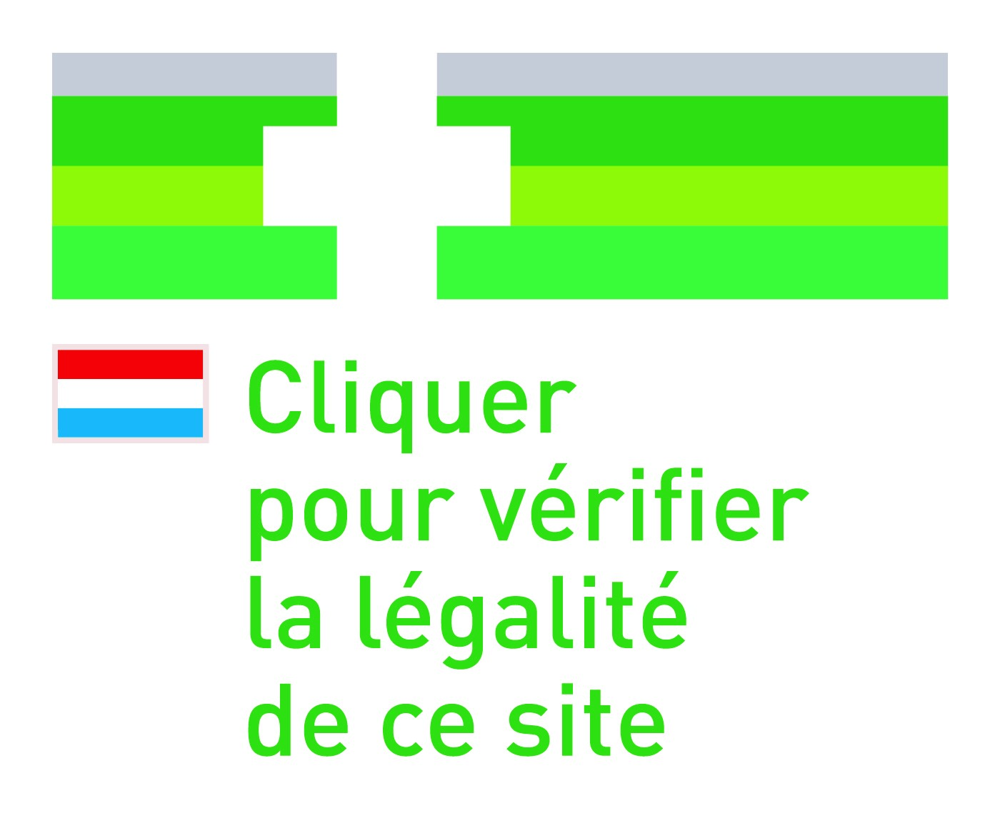
>
> \**Annexe II**
>
> 

### CONVENTIONS INTERNATIONALES

#### Loi du 21 août 2018 portant approbation de la Convention de coopération entre le Grand-Duché de Luxembourg et le Royaume de Belgique en matière de médicaments et de produits de santé, fait à Luxembourg, le 17 janvier 2018.

##### Article unique.

Est approuvée la Convention de coopération entre le Grand-Duché de Luxembourg et le Royaume de Belgique en matière de médicaments et de produits de santé, fait à Luxembourg, le 17 janvier 2018.

> \**CONVENTION  DE COOPÉRATION ENTRE  LE GRAND-DUCHÉ DE LUXEMBOURG ET LE ROYAUME  DE BELGIQUE**
>
> \**EN MATIÈRE DE MÉDICAMENTS ET DE PRODUITS DE SANTÉ**
>
> Le Gouvernement du Grand-Duché de Luxembourg, d'une part,  et  Le Gouvernement du Royaume de Belgique, d'autre part,
>
> Ci-après dénommés « les Parties »,
>
> \*Vu* la déclaration conjointe des Gouvernements belge et luxembourgeois du 4 juillet 2016 (Gäichel IX),
>
> \*Vu* les liens d'amitié historiques qui unissent le Grand-Duché de Luxembourg et le Royaume de Belgique,
>
> \*Vu* les excellentes relations bilatérales qu'entretiennent les deux pays,
>
> \*Vu* la Convention du 25 juillet 1921 instituant l'Union économique belgo-luxembourgeoise,
>
> \*Vu* les récentes réformes de l'acquis communautaire en matière de médicaments et de dispositifs médicaux,
>
> ONT CONVENU ce qui suit :
>
> ***Article 1er***
>
> La présente Convention a pour objet de renforcer la coopération entre le Grand-Duché de Luxembourg et le Royaume de Belgique en matière de médicaments et de produits de santé tels que définis par la loi modifiée du 20 juillet 2006 relative à la création et au fonctionnement de I'Agence Fédérale des Médicaments et des Produits de Santé du Royaume de Belgique.
>
> Cette coopération vise :
>
> 1\. la surveillance du marché durant tout le cycle de vie des médicaments et des produits de santé ;
>
> 2\. l'inspection dans toutes les matières visées par la présente Convention ;
>
> 3\. la surveillance des études et des investigations cliniques ;
>
> 4\. la vigilance ;
>
> 5\. l'évaluation des dossiers ;
>
> 6\. l'échange d'expertise, de ressources et d'information ;
>
> 7\. les activités en relation avec les médicaments, les dispositifs médicaux, le sang, les cellules et tissus d'origine humaine visées par la présente Convention.
>
> Les modalités de cette coopération sont détaillées par des arrangements administratifs.
>
> ***Article 2***
>
> Les deux Parties développent leurs relations bilatérales dans le respect mutuel des législations nationales, des procédures administratives et des pratiques internes.
>
> ***Article 3***
>
> Le Grand-Duché de Luxembourg et le Royaume de Belgique s'engagent à prendre les dispositions nécessaires relevant de leurs compétences respectives pour permettre l'exécution de la présente Convention.
>
> L'exécution de la présente Convention est assurée par les autorités compétentes des deux Parties.
>
> Les décisions nécessaires pour l'exécution de la présente Convention sont prises d'un commun accord.
>
> ***Article 4***
>
> Les deux Parties s'engagent à resserrer leurs liens en développant des moyens sûrs de communication et en se réunissant physiquement au moins une fois par année pour évaluer les projets communs déjà entrepris, pour s'entendre sur les nouvelles priorités de coopération et pour s'accorder sur le futur programme annuel de coopération.
>
> ***Article 5***
>
> La Partie qui sollicite dans le cadre de la présente Convention l'assistance de l'autre Partie dans l'exercice de la puissance publique s'engage à couvrir les coûts occasionnés par l'autre Partie, conformément au cadre règlementaire et financier en vigueur sur le territoire de l'autre Partie.
>
> Le remboursement des frais se fait sur base d'une facture datée et signée par l'autre Partie et accompagnée des justificatifs documentant les coûts occasionnés.
>
> ***Article 6***
>
> L'exécution des activités dans le cadre de la coopération visée par la présente Convention n'affecte ni la compétence ni la responsabilité des Parties en ce qui concerne l'exercice de la puissance publique sur leur territoire.
>
> Les Parties sont tenues de respecter les règles de confidentialité et d'impartialité, ainsi que de s'informer mutuellement sur des problèmes de conflits d'intérêts potentiels, qui en découleraient.
>
> ***Article 7***
>
> Tout différend relatif à l'application ou à l'interprétation de la présente Convention est réglé par la voie de la négociation entre les Parties.
>
> Tout différend concernant l'application ou l'interprétation de la présente Convention qui ne peut être réglé par voie de négociation dans un délai raisonnable, est, à la demande de l'une des Parties, soumis à l'arbitrage.
>
> Les modalités d'arbitrage sont fixées par les Parties d'un commun accord et au plus tard deux mois après la réception de la demande émanant d'une des Parties.
>
> Si dans les trois mois à compter de la réception de la demande il n'y a pas d'entente sur les modalités d'arbitrage, l'une des Parties peut demander au Président de la Cour de Justice de l'Union européenne ou à un des membres de cette Cour que celui-ci désigne à cette fin, de nommer un arbitre unique devant lequel le différend est renvoyé pour décision.
>
> La sentence arbitrale est obligatoire pour les Parties. Les frais de la procédure sont repartis à parts égales entre les Parties.
>
> ***Article 8***
>
> La présente Convention entre en vigueur à la date de réception par la voie diplomatique de la dernière des notifications, par laquelle les Parties s'informent mutuellement de l'accomplissement des procédures internes pour son entrée en vigueur.
>
> ***Article 9***
>
> La Convention peut être résiliée par chaque Partie pour le 31 décembre de chaque année avec préavis de six mois, à communiquer par voie diplomatique.
>
> FAIT à Luxembourg, le 17 janvier 2018, en deux exemplaires, en langue française et néerlandaise, chaque exemplaire faisant également foi.

## OBSERVATOIRE NATIONAL DE LA SANTÉ

### Loi du 2 mars 2021 portant création d’un Observatoire national de la santé et modification 1° de la loi du 8 mars 2018 relative aux établissements hospitaliers et à la planification hospitalière ; 2° de la loi modifiée du 25 novembre 1982 relative aux organes destinés à la transplantation ; 3° de la loi modifiée du 7 août 2012 portant création de l’établissement public « Laboratoire national de santé ».

#### Chapitre 1er — Champ d’application et missions de l’Observatoire national de la santé

##### Art. 1er.

Il est créé sous l’autorité du ministre ayant la Santé dans ses attributions, ci-après « ministre », un Observatoire national de la santé, ci-après « Observatoire ».

##### Art. 2.

(1) L’Observatoire a pour missions :

1° d’évaluer :

a) l’état de santé de la population en termes de morbidité et de mortalité ;

b) les comportements à risque de la population en améliorant la connaissance de l’information sur les déterminants de la santé ;

c) la qualité, l’efficience et l’accessibilité du système de santé et d’identifier les inégalités de santé entre les différents groupes de population.

2° d’étudier l’évolution et l’adéquation des ressources en professionnels de la santé intervenant au sein du système de santé pour répondre aux besoins sanitaires de la population.

3° de publier et diffuser :

a) les informations sur l’état de santé de la population et le système de santé résultant de l’évaluation effectuée par l’Observatoire ;

b) les résultats des études relatives aux ressources en professionnels de la santé.

4° de proposer au ministre les priorités de santé publique visant à améliorer l’état de santé de la population, le système de santé et l’état des ressources en professionnels de la santé.

5° d’établir la carte sanitaire visée à l’article 3 de la [loi du 8 mars 2018](https://legilux.public.lu/eli/etat/leg/loi/2018/03/08/a222/jo) relative aux établissements hospitaliers et à la planification hospitalière.

(2) Afin de pouvoir exercer les missions déterminées au paragraphe 1er, l’Observatoire :

1° définit un tableau de bord d’indicateurs, de préférence comparables au niveau international ;

2° centralise les informations et les données disponibles ;

3° réalise des analyses et élabore des études ainsi que des rapports.

##### Art. 3.

L’Observatoire travaille en toute indépendance en ce qui concerne ses outils d’observation, ses constats et ses propositions.

#### Chapitre 2 — Organisation de l’Observatoire

##### Art. 4.

(1) L’Observatoire comprend un Conseil des observateurs composé des membres suivants, dénommés ci-après les « observateurs » :

1° un expert ayant des compétences en épidémiologie ;

2° un expert ayant des compétences en santé publique ;

3° un expert ayant des compétences dans l’analyse des systèmes de santé ;

4° un expert ayant des compétences en matière de gestion de registres ;

5° un expert ayant des compétences en matière d’études en santé de la population ;

6° un expert ayant des compétences en matière de statistiques en santé ou un biostatisticien ;

7° un expert ayant des compétences en économie de la santé ;

8° un expert ayant des compétences en démographie ;

9° un expert ayant des compétences en matière de mesures de résultats rapportés par les patients.

Il est désigné pour chacun des membres ci-avant un membre suppléant dans les conditions et selon les modalités prévues pour la désignation du membre effectif.

(2) Les observateurs sont nommés pour une durée de sept ans renouvelable par arrêté grand-ducal sur proposition du ministre. Le nombre d’observateurs du sexe sous-représenté ne peut être inférieur à trois. Les observateurs se réunissent autant que les besoins de l’Observatoire l’exigent mais au minimum deux fois par an.

Le président de l’Observatoire est nommé par arrêté grand-ducal sur proposition du ministre parmi les observateurs pour un mandat renouvelable de sept ans. Le président de l’Observatoire est responsable du fonctionnement de l’Observatoire. Le président de l’Observatoire est le chef hiérarchique du personnel nommé, affecté ou détaché à l’Observatoire. Il exerce sa fonction à plein temps.

(3) Le Conseil des observateurs arrête :

1° les différents rapports et propositions de l’Observatoire ;

2° les domaines et les orientations du programme pluriannuel de travail de l’Observatoire ;

3° les propositions budgétaires de l’Observatoire ;

4° les demandes en ressources humaines ou techniques de l’Observatoire.

Le Conseil des observateurs donne son avis sur toutes les questions relevant du domaine de compétence de l’Observatoire que le ministre lui soumet ou dont il se saisit lui-même.

(4) Les modalités de fonctionnement et d’organisation du Conseil des observateurs sont définies par règlement grand-ducal.

Les membres du Conseil des observateurs qui n’ont pas le statut d’agent de l’État touchent une indemnité qui est définie par règlement grand-ducal.

##### Art. 5.

(1) Le cadre du personnel de l’Observatoire comprend des fonctionnaires des différentes catégories de traitement telles que prévues par la [loi modifiée du 25 mars 2015](https://legilux.public.lu/eli/etat/leg/loi/2015/03/25/n3/jo) fixant le régime des traitements et les conditions et modalités d’avancement des fonctionnaires de l’État. Le cadre du personnel de l’Observatoire peut comprendre en outre des stagiaires-fonctionnaires, des employés de l’État et des salariés de l’État suivant les besoins de l’administration et dans la limite des crédits budgétaires.

(2) L’Observatoire peut recourir à tout type d’expertise nécessaire à l’accomplissement de sa mission.

##### Art. 6.

(1) Lorsque le président de l’Observatoire est issu du secteur public, il est mis en congé pour la durée de son mandat de son administration d’origine avec maintien de tous les avantages et droits découlant de son statut respectif. Il continue notamment à jouir de son traitement, indemnité ou salaire suivant le cas, ainsi que du régime de sécurité sociale correspondant à son statut.

En cas de cessation du mandat avant l’âge de la retraite, il est réintégré sur sa demande dans son administration d’origine à un emploi correspondant au traitement qu’il a touché précédemment, augmenté des échelons se rapportant aux années de service passées comme président de l’Observatoire jusqu’à concurrence du dernier échelon du grade. À défaut de vacance, il peut être créé un emploi correspondant à ce traitement. Cet emploi est supprimé de plein droit à la première vacance qui se produit dans une fonction appropriée.

(2) Lorsque le président de l’Observatoire est issu du secteur privé, il touche une rémunération calculée par référence à la [loi modifiée du 25 mars 2015](https://legilux.public.lu/eli/etat/leg/loi/2015/03/25/n8/jo) déterminant le régime et les indemnités des employés de l’État.

Il reste affilié au régime de sécurité sociale auquel il était soumis pendant l’exercice de sa dernière occupation. En cas de cessation du mandat, il touche pendant une durée maximale d’un an une indemnité d’attente mensuelle correspondant au salaire ou traitement mensuel moyen du dernier revenu professionnel cotisable annuel mis en compte au titre de sa carrière d’assurance en cours avant le début de sa fonction de président de l’Observatoire.

Cette indemnité d’attente est réduite dans la mesure où l’intéressé touche un revenu professionnel ou bénéficie d’une pension personnelle.

#### Chapitre 3 — Traitement des données personnelles, rapports et propositions de l’Observatoire

##### Art. 7.

(1) En respect des règles relatives à la transmission et au traitement des données à caractère personnel, les administrations publiques, les établissements publics ainsi que les autres organismes luxembourgeois transmettent à l’Observatoire et sur sa demande les informations et les données nécessaires à l’exécution de sa mission sous forme pseudonymisée.

(2) Les informations et les données recueillies ne pourront être utilisées qu’aux fins des missions énumérées à l’article 2.

##### Art. 8.

(1) L’Observatoire établit annuellement un rapport d’activités et au moins un rapport d’analyse thématique, ce dernier contenant ses constats et ses propositions sur un ou des domaines qui ont été déterminés comme prioritaires.

(2) L’Observatoire établit tous les trois ans un rapport national sur l’état de santé de la population, les déterminants de la santé et le système de santé avec ses constats et ses propositions, comprenant :

1° une description, une analyse et une évaluation de l’état de santé de la population, des déterminants de la santé et du système de santé ;

2° une description, une analyse et une évaluation des politiques menées en matière de Santé publique.

(3) Ces rapports sont publiés et communiqués au Gouvernement et à la Chambre des Députés.

#### Chapitre 4 — Dispositions modificatives

##### Art. 9.

À l’article 3, paragraphe 2, de la [loi du 8 mars 2018](https://legilux.public.lu/eli/etat/leg/loi/2018/03/08/a222/jo) relative aux établissements hospitaliers et à la planification hospitalière, la phrase introductive est modifiée comme suit :

> (2) La carte sanitaire est un ensemble d’informations établi et mis à jour tous les deux ans par l’Observatoire national de la santé et constitué par :

##### Art. 10.

La [loi modifiée du 25 novembre 1982](https://legilux.public.lu/eli/etat/leg/loi/1982/11/25/n2/jo) relative aux organes destinés à la transplantation est modifiée comme suit :

1° L’article 9 est complété entre les termes vérifier et si par le bout de phrase libellé comme suit :

> dans le dossier de soins partagé visé à l’article 60*quater* du [Code de la sécurité sociale](https://legilux.public.lu/eli/etat/leg/code/securite_sociale) et, à défaut de dossier de soins partagé ou en cas de fermeture de celui-ci, auprès de la personne de confiance visée à l’article 12 de la [loi modifiée du 24 juillet 2014](https://legilux.public.lu/eli/etat/leg/loi/2014/07/24/n2/jo) relative aux droits et obligations du patient,

2° L’article 10 est remplacé par la disposition suivante :

> Lors de son premier accès au dossier de soins partagé visé à l’article 60*quater* du [Code de la sécurité sociale](https://legilux.public.lu/eli/etat/leg/code/securite_sociale), le titulaire du dossier indique s’il s’oppose au prélèvement d’organes après son décès.
>
> À défaut de dossier de soins partagé ou en cas de fermeture de celui-ci, une personne peut également exprimer son opposition au prélèvement d’organes par écrit et confier cet écrit à la personne de confiance visée à l’article 12 de la [loi modifiée du 24 juillet 2014](https://legilux.public.lu/eli/etat/leg/loi/2014/07/24/n2/jo) relative aux droits et obligations du patient. L’écrit est daté et signé par son auteur dûment identifié par l’indication de ses nom, prénom et numéro d’identification.

##### Art. 11.

La [loi modifiée du 7 août 2012](https://legilux.public.lu/eli/etat/leg/loi/2012/08/07/n1/jo) portant création de l’établissement public « Laboratoire national de santé » est modifiée comme suit :

1° À l’article 2, paragraphe 1er, il est rajouté un quatrième tiret ayant la teneur suivante :

> aash d’assurer les missions d’analyse, de contrôle, d’expertise et de recherche dans le cadre de la protection des consommateurs.

2° À l’article 3, il est inséré un paragraphe 2*bis* ayant la teneur suivante :

> (2*bis*) L’établissement conclut avec le ministre ayant la Protection des consommateurs dans ses attributions une convention pluriannuelle relative aux missions visées à l’article 2, paragraphe 1er, quatrième tiret, notamment en ce qui concerne les modalités de coopération avec les autorités d’inspection en matière de protection des consommateurs. Cette convention porte sur les délais et modalités d’exécution de ces missions ainsi que sur les modalités de financement de ces missions.

3° À l’article 4, le paragraphe 1er est modifié comme suit :

a) à l’alinéa 1er, le chiffre onze est remplacé par le chiffre douze.

b) à l’alinéa 2, entre le cinquième et le sixième tiret, est inséré un nouveau tiret libellé comme suit :

> « - un membre est proposé par le ministre ayant la Protection des consommateurs dans ses attributions : ».

#### Chapitre 5 — Intitulé de citation

##### Art. 12.

La référence à la présente loi se fait sous la forme suivante : « Loi du 2 mars 2021 portant création d’un Observatoire national de la santé ».

## ORGANISATION MONDIALE DE LA SANTÉ - RÈGLEMENT SANITAIRE INTERNATIONAL (2005)

### Ministère de la Santé - Application du Règlement sanitaire international (2005), adopté par la Cinquante-Huitième Assemblée mondiale de la Santé.

Les Actes désignés ci-dessous sont reproduits à titre d’information:

#### Application du Règlement sanitaire international (2005)

La Cinquante-Neuvième Assemblée mondiale de la Santé,

Ayant examiné le rapport sur l’application du Règlement sanitaire international (2005);

Rappelant les résolutions WHA58.3 sur la révision du Règlement sanitaire international et WHA58.5 sur la pandémie de grippe: renforcer la préparation et l’action;

Réaffirmant le risque grave pour la santé humaine, notamment celui de l’émergence possible d’un virus pandémique, que présentent les flambées actuelles chez les volailles de grippe aviaire causée par la souche H5N1 hautement pathogène du virus grippal A dans certaines parties d’Asie et ailleurs;

Notant avec préoccupation la persistance de flambées chez les volailles, celle de cas sporadiques de pathologies humaines graves qui leur sont associées, le caractère endémique du virus dans plusieurs pays, sa propagation à la faveur des migrations des oiseaux d’eau sauvages vers de nouvelles régions, et la propagation ultérieure que l’on prévoit;

Consciente que ces facteurs, entre autres, ont accru la probabilité d’une pandémie;

Soulignant l’importance que revêtent le plan mondial OMS de préparation à une pandémie de grippe ainsi que les mesures de lutte qu’il recommande;[^1-15]

Sachant que la détection rapide des cas humains, reposant sur des capacités nationales adéquates, et la notification rapide et transparente des résultats sous-tendent la capacité de l’OMS à procéder à une évaluation fiable des risques et à déclarer une phase appropriée d’alerte à la pandémie, et qu’elles sont en outre nécessaires pour garantir que les premiers signes épidémiologiques d’une transmissibilité interhumaine accrue du virus sont bien reconnus;

Consciente que plusieurs dispositions du Règlement sanitaire international (2005) seraient utiles en vue d’une action renforcée et coordonnée de la communauté internationale, tant dans la situation actuelle qu’en cas de pandémie;

Consciente en outre que la capacité renforcée de réagir à des cas humains de grippe aviaire et à la menace de pandémie qui en découle permettra de mieux faire face à de nombreuses autres maladies infectieuses émergentes et potentiellement épidémiques et d’accroître ainsi la sécurité sanitaire mondiale face à la menace de maladies infectieuses;

Notant que le Règlement sanitaire international (2005) n’entrera en vigueur que le 15 juin 2007;

Rappelant les principales conclusions et recommandations adoptées lors d’une réunion commune organisée par l’OMS, la FAO, l’OIE et la Banque mondiale sur la grippe aviaire et la grippe pandémique humaine (Genève, 7-9 novembre 2005);

Donnant suite à la demande spécifique, formulée au cours de cette réunion, de soumettre des propositions à la Cinquante-Neuvième Assemblée mondiale de la Santé, par l’intermédiaire du Conseil exécutif à sa cent dix-septième session, en vue d’une application volontaire immédiate des dispositions pertinentes du Règlement sanitaire international (2005);

1\. INVITE les Etats Membres à appliquer immédiatement, sur une base volontaire, les dispositions du Règlement sanitaire international (2005) considérées comme pertinentes au regard du risque présenté par la grippe aviaire et la grippe pandémique;

2\. DECIDE que les dispositions pertinentes du Règlement sanitaire international (2005) seront notamment les suivantes:

1\) l’annexe 2, dans la mesure où elle prévoit la notification rapide à l’OMS des cas de grippe humaine causés par un nouveau sous-type de virus;

2\) l’article 4, concernant la désignation ou la mise en place d’un point focal national RSI dans les pays et la désignation de points de contact RSI à l’OMS, ainsi que la définition de leurs fonctions et responsabilités;

3\) les articles du titre II se rapportant à la surveillance, à la communication d’informations, à la consultation, à la vérification et à l’action de santé publique;

4\) les articles 23 et 30 à 32 du titre V concernant les dispositions générales relatives aux mesures de santé publique applicables aux voyageurs à l’arrivée ou au départ et les dispositions spéciales applicables aux voyageurs;

5\) les articles 45 et 46 du titre VIII concernant le traitement des données à caractère personnel et le transport et la manipulation de substances biologiques, réactifs et matériels utilisés à des fins diagnostiques;

3\. NOTE que cette application volontaire ne saurait préjuger de la position d’aucun Etat Membre concernant le Règlement sanitaire international (2005);

4\. INVITE INSTAMMENT les Etats Membres:

1\) à désigner ou à mettre en place immédiatement un point focal national RSI, comme le prévoit l’article 4 du Règlement, et à en informer l’OMS dans les 90 jours, ledit point focal étant habilité à communiquer des informations officielles et appelé à soutenir l’évaluation collective des risques avec l’OMS et, si l’Etat Membre en décide ainsi, à y participer;

2\) à suivre, en ce qui concerne les questions liées aux cas humains de grippe aviaire, les dispositifs et les procédures énoncés dans le Règlement pour une maladie pouvant constituer une urgence de santé publique de portée internationale;

3\) à notifier de manière transparente et urgente tous les cas probables ou confirmés de grippe aviaire, y compris les cas exportés ou importés, et à poursuivre ensuite les communications à l’OMS les concernant;

4\) à diffuser aux centres collaborateurs de l’OMS des informations et matériels biologiques pertinents sur les souches de grippe aviaire et autres nouvelles souches de virus grippal hautement pathogènes en temps utile et régulièrement;

5\) à augmenter la capacité nationale de production de vaccins antigrippaux ou à collaborer avec les pays voisins pour créer une capacité régionale de production de vaccins en vue d’assurer un approvisionnement suffisant en vaccins au cas où un nouveau virus grippal causerait une urgence de santé publique de portée internationale;

6\) à renforcer la collaboration sur les grippes humaine et zoonosique entre les organismes nationaux responsables de la santé humaine et animale afin de renforcer la surveillance et de prendre des mesures immédiates pour endiguer les poussées de grippe aviaire chez l’homme et l’animal;

7\) à respecter les délais prévus par le Règlement pour entreprendre et mener à bien des activités et des communications urgentes, particulièrement en ce qui concerne la déclaration de cas humains de grippe aviaire, la vérification des faits et les mesures prises pour répondre aux demandes d’informations complémentaires reçues de l’OMS;

8\) à collaborer, notamment par la mobilisation d’un appui financier, à la mise en place, au renforcement et au maintien de la capacité de surveillance et d’action concernant la grippe dans les pays touchés par la grippe aviaire ou la grippe pandémique;

9\) à suivre les recommandations du Directeur général, de même que les conseils techniques de l’équipe spéciale chargée de la pandémie de grippe, qui sont jugées nécessaires dans le cadre de l’action internationale face à la grippe aviaire ou à la grippe pandémique;

10\) à informer le Directeur général des mesures prises dans le cadre de l’application volontaire du Règlement sanitaire international (2005);

11\) à établir un processus pour recenser et surmonter les obstacles – administratifs et juridiques – à la mise en œuvre du Règlement en temps opportun de manière à promouvoir la participation intersectorielle;

5\. PRIE le Directeur général:

1\) de désigner immédiatement des points de contact RSI à l’OMS, comme le prévoit l’article 4 du Règlement;

2\) d’appliquer, dans la mesure du possible et aux fins de la présente résolution, les mesures prévues aux titres II et III du Règlement qui incombent à l’OMS;

3\) d’accélérer encore les mesures prises pour établir une liste d’experts et solliciter des propositions concernant les membres à faire figurer sur la liste, conformément à l’article 47;

4\) d’utiliser jusqu’à l’entrée en vigueur du Règlement sanitaire international (2005) l’équipe spéciale chargée de la pandémie de grippe comme dispositif temporaire appelé à conseiller l’Organisation sur la riposte à la grippe aviaire, la phase appropriée d’alerte à la pandémie et les mesures correspondantes qui sont recommandées, la déclaration d’une pandémie de grippe et l’action internationale face à une pandémie;

5\) de collaborer avec les Etats Membres à la mise en œuvre de la présente résolution, et à l’application volontaire du Règlement sanitaire international (2005), le cas échéant, notamment:

a) en mettant en place ou en facilitant une coopération technique et un appui logistique;

b) en mobilisant l’aide internationale, y compris l’appui financier, en consultation avec les Etats Membres, surtout pour les pays touchés par la grippe aviaire ou la grippe pandémique ne disposant pas d’une capacité opérationnelle suffisante;

c) en établissant des lignes directrices pour aider les Etats Membres à renforcer leurs capacités d’action de santé publique face au risque de grippe aviaire et de grippe pandémique;

d) en constituant des stocks raisonnables des médicaments nécessaires;

e) en facilitant, en collaboration avec les partenaires internationaux, la mise au point et la production commerciale de vaccins contre la grippe aviaire et la grippe pandémique;

6\) de collaborer avec les Etats Membres dans la mesure du possible pour aider les pays en développement à mettre en place et à renforcer les capacités nécessaires en vertu du Règlement sanitaire international (2005);

7\) de chercher immédiatement des solutions pour réduire l’actuelle pénurie de vaccins antigrippaux dans le monde, rendre leur accès plus équitable et faire en sorte qu’ils soient plus abordables financièrement pendant les épidémies comme en cas de pandémie mondiale;

8\) de mobiliser et d’affecter spécifiquement les ressources techniques de l’OMS là où cela est possible, en utilisant les capacités disponibles dans les bureaux régionaux et les centres collaborateurs, pour développer et accélérer les activités de formation dans les domaines de la surveillance, de l’alerte et des interventions en cas d’épidémie, ainsi que des capacités de laboratoire, notamment le maillage régional des laboratoires, de la biosécurité et du contrôle de qualité, afin d’aider les Etats Membres à mettre en œuvre le Règlement sanitaire international (2005);

9\) de faire rapport à la Soixantième Assemblée mondiale de la Santé, par l’intermédiaire du Conseil exécutif à sa cent dix-neuvième session, sur l’application de la présente résolution et de faire ensuite rapport chaque année sur les progrès réalisés en vue d’aider les Etats Membres pour l’application et la mise en œuvre du Règlement sanitaire international (2005).

Huitième séance plénière, 26 mai 2006.

A59/VR/8

#### Révision du Règlement sanitaire international

La Cinquante-Huitième Assemblée mondiale de la Santé,

Ayant examiné le projet de Règlement sanitaire international révisé;[^1-16]

Considérant les articles 2 k), 21 a) et 22 de la Constitution de l’OMS;

Rappelant qu’il a été fait état de la nécessité de réviser et de mettre à jour le Règlement sanitaire international dans les résolutions WHA48.7 sur la révision et la mise à jour du Règlement sanitaire international, WHA54.14 sur la sécurité sanitaire mondiale: alerte et action en cas d’épidémie, WHA55.16 sur la présence naturelle, la dissémination accidentelle ou l’usage délibéré de matériel chimique, biologique ou radionucléaire affectant la santé: l’action de santé publique internationale, WHA56.28 sur la révision du Règlement sanitaire international, et WHA56.29 sur le syndrome respiratoire aigu sévère (SRAS), afin de répondre à la nécessité d’assurer la santé publique mondiale;

Se félicitant de la résolution 58/3 de l’Assemblée générale des Nations Unies sur l’intensification du renforcement des capacités dans le secteur de la santé publique à travers le monde, qui souligne l’importance du Règlement sanitaire international et demande instamment d’accorder un rang de priorité élevé à sa révision;

Affirmant l’importance que continue de revêtir le rôle de l’OMS en matière d’alerte en cas d’épidémie et d’action face à des événements de santé publique au niveau mondial, conformément à son mandat;

Soulignant l’importance que continue de revêtir le Règlement sanitaire international comme instrument mondial fondamental pour la protection contre la propagation internationale des maladies;

Se félicitant du succès des travaux du groupe de travail intergouvernemental sur la révision du Règlement sanitaire international;

1\. ADOPTE le Règlement sanitaire international révisé, désormais désigné sous le nom de «Règlement sanitaire international (2005)», joint à la présente résolution;

2\. INVITE les Etats Membres et le Directeur général à mettre pleinement en œuvre le Règlement sanitaire international (2005), conformément à l’objet et à la portée énoncés à l’article 2 et aux principes définis à l’article 3;

3\. DECIDE aux fins du paragraphe 1 de l’article 54 du Règlement sanitaire international (2005) que les Etats Parties et le Directeur général soumettront leur premier rapport à la Soixante et Unième Assemblée mondiale de la Santé et qu’à cette occasion l’Assemblée de la Santé examinera le calendrier de présentation des rapports ultérieurs et le premier examen du fonctionnement du Règlement conformément au paragraphe 2 de l’article 54;

4\. DECIDE EN OUTRE qu’aux fins du paragraphe 1 de l’article 14 du Règlement sanitaire international (2005), les autres organisations intergouvernementales et les organismes internationaux compétents avec lesquels l’OMS est appelée à coopérer et à coordonner ses activités, selon le cas, sont notamment les suivants: Organisation des Nations Unies, Organisation internationale du Travail, Organisation des Nations Unies pour l’Alimentation et l’Agriculture, Agence internationale de l’Energie atomique, Organisation de l’Aviation civile internationale, Organisation maritime internationale, Comité international de la Croix-Rouge, Fédération internationale des Sociétés de la Croix-Rouge et du Croissant-Rouge, Association du Transport aérien international, Fédération internationale des Armateurs, et Office international des Epizooties;

5\. INVITE INSTAMMENT les Etats Membres:

1\) à acquérir, renforcer et maintenir les capacités requises en vertu du Règlement sanitaire international (2005) et à mobiliser les ressources nécessaires à cette fin;

2\) à collaborer activement entre eux et avec l’OMS conformément aux dispositions pertinentes du Règlement sanitaire international (2005) de façon à en assurer la mise en œuvre effective;

3\) à apporter un soutien aux pays en développement et aux pays à économie en transition qui en font la demande pour l’acquisition, le renforcement et le maintien des capacités de santé publique requises en vertu du Règlement sanitaire international (2005);

4\) à prendre toutes les mesures appropriées, en attendant l’entrée en vigueur du Règlement sanitaire international (2005), pour en promouvoir le but puis la mise en œuvre, y compris l’acquisition des capacités de santé publique requises et la mise au point des dispositions juridiques et administratives qui s’imposent, et en particulier à entamer le processus visant à introduire l’utilisation de l’instrument de décision qui fait l’objet de l’annexe 2;

6\. PRIE le Directeur général:

1\) de notifier rapidement l’adoption du Règlement sanitaire international (2005), conformément au paragraphe 1 de l’article 65 dudit Règlement;

2\) d’informer d’autres organisations intergouvernementales ou organismes internationaux compétents de l’adoption du Règlement sanitaire international (2005) et, le cas échéant, de coopérer avec eux à la mise à jour de leurs normes, et de coordonner avec ceux-ci les activités de l’OMS au titre du Règlement sanitaire international (2005), afin d’assurer l’application de mesures adéquates pour la protection de la santé publique et le renforcement de l’action mondiale de santé publique face à la propagation internationale des maladies;

3\) de transmettre à l’Organisation de l’Aviation civile internationale (OACI) les modifications recommandées à la partie relative aux questions sanitaires de la Déclaration générale d’aéronef1 et, lorsque l’OACI aura achevé sa révision de la Déclaration générale d’aéronef, d’informer l’Assemblée de la Santé et d’insérer à l’annexe 9 du Règlement sanitaire international (2005) la partie relative aux questions sanitaires de la Déclaration générale d’aéronef telle que révisée par l’OACI;

4\) d’acquérir et de renforcer les capacités de l’OMS à exécuter pleinement et de manière efficace les fonctions qui lui sont confiées au titre du Règlement sanitaire international (2005), en particulier au moyen des opérations sanitaires stratégiques qui apportent un soutien aux pays en vue du dépistage et de l’évaluation des urgences de santé publique et en vue de l’action pour y faire face;

5\) de collaborer avec les Etats Parties au Règlement sanitaire international (2005) s’il y a lieu, notamment en fournissant ou en facilitant la coopération technique et l’appui logistique;

6\) de collaborer avec les Etats Parties dans la mesure du possible à la mobilisation de ressources financières afin d’apporter un soutien aux pays en développement en vue de l’acquisition, du renforcement et du maintien des capacités requises en vertu du Règlement sanitaire international (2005);

7\) d’élaborer, en consultation avec les Etats Membres, des lignes directrices pour l’application des mesures sanitaires aux postes-frontières terrestres, conformément à l’article 29 du Règlement sanitaire international (2005);

8\) de créer le Comité d’examen du Règlement sanitaire international (2005) conformément à l’article 50 dudit Règlement;

9\) de prendre immédiatement des mesures en vue de l’élaboration de lignes directrices concernant la mise en œuvre et l’évaluation de l’instrument de décision contenu dans le Règlement sanitaire international (2005), notamment l’élaboration d’une procédure pour l’examen de son fonctionnement, qui seront soumises à l’examen de l’Assemblée de la Santé conformément au paragraphe 3 de l’article 54 dudit Règlement;

10\) de prendre des mesures pour établir une liste d’experts du RSI et de solliciter des candidatures, conformément à l’article 47 du Règlement sanitaire international (2005).

#### REGLEMENT SANITAIRE INTERNATIONAL (2005)

##### TITRE I — DEFINITIONS, OBJET ET PORTEE, PRINCIPES ET AUTORITES RESPONSABLES

###### *Article 1* — *Définitions*

1\. Aux fins du Règlement sanitaire international (ci-après dénommé le «RSI» ou le «Règlement»):

aone «aéronef» s’entend d’un aéronef effectuant un voyage international;

bone «aéroport» s’entend d’un aéroport d’arrivée et de départ de vols internationaux;

cone «affectés» s’entend de personnes, bagages, cargaisons, conteneurs, moyens de transport, marchandises, colis postaux ou restes humains qui sont infectés ou contaminés, ou qui véhiculent des sources d’infection ou de contamination, et constituent de ce fait un risque pour la santé publique;

done «arrivée» d’un moyen de transport s’entend:

a) dans le cas d’un navire de mer, de l’arrivée ou du mouillage dans la zone définie d’un port;

b) dans le cas d’un aéronef, de l’arrivée dans un aéroport;

c) dans le cas d’un bateau de navigation intérieure effectuant un voyage international, de l’arrivée à un point d’entrée;

d) dans le cas d’un train ou d’un véhicule routier, de l’arrivée à un point d’entrée;

eone «autorité compétente» s’entend d’une autorité responsable de la mise en œuvre et de l’application de mesures sanitaires prises en vertu du présent Règlement;

fone «bagages» s’entend des effets personnels d’un voyageur;

gone «cargaison» s’entend des marchandises transportées dans un moyen de transport ou dans un conteneur;

hone «colis postal» s’entend d’un article ou paquet muni d’une adresse et transporté par des services postaux ou de messagerie internationaux;

ione «contamination» s’entend de la présence d’un agent ou d’une matière infectieux ou toxiques sur la surface du corps d’une personne ou d’un animal, dans ou sur un produit destiné à la consommation ou sur d’autres objets inanimés, y compris des moyens de transport, pouvant constituer un risque pour la santé publique;

jone «conteneur» s’entend d’un engin de transport:

a) ayant un caractère pérenne et étant, de ce fait, suffisamment résistant pour permettre son usage répété;

b) spécialement conçu pour faciliter le transport de marchandises, sans rupture de charge, par un ou plusieurs modes de transport;

c) muni de dispositifs qui en facilitent la manutention, notamment lors de son transbordement d’un moyen de transport à un autre; et

d) spécialement conçu de façon à être facile à remplir et à vider;

kone «décontamination» s’entend d’une procédure qui consiste à prendre des mesures sanitaires pour éliminer un agent ou une matière infectieux ou toxiques sur la surface du corps d’une personne ou d’un animal, dans ou sur un produit destiné à la consommation ou sur d’autres objets inanimés, y compris des moyens de transport, pouvant constituer un risque pour la santé publique;

lone «départ» s’entend, pour une personne, un bagage, une cargaison, un moyen de transport ou une marchandise, de l’acte de quitter un territoire;

mone «dératisation» s’entend de la procédure qui consiste à prendre des mesures sanitaires pour maîtriser ou éliminer les rongeurs vecteurs de maladies humaines présents dans les bagages, cargaisons, conteneurs, moyens de transport, services, marchandises et colis postaux au point d’entrée;

none «désinfection» s’entend de la procédure qui consiste à prendre des mesures sanitaires pour maîtriser ou éliminer des agents infectieux présents sur la surface du corps d’une personne ou d’un animal ou dans ou sur des bagages, cargaisons, conteneurs, moyens de transport, marchandises et colis postaux par exposition directe à des agents chimiques ou physiques;

oone «désinsectisation» s’entend de la procédure qui consiste à prendre des mesures sanitaires pour maîtriser ou éliminer les insectes vecteurs de maladies humaines présents dans les bagages, cargaisons, conteneurs, moyens de transport, marchandises et colis postaux;

pone «Directeur général» s’entend du Directeur général de l’Organisation mondiale de la Santé;

qone «données à caractère personnel» s’entend de toute information relative à une personne physique identifiée ou identifiable;

rone «éléments de preuve scientifiques» s’entend des informations fournissant un élément de preuve sur la base de méthodes scientifiques établies et acceptées;

sone «équipage» s’entend des personnes se trouvant à bord d’un moyen de transport hormis les passagers;.

tone «événement» s’entend d’une manifestation pathologique ou d’un fait créant un risque de maladie;

uone «examen médical» s’entend de l’examen préliminaire d’une personne pratiqué par un agent de santé autorisé ou par une personne intervenant sous la supervision directe de l’autorité compétente, afin de déterminer si l’état de santé de cette personne présente un risque potentiel pour la santé publique; il peut comprendre la vérification des documents sanitaires et un examen clinique si les circonstances le justifient en l’espèce;

vone «exploitant d’un moyen de transport» s’entend de la personne physique ou morale responsable d’un moyen de transport, ou de son représentant;

wone «infection» s’entend de la pénétration et du développement ou de la multiplication d’un agent infectieux dans l’organisme de personnes ou d’animaux pouvant constituer un risque pour la santé publique;

xone «inspection» s’entend de l’examen, par l’autorité compétente ou sous sa supervision, des zones, bagages, conteneurs, moyens de transport, installations, marchandises ou colis postaux, ainsi que des informations et documents pertinents, afin de déterminer s’il existe un risque pour la santé publique;

yone «intrusif» s’entend de la gêne provoquée par un contact rapproché ou intime ou un interrogatoire serré;

zone «invasif» s’entend de l’effraction ou de l’incision cutanée ou de l’introduction d’un instrument ou d’un corps étranger dans l’organisme ou l’examen d’une cavité. Aux fins du présent Règlement, l’examen médical de l’oreille, du nez ou de la bouche, la prise de la température au moyen d’un thermomètre auriculaire, buccal ou à contact cutané, ou au moyen de dispositifs d’imagerie thermique, l’inspection, l’auscultation, la palpation externe, la rétinoscopie, le recueil externe d’échantillons d’urine, de selles ou de salive, la mesure externe de la pression sanguine et l’électrocardiogramme ne sont pas considérés comme ayant un caractère invasif;

aaone «isolement» s’entend de la mise à l’écart de malades ou personnes contaminées ou de bagages, conteneurs, moyens de transport, marchandises ou colis postaux affectés de façon à prévenir la propagation de l’infection ou de la contamination;

abone «libre pratique» s’entend, pour un navire, de l’autorisation d’entrer dans un port, d’y procéder à l’embarquement ou au débarquement, au déchargement ou au chargement de cargaisons ou de provisions; pour un aéronef, de l’autorisation, après atterrissage, de procéder à l’embarquement ou au débarquement, au déchargement ou au chargement de cargaisons ou de provisions; et, pour un moyen de transport terrestre, de l’autorisation, à l’arrivée, de procéder à l’embarquement ou au débarquement, au déchargement ou au chargement de cargaisons ou de provisions;

acone «malade» s’entend d’une personne souffrant ou atteinte d’un trouble physique susceptible de constituer un risque pour la santé publique;

adone «maladie» s’entend d’une pathologie humaine ou d’une affection, quelle qu’en soit l’origine ou la source, ayant ou susceptible d’avoir des effets nocifs importants pour l’être humain;

aeone «marchandises» s’entend de produits tangibles, y compris des animaux et des végétaux, transportés lors d’un voyage international, notamment pour être utilisés à bord d’un moyen de transport;

afone «mesure sanitaire» s’entend des moyens utilisés pour prévenir la propagation des maladies ou la contamination; une mesure sanitaire ne comprend pas des mesures d’application de la loi ni de sécurité;

agone «moyen de transport» s’entend d’un aéronef, d’un navire, d’un train, d’un véhicule routier ou de tout autre moyen de transport utilisé pour un voyage international;

ahone «navire» s’entend d’un navire de mer ou d’un bateau de navigation intérieure qui effectue un voyage international;

aione «observation à des fins de santé publique» s’entend de la surveillance de l’état de santé d’un voyageur dans le temps afin de déterminer le risque de transmission d’une maladie;

ajone «Organisation» ou «OMS» s’entend de l’Organisation mondiale de la Santé;

akone «point de contact RSI à l’OMS» s’entend du service qui, à l’OMS, doit être à tout moment à même de communiquer avec le point focal national RSI;

alone «point d’entrée» s’entend d’un point de passage pour l’entrée ou la sortie internationales des voyageurs, bagages, cargaisons, conteneurs, moyens de transport, marchandises et colis postaux ainsi que des organismes et secteurs leur apportant des services à l’entrée ou à la sortie;

amone «point focal national RSI» s’entend du centre national, désigné par chaque Etat Partie, qui doit être à tout moment à même de communiquer avec les points de contact RSI à l’OMS aux fins du présent Règlement;

anone «port» s’entend d’un port de mer ou d’un port intérieur où arrivent ou d’où partent les navires effectuant un voyage international;

aoone «poste-frontière» s’entend d’un point d’entrée terrestre dans un Etat Partie, y compris un point utilisé par les véhicules routiers et les trains;

apone «principes scientifiques» s’entend des lois fondamentales et des faits acceptés et connus grâce aux méthodes scientifiques;

aqone «quarantaine» s’entend de la restriction des activités et/ou de la mise à l’écart des personnes suspectes qui ne sont pas malades ou des bagages, conteneurs, moyens de transport ou marchandises suspects, de façon à prévenir la propagation éventuelle de l’infection ou de la contamination;

arone «recommandation» et «recommandé» renvoient aux recommandations temporaires ou permanentes émises en vertu du présent Règlement;

asone «recommandation permanente» s’entend de l’avis non contraignant émis par l’OMS en vertu de l’article 16 concernant l’application systématique ou périodique de mesures sanitaires appropriées face à certains risques persistants pour la santé publique, afin de prévenir ou de réduire la propagation internationale des maladies en créant le minimum d’entraves au trafic international;

atone «recommandation temporaire» s’entend de l’avis non contraignant émis par l’OMS en vertu de l’article 15 aux fins d’une application limitée dans le temps et en fonction du risque, pour faire face à une urgence de santé publique de portée internationale, de manière à prévenir ou à réduire la propagation internationale des maladies en créant le minimum d’entraves au trafic international;

auone «réservoir» s’entend d’un animal, d’une plante ou d’une substance qui héberge normalement un agent infectieux et dont la présence peut constituer un risque pour la santé publique;

avone «résidence permanente» s’entend dans le sens déterminé par le droit interne de l’Etat Partie concerné;

awone «résidence provisoire» s’entend dans le sens déterminé par le droit interne de l’Etat Partie concerné;

axone «risque pour la santé publique» s’entend de la probabilité d’un événement qui peut nuire à la santé des populations humaines, plus particulièrement d’un événement pouvant se propager au niveau international ou présenter un danger grave et direct;

ayone «surveillance» s’entend de la collecte, de la compilation et de l’analyse systématiques et continues de données à des fins de santé publique et de la diffusion d’informations de santé publique en temps voulu à des fins d’évaluation et aux fins d’une action de santé publique, selon les besoins;

azone «suspects» s’entend des personnes, bagages, cargaisons, conteneurs, moyens de transport, marchandises ou colis postaux qu’un Etat Partie considère comme ayant été exposés ou ayant pu être exposés à un risque pour la santé publique et susceptibles de constituer une source de propagation de maladies;

baone «trafic international» s’entend du mouvement des personnes, bagages, cargaisons, conteneurs, moyens de transport, marchandises ou colis postaux qui traversent une frontière internationale, y compris des échanges commerciaux internationaux;

bbone «urgence de santé publique de portée internationale» s’entend d’un événement extraordinaire dont il est déterminé, comme prévu dans le présent Règlement,

i) qu’il constitue un risque pour la santé publique dans d’autres Etats en raison du risque de propagation internationale de maladies; et

ii) qu’il peut requérir une action internationale coordonnée;

bcone «vecteur» s’entend d’un insecte ou de tout animal qui véhicule normalement un agent infectieux constituant un risque pour la santé publique;

bdone «véhicule de transport terrestre» s’entend d’un moyen de transport motorisé destiné au transport terrestre lors d’un voyage international, ce qui comprend les trains, les autocars, les camions et les automobiles;

beone «véhicule routier» s’entend d’un véhicule de transport terrestre autre qu’un train;

bfone «vérification» s’entend de la fourniture à l’OMS par un Etat Partie d’informations confirmant un événement sur le ou les territoires de cet Etat Partie;

bgone «voyage international» s’entend:

a) dans le cas d’un moyen de transport, d’un voyage entre des points d’entrée situés sur les territoires de plus d’un Etat, ou d’un voyage entre des points d’entrée situés sur le ou les territoires d’un même Etat si, pendant son voyage, le moyen de transport est en contact avec le territoire de tout autre Etat, mais uniquement pour ces contacts;

b) dans le cas d’un voyageur, d’un voyage comportant l’entrée sur le territoire d’un Etat autre que le territoire de l’Etat d’où part le voyageur;

bhone «voyageur» s’entend d’une personne physique qui effectue un voyage international;

bione «zone affectée» s’entend d’un lieu géographique spécifique pour lequel des mesures sanitaires ont été recommandées par l’OMS en vertu du présent Règlement;

bjone «zone de chargement des conteneurs» s’entend d’un lieu ou d’une installation réservés aux conteneurs utilisés dans le trafic international.

2\. Sauf dispositions contraires ou à moins que le contexte ne s’y oppose, toute référence au présent Règlement renvoie également aux annexes y relatives.

###### *Article 2* — *Objet et portée*

L’objet et la portée du présent Règlement consistent à prévenir la propagation internationale des maladies, à s’en protéger, à la maîtriser et à y réagir par une action de santé publique proportionnée et limitée aux risques qu’elle présente pour la santé publique, en évitant de créer des entraves inutiles au trafic et au commerce internationaux.

###### *Article 3* — *Principes*

1\. Le présent Règlement est mis en œuvre en respectant pleinement la dignité des personnes, les droits de l’homme et les libertés fondamentales.

2\. La mise en œuvre du présent Règlement est guidée par la Charte des Nations Unies et la Constitution de l’Organisation mondiale de la Santé.

3\. La mise en œuvre du présent Règlement est guidée par le souci de son application universelle en vue de protéger l’ensemble de la population mondiale de la propagation internationale des maladies.

4\. En application de la Charte des Nations Unies et des principes du droit international, les Etats ont le droit souverain de légiférer et de promulguer la législation en vue de la mise en œuvre de leurs politiques en matière de santé. Ce faisant, ils doivent favoriser les buts du présent Règlement.

###### *Article 4* — *Autorités responsables*

1\. Chaque Etat Partie met en place ou désigne un point focal national RSI ainsi que les autorités responsables, dans sa propre juridiction, de la mise en œuvre des mesures sanitaires prévues au présent Règlement.

2\. Les points focaux nationaux RSI doivent être à tout moment à même de communiquer avec les points de contact RSI à l’OMS visés au paragraphe 3 du présent article. Les points focaux nationaux RSI auront notamment pour fonctions:

a) d’adresser aux points de contact RSI à l’OMS, au nom de l’Etat Partie concerné, les communications urgentes relatives à l’application du présent Règlement, notamment celles visées par les articles 6 à 12; et

b) de diffuser des informations auprès des secteurs compétents de l’administration de l’Etat Partie concerné, et notamment les secteurs responsables de la surveillance et de la déclaration, des points d’entrée, des services de santé publique, des dispensaires et hôpitaux et d’autres départements publics, et de rassembler les informations communiquées par ces secteurs.

3\. L’OMS désigne des points de contact RSI qui doivent être à tout moment à même de communiquer avec les points focaux nationaux RSI. Les points de contact RSI à l’OMS adressent des communications urgentes au sujet de l’application du présent Règlement, en particulier des dispositions des articles 6 à 12, aux points focaux nationaux RSI des Etats Parties concernés. L’OMS peut désigner des points de contact RSI au Siège de l’Organisation ou au niveau régional.

4\. Les Etats Parties communiquent à l’OMS les coordonnées de leurs points focaux nationaux RSI et l’OMS communique aux Etats Parties les coordonnées de ses points de contact RSI. Ces coordonnées sont actualisées en permanence et confirmées annuellement. L’OMS communique à tous les Etats Parties les coordonnées des points focaux nationaux RSI qui lui sont communiquées en application du présent article.

##### TITRE II — INFORMATION ET ACTION DE SANTE PUBLIQUE

###### *Article 5* — *Surveillance*

1\. Chaque Etat Partie acquiert, renforce et maintient, dès que possible mais au plus tard dans les cinq ans suivant l’entrée en vigueur du présent Règlement à l’égard de cet Etat Partie, la capacité de détecter, d’évaluer, de notifier et de déclarer des événements en application du présent Règlement, comme indiqué à l’annexe 1.

2\. A la suite de l’évaluation visée au paragraphe 2 de l’annexe 1, un Etat Partie peut rendre compte à l’OMS en invoquant un besoin justifié et un plan d’action et, ce faisant, obtenir un délai supplémentaire de deux ans pour remplir l’obligation qui lui incombe aux termes du paragraphe 1 du présent article. Dans des circonstances exceptionnelles et en faisant valoir un nouveau plan d’action, l’Etat Partie peut demander que le délai soit encore prolongé de deux ans au maximum au Directeur général, qui se prononce en tenant compte de l’avis technique du Comité établi en vertu de l’article 50 (ci-après le «Comité d’examen»). Après la période prévue au paragraphe 1 du présent article, l’Etat Partie qui a obtenu un délai supplémentaire rend compte tous les ans à l’OMS des progrès accomplis dans la mise en œuvre complète.

3\. L’OMS aide les Etats Parties, à leur demande, à acquérir, renforcer et maintenir les capacités visées au paragraphe 1 du présent article.

4\. L’OMS recueille des informations sur les événements dans le cadre de ses activités de surveillance, et elle évalue le risque de propagation internationale de maladies qu’ils comportent et les entraves au trafic international qu’ils peuvent créer. Les informations reçues par l’OMS en vertu du présent paragraphe sont traitées conformément aux dispositions des articles 11 et 45 le cas échéant.

###### *Article 6* — *Notification*

1\. Chaque Etat Partie évalue les événements qui surviennent sur son territoire au moyen de l’instrument de décision présenté à l’annexe 2. Chaque Etat Partie notifie à l’OMS, par les moyens de communication les plus efficaces dont il dispose, par l’intermédiaire du point focal national RSI et dans les 24 heures suivant l’évaluation des informations de santé publique, tout événement survenu sur son territoire pouvant constituer une urgence de santé publique de portée internationale au regard de l’instrument de décision, ainsi que toute mesure sanitaire prise pour faire face à ces événements. Si la notification reçue par l’OMS touche à la compétence de l’Agence internationale de l’Energie atomique (AIEA), l’OMS en informe immédiatement l’AIEA.

2\. Après une notification, l’Etat Partie continue de communiquer en temps voulu à l’OMS les informations de santé publique exactes et suffisamment détaillées dont il dispose, si possible y compris la définition des cas, les résultats de laboratoire, la source et le type de risque, le nombre des cas et des décès, les facteurs influant sur la propagation de la maladie et les mesures sanitaires utilisées; et indique, si nécessaire, les difficultés rencontrées et l’aide dont il a besoin pour faire face à l’éventuelle urgence de santé publique de portée internationale.

###### *Article 7* — *Communication d’informations en cas d’événements inattendus ou inhabituels*

Si un Etat Partie dispose d’éléments indiquant la survenue d’un événement inattendu ou inhabituel sur son territoire, quelle qu’en soit l’origine ou la source, qui peut constituer une urgence de santé publique de portée internationale, il fournit à l’OMS toutes informations de santé publique pertinentes. Dans ce cas, les dispositions de l’article 6 s’appliquent intégralement.

###### *Article 8* — *Consultation*

Dans le cas où se produisent sur son territoire des événements n’exigeant pas la notification prévue à l’article 6, en particulier des événements pour lesquels il ne dispose pas de suffisamment d’informations pour utiliser l’instrument de décision, un Etat Partie peut néanmoins en tenir l’OMS informée par l’intermédiaire de son point focal national RSI, et consulter l’OMS à propos des mesures sanitaires à prendre. Ces communications sont régies par les dispositions des paragraphes 2 à 4 de l’article 11. L’Etat Partie sur le territoire duquel s’est produit l’événement peut demander à l’OMS de l’aider à vérifier les informations épidémiologiques qu’il a pu obtenir.

###### *Article 9* — *Autres rapports*

1\. L’OMS peut tenir compte de rapports émanant de sources autres que les notifications ou les consultations et évalue ces rapports conformément aux principes épidémiologiques établis; elle communique ensuite des informations sur l’événement en question à l’Etat Partie sur le territoire duquel cet événement est censé se produire. Avant de prendre quelque mesure que ce soit sur la base de ces rapports, l’OMS consulte l’Etat Partie sur le territoire duquel l’événement est censé se produire et s’efforce de vérifier ces informations auprès de lui conformément aux procédures de vérification définies à l’article 10. A cette fin, l’OMS met les informations reçues à la disposition des Etats Parties, sachant que, seulement dans les cas où cela est dûment justifié, l’OMS peut préserver le caractère confidentiel de la source. Ces informations sont utilisées conformément à la procédure prévue à l’article 11.

2\. Les Etats Parties, dans la mesure du possible, informent l’OMS dans les 24 heures suivant la réception de données établissant l’existence, en dehors de leur territoire, d’un risque identifié pour la santé publique pouvant être à l’origine de la propagation internationale de maladies, attesté par l’exportation ou l’importation:

a) de cas humains;

b) de vecteurs d’infection ou de contamination; ou

c) de marchandises contaminées.

###### *Article 10* — *Vérification*

1\. L’OMS, en application de l’article 9, demande à l’Etat Partie de vérifier les rapports provenant d’autres sources que les notifications ou consultations, selon lesquels des événements pouvant constituer une urgence de santé publique de portée internationale se produiraient sur son territoire. En pareil cas, l’OMS informe l’Etat Partie concerné au sujet des rapports qu’elle cherche à vérifier.

2\. Conformément aux dispositions du paragraphe qui précède et de l’article 9, chaque Etat Partie, à la demande de l’OMS, procède aux vérifications voulues et:

a) fournit dans les 24 heures une première réponse ou un accusé de réception de la demande de l’OMS;

b) fournit dans les 24 heures les informations de santé publique disponibles sur les événements visés dans la demande de l’OMS; et

c) communique des informations à l’OMS dans le contexte de l’évaluation effectuée au titre de l’article 6, notamment les informations décrites dans cet article.

3\. Lorsque l’OMS est informée d’un événement pouvant constituer une urgence de santé publique de portée internationale, elle propose de collaborer avec l’Etat Partie concerné à l’évaluation du risque de propagation internationale de maladies, de l’entrave au trafic international qui pourrait être créée et de l’adéquation des mesures de lutte. Ces activités peuvent inclure une collaboration avec d’autres organisations de normalisation et l’offre de mobiliser une assistance internationale afin d’aider les autorités nationales à conduire et coordonner les évaluations sur place. A la demande de l’Etat Partie, l’OMS communique des informations à l’appui de cette offre.

4\. Si l’Etat Partie n’accepte pas l’offre de collaboration, l’OMS peut, lorsque cela est justifié par l’ampleur du risque pour la santé publique, communiquer à d’autres Etats Parties les informations dont elle dispose, tout en exhortant l’Etat Partie à accepter l’offre de collaboration de l’OMS, en tenant compte des vues de l’Etat Partie concerné.

###### *Article 11* — *Communication d’informations par l’OMS*

1\. Sous réserve des dispositions du paragraphe 2 du présent article, l’OMS communique à tous les Etats Parties et, selon les besoins, aux organisations intergouvernementales compétentes, dès que possible et par les moyens disponibles les plus efficaces, de façon confidentielle, les informations de santé publique qu’elle a reçues conformément aux articles 5 à 10 et qui sont nécessaires pour permettre aux Etats Parties de faire face à un risque pour la santé publique. L’OMS devrait communiquer aux autres Etats Parties des informations susceptibles de les aider à prévenir la survenue d’incidents analogues.

2\. L’OMS utilise les informations reçues en application des articles 6 et 8 et du paragraphe 2 de l’article 9 aux fins de vérification, d’évaluation et d’assistance dans le cadre du présent Règlement et, sauf s’il en est autrement convenu avec les Etats Parties visés dans ces dispositions, elle ne communique généralement pas ces informations à d’autres Etats Parties avant que:

a) il soit déterminé que l’événement constitue une urgence de santé publique de portée internationale au regard de l’article 12; ou

b) les informations attestant la propagation internationale de l’infection ou de la contamination aient été confirmées par l’OMS conformément aux principes épidémiologiques établis; ou

c) il soit établi que:

i) les mesures contre la propagation internationale n’ont guère de chances d’aboutir en raison de la nature de la contamination, de l’agent pathogène, du vecteur ou du réservoir; ou que

ii) l’Etat Partie n’a pas la capacité opérationnelle suffisante pour mettre en œuvre les mesures nécessaires pour prévenir une propagation plus étendue de la maladie; ou

d) la nature et l’étendue du mouvement international des voyageurs, bagages, cargaisons, conteneurs, moyens de transport, marchandises ou colis postaux pouvant être affectés par l’infection ou la contamination nécessitent la mise en œuvre immédiate de mesures internationales de lutte.

3\. L’OMS consulte l’Etat Partie sur le territoire duquel l’événement est survenu quant à son intention de fournir des informations au titre du présent article.

4\. Lorsqu’elle communique aux Etats Parties, conformément au présent Règlement, des informations qu’elle a reçues en application du paragraphe 2 du présent article, l’OMS peut également rendre ces informations publiques si d’autres informations concernant le même événement ont déjà été publiées et si la diffusion d’informations fiables et indépendantes s’impose.

###### *Article 12* — *Détermination de l’existence d’une urgence de santé publique de portée internationale*

1\. Le Directeur général détermine, sur la base des informations qu’il reçoit, en particulier de l’Etat Partie sur le territoire duquel un événement se produit, si un événement constitue une urgence de santé publique de portée internationale au regard des critères et de la procédure énoncés dans le présent Règlement.

2\. Si le Directeur général considère, sur la base d’une évaluation en vertu du présent Règlement, qu’il existe une urgence de santé publique de portée internationale, il consulte l’Etat Partie sur le territoire duquel l’événement se produit au sujet de cette conclusion préliminaire. Si le Directeur général et l’Etat Partie conviennent de cette conclusion, le Directeur général, suivant la procédure énoncée à l’article 49, sollicite les vues du Comité créé en application de l’article 48 (dénommé ci-après le «Comité d’urgence») concernant les recommandations temporaires appropriées.

3\. Si, suite à la consultation prévue au paragraphe 2 ci-dessus, le Directeur général et l’Etat Partie sur le territoire duquel l’événement se produit ne s’entendent pas dans les 48 heures sur la question de savoir si l’événement constitue une urgence de santé publique de portée internationale, une décision est prise conformément à la procédure énoncée à l’article 49.

4\. Pour déterminer si un événement constitue une urgence de santé publique de portée internationale, le Directeur général tient compte:

a) des informations fournies par l’Etat Partie;

b) de l’instrument de décision figurant à l’annexe 2;

c) de l’avis du Comité d’urgence;

d) des principes scientifiques, ainsi que des éléments de preuve scientifiques disponibles et autres informations pertinentes; et

e) d’une évaluation du risque pour la santé humaine, du risque de propagation internationale de maladies et du risque d’entraves au trafic international.

5\. Si le Directeur général, après consultation de l’Etat Partie sur le territoire duquel l’urgence de santé publique de portée internationale est survenue, considère que l’urgence de santé publique de portée internationale a pris fin, il prend une décision conformément à la procédure énoncée à l’article 49.

###### *Article 13* — *Action de santé publique*

1\. Chaque Etat Partie acquiert, renforce et maintient, dès que possible mais au plus tard dans les cinq ans suivant l’entrée en vigueur du présent Règlement à l’égard de cet Etat Partie, la capacité de réagir rapidement et efficacement en cas de risque pour la santé publique et d’urgence de santé publique de portée internationale, conformément à l’annexe 1. L’OMS publie, en consultation avec les Etats Membres, des principes directeurs pour aider les Etats Parties à acquérir les capacités d’action de santé publique.

2\. A la suite de l’évaluation visée au paragraphe 2 de la partie A de l’annexe 1, un Etat Partie peut rendre compte à l’OMS en invoquant un besoin justifié et un plan d’action et, ce faisant, obtenir un délai supplémentaire de deux ans pour remplir l’obligation qui lui incombe aux termes du paragraphe 1 du présent article. Dans des circonstances exceptionnelles et en faisant valoir un nouveau plan d’action, l’Etat Partie peut demander que le délai soit encore prolongé de deux ans au maximum au Directeur général, qui prend la décision en tenant compte de l’avis technique du Comité d’examen. Après la période prévue au paragraphe 1 du présent article, l’Etat Partie qui a obtenu un délai supplémentaire rend compte tous les ans à l’OMS des progrès accomplis dans la mise en œuvre complète.

3\. A la demande d’un Etat Partie, l’OMS collabore à l’action en cas de risque pour la santé publique et d’autres événements en fournissant des conseils et une assistance techniques et en évaluant l’efficacité des mesures de lutte mises en place, y compris, le cas échéant, en mobilisant des équipes internationales d’experts pour prêter assistance sur place.

4\. Si l’OMS, en consultation avec les Etats Parties concernés conformément à l’article 12, établit qu’il existe une urgence de santé publique de portée internationale, elle peut offrir, outre le soutien indiqué au paragraphe 3 du présent article, une assistance supplémentaire à l’Etat Partie, et notamment une évaluation de la gravité du risque international et de l’adéquation des mesures de lutte. Elle peut, au titre de cette collaboration, offrir de mobiliser une assistance internationale afin d’aider les autorités nationales à conduire et coordonner les évaluations sur place. A la demande de l’Etat Partie, l’OMS communique des informations à l’appui de cette offre.

5\. A la demande de l’OMS, les Etats Parties soutiennent, dans la mesure du possible, l’action coordonnée par l’OMS.

6\. A leur demande, l’OMS offre de fournir des conseils et une assistance appropriés aux autres Etats Parties affectés ou menacés par l’urgence de santé publique de portée internationale.

###### *Article 14* — *Coopération de l’OMS avec des organisations intergouvernementales et des organismes internationaux*

1\. L’OMS coopère et, le cas échéant, coordonne ses activités avec d’autres organisations intergouvernementales et les organismes internationaux compétents pour la mise en œuvre du présent Règlement, notamment par des accords et arrangements similaires.

2\. Au cas où la notification ou la vérification d’un événement, ou l’action mise en œuvre pour y faire face, relève principalement de la compétence d’autres organisations intergouvernementales ou organismes internationaux, l’OMS coordonne ses activités avec ces organisations ou organismes aux fins de l’application de mesures propres à protéger la santé publique.

3\. Nonobstant ce qui précède, aucune disposition du présent Règlement n’empêche ni ne limite la fourniture par l’OMS de conseils, d’un soutien ou d’une assistance technique ou autre à des fins de santé publique.

##### TITRE III — RECOMMANDATIONS

###### *Article 15* — *Recommandations temporaires*

1\. S’il a été établi, conformément à l’article 12, qu’il existe une urgence de santé publique de portée internationale, le Directeur général publie des recommandations temporaires conformément à la procédure énoncée à l’article 49. Ces recommandations temporaires peuvent être modifiées ou prolongées, selon le cas, notamment après qu’il a été établi qu’une urgence de santé publique de portée internationale a cessé, après quoi d’autres recommandations temporaires peuvent être publiées, selon les besoins, aux fins d’en prévenir ou détecter rapidement la résurgence.

2\. Les recommandations temporaires peuvent concerner les mesures sanitaires à mettre en œuvre par l’Etat Partie où survient l’urgence de santé publique de portée internationale, ou par d’autres Etats Parties, en ce qui concerne les personnes, bagages, cargaisons, conteneurs, moyens de transport, marchandises et/ou colis postaux pour prévenir ou réduire la propagation internationale de maladies et éviter toute entrave inutile au trafic international.

3\. Les recommandations temporaires peuvent à tout moment être annulées conformément à la procédure définie à l’article 49 et expirent automatiquement trois mois après leur publication. Elles peuvent être modifiées ou prorogées pour des périodes supplémentaires de trois mois au maximum. Les recommandations temporaires ne peuvent être maintenues au-delà de la deuxième Assemblée mondiale de la Santé qui suit la décision relative à l’urgence de santé publique de portée internationale à laquelle elles se rapportent.

###### *Article 16* — *Recommandations permanentes*

L’OMS peut formuler des recommandations permanentes en vue de l’application systématique ou périodique de mesures sanitaires appropriées, conformément à l’article 53. De telles mesures peuvent être appliquées par les Etats Parties en ce qui concerne les personnes, bagages, cargaisons, conteneurs, moyens de transport, marchandises et/ou colis postaux en cas de risques précis persistants pour la santé publique aux fins de prévenir ou de réduire la propagation internationale de maladies et d’éviter les entraves inutiles au trafic international. L’OMS peut, en vertu de l’article 53, modifier ces recommandations ou les annuler, le cas échéant.

###### *Article 17* — *Critères applicables aux recommandations*

Lorsqu’il formule, modifie ou annule des recommandations temporaires ou permanentes, le Directeur général tient compte:

a) des points de vue des Etats Parties directement concernés;

b) de l’avis du Comité d’urgence ou du Comité d’examen, selon le cas;

c) des principes scientifiques ainsi que des éléments de preuve et des informations scientifiques disponibles;

d) des mesures sanitaires qui, sur la base d’une évaluation des risques adaptée à la situation, n’entravent pas le trafic et le commerce internationaux et ne sont pas plus intrusives pour les personnes que d’autres mesures raisonnablement disponibles qui assureraient la protection sanitaire requise;

e) des normes et instruments internationaux pertinents;

f) des activités menées par les autres organisations intergouvernementales et organismes internationaux compétents; et

g) des autres informations spécifiques et appropriées concernant l’événement.

S’agissant des recommandations temporaires, l’urgence de la situation peut limiter la prise en considération par le Directeur général des éléments visés aux alinéas e) et f) du présent article.

###### *Article 18* — *Recommandations relatives aux personnes, bagages, cargaisons, conteneurs, moyens de transport, marchandises et colis postaux*

1\. Les recommandations adressées par l’OMS aux Etats Parties en ce qui concerne les personnes peuvent inclure les conseils suivants:

– aucune mesure sanitaire spécifique n’est préconisée;

– examiner les antécédents de voyages dans des zones affectées;

– examiner la preuve qu’un examen médical et des analyses en laboratoire ont été effectués;

– exiger des examens médicaux;

– examiner la preuve des vaccinations ou autres mesures prophylactiques;

– exiger une vaccination ou une mesure prophylactique;

– placer les personnes suspectes en observation à des fins de santé publique;

– placer en quarantaine les personnes suspectes ou leur appliquer d’autres mesures sanitaires;

– isoler ou traiter si nécessaire les personnes affectées;

– rechercher les contacts des personnes suspectes ou affectées;

– refuser l’entrée des personnes suspectes et affectées;

– refuser l’entrée de personnes non affectées dans des zones affectées; et

– soumettre à un dépistage les personnes en provenance de zones affectées et/ou leur appliquer des restrictions de sortie.

2\. Les recommandations adressées par l’OMS aux Etats Parties en ce qui concerne les bagages, cargaisons, conteneurs, moyens de transport, marchandises et colis postaux peuvent inclure les conseils suivants:

– aucune mesure sanitaire spécifique n’est préconisée;

– examiner le manifeste et l’itinéraire;

– effectuer des inspections;

– examiner la preuve des mesures prises au départ ou pendant le transit pour éliminer l’infection ou la contamination;

– effectuer le traitement des bagages, cargaisons, conteneurs, moyens de transport, marchandises, colis postaux ou restes humains pour éliminer l’infection ou la contamination, y compris les vecteurs et les réservoirs;

– appliquer des mesures sanitaires spécifiques pour garantir la sécurité de la manipulation et du transport de restes humains;

– isoler ou placer en quarantaine;

– exiger, en l’absence de traitement ou de processus efficace, la saisie et la destruction sous contrôle des bagages, cargaisons, conteneurs, moyens de transport, marchandises ou colis postaux infectés, contaminés ou suspects; et

– refuser le départ ou l’entrée.

##### TITRE IV — POINTS D’ENTREE

###### *Article 19* — *Obligations générales*

Outre les autres obligations que le présent Règlement met à sa charge, chaque Etat Partie:

a) veille à ce que les capacités énoncées à l’annexe 1 concernant les points d’entrée désignés soient acquises dans les délais prévus au paragraphe 1 de l’article 5 et au paragraphe 1 de l’article 13;

b) précise quelles sont les autorités compétentes à chaque point d’entrée désigné sur son territoire; et

c) fournit à l’OMS, dans la mesure du possible lorsque celle-ci le demande pour faire face à un risque potentiel pour la santé publique, des données pertinentes concernant les sources d’infection ou de contamination, et notamment les vecteurs et réservoirs, à ses points d’entrée, qui risquent d’entraîner la propagation internationale de maladies.

###### *Article 20* — *Aéroports et ports*

1\. Les Etats Parties désignent les aéroports et les ports qui doivent acquérir et maintenir les capacités prévues à l’annexe 1.

2\. Les Etats Parties veillent à ce que les certificats d’exemption de contrôle sanitaire de navire et les certificats de contrôle sanitaire de navire soient délivrés conformément aux prescriptions de l’article 39 et au modèle figurant à l’annexe 3.

3\. Chaque Etat Partie communique à l’OMS la liste des ports habilités à proposer:

a) la délivrance des certificats de contrôle sanitaire de navire et la fourniture des services visés aux annexes 1 et 3; ou

b) uniquement la délivrance des certificats d’exemption de contrôle sanitaire de navire; et

c) la prolongation du certificat d’exemption de contrôle sanitaire de navire pour une période d’un mois jusqu’à l’arrivée du navire dans le port auquel le certificat pourra être remis.

Chaque Etat Partie informe l’OMS de tout changement de statut des ports figurant sur la liste. L’OMS publie les informations reçues en application du présent paragraphe.

4\. L’OMS peut, à la demande de l’Etat Partie concerné, faire le nécessaire pour certifier, à l’issue d’une enquête appropriée, qu’un aéroport ou un port situé sur le territoire de cet Etat Partie remplit les conditions énoncées aux paragraphes 1 et 3 du présent article. L’OMS peut revoir périodiquement ces certifications, en consultation avec l’Etat Partie.

5\. L’OMS, en collaboration avec les organisations intergouvernementales et les organismes internationaux compétents, élabore et publie les principes directeurs pour la certification des aéroports et des ports visés au présent article. L’OMS publie également une liste des aéroports et des ports certifiés.

###### *Article 21* — *Postes-frontières*

1\. Lorsque cela est justifié eu égard à la santé publique, un Etat Partie désigne les postes-frontières qui acquerront les capacités prévues à l’annexe 1, en prenant en considération:

a) le volume et la fréquence des divers types de trafic international aux postes-frontières qui pourraient être désignés par un Etat Partie, par rapport à d’autres points d’entrée; et

b) les risques pour la santé publique présents dans les zones d’où provient le trafic international, ou qu’il traverse, avant son arrivée à un poste-frontière particulier.

2\. Les Etats Parties ayant des frontières communes devraient envisager:

a) de conclure des accords ou des arrangements bilatéraux ou multilatéraux concernant la prévention ou la maîtrise de la transmission internationale de maladies aux postes-frontières conformément à l’article 57; et

b) de désigner conjointement des postes-frontières adjacents pour les capacités décrites à l’annexe 1, conformément au paragraphe 1 du présent article.

###### *Article 22* — *Rôle des autorités compétentes*

1\. Les autorités compétentes:

a) veillent à ce que les bagages, cargaisons, conteneurs, moyens de transport, marchandises et colis postaux et les restes humains au départ et en provenance de zones affectées soient maintenus dans un état tel qu’ils soient exempts de sources d’infection ou de contamination, notamment de vecteurs et de réservoirs;

b) veillent, dans la mesure du possible, à ce que les installations utilisées par les voyageurs aux points d’entrée soient maintenues dans de bonnes conditions d’hygiène et restent exemptes de sources d’infection ou de contamination, notamment de vecteurs et de réservoirs;

c) supervisent la dératisation, la désinfection, la désinsectisation ou la décontamination des bagages, cargaisons, conteneurs, moyens de transport, marchandises, colis postaux et restes humains ou les mesures sanitaires appliquées aux personnes, conformément au présent Règlement;

d) avertissent les exploitants de moyens de transport, aussi longtemps à l’avance que possible, de leur intention d’appliquer des mesures de lutte à un moyen de transport, et leur fournissent, le cas échéant, des informations écrites sur les méthodes à utiliser;

e) supervisent l’enlèvement et l’élimination hygiénique de l’eau ou des aliments contaminés, ainsi que des excréments humains ou animaux, des eaux usées et de toute autre matière contaminée se trouvant à bord d’un moyen de transport;

f) prennent toutes les mesures possibles compatibles avec le présent Règlement pour surveiller et empêcher le rejet par les navires d’eaux usées, de déchets, d’eau de ballast et d’autres matières potentiellement pathogènes qui pourraient contaminer l’eau d’un port, d’un fleuve ou d’un canal, d’un détroit, d’un lac ou d’une autre voie navigable internationale;

g) sont responsables de la supervision des fournisseurs de services concernant les voyageurs, bagages, cargaisons, conteneurs, moyens de transport, marchandises et colis postaux et les restes humains aux points d’entrée, y compris de la conduite des inspections et des examens médicaux selon les besoins;

h) prévoient des dispositions d’urgence efficaces pour faire face à un événement imprévu affectant la santé publique; et

i) communiquent avec le point focal national RSI au sujet des mesures de santé publique pertinentes prises en application du présent Règlement.

2\. Les mesures sanitaires recommandées par l’OMS pour les voyageurs, bagages, cargaisons, conteneurs, moyens de transport, marchandises, colis postaux et restes humains en provenance d’une zone affectée peuvent être appliquées à nouveau à l’arrivée s’il existe des indications vérifiables et/ou des éléments attestant que les mesures appliquées au départ de la zone affectée ont échoué.

3\. La désinsectisation, la dératisation, la désinfection, la décontamination et toutes autres procédures sanitaires sont conduites de manière à éviter de causer un traumatisme et, autant que possible, une gêne aux personnes ou un dommage à l’environnement de nature à porter atteinte à la santé publique, ou un dommage aux bagages, cargaisons, conteneurs, moyens de transport, marchandises et colis postaux.

##### TITRE V — MESURES DE SANTE PUBLIQUE

###### Chapitre I — Dispositions générales

***Article 23* — *Mesures sanitaires à l’arrivée et au départ***

1\. Sous réserve des accords internationaux applicables et des articles pertinents du présent Règlement, un Etat Partie peut, à des fins de santé publique, à l’arrivée ou au départ:

a) s’agissant des voyageurs:

i) les interroger au sujet de leur destination afin de pouvoir les contacter;

ii) les interroger au sujet de leur itinéraire afin de vérifier s’ils ont séjourné dans une zone affectée ou à proximité, ou sur leurs autres contacts éventuels avec une infection ou une contamination avant leur arrivée, et vérifier les documents sanitaires de ces voyageurs s’ils sont exigés aux termes du présent Règlement; et/ou

iii) exiger un examen médical non invasif, c’est-à-dire l’examen le moins intrusif possible pour atteindre l’objectif de santé publique;

b) exiger l’inspection des bagages, cargaisons, conteneurs, moyens de transport, marchandises, colis postaux et restes humains.

2\. Sur la base d’éléments attestant l’existence d’un risque pour la santé publique obtenus en appliquant les mesures prévues au paragraphe 1 du présent article ou par d’autres moyens, les Etats Parties peuvent appliquer des mesures sanitaires supplémentaires conformément au présent Règlement, et en particulier en ce qui concerne un voyageur suspect ou affecté peuvent, au cas par cas, pratiquer l’examen médical le moins intrusif et le moins invasif possible pour atteindre l’objectif de santé publique consistant à prévenir la propagation internationale de maladies.

3\. Les voyageurs ne sont soumis à aucun examen médical, aucune vaccination ni aucune mesure sanitaire ou prophylactique en vertu du présent Règlement sans que leur consentement exprès et éclairé, ou celui de leurs parents ou tuteurs, n’ait été obtenu au préalable, excepté en application du paragraphe 2 de l’article 31, et conformément à la législation et aux obligations internationales de l’Etat Partie.

4\. Les voyageurs qui doivent être vaccinés ou à qui une mesure prophylactique doit être proposée en l’application du présent Règlement, ou leurs parents ou tuteurs, sont informés de tout risque associé à la vaccination ou la non-vaccination, et à l’utilisation ou la non-utilisation de la mesure prophylactique conformément à la législation et aux obligations internationales de l’Etat Partie. Les Etats Parties informent les médecins de cette obligation conformément à la législation de l’Etat Partie.

5\. Tout examen médical, acte médical, vaccination ou autre mesure de prophylaxie qui comporte un risque de transmission de maladie n’est pratiqué sur un voyageur ou ne lui est administré que conformément aux normes et aux principes de sécurité reconnus aux niveaux national et international, de façon à réduire ce risque au maximum.

###### Chapitre II — Dispositions spéciales applicables aux moyens de transport et aux exploitants de moyens de transport

***Article 24* — *Exploitants de moyens de transport***

1\. Les Etats Parties prennent toutes les mesures possibles compatibles avec le présent Règlement pour assurer que les exploitants de moyens de transport:

a) appliquent les mesures sanitaires recommandées par l’OMS et adoptées par l’Etat Partie;

b) informent les voyageurs des mesures sanitaires recommandées par l’OMS et adoptées par l’Etat Partie aux fins de leur application à bord; et

c) maintiennent en permanence les moyens de transport dont ils sont responsables exempts de sources d’infection ou de contamination, notamment de vecteurs et de réservoirs. L’application de mesures destinées à éliminer les sources d’infection ou de contamination peut être exigée si des signes de leur présence sont découverts.

2\. Les dispositions particulières applicables aux moyens de transport et aux exploitants de moyens de transport en vertu du présent article figurent à l’annexe 4. Les mesures particulières applicables aux moyens de transport et aux exploitants de moyens de transport en ce qui concerne les maladies à transmission vectorielle figurent à l’annexe 5.

***Article 25* — *Navires et aéronefs en transit***

Sous réserve des dispositions des articles 27 et 43 ou à moins que les accords internationaux applicables ne l’autorisent, aucune mesure sanitaire n’est appliquée par un Etat Partie:

a) à un navire ne provenant pas d’une zone affectée qui emprunte un canal ou une autre voie maritime situés sur le territoire de cet Etat Partie en direction d’un port situé sur le territoire d’un autre Etat. Un tel navire est autorisé à embarquer, sous la supervision de l’autorité compétente, du carburant, de l’eau, de la nourriture et des provisions;

b) à un navire qui traverse des eaux relevant de sa juridiction sans faire escale dans un port ou sur la côte; ni

c) à un aéronef en transit dans un aéroport relevant de sa juridiction, un tel aéronef pouvant néanmoins être confiné à une zone particulière de l’aéroport, sans embarquer ni débarquer, ou charger ni décharger. Un tel aéronef est toutefois autorisé à embarquer, sous la supervision de l’autorité compétente, du carburant, de l’eau, de la nourriture et des provisions.

***Article 26* — *Camions, trains et autocars en transit***

Sous réserve des dispositions des articles 27 et 43 ou à moins que les accords internationaux applicables ne l’autorisent, aucune mesure sanitaire n’est appliquée à un camion, un train ou un autocar civils ne provenant pas d’une zone affectée qui traverse un territoire sans embarquer ni débarquer, ou charger ni décharger.

***Article 27* — *Moyens de transport affectés***

1\. Si des signes cliniques ou des symptômes et des informations se fondant sur des faits ou des éléments attestant qu’il existe un risque pour la santé publique, notamment des sources d’infection et de contamination, sont découverts à bord d’un moyen de transport, l’autorité compétente considère que le moyen de transport est affecté et peut:

a) désinfecter, décontaminer, désinsectiser ou dératiser ce moyen de transport, selon le cas, ou faire appliquer ces mesures sous sa surveillance; et

b) décider dans chaque cas de la technique à utiliser pour maîtriser comme il convient le risque pour la santé publique conformément au présent Règlement. Si des méthodes ou des matériels sont recommandés par l’OMS pour ces opérations, ils doivent être utilisés, sauf si l’autorité compétente estime que d’autres méthodes sont aussi sûres et fiables.

L’autorité compétente peut prendre des mesures sanitaires supplémentaires, et notamment isoler le moyen de transport, si nécessaire, pour éviter la propagation d’une maladie. Ces mesures supplémentaires doivent être signalées au point focal national RSI.

2\. Si l’autorité compétente au point d’entrée n’est pas à même d’appliquer les mesures de lutte prescrites par le présent article, le moyen de transport affecté peut néanmoins être autorisé à partir, à condition que:

a) l’autorité compétente, au moment du départ, communique à l’autorité compétente au prochain point d’entrée connu les données mentionnées à l’alinéa b); et que

b) dans le cas d’un navire, les signes constatés et les mesures de lutte requises soient consignés dans le certificat de contrôle sanitaire de navire.

Le moyen de transport en question est autorisé à charger, sous la surveillance de l’autorité compétente, du carburant, de l’eau, de la nourriture et des provisions.

3\. Un moyen de transport qui a été considéré comme affecté n’est plus considéré comme tel dès lors que l’autorité compétente a acquis la conviction:

a) que les mesures visées au paragraphe 1 du présent article ont été appliquées efficacement; et

b) qu’il n’existe à bord aucune condition pouvant constituer une menace pour la santé publique.

***Article 28* — *Navires et aéronefs aux points d’entrée***

1\. Sous réserve des dispositions de l’article 43 ou de celles des accords internationaux applicables, un navire ou un aéronef ne peut être empêché, pour des raisons de santé publique, de faire escale à un point d’entrée. Toutefois, si ce point d’entrée n’est pas équipé pour appliquer les mesures sanitaires prévues par le présent Règlement, ordre peut être donné au navire ou à l’aéronef de poursuivre sa route, à ses propres risques, jusqu’au point d’entrée approprié le plus proche à sa disposition, sauf si un problème technique rend ce déroutement dangereux.

2\. Sous réserve des dispositions de l’article 43 ou de celles des accords internationaux applicables, la *libre pratique* ne peut être refusée, pour des raisons de santé publique, à un navire ou un aéronef par les Etats Parties; en particulier, il ne peut être empêché de procéder à l’embarquement ou au débarquement, au déchargement ou au chargement de marchandises ou de ravitaillement, ni d’embarquer du carburant, de l’eau, de la nourriture et des provisions. Les Etats Parties peuvent subordonner l’autorisation de *libre pratique* à une inspection et, si une source d’infection ou de contamination est découverte à bord, à la désinfection, à la décontamination, à la désinsectisation ou à la dératisation du navire ou de l’aéronef, ou à d’autres mesures nécessaires pour prévenir la propagation de l’infection ou de la contamination.

3\. Lorsque cela est possible, et sous réserve des dispositions du paragraphe précédent, un Etat Partie accorde la *libre pratique* à un navire ou un aéronef par radio ou par un autre moyen de communication lorsque, d’après les informations reçues de ce navire ou cet aéronef avant son arrivée, l’Etat Partie estime que cette arrivée n’entraînera pas l’introduction ou la propagation d’une maladie.

4\. Le capitaine d’un navire ou le commandant de bord d’un aéronef, ou leur représentant informe les contrôleurs du port ou de l’aéroport dès que possible avant l’arrivée au port ou à l’aéroport de destination des éventuels cas de maladie indicatifs d’une pathologie de nature infectieuse, ou des éléments attestant l’existence d’un risque pour la santé publique à bord dès que le capitaine ou le commandant ont connaissance de ces maladies ou de ces risques pour la santé publique. Ces informations doivent être immédiatement transmises à l’autorité compétente du port ou de l’aéroport. En cas d’urgence, elles devront être communiquées directement par le capitaine ou le commandant aux autorités compétentes du port ou de l’aéroport.

5\. Si, pour des raisons indépendantes de la volonté de son commandant de bord ou de son capitaine, un aéronef ou un navire suspect ou affecté atterrit ailleurs que sur l’aéroport prévu, ou mouille dans un autre port que le port d’arrivée prévu, les dispositions suivantes s’appliquent:

a) le commandant de bord de l’aéronef ou le capitaine du navire, ou toute autre personne qui en est responsable, s’efforce par tous les moyens de communiquer sans délai avec l’autorité compétente la plus proche;

b) dès que l’autorité compétente a été informée de l’atterrissage ou du mouillage, elle peut appliquer les mesures sanitaires recommandées par l’OMS ou d’autres mesures sanitaires prévues dans le présent Règlement;

c) sauf si l’urgence ou les besoins de la communication avec l’autorité compétente l’exigent, aucun voyageur présent à bord de l’aéronef ou du navire ne s’en éloigne et aucune cargaison n’en est éloignée, à moins que l’autorité compétente ne l’autorise; et

d) une fois mises en œuvre toutes les mesures sanitaires prescrites par l’autorité compétente, l’aéronef ou le navire peut, pour ce qui est de ces mesures sanitaires, poursuivre sa route soit jusqu’à l’aéroport ou au port où il devait atterrir ou mouiller soit, si des raisons techniques l’en empêchent, jusqu’à un aéroport ou un port commodément situé.

6\. Nonobstant les dispositions du présent article, le capitaine d’un navire ou le commandant de bord d’un aéronef peut prendre toutes les mesures d’urgence qui peuvent être nécessaires pour protéger la santé et la sécurité des passagers. Il informe l’autorité compétente dès que possible de toute mesure prise en application du présent paragraphe.

***Article 29* — *Camions, trains et autocars civils aux points d’entrée***

L’OMS, en consultation avec les Etats Parties, élabore des principes directeurs pour l’application de mesures sanitaires aux camions, trains et autocars civils se présentant aux points d’entrée et franchissant un poste-frontière.

###### Chapitre III — Dispositions spéciales applicables aux voyageurs

***Article 30* — *Voyageurs en observation à des fins de santé publique***

Sous réserve des dispositions de l’article 43 ou à moins que les accords internationaux applicables ne l’autorisent, un voyageur suspect qui est placé en observation à des fins de santé publique à son arrivée peut être autorisé à poursuivre un voyage international s’il ne constitue pas un risque imminent pour la santé publique et si l’Etat Partie informe l’autorité compétente au point d’entrée à destination de l’arrivée prévue du voyageur, s’il la connaît. A l’arrivée, le voyageur se présente à cette autorité.

***Article 31* — *Mesures sanitaires liées à l’entrée des voyageurs***

1\. L’entrée d’un voyageur sur le territoire d’un Etat Partie n’est pas subordonnée à un examen médical invasif, une vaccination ou une autre mesure de prophylaxie. Sous réserve des dispositions des articles 32, 42 et 45, le présent Règlement n’interdit toutefois pas aux Etats Parties d’exiger un examen médical, une vaccination ou une autre mesure de prophylaxie ou la preuve des vaccinations ou des autres mesures de prophylaxie:

a) lorsque cela est nécessaire pour déterminer s’il existe un risque pour la santé publique;

b) comme condition d’entrée pour tout voyageur qui sollicite la résidence temporaire ou permanente;

c) comme condition d’entrée pour tout voyageur, en application de l’article 43 ou des annexes 6 et 7; ou

d) applicable en vertu de l’article 23.

2\. Si un voyageur pour qui un Etat Partie peut exiger un examen médical, une vaccination ou une autre mesure de prophylaxie en vertu du paragraphe 1 du présent article refuse de donner son consentement, ou refuse de fournir les informations ou les documents visés au paragraphe 1.a) de l’article 23, l’Etat Partie concerné peut, sous réserve des dispositions des articles 32, 42 et 45, refuser l’entrée à ce voyageur. Si l’existence d’un risque imminent pour la santé publique est établie, l’Etat Partie peut, conformément à sa législation nationale et dans la mesure nécessaire pour lutter contre ce risque, obliger le voyageur à, ou lui conseiller de, conformément au paragraphe 3 de l’article 23:

a) se soumettre à l’examen médical le moins invasif et le moins intrusif possible pour atteindre l’objectif de santé publique visé;

b) se faire vacciner ou se soumettre à une autre mesure de prophylaxie; ou

c) se soumettre à des mesures sanitaires établies supplémentaires qui permettent de prévenir ou d’endiguer la propagation de la maladie, y compris l’isolement, la quarantaine ou le placement en observation à des fins de santé publique.

***Article 32* — *Traitement des voyageurs***

Lorsqu’ils appliquent les mesures sanitaires prévues par le présent Règlement, les Etats Parties traitent les voyageurs dans le respect de leur dignité et des droits humains fondamentaux afin de réduire au maximum l’inconfort ou la gêne pouvant être associés à ces mesures, notamment:

a) en traitant tous les voyageurs avec courtoisie et respect;

b) en tenant compte du sexe de la personne et des préoccupations religieuses ou socio-culturelles des voyageurs; et

c) en fournissant ou en prenant des dispositions pour que soient fournis aux voyageurs placés en quarantaine ou en isolement, ou soumis à des examens médicaux ou à d’autres mesures de santé publique, de la nourriture et de l’eau en quantité suffisante, un hébergement et des vêtements appropriés, une protection pour leurs bagages et autres effets personnels, un traitement médical approprié, les moyens de communication nécessaires si possible dans une langue qu’ils comprennent et toute autre assistance appropriée.

###### Chapitre IV — Dispositions spéciales applicables aux marchandises, conteneurs et zones de chargement des conteneurs

***Article 33* — *Marchandises en transit***

Sous réserve des dispositions de l’article 43 ou à moins que les accords internationaux applicables ne l’autorisent, les marchandises autres que les animaux vivants qui sont en transit sans transbordement ne sont pas soumises à des mesures sanitaires en vertu du présent Règlement ni retenues à des fins de santé publique.

***Article 34* — *Conteneurs et zones de chargement des conteneurs***

1\. Les Etats Parties veillent, dans la mesure du possible, à ce que les chargeurs des conteneurs utilisent, dans le trafic international, des conteneurs exempts de sources d’infection ou de contamination, notamment de vecteurs et de réservoirs, en particulier au cours de l’empotage.

2\. Les Etats Parties veillent, dans la mesure du possible, à ce que les zones de chargement des conteneurs demeurent exemptes de sources d’infection ou de contamination, notamment de vecteurs et de réservoirs.

3\. Lorsque, de l’avis de l’Etat Partie, le volume du trafic international des conteneurs est suffisamment important, les autorités compétentes prennent toutes les mesures possibles compatibles avec le présent Règlement, notamment en effectuant des inspections, pour évaluer l’état sanitaire des conteneurs et des zones de chargement des conteneurs afin d’assurer que les obligations énoncées dans le présent Règlement sont remplies.

4\. Dans la mesure du possible, des installations sont disponibles dans les zones de chargement des conteneurs pour l’inspection et l’isolement des conteneurs.

5\. Les destinataires et les expéditeurs des conteneurs mettent tout en œuvre pour éviter la contamination croisée lorsqu’ils procèdent au chargement de conteneurs à usages multiples.

##### TITRE VI — DOCUMENTS SANITAIRES

###### *Article 35* — *Règle générale*

Aucun document sanitaire autre que ceux prévus par le présent Règlement ou par des recommandations de l’OMS n’est exigé dans le trafic international, étant toutefois entendu que le présent article ne s’applique pas aux voyageurs sollicitant une autorisation de résidence temporaire ou permanente, et qu’il ne s’applique pas non plus aux documents relatifs à l’état, au regard de la santé publique, des marchandises ou cargaisons entrant dans le commerce international exigés par les accords internationaux applicables. L’autorité compétente peut exiger des voyageurs qu’ils remplissent des formulaires de renseignements sur leurs contacts et des questionnaires de santé, pour autant que soient réunies les conditions énoncées à l’article 23.

###### *Article 36* — *Certificats de vaccination ou autres mesures de prophylaxie*

1\. Les vaccins et mesures de prophylaxie administrés aux voyageurs en application du présent Règlement ou de recommandations, et les certificats y afférents, doivent être conformes aux dispositions de l’annexe 6 et, s’il y a lieu, de l’annexe 7 concernant certaines maladies.

2\. Un voyageur muni d’un certificat de vaccination ou d’un certificat attestant une autre mesure de prophylaxie délivré conformément aux dispositions de l’annexe 6 et, s’il y a lieu, de l’annexe 7, ne peut être refoulé du fait de la maladie visée par le certificat, même s’il vient d’une zone affectée, à moins que l’autorité compétente n’ait des indications vérifiables et/ou des éléments établissant que la vaccination ou la mesure de prophylaxie n’a pas eu d’effet.

###### *Article 37* — *Déclaration maritime de santé*

1\. Avant sa première escale sur le territoire d’un Etat Partie, le capitaine d’un navire s’assure de l’état de santé à bord et, à moins que cet Etat Partie ne l’exige pas, il remplit et remet à l’autorité compétente du port, à l’arrivée ou avant l’arrivée du navire si celui-ci est doté de l’équipement voulu et si l’Etat Partie exige qu’elle lui soit remise à l’avance, une Déclaration maritime de santé qui est contresignée par le médecin de bord, s’il y en a un.

2\. Le capitaine ou, s’il y en a un, le médecin de bord, fournit à l’autorité compétente tous les renseignements sur l’état de santé à bord au cours du voyage international.

3\. La Déclaration maritime de santé doit être conforme au modèle présenté à l’annexe 8.

4\. Un Etat Partie peut décider:

a) de ne pas exiger de tous les navires à l’arrivée qu’ils présentent la Déclaration maritime de santé; ou

b) d’exiger la présentation de la Déclaration maritime de santé en application d’une recommandation concernant les navires en provenance de zones affectées ou de l’exiger des navires pouvant être autrement porteurs d’une source d’infection ou de contamination.

L’Etat Partie informe les exploitants de navires ou leurs représentants de ces prescriptions.

###### *Article 38* — *Partie de la Déclaration générale d’aéronef relative aux questions sanitaires*

1\. En vol ou à l’atterrissage sur le premier aéroport du territoire d’un Etat Partie, le commandant de bord d’un aéronef ou son représentant remplit de son mieux et remet à l’autorité compétente de cet aéroport, à moins que cet Etat Partie ne l’exige pas, la partie de la Déclaration générale d’aéronef relative aux questions sanitaires, qui doit être conforme au modèle présenté à l’annexe 9.

2\. Le commandant de bord d’un aéronef ou son représentant fournit à l’Etat Partie tous les renseignements qu’il demande sur l’état de santé à bord au cours du voyage international et sur les mesures sanitaires éventuellement appliquées à l’aéronef.

3\. Un Etat Partie peut décider:

a) de ne pas exiger de tous les aéronefs à l’arrivée qu’ils présentent la partie de la Déclaration générale d’aéronef relative aux questions sanitaires; ou

b) d’exiger la présentation de la partie de la Déclaration générale d’aéronef relative aux questions sanitaires en application d’une recommandation concernant les aéronefs en provenance de zones affectées ou de l’exiger des aéronefs pouvant être autrement porteurs d’une source d’infection ou de contamination.

L’Etat Partie informe les exploitants d’aéronefs ou leurs représentants de ces prescriptions.

###### *Article 39* — *Certificats de contrôle sanitaire de navire*

1\. Les certificats d’exemption de contrôle sanitaire de navire et les certificats de contrôle sanitaire de navire sont valables six mois au maximum. Cette durée de validité peut être prolongée d’un mois si l’inspection ou les mesures de lutte requises ne peuvent pas être effectuées au port.

2\. Si un certificat d’exemption de contrôle sanitaire de navire ou un certificat de contrôle sanitaire de navire valable ne peut être produit ou si l’existence à bord d’un risque pour la santé publique est établie, l’Etat Partie peut procéder comme indiqué au paragraphe 1 de l’article 27.

3\. Les certificats visés au présent article doivent être conformes au modèle figurant à l’annexe 3.

4\. Chaque fois que possible, les mesures de lutte sont mises en œuvre lorsque le navire et les cales sont vides. Si le navire est sur lest, elles sont effectuées avant le chargement.

5\. Lorsque des mesures de lutte sont requises et qu’elles ont été mises en œuvre de façon satisfaisante, l’autorité compétente délivre un certificat de contrôle sanitaire de navire, dans lequel sont notés les signes constatés et les mesures de lutte appliquées.

6\. L’autorité compétente peut délivrer un certificat d’exemption de contrôle sanitaire de navire dans tout port visé à l’article 20 si elle a la conviction que le navire est exempt d’infection et de contamination, notamment de vecteurs et de réservoirs. Un tel certificat n’est normalement délivré que si l’inspection du navire a été effectuée alors que le navire et les cales étaient vides ou ne contenaient que du lest ou d’autre matériel de telle nature ou disposé de telle façon qu’une inspection complète des cales était possible.

7\. Si les conditions dans lesquelles les mesures de lutte sont appliquées sont telles que, de l’avis de l’autorité compétente du port où l’opération est pratiquée, un résultat satisfaisant ne peut être obtenu, l’autorité compétente fait figurer une note à cet effet sur le certificat de contrôle sanitaire de navire.

##### TITRE VII — DROITS

###### *Article 40* — *Droits perçus au titre des mesures sanitaires concernant les voyageurs*

1\. Excepté pour les voyageurs qui sollicitent une autorisation de résidence temporaire ou permanente, et sous réserve du paragraphe 2 du présent article, l’Etat Partie ne perçoit pas d’autres droits en vertu du présent Règlement pour les mesures de protection de la santé publique suivantes:

a) tout examen médical prévu par le présent Règlement, ou tout examen complémentaire, qui peut être exigé par l’Etat Partie pour s’assurer de l’état de santé du voyageur examiné;

b) toute vaccination ou autre mesure de prophylaxie administrée à un voyageur à l’arrivée, qui ne fait pas l’objet d’une prescription publiée ou qui a fait l’objet d’une prescription publiée moins de dix jours avant l’administration de la vaccination ou d’une autre mesure de prophylaxie;

c) mesures appropriées d’isolement ou de quarantaine imposées à un voyageur;

d) tout certificat délivré au voyageur stipulant les mesures appliquées et la date d’application; ou

e) toute mesure sanitaire concernant les bagages accompagnant les voyageurs.

2\. Les Etats Parties peuvent percevoir des droits pour des mesures sanitaires autres que celles visées au paragraphe 1 du présent article, y compris celles appliquées principalement dans l’intérêt du voyageur.

3\. Si des droits sont perçus pour l’application de ces mesures sanitaires aux voyageurs en vertu du présent Règlement, il ne doit y avoir dans chaque Etat Partie qu’un seul tarif pour ces droits, qui tous:

a) sont conformes à ce tarif;

b) ne dépassent pas le coût effectif du service fourni; et

c) sont perçus quels que soient la nationalité, le domicile ou le lieu de résidence des voyageurs concernés.

4\. Le tarif, et toute modification pouvant y être apportée, est publié au moins dix jours avant la perception de tout droit y figurant.

5\. Aucune disposition du présent Règlement n’empêche les Etats Parties de solliciter le remboursement des dépenses encourues du fait des mesures sanitaires visées au paragraphe 1 du présent article:

a) auprès des exploitants ou des propriétaires de moyens de transport en ce qui concerne leurs employés; ou

b) auprès des assureurs concernés.

6\. Les voyageurs ou les exploitants de moyens de transport ne peuvent en aucun cas se voir refuser la possibilité de quitter le territoire d’un Etat Partie en attendant le règlement des droits visés aux paragraphes 1 et 2 du présent article.

###### *Article 41* — *Droits perçus sur les bagages, les cargaisons, les conteneurs, les moyens de transport, les marchandises ou les colis postaux*

1\. Si des droits sont perçus pour l’application de mesures sanitaires aux bagages, cargaisons, conteneurs, moyens de transport, marchandises ou colis postaux en vertu du présent Règlement, il ne doit y avoir dans chaque Etat Partie qu’un seul tarif pour ces droits, qui tous:

a) sont conformes à ce tarif;

b) ne dépassent pas le coût effectif du service fourni; et

c) sont perçus quels que soient la nationalité, le pavillon, l’immatriculation ou le propriétaire des bagages, cargaisons, conteneurs, moyens de transport, marchandises ou colis postaux concernés. En particulier, aucune distinction n’est faite entre les bagages, cargaisons, conteneurs, moyens de transport, marchandises ou colis postaux nationaux et étrangers.

2\. Le tarif, et toute modification pouvant y être apportée, est publié au moins dix jours avant la perception de tout droit y figurant.

##### TITRE VIII — DISPOSITIONS GENERALES

###### *Article 42* — *Mise en œuvre des mesures sanitaires*

Les mesures sanitaires prises en vertu du présent Règlement sont mises en œuvre et menées à bien sans retard et appliquées de manière transparente et non discriminatoire.

###### *Article 43* — *Mesures sanitaires supplémentaires*

1\. Le présent Règlement n’empêche pas les Etats Parties d’appliquer, dans le but de faire face à des risques particuliers pour la santé publique ou à des urgences de santé publique de portée internationale, des mesures sanitaires conformes à leur législation nationale applicable et aux obligations que leur impose le droit international qui:

a) assurent un niveau de protection de la santé identique ou supérieur aux recommandations de l’OMS; ou

b) sont par ailleurs interdites par l’article 25, l’article 26, les paragraphes 1 et 2 de l’article 28, l’article 30, le paragraphe 1.c) de l’article 31 et l’article 33;

pour autant que ces mesures soient autrement compatibles avec le présent Règlement.

Ces mesures ne doivent pas être plus restrictives pour le trafic international ni plus intrusives ou invasives pour les personnes que les autres mesures raisonnablement applicables qui permettraient d’assurer le niveau approprié de protection de la santé.

2\. Les Etats Parties fondent leur décision d’appliquer les mesures sanitaires visées au paragraphe 1 du présent article ou les autres mesures sanitaires visées au paragraphe 2 de l’article 23, au paragraphe 1 de l’article 27, au paragraphe 2 de l’article 28 et au paragraphe 2.c) de l’article 31 sur:

a) des principes scientifiques;

b) les éléments scientifiques disponibles indiquant un risque pour la santé humaine ou, si ces éléments sont insuffisants, les informations disponibles, émanant notamment de l’OMS et d’autres organisations intergouvernementales et organismes internationaux compétents; et

c) tout conseil ou avis spécifique disponible émis par l’OMS.

3\. Un Etat Partie qui applique les mesures sanitaires supplémentaires visées au paragraphe 1 du présent article, qui entravent de manière importante le trafic international, fournit à l’OMS les raisons de santé publique et les informations scientifiques qui la justifient. L’OMS communique ces informations à d’autres Etats Parties et communique les informations concernant les mesures sanitaires appliquées. Aux fins du présent article, entrave importante s’entend généralement du refus de laisser entrer ou partir les voyageurs internationaux, les bagages, les cargaisons, les conteneurs, les moyens de transport, les marchandises et objets assimilés, ou du report de plus de 24 heures de leur entrée ou de leur départ.

4\. Après avoir évalué les informations fournies en application des paragraphes 3 et 5 du présent article et les autres informations pertinentes, l’OMS peut demander à l’Etat Partie concerné de réexaminer l’opportunité d’appliquer les mesures.

5\. Un Etat Partie qui applique les mesures sanitaires supplémentaires visées aux paragraphes 1 et 2 du présent article qui entravent de manière importante le trafic international informe l’OMS, dans les 48 heures qui suivent leur mise en œuvre, de ces mesures et de leur justification sanitaire à moins qu’elles ne fassent l’objet d’une recommandation temporaire ou permanente.

6\. Un Etat Partie qui applique une mesure sanitaire en vertu du paragraphe 1 ou du paragraphe 2 du présent article 1a réexamine dans un délai de trois mois en tenant compte de l’avis de l’OMS et des critères énoncés au paragraphe 2 du présent article.

7\. Sans préjudice des droits que lui confère l’article 56, tout Etat Partie qui subit les conséquences d’une mesure prise en vertu du paragraphe 1 ou du paragraphe 2 du présent article peut demander à l’Etat Partie qui applique cette mesure de le consulter pour lui apporter des éclaircissements sur les informations scientifiques et les raisons de santé publique à l’origine de la mesure et trouver une solution acceptable pour les deux Etats Parties.

8\. Les dispositions du présent article peuvent s’appliquer à la mise en œuvre de mesures concernant des voyageurs prenant part à des rassemblements importants.

###### *Article 44* — *Collaboration et assistance*

1\. Les Etats Parties s’engagent à collaborer entre eux, dans la mesure du possible, pour:

a) détecter et évaluer les événements, et y faire face conformément au présent Règlement;

b) assurer ou faciliter la coopération technique et l’apport d’un soutien logistique, en particulier pour l’acquisition, le renforcement et le maintien des capacités de santé publique conformément au présent Règlement;

c) mobiliser des ressources financières pour faciliter l’application de leurs obligations au titre du présent Règlement; et

d) formuler des projets de loi et d’autres dispositions juridiques et administratives aux fins de l’application du présent Règlement.

2\. L’OMS collabore, dans la mesure du possible, avec les Etats Parties pour:

a) évaluer et apprécier leurs capacités de santé publique afin de faciliter l’application efficace du présent Règlement;

b) assurer ou faciliter la coopération technique et l’apport d’un soutien logistique aux Etats Parties; et

c) mobiliser des ressources financières qui aideront les pays en développement à acquérir, renforcer et maintenir les capacités prévues à l’annexe 1.

3\. La collaboration prévue par le présent article peut être mise en œuvre à de multiples niveaux, y compris bilatéralement, par le biais de réseaux régionaux et des bureaux régionaux de l’OMS, et par l’intermédiaire d’organisations intergouvernementales et organismes internationaux.

###### *Article 45* — *Traitement des données à caractère personnel*

1\. Les informations sanitaires recueillies ou reçues par un Etat Partie d’un autre Etat Partie ou de l’OMS en application du présent Règlement et qui se rapportent à une personne identifiée ou identifiable sont tenues confidentielles et traitées de façon anonyme comme le prévoit la législation nationale.

2\. Nonobstant le paragraphe 1, les Etats Parties peuvent divulguer et utiliser des données à caractère personnel si cela est nécessaire pour évaluer et gérer un risque pour la santé publique, mais les Etats Parties, conformément à la législation nationale, et l’OMS veillent à ce que ces données:

a) soient traitées en toute impartialité et dans le respect de la légalité et ne soient pas utilisées d’une manière incompatible avec ce but;

b) soient adéquates, pertinentes et n’excèdent pas ce qui est nécessaire dans ce but;

c) soient exactes et, s’il y a lieu, actualisées; toutes les dispositions raisonnables doivent être prises pour garantir que les données inexactes ou incomplètes sont effacées ou rectifiées; et

d) ne soient pas conservées plus longtemps qu’il n’est nécessaire.

3\. L’OMS fournit, dans la mesure du possible, à l’intéressé qui en fait la demande les données à caractère personnel le concernant visées au présent article, sous une forme intelligible, sans délais ou frais excessifs, et, si nécessaire, permet d’y apporter des corrections.

###### *Article 46* — *Transport et manipulation de substances biologiques, réactifs et matériels utilisés à des fins diagnostiques*

Dans le respect de la législation nationale et des principes directeurs internationaux qui s’appliquent, les Etats Parties facilitent le transport, l’entrée, la sortie, le traitement et l’élimination des substances biologiques, échantillons diagnostiques, réactifs et autres matériels diagnostiques aux fins de la vérification et de l’action requises par le présent Règlement.

##### TITRE IX — LISTE D’EXPERTS DU RSI, COMITE D’URGENCE ET COMITE D’EXAMEN

###### Chapitre I — Liste d’experts du RSI

***Article 47* — *Composition***

Le Directeur général établit une liste d’experts de tous les domaines de compétence pertinents (ci-après dénommée «Liste d’experts du RSI»). Sauf si le présent Règlement en dispose autrement, le Directeur général nomme les membres de la Liste d’experts du RSI conformément au Règlement applicable aux tableaux et comités d’experts de l’OMS (ci-après dénommé le «Règlement applicable aux tableaux d’experts de l’OMS»). De plus, il nomme un membre à la demande de chaque Etat Partie et, le cas échéant, des experts proposés par les organisations intergouvernementales et les organisations d’intégration économique régionale compétentes. Les Etats Parties intéressés communiquent au Directeur général les qualifications et le domaine de compétence de chaque expert qu’ils proposent. Le Directeur général informe périodiquement les Etats Parties et les organisations intergouvernementales et organisations d’intégration économique régionale compétentes de la composition de la Liste d’experts du RSI.

###### Chapitre II — Le Comité d’urgence

***Article 48* — *Mandat et composition***

1\. Le Directeur général crée un Comité d’urgence qui, à la demande du Directeur général, donne son avis sur:

a) la question de savoir si un événement constitue une urgence de santé publique de portée internationale;

b) la question de savoir si une urgence de santé publique de portée internationale a pris fin; et

c) la proposition d’émettre, de modifier, de proroger ou d’annuler des recommandations temporaires.

2\. Le Comité d’urgence est composé d’experts choisis par le Directeur général parmi les membres de la Liste d’experts du RSI et, s’il y a lieu, d’autres tableaux d’experts de l’Organisation. Le Directeur général détermine la durée du mandat des membres afin d’assurer la continuité de l’examen d’un événement particulier et de ses conséquences. Le Directeur général choisit les membres du Comité d’urgence sur la base des compétences et de l’expérience requises pour une séance particulière et en tenant dûment compte des principes d’une représentation géographique équitable. L’un au moins des membres du Comité d’urgence devrait être un expert désigné par un Etat Partie sur le territoire duquel l’événement survient.

3\. Le Directeur général peut, de sa propre initiative ou à la demande du Comité d’urgence, nommer un ou plusieurs experts techniques pour conseiller le Comité.

***Article 49* — *Procédure***

1\. Le Directeur général convoque les réunions du Comité d’urgence en choisissant plusieurs experts parmi ceux visés au paragraphe 2 de l’article 48, en fonction des domaines de compétence et de l’expérience qui correspondent le mieux à l’événement spécifique qui est en train de se produire. Aux fins du présent article, les «réunions» du Comité d’urgence peuvent désigner des téléconférences, visioconférences ou communications électroniques.

2\. Le Directeur général communique au Comité d’urgence l’ordre du jour et toute information pertinente concernant l’événement, y compris les informations fournies par les Etats Parties, ainsi que toute recommandation temporaire que le Directeur général se propose de formuler.

3\. Le Comité d’urgence élit son Président et, après chaque réunion, établit un rapport succinct de ses débats et délibérations dans lequel il fait figurer ses avis sur d’éventuelles recommandations.

4\. Le Directeur général invite l’Etat Partie sur le territoire duquel l’événement se produit à présenter ses vues au Comité d’urgence. A cet effet, le Directeur général l’informe aussi longtemps à l’avance que nécessaire, de la date et de l’ordre du jour de la réunion du Comité d’urgence. L’Etat Partie concerné ne peut cependant pas demander l’ajournement de la réunion du Comité d’urgence pour lui exposer ses vues.

5\. L’avis du Comité d’urgence est communiqué au Directeur général pour examen. Le Directeur général décide en dernier ressort.

6\. Le Directeur général informe les Etats Parties de sa décision de déclarer qu’il existe une urgence de santé publique de portée internationale ou qu’elle a pris fin et leur fait part de toute mesure sanitaire prise par l’Etat Partie concerné, des recommandations temporaires éventuelles et de leur modification, prorogation ou annulation, ainsi que de l’avis du Comité d’urgence. Il informe également de ces recommandations temporaires, y compris de leur modification, prorogation ou annulation, les exploitants de moyens de transport, par l’intermédiaire des Etats Parties et des organismes internationaux compétents. Il diffuse ensuite ces informations et recommandations dans le grand public.

7\. Les Etats Parties sur le territoire desquels l’événement s’est produit peuvent proposer au Directeur général de mettre fin à une urgence de santé publique de portée internationale et/ou aux recommandations temporaires, et peuvent présenter un exposé à cet effet au Comité d’urgence.

###### Chapitre III — Le Comité d’examen

***Article 50* — *Mandat et composition***

1\. Le Directeur général crée un Comité d’examen qui exerce les fonctions suivantes:

a) adresser des recommandations techniques au Directeur général concernant des amendements au présent Règlement;

b) donner au Directeur général des avis techniques concernant les recommandations permanentes et toute modification ou annulation de celles-ci;

c) donner des avis techniques au Directeur général sur toute question dont il est saisi par celui-ci concernant le fonctionnement du présent Règlement.

2\. Le Comité d’examen est considéré comme un comité d’experts et est assujetti au Règlement applicable aux tableaux d’experts de l’OMS, sauf si le présent article en dispose autrement.

3\. Les membres du Comité d’examen sont choisis et nommés par le Directeur général parmi les personnes inscrites sur la Liste d’experts du RSI et, s’il y a lieu, à d’autres tableaux d’experts de l’Organisation.

4\. Le Directeur général fixe le nombre de membres à inviter à une réunion du Comité d’examen, ainsi que la date et la durée de la réunion, et il convoque le Comité.

5\. Le Directeur général nomme les membres du Comité d’examen pour la durée des travaux d’une session seulement.

6\. Le Directeur général choisit les membres du Comité d’examen sur la base des principes d’une représentation géographique équitable, de la parité entre les sexes, d’une représentation équilibrée des pays développés et des pays en développement, de la représentation des différents courants de pensée, approches et expériences pratiques dans les diverses régions du monde, et d’un équilibre interdisciplinaire approprié.

***Article 51* — *Conduite des travaux***

1\. Les décisions du Comité d’examen sont prises à la majorité des membres présents et votants.

2\. Le Directeur général invite les Etats Membres, l’Organisation des Nations Unies et ses institutions spécialisées et d’autres organisations intergouvernementales ou organisations non gouvernementales compétentes en relations officielles avec l’OMS à désigner des représentants pour assister aux sessions du Comité. Ces représentants peuvent soumettre des mémorandums et, avec l’accord du Président, faire des déclarations sur les sujets à l’examen. Ils n’ont pas le droit de vote.

***Article 52* — *Rapports***

1\. Pour chaque session, le Comité d’examen établit un rapport exposant ses avis et conseils. Ce rapport est approuvé par le Comité avant la fin de la session. Ces avis et conseils n’engagent pas l’Organisation et sont présentés sous la forme de conseils adressés au Directeur général. Le texte du rapport ne peut pas être modifié sans l’accord du Comité.

2\. Si les conclusions du Comité d’examen ne sont pas unanimes, tout membre a le droit d’exprimer un ou des avis professionnels divergents dans un rapport individuel ou de groupe, qui indique les raisons pour lesquelles une opinion dissidente est formulée et qui fait partie du rapport du Comité.

3\. Le rapport du Comité est soumis au Directeur général, qui communique les avis et conseils du Comité à l’Assemblée de la Santé ou au Conseil exécutif pour examen et suite à donner.

***Article 53* — *Procédure applicable aux recommandations permanentes***

Lorsque le Directeur général considère qu’une recommandation permanente est nécessaire et appropriée face à un risque pour la santé publique, il sollicite les vues du Comité d’examen. Outre les paragraphes pertinents des articles 50 à 52, les dispositions suivantes sont applicables:

a) le Directeur général ou, par son intermédiaire, les Etats Parties peuvent soumettre au Comité d’examen des propositions concernant la formulation, la modification ou l’annulation de recommandations permanentes;

b) tout Etat Partie peut soumettre au Comité d’examen des informations pertinentes pour examen;

c) le Directeur général peut demander à tout Etat Partie, toute organisation intergouvernementale ou toute organisation non gouvernementale en relations officielles avec l’OMS de mettre à la disposition du Comité d’examen les informations dont ils disposent concernant l’objet des recommandations permanentes proposées, tel qu’indiqué par le Comité d’examen;

d) le Directeur général peut, à la demande du Comité d’examen ou de sa propre initiative, désigner un ou plusieurs experts techniques pour conseiller le Comité d’examen. Ces experts n’ont pas le droit de vote;

e) les rapports contenant les avis et conseils du Comité d’examen sur les recommandations permanentes sont transmis au Directeur général pour examen et décision. Le Directeur général communique les avis et conseils du Comité d’examen à l’Assemblée de la Santé;

f) le Directeur général communique aux Etats Parties les recommandations permanentes, ainsi que les modifications apportées à celles-ci ou leur annulation, en y joignant les avis du Comité d’examen;

g) le Directeur général soumet les recommandations permanentes à l’Assemblée de la Santé suivante pour examen.

##### TITRE X — DISPOSITIONS FINALES

###### *Article 54* — *Présentation de rapports et examen*

1\. Les Etats Parties et le Directeur général font rapport à l’Assemblée de la Santé sur l’application du présent Règlement selon ce qu’aura décidé l’Assemblée de la Santé.

2\. L’Assemblée de la Santé examine périodiquement le fonctionnement du présent Règlement. A cette fin, elle peut demander conseil au Comité d’examen par l’intermédiaire du Directeur général. Le premier de ces examens a lieu au plus tard cinq ans après l’entrée en vigueur du présent Règlement.

3\. L’OMS procède périodiquement à des études pour examiner et évaluer le fonctionnement de l’annexe 2. Le premier de ces examens est entrepris un an au plus tard après l’entrée en vigueur du présent Règlement. Les résultats de ces examens sont soumis, s’il y a lieu, à l’examen de l’Assemblée de la Santé.

###### *Article 55* — *Amendements*

1\. Tout Etat Partie ou le Directeur général peut proposer des amendements au présent Règlement. Ces amendements sont soumis à l’Assemblée de la Santé pour examen.

2\. Le texte de tout amendement proposé est communiqué à tous les Etats Parties par le Directeur général au moins quatre mois avant l’Assemblée de la Santé à laquelle cet amendement est soumis pour examen.

3\. Les amendements au présent Règlement adoptés par l’Assemblée de la Santé conformément au présent article entrent en vigueur à l’égard de tous les Etats Parties dans les mêmes conditions et sous réserve des mêmes droits et obligations que ceux prévus à l’article 22 de la Constitution de l’OMS et aux articles 59 à 64 du présent Règlement.

###### *Article 56* — *Règlement des différends*

1\. Si un différend surgit entre deux Etats Parties ou plus concernant l’interprétation ou l’application du présent Règlement, les Etats Parties concernés s’efforcent d’abord de le régler par la négociation ou par tout autre moyen pacifique de leur choix, y compris en recourant aux bons offices ou à la médiation d’un tiers ou à la conciliation. En cas d’échec, les Parties au différend restent tenues de poursuivre leurs efforts en vue de parvenir à un règlement.

2\. Si le différend n’est pas réglé par les moyens exposés au paragraphe 1 du présent article, les Etats Parties en cause peuvent convenir de soumettre le différend au Directeur général, qui fait tout son possible pour le régler.

3\. Un Etat Partie peut à tout moment déclarer par écrit au Directeur général qu’il accepte de soumettre à l’arbitrage obligatoire tous les différends concernant l’interprétation ou l’application du présent Règlement auxquels il est partie ou tel différend spécifique l’opposant à tout autre Etat Partie qui accepte la même obligation. L’arbitrage se déroule conformément au Règlement facultatif de la Cour permanente d’arbitrage pour l’arbitrage des différends entre deux Etats en vigueur à la date de présentation de la demande d’arbitrage. Les Etats Parties qui sont convenus d’accepter l’arbitrage comme obligatoire acceptent la sentence arbitrale comme étant obligatoire et définitive. Le Directeur général en informe l’Assemblée de la Santé s’il y a lieu.

4\. Aucune des dispositions du présent Règlement ne porte atteinte au droit qu’ont les Etats Parties en vertu de tout accord international auquel ils sont parties, de recourir aux mécanismes de règlement des différends mis en place par d’autres organisations intergouvernementales ou en vertu d’un accord international.

5\. En cas de différend entre l’OMS et un ou plusieurs Etats Parties au sujet de l’interprétation ou de l’application du présent Règlement, la question est soumise à l’Assemblée de la Santé.

###### *Article 57* — *Relation avec d’autres accords internationaux*

1\. Les Etats Parties reconnaissent que le RSI et les autres accords internationaux pertinents doivent être interprétés de manière à assurer leur compatibilité. Les dispositions du RSI n’affectent pas les droits et obligations des Etats Parties qui découlent d’autres accords internationaux.

2\. Sous réserve du paragraphe 1 du présent article, aucune disposition du présent Règlement n’interdit aux Etats Parties qui ont certains intérêts communs du fait de leur situation sanitaire, géographique, sociale ou économique de conclure des traités ou arrangements distincts pour faciliter l’application du présent Règlement, notamment en ce qui concerne:

a) l’échange direct et rapide d’informations sur la santé publique entre des territoires voisins de différents Etats;

b) les mesures sanitaires applicables au trafic côtier international et au trafic international dans les eaux relevant de leur compétence;

c) les mesures sanitaires applicables dans des territoires contigus de différents Etats sur leurs frontières communes;

d) l’organisation du transport des personnes affectées ou des restes humains affectés à l’aide d’un moyen de transport spécialement adapté; et

e) la dératisation, la désinsectisation, la désinfection, la décontamination ou tout autre traitement conçu pour rendre des marchandises exemptes d’agents pathogènes.

3\. Sans préjudice de leurs obligations découlant du présent Règlement, les Etats Parties qui sont membres d’une organisation d’intégration économique régionale appliquent les règles communes en vigueur au sein de cette organisation dans le cadre de leurs relations mutuelles.

###### *Article 58* — *Accords et règlements sanitaires internationaux*

1\. Sous réserve des dispositions de l’article 62 et des exceptions prévues ci-après, le présent Règlement remplace entre les Etats qu’il lie et entre ces Etats et l’OMS les dispositions des accords et règlements sanitaires internationaux ci-après:

a) Convention sanitaire internationale, signée à Paris le 21 juin 1926;

b) Convention sanitaire internationale pour la navigation aérienne, signée à La Haye le 12 avril 1933;

c) Arrangement international concernant la suppression des patentes de santé, signé à Paris le 22 décembre 1934;

d) Arrangement international concernant la suppression des visas consulaires sur les patentes de santé, signé à Paris le 22 décembre 1934;

e) Convention portant modification de la Convention sanitaire internationale du 21 juin 1926, signée à Paris le 31 octobre 1938;

f) Convention sanitaire internationale de 1944 portant modification de la Convention du 21 juin 1926, ouverte à la signature à Washington le 15 décembre 1944;

g) Convention sanitaire internationale pour la navigation aérienne de 1944 portant modification de la Convention du 12 avril 1933, ouverte à la signature à Washington le 15 décembre 1944;

h) Protocole du 23 avril 1946 prorogeant la Convention sanitaire internationale de 1944, signé à Washington;

i) Protocole du 23 avril 1946 prorogeant la Convention sanitaire internationale pour la navigation aérienne de 1944, signé à Washington;

j) Règlement sanitaire international de 1951 et Règlements additionnels de 1955, 1956, 1960, 1963 et 1965; et

k) Règlement sanitaire international de 1969 et amendements de 1973 et 1981.

2\. Le Code sanitaire panaméricain, signé à La Havane le 14 novembre 1924, reste en vigueur, à l’exception des articles 2, 9, 10, 11, 16 à 53 inclus, 61 et 62, auxquels s’appliquent les dispositions pertinentes du paragraphe 1 du présent article.

###### *Article 59* — *Entrée en vigueur; délai prévu pour formuler un refus ou des réserves*

1\. Le délai prévu à l’article 22 de la Constitution de l’OMS pour refuser le présent Règlement ou un amendement à celui-ci ou y formuler des réserves est de 18 mois à compter de la date de notification, par le Directeur général, de l’adoption du présent Règlement ou dudit amendement au présent Règlement par l’Assemblée de la Santé. Un refus ou une réserve reçus par le Directeur général après l’expiration de ce délai sera sans effet.

2\. Le présent Règlement entre en vigueur 24 mois après la date de notification visée au paragraphe 1 du présent article, excepté à l’égard:

a) d’un Etat qui a refusé le Règlement ou un amendement à celui-ci conformément à l’article 61;

b) d’un Etat qui a formulé une réserve, et à l’égard duquel le Règlement entre en vigueur comme prévu à l’article 62;

c) d’un Etat qui devient Membre de l’OMS après la date de la notification par le Directeur général visée au paragraphe 1 du présent article et qui n’est pas déjà partie au présent Règlement, à l’égard duquel le Règlement entre en vigueur comme prévu à l’article 60; et

d) d’un Etat non Membre de l’OMS mais qui accepte le présent Règlement et à l’égard duquel ce dernier entre en vigueur conformément au paragraphe 1 de l’article 64.

3\. Si un Etat est dans l’incapacité d’ajuster ses dispositions législatives et administratives nationales dans le délai prévu au paragraphe 2 du présent article pour les mettre en pleine conformité avec le présent Règlement, il adresse au Directeur général dans le délai spécifié au paragraphe 1 du présent article une déclaration concernant les ajustements qui restent à apporter et procède auxdits ajustements au plus tard dans les 12 mois suivant l’entrée en vigueur du présent Règlement à l’égard de cet Etat Partie.

###### *Article 60* — *Nouveaux Etats Membres de l’OMS*

Tout Etat qui devient Membre de l’OMS après la date de la notification par le Directeur général visée au paragraphe 1 de l’article 59, et qui n’est pas déjà Partie au présent Règlement, peut faire savoir qu’il le refuse ou qu’il y fait des réserves dans un délai de douze mois à compter de la date de la notification que lui a adressée le Directeur général après qu’il est devenu Membre de l’OMS. Sous réserve des dispositions des articles 62 et 63, et sauf en cas de refus, le présent Règlement entre en vigueur à l’égard de cet Etat à l’expiration du délai susvisé. Le présent Règlement n’entre en aucun cas en vigueur à l’égard de cet Etat moins de 24 mois après la date de la notification visée au paragraphe 2 de l’article 59.

###### *Article 61* — *Refus*

Si un Etat notifie au Directeur général son refus du présent Règlement ou d’un amendement à celui-ci dans le délai prévu au paragraphe 1 de l’article 59, le présent Règlement ou l’amendement concerné n’entre pas en vigueur à l’égard de cet Etat. Tout accord ou règlement sanitaire international visé à l’article 58 auquel cet Etat est déjà Partie demeure en vigueur pour ce qui le concerne.

###### *Article 62* — *Réserves*

1\. Tout Etat peut formuler des réserves au Règlement en application du présent article. Ces réserves ne doivent pas être incompatibles avec l’objet et le but du présent Règlement.

2\. Toute réserve au présent Règlement doit être notifiée au Directeur général conformément aux dispositions du paragraphe 1 de l’article 59 et de l’article 60, le paragraphe 1 de l’article 63 ou le paragraphe 1 de l’article 64 selon le cas. Un Etat non Membre de l’OMS doit aviser le Directeur général de toute réserve qu’il fait dans sa notification d’acceptation du présent Règlement. Tout Etat qui formule des réserves doit en faire connaître les motifs au Directeur général.

3\. Un refus partiel du présent Règlement ou d’un amendement à celui-ci équivaut à une réserve.

4\. En application des dispositions du paragraphe 2 de l’article 65, le Directeur général notifie toute réserve reçue au titre du paragraphe 2 du présent article. Le Directeur général:

a) si la réserve a été formulée avant l’entrée en vigueur du présent Règlement, demande aux Etats Membres qui n’ont pas refusé le présent Règlement de lui faire connaître dans un délai de six mois toute objection qu’ils auraient à opposer à cette réserve; ou

b) si la réserve a été formulée après l’entrée en vigueur du présent Règlement, demande aux Etats Parties de lui faire connaître dans un délai de six mois toute objection qu’ils auraient à opposer à cette réserve.

Les Etats qui formulent une objection à une réserve doivent en indiquer les motifs au Directeur général.

5\. Passé ce délai, le Directeur général avise l’ensemble des Etats Parties des objections reçues concernant les réserves. Si, à l’issue du délai de six mois à compter de la date de la notification visée au paragraphe 4 du présent article, un tiers des Etats visés au paragraphe 4 du présent article ne se sont pas opposés à la réserve, celle-ci est considérée comme acceptée et le présent Règlement entre en vigueur à l’égard de l’Etat réservataire, à l’exception des dispositions faisant l’objet de la réserve.

6\. Si un tiers au moins des Etats visés au paragraphe 4 du présent article s’opposent à une réserve avant l’expiration du délai de six mois à compter de la date de la notification visée au paragraphe 4 du présent article, le Directeur général en avise l’Etat réservataire pour que celui-ci envisage de retirer sa réserve dans un délai de trois mois à compter de la date de la notification que lui a adressée le Directeur général.

7\. L’Etat réservataire continue de s’acquitter de toutes obligations portant sur l’objet de la réserve qu’il a acceptées dans le cadre d’un accord ou règlement sanitaire international visé à l’article 58.

8\. Si l’Etat auteur d’une réserve ne retire pas celle-ci dans un délai de trois mois à compter de la date de la notification par le Directeur général visée au paragraphe 6 du présent article, et si l’Etat auteur de la réserve en fait la demande, le Directeur général demande l’avis du Comité d’examen. Le Comité d’examen informe le Directeur général, dans les meilleurs délais et conformément aux dispositions de l’article 50, des répercussions pratiques de la réserve sur l’application du présent Règlement.

9\. Le Directeur général soumet la réserve et l’avis du Comité d’examen, le cas échéant, à l’Assemblée de la Santé pour examen. Si l’Assemblée de la Santé, par un vote à la majorité simple, s’oppose à la réserve au motif qu’elle est incompatible avec l’objet et le but du présent Règlement, la réserve n’est pas acceptée et le présent Règlement n’entre en vigueur à l’égard de l’Etat réservataire qu’après qu’il a retiré sa réserve conformément à l’article 63. Si l’Assemblée de la Santé accepte la réserve, le présent Règlement entre en vigueur à l’égard de l’Etat réservataire avec cette réserve.

###### *Article 63* — *Retrait d’un refus et d’une réserve*

1\. Un refus émis au titre de l’article 61 peut, à tout moment, être retiré par un Etat moyennant une notification adressée au Directeur général. Dans ce cas, le Règlement entre en vigueur à l’égard de cet Etat à la date de la réception, par le Directeur général, de la notification, sauf si l’Etat émet une réserve lorsqu’il retire son refus, auquel cas le Règlement entre en vigueur comme prévu à l’article 62. En aucun cas, le Règlement n’entre en vigueur à l’égard de cet Etat avant un délai de 24 mois après la date de la notification visée au paragraphe 1 de l’article 59.

2\. Tout ou partie d’une réserve peuvent à tout moment être retirés par l’Etat Partie concerné moyennant une notification adressée au Directeur général. Dans ce cas, le retrait prend effet à compter de la date de la réception, par le Directeur général, de la notification.

###### *Article 64* — *Etats non Membres de l’OMS*

1\. Les Etats non Membres de l’OMS, mais qui sont Parties à un accord ou règlement sanitaire international visé à l’article 58 ou auxquels le Directeur général a notifié l’adoption du présent Règlement par l’Assemblée mondiale de la Santé, peuvent devenir Parties à celui-ci en notifiant leur acceptation au Directeur général. Sous réserve des dispositions de l’article 62, cette acceptation prend effet à la date d’entrée en vigueur du présent Règlement ou, si elle est notifiée après cette date, trois mois après le jour de la réception par le Directeur général de ladite notification.

2\. Les Etats non Membres de l’OMS devenus Parties au présent Règlement peuvent à tout moment dénoncer leur participation audit Règlement par une notification adressée au Directeur général; cette dénonciation prend effet six mois après réception de la notification. L’Etat qui a dénoncé sa participation applique de nouveau, à partir de ce moment, les dispositions de tout accord ou règlement sanitaire international visé à l’article 58 auquel il était précédemment Partie.

###### *Article 65* — *Notifications par le Directeur général*

1\. Le Directeur général notifie l’adoption du présent Règlement par l’Assemblée de la Santé à tous les Etats Membres et Membres associés de l’OMS, ainsi qu’aux autres Parties à tout accord ou règlement sanitaire international visé à l’article 58.

2\. Le Directeur général notifie également à ces Etats, ainsi qu’à tout autre Etat devenu Partie au présent Règlement ou à tout amendement au présent Règlement, toute notification reçue par l’OMS en application des articles 60 à 64 respectivement, ainsi que toute décision prise par l’Assemblée de la Santé en application de l’article 62.

###### *Article 66* — *Textes authentiques*

1\. Les textes anglais, arabe, chinois, espagnol, français et russe du présent Règlement font également foi. Les textes originaux du présent Règlement sont déposés aux archives de l’OMS.

2\. Des copies certifiées conformes du présent Règlement sont expédiées par le Directeur général à tous les Membres et Membres associés, ainsi qu’aux autres Parties à tout accord ou règlement sanitaire international visé à l’article 58, avec la notification prévue au paragraphe 1 de l’article 59.

3\. Au moment de l’entrée en vigueur du présent Règlement, le Directeur général en transmet des copies certifiées conformes au Secrétaire général de l’Organisation des Nations Unies pour enregistrement, conformément à l’article 102 de la Charte des Nations Unies.

> ANNEXE 1
>
> **A. PRINCIPALES CAPACITES REQUISES POUR LA SURVEILLANCE ET L’ACTION**
>
> 1\. Les Etats Parties utilisent les structures et ressources nationales existantes en vue de se doter des principales capacités requises en vertu du présent Règlement pour s’acquitter notamment:
>
> a) de leurs activités de surveillance, de déclaration, de notification, de vérification, d’action et de collaboration; et
>
> b) de leurs activités concernant les aéroports, ports et postes-frontières désignés.
>
> 2\. Chaque Etat Partie évalue, dans les deux ans qui suivent l’entrée en vigueur du présent Règlement à l’égard de cet Etat Partie, la capacité des structures et ressources nationales existantes à satisfaire aux prescriptions minimales de la présente annexe. A la suite de cette évaluation, les Etats Parties élaborent et appliquent des plans d’action pour que ces principales capacités soient présentes et fonctionnent sur tout leur territoire comme il est stipulé au paragraphe 1 de l’article 5 et au paragraphe 1 de l’article 13.
>
> 3\. Les Etats Parties et l’OMS soutiennent sur demande les processus d’évaluation, de planification et de mise en œuvre prévus dans la présente annexe.
>
> 4\. Au niveau communautaire local et/ou au niveau primaire d’action de santé publique
>
> La capacité:
>
> a) de détecter, dans toutes les zones du territoire de l’Etat Partie, les événements impliquant une morbidité ou une mortalité supérieure aux niveaux escomptés pour la période et le lieu considérés; et
>
> b) de communiquer immédiatement toutes les données essentielles disponibles au niveau approprié d’action de santé. Au niveau communautaire, les communications sont adressées aux établissements de soins de santé de la communauté locale ou au personnel de santé approprié. Au niveau primaire d’action de santé publique, les communications sont adressées au niveau d’action intermédiaire ou national, selon les structures organiques. Aux fins de la présente annexe, les données essentielles incluent les informations suivantes: descriptions cliniques, résultats de laboratoire, sources et types de risques, nombre de cas humains et de décès, conditions influant sur la propagation de la maladie et les mesures sanitaires appliquées; et
>
> c) d’appliquer immédiatement des mesures de lutte préliminaires.
>
> 5\. Au niveau intermédiaire d’action de santé publique
>
> La capacité:
>
> a) de confirmer la nature des événements signalés et d’appuyer ou d’appliquer immédiatement des mesures de lutte supplémentaires; et
>
> b) d’évaluer immédiatement les événements signalés et, s’ils sont jugés urgents, de communiquer toutes les données essentielles au niveau national. Aux fins de la présente annexe, les critères qui déterminent l’existence d’un événement urgent sont ses effets graves sur la santé publique et/ou son caractère inhabituel ou inattendu, assortis d’un fort potentiel de propagation.
>
> 6\. Au niveau national
>
> \*Evaluation et notification.* La capacité:
>
> a) d’évaluer dans les 48 heures tous les événements urgents qui sont signalés; et
>
> b) d’aviser immédiatement l’OMS, par l’intermédiaire du point focal national RSI, lorsque l’évaluation indique que l’événement doit être déclaré en application de l’article 6, paragraphe 1 et de l’annexe 2, et de fournir à l’OMS les informations demandées à l’article 7 et à l’article 9, paragraphe 2.
>
> \*Action de santé publique.* La capacité:
>
> a) de déterminer rapidement les mesures de lutte nécessaires pour éviter la propagation au niveau national et international;
>
> b) d’apporter un soutien par la mise à disposition de personnel spécialisé, l’analyse au laboratoire des prélèvements (au niveau national ou par l’intermédiaire des centres collaborateurs) et une aide logistique (matériel, fournitures et transport);
>
> c) d’apporter, le cas échéant, une aide sur place pour compléter les enquêtes locales;
>
> d) d’assurer un lien opérationnel direct avec les hauts responsables sanitaires et autres pour accélérer l’approbation et la mise en œuvre des mesures d’endiguement et de lutte;
>
> e) d’assurer une liaison directe avec d’autres ministères compétents;
>
> f) d’assurer, par les moyens de communication les plus efficaces existants, le lien avec les hôpitaux, les dispensaires, les aéroports, les ports, les postes-frontières, les laboratoires et d’autres zones opérationnelles clefs, pour diffuser, sur le territoire de l’Etat Partie et sur celui d’autres Etats Parties, les informations et les recommandations émanant de l’OMS au sujet des événements survenus;
>
> g) d’établir, d’appliquer et de maintenir un plan national d’action de santé publique d’urgence, qui prévoie notamment la création d’équipes multidisciplinaires/multisectorielles pour réagir aux événements pouvant constituer une urgence de santé publique de portée internationale; et
>
> h) d’assurer les mesures qui précèdent 24 heures sur 24.
>
> **B. PRINCIPALES CAPACITES REQUISES DES AEROPORTS, PORTS ET POSTES-FRONTIERES DESIGNES**
>
> 1\. En permanence
>
> La capacité:
>
> a) d’assurer l’accès à un service médical approprié, y compris à des moyens diagnostiques situés de façon à permettre l’examen et la prise en charge rapides des voyageurs malades; et de mettre à disposition des personnels, du matériel et des locaux adéquats;
>
> b) de mettre à disposition le matériel voulu et le personnel approprié pour permettre le transport des voyageurs malades vers un service médical approprié;
>
> c) de fournir les services d’un personnel qualifié pour l’inspection des moyens de transport;
>
> d) d’assurer l’hygiène des services utilisés par les voyageurs au point d’entrée, y compris l’approvisionnement en eau potable, les établissements de restauration, les services de restauration à bord et les toilettes publiques, ainsi que celle des services d’évacuation des déchets solides et liquides et des autres zones potentiellement à risque, en conduisant, au besoin, des programmes d’inspection; et
>
> e) de mettre en place dans la mesure où cela est possible dans la pratique un programme conduit par du personnel qualifié pour lutter contre les vecteurs et les réservoirs de vecteurs aux points d’entrée et à proximité de ceux-ci.
>
> 2\. Pour faire face aux événements pouvant constituer une urgence de santé publique de portée internationale
>
> La capacité:
>
> a) d’organiser une action appropriée en établissant et en maintenant un plan d’intervention pour les urgences de santé publique, y compris la désignation d’un coordonnateur et de responsables pour les points d’entrée et les organismes et services de santé publique et autres qui sont concernés;
>
> b) d’assurer l’examen et la prise en charge des voyageurs ou des animaux affectés en passant des accords avec les services médicaux et vétérinaires locaux pour permettre leur isolement et leur traitement et fournir les autres services d’appui éventuellement nécessaires;
>
> c) de prévoir un espace approprié, séparé des autres voyageurs, pour les entretiens avec les personnes suspectes ou affectées;
>
> d) d’assurer l’examen et, si nécessaire, la mise en quarantaine des voyageurs suspects, de préférence dans des installations éloignées du point d’entrée;
>
> e) d’appliquer les mesures recommandées pour désinsectiser, dératiser, désinfecter, décontaminer ou traiter d’une autre façon les bagages, cargaisons, conteneurs, moyens de transport, marchandises et colis postaux, y compris, si nécessaire, dans des lieux spécialement affectés et équipés à cette fin;
>
> f) de soumettre les voyageurs à l’arrivée et au départ à des contrôles d’entrée et de sortie; et
>
> g) d’assurer l’accès à des équipements spéciaux et à du personnel qualifié convenablement protégé, pour permettre le transfert des voyageurs pouvant être porteurs d’une source d’infection ou de contamination.
>
> ANNEXE 2
>
> \**INSTRUMENT DE DECISION PERMETTANT D’EVALUER ET DE NOTIFIER LES EVENEMENTS QUI PEUVENT CONSTITUER UNE URGENCE DE SANTE PUBLIQUE DE PORTEE INTERNATIONALE**
>
> 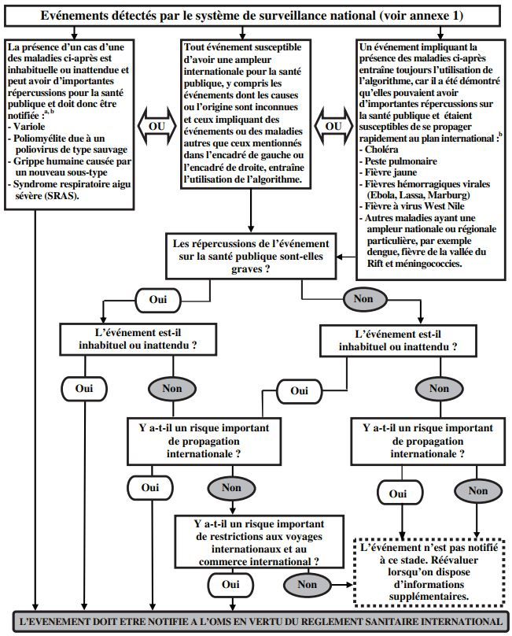
>
> a Selon les définitions de cas de l’OMS.
>
> b Cette liste de maladies est à utiliser uniquement aux fins du présent Règlement.
>
> \**«EXEMPLES POUR L’APPLICATION DE L’INSTRUMENT DE DECISION A L’EVALUATION ET LA NOTIFICATION D’EVENEMENTS QUI PEUVENT CONSTITUER UNE URGENCE DE SANTE PUBLIQUE DE PORTEE INTERNATIONALE**
>
> \***Les exemples figurant dans la présente annexe n’ont pas de caractère contraignant et sont fournis à titre indicatif pour aider à l’interprétation des critères applicables à l’instrument de décision.»***
>
> \**L’EVENEMENT REPOND-IL A DEUX AU MOINS DES CRITERES SUIVANTS ?**
>
> 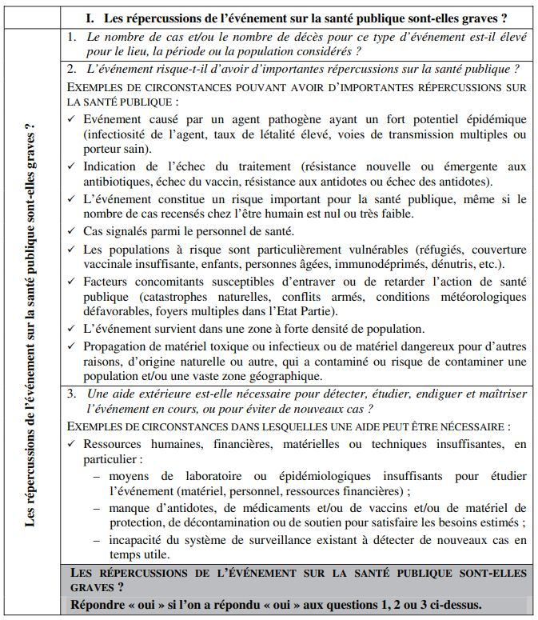
>
> 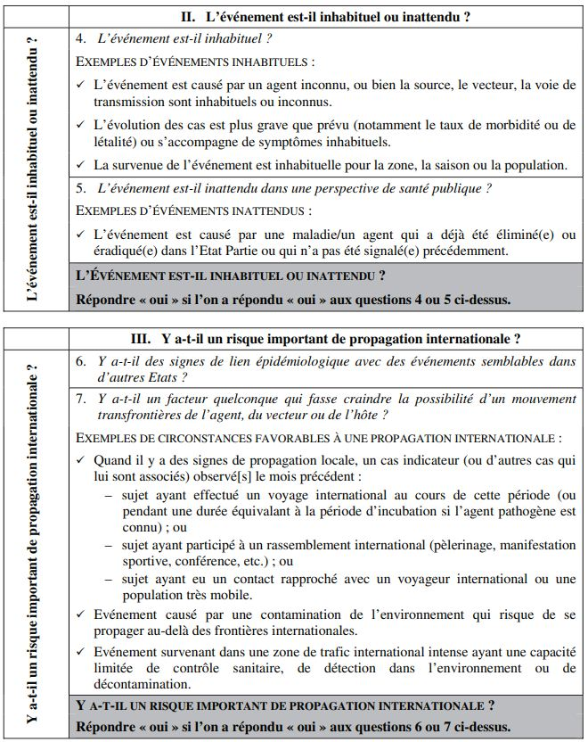
>
> 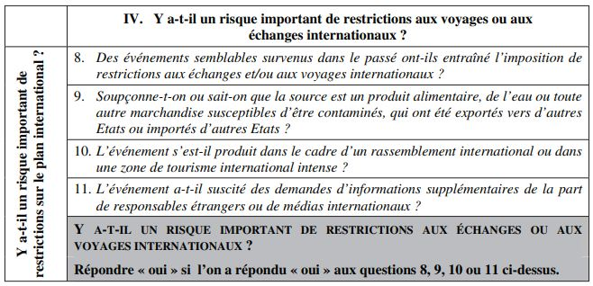
>
> \**Les Etats Parties ayant répondu « oui » à la question de savoir si l’événement satisfait à deux des quatre critères (I-IV) énoncés ci-dessus doivent adresser une notification à l’OMS, en vertu de l’article 6 du Règlement sanitaire international.**
>
> ANNEXE 3
>
> \**MODELE DE CERTIFICAT D’EXEMPTION DE CONTROLE SANITAIRE DE NAVIRE/**
>
> \**CERTIFICAT DE CONTROLE SANITAIRE DE NAVIRE**
>
> Port : ................................. Date : ………...........................
>
> Le présent certificat rend compte de l’inspection et 1) de l’exemption du contrôle ou 2) des mesures appliquées
>
> Nom du navire ou du bateau de navigation intérieure ........................... Pavillon ................. N° d’immatriculation/OMI ...........................
>
> Au moment de l’inspection, les cales étaient déchargées/chargées de …………… tonnes de cargaison
>
> Nom et adresse du bureau d’inspection.....................................................
>
> <table>
> <tr>
> <td colspan="4"><b>Certificat d’exemption de contrôle sanitaire de navire</b></td>
> <td></td>
> <td colspan="3"><b>Certificat de contrôle sanitaire de navire</b></td>
> </tr>
> <tr>
> <td><b>Secteurs , [systèmes et</b> <b>services] inspectés</b></td>
> <td><b>Signes</b> <b>constatés1</b></td>
> <td><b>Résultats</b> <b>de l’analyse</b> <b>des</b> <b>échantillons2</b></td>
> <td><b>Documents</b> <b>examinés</b></td>
> <td></td>
> <td><b>Mesures de lutte</b> <b>appliquées</b></td>
> <td><b>Date de</b> <b>réinspection</b></td>
> <td><b>Remarques</b> <b>concernant</b> <b>les conditions</b> <b>observées</b></td>
> </tr>
> <tr>
> <td>Cuisine</td>
> <td></td>
> <td></td>
> <td>Journal du médecin de bord</td>
> <td></td>
> <td></td>
> <td></td>
> <td></td>
> </tr>
> <tr>
> <td>Cambuse</td>
> <td></td>
> <td></td>
> <td>Journal de bord</td>
> <td></td>
> <td></td>
> <td></td>
> <td></td>
> </tr>
> <tr>
> <td>Entrepôts de stockage</td>
> <td></td>
> <td></td>
> <td>Autres</td>
> <td></td>
> <td></td>
> <td></td>
> <td></td>
> </tr>
> <tr>
> <td>Cale(s)/cargaison</td>
> <td></td>
> <td></td>
> <td></td>
> <td></td>
> <td></td>
> <td></td>
> <td></td>
> </tr>
> <tr>
> <td>Quartiers :</td>
> <td></td>
> <td></td>
> <td></td>
> <td></td>
> <td></td>
> <td></td>
> <td></td>
> </tr>
> <tr>
> <td>– postes d’équipage</td>
> <td></td>
> <td></td>
> <td></td>
> <td></td>
> <td></td>
> <td></td>
> <td></td>
> </tr>
> <tr>
> <td>– carré des officiers</td>
> <td></td>
> <td></td>
> <td></td>
> <td></td>
> <td></td>
> <td></td>
> <td></td>
> </tr>
> <tr>
> <td>– cabines des passagers</td>
> <td></td>
> <td></td>
> <td></td>
> <td></td>
> <td></td>
> <td></td>
> <td></td>
> </tr>
> <tr>
> <td>– pont</td>
> <td></td>
> <td></td>
> <td></td>
> <td></td>
> <td></td>
> <td></td>
> <td></td>
> </tr>
> <tr>
> <td>Eau potable</td>
> <td></td>
> <td></td>
> <td></td>
> <td></td>
> <td></td>
> <td></td>
> <td></td>
> </tr>
> <tr>
> <td>Eaux usées</td>
> <td></td>
> <td></td>
> <td></td>
> <td></td>
> <td></td>
> <td></td>
> <td></td>
> </tr>
> <tr>
> <td>Ballast</td>
> <td></td>
> <td></td>
> <td></td>
> <td></td>
> <td></td>
> <td></td>
> <td></td>
> </tr>
> <tr>
> <td>Déchets solides et médicaux</td>
> <td></td>
> <td></td>
> <td></td>
> <td></td>
> <td></td>
> <td></td>
> <td></td>
> </tr>
> <tr>
> <td>Eaux stagnantes</td>
> <td></td>
> <td></td>
> <td></td>
> <td></td>
> <td></td>
> <td></td>
> <td></td>
> </tr>
> <tr>
> <td>Salle des machines</td>
> <td></td>
> <td></td>
> <td></td>
> <td></td>
> <td></td>
> <td></td>
> <td></td>
> </tr>
> <tr>
> <td>Services médicaux</td>
> <td></td>
> <td></td>
> <td></td>
> <td></td>
> <td></td>
> <td></td>
> <td></td>
> </tr>
> <tr>
> <td>Autres secteurs spécifiés – voir pièce jointe</td>
> <td></td>
> <td></td>
> <td></td>
> <td></td>
> <td></td>
> <td></td>
> <td></td>
> </tr>
> <tr>
> <td>Pour les secteurs non concernés, indiquer « sans objet »</td>
> <td></td>
> <td></td>
> <td></td>
> <td></td>
> <td></td>
> <td></td>
> <td></td>
> </tr>
> <tr>
> <td colspan="4">Aucun signe constaté. Le navire/bateau est exempté de mesures de lutte.</td>
> <td></td>
> <td colspan="3">Les mesures de lutte indiquées ont été appliquées à la date ci-dessous.</td>
> </tr>
> <tr>
> <td colspan="8">Nom et titre de l’agent qui délivre le certificat ……………………..……..…..………..…………………..…………  Signature et sceau …………………………………..……..…………………  Date ………………..</td>
> </tr>
> <tr>
> <td colspan="8">1  a) Signes d’infection ou de contamination, y compris : vecteurs à tous les stades de leur croissance, réservoirs animaux de vecteurs, rongeurs ou autres espèces qui pourraient être porteurs de maladies humaines, risques microbiologiques, chimiques et autres pour la santé humaine, mesures d’hygiène insuffisantes ; b) Information concernant des cas humains (à faire figurer dans la déclaration maritime de santé). 2  Résultats de l’analyse des échantillons prélevés à bord : résultats à fournir dans les plus brefs délais au capitaine du navire et, si une nouvelle inspection est requise, à l’escale suivante, la plus appropriée compte tenu de la date de réinspection indiquée dans le certificat. Les certificats d’exemption de contrôle sanitaire et les certificats de contrôle sanitaire sont valables six mois au maximum ; toutefois, la durée de validité peut être prolongée d’un mois si l’inspection ne peut pas être effectuée au port et s’il n’y a aucun signe d’infection ou de contamination.</td>
> </tr>
> </table>
>
> PIECE JOINTE AU MODELE DE CERTIFICAT D’EXEMPTION DE CONTROLE SANITAIRE DE NAVIRE/ CERTIFICAT DE CONTROLE SANITAIRE DE NAVIRE
>
> | **Secteurs/installations/** **systèmes inspectés** | **Signes** **constatés** | **Résultats de l’analyse** **des échantillons** | **Documents** **examinés** | **Mesures de lutte** **appliquées** | **Date de** **réinspection** | **Remarques concernant** **les conditions observées** |
> |---|---|---|---|---|---|---|
> | **Nourriture** |  |  |  |  |  |  |
> | Source |  |  |  |  |  |  |
> | Stockage |  |  |  |  |  |  |
> | Préparation |  |  |  |  |  |  |
> | Service |  |  |  |  |  |  |
> | **Eau** |  |  |  |  |  |  |
> | Source |  |  |  |  |  |  |
> | Stockage |  |  |  |  |  |  |
> | Distribution |  |  |  |  |  |  |
> | **Déchets** |  |  |  |  |  |  |
> | Stockage |  |  |  |  |  |  |
> | Traitement |  |  |  |  |  |  |
> | Evacuation |  |  |  |  |  |  |
> | **Piscines/spas** |  |  |  |  |  |  |
> | Equipement |  |  |  |  |  |  |
> | Fonctionnement |  |  |  |  |  |  |
> | **Services médicaux** |  |  |  |  |  |  |
> | Equipement et appareils médicaux |  |  |  |  |  |  |
> | Fonctionnement |  |  |  |  |  |  |
> | Médicaments |  |  |  |  |  |  |
> | **Autres secteurs inspectés** |  |  |  |  |  |  |
> |  |  |  |  |  |  |  |
> |  |  |  |  |  |  |  |
> |  |  |  |  |  |  |  |
>
> \*Lorsque des secteurs figurant sur cette liste ne sont pas concernés, indiquez « sans objet ».*
>
> ANNEXE 4
>
> \**PRESCRIPTIONS TECHNIQUES APPLICABLES AUX MOYENS**
>
> \**DE TRANSPORT ET AUX EXPLOITANTS DE MOYENS DE TRANSPORT**
>
> **Section A. Exploitants de moyens de transport**
>
> 1\. Les exploitants de moyens de transport faciliteront :
>
> a) les inspections de la cargaison, des conteneurs et du moyen de transport;
>
> b) les examens médicaux des personnes présentes à bord;
>
> c) l’application des autres mesures sanitaires prévues dans le présent Règlement; et
>
> d) la fourniture des informations de santé publique requises par l’Etat Partie.
>
> 2\. Les exploitants de moyens de transport fourniront à l’autorité compétente des Etats Parties un certificat valable d’exemption de contrôle sanitaire, ou de contrôle sanitaire de navire, ou une déclaration maritime de santé, ou la partie relative aux questions sanitaires de la Déclaration générale d’aéronef, comme l’exige le présent Règlement.
>
> **Section B. Moyens de transport**
>
> 1\. Les mesures appliquées en vertu du présent Règlement à un bagage, une cargaison, un conteneur, un moyen de transport ou une marchandise seront mises en œuvre de façon à éviter autant que possible tout traumatisme ou gêne pour les personnes et tout dommage pour les bagages, la cargaison, le conteneur, le moyen de transport ou les marchandises. Les mesures sont appliquées, si possible et approprié, lorsque le moyen de transport et les cales sont vides.
>
> 2\. Les Etats Parties doivent indiquer par écrit les mesures appliquées à une cargaison, un conteneur ou un moyen de transport, les parties traitées, les méthodes employées et les raisons de leur application. Ces informations sont communiquées par écrit à la personne responsable de l’aéronef et, dans le cas d’un navire, elles sont notées sur le certificat de contrôle sanitaire de navire. Pour d’autres cargaisons, conteneurs ou moyens de transport, les Etats Parties remettent ces informations par écrit aux expéditeurs, destinataires, transporteurs et à la personne chargée du transport ou à leur agent.
>
> ANNEXE 5
>
> \**MESURES PARTICULIERES CONCERNANT LES MALADIES A TRANSMISSION VECTORIELLE**
>
> 1\. L’OMS publie régulièrement la liste des zones en provenance desquelles tout moyen de transport doit faire l’objet des mesures de désinsectisation ou des autres mesures de lutte antivectorielle recommandées. Ces zones sont définies conformément aux procédures applicables aux recommandations temporaires ou permanentes, selon le cas.
>
> 2\. Les moyens de transport quittant un point d’entrée situé dans une zone où la lutte antivectorielle est recommandée doivent être désinsectisés et maintenus exempts de vecteurs. Lorsque l’Organisation préconise des méthodes et des matériels pour ces opérations, ceux-ci doivent être utilisés. La présence de vecteurs à bord des moyens de transport et les mesures de lutte prises pour les éradiquer doivent être consignées :
>
> a) dans le cas d’un aéronef, dans la partie relative aux questions sanitaires de la Déclaration générale d’aéronef, sauf si l’autorité compétente de l’aéroport d’arrivée accorde une dispense permettant de ne pas remplir cette partie;
>
> b) dans le cas d’un navire, sur le certificat de contrôle sanitaire de navire; et
>
> c) dans le cas d’autres moyens de transport, sur une attestation écrite de traitement délivrée à l’expéditeur, au destinataire, au transporteur et à la personne chargée du transport ou à leur agent.
>
> 3\. Les Etats Parties doivent accepter les mesures de désinsectisation, de dératisation et autres mesures de lutte antivectorielle appliquées aux moyens de transport par d’autres Etats, si les méthodes et les matériels préconisés par l’Organisation ont été utilisés.
>
> 4\. Les Etats Parties doivent mettre sur pied des programmes pour lutter contre les vecteurs susceptibles de transporter un agent infectieux constituant un risque pour la santé publique dans un périmètre d’au moins 400 mètres à partir des zones des installations au point d’entrée qui sont utilisées pour les opérations concernant les voyageurs, moyens de transport, conteneurs, cargaisons et colis postaux, voire davantage si les vecteurs présents ont un plus grand rayon d’action.
>
> 5\. Si une inspection complémentaire est requise pour déterminer le succès des mesures de lutte antivectorielle appliquées, les autorités compétentes de la prochaine escale portuaire ou aéroportuaire connue habilitées à procéder à une telle inspection doivent en être informées à l’avance par l’autorité compétente qui en fait la demande. Dans le cas d’un navire, cette inspection doit être consignée sur le certificat de contrôle sanitaire de navire.
>
> 6\. Un moyen de transport est considéré comme suspect et doit être inspecté pour y déceler la présence de vecteurs ou réservoirs :
>
> a) s’il y a à bord un cas possible de maladie à transmission vectorielle;
>
> b) si un cas possible de maladie à transmission vectorielle est survenu à bord au cours d’un voyage international; ou
>
> c) si ce moyen de transport a quitté une zone affectée alors que les vecteurs présents à bord pouvaient encore être porteurs de maladie.
>
> 7\. Un Etat Partie ne peut pas interdire l’atterrissage d’un aéronef dans un aéroport de son territoire ou l’arrivée d’un navire si les mesures de lutte visées au paragraphe 3 de la présente annexe, ou recommandées autrement par l’Organisation, sont appliquées. Toutefois, les aéronefs ou les navires provenant d’une zone affectée peuvent être tenus d’atterrir à des aéroports ou détournés vers d’autres ports spécialement désignés à cet effet par l’Etat Partie.
>
> 8\. Un Etat Partie peut appliquer des mesures de lutte antivectorielle à un moyen de transport en provenance d’une zone où sévit une maladie à transmission vectorielle si les vecteurs de cette maladie sont présents sur son territoire.
>
> ANNEXE 6
>
> \**VACCINATION, PROPHYLAXIE ET CERTIFICATS Y AFFERENTS**
>
> 1\. Les vaccins ou autres agents prophylactiques mentionnés à l’annexe 7 ou recommandés dans le présent Règlement doivent être de qualité satisfaisante; les vaccins et agents prophylactiques prescrits par l’OMS doivent être soumis à son approbation. Sur demande, l’Etat Partie fournit à l’OMS des éléments appropriés attestant l’adéquation des vaccins et agents prophylactiques administrés sur son territoire en vertu du présent Règlement.
>
> 2\. Les personnes à qui des vaccins ou autres agents prophylactiques sont administrés en vertu du présent Règlement reçoivent un certificat international de vaccination ou un certificat attestant l’administration d’une prophylaxie (ci-après dénommé le «certificat»), conforme au modèle figurant dans la présente annexe. Ce modèle doit être scrupuleusement respecté.
>
> 3\. Les certificats visés par la présente annexe ne sont valables que si le vaccin ou l’agent prophylactique utilisé a été approuvé par l’OMS.
>
> 4\. Les certificats doivent être signés de la main du clinicien - médecin ou autre agent de santé agréé - qui supervise l’administration du vaccin ou de l’agent prophylactique; ils doivent aussi porter le cachet officiel du centre habilité qui ne peut, toutefois, être considéré comme tenant lieu de signature.
>
> 5\. Les certificats doivent être remplis intégralement en anglais ou en français; ils peuvent l’être aussi, en plus, dans une autre langue.
>
> 6\. Toute correction ou rature sur les certificats ou l’omission d’une quelconque des informations demandées peut entraîner leur nullité.
>
> 7\. Les certificats sont individuels et ne doivent en aucun cas être utilisés à titre collectif. Les enfants doivent être munis de certificats distincts.
>
> 8\. Lorsque le certificat est délivré à un enfant qui ne sait pas écrire, un de ses parents ou tuteurs doit le signer à sa place. La signature d’un illettré doit être remplacée, comme il est d’usage en pareil cas, par sa marque authentifiée par un tiers.
>
> 9\. Si le clinicien responsable est d’avis que la vaccination ou l’administration d’une prophylaxie est contre-indiquée pour des raisons médicales, il remet à l’intéressé un certificat de contre-indication dûment motivé, rédigé en anglais ou en français et, le cas échéant, dans une autre langue en plus de l’anglais ou du français, que les autorités compétentes du lieu d’arrivée doivent prendre en compte. Le clinicien responsable et les autorités compétentes informent l’intéressé de tout risque associé à la non-vaccination ou à la non-utilisation de la prophylaxie conformément aux dispositions de l’article 23, paragraphe 4.
>
> 10\. Un document équivalent délivré par les forces armées à un membre actif de ces forces sera accepté en lieu et place d’un certificat international conforme au modèle figurant dans la présente annexe :
>
> a) s’il contient des informations médicales essentiellement identiques à celles requises dans le modèle; et
>
> b) s’il indique en anglais ou en français, et le cas échéant dans une autre langue en plus de l’anglais ou du français, la nature et la date de la vaccination ou de l’administration de la prophylaxie, et s’il est délivré conformément au présent paragraphe.
>
> \**MODELE DE CERTIFICAT INTERNATIONAL DE VACCINATION**
>
> \**OU DE CERTIFICAT ATTESTANT L’ADMINISTRATION D’UNE PROPHYLAXIE**
>
> Nous certifions que [nom] . . . . . . . . . . . . . . . . . . . . . . . . . . . né(e) le . . . . . . . . . . . . . . . . . . . . . ., de sexe . . . . .
>
> et de nationalité . . . . . . . . . . . . . . . . . . ., document d’identification national, le cas échéant . . . . . . . . . . . . . . . . .
>
> dont la signature suit . . . . . . . . . . . . . . . . . . . . . . . . . . .
>
> à été vacciné(e) ou a reçu des agents prophylactiques à la date indiquée contre:
>
> (nom de la maladie ou de l’affection) . . . . . . . . . . . . . . . . . . . . . . . . . . . . . . . . . . . . . . . . . . . .
>
> conformément au Règlement sanitaire international.
>
> | **Vaccin ou** **agent prophy-** **lactique** | **Date** | **Signature et** **titre** **du clinicien** **responsable** | **Fabricant du** **vaccin ou de** **l’agent prophylactique** **et numéro du** **lot** | **Certificat** **valable** **à partir du:** **jusqu’au:** | **Cachet offi-** **ciel** **du centre** **habilité** |
> |---|---|---|---|---|---|
> | 1. |  |  |  |  |  |
> | 2. |  |  |  |  |  |
>
> Ce certificat n’est valable que si le vaccin ou l’agent prophylactique utilisé a été approuvé par l’Organisation mondiale de la Santé.
>
> Ce certificat doit être signé de la main du clinicien – médecin ou autre agent de santé agréé - qui supervise l’administration du vaccin ou de l’agent prophylactique; il doit aussi porter le cachet officiel du centre habilité qui ne peut, toutefois, être considéré comme tenant lieu de signature.
>
> Toute correction ou rature sur le certificat ou l’omission d’une quelconque des informations demandées peut entraîner sa nullité.
>
> Ce certificat est valable jusqu’à la date indiquée pour le vaccin ou l’agent prophylactique administré. Il doit être établi intégralement en anglais ou en français. Le même certificat peut aussi être établi dans une autre langue, en plus de l’anglais ou du français.
>
> ANNEXE 7
>
> \**PRESCRIPTIONS CONCERNANT LA VACCINATION OU LA PROPHYLAXIE**
>
> \**CONTRE CERTAINES MALADIES**
>
> 1\. En plus des éventuelles recommandations concernant la vaccination ou l’administration d’une prophylaxie, l’entrée des voyageurs dans un Etat Partie peut être subordonnée à la présentation de la preuve de la vaccination ou de l’administration d’une prophylaxie contre les maladies suivantes expressément désignées par le présent Règlement :
>
> Fièvre jaune.
>
> 2\. Considérations et prescriptions concernant la vaccination contre la fièvre jaune :
>
> a) Aux fins de la présente annexe,
>
> i) la période d’incubation de la fièvre jaune est de six jours;
>
> ii) les vaccins antiamarils approuvés par l’OMS confèrent une protection contre l’infection qui prend effet 10 jours après l’administration du vaccin;
>
> iii) cette protection dure 10 ans; et
>
> iv) la validité d’un certificat de vaccination contre la fièvre jaune est de 10 ans, à compter du dixième jour suivant la date de vaccination ou, dans le cas d’une revaccination au cours de cette période de 10 ans, à compter de la date de revaccination.
>
> b) La vaccination contre la fièvre jaune peut être exigée de tout voyageur quittant une zone dans laquelle l’Organisation a déterminé qu’il existe un risque de transmission de la fièvre jaune.
>
> c) Un voyageur muni d’un certificat de vaccination antiamarile non encore valable peut être autorisé à partir, mais les dispositions du paragraphe 2.h) de la présente annexe peuvent lui être appliquées à l’arrivée.
>
> d) Un voyageur muni d’un certificat valable de vaccination contre la fièvre jaune ne doit pas être considéré comme suspect, même s’il provient d’une zone dans laquelle l’Organisation a établi qu’il existe un risque de transmission de la fièvre jaune.
>
> e) Conformément aux dispositions de l’annexe 6, paragraphe 1, le vaccin antiamaril utilisé doit être approuvé par l’Organisation.
>
> f) Les Etats Parties désignent des centres déterminés de vaccination antiamarile sur leur territoire pour garantir la qualité et la sécurité des procédures et des matériels utilisés.
>
> g) Toute personne employée à un point d’entrée dans une zone dans laquelle l’Organisation a établi qu’il existe un risque de transmission de la fièvre jaune, ainsi que tout membre de l’équipage d’un moyen de transport qui utilise ce point d’entrée, doivent être munis d’un certificat valable de vaccination contre la fièvre jaune.
>
> h) Un Etat Partie sur le territoire duquel des vecteurs de la fièvre jaune sont présents peut exiger qu’un voyageur en provenance d’une zone dans laquelle l’Organisation a établi qu’il existe un risque de transmission de la fièvre jaune soit, s’il n’est pas en mesure de présenter un certificat valable de vaccination antiamarile, mis en quarantaine pendant un maximum de six jours à compter de la date de la dernière exposition possible à l’infection, à moins que son certificat de vaccination ne soit devenu valable entre-temps.
>
> i) Les voyageurs en possession d’un certificat d’exemption de vaccination antiamarile signé par un médecin autorisé ou un agent de santé agréé peuvent néanmoins être autorisés à entrer sur le territoire, sous réserve des dispositions de l’alinéa précédent de la présente annexe et pour autant qu’ils aient reçu des informations sur la protection contre les vecteurs de la fièvre jaune. Les voyageurs qui n’ont pas été mis en quarantaine peuvent être tenus de signaler tout symptôme fébrile ou tout autre symptôme pertinent à l’autorité compétente et placés sous surveillance.
>
> ANNEXE 8
>
> \**MODELE DE DECLARATION MARITIME DE SANTE**
>
> A remplir par les capitaines des navires en provenance de ports étrangers et à présenter aux autorités compétentes.
>
> | Présentée au port de …………………………………………………. Date …………………….. |
> |---|
> | Nom du navire ou du bateau de navigation intérieure ………………………………….. Numéro d’immatriculation/OMI…………………… |
> | en provenance de ………………. à destination de ………………….. |
> | (Nationalité) (Pavillon du navire) …………………………………….                               Nom du capitaine ………………………………….. |
> | Jauge brute (navire)……………… |
> | Jauge (bateau de navigation intérieure) …………………. |
> | Certificat valable de contrôle/d’exemption de contrôle sanitaire à bord ?         oui ……….         non ………... |
> | Délivré à ……………..…………….. Date ……………………. |
> | Nouvelle inspection requise ? oui ……………….. non …………………. |
> | Le navire/bateau s’est-il rendu dans une zone affectée telle que définie par l’OMS ? oui …………. non ………. |
> | Nom du port et date de la visite ……………………… |
> | Liste des escales depuis le début du voyage (avec indication des dates de départ) ou au cours des 30 derniers jours, à moins que le voyage n’ait duré moins de 30 jours : |
> | …………………………………………………………………………………………………………………………………… |
>
> Si l’autorité compétente du port d’arrivée en fait la demande, liste des membres de l’équipage, passagers ou autres personnes qui on embarqué sur le navire/bateau depuis le début du voyage international ou au cours des 30 derniers jours, à moins que le voyage n’ait dur moins de 30 jours, et nom de tous les ports/pays visités au cours de cette période (ajouter les noms dans le tableau ci-contre) :
>
> <table>
> <tr>
> <td>1)</td>
> <td>Nom</td>
> <td>embarqué à :</td>
> <td>1)</td>
> <td>2)</td>
> <td>3)</td>
> </tr>
> <tr>
> <td>2)</td>
> <td>Nom</td>
> <td>embarqué à :</td>
> <td>1)</td>
> <td>2)</td>
> <td>3)</td>
> </tr>
> <tr>
> <td>3)</td>
> <td>Nom</td>
> <td>embarqué à :</td>
> <td>1)</td>
> <td>2)</td>
> <td>3)</td>
> </tr>
> <tr>
> <td colspan="2">Effectif de l’équipage</td>
> <td></td>
> <td></td>
> <td></td>
> <td></td>
> </tr>
> <tr>
> <td colspan="2">Nombre de passagers à bord</td>
> <td></td>
> <td></td>
> <td></td>
> <td></td>
> </tr>
> </table>
>
> \**Questions de santé**
>
> 1\) Y a-t-il eu un décès à bord au cours du voyage, autrement que par accident ?     oui …..    non …..
>
> Si oui, donner les détails dans le tableau ci-contre.                     Nombre total de décès………….
>
> 2\) Y a-t-il à bord, ou y a-t-il eu au cours du voyage international, des cas suspects de maladie de caractère infectieux ?
>
> oui …..   non …..   Si oui, donner les détails dans le tableau ci-contre.
>
> 3\) Le nombre total de passagers malades au cours du voyage a-t-il été supérieur à la normale/au nombre escompté ?
>
> oui …..    non …..    Quel a été le nombre de malades ?………….
>
> 4\) Y a-t-il actuellement des malades à bord ?    oui …..    non …..    Si oui, donner les détails dans le tableau ci-contre.
>
> 5\) Un médecin a-t-il été consulté ?    oui …..    non …..    Si oui, donner les détails du traitement ou des avis médicaux dans le tableau ci-contre.
>
> 6\) Avez-vous connaissance de l’existence à bord d’une affection susceptible d’être à l’origine d’une infection ou de la propagation d’une maladie ?    oui …..    non ..…    Si oui, donner les détails dans le tableau ci-contre.
>
> 7\) Des mesures sanitaires quelconques (quarantaine, isolement, désinfection ou décontamination, par ex.) ont-elles été prises à bord ?
>
> oui …..    non …..    Si oui, préciser lesquelles, le lieu et la date……………………………………………………………………….
>
> 8\) Des passagers clandestins ont-ils été découverts à bord ?    oui …..    non …..    Si oui, où sont-ils montés à bord (à votre connaissance) ?
>
> 9\) Y a-t-il un animal/animal de compagnie malade à bord ?    oui …..    non …..
>
> | Note : | En l’absence d’un médecin, le capitaine doit considérer les symptômes suivants comme des signes faisant présumer l’existence d’une maladie de caractère infectieux : fièvre, persistant plusieurs jours, accompagnée de : i) prostration ; ii) diminution de la conscience ; iii) hypertrophie ganglionnaire ; iv) ictère ; v) toux ou difficultés respiratoires ; vi) saignements inhabituels ; ou vii) paralysie. fièvre, ou absence de fièvre, accompagnée de : i) érythème ou éruption cutanée aigus ; ii) forts vomissements (non provoqués par le mal de mer) ; iii) diarrhée sévère ; ou iv) convulsions récurrentes. |
> |---|---|
>
> Je déclare que les renseignements et réponses figurant dans la présente déclaration de santé (y compris le tableau) sont, à ma connaissance, exacts et conformes à la vérité.
>
> |  | Signé Capitaine |
> |---|---|
> |  | Contresigné Médecin de bord (s’il y a lieu) |
> | Date …………………………………… |  |
>
> \**PIECE JOINTE AU MODELE DE DECLARATION MARITIME DE SANTE**
>
> 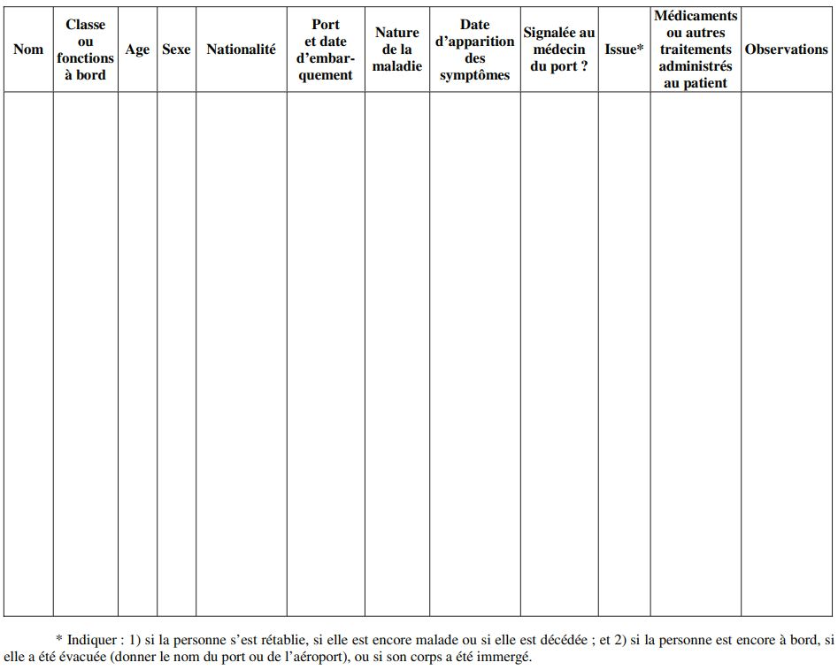
>
> ANNEXE 9
>
> \**CE DOCUMENT FAIT PARTIE DE LA DECLARATION**   **GENERALE D’AERONEF PROMULGUEE PAR  ** **L’ORGANISATION INTERNATIONALE DE L’AVIATION CIVILE**[^1-17]
>
> \**PARTIE RELATIVE AUX QUESTIONS SANITAIRES  ** **DE LA DECLARATION GENERALE D’AERONEF**
>
> \*Déclaration de santé*
>
> | Cas de maladie, à l’exclusion du mal de l’air ou des accidents (y compris les personnes présentant des symptômes ou signes tels qu’éruption, fièvre, frissons, diarrhée), constatés à bord ou débarqués au cours du voyage |
> |---|
> |  |
>
> | Présence à bord d’autres affections susceptibles d’être à l’origine de la propagation d’une maladie |
> |---|
> |  |
>
> | Détails se rapportant à chaque désinsectisation ou autre mesure d’hygiène (lieu, date, heure, méthode) pratiquée en cours de vol. S’il n’y a pas eu de désinsectisation en cours de vol, donner des précisions sur la désinsectisation la plus récente |
> |---|
> |  |
>
> | Signature (si nécessaire): |
> |---|
>
> Membre de l’équipage concerné
>
> Huitième séance plénière, 23 mai 2005
>
> A58/VR/8

### Arrêté grand-ducal du 8 juillet 2020 portant publication du Règlement sanitaire international (2005).

#### Art. 1er.

Le Règlement sanitaire international, adopté en date du 23 mai 2005 par la cinquante-huitième assemblée mondiale de la santé de l’Organisation mondiale de la Santé, sera publié au Journal officiel du Grand-Duché de Luxembourg pour sortir ses effets.

#### Art. 2.

Notre ministre ayant les Affaires étrangères et européennes dans ses attributions et Notre ministre ayant la Santé dans ses attributions sont chargés, chacun en ce qui le concerne, de l’exécution du présent arrêté qui sera publié au Journal officiel du Grand-Duché de Luxembourg.

> Annexe
>
> Pour visualiser l’annexe, veuillez consulter la [version pdf du Journal officiel](https://data.legilux.public.lu/filestore/eli/etat/leg/agd/2020/07/08/a577/jo/fr/pdfa/eli-etat-leg-agd-2020-07-08-a577-jo-fr-pdfa.pdf).

## ORGANISMES GÉNÉTIQUEMENT MODIFIÉS

### DISPOSITIONS GÉNÉRALES

#### Version consolidée applicable au 03/04/2017 : Loi du 13 janvier 1997 relative au contrôle de l’utilisation et de la dissémination des organismes génétiquement modifiés.

##### TITRE Ier — Dispositions générales

###### Art. 1er.- — Objet

Dans le but de protéger la santé humaine et l’environnement, la présente loi établit des mesures auxquelles sont soumises

aash l’utilisation confinée des organismes génétiquement modifiés,

bash la dissémination volontaire d’organismes génétiquement modifiés dans l’environnement,

cash la mise sur le marché de produits consistant en organismes génétiquement modifiés ou en contenant, destinés ensuite à une dissémination volontaire dans l’environnement.

###### Art. 2 — Définitions

Au sens de la présente loi on entend par

a) «organisme»: toute entité biologique non cellulaire, cellulaire ou multicellulaire capable de se reproduire ou de transférer du matériel génétique; cette définition englobe les micro-organismes;

b) «organisme génétiquement modifié» (OGM): un organisme, à l’exception des êtres humains, dont le matériel génétique a été modifié d’une manière qui ne s’effectue pas naturellement par multiplication et/ou recombinaison naturelle;

c) «micro-organisme»: toute entité microbiologique, cellulaire ou non, capable de se reproduire ou de transférer du matériel génétique, y compris les virus, les viroïdes et les cultures de cellules végétales et animales;

d) «utilisation confinée»: toute opération dans laquelle des micro-organismes sont génétiquement modifiés ou dans laquelle des OGM sont cultivés, stockés, transportés, détruits, éliminés ou utilisés de toute autre manière et pour laquelle des mesures de confinement spécifiques sont prises pour limiter le contact de ces microorganismes avec l’ensemble de la population et l’environnement ainsi que pour assurer à ces derniers un niveau élevé de sécurité;

e) «dissémination volontaire»: toute introduction intentionnelle dans l’environnement d’un OGM ou d’une combinaison d’OGM pour laquelle aucune mesure de confinement spécifique n’est prise pour limiter leur contact avec l’ensemble de la population et l’environnement et pour assurer à ces derniers un niveau élevé de sécurité;

f) «mise sur le marché»: la mise à la disposition de tiers, moyennant paiement ou gratuitement;

g) «produit»: une préparation consistant en un OGM ou une combinaison d’OGM, ou en contenant, mise sur le marché.

###### Art. 3 — Techniques de modification génétique

(1) Les techniques de modification génétique visées par la présente loi comprennent notamment:

a) les techniques de recombinaison de l’acide nucléique, dont l’acide désoxyribonucléique (ADN) impliquant la formation de nouvelles combinaisons de matériel génétique par l’insertion de molécules d’acide nucléique produites de n’importe quelle façon hors d’un organisme, à l’intérieur de tout virus, plasmide bactérien ou autre système vecteur et leur incorporation dans un organisme hôte à l’intérieur duquel elles n’apparaissent pas de façon naturelle, mais où elles peuvent se multiplier de façon continue;

b) les techniques impliquant l’incorporation directe dans un organisme, dont un micro-organisme, de matériel héréditaire préparé à l’extérieur de cet organisme, y compris la micro-injection, la macro-injection et la microencapsulation;

c) les techniques de fusion cellulaire, y compris la fusion de protoplastes, ou d’hybridation dans lesquelles des cellules vivantes présentant de nouvelles combinaisons de matériel héréditaire sont constituées par la fusion de deux ou plusieurs cellules au moyen de méthodes ne survenant pas de façon naturelle.

(2) Les techniques suivantes ne sont pas considérées comme entraînant une modification génétique, à condition qu’elles n’utilisent pas des molécules d’acide nucléique recombinant ou des OGM issus des techniques ou méthodes autres que celles exclues au titre de l’article 5 de la présente loi:

1\. la fécondation in vitro;

2\. des processus naturels comme la conjugaison, la transduction, la transformation;

3\. l’induction polyploïde.

###### Art. 4.- — Conditions d’honorabilité et de qualification professionnelle

(1) L’autorisation pour l’utilisation ou la dissémination d’OGM ne peut être accordée que si l’exploitant du laboratoire ou du site présente les garanties nécessaires d’honorabilité et de qualification professionnelle.

L’honorabilité s’apprécie sur base des antécédents judiciaires de l’exploitant et de tous les éléments fournis par l’enquête administrative.

Si l’exploitant est une personne morale, la condition d’honorabilité s’apprécie dans le chef de la personne chargée de la gestion ou de la direction de l’établissement, de la société ou de l’association.

Si l’exploitant ne dirige pas lui-même les travaux de recherche ou si l’exploitant est une personne morale, les conditions de qualification professionnelle doivent être remplies dans le chef du directeur des travaux de recherche, désigné par l’exploitant. Le directeur des travaux de recherche doit répondre également aux conditions d’honorabilité dont question ci-dessus.

Un règlement grand-ducal peut déterminer la qualification professionnelle dont question au présent article.

(2) Tout départ ou changement de l’exploitant du laboratoire ou du site ou du directeur des travaux de recherche doit être notifié au ministre dans le délai d’une semaine en indiquant comment les mesures de sécurité prévues dans l’autorisation sont assurées. Dans les deux mois qui suivent, le nom du remplaçant répondant aux critères d’honorabilité et de qualification professionnelle fixés au paragraphe précédent doit être notifié au ministre. A défaut d’une opposition dans le mois de la réception de cette notification, le ministre est censé approuver le remplacement.

Jusqu’à ce qu’il soit pourvu au remplacement de l’exploitant ou du directeur des travaux de recherche, le ministre peut, si les mesures de sécurité prévues dans l’autorisation ne sont plus suffisamment assurées, soit suspendre l’autorisation, soit permettre la continuation de tout ou partie des opérations. En cas de menace grave pour la santé humaine ou l’environnement il peut recourir aux mesures prévues au paragraphe (3) de l’article 37.

##### TITRE II — Dispositions relatives à l’utilisation confinée des organismes génétiquement modifiés.

###### Art. 5 — Exclusions

(1) Sont exclues du champ d’application du présent titre les techniques ou méthodes de modification génétique suivantes, à condition qu’elles n’impliquent pas l’utilisation de molécules d’acide nucléique recombinant ou d’OGM, autres que ceux qui sont issus d’une ou de plusieurs de ces techniques ou méthodes:

1\. la mutagenèse;

2\. la fusion cellulaire (y compris la fusion des protoplastes) d’espèces procaryotes qui échangent du matériel génétique par le biais de processus physiologiques connus;

3\. la fusion cellulaire (y compris la fusion des protoplastes) de cellules de n’importe quelle espèce eucaryote, y compris la production d’hybridomes et les fusions de cellules végétales;

4\. l’autoclonage, qui consiste en la suppression de séquences de l’acide nucléique dans une cellule d’un organisme, suivie ou non de la réinsertion de tout ou partie de cet acide nucléique (ou d’un équivalent synthétique), avec ou sans étapes mécaniques ou enzymatiques préalables, dans des cellules de la même espèce ou dans des cellules d’espèces étroitement liées du point de vue phylogénétique qui peuvent échanger du matériel génétique par le biais de processus physiologiques naturels, si le micro-organisme, qui en résulte ne risque pas de causer des maladies pouvant affecter l’homme, les animaux ou les végétaux.

L’autoclonage peut comporter l’utilisation des vecteurs recombinants dont une longue expérience a montré que leur utilisation dans les micro-organismes concernés était sans danger.

(2) Le présent titre ne s’applique pas aux utilisations confinées impliquant uniquement des types d’OGM qui ne présentent pas de danger pour la santé humaine et pour l’environnement. Les critères d’innocuité de ces OGM sont déterminés par règlement grand-ducal.

(3) A l’exception des dispositions de l’article 8, le présent titre ne s’applique pas au transport routier, ferroviaire, fluvial, maritime ou aérien d’OGM.

(4) Ne sont pas soumis aux dispositions du présent titre le stockage, la culture, le transport, la destruction, l’élimination ou l’utilisation d’OGM qui ont été mis sur le marché aux termes prévus par le chapitre II du titre III de la présente loi.

###### Art. 6 — Classification des utilisations confinées et mesures de confinement correspondantes

(1) Les micro-organismes sont classés par le ministre en quatre groupes distincts sur base de leur pathogénicité et en fonction des risques nul ou négligeable, faible, modéré ou élevé qu’ils présentent pour la santé humaine et l’environnement.

Les critères de classement, établis d’après l’état le plus avancé des connaissances scientifiques et techniques, sont fixés par règlement grand-ducal, pris sur avis du Conseil d’Etat.

(2) Sur base des éléments d’évaluation et de la procédure définis à l’article 8, et afin d’éviter que les utilisations confinées n’entraînent des effets négatifs pour la santé humaine et l’environnement, les utilisations confinées sont réparties en quatre classes, à savoir

aash Classe 1: opérations pour lesquelles le risque est nul ou négligeable;

bash Classe 2: opérations présentant un risque faible;

cash Classe 3: opérations présentant un risque modéré;

dash Classe 4: opérations présentant un risque élevé.

(3) A chaque classe d’utilisation confinée correspondent des principes généraux et des mesures de confinement que l’utilisateur doit appliquer. Les principes et mesures sont déterminés par règlement grand-ducal.

(4) En cas d’hésitation quant à la classe la mieux adaptée à l’utilisation confinée prévue, les mesures de protection les plus strictes sont à retenir.

(5) L’évaluation prévue au paragraphe 2 doit particulièrement prendre en considération la question de l’évacuation des déchets et des effluents. Le cas échéant, les mesures de sécurité nécessaires doivent être prises pour protéger la santé humaine et l’environnement.

###### Art. 7.- — Principes

(1) Toute utilisation d’OGM non couverte par une autorisation accordée en vertu du Titre III de la présente loi est interdite, à moins qu’il ne s’agisse d’une utilisation en milieu confiné autorisée par le ministre ayant dans ses compétences la santé, désigné ci-après par “le ministre”.

(2) L’autorisation est refusée si l’établissement dans lequel il est prévu d’effectuer l’opération n’est pas muni de l’autorisation prévue par la [loi du 9 mai 1990](https://legilux.public.lu/eli/etat/leg/loi/1990/05/09/n1/jo) relative aux établissements dangereux, insalubres ou incommodes.

###### Art. 8.- — Evaluation des risques

(1) Toutes les mesures appropriées doivent être prises afin d’éviter que l’utilisation confinée d’OGM n’entraîne des effets négatifs pour la santé humaine, pour la sécurité ainsi que pour l’environnement.

(2) A cet effet, l’exploitant du laboratoire ou le directeur des travaux de recherche, désigné ci-après par “l’utilisateur”, effectue une évaluation préalable des utilisations confinées du point de vue des risques qu’ils peuvent présenter pour la santé humaine, pour la sécurité ainsi que pour l’environnement.

(3) En procédant à cette évaluation, l’utilisateur tient en particulier dûment compte, pour tout OGM qu’il se propose d’utiliser, des dispositions prévues au règlement grand-ducal visé à l’article 6, paragraphe 2.

(4) L’utilisateur tient un dossier de cette évaluation et en fournit un résumé dans le cadre de la demande d’autorisation.

###### Art. 9.- — Demande d’autorisation

(1) En vue d’obtenir l’autorisation prescrite à l’article 7, l’exploitant du laboratoire dans lequel l’utilisation doit être mise en oeuvre, désigné ci-après par “l’exploitant”, introduit une demande auprès du ministre.

(2) Le ministre transmet la demande à la Direction de la santé, chargée de l’instruire. Le ministre s’entoure des avis de l’Administration de l’environnement et de l’Inspection du travail et des mines. Suivant la nature des opérations projetées il sollicite l’avis d’autres administrations et services concernés. Il peut consulter d’autres experts.

(3) Le ministre transmet la demande également aux fins d’avis au comité interministériel visé à l’article 29.

(4) Un règlement grand-ducal détermine les informations que doit comporter la demande.

(5) Le directeur de la Santé peut à tout moment demander à l’exploitant de fournir les informations complémentaires qu’il juge nécessaires.

(6) Lorsque l’instruction de la demande est terminée le directeur de la Santé transmet le dossier avec son avis au ministre de la Santé.

(7) Toute décision du ministre fixe également le montant représentatif des frais d’instruction. Ce montant est fonction de la nature de la demande et des difficultés de l’instruction. Il ne peut être ni inférieur à 250 euros ni supérieur à 5.000 euros.

Toutefois, le ministre, avant de commencer l’instruction de la demande, peut exiger le versement d’un montant qu’il détermine, dans les limites fixées à l’alinéa qui précède. Le ministre peut réajuster ce montant en cours de procédure vers le haut ou vers le bas, en tenant compte des difficultés effectivement rencontrées et des éléments d’appréciation dont question ci-dessus.

###### Art. 10.- — Consultation du public

(1) Lorsque la demande porte sur la première utilisation dans un laboratoire d’OGM, et que cette opération répond aux critères de la catégorie des utilisations donnant lieu à un risque moyen ou considérable pour la santé humaine et l’environnement, le public est admis à présenter ses observations à l’égard de toute demande d’autorisation introduite en vertu de l’article 9 ci-dessus.

(2) Un avis indiquant l’objet de la demande d’autorisation est affiché pendant quinze jours dans la commune où l’opération est projetée par les soins du collège des bourgmestre et échevins. L’affichage doit avoir lieu au plus tard dix jours après la réception du dossier.

L’affichage doit avoir lieu simultanément à la maison communale et, de manière bien apparente, à l’emplacement où l’opération est projetée. A dater du jour de l’affichage, un exemplaire de la demande avec ses annexes, à l’exception des informations reconnues confidentielles en vertu de l’article 30 ci-après, est déposé à la maison communale, et il pourra y être consulté par tous les intéressés.

L’avis indiqué à l’alinéa 1er est affiché pendant le même délai dans les communes limitrophes.

(3) En outre les demandes d’autorisation sont portées à la connaissance du public simultanément avec l’affichage visé ci-dessus par voie de publication par extrait dans au moins quatre journaux quotidiens imprimés et publiés au Grand-Duché. Les frais de cette publication sont à charge des requérants.

(4) A l’expiration du délai d’affichage de quinze jours, le bourgmestre ou un commissaire spécial qu’il délègue à cet effet, recueille les observations écrites et procède dans la commune où l’opération est projetée à une enquête de commodo et incommodo, dans laquelle sont entendus tous les intéressés qui se présentent. Il est dressé procès-verbal de cette enquête.

Le dossier, avec les pièces attestant la publication et le procès-verbal de l’enquête, est retourné, au plus tard quinze jours après l’expiration du délai d’affichage en deux exemplaires au ministre.

###### Art. 11.- — Modalités de l’autorisation

Le ministre, s’il accorde l’autorisation, fixe les réserves et conditions conformément au règlement grand-ducal visé à l’article 6, paragraphe 2.

Le ministre peut autoriser le demandeur à procéder à des utilisations similaires pendant une période déterminée avec dispense de nouvelle demande d’autorisation, du moment qu’il y a similitude de l’organisme, du type d’opération et du local d’utilisation. Une autorisation globale peut encore être accordée pour des opérations qui servent à l’enseignement, à la recherche, au développement ou à des fins non industrielles ou non commerciales et qui s’effectuent à petite échelle, à condition que ces opérations portent exclusivement sur l’utilisation d’OGM classés dans le groupe des OGM donnant lieu à un risque nul pour la santé humaine et l’environnement. Dans le cas de telles autorisations, le ministre soumet toute nouvelle utilisation à la condition d’une notification préalable.

L’autorisation peut être limitée dans le temps.

L’autorisation impose la mise en place d’un plan d’opération interne comprenant l’équipement de sécurité et les moyens d’alerte et d’intervention à mettre en oeuvre en cas d’incident ou d’accident.

Elle indique, sur proposition de l’exploitant, les noms des personnes compétentes pour la sécurité et qui sont habilitées à mettre en oeuvre les plans d’opération interne et à alerter le central téléphonique du secours d’urgence de la Protection civile.

Un exploitant de laboratoire qui a bénéficié d’une autorisation pour une utilisation d’OGM doit établir une demande pour une nouvelle autorisation si l’utilisation autorisée n’a pas été entamée dans un délai de trois ans ou si elle a été interrompue pendant plus de deux années consécutives.

###### Art. 12.- — Modification de l’utilisation confinée

(1) Si de nouveaux éléments d’information sont devenus disponibles au sujet de ces risques, soit pendant que le ministre examine la demande, soit après qu’il a accordé l’autorisation, l’exploitant du laboratoire doit immédiatement:

a) revoir les informations spécifiées dans la demande;

b) informer le ministre de la modification;

c) prendre les mesures nécessaires pour protéger la santé humaine et l’environnement.

(2) Sans préjudice des dispositions de l’article 37, toute modification de l’utilisation d’OGM qui ne répond plus aux critères de la catégorie de risque pour laquelle l’autorisation a été accordée doit être notifiée immédiatement au ministre par le titulaire de l’autorisation. Si cette nouvelle utilisation ou opération répond aux critères d’une catégorie donnant lieu à un risque plus élevé, le titulaire de l’autorisation devra solliciter une nouvelle autorisation conformément aux dispositions du présent titre.

###### Art. 13.- — Principes de bonne pratique microbiologique

(1) Sans préjudice des mesures de sécurité et des modalités de confinement déterminées par le règlement grand-ducal prévu à l’article 6, paragraphe 2, le ministre peut dans le cadre de l’autorisation fixer des mesures conformes aux principes de bonne pratique microbiologique et de sécurité et d’hygiène professionnelles, à savoir:

aash maintenir au plus faible niveau possible l’exposition des lieux de travail et de l’environnement à tout agent physique, chimique ou biologique;

bash prendre des mesures de maîtrise technique à la source et, si nécessaire, compléter celles-ci par l’emploi de vêtements et d’équipements personnels de protection appropriés;

cash tester convenablement et conserver en bon état les moyens de mesure et instruments de contrôle;

dash vérifier, si nécessaire, la présence d’organismes viables en dehors du confinement physique primaire;

eash assurer la formation du personnel;

fash mettre en place les commissions ou sous-commissions de sécurité biologique requises;

gash élaborer et mettre en oeuvre des codes locaux de bonne pratique pour la sécurité du personnel.

(2) Les mesures de confinement appliquées sont régulièrement revues par l’utilisateur de manière à tenir compte des nouvelles connaissances scientifiques ou techniques relatives à la gestion des risques ainsi qu’au traitement et à l’élimination des déchets.

###### Art. 14.- — Registre

Les utilisateurs d’OGM sont obligés de tenir un registre des travaux effectués et de le présenter, sur demande, aux personnes visées aux articles 36 et 39 ci-dessous.

##### TITRE III — Dispositions relatives à la dissémination volontaire et à la mise sur le marché d’organismes génétiquement modifiés.

###### Art. 15 — Exclusions

(1) Sont exclues du présent titre les techniques et méthodes de modification génétique produisant des organismes, à condition qu’elles n’impliquent pas l’utilisation de molécules d’acide nucléique recombinant ou d’OGM autres que ceux qui sont issus d’une ou plusieurs des techniques ou méthodes énumérées ci-après:

1\. la mutagenèse;

2\. la fusion cellulaire (y compris la fusion de protoplastes) de cellules végétales d’organismes qui peuvent échanger du matériel génétique par des méthodes de sélection traditionnelles.

(2) Le présent titre ne s’applique pas au transport d’OGM par le rail, par la route, par les voies navigables intérieures, par mer ou par air.

###### Art. 15*bis* — Evaluation des risques

(1) Quiconque présente une demande d’autorisation en vertu d’un des chapitres du présent titre doit procéder auparavant à une évaluation des risques pour l’environnement.

Le ministre, lors de l’examen de la demande, accorde une attention particulière aux OGM qui contiennent des gènes exprimant une résistance aux antibiotiques utilisés pour des traitements médicaux ou vétérinaires.

(2) Le ministre effectue, au cas par cas, une évaluation précise des effets néfastes potentiels sur la santé humaine et l’environnement, susceptibles de découler directement ou indirectement du transfert de gènes d’OGM à d’autres organismes. Un règlement grand-ducal détermine les principes applicables à cette évaluation.

###### Chapitre Ier — Dissémination volontaire à toute fin autre que la mise sur le marché.

**Art. 16.- — Principes**

(1) Toute dissémination volontaire d’un OGM ou d’une combinaison d’OGM à des fins de recherche et de développement ou à toute autre fin que la mise sur le marché est interdite, à moins qu’elle n’ait été autorisée préalablement par le ministre ayant dans ses attributions la santé.

L’autorisation ne peut être accordée que si, d’après l’état des connaissances scientifiques et techniques, elle ne présente aucun risque ou tout au plus qu’un risque minime pour la santé de l’homme ou pour l’environnement, lequel englobe les plantes et les animaux.

(2) Les dispositions de la législation en vigueur en matière d’établissements dangereux, insalubres ou incommodes ne s’appliquent pas aux activités visées au présent chapitre.

**Art. 17.- — Demande d’autorisation**

(1) La demande d’autorisation est établie par l’exploitant du site, responsable de la dissémination. Elle contient:

a) un dossier technique comportant les informations nécessaires à l’évaluation des risques prévisibles, immédiats ou différés, que l’OGM ou la combinaison d’OGM peuvent présenter pour la santé humaine ou l’environnement, ainsi que les méthodes utilisées et leurs références bibliographiques, et notamment:

i) des informations d’ordre général, y compris des informations sur le personnel et sa formation;

ii) des informations sur les OGM;

iii) des informations sur les conditions de la dissémination et sur l’environnement récepteur;

iv) des informations sur les interactions entre les OGM et l’environnement;

v) des informations sur les plans de suivi, de contrôle et de traitement des déchets et sur les plans d’intervention d’urgence.

Ces informations sont précisées ou complétées par règlement grand-ducal.

b) une déclaration évaluant l’impact et les risques que les utilisations envisagées des OGM comportent pour la santé humaine et l’environnement.

(2) Le ministre peut accepter que des disséminations d’une combinaison d’OGM sur un même site ou du même OGM sur des sites différents, effectuées dans un même but et au cours d’une période limitée, fassent l’objet d’une seule demande.

(3) La demande comprend des informations sur les données ou les résultats relatifs à des disséminations des mêmes OGM ou de la même combinaison d’OGM autorisées précédemment ou dont l’autorisation est en cours et/ou auxquelles le demandeur a procédé ou procédera soit à l’intérieur soit à l’extérieur de l’Union européenne.

Le demandeur peut se référer aux données ou aux résultats fournis lors de demandes présentées antérieurement par d’autres demandeurs, à condition que ces derniers aient donné leur accord par écrit.

(4) Le ministre peut exiger avant de commencer l’instruction de la demande le versement d’un montant qu’il détermine, dans les limites fixées à l’article 19, paragraphe (4). Le ministre peut réajuster ce montant en cours de procédure vers le haut ou vers le bas, en tenant compte des difficultés effectivement rencontrées et des éléments d’appréciation de la demande.

**Art. 18.- — Consultation du public**

Le public est admis à présenter, dans les formes et conditions déterminées à l’article 10, paragraphes 2, 3 et 4, ses observations à l’égard de toute demande d’autorisation introduite en vertu de l’article 17 ci-dessus.

**Art. 19.- — Décision du ministre**

(1) Après avoir reçu la demande et en avoir accusé réception, le ministre

aash examine si la demande est conforme aux exigences de la présente loi,

bash évalue les risques présentés par la dissémination; à cet effet il s’entoure des avis du directeur de la Santé, du directeur de l’Administration de l’environnement et du comité interministériel visé à l’article 29,

cash consigne ses conclusions par écrit et

dash fait effectuer des tests ou des inspections dans la mesure où ils se révèlent nécessaires à des fins de contrôle.

(2) Le ministre, après avoir, le cas échéant, pris en considération toute observation faite par les autres Etats membres conformément à l’article 21, répond par écrit au demandeur dans un délai de quatre-vingt-dix jours à compter de la réception de la demande, jugée complète:

a) soit en indiquant qu’il s’est assuré de la conformité de la demande à la présente loi et que la dissémination peut avoir lieu;

b) soit en indiquant que la dissémination ne remplit pas les conditions énoncées dans la présente loi et qu’en conséquence la demande est rejetée.

(3) Pour le calcul du délai de quatre-vingt-dix jours visé au paragraphe 2, ne sont pas prises en compte les périodes durant lesquelles le ministre attend des informations complémentaires demandées au demandeur.

(4) Toute décision du ministre fixe également le montant représentatif des frais d’instruction. Ce montant est fonction de la nature de la demande et des difficultés de l’instruction. Il ne peut être ni inférieur à 250 euros ni supérieur à 5.000 euros. Pour le calcul de ce montant, il est tenu compte des avances déjà versées lors de l’instruction de la demande.

(5) Le demandeur ne peut procéder à la dissémination qu’après avoir obtenu l’autorisation écrite du ministre et en se conformant aux conditions requises dans cette autorisation.

(6) Si, par la suite, le ministre obtient des éléments d’information susceptibles d’avoir des conséquences significatives du point de vue des risques présentés par la dissémination, il exige du titulaire de l’autorisation qu’il modifie les conditions de la dissémination volontaire, qu’il la suspende ou qu’il y mette fin, suivant la gravité de ces conséquences.

(7) Dans le cas où une modification est apportée à la dissémination volontaire d’OGM ou de combinaisons d’OGM qui pourrait avoir des conséquences du point de vue des risques pour la santé humaine ou l’environnement, ou si de nouveaux éléments d’information sont devenus disponibles au sujet de ces risques, soit pendant que le ministre examine la demande, soit après qu’il a accordé l’autorisation, le demandeur doit immédiatement:

a) revoir les mesures spécifiées dans la demande;

b) informer le ministre de la modification, par avance ou dès que les nouveaux éléments d’information sont disponibles;

c) prendre les mesures nécessaires pour protéger la santé humaine et l’environnement.

**Art. 20.- — Disséminations ultérieures**

Toute répétition d’une dissémination du même OGM ou d’une combinaison d’OGM ayant déjà fait l’objet d’une autorisation est soumise à nouvelle autorisation ministérielle. Toutefois le demandeur peut se référer aux données fournies dans les demandes précédentes, qu’il doit cependant compléter par les résultats relatifs aux disséminations antérieurement autorisées et effectuées entre-temps. Le ministre fait connaître sa décision au demandeur dans le délai de quatre-vingt-dix jours à compter de la réception de la demande jugée complète.

**Art. 21.- — Echange d’informations intracommunautaire**

(1) Dans le cadre du système d’échange des informations contenues dans les demandes, mis en place par la Commission européenne, le ministre envoie à la Commission un résumé de chaque demande reçue dans les trente jours qui suivent sa réception.

(2) Le ministre informe les autres Etats membres et la Commission des décisions finales prises conformément à l’article 19 paragraphe 2.

###### Chapitre II — Mise sur le marché.

**Art. 22.- — Principes**

(1) Sans préjudice de l’application de l’article 26 ci-après, la mise sur le marché d’un OGM ou d’une combinaison d’OGM en tant que produit ou comme élément d’un produit est subordonnée à une autorisation du ministre ayant dans ses attributions la santé.

Cette autorisation ne peut être donnée qu’à la condition:

aash que, d’après l’état des connaissances scientifiques et techniques, il peut être raisonnablement exclu que le produit occasionne des effets nocifs inadmissibles pour la santé de l’homme ou pour l’environnement, lequel englobe les plantes et les animaux;

bash qu’une demande faite au titre du chapitre Ier ait fait l’objet d’une autorisation ou qu’une analyse des risques ait été effectuée sur la base des éléments décrits audit chapitre;

cash que les produits soient conformes aux réglementations nationale et communautaire relatives aux produits;

dash que les produits soient conformes aux exigences du présent chapitre du point de vue de l’évaluation des risques pour la santé humaine et l’environnement;

eash que l’étiquetage, l’emballage et la traçabilité répondent à des conditions à déterminer par règlement grand-ducal. Ce règlement impose notamment une mention rendant attentif au fait que le produit est composé en tout ou en partie d’organismes génétiquement modifiés, ainsi que l’indication des conditions d’emploi à respecter par l’utilisateur.

(2) Les articles 23 à 28 ci-après ne s’appliquent pas aux produits qui relèvent d’une réglementation prévoyant une évaluation spécifique des risques pour l’environnement analogue à celle qui est prévue par la présente loi.

**Art. 23.- — Demande d’autorisation**

(1) Avant qu’un OGM ou une combinaison d’OGM soit mis sur le marché en tant que produit ou comme élément d’un produit, le fabricant ou l’importateur dans la Communauté doit présenter une demande au ministre, si le Luxembourg est le premier pays de l’Union européenne où ce produit sera mis sur le marché. Cette demande doit contenir:

aash les informations déterminées par règlement grand-ducal, qui doivent être complétées autant que nécessaire pour tenir compte de la diversité des sites d’utilisation du produit, y compris des informations sur les données et les résultats obtenus lors de disséminations qui ont été effectuées au titre de la recherche et du développement et concernant les écosystèmes susceptibles d’être affectés par l’utilisation du produit, ainsi qu’une évaluation des risques que présentent les OGM ou combinaisons d’OGM contenus dans le produit pour la santé humaine et l’environnement, y compris des informations obtenues au stade de la recherche et du développement et relatives aux conséquences de la dissémination pour la santé humaine et l’environnement;

bash les conditions requises pour la mise sur le marché du produit, y compris les conditions spécifiques d’utilisation et de manipulation et un projet d’étiquetage et d’emballage conforme aux exigences dont question au paragraphe (1) dernier tiret de l’article qui précède.

Si, sur la base des résultats d’une dissémination autorisée conformément au chapitre Ier du présent titre ou de considérations scientifiques, un demandeur estime que la mise sur le marché et l’utilisation d’un produit ne créent pas de risques pour la santé humaine et pour l’environnement, il peut proposer de ne pas se conformer à une ou plusieurs des exigences des règlements grand-ducaux prévus aux articles 22, paragraphe (1), dernier tiret et 23, paragraphe (1), premier tiret.

(2) Le demandeur doit inclure dans cette demande des informations sur les données ou les résultats relatifs à des disséminations du même OGM ou de la même combinaison d’OGM autorisées précédemment ou dont l’autorisation est en cours et/ou auxquelles il a procédé ou procédera soit à l’intérieur soit à l’extérieur de l’Union européenne.

(3) Le demandeur peut également se référer aux données ou aux résultats fournis lors de demandes présentées antérieurement par d’autres demandeurs, à condition que ces derniers aient donné leur accord par écrit.

(4) Tout nouveau produit constitué du même OGM ou de la même combinaison d’OGM ou les contenant mais destiné à un usage différent doit faire l’objet d’une demande séparée.

(5) Le demandeur ne peut procéder à la mise sur le marché qu’après avoir obtenu l’autorisation écrite du ministre comme prévu à l’article 25 et en se conformant aux conditions requises dans cette autorisation, y compris toute condition concernant des écosystèmes ou environnements particuliers.

**Art. 24 — Procédure**

(1) Après avoir reçu la demande visée à l’article 23 et en avoir accusé réception le ministre examine si elle est conforme aux exigences du présent titre.

Le ministre transmet la demande pour avis au directeur de la santé et au directeur de l’Administration de l’environnement. Suivant la nature du produit le ministre peut solliciter l’avis d’autres administrations et services concernés.

(2) Au plus tard quatre-vingt-dix jours après réception de la demande, jugée complète, le ministre:

aash établit un rapport d’évaluation et le transmet au demandeur. Si celui-ci retire sa demande par la suite, ce retrait est sans préjudice de toute autre transmission de la demande à l’autorité compétente d’un autre Etat membre;

bash dans le cas prévu au paragraphe (3) point a), fait parvenir à la Commission son rapport, accompagné des informations visées au paragraphe (4) et de tous les autres éléments d’information sur lesquels il a fondé son rapport.

Dans le cas prévu au paragraphe (3) point b), au plus tôt quinze jours après l’envoi du rapport d’évaluation au demandeur et au plus tard cent cinq jours après la réception de la demande, le ministre transmet à la Commission son rapport, accompagné des informations visées au paragraphe (4) et tous les autres éléments d’information sur lesquels il a fondé son rapport.

(3) Le rapport d’évaluation indique:

a) si le ou les OGM concernés peuvent être mis sur le marché et dans quelles conditions,

ou

b) si ce ou ces OGM ne doivent pas être mis sur le marché.

Les rapports d’évaluation sont établis conformément aux orientations définies par règlement grand-ducal.

(4) Si le ministre reçoit des informations complémentaires en application de l’article 25, paragraphe 7, il en informe immédiatement la Commission et les autres Etats membres.

(5) Pour le calcul du délai de quatre-vingt-dix jours visé au paragraphe 2, les périodes durant lesquelles le ministre attend des informations complémentaires demandées au demandeur ne sont pas prises en compte.

**Art. 25.- — Décision du ministre**

(1) Si le rapport d’évaluation dont question à l’article qui précède est défavorable et que cette évaluation n’est pas contredite au cours de la procédure communautaire qui suit la transmission du rapport à la Commission, le ministre informe le demandeur que la dissémination envisagée ne remplit pas les conditions énoncées au présent titre et qu’en conséquence elle est rejetée.

(2) Le ministre accorde l’autorisation de mise sur le marché si, à la suite de la procédure décrite au paragraphe qui précède

aash il ne reçoit pas d’indication contraire de la part d’un autre Etat membre dans les soixante jours qui suivent la transmission du dossier par la Commission aux autres Etats membres,

bash la Commission écarte l’indication contraire d’un autre Etat membre par une décision favorable.

cash et si la demande répond aux exigences de l’article 22.

Le ministre informe la Commission et les autres Etats membres de l’autorisation intervenue.

(3) Le ministre détermine, en application du règlement grand-ducal pris en vertu du paragraphe (1) dernier tiret de l’article 22, les exigences minimales d’étiquetage et d’emballage.

(4) L’autorisation du ministre fixe, s’il y a lieu, les conditions spécifiques d’emploi et les environnements et/ou les zones géographiques dans lesquels l’utilisation du produit peut avoir lieu. L’autorisation est accordée pour une durée maximale de dix ans.

(5) Pour les modalités de l’autorisation déterminées aux paragraphes 3 et 4 ci-dessus le ministre s’en tient, s’il y a lieu, à celles fixées dans la décision favorable de la Commission prévue au paragraphe 2 du présent article.

(6) L’utilisateur est tenu de respecter les conditions d’emploi figurant sur l’étiquetage du produit.

Les agents de la Direction de la santé indiqués à l’article 39 surveillent par des inspections périodiques auprès des personnes qui utilisent habituellement des produits visés au présent chapitre le respect de l’obligation énoncée à l’alinéa qui précède.

(7) Si de nouveaux éléments d’information sont devenus disponibles au sujet des risques que présente le produit pour la santé humaine ou l’environnement, soit avant soit après l’obtention de l’autorisation écrite, le demandeur doit immédiatement:

aash revoir les informations et les conditions spécifiées au paragraphe 1er,

bash informer le ministre et

cash prendre les mesures nécessaires pour protéger la santé humaine et l’environnement.

Le présent paragraphe s’entend sans préjudice de l’application de l’article 27 ci-après.

**Art. 25*bis* — Surveillance**

(1) Un règlement grand-ducal spécifie les exigences en matière de surveillance des OGM ayant fait l’objet d’une autorisation.

Chaque autorisation indique explicitement les exigences applicables à l’OGM qui en fait l’objet.

A cet effet le demandeur joint à sa demande un projet de plan de surveillance conforme au prédit règlement.

(2) Le titulaire de l’autorisation veille à ce que la surveillance de l’établissement et les rapports qu’elle comporte soient effectués conformément aux conditions spécifiées dans l’autorisation.

(3) Si le ministre vient à disposer d’éléments d’information susceptibles d’avoir des conséquences du point de vue des risques que comporte l’OGM pour la santé humaine ou l’environnement, il transmet immédiatement l’information à la Commission et aux autorités compétentes des autres Etats membres.

**Art. 26.- — Autorisation obtenue dans un autre Etat membre de l’Union européenne**

Dès lors qu’un produit a fait l’objet d’une autorisation par l’autorité compétente d’un autre Etat membre de l’Union européenne donnée en conformité avec la réglementation communautaire afférente, il peut être utilisé sans autre demande sur le territoire du Grand-Duché de Luxembourg, pour autant que les conditions spécifiques d’emploi et l’environnement et/ou les zones géographiques précisés dans ces conditions sont strictement respectés.

**Art. 26*bis* — Renouvellement de l’autorisation**

(1) L’autorisation visée à l’article 25 peut être renouvelée suivant une procédure allégée déterminée ci-après.

(2) Au plus tard neuf mois avant la date d’échéance de l’autorisation le titulaire de l’autorisation adresse au ministre une demande, qui comprend:

a) une copie de l’autorisation de mise sur le marché des OGM;

b) un rapport sur les résultats de la surveillance effectuée conformément à l’article 25 bis;

c) toute autre nouvelle information devenue disponible sur les risques du produit pour la santé humaine et/ou l’environnement

et,

d) s’il y a lieu, une proposition visant à modifier ou à compléter les conditions de l’autorisation initiale, c’est-à-dire les conditions relatives à la surveillance future et à la durée de validité de l’autorisation.

Le ministre accuse réception de la demande et prend acte de la date de réception de celle-ci; lorsque la demande est conforme au présent paragraphe, le ministre en transmet sans tarder une copie avec son rapport d’évaluation à la Commission.

(3) Le rapport d’évaluation précise:

a) si le ou les OGM doivent rester sur le marché et à quelles conditions,

ou

b) si le ou les OGM ne doivent pas rester sur le marché.

(4) A la fin de la procédure communautaire subséquente le ministre transmet par écrit au demandeur la décision finale et en informe les autres Etats membres et la Commission dans un délai de trente jours. La durée de validité de l’autorisation n’excède pas dix ans, en règle générale, et peut être limitée ou prolongée, le cas échéant, pour des raisons spécifiques.

(5) Après avoir adressé une demande de renouvellement d’une autorisation conformément au paragraphe (2) le demandeur peut continuer à mettre les OGM sur le marché dans les conditions spécifiées dans cette autorisation jusqu’à ce qu’une décision finale ait été prise concernant le renouvellement de l’autorisation.

**Art. 27 — Mesures de sauvegarde**

(1) Sans préjudice de l’application de l’article 37 ci-après, si le ministre, en raison d’informations nouvelles complémentaires, devenues disponibles après que l’autorisation a été donnée et qui affectent l’évaluation des risques pour l’environnement ou en raison de la réévaluation des informations existantes sur la base de connaissances scientifiques nouvelles ou complémentaires, a des raisons précises de considérer qu’un OGM en tant que produit ou élément de produit ayant fait l’objet d’une autorisation en bonne et due forme au Luxembourg ou dans un autre Etat membre présente un risque pour la santé humaine ou l’environnement, il peut limiter ou interdire, à titre provisoire, l’utilisation et/ou la vente de cet OGM en tant que produit ou élément de produit. Il en informe immédiatement la Commission et les autres Etats membres et indique les motifs de sa décision.

(2) Le ministre aligne sa décision définitive sur celle prise dans la suite par la Commission ou, le cas échéant, le Conseil de l’Union Européenne.

**Art. 28.- — Rapport annuel**

Le ministre envoie à la Commission, à la fin de chaque année, un bref rapport factuel sur le contrôle de l’utilisation de tous les produits mis sur le marché conformément à la présente loi.

##### TITRE IV — Dispositions diverses.

###### Art. 29 .- — Comité interministériel

Le ministre est assisté par un comité interministériel qui a pour mission de le conseiller à sa demande sur toutes les questions relatives à l’application de la présente loi. Son avis doit être demandé pour tous les règlements grand-ducaux pris en exécution de la présente loi, ainsi que pour toute demande d’autorisation introduite en vertu des articles 9, 17 et 23 ci-dessus.

Le comité se compose comme suit:

aash un représentant de la Direction de la Santé;

bash un représentant du Laboratoire National de Santé;

cash un représentant de l’Inspection du Travail et des Mines;

dash un représentant de l’Administration de l’Environnement;

eash un représentant de l’Administration des Eaux et Forêts;

fash un représentant de l’Administration des Services Techniques de l’Agriculture;

gash un représentant de l’Administration des Services Vétérinaires;

hash un représentant du Service National de la Protection civile;

iash un représentant du ministre ayant dans ses attributions la justice;

jash un représentant du ministre ayant dans ses attributions l’économie;

kash un représentant du ministre ayant dans ses attributions les classes moyennes;

lash un représentant du ministre ayant dans ses attributions la recherche et le développement.

La composition du comité peut être complétée par d’autres experts ayant des qualifications particulières en la matière.

Il y aura autant de membres suppléants que de membres effectifs. Les membres du comité sont nommés par le ministre de la Santé sur proposition le cas échéant des autres membres du gouvernement concernés. Ils sont nommés pour une durée de cinq ans; leur mandat est renouvelable.

Un règlement grand-ducal détermine l’organisation et le mode de fonctionnement du comité.

###### Art. 30 .- — Confidentialité de certaines données

(1) Aucune information confidentielle qui serait communiquée ou qui ferait l’objet d’un échange d’informations au titre de la présente loi ne peut être divulguée à des tiers. Les droits de propriété intellectuelle afférents aux données reçues sont également protégés.

(2) Le demandeur ou le titulaire de l’autorisation peut indiquer quelles sont les informations contenues dans les communications effectuées en application de la présente loi dont la divulgation pourrait nuire à sa position concurrentielle et qui devraient donc être traitées confidentiellement. Dans de tels cas, une justification vérifiable doit être fournie.

(3) Le ministre décide, après avoir consulté le demandeur ou le titulaire de l’autorisation, quelles informations resteront confidentielles. Le demandeur ou le titulaire de l’autorisation en est informé.

(4) En aucun cas, les informations suivantes, lorsqu’elles sont présentées conformément aux articles 9, 17 et 23, ne peuvent rester confidentielles:

aash la description du ou des OGM, les nom et adresse du demandeur ou du titulaire de l’autorisation, le but de l’utilisation confinée ou de la dissémination et le lieu d’utilisation ou de dissémination;

bash les méthodes et plans de contrôle du ou des OGM et d’intervention d’urgence;

cash l’évaluation des effets prévisibles, notamment des effets pathogènes et/ou écologiquement perturbateurs.

(5) Si, pour quelque raison que ce soit, le demandeur ou le titulaire de l’autorisation retire sa demande ou cesse l’utilisation, le caractère confidentiel des informations fournies doit être respecté.

###### Art. 31.- — Communication des résultats

Le titulaire de l’autorisation tient le ministre au courant des résultats des utilisations et disséminations effectuées en vertu des titres respectivement II et III de la présente loi. Cette information porte en particulier sur d’éventuels effets négatifs sur la santé humaine ou l’environnement.

Dans le cas d’une dissémination volontaire l’impact de celle-ci sur la santé humaine et l’environnement doit être évalué dans tous les cas.

Le titulaire de l’autorisation informe le ministre des suites qu’il entend donner aux essais.

###### Art. 32.- — Mesures préventives

En vue de la réalisation des opérations prévues aux titres II et III, chapitre Ier de la présente loi, le ministre fait établir un plan d’urgence externe par catégorie de risque pour la santé humaine et animale ainsi que l’environnement. Ce plan est élaboré en collaboration avec le Service national de la protection civile qui en assure l’exécution conformément à la [loi modifiée du 18 novembre 1976](https://legilux.public.lu/eli/etat/leg/loi/1976/11/18/n1/jo) portant organisation de la protection civile.

Si au moment de l’octroi de l’autorisation ou en cours de l’opération le ministre estime, au vu des renseignements obtenus par l’exploitant ou à la suite de nouvelles connaissances scientifiques, que le plan préétabli risque de ne pas répondre suffisamment aux conditions de sécurité nécessaires pour garantir la protection de la santé humaine et animale ainsi que de l’environnement, il peut apporter des modifications ponctuelles ou des précisions aux prescriptions de ce plan.

Le ministre s’assure encore que les personnes susceptibles d’être affectées sont informées, d’une manière appropriée et sans avoir à en faire la demande, sur les mesures de sécurité et sur le comportement à adopter en cas d’accident. Ces informations sont répétées et mises à jour à intervalles appropriés. Elles sont également rendues accessibles au public. Ces informations sont mises à la disposition des Etats membres de l’Union européenne, susceptibles d’être affectés en cas d’accident, dans le cadre de la coopération transfrontalière visée à l’article 34 paragraphe (1).

###### Art. 33.- — Mesures en cas d’accident

(1) En cas d’accident, au cours duquel une dissémination importante et involontaire d’OGM est occasionnée pendant l’utilisation confinée, et pouvant présenter un danger immédiat ou différé pour la santé humaine et animale ou pour l’environnement, le titulaire de l’autorisation est tenu d’informer immédiatement le central téléphonique de secours d’urgence de la Protection civile ainsi que la Direction de la santé et de fournir les renseignements suivants:

aash les circonstances de l’accident,

bash l’identité des OGM qui ont été libérés et les quantités libérées,

cash toute information nécessaire à l’évacuation des effets de l’accident sur la santé et la sécurité de l’ensemble de la population et sur l’environnement,

dash les mesures d’urgence qui ont été prises.

La Direction de la santé informe sans retard l’Inspection du travail et des mines et l’Administration de l’environnement.

(2) Lorsque des informations sont communiquées au titre du paragraphe 1er, la Direction de la santé

aash veille à ce que soient prises toutes les mesures d’urgence appropriées à moyen et à long terme,

bash peut faire procéder d’office à la destruction des OGM,

cash rassemble, si possible, les informations nécessaires à une analyse complète de l’accident et, le cas échéant, fait des recommandations pour éviter que de tels accidents ne se reproduisent à l’avenir et pour en limiter les conséquences,

dash alerte immédiatement tout Etat membre de l’Union européenne qui pourrait être affecté par l’accident.

###### Art. 34.- — Coopération avec la Commission européenne et les autres Etats membres de l’Union européenne

(1) Les autres Etats membres de l’Union européenne susceptibles d’être affectés en cas d’accident dû à l’utilisation d’OGM sont consultés lors de l’établissement et de la mise en oeuvre des plans d’urgence.

(2) Le ministre informe aussi rapidement que possible la Commission européenne de tout accident entrant dans le champ d’application du titre II, en indiquant les circonstances de l’accident, l’identité des OGM qui ont été libérés et les quantités libérées, les mesures d’urgence appliquées et leur efficacité, et en fournissant une analyse de l’accident, assortie de recommandations destinées à limiter les effets de celui-ci et à éviter que des accidents semblables ne surviennent à l’avenir.

###### Art. 35.- — Responsabilité

(1) Sans préjudice de sa responsabilité qu’il engage envers les tiers du fait de l’utilisation ou de la dissémination d’OGM, à toute fin autre que la mise sur le marché, le titulaire de l’autorisation répond des frais nécessaires exposés par l’Etat ou les communes et les établissements publics pour combattre les effets d’accidents dus à des OGM.

(2) Si, que ce soit à la suite d’un accident ou en dehors de tout accident, les activités autorisées causent préjudice à la nature ou au paysage, le titulaire de l’autorisation est tenu en outre de remettre dans leur pristin état les objets ou lieux ayant subi un dommage.

La même obligation pèse sur le titulaire de l’autorisation lorsqu’il cesse ses activités.

(3) Le ministre fait dépendre l’octroi des autorisations prévues à l’article 11 de la présente loi de la production par le demandeur d’autorisation de garanties financières jugées suffisantes par le ministre en vue de garantir les conséquences financières découlant de sa responsabilité en application des paragraphes (1) et (2) du présent article. Ces garanties financières peuvent émaner du demandeur d’autorisation lui-même ou d’un tiers ou découler d’un contrat d’assurance conclu à ces fins.

(4) L’utilisateur ayant soumis une demande d’autorisation suivant l’article 17 de la présente loi est tenu de souscrire auprès d’une entreprise d’assurances habilitée à couvrir le risque en question, en vertu de la [loi du 6 décembre 1991](https://legilux.public.lu/eli/etat/leg/loi/1991/12/06/n2/jo) sur le secteur des assurances, un contrat d’assurance de responsabilité civile du montant couvrant ses activités ainsi que les obligations découlant pour lui des paragraphes (1) et (2) du présent article.

###### Art. 36.- — Inspection

Sans préjudice des pouvoirs et prérogatives propres découlant pour eux des articles 39, 40 et 41 ci-après, le ministre peut charger les médecins et pharmaciens de la Direction de la santé et les médecins, pharmaciens et ingénieurs du Laboratoire national de santé de procéder aux inspections et autres mesures de contrôle requises pour s’assurer du respect des dispositions de la présente loi et de ses règlements d’exécution ainsi que des conditions sous lesquelles l’autorisation a été accordée.

###### Art. 37.- — Retrait et suspension d’autorisation

(1) Indépendamment des poursuites pénales qui peuvent être exercées, le ministre peut, soit suspendre ou retirer l’autorisation prévue aux articles 11, 19 et 25, soit faire cesser les opérations en cours

aash si le titulaire de l’autorisation n’observe pas les réserves et conditions sous lesquelles elle a été accordée,

bash si le titulaire refuse de se soumettre aux nouvelles conditions que le ministre peut lui imposer à la suite d’une évolution des connaissances,

cash si l’opération est reclassée dans une catégorie donnant lieu à un risque plus élevé, en tenant compte des critères définis par le règlement grand-ducal visé à l’article 6,

dash si l’exploitant du laboratoire ou du site ou le directeur des travaux de recherche ne présentent plus les garanties nécessaires d’honorabilité et de qualification professionnelle.

(2) Avant de procéder aux mesures prévues au paragraphe (1), le ministre peut impartir à l’utilisateur ou au titulaire de l’autorisation un délai pour se conformer aux dispositions légales, délai qui ne peut être supérieur à trois mois.

(3) Le ministre peut, dans les cas visés au paragraphe (1), et en cas de menace grave pour la santé humaine ou l’environnement, imposer toute mesure provisoire pour assurer la protection de la santé humaine et de l’environnement et même, si nécessaire, faire procéder à la destruction des organismes génétiquement modifiés ou des produits consistant en organismes génétiquement modifiés ou en contenant.

(4) Tout intéressé peut demander l’application des mesures visées aux paragraphes (1) et (3). Sans préjudice des dispositions de l’article 32 de la [loi modifiée du 8 février 1961](https://legilux.public.lu/eli/etat/leg/loi/1961/02/08/n1/jo) portant organisation du Conseil d’Etat, les réponses données à une telle demande sont des décisions administratives susceptibles d’un recours au fond devant le Comité du Contentieux du Conseil d’Etat.

Ce recours doit être introduit sous peine de déchéance dans un délai de quarante jours à partir de la notification de la réponse ministérielle.

(5) Les mesures énumérées au paragraphe (1) peuvent être levées lorsque le manquement constaté aux dispositions de la présente loi aura cessé.

###### Art. 38.- — Recours

Contre les décisions prises en vertu des articles 4, 11, 13, 19, 25, 27 et 37 paragraphes (1) et (3) un recours est ouvert devant le Conseil d’Etat, Comité du Contentieux, qui statuera en dernière instance et comme juge du fond.

Ce recours doit être interjeté sous peine de déchéance dans le délai de quarante jours à partir de la notification de la décision.

###### Art. 39.- — Constatation des infractions

Outre les officiers de police judiciaire et les agents de la Police grand-ducale, les agents de l’Administration des douanes et accises ainsi que les fonctionnaires de l’Administration de l’environnement de la carrière des ingénieurs, les médecins, pharmaciens et ingénieurs de la Direction de la Santé sont chargés de rechercher et de constater les infractions à la présente loi et à ses règlements d’exécution.

Dans l’exercice de leurs fonctions relatives à la présente loi, les fonctionnaires de l’Administration de l’environnement, de la Direction de la Santé ont la qualité d’officiers de police judiciaire. Ils constatent les infractions par des procès-verbaux faisant foi jusqu’à preuve contraire. Leur compétence s’étend sur tout le territoire du Grand-Duché.

Avant d’entrer en fonctions, ils prêtent devant le tribunal d’arrondissement de leur domicile le serment suivant: «Je jure de remplir mes fonctions avec intégrité, exactitude et impartialité.»

L’article 458 du [code pénal](https://legilux.public.lu/eli/etat/leg/code/penal) leur est applicable.

###### Art. 40.- — Pouvoirs de contrôle

Les personnes visées à l’article qui précède ont accès aux locaux, terrains et moyens de transport des personnes et entreprises assujetties à la présente loi. Elles peuvent pénétrer même pendant la nuit, lorsqu’il existe des indices graves faisant présumer une infraction à la présente loi, dans les locaux, terrains et moyens de transport visés ci-dessus. Elles signalent leur présence au chef de l’établissement ou à celui qui le remplace. Celui-ci a le droit de les accompagner lors de la visite.

###### Art. 41.- — Prérogatives de contrôle

Les personnes visées à l’article 39 peuvent exiger la production des registres et documents relatifs aux activités visées par la présente loi.

Elles peuvent en outre prélever des échantillons, aux fins d’examen ou d’analyse, des substances trouvées dans les locaux, terrains et moyens de transport dans lesquels des organismes génétiquement modifiés sont utilisés ou véhiculés.

Les échantillons sont pris contre délivrance d’un accusé de réception. Une partie de l’échantillon, cachetée ou scellée, est remise au propriétaire ou détenteur quelconque à moins que celui-ci n’y renonce expressément.

Tout propriétaire ou détenteur quelconque de ces substances est tenu, à la réquisition des personnes visées ci-dessus, de faciliter les opérations auxquelles celles-ci procèdent en vertu de la présente loi.

En cas de condamnation, les frais occasionnés par les mesures prises en vertu du présent article sont mis à charge du prévenu. Dans tous les autres cas, ces frais sont à charge de l’Etat.

###### Art. 42.- — Sanctions pénales

(1) Sera puni d’un emprisonnement de huit jours à six mois et d’une amende de deux cent cinquante et un à cent vingt-cinq mille euros ou d’une de ces peines seulement quiconque contrevient à la présente loi ou à ses règlements d’exécution, et notamment celui qui:

a) exploite une installation utilisant des OGM à des fins de recherche, de développement ou d’enseignement sans l’autorisation requise en application des dispositions du titre II de la présente loi, ou en violation des conditions auxquelles cette autorisation est subordonnée;

b) procède à la dissémination volontaire d’OGM dans l’environnement à des fins autres que leur mise sur le marché, qui n’aurait pas été autorisée conformément aux dispositions de la présente loi, ou qui aurait été faite sans que les conditions déterminées à l’autorisation aient été observées;

c) met sur le marché, importe, transporte ou détient en vue de la mise sur le marché, un produit consistant en OGM ou en contenant non couvert par une autorisation nationale accordée en vertu de la présente loi ou une autorisation accordée par une autorité compétente d’un autre Etat membre de l’Union européenne dans le respect de la réglementation communautaire afférente, ou qui auraient fait l’objet d’une des mesures énoncées au paragraphe (1) de l’article 27;

d) met sur le marché, importe, transporte et détient en vue de la mise sur le marché des produits consistant en OGM ou en contenant dont l’étiquetage ou l’emballage ne correspond pas à celui spécifié dans l’autorisation;

e) omet sciemment ou par négligence des éléments d’information importants lors d’une demande présentée en vertu de la présente loi;

f) ne respecte pas une mesure de suspension ou de retrait prise en application de l’article 37.

Les mêmes sanctions s’appliquent en cas d’entrave apportée aux activités de contrôle des personnes visées à l’article 39 ci-dessus.

En cas de récidive dans le délai de deux ans après une condamnation définitive du chef d’infraction à la présente loi ou à ses règlements d’exécution, ces peines peuvent être portées au double du maximum.

(2) La confiscation spéciale est facultative. Toutefois, la confiscation des organismes génétiquement modifiés ou des produits consistant en organismes génétiquement modifiés ou en contenant, dont l’utilisation, la dissémination volontaire ou la mise sur le marché ont eu lieu en violation des dispositions de la présente loi ou de ses règlements d’exécution sera toujours ordonnée, que la propriété en appartienne ou non au condamné. Les OGM et les produits ainsi confisqués seront détruits.

(3) Indépendamment des règles de droit commun en matière de saisie, prévues au [Code de procédure pénale](https://legilux.public.lu/eli/etat/leg/code/procedure_penale), les agents de la gendarmerie, de la police, de l’Administration des douanes et accises ainsi que les fonctionnaires de l’Administration de l’environnement, de la Direction de la santé et du Laboratoire national de santé visés à l’article 39 qui constatent l’infraction ont le droit de saisir les objets, appareils, ustensiles, produits et substances susceptibles d’une confiscation ultérieure; cette saisie ne pourra être maintenue que si elle est validée dans les huit jours par ordonnance du juge d’instruction.

La mainlevée de la saisie validée par ordonnance du juge d’instruction peut être demandée en tout état de cause, à savoir:

a) à la chambre du conseil du tribunal d’arrondissement aussi longtemps qu’aucune juridiction de jugement ne se trouve saisie;

b) à la chambre correctionnelle du tribunal d’arrondissement lorsque celle-ci se trouve saisie par l’ordonnance de renvoi ou par la citation directe;

c) à la chambre correctionnelle de la Cour d’appel, si appel a été interjeté ou s’il a été formé un pourvoi en cassation.

La requête sera déposée au greffe de la juridiction appelée à statuer. Il y sera statué d’urgence et au plus tard dans les trois jours du dépôt, le ministère public et la personne inculpée ou prévenue ou son défenseur entendus en leurs explications orales ou dûment appelés.

(4) Les organismes génétiquement modifiés saisis de même que les produits saisis consistant en organismes génétiquement modifiés ou en contenant doivent être confiés à un gardien de saisie disposant des installations requises pour en assurer la conservation dans des conditions de sécurité suffisantes.

(5) Le procureur d’Etat, et après validation de la saisie par le juge d’instruction la chambre du conseil du tribunal d’arrondissement saisie à ces fins par le ministère public, peuvent ordonner, en cas de menace grave pour la santé ou pour l’environnement la destruction des organismes génétiquement modifiés ou des produits consistant en organismes génétiquement modifiés ou en contenant saisis, l’utilisateur ou le propriétaire ou son défenseur entendus en leurs explications orales ou dûment appelés. La convocation n’est subordonnée à aucun délai. Les voies de recours susceptibles d’être exercées à l’encontre de ces décisions ne sont pas suspensives.

(6) Le juge peut ordonner, aux frais des contrevenants, le rétablissement des lieux dans leur état antérieur chaque fois qu’une infraction aux dispositions de la présente loi ou de ses règlements d’exécution a été commise. Le jugement de condamnation fixe le délai, qui ne dépassera pas un an, dans lequel le condamné aura à y procéder. Il peut assortir l’injonction d’une astreinte dont il fixe le taux et la durée maximale. Le jugement est exécuté à la requête du procureur général d’Etat et de la partie civile, chacun en ce qui le concerne.

###### Art. 43.- — Droit d’agir en justice des associations écologiques

Les associations agréées en application de l’article 43 de la [loi modifiée du 11 août 1982](https://legilux.public.lu/eli/etat/leg/loi/1982/08/11/n1/jo) concernant la protection de la nature et des ressources naturelles peuvent exercer les droits reconnus à la partie civile en ce qui concerne les faits constituant une infraction au sens de la présente loi et portant un préjudice direct ou indirect aux intérêts collectifs qu’elles ont pour objet de défendre, même si elles ne justifient pas d’un intérêt matériel et même si l’intérêt collectif dans lequel elles agissent se couvre entièrement avec l’intérêt social dont la défense est assurée par le ministère public.

En aucun cas, ces associations ne peuvent poursuivre l’exécution du jugement en ce qui concerne le rétablissement des lieux en leur état antérieur.

###### Art. 44.- — Disposition transitoire

L’exploitant d’un laboratoire, dans lequel est mis en oeuvre à la date de l’entrée en vigueur de la présente loi une utilisation d’OGM, dispose d’un délai de six mois pour présenter une demande au ministre de la Santé dans les formes et conditions prévues aux articles 9 et 10 en vue d’obtenir l’autorisation requise à l’article 7. Plusieurs utilisations peuvent faire l’objet d’une seule demande s’il s’agit, conformément aux conditions déterminées à l’article 11, alinéa 2, d’utilisations similaires ou d’opérations pouvant donner lieu à une demande globale.

Pendant le délai d’instruction de la demande prévue à l’alinéa précédent, l’opération en cours peut être continuée à condition que l’utilisateur respecte les principes de bonne pratique microbiologique indiqués à l’article 13.

### RÈGLEMENTS D’EXÉCUTION

#### Règlement grand-ducal du 17 février 1997 déterminant l'organisation et le mode de fonctionnement du comité interministériel prévu à l'article 29 de la loi du 13 janvier 1997 relative au contrôle de l'utilisation et de la dissémination des organismes génétiquement modifiés.

##### Art. 1er.

Au présent règlement, le terme «le ministre» désigne le ministre de la Santé, le terme «le comité» désigne le comité interministériel prévu à l'article 29 de la loi du 13 janvier 1997 relative au contrôle de l'utilisation et de la dissémination des organismes génétiquement modifiés.

##### Art. 2.

Le président et le vice-président du comité sont nommés par le ministre.

Le président est soit le représentant de la Direction de la Santé, soit le représentant du Laboratoire national de Santé.

Le comité peut désigner un secrétaire parmi ses membres.

##### Art. 3.

En cas de vacance de poste d'un membre effectif, le membre suppléant termine le mandat du membre qu'il remplace.

Dans ce cas, un nouveau membre suppléant devra être désigné d'après les modalités prévues à l'article 29 de la loi du 13 janvier 1997 relative au contrôle de l'utilisation et de la dissémination des organismes génétiquement modifiés.

En cas de vacance de poste d'un membre suppléant, un nouveau membre suppléant sera désigné d'après les mêmes modalités.

D'une manière générale, le membre suppléant remplace le membre effectif en cas d'empêchement de ce dernier.

##### Art. 4.

Le président convoque le comité et fixe l'ordre du jour qui fait partie intégrante de la convocation. Il coordonne les travaux, transmet au ministre les avis, propositions et suggestions du comité.

##### Art. 5.

Le comité peut mettre en place des groupes de travail englobant le cas échéant des experts.

##### Art. 6.

Le comité délibère valablement si la majorité des membres est présente et les décisions sont prises à la majorité des membres présents.

Les prises de position du comité revêtent notamment la forme d'avis, lesquels peuvent inclure des opinions divergentes ou être accompagnés d'avis minoritaires.

##### Art. 7.

Les débats du comité sont confidentiels.

##### Art. 8.

Le comité peut préciser son organisation et son fonctionnement par un règlement intérieur.

##### Art. 9.

Les membres du comité, ainsi que les experts, ont droit à un jeton de présence dont le montant est fixé par le Gouvernement en Conseil.

##### Art. 10.

Notre ministre de la Santé est chargé de l'exécution du présent règlement qui sera publié au Mémorial.

#### Version consolidée applicable au 01/05/2020 : Règlement grand-ducal du 17 avril 1998 déterminant les informations que doivent contenir les demandes d’autorisation de projets de dissémination volontaire d’OGM et de projets de mise sur le marché d’OGM.

##### Art. 1er.

Les demandes d’autorisation de projets de dissémination volontaire d’organismes génétiquement modifiés (OGM) visées à l’article 17 de la [loi du 13 janvier 1997](https://legilux.public.lu/eli/etat/leg/loi/1997/01/13/n1/jo) relative au contrôle de l’utilisation et de la dissémination des organismes génétiquement modifiés et celles de projets de mise sur le marché d’OGM visées à l’article 23 de la [prédite loi](https://legilux.public.lu/eli/etat/leg/loi/1997/01/13/n1/jo) doivent contenir au moins les informations déterminées aux annexes respectivement I et II du présent règlement, qui en font partie intégrante.

Les dispositions du présent règlement s’entendent sans préjudice des dispositions d’ordre général relatives aux dossiers de demandes d’autorisation prévues au titre III de la [loi précitée](https://legilux.public.lu/eli/etat/leg/loi/1997/01/13/n1/jo).

##### Art. 2.

L’annexe I partie A s’applique aux projets de dissémination volontaire de tous les types d’OGM autres que les plantes supérieures.

L’annexe I partie B s’applique aux projets de dissémination de plantes supérieures génétiquement modifiées.

Par «plantes supérieures» on entend les plantes qui appartiennent aux groupes taxonomiques des gymnospermes et des angiospermes.

##### Art. 3.

Tous les points cités à l’annexe I ne s’appliquent pas à chaque cas. Chaque demande d’autorisation n’est donc censée répondre qu’au sous-ensemble particulier de considérations correspondant à une situation donnée.

Le degré de précision avec lequel il est demandé de répondre à chaque sous-ensemble de considérations peut également varier selon la nature et l’ampleur de la dissémination envisagée.

##### Art. 4.

Toute demande d’autorisation de mise sur le marché d’un OGM doit être accompagnée des informations fournies antérieurement, à propos de la demande d’autorisation de dissémination volontaire du même OGM. Elle doit en plus être complétée par les informations reprises à l’annexe II du présent règlement.

##### Art. 5.

Notre ministre de la Santé et Notre ministre de l’Environnement sont chargés, chacun en ce qui le concerne, de l’exécution du présent règlement qui sera publié au Mémorial.

> \**ANNEXE I**
>
> Les notifications relatives aux projets de dissémination volontaire et de mise sur le marché du présent règlement grand-ducal contiennent, en règle générale, les informations mentionnées à l’annexe II A pour ce qui concerne les OGM autres que les plantes supérieures et les informations mentionnées à l’annexe II B pour ce qui concerne les plantes supérieures génétiquement modifiées.
>
> Il n’est pas demandé de fournir les sous-ensembles d’informations énumérées à l’annexe II A ou à l’annexe II B qui ne sont pas nécessaires ni utiles aux fins de l’évaluation des risques dans le cadre d’une notification spécifique, eu égard en particulier aux caractéristiques de l’OGM, à l’ampleur et aux conditions de sa dissémination ou aux conditions prévues de son utilisation.
>
> Le degré de précision souhaité pour chaque sous-ensemble d’informations peut également varier selon la nature et l’ampleur de la dissémination envisagée.
>
> Pour chaque sous-ensemble d’informations requis, les éléments suivants sont fournis :
>
> i) Les résumés et résultats des études visées dans la notification, y compris une explication quant à leur pertinence par rapport à l’évaluation des risques pour l’environnement, le cas échéant ;
>
> ii) Pour les notifications relatives aux projets de mise sur le marché de la [loi modifiée du 13 janvier 1997](https://legilux.public.lu/eli/etat/leg/loi/1997/01/13/n1/jo) relative au contrôle de l’utilisation et de la dissémination des organismes génétiquement modifiés, des annexes fournissant des informations circonstanciées sur ces études, y compris une description des méthodes et matériels utilisés ou la référence des méthodes normalisées ou internationalement reconnues employées ainsi que le nom du ou des organismes chargés d’effectuer les études.
>
> Il est possible que l’évolution du génie génétique nécessite d’adapter la présente annexe au progrès technique ou d’élaborer des notes explicatives concernant la présente annexe. Une différenciation plus poussée des exigences en matière d’information pour les différents types d’OGM, par exemple les arbres et plantes vivaces, les organismes monocellulaires, les poissons ou les insectes, ou pour des usages particuliers des OGM, comme la mise au point de vaccins, sera peut-être réalisable lorsque les notifications en vue de la dissémination d’OGM particuliers auront permis d’acquérir une expérience suffisante au sein de l’Union.
>
> \**PARTIE A**
>
> INFORMATIONS DEVANT FIGURER DANS LA NOTIFICATION CONCERNANT LA DISSÉMINATION DES ORGANISMES GÉNÉTIQUEMENT MODIFIÉS AUTRES QUE LES PLANTES SUPÉRIEURES
>
> I. INFORMATIONS D’ORDRE GÉNÉRAL
>
> A. Nom et adresse du notifiant (société ou institut).
>
> B. Nom, qualifications et expérience des scientifiques responsables.
>
> C. Titre du projet.
>
> II. INFORMATIONS CONCERNANT LE OU LES OGM
>
> A. Caractéristiques du ou des organismes a) donneurs b) récepteurs ou c) (le cas échéant) parentaux
>
> 1\. Nom scientifique.
>
> 2\. Taxinomie.
>
> 3\. Autres noms (nom usuel, nom de la souche, etc.).
>
> 4\. Caractéristiques phénotypiques et génétiques.
>
> 5\. Degré de parenté entre les organismes donneurs et récepteurs ou entre les organismes parentaux.
>
> 6\. Description des techniques d’identification et de détection.
>
> 7\. Sensibilité, fiabilité (en termes quantitatifs) et spécificité des techniques de détection et d’identification.
>
> 8\. Description de la distribution géographique et de l’habitat naturel de l’organisme, y compris des informations sur les prédateurs naturels, les proies, les parasites, les concurrents, les symbiotes et les hôtes.
>
> 9\. Organismes avec lesquels on sait que le transfert de matériel génétique se fait dans des conditions naturelles.
>
> 10\. Vérification de la stabilité génétique des organismes et facteurs affectant cette tabilité.
>
> 11\. Traits pathologiques, écologiques et physiologiques des organismes :
>
> a) Classification de la dangerosité selon les règles communautaires en vigueur concernant la protection de la santé humaine et/ou de l’environnement ;
>
> b) Temps de génération dans les écosystèmes naturels, cycle de reproduction sexuée et asexuée ;
>
> c) Informations sur la survie, y compris le rythme saisonnier et l’aptitude à former des structures de survie ;
>
> d) Pathogénicité : infectivité, toxigénicité, virulence, allergénicité, porteurs (vecteurs) d’agents pathogènes, vecteurs possibles, gamme d’hôtes, y compris les organismes non-cibles ; activation possible de virus latents (pro-virus) ; faculté de coloniser d’autres organismes ;
>
> e) Résistance aux antibiotiques et utilisation potentielle de ces antibiotiques chez les hommes et les organismes domestiques à des fins prophylactiques et thérapeutiques ;
>
> f) Implication dans les processus environnementaux : production primaire, cycle des éléments nutritifs, décomposition de matière organique, respiration, etc.
>
> 12\. Nature des vecteurs indigènes :
>
> a) séquence ;
>
> b) fréquence de mobilisation ;
>
> c) spécificité ;
>
> d) présence de gènes qui confèrent de la résistance.
>
> 13\. Historique des modifications génétiques précédentes.
>
> B. Caractéristiques du vecteur
>
> 1\. Nature et provenance du vecteur.
>
> 2\. Séquence de transposons, de vecteurs et d’autres segments génétiques non codants utilisés pour construire les OGM et le vecteur introduit et pour rendre l’insert fonctionnel dans l’OGM.
>
> 3\. Fréquence de mobilisation du vecteur inséré et/ou capacités de transfert génétique et méthodes de détermination.
>
> 4\. Informations sur la mesure dans laquelle le vecteur se limite à l’ADN requis pour réaliser la fonction voulue.
>
> C. Caractéristiques de l’organisme génétiquement modifié
>
> 1\. Informations concernant la modification génétique :
>
> a) Méthodes utilisées pour la modification ;
>
> b) Méthodes utilisées pour la construction et l’introduction de l’insert/des inserts dans le récepteur ou pour la suppression d’une séquence ;
>
> c) Description de la construction de l’insert et/ou du vecteur ;
>
> d) Pureté de l’insert par rapport à toute séquence inconnue et informations sur la mesure dans laquelle la séquence insérée se limite à l’ADN requis pour réaliser la fonction voulue ;
>
> e) Méthodes et critères utilisés pour la sélection ;
>
> f) Séquence, identité fonctionnelle et localisation du ou des segments d’acide nucléique modifiés, insérés ou supprimés en question, avec indication, en particulier, de toute séquence nocive connue.
>
> 2\. Informations sur l’OGM final :
>
> a) Description du ou des traits génétiques ou des caractéristiques phénotypiques, et notamment des nouveaux traits et caractéristiques qui peuvent être exprimés ou de ceux qui ne peuvent plus l’être ;
>
> b) Structure et quantité de l’acide nucléique vecteur et/ou donneur restant dans la construction finale de l’organisme modifié ;
>
> c) Stabilité de l’organisme en termes de caractères génétiques ;
>
> d) Taux et niveau d’expression du nouveau matériel génétique. Méthodes et sensibilité de la mesure ;
>
> e) Activité de la ou des protéines exprimées ;
>
> f) Description des techniques d’identification et de détection, y compris les techniques d’identification et de détection de la séquence et du vecteur insérés ;
>
> g) Sensibilité, fiabilité (en termes quantitatifs) et spécificité des techniques de détection et d’identification ;
>
> h) Historique des disséminations ou utilisations précédentes de l’OGM ;
>
> i) Considérations concernant la santé humaine et la santé des animaux, ainsi que la santé des plantes :
>
> i. Effets toxiques ou allergisants des OGM et/ou de leurs produits métaboliques ;
>
> ii. Comparaison entre la pathogénicité de l’organisme modifié et celle de l’organisme donneur, récepteur ou (le cas échéant) parental ;
>
> iii. Capacité de colonisation ;
>
> iv. Si l’organisme est pathogène pour les humains ne souffrant pas de déficiences immunitaires :
>
> aash Maladies provoquées et mécanismes de la pathogénicité, y compris le mode de propagation et la virulence,
>
> bash Mode de transmission,
>
> cash Dose infectante,
>
> dash Gamme d’hôtes, possibilité d’altération,
>
> eash Présence de vecteurs ou de moyens de dissémination,
>
> fash Stabilité biologique,
>
> gash Spectre de résistance aux antibiotiques,
>
> hash Allergénicité,
>
> iash Existence de thérapies appropriées ;
>
> v. Autres dangers liés au produit.
>
> III. INFORMATIONS SUR LES CONDITIONS DE LA DISSÉMINATION ET L’ENVIRONNEMENT RÉCEPTEUR.
>
> A. Informations sur la dissémination
>
> 1\. Description de la dissémination volontaire projetée, y compris le ou les buts poursuivis et les produits prévus.
>
> 2\. Dates prévues pour la dissémination, calendrier de l’expérience, y compris fréquence et durée des disséminations.
>
> 3\. Préparation du site avant la dissémination
>
> 4\. Étendue du site.
>
> 5\. Méthode(s) de dissémination envisagée(s).
>
> 6\. Quantités d’OGM qui seront disséminées.
>
> 7\. Perturbations du site (type et méthode de culture, exploitation minière, irrigation ou autres activités).
>
> 8\. Mesures de protection des travailleurs prises pendant la dissémination.
>
> 9\. Traitement du site après la dissémination.
>
> 10\. Techniques prévues pour l’élimination ou l’inactivation des OGM à la fin de l’expérience.
>
> 11\. Informations sur de précédentes disséminations de l’OGM, en particulier à différentes échelles et dans des écosystèmes différents et résultats concernant ces disséminations.
>
> B. Informations sur l’environnement (à la fois sur le site même et sur l’environnement plus étendu)
>
> 1\. Situation géographique et coordonnées du ou des sites (dans le cas des notifications au titre de la partie C, le ou les sites de dissémination seront les zones prévues pour l’utilisation du produit).
>
> 2\. Proximité physique ou biologique d’êtres humains ou d’autres biotopes importants.
>
> 3\. Proximité de biotopes, de zones protégées ou d’approvisionnements en eau potable importants.
>
> 4\. Caractéristiques climatiques de la ou des régions susceptibles d’être affectées.
>
> 5\. Caractéristiques géographiques, géologiques et pédologiques.
>
> 6\. Flore et faune, y compris les cultures, le bétail et les espèces migratrices.
>
> 7\. Description des écosystèmes, cibles ou non, susceptibles d’être affectés.
>
> 8\. Comparaison de l’habitat naturel de l’organisme récepteur avec le ou les sites envisagés pour la dissémination.
>
> 9\. Toute évolution ou modification de l’utilisation des terrains prévue dans la région et qui pourrait influencer les conséquences de la dissémination pour l’environnement.
>
> IV. INFORMATIONS SUR LES INTERACTIONS ENTRE LES OGM ET L’ENVIRONNEMENT
>
> A. Caractéristiques affectant la survie, la multiplication et la dissémination
>
> 1\. Caractères biologiques qui affectent la survie, la multiplication et la dispersion.
>
> 2\. Conditions environnementales connues ou prévues qui peuvent influer sur la survie, la multiplication et la dissémination (vent, eau, sol, température, pH, etc.).
>
> 3\. Sensibilité à des agents spécifiques.
>
> B. Interactions avec l’environnement
>
> 1\. Habitat prévisible des OGM.
>
> 2\. Études du comportement et des caractéristiques des OGM ainsi que de leur impact écologique effectuées dans des environnements naturels simulés tels que microcosmes, chambres de croissances ou serres.
>
> 3\. Capacité de transfert génétique :
>
> a) Transfert, après la dissémination, du matériel génétique des OGM dans des organismes se trouvant dans les écosystèmes affectés ;
>
> b) Transfert, après la dissémination, du matériel génétique d’organismes indigènes dans les OGM.
>
> 4\. Probabilité, après la dissémination, d’une sélection menant à l’expression de caractères inattendus et/ou indésirables dans l’organisme modifié.
>
> 5\. Mesures employées pour assurer et vérifier la stabilité génétique. Description des caractères génétiques qui peuvent empêcher ou réduire au minimum la dispersion du matériel génétique. Méthodes de vérification de la stabilité génétique.
>
> 6\. Voies de dispersion biologique, modes connus ou possibles d’interaction avec l’agent disséminateur, y compris l’inhalation, l’ingestion, le contact superficiel, l’enfouissement, etc.
>
> 7\. Description des écosystèmes dans lesquels les OGM pourraient se propager.
>
> 8\. Possibilité d’accroissement excessif de la population dans l’environnement.
>
> 9\. Avantage sélectif des OGM par rapport aux organismes récepteurs ou parentaux non modifiés.
>
> 10\. Identification et description des organismes cibles, le cas échéant.
>
> 11\. Mécanisme et résultat prévus de l’interaction entre les OGM disséminés et les organismes cibles, le cas échéant.
>
> 12\. Identification et description d’organismes non-cibles susceptibles d’être affectés par la dissémination des OGM et mécanismes prévus de toute interaction négative identifiée.
>
> 13\. Probabilité de changement, après la dissémination, dans les interactions biologiques ou dans la gamme d’hôtes.
>
> 14\. Interactions connues ou prévues avec des organismes non-cibles dans l’environnement, notamment les concurrents, proies, hôtes, symbiotes, prédateurs, parasites et agents pathogènes.
>
> 15\. Implications connues ou prévues dans les processus biogéochimiques.
>
> 16\. Autres interactions potentielles avec l’environnement.
>
> V. INFORMATIONS SUR LES PLANS DE SURVEILLANCE, DE CONTRÔLE, DE TRAITEMENT DES DÉCHETS ET D’INTERVENTION D’URGENCE
>
> A. Techniques de surveillance
>
> 1\. Méthodes de traçage des OGM et de suivi de leurs effets.
>
> 2\. Spécificité (pour identifier les OGM et pour les distinguer des organismes donneurs, récepteurs et, le cas échéant, parentaux), sensibilité et fiabilité des techniques de contrôle.
>
> 3\. Techniques de détection du transfert à d’autres organismes du matériel génétique donné.
>
> 4\. Durée et fréquence de la surveillance.
>
> B. Contraintes imposées à la dissémination
>
> 1\. Méthodes et procédures appliquées pour éviter et/ou réduire au minimum la propagation des OGM au-delà du site de dissémination ou de la zone d’utilisation désignée.
>
> 2\. Méthodes et procédures appliquées pour protéger le site contre l’intrusion de personnes non autorisées.
>
> 3\. Méthodes et procédures appliquées pour empêcher d’autres organismes de pénétrer sur le site.
>
> C. Traitement des déchets
>
> 1\. Type de déchets produits.
>
> 2\. Quantité de déchets prévue.
>
> 3\. Description du traitement envisagé.
>
> D. Plans d’intervention d’urgence
>
> 1\. Méthodes et procédures de contrôle des OGM au cas où ils se propageraient de manière inattendue.
>
> 2\. Méthodes de décontamination des zones affectées, par exemple éradication des OGM.
>
> 3\. Méthodes d’élimination ou d’assainissement des plantes, des animaux, des sols, etc., qui ont été exposés pendant ou après la propagation.
>
> 4\. Méthodes d’isolement du site affecté par la propagation.
>
> 5\. Plans de protection de la santé humaine et de l’environnement en cas d’apparition d’effets indésirables.
>
> VI. INFORMATION SUR LA COUVERTURE DU RISQUE.
>
> Le contrat d’assurance de responsabilité civile prévu à l’article 35 (4) de la [loi](https://legilux.public.lu/eli/etat/leg/loi/1997/01/13/n1/jo) de base.
>
> \**PARTIE B**
>
> INFORMATIONS DEVANT FIGURER DANS LES NOTIFICATIONS DE PROJETS DE DISSÉMINATION DES PLANTES SUPÉRIEURES GÉNÉTIQUEMENT MODIFIÉES (PSGM) (GYMNOSPERMES ET ANGIOSPERMES)
>
> I. INFORMATIONS DEVANT FIGURER DANS LES NOTIFICATIONS RELEVANT DE L’ARTICLE 17 DE LA [LOI PRÉCITÉE DU 13 JANVIER 1997](http://legilux.lu/eli/etat/leg/loi/1997/01/13/n1/jo)
>
> A. Informations générales
>
> 1\. Nom et adresse du notifiant (société ou institut)
>
> 2\. Nom, qualifications et expérience des scientifiques responsables
>
> 3\. Titre du projet
>
> 4\. Informations concernant la dissémination
>
> a) Objectif de la dissémination
>
> b) Date(s) et durée prévues de l’opération
>
> c) Méthode de dissémination de la PSGM
>
> d) Méthode de préparation et gestion du site avant, pendant et après la dissémination, y compris les pratiques culturales et les méthodes de récolte
>
> e) Nombre approximatif de plantes (ou de plantes par mètre carré)
>
> 5\. Informations concernant le site de dissémination
>
> a) Localisation et étendue du ou des sites de dissémination
>
> b) Description de l’écosystème des sites de dissémination, y compris le climat, la flore et la faune
>
> c) Présence d’espèces apparentées sauvages sexuellement compatibles ou d’espèces végétales cultivées sexuellement compatibles
>
> d) Proximité des sites de biotopes officiellement reconnus ou de zones protégées susceptibles d’être affectés
>
> B. Informations scientifiques
>
> 1\. Informations concernant la plante réceptrice ou, le cas échéant, les plantes parentales
>
> a) Nom complet :
>
> i. Nom de la famille
>
> ii. Genre
>
> iii. Espèce
>
> iv. Sous-espèce
>
> v. Cultivar ou lignée
>
> vi. Nom usuel
>
> b) Distribution géographique et culture de la plante dans l’Union
>
> c) Informations concernant la reproduction :
>
> i. Mode(s) de reproduction
>
> ii. Le cas échéant, facteurs spécifiques affectant la reproduction
>
> iii. Temps de génération
>
> d) Compatibilité sexuelle avec d’autres espèces végétales sauvages ou cultivées, y compris la répartition en Europe des espèces compatibles
>
> e) Capacité de survie :
>
> i. Capacité à former des structures de survie ou de dormance
>
> ii. Le cas échéant, facteurs spécifiques affectant la capacité de survie
>
> f) Dissémination :
>
> i. Voies et étendue de la dissémination
>
> ii. Le cas échéant, facteurs spécifiques affectant la dissémination
>
> g) Pour les espèces végétales qui ne sont normalement pas cultivées dans l’Union, description de l’habitat naturel de la plante et informations sur ses prédateurs naturels, ses parasites, les plantes avec lesquelles elle est en concurrence et ses symbiotes
>
> h) Interactions potentielles de la plante, qui sont pertinentes pour la PSGM, avec des organismes présents dans l’écosystème où elle est habituellement cultivée, ou ailleurs, et informations sur sa toxicité pour les êtres humains, les animaux et les autres organismes
>
> 2\. Caractérisation moléculaire
>
> a) Informations concernant la modification génétique :
>
> i. Description des méthodes utilisées pour la modification génétique
>
> ii. Nature et source du vecteur utilisé
>
> iii. Source du ou des acides nucléiques utilisés pour la transformation, taille et fonction recherchée de chaque fragment constitutif de la région destinée à être insérée
>
> b) Informations concernant la PSGM :
>
> i. Description générale du ou des traits et des caractéristiques introduits ou modifiés
>
> ii. Informations sur les séquences réellement insérées ou supprimées :
>
> aash Taille et nombre de copies de tous les inserts et méthodes utilisées pour leur caractérisation
>
> bash En cas de délétion, taille et fonction des régions supprimées
>
> cash Localisation subcellulaire du ou des inserts dans les cellules de la plante (intégrés au noyau, aux chloroplastes ou aux mitochondries, ou sous forme non intégrée), et méthodes utilisées pour leur détermination
>
> iii. Parties de la plante où l’insert est exprimé
>
> iv. Stabilité génétique de l’insert et stabilité phénotypique de la PSGM
>
> c) Conclusions de la caractérisation moléculaire
>
> 3\. Informations sur les domaines de risque spécifiques
>
> a) Toute modification de la persistance ou du caractère envahissant de la PSGM ainsi que de sa capacité de transférer du matériel génétique à des espèces apparentées sexuellement compatibles et ses effets négatifs sur l’environnement
>
> b) Toute modification de la capacité de la PSGM de transférer du matériel génétique à des micro- organismes et ses effets négatifs sur l’environnement
>
> c) Mécanisme d’interaction entre la PSGM et les organismes cibles (le cas échéant) et ses effets négatifs sur l’environnement
>
> d) Modifications potentielles des interactions entre la PSGM et les organismes non-cibles résultant de la modification génétique et leurs effets négatifs sur l’environnement
>
> e) Modifications potentielles des pratiques agricoles et de la gestion de la PSGM résultant de la modification génétique et leurs effets négatifs sur l’environnement
>
> f) Interactions potentielles avec l’environnement abiotique et leurs effets négatifs sur l’environnement
>
> g) Effets toxiques ou allergisants ou autres effets nocifs résultant de la modification génétique sur la santé humaine et animale
>
> h) Conclusions sur les domaines de risque spécifiques
>
> 4\. Informations sur les plans de surveillance, de contrôle et de traitement du site et des déchets après dissémination
>
> a) Mesures prises, y compris :
>
> i. Isolement spatial et temporel par rapport aux espèces végétales sexuellement compatibles, qu’il s’agisse d’espèces apparentées sauvages ou cultivées
>
> ii. Les mesures visant à minimiser ou à empêcher la dissémination de tout organe reproducteur de la PSGM
>
> b) Description des méthodes de traitement du site après dissémination
>
> c) Description des méthodes de traitement après dissémination pour le matériel issu de plantes génétiquement modifiées, y compris les déchets
>
> d) Description des plans et des techniques de surveillance
>
> e) Description des plans d’urgence
>
> f) Description des méthodes et des procédures visant à :
>
> i. Éviter ou réduire au maximum la propagation de la PSGM au-delà du site de dissémination
>
> ii. Protéger le site contre l’intrusion de personnes non autorisées à s’y trouver
>
> iii. Empêcher ou limiter au maximum la pénétration d’autres organismes sur le site
>
> 5\. Description des techniques de détection et d’identification de la PSGM
>
> 6\. Informations, le cas échéant, sur les précédentes disséminations de la PSGM
>
> II. INFORMATIONS DEVANT FIGURER DANS LES NOTIFICATIONS RELEVANT DE L’ARTICLE 23 DE LA [LOI MODIFIÉE DU 13 JANVIER 1997](https://legilux.public.lu/eli/etat/leg/loi/1997/01/13/n1/jo) RELATIVE AU CONTRÔLE DE L’UTILISATION ET DE LA DISSÉMINATION DES ORGANISMES GÉNÉTIQUEMENT MODIFIÉS
>
> A. Informations générales
>
> 1\. Nom et adresse du notifiant (société ou institut)
>
> 2\. Nom, qualifications et expérience des scientifiques responsables
>
> 3\. Désignation et spécification de la PSGM
>
> 4\. Champ de la notification :
>
> a) Culture
>
> b) Autres utilisations (à préciser dans la notification)
>
> B. Informations scientifiques
>
> 1\. Informations concernant la plante réceptrice ou, le cas échéant, les plantes parentales
>
> a) Nom complet :
>
> i. Nom de la famille
>
> ii. Genre
>
> iii. Espèce
>
> iv. Sous-espèce
>
> v. Cultivar/lignée
>
> vi. Nom usuel
>
> b) Distribution géographique et culture de la plante dans l’Union
>
> c) Informations concernant la reproduction :
>
> i. Mode(s) de reproduction
>
> ii. Le cas échéant, facteurs spécifiques affectant la reproduction
>
> iii. Temps de génération
>
> d) Compatibilité sexuelle avec d’autres espèces végétales sauvages ou cultivées, y compris la répartition dans l’Union des espèces compatibles
>
> e) Capacité de survie :
>
> i. Capacité à former des structures de survie ou de dormance
>
> ii. Le cas échéant, facteurs spécifiques affectant la capacité de survie
>
> f) Dissémination :
>
> i. Voies et étendue de la dissémination
>
> ii. Le cas échéant, facteurs spécifiques affectant la dissémination
>
> g) Pour les espèces végétales qui ne sont normalement pas cultivées dans l’Union, description de l’habitat naturel de la plante et informations sur ses prédateurs naturels, ses parasites, les plantes avec lesquelles elle est en concurrence et ses symbiotes
>
> h) Interactions potentielles de la plante, qui sont pertinentes pour la PSGM, avec des organismes présents dans l’écosystème où elle est habituellement cultivée, ou ailleurs, et informations sur sa toxicité pour les êtres humains, les animaux et les autres organismes
>
> 2\. Caractérisation moléculaire
>
> a) Informations concernant la modification génétique :
>
> i. Description des méthodes utilisées pour la modification génétique
>
> ii. Nature et source du vecteur utilisé
>
> iii. Source du ou des acides nucléiques utilisés pour la transformation, taille et fonction recherchée de chaque fragment constitutif de la région destinée à être insérée
>
> b) Informations concernant la plante génétiquement modifiée :
>
> i. Description du ou des traits et des caractéristiques qui ont été introduits ou modifiés
>
> ii. Informations sur les séquences effectivement insérées ou supprimées :
>
> aash Taille et nombre de copies de tous les inserts détectables, tant partiels que complets, et méthodes utilisées pour leur caractérisation
>
> bash Organisation et séquence du matériel génétique inséré à chaque site d’insertion, dans un format électronique normalisé
>
> cash En cas de délétion, taille et fonction des régions supprimées
>
> dash Localisation subcellulaire du ou des inserts (intégrés au noyau, aux chloroplastes ou aux mitochondries, ou sous forme non intégrée), et méthodes utilisées pour leur détermination
>
> eash En cas de modifications autres qu’une insertion ou une délétion, fonction du matériel génétiquement modifié avant et après la modification et changements dans l’expression des gènes directement dus à la modification
>
> fash Les séquences aux deux régions flanquantes (5′ et 3′) de chaque site d’insertion, dans un format électronique normalisé
>
> gash Analyse bio-informatique à partir de bases de données à jour visant à déceler d’éventuelles interruptions de gènes connus — tous les cadres ouverts de lecture (ci-après les « ORF ») au sein de l’insert (dus ou non à un réarrangement) et ceux créés à la suite de la modification génétique aux sites de jonction avec l’ADN génomique. L’ORF est défini comme une séquence de nucléotides qui contient une suite de codons qui n’est pas interrompue par la présence d’un codon stop dans le même cadre de lecture
>
> hash Analyse bio-informatique à partir de bases de données à jour visant à déceler d’éventuelles similarités entre les ORF et les gènes connus qui pourraient avoir des effets néfastes
>
> iash Structure primaire (séquence des acides aminés) et, si nécessaire, autres structures de la protéine nouvellement exprimée
>
> jash Analyse bio-informatique à partir de bases de données à jour visant à déceler d’éventuelles homologies de séquences et, si nécessaire, des similarités structurales entre la protéine nouvellement exprimée et des protéines ou peptides connus qui peuvent avoir des effets négatifs
>
> iii. Informations concernant l’expression de l’insert :
>
> aash Méthode(s) appliquée(s) pour analyser l’expression du transgène, assorties de leurs critères de performance
>
> bash Informations sur l’expression évolutive de l’insert au cours du cycle de vie de la plante
>
> cash Parties de la plante où l’insert ou la séquence modifiée sont exprimés
>
> dash Toute expression potentielle non recherchée de nouveaux ORF décelés au titre du point ii), septième tiret, qui posent un problème de sécurité
>
> eash Données sur l’expression de protéines, données brutes comprises, obtenues à partir des études de terrain et mises en relation avec les conditions de culture
>
> iv. Stabilité génétique de l’insert et stabilité phénotypique de la PSGM
>
> c) Conclusions de la caractérisation moléculaire
>
> 3\. Analyse comparative des caractéristiques agronomiques et phénotypiques et de la composition
>
> a) Choix de l’équivalent non transgénique et de comparateurs supplémentaires
>
> b) Choix des sites des études de terrain
>
> c) Dispositif expérimental et analyse statistique des données issues des essais au champ pour analyse comparative :
>
> i. Description de la conception des études de terrain
>
> ii. Description de l’aspect pertinent des environnements récepteurs
>
> iii. Analyse statistique
>
> d) Sélection du matériel végétal pour analyse, le cas échéant
>
> e) Analyse comparative des caractéristiques agronomiques et phénotypiques
>
> f) Analyse comparative de la composition, s’il y a lieu
>
> g) Conclusions de l’analyse comparative
>
> 4\. Informations spécifiques pour chaque domaine de risque
>
> Pour chacun des sept domaines de risque visés à l’annexe I, section D.2. du [règlement grand-ducal du 24 avril 2020](https://legilux.public.lu/eli/etat/leg/rgd/2020/04/24/a335/jo) déterminant les principes applicables à l’évaluation des effets néfastes potentiels sur la santé humaine et l’environnement lors des demandes d’autorisation de projets de dissémination volontaire et celles de projets de mise sur le marché d’organismes génétiquement modifiés, le notifiant décrit tout d’abord l’enchaînement préjudiciable des causes et des effets expliquant comment la dissémination de la PSGM pourrait se révéler préjudiciable, compte tenu à la fois du danger et de l’exposition.
>
> Le notifiant communique les informations suivantes, sauf celles qui sont inutiles au regard des utilisations prévues de l’OGM :
>
> a) Persistance et caractère envahissant, y compris transfert de gènes entre plantes :
>
> i. Évaluation de la capacité de la PSGM de devenir plus persistante ou envahissante et de ses effets négatifs sur l’environnement
>
> ii. Évaluation de la capacité de la PSGM de transférer un ou des transgènes à des espèces apparentées sexuellement compatibles et de ses effets négatifs sur l’environnement
>
> iii. Conclusions sur le ou les effets négatifs sur l’environnement de la persistance et du caractère envahissant de la PSGM, y compris le ou les effets négatifs sur l’environnement du transfert de gènes entre plantes
>
> b) Transfert de gènes de la plante à des micro-organismes :
>
> i. Évaluation de la possibilité de transfert d’ADN nouvellement inséré de la PSGM à des micro- organismes et de ses effets négatifs
>
> ii. Conclusions sur le ou les effets négatifs du transfert d’ADN nouvellement inséré de la PSGM à des micro-organismes sur la santé humaine et animale et l’environnement
>
> c) Interactions entre la PSGM et les organismes cibles, le cas échéant :
>
> i. Évaluation du potentiel de changements dans les interactions directes et indirectes entre la PSGM et les organismes cibles et de son ou ses effets négatifs sur l’environnement
>
> ii. Évaluation du potentiel d’évolution de la résistance de l’organisme cible à la protéine exprimée (sur la base de l’historique de l’évolution de la résistance aux pesticides conventionnels ou des plantes transgéniques exprimant des traits similaires) et de tout effet négatif sur l’environnement
>
> iii. Conclusions sur le ou les effets négatifs sur l’environnement des interactions entre la PSGM et les organismes cibles
>
> d) Interactions entre la PSGM et les organismes non-cibles :
>
> i. Évaluation du potentiel d’interactions directes et indirectes entre la PSGM et les organismes non-cibles, y compris les espèces protégées, et effet(s) négatif(s). L’évaluation prend en compte le ou les effets négatifs potentiels sur les services écosystémiques concernés et sur les espèces qui fournissent ces services
>
> ii. Conclusions sur le ou les effets négatifs sur l’environnement des interactions entre la PSGM et les organismes non-cibles
>
> e) Incidence des techniques spécifiques de culture, de gestion et de récolte :
>
> i. Pour les PSGM de culture, analyse de l’évolution des techniques spécifiques de culture, de gestion et de récolte utilisées pour la PSGM et du ou des effets négatifs sur l’environnement
>
> ii. Conclusions sur le ou les effets négatifs sur l’environnement des techniques spécifiques de culture, de gestion et de récolte
>
> f) Effets sur les processus biogéochimiques :
>
> i. Évaluation des changements dans les processus biogéochimiques dans la zone où la PSGM doit être cultivée et dans l’environnement au sens large, et leurs effets négatifs
>
> ii. Conclusions sur les effets négatifs sur les processus biogéochimiques
>
> g) Effets sur la santé humaine et animale :
>
> i. Évaluation des interactions directes et indirectes potentielles entre la PSGM et les personnes travaillant ou entrant en contact avec les PSGM, y compris par l’intermédiaire de pollen ou de poussière provenant d’une PSGM transformée, et évaluation des effets négatifs de ces interactions sur la santé humaine
>
> ii. Si les PSGM ne sont pas destinées à la consommation humaine, mais que la consommation humaine d’un ou de plusieurs organismes récepteurs ou parentaux peut être envisagée, évaluation de la probabilité d’effets négatifs sur la santé humaine à la suite d’une absorption involontaire et évaluation de ces éventuels effets négatifs
>
> iii. Évaluation des éventuels effets négatifs sur la santé animale d’une consommation accidentelle de la PSGM ou de matériel provenant de cette plante par des animaux
>
> iv. Conclusions sur les effets sur la santé humaine et animale
>
> h) Évaluation du risque global et conclusions :
>
> Un résumé de toutes les conclusions formulées pour chaque domaine de risque est fourni.
>
> Le résumé tient compte de la caractérisation des risques conformément aux étapes 1 à 4 de la méthodologie décrite à l’annexe I, section C.3 du [règlement grand-ducal du 24 avril 2020](https://legilux.public.lu/eli/etat/leg/rgd/2020/04/24/a335/jo) déterminant les principes applicables à l’évaluation des effets néfastes potentiels sur la santé humaine et l’environnement lors des demandes d’autorisation de projets de dissémination volontaire et celles de projets de mise sur le marché d’organismes génétiquement modifiés, et des stratégies de gestion des risques proposées conformément à l’annexe I, section C.3, point 5 du [règlement grand-ducal précité du 24 avril 2020](https://legilux.public.lu/eli/etat/leg/rgd/2020/04/24/a335/jo).
>
> 5\. Description des techniques de détection et d’identification de la PSGM
>
> 6\. Informations, le cas échéant, sur les précédentes disséminations de la PSGM
>
> \**ANNEXE II**
>
> INFORMATIONS COMPLÉMENTAIRES
>
> La présente annexe décrit, en termes généraux, les informations complémentaires à fournir en cas de notification en vue de la mise sur le marché et les informations sur les exigences en matière d’étiquetage en ce qui concerne les OGM en tant que produits ou éléments de produit à mettre sur le marché et les OGM décrits dans l’article 2, point 4, deuxième alinéa de la directive. Elle est complétée par des notes explicatives concernant notamment la description de l’usage prévu du produit, qui seront publiées au Journal Officiel de la Communauté Européenne. L’étiquetage des organismes exemptés fera l’objet de recommandations et restrictions appropriées en matière d’utilisation.
>
> A. Les informations suivantes doivent être fournies, en complément de celles indiquées à l’annexe I, en cas de notification pour la mise sur le marché d’OGM en tant que produits ou éléments de produits :
>
> 1\. Noms commerciaux proposés pour les produits et noms des OGM qu’ils contiennent, et proposition d’un identificateur unique pour l’OGM, élaboré conformément au [règlement (CE) n° 65/2004](https://legilux.public.lu/eli/reg_ue/2004/65/jo) de la Commission. Après autorisation, tout nouveau nom commercial devrait être communiqué à l’autorité compétente.
>
> 2\. Nom et adresse complète de la personne établie sur le territoire de la Communauté qui est responsable de la mise sur le marché, qu’il s’agisse du fabricant, de l’importateur ou du distributeur.
>
> 3\. Nom et adresse complète du ou des fournisseurs des échantillons de contrôle.
>
> 4\. Description de la manière dont le produit et l’OGM en tant que produit ou élément de produit sont destinés à être utilisés. Il conviendrait de mettre en évidence les différences d’utilisation ou de gestion entre l’OGM et des produits similaires non génétiquement modifiés.
>
> 5\. Description de la ou des zones géographiques et du ou des types d’environnement dans lesquels le produit est destiné à être utilisé dans la Communauté, y compris, le cas échéant, l’ampleur estimée de l’utilisation dans chaque zone.
>
> 6\. Catégories prévues des utilisateurs du produit : industrie, agriculture et commerce spécialisé, utilisation de produits par le public en général.
>
> 7\. Méthodes de détection, d’identification et, le cas échéant, de quantification de l’événement de transformation; des échantillons du ou des OGM, accompagnés de leurs échantillons de contrôle, et informations sur l’endroit où le matériel de référence est disponible. Les informations qui, pour des raisons de confidentialité, ne peuvent être placées dans la partie accessible au public du ou des registres crées par la Commission européenne aux fins d’enregistrer les informations sur les modifications génétiques d’OGM devraient être identifiées.
>
> 8\. Étiquetage proposé sur une étiquette ou dans un document d’accompagnement. Cette information doit inclure, au moins sous une forme résumée, un nom commercial du produit, une mention indiquant que « Ce produit contient des organismes génétiquement modifiés », le nom de l’OGM et les informations visées au point 2. L’étiquette devrait indiquer comment accéder aux informations dans la partie du registre qui est accessible au public.
>
> B. Outre les informations visées au point A, et conformément à l’article 17 de la [loi modifiée du 13 janvier 1997](https://legilux.public.lu/eli/etat/leg/loi/1997/01/13/n1/jo) relative au contrôle de l’utilisation et de la dissémination des organismes génétiquement modifiés, les informations suivantes seront fournies dans la notification, s’il y a lieu :
>
> 1\. Les mesures à prendre en cas de dissémination involontaire ou d’utilisation erronée ;
>
> 2\. Les instructions ou recommandations particulières d’entreposage et de manipulation ;
>
> 3\. Les instructions spécifiques permettant d’effectuer la surveillance et d’établir le rapport pour le notifiant et, le cas échéant, à l’autorité compétente, de sorte que les autorités compétentes puissent être dûment informées de tout effet néfaste. Ces instructions devraient être compatibles avec la partie C des exigences en matière de surveillance des organismes génétiquement modifiés ayant fait l’objet d’une autorisation figurant à l’annexe du [règlement grand-ducal du 18 avril 2004](https://legilux.public.lu/eli/etat/leg/rgd/2004/04/18/n3/jo) déterminant les exigences en matière de surveillance des organismes génétiquement modifiés ayant fait l’objet d’une autorisation ;
>
> 4\. Les restrictions proposées quant à l’utilisation approuvée de l’OGM, par exemple les circonstances dans lesquelles le produit peut être utilisé et à quelles fins ;
>
> 5\. L’emballage proposé ;
>
> 6\. La production et/ou les importations prévues dans la Communauté ;
>
> 7\. L’étiquetage supplémentaire prévu. Celui-ci peut comprendre, au moins sous une forme résumée, les informations visées aux points A4, A5, B1, B2, B3 et B4.

#### Version consolidée applicable au 04/11/2002 : Règlement grand-ducal du 6 décembre 1999 fixant les critères de classement des organismes génétiquement modifiés et de leurs utilisations et définissant les mesures de sécurité et les modalités de confinement relatives à ces utilisations.

##### Art. 1er — Champ d’application.

Le présent règlement a pour objet

aash de fixer les critères en vertu desquels les organismes (OGM), et en particulier les micro-organismes génétiquement modifiés (MGM) sont classés en quatre groupes distincts sur la base de leur pathogénicité et en fonction des risque nul, minime, moyen ou considérable qu’ils présentent pour la santé humaine et l’environnement.

bash de définir les critères en vertu desquels les différentes utilisations en milieu confiné les OGM, et en particulier les MGM sont réparties en quatre catégories en fonction du risque de ces utilisations pour la santé humaine et l’environnement.

##### Art. 2 — Critères de classement des OGM en groupes de risques.

1\. Les OGM répondant aux critères définis à l’annexe I sont considérés donner lieu à un risque nul au sens de l’article 6 (1) de la [loi du 13 janvier 1997](https://legilux.public.lu/eli/etat/leg/loi/1997/01/13/n1/jo) précitée. Ils sont à classer au groupe 1.

2\. Les groupes de risque 2, 3 et 4 sont constitués par des OGM en particulier des MGM, après une évaluation préalable de la sécurité des buts, des méthodes, des organismes donneurs, récepteurs ou le cas échéant parentaux, des informations génétiques et de l’éventuelle combinaison de ces éléments au sein des nouveaux MGM ou OGM à construire ou à utiliser.

En procédant à cette évaluation, l’utilisateur doit tenir compte des critères fixés à l’annexe II, pour autant qu’ils soient pertinents et ceci pour tous les types de MGM ou OGM prévisibles et nécessaires pour atteindre le(s) but(s) d’une opération particulière.

3\. A chaque phase des expérimentations de modification génétique de micro-organismes ou d’organismes, le groupe considéré sera le plus élevé, que ce soit celui de l’organisme donneur, celui de l’organisme récepteur ou éventuellement celui du vecteur ou de l’insert.

Si la modification génétique produit un organisme d’un groupe supérieur, c’est ce dernier qui est considéré.

##### Art. 3 — Classification des utilisations des OGM.

Les utilisations des OGM sont à classer dans une des catégories 1, 2, 3 ou 4 dont il sera question aux articles qui suivent, compte tenu du classement des OGM mis en oeuvre dans un des groupes prévus à l’article 2 ci-dessus ainsi que du degré de risque nul, minime, moyen ou considérable que ces opérations peuvent présenter pour la santé humaine et l’environnement.

Les critères de classement sont déterminés aux articles 5 et 6 ci-après en distinguant entre les opérations mettant en oeuvre des organismes génétiquement modifiés et celles mettant en oeuvre des micro-organismes génétiquement modifiés.

##### Art. 4 — Opérations mettant en oeuvre des MGM.

1\. Les opérations mettant en oeuvre des MGM sont classées dans la catégorie 1 quand tous les critères suivants sont remplis:

a) le micro-organisme récepteur ou donneur n’est pas susceptible de causer une pathologie chez l’homme, les animaux ou les végétaux;

b) le vecteur et l’insert sont de telle nature qu’ils ne puissent pas doter le micro-organisme génétiquement modifié d’un phénotype susceptible de causer une pathologie chez l’homme, les animaux ou les végétaux ou causer des effets négatifs sur l’environnement;

c) le micro-organisme génétiquement modifié n’est pas susceptible de causer une pathologie chez l’homme, les animaux ou les végétaux, et n’est pas susceptible de causer des effets négatifs sur l’environnement.

2\. Les opérations mettant en oeuvre des MGM sont classées dans le catégorie 2 quand les critères suivants sont remplis, sans qu’elles répondent aux conditions du paragraphe 1 ci-dessus:

a) le micro-organisme récepteur et/ou donneur sont des micro-organismes appartenant au groupe 1 ou 2 et ne donnant pas lieu à des micro-organismes du groupe 3 ou 4.

b) le vecteur et l’insert sont caractérisés de façon à ce que d’après une évaluation de risque préalable, le micro-organisme génétiquement modifié ne dépasse pas la potentialité de danger du groupe 2 et ne donne pas lieu à des micro-organismes génétiquement modifiés d’un groupe supérieur.

3\. Les opérations mettant en oeuvre des MGM sont classées dans la catégorie 3 quand les critères suivantes sont remplis, sans qu’elles répondent aux conditions du paragraphe 1 et 2 ci-dessus:

a) le micro-organisme récepteur et/ou donneur sont des micro-organismes appartenant au groupe 1, 2 ou 3 et ne donnant pas lieu à des micro-organismes du groupe 4.

b) le vecteur et l’insert sont caractérisés à ce que d’après une évaluation de risque préalable, le micro-organisme génétiquement modifié ne dépasse pas la potentialité de danger du groupe 3 et ne donne pas lieu à des micro-organismes génétiquement modifiés du groupe 4.

4\. Les opérations mettant en oeuvre des MGM sont classées dans la catégorie 4 quand, pour des raisons fondées celles-ci donnent lieu à un risque élevé pour la santé humaine ou l’environnement. Ceci concerne également les opérations utilisant des virus ou des vecteurs viraux appartenant à la groupe 4 ou celles utilisant des virus ou vecteurs viraux défectifs de la groupe 4 en présence de virus auxiliaires.

##### Art. 5 — Opérations mettant en oeuvre des OGM (animaux ou plantes).

1\. Les opérations mettant en oeuvre des OGM sont classées dans le catégorie 1 quand les critères suivants sont remplis:

a) les organismes récepteurs sont des animaux ou plantes qui présentent aucun risque pour la santé humaine ou l’environnement.

b) les vecteurs viraux ne doivent pas être transmissibles par voie horizontale.

c) les vecteurs et les inserts (provenant de l’organisme donneur ou d’origine synthétique sont bien caractérisés de façon à ce que d’après une évaluation de risque préalable, l’organisme génétiquement modifié ne dépasse pas la potentialité de danger des organismes du groupe 1 et ne donne pas lieu à des OGM d’un groupe supérieur.

2\. Les opérations mettant en oeuvre des OGM sont classées dans la catégorie 2 quand les critères suivants sont remplis, sans qu’elles répondent aux conditions du paragraphe 1 ci-dessus:

a) les organismes récepteurs sont des animaux ou plantes qui ne présentent qu’un risque faible pour la santé humaine et l’environnement.

b) les vecteurs et les inserts (provenant de l’organisme donneur ou d’origine synthétique sont bien caractérisés de façon à ce que d’après une évaluation de risque préalable, l’organisme génétiquement modifié ne dépasse pas la potentialité de danger des organismes de la groupe 2 et ne donne pas lieu à des OGM d’un groupe supérieur.

3\. Les opérations mettant en oeuvre des OGM sont classées dans le catégorie 3 quand les critères suivants sont remplis, sans qu’elles répondent aux conditions du paragraphe 1 et 2 ci-dessus:

a) les organismes récepteurs sont des animaux ou plantes à partir desquels il y a un risque modéré pour la santé humaine ou l’environnement.

b) les vecteurs et les inserts (provenant de l’organisme donneur ou d’origine synthétique sont bien caractérisés de façon à ce que d’après une évaluation de risque préalable, l’organisme génétiquement modifié ne dépasse pas la potentialité de danger des organismes de la groupe 2 et ne donne pas lieu à des OGM d’un groupe supérieur.

4\. Les opérations mettant en oeuvre des OGM sont classées dans la catégorie 4 quand, pour des raisons fondées celles-ci donnent lieu à un risque élevé pour la santé humaine ou l’environnement.

##### Art. 6 — Mesures de confinement et de sécurité.

Afin d’assurer un niveau optimal de sécurité, toute autorisation accordée par le ministre au titre de l’article 11 de la [loi](https://legilux.public.lu/eli/etat/leg/loi/1997/01/13/n1/jo), doit prescrire les mesures pertinentes de confinement des opérations définies à l’annexe III. Ces mesures sont considérées comme des exigences minimales qui, selon les circonstances, peuvent être renforcées. Ces mesures ont trait tant aux opérations elles-mêmes qu’aux locaux et bâtiments où elles s’effectuent ainsi qu’aux dispositifs d’échange de l’air et des liquides ainsi que le traitement des déchets.

##### Art. 7 — Annexes.

Les annexes I, II et III font partie intégrante du présent règlement.

##### Art. 8 — Exécution.

Notre ministre de la Santé, Notre ministre de l’Environnement, Notre ministre du Travail, Notre ministre l’Agriculture, de la Viticulture et du Développement rural sont chargés, chacun en ce qui le concerne, de l’exécution du présent règlement qui sera publié au Mémorial.

> Annexe
>
> Pour visualiser les annexes, veuillez consulter la [version pdf du mémorial](http://data.legilux.public.lu/filestore/eli/etat/leg/rgd/1999/12/06/n1/consolide/20021104/fr/pdf/eli-etat-leg-rgd-1999-12-06-n1-consolide-20021104-fr-pdf.pdf).

#### Règlement grand-ducal du 5 octobre 2001 déterminant les informations que doivent contenir les demandes d’autorisation de projets d’utilisation confinée d’organismes génétiquement modifiés.

##### Art. 1er.

La demande d’autorisation à introduire auprès du ministre de la Santé par l’exploitant d’un laboratoire qui se propose de procéder à une utilisation confinée d’organismes génétiquement modifiés (OGM) doit contenir au moins les informations fixées à l’annexe du présent règlement, qui en fait partie intégrante, et suivant les distinctions opérées aux articles 2 à 4 ci-après.

##### Art. 2.

Lorsqu’il est procédé pour la première fois, dans une installation particulière, à une utilisation confinée d’OGM, l’exploitant de l’installation est tenu de fournir à l’appui de sa demande d’autorisation les informations énumérées à la partie A de l’annexe, sans préjudice des dispositions des articles 3 et 4 ci-après.

##### Art. 3.

Toute demande d’autorisation en vue d’une utilisation confinée à quelque fin que ce soit d’OGM classés aux groupes 1 et 2 en application du [règlement grand-ducal du 6 décembre 1999](https://legilux.public.lu/eli/etat/leg/rgd/1999/12/06/n1/jo) fixant les critères de classement des organismes génétiquement modifiés et de leurs utilisations et définissant les mesures de sécurité et les modalités de confinement relatives à ces utilisations, doit être accompagnée des informations énumérées à la partie B de l’annexe.

##### Art. 4.

Toute demande d’autorisation en vue d’une utilisation confinée à quelque fin que ce soit d’OGM classés aux groupes 3 ou 4 du [règlement grand-ducal du 6 décembre 1999](https://legilux.public.lu/eli/etat/leg/rgd/1999/12/06/n1/jo) précité, doit être accompagnée des informations énumérées à la partie C de l’annexe.

##### Art. 5.

Le [règlement grand-ducal du 10 mars 2000](https://legilux.public.lu/eli/etat/leg/rgd/2000/03/10/n2/jo) déterminant les informations que doivent contenir les demandes d’autorisation de projets d’utilisation confinée d’organismes génétiquement modifiés est abrogé.

##### Art. 6.

Notre Ministre de la Santé et Notre Ministre de l’Environnement sont chargés, chacun en ce qui le concerne, de l’exécution du présent règlement qui sera publié au Mémorial.

> ANNEXE
>
> \**PARTIE A**
>
> \**Informations à fournir à l’appui d’une demande faite en vertu de l’article 2 :**
>
> – le nom de l’utilisateur ou des utilisateurs, y compris des responsables du contrôle et de la sécurité,
>
> – des informations sur la formation et la qualification des personnes responsables du contrôle et de la sécurité,
>
> – des détails sur les comités ou sous-comités de sécurité biologique,
>
> – l’adresse et la description générale du site,
>
> – une description de la nature du travail qui sera entrepris,
>
> – la classe des utilisations confinées,
>
> – un résumé de l’évaluation des risques visée à l’article 8 paragraphe 2 de la [loi de base](https://legilux.public.lu/eli/etat/leg/loi/1997/01/13/n1/jo), et des informations sur la gestion des déchets.
>
> \**PARTIE B**
>
> \***Informations à fournir à l’appui d’une demande faite en vertu de l’article 3 :***
>
> – la date de l’autorisation obtenue en vertu de l’article 2,
>
> – le nom des personnes responsables du contrôle et de la sécurité ainsi que des informations sur leur formation et leur qualification,
>
> – le ou les micro-organismes récepteurs, donneurs et/ou parentaux utilisés et, le cas échéant, le ou les systèmes hôtes-vecteurs utilisés,
>
> – la ou les sources et la ou les fonctions voulues du ou des matériels génétiques intervenant dans la ou les manipulations,
>
> – l’identité et les caractéristiques du ou des MGM,
>
> – l’objectif de l’utilisation confinée, y compris les résultats escomptés,
>
> – les volumes approximatifs de culture à utiliser,
>
> – une description des mesures de confinement et des autres mesures de protection à appliquer, y compris des informations sur la gestion des déchets, notamment ceux qui seront produits, leur traitement, leur forme et leur destination finales,
>
> – un résumé de l’évaluation des risques visée à l’article 8 paragraphe 2 de la [loi de base](https://legilux.public.lu/eli/etat/leg/loi/1997/01/13/n1/jo),
>
> – les informations nécessaires pour évaluer les plans d’urgence requis par l’article 32 de la [loi de base](https://legilux.public.lu/eli/etat/leg/loi/1997/01/13/n1/jo).
>
> \**PARTIE C**
>
> \***Informations à fournir à l’appui d’une demande faite en vertu de l’article 4 :***
>
> a) – la date de l’autorisation obtenue en vertu de l’article 2,
>
> – le nom des personnes responsables du contrôle et de la sécurité ainsi que des informations sur leur formation et leur qualification ;
>
> b) – le ou les micro-organismes récepteurs ou parentaux à utiliser,
>
> – le ou les systèmes hôtes-vecteurs à utiliser (le cas échéant),
>
> – la ou les sources et la ou les fonctions voulues du ou des matériels génétiques intervenant dans la ou les manipulations,
>
> – l’identité et les caractéristiques du MGM,
>
> – les volumes de culture à utiliser;
>
> c) – une description des mesures de confinement et autres mesures de protection à appliquer, y compris des informations sur la gestion des déchets, notamment le type et la forme des déchets qui seront produits, leur traitement, leur forme et leur destination finales,
>
> – l’objectif de l’utilisation confinée, y compris les résultats escomptés,
>
> – une description des parties de l’installation ;
>
> d) – des informations concernant la prévention des accidents et les plans d’urgence, le cas échéant:
>
> – les risques spécifiques inhérents au site de l’installation,
>
> – les mesures préventives appliquées, telles que l’équipement de sécurité, les systèmes d’alarme et les méthodes de confinement,
>
> – les procédures et les plans pour vérifier l’efficacité permanente des mesures de confinement; une description des informations fournies aux travailleurs,
>
> – les informations nécessaires pour évaluer les plans d’urgence requis par l’article 32 de la [loi de base](https://legilux.public.lu/eli/etat/leg/loi/1997/01/13/n1/jo);
>
> e) – une copie de l’évaluation des risques prévue à l’article 8 paragraphe 2 de la [loi de base](https://legilux.public.lu/eli/etat/leg/loi/1997/01/13/n1/jo).

#### Règlement grand-ducal du 18 avril 2004 déterminant les exigences en matière de surveillance des organismes génétiquement modifiés ayant fait l’objet d’une autorisation.

##### Art. 1er.

L’annexe du présent règlement, qui en fait partie intégrante, détermine les exigences en matière de surveillance des organismes génétiquement modifiés, notamment quant à l’établissement du plan de surveillance faisant partie de l’autorisation de mise sur le marché.

Cette annexe, pour sa bonne compréhension, doit être lue à la lumière des notes explicatives figurant à la [Décision 2002/811/CE](http://data.europa.eu/eli/dec/2002/811/oj) du Conseil du 3 octobre 2002 établissant les notes explicatives complétant l’annexe VII de la [directive 2001/18/CE](https://legilux.public.lu/eli/dir_ue/2001/18/jo) du Parlement Européen et du Conseil relative à la dissémination volontaire d’OGM dans l’environnement et abrogeant la [directive 90/220/CEE](https://legilux.public.lu/eli/dir_ue/1990/220/jo) du Conseil. Les changements que subira cette Décision seront d’application.

##### Art. 2.

Notre Ministre de la Santé est chargé de l’exécution du présent règlement qui sera publié au Mémorial.

> ANNEXE
>
> \**PLAN DE SURVEILLANCE**
>
> La présente annexe décrit en termes généraux l’objectif à atteindre et les principes généraux à suivre pour élaborer le plan de surveillance visé à l’article 25 bis de la [loi](https://legilux.public.lu/eli/etat/leg/loi/1997/01/13/n1/jo).
>
> A. **Objectif**
>
> L’objectif d’un plan de surveillance est:
>
> aash de confirmer que toute hypothèse émise lors de l’évaluation des risques pour l’environnement en ce qui concerne l’apparition et l’impact d’effets néfastes potentiels de l’OGM ou de son utilisation sont corrects, et
>
> bash d’identifier l’apparition d’effets néfastes de l’OGM ou de son utilisation sur la santé humaine ou l’environnement qui n’ont pas été anticipés dans l’évaluation des risques pour l’environnement.
>
> B. **Principes généraux**
>
> La surveillance a lieu après l’autorisation de la mise sur le marché de l’OGM.
>
> L’interprétation des données recueillies par le biais de la surveillance devrait être faite à la lumière d’autres conditions environnementales existantes et d’autres activités. Lorsque des changements dans l’environnement sont observés, une évaluation complémentaire devrait être envisagée afin d’établir s’ils sont une conséquence de l’OGM ou de son utilisation, puisque de tels changements peuvent également être le résultat de facteurs environnementaux autres que la mise sur le marché de l’OGM.
>
> L’expérience acquise et les données obtenues par le biais de la surveillance des disséminations expérimentales d’OGM peuvent faciliter l’élaboration du plan de surveillance postérieur à la commercialisation, nécessaire pour la mise sur le marché d’OGM en tant que produits ou éléments de produits.
>
> C. **Conception du plan de surveillance**
>
> L’élaboration du plan de surveillance devrait:
>
> 1\. être précisé cas par cas, en prenant en compte l’évaluation des risques pour l’environnement:
>
> 2\. tenir compte des caractéristiques du ou des OGM, des caractéristiques et de l’ampleur de leurs utilisations prévues et de la gamme des conditions environnementales pertinentes dans lesquelles la dissémination du ou des OGM est envisagée;
>
> 3\. comprendre la surveillance générale des effets néfastes non anticipés et, au besoin, la surveillance spécifique (cas par cas), ciblée sur les effets néfastes identifiés dans l’évaluation des risques pour l’environnement:
>
> 3.1. considérant que la surveillance spécifique (cas par cas) devrait être effectuée sur une période suffisamment longue pour détecter les effets immédiats et directs, de même que, le cas échéant, les effets indirects ou différés qui ont été identifiés dans l’évaluation des risques pour l’environnement;
>
> 3.2. considérant que la surveillance pourrait, le cas échéant, se baser sur des pratiques de surveillance de routine déjà établies, telles que la surveillance des cultivars agricoles, de la protection végétale, ou des produits vétérinaires et médicaux. Une explication devrait être fournie sur la manière dont les informations pertinentes recueillies par la voie de pratiques de surveillance de routine déjà établies seront mises à la disposition du titulaire de l’autorisation;
>
> 4\. faciliter de façon systématique l’observation de la dissémination d’un OGM dans l’environnement récepteur et l’interprétation de ces observations au regard de la sécurité pour la santé humaine ou l’environnement;
>
> 5\. identifier qui (notifiant, utilisateurs) accomplira les différentes tâches que le plan de surveillance requiert et déterminer qui sera responsable de sa mise en place et de sa bonne mise en œuvre; le plan doit garantir qu’il existe une voie par laquelle le titulaire de l’autorisation et l’autorité compétente seront informés de tout effet néfaste constaté sur la santé humaine et l’environnement. (Il y a lieu d’indiquer le calendrier et la fréquence de présentation des rapports sur les résultats de la surveillance.);
>
> 6\. prendre en considération les mécanismes d’identification et de confirmation des effets néfastes constatés sur la santé humaine et l’environnement et permettre au titulaire de l’autorisation ou à l’autorité compétente, le cas échéant, de prendre les mesures nécessaires pour protéger la santé humaine et l’environnement.

#### Règlement grand-ducal du 18 avril 2004 déterminant les lignes directrices pour l’établissement des rapports d’évaluation en matière de demandes de mise sur le marché d’organismes génétiquement modifiés.

##### Art. 1er.

Pour établir le rapport d’évaluation lors de l’examen d’une demande de mise sur le marché d’un OGM ou d’une combinaison d’OGM en tant que produits ou éléments de produits le Ministre de la Santé procède conformément aux lignes directrices déterminées à l’annexe du présent règlement, qui en fait partie intégrante.

##### Art. 2.

Notre Ministre de la Santé est chargé de l’exécution du présent règlement qui sera publié au Mémorial.

> ANNEXE
>
> \**LIGNES DIRECTRICES CONCERNANT LES RAPPORTS D’EVALUATION.**
>
> Le rapport d’évaluation doit inclure en particulier:
>
> 1\. L’identification des caractéristiques de l’organisme récepteur qui sont pertinentes pour l’évaluation du ou des OGM concernés et l’identification de tout risque connu que la dissémination dans l’environnement de l’organisme récepteur non modifié comporte pour la santé humaine et l’environnement;
>
> 2\. Une description du résultat de la modification génétique dans l’organisme modifié;
>
> 3\. Une évaluation indiquant si la modification génétique a été suffisamment caractérisée pour qu’il soit possible d’évaluer les risques qu’elle comporte pour la santé humaine et l’environnement;
>
> 4\. L’identification, fondée sur l’évaluation des risques pour l’environnement faite par le demandeur d’autorisation conformément aux dispositions spécifiques en la matière, de tout nouveau risque pour la santé humaine et l’environnement qui peut résulter de la dissémination du ou des OGM en question par rapport à la dissémination du ou des organismes non modifiés correspondants;
>
> 5\. Une conclusion sur les questions suivantes:
>
> aash Le ou les OGM concernés doivent-ils être mis sur le marché en tant que produits ou éléments de produits et dans quelles conditions?
>
> bash Le ou les OGM doivent-ils ne pas être mis sur le marché?
>
> cash Convient-il de demander sur des points spécifiques de l’évaluation du risque pour l’environnement l’avis d’autres autorités compétentes et de la Commission?
>
> Ces points devraient être spécifiés. La conclusion devrait clairement rappeler l’utilisation proposée, la gestion des risques et le plan de surveillance proposé. Si le rapport conclut que les OGM ne doivent pas être mis sur le marché, l’autorité compétente doit motiver sa conclusion.

#### Règlement grand-ducal du 4 avril 2005 portant sanction et exécution des dispositions - du règlement (CE) N°1829/2003 du Parlement Européen et du Conseil du 22 septembre 2003 concernant les denrées alimentaires et les aliments pour animaux génétiquement modifiés et - du règlement (CE) N°1830/2003 du Parlement Européen et du Conseil du 22 septembre 2003 concernant la traçabilité et l'étiquetage des organismes génétiquement modifiés et la traçabilité des produits destinés à l'alimentation humaine ou animale produits à partir d'organismes génétiquement modifiés, et modifiant la directive 2001/18/CE.

##### Art. 1er.

Est puni des peines prévues à l'article 42 de la loi modifiée du 13 janvier 1997 relative au contrôle de l'utilisation et de la dissémination des organismes génétiquement modifiés

aash quiconque met sur le marché un OGM destiné à l'alimentation humaine, une denrée alimentaire contenant des OGM ou consistant en de tels organismes ou des denrées alimentaires produites à partir d'ingrédients produits à partir d'OGM ou contenant de tels ingrédients, sans avoir obtenu l'autorisation à ce requise en vertu du règlement (CE) N° 1829/2003 du Parlement Européen et du Conseil du 22 septembre 2003 concernant les denrées alimentaires et les aliments pour animaux génétiquement modifiés, publié au Journal Officiel de l'Union européenne N° L 268 du 18 octobre 2003 aux pages 1 à 23;

bash quiconque met sur le marché des OGM ou des denrées alimentaires visés au tiret qui précède munis de l'autorisation y prévue, mais ne satisfaisant pas aux exigences prévues au prédit règlement (CE) et/ou dans l'autorisation susvisée;

cash quiconque met sur le marché, utilise ou transforme un OGM destiné à l'alimentation des animaux, des aliments pour animaux contenant des OGM ou consistant en de tels organismes ou des aliments pour animaux produits à partir d'OGM, sans avoir obtenu l'autorisation à ce requise en vertu du règlement (CE) susvisé;

dash quiconque met sur le marché, utilise ou transforme des OGM ou des aliments pour animaux visés au tiret qui précède munis de l'autorisation y prévue, mais ne satisfaisant pas aux exigences prévues au prédit règlement (CE) et/ou dans l'autorisation susvisée.

##### Art. 2.

Est puni des peines prévues à l'article 42 de la loi modifiée du 13 janvier 1997 relative au contrôle de l'utilisation et de la dissémination des organismes génétiquement modifiés, quiconque contrevient aux dispositions du règlement (CE) N° 1830/2003 du Parlement Européen et du Conseil du 22 septembre 2003 concernant la traçabilité et l'étiquetage des organismes génétiquement modifiés et la traçabilité des produits destinés à l'alimentation humaine ou animale produits à partir d'organismes génétiquement modifiés, et modifiant la directive 2001/18/CE, publié au Journal Officiel de l'Union européenne N° L 268 du 18 octobre 2003 aux pages 24 à 28.

##### Art. 3.

Notre Ministre de la Santé, Notre Ministre de l'Agriculture, de la Viticulture et du Développement rural et Notre Ministre de la Justice sont chargés, chacun en ce qui le concerne, de l'exécution du présent règlement qui sera publié au Mémorial.

## PHARMACIE

### DISPOSITIONS GÉNÉRALES

#### Version consolidée applicable au 01/01/2015 : Loi du 4 juillet 1973 concernant le régime de la pharmacie.

##### Art. 1er.

Aucune pharmacie ne peut être établie dans le Grand-Duché sans autorisation du gouvernement, qui prendra au préalable l’avis du collège médical et de l’autorité locale.

La pharmacie est un service public qui est géré selon le mode de la concession.

L’acte de concession fixera une redevance que le titulaire s’engage à verser annuellement au Trésor.

Cette redevance ne pourra dépasser deux pour cent du chiffre d’affaires annuel.

Un règlement grand-ducal déterminera:

a) les règles générales régissant l’octroi, l’exécution et le retrait de la concession, ainsi que la renonciation à la concession,

b) le mode de calcul et le mode de recouvrement de la redevance annuelle,

c) les modalités du cahier des charges.

Une taxe d’un montant de 75 euros est due pour toute demande d’obtention d’une concession de pharmacie.

Une taxe d’un montant de 75 euros est due en cas de demande de modification ou de renouvellement de concession de pharmacie.

Une taxe d’un montant de 10 euros est due en cas d’établissement d’un duplicata du document attestant les concessions.

La taxe est à acquitter moyennant un versement ou un virement sur un compte bancaire de l’Administration de l’enregistrement et des domaines, comprenant indication de l’identité du requérant ainsi que l’objet du virement ou versement.

La preuve de paiement est à joindre à la demande et constitue une pièce obligatoire du dossier.

##### Art. 2.

Les concessions de pharmacie s’éteignent au plus tard au moment où le concessionnaire aura atteint l’âge de soixante-dix ans ou à la mort du concessionnaire.

Toutefois, si le concessionnaire décédé laisse un conjoint survivant à charge, ou des descendants à charge, l’acte de concession sera prorogé à leur profit pour un temps n’excédant pas deux années à partir du décès. Pour pouvoir bénéficier de ce droit, les intéressés devront en faire la déclaration au ministre de la Santé Publique dans les trente jours qui suivent le décès du concessionnaire et indiquer en même temps, s’ils désirent que l’acte de concession soit prorogé pendant la totalité ou une partie seulement du délai fixé par la loi. La pharmacie devra être desservie par un pharmacien diplômé luxembourgeois.

##### Art. 3.

Lors de la reprise d’une pharmacie, le nouveau titulaire sera tenu, à la demande des ayants droit, d’en acquérir les installations, appareils et approvisionnements pour autant qu’ils sont utiles à la continuation du service. Faute pour les intéressés de s’entendre, l’inventaire et le prix des biens et approvisionnements à reprendre seront arrêtés par une commission de trois pharmaciens arbitres désignés par le juge de paix. Cette sentence arbitrale n’est susceptible d’aucune voie de recours.

Les concessionnaires de pharmacie ne pourront poser leur candidature à une concession vacante qu’après avoir exploité pendant deux années au moins la concession qu’ils détiennent à la date fixé pour la présentation des candidatures.

##### Art. 4.

La [loi du 28 février 1905](https://legilux.public.lu/eli/etat/leg/loi/1905/02/28/n1/jo) concernant le régime des pharmacies et l’article 22 de l’[ordonnance royale grand-ducale](https://legilux.public.lu/eli/etat/leg/ordr/1841/10/12/n3/jo) [du 12 octobre 1841](https://legilux.public.lu/eli/etat/leg/ordr/1841/10/12/n3/jo) portant organisation du service médical sont abrogés.

Jusqu’à la mise en vigueur des règlements d’administration publique et des règlements ministériels prévus par la présente loi, les dispositions et mesures d’exécution relatives aux lois abrogées par l’article 4 resteront applicables dans la mesure où elles ne sont pas contraires à la présente loi.

##### Art. 5.

Par dérogation aux dispositions de la présente loi, les pharmacies qui, au moment de l’entrée en vigueur de la présente loi, sont régies par les articles 23, 24 et 25 de l’[ordonnance royale grand-ducale du 12 octobre 1841](https://legilux.public.lu/eli/etat/leg/ordr/1841/10/12/n3/jo) portant organisation du service médical, resteront soumises à ce régime.

##### Art. 6.

A titre transitoire et par dérogation aux dispositions de l’article 2 alinéa 1er de la présente loi, l’acte de concession pourra être prorogé sur demande, pendant une durée de deux ans au maximum à partir de l’entrée en vigueur de la loi, au profit des concessionnaires âgés de soixante-dix ans et plus, ainsi que de ceux qui atteindront l’âge de soixante-dix ans dans l’année de l’entrée en vigueur de la loi.

Le concessionnaire adressera sa demande au ministre de la Santé Publique dans les trente jours de l’entrée en vigueur de la loi.

Au cas où le concessionnaire décéderait dans le délai de la prorogation, sa veuve et les descendants à charge ne pourront continuer le service de la pharmacie que jusqu’à la fin de la prorogation.

##### Art. 7.

A titre transitoire et par dérogation aux dispositions de l’article 2 alinéa 2 de la présente loi, la veuve et les héritiers du concessionnaire décédé qui, au moment de l’entrée en vigueur de la présente loi, bénéficient des dispositions de l’article 3 de la [loi du 28 février 1905](https://legilux.public.lu/eli/etat/leg/loi/1905/02/28/n1/jo) concernant le régime des pharcies, pourront continuer à se prévaloir de ces dispositions.

##### Art. 8.

Le concessionnaire qui, au moment de l’entrée en vigueur de la loi, est titulaire d’une concession à durée déterminée non encore venue à échéance, pourra, nonobstant les dispositions de l’article 2 alinéa 1er, exploiter la concession jusqu’au terme prévu par l’acte de concession.

En cas de décès du concessionnaire avant ce terme, les dispositions de l’article 2 alinéa 2 seront applicables.

#### Version consolidée applicable au 18/11/2016 : Loi modifiée du 31 juillet 1991 déterminant les conditions d'autorisation d'exercer la profession de pharmacien.

##### Chapitre 1er — Profession de pharmacien

###### Art. 1er.

Sous réserve des dispositions prévues à l’article 12*bis* de la présente loi, l’accès aux activités de pharmacien et leur exercice au Luxembourg est subordonné à une autorisation du ministre ayant la Santé dans ses attributions, désigné ci-après par «le ministre», qui est délivrée aux conditions suivantes:

a) le candidat doit être ressortissant au sens de l’article 3, point q) de la [loi du 28 octobre 2016](https://legilux.public.lu/eli/etat/leg/loi/2016/10/28/n2/jo) relative à la reconnaissance des qualifications professionnelles;

b) il doit disposer d’un titre de formation de pharmacien reconnu conformément aux dispositions de la [loi du 28 octobre 2016](https://legilux.public.lu/eli/etat/leg/loi/2016/10/28/n2/jo) relative à la reconnaissance des qualifications professionnelles;

c) il doit remplir les conditions d’honorabilité et de moralité ainsi que de santé physique et psychique nécessaires à l’exercice de la profession de pharmacien;

d) il doit avoir les connaissances linguistiques nécessaires à l’exercice de la profession, soit en allemand, soit en français, et comprendre les trois langues administratives du Grand-Duché de Luxembourg ou acquérir les connaissances lui permettant de les comprendre.

Une vérification des connaissances linguistiques du candidat d’une des trois langues luxembourgeoise, allemande ou française peut être faite à la demande du ministre par le Collège médical.

Le président du Collège médical ou son délégué entend le candidat et transmet au ministre le résultat de la vérification ensemble avec l’avis prévu à l’article 1er *bis*.

###### Art. 1er *bis*.

L’avis du Collège médical est demandé pour toutes les demandes en autorisation d’exercer.

###### Art. 4.

(1) Un règlement grand-ducal, pris sur avis du Conseil d’Etat, après consultation du Collège médical, détermine la procédure à suivre et les documents à présenter pour obtenir l’autorisation prévue aux articles 1er et 2.

(2) Un recours en reformation auprès du tribunal administratif peut être introduit dans le mois qui suit sa notification contre toute décision d’octroi, de refus, de suspension ou de retrait d’une autorisation d’exercer. Le recours contre l’octroi de l’autorisation ne peut être exercé que par le Collège médical.

###### Art. 5.

(1) Le ministre tient à jour un registre professionnel central regroupant les informations administratives et disciplinaires relatives aux pharmaciens établis au Luxembourg ou autorisés à y exercer conformément à l’article 1er, paragraphe (1), ainsi que les informations relatives aux prestataires de services.

Le Collège médical tient à jour un registre ordinal pour la profession de pharmacien. Les informations nécessaires à la tenue du registre ordinal leur sont communiquées d’office par le ministre.

(2) Le registre professionnel central renseigne en outre les informations sur les sanctions disciplinaires ou pénales qui ont été prises et renseigne sur des faits graves et précis susceptibles d’avoir des conséquences sur l’exercice des activités professionnelles du pharmacien.

(3) Les personnes concernées ne peuvent pas s’opposer au traitement des données administratives ou professionnelles les concernant aux fins de la tenue du registre professionnel central. Les personnes concernées peuvent à tout moment accéder le registre professionnel central. Ils peuvent requérir la rectification d’inscriptions erronées ou le retrait d’inscriptions ne concernant pas leur activité professionnelle. Ils peuvent aussi y faire consigner leurs observations écrites éventuelles.

(4) Les inscriptions du registre peuvent être communiquées au Collège médical et aux organismes de sécurité sociale et vice versa.

Elles peuvent être fournies sur demande à toute autorité ou instance habilitée spécifiquement par un autre Etat membre de l’Union européenne à délivrer ou à recevoir des titres de formation et autres documents ou informations, via le système d’information mis en place par le [RÈGLEMENT (UE) n° 1024/2012](https://legilux.public.lu/eli/reg_ue/2012/1024/jo) DU PARLEMENT EUROPÉEN ET DU CONSEIL du 25 octobre 2012 concernant la coopération administrative par l’intermédiaire du système d’information du marché intérieur et abrogeant la [décision 2008/49/CE](http://data.europa.eu/eli/dec/2008/49(1)/oj) de la Commission («règlement IMI»), à condition que ces échanges d’information se fassent dans la confidentialité et le respect de la législation sur la protection des données à caractère personnel.

(5) Un règlement grand-ducal précise le détail des informations qui doivent être fournies par les intéressés concernant leur situation administrative et disciplinaire. Il peut rendre obligatoire l’usage de formulaires préétablis.

Sous peine de sanction disciplinaire, tout changement intervenu dans le chef des données ainsi fournies ou de la situation professionnelle doit être signalé endéans le mois au ministre pour être mentionné dans le registre.

(6) Les autorisations d’exercer accordées par le ministre sont publiées au Mémorial.

###### Art. 6.

L’autorisation d’exercer devient caduque lorsque le pharmacien n’exerce pas sa profession au Luxembourg dans les 24 mois qui suivent la délivrance de l’autorisation. II en va de même du pharmacien qui a cessé son activité de pharmacien au Luxembourg depuis plus de 24 mois et transféré son domicile en dehors du territoire luxembourgeois.

###### Art. 7.

L’autorisation d’exercer la profession de pharmacien visée aux articles 1er, 1er *bis* et 2 est suspendue ou retirée lorsque les conditions y prévues ne sont plus remplies.

Dans le cas d’infirmité ou le cas pathologique rendant dangereux l’exercice de la profession de pharmacien, le ministre peut décider la suspension temporaire du droit d’exercer. Celle-ci est prononcée pour une période déterminée et peut, s’il y a lieu, être renouvelée. Elle ne peut être ordonnée que sur un rapport motivé adressé au ministre, établi par trois médecins experts, désignés l’un par l’intéressé ou sa famille, le deuxième par le directeur de la santé et le troisième par les deux premiers.

En cas de carence de l’intéressé ou de sa famille, la désignation du premier expert est faite sur demande du ministre, par le président du tribunal d’arrondissement.

Le ministre est saisi soit par le directeur de la santé, sur rapport du pharmacien-inspecteur, soit par le collège médical.

L’expertise prévue à l’alinéa précédent doit être effectuée au plus tard dans le délai de deux mois à compter de la saisine du ministre.

Le ministre peut subordonner la reprise de l’activité professionnelle à la constatation de l’aptitude du pharmacien par une nouvelle expertise effectuée dans le mois qui précède l’expiration de la période de suspension.

###### Art. 8.

(1) Le pharmacien autorisé à exercer la profession de pharmacien au Luxembourg porte le titre professionnel de «pharmacien» ou «Apdikter» ou «Apotheker».

(2) Il peut également être autorisé par le ministre à faire usage de son titre licite de formation tel que visé à l’article 1er, point b) et éventuellement de son abréviation dans la langue de l’Etat où il a acquis sa formation, suivi des nom et lieu de l’établissement ou du jury qui l’a délivré. Toutefois au cas où ce titre peut être confondu avec un titre exigeant une formation supplémentaire non acquise par le bénéficiaire, ce dernier ne pourra utiliser son titre de formation que dans une formule appropriée à indiquer par le ministre.

Un règlement grand-ducal pourra préciser les modalités d’application de la présente disposition.

(3) Le pharmacien peut aussi être autorisé par le Collège médical à faire usage d’une fonction académique ou d’un titre licite de formation autre que celui visé au paragraphe 2 selon la formulation intégrale qui lui a été conféré par une université ou une autre autorité compétente, et qui est reconnu par les autorités compétentes du pays où il a été délivré. Le Collège médical peut soumettre cette autorisation au paiement préalable d’une taxe. Le montant de cette taxe est fixé annuellement par le Collège médical, étant entendu qu’il se situe entre 75 et 150 euros.

###### Art. 9.

Un code de déontologie de la profession de pharmacien est établi par le collège médical et approuvé par le ministre. Ce code est publié au Mémorial.

###### Art. 11.

(1) Il doit posséder les connaissances linguistiques nécessaires à l’exercice de sa profession au Luxembourg. Il engage sa responsabilité disciplinaire, civile et pénale si, par suite d’une insuffisance de ces connaissances, il commet une erreur dans l’exercice de sa profession ou fait commettre une erreur à d’autres dans l’exercice de leurs professions.

Une vérification des connaissances linguistiques du pharmacien peut être faite à la demande du ministre par le président du Collège médical.

Le président du Collège médical ou son délégué entend le pharmacien et transmet au ministre le résultat de la vérification ensemble avec l’avis prévu à l’article 1er, paragraphe (1).

II engage sa responsabilité disciplinaire, civile et pénale si, par suite d’une insuffisance de ces connaissances, il commet une erreur dans l’exercice de ses fonctions.

(2) Le pharmacien doit recueillir les informations nécessaires concernant les législations sanitaire et sociale et la déontologie applicables au Luxembourg.

(3) Le pharmacien est obligé de tenir à jour ses connaissances professionnelles.

(4) Le pharmacien est tenu au secret professionnel.

###### Art. 11*bis*.

Le pharmacien exerçant au Luxembourg est tenu, sous peine de sanctions disciplinaires, de disposer d'une assurance destinée à garantir sa responsabilité civile susceptible d'être engagée en raison de dommages survenus dans le cadre de son activité professionnelle.

Le pharmacien prestataire de services visé à l'article 12*bis* de la présente loi est également soumis à cette obligation. Toutefois, il est dispensé d'une telle assurance si l'activité de prestation de service est couverte par une garantie ou une formule similaire qui est équivalente ou essentiellement comparable quant à son objet, adaptée à la nature et à l'ampleur du risque, dont il dispose dans l'Etat membre de son établissement.

Un règlement grand-ducal pris sur avis du Collège médical peut fixer les conditions et modalités minimales que doit couvrir cette assurance.

###### Art. 12.

L’exercice cumulatif des professions de médecin, de médecin-dentiste ou de médecin-vétérinaire et de la profession de pharmacien est interdit.

###### Art. 12*bis*.

(1) Le pharmacien ressortissant d’un Etat membre de l’Union européenne, qui est établi dans un autre Etat membre et y exerce légalement les activités de pharmacien, peut exécuter au Luxembourg des prestations de services de façon temporaire et occasionnelle sans autorisation du ministre.

(2) Le prestataire est soumis aux règles de conduite de caractère professionnel, réglementaire ou administratif en rapport direct avec les qualifications professionnelles telles que la définition de la profession, l’usage des titres et les fautes professionnelles graves qui ont un lien direct et spécifique avec la protection et la sécurité des patients, ainsi qu’aux dispositions disciplinaires applicables aux pharmaciens légalement établis au Luxembourg.

(3) Le pharmacien frappé d’une peine de suspension ou d’interdiction d’exercer sa profession au Luxembourg et qui est légalement établi dans un autre Etat membre, ne peut pas effectuer de prestation de services au Luxembourg pendant la durée de sa suspension ou de son interdiction.

(4) Un règlement grand-ducal détermine les conditions et modalités d’exercice de la prestation de services visée aux paragraphes 1er et 2 du présent article. Ce règlement prescrira entre autres que le pharmacien fasse une déclaration préalable relative à sa prestation au ministre qui en fera parvenir une copie au Collège médical et aux organismes de sécurité sociale.

###### Art. 12*ter*.

Une taxe d’un montant de 450 euros est due pour toute demande d’autorisation d’exercer définitive visée aux articles 1er, 1er *bis*, et 2.

Une taxe d’un montant de 10 euros est due en cas d’établissement d’un duplicata du document attestant les autorisations visées à l’alinéa précédent.

La taxe est à acquitter moyennant un versement ou un virement sur un compte bancaire de l’Administration de l’enregistrement et des domaines, comprenant indication de l’identité du requérant ainsi que l’objet du virement ou versement.

La preuve de paiement est à joindre à la demande et constitue une pièce obligatoire du dossier.

###### Art. 13.

(1) Constitue un exercice illégal de la profession de pharmacien, l’accomplissement, même à titre gratuit, des activités visées à l’article 45, paragraphe 2 de la [loi du 28 octobre 2016](https://legilux.public.lu/eli/etat/leg/loi/2016/10/28/n2/jo) relative à la reconnaissance des qualifications professionnelles par une personne non autorisée à exercer la profession de pharmacien.

(2) Toutefois ne tombent pas sous l’application des dispositions du paragraphe 1er du présent article:

aash la délivrance de médicaments à usage vétérinaire par les médecins-vétérinaires conformément à la législation en vigueur sur les médicaments à usage vétérinaire;

bash la détention de médicaments à usage personnel;

cash la diffusion d’informations et de conseils sur les médicaments ainsi que la remise d’échantillons de médicaments aux médecins, médecins-dentistes, médecins-vétérinaires et pharmaciens;

dash l’exercice des activités de pharmacien par les étudiants en pharmacie, ressortissants d’un Etat membre de la Communauté européenne, en stage de formation sous la responsabilité d’un pharmacien maître de stage autorisé à exercer la profession de pharmacien au Luxembourg.

##### Chapitre 2 — Dispositions pénales

###### Art. 14.

L’exercice illégal des activités de pharmacien est puni d’une amende de mille cinquante euros et en cas de récidive d’une amende de cinq cents à vingt-cinq mille euros et d’un emprisonnement de huit jours à six mois ou d’une de ces peines seulement. La même peine est applicable en cas d’infraction à l’article 12 de la présente loi.

###### Art. 15.

Toute personne qui s’attribue l’un des titres prévus à l’article 8 de la présente loi ou tout autre titre pouvant prêter à confusion, ou qui porte l’insigne professionnel de pharmacien sans remplir les conditions de formation prévues par la présente loi, ou qui par addition de mots ou de signes abréviatifs altère le titre qu’elle est autorisée à porter, est punie d’une amende de cinq cents à vingt mille euros. En cas de récidive l’amende est portée au double.

###### Art. 16.

L’exercice illégal des activités de pharmacien avec usurpation de titre est puni d’une amende de cinq cents à vingt-cinq mille euros et en cas de récidive d’une amende de deux mille cinq cents à cinquante mille euros et d’un emprisonnement de six mois à un an ou d’une de ces peines seulement.

###### Art. 17.

(1) Dans les cas où les cours et tribunaux, jugeant en matière répressive, prononcent à charge d’un pharmacien suivant les distinctions et pour le temps établis par les articles 31, 32, 33, 84 alinéa 2 et 85 alinéa 2 du [code pénal](https://legilux.public.lu/eli/etat/leg/code/penal), l’interdiction de tout ou partie des droits détaillés à l’article 31 de ce code, ils peuvent ajouter à ces droits celui de l’exercice de la profession du condamné.

(2) Toutefois, si la condamnation a été encourue du chef de vol ou de tentative de vol, de recèlement d’objets obtenus à l’aide d’un crime ou d’un délit, d’abus de confiance, d’escroquerie ou de tromperie, sans qu’il y ait lieu en droit ou en fait à l’application de l’article 85 du [code pénal](https://legilux.public.lu/eli/etat/leg/code/penal), l’interdiction de l’exercice de la profession est toujours prononcée contre le condamné.

###### Art. 18.

(1) En cas de condamnation prononcée à l’étranger contre un pharmacien établi au Luxembourg pour des faits entraînant à charge de celui-ci l’interdiction obligatoire ou facultative de l’exercice de la profession, cette interdiction peut être, à la requête du ministère public, prononcée par le tribunal correctionnel indigène auquel ressortit le condamné du fait de son domicile ou de sa résidence.

(2) Les citations et les recours en appel et en cassation ont lieu comme il est réglé pour les matières correctionnelles. II en est de même des frais.

###### Art. 19.

Le livre 1er du [code pénal](https://legilux.public.lu/eli/etat/leg/code/penal) ainsi que les articles 130-1 à 132-1 du [code d’instruction criminelle](https://legilux.public.lu/eli/etat/leg/code/procedure_penale) sont applicables.

###### Art. 20.

Le placement du pharmacien sous un des régimes de protection prévus au titre onze du livre ler du [code civil](https://legilux.public.lu/eli/etat/leg/code/civil) peut entraîner l’interdiction de l’exercice de la profession. Elle est prononcée, le cas échéant, par le juge des tutelles saisi de la procédure de la mise sous sauvegarde de justice, de tutelle ou de curatelle.

##### Chapitre 3 — Dispositions transitoires et additionnelles

###### Art. 21.

Pour l’application de la présente loi, il y a lieu d’entendre par Etat membre de l’Union européenne: un Etat membre de l’Union européenne, de l’Espace économique européen ou de la Confédération suisse.

###### Art. 24.

Les articles 26 et 27 de l’[ordonnance royale grand-ducale du 12 octobre 1841](https://legilux.public.lu/eli/etat/leg/ordr/1841/10/12/n3/jo) portant organisation du service médical sont abrogés.

### RÈGLEMENTS D’EXÉCUTION

#### Version consolidée applicable au 28/10/2013 : Règlement grand-ducal du 27 mai 1997 relatif à l'octroi des concessions de pharmacie.

##### Art. 1er.

Les concessions de pharmacie à créer, ou qui deviennent vacantes, feront l’objet d’un avis qui sera publié au Mémorial. Cet avis fixera un délai, qui ne pourra être inférieur à quatre semaines, pendant lequel les candidats devront adresser leur demande au ministre de la Santé.

Ces demandes doivent être accompagnées des documents et renseignements suivants:

1\. Une courte notice biographique.

2\. Le diplôme conférant le grade de pharmacien.

3\. Une copie de l'autorisation d'exercer la profession de pharmacien au Luxembourg.

4\. Un certificat de nationalité.

5\. Les certificats relatifs aux occupations pharmaceutiques au Luxembourg ou dans un autre Etat membre de l’Union Européenne, postérieures à l’obtention de l’autorisation d’exercer au Luxembourg ou dans l’autre pays membre. Les occupations pharmaceutiques de nature salariée sont attestées par les employeurs correspondants. Celles exercées à titre d’indépendant sont certifiées par le collège médical, ou, si elles se rapportent à une activité pharmaceutique réalisée à l’étranger, par le conseil de l’ordre des pharmaciens du pays en cause ou, à défaut, par l’organisme exerçant des fonctions similaires. Ces certificats portent le visa de l’Inspection des pharmacies ou de l’autorité étrangère exerçant la fonction de surveillance des pharmacies.

Ces certificats indiquent, outre la durée totale de l'occupation pharmaceutique, la nature de l'occupation ainsi que l'horaire hebdomadaire exprimé en heures/semaine.

Pour les occupations pharmaceutiques de nature salariée le ministre de la Santé peut demander au candidat de compléter sa demande par un certificat du Centre Commun de la Sécurité Sociale ou d’un organisme étranger similaire, attestant les périodes d’occupation avec les heures de travail prestées, et/ou par son ou ses contrat(s) de travail avec d’éventuels avenants.

6\. S'il y a lieu, les titres scientifiques dont question à l'article 2 sous 3 ci-dessous, accompagnés d'une pièce documentant qu'ils ont été inscrits au registre des diplômes visé à la [loi du 17 juin 1963](https://legilux.public.lu/eli/etat/leg/loi/1963/06/17/n1/jo) ayant pour objet de protéger les titres d'enseignement supérieur.

##### Art. 2.

Le choix du candidat se fera d'après les critères suivants:

1\. L'ancienneté du diplôme visé à l'article 1er sous 2.

L’ancienneté du diplôme sera portée en compte à raison de trois points par année entière et d’un quart de point par mois.

2\. L'occupation pharmaceutique.

2.1 La période pendant laquelle le candidat a exercé à plein temps une occupation pour l’exercice de laquelle le diplôme de pharmacien est exigé par la loi est portée en compte à raison de six points par année entière et d’un demi-point par mois entier. Est considérée comme plein temps pour les pharmaciens salariés une occupation correspondant au maximum de la durée normale de travail hebdomadaire prévue par la législation en vigueur en matière de louage de service des employés privés.

2.2 Dans l’hypothèse d’une occupation inférieure au plein temps tel que défini à l’alinéa qui précède, les points dont question audit alinéa sont réduits proportionnellement.

2.3 Pour l’occupation pharmaceutique passée dans un autre pays de l’Union Européenne le plein temps se détermine suivant les dispositions légales, réglementaires ou autres du pays en question en matière de durée hebdomadaire de travail des pharmaciens salariés, ou à défaut de la catégorie de salariés dont les pharmaciens salariés font partie. A défaut de dispositions afférentes le plein temps se détermine suivant les usages en la matière du pays en question.

2.4 Toute activité pharmaceutique accomplie au Luxembourg ou à l’étranger pour le compte de l’aide humanitaire dans le cadre d’une organisation de bienfaisance nationale ou internationale vaut occupation pharmaceutique au sens du présent paragraphe.

2.5 N’entrent en ligne de compte que les occupations ininterrompues d’au moins un mois et accomplies pendant le même laps de temps dans deux pharmacies au maximum ou auprès de deux patrons au maximum.

2.6 Au sens du présent paragraphe le pharmacien titulaire d’une pharmacie exerce une occupation à plein temps.

2.7 L’occupation pharmaceutique accomplie dans un pays tiers n’est pas considérée.

2.8 Le temps pendant lequel le candidat cesse toute activité professionnelle ou exerce une activité professionnelle réduite pour élever un ou plusieurs enfants à charge de moins de quinze ans vaut occupation pharmaceutique à plein temps pour la même durée que le congé sans traitement ou le congé pour travail à mi-temps obtenu pour le même motif par le fonctionnaire de l’Etat est considéré comme période d’activité de service intégrale pour les promotions, conformément à la législation fixant le statut général des fonctionnaires de l’Etat.

3\. Les titres scientifiques.

Le temps des études et des travaux scientifiques à caractère universitaire, effectués postérieurement à l'obtention du diplôme de pharmacien et sanctionnés par un titre ou diplôme, sera porté en compte à raison de neuf points par année d'études ou de travaux, à condition que le titre ou diplôme ait été inscrit au registre des diplômes visé à la [loi du 17 juin 1963](https://legilux.public.lu/eli/etat/leg/loi/1963/06/17/n1/jo) ayant pour objet de protéger les titres d'enseignement supérieur.

4\. En cas d'égalité de points, suite à l'application des critères sous 1 à 3 ci-dessus, le candidat le plus âgé l'emportera.

Lors de l'appréciation des demandes le ministre de la Santé tient compte outre des pièces versées par les candidats en vertu de l'article 1er des inscriptions les concernant au registre professionnel des pharmaciens. A sa demande les candidats faisant valoir des occupations pharmaceutiques dans un autre Etat membre autoriseront le ministre à consulter par l'intermédiaire des autorités étrangères compétentes les données afférentes les concernant contenues dans des registres professionnels ou recueils de données analogues.

5\. La durée tant de l’ancienneté du diplôme que de l’occupation pharmaceutique et des études et travaux scientifiques s’apprécie à la date-limite fixée pour l’introduction des candidatures à l’article 1er alinéa 1er ci-dessus.

##### Art. 3.

Ne seront pas prises en considération.

1\. Les demandes de candidats non autorisés à exercer leur profession au Luxembourg.

2\. Les demandes de ressortissants de pays tiers.

3\. Les demandes incomplètes.

4\. (abrogé)

5\. Les demandes de candidats ayant subi le retrait d’une précédente concession ou ayant fait à l’étranger l’objet d’une mesure équivalente.

6\. Les demandes de candidats qui ne justifieraient pas avoir travaillé, postérieurement à l’obtention du diplôme de pharmacien, pendant deux années au moins et à mi-temps au moins ou en équivalent mi-temps, dans une pharmacie du pays, dont au moins six mois dans une pharmacie ouverte au public.

7\. Les demandes de candidats qui pendant les deux années précédant le concours n’auraient pas exercé à mi-temps au moins une profession pour l’exercice de laquelle le diplôme de pharmacien est requis par la loi.

8\. Les demandes de candidats qui pendant les six mois précédant le concours n’auraient pas exercé à mi-temps au moins dans une pharmacie du pays.

##### Art. 4.

Pour l'application de l'article 2 paragraphe 2 toute absence pour des motifs légitimes vaut occupation pharmaceutique.

Pour l'application de l'article 3 points 6 et 8 toute absence pour des motifs légitimes vaut exercice pharmaceutique jusqu'à concurrence d'un mois d'absences au total.

Pour l'application de l'article 3 point 7 toute absence pour des motifs légitimes vaut exercice pharmaceutique jusqu'à concurrence d'une année d'absences au total, sans préjudice des dispositions de l'alinéa ci-dessus.

Est considérée comme légitime au sens des alinéas qui précèdent toute absence en raison d'un congé qui, dans le chef d'un salarié, donne lieu à rémunération ou à un revenu de remplacement.

##### Art. 5.

Pour chaque concession le ministre de la Santé fera dresser un cahier des charges qui sera à la disposition des intéressés à partir du jour de la publication de l’avis prévu à l’article 1er du présent règlement et qui énoncera:

1\. la localisation de la pharmacie à concéder;

2\. le délai endéans lequel, après l’octroi de la concession, la pharmacie devra être ouverte. Ce délai ne pourra normalement pas dépasser six mois et ne pourra être prolongé que pour de justes motifs;

3\. éventuellement les clauses et conditions spéciales de l’octroi et de l’exploitation de la concession.

##### Art. 6.

Le candidat, avisé par le ministre de la Santé qu’il est en rang utile pour l’obtention de la concession, est tenu de confirmer dans la semaine suivant cette information qu’il accepte la concession et de signer sur première requête l’acte de concession dont question à l’article 7 ci-dessous. Faute de ce faire il est censé renoncer à la concession.

Si le candidat accepte la concession il doit indiquer dans les deux mois l’immeuble dans lequel il compte s’établir, en fournissant, s’il s’agit d’une installation nouvelle, le plan détaillé de la future pharmacie et de ses annexes.

##### Art. 7.

L’acte de concession sera rédigé en double et signé par le ministre de la Santé et le concessionnaire. Un des exemplaires sera remis au concessionnaire.

##### Art. 8.

La pharmacie ne pourra être transférée en un autre local qu’avec l’autorisation préalable du ministre de la Santé.

##### Art. 9.

La redevance se détermine d’après le chiffre d’affaires annuel réalisé par le concessionnaire. La redevance est de 2% du chiffre d’affaires.

Est prise en compte la totalité du chiffre d’affaires réalisé par le concessionnaire par la vente de produits généralement quelconques, pharmaceutiques ou non, à l’exception des produits suivants:

aash médicaments vétérinaires;

bash médicaments à usage humain, pour lesquels la marge commerciale du concessionnaire est inférieure à 31,83%.

La redevance est payable par année entre les mains du receveur des contributions du ressort afférent. Faute de paiement le ministre de la Santé peut, après mise en demeure du retardataire, retirer la concession.

##### Art. 10.

La concession pourra encore être retirée dans les cas suivants:

1\. s’il s’avère que le concessionnaire ne remplissait pas les conditions de l’octroi;

2\. si l’installation et l’aménagement de la pharmacie sont reconnus insuffisants, après mise en demeure du concessionnaire;

3\. si le concessionnaire n’offre plus les garanties matérielles ou morales nécessaires à la bonne gestion de la pharmacie.

##### Art. 11.

Le concessionnaire ne pourra renoncer à la concession que de l’accord préalable du ministre de la Santé.

##### Art. 12.

Les points comptabilisés en raison du temps d'occupation pharmaceutique passé dans une pharmacie rurale, conformément au [règlement grand-ducal du 29 octobre 1986](https://legilux.public.lu/eli/etat/leg/rgd/1986/10/29/n4/jo) modifiant le [règlement grand-ducal du 22 février 1974](https://legilux.public.lu/eli/etat/leg/rgd/1974/02/22/n4/jo) portant exécution de la [loi du 4 juillet 1973](https://legilux.public.lu/eli/etat/leg/loi/1973/07/04/n2/jo) concernant le régime de la pharmacie restent acquis.

Toutefois il n’y aura plus de nouvelle attribution de points pour occupation pharmaceutique en milieu rural à partir de l’entrée en vigueur du présent règlement.

##### Art. 13.

Le [règlement grand-ducal modifié du 22 février 1974](https://legilux.public.lu/eli/etat/leg/rgd/1974/02/22/n4/jo) portant exécution de la [loi du 4 juillet 1973](https://legilux.public.lu/eli/etat/leg/loi/1973/07/04/n2/jo) concernant le régime de la pharmacie est abrogé. Ses dispositions continuent cependant de s'appliquer à l'octroi des concessions de pharmacie déclarées vacantes avant l'entrée en vigueur du présent règlement.

##### Art. 14.

Notre ministre de la Santé et Notre ministre des Finances sont chargés, chacun en ce qui le concerne, de l’exécution du présent règlement qui sera publié au Mémorial.

#### Version consolidée applicable au 22/07/2013 : Règlement grand-ducal du 1er mars 2002 relatif à la pharmacie hospitalière et au dépôt hospitalier de médicaments.

##### Chapitre 1er — De la pharmacie hospitalière

###### Art. 1er.

Les locaux et les installations de la pharmacie hospitalière doivent répondre aux conditions suivantes :

1\. la pharmacie doit constituer une unité fonctionnelle, située de façon à être facilement accessible et à permettre un fonctionnement aisé dans les règles de l’art pharmaceutique;

2\. les locaux doivent permettre l’exécution des tâches ci-après :

aash le stockage et la distribution des médicaments et autres produits relevant de la pharmacie,

bash les préparations galéniques, les préparations magistrales, les préparations stériles et la reconstitution de médicaments,

cash l’analyse des médicaments, des préparations galéniques, des préparations magistrales, des matières premières,

dash l’archivage,

eash la documentation et l’information,

fash les tâches administratives;

3\. la superficie requise est fonction de l’activité pharmaceutique de l’établissement et de 1,2 m2 par lit au moins;

4\. la pharmacie doit pouvoir être fermée à clef et doit être équipée d’un système d’alarme;

5\. l’équipement en matériel de laboratoire, appareillages et ouvrages de référence doit permettre au pharmacien hospitalier d’exercer son activité selon les règles de l’art, cet équipement variant suivant la nature des activités exercées par le pharmacien hospitalier et les spécificités des services hospitaliers;

6\. les installations réfrigérantes doivent être conçues de manière à garantir le stockage des médicaments à conserver aux températures préconisées par les fabricants;

7\. les préparations stériles doivent se faire sous hotte à flux laminaire d’air stérile ou dans une chambre stérile, dont l’air est amené en surpression à travers un filtre absolu;

8\. les préparations de cytostatiques doivent se faire dans un espace séparé réservé à cet usage et permettant de prendre les mesures particulières pour la protection du préparateur et des personnes qui sont amenées à manipuler ces médicaments. Elles ne peuvent se faire que pour chaque patient individuellement.

###### Art. 2.

Relèvent du domaine de la pharmacie visée au présent règlement les produits suivants:

1\. les médicaments,

2\. les préparations magistrales, les préparations galéniques,

3\. les antiseptiques et les désinfectants à usage médical,

4\. les aliments particuliers dont la nutrition entérale et les compléments alimentaires,

5\. les médicaments faisant l’objet d’essais cliniques,

6\. les échantillons médicaux,

7\. le matériel médico-chirurgical stérile,

8\. les pansements et autres accessoires pharmaceutiques,

9\. les implants et prothèses stériles.

###### Art. 3.

Le pharmacien chargé de diriger une pharmacie hospitalière, appelé pharmacien–gérant, doit remplir les conditions suivantes :

1\. être autorisé à exercer la profession de pharmacien au Luxembourg ,

2\. avoir travaillé postérieurement à l’obtention du diplôme de pharmacien au moins pendant deux années et à mi-temps au moins ou en équivalent mi-temps dans une pharmacie du pays,

3\. avoir exercé pendant les deux années précédant sa candidature à mi-temps au moins une profession pour l’exercice de laquelle le diplôme de pharmacien est requis par la loi, dont les derniers six mois au moins dans une pharmacie du pays.

###### Art. 4.

(1) Le pharmacien-gérant est responsable du fonctionnement technique de la pharmacie. Il a autorité sur le personnel attaché à la pharmacie; il dirige et surveille le travail des pharmaciens stagiaires et des étudiants en pharmacie.

Dans l’exercice de ses activités pharmaceutiques telles qu’elles sont définies à l’article 3 de la [loi du 31 juillet 1991](https://legilux.public.lu/eli/etat/leg/loi/1991/07/31/n3/jo) déterminant les conditions de l’autorisation d’exercer la profession de pharmacien, le pharmacien –gérant bénéficie d’une totale indépendance. Il ne peut recevoir d’ordre de la part de son employeur relatif à ces activités.

(2) Les autres pharmaciens travaillant à la pharmacie hospitalière doivent avoir l’autorisation d’exercer la profession de pharmacien au Luxembourg

###### Art. 5.

La continuité de l’approvisionnement des médicaments à l’intérieur de l’établissement hospitalier doit être garantie à tout moment, suivant les modalités à prévoir au règlement général de l’hôpital.

###### Art. 6.

(1) En cas d’absence du pharmacien-gérant pour raison de congé de maladie ou de récréation, il est remplacé dans les trois jours par un autre pharmacien ayant une expérience en pharmacie hospitalière ou à défaut en officine ouverte au public du pays. Le pharmacien remplaçant ne pourra pas assurer plus d’un remplacement à la fois. Ce remplacement ne peut en aucun cas excéder trois mois.

En cas de congé de maladie prolongé ou de démission du pharmacien gérant, la nomination d’un nouveau pharmacien-gérant doit se faire dans les trois mois.

Si l’établissement hospitalier est dans l’impossibilité de pourvoir dans les trois jours au remplacement, la pharmacie est considérée comme un dépôt hospitalier de médicaments et fonctionne conformément aux dispositions prévues à ce sujet au présent règlement.

Toute absence du pharmacien-gérant et son remplacement sont à signaler immédiatement par écrit à la direction de la Santé, division des médicaments et de la pharmacie.

(2) En l’absence du pharmacien-gérant en dehors de ses heures normales de travail, l’accès à la pharmacie est réservé à une personne responsable désignée à cet effet au règlement général. Exception est faite, sauf le cas de catastrophe, pour les installations destinées à la conservation des stupéfiants et substances assimilées, dont l’accès requiert la présence du pharmacien. De même les médicaments et préparations visés à l’article 9 du présent règlement ne peuvent être délivrés que par le pharmacien-gérant ou le pharmacien qui le remplace.

###### Art. 7.

Le pharmacien-gérant est responsable de l’achat, du stockage, de la conservation, de la préparation et de la délivrance des médicaments et autres produits définis à l’article 2 à l’intérieur de l’hôpital. Il assure ou fait assurer sous sa responsabilité l’exécution des prescriptions, la garde des toxiques et des stupéfiants.

**1 — Tâches générales du pharmacien-gérant :**

a. l’organisation d’une distribution sûre, économique et efficace pour autant que faire se peut sur base de prescriptions médicales nominatives, en vue d’une distribution unitaire dans l’établissement, y compris l’étiquetage individuel de chaque préparation,

b. la préparation de médicaments non stériles et stériles. Par préparation, il faut entendre tout traitement de matières premières ou de produits finis ayant pour but de réaliser une nouvelle composition ou une nouvelle forme d’administration du médicament. Le reconditionnement d’un médicament en vue de la préparation de doses unitaires est assimilé à une préparation sous la responsabilité du pharmacien-gérant,

c. l’approvisionnement, le stockage permanent et la conservation des produits visés à l’article 2,

d. La responsabilité du contrôle de qualité des matières premières et des médicaments.

**2 — Tâches spécifiques du pharmacien-gérant :**

a. l’organisation d’un système de distribution efficace, sûr et économique dans les diverses unités hospitalières, la collecte, le traitement et la diffusion, d’une manière structurée, de toutes les informations pharmacologiques, toxicologiques et pharmacotechniques nécessaires concernant les médicaments utilisés à l’hôpital.

Toutes ces informations sont tenues à la disposition du corps médical et de tout le personnel impliqué chacun dans son domaine.

b. l’organisation et la promotion, en collaboration avec le corps médical, d’activités de pharmacovigilance et de matériovigilance, comprenant :

aash la collecte des rapports sur les effets secondaires graves et/ou inattendus des médicaments,

bash la transmission de ces rapports au centre de pharmacovigilance agréé par le ministre de la Santé ,

cash l’instruction des professionnels de santé quant à leur obligation de signaler les effets secondaires et les conduites à tenir en cas d’incident,

dash la traçabilité de certains groupes de médicaments, produits et dispositifs médicaux dont la liste est fixées par le ministre de la santé, et des dérivés plasmatiques stables,

eash un rapport annuel au directeur de l’établissement sur les activités de pharmacovigilance et de matériovigilance.

c. une collaboration étroite avec le directeur de l’établissement hospitalier ainsi qu’avec les responsables des départements médical, de soins et administratif pour tous les problèmes en rapport avec l’activité pharmaceutique.

d. la participation aux essais cliniques de médicaments pour autant qu’ils sont effectués dans l’établissement, notamment la gestion des échantillons de médicaments utilisés pour ces essais.

e. la participation au comité médico-pharmaceutique et au comité du matériel médical visés à l’article 14 du présent règlement .

**3 — Tâches administratives du pharmacien-gérant :**

a. description des tâches et des obligations du personnel de l’officine,

b. avis à l’organisme gestionnaire ou à la direction concernant le personnel de la pharmacie à engager,

c. planification, direction et contrôle des activités du personnel de l’officine,

d. participation à l’élaboration et au suivi du budget de la pharmacie d’hôpital en collaboration avec les services chargé de la gestion financière de l’établissement,

e. gestion économique des médicaments et autres produits visés à l’article 2 :

aash par un choix judicieux des fournisseurs,

bash par une gestion appropriée des stocks,

cash par la tenue de l’inventaire..

###### Art. 8.

Le pharmacien-gérant est responsable de l’entreposage des médicaments dans les différents services de l’établissement hospitalier et de leur état de conservation ainsi que de l’organisation fonctionnelle et de la bonne tenue des armoires de stockage des médicaments aux unités de soins. Il peut être assisté d’un professionnel de santé ayant ces activités dans ses attributions et désigné à cet effet dans chaque service. Ce professionnel est responsable devant le pharmacien pour l’inventaire régulier des dépôts et des armoires de stockage. L’approvisionnement des différents services en médicaments, sauf en ce qui concerne les stupéfiants et les substances assimilées, se fait au moyen d’ordonnances nominatives.

La prescription peut être faite de manière informatisée sous réserve que le prescripteur soit identifié, la prescription mémorisable et l’édition sur papier réalisable. En cas de doute, le pharmacien-gérant doit consulter le médecin prescripteur avant la délivrance des médicaments prescrits.

###### Art. 9.

Sur ordonnance médicale individuelle nominative le pharmacien-gérant ou le pharmacien qui le remplace peuvent délivrer certains médicaments, dispositifs médicaux ou aliments particuliers visés à l'article 2 ci-avant vers le secteur extrahospitalier. Tombent sous cette disposition:

1\. les préparations magistrales dont la réalisation présente des contraintes techniques nécessitant un appareillage spécifique non disponible dans les officines ouvertes au public;

2\. les médicaments orphelins, les médicaments antirétroviraux et les autres médicaments pour lesquels, conformément à leur classement, la délivrance hospitalière vers des patients ne séjournant pas à l’hôpital est permise en application des dispositions du règlement grand-ducal modifié du 15 décembre 1992 relatif à la mise sur le marché des médicaments;

3\. indépendamment de leur classement, les médicaments, les stupéfiants, les dispositifs médicaux et les aliments délivrés à des personnes bénéficiant du droit aux soins palliatifs en application de la [loi du 16 mars 2009](https://legilux.public.lu/eli/etat/leg/loi/2009/03/16/n1/jo) relative aux soins palliatifs, à la directive anticipée et à l'accompagnement en fin de vie;

4\. les médicaments et dispositifs médicaux délivrés conformément au protocole d'un essai clinique approuvé, fournis pour le temps de l'essai gratuitement par le promoteur de cet essai.

Les ordonnances sont gardées pendant au moins dix ans dans un registre spécial à la pharmacie.

###### Art. 9-1

Sur ordonnance médicale précisant qu'ils sont destinés à être administrés à un patient remplissant les conditions de la [loi du 16 mars 2009](https://legilux.public.lu/eli/etat/leg/loi/2009/03/16/n1/jo) sur l'euthanasie et l'assistance au suicide, le pharmacien-gérant ou le pharmacien qui le remplace peuvent délivrer à un médecin les médicaments nécessaires pour répondre en milieu hospitalier ou en milieu extrahospitalier à une demande d'euthanasie ou d'assistance au suicide.

##### Chapitre 2 — Du dépôt hospitalier de médicaments

###### Art. 10.

Par dépôt hospitalier de médicaments on entend un stock de médicaments et d’autres produits pharmaceutiques établi à l’intérieur d’un établissement hospitalier non desservi par une pharmacie hospitalière propre et destinés aux seuls patients de cet établissement.

###### Art. 11.

Le dépôt de médicaments est placé sous la responsabilité d’un pharmacien qui peut être :

a. - soit le pharmacien gérant de la pharmacie hospitalière qui dessert l’hôpital ou l’établissement hospitalier spécialisé dans le cas visé à l’alinéa 2 de l’article 33 de la [loi du 28 août 1998](https://legilux.public.lu/eli/etat/leg/loi/1998/08/28/n1/jo) sur les établissements hospitaliers

b. - soit un pharmacien tenant officine ouverte au public du Luxembourg assisté d’un pharmacien assistant,

c. - soit un pharmacien engagé par l’établissement hospitalier, remplissant les conditions visées à l’article 4.

###### Art. 12.

Le pharmacien responsable du dépôt de médicaments doit assurer une présence effective à l’établissement hospitalier qui est fonction de l’activité pharmaceutique de ce dernier, sans pouvoir être inférieure à trois heures par jour ouvrable. Dans le cas visé à l’article 11 c) la présence du pharmacien doit être à mi-temps au moins.

Le pharmacien assure l’approvisionnement, le stockage, la conservation, la préparation et l’organisation de la délivrance des médicaments et autres produits définis à l’article 2 à l’intérieur de l’établissement hospitalier. La continuité de l’approvisionnement à l’intérieur de l’établissement doit être garantie à tout moment.

###### Art. 13.

Les locaux et les installations prévues pour un dépôt de médicaments doivent répondre aux conditions suivantes :

1\. Le dépôt doit constituer une unité fonctionnelle, situé de façon à être facilement accessible et à permettre un fonctionnement aisé dans les règles de l’art pharmaceutique.

2\. Les locaux doivent permettre l’exécution des tâches suivantes :

aash le stockage et la distribution des médicaments et autres produits relevant de la pharmacie tels que définis à l’article 2 du présent règlement,

bash l’archivage,

cash la documentation,

dash les tâches administratives éventuelles .

3\. Le dépôt doit pouvoir être fermé à clef et être équipée d’un système d’alarme.

4\. Les installations réfrigérantes doivent être conçues de manière à garantir le stockage des médicaments à conserver aux températures préconisées par les fabricants.

##### Chapitre 3 — Dispositions additionnelles et transitoires

###### Art. 14.

Dans les établissements hospitaliers disposant d’une pharmacie hospitalière, il est institué un comité médico-pharmaceutique et un comité du matériel médical.

Le comité médico-pharmaceutique a entre autres pour mission :

1\. l’établissement et la mise à jour d’un formulaire thérapeutique.

Il s’agit d’une liste obligatoire de médicaments, sélectionnés de manière raisonnée et économiquement justifiée, disponibles en permanence, afin de répondre aux besoins diagnostiques et thérapeutiques.

2\. la standardisation des procédures relatives à l’utilisation des médicaments.

Le comité du matériel médical a pour mission :

1\. l’établissement et la mise à jour du matériel médico-chirugical,

2\. la standardisation des procédures relatives à l’utilisation du matériel médico-chirurgical.

La composition du comité médico-pharmaceutique et du comité du matériel médical sont fixées au règlement général de l’établissement. Toutefois sont obligatoirement membres de ces comités : le directeur de l’établissement et/ou son représentant médecin, le pharmacien-gérant ou son représentant, un médecin au moins représentant le corps médical, le chef du département de soins ou son représentant.

Le gestionnaire de l’établissement peut décider de fusionner les deux comités en un seul comité. appelé comité des médicaments et du matériel médical qui exerce les compétences des deux premiers .

###### Art. 15.

Le règlement général de l’établissement hospitalier déterminera entre autres :

aash les modalités du système de distribution des médicaments dans l’établissement hospitalier,

bash l’organigramme de la pharmacie, respectivement les modalités concernant le fonctionnement du dépôt de médicaments,

cash les modalités concernant le fonctionnement de la pharmacie ou du dépôt en cas d’absence du pharmacien,

dash la composition des comités pharmaceutiques et du matériel médical.

Les dispositions du règlement général concernant la pharmacie et le dépôt de médicaments sont à communiquer au ministre de la santé et à la Direction de la Santé, division de la pharmacie et des médicaments.

###### Art. 16.

L’activité professionnelle d’un pharmacien à la pharmacie d’hôpital est à considérer comme occupation pharmaceutique au sens de la réglementation relative à l’octroi des concessions de pharmacie.

###### Art. 17.

Le pharmacien-gérant peut être inscrit sur la liste des maîtres de stage agréés pour les études en pharmacie établie par le ministre de l’Education Nationale.

###### Art. 18.

Par dérogation aux dispositions de l’article 1er point 3) du présent règlement, pour les pharmacies hospitalières agrées en vertu du [règlement grand-ducal du 2 décembre 1981](https://legilux.public.lu/eli/etat/leg/rgd/1981/12/02/n1/jo) fixant les conditions et les modalités concernant l’installation et le fonctionnement de la pharmacie d’hôpital ainsi que le statut du pharmacien-gérant , la surface minimum de la pharmacie pourra rester de 0,9 m2 par lit en une seule unité fonctionnelle, non compris la surface nécessaire pour le stockage des produits visés à l’article 2 points 7, 8 et 9 du présent règlement qui pourront être stockés dans un local à part , à accès séparé et réservé à son pharmacien et à son délégué Toutefois une extension de la surface utile de la pharmacie au minimum prévu à l’article 2 devra se faire au moment où des locaux adéquats deviendront disponibles. L’unité fonctionnelle de la pharmacie devra rester garantie.

###### Art. 19.

Le [règlement grand-ducal du 2 décembre 1981](https://legilux.public.lu/eli/etat/leg/rgd/1981/12/02/n1/jo) fixant les conditions et les modalités concernant l’installation et le fonctionnement de la pharmacie d’hôpital ainsi que le statut du pharmacien-gérant est abrogé.

###### Art. 20.

Le [règlement grand-ducal modifié du 19 février 1974](https://legilux.public.lu/eli/etat/leg/rgd/1974/02/19/n1/jo) portant exécution de la [loi modifiée du 19 février 1973](https://legilux.public.lu/eli/etat/leg/loi/1973/02/19/n1/jo) sur la vente des substances médicamenteuses et la lutte contre la toxicomanie est modifié comme suit :

1\. A l’article 2, les alinéas 1 et 2 sont remplacés par les dispositions suivantes :

> « Nul ne peut détenir, délivrer ou acquérir, à titre onéreux ou gratuit, les substances ou préparations visées à l’article précédent, s’il n’a obtenu l’autorisation préalable du Ministre de la Santé, excepté les catégories de personnes et établissements suivants :
>
> 1\. Les pharmaciens tenant officine ouverte au public,
>
> 2\. Les hôpitaux et établissements hospitaliers spécialisés visées par la [loi du 28 août 1998](https://legilux.public.lu/eli/etat/leg/loi/1998/08/28/n1/jo) sur les établissements hospitaliers et disposant d’une pharmacie hospitalière.
>
> 3\. les médecins et médecins-vétérinaires autorisés à détenir des médicaments dans la limite d’une provision pour les soins urgents en vertu de l’article 9 ci-après.
>
> A l’exception des personnes visées à l’alinéa 1er sous 1), nul ne peut vendre ou offrir en vente les substances ou préparations visées à l’article 1e r, s’il n’en a pas reçu l’autorisation préalable du Ministre de la Santé . »

2\. L’article 11 est abrogé et remplacé par les dispositions suivantes :

> **« **Art. 11.****
>
> (1) Les hôpitaux et établissements hospitaliers spécialisés visés à l’article 1er sous a) et b) de la [loi du 28 août 1998](https://legilux.public.lu/eli/etat/leg/loi/1998/08/28/n1/jo) sur les établissements hospitaliers qui disposent d’un dépôt de médicaments, peuvent, sur demande écrite adressée au ministre de la Santé, être autorisés à détenir les substances et préparations visés à l’article 1er du présent règlement.
>
> L’acquisition de ces substances et préparations se fait à l’aide d’une ordonnance médicale hospitalière collective, extraite d’un carnet à souches, datée et signée par un médecin attaché à l’établissement. L’exécution des ordonnances ne peut être faite que par le pharmacien responsable du dépôt de médicaments.
>
> (2) Dans les établissements hospitaliers où il existe une pharmacie hospitalière, l’acquisition des substances et préparations visées à l’article 1er du présent règlement se fait par le pharmacien–gérant auprès des grossistes établis au Luxembourg, au moyen de bons de commande spéciaux dont le modèle est établi par le ministre de la Santé.
>
> (3) Ces substances et préparations doivent être conservées dans une armoire à part, avec système de fermeture de sécurité spéciale, et réservée uniquement à cet effet. Elles ne peuvent être administrées qu’aux patients de l’établissement, sur prescription individuelle, au moyen d’une fiche de dispensation spéciale devant comporter au moins les indications suivantes: nom du patient, date de la dispensation, nom et signature du médecin prescripteur, nom et signature de la personne ayant administré le médicament. Le modèle de cette fiche sera établi par le ministre de la Santé.
>
> Le pharmacien responsable du dépôt de médicaments, respectivement le pharmacien-gérant de la pharmacie hospitalière doit tenir le registre des entrées et sorties prévues à l’article 5 du présent règlement.

###### Art. 21.

Notre ministre de la Santé est chargé de l’exécution du présent règlement qui sera publié au Mémorial.

## PRÉLÈVEMENTS D’ORGANES

### DISPOSITIONS GÉNÉRALES

#### Version consolidée applicable au 07/03/2021 : Loi du 25 novembre 1982 relative aux organes destinés à la transplantation.

##### Art. 1er.

La présente loi s’applique à tout prélèvement d’organes sur des personnes vivantes effectué à des fins thérapeutiques au profit d’une personne autre que le donneur, et sur tout prélèvement d’organes à des fins thérapeutiques ou scientifiques sur des personnes décédées.

##### Chapitre 1er. - Prélèvement d’organes sur les personnes vivantes.

###### Art. 2.

(1) Un prélèvement d’organe ne peut être opéré sur une personne vivante, qui en fait le don, que si les conditions ci-après sont toutes réunies

a) le don est dans l’intérêt thérapeutique direct d’un receveur nommément désigné au moment du don;

b) la greffe de l’organe sur le receveur pressenti est apte à préserver la vie de cette personne ou de guérir une maladie grave dont elle est atteinte ou de prévenir son aggravation et l’on ne dispose pas d’organe approprié d’une personne décédée ni de méthode thérapeutique alternative d’efficacité comparable;

c) le donneur est majeur et jouit de son intégrité mentale;

d) le donneur ne présente pas de contre-indication d’ordre médical ou psychologique pour le prélèvement et ne court pas, compte tenu de son état de santé, un risque démesuré par rapport au bénéfice que le don procure au receveur;

e) le donneur est conjoint, parent en ligne directe, frère ou sœur, oncle ou tante, cousin germain ou cousine germaine du receveur ou lié avec lui par une déclaration de partenariat au sens de la [loi du 9 juillet 2004](https://legilux.public.lu/eli/etat/leg/loi/2004/07/09/n3/jo) relative aux effets légaux de certains partenariats.

(2) Par dérogation au point e) du paragraphe qui précède un prélèvement d’organe aux fins de la présente loi peut également être opéré si le donneur et le receveur entretiennent des relations affectives très étroites depuis une année au moins ou s’il existe entre eux une communauté d’intérêts basée sur des considérations autres que financières ou économiques.

(3) Lorsqu’un organe est prélevé sur une personne dans un but autre que le don en vue d’une greffe, il ne peut être greffé que si les conséquences et les risques éventuels ont été expliqués à cette personne et si son consentement éclairé ou, dans le cas d’une personne n’ayant pas la capacité de consentir, l’autorisation appropriée a été obtenue.

###### Art. 3.

(1) Le donneur dont question à l’article 2 consent au préalable librement et par écrit au prélèvement, après avoir été informé par les soins d’un médecin, d’une façon appropriée, avant le prélèvement, des conséquences possibles de celui-ci, notamment médicales, sociales, psychologiques, ainsi que de l’intérêt que le prélèvement présente pour le receveur.

En outre, il est informé du droit de recevoir une information indépendante sur les risques du prélèvement par un médecin ayant une expérience appropriée et ne participant ni au prélèvement de cet organe ni aux étapes ultérieures de la transplantation.

La personne concernée peut à tout moment retirer librement son consentement.

###### Art. 4.

Avant le prélèvement, des examens médicaux appropriés doivent être effectués afin d'évaluer et de réduire les risques pour la santé et la vie du donneur. Un suivi médical approprié est proposé au donneur.

###### Art. 5.

(1) Les opérations de prélèvement dont question à l’article 2 sont soumises à l’approbation d’un comité de trois experts, nommé par le ministre ayant la Santé dans ses attributions, ci-après le ministre, dont au moins un médecin, proposé par le Collège médical, et une personne ayant une compétence dans le domaine juridique. Ce comité s’assure si les conditions légales sont respectées et notamment si le consentement du donneur a été donné en dehors de toute pression.

(2) Si le prélèvement est opéré en application du paragraphe (2) de l’article 2, le donneur doit, après l’approbation visée au paragraphe (1) du présent article, exprimer son consentement devant le président du tribunal d’arrondissement compétent en fonction de son domicile, ou devant le magistrat que le président délègue à cet effet.

##### Chapitre 2. - Prélèvement d’organes sur des personnes décédées.

###### Art. 6.

Des prélèvements peuvent être effectués à des fins thérapeutiques ou scientifiques sur le cadavre d'une personne n'ayant pas de son vivant fait connaître par écrit son refus à un tel prélèvement.

###### Art. 7.

Lorsque le défunt était un incapable mineur ou majeur, des prélèvements aux fins indiquées à l'article 6 ne peuvent être effectués qu'après autorisation de son représentant légal et à condition que le défunt qui était capable de discernement n'ait pas de son vivant fait connaître par écrit son refus d'un tel prélèvement.

Lorsqu'il s'agit d'un mineur défunt sur lequel l'autorité parentale était conjointement exercée par les père et mère, leur dissentiment vaut refus du prélèvement.

###### Art. 8.

Le prélèvement ne peut être effectué que si le défunt a eu son dernier domicile légal au Luxembourg. Cette condition est censée remplie si le défunt ne porte pas sur lui une pièce d'identité révélant son domicile à l'étranger et si le médecin procédant au prélèvement n'a connaissance d'aucun fait ni d'aucune circonstance faisant apparaître avec certitude ou rendant vraisemblable l'existence du domicile à l'étranger.

###### Art. 9.

Avant de procéder au prélèvement, le médecin est tenu de vérifier dans le dossier de soins partagé visé à l’article 60*quater* du [Code de la sécurité sociale](https://legilux.public.lu/eli/etat/leg/code/securite_sociale) et, à défaut de dossier de soins partagé ou en cas de fermeture de celui-ci, auprès de la personne de confiance visée à l’article 12 de la [loi modifiée du 24 juillet 2014](https://legilux.public.lu/eli/etat/leg/loi/2014/07/24/n2/jo) relative aux droits et obligations du patient, si le défunt ne s’y est pas opposé.

###### Art. 10.

Lors de son premier accès au dossier de soins partagé visé à l’article 60*quater* du [Code de la sécurité sociale](https://legilux.public.lu/eli/etat/leg/code/securite_sociale), le titulaire du dossier indique s’il s’oppose au prélèvement d’organes après son décès.

À défaut de dossier de soins partagé ou en cas de fermeture de celui-ci, une personne peut également exprimer son opposition au prélèvement d’organes par écrit et confier cet écrit à la personne de confiance visée à l’article 12 de la [loi modifiée du 24 juillet 2014](https://legilux.public.lu/eli/etat/leg/loi/2014/07/24/n2/jo) relative aux droits et obligations du patient. L’écrit est daté et signé par son auteur dûment identifié par l’indication de ses nom, prénom et numéro d’identification.

###### Art. 11.

Il ne peut être procédé à un prélèvement que si la mort a été constatée par deux médecins qui ne participent pas aux opérations de transplantation ou de recherche ultérieures.

La mort ayant eu lieu, le prélèvement peut être effectué même si les fonctions de certains organes autres que le cerveau sont maintenues artificiellement.

Un règlement grand-ducal pris sur avis du Collège médical détermine les procédés que les médecins doivent personnellement appliquer pour constater la mort du donneur.

###### Art. 12.

Le médecin qui procède à un prélèvement relate dans un procès-verbal les investigations auxquelles il a procédé en vertu des articles 7, 8, 9 et 11 et il y consigne ses constatations.

###### Art. 13.

Il est interdit de révéler l'identité du donneur au receveur et celle du receveur à la famille du donneur.

###### Art. 13bis.

Dans le cadre du prélèvement, le corps humain doit être traité avec respect et toute mesure raisonnable doit être prise en vue de restaurer l’apparence du corps.

##### Chapitre 3. - Dispositions communes.

###### Art. 14.

(1) Les prélèvements, caractérisations et transplantations d’organes ne peuvent être effectués que dans les établissements hospitaliers qui disposent des équipements et services suivants:

–  un service de réanimation ou soins intensifs

–  un service d’imagerie médicale avec une installation pour artériographies ou avec un tomographe axial computérisé

–  un service de neurologie disposant d’un électroencéphalographe ou d’un équipement adéquat pour la recherche des potentiels évoqués

–  un laboratoire d’analyses biochimiques et bactériologiques

–  un bloc opératoire doté du matériel nécessaire à l’exécution des prélèvements d’organes.

Ces établissements doivent en outre justifier d’une organisation et d’un fonctionnement de nature à assurer que les opérations que comportent les prélèvements soient exécutées d’après les règles de l’art.

(2) Tous les équipements et services nécessaires aux prélèvements doivent être localisés sur le même site de l’hôpital, le laboratoire d’analyses biochimiques et bactériologiques mis à part.

(3) Une liste avec les établissements hospitaliers respectant les conditions prévues aux paragraphes 1er et 2 est arrêtée par le ministre.

###### Art. 15.

Tout prélèvement, caractérisation, transport et transplantation d’organes visé par la présente loi ne peut avoir lieu que dans le cadre d’un service national de coordination pour ces opérations.

Ce service garantira l’accès équitable des patients aux services de transplantation et assurera l’attribution des organes prélevés selon des règles transparentes et dûment justifiées, tenant compte tout particulièrement de critères médicaux. Il organisera la collecte et l’enregistrement des informations nécessaires à assurer la traçabilité de ces organes et enregistrera les patients en attente d’une greffe sur une liste d’attente officielle.

Le ministre peut agréer un organisme de droit privé sans but lucratif en vue d’assurer la fonction de service national de coordination visé à l’alinéa 1. De l’accord du ministre ce service peut collaborer avec un organisme international pour atteindre les objectifs visés à l’alinéa qui précède.

Un règlement grand-ducal détermine l’organisation et les méthodes de travail du service national de coordination. Ce même règlement peut fixer, s’il y a lieu, les modalités de la collaboration, dont question ci-dessus, de ce service avec un organisme international.

###### Art. 15*bis*.

(1) Tous les organes obtenus et les donneurs font l’objet d’une caractérisation dont les informations à requérir sont déterminées par règlement grand-ducal.

(2) Si, au terme d’une analyse des risques et avantages dans un cas d’espèce, y compris dans un cas d’urgence vitale, il apparaît que les avantages escomptés pour le receveur l’emportent sur les risques qui découlent de données incomplètes, la transplantation d’un organe peut être envisagée, même si toutes les informations prévues au paragraphe 1er ne sont pas disponibles.

###### Art. 15*ter*.

(1) La direction de la Santé met en place un système permettant de signaler, d’examiner, d’enregistrer et de transmettre les informations pertinentes nécessaires concernant les incidents indésirables graves susceptibles d’influer sur la qualité et la sécurité des organes qui pourraient être imputés au contrôle, à la caractérisation, à l’obtention, à la conservation ou au transport des organes, ainsi que toute réaction indésirable grave observée pendant ou après la transplantation qui pourrait être reliée à ces activités.

(2) Les établissements autorisés sur base de l’article 14 et le service national de coordination prévu à l’article 15 sont tenus d’avertir la direction de la Santé:

a) de tout incident ou réaction indésirable grave;

b) des mesures de gestion en ce qui concerne les incidents et réactions indésirables graves.

###### Art. 15*quater*.

Le service national de coordination visé à l’article 15 consigne les activités des établissements de prélèvement ou de transplantation, et enregistre les nombres agrégés de donneurs vivants et décédés, ainsi que les types et les quantités d’organes obtenus et transplantés, ou éliminés.

Le service national de coordination rédige et rend public un rapport annuel sur les activités visées au paragraphe 1er. Il établit et tient à jour un fichier actualisé des établissements d’obtention et des établissements de transplantation.

###### Art. 15*quinquies*.

Le personnel de santé intervenant dans la chaîne qui va du don à la transplantation ou à l’élimination des organes dispose des compétences, qualifications et formations déterminées par règlement grand-ducal.

###### Art. 15*sexies*.

Pour les échanges d’organes avec un autre Etat membre de l’Union européenne, un règlement grand-ducal établit:

a) des procédures pour la transmission des informations relatives à la caractérisation des organes et des donneurs en conformité avec l’article 15*bis*;

b) des procédures pour la transmission des informations nécessaires en vue d’assurer la traçabilité des organes, en conformité avec l’article 15, alinéa 2;

c) des procédures permettant d’assurer la notification de tout incident ou réaction indésirable grave, en conformité avec l’article 15*ter*.

###### Art. 16.

Sans préjudice du remboursement des pertes de revenus et de tous les frais que peuvent occasionner les prélèvements visés à la présente loi, la cession de tout organe doit être gratuite.

Quiconque fait ou accepte un paiement en contravention à la règle énoncée à l’alinéa qui précède est passible des peines prévues par l’article 18.

Est puni des mêmes peines:

–  le fait d’apporter son entremise pour favoriser l’obtention d’un organe contre le paiement de celui-ci, ou de céder à titre onéreux un tel organe du corps d’autrui;

–  toute mesure rendant public le besoin ou la disponibilité d’organes qui a pour but d’offrir ou de rechercher un gain financier ou un avantage comparable.

###### Art. 17.

Les pertes de revenus du donneur vivant et les frais de l'intervention sur lui sont indemnisés par la caisse de maladie du receveur suivant des modalités à déterminer par règlement grand-ducal.

Les frais de l'intervention sur le donneur défunt sont à charge de l'Etat.

###### Art. 18.

Sans préjudice des peines plus fortes édictées par d’autres lois, les infractions à la présente loi et à ses règlements d’exécution sont punies d’un emprisonnement de huit jours à trois ans et d’une amende de 251 à 20.000 euros, ou d’une de ces peines seulement.

Le livre ler du [code pénal](https://legilux.public.lu/eli/etat/leg/code/penal) ainsi que les articles 130-1 à 132-1 du [Code de procédure pénale](https://legilux.public.lu/eli/etat/leg/code/procedure_penale) sont applicables.

###### Art. 19.

Les dispositions de la [loi du 17 novembre 1958](https://legilux.public.lu/eli/etat/leg/loi/1958/11/17/n1/jo) concernant l'autopsie, le moulage, ainsi que l'utilisation de cadavres humains dans un intérêt scientifique ou thérapeutique, qui ont trait au prélèvement de substances d'origine humaine, sont abrogées.

### RÈGLEMENTS D’EXÉCUTION

#### Version consolidée applicable au 20/10/2009 : Règlement grand-ducal relatif au service national de coordination pour le prélèvement d'organes. — Règlement grand-ducal relatif au service national de coordination pour le prélèvement d’organes.

##### Art. 1er.

Le Ministre de la Santé peut agréer une association sans but lucratif en vue d'assurer la fonction de service national de coordination pour le prélèvement d'organes .

Les conditions sous lesquelles cet agrément peut être donné ainsi que les charges qui incombent à l'association ainsi agréée sont fixées au présent règlement.

##### Art. 2.

L'agrément n'est donné qu'à une seule association. Celle-ci doit pouvoir être considérée comme représentacive des médecins susceptibles de participer au prélèvement d'organes au Luxembourg.

Est considérée comme représentative une association qui réunit au moins les deux tiers des médecins susceptibles de participer au prélèvement. Ces médecins doivent être établis au pays.

Sont considérés comme susceptibles de participer au prélèvement les médecins qui, soit ont une expérience professionnelle en la matière, soit manifestent de l'intérêt pour participer à ces opérations. Ces médecins doivent être spécialistes dans une des disciplines suivantes: chirurgie, urologie, néphrologie, médecine interne ou anesthésie-réanimation.

Avant de donner son agrément le ministre prend l'avis du collège médical, qui se prononce en particulier sur la représentativité de l'association demanderesse.

##### Art. 3.

L'association doit être en mesure d'assurer la disponibilité, à toute heure du jour et de la nuit

aash d'une équipe de médecins pouvant procéder à un prélèvement et comprenant un anesthésiste-réanimateur, un chirurgien ou un urologue ainsi qu'un médecin-spécialiste en médecine interne ayant des connaissances en immuno-allergologie; le chirurgien ou urologue doit pouvoir se prévaloir d'une expérience en matière de prélèvement d'organes;

bash d'une équipe de coordinateurs chargée de recevoir les appels signalant l'existence d'un candidat-donneur, d'assurer, s'il y a lieu, la concertation avec la banque d'organes européenne dont question à l'article 5 ci-après et de faire les préparatifs nécessaires en vue du prélèvement.

##### Art. 4.

L'agrément n'est donné que si l'association, par l'intermédiaire des médecins procédant au prélèvement, a accès à au moins un établissement hospitalier du pays agréé par le Ministre de la Santé pour le prélèvement d'organes et inscrit à cet effet sur la liste arrêtée en vertu de l'article 14 de la [loi du 25 novembre 1982](https://legilux.public.lu/eli/etat/leg/loi/1982/11/25/n2/jo) réglant le prélèvement de substances d'origine humaine.

##### Art. 5.

L'association doit être reconnue par la banque d'organes européenne la plus représentative et collaborer avec elle. Tout organe ne pouvant pas être transplanté au Luxembourg doit être acheminé vers le receveur indiqué par cette banque.

##### Art. 6.

Le Ministre de la Santé charge un fonctionnaire du de l'application par l'association agréée des conditions et charges prévues au présent règlement.

L'association est tenue de lui fournir, à sa demande, tous renseignements et documents dont il a besoin pour l'accomplissement de sa mission.

##### Art. 7.

Le Ministre de la Santé retire l'agrément si ne remplit plus les conditions et exigences prévues au présent règlement.

##### Art. 8.

Si aucune association ne remplit les conditions formulées aux articles qui précèdent, le Ministre de la Santé organise le service de coordination dans la cadre de la Direction de la Santé. Le Directeur de la Santé l'association contrôle contacte les médecins désireux de participer au service et répondant aux exigences prévues à l'article 2 ci-dessus, et il répartit le service de disponibilité entre eux.

##### Art. 9.

Notre Ministre de la Santé est chargé de l'exécution du présent règlement qui sera publié au Mémorial.

#### Règlement grand-ducal du 6 octobre 2009 déterminant les équipements dont doivent être pourvus les hôpitaux dans lesquels sont effectués à des fins thérapeutiques des prélèvements d’organes sur des personnes décédées.

##### Art. 1er.

(1) Peuvent être inscrits sur la liste des hôpitaux dans lesquels sont effectués des prélèvements d’organes à des fins thérapeutiques sur des personnes décédées les établissements hospitaliers qui disposent des équipements et services suivants:

aash un service de surveillance et de soins intensifs

bash un service de radiologie avec une installation pour artériographies ou avec un tomographe axial computérisé

cash un service de neurologie disposant d’un électroencéphalographe ou d’un équipement adéquat pour la recherche des potentiels évoqués

dash un laboratoire d’analyses biochimiques et bactériologiques

eash un bloc opératoire doté du matériel nécessaire à l’exécution des prélèvements d’organes.

Ces établissements doivent en outre justifier d’une organisation et d’un fonctionnement de nature à assurer que les opérations que comportent les prélèvements soient exécutées d’après les règles de l’art.

(2) Tous les équipements et services nécessaires aux prélèvements doivent être localisés sur le même site de l’hôpital, le laboratoire d’analyses biochimiques et bactériologiques mis à part.

##### Art. 2.

Le [règlement grand-ducal du 20 juin 1984](https://legilux.public.lu/eli/etat/leg/rgd/1984/06/22/n3/jo) déterminant les équipements dont doivent être pourvus les hôpitaux dans lesquels sont effectués à des fins thérapeutiques des prélèvements de reins sur des personnes décédées est abrogé.

##### Art. 3.

Notre Ministre de la Santé est chargé de l’exécution du présent règlement qui sera publié au Mémorial.

#### Règlement grand-ducal du 3 décembre 2009 déterminant les procédés à suivre pour constater la mort en vue d'un prélèvement.

##### Art. 1er.

Le présent règlement détermine les procédés à suivre pour constater la mort d'une personne avant de procéder à un prélèvement de substances sur son corps.

##### Art. 2.

(1) En présence d'une lésion cérébrale primaire ou secondaire, les signes cliniques suivants doivent être vérifiés individuellement pour conclure à la défaillance complète du cerveau:

a) absence totale de conscience;

b) pupilles en mydriase bilatérale, sans réaction à la lumière;

c) absence des réflexes oculo-céphaliques;

d) absence des réflexes cornéens;

e) absence de réaction cérébrale à des stimuli douloureux, acoustiques et visuels;

f) absence de réflexes de toux et oropharyngés;

g) absence totale d'activité respiratoire, démontrée par un test d'apnée.

(2) Afin de conclure à l'irréversibilité de la défaillance du cerveau et d'établir le diagnostic de la mort les évaluations cliniques dont question au paragraphe (1) doivent être répétées après une observation d'une durée minimale de six heures chez les adultes et les enfants de plus de deux ans et de vingt-quatre heures chez les enfants de moins de deux ans.

(3) Lorsque l'origine de l'absence totale de conscience est inconnue, lorsqu'il y a suspicion d'intoxication ou d'hypothermie, ainsi que lorsque l'état du patient est susceptible d'être expliqué par des paramètres métaboliques pathologiques ou par la prise de médicaments dépresseurs du système nerveux, la procédure de constatation de l'irréversibilité de la défaillance du cerveau est suspendue. L'observation dont question au paragraphe (2) ne débute qu'après que l'origine de l'absence totale de conscience ait pu être déterminée, ou, le cas échéant, qu'après que les causes précitées suspectées être à son origine aient cessé de produire leurs effets.

(4) La répétition des évaluations cliniques ainsi que la période d'observation, dont question au paragraphe (2) ci-dessus, peuvent être remplacées par un ou plusieurs des examens techniques suivants:

– électroencéphalogramme

– potentiels évoqués

– artériographie cérébrale

– ultrasonographie Doppler transcrânienne

– tomographie axiale computérisée avec injection d'un produit de contraste

– tomographie par émission monophotonique.

(5) L'évaluation clinique prévue au paragraphe (1) doit être complétée par au moins un des examens techniques dont question au paragraphe qui précède lorsque, en cas de traumatisme crânio-facial, un examen clinique adéquat des réflexes du tronc cérébral n'est pas possible.

(6) Les médecins appelés à constater la mort effectuent les évaluations cliniques et appliquent les critères d'interprétation des examens techniques dont question au paragraphe (4) conformément aux données acquises par la science.

(7) Un des deux médecins appelés à constater la mort en vertu du présent article doit être médecin spécialiste en neurologie ou en neurochirurgie.

##### Art. 3.

(1) En présence

– d'un arrêt cardiaque survenu en dehors de tout secours médical et s'avérant immédiatement ou secondairement irréversible,

– d'un arrêt cardiaque survenu en présence de secours et persistant après tentative de réanimation (massage cardiaque et respiration artificielle),

– d'un arrêt cardiaque irréversible survenu après arrêt programmé des soins, décidé en raison d'une destruction extensive du cerveau,

– d'un arrêt cardiaque irréversible survenu au cours d'un état de mort encéphalique primaire, pendant sa prise en charge en réanimation,

le constat de la mort ne peut être établi que si les trois critères cliniques suivant sont simultanément présents:

1\. absence totale de conscience et d'activité motrice spontanée;

2\. abolition de tous les réflexes du tronc cérébral;

3\. absence totale de ventilation spontanée.

(2) Afin de conclure à l'irréversibilité de l'arrêt cardio-circulatoire, quelle qu'en soit la cause, et d'établir le diagnostic de la mort, les évaluations cliniques dont question au paragraphe (1) doivent être effectuées après une observation d'une durée minimale de cinq minutes d'un arrêt cardio-circulatoire et respiratoire complet, en conditions normothermes, et avec enregistrement électro-cardiographique et capnographique.

Dans les cas visés aux premier et deuxième tiret du paragraphe (1) les procédés devant conduire au constat de la mort ne peuvent débuter qu'après une réanimation cardio-pulmonaire d'une durée minimale de trente minutes.

Lorsque l'arrêt cardio-circulatoire a été précédé d'une réanimation cardio-pulmonaire, l'observation dont question au premier alinéa ne débute que lorsque la tentative de réanimation cardio-pulmonaire est considérée comme infructueuse.

Une réanimation cardio-pulmonaire est considérée comme infructueuse, si, pratiquée dans les règles de l'art, elle n'a permis à aucun moment, dans un intervalle de trente minutes, et en absence de toute cause réversible, d'obtenir une activité cardiaque spontanée, et que tous les signes cliniques énumérés au paragraphe (1) sont présents. Si une activité cardiaque spontanée reprend momentanément sous l'effet de la réanimation, la durée de trente minutes de réanimation est réinitialisée à la fin de cet épisode d'activité cardiaque spontanée.

Chez les enfants de moins de deux ans et les personnes atteintes d'hypothermie, à savoir avec une température centrale inférieure à 34,5 °C, des mesures de réanimation doivent être pratiquées pendant quarante-cinq minutes, avant de considérer la réanimation cardio-pulmonaire comme infructueuse. Chez les personnes atteintes d'hypothermie initiale, la température centrale doit être élevée à 34,5 °C pour que le diagnostic de mort puisse être établi. En ce qui concerne les personnes susceptibles d'être intoxiquées, il appartient au médecin traitant de décider pendant combien de temps les mesures de réanimation doivent être poursuivies, tout en respectant la durée minimale de trente minutes.

(3) Les médecins appelés à constater la mort effectuent les évaluations cliniques et appliquent les critères d'interprétation dont question aux paragraphes (1) et (2) conformément aux données acquises par la science.

(4) Un des deux médecins appelés à constater la mort en vertu du présent article doit être médecin spécialiste en anesthésie-réanimation ou en cardiologie et angiologie.

##### Art. 4.

Dans le cadre d'un projet de prélèvement d'organes à opérer sur le corps d'une personne décédée en vue de leur transplantation dans le corps d'une autre personne, les données médicales du donneur potentiel peuvent être communiquées au service national de coordination dont question à [l'article 15 de la loi du 25 novembre 1982](https://legilux.public.lu/eli/etat/leg/loi/1982/11/25/n2) réglant le prélèvement de substances d'origine humaine et à la banque européenne d'organes la plus représentative avec laquelle il collabore.

La communication dont question à l'alinéa qui précède se limite aux données médicales indispensables pour la réalisation du projet de transplantation.

La transmission de ces données au service national de coordination ne peut se faire qu'à une personne soumise au secret professionnel en sa qualité de médecin ou de membre d'une des professions de santé relevant de la loi modifiée du 26 mars 1992 sur l'exercice et la revalorisation de certaines professions de santé.

S'il y a lieu, la transmission des données à la banque européenne d'organes se fait par les soins du service national de coordination. A ces fins les données sont dépersonnalisées au moyen d'un procédé de pseudonymisation réversible, permettant au service national de coordination de répondre, en cas de besoin, aux exigences en matière de traçabilité.

Si la transmission de données se fait à travers un réseau informatique, des canaux de transmission sécurisés doivent être utilisés.

##### Art. 5.

Le [règlement grand-ducal du 10 août 1983](https://legilux.public.lu/eli/etat/leg/rgd/1983/08/10/n4) déterminant les procédés à suivre pour constater la mort en vue d'un prélèvement est abrogé.

##### Art. 6.

Notre ministre de la Santé est chargé de l'exécution du présent règlement qui sera publié au Mémorial.

#### Règlement grand-ducal du 27 août 2013 concernant la caractérisation, le transport et l’échange d’organes destinés à la transplantation.

##### Art. 1er.

Les informations indiquées à l’annexe 1, partie A, sont collectées par les établissements de prélèvement pour chaque don d’organes.

Les informations indiquées à l’annexe 1, partie B, constituent un ensemble complémentaire de données qui doivent être collectées en complément, selon la décision de l’équipe médicale, en tenant compte de la disponibilité de ces informations et des circonstances particulières de l’espèce.

##### Art. 2.

Les conteneurs utilisés pour le transport des organes sont étiquetés de manière à faire apparaître les informations suivantes:

a) le nom de l’organisme d’obtention et de l’établissement dans lequel l’obtention a eu lieu, y compris leur adresse et leur numéro de téléphone,

b) le nom du centre de transplantation destinataire, y compris son adresse et son numéro de téléphone,

c) l’indication que le conteneur renferme un organe, en précisant le type d’organe et en mentionnant, le cas échéant, s’il s’agit d’un organe droit ou gauche, ainsi que la mention «FRAGILE»,

d) les conditions de transport recommandées, y compris les instructions relatives au maintien du conteneur à une température et dans une position appropriée.

Les exigences visées à l’alinéa 1 ne s’appliquent pas si le transport a lieu au sein d’un même établissement.

##### Art. 3.

Les organes transportés sont accompagnés d’un rapport reprenant la caractérisation de l’organe et du donneur visée à l’article 1er.

##### Art. 4.

Aux fins des articles suivants, on entend par:

a) «Etat membre d’origine», l’Etat membre où l’organe est obtenu à des fins de transplantation;

b) «Etat membre de destination», l’Etat membre vers lequel l’organe est envoyé à des fins de transplantation;

c) «numéro national d’identification du donneur/receveur», le code d’identification attribué à un donneur ou à un receveur conformément au système d’identification établi au niveau national en application de l’article 15*quater* de la [loi modifiée du 25 novembre 1982](https://legilux.public.lu/eli/etat/leg/loi/1982/11/25/n2/jo) relative aux organes destinés à la transplantation;

d) «spécification de l’organe», la description anatomique d’un organe, indiquant:

aash son type,

bash le cas échéant, sa position dans le corps,

cash s’il s’agit d’un organe entier ou d’une partie d’un organe avec indication du lobe ou du segment de l’organe concerné;

e) «service national de coordination», un service agréé au sens de l’article 15, alinéa 3 de la [loi modifiée du 25 novembre 1982](https://legilux.public.lu/eli/etat/leg/loi/1982/11/25/n2/jo) relative aux organes destinés à la transplantation.

##### Art. 5.

(1) Les informations transmises en application des articles 6 à 8 entre autorités compétentes ou organismes délégués, organismes d’obtention et/ou centres de transplantation

a) sont communiquées par écrit, sous forme électronique ou par télécopie;

b) sont rédigées dans une langue comprise tant par l’expéditeur que par le destinataire ou, à défaut, dans une langue convenue mutuellement ou, à défaut, en anglais;

c) sont communiquées dans les meilleurs délais;

d) sont enregistrées et peuvent être mises à disposition sur demande;

e) indiquent la date et l’heure de la transmission;

f) incluent les coordonnées de la personne responsable de la transmission;

g) comportent le rappel suivant:

«Contient des données personnelles. A protéger contre toute divulgation et tout accès non autorisés.»

(2) En cas d’urgence, les informations peuvent être échangées verbalement, en particulier dans le cadre d’échanges relevant des articles 6 et 8. Ces contacts verbaux sont suivis d’une transmission par écrit conformément auxdits articles.

(3) Le service national de coordination confirme la réception des informations transmises en application des articles 6 à 8 conformément aux exigences énoncées au paragraphe 1er.

##### Art. 6.

(1) Lorsqu’un échange d’organes est envisagé entre le Luxembourg et un autre Etat membre, le service national de coordination transmet aux autorités compétentes ou organismes délégués de l’Etat membre de destination potentiel, avant l’échange, les informations recueillies pour la caractérisation des organes obtenus et du donneur, telles que spécifiées à l’article 1er.

(2) Les informations, qui ne sont pas disponibles lors de la transmission initiale, qui sont obtenues ultérieurement et qui doivent être transmises en application du paragraphe 1er, sont communiquées en temps utile, afin de permettre la prise de décisions médicales,

a) par le service national de coordination à l’autorité compétente ou l’organisme délégué de l’Etat membre de destination, ou

b) directement par le service national de coordination au centre de transplantation.

##### Art. 7.

(1) Le service national de coordination informe l’autorité compétente ou l’organisme délégué de l’Etat membre de destination:

a) de la spécification de l’organe;

b) du numéro national d’identification du donneur;

c) de la date d’obtention;

d) du nom et des coordonnées du centre d’obtention.

(2) Le service national de coordination informe l’autorité compétente ou l’organisme délégué de l’Etat membre d’origine:

a) du numéro national d’identification du receveur ou, si l’organe n’a pas été transplanté, de son utilisation finale;

b) de la date de transplantation, le cas échéant;

c) du nom et des coordonnées du centre de transplantation.

##### Art. 8.

(1) Le service national de coordination, averti d’un incident ou d’une réaction indésirable grave qu’il soupçonne d’être lié à un organe reçu d’un autre Etat membre, en informe immédiatement l’autorité compétente ou l’organisme délégué de l’Etat membre d’origine et lui adresse dans les meilleurs délais un rapport initial contenant les informations indiquées à l’annexe 2, dans la mesure où celles-ci sont disponibles.

(2) Le service national de coordination informe immédiatement les autorités compétentes ou les organismes délégués de chaque Etat membre de destination concerné et transmet à chacun d’eux un rapport initial contenant les informations indiquées à l’annexe 2, toutes les fois qu’il est averti d’un incident ou d’une réaction indésirable grave qu’il soupçonne d’être lié à un donneur dont des organes ont également été envoyés dans d’autres Etats membres.

(3) Si des informations deviennent disponibles après l’établissement du rapport initial, elles sont transmises dans les meilleurs délais.

(4) Le service national de coordination transmet aux autorités compétentes ou organismes délégués de tous les Etats membres de destination, dans les trois mois suivant le rapport initial transmis en application des points a) ou b), un rapport final commun contenant les informations indiquées à l’annexe 3. Le service national de coordination adresse en temps utile toute information pertinente à l’autorité compétente ou à l’organisme délégué de l’Etat membre d’origine. Le rapport final est établi après le recueil des informations pertinentes fournies par tous les Etats membres concernés.

##### Art. 9.

Notre Ministre de la Santé est chargé de l’exécution du présent règlement qui sera publié au Mémorial.

> ANNEXE 1
>
> \**CARACTERISATION DES ORGANES ET DES DONNEURS**
>
> PARTIE A
>
> \**Ensemble minimal de données**
>
> Données minimales – informations pour la caractérisation des organes et des donneurs, qui doivent être collectées pour chaque don conformément à l’article 1er, alinéa 1, et sans préjudice de l’article 1er, alinéa 2.
>
> \**Ensemble minimal de données**
>
> Etablissement dans lequel l’obtention a lieu et autres données de nature générale
>
> Type de donneur
>
> Groupe sanguin
>
> Sexe
>
> Cause du décès
>
> Date du décès
>
> Date de naissance ou âge estimé
>
> Poids
>
> Taille
>
> Toxicomanie par voie intraveineuse (antécédents ou condition actuelle)
>
> Néoplasie maligne (antécédents ou condition actuelle)
>
> Autre maladie transmissible (condition actuelle)
>
> Tests HIV; HCV; HBV
>
> Informations de base pour évaluer le fonctionnement de l’organe donné
>
> PARTIE B
>
> \**Ensemble complémentaire de données**
>
> Données complémentaires – informations pour la caractérisation des organes et des donneurs qui doivent être collectées en plus des données minimales visées à la partie A, selon la décision de l’équipe médicale, en tenant compte de la disponibilité de ces informations et des circonstances particulières de l’espèce, conformément à l’article 1er.
>
> \**Ensemble complémentaire de données**
>
> \*Données à caractère général*
>
> Coordonnées de l’organisme d’obtention/de l’établissement dans lequel a lieu l’obtention, nécessaires pour la coordination, l’attribution des organes et leur traçabilité du donneur au receveur et vice versa.
>
> \*Données relatives au donn* *eur*
>
> Données démographiques et anthropométriques requises pour garantir un appariement satisfaisant entre le donneur/l’organe et le receveur.
>
> \*Antécédents médicaux du donneur*
>
> Antécédents médicaux du donneur, en particulier les conditions qui pourraient se répercuter sur la mesure dans laquelle les organes se prêtent à la transplantation et entraîner le risque de transmission d’une maladie.
>
> \*Données physiques et cliniques*
>
> Données découlant d’un examen clinique qui sont nécessaires pour l’évaluation du maintien physiologique du donneur potentiel ainsi que toute constatation révélant des conditions qui n’ont pas été décelées pendant l’examen des antécédents médicaux du donneur et qui pourraient se répercuter sur la mesure dans laquelle les organes se prêtent à la transplantation et entraîner le risque de transmission d’une maladie.
>
> \*Paramètres de laboratoire*
>
> Données nécessaires pour l’évaluation de la caractérisation fonctionnelle des organes et pour la détection de maladies potentiellement transmissibles et d’éventuelles contre-indications au don d’organes.
>
> \*Imagerie médicale*
>
> Explorations par imagerie médicale nécessaires pour évaluer le statut morphologique des organes destinés à la transplantation.
>
> \*Thérapie*
>
> Traitements administrés au donneur et qu’il convient de prendre en compte lors de l’évaluation du statut fonctionnel des organes et de l’admissibilité au don d’organes, en particulier l’utilisation d’antibiotiques, le soutien inotropique ou les transfusions.
>
> ANNEXE 2
>
> \**Rapport initial en cas de suspicion d’incident ou de réaction indésirable grave**
>
> 1\. Etat membre rapporteur
>
> 2\. Numéro d’identification du rapport: pays (ISO)/numéro national
>
> 3\. Coordonnées du rapporteur (autorité compétente ou organisme délégué dans l’Etat membre rapporteur): téléphone, adresse électronique et, si disponible, télécopieur
>
> 4\. Centre/organisme rapporteur
>
> 5\. Coordonnées du coordonnateur/de la personne de contact (centre de transplantation/d’obtention dans l’Etat membre rapporteur): téléphone, adresse électronique et, si disponible, télécopieur
>
> 6\. Date et heure du rapport (aaaa/mm/jj/hh/mm)
>
> 7\. Etat membre d’origine
>
> 8\. Numéro national d’identification du donneur, tel que communiqué en application de l’article 7
>
> 9\. Ensemble des Etats membres de destination (s’ils sont connus)
>
> 10\. Numéro(s) national (nationaux) d’identification du receveur, tel(s) que communiqué(s) en application de l’article 7
>
> 11\. Date et heure de début de l’incident ou de la réaction indésirable grave (aaaa/mm/jj/hh/mm)
>
> 12\. Date et heure de constat de l’incident ou de la réaction indésirable grave (aaaa/mm/jj/hh/mm)
>
> 13\. Description de l’incident ou de la réaction indésirable grave
>
> 14\. Mesures prises/proposées dans l’immédiat
>
> ANNEXE 3
>
> \**Rapport final sur les incidents ou réactions indésirables graves**
>
> 1\. Etat membre rapporteur
>
> 2\. Numéro d’identification du rapport: pays (ISO)/numéro national
>
> 3\. Coordonnées du rapporteur: téléphone, adresse électronique et, si disponible, télécopieur
>
> 4\. Date et heure du rapport (aaaa/mm/jj/hh/mm)
>
> 5\. Numéro(s) d’identification du ou des rapport(s) initial (initiaux) (annexe 2)
>
> 6\. Description du cas
>
> 7\. Etats membres concernés
>
> 8\. Résultat de l’investigation et conclusions finales
>
> 9\. Mesures préventives et correctives entreprises
>
> 10\. Conclusion/Suivi (si nécessaire)

#### Règlement grand-ducal du 18 juillet 2018 relatif à l'organisation et aux méthodes de travail du service national de coordination des dons d'organes.

##### Art. 1er — Définitions

Aux fins du présent règlement on entend par :

1° « coordinateur national de transplantation » : une personne qui relève soit du personnel médical soit du personnel soignant, qui dirige le service national de coordination, qui vérifie que les conditions prévues aux articles 6, 7, 8 et 11 de la [loi modifiée du 25 novembre 1982](https://legilux.public.lu/eli/etat/leg/loi/1982/11/25/n2/jo) relative aux organes destinés à la transplantation sont respectées ;

2° « coordinateurs de transplantation » : des personnes qui relèvent soit du personnel médical soit du personnel soignant, qui sont impliquées dans la transplantation et le prélèvement d’organes ainsi que dans la gestion de celles-ci ;

3° « réfèrent » : une personne indépendante de toute équipe de transplantation d’organes, qui relève soit du personnel médical, soit du personnel soignant, qui au sein de l’établissement hospitalier auquel il est rattaché identifie les donneurs d'organes potentiels et fait la liaison entre l'établissement hospitalier et le service national de coordination des dons d'organes, a l’expérience nécessaire en vue du recensement des personnes décédées pouvant mener à un don d'organes, et assure une sensibilisation du personnel médical et soignant à la détection des donneurs potentiels décédés et au prélèvement d'organes ;

4° « prélèvement » : un processus permettant la mise à disposition des organes donnés ;

5° « transplantation » : le processus censé restaurer certaines fonctions du corps humain par le transfert d'un organe d'un donneur à un receveur ;

6° « élimination » : la destination finale d'un organe lorsqu'il n'est pas utilisé à des fins de transplantation ;

7° « conservation » : le fait d'utiliser des agents chimiques, de modifier le milieu ambiant ou d'utiliser d'autres procédés, afin d'empêcher ou de retarder la détérioration biologique ou physique des organes depuis leur prélèvement jusqu'à leur transplantation ;

8° « caractérisation du donneur » : la collecte des informations pertinentes concernant les caractéristiques du donneur nécessaires pour évaluer son admissibilité au don d'organes, de manière à procéder à une évaluation adéquate des risques, réduire autant que possible les risques pour le receveur et optimiser l'attribution des organes ;

9° « caractérisation de l'organe » : la collecte des informations pertinentes concernant les caractéristiques de l'organe nécessaires pour évaluer s'il se prête à la transplantation, de manière à procéder à une évaluation adéquate des risques, réduire autant que possible les risques pour le receveur, et optimiser l'attribution des organes ;

10° « l’organisation européenne d’échange d’organes » : une organisation à but non lucratif, publique ou privée, se consacrant aux échanges nationaux et transfrontaliers d'organes et dont les pays membres sont majoritairement des États membres de l'Union européenne ;

11° « centre de prélèvement » : tout établissement hospitalier privé ou public qui procède au prélèvement d'organes ;

12° « centre de transplantation » : toute structure hospitalière privée ou publique qui procède à la greffe d'organes.

##### Art. 2 — Gestion des listes nationales

(1) Le service national de coordination établit et tient à jour :

aash une liste des coordinateurs de garde impliqués dans la transplantation et le prélèvement d'organes ;

bash une liste officielle des patients en attente d'une greffe d'organe. Cette liste est établie avec les données administratives du dossier médical fournies par les hôpitaux, les équipes médicales ou les médecins qui sont en charge d'une personne en attente d'une greffe d'organe.

(2) Les établissements hospitaliers du pays ainsi que les médecins en charge de patients sur une liste d'attente en vue d'une greffe notifient au service de coordination national les données administratives du dossier médical en vue de l'établissement de la liste officielle des malades en attente d'une greffe d'organe.

Ces données administratives seront conservées pour une durée de 30 ans.

Les établissements hospitaliers sont responsables du transfert des données administratives du dossier médical au sens du [règlement (UE) 2016/679](https://legilux.public.lu/eli/reg_ue/2016/679/jo) du Parlement européen et du Conseil du 27 avril 2016 relatif à la protection des personnes physiques à l’égard du traitement des données à caractère personnel et à la libre circulation de ces données, et abrogeant la [directive 95/46/CE](https://legilux.public.lu/eli/dir_ue/1995/46/jo).

##### Art. 3 — Collaboration avec un laboratoire d'immunogénétique

(1) La collaboration entre le service national de coordination et le laboratoire d’immunogénétique exerçant dans le domaine de l'immunologie, agrée par l'organisation européenne d’échange d’organes, dont question à l'article 5 du [règlement grand-ducal modifié du 24 janvier 1984](https://legilux.public.lu/eli/etat/leg/rgd/1984/01/24/n4/jo) relatif au service national de coordination pour le prélèvement d’organes, s’effectue sur base d’une convention.

(2) Cette convention porte sur les modalités de collaboration avec un laboratoire d'immunogénétique exerçant dans le domaine de l'immunologie.

##### Art. 4 — L'organisation du service national de coordination

Le service national de coordination met en place :

1° des procédures standardisées et applique des modes opératoires de façon à garantir un cadre de qualité et de sécurité allant du prélèvement à la transplantation ou à l'élimination d'organes, conformément aux exigences de l’organisation européenne d’échange d’organes avec laquelle il collabore ;

2° des procédures permettant de garantir la caractérisation, le transport et la traçabilité des organes, conformément aux dispositions du [règlement grand-ducal du 27 août 2013](https://legilux.public.lu/eli/etat/leg/rgd/2013/08/27/n1/jo) concernant la caractérisation, le transport et l'échange d'organes destinés à la transplantation.

##### Art. 5 — Modalités de désignation des référents

Les référents sont désignés au sein des établissements hospitaliers, par la direction de l’établissement hospitalier en question et après avis du conseil médical.

##### Art. 6 — Formule exécutoire et de publication

Notre Ministre de la Santé est chargé de l'exécution du présent règlement qui sera publié au Journal officiel du Grand-Duché de Luxembourg.

## PROFESSIONS DE SANTÉ

### PROFESSIONS MÉDICALES

#### DISPOSITIONS GÉNÉRALES

##### Version consolidée applicable au 03/08/2023 : Loi du 29 avril 1983 concernant l’exercice des professions de médecin, de médecin-dentiste et de médecin-vétérinaire.

###### Chapitre 1er — Dispositions particulières à la profession de médecin

**Art. 1er.**

(1) Sous réserve des dispositions prévues aux articles 2 et 4 et sans préjudice de l’article 7, paragraphe 2 de la présente loi, l’accès aux activités de médecin et l’exercice de celles-ci au Luxembourg sont subordonnés à une autorisation du ministre ayant la Santé dans ses attributions, désigné ci-après par «le ministre», qui est délivrée aux conditions suivantes:

a) le candidat doit être ressortissant au sens de l’article 3, point q) de la [loi du 28 octobre 2016](https://legilux.public.lu/eli/etat/leg/loi/2016/10/28/n2/jo) relative à la reconnaissance des qualifications professionnelles;

b) il doit disposer d’un titre de formation médicale de base reconnu conformément aux dispositions de la [loi du 28 octobre 2016](https://legilux.public.lu/eli/etat/leg/loi/2016/10/28/n2/jo) relative à la reconnaissance des qualifications professionnelles;

c) il doit disposer d’un titre de formation de médecin-généraliste ou de médecin-spécialiste reconnu conformément aux dispositions de la [loi du 28 octobre 2016](https://legilux.public.lu/eli/etat/leg/loi/2016/10/28/n2/jo) relative à la reconnaissance des qualifications professionnelles;

d) il doit remplir les conditions de moralité et d’honorabilité ainsi que de santé physique et psychique nécessaires à l’exercice de la profession de médecin;

e) il doit avoir les connaissances linguistiques nécessaires à l’exercice de la profession, soit en allemand, soit en français, et comprendre les trois langues administratives du Grand-Duché de Luxembourg ou acquérir les connaissances lui permettant de les comprendre.

Une vérification des connaissances linguistiques du candidat d’une des trois langues luxembourgeoise, allemande ou française peut être faite à la demande du ministre par le Collège médical. Le président du Collège médical ou son délégué entend le candidat et transmet au ministre le résultat de la vérification ensemble avec l’avis prévu à l’article 3.

(2) Un règlement grand-ducal détermine la liste des disciplines reconnues comme spécialités médicales au Luxembourg.

**Art. 1er *bis.***

(1) Par dérogation aux dispositions de l’article 1er, paragraphe 1er sous c) et paragraphe 2, l’accès aux activités de médecin-spécialiste en médecine légale et l’exercice de celles-ci au Luxembourg sont subordonnés à une autorisation du ministre, qui est délivrée aux conditions suivantes:

a) le candidat dispose d’un titre de formation de médecin-spécialiste dans la discipline de la médecine légale. Ce titre doit sanctionner une formation de spécialisation en médecine légale, conférant à l’intéressé le droit d’exercer la médecine en qualité de médecin-spécialiste en médecine légale dans le pays d’obtention du diplôme;

b) il remplit les conditions prévues aux points a), b), d) et e) du paragraphe 1er de l’article 1er.

(2) Par dérogation aux dispositions de l’article 1er, paragraphe 1er sous c) et paragraphe 2, l’accès aux activités de médecin-spécialiste en neuropathologie et l’exercice de celles-ci au Luxembourg sont subordonnés à une autorisation du ministre, qui est délivrée aux conditions suivantes:

a) le candidat dispose d’un titre de formation de médecin-spécialiste dans la discipline de la neuropathologie. Ce titre doit sanctionner une formation de spécialisation en neuropathologie, conférant à l’intéressé le droit d’exercer la médecine en qualité de médecin-spécialiste en neuropathologie dans le pays d’obtention du diplôme;

b) il remplit les conditions prévues aux points a), b), d) et e) du paragraphe 1er de l’article 1er.

**Art. 1er *ter.*[^1-18]**

Les médecins résidant au Luxembourg ou inscrits à l’Université du Luxembourg et poursuivant une formation spécifique en médecine générale ou une formation de médecin spécialiste telles que prévues à l’article 1er peuvent bénéficier d’une aide financière mensuelle à fixer par règlement grand-ducal ne pouvant dépasser le montant de 4.000,- (quatre mille) euros.

**Art. 2.**

(1) Par dérogation aux dispositions de l’article 1er, paragraphe 1er sous c), le ministre peut accorder l’autorisation temporaire d’exercer les activités de médecin sous la responsabilité d’un maître de stage autorisé définitivement à exercer la médecine au Luxembourg, aux médecins effectuant un stage de formation dans le cadre de la formation spécifique en médecine générale ou de la formation de spécialisation.

Cette autorisation ne peut dépasser une période de 12 mois. Elle est renouvelable sur demande de l’intéressé, à condition que celui-ci fournisse une preuve attestant que ce stage s’inscrit dans le cadre de la formation spécifique en médecine générale ou de la formation de spécialisation.

Un règlement grand-ducal fixe les conditions d’accès, l’organisation et les conditions de réussite du stage ainsi que les conditions de travail du médecin ou étudiant en médecine effectuant le stage.

(2) Par dérogation aux dispositions de l’article 1er, paragraphe 1er sous c), le ministre peut accorder l’autorisation temporaire d’exercer les activités de médecin à titre de remplaçant d’un médecin établi au Luxembourg, aux médecins ressortissants d’un Etat membre de l’Union européenne qui sont en dernière année d’une formation spécifique en médecine générale ou d’une formation de spécialisation.

Un règlement grand-ducal fixe les modalités du remplacement ainsi que les conditions à remplir et la procédure à suivre pour obtenir l’autorisation de remplacement.

(3) Par dérogation aux dispositions de l’article 1er, paragraphe 1er, le ministre peut accorder l’autorisation d’exercer temporairement pendant une période ne pouvant dépasser 6 mois, les activités de médecin ou certaines activités relevant de l’exercice de la médecine aux médecins ressortissants d’un pays tiers effectuant un stage de formation dans le cadre de la coopération internationale.

L’autorisation d’exercer fixe les modalités et conditions du stage de formation.

**Art. 3.**

L’avis du Collège médical est demandé pour toutes les demandes en autorisation d’exercer.

**Art. 4.**

(1) Le médecin ressortissant d’un Etat membre de l’Union européenne, qui est établi dans un autre Etat membre et y exerce légalement les activités de médecin généraliste ou de médecin spécialiste, peut exécuter au Luxembourg des prestations de services de façon temporaire et occasionnelle sans autorisation du ministre.

(2) Le médecin ressortissant d’un pays tiers établi dans un Etat membre ou un pays tiers et y exerçant soit en qualité de médecin généraliste soit en qualité de médecin spécialiste peut, à titre occasionnel et sur appel du médecin traitant ou du malade, exécuter une prestation de services à titre de consultant du médecin traitant établi au Luxembourg.

(3) Un règlement grand-ducal détermine les conditions et modalités d’exercice de la prestation de services visée aux paragraphes (1) et (2) du présent article. Ce règlement prescrira entre autres que le médecin fasse une déclaration préalable relative à sa prestation au ministre qui en fera parvenir une copie au Collège médical et aux organismes de sécurité sociale.

(4) Le prestataire est soumis aux règles de conduite de caractère professionnel, réglementaire ou administratif en rapport direct avec les qualifications professionnelles telles que la définition de la profession, l’usage des titres et les fautes professionnelles graves qui ont un lien direct et spécifique avec la protection et la sécurité des patients, ainsi qu’aux dispositions disciplinaires applicables aux médecins légalement établis au Luxembourg.

(5) Le médecin frappé d’une peine de suspension ou d’interdiction d’exercer sa profession au Luxembourg et qui est légalement établi dans un autre Etat membre, ne peut pas effectuer de prestation de services au Luxembourg pendant la durée de sa suspension ou de son interdiction.

**Art. 5.**

(1) La personne autorisée à exercer la médecine au Luxembourg en qualité de médecin-généraliste porte le titre professionnel de docteur en médecine, médecin-généraliste.

(2) La personne autorisée à exercer la médecine au Luxembourg en qualité de médecin-spécialiste porte le titre professionnel de docteur en médecine, médecin-spécialiste suivi du nom de la spécialité reconnue au Luxembourg.

(3) Le médecin peut également être autorisé par le ministre à faire usage de son titre licite de formation tel que visé à l’article 1er, point c) et éventuellement de son abréviation dans la langue de l’Etat où il a acquis sa formation, suivi des nom et lieu de l’établissement ou du jury qui l’a délivré. Toutefois au cas où ce titre peut être confondu avec un titre exigeant une formation supplémentaire non acquise par le bénéficiaire, ce dernier ne pourra utiliser son titre de formation que dans une formule appropriée à indiquer par le ministre.

(4) Le médecin peut aussi être autorisé par le Collège médical à faire usage d’une fonction académique ou d’un titre licite de formation autre que celui visé au paragraphe 3 selon la formulation intégrale qui lui a été conféré par une université ou une autre autorité compétente, et qui est reconnu par les autorités compétentes du pays où il a été délivré. Le Collège médical peut soumettre cette autorisation au paiement préalable d’une taxe. Le montant de cette taxe est fixé annuellement par le Collège médical, étant entendu qu’il se situe entre 75 et 150 euros.

**Art. 6.**

(1) Le médecin autorisé à exercer doit veiller à la continuité des soins aux patients dont il a la charge.

Au cas ou il ne peut pas satisfaire à cette obligation du fait de l’existence d’un deuxième cabinet ou lieu d’établissement, le ministre peut l’obliger à se limiter à un seul cabinet ou lieu d’établissement.

(2) Il doit posséder les connaissances linguistiques nécessaires à l’exercice de sa profession au Luxembourg. Il engage sa responsabilité disciplinaire, civile et pénale si, par suite d’une insuffisance de ces connaissances, il commet une erreur dans l’exercice de sa profession ou fait commettre une erreur à d’autres dans l’exercice de leurs professions.

Dès son installation il doit recueillir les informations nécessaires concernant les législations sanitaire et sociale et la déontologie applicables au Luxembourg.

Il est obligé de tenir à jour ses connaissances professionnelles.

Il est tenu au secret professionnel.

(3) Le médecin établi au Luxembourg en qualité de médecin généraliste est tenu de participer au service de remplacement des médecins généralistes.

L’organisation et les modalités de fonctionnement du service de remplacement, visant à assurer la continuité des soins à la population pendant les heures usuelles de fermeture des cabinets médicaux, sont déterminées par règlement grand-ducal.

Le médecin qui participe au service de remplacement a droit à une indemnité horaire à charge du budget de l’Etat qui ne peut pas dépasser le montant de 16,00 euros valeur au nombre cent de l’indice pondéré du coût de la vie au 1er janvier 1948. Un règlement grand-ducal fixera le montant ainsi que les modalités de calcul de cette indemnité qui sera adaptée à l’indice pondéré.

Le médecin établi au Luxembourg en qualité de médecin spécialiste est tenu de participer au service de permanence médicale à l’intérieur de l’établissement hospitalier auquel il est attaché, conformément aux dispositions de la législation en matière d’aide médicale urgente.

Un règlement grand-ducal détermine les modalités suivant lesquelles les médecins spécialistes qui ne sont attachés à aucun établissement hospitalier participent au service de permanence visé à l’alinéa qui précède en cas de pénurie de médecins attachés, dûment constatée par le ministre, sur avis du Collège médical, dans la spécialité dont ils relèvent.

**Art. 6.*bis.***

(1) Le médecin prodigue aux patients dont il a la charge les soins préventifs, curatifs ou palliatifs que requiert leur état de santé, conformes aux données acquises par la science et à la déontologie.

(2) En cas d’affection arrivée à un stade incurable et terminal le médecin traitant apaise les souffrances physiques et morales du patient, en lui donnant les traitements appropriés, en évitant toute obstination déraisonnable et en maintenant pour autant que possible la qualité de la survie.

Il met en œuvre tous les moyens qui sont à sa disposition pour permettre au patient mourant de garder sa dignité.

**Art. 7.**

(1) Exerce illégalement la médecine:

a) toute personne qui pratique ou prend part, même en présence du médecin, à l’établissement d’un diagnostic ou au traitement d’affections pathologiques, réelles ou supposées, ou à un accouchement, par actes personnels, consultations verbales ou écrites ou par tous autres procédés quels qu’ils soient, sans être autorisée à exercer la profession de médecin, sauf le cas d’urgence avérée;

b) toute personne qui, munie d’un titre régulier, prête son concours aux personnes visées sous a) à l’effet de les soustraire aux prescriptions de la présente loi;

c) tout médecin qui accomplit un acte professionnel pendant la durée d’une peine de suspension ou d’interdiction de l’exercice de la profession.

d) tout médecin qui effectue une prestation de services sans remplir les conditions prévues à l’article 4 de la présente loi.

e) tout médecin, médecin-dentiste ou médecin-vétérinaire, qui, n’ayant plus exercé sa profession depuis cinq ans, reprend cet exercice sans en avoir fait la notification au ministre prévue à cet effet à l’article 32 ter ci-dessous ou sans avoir accompli la formation complémentaire ou le stage d’adaptation imposé par le ministre en vertu de l’article précité.

(2) Les dispositions du présent article ne s’appliquent pas aux étudiants en médecine qui agissent sous la responsabilité d’un maître de stage autorisé à exercer la médecine au Luxembourg dans le cadre d’un stage de formation en vue de l’obtention d’un titre de formation dont question à l’article 1er sous b) de la présente loi ou d’un stage d’adaptation prévu par la présente loi, ni aux membres des professions de santé régies par la [loi modifiée du 26 mars 1992](https://legilux.public.lu/eli/etat/leg/loi/1992/03/26/n1/jo) sur l’exercice et la revalorisation de certaines professions de santé qui agissent dans la limite de leurs attributions fixées par les lois et règlements qui régissent ces professions.

**Art. 7*bis*.**

(1) Toute personne autorisée à exercer la médecine au Luxembourg obtient une carte de médecin permettant à son titulaire d’attester de son identité et son droit d’exercer.

(2) Les modalités d’obtention et la durée de la validité de la carte de médecin sont définies par règlement grand-ducal.

###### Chapitre 2 — Dispositions particulières à la profession de médecin-dentiste

**Art. 8.**

(1) Sous réserve des dispositions prévues aux articles 9 et 11, et sans préjudice de l’article 14, paragraphe 2 de la présente loi, l’accès aux activités de médecin-dentiste et médecin-dentiste spécialiste et l’exercice de celles-ci au Luxembourg sont subordonnés à une autorisation du ministre qui est délivrée aux conditions suivantes:

a) le candidat doit être ressortissant au sens de l’article 3, point q) de la [loi du 28 octobre 2016](https://legilux.public.lu/eli/etat/leg/loi/2016/10/28/n2/jo) relative à la reconnaissance des qualifications professionnelles;

b) il doit disposer d’un titre de formation de médecin-dentiste ou d’un titre de formation de médecin-dentiste spécialiste reconnu conformément aux dispositions de la [loi du 28 octobre 2016](https://legilux.public.lu/eli/etat/leg/loi/2016/10/28/n2/jo) relative à la reconnaissance des qualifications professionnelles;

c) il doit remplir les conditions de moralité et d’honorabilité ainsi que de santé physique et psychique nécessaires à l’exercice de la profession;

d) il doit avoir les connaissances linguistiques nécessaires à l’exercice de la profession, soit en allemand, soit en français, et comprendre les trois langues administratives du Grand-Duché de Luxembourg ou acquérir les connaissances lui permettant de les comprendre.

Une vérification des connaissances linguistiques du candidat d’une des trois langues luxembourgeoise, allemande ou française peut être faite à la demande du ministre par le Collège médical.

Le président du Collège médical ou son délégué entend le candidat et transmet au ministre le résultat de la vérification ensemble avec l’avis prévu à l’article 10.

(2) Un règlement grand-ducal détermine la liste des disciplines reconnues comme spécialités médico-dentaires au Luxembourg.

**Art. 9.**

(1) Par dérogation aux dispositions de l’article 8, paragraphe 1er sous b), le ministre peut accorder l’autorisation temporaire d’exercer les activités de médecin-dentiste ou médecin-dentiste spécialiste sous la responsabilité d’un maître de stage autorisé définitivement à exercer la médecine dentaire au Luxembourg, aux étudiants en médecine dentaire, respectivement aux médecins-dentistes effectuant un stage de formation dans le cadre de la formation en médecine dentaire, respectivement de la formation de spécialisation en médecine dentaire.

Cette autorisation ne peut dépasser une période de 12 mois. Elle est renouvelable sur demande de l’intéressé, à condition que celui-ci fournisse une preuve attestant que ce stage s’inscrit dans le cadre de la formation de médecin-dentiste ou médecin-dentiste spécialiste.

Un règlement grand-ducal fixe les conditions d’accès, l’organisation et les conditions de réussite du stage ainsi que les conditions de travail du médecin-dentiste ou médecin-dentiste spécialiste ou étudiant en médecine dentaire effectuant le stage.

(2) Par dérogation aux dispositions de l’article 8, paragraphe 1ersous b), le ministre peut accorder l’autorisation temporaire d’exercer les activités de médecin-dentiste ou médecin-dentiste spécialiste à titre de remplaçant d’un médecin-dentiste ou d’un médecin-dentiste spécialiste établi au Luxembourg, aux étudiants en médecine dentaire, respectivement aux médecins-dentistes effectuant un stage de formation dans le cadre de la formation en médecine dentaire, respectivement de la formation de spécialisation en médecine dentaire, ressortissants d’un Etat membre de l’Union européenne qui sont en dernière année d’une formation en médecine dentaire ou d’une formation de spécialisation en médecine dentaire.

Un règlement grand-ducal fixe les modalités du remplacement ainsi que les conditions à remplir et la procédure à suivre pour obtenir l’autorisation de remplacement.

(3) Par dérogation aux dispositions de l’article 8, paragraphe 1er, le ministre peut accorder l’autorisation d’exercer temporairement pendant une période ne pouvant dépasser 6 mois les activités de médecin-dentiste ou certaines activités relevant de l’exercice de la médecine dentaire aux médecins-dentistes ressortissants d’un pays tiers effectuant un stage de formation dans le cadre de la coopération internationale.

L’autorisation d’exercer fixe les modalités et conditions du stage de formation.

**Art. 10.**

L’avis du Collège médical est demandé pour toutes les demandes en autorisation d’exercer.

**Art. 11.**

(1) Le médecin-dentiste ressortissant d’un Etat membre de l’Union européenne qui est établi dans un autre Etat membre et y exerce légalement les activités de praticien de l’art dentaire, peut exécuter au Luxembourg des prestations de services de façon temporaire et occasionnelle sans autorisation du ministre.

(2) Le médecin-dentiste ressortissant d’un pays tiers établi dans un Etat membre ou un pays tiers et y exerçant en qualité de médecin-dentiste, peut à titre occasionnel et sur appel du médecin-dentiste traitant ou du malade exécuter une prestation de services à titre de consultant du médecin-dentiste traitant établi au Luxembourg.

(3) Un règlement grand-ducal détermine les conditions et modalités d’exercice de la prestation de services visée aux paragraphes (1) et (2) du présent article. Ce règlement prescrira entre autres que le médecin-dentiste fasse une déclaration préalable relative à sa prestation au ministre qui en fera parvenir une copie au Collège médical et aux organismes de sécurité sociale.

(4) Le prestataire est soumis aux règles de conduite de caractère professionnel, réglementaire ou administratif en rapport direct avec les qualifications professionnelles telles que la définition de la profession, l’usage des titres et les fautes professionnelles graves qui ont un lien direct et spécifique avec la protection et la sécurité des patients, ainsi qu’aux dispositions disciplinaires applicables aux médecins-dentistes légalement établis au Luxembourg.

(5) Le médecin-dentiste frappé d’une peine de suspension ou d’interdiction d’exercer sa profession au Luxembourg et qui est légalement établi dans un autre Etat membre, ne peut pas effectuer de prestation de services au Luxembourg pendant la durée de sa suspension ou de son interdiction.

**Art. 12.**

(1) La personne autorisée à exercer la médecine dentaire au Luxembourg porte le titre professionnel de docteur en médecine dentaire, médecin-dentiste.

(2) La personne autorisée à exercer la médecine dentaire au Luxembourg en qualité de médecin-dentiste spécialiste porte le titre professionnel de docteur en médecine dentaire, médecin-dentiste spécialiste suivi du nom de la spécialité reconnue au Luxembourg.

(3) Le médecin-dentiste peut également être autorisé par le ministre à faire usage de son titre licite de formation tel que visé à l’article 8, paragraphe 1er, point b) et éventuellement de son abréviation dans la langue de l’Etat où il a acquis sa formation, suivi des nom et lieu de l’établissement ou du jury qui l’a délivré. Toutefois au cas où ce titre peut être confondu avec un titre exigeant une formation supplémentaire non acquise par le bénéficiaire, ce dernier ne pourra utiliser son titre de formation que dans une formule appropriée à indiquer par le ministre.

Un règlement grand-ducal pourra préciser les modalités d’application de la présente disposition.

(4) Le médecin-dentiste peut aussi être autorisé par le Collège médical à faire usage d’une fonction académique ou d’un titre licite de formation autre que celui visé au paragraphe 3 selon la formulation intégrale qui lui a été conféré par une université ou une autre autorité compétente, et qui est reconnu par les autorités compétentes du pays où il a été délivré.

Le Collège médical peut soumettre cette autorisation au paiement préalable d’une taxe. Le montant de cette taxe est fixé annuellement par le Collège médical, étant entendu qu’il se situe entre 75 et 150 euros.

**Art. 13.**

(1) Le médecin-dentiste autorisé à exercer doit veiller à la continuité des soins aux patients dont il a la charge.

Au cas ou il ne peut pas satisfaire à cette obligation du fait de l’existence d’un deuxième cabinet ou lieu d’établissement, le ministre peut l’obliger à se limiter à un seul cabinet ou lieu d’établissement.

(2) Il doit posséder les connaissances linguistiques nécessaires à l’exercice de sa profession au Luxembourg. Il engage sa responsabilité disciplinaire, civile et pénale si, par suite d’une insuffisance de ces connaissances, il commet une erreur dans l’exercice de sa profession ou fait commettre une erreur à d’autres dans l’exercice de leurs professions.

Dès son installation il doit recueillir les informations nécessaires concernant les législations sanitaire et sociale et la déontologie applicables au Luxembourg.

Il est obligé de tenir à jour ses connaissances professionnelles.

Il est tenu au secret professionnel.

(3) Le médecin-dentiste établi au Luxembourg est tenu de participer au service dentaire d’urgence dont l’organisation et les modalités sont fixées par règlement grand-ducal à prendre sur avis du Conseil d’Etat.

**Art. 13*bis.***

(1) Le médecin-dentiste prodigue aux patients dont il a la charge les soins préventifs, curatifs ou palliatifs que requiert leur état de santé, conformes aux données acquises par la science et à la déontologie.

(2) En cas d’affection arrivée à un stade incurable et terminal le médecin-dentiste traitant apaise les souffrances physiques et morales du patient, en lui donnant les traitements appropriés, en évitant toute obstination déraisonnable et en maintenant pour autant que possible la qualité de la survie.

Il met en œuvre tous les moyens qui sont à sa disposition pour permettre au patient mourant de garder sa dignité.

**Art. 14.**

(1) Exerce illégalement la médecine dentaire

a) toute personne qui prend part, même en présence du médecin-dentiste, à la pratique de la médecine dentaire sans remplir les conditions prévues aux articles 8 et 9 de la présente loi, sauf le cas d’urgence avérée;

b) toute personne qui, munie d’un titre régulier prête son concours aux personnes visées sous a) à l’effet de les soustraire aux prescriptions de la présente loi;

c) tout médecin-dentiste qui accomplit un acte professionnel pendant la durée d’une peine de suspension ou d’interdiction de l’exercice de la profession.

d) tout médecin-dentiste qui effectue une prestation de services sans remplir les conditions prévues à l’article 11 de la présente loi.

(2) Les dispositions du présent article ne s’appliquent pas aux étudiants en médecine dentaire, aux médecins-dentistes qui agissent sous la responsabilité d’un maître de stage autorisé à exercer la médecine dentaire au Luxembourg dans le cadre d’un stage de formation ou d’adaptation prévus par la présente loi, ni aux membres des professions de santé régies par la [loi modifiée du 26 mars 1992](https://legilux.public.lu/eli/etat/leg/loi/1992/03/26/n1/jo) sur l’exercice et la revalorisation de certaines professions de santé qui agissent dans la limite de leurs attributions fixées par les lois et règlement qui régissent ces professions.

###### Chapitre 3 — Dispositions communes aux professions de médecin et de médecin-dentiste

**Art. 15.**

L’autorisation d’exercer la profession de médecin ou de médecin-dentiste visée aux articles 1er, 2, 8 et 9 est suspendue ou retirée par le ministre lorsque les conditions y prévues ne sont plus remplies.

**Art. 16.**

(1) Dans le cas d’inaptitude, le ministre peut décider la suspension temporaire du droit d’exercer. Elle ne peut être ordonnée que sur base d’un rapport motivé adressé au ministre, établi par trois experts désignés l’un par l’intéressé ou sa famille, le deuxième par le directeur de la Santé et le troisième par les deux premiers. En cas de désaccord entre ces derniers, la désignation du troisième expert est faite sur demande du ministre par le président du tribunal d’arrondissement. Il en est de même en cas de carence de l’intéressé ou de sa famille pour la désignation du premier expert.

Le ministre peut être saisi soit par le directeur de la Santé, soit par le Collège médical. L’expertise prévue à l’alinéa précédent doit être effectuée au plus tard dans le délai de deux mois à compter de la désignation des trois experts.

(2) S’il y a péril en la demeure, lorsque la poursuite de l’exercice professionnel par un médecin ou un médecin-dentiste risque d’exposer la santé ou la sécurité des patients ou de tiers à un dommage grave, le ministre peut, sur avis du Collège médical et l’intéressé dûment mis en mesure de présenter ses observations, suspendre avec effet immédiat le droit d’exercer ou le soumettre à certaines restrictions. La décision de suspension doit être motivée et ne peut dépasser trois mois. Avant l’expiration de ce délai le ministre, sur base d’un rapport d’expertise tel que prévu au paragraphe qui précède, décide soit de restaurer l’intéressé dans son droit d’exercer, soit de prolonger la mesure de suspension, soit de prononcer le retrait de l’autorisation d’exercer.

(3) La durée totale d’une mesure de suspension temporaire ne peut pas dépasser deux ans. Le ministre peut subordonner la reprise de l’activité professionnelle à la constatation de l’aptitude de l’intéressé par une nouvelle expertise effectuée à la diligence du directeur de la Santé, dans les conditions ci-dessus prévues, dans le mois qui précède l’expiration de la période de suspension.

(4) Les frais d’expertise sont à charge du titulaire dont l’autorisation a été suspendue temporairement. Il en est de même en cas de renouvellement de suspension ou de retrait de l’autorisation. Dans les autres cas, les frais d’expertise sont à charge de l’Etat.

**Art. 18.**

(1) Pour les règlements grand-ducaux concernant les professions de médecin et de médecin-dentiste prévus aux chapitres 1er, 2, 3 et 5 de la présente loi, l’avis du collège médical doit être demandé.

(2) Un code de déontologie des professions de médecin et de médecin-dentiste est édicté par le collège médical et approuvé par le ministre. Ce code est publié au Mémorial.

**Art. 20.**

Est nulle toute convention conclue par les membres des professions de médecin et de médecin-dentiste entre eux ou avec un établissement hospitalier, stipulant des partages sur les honoraires ou des remises sur les médicaments prescrits, sans préjudice des dispositions concernant la rémunération des médecins prévues par les lois organiques relatives à certains établissements hospitaliers.

###### Chapitre 4 — Dispositions particulières à la profession de médecin-vétérinaire

**Art. 21.**

Sous réserve des dispositions prévues à l’article 25 de la présente loi, l’accès aux activités de médecin-vétérinaire et l’exercice de celles-ci au Luxembourg sont subordonnés à une autorisation du ministre qui est délivrée aux conditions suivantes:

a) le candidat doit être ressortissant au sens de l’article 3, point q) de la [loi du 28 octobre 2016](https://legilux.public.lu/eli/etat/leg/loi/2016/10/28/n2/jo) relative à la reconnaissance des qualifications professionnelles;

b) il doit disposer d’un titre de formation de médecin-vétérinaire reconnu conformément aux dispositions de la [loi du 28 octobre 2016](https://legilux.public.lu/eli/etat/leg/loi/2016/10/28/n2/jo) relative à la reconnaissance des qualifications professionnelles;

c) il doit remplir les conditions de moralité et d’honorabilité ainsi que de santé physique et psychique nécessaires à l’exercice de la profession de médecin-vétérinaire;

d) il doit avoir les connaissances linguistiques nécessaires à l’exercice de la profession, soit en allemand, soit en français, et comprendre les trois langues administratives du Grand-Duché de Luxembourg ou acquérir les connaissances lui permettant de les comprendre.

Une vérification des connaissances linguistiques du candidat d’une des trois langues luxembourgeoise, allemande ou française peut être faite à la demande du ministre par le Collège vétérinaire.

Le président du Collège vétérinaire ou son délégué entend le candidat et transmet au ministre le résultat de la vérification ensemble avec l’avis prévu à l’article 23.

**Art. 23.**

Les demandes en autorisation d’exercer la médecine vétérinaire sont soumises pour avis au Collège vétérinaire.

**Art. 24.**

L’autorisation d’exercer la profession de médecin-vétérinaire visée aux articles 21 et 22 est suspendue ou retirée par le ministre lorsque les conditions y prévues ne sont plus remplies.

**Art. 24*bis.***

(1) Dans le cas d’inaptitude, le ministre peut décider la suspension temporaire du droit d’exercer. Elle ne peut être ordonnée que sur base d’un rapport motivé adressé au ministre, établi par trois experts, à savoir deux médecins désignés l’un par l’intéressé ou sa famille, le deuxième par le directeur de la Santé et un médecin-vétérinaire désigné par les deux premiers. En cas de désaccord entre ces derniers, la désignation du médecin-vétérinaire est faite sur demande du ministre par le président du tribunal d’arrondissement. Il en est de même en cas de carence de l’intéressé ou de sa famille pour la désignation du premier expert.

Le ministre peut être saisi soit par le directeur de la Santé soit par le Collège vétérinaire. L’expertise prévue à l’alinéa précédent doit être effectuée au plus tard dans le délai de deux mois à partir de la désignation des trois experts.

(2) S’il y a péril en la demeure, lorsque la poursuite de l’exercice professionnel par un médecin-vétérinaire risque d’exposer la santé ou la sécurité des animaux ou de tiers à un dommage grave, le ministre peut, sur avis du Collège vétérinaire et l’intéressé dûment mis en mesure de présenter ses observations, suspendre avec effet immédiat le droit d’exercer. La décision de suspension doit être motivée et ne peut dépasser trois mois. Avant l’expiration de ce délai le ministre, sur base d’un rapport d’expertise tel que prévu au paragraphe qui précède, décide soit de restaurer l’intéressé dans son droit d’exercer, soit de prolonger la mesure de suspension, soit de prononcer le retrait de l’autorisation d’exercer.

(3) La durée totale d’une mesure de suspension ne peut pas dépasser deux ans. Le ministre peut subordonner la reprise de l’activité professionnelle à la constatation de l’aptitude de l’intéressé par une nouvelle expertise effectuée à la diligence du directeur de la Santé, dans les conditions ci-dessus prévues, dans le mois qui précède l’expiration de la période de suspension.

(4) Les frais d’expertise sont à charge du titulaire dont l’autorisation a été suspendue temporairement. Il en est de même en cas de renouvellement de suspension ou de retrait de l’autorisation. Dans les autres cas, les frais d’expertise sont à charge de l’Etat.

**Art. 25.**

(1) Le médecin-vétérinaire ressortissant d’un Etat membre de l’Union européenne qui est établi dans un autre Etat membre et y exerce légalement les activités de vétérinaire, peut exécuter au Luxembourg des prestations de services de façon temporaire et occasionnelle sans autorisation du ministre.

(2) Le médecin-vétérinaire ressortissant d’un pays tiers établi dans un Etat membre ou un pays tiers et y exerçant en qualité de médecin-vétérinaire, peut à titre occasionnel et sur appel du médecin-vétérinaire traitant ou du client exécuter une prestation de services à titre de consultant du médecin-vétérinaire traitant établi au Luxembourg.

(3) Un règlement grand-ducal détermine les conditions et modalités d’exercice de la prestation de services visée aux paragraphes (1) et (2) du présent article. Ce règlement prescrira entre autres que le médecin-vétérinaire fasse une déclaration préalable relative à sa prestation au ministre qui en fera parvenir une copie au Collège vétérinaire.

(4) Le prestataire est soumis aux règles de conduite de caractère professionnel, réglementaire ou administratif en rapport direct avec les qualifications professionnelles telles que la définition de la profession, l’usage des titres et les fautes professionnelles graves qui ont un lien direct et spécifique avec la protection et la sécurité des animaux, ainsi qu’aux dispositions disciplinaires applicables aux médecins vétérinaires légalement établis au Luxembourg.

(5) Le médecin-vétérinaire frappé d’une peine de suspension ou d’interdiction d’exercer sa profession au Luxembourg et qui est légalement établi dans un autre Etat membre, ne peut pas effectuer de prestation de services au Luxembourg pendant la durée de sa suspension ou de son interdiction.

**Art. 26.**

(1) La personne autorisée à exercer la médecine vétérinaire au Luxembourg porte le titre professionnel de docteur en médecine vétérinaire, médecin-vétérinaire.

(2) Le médecin-vétérinaire peut également être autorisé par le ministre à faire usage de son titre licite de formation tel que visé à l’article 21, point b) et éventuellement de son abréviation dans la langue de l’Etat où il a acquis sa formation, suivi des nom et lieu de l’établissement ou du jury qui l’a délivré. Toutefois au cas où ce titre peut être confondu avec un titre exigeant une formation supplémentaire non acquise par le bénéficiaire, ce dernier ne pourra utiliser son titre de formation que dans une formule appropriée à indiquer par le ministre.

Un règlement grand-ducal pourra préciser les modalités d’application de la présente disposition.

(3) Le médecin-vétérinaire peut aussi être autorisé par le Collège vétérinaire à faire usage d’une fonction académique ou d’un titre licite de formation autre que celui visé au paragraphe 2 selon la formulation intégrale qui lui a été conféré par une université ou une autre autorité compétente, et qui est reconnu par les autorités compétentes du pays où il a été délivré. Le Collège vétérinaire peut soumettre cette autorisation au paiement préalable d’une taxe. Le montant de cette taxe est fixé annuellement par le Collège vétérinaire, étant entendu qu’il se situe entre 75 et 150 euros.

**Art. 27.**

(1) Le médecin-vétérinaire autorisé à exercer doit posséder les connaissances linguistiques nécessaires à l’exercice de sa profession au Luxembourg. Il engage sa responsabilité disciplinaire, civile et pénale si, par suite d’une insuffisance des ces connaissances, il commet une erreur dans l’exercice de sa profession ou fait commettre une erreur à d’autres dans l’exercice de leurs professions.

Dès son installation il doit recueillir les informations nécessaires concernant la législation vétérinaire et la déontologie applicables au Luxembourg.

Il est obligé de tenir à jour ses connaissances professionnelles.

Il est tenu au secret professionnel.

(2) Le médecin-vétérinaire établi au Luxembourg est tenu de participer au service vétérinaire de garde dont l’organisation et les modalités sont fixées par règlement grand-ducal à prendre sur avis du Conseil d’Etat.

(3) Le médecin-vétérinaire qui participe au service de garde a droit à une indemnité forfaitaire par service de garde effectué. Cette indemnité est à charge du budget de l’État et ne peut pas dépasser le montant de 300 euros.

Un règlement grand-ducal fixe le montant de cette indemnité.

**Art. 28.**

Toute personne exerçant la médecine vétérinaire au Luxembourg est tenue de faire la déclaration des cas de suspicion ou d’existence des maladies sujettes à déclaration obligatoire conformément aux dispositions de la [loi du 29 juillet 1912](https://legilux.public.lu/eli/etat/leg/loi/1912/07/29/n1/jo) sur la police sanitaire du bétail et à ses règlements d’exécution.

**Art. 29*bis.***

L’ouverture d’une clinique vétérinaire ou d’un centre de cas référés est soumise à une autorisation du ministre, le Collège vétérinaire préalablement entendu en son avis.

Un règlement grand-ducal détermine les conditions relatives aux infrastructures et équipements minimaux obligatoires et nécessaires ainsi que la procédure à suivre en vue de l’ouverture d’une clinique vétérinaire ou d’un centre de cas référés.

**Art. 30.**

Un règlement grand-ducal à prendre sur avis du Conseil d’Etat détermine les attributions des médecins-vétérinaires quant à l’exécution de la police sanitaire du bétail.

**Art. 31.**

(1) Pour les règlements grand-ducaux concernant la profession de médecin-vétérinaire prévus aux chapitres 4 et 5 de la présente loi, l’avis du collège vétérinaire doit être demandé.

(2) Un code de déontologie de la profession de médecin-vétérinaire est édicté par le collège vétérinaire et approuvé par le ministre. Ce code est publié au Mémorial.

**Art. 32.**

(1) Exerce illégalement la médecine vétérinaire:

a) toute personne qui exerce la médecine vétérinaire, même en présence d’un médecin-vétérinaire, sans remplir les conditions prévues aux articles 21, 22, ou 25 de la présente loi, sauf le cas d’urgence avérée;

b) toute personne qui, munie d’un titre régulier prête son concours aux personnes visées sous a), à l’effet de les soustraire aux prescriptions de la présente loi;

c) tout médecin-vétérinaire qui accomplit un acte professionnel pendant la durée d’une peine de suspension ou d’interdiction de l’exercice de la profession.

d) tout médecin-vétérinaire qui effectue une prestation de services sans remplir les conditions prévues à l’article 25 de la présente loi.

(2) Les dispositions du présent article ne s’appliquent pas:

aash aux personnes qui pratiquent certaines opérations urgentes ou d’importance secondaire à déterminer par règlement grand-ducal sur avis du collège vétérinaire;

aash aux étudiants en médecine vétérinaire d’un Etat membre de la communauté européenne qui agissent sous la responsabilité d’un maître de stage autorisé à exercer la médecine vétérinaire au Luxembourg dans le cadre d’un stage de formation ou d’adaptation prévus par la présente loi;

bash aux auxiliaires officiels visés par le [règlement (CE) n° 854/2004](https://legilux.public.lu/eli/reg_ue/2004/854/jo) du Parlement européen et du Conseil du 29 avril 2004 fixant les règles spécifiques d’organisation des contrôles officiels concernant les produits d’origine animale destinés à la consommation humaine, sous réserve qu’ils agissent dans les conditions fixées par ce règlement.

###### Chapitre 5 — Dispositions communes aux professions de médecin, médecin-dentiste et médecin-vétérinaire

**Art. 32*bis.***

L’autorisation d’exercer devient caduque lorsque le médecin, le médecin-dentiste ou le médecin-vétérinaire bénéficiaire n’exerce pas sa profession au Luxembourg dans les deux années qui suivent la délivrance de l’autorisation. Il en va de même du médecin, médecin-dentiste ou médecin-vétérinaire qui a cessé son activité professionnelle et quitté le Luxembourg depuis plus de deux ans.

**Art. 32*ter.***

Le médecin, médecin-dentiste ou médecin-vétérinaire qui n’a pas exercé sa profession depuis cinq ans est tenu, avant de reprendre cet exercice, de notifier son intention au ministre.

Le ministre peut l’obliger, sur avis respectivement du Collège médical et du Collège vétérinaire, et en tenant compte de la spécificité de la discipline exercée, à faire un stage d’adaptation qui peut être accompagné d’une formation complémentaire

Un règlement grand-ducal détermine les modalités du stage d’adaptation et de la formation complémentaire.

**Art. 32*quater.***

(1) Une taxe d’un montant de 450 euros est due pour toute demande d’autorisation d’exercer définitive, visée aux articles 1er, 1er *bis*, 8 et 21.

Une taxe d’un montant de 10 euros est due en cas d’établissement d’un duplicata du document attestant les autorisations visées à l’alinéa précédent.

(2) Une taxe d’un montant de 150 euros est due pour toute demande d’autorisation d’exercer temporaire, visée aux articles 2 (2) et 9 (2).

Une taxe d’un montant de 10 euros est due en cas d’établissement d’un duplicata du document attestant les autorisations visées à l’alinéa précédent.

(3) Une taxe d’un montant de 75 euros est due pour toute demande d’autorisation pour l’usage du titre licite de formation, visée aux articles 5 (3), 12 (3) et 26 (2).

Une taxe d’un montant de 10 euros est due en cas d’établissement d’un duplicata du document attestant les autorisations visées à l’alinéa précédent.

(4) Une taxe d’un montant de 450 euros est due pour toute demande d’autorisation pour l’ouverture d’une clinique vétérinaire, visée à l’article 29*bis*.

Une taxe d’un montant de 10 euros est due en cas d’établissement d’un duplicata du document attestant l’autorisation visée à l’alinéa précédent.

(5) La taxe est à acquitter moyennant un versement ou un virement sur un compte bancaire de l’Administration de l’enregistrement et des domaines, comprenant indication de l’identité du requérant ainsi que l’objet du virement ou versement.

La preuve de paiement est à joindre à la demande et constitue une pièce obligatoire du dossier.

**Art. 33.**

(1) Le médecin, le médecin-dentiste ou le médecin-vétérinaire autorisé à exercer sa profession au Luxembourg conformément aux articles 1er, 2, 8, 9, 21 et 22 de la présente loi est tenu, sous peine de sanctions disciplinaires de se faire inscrire dans le mois qui suit son installation aux registres professionnels mentionnés ci-dessous.

(2) Le ministre tient à jour un registre professionnel regroupant les informations administratives et disciplinaires relatives aux médecins, médecins-dentistes et médecins-vétérinaires autorisés à exercer au Luxembourg conformément aux dispositions de la présente loi, les informations relatives aux prestataires de services visés aux articles 4, 11 et 25, ainsi que les informations relatives aux détenteurs d’une autorisation temporaire d’exercer les activités de médecin, médecin-dentiste ou de médecin-vétérinaire à titre de remplaçant ou de doctorant.

Le Collège médical tient à jour un registre ordinal pour les professions de médecin et de médecin-dentiste. Pour la profession de médecin-vétérinaire, ce registre est tenu par le Collège vétérinaire. Les informations nécessaires à la tenue du registre ordinal leur sont communiquées d’office par le ministre.

(3) Le registre professionnel renseigne en outre sur les sanctions disciplinaires ou pénales qui ont été prises et renseigne sur des faits graves et précis susceptibles d’avoir des conséquences sur l’exercice des activités professionnelles du médecin, médecin-dentiste ou médecin-vétérinaire.

(4) Les personnes concernées ne peuvent pas s’opposer au traitement des données administratives ou professionnelles les concernant aux fins de la tenue du registre professionnel.

Les personnes concernées peuvent à tout moment accéder au registre professionnel. Ils peuvent requérir la rectification d’inscriptions erronées ou le retrait d’inscriptions ne concernant pas leur activité professionnelle. Ils peuvent aussi y faire consigner leurs observations écrites éventuelles.

(5) Les inscriptions du registre sont communiquées au Collège médical, au Collège vétérinaire et aux institutions de sécurité sociale qui se communiquent ces données réciproquement.

Elles peuvent être fournies sur demande à toute autorité ou instance habilitée spécifiquement par un autre Etat membre de l’Union européenne à délivrer ou à recevoir des titres de formation et autres documents ou informations, via le système d’information mis en place par le [RÈGLEMENT (UE) n° 1024/2012](https://legilux.public.lu/eli/reg_ue/2012/1024/jo) DU PARLEMENT EUROPÉEN ET DU CONSEIL du 25 octobre 2012 concernant la coopération administrative par l’intermédiaire du système d’information du marché intérieur et abrogeant la [décision 2008/49/CE](http://data.europa.eu/eli/dec/2008/49(1)/oj) de la Commission («règlement IMI»), à condition que ces échanges d’information se fassent dans la confidentialité et le respect de la législation sur la protection des données à caractère personnel.

(6) Un règlement grand-ducal précise le détail des informations qui doivent être fournies par les intéressés concernant leur situation administrative et disciplinaire. Il peut rendre obligatoire l’usage de formulaires préétablis.

Sous peine de sanction disciplinaire, tout changement intervenu dans le chef des données ainsi fournies ou de la situation professionnelle doit être signalé endéans le mois au ministre pour être mentionné dans le registre professionnel ainsi qu’au Collège médical et au Collège vétérinaire pour être mentionné dans les registres ordinaux respectifs.

(7) La liste des médecins, médecins-dentistes et médecins-vétérinaires inscrits au registre professionnel institué auprès du ministre est tenue à la disposition du public sous forme d’un annuaire consultable. Le médecin, médecin-dentiste et médecin-vétérinaire dont l’autorisation d’exercer est devenue caduque est omis d’office de cet annuaire.

Le médecin, médecin-dentiste et médecin-vétérinaire qui se trouve frappé d’une interdiction d’exercer au Luxembourg reste inscrit à l’annuaire public pendant une période de six mois suivant la prise d’effet de cette mesure, avec indication de son interdiction d’exercer.

De même le médecin, médecin-dentiste et médecin-vétérinaire qui se trouve frappé d’une mesure de suspension reste inscrit à l’annuaire public pendant toute la durée de la suspension, avec indication de sa suspension.

**Art. 33*bis*.**

Toute personne exerçant la médecine, la médecine dentaire ou la médecine vétérinaire au Luxembourg est tenue, sous peine de sanctions disciplinaires de disposer d'une assurance destinée à garantir sa responsabilité civile susceptible d'être engagée en raison de dommages survenus dans le cadre de son activité professionnelle.

Les prestataires de services visés aux articles 4, 11 et 25 de la présente loi sont également soumis à cette obligation.

Toutefois, ils sont dispensés d'une telle assurance si l'activité de prestation de service est couverte par une garantie ou une formule similaire qui est équivalente ou essentiellement comparable quant à son objet, adaptée à la nature et à l'ampleur du risque, dont ils disposent dans l'Etat membre de leur établissement.

Un règlement grand-ducal pris sur avis respectivement du Collège médical et du Collège vétérinaire peut fixer les conditions et modalités minimales que doit couvrir cette assurance.

**Art. 34.**

Un règlement grand-ducal pris sur avis du Conseil d’Etat détermine la procédure à suivre et les documents à présenter pour obtenir l’autorisation d’exercer ainsi que la procédure applicable en cas de suspension ou de retrait de l’autorisation.

**Art. 35.**

Un recours en réformation auprès du tribunal administratif peut être introduit dans le mois qui suit sa notification contre toute décision d’octroi, de refus, de suspension ou de retrait d’une autorisation d’exercer. Le recours contre l’octroi de l’autorisation ne peut être exercé que par le Collège médical en ce qui concerne les médecins et les médecins-dentistes ainsi que par le Collège vétérinaire en ce qui concerne les médecins vétérinaires.

**Art. 36.**

Le médecin, le médecin-dentiste ou le médecin-vétérinaire autorisé à exercer est tenu de déférer aux réquisitions d’un magistrat.

**Art. 37.**

L’action des médecins, des médecins-dentistes et des médecins-vétérinaires pour leurs prestations se prescrit par deux années à compter de la date des services rendus.

**Art. 38.**

La médecine, la médecine dentaire et la médecine vétérinaire peuvent être exercées cumulativement à condition que le professionnel soit détenteur des diplômes et autorisations d’exercer correspondants.

L’exercice cumulatif d’une des professions réglementées par la présente loi et de la profession de pharmacien est interdit.

**Art. 39.**

Quiconque s’attribue l’un des titres visés aux articles 5, 12 et 26 de la présente loi sans remplir les conditions de formation prévues à cet effet ou qui altère, soit par retranchement, soit par addition de mots ou de signes abréviatifs le titre qu’il est autorisé à porter est puni d’une amende de 1.000 à 20.000 euros. En cas de récidive l’amende est portée au double.

**Art. 39*bis.***

Quiconque aura incité une personne non autorisée à cet effet à l’exercice illégal de la médecine, de la médecine dentaire ou vétérinaire, est puni d’une amende de 500 à 20.000 euros. Le maximum de l’amende sera porté au double si le condamné commet ce même fait avant l’expiration d’un délai de deux ans à compter du jour où une première condamnation est devenue définitive.

**Art. 40.**

L’exercice illégal de la médecine, de la médecine dentaire ou de la médecine vétérinaire est punie d’une amende de 1.000 à 50.000 euros et en cas de récidive d’une amende de 2.000 à 100.000 euros et d’un emprisonnement de huit jours à six mois ou d’une de ces peines seulement.

**Art. 41.**

L’exercice illégal de la médecine, de la médecine dentaire ou de la médecine vétérinaire avec usurpation de titre est puni d’une amende de 5.000 à 100.000 euros et en cas de récidive d’une amende de 10.000 à 200.000 euros et d’un emprisonnement de six mois à un an ou d’une de ces peines seulement.

**Art. 42.**

(1) Les infractions aux dispositions des articles 6 (3), 13 (3), 27 (2), 28, 29 et 32 ter et des règlements d’exécution à prendre en vertu de ces articles sont punies d’une amende de 251 à 50.000 euros.

(2) Le maximum de l’amende sera porté au double si le condamné commet le même fait avant l’expiration d’un délai de deux ans à compter du jour où une première condamnation est devenue définitive.

(3) Les infractions aux dispositions des articles 6 (3), 13 (3) et 27 (2) et des règlements d’exécution à prendre en vertu de ces articles sont punies d’une amende de 251 à 25.000 euros.

**Art. 43.**

L’infraction aux dispositions de l’article 20 est punie d’une amende de 1.000 à 20.000 euros. En cas de récidive l’amende est portée au double.

**Art. 44.**

Il y a récidive lorsque l’agent du délit a été, dans les cinq ans qui précèdent ce délit, condamné pour une infraction de qualification identique.

**Art. 45.**

(1) Dans les cas où les cours et tribunaux, jugeant en matière répressive, prononcent à charge d’un médecin, d’un médecin-dentiste ou d’un médecin-vétérinaire suivant les distinctions et pour les temps établis par les articles 11, 24, 32, du [code pénal](https://legilux.public.lu/eli/etat/leg/code/penal), l’interdiction de tout ou partie des droits détaillés à l’article 11 de ce code, ils ajoutent à ces droits celui de l’exercice de la profession du condamné.

(2) Toutefois, si la condamnation a été encourue du chef de vol ou de tentative de vol, de recèlement d’objets obtenus à l’aide d’un crime ou d’un délit, d’abus de confiance, d’escroquerie ou de tromperie, sans qu’il y ait lieu en droit ou en fait, à l’application de l’article 78 du [code pénal](https://legilux.public.lu/eli/etat/leg/code/penal), l’interdiction de l’exercice de la profession est toujours prononcée contre le condamné.

**Art. 46.**

(1) En cas de condamnation prononcée à l’étranger contre un médecin, un médecin-dentiste ou un médecin-vétérinaire établi au Luxembourg pour des faits entraînant à charge de celui-ci l’interdiction obligatoire ou facultative de l’exercice de la profession, cette interdiction peut être, à la requête du ministère public, prononcée par le tribunal correctionnel indigène auquel ressortit le condamné du fait de son domicile ou de sa résidence.

(2) Les citations et les recours en appel et en cassation ont lieu comme il est réglé pour les matières correctionnelles. Il en est de même des frais.

**Art. 47.**

Le livre 1er du [code pénal](https://legilux.public.lu/eli/etat/leg/code/penal) ainsi que les articles 130-1 à 132-1 du [Code de procédure pénale](https://legilux.public.lu/eli/etat/leg/code/procedure_penale) sont applicables.

**Art. 48.**

La tutelle des majeurs prononcée contre un médecin, un médecin-dentiste ou un médecin-vétérinaire peut entraîner l’interdiction de l’exercice de sa profession. Elle est prononcée, le cas échéant, par le tribunal civil saisi de la demande en tutelle des majeurs et accessoirement à celle-ci.

###### Chapitre 6 — Dispositions additionnelles et abrogatoires

**Art. 49.**

La [loi du 10 juillet 1901](https://legilux.public.lu/eli/etat/leg/loi/1901/07/10/n1/jo) sur l’exercice de l’art de guérir, l’[arrêté grand-ducal du 6 octobre 1945](https://legilux.public.lu/eli/etat/leg/agd/1945/10/06/n3/jo) concernant la pratique de la médecine vétérinaire, la [loi du 2 août 1977](https://legilux.public.lu/eli/etat/leg/loi/1977/08/02/n4/jo) concernant l’exercice de la profession de médecin et l’article 18 de la [loi du 18 juin 1969](https://legilux.public.lu/eli/etat/leg/loi/1969/06/18/n1/jo) sur l’enseignement supérieur et l’homologation des titres et grades de l’enseignement supérieur sont abrogés.

Les dispositions de la [loi du 17 juin 1963](https://legilux.public.lu/eli/etat/leg/loi/1963/06/17/n1/jo) ayant pour objet de protéger les titres d’enseignement supérieur sont abrogées en ce qui concerne les professions de médecin, de médecin-dentiste et de médecin-vétérinaire.

**Art. 50.**

La référence aux dispositions de la [loi du 10 juillet 1901](https://legilux.public.lu/eli/etat/leg/loi/1901/07/10/n1/jo) sur l’exercice de l’art de guérir ou à celles de la [loi du 2 août 1977](https://legilux.public.lu/eli/etat/leg/loi/1977/08/02/n4/jo) concernant l’exercice de la profession de médecin dans les dispositions légales et réglementaires en vigueur est remplacée de plein droit par la référence aux dispositions de la présente loi, dans la mesure où elles concernent les professions de médecin, de médecin-dentiste ou de médecin-vétérinaire.

**Art. 51.**

Les attributions et pouvoirs conférés au Ministre de l’Agriculture par l’[arrêté grand-ducal du 6 octobre 1945](https://legilux.public.lu/eli/etat/leg/agd/1945/10/06/n3/jo) portant création du collège vétérinaire sont transférés au ministre.

**Art. 52.**

Pour l’application de la présente loi, il y a lieu d’entendre par Etat membre de l’Union européenne: un Etat membre de l’Union européenne, de l’Espace économique européen ou de la Confédération suisse.

#### RÈGLEMENTS D’EXÉCUTION

##### Règlement grand-ducal du 17 juin 1993 fixant la liste des équipements et appareils qui ne peuvent être acquis par les médecins et médecins-dentistes pour les besoins de leur cabinet médical.

###### Art. 1er.

La liste des équipements et appareils qui ne peuvent être acquis par les médecins et médecins-dentistes pour les besoins de leur cabinet médical est fixée à l'annexe du présent règlement.

###### Art. 2.

Notre ministre de la Santé est chargé de l'exécution du présent règlement qui sera publié au Mémorial, et qui entrera en vigueur le jour de sa publication.

> ANNEXE
>
> Liste des équipements et appareils qui ne peuvent être acquis par les médecins et médecins-dentistes pour les besoins de leur cabinet médical:
>
> 1\. Le tomographe à résonance magnétique nucléaire.
>
> 2\) Le tomographe axial transverse avec calculateur intégré.
>
> 3\) L’appareil ou ensemble d’appareils de radiologie permettant de pratiquer des artériographies et/ou des angiographies digitalisées et/ou des cathétérismes vasculaires.
>
> 4\) L’appareillage de stéréotaxie.
>
> 5\) Le compteur de détection de la radioactivité totale du corps humain.
>
> 6\) L’appareil de diagnostic utilisant l’émission de radioéléments artificiels: caméra à scintillation, tomographe à émissions, caméra à positrons.
>
> 7\) L’appareil accélérateur de particules.
>
> 8\) L’appareil émetteur de rayons gamma, contenant des sources scellées de radioéléments.
>
> 9\) Le simulateur pour le traitement radiothérapeutique.
>
> 10\) Les lasers à utilisation endovasculaire ou urologique.
>
> 11\) Le rein artificiel.
>
> 12\) Les appareils ou équipements pour la LDL-aphérèse.
>
> 13\) L’appareillage pour lithotritie extracorporelle.
>
> 14\) L’appareil de circulation sanguine extracorporelle.
>
> 15\) L’appareil de collection du sang réalisant un traitement automatique ou semi-automatique du sang et destiné à permettre la réinfusion du sang du patient.
>
> 16\) Le caisson d’oxygénothérapie hyperbare.
>
> 17\) L’appareil destiné à la séparation in vivo des éléments figurés du sang.
>
> 18\) L’appareil ou ensemble d’appareils de biologie médicale susceptible de réaliser plus de 200 analyses ou examens par heure ou plus de 5 examens ou analyses de façcon simultanée ou successive à partir d’un même échantillon sous le contrôle programmé d’un appareil de traitement de l’information associé.
>
> 19\) Tout équipement supplémentaire à l’appareil EEG et qui est nécessaire pour le monitoring ambulatoire EEG respectivement pour la polysomnographie incluant l’EEG.
>
> 20\) Tout équipement pour mesure de la densité osseuse.
>
> 21\) Tout appareil ou équipement nécessaire à l’anesthésie générale.

##### Version consolidée applicable au 10/03/2017 : Règlement grand-ducal du 30 mai 1996 fixant les modalités de remplacement en médecine et médecine dentaire ainsi que la procédure à suivre pour obtenir l’autorisation de remplacement.

###### Art. 1er.

Le présent règlement grand-ducal s’applique aux médecins et étudiants en médecine ou médecine dentaire en cours de formation. Pour pouvoir obtenir une autorisation de remplacement ils doivent remplir les conditions ci-dessous énoncées.

###### Art. 2.

L’autorisation de remplacement en médecine générale est accordée si le postulant:

1\) remplit les conditions visées à l’article 1er, paragraphe 1er, points a) et b) de la [loi modifiée du 29 avril 1983](https://legilux.public.lu/eli/etat/leg/loi/1983/04/29/n1/jo) concernant l’exercice des professions de médecin, de médecin-dentiste et de médecin-vétérinaire ;

2\) apporte la preuve qu’il est en dernière année de formation spécifique en médecine générale et qu’il a accompli au moins la moitié du stage prévu dans le cadre d’une pratique de médecine générale agréée ou d’un centre agréé dans lequel les médecins dispensent des soins primaires.

###### Art. 3.

Une autorisation de remplacement en médecine spécialisée ne peut être obtenue que pour la discipline faisant l’objet de la formation de spécialisation de l’intéressé. Elle est accordée, si le postulant:

1\) remplit les conditions visées à l’article 1er, paragraphe 1er, points a) et b) de la [loi modifiée du 29 avril 1983](https://legilux.public.lu/eli/etat/leg/loi/1983/04/29/n1/jo) concernant l’exercice des professions de médecin, de médecin-dentiste et de médecin-vétérinaire ;

2\) apporte la preuve qu’il est en dernière année de formation de spécialisation.

###### Art. 4.

L’autorisation de remplacement en médecine dentaire est accordée, si le postulant:

1\) remplit les conditions visées à l’article 8, paragraphe 1er, points a) et b) de la [loi modifiée du 29 avril 1983](https://legilux.public.lu/eli/etat/leg/loi/1983/04/29/n1/jo) concernant l’exercice des professions de médecin, de médecin-dentiste et de médecin-vétérinaire ;

2\) apporte la preuve qu’il a accompli avec succès la dernière année d’études théoriques et pratiques de sa formation en médecine dentaire

###### Art. 6.

L’autorisation de remplacement est délivrée par le ministre de la Santé, le Collège médical entendu en son avis. Elle est accordée pour une durée maximale de six mois, renouvelable, sans pouvoir dépasser au total une durée de dix-huit mois à compter à partir de la première autorisation accordée.

###### Art. 7.

Une demande écrite est à adresser au ministre de la Santé. Outre les pièces justificatives visées aux articles 2, 3 et 4 ci-dessus, les pièces suivantes doivent être jointes à la demande:

1\) un acte de naissance ou toute autre pièce d’identité;

2\) un certificat de nationalité ou un document équivalent;

3\) un certificat médical attestant l’aptitude à l’exercice de la profession;

4\) un extrait du casier judiciaire.

5\) un certificat d’honorabilité et de moralité professionnelle établi par l’ordre des médecins du pays d’origine ou de provenance du candidat.

Les pièces prévues sous 3, 4) et 5) ne peuvent avoir plus de trois mois de date.

###### Art. 8.

Notre Ministre de la Santé est chargé de l’exécution du présent règlement qui sera publié au Mémorial.

##### Version consolidée applicable au 17/07/2023 : Règlement grand-ducal du 12 mai 2000 fixant les modalités et les conditions en vue de l’obtention d’une aide financière pour les médecins en voie de spécialisation.

###### Art. 1er.

Les étudiants en médecine et médecins non-spécialistes qui remplissent les conditions visées à l’article 1er, paragraphe 1er, point b) de la [loi modifiée du 29 avril 1983](https://legilux.public.lu/eli/etat/leg/loi/1983/04/29/n1/jo) concernant l'exercice des professions de médecin, de médecin-dentiste et de médecin-vétérinaire et qui poursuivent une formation de spécialisation destinée à leur conférer le titre de médecin-généraliste ou le titre de médecin-spécialiste dans une des spécialités médicales reconnues dans le [règlement grand-ducal du 10 juillet 2011](https://legilux.public.lu/eli/etat/leg/rgd/2011/07/10/n2/jo) fixant la liste des spécialités en médecine et médecine dentaire reconnues au Luxembourg, peuvent se voir accorder une aide financière.

###### Art. 2.

Le candidat qui se propose de poursuivre une formation de spécialisation en médecine à l’étranger peut bénéficier de l’aide financière de l’État à condition :

1\) d’être ressortissant luxembourgeois ou membre de famille d’un ressortissant luxembourgeois et être domicilié au Grand-Duché de Luxembourg, ou

2\) d’être ressortissant d’un autre État membre de l’Union européenne ou d’un des autres États parties à l’Accord sur l’espace économique européen et de la Confédération suisse et séjourner, conformément au chapitre 2 de la [loi modifiée du 29 août 2008](https://legilux.public.lu/eli/etat/leg/loi/2008/08/29/n1/jo) sur la libre circulation des personnes et l’immigration, au Grand-Duché de Luxembourg en qualité de travailleur salarié, de travailleur non salarié, de personne qui garde ce statut ou de membre de famille de l’une des catégories de personnes qui précèdent, ou avoir acquis le droit de séjour permanent, ou

3\) de jouir du statut du réfugié politique au sens de l’article 23 de la convention relative au statut de réfugié politique faite à Genève le 28 juillet 1951 et être domicilié au Grand-Duché de Luxembourg, ou

4\) d’être ressortissant d’un État tiers ou être apatride au sens de l’article 23 de la Convention relative au statut des apatrides faite à New York le 28 septembre 1954, être domicilié au Grand-Duché de Luxembourg et y avoir résidé effectivement pendant 5 ans au moins ou avoir obtenu le statut de résident de longue durée avant la présentation de la première demande

5\) pour les étudiants non-résidents au Grand-Duché de Luxembourg:

a) d’être un travailleur ressortissant luxembourgeois ou ressortissant de l’Union européenne ou d’un autre État partie à l’Accord sur l’espace économique européen ou de la Confédération suisse employé ou exerçant son activité au Grand-Duché de Luxembourg au moment de sa demande pour l’aide financière;

ou

b) d’être un enfant de travailleur ressortissant luxembourgeois ou ressortissant de l’Union européenne ou d’un autre État partie à l’Accord sur l’espace économique européen ou de la Confédération suisse employé ou exerçant son activité au Grand-Duché de Luxembourg au moment de la demande par l’étudiant pour l’aide financière à condition que ce travailleur continue à contribuer à l’entretien de l’étudiant et que ce travailleur ait été employé ou ait exercé son activité au Grand-Duché de Luxembourg pendant une durée d’au moins cinq ans au moment de la demande de l’aide financière par l’étudiant pendant une période de référence de sept ans à compter rétroactivement à partir de la date de la demande pour l’obtention de l’aide financière ou que, par dérogation, la personne qui garde le statut de travailleur ait correspondu au critère des cinq ans sur sept fixé ci-avant au moment de l’arrêt de l’activité.

Est considéré comme travailleur au sens du présent paragraphe celui qui bénéficie de l’un des statuts suivants:

a) travailleur qui exerce des activités salariées réelles et effectives, à l’exclusion d’activités tellement réduites qu’elles se présentent comme purement marginales ou accessoires;

b) travailleur qui exerce des activités non salariées réelles et effectives, à l’exclusion d’activités tellement réduites qu’elles se présentent comme purement marginales ou accessoires, affilié obligatoirement et d’une manière continue au Grand-Duché de Luxembourg en vertu de l’article 1er, point 4) du [Code de la sécurité sociale](https://legilux.public.lu/eli/etat/leg/loi/1925/12/17/n1/jo);

c) personne qui garde le statut de travailleur ou qui fait partie des catégories suivantes: personne bénéficiaire d’une pension due au titre de la législation luxembourgeoise et travailleur bénéficiant d’une pension d’invalidité aux termes de l’article 187 du [Code des assurances sociales](https://legilux.public.lu/eli/etat/leg/loi/1925/12/17/n1/jo).

###### Art. 3.

L’aide financière, qui est fixée à 4 000 euros par mois, est accordée pour une période maximale de quatre ans.

En vue de pouvoir bénéficier de l’aide financière pour une deuxième année, respectivement une troisième et quatrième année, le candidat doit produire le certificat et l’engagement écrit mentionnés à l’article 5, points 5) et 6).

###### Art. 4.

L’aide financière ne peut pas être cumulée avec une bourse d’études allouée par le ministre ayant dans ses attributions l’enseignement supérieur.

Elle doit être restituée immédiatement lorsqu’il s’avère qu’elle a été obtenue au moyen de déclarations inexactes ou incomplètes. Dans ce cas, le bénéficiaire est également redevable des intérêts au taux légal en vigueur à partir du jour de l’obtention de l’aide jusqu’au jour de la restitution.

###### Art. 5.

Tout candidat qui désire bénéficier de l’aide financière prévue à l’article 3, doit présenter une demande écrite au ministre de la Santé au moins trois mois avant le début de la formation de spécialisation.

Sont à joindre à la demande:

1\) un curriculum vitae;

2\) un certificat de nationalité;

3\) un certificat établi par l’autorité compétente du pays formateur attestant que le candidat remplit les conditions de formation de base préalables pour pouvoir poursuivre sa formation de spécialisation;

4\) des indications quant

– à la discipline choisie pour la formation de spécialisation,

– au début et à la durée du ou des stages envisagés,

– aux coordonnées du ou des maîtres de stage et terrains de stage;

5\) un certificat établi par le ou les maîtres de stage attestant que les activités prestées lors des stages ne font l’objet d’aucune rémunération fixe ou régulière;

6\) un document écrit dans lequel le candidat s’engage à respecter les modalités de remboursement des montants alloués tel que prévu à l’article 4;

7\) un certificat de résidence.

###### Art. 6.

L’aide financière cesse d’être due si, pendant la période pour laquelle elle a été accordée, il s’avérait qu’une des conditions auxquelles l’octroi de l’aide financière est subordonnée, n’était plus remplie.

###### Art. 7.

Notre ministre de la Santé et Notre ministre du Trésor et du Budget sont chargés, chacun en ce qui le concerne, de l’exécution du présent règlement qui sera publié au Mémorial.

##### Version consolidée applicable au 22/07/2025 : Règlement grand-ducal du 10 juillet 2011 fixant la liste des spécialités en médecine et médecine dentaire reconnues au Luxembourg.

###### Art. 1er.

Les disciplines reconnues comme spécialités en médecine sont les suivantes:

1\. Anesthésiologie

2\. Allergologie

3\. Anatomie pathologique

4\. Biologie clinique

5\. Cardiologie

6\. Chimie biologique

gustom 6*bis*.

Chirurgie cardiaque

7\. Chirurgie dentaire, orale et maxillo-faciale (formation médicale de base et formation dentaire)

8\. Chirurgie des vaisseaux

9\. Chirurgie plastique

10\. Chirurgie gastro-entérologique

11\. Chirurgie générale

12\. Chirurgie maxillo-faciale (formation de base de médecine)

13\. Chirurgie pédiatrique

14\. Chirurgie thoracique

15\. Dermatologie

16\. Dermato-vénérologie

17\. Endocrinologie

18\. Gastro-entérologie

19\. Gériatrie

20\. Gynécologie et obstétrique

21\. Hématologie biologique

22\. Hématologie générale

23\. Immunologie

24\. Maladies contagieuses

25\. Médecine génétique

26\. Médecine interne

abustom 26*bis*.

Médecine du sport

27\. Médecine du travail

28\. Médecine nucléaire

29\. Médecine physique et de réadaptation

30\. Médecine tropicale

31\. Microbiologie-bactériologie

32\. Néphrologie

33\. Neurochirurgie

34\. Neurologie

35\. Neurophysiologie clinique

36\. Neuropsychiatrie

37\. Oncologie médicale

38\. Ophtalmologie

39\. Orthopédie

40\. Oto-rhino-laryngologie

41\. Pédiatrie

42\. Pharmacologie

43\. Pneumologie

44\. Psychiatrie

45\. Psychiatrie infantile

46\. Radiodiagnostic

47\. Radiologie

48\. Radiothérapie

49\. Rhumatologie

50\. Santé publique et médecine sociale

51\. Stomatologie

52\. Médecine d’urgence

53\. Urologie

54\. Vénérologie.

###### Art. 2.

Les disciplines reconnues comme spécialités en médecine dentaire sont les suivantes:

1\. Orthodontie

2\. Chirurgie buccale.

###### Art. 3.

Le [règlement grand-ducal modifié du 10 juin 1997](https://legilux.public.lu/eli/etat/leg/rgd/1997/06/10/n2) portant fixation de la liste des spécialités en médecine reconnues au Luxembourg ainsi que détermination des conditions de formation à remplir en vue de la reconnaissance de ces titres est abrogé.

###### Art. 4.

Notre Ministre de la Santé est chargé de l'exécution du présent règlement qui sera publié au Mémorial.

##### Version consolidée applicable au 10/03/2017 : Règlement grand-ducal du 14 janvier 2013 fixant la procédure à suivre pour obtenir l’autorisation d’exercer les professions de médecin, de médecin-dentiste, de médecin-vétérinaire et de pharmacien.

###### Chapitre Ier.

**Art. 1er — Demande d’autorisation.**

(1) Toute personne, qui désire s'établir au Luxembourg et y exercer la profession de médecin, de médecin-dentiste, de médecin-vétérinaire ou de pharmacien présente au ministre ayant la Santé dans ses attributions, ci-après « le ministre », une demande moyennant le formulaire annexé au présent règlement grand-ducal.

(2) À cette demande sont joints les documents justificatifs suivants :

a) une copie d’une pièce d’identité en cours de validité ; et le cas échéant un document attestant le bénéfice des dispositions de l’article 3, point q) de la [loi du 28 octobre 2016](https://legilux.public.lu/eli/etat/leg/loi/2016/10/28/n2/jo) relative à la reconnaissance des qualifications professionnelles ;

b) une copie des diplômes, attestations, certificats ou autres titres de médecin, de médecin-dentiste ou de médecin-vétérinaire cités aux articles 1er, 8 et 21 de la [loi modifiée du 29 avril 1983](https://legilux.public.lu/eli/etat/leg/loi/1983/04/29/n1/jo) concernant l’exercice des professions de médecin, de médecin-dentiste et de médecin-vétérinaire, respectivement à l’article 1er de la [loi modifiée du 31 juillet 1991](https://legilux.public.lu/eli/etat/leg/loi/1991/07/31/n3/jo) déterminant les conditions d'autorisation d'exercer la profession de pharmacien ;

c) l’attestation relative à la santé physique et psychique visée à l’article 3 du présent règlement ;

d) l’attestation de moralité et d’honorabilité visée à l’article 4 du présent règlement ;

e) tous éléments de nature à établir que le demandeur possède les connaissances linguistiques nécessaires à l’exercice de sa profession ;

(3) Si les documents visés au paragraphe 2 sont rédigés en une langue autre que le français ou l’allemand, une traduction est annexée.

**Art. 3 — Attestation de santé physique et psychique.**

(1) L’attestation par laquelle il est certifié que le candidat remplit les conditions de santé physique et psychique nécessaires à l’exercice de la profession est établie par un médecin établi dans l’Union européenne.

(2) Toutefois pour les ressortissants des autres États membres de l’Union européenne l’attestation de santé physique et psychique peut être établie également par le document exigé à cet égard dans l’État membre ou de provenance pour l’accès aux activités de médecin, de médecin-dentiste, de médecin-vétérinaire, ou de pharmacien. Lorsque l’Etat membre d’origine ou de provenance n’exige pas de document de cette nature, le document est établi par une attestation délivrée par l’autorité compétente de cet Etat correspondant à l’attestation exigée au Luxembourg.

**Art. 4 — Attestation d’honorabilité et de moralité.**

(1) Les ressortissants luxembourgeois, qui n’ont pas encore été établis légalement dans un autre État pour y exercer la médecine, la médecine-dentaire, la médecine-vétérinaire ou la profession de pharmacien justifient qu’ils remplissent les conditions de moralité et d’honorabilité nécessaires à l’exercice de la profession par un extrait du casier judiciaire.

(2) Les ressortissants luxembourgeois, qui ont été établis légalement dans un autre État pour y exercer la médecine, la médecine-dentaire, la médecine-vétérinaire ou la profession de pharmacien, de même que les ressortissants des autres États présentent :

aash soit une attestation délivrée par l’autorité compétente de l’État d’origine ou de provenance par laquelle il est certifié que les conditions de moralité et d’honorabilité exigées dans cet État pour l’accès à l’activité de médecin, de médecin-dentiste, de médecin-vétérinaire ou de pharmacien sont remplies ;

bash soit, lorsque l’État d’origine ou de provenance n’exige pas de preuve de moralité ou d’honorabilité pour le premier accès à l’activité en cause, un extrait du casier judiciaire ou à défaut un document équivalent délivré par une autorité compétente de l’État d’origine ou de provenance.

**Art. 5 — Instruction du dossier par le Collège médical.**

(1) Le Collège médical est chargé de procéder à l’instruction du dossier en vue d’émettre un avis sur la recevabilité et la justification de la demande d’établissement des médecins, médecins-dentistes et des pharmaciens.

(2) Le Collège médical, s’il a connaissance de faits graves et précis survenus antérieurement à l’établissement du candidat au Luxembourg en dehors du Grand-Duché et susceptibles d’avoir dans celui-ci des conséquences sur l’accès à l’activité en cause, en informe les autorités compétentes de l’État d’origine ou de provenance. Ces autorités examinent la véracité des faits dans la mesure où ils sont susceptibles d’avoir dans cet État des conséquences sur l’accès à l’activité en cause. Elles décident elles-mêmes de la nature et de l’ampleur des investigations qui doivent être faites et communiquent au Collège médical les conséquences qu’elles en tirent à l’égard des attestations ou documents qu’elles ont précédemment transmis. Le secret des informations transmises doit être assuré.

(3) Le Collège médical convoque l’intéressé en vue d’un entretien portant sur toutes les conditions légalement exigées pour l’accès et l’exercice de la profession de médecin, de médecin-dentiste ou de pharmacien. Si, à l’occasion de cet entretien, il s’avère que les connaissances du candidat concernant les législations sanitaire et sociale et, le cas échéant, la déontologie luxembourgeoise nécessaires à l’exercice de la profession sont insuffisantes, le Collège médical attire l’attention du candidat sur les dispositions des articles 6, paragraphe 2, ou 13, paragraphe 2 de la [loi modifiée du 29 avril 1983](https://legilux.public.lu/eli/etat/leg/loi/1983/04/29/n1/jo), respectivement 11 et 11*bis* de la [loi modifiée du 31 juillet 1991](https://legilux.public.lu/eli/etat/leg/loi/1991/07/31/n3/jo) déterminant les conditions d'autorisation d'exercer la profession de pharmacien. Il lui recommande d’élargir lesdites connaissances et lui indique les possibilités dont il dispose pour les améliorer. Mention de cette recommandation est faite dans l’avis.

(4) À la demande du ministre, le président du Collège médical procède à une vérification des connaissances linguistiques de l’intéressé. À cet effet le président du Collège médical ou son délégué entend l’intéressé afin d’examiner si celui-ci dispose des connaissances linguistiques prévues aux articles 1er, paragraphe 1er, point e) ou 8, paragraphe 1er, point d) de la [loi modifiée du 29 avril 1983](https://legilux.public.lu/eli/etat/leg/loi/1983/04/29/n1/jo), respectivement à l’article 1er, point d) de la [loi modifiée du 31 juillet 1991](https://legilux.public.lu/eli/etat/leg/loi/1991/07/31/n3/jo) déterminant les conditions d'autorisation d'exercer la profession de pharmacien.

(5) L’instruction terminée, le Collège médical renvoie le dossier avec son avis circonstancié, ainsi que le cas échéant le résultat de l’évaluation prévue au paragraphe qui précède, au ministre aux fins de décision.

**Art. 6 — Instruction du dossier par le Collège vétérinaire.**

(1) Le Collège vétérinaire est chargé de procéder à l’instruction du dossier en vue d’émettre un avis sur la recevabilité et la justification de la demande d’établissement des médecins-vétérinaires.

(2) Le Collège vétérinaire, s’il a connaissance de faits graves et précis survenus antérieurement à l’établissement du candidat au Luxembourg en dehors du Grand-Duché et susceptibles d’avoir dans celui-ci des conséquences sur l’accès à l’activité en cause, en informe les autorités compétentes de l’État d’origine ou de provenance. Ces autorités examinent la véracité des faits dans la mesure où ils sont susceptibles d’avoir dans cet État des conséquences sur l’accès à l’activité en cause. Elles décident elles-mêmes de la nature et de l’ampleur des investigations qui doivent être faites et communiquent au Collège vétérinaire les conséquences qu’elles en tirent à l’égard des attestations ou documents qu’elles ont précédemment transmis. Le secret des informations transmises doit être assuré.

(3) Le Collège vétérinaire convoque l’intéressé en vue d’un entretien portant sur toutes les conditions légalement exigées pour l’accès et l’exercice de la profession de médecin-vétérinaire. Si, à l’occasion de cet entretien, il s’avère que les connaissances du candidat concernant les législations sanitaire et sociale et, le cas échéant, la déontologie luxembourgeoise nécessaires à l’exercice de la profession sont insuffisantes, le Collège vétérinaire attire l’attention du candidat sur les dispositions de l’article 27 de la [loi modifiée du 29 avril 1983](https://legilux.public.lu/eli/etat/leg/loi/1983/04/29/n1/jo). Il lui recommande d’élargir lesdites connaissances et lui indique les possibilités dont il dispose pour les améliorer. Mention de cette recommandation est faite dans l’avis.

(4) À la demande du ministre, le président du Collège vétérinaire procède à une vérification des connaissances linguistiques de l’intéressé. À cet effet le président du Collège vétérinaire ou son délégué entend l’intéressé afin d’examiner si celui-ci dispose des connaissances linguistiques prévues à l’article 21, point c) de la [loi modifiée du 29 avril 1983](https://legilux.public.lu/eli/etat/leg/loi/1983/04/29/n1/jo).

(5) L’instruction terminée, le Collège vétérinaire renvoie le dossier avec son avis circonstancié, ainsi que le cas échéant le résultat de l’évaluation prévue au paragraphe qui précède, au ministre aux fins de décision.

**Art 7 — Délais de procédure.**

(1) La procédure d’admission en vue de l’exercice des professions de médecin, de médecin-dentiste, de médecin-vétérinaire ou de pharmacien doit être achevée dans les plus brefs délais et au plus tard dans les trois mois après la présentation du dossier complet.

(2) Dans les cas visés aux articles 5, paragraphe 2, et 6, paragraphe 2, la demande de réexamen suspend le délai dont il est question au paragraphe 1er.

(3) Le Collège médical respectivement le Collège vétérinaire poursuit la procédure d’instruction dès réception de la réponse de l’État consulté, ou, à défaut d’une telle réponse, au plus tard dans un délai inférieur à trois mois à compter de la date de la demande.

**Art. 8 — Arrêté d’autorisation.**

Le ministre accorde l’autorisation d’exercer la profession de médecin, de médecin-dentiste, de médecin-vétérinaire ou de pharmacien, l’avis du Collège médical respectivement du Collège vétérinaire ayant été demandés.

L’arrêté d’autorisation indique le titre professionnel que l’intéressé a le droit de porter.

###### Chapitre II.

###### Chapitre III.

**Art. 13 — Validité des attestations et diplômes.**

(1) La durée de validité des attestations prévues aux articles 3, 4 et 9 ne peut dépasser plus de trois mois de date le jour de leur production.

(2) En cas de doute, le ministre peut demander auprès de l’autorité compétente de l’Etat qui a délivré le diplôme, certificat, attestation ou autre titre fournis à l’appui d’une demande, la confirmation de leur authenticité ainsi que la confirmation du fait que le bénéficiaire a rempli toutes les conditions de formation prévues par les directives.

**Art. 14.**

Le [règlement grand-ducal du 10 juin 1997](https://legilux.public.lu/eli/etat/leg/rgd/1997/06/10/n1) fixant la procédure à suivre pour obtenir l’autorisation d’exercer les professions de médecin et de médecin-dentiste, est abrogé.

**Art. 15.**

Le [règlement grand-ducal modifié du 20 novembre 1984](https://legilux.public.lu/eli/etat/leg/rgd/1984/11/20/n2) fixant la procédure à suivre pour obtenir l’autorisation d’exercer la profession de médecin-vétérinaire, est abrogé.

**Art. 16.**

Notre Ministre de la Santé est chargé de l’exécution du présent règlement qui sera publié au Mémorial.

> | **DEMANDE D’AUTORISATION D’EXERCER** MÉDECIN-GÉNÉRALISTE, MÉDECIN-SPÉCIALISTE, MÉDECIN-DENTISTE, MÉDECIN-DENTISTE SPÉCIALISTE, MÉDECIN-VÉTÉRINAIRE, PHARMACIEN |
> |---|
>
> \**IDENTITÉ DU DEMANDEUR**
>
> | Nom : |  |  |  |  |  |
> |---|---|---|---|---|---|
> | Prénom : |  |  |  |  |  |
> | Lieu de naissance : |  |  |  | Date de naissance : |  |
> | Nationalité : |  |  |  |  |  |
> | Adresse domicile : |  |  |  |  | Nº : |
> | Code postal : |  | Localité : |  |  |  |
> | Pays : |  |  |  |  |  |
> | Tél. privé : |  |  |  | Fax privé : |  |
> | Adresse professionnelle : |  |  |  |  | Nº : |
> | Code postal : |  | Localité : |  |  |  |
> | Date d’établissement : |  |  |  |  |  |
> | Tél. professionnel : |  |  |  | Fax professionnel : |  |
> | GSM : |  |  |  |  |  |
> | E-mail : |  |  |  |  |  |
> |  |  |  |  |  |  |
> | Adresse pour courrier : |  | domicile |  | professionnelle |  |
>
> \**PROFESSION**
>
> |  | **Médecin-généraliste** |
> |---|---|
> |  | **Médecin-spécialiste** |
> |  | **Médecin-dentiste** |
> |  | **Médecin-dentiste spécialiste** |
> |  | **Médecin-vétérinaire** |
> |  | **Pharmacien** |
>
> \**SPÉCIALITÉS EN MÉDECINE**
>
> |  | Anesthésiologie |  | Médecine nucléaire |
> |---|---|---|---|
> |  | Allergologie |  | Médecine physique et réadaptation |
> |  | Anatomie pathologique |  | Médecine tropicale |
> |  | Biologie clinique |  | Microbiologie-bactériologie |
> |  | Cardiologie |  | Néphrologie |
> |  | Chimie biologique |  | Neurochirurgie |
> |  | Chirurgie dentaire, orale et maxillo-faciale |  | Neurologie |
> |  | Chirurgie des vaisseaux |  | Neurophysiologie clinique |
> |  | Chirurgie plastique |  | Neuropsychiatrie |
> |  | Chirurgie gastro-entérologique |  | Oncologie médicale |
> |  | Chirurgie générale |  | Ophtalmologie |
> |  | Chirurgie maxillo-faciale |  | Orthopédie |
> |  | Chirurgie pédiatrique |  | Oto-rhino-laryngologie |
> |  | Chirurgie thoracique |  | Pédiatrie |
> |  | Dermatologie |  | Pharmacologie |
> |  | Dermato-vénéréologie |  | Pneumologie |
> |  | Endocrinologie |  | Psychiatrie |
> |  | Gastro-entérologie |  | Psychiatrie infantile |
> |  | Gériatrie |  | Radiodiagnostic |
> |  | Gynécologie et obstétrique |  | Radiologie |
> |  | Hématologie biologique |  | Radiothérapie |
> |  | Hématologie générale |  | Rhumatologie |
> |  | Immunologie |  | Santé publique et médecine sociale |
> |  | Maladies contagieuses |  | Stomatologie |
> |  | Médecine génétique |  | Traumatologie et médecine d’urgence |
> |  | Médecine interne |  | Urologie |
> |  | Médecine du travail |  | Vénérologie |
>
> \**SPÉCIALITÉS EN MÉDECINE DENTAIRE**
>
> |  | Orthodontie |
> |---|---|
> |  | Chirurgie buccale |
>
> \**1 - ÉTUDES**
>
> | **ÉTUDES PRIMAIRES, SECONDAIRES** |
> |---|
>
> <table>
> <tr>
> <td>Nom de l’établissement</td>
> <td colspan="2">Durée des études</td>
> <td>Diplôme ou certificat obtenu</td>
> </tr>
> <tr>
> <td></td>
> <td>de</td>
> <td>à</td>
> <td></td>
> </tr>
> <tr>
> <td></td>
> <td></td>
> <td></td>
> <td></td>
> </tr>
> <tr>
> <td></td>
> <td></td>
> <td></td>
> <td></td>
> </tr>
> <tr>
> <td></td>
> <td></td>
> <td></td>
> <td></td>
> </tr>
> <tr>
> <td></td>
> <td></td>
> <td></td>
> <td></td>
> </tr>
> <tr>
> <td></td>
> <td></td>
> <td></td>
> <td></td>
> </tr>
> </table>
>
> | **ÉTUDES SUPÉRIEURES** |
> |---|
>
> <table>
> <tr>
> <td>Nom de l’université</td>
> <td colspan="2">Durée des études</td>
> <td>Diplôme ou certificat obtenu</td>
> </tr>
> <tr>
> <td></td>
> <td>de</td>
> <td>à</td>
> <td></td>
> </tr>
> <tr>
> <td></td>
> <td></td>
> <td></td>
> <td></td>
> </tr>
> <tr>
> <td></td>
> <td></td>
> <td></td>
> <td></td>
> </tr>
> <tr>
> <td></td>
> <td></td>
> <td></td>
> <td></td>
> </tr>
> <tr>
> <td></td>
> <td></td>
> <td></td>
> <td></td>
> </tr>
> <tr>
> <td></td>
> <td></td>
> <td></td>
> <td></td>
> </tr>
> <tr>
> <td></td>
> <td></td>
> <td></td>
> <td></td>
> </tr>
> </table>
>
> | **PERIODES DE FORMATION DE SPECIALISATION,** **RESP. FORMATION SPECIFIQUE EN MEDECINE GENERALE** ***(uniquement médecins et médecins-dentistes)*** |
> |---|
>
> <table>
> <tr>
> <td>Nom de l’université</td>
> <td colspan="2">Durée des études</td>
> <td>Diplôme ou certificat obtenu</td>
> </tr>
> <tr>
> <td></td>
> <td>de</td>
> <td>à</td>
> <td></td>
> </tr>
> <tr>
> <td></td>
> <td></td>
> <td></td>
> <td></td>
> </tr>
> <tr>
> <td></td>
> <td></td>
> <td></td>
> <td></td>
> </tr>
> <tr>
> <td></td>
> <td></td>
> <td></td>
> <td></td>
> </tr>
> <tr>
> <td></td>
> <td></td>
> <td></td>
> <td></td>
> </tr>
> <tr>
> <td></td>
> <td></td>
> <td></td>
> <td></td>
> </tr>
> <tr>
> <td></td>
> <td></td>
> <td></td>
> <td></td>
> </tr>
> </table>
>
> \**2 - FORMATION CONTINUE**
>
> |  |
> |---|
> |  |
> |  |
> |  |
> |  |
> |  |
> |  |
> |  |
> |  |
> |  |
>
> \**3 - EXPÉRIENCE PROFESSIONNELLE**
>
> \**Indiquez avec précision votre exercice professionnel antérieur.**
>
> |  |
> |---|
> |  |
> |  |
> |  |
> |  |
>
> \**4 - ÉTABLISSEMENT LÉGAL DANS UN OU PLUSIEURS ETATS MEMBRES DE L’UNION EUROPÉENNE**
>
> Êtes-vous légalement établi(e) dans un autre Etat membre de l’Union européenne pour exercer la profession de médecin, de médecin-dentiste, de médecin-vétérinaire ou de pharmacien
>
> |  | **Oui** |  | **Non** |
> |---|---|---|---|
>
> \**Si Oui,**
>
> \**Indiquez la profession exercée[^1-19] dans l’Etat membre où vous êtes établi(e) :[^2-7]**
>
> |  |
> |---|
> |  |
> |  |
>
> Faites-vous partie d’un ordre professionnel ou d’un organisme équivalent ?[^3-2]
>
> |  | **Oui** |  | **Non** |
> |---|---|---|---|
>
> \**Si Oui,**
>
> \**Indiquez lequel, les coordonnées correspondantes et votre numéro de registre.**
>
> |  |
> |---|
> |  |
> |  |
>
> \**Disposez-vous d’une couverture d’assurance ou d’autres moyens de protection personnelle ou collective concernant la responsabilité professionnelle découlant de l’exercice de votre profession?[^1-20]**
>
> |  | **Oui** |  | **Non** |
> |---|---|---|---|
>
> Commentaires éventuels :
>
> |  |
> |---|
> |  |
> |  |
>
> \**5 - CONNAISSANCES LINGUISTIQUES**
>
> \**Indiquez votre niveau de connaissance de la manière suivante :**
>
> | 0 = pas de notions | 1 = élémentaire, scolaire | 2 = connaissance pratique suffisante |
> |---|---|---|
> | 3 = approfondie | 4 = excellente |  |
>
> | Langue maternelle |  |  |  |  |
> |---|---|---|---|---|
>
> | **Langue** | **Expression orale** | **Expression écrite** | **Lecture** | **Compréhension** |
> |---|---|---|---|---|
> | luxembourgeoise |  |  |  |  |
> | française |  |  |  |  |
> | allemande |  |  |  |  |
> | Autre(s) |  |  |  |  |
> |  |  |  |  |  |
> |  |  |  |  |  |
>
> \**6 - HONORABILITE PROFESSIONNELLE**
>
> \**Est-ce que vous faites l’objet d’une suspension ou d’une interdiction d’exercice de la profession en raison d’une faute professionnelle ou d’une infraction pénale ?**
>
> |  | **Oui** |  | **Non** |
> |---|---|---|---|
>
> \**Si Oui, expliquez :**
>
> |  |
> |---|
> |  |
> |  |
>
> \**7 - AUTRES OBSERVATIONS**
>
> |  |
> |---|
> |  |
> |  |
> |  |
> |  |
> |  |
> |  |
> |  |
> |  |
>
> Par la présente j’affirme sur l’honneur que les informations fournies sont sincères, véritables et complètes
>
> <table>
> <tr>
> <td></td>
> <td>le</td>
> <td></td>
> <td></td>
> <td></td>
> </tr>
> <tr>
> <td>(Lieu)</td>
> <td colspan="2">(Date)</td>
> <td></td>
> <td>(Signature)</td>
> </tr>
> </table>

##### Version consolidée applicable au 10/03/2017 : Règlement grand-ducal du 14 janvier 2013 fixant les conditions et les modalités de la prestation de services du médecin, du médecin-dentiste, du médecin-vétérinaire et du pharmacien, ainsi que des professionnels de santé.

###### Chapitre Ier: — Les médecins et médecins-dentistes.

**Art. 1er.**

Le médecin ou le médecin-dentiste ressortissant d’un Etat membre de l’Union européenne ou le médecin ou le médecin-dentiste bénéficiant des dispositions de l’article 52 de la [loi modifiée du 29 avril 1983](https://legilux.public.lu/eli/etat/leg/loi/1983/04/29/n1/jo) concernant l’exercice des professions de médecin, de médecin-dentiste et de médecin-vétérinaire légalement établi et exerçant les activités de médecin en qualité de médecin généraliste, de médecin spécialiste, de médecin-dentiste ou de médecin-dentiste spécialiste dans un Etat membre autre que le Luxembourg, qui se déplace de façon temporaire et occasionnelle vers le Luxembourg pour y prester des actes professionnels conformément aux articles 4 et 11 de la [loi modifiée du 29 avril 1983](https://legilux.public.lu/eli/etat/leg/loi/1983/04/29/n1/jo) précitée, doit adresser avant la première prestation de services au ministre ayant la Santé dans ses attributions, ci-après «le ministre», une déclaration y relative.

La copie de cette déclaration transmise par le ministre au Collège médical constitue une inscription temporaire automatique à cet organisme et dispense le prestataire du versement d’une cotisation.

La copie de la déclaration transmise aux organismes de sécurité sociale permet à ces derniers de régler la prise en charge des soins de santé prodigués au profit des assurés sociaux.

**Art. 2.**

La déclaration de prestation de services est à faire sur une formule dont le modèle est annexé au présent règlement dont il fait partie intégrante. Le prestataire peut communiquer cette déclaration par tous les moyens.

La déclaration de prestation de services est valable pour un an et doit être renouvelée pour chaque année que le prestataire envisage d’exercer de manière temporaire et occasionnelle au Luxembourg ainsi qu’en cas de changement matériel concernant la situation du prestataire de services.

En cas de renouvellement l’intéressé doit fournir également les informations renseignant sur les périodes où il a presté des services au Luxembourg.

**Art. 3.**

Lors de la première prestation de services ou en cas de changement matériel relatif à la situation établie par les documents, la déclaration doit être accompagnée des documents suivants:

1\. une copie d’une pièce d’identité et, le cas échéant, un document attestant le bénéfice des dispositions de la [directive 2003/109/CE](https://legilux.public.lu/eli/dir_ue/2003/109/jo) ou [2004/38/CE](https://legilux.public.lu/eli/dir_ue/2004/38), au titre de l’article 52 de la [loi modifiée du 29 avril 1983](https://legilux.public.lu/eli/etat/leg/loi/1983/04/29/n1/jo) concernant l’exercice des professions de médecin, de médecin-dentiste et de médecin vétérinaire;

2\. une attestation certifiant que le détenteur est légalement établi dans cet Etat pour y exercer les activités de médecin ou de médecin-dentiste et qu’il n’encourt, lorsque l’attestation est délivrée, aucune interdiction même temporaire d’exercer;

3\. une copie du diplôme, certificat ou autre titre requis pour la prestation de services en cause;

4\. une copie de la couverture d’assurance concernant la responsabilité professionnelle découlant de l’exercice de la profession;

5\. tous éléments de nature à établir que le demandeur possède les connaissances linguistiques nécessaires à l’exercice de sa profession.

En cas de renouvellement de la prestation de services et lorsque cette dernière remonte à plus de douze mois, le document visé au point 2. du présent article doit être produit sur demande du ministre et ne peut dater de plus de trois mois lors de sa production.

**Art. 4.**

Le médecin ou le médecin-dentiste ressortissant d’un pays tiers peut, à titre occasionnel et sur appel du médecin traitant ou du médecin-dentiste traitant ou du malade, prester au Luxembourg des actes professionnels de médecin ou de médecin-dentiste à titre de consultant du médecin ou du médecin-dentiste traitant, établi au Luxembourg. Dans ce cas il adresse au ministre une déclaration de prestation de services selon le modèle annexé au présent règlement dont il fait partie intégrante. Le prestataire peut communiquer sa déclaration par tous les moyens.

Outre les indications à fournir en cas de prestation à effectuer par un ressortissant d’un Etat membre de l’Union européenne, la déclaration d’un prestataire ressortissant d’un pays tiers doit renseigner sur la nature de la prestation de services, la date et le lieu où elle est effectuée ainsi que sur la personne ayant appelé le prestataire. Elle doit être faite préalablement à chaque prestation de services et le Collège médical et les organismes de sécurité sociale en sont informés par les soins du ministre.

Le prestataire joint à sa première déclaration les documents prévus à l’article 3 ci-dessus mentionnés et qui ne peuvent dater de plus de douze mois lors de leur production, à l’exception du document prévu au point 2 qui ne peut avoir plus de trois mois de date lors de sa production.

Sur demande du ministre tous les documents doivent être reproduits lors de prestations subséquentes. En cas de renouvellement l’intéressé doit fournir également les informations renseignant sur les périodes où il a presté des services au Luxembourg.

**Art. 5.**

Au cas où le médecin ou médecin-dentiste prestataire de services est dans l’impossibilité d’assurer personnellement la continuité des soins impliqués par ses actes, il doit veiller à ce que celle-ci soit assurée par un médecin ou médecin-dentiste légalement établi au Luxembourg.

**Art. 6.**

Le médecin ou médecin-dentiste prestataire de services exerce sa prestation avec les mêmes droits et les mêmes obligations que les professionnels établis au Luxembourg. Il est toutefois dispensé de participer respectivement aux services de remplacement, de permanence ou d’urgence visés aux articles 6 (3) et 13 (3) de la [loi modifiée du 29 avril 1983](https://legilux.public.lu/eli/etat/leg/loi/1983/04/29/n1/jo) concernant l’exercice des professions de médecin, de médecin-dentiste et de médecin-vétérinaire.

Il est tenu de respecter les règles professionnelles et déontologiques en vigueur au Luxembourg.

###### Chapitre II: — Les médecins-vétérinaires.

**Art. 7.**

Le médecin-vétérinaire ressortissant d’un Etat membre de l’Union européenne ou le médecin-vétérinaire bénéficiant des dispositions de l’article 52 de la [loi modifiée du 29 avril 1983](https://legilux.public.lu/eli/etat/leg/loi/1983/04/29/n1/jo) concernant l’exercice des professions de médecin, de médecin-dentiste et de médecin-vétérinaire légalement établi et exerçant les activités de médecin-vétérinaire dans un Etat membre autre que le Luxembourg, qui se déplace de façon temporaire et occasionnelle vers le Luxembourg pour y prester des actes professionnels conformément à l’article 25 de la [loi modifiée du 29 avril 1983](https://legilux.public.lu/eli/etat/leg/loi/1983/04/29/n1/jo) précitée, doit adresser avant la première prestation de services au ministre une déclaration y relative.

La copie de cette déclaration transmise par le ministre au Collège vétérinaire constitue une inscription temporaire automatique à cet organisme et dispense le prestataire du versement d’une cotisation.

**Art. 8.**

La déclaration de prestation de services est à faire sur une formule dont le modèle est annexé au présent règlement dont il fait partie intégrante. Le prestataire peut communiquer cette déclaration par tous les moyens.

La déclaration de prestation de services est valable pour un an et doit être renouvelée pour chaque année que le prestataire envisage d’exercer de manière temporaire et occasionnelle au Luxembourg ainsi qu’en cas de changement matériel concernant la situation du prestataire de services.

En cas de renouvellement l’intéressé doit fournir également les informations renseignant sur les périodes où il a presté des services au Luxembourg.

**Art. 9.**

Lors de la première prestation de services ou en cas de changement matériel relatif à la situation établie par les documents, la déclaration doit être accompagnée des documents suivants:

1\. une copie d’une pièce d’identité et, le cas échéant, un document attestant le bénéfice des dispositions de la [directive 2003/109/CE](https://legilux.public.lu/eli/dir_ue/2003/109/jo) ou [2004/38/CE](https://legilux.public.lu/eli/dir_ue/2004/38/jo), au titre de l’article 52 de la [loi modifiée du 29 avril 1983](https://legilux.public.lu/eli/etat/leg/loi/1983/04/29/n1/jo) concernant l’exercice des professions de médecin, de médecin-dentiste et de médecin-vétérinaire;

2\. une attestation certifiant que le détenteur est légalement établi dans cet Etat pour y exercer les activités de médecin-vétérinaire et qu’il n’encourt, lorsque l’attestation est délivrée, aucune interdiction même temporaire d’exercer;

3\. une copie du diplôme, certificat ou autre titre requis pour la prestation de services en cause;

4\. une copie de la couverture d’assurance concernant la responsabilité professionnelle découlant de l’exercice de la profession;

5\. tous éléments de nature à établir que le demandeur possède les connaissances linguistiques nécessaires à l’exercice de sa profession.

En cas de renouvellement de la prestation de services et lorsque cette dernière remonte à plus de douze mois, le document visé au point 2. du présent article doit être produit sur demande du ministre et ne peut dater de plus de trois mois lors de sa production.

**Art. 10.**

Le médecin-vétérinaire ressortissant d’un pays tiers peut, à titre occasionnel et sur appel du médecin-vétérinaire traitant ou du client, prester au Luxembourg des actes professionnels de médecin-vétérinaire à titre de consultant du médecin-vétérinaire traitant, établi au Luxembourg. Dans ce cas il adresse au ministre une déclaration de prestation de services selon le modèle annexé au présent règlement dont il fait partie intégrante. Le prestataire peut communiquer sa déclaration par tous les moyens.

Outre les indications à fournir en cas de prestation à effectuer par un ressortissant d’un Etat membre de l’Union européenne, la déclaration d’un prestataire ressortissant d’un pays tiers doit renseigner sur la nature de la prestation de services, la date et le lieu où elle est effectuée ainsi que sur la personne ayant appelé le prestataire. Elle doit être faite préalablement à chaque prestation de services et le Collège vétérinaire en est informé par les soins du ministre.

Le prestataire joint à sa première déclaration les documents prévus à l’article 3 ci-dessus mentionnés et qui ne peuvent dater de plus de douze mois lors de leur production, à l’exception du document prévu au point 2 qui ne peut avoir plus de trois mois de date lors de sa production. En cas de renouvellement l’intéressé doit fournir également les informations renseignant sur les périodes où il a presté des services au Luxembourg.

Sur demande du ministre tous les documents doivent être reproduits lors de prestations subséquentes.

**Art. 11.**

Au cas où le médecin-vétérinaire prestataire de services est dans l’impossibilité d’assurer personnellement la continuité des soins impliqués par ses actes, il doit veiller à ce que celle-ci soit assurée par un médecin-vétérinaire légalement établi au Luxembourg.

**Art. 12.**

Le médecin-vétérinaire prestataire de services exerce sa prestation avec les mêmes droits et les mêmes obligations que les professionnels établis au Luxembourg. Il est toutefois dispensé de participer au service vétérinaire de garde visé à l’article 27 la [loi modifiée du 29 avril 1983](https://legilux.public.lu/eli/etat/leg/loi/1983/04/29/n1/jo) concernant l’exercice des professions de médecin, de médecin-dentiste et de médecin-vétérinaire.

Il est tenu de respecter les règles professionnelles et déontologiques en vigueur au Luxembourg.

###### Chapitre III — Les pharmaciens

**Art. 12*bis*.**

Le pharmacien ressortissant d’un État membre de l’Union européenne ou le pharmacien bénéficiant des dispositions de l’article 21 de la [loi modifiée du 31 juillet 1991](https://legilux.public.lu/eli/etat/leg/loi/1991/07/31/n3/jo) déterminant les conditions d’autorisation d’exercer la profession de pharmacien légalement établi et exerçant les activités de pharmacien dans un État membre autre que le Luxembourg, qui se déplace de façon temporaire et occasionnelle vers le Luxembourg pour y prester des actes professionnels visés à l’article 45 de la [loi du 28 octobre 2016](https://legilux.public.lu/eli/etat/leg/loi/2016/10/28/n2/jo) relative à la reconnaissance des qualifications professionnelles, doit adresser avant la première prestation de services au ministre ayant la Santé dans ses attributions, ci-après « le ministre », une déclaration y relative.

La copie de cette déclaration transmise par le ministre au Collège médical, constitue une inscription temporaire automatique à cet organisme et dispense le prestataire du versement d’une cotisation.

La copie de la déclaration est transmise aux organismes de sécurité sociale.

**Art. 12*ter*.**

La déclaration de prestation de services est à faire sur une formule dont le modèle est annexé au présent règlement dont il fait partie intégrante. Le prestataire peut communiquer cette déclaration par tous les moyens.

La déclaration de prestation de services est valable pour un an et doit être renouvelée pour chaque année que le prestataire envisage d’exercer de manière temporaire et occasionnelle au Luxembourg ainsi qu’en cas de changement matériel concernant la situation du prestataire de services.

En cas de renouvellement l’intéressé doit fournir également les informations renseignant sur les périodes où il a presté des services au Luxembourg.

**Art. 12*quater*.**

Lors de la première prestation de services ou en cas de changement matériel relatif à la situation établie par les documents, la déclaration doit être accompagnée des documents suivants:

1\. une copie d’une pièce d’identité et, le cas échéant, un document attestant le bénéfice des dispositions de l’article 21 de la [loi modifiée du 31 juillet 1991](https://legilux.public.lu/eli/etat/leg/loi/1991/07/31/n3/jo) déterminant les conditions d’autorisation d’exercer la profession de pharmacien ;

2\. une attestation certifiant que le détenteur est légalement établi dans cet État pour y exercer les activités de pharmacien et qu’il n’encourt, lorsque l’attestation est délivrée, aucune interdiction même temporaire d’exercer ;

3\. une copie du diplôme, certificat ou autre titre requis pour la prestation de services en cause ;

4\. une copie de la couverture d’assurance concernant la responsabilité professionnelle découlant de l’exercice de la profession ;

5\. tous éléments de nature à établir que le demandeur possède les connaissances linguistiques nécessaires à l’exercice de sa profession.

En cas de renouvellement de la prestation de services et lorsque cette dernière remonte à plus de douze mois, le document visé au point 2. du présent article doit être produit sur demande du ministre et ne peut dater de plus de trois mois lors de sa production.

**Art. 12*quinquies*.**

Le pharmacien prestataire de services exerce sa prestation avec les mêmes droits et les mêmes obligations que les professionnels établis au Luxembourg.

Il est tenu de respecter les règles professionnelles et déontologiques en vigueur au Luxembourg.

###### Chapitre IV — Les professionnels de santé

**Art. 12*sexies*.**

Le professionnel de santé ressortissant d’un État membre de l’Union européenne bénéficiant des dispositions de l’article 9 de la [loi modifiée du 26 mars 1992](https://legilux.public.lu/eli/etat/leg/loi/1992/03/26/n1/jo) sur l’exercice et la revalorisation de certaines professions de santé légalement établi et exerçant ses activités dans un État membre autre que le Luxembourg, qui se déplace de façon temporaire et occasionnelle vers le Luxembourg pour y prester des actes professionnels doit adresser avant la première prestation de services au ministre ayant la Santé dans ses attributions, ci-après « le ministre », une déclaration y relative.

La copie de cette déclaration transmise par le ministre au Conseil Supérieur de certaines professions de santé, constitue une inscription temporaire automatique à cet organisme et dispense le prestataire du versement d’une cotisation.

La copie de la déclaration est transmise aux organismes de sécurité sociale.

**Art. 12*septies*.**

Lors de la première prestation de services ou en cas de changement matériel relatif à la situation établie par les documents, la déclaration doit être accompagnée des documents suivants:

1\. une copie d’une pièce d’identité et, le cas échéant, un document attestant le bénéfice des dispositions de l’article 9 de la [loi modifiée du 26 mars 1992](https://legilux.public.lu/eli/etat/leg/loi/1992/03/26/n1/jo) sur l’exercice et la revalorisation de certaines professions de santé ;

2\. une attestation certifiant que le professionnel de santé est légalement établi dans cet État pour y exercer ses activités professionnelles et qu’il n’encourt, lorsque l’attestation est délivrée, aucune interdiction même temporaire d’exercer ;

3\. une copie du diplôme, certificat ou autre titre requis pour la prestation de services en cause reconnu conformément aux dispositions de la [loi du 28 octobre 2016](https://legilux.public.lu/eli/etat/leg/loi/2016/10/28/n2/jo) relative à la reconnaissance des qualifications professionnelles ;

4\. une copie de la couverture d’assurance concernant la responsabilité professionnelle découlant de l’exercice de la profession ;

5\. tous éléments de nature à établir que le demandeur possède les connaissances linguistiques nécessaires à l’exercice de sa profession.

En cas de renouvellement de la prestation de services et lorsque cette dernière remonte à plus de douze mois, le document visé au point 2. du présent article doit être produit sur demande du ministre et ne peut dater de plus de trois mois lors de sa production.

**Art. 12*octies*.**

Le professionnel de santéprestataire de services exerce sa prestation avec les mêmes droits et les mêmes obligations que les professionnels établis au Luxembourg.

Il est tenu de respecter les règles professionnelles et déontologiques en vigueur au Luxembourg.

###### Art. 13.

Le [règlement grand-ducal du 25 novembre 1983](https://legilux.public.lu/eli/etat/leg/rgd/1983/11/25/n3) fixant les conditions et les modalités de la prestation de services du médecin et du médecin-dentiste est abrogé.

###### Art. 14.

Le [règlement grand-ducal du 21 février 1984](https://legilux.public.lu/eli/etat/leg/rgd/1984/02/21/n3) fixant les conditions et les modalités de la prestation de services du médecin-vétérinaire est abrogé.

###### Art. 15.

Notre Ministre de la Santé est chargé de l’exécution du présent règlement qui sera publié au Mémorial.

> | **DÉCLARATION DE PRESTATION DE SERVICES** MÉDECIN-GÉNÉRALISTE, MÉDECIN-SPÉCIALISTE, MÉDECIN-DENTISTE, MÉDECIN-DENTISTE SPÉCIALISTE, MÉDECIN-VÉTÉRINAIRE PHARMACIEN PROFESSIONNEL DE SANTE |
> |---|
>
> \**IDENTITÉ DU DEMANDEUR**
>
> | Nom : |  |  |  |  |  |
> |---|---|---|---|---|---|
> | Prénom : |  |  |  |  |  |
> | Lieu de naissance : |  |  |  | Date de naissance : |  |
> | Nationalité : |  |  |  |  |  |
> | Adresse domicile : |  |  |  |  | Nº : |
> | Code postal : |  | Localité : |  |  |  |
> | Pays : |  |  |  |  |  |
> | Tél. privé : |  |  |  | Fax privé : |  |
> | Adresse professionnelle : |  |  |  |  | Nº : |
> | Code postal : |  | Localité : |  |  |  |
> | Date d’établissement : |  |  |  |  |  |
> | Tél. professionnel : |  |  |  | Fax professionnel : |  |
> | GSM : |  |  |  |  |  |
> | E-mail : |  |  |  |  |  |
> |  |  |  |  |  |  |
> | Adresse pour courrier : |  | domicile |  | professionnelle |  |
>
> \**PROFESSION**
>
> |  | **Médecin-généraliste** |
> |---|---|
> |  | **Médecin-spécialiste** |
> |  | **Médecin-dentiste** |
> |  | **Médecin-dentiste spécialiste** |
> |  | **Médecin-vétérinaire** |
> |  | **Pharmacien** |
>
> \**Professionnel de santé :**
>
> |  | aide-soignant |  | assistant d’hygiène sociale |
> |---|---|---|---|
> |  | assistant social |  | ATM de chirurgie |
> |  | ATM de laboratoire |  | ATM de radiologie |
> |  | diététicien |  | ergothérapeute |
> |  | infirmier |  | infirmier en anesthésie et réanimation |
> |  | infirmier en pédiatrie |  | infirmier gradué |
> |  | infirmier psychiatrique |  | laborantin |
> |  | masseur |  | masseur-kinésithérapeute |
> |  | orthophoniste |  | orthoptiste |
> |  | pédagogue curatif |  | podologue |
> |  | rééducateur en psychomotricité |  | sage-femme |
>
> \**SPÉCIALITÉS EN MÉDECINE**
>
> |  | Anesthésiologie |  | Médecine physique et réadaptation |
> |---|---|---|---|
> |  | Allergologie |  | Médecine tropicale |
> |  | Anatomie pathologique |  | Microbiologie-bactériologie |
> |  | Biologie clinique |  | Néphrologie |
> |  | Cardiologie |  | Neurochirurgie |
> |  | Chimie biologique |  | Neurologie |
> |  | Chirurgie dentaire, orale et maxillo-faciale |  | Neurophysiologie clinique |
> |  | Chirurgie des vaisseaux |  | Neuropsychiatrie |
> |  | Chirurgie plastique |  | Oncologie médicale |
> |  | Chirurgie gastro-entérologique |  | Ophtalmologie |
> |  | Chirurgie générale |  | Orthopédie |
> |  | Chirurgie maxillo-faciale |  | Oto-rhino-laryngologie |
> |  | Chirurgie pédiatrique |  | Pédiatrie |
> |  | Chirurgie thoracique |  | Pharmacologie |
> |  | Dermatologie |  | Pneumologie |
> |  | Dermato-vénéréologie |  | Psychiatrie |
> |  | Endocrinologie |  | Psychiatrie infantile |
> |  | Gastro-entérologie |  | Radiodiagnostic |
> |  | Gériatrie |  | Radiologie |
> |  | Gynécologie et obstétrique |  | Radiothérapie |
> |  | Hématologie biologique |  | Rhumatologie |
> |  | Hématologie générale |  | Santé publique et médecine sociale |
> |  | Immunologie |  | Stomatologie |
> |  | Maladies contagieuses |  | Traumatologie et médecine d’urgence |
> |  | Médecine génétique |  | Urologie |
> |  | Médecine interne |  | Vénérologie |
> |  | Médecine du travail |  | Autre* : |
> |  | Médecine nucléaire |  |  |
>
> \**SPÉCIALITÉS EN MÉDECINE DENTAIRE**
>
> <table>
> <tr>
> <td></td>
> <td colspan="2">Orthodontie</td>
> </tr>
> <tr>
> <td></td>
> <td colspan="2">Chirurgie buccale</td>
> </tr>
> <tr>
> <td></td>
> <td colspan="2">Autre* :</td>
> </tr>
> <tr>
> <td></td>
> <td></td>
> <td></td>
> </tr>
> </table>
>
> \* Spécialité non-reconnue au Luxembourg
>
> \**1 - ÉTUDES**
>
> | **ÉTUDES PRIMAIRES, SECONDAIRES** |
> |---|
>
> <table>
> <tr>
> <td>Nom de l’établissement</td>
> <td colspan="2">Durée des études</td>
> <td>Diplôme ou certificat obtenu</td>
> </tr>
> <tr>
> <td></td>
> <td>de</td>
> <td>à</td>
> <td></td>
> </tr>
> <tr>
> <td></td>
> <td></td>
> <td></td>
> <td></td>
> </tr>
> <tr>
> <td></td>
> <td></td>
> <td></td>
> <td></td>
> </tr>
> <tr>
> <td></td>
> <td></td>
> <td></td>
> <td></td>
> </tr>
> <tr>
> <td></td>
> <td></td>
> <td></td>
> <td></td>
> </tr>
> <tr>
> <td></td>
> <td></td>
> <td></td>
> <td></td>
> </tr>
> </table>
>
> | **ÉTUDES SUPÉRIEURES** |
> |---|
>
> <table>
> <tr>
> <td>Nom de l’université</td>
> <td colspan="2">Durée des études</td>
> <td>Diplôme ou certificat obtenu</td>
> </tr>
> <tr>
> <td></td>
> <td>de</td>
> <td>à</td>
> <td></td>
> </tr>
> <tr>
> <td></td>
> <td></td>
> <td></td>
> <td></td>
> </tr>
> <tr>
> <td></td>
> <td></td>
> <td></td>
> <td></td>
> </tr>
> <tr>
> <td></td>
> <td></td>
> <td></td>
> <td></td>
> </tr>
> <tr>
> <td></td>
> <td></td>
> <td></td>
> <td></td>
> </tr>
> <tr>
> <td></td>
> <td></td>
> <td></td>
> <td></td>
> </tr>
> <tr>
> <td></td>
> <td></td>
> <td></td>
> <td></td>
> </tr>
> </table>
>
> | **PERIODES DE FORMATION DE SPECIALISATION,** **RESP. FORMATION SPECIFIQUE EN MEDECINE GENERALE** ***(uniquement pour médecins et médecins-dentistes)*** |
> |---|
>
> <table>
> <tr>
> <td>Nom de l’université</td>
> <td colspan="2">Durée des études</td>
> <td>Diplôme ou certificat obtenu</td>
> </tr>
> <tr>
> <td></td>
> <td>de</td>
> <td>à</td>
> <td></td>
> </tr>
> <tr>
> <td></td>
> <td></td>
> <td></td>
> <td></td>
> </tr>
> <tr>
> <td></td>
> <td></td>
> <td></td>
> <td></td>
> </tr>
> <tr>
> <td></td>
> <td></td>
> <td></td>
> <td></td>
> </tr>
> <tr>
> <td></td>
> <td></td>
> <td></td>
> <td></td>
> </tr>
> <tr>
> <td></td>
> <td></td>
> <td></td>
> <td></td>
> </tr>
> <tr>
> <td></td>
> <td></td>
> <td></td>
> <td></td>
> </tr>
> </table>
>
> \**2 - FORMATION CONTINUE**
>
> |  |
> |---|
> |  |
> |  |
> |  |
> |  |
> |  |
> |  |
> |  |
> |  |
> |  |
>
> \**3 - EXPÉRIENCE PROFESSIONNELLE**
>
> \**Indiquez avec précision votre exercice professionnel antérieur.**
>
> |  |
> |---|
> |  |
> |  |
> |  |
> |  |
>
> \**4 - ÉTABLISSEMENT LÉGAL DANS UN OU PLUSIEURS ETATS MEMBRES DE L’UNION EUROPÉENNE**
>
> Êtes-vous légalement établi(e) dans un autre Etat membre de l’Union européenne pour exercer la profession de médecin, de médecin-dentiste, de médecin-vétérinaire, de pharmacien ou de professionnel de santé
>
> |  | **Oui** |  | **Non** |
> |---|---|---|---|
>
> \**Si Oui,**
>
> \**Indiquez la profession exercée[^1-21] dans l’Etat membre où vous êtes établi(e) :[^2-8]**
>
> |  |
> |---|
> |  |
> |  |
>
> Faites-vous partie d’un ordre professionnel ou d’un organisme équivalent ?[^3-3]
>
> |  | **Oui** |  | **Non** |
> |---|---|---|---|
>
> \**Si Oui,**
>
> \**Indiquez lequel, les coordonnées correspondantes et votre numéro de registre.**
>
> |  |
> |---|
> |  |
> |  |
>
> \**Disposez-vous d’une couverture d’assurance ou d’autres moyens de protection personnelle ou collective concernant la responsabilité professionnelle découlant de l’exercice de votre profession?[^4]**
>
> |  | **Oui** |  | **Non** |
> |---|---|---|---|
>
> Commentaires éventuels :
>
> |  |
> |---|
> |  |
> |  |
>
> \**5 - CONNAISSANCES LINGUISTIQUES**
>
> \**Indiquez votre niveau de connaissance de la manière suivante :**
>
> | 0 = pas de notions | 1 = élémentaire, scolaire | 2 = connaissance pratique suffisante |
> |---|---|---|
> | 3 = approfondie | 4 = excellente |  |
>
> | Langue maternelle |  |  |  |  |
> |---|---|---|---|---|
>
> | **Langue** | **Expression orale** | **Expression écrite** | **Lecture** | **Compréhension** |
> |---|---|---|---|---|
> | luxembourgeoise |  |  |  |  |
> | française |  |  |  |  |
> | allemande |  |  |  |  |
> | Autre(s) |  |  |  |  |
> |  |  |  |  |  |
> |  |  |  |  |  |
>
> \**6 - HONORABILITE PROFESSIONNELLE**
>
> \**Est-ce que vous faites l’objet d’une suspension ou d’une interdiction d’exercice de la profession en raison d’une faute professionnelle ou d’une infraction pénale ?**
>
> |  | **Oui** |  | **Non** |
> |---|---|---|---|
>
> \**Si Oui, expliquez :**
>
> |  |
> |---|
> |  |
> |  |
>
> \**Est-ce qu’une instance pouvant donner lieu à condamnation ou sanction disciplinaire ou pénale, est en cours à votre encontre ?**
>
> |  | **Oui** |  | **Non** |
> |---|---|---|---|
>
> \**Si Oui, expliquez :**
>
> |  |
> |---|
> |  |
> |  |
>
> \**7 A - PRESTATIONS DE SERVICES POUR MEDECINS, MEDECINS-DENTISTES ET MEDECINSVETERINAIRES**
>
> |  | 1ère Déclaration |  | Renouvellement |
> |---|---|---|---|
>
> En cas de renouvellement, indiquez les périodes pendant lesquelles vous avez presté des services:
>
> 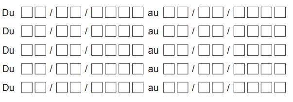
>
> \*Continuité des soins assurés par (* seulement remplir en cas d’impossibilité d’assurer personnellement la continuité des soins) :*
>
> \- Nom et adresse du ou des médecins :
>
> |  |
> |---|
> |  |
> |  |
> |  |
>
> \- Nom de l’établissement hospitalier chargé d’assurer cette continuité :
>
> |  |
> |---|
> |  |
> |  |
> |  |
> |  |
>
> \*Indiquez les périodes pendant lesquelles vous allez prester des services (* uniquement remplir si ressortissant non-UE):*
>
> 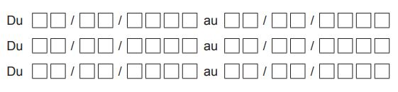
>
> Indiquez la nature des prestations *(* uniquement remplir si ressortissant non-UE)*:
>
> |  | consultation |  | visite |  | intervention chirurgicale |
> |---|---|---|---|---|---|
> |  | autre: |  |  |  |  |
>
> |  |
> |---|
> |  |
> |  |
> |  |
> |  |
>
> Indiquez le(s) lieu(x) des prestations *(* uniquement remplir si ressortissant non-UE)*:
>
> |  |
> |---|
> |  |
> |  |
> |  |
> |  |
>
> Prestation demandée par *(* uniquement remplir si ressortissant non-UE)*:
>
> |  | le malade    *N.B. Le nom du malade ne doit pas être indiqué afin de respecter le secret médical* |
> |---|---|
> |  | le médecin traitant |
>
> Commentaires éventuels:
>
> |  |
> |---|
> |  |
> |  |
> |  |
> |  |
>
> \**7 B - PRESTATIONS DE SERVICES POUR PHARMACIENS**
>
> |  | 1ère Déclaration |  | Renouvellement |
> |---|---|---|---|
>
> En cas de renouvellement, indiquez les périodes pendant lesquelles vous avez presté des services:
>
> 
>
> Commentaires éventuels:
>
> |  |
> |---|
> |  |
> |  |
> |  |
> |  |
>
> \**7 C - PRESTATIONS DE SERVICES POUR PROFESSIONNELS DE SANTE**
>
> |  | 1ère Déclaration |  | Renouvellement |
> |---|---|---|---|
>
> En cas de renouvellement, indiquez les périodes pendant lesquelles vous avez presté des services:
>
> 
>
> Commentaires éventuels:
>
> |  |
> |---|
> |  |
> |  |
> |  |
> |  |
>
> \**8 - AUTRES OBSERVATIONS**
>
> |  |
> |---|
> |  |
> |  |
> |  |
>
> Par la présente j’affirme sur l’honneur que les informations fournies sont sincères, véritables et complètes.
>
> <table>
> <tr>
> <td></td>
> <td>le</td>
> <td></td>
> <td></td>
> <td></td>
> </tr>
> <tr>
> <td>(Lieu)</td>
> <td colspan="2">(Date)</td>
> <td></td>
> <td>(Signature)</td>
> </tr>
> </table>

##### Règlement grand-ducal du 22 juin 2018 modifiant le règlement grand-ducal du 30 janvier 2004 fixant la liste des analyses de laboratoire que les médecins peuvent effectuer dans leur cabinet médical.

###### Art. 1er.

La liste limitative des analyses de pratique courante que les médecins sont autorisés à effectuer personnellement dans leur cabinet médical à l'occasion des actes médicaux auxquels ils procèdent, est fixée à l'annexe du présent règlement.

###### Art. 2.

Le [règlement grand-ducal du 30 janvier 2004](https://legilux.public.lu/eli/etat/leg/rgd/2004/01/30/n1/jo) fixant la liste des analyses de laboratoire que les médecins peuvent effectuer dans leur cabinet est abrogé.

###### Art. 3.

Notre Ministre de la Santé est chargé de l'exécution du présent règlement qui sera publié au Journal officiel du Grand-Duché de Luxembourg.

> \**ANNEXE**
>
> | **LIBELLÉ** | **CODE** |
> |---|---|
> | Test post-coïtal (test de Huhner) | **BC602** |
> | Glucose | **BC001** |
> | Glucose, plusieurs déterminations par jour, par glycémie | **BC002** |
> | CRP - Protéine C réactive, dosage | **BC042** |
> | Gaz du sang (pH, pO2, pCO2, HCO3) | **BC141** |
> | Analyse d'urines partielle par bandelette | **BC203** |
> | Analyse d'urines par bandelette avec sédiment | **BC202** |
> | Recherche d'hémoglobine humaine dans les selles | **BC403** |
> | (Bêta-) HCG - gonadotrophines chorioniques, dosage dans le sang ou dans les urines | **BD701** |
> | Vitesse de sédimentation (VS) | **BG001** |
> | Hémoglobine, hématocrite, numération des érythrocytes, leucocytes et thrombocytes, un ou plusieurs de ces examens | **BG002** |
> | Hémogramme complet : examen automatisé et contrôle microscopique sur frottis pour anomalie signalée, avec formule sanguine relue au microscope, recherche ou confirmation d'anomalies sur une ou plusieurs lignées sanguines périphériques | **BG003** |
> | Taux de prothrombine (temps de Quick), détermination en dehors d'un laboratoire, sur bandelette | **BG212** |
> | Urines : culture en étuve sur lame (type Uricult) | **BH991** |
> | Frottis cervico-vaginal : examen microscopique pour la recherche de microorganismes | **BH993** |
> | Frottis de gorge : recherche d'antigène de streptococcus pyogènes par test direct | **BH994** |
> | Autres prélèvements : examen microscopique pour recherche de microorganismes | **BH995** |
> | Identification d'œufs de vers | **BH996** |
> | Recherche d'œufs d'helminthes sur la marge de l'anus (méthode de la cellophane adhésive, ou autre) | **BH503** |

##### Version consolidée applicable au 17/02/2023 : Règlement grand-ducal du 15 février 2019 portant énumération des maladies sujettes à déclaration obligatoire et fixant les délais de déclaration ainsi que les informations à reprendre au cahier des charges pour la désignation comme laboratoire national de référence d’un laboratoire d’analyses médicales.

###### Art. 1er.

Les maladies sujettes à déclaration obligatoire par les médecins, médecins-dentistes ou responsables de laboratoires d’analyses médicales ainsi que les maladies présentant une menace grave pour la santé publique sont énumérées à l’annexe A qui fixe pour chacune de ces maladies le délai maximal endéans duquel la déclaration doit être faite.

###### Art. 2.

L’annexe B détermine les délais endéans desquels la souche ou le matériel biologique est à transférer par le laboratoire d’analyses médicales au laboratoire national de référence après établissement du diagnostic, ainsi que :

1° la liste des maladies à déclaration obligatoire pour lesquelles, la souche bactérienne, virale ou parasitaire isolée sur un patient, ou à défaut de souche, le matériel biologique, est à transférer d’emblée, après établissement du diagnostic, au laboratoire national de référence, sans demande spécifique de l’autorité sanitaire ;

2° les souches bactériennes, virales ou parasitaires pour lesquelles le ministre ayant la Santé dans ses attributions peut nommer un laboratoire national de référence.

###### Art. 3.

L’annexe C prévoit le cahier des charges pour la désignation comme laboratoire national de référence d’un laboratoire d’analyses médicales.

###### Art. 4.

Le [règlement grand-ducal du 10 septembre 2004](https://legilux.public.lu/eli/etat/leg/rgd/2004/09/10/n5/jo) portant désignation des maladies infectieuses ou transmissibles sujettes à déclaration obligatoire est abrogé.

###### Art. 5.

Notre ministre de la Santé est chargé de l’exécution du présent règlement qui sera publié au Journal officiel du Grand-Duché de Luxembourg.

> \**Annexe A**
>
> \**Liste des maladies à déclaration obligatoire et des maladies présentant une menace grave pour la santé publique**
>
> | **Maladies transmissibles (germes)** | **Déclaration Médecin** | **Délai de déclaration** |  | **Déclaration Labo** | **Délai de déclaration** |
> |---|---|---|---|---|---|
> | **Anthrax *(Bacillus anthracis)*** | **X** | **TÉLÉPHONE** |  | **X** | **TÉLÉPHONE** |
> | **Botulisme *(Clostridium botulinum)*** | **X** | **TÉLÉPHONE** |  |  |  |
> | Brucellose *(Brucella spp)* | X | 1 semaine |  | X | 1 semaine |
> | Campylobactériose *(Campylobacter spp)* |  |  |  | X | 1 semaine |
> | Chlamydiose *(Chlamydia trachomatis)* |  |  |  | X | 1 semaine |
> | Choléra *(Vibrio cholerae)* | X | 1 jour |  | X | 1 jour |
> | Colite à Clostridium difficile | X | 1 semaine |  |  |  |
> | Coqueluche *(Bordetella pertussis)* | X | 1 jour |  | X | 1 jour |
> | Cryptosporidiose *(Cryptosporidium spp)* |  |  |  | X | 1 semaine |
> | Dipthérie *(C. diphteriae, C. ulcerans, et C. pseudotuberculosis)* | X | 1 jour |  | X | 1 jour |
> | Echinococcose *(Echinococcus spp)* | X | 1 semaine |  | X | 1 semaine |
> | Fièvre jaune | X | 1 semaine |  | X | 1 semaine |
> | Fièvre Q *(Coxiella burnetti)* |  |  |  | X | 1 semaine |
> | **Fièvres hémorragiques virales à transmission interhumaine** ***(Ebola, Marburg, Crimée-Congo, Lassa et autres Arenavirus)*** | **X** | **TÉLÉPHONE** |  | **X** | **TÉLÉPHONE** |
> | Fièvres hémorragiques virales transmises par vecteurs *(Hantavirose, Dengue, Rift Valley, West Nile, Zika, Zika congénital, Chikungunya)* | X | 1 semaine |  | X | 1 semaine |
> | Giardiase *(Giardia lamblia)* |  |  |  | X | 1 semaine |
> | Gonorrhée (Neisseria gonorrhoeae) |  |  |  | X | 1 semaine |
> | Grippe saisonnière |  |  |  | X | 1 semaine |
> | **Grippe (nouveau sous-type)** | **X** | **TÉLÉPHONE** |  | **X** | **TÉLÉPHONE** |
> | Hépatite A aiguë | X | 1 jour |  | X | 1 jour |
> | Hépatite B |  |  |  | X | 1 semaine |
> | Hépatite B porteur chronique |  |  |  | X | 1 semaine |
> | Hépatite C |  |  |  | X | 1 semaine |
> | Hépatite E aiguë | X | 1 jour |  | X | 1 jour |
> | Infection HIV |  |  |  | X | 1 semaine |
> | Infection invasive à Candida auris |  |  |  | X | 1 semaine |
> | Infection invasive à Haemophilus influenzae | X | 1 jour |  | X | 1 jour |
> | **Infection invasive à Meningocoque *(N. meningitidis)*** | **X** | **TÉLÉPHONE** |  | **X** | **TÉLÉPHONE** |
> | Infection invasive à Pneumocoque (S. pneumoniae) | X | 1 jour |  | X | 1 jour |
> | Infection invasive à MRSA *(Meticillin resistant S. aureus)* | X | 1 semaine |  | X | 1 semaine |
> | Infection à Escherichia coli VTEC / STEC gastro-entérite | X | 1 jour |  | X | 1 jour |
> | Infection à Escherichia coli VTEC / STEC SHU | X | 1 jour |  |  |  |
> | Infection invasive à Entérobactéries résistantes aux carbapénèmes ou aux céphalosporines de 3e ou 4e génération |  |  |  | X | 1 semaine |
> | Infection à Norovirus |  |  |  | X | 1 jour |
> | Infection à Rotavirus |  |  |  | X | 1 jour |
> | Infection par le virus respiratoire syncytial |  |  |  | X | 1 semaine |
> | Infection invasive à Streptocoque du groupe A (*Streptococcus pyogenes*) |  |  |  | X | 1 semaine |
> | Légionellose *(Legionella spp)* | X | 1 semaine |  | X | 1 semaine |
> | Leptospirose *(Leptospira spp)* | X | 1 jour |  | X | 1 jour |
> | Lèpre | X | 1 semaine |  | X | 1 semaine |
> | LGV *(Lymphgranuloma venereum)* |  |  |  | X | 1 semaine |
> | Listériose *(Listeria monocytogenes)* |  |  |  | X | 1 semaine |
> | Maladie à CMV congénital | X | 1 semaine |  |  |  |
> | **Maladie à coronavirus 2019 (COVID-19) causée par SARS-CoV-2** |  |  |  | **X** | **1 jour** |
> | Maladie de Creutzfeld-Jacob | X | 1 semaine |  | X | 1 semaine |
> | Maladie de Creutzfeld-Jacob, variant vCJD | X | 1 semaine |  | X | 1 semaine |
> | Maladie de Lyme *(Borréliose)* *Seulement Erythèmes migrants et formes neurologiques aiguës* | X | 1 semaine |  |  |  |
> | Méningoencéphalite à tiques (FSME) |  |  |  | X | 1 semaine |
> | Oreillons | X | 1 jour |  | X | 1 jour |
> | **Orthopoxviroses dont la variole du singe** | **X** | **TÉLÉPHONE** |  | **X** | **TÉLÉPHONE** |
> | Paludisme / Malaria *(Plasmodium spp)* | X | 1 semaine |  | X | 1 semaine |
> | **Peste *(Yersinia pestis)*** | **X** | **TÉLÉPHONE** |  | **X** | **TÉLÉPHONE** |
> | Poliomyélite | X | 1 jour |  | X | 1 jour |
> | **Rage** | **X** | **TÉLÉPHONE** |  | **X** | **TÉLÉPHONE** |
> | Rougeole | X | 1 jour |  | X | 1 jour |
> | Rubéole | X | 1 jour |  | X | 1 jour |
> | Rubéole congénitale | X | 1 semaine |  |  |  |
> | Salmonellose *(Salmonella spp)* *y compris Fièvre typhoïde et paratyphoïde* |  |  |  | X | 1 jour |
> | Shigellose *(Shigella spp)* |  |  |  | X | 1 semaine |
> | SIDA | X | 1 semaine |  |  |  |
> | **Syndrome respiratoire aigu sévère dû au coronavirus SARS-CoV-1 ou MERS** | **X** | **TÉLÉPHONE** |  | **X** | **TÉLÉPHONE** |
> | Syphilis (Treponema pallidum) *y compris Syphilis congénitale* | X | 1 semaine |  | X | 1 semaine |
> | Tétanos *(Clostridium tetani)* | X | 1 semaine |  |  |  |
> | Toxoplasmose *y compris Toxoplasmose congénitale* | X | 1 semaine |  |  |  |
> | Trichinellose *(Trichinella spiralis)* | X | 1 semaine |  | X | 1 semaine |
> | Tuberculose *(Mycobacterium tuberculosis complex)* | X | 1 semaine |  | X | 1 semaine |
> | Tuberculose extra-pulmonaire active *(Mycobacterium tuberculosis complex)* | X | 1 semaine |  | X | 1 semaine |
> | Tuberculose latente (IGRA positifs) |  |  |  | X | 1 semaine |
> | Tuberculose latente (IDR positives) | X | 1 semaine |  |  |  |
> | Tularémie (Franciscella tularensis) | X | 1 semaine |  | X | 1 semaine |
> | Varicelle | X | 1 semaine |  |  |  |
> | **Variole** | **X** | **TÉLÉPHONE** |  | **X** | **TÉLÉPHONE** |
> |  |  |  |  |  |  |
> | Yersiniose (Y. enterolitica, Y. pseudotuberculosis) |  |  |  | X | 1 semaine |
> | **Flambées de symptômes cliniques ou de diagnostics de laboratoires** | **X** | **TÉLÉPHONE** |  | **X** | **TÉLÉPHONE** |
>
> \**Précision :**
>
> Les maladies présentant une menace grave pour la santé publique figurent **en gras**.
>
> \**TÉLÉPHONE** - déclaration par téléphone endéans les deux heures après suspicion de diagnostic ou diagnostic confirmé à Inspection sanitaire (à joindre au numéro 247-85650 ou en-dehors des heures ouvrables via les Services des Secours au numéro de téléphone 112).
>
> Heures ouvrables de la Direction de la santé : de 9 heures à 12 heures le matin et de 14 heures à 17 heures l’après-midi.
>
> \**1 jour** - déclaration endéans 24 heures après le diagnostic.
>
> \**1 semaine** - déclaration endéans une semaine après le diagnostic.
>
> \**Annexe B**
>
> \**Liste des pathogènes pour lesquels le Ministre ayant la santé dans ses attributions peut désigner un laboratoire national de référence et dont la souche ou le matériel biologique est à transférer par le laboratoire d’analyses médicales au laboratoire national de référence après établissement du diagnostic sans demande spécifique par l’autorité sanitaire**
>
> | Maladie | Matériel | Délai |
> |---|---|---|
> | Anthrax | Souche ou matériel biologique | 1 jour |
> | Infections invasives à *Streptococcus* *pneumoniae* *Haemophilus influenzae* *Neisseria meningitidis* *Streptococcus pyogenes (groupe A)* | Souche | 1 semaine 1 semaine 1 jour 1 semaine |
> | Infections invasives à Staphylocoques résistants à la méthicilline (MRSA) Entérobactéries résistantes aux carbapénemes ou aux céphalosporines de 3e ou 4e générations Entérocoques résistants à la vancomycine | Souche | 1 semaine |
> | Brucellose (toutes espèces) | Souche | 1 semaine |
> | Campylobacteriose (toutes espèces) | Souche | 1 semaine |
> | Infection invasive à *Candida auris* | Souche | 1 semaine |
> | Colite à *Clostridium difficile* | Souche | 1 semaine |
> | Diphtérie | Souche ou matériel biologique | 1 jour |
> | Infections méningées à Entérovirus | Matériel biologique isolé du LCR | 1 semaine |
> | Infections à *Escherichia coli* producteur de vérotoxines | Souche | 1 semaine |
> | Tularémie | Souche ou matériel biologique | 1 semaine |
> | Fièvres hémorragiques à transmission interhumaine | Matériel biologique | 1 jour |
> | Grippe (nouvelle variante épidémique) | Matériel biologique | 1 semaine |
> | Hépatite A | Matériel biologique | 1 semaine |
> | Hépatite B | Matériel biologique | 1 semaine |
> | Hépatite C | Matériel biologique | 1 semaine |
> | Infection HIV | Matériel biologique | 1 semaine |
> | Legionnellose (toutes espèces) | Souche ou matériel biologique | 1 semaine |
> | Listeriose (toutes espèces) | Souche | 1 semaine |
> | Mycobacteriose (toutes espèces) | Souche ou matériel biologique | 1 semaine |
> | Gonorrhée | Souche | 1 semaine |
> | Oreillons | Matériel biologique | 1 semaine |
> | Orthopoxviroses dont la variole du singe | Matériel biologique | 1 jour |
> | Poliomyélite virale | Matériel biologique | 1 jour |
> | Rougeole | Matériel biologique | 1 jour |
> | Rubéole | Matériel biologique | 1 jour |
> | Salmonellose (toutes espèces) | Souche | 1 semaine |
> | SARS-CoV-1 ou SARS-CoV-2 ou MERS | Matériel biologique | 1 jour |
> | Shigellose (toutes espèces) | Souche | 1 semaine |
> | Cholera (toutes espèces) | Souche ou matériel biologique | 1 jour |
> | Yersiniose (toutes espèces) | Souche | 1 semaine |
>
> \**Annexe C**
>
> \**Cahier des charges pour la désignation d’un laboratoire national de référence**
>
> Outre les exigences spécifiées dans la loi du 1er août 2018 sur la déclaration obligatoire de certaines maladies dans le cadre de la protection de la santé publique, le laboratoire candidat doit fournir les informations suivantes :
>
> PARTIE I
>
> Coordonnées administratives du laboratoire d’analyses médicales candidat
>
> Coordonnées administratives usuelles (nom, adresse, téléphone, e-mail) ;
>
> Nom, prénom, diplômes et coordonnées des médecins ou pharmaciens biologistes en charge de l’activité de référence pour laquelle le laboratoire d’analyses médicales est candidat.
>
> PARTIE II
>
> Activité de référence *(à remplir autant de fois que de pathologies demandées)*
>
> Description des examens d’analyses médicales (y compris méthodologie analytique) de la pathologie déterminée pour lequel le laboratoire d’analyses médicales est candidat comme laboratoire national de référence ;
>
> Quantité d’examens d’analyses médicales concernés réalisés l’année précédente par le laboratoire d’analyses médicales ;
>
> Quantité d’examens d’analyses médicales concernés réalisables si le laboratoire est choisi comme laboratoire de référence ;
>
> Volume d’échantillons susceptibles d’être traités par jour pour les examens d’analyses médicales concernés ;
>
> Délai de rendu des résultats pour les examens d’analyses médicales concernés ;
>
> Description du système d’assurance qualité en place, y compris certifications, accréditations, labellisations.
>
> PARTIE III
>
> Justification du haut niveau de compétence du laboratoire candidat pour l’activité de référence pour laquelle le laboratoire d’analyses médicales est candidat
>
> Nombre ETP et titres des médecins ou pharmaciens biologistes dédiés ou contribuant à l’activité de référence pour laquelle le laboratoire d’analyses médicales est candidat ;
>
> Nombre ETP et qualifications professionnelles des autres personnels dédiés à cette activité ;
>
> Travaux des médecins ou pharmaciens biologistes en charge de cette activité : dernières publications dans des revues et ouvrages scientifiques, des guides techniques, interventions et publications de posters dans des colloques.
>
> PARTIE IV
>
> Missions de santé publique en lien avec l’activité de référence pour laquelle le laboratoire d’analyses médicales est candidat: acquis et perspectives
>
> Description du rôle d’expert du laboratoire d’analyses médicales pour le maintien et l’innovation dans les techniques de diagnostic ;
>
> Description de l’action de conseil du laboratoire d’analyses médicales pour les services cliniques et les autres laboratoires ;
>
> Description des activités de conseil et d’alerte du laboratoire liées à l’activité de référence ;
>
> Description des participations à des manifestations scientifiques ou à des formations à l’enseignement universitaire et autres formations réalisées relativement à l’activité de référence pour laquelle le laboratoire d’analyses médicales est candidat ;
>
> Description des recommandations, référentiels ou arbres décisionnels relatifs à cette activité de référence que le laboratoire a aidé à élaborer ;
>
> Description succincte des projets de recherche ou d’essai clinique en cours ou demandés relatifs à l’activité de référence pour laquelle le laboratoire d’analyses médicales est candidat.

### PROFESSION DE PHARMACIEN

#### DISPOSITIONS GÉNÉRALES

##### Version consolidée applicable au 18/11/2016 : Loi modifiée du 31 juillet 1991 déterminant les conditions d'autorisation d'exercer la profession de pharmacien.

###### Chapitre 1er — Profession de pharmacien

**Art. 1er.**

Sous réserve des dispositions prévues à l’article 12*bis* de la présente loi, l’accès aux activités de pharmacien et leur exercice au Luxembourg est subordonné à une autorisation du ministre ayant la Santé dans ses attributions, désigné ci-après par «le ministre», qui est délivrée aux conditions suivantes:

a) le candidat doit être ressortissant au sens de l’article 3, point q) de la [loi du 28 octobre 2016](https://legilux.public.lu/eli/etat/leg/loi/2016/10/28/n2/jo) relative à la reconnaissance des qualifications professionnelles;

b) il doit disposer d’un titre de formation de pharmacien reconnu conformément aux dispositions de la [loi du 28 octobre 2016](https://legilux.public.lu/eli/etat/leg/loi/2016/10/28/n2/jo) relative à la reconnaissance des qualifications professionnelles;

c) il doit remplir les conditions d’honorabilité et de moralité ainsi que de santé physique et psychique nécessaires à l’exercice de la profession de pharmacien;

d) il doit avoir les connaissances linguistiques nécessaires à l’exercice de la profession, soit en allemand, soit en français, et comprendre les trois langues administratives du Grand-Duché de Luxembourg ou acquérir les connaissances lui permettant de les comprendre.

Une vérification des connaissances linguistiques du candidat d’une des trois langues luxembourgeoise, allemande ou française peut être faite à la demande du ministre par le Collège médical.

Le président du Collège médical ou son délégué entend le candidat et transmet au ministre le résultat de la vérification ensemble avec l’avis prévu à l’article 1er *bis*.

**Art. 1er *bis*.**

L’avis du Collège médical est demandé pour toutes les demandes en autorisation d’exercer.

**Art. 4.**

(1) Un règlement grand-ducal, pris sur avis du Conseil d’Etat, après consultation du Collège médical, détermine la procédure à suivre et les documents à présenter pour obtenir l’autorisation prévue aux articles 1er et 2.

(2) Un recours en reformation auprès du tribunal administratif peut être introduit dans le mois qui suit sa notification contre toute décision d’octroi, de refus, de suspension ou de retrait d’une autorisation d’exercer. Le recours contre l’octroi de l’autorisation ne peut être exercé que par le Collège médical.

**Art. 5.**

(1) Le ministre tient à jour un registre professionnel central regroupant les informations administratives et disciplinaires relatives aux pharmaciens établis au Luxembourg ou autorisés à y exercer conformément à l’article 1er, paragraphe (1), ainsi que les informations relatives aux prestataires de services.

Le Collège médical tient à jour un registre ordinal pour la profession de pharmacien. Les informations nécessaires à la tenue du registre ordinal leur sont communiquées d’office par le ministre.

(2) Le registre professionnel central renseigne en outre les informations sur les sanctions disciplinaires ou pénales qui ont été prises et renseigne sur des faits graves et précis susceptibles d’avoir des conséquences sur l’exercice des activités professionnelles du pharmacien.

(3) Les personnes concernées ne peuvent pas s’opposer au traitement des données administratives ou professionnelles les concernant aux fins de la tenue du registre professionnel central. Les personnes concernées peuvent à tout moment accéder le registre professionnel central. Ils peuvent requérir la rectification d’inscriptions erronées ou le retrait d’inscriptions ne concernant pas leur activité professionnelle. Ils peuvent aussi y faire consigner leurs observations écrites éventuelles.

(4) Les inscriptions du registre peuvent être communiquées au Collège médical et aux organismes de sécurité sociale et vice versa.

Elles peuvent être fournies sur demande à toute autorité ou instance habilitée spécifiquement par un autre Etat membre de l’Union européenne à délivrer ou à recevoir des titres de formation et autres documents ou informations, via le système d’information mis en place par le [RÈGLEMENT (UE) n° 1024/2012](https://legilux.public.lu/eli/reg_ue/2012/1024/jo) DU PARLEMENT EUROPÉEN ET DU CONSEIL du 25 octobre 2012 concernant la coopération administrative par l’intermédiaire du système d’information du marché intérieur et abrogeant la [décision 2008/49/CE](http://data.europa.eu/eli/dec/2008/49(1)/oj) de la Commission («règlement IMI»), à condition que ces échanges d’information se fassent dans la confidentialité et le respect de la législation sur la protection des données à caractère personnel.

(5) Un règlement grand-ducal précise le détail des informations qui doivent être fournies par les intéressés concernant leur situation administrative et disciplinaire. Il peut rendre obligatoire l’usage de formulaires préétablis.

Sous peine de sanction disciplinaire, tout changement intervenu dans le chef des données ainsi fournies ou de la situation professionnelle doit être signalé endéans le mois au ministre pour être mentionné dans le registre.

(6) Les autorisations d’exercer accordées par le ministre sont publiées au Mémorial.

**Art. 6.**

L’autorisation d’exercer devient caduque lorsque le pharmacien n’exerce pas sa profession au Luxembourg dans les 24 mois qui suivent la délivrance de l’autorisation. II en va de même du pharmacien qui a cessé son activité de pharmacien au Luxembourg depuis plus de 24 mois et transféré son domicile en dehors du territoire luxembourgeois.

**Art. 7.**

L’autorisation d’exercer la profession de pharmacien visée aux articles 1er, 1er *bis* et 2 est suspendue ou retirée lorsque les conditions y prévues ne sont plus remplies.

Dans le cas d’infirmité ou le cas pathologique rendant dangereux l’exercice de la profession de pharmacien, le ministre peut décider la suspension temporaire du droit d’exercer. Celle-ci est prononcée pour une période déterminée et peut, s’il y a lieu, être renouvelée. Elle ne peut être ordonnée que sur un rapport motivé adressé au ministre, établi par trois médecins experts, désignés l’un par l’intéressé ou sa famille, le deuxième par le directeur de la santé et le troisième par les deux premiers.

En cas de carence de l’intéressé ou de sa famille, la désignation du premier expert est faite sur demande du ministre, par le président du tribunal d’arrondissement.

Le ministre est saisi soit par le directeur de la santé, sur rapport du pharmacien-inspecteur, soit par le collège médical.

L’expertise prévue à l’alinéa précédent doit être effectuée au plus tard dans le délai de deux mois à compter de la saisine du ministre.

Le ministre peut subordonner la reprise de l’activité professionnelle à la constatation de l’aptitude du pharmacien par une nouvelle expertise effectuée dans le mois qui précède l’expiration de la période de suspension.

**Art. 8.**

(1) Le pharmacien autorisé à exercer la profession de pharmacien au Luxembourg porte le titre professionnel de «pharmacien» ou «Apdikter» ou «Apotheker».

(2) Il peut également être autorisé par le ministre à faire usage de son titre licite de formation tel que visé à l’article 1er, point b) et éventuellement de son abréviation dans la langue de l’Etat où il a acquis sa formation, suivi des nom et lieu de l’établissement ou du jury qui l’a délivré. Toutefois au cas où ce titre peut être confondu avec un titre exigeant une formation supplémentaire non acquise par le bénéficiaire, ce dernier ne pourra utiliser son titre de formation que dans une formule appropriée à indiquer par le ministre.

Un règlement grand-ducal pourra préciser les modalités d’application de la présente disposition.

(3) Le pharmacien peut aussi être autorisé par le Collège médical à faire usage d’une fonction académique ou d’un titre licite de formation autre que celui visé au paragraphe 2 selon la formulation intégrale qui lui a été conféré par une université ou une autre autorité compétente, et qui est reconnu par les autorités compétentes du pays où il a été délivré. Le Collège médical peut soumettre cette autorisation au paiement préalable d’une taxe. Le montant de cette taxe est fixé annuellement par le Collège médical, étant entendu qu’il se situe entre 75 et 150 euros.

**Art. 9.**

Un code de déontologie de la profession de pharmacien est établi par le collège médical et approuvé par le ministre. Ce code est publié au Mémorial.

**Art. 11.**

(1) Il doit posséder les connaissances linguistiques nécessaires à l’exercice de sa profession au Luxembourg. Il engage sa responsabilité disciplinaire, civile et pénale si, par suite d’une insuffisance de ces connaissances, il commet une erreur dans l’exercice de sa profession ou fait commettre une erreur à d’autres dans l’exercice de leurs professions.

Une vérification des connaissances linguistiques du pharmacien peut être faite à la demande du ministre par le président du Collège médical.

Le président du Collège médical ou son délégué entend le pharmacien et transmet au ministre le résultat de la vérification ensemble avec l’avis prévu à l’article 1er, paragraphe (1).

II engage sa responsabilité disciplinaire, civile et pénale si, par suite d’une insuffisance de ces connaissances, il commet une erreur dans l’exercice de ses fonctions.

(2) Le pharmacien doit recueillir les informations nécessaires concernant les législations sanitaire et sociale et la déontologie applicables au Luxembourg.

(3) Le pharmacien est obligé de tenir à jour ses connaissances professionnelles.

(4) Le pharmacien est tenu au secret professionnel.

**Art. 11*bis*.**

Le pharmacien exerçant au Luxembourg est tenu, sous peine de sanctions disciplinaires, de disposer d'une assurance destinée à garantir sa responsabilité civile susceptible d'être engagée en raison de dommages survenus dans le cadre de son activité professionnelle.

Le pharmacien prestataire de services visé à l'article 12*bis* de la présente loi est également soumis à cette obligation. Toutefois, il est dispensé d'une telle assurance si l'activité de prestation de service est couverte par une garantie ou une formule similaire qui est équivalente ou essentiellement comparable quant à son objet, adaptée à la nature et à l'ampleur du risque, dont il dispose dans l'Etat membre de son établissement.

Un règlement grand-ducal pris sur avis du Collège médical peut fixer les conditions et modalités minimales que doit couvrir cette assurance.

**Art. 12.**

L’exercice cumulatif des professions de médecin, de médecin-dentiste ou de médecin-vétérinaire et de la profession de pharmacien est interdit.

**Art. 12*bis*.**

(1) Le pharmacien ressortissant d’un Etat membre de l’Union européenne, qui est établi dans un autre Etat membre et y exerce légalement les activités de pharmacien, peut exécuter au Luxembourg des prestations de services de façon temporaire et occasionnelle sans autorisation du ministre.

(2) Le prestataire est soumis aux règles de conduite de caractère professionnel, réglementaire ou administratif en rapport direct avec les qualifications professionnelles telles que la définition de la profession, l’usage des titres et les fautes professionnelles graves qui ont un lien direct et spécifique avec la protection et la sécurité des patients, ainsi qu’aux dispositions disciplinaires applicables aux pharmaciens légalement établis au Luxembourg.

(3) Le pharmacien frappé d’une peine de suspension ou d’interdiction d’exercer sa profession au Luxembourg et qui est légalement établi dans un autre Etat membre, ne peut pas effectuer de prestation de services au Luxembourg pendant la durée de sa suspension ou de son interdiction.

(4) Un règlement grand-ducal détermine les conditions et modalités d’exercice de la prestation de services visée aux paragraphes 1er et 2 du présent article. Ce règlement prescrira entre autres que le pharmacien fasse une déclaration préalable relative à sa prestation au ministre qui en fera parvenir une copie au Collège médical et aux organismes de sécurité sociale.

**Art. 12*ter*.**

Une taxe d’un montant de 450 euros est due pour toute demande d’autorisation d’exercer définitive visée aux articles 1er, 1er *bis*, et 2.

Une taxe d’un montant de 10 euros est due en cas d’établissement d’un duplicata du document attestant les autorisations visées à l’alinéa précédent.

La taxe est à acquitter moyennant un versement ou un virement sur un compte bancaire de l’Administration de l’enregistrement et des domaines, comprenant indication de l’identité du requérant ainsi que l’objet du virement ou versement.

La preuve de paiement est à joindre à la demande et constitue une pièce obligatoire du dossier.

**Art. 13.**

(1) Constitue un exercice illégal de la profession de pharmacien, l’accomplissement, même à titre gratuit, des activités visées à l’article 45, paragraphe 2 de la [loi du 28 octobre 2016](https://legilux.public.lu/eli/etat/leg/loi/2016/10/28/n2/jo) relative à la reconnaissance des qualifications professionnelles par une personne non autorisée à exercer la profession de pharmacien.

(2) Toutefois ne tombent pas sous l’application des dispositions du paragraphe 1er du présent article:

aash la délivrance de médicaments à usage vétérinaire par les médecins-vétérinaires conformément à la législation en vigueur sur les médicaments à usage vétérinaire;

bash la détention de médicaments à usage personnel;

cash la diffusion d’informations et de conseils sur les médicaments ainsi que la remise d’échantillons de médicaments aux médecins, médecins-dentistes, médecins-vétérinaires et pharmaciens;

dash l’exercice des activités de pharmacien par les étudiants en pharmacie, ressortissants d’un Etat membre de la Communauté européenne, en stage de formation sous la responsabilité d’un pharmacien maître de stage autorisé à exercer la profession de pharmacien au Luxembourg.

###### Chapitre 2 — Dispositions pénales

**Art. 14.**

L’exercice illégal des activités de pharmacien est puni d’une amende de mille cinquante euros et en cas de récidive d’une amende de cinq cents à vingt-cinq mille euros et d’un emprisonnement de huit jours à six mois ou d’une de ces peines seulement. La même peine est applicable en cas d’infraction à l’article 12 de la présente loi.

**Art. 15.**

Toute personne qui s’attribue l’un des titres prévus à l’article 8 de la présente loi ou tout autre titre pouvant prêter à confusion, ou qui porte l’insigne professionnel de pharmacien sans remplir les conditions de formation prévues par la présente loi, ou qui par addition de mots ou de signes abréviatifs altère le titre qu’elle est autorisée à porter, est punie d’une amende de cinq cents à vingt mille euros. En cas de récidive l’amende est portée au double.

**Art. 16.**

L’exercice illégal des activités de pharmacien avec usurpation de titre est puni d’une amende de cinq cents à vingt-cinq mille euros et en cas de récidive d’une amende de deux mille cinq cents à cinquante mille euros et d’un emprisonnement de six mois à un an ou d’une de ces peines seulement.

**Art. 17.**

(1) Dans les cas où les cours et tribunaux, jugeant en matière répressive, prononcent à charge d’un pharmacien suivant les distinctions et pour le temps établis par les articles 31, 32, 33, 84 alinéa 2 et 85 alinéa 2 du [code pénal](https://legilux.public.lu/eli/etat/leg/code/penal), l’interdiction de tout ou partie des droits détaillés à l’article 31 de ce code, ils peuvent ajouter à ces droits celui de l’exercice de la profession du condamné.

(2) Toutefois, si la condamnation a été encourue du chef de vol ou de tentative de vol, de recèlement d’objets obtenus à l’aide d’un crime ou d’un délit, d’abus de confiance, d’escroquerie ou de tromperie, sans qu’il y ait lieu en droit ou en fait à l’application de l’article 85 du [code pénal](https://legilux.public.lu/eli/etat/leg/code/penal), l’interdiction de l’exercice de la profession est toujours prononcée contre le condamné.

**Art. 18.**

(1) En cas de condamnation prononcée à l’étranger contre un pharmacien établi au Luxembourg pour des faits entraînant à charge de celui-ci l’interdiction obligatoire ou facultative de l’exercice de la profession, cette interdiction peut être, à la requête du ministère public, prononcée par le tribunal correctionnel indigène auquel ressortit le condamné du fait de son domicile ou de sa résidence.

(2) Les citations et les recours en appel et en cassation ont lieu comme il est réglé pour les matières correctionnelles. II en est de même des frais.

**Art. 19.**

Le livre 1er du [code pénal](https://legilux.public.lu/eli/etat/leg/code/penal) ainsi que les articles 130-1 à 132-1 du [code d’instruction criminelle](https://legilux.public.lu/eli/etat/leg/code/procedure_penale) sont applicables.

**Art. 20.**

Le placement du pharmacien sous un des régimes de protection prévus au titre onze du livre ler du [code civil](https://legilux.public.lu/eli/etat/leg/code/civil) peut entraîner l’interdiction de l’exercice de la profession. Elle est prononcée, le cas échéant, par le juge des tutelles saisi de la procédure de la mise sous sauvegarde de justice, de tutelle ou de curatelle.

###### Chapitre 3 — Dispositions transitoires et additionnelles

**Art. 21.**

Pour l’application de la présente loi, il y a lieu d’entendre par Etat membre de l’Union européenne: un Etat membre de l’Union européenne, de l’Espace économique européen ou de la Confédération suisse.

**Art. 24.**

Les articles 26 et 27 de l’[ordonnance royale grand-ducale du 12 octobre 1841](https://legilux.public.lu/eli/etat/leg/ordr/1841/10/12/n3/jo) portant organisation du service médical sont abrogés.

### PSYCHOTHÉRAPEUTE

#### DISPOSITIONS GÉNÉRALES

##### Version consolidée applicable au 10/09/2018 : Loi du 14 juillet 2015 portant création de la profession de psychothérapeute et modifiant 1) le Code de la sécurité sociale; 2) la loi du 8 juin 1999 relative au Collège médical; 3) la loi du 19 juin 2009 ayant pour objet la transposition de la directive 2005/36/CE pour ce qui est a) du régime général de reconnaissance des titres de formation et des qualifications professionnelles, b) de la prestation temporaire de service.

###### Chapitre Ier: Profession de psychothérapeute

**Art. 1er**

La présente loi s’applique à la profession de psychothérapeute.

Aux fins de la présente loi, on entend par «psychothérapeute» toute personne physique qui utilise, dans le cadre de son activité professionnelle, la méthode thérapeutique qui fait exclusivement appel à des moyens psychologiques reconnus afin de traiter les troubles mentaux chez l’adulte, l’adolescent et l’enfant.

La psychothérapie se définit comme un traitement psychologique pour un trouble mental, pour des perturbations comportementales ou pour tout autre problème entraînant une souffrance ou une détresse psychologique, et qui a pour but de favoriser chez le ou les patient(s) des changements bénéfiques, notamment dans le fonctionnement cognitif, émotionnel ou comportemental, dans le système interpersonnel, dans la personnalité ou dans l’état de santé. Ce traitement va au-delà d’un accompagnement sous forme d’aide psychologique visant à faire face aux difficultés courantes ou d’un rapport de conseils ou de soutien.

**Art. 2.**

(1) L’exercice de la profession de psychothérapeute est subordonné à une autorisation du ministre ayant la Santé dans ses attributions, ci-après «le ministre». La demande pour l’obtention de l’autorisation doit être adressée au ministre qui la délivre aux conditions suivantes:

a) le demandeur doit être ressortissant au sens de l’article 3, point q) de la [loi du 28 octobre 2016](https://legilux.public.lu/eli/etat/leg/loi/2016/10/28/n2/jo) relative à la reconnaissance des qualifications professionnelles;

b) le demandeur doit être en possession soit d’un master en psychologie clinique ou d’un diplôme en psychologie reconnu équivalent par le ministre, sur avis du Conseil scientifique de psychothérapie, inscrit au registre des titres de formation visé à l’article 66 de la [loi du 28 octobre 2016](https://legilux.public.lu/eli/etat/leg/loi/2016/10/28/n2/jo) relative à la reconnaissance des qualifications professionnelles, soit d’un des titres de formation médicale de base dont question à l’article 1er, paragraphe 1er, point b) de la [loi modifiée du 29 avril 1983](https://legilux.public.lu/eli/etat/leg/loi/1983/04/29/n1/jo) concernant l’exercice des professions de médecin, de médecin-dentiste et de médecin-vétérinaire;

c) le demandeur doit être titulaire soit d’un diplôme, certificat ou autre titre de formation luxembourgeois relatif à la profession de psychothérapeute, soit d’un diplôme, certificat ou autre titre étranger reconnu équivalent par le ministre ayant l’Enseignement supérieur dans ses attributions, selon les dispositions de la [loi du 28 octobre 2016](https://legilux.public.lu/eli/etat/leg/loi/2016/10/28/n2/jo) relative à la reconnaissance des qualifications professionnelles;

d) il doit remplir les conditions de santé physique et psychique nécessaires à l’exercice de la profession;

e) il doit répondre aux conditions d’honorabilité et de moralité nécessaires à l’exercice de la profession;

f) il doit avoir les connaissances linguistiques nécessaires à l’exercice de la profession, soit en allemand, soit en français, et comprendre les trois langues administratives du Grand-Duché de Luxembourg ou acquérir les connaissances lui permettant de les comprendre.

Une vérification des connaissances linguistiques du candidat d’une des trois langues luxembourgeoise, allemande ou française peut être faite à la demande du ministre par le Collège médical.

Le président du Collège médical ou son délégué entend le psychothérapeute et transmet au ministre le résultat de la vérification.

(2) Dès son installation il doit recueillir les informations nécessaires concernant les législations sanitaire et sociale et la déontologie applicables au Luxembourg.

(3) Le psychothérapeute exerçant au Luxembourg est tenu, sous peine de sanctions disciplinaires, de disposer d’une assurance destinée à garantir sa responsabilité civile susceptible d’être engagée en raison de dommages survenus dans le cadre de son activité professionnelle.

(4) Un règlement grand-ducal détermine la procédure à suivre et les documents à présenter pour obtenir l’autorisation d’exercer.

(5) Les demandes en autorisation d’exercer sont soumises pour avis au Collège médical.

(6) Un recours en réformation auprès du tribunal administratif peut être introduit dans le mois qui suit sa notification contre toute décision d’octroi, de refus, de suspension ou de retrait d’une autorisation d’exercer.

**Art. 2*bis*.**

Une taxe d’un montant de 75 euros est due pour toute demande d’autorisation d’exercer, visée à l’article 2.

**Art. 2*ter*.**

Par dérogation à l’article 2, paragraphe 1er, lettres b) et c), le médecin-spécialiste en psychiatrie ou en neuropsychiatrie ou en psychiatrie infantile qui ne remplit pas les conditions de formation prévues à cet endroit, peut être autorisé par le ministre ayant la santé dans ses attributions d’exercer la profession de psychothérapeute à condition de pouvoir faire état d’une formation spécifique en psychothérapie d’au moins 450 heures.

**Art. 3.**

(1) La personne autorisée à exercer la profession de psychothérapeute porte le titre professionnel de psychothérapeute.

(2) À l’exception du psychothérapeute dûment autorisé à exercer sa profession et du médecin-spécialiste en psychiatrie ou en neuropsychiatrie ou en psychiatrie infantile, autorisé conformément à l’article 5, paragraphe 3 de la [loi modifiée du 29 avril 1983](https://legilux.public.lu/eli/etat/leg/loi/1983/04/29/n1/jo) précitée à faire usage d’un titre licite de formation en psychothérapie, émis par une autorité compétente du pays d’obtention du titre de formation, nul ne peut exercer à titre principal la psychothérapie, ni utiliser le titre de psychothérapeute.

(3) Le psychothérapeute peut être autorisé par le ministre, sur avis du collège médical, à faire usage de son titre licite de formation et éventuellement de son abréviation dans la langue de l’Etat où il a acquis sa formation, ou à faire usage dudit titre dans une formule appropriée à indiquer par le ministre.

**Art. 4.**

La formation en psychothérapie, qui comporte un volet théorique et un volet pratique, doit permettre l’acquisition des connaissances et compétences nécessaires à la pratique de la psychothérapie.

La formation garantit que l’intéressé a acquis les connaissances et les compétences suivantes:

aash l’acquisition des savoirs théoriques et pratiques de base en psychothérapie;

bash l’acquisition de compétences en matière de diagnostic psychothérapeutique, d’évaluation et d’intervention;

cash l’acquisition de compétences réflexives, consistant en analyse, évaluation et introspection portant sur l’activité professionnelle propre;

dash l’acquisition de compétences à l’assimilation de la littérature scientifique dans le domaine de la psychothérapie;

eash la familiarisation avec les règles de l’éthique et la guidance vers une pratique dictée par ces règles.

La formation comporte la participation active à des ateliers, des séminaires, des travaux dirigés en petits groupes et à des conférences ainsi qu’un travail de formation en autonomie personnelle.

Le cursus des études, qui compte au moins soixante-dix crédits ECTS, comprend:

aash une formation théorique de base en psychothérapie;

bash une formation spécialisée centrée sur des interventions et des stratégies;

cash une formation théorique en auto-apprentissage étayée par la participation aux activités de recherche et de documentation;

dash une formation et un accompagnement à l’analyse réflexive de sa propre pratique;

eash une pratique clinique d’au moins 500 heures dans le champ de la psychopathologie ou de la psychosomatique, supervisée par un psychothérapeute, effectuée dans un établissement hospitalier doté d’un service de psychiatrie ou dans tout autre lieu de stage reconnu par l’autorité compétente de l’Etat de formation comprenant la documentation d’au moins dix cas supervisés dans le cadre de la formation;

fash l’élaboration et la soutenance d’un travail de fin d’études.

**Art. 5.**

Le psychothérapeute exerce sa profession de façon autonome.

Le psychothérapeute est obligé de tenir à jour ses connaissances professionnelles et de développer en continu ses compétences professionnelles.

Le psychothérapeute doit veiller à garantir la continuité des soins en psychothérapie aux patients dont il a la charge.

Le psychothérapeute est tenu de faire appel à l’aide ou à l’assistance d’un autre prestataire de soins compétent en la matière ou de transférer le patient vers ce dernier lorsque le problème de santé rencontré lors de la prise en charge psychothérapeutique nécessite une intervention qui excède son propre domaine de compétence.

###### Chapitre 2: Conseil scientifique de psychothérapie

**Art. 6.**

Il est créé un Conseil scientifique de psychothérapie, ci-après «le conseil», composé de six membres nommés par le ministre pour un mandat de six ans renouvelable.

Le conseil a pour mission:

1\) de définir les méthodes de psychothérapie reconnues au Luxembourg,

2\) de participer à l’élaboration du curriculum de formation au Luxembourg,

3\) de fournir de son propre chef ou à la demande du ministre des avis sur toutes les matières en relation avec la psychothérapie au Luxembourg,

4\) de participer à la procédure de reconnaissance des diplômes, certificats ou autres titres étrangers relatifs à la profession de psychothérapeute et à la formation psychologique de base.

Le conseil est composé:

1\) de quatre psychothérapeutes, dont deux détenteurs d’un master en psychologie, et deux détenteurs du titre de formation de médecin avec formation médicale de base dont question à l’article 1er, paragraphe 1er, point b) de la [loi modifiée du 29 avril 1983](https://legilux.public.lu/eli/etat/leg/loi/1983/04/29/n1/jo) concernant l’exercice des professions de médecin, de médecin-dentiste et de médecin-vétérinaire, nommés sur proposition du Collège médical,

2\) d’un représentant de la discipline «psychologie», nommé sur proposition de l’Université du Luxembourg,

3\) d’un médecin spécialiste soit en psychiatrie soit en psychiatrie infantile soit en neuropsychiatrie, nommé sur proposition de l’association la plus représentative des médecins spécialistes en psychiatrie et des médecins spécialistes en psychiatrie infantile.

Le conseil élit en son sein un président ainsi qu’un vice-président.

Pour que le conseil puisse délibérer valablement, au moins deux tiers des membres doivent être présents.

Le conseil se prononce à la majorité des membres présents.

Le conseil se dotera d’un règlement d’ordre intérieur. Les séances du conseil ne sont pas publiques. Les membres sont tenus au secret des délibérations.

Les indemnités et jetons de présence des membres aux réunions du conseil sont fixés par règlement grand-ducal.

###### Chapitre 3: Discipline

**Art. 7.**

(1) Le psychothérapeute relève dans sa pratique professionnelle de l’action déontologique et disciplinaire du Collège médical.

(2) Le Collège médical, sur avis du conseil, arrête un règlement qui détermine les règles professionnelles, relatives:

1\. à la déontologie entre psychothérapeutes et à l’égard des professions médicales et de certaines professions de santé, des patients et des tiers;

2\. au secret professionnel;

3\. aux honoraires et frais;

4\. à l’information du public concernant les psychothérapeutes et leur activité professionnelle.

(3) Le psychothérapeute autorisé à exercer sa profession au Luxembourg est tenu, sous peine de sanctions disciplinaires, de se faire inscrire dans le mois qui suit son installation aux registres professionnels mentionnés ci-dessous.

(4) Le ministre tient à jour un registre professionnel regroupant les informations administratives et disciplinaires relatives aux psychothérapeutes autorisés à exercer au Luxembourg, conformément aux dispositions de la présente loi.

Le Collège médical tient à jour un registre ordinal pour les psychothérapeutes. Les informations nécessaires à la tenue du registre ordinal leur sont communiquées d’office par le ministre.

(5) Le registre professionnel renseigne en outre sur les sanctions disciplinaires ou pénales qui ont été prises et renseigne sur des faits graves et précis susceptibles d’avoir des conséquences sur l’exercice des activités professionnelles du psychothérapeute.

(6) Les personnes concernées ne peuvent pas s’opposer au traitement des données administratives ou professionnelles les concernant aux fins de la tenue du registre professionnel.

Les personnes concernées peuvent à tout moment accéder au registre professionnel. Ils peuvent requérir la rectification d’inscriptions erronées ou le retrait d’inscriptions ne concernant pas leur activité professionnelle. Ils peuvent aussi y faire consigner leurs observations écrites éventuelles.

(7) Les inscriptions du registre sont communiquées au Collège médical et aux institutions de sécurité sociale qui se communiquent ces données réciproquement.

Elles peuvent être fournies sur demande à toute autorité ou instance habilitée spécifiquement par un autre Etat membre de l’Union européenne à délivrer ou à recevoir des titres de formation et autres documents ou informations, ainsi qu’à recevoir des demandes et à prendre des décisions visées dans la [directive modifiée 2005/36/CE](https://legilux.public.lu/eli/dir_ue/2005/36/jo), à condition que ces échanges d’information se fassent dans la confidentialité et le respect de la législation sur la protection des données à caractère personnel.

(8) Un règlement grand-ducal précise le détail des informations qui doivent être fournies par les intéressés concernant leur situation administrative et disciplinaire. Il peut rendre obligatoire l’usage de formulaires préétablis.

Sous peine de sanction disciplinaire, tout changement intervenu dans le chef des données ainsi fournies ou de la situation professionnelle doit être signalé endéans le mois au ministre pour être mentionné dans le registre professionnel ainsi qu’au Collège médical pour être mentionné dans le registre ordinal.

(9) La liste des psychothérapeutes inscrits au registre professionnel institué auprès du ministre est tenue à la disposition du public sous forme d’un annuaire consultable. Le psychothérapeute dont l’autorisation d’exercer est devenue caduque est omis d’office de cet annuaire.

Le psychothérapeute qui se trouve frappé d’une interdiction d’exercer au Luxembourg reste inscrit à l’annuaire public pendant une période de six mois suivant la prise d’effet de cette mesure, avec indication de son interdiction d’exercer.

De même, le psychothérapeute qui se trouve frappé d’une mesure de suspension reste inscrit à l’annuaire public pendant toute la durée de la suspension, avec indication de sa suspension.

###### Chapitre 4: Exercice de la psychothérapie

**Art. 8.**

Les personnes exerçant la profession de psychothérapeute et les étudiants en formation sont tenus au secret professionnel dans les conditions et sous les réserves énoncées à l’article 458 du [code pénal](https://legilux.public.lu/eli/etat/leg/code/penal).

**Art. 9.**

L’autorisation d’exercer la profession de psychothérapeute au Luxembourg délivrée en exécution de l’article 2 est suspendue ou retirée lorsque les conditions prévues à l’article 2 paragraphe 1er ne sont plus remplies

**Art. 10.**

L’autorisation d’exercer devient caduque lorsque le psychothérapeute n’exerce pas sa profession au Luxembourg dans les deux années qui suivent la délivrance de l’autorisation. Il en va de même du psychothérapeute qui a cessé son activité professionnelle au Luxembourg depuis plus de deux ans.

**Art. 11.**

(1) Dans le cas d’inaptitude, le ministre peut décider la suspension temporaire du droit d’exercer. Celle-ci est prononcée pour une période déterminée et peut, s’il y a lieu, être renouvelée. Elle ne peut être ordonnée que sur base d’un rapport motivé adressé au ministre, établi par trois experts désignés l’un par l’intéressé ou sa famille, le deuxième par le directeur de la Santé et le troisième par les deux premiers. En cas de désaccord entre ces derniers la désignation du troisième expert est faite sur demande du ministre par le président du tribunal d’arrondissement. Il en est de même en cas de carence de l’intéressé ou de sa famille pour la désignation du premier expert.

Le ministre peut être saisi soit par le directeur de la Santé, soit par le Collège médical. L’expertise prévue à l’alinéa précédent doit être effectuée au plus tard dans le délai de deux mois à compter de la désignation des trois experts.

(2) S’il y a péril en la demeure, lorsque la poursuite de l’exercice professionnel par un psychothérapeute risque d’exposer la santé ou la sécurité des patients ou de tiers à un dommage grave, le ministre peut, sur avis du Collège médical et l’intéressé dûment mis en mesure de présenter ses observations, suspendre avec effet immédiat le droit d’exercer. La décision de suspension doit être motivée et ne peut dépasser trois mois. Avant l’expiration de ce délai le ministre, sur base d’un rapport d’expertise tel que prévu au paragraphe qui précède, décide soit de restaurer l’intéressé dans son droit d’exercer, soit de prolonger la mesure de suspension qui ne dépassera pas deux ans, soit de prononcer le retrait de l’autorisation d’exercer.

(3) La durée totale d’une mesure de suspension temporaire ne peut pas dépasser deux ans. Le ministre peut subordonner la reprise de l’activité professionnelle à la constatation de l’aptitude de l’intéressé par une nouvelle expertise effectuée à la diligence du directeur de la Santé, dans les conditions ci-dessus prévues, dans le mois qui précède l’expiration de la période de suspension.

(4) Les frais d’expertise sont à charge du titulaire dont l’autorisation a été suspendue temporairement. Il en est de même en cas de renouvellement de suspension ou de retrait de l’autorisation. Dans les autres cas les frais d’expertise sont à charge de l’Etat.

**Art. 12.**

Quiconque s’attribue le titre visé à l’article 3 de la présente loi sans remplir les conditions de formation prévues à cet effet ou qui altère, soit par retranchement, soit par addition de mots ou de signes abréviatifs le titre qu’il est autorisé à porter est puni d’une amende de 1.000 à 20.000 euros. En cas de récidive l’amende est portée au double.

**Art. 13.**

Quiconque aura incité une personne non autorisée à cet effet à l’exercice illégal de la psychothérapie, est puni d’une amende de 500 à 20.000 euros. Le maximum de l’amende sera porté au double si le condamné commet ce même fait avant l’expiration d’un délai de deux ans à compter du jour où une première condamnation est devenue définitive.

**Art. 14.**

L’exercice illégal de la psychothérapie est puni d’une amende de 1.000 à 50.000 euros et en cas de récidive d’une amende de 2.000 à 100.000 euros et d’un emprisonnement de huit jours à six mois ou d’une de ces peines seulement.

**Art. 15.**

L’exercice illégal de la psychothérapie avec usurpation de titre est puni d’une amende de 5.000 à 100.000 euros et en cas de récidive d’une amende de 10.000 à 200.000 euros et d’un emprisonnement de six mois à un an ou d’une de ces peines seulement.

**Art. 16.**

(1) Dans les cas où les cours et tribunaux, jugeant en matière répressive, prononcent à charge d’un psychothérapeute et pour les temps établis par les articles 11, 24 et 32 du [code pénal](https://legilux.public.lu/eli/etat/leg/code/penal), l’interdiction de tout ou partie des droits détaillés à l’article 11 de ce [code](https://legilux.public.lu/eli/etat/leg/code/penal), ils ajoutent à ces droits celui de l’exercice de la profession du condamné.

(2) Toutefois, si la condamnation a été encourue du chef de vol ou de tentative de vol, de recèlement d’objets obtenus à l’aide d’un crime ou d’un délit, d’abus de confiance, d’escroquerie ou de tromperie, sans qu’il y ait lieu en droit ou en fait, à l’application de l’article 78 du [code pénal](https://legilux.public.lu/eli/etat/leg/code/penal), l’interdiction de l’exercice de la profession est toujours prononcée contre le condamné.

###### Chapitre 5. – Dispositions modificatives

**Art. 17.**

Le [Code de la sécurité sociale](https://legilux.public.lu/eli/etat/leg/code/securite_sociale) est modifié comme suit:

1\. A l’article 17, l’alinéa 1 est complété par un nouveau point 14 libellé comme suit:

2\. A l’article 61, l’alinéa 2 est complété d’un nouveau point 13 libellé comme suit:

3\. A l’article 65,

1° l’alinéa 1 prend la teneur suivante:

2° L’alinéa 2, première phrase prend la teneur suivante:

> Dans chacune des nomenclatures des prestataires de soins visés à l’article 61, alinéa 2, points 1) à 4), 12) et 13), chaque acte ou service est désigné par la même lettre-clé et par un coefficient.

4\. A l’article 66, l’alinéa 2 prend la teneur suivante:

> Les valeurs des lettres-clés des nomenclatures des prestataires de soins visés à l’article 61, alinéa 2, points 1) à 3), 12) et 13) correspondent au nombre cent de l’indice pondéré du coût de la vie au 1er janvier 1948 et sont adaptées suivant les modalités applicables aux traitements et pensions des fonctionnaires de l’Etat.

**Art. 18.**

La [loi du 8 juin 1999](https://legilux.public.lu/eli/etat/leg/loi/1999/06/08/n8/jo) relative au Collège médical est modifiée comme suit:

1\. L’article 1erest remplacé par la disposition suivante:

2\. A l’article 2, les points 1 et 2 sont modifiés comme suit:

3\. L’article 2, point 4 est modifié comme suit:

4\. L’article 3, alinéa 2 est remplacé par le texte suivant:

5\. A l’article 6, les deux premiers alinéas sont modifiés comme suit:

6\. L’article 7, alinéa 1 est modifié comme suit:

7\. A l’article 8, le point 1 est remplacé par le texte suivant:

8\. A l’article 9 sont apportées les modifications suivantes:

1° Le paragraphe 1er est modifié comme suit:

2° Au paragraphe 2, le point 1 prend la teneur suivante:

9\. L’article 13 est modifié comme suit:

1° L’alinéa 1 se lira comme suit:

2° L’alinéa 4 prendra la teneur suivante:

10\. L’article 16 est modifié comme suit:

11\. Les modifications suivantes sont apportées à l’article 17.

1° Le paragraphe 1er est modifié comme suit:

2° Au paragraphe 2, il est rajouté un quatrième tiret libellé comme suit:

3° Au paragraphe 3, l’alinéa 2 est remplacé par la disposition ayant la teneur suivante:

12\. L’article 30 est modifié comme suit:

1° L’alinéa 1 est remplacé par la disposition suivante:

2° A l’alinéa 2, il est rajouté un quatrième tiret, libellé comme suit:

3° L’alinéa 3 est modifié comme suit:

**Art. 19.**

Pour l’application de la présente loi, il y a lieu d’entendre par Etat membre de l’Union européenne: un Etat membre de l’Union européenne, de l’Espace économique européen ou de la Confédération suisse.

###### Chapitre 6. – Dispositions transitoires et finales

**Art. 20.**

Par dérogation aux points b) et c) du paragraphe 1er de l’article 2, et dans un délai de trois ans à partir de la date d’entrée en vigueur de la présente loi, l’autorisation d’exercer en tant que psychothérapeute pourra être accordée par le ministre, sur avis du conseil, au requérant à condition qu’il:

1\) soit détenteur d’un master en psychologie clinique ou d’un diplôme en psychologie reconnu équivalent par le ministre, sur avis du Conseil scientifique de psychothérapie, inscrit au registre de formation visé à l’article 66 de la [loi du 28 octobre 2016](https://legilux.public.lu/eli/etat/leg/loi/2016/10/28/n2/jo) relative à la reconnaissance des qualifications professionnelles, soit d’un des titres de formation de médecin avec formation médicale de base dont question à l’article 1er, paragraphe 1er, point b) de la [loi modifiée du 29 avril 1983](https://legilux.public.lu/eli/etat/leg/loi/1983/04/29/n1/jo) concernant l’exercice des professions de médecin, de médecin-dentiste et de médecin-vétérinaire; ou d’un autre titre, certificat ou diplôme reconnu équivalent par le ministre sur avis du Collège médical;

2\) puisse soit faire état d’une formation spécifique et continue en psychothérapie d’au moins 450 heures, soit justifier d’une pratique de psychothérapie d’au moins cinq années reconnue par le Collège médical.

**Art. 21.**

Par dérogation à l’article 6 de la [loi du 8 juin 1999](https://legilux.public.lu/eli/etat/leg/loi/1999/06/08/n8/jo) relative au Collège médical le ministre nommera dans les trois mois qui suivent l’entrée en vigueur de la présente loi, les membres psychothérapeutes du Collège médical sur proposition de l’association la plus représentative des intérêts des psychothérapeutes.

Le mandat de ces nouveaux membres prendra fin lors du prochain renouvellement partiel du Collège médical conformément aux dispositions de l’article 6 de la [loi du 8 juin 1999](https://legilux.public.lu/eli/etat/leg/loi/1999/06/08/n8/jo) précitée.

**Art. 22.**

Par dérogation à l’article 6 le ministre nommera dans les trois mois qui suivent l’entrée en vigueur de la présente loi, les membres du conseil, qui sera composé comme suit:

1\) deux psychologues pouvant justifier d’une pratique de psychothérapie et deux médecins pouvant justifier d’une pratique de psychothérapie, nommés sur proposition du Collège médical,

2\) un représentant de la discipline «psychologie» nommé sur proposition de l’Université du Luxembourg,

3\) un médecin spécialiste en psychiatrie nommé sur proposition de l’association la plus représentative des médecins spécialistes en psychiatrie et des médecins spécialistes en psychiatrie infantile.

Le mandat du conseil est limité à une durée de deux années.

**Art. 23.**

La référence à la présente loi pourra se faire sous une forme abrégée en utilisant les termes de «loi du 14 juillet 2015 portant création de la profession de psychothérapeute».

#### RÈGLEMENTS D’EXÉCUTION

##### Version consolidée applicable au 10/03/2017 : Règlement grand-ducal du 31 juillet 2015 fixant la procédure à suivre pour obtenir l'autorisation d'exercer la profession de psychothérapeute.

###### Art. 1er.

(1) Toute personne qui désire s’établir au Luxembourg et y exercer la profession de psychothérapeute présente au ministre ayant la Santé dans ses attributions, ci-après «le ministre», une demande moyennant le formulaire annexé au présent règlement grand-ducal.

(2) Au formulaire dûment rempli sont à joindre les documents justificatifs suivants:

a) une copie d’une pièce d’identité en cours de validité ; et le cas échéant un document attestant le bénéfice des dispositions de l’article 3, point q) de la [loi du 28 octobre 2016](https://legilux.public.lu/eli/etat/leg/loi/2016/10/28/n2/jo) relative à la reconnaissance des qualifications professionnelles ;

b) une copie des titres de formation ou des décisions de reconnaissance visées aux points a) et b) du paragraphe 1er de l’article 2 de la [loi du 14 juillet 2015](https://legilux.public.lu/eli/etat/leg/loi/2015/07/14/n1/jo) portant création de la profession de psychothérapeute;

c) l’attestation relative à la santé physique et psychique visée à l’article 2 du présent règlement;

d) l’attestation de moralité et d’honorabilité visée à l’article 3 du présent règlement;

e) tous éléments de nature à établir que le demandeur possède les connaissances linguistiques nécessaires à l’exercice de sa profession.

(3) Si les documents visés au paragraphe 2 sont rédigés dans une langue autre que le français ou l’allemand, une traduction est annexée.

###### Art. 2.

L’attestation par laquelle il est certifié que le candidat remplit les conditions de santé physique et psychique nécessaires à l’exercice de la profession de psychothérapeute est établie par un médecin établi dans l’Union européenne.

###### Art. 3.

(1) Les ressortissants luxembourgeois justifient qu’ils remplissent les conditions de moralité et d’honorabilité nécessaires à l’exercice de la profession par un extrait du casier judiciaire.

(2) Les ressortissants luxembourgeois, qui ont été établis légalement dans un autre Etat pour y exercer la psychothérapie, de même que les ressortissants des autres Etats membres de l’Union européenne présentent:

– soit une attestation délivrée par l’autorité compétente de l’Etat membre d’origine ou de provenance par laquelle il est certifié que les conditions de moralité et d’honorabilité exigées dans cet Etat membre pour l’accès à l’activité de psychothérapeute sont remplies;

– soit, lorsque l’Etat membre d’origine ou de provenance n’exige pas de preuve de moralité ou d’honorabilité pour le premier accès à l’activité en cause, un extrait du casier judiciaire ou à défaut un document équivalent délivré par une autorité compétente de l’Etat membre d’origine ou de provenance.

###### Art. 4.

(1) Le Collège médical est chargé de procéder à l’instruction du dossier en vue d’émettre un avis sur la recevabilité et la justification de la demande d’établissement des psychothérapeutes.

(2) Le Collège médical, s’il a connaissance de faits graves et précis survenus antérieurement à l’établissement du candidat au Luxembourg en dehors du Grand-Duché et susceptibles d’avoir dans celui-ci des conséquences sur l’accès à l’activité de psychothérapeute, en informe les autorités compétentes de l’Etat membre d’origine ou de provenance. Ces autorités examinent la véracité des faits dans la mesure où ils sont susceptibles d’avoir dans cet Etat membre des conséquences sur l’accès à l’activité en cause. Elles décident elles-mêmes de la nature et de l’ampleur des investigations qui doivent être faites et communiquent au Collège médical les conséquences qu’elles en tirent à l’égard des attestations ou documents qu’elles ont précédemment transmis. Le secret des informations transmises doit être assuré.

(3) Le Collège médical convoque l’intéressé en vue d’un entretien portant sur toutes les conditions légalement exigées pour l’accès et l’exercice de la profession de psychothérapeute. Si, à l’occasion de cet entretien, il s’avère que les connaissances du candidat concernant les législations sanitaire et sociale et, le cas échéant, la déontologie luxembourgeoise nécessaires à l’exercice de la profession sont insuffisantes, le Collège médical attire l’attention du candidat sur les dispositions des paragraphes 2 et 3 de l’article 2 de la [loi du 14 juillet 2015](https://legilux.public.lu/eli/etat/leg/loi/2015/07/14/n1/jo) portant création de la profession de psychothérapeute.

Il lui recommande d’élargir lesdites connaissances et lui indique les possibilités dont il dispose pour les améliorer. Mention de cette recommandation est faite dans l’avis.

(4) A la demande du ministre, le président du Collège médical procède à une vérification des connaissances linguistiques de l’intéressé. A cet effet le président du Collège médical ou son délégué entend l’intéressé afin d’examiner si celui-ci dispose des connaissances linguistiques prévues à l’article 2 paragraphe 1er sous e) de la loi précitée.

(5) L’instruction terminée, le Collège médical renvoie le dossier avec son avis circonstancié, ainsi que le cas échéant le résultat de l’évaluation prévue au paragraphe qui précède, au ministre aux fins de décision.

###### Art 5.

(1) La procédure d’admission en vue de l’exercice de la profession de psychothérapeute doit être achevée au plus tard dans les trois mois après la présentation du dossier complet.

(2) Dans le cas visé à l’article 4 paragraphe 2, la demande de réexamen suspend le délai dont il est question au paragraphe 1er.

(3) Le Collège médical poursuit la procédure d’instruction dès réception de la réponse de l’Etat consulté, ou, à défaut d’une telle réponse, au plus tard dans un délai inférieur à trois mois à compter de la date de la demande.

###### Art. 6.

Le ministre accorde l’autorisation d’exercer la profession de psychothérapeute, l’avis du Collège médical ayant été demandé.

###### Art. 7.

(1) La durée de validité des attestations prévues à l’article 3 ne peut dépasser plus de trois mois de date le jour de leur production.

(2) En cas de doute, le ministre peut demander auprès de l’autorité compétente de l’Etat qui a délivré le diplôme, certificat, attestation ou autre titre fournis à l’appui d’une demande, la confirmation de leur authenticité ainsi que la confirmation du fait que le bénéficiaire a rempli toutes les conditions de formation prévues par les directives.

###### Art. 8.

Notre Ministre de la Santé est chargée de l’exécution du présent règlement grand-ducal qui sera publié au Mémorial, y compris son annexe.

### CERTAINES PROFESSIONS DE SANTÉ

#### DISPOSITIONS GÉNÉRALES

##### Version consolidée applicable au 10/08/2026 : Loi modifiée du 26 mars 1992 sur l’exercice et la revalorisation de certaines professions de santé.

###### Chapitre 1er — Exercice de certaines professions de santé

**Art. 1er — Champ d’application.**

(1) La présente loi s’applique aux professions de santé suivantes :

1° infirmier responsable de soins généraux ;

2° infirmier en anesthésie et réanimation ;

3° infirmier en pédiatrie ;

4° infirmier psychiatrique ;

5° infirmier gradué ;

6° sage-femme ;

7° aide-soignant ;

8° assistant technique médical ;

9° laborantin ;

10° assistant d’hygiène sociale ;

11° assistant social ;

12° pédagogue curatif ;

13° diététicien ;

14° ergothérapeute ;

15° rééducateur en psychomotricité ;

16° masseur ;

17° masseur-kinésithérapeute ;

18° ostéopathe ;

19° orthophoniste ;

20° orthoptiste ;

21° podologue ;

22° conseiller en génétique.

(2) La présente loi ne s’applique qu’aux assistants d’hygiène sociale visés au paragraphe 1er, point 10°, qui ont été autorisés avant le 30 juin 2023 à exercer la profession d’assistant d’hygiène sociale au Grand-Duché de Luxembourg conformément à l’article 2.

**Art. 1erbis — Définitions**

Pour l’application de la présente loi, on entend par :

1° « professionnel de santé » : la personne physique visée à l’article 2, lettre d), de la [loi modifiée du 24 juillet 2014](https://legilux.public.lu/eli/etat/leg/loi/2014/07/24/n2/jo) relative aux droits et obligations du patient ;

2° « dossier patient » : le dossier patient au sens de l’article 2, lettre f), de la [loi modifiée du 24 juillet 2014](https://legilux.public.lu/eli/etat/leg/loi/2014/07/24/n2/jo) relative aux droits et obligations du patient ;

3° « protocole » : descriptif écrit et daté, validé par l’équipe médicale ou le médecin responsable, présenté sous forme synthétique, centré sur une population ou un groupe de personnes cible et visant les soins et les actes techniques à appliquer ou les procédures ou consignes à observer par les professionnels de santé visés par la présente loi dans les situations de soins visées par les annexes ou lors de la réalisation d’un tel soin ;

4° « urgence » : situation d’une personne ou d’un patient dont la vie ou l’état de santé est en danger imminent et exige une intervention rapide et adaptée d’un professionnel de santé ;

5° « patient » : la personne physique visée à l’article 2, lettre b), de la [loi modifiée du 24 juillet 2014](https://legilux.public.lu/eli/etat/leg/loi/2014/07/24/n2/jo) relative aux droits et obligations du patient ;

6° « ministre » : le ministre ayant la Santé dans ses attributions.

**Art. 2 — Autorisation d’exercer**

(1) Sous réserve des dispositions de l’article 4 ci-après, l’exercice d’une de ces professions est subordonné à une autorisation du ministre qui est délivrée aux conditions suivantes:

a) le candidat doit être ressortissant au sens de l’article 3, point q) de la [loi du 28 octobre 2016](https://legilux.public.lu/eli/etat/leg/loi/2016/10/28/n2/jo) relative à la reconnaissance des qualifications professionnelles;

b) il doit être titulaire d’un diplôme luxembourgeois relatif à la profession concernée, soit d’un diplôme étranger reconnu conformément aux dispositions de la [loi du 28 octobre 2016](https://legilux.public.lu/eli/etat/leg/loi/2016/10/28/n2/jo) relative à la reconnaissance des qualifications professionnelles;

c) il doit remplir les conditions de santé physique et psychique nécessaires à l’exercice de la profession;

d) il doit répondre aux conditions d’honorabilité et de moralité nécessaires à l’exercice de la profession;

e) il doit avoir les connaissances linguistiques nécessaires à l’exercice de la profession, soit en allemand, soit en français, et comprendre les trois langues administratives du Grand-Duché de Luxembourg ou acquérir les connaissances lui permettant de les comprendre.

Une vérification des connaissances linguistiques du candidat d’une des trois langues luxembourgeoise, allemande ou française peut être faite par le ministre.

(2) Un règlement grand-ducal détermine la procédure à suivre et les documents à présenter pour obtenir l’autorisation d’exercer.

**Art. 3.**

Une taxe d’un montant de 75 euros est due pour toute demande d’autorisation d’exercer définitive visée à l’article 2.

Une taxe d’un montant de 10 euros est due en cas d’établissement d’un duplicata du document attestant l’autorisation visée à l’alinéa précédent.

La taxe est à acquitter moyennant un versement ou un virement sur un compte bancaire de l’Administration de l’enregistrement et des domaines, comprenant indication de l’identité du requérant ainsi que l’objet du virement ou versement.

La preuve de paiement est à joindre à la demande et constitue une pièce obligatoire du dossier.

**Art. 4 — Prestation de services**

(1) Le professionnel de santé ressortissant d’un Etat membre de l’Union européenne, qui est établi dans un autre Etat membre et y exerce légalement une des professions de santé visées à l’article 1er, peut exécuter au Luxembourg des prestations de services de façon temporaire et occasionnelle sans autorisation du ministre.

(2) Afin d’éviter des dommages graves pour la santé du bénéficiaire du service, le ministre fait procéder à une vérification des qualifications professionnelles du prestataire visé au paragraphe 1er avant la première prestation de services.

Cette vérification est effectuée selon les modalités prévues au titre II de la [loi du 28 octobre 2016](https://legilux.public.lu/eli/etat/leg/loi/2016/10/28/n2/jo) relative à la reconnaissance des qualifications professionnelles.

Les qualifications professionnelles. Le présent paragraphe ne s’applique pas aux prestations de services visant les activités d’infirmier et de sage-femme.

(3) Le prestataire visé au paragraphe 1er est soumis aux règles de conduite de caractère professionnel, réglementaire ou administratif en rapport direct avec les qualifications professionnelles telles que la définition de la profession, l’usage des titres et les fautes professionnelles graves qui ont un lien direct et spécifique avec la protection et la sécurité des patients, ainsi qu’aux dispositions disciplinaires applicables aux professionnels de santé légalement établis au Luxembourg.

(4) Le professionnel de santé frappé d’une peine de suspension ou d’interdiction d’exercer sa profession au Luxembourg et qui est légalement établi dans un autre Etat membre, ne peut pas effectuer de prestation de services au Luxembourg pendant la durée de sa suspension ou de son interdiction.

(5) Un règlement grand-ducal détermine les conditions et modalités d’exercice de la prestation de services visée aux paragraphes 1er et 2 du présent article. Ce règlement prescrira entre autres que le prestataire visé au paragraphe 1er fasse une déclaration préalable relative à sa prestation au ministre qui en fera parvenir une copie au Conseil Supérieur de certaines professions de santé et aux organismes de sécurité sociale.

**Art. 5 — Port de titres professionnels**

(1) La personne autorisée à exercer une de ces professions porte le titre professionnel correspondant à cette profession.

(2) Le professionnel de santé peut également être autorisé par le ministre à faire usage de son titre licite de formation tel que visé à l’article 2, paragraphe 1er, point b) et éventuellement de son abréviation dans la langue de l’Etat où il a acquis sa formation, suivi des nom et lieu de l’établissement ou du jury qui l’a délivré. Toutefois au cas où ce titre peut être confondu avec un titre exigeant une formation supplémentaire non acquise par le bénéficiaire, ce dernier ne pourra utiliser son titre de formation que dans une formule appropriée à indiquer par le ministre.

(3) Le professionnel de santé peut aussi être autorisé par le Conseil Supérieur de certaines professions de santé à faire usage d’une fonction académique ou d’un titre licite de formation autre que celui visé au paragraphe 2 selon la formulation intégrale qui lui a été conféré par une université ou une autre autorité compétente, et qui est reconnu par les autorités compétentes du pays où il a été délivré. Le Conseil Supérieur de certaines professions de santé peut soumettre cette autorisation au paiement préalable d’une taxe. Le montant de cette taxe est fixé annuellement par le Conseil Supérieur de certaines professions de santé, étant entendu qu’il se situe entre 75 et 150 euros.

**Art. 6 — Situations particulières.**

(1) En cas de circonstances exceptionnelles, telles qu’épidémies, faits de guerre ou catastrophes, le ministre peut, par dérogation à l’article 2 paragraphe (1) a), après avoir pris l’avis de la direction de la santé, autoriser pour un temps limité des membres d’une autre profession de santé régie par la présente et de niveau de formation équivalent ou subsidiairement d’autres personnes à poser certains actes d’une de ces professions pour laquelle elles ne sont pas diplômées.

(2) En cas d’impossibilité, dûment constatée par la direction de la santé, pour assurer certains actes réservés aux membres d’une profession de santé déterminée, le ministre peut sur avis du conseil supérieur des professions de santé, autoriser un membre d’une autre profession de niveau de formation équivalent et régie par la présente loi à poser des actes relevant des attributions réservées à la profession pour laquelle la pénurie a été constatée.

(3) L’autorisation fixe les actes qui peuvent être exécutés par les personnes visées sous (1) et (2), la durée pendant laquelle il peut les exécuter et les conditions dans lesquelles il peut les poser. La personne autorisée ne peut pas porter le titre professionnel correspondant à la profession dont elle exerce certaines des attributions, ni un autre titre pouvant prêter à confusion.

**Art. 7 — Exercice, formation, missions et attributions des professions de santé**

Les règles d’exercice, les exigences en matière de formation, les missions ainsi que les attributions des professions de santé visées à l’article 1er, paragraphe 1er, sont précisées dans les annexes 1 à 22 qui font partie intégrante de la présente loi.

**Art. 8.**

(1) Le ministre tient à jour un registre professionnel regroupant les informations administratives et disciplinaires relatives aux personnes autorisées à exercer une profession de santé au Luxembourg conformément aux dispositions de la présente loi ainsi que les informations relatives aux prestataires de services.

(2) Le registre professionnel renseigne en outre sur les sanctions disciplinaires ou pénales qui ont été prises et renseigne sur des faits graves et précis susceptibles d’avoir des conséquences sur l’exercice d’une profession de santé.

(3) Les personnes concernées ne peuvent pas s’opposer au traitement des données administratives ou professionnelles les concernant aux fins de la tenue du registre professionnel.

Les personnes concernées peuvent à tout moment accéder au registre professionnel. Ils peuvent requérir la rectification d’inscriptions erronées ou le retrait d’inscriptions ne concernant pas leur activité professionnelle. Ils peuvent aussi y faire consigner leurs observations écrites éventuelles.

(4) Les inscriptions du registre peuvent être communiquées au Conseil supérieur de certaines professions de santé et aux organismes de sécurité sociale et vice versa.

Elles peuvent être fournies sur demande à toute autorité ou instance habilitée spécifiquement par un autre Etat membre de l’Union européenne à délivrer ou à recevoir des titres de formation et autres documents ou informations, via le système d’information mis en place par le [RÈGLEMENT (UE) n° 1024/2012](https://legilux.public.lu/eli/reg_ue/2012/1024/jo) DU PARLEMENT EUROPÉEN ET DU CONSEIL du 25 octobre 2012 concernant la coopération administrative par l’intermédiaire du système d’information du marché intérieur et abrogeant la [décision 2008/49/CE](http://data.europa.eu/eli/dec/2008/49(1)/oj) de la Commission («[règlement IMI](https://legilux.public.lu/eli/reg_ue/2012/1024/jo)»), à condition que ces échanges d’information se fassent dans la confidentialité et le respect de la législation sur la protection des données à caractère personnel.

(5) Un règlement grand-ducal précise le détail des informations qui doivent être fournies par les intéressés concernant leur situation administrative et disciplinaire. Il peut rendre obligatoire l’usage de formulaires préétablis.

Sous peine de sanction disciplinaire, tout changement intervenu dans le chef des données ainsi fournies ou de la situation professionnelle doit être signalé endéans le mois au ministre pour être mentionné dans le registre.

**Art. 8bis.**

La personne autorisée à exercer une des professions visées par la présente loi est tenue, sous peine de sanctions disciplinaires, de disposer d’une assurance destinée à garantir sa responsabilité civile susceptible d’être engagée en raison de dommages survenus dans le cadre de son activité professionnelle.

Le prestataire de services visé à l’article 4 de la présente loi est également soumis à cette obligation. Toutefois, il est dispensé d’une telle assurance si l’activité de prestation de service est couverte par une garantie ou une formule similaire qui est équivalente ou essentiellement comparable quant à son objet, adaptée à la nature et à l’ampleur du risque, dont il dispose dans l’Etat membre de son établissement.

Un règlement grand-ducal pris sur avis du Conseil supérieur de certaines professions de santé peut fixer les conditions et modalités minimales que doit couvrir cette assurance.

**Art. 9.**

Pour l’application de la présente loi, il y a lieu d’entendre par Etat membre de l’Union européenne: un Etat membre de l’Union européenne, de l’Espace économique européen ou de la Confédération suisse.

**Art. 10 — (abrogé)**

**Art. 11 — Familiarisation avec la situation luxembourgeoise.**

(1) La personne exerçant une de ces professions doit avoir les connaissances linguistiques nécessaires à l’exercice de la profession, soit en allemand, soit en français, et comprendre les trois langues administratives du Grand-Duché de Luxembourg ou acquérir les connaissances lui permettant de les comprendre.

Elle peut engager sa responsabilité disciplinaire, civile ou pénale si, par suite d’une insuffisance de ses connaissances linguistiques, elle commet une erreur dans l’exercice de sa profession.

(2) Elle doit prendre contact avec les services d’information et y recueillir les informations nécessaires concernant les législations sanitaire et sociale ainsi que, le cas échéant, la déontologie luxembourgeoise. Elle engage sa responsabilité disciplinaire si elle omet de prendre contact avec lesdits services.

(3) Les personnes exerçant une de ces professions doivent tenir à jour leurs connaissances professionnelles.

**Art. 12 — Objet de la formation continue.**

(1) La formation continue comporte des cours ou des stages de recyclage ayant pour objet la mise à jour des connaissances et leur adaptation aux exigences nouvelles en matière professionnelle. Un règlement grand-ducal détermine les critères auxquels doit répondre la formation continue pour ces professions.

(2) Le ministre peut déclarer obligatoire la fréquentation de certains cours de formation continue pour les membres d’une profession déterminée ou pour certaines catégories de professionnels.

**Art. 13 — Participation à la formation continue.**

(1) Les personnes exerçant une de ces professions doivent tenir à jour leurs connaissances professionnelles. A cet effet la participation à des cours de formation continue organisés ou agréés par le ministre conformément à l’article 12 de la présente loi, est considérée comme activité de service jusqu’à concurrence soit de cinq jours ouvrables par an, soit de quinze jours ouvrables consécutifs par période de trois ans.

Dans les cas où une formation continue est déclarée obligatoire en vertu du paragraphe (2) de l’article qui précède celle-ci est assimilée à une activité de service pendant toute la durée de cette formation continue, telle qu’elle a été déterminée par le ministre.

L’employeur peut demander que la participation aux cours de formation continue soit différée pour une durée déterminée ne dépassant pas les six mois à partir de la demande de l’intéressé, lorsque l’absence de celui-ci risque d’avoir une répercussion majeure préjudiciable au bon fonctionnement du service.

(2) Le titulaire d’une autorisation d’exercer qui n’a plus exercé sa profession d’une manière régulière pendant les cinq années précédant la reprise de l’exercice de la profession, peut être obligé par le ministre, sur avis de la direction de la santé, à poursuivre un enseignement théorique et pratique de réintégration avant de reprendre l’exercice de la profession. Le ministre tient compte de la spécificité de la profession exercée par le professionnel en question. Un règlement ministériel détermine les modalités de cet enseignement de réintégration.

**Art. 14 — Caducité de l’autorisation d’exercer.**

(1) L’autorisation d’exercer devient caduque lorsque son titulaire omet de suivre les cours et enseignements imposés en vertu de l’article 13(2) ci-dessus jusqu’à satisfaction des obligations imposées par le ministre.

(2) Toutefois, dans le cas de cours de formation déclarés obligatoires en vertu de l’article 12 (2), lorsque ces cours ont pour objet de familiariser le professionnel avec une nouvelle technique, le fait de ne pas les suivre n’entraîne pour lui que la suspension d’exercer la technique en question.

(3) L’autorisation d’exercer devient caduque lorsque le professionnel de santé bénéficiaire n’exerce pas sa profession au Luxembourg dans les deux années qui suivent la délivrance de l’autorisation.

Il en va de même du professionnel de santé qui a cessé son activité professionnelle au Luxembourg depuis plus de deux ans.

**Art. 15 — Secret professionnel.**

Les personnes exerçant une de ces professions et les étudiants en formation sont tenus au secret professionnel dans les conditions et sous les réserves énoncées à l’article 458 du [code pénal](https://legilux.public.lu/eli/etat/leg/code/penal).

**Art. 16 — Sanctions pénales**

(1) Est puni d’un emprisonnement de huit jours à trois mois et d’une amende de 251 à 5.000 euros ou d’une de ces peines seulement:

a) celui qui exerce, sans y être autorisé, une de ces professions, sauf le cas d’urgence avérée;

b) celui qui, sans y avoir droit, pose un acte rentrant dans les attributions d’une de ces professions, sauf le cas d’urgence avérée;

c) celui qui s’attribue, sans y avoir droit, un titre désignant une de ces professions ou un autre titre pouvant prêter à confusion;

d) celui qui attribue le titre d’une de ces professions aux personnes qu’il emploie, soit à titre bénévole, soit moyennant salaire, sans que ces personnes soient munies du diplôme ou de l’autorisation afférente;

e) celui qui occupe pour le service de ces mêmes professions des personnes non autorisées à cet effet;

f) celui qui, en vertu de son autorité, oblige un professionnel à effectuer des actes qui ne rentrent pas dans ses attributions.

(2) Est puni d’une amende de 251 à 5.000 euros:

a) celui qui manque aux obligations qui lui sont imposées en vertu des dispositions de l’article 8 de la présente loi et de ses règlements d’exécution;

b) celui qui empêche les personnes qu’il occupe de satisfaire aux obligations prévues à l’article 12 de la présente loi.

(3) Les dispositions du présent article ne s’appliquent pas aux étudiants d’une profession de santé qui agissent sous la responsabilité d’un maître de stage autorisé à exercer la médecine ou une profession de santé au Luxembourg dans le cadre d’un stage de formation, d’un stage de réintégration ou d’un stage d’adaptation effectué dans le cadre de la procédure de reconnaissance prévue par la [loi du 28 octobre 2016](https://legilux.public.lu/eli/etat/leg/loi/2016/10/28/n2/jo) relative à la reconnaissance des qualifications professionnelles.

**Art. 17 — Circonstances atténuantes.**

Les dispositions du livre Ier du [code pénal](https://legilux.public.lu/eli/etat/leg/code/penal) ainsi que les articles 130-1 à 132-1 du [Code de procédure pénale](https://legilux.public.lu/eli/etat/leg/code/procedure_penale) sont applicables aux infractions à la présente loi.

**Art. 18 — Peines accessoires.**

L’interdiction temporaire ou à vie d’exercer la profession peut être prononcée par les tribunaux accessoirement à toute peine criminelle ou correctionnelle.

**Art. 19 — Conseil supérieur de certaines professions de santé.**

Il est créé un conseil supérieur pour les professions régies par la présente loi dit dans la suite du présent article «le conseil».

(1) Le conseil a pour mission de donner au ministre soit d’office, soit à la demande de celui-ci, des avis sur les questions intéressant l’exercice, la formation et la réglementation des professions de santé. Un code de déontologie sera établi par règlement grand-ducal, le conseil supérieur ayant été entendu en son avis. Ce code est publié au Mémorial.

(2) Les membres du conseil sont nommés par le ministre pour une durée de cinq ans sur proposition d’une part des commissions professionnelles prévues sous (4) ci-après et d’autre part des organisations professionnelles représentatives dans le secteur de la santé. Il y un membre suppléant pour chaque membre effectif.

(3) Un règlement grand-ducal détermine

aash le nombre des membres siégeant au conseil et le nombre des membres de chaque commission professionnelle;

bash le nombre des membres désignés pour siéger au conseil sur proposition des commissions professionnelles et celui des membres désignés sur proposition des organisations professionnelles, étant entendu que le premier nombre sera supérieur au second. Pour les membres désignés sur proposition des commissions professionnelles il sera tenu compte des secteurs d’activité et des niveaux de formation en fonction de leur importance numérique;

cash les modalités d’organisation et de fonctionnement du conseil et de son secrétariat;

dash les attributions des commissions professionnelles et les modalités de l’élection de leurs membres;

eash les relations du conseil avec les commissions professionnelles;

fash les indemnités des membres, fonctionnaires et experts délégués auprès du conseil et auprès des commissions professionnelles et celles des personnes en charge du secrétariat.

(4) Le conseil comprend en outre une commission professionnelle pour chacune des professions visées par la présente loi. Les membres de ces commissions et leurs suppléants sont élus tous les cinq ans par les membres des professions respectives.

**Art. 20.**

L’autorisation d’exercer une profession de santé visée à l’article 2 est suspendue ou retirée par le ministre lorsque les conditions y prévues ne sont plus remplies.

**Art. 20bis.**

(1) Dans le cas d’inaptitude, le ministre peut décider la suspension temporaire du droit d’exercer. Elle ne peut être ordonnée que sur base d’un rapport motivé adressé au ministre, établi par trois experts désignés l’un par l’intéressé ou sa famille, le deuxième par le directeur de la Santé et le troisième par les deux premiers. En cas de désaccord entre ces derniers, la désignation du troisième expert est faite sur demande du ministre par le président du tribunal d’arrondissement. Il en est de même en cas de carence de l’intéressé ou de sa famille pour la désignation du premier expert.

Le ministre peut être saisi soit par le directeur de la Santé, soit par le Conseil supérieur de certaines professions de santé. L’expertise prévue à l’alinéa précédent doit être effectuée au plus tard dans le délai de deux mois à compter de la désignation des trois experts.

(2) S’il y a péril en la demeure, lorsque la poursuite de l’exercice professionnel par un professionnel de la santé risque d’exposer la santé ou la sécurité des patients ou de tiers à un dommage grave, le ministre peut, sur avis du Conseil supérieur de certaines professions de santé et l’intéressé dûment mis en mesure de présenter ses observations, suspendre avec effet immédiat le droit d’exercer ou le soumettre à certaines restrictions. La décision de suspension doit être motivée et ne peut dépasser trois mois. Avant l’expiration de ce délai le ministre, sur base d’un rapport d’expertise tel que prévu au paragraphe qui précède, décide soit de restaurer l’intéressé dans son droit d’exercer, soit de prolonger la mesure de suspension, soit de prononcer le retrait de l’autorisation d’exercer.

(3) La durée totale d’une mesure de suspension temporaire ne peut pas dépasser deux ans. Le ministre peut subordonner la reprise de l’activité professionnelle à la constatation de l’aptitude de l’intéressé par une nouvelle expertise effectuée à la diligence du directeur de la Santé, dans les conditions ci-dessus prévues, dans le mois qui précède l’expiration de la période de suspension.

(4) Les frais d’expertise sont à charge du titulaire dont l’autorisation a été suspendue temporairement. Il en est de même en cas de renouvellement de suspension ou de retrait de l’autorisation. Dans les autres cas, les frais d’expertise sont à charge de l’Etat.

**Art. 21 — Recours.**

Toute décision ministérielle d’octroi, de refus, de suspension ou de retrait d’une autorisation d’exercer est susceptible d’un recours auprès du tribunal administratif qui statue comme juge du fond.

**Art. 22 — Avis à solliciter sur les règlements d’exécution.**

Les règlements grand-ducaux prévus par la présente loi sont soumis à l’avis du collège médical ainsi qu’à celui du conseil supérieur des professions de santé visées par la présente loi.

###### Chapitre 2 — De la discipline et de la procédure en matière disciplinaire

**I — Conseil de discipline**

**Art. 23.**

Il est institué un conseil de discipline pour les professions régies par la présente loi.

Le conseil de discipline se compose du président du tribunal d’arrondissement de Luxembourg ou du juge qui le remplace, comme président, de trois membres exerçant une profession de santé visée par la présente loi, et d’un médecin. Les membres effectifs et suppléants du conseil de discipline doivent être de nationalité luxembourgeoise.

Les assesseurs du magistrat président sont désignés par le ministre de la Santé, sur proposition du conseil supérieur des professions de la santé pour les assesseurs exerçant une de ces professions et du Collège médical pour l’assesseur médecin.

Toujours sur proposition des organismes précités le ministre de la Santé désigne six membres suppléants exerçant une profession de santé et deux membres suppléants médecins.

Dans la mesure du possible le magistrat président compose le conseil de discipline siégeant dans une affaire déterminée de façon à ce qu’il y ait parmi les assesseurs au moins un membre relevant de la même profession que la personne poursuivie. A cet effet il peut remplacer le membre effectif le moins ancien en rang ou subsidiairement le moins âgé par un membre suppléant.

En cas d’empêchement des membres effectifs et suppléants, le président du conseil de discipline désigne, pour compléter le conseil, d’autres membres des professions de santé visées par la présente loi ou, suivant le cas, un autre médecin, pour compléter le conseil.

**Art. 24.**

Ne peuvent siéger au conseil de discipline, ni le président du conseil supérieur des professions de santé, ni ceux qui sont parents ou alliés du poursuivi ou de son conjoint jusqu’au degré de cousin issu de germain inclusivement.

Les membres du conseil qui veulent s’abstenir pour d’autres motifs sont tenus de le déclarer par écrit au président du conseil de discipline dans les trois jours qui suivent leur convocation. Le conseil décide s’il y a lieu ou non à abstention.

**II — Attributions**

**Art. 25.**

Le conseil de discipline exerce le pouvoir de discipline sur toutes les personnes relevant de la présente loi pour:

1\. violation des prescriptions légales et réglementaires concernant l’exercice de la profession;

2\. erreurs et négligences professionnelles;

3\. faits contraires à l’honorabilité et à la dignité professionnelles, le tout sans préjudice de l’action judiciaire et de l’action disciplinaire prévue par le statut général des fonctionnaires de l’Etat et celui des fonctionnaires communaux pouvant naître des mêmes faits.

L’action disciplinaire se prescrit par cinq ans à compter du jour où les contraventions, tant à la présente loi, qu’aux autres lois, arrêtés et règlements en la matière, ont été commises.

**Art. 26.**

Les peines disciplinaires sont dans l’ordre de leur gravité:

1\. l’avertissement;

2\. la réprimande;

3\. la privation du droit de vote pour le conseil supérieur des professions de santé et du droit d’en faire partie, pendant six ans au maximum;

4\. l’amende de cinq cent un à sept mille cinq cents euros;

5\. la suspension de l’exercice de la profession ou d’autres professions visées par la présente loi pour un terme qui ne peut être inférieur à quinze jours ni excéder cinq ans.

Au cas où une sanction est prononcée, les frais provoqués par la poursuite disciplinaire sont mis à charge du condamné; dans le cas contraire ils restent à charge de l’Etat.

Les frais et, le cas échéant, l’amende sont rendus exécutoires par le président du tribunal d’arrondissement du ressort de la personne condamnée. L’amende est recouvrée par l’administration de l’enregistrement au profit de l’Etat.

**III — Procédure**

**Art. 27.**

Le président du conseil supérieur des professions de santé, dit ci-après le président du conseil supérieur, instruit les affaires dont il est saisi soit par le procureur d’Etat, soit sur plainte ou dont il se saisit d’office. Il les défère au conseil de discipline, s’il estime qu’il y a infraction à la discipline.

Il est tenu de déférer au conseil de discipline les affaires dont il est saisi à la requête du procureur d’Etat.

Il peut déléguer ses pouvoirs d’instruction et de saisine à un autre membre du conseil supérieur dans les cas où il serait en droit de s’abstenir. Le conseil supérieur apprécie les motifs.

**Art. 28.**

Avant de saisir le conseil de discipline, le président du conseil supérieur dresse un procès-verbal des faits qui ont motivé l’instruction. A cet effet, il peut s’adresser au procureur général d’Etat pour voir charger des officiers de police judiciaire de procéder à une enquête.

**Art. 29.**

La personne inculpée est citée devant le conseil de discipline à la diligence du président du conseil supérieur au moins quinze jours avant la séance. La citation contient les griefs formulés contre elle. L’inculpé peut prendre inspection du dossier sans déplacement, au secrétariat du conseil supérieur. Il peut, à ses frais, s’en faire délivrer des copies.

L’inculpé paraît en personne. Il peut se faire assister par un avocat. Si l’inculpé ne comparaît pas, il est statué par décision par défaut non susceptible d’opposition.

**Art. 30.**

A l’ouverture de la séance, le président du conseil de discipline expose l’affaire et donne lecture des pièces, s’il le juge utile.

Le conseil entend ensuite successivement la partie plaignante, s’il y en a, les témoins, qui se retirent après avoir déposé, et l’inculpé.

Le conseil supérieur peut déléguer l’un de ses membres à l’audience pour y être entendu en son avis et en ses conclusions.

L’inculpé a la parole le dernier.

Le procès-verbal de la séance est dressé par un membre du conseil de discipline désigné à cet effet par son président.

**Art. 31.**

Le conseil de discipline peut ordonner des enquêtes et des expertises. Les enquêtes sont faites soit par le conseil, soit par deux de ses membres délégués, soit par un officier de police judiciaire.

Les témoins et experts comparaissant devant le conseil ou ses délégués sont entendus sous la foi du serment. Les témoins cités qui refuseraient de comparaître ou de déposer sont passibles des peines comminées par l’article 77(2) du [Code de procédure pénale](https://legilux.public.lu/eli/etat/leg/code/procedure_penale). Ces peines sont prononcées par le tribunal correctionnel, sur réquisition du ministère public. Le tribunal correctionnel peut en outre ordonner que le témoin défaillant sera contraint par corps à venir donner son témoignage. Le faux témoignage et la subornation de témoins et d’experts sont punis des peines prévues aux articles 220, 223 et 224 du [code pénal](https://legilux.public.lu/eli/etat/leg/code/penal).

Les dispositions du livre premier du [code pénal](https://legilux.public.lu/eli/etat/leg/code/penal) ainsi que les articles 130-1 à 132-1 du [Code de procédure pénale](https://legilux.public.lu/eli/etat/leg/code/procedure_penale) sont applicables aux infractions prévues à l’alinéa qui précède.

**Art. 32.**

Le conseil de discipline instruit l’affaire en audience publique; l’inculpé peut demander que la cause soit entendue en audience non publique.

Les décisions sont prises à la majorité absolue des voix; elles sont signées par tous les membres du conseil.

Les décisions sont motivées; elles sont lues en audience publique.

**Art. 33.**

Les lettres et citations à l’inculpé, aux témoins et aux experts ainsi que les expéditions du conseil sont signées par le président du conseil de discipline.

**Art. 34.**

Les décisions du conseil de discipline sont notifiées à la personne poursuivie et exécutées à la diligence du président du conseil de discipline et à la requête du procureur général d’Etat. Les amendes prononcées en application de l’article 26 sont recouvrées par l’administration de l’enregistrement au profit de l’Etat.

Les minutes des décisions sont déposées et conservées au conseil supérieur. Une copie ne peut en être délivrée que sur autorisation du procureur général d’Etat.

**Art. 35.**

Les citations et notifications sont faites suivant les règles applicables en matières civile et commerciale.

**Art. 36.**

Les décisions du conseil de discipline peuvent être attaquées par la voie de l’appel, tant par la personne condamnée que par le procureur général d’Etat.

L’appel est porté devant le conseil supérieur de discipline, qui statue par un arrêt définitif.

Le conseil supérieur de discipline se compose de trois magistrats de la Cour d’appel et de deux assesseurs exerçant une profession de santé visée par la présente loi.

Les membres magistrats et les assesseurs ainsi que leurs suppléants, au nombre de trois pour les magistrats et de quatre pour les assesseurs exerçant une profession de santé visée par la présente loi, sont nommés par arrêté grand-ducal pour une durée de deux ans.

Les assesseurs et leurs suppléants sont choisis sur une liste présentée par le conseil supérieur des professions de santé.

Les alinéas 5 et 6 de l’article 23 ci-dessus sont d’application.

**Art. 37.**

L’appel est déclaré au greffe de la Cour Supérieure de Justice dans le délai de dix jours, sous peine de déchéance. Le délai court pour la personne condamnée du jour où la décision lui a été notifiée, et pour le procureur général d’Etat du jour où l’expédition de la décision lui a été remise.

**Art. 38.**

La procédure devant le conseil supérieur de discipline se déroule conformément aux articles 27 à 35 ci-dessus.

Les fonctions de ministère public près le conseil supérieur de discipline sont exercées par le procureur général d’Etat ou par son délégué.

**Art. 39.**

Les indemnités des membres du conseil de discipline et du conseil supérieur de discipline sont fixées par règlement grand-ducal.

**IV — Effets des décisions disciplinaires**

**Art. 40.**

La suspension prononcée contre un membre d’une des professions de santé visées par la présente loi entraîne la défense absolue d’exercer pendant la durée de la suspension.

Toute personne qui, sauf le cas d’urgence avérée, contrevient à la disposition qui précède, commet le délit d’exercice illégal de la profession.

**Art. 41.**

L’appel et le délai pour interjeter un appel ont un effet suspensif.

###### Chapitre 3 — Droits acquis et dispositions abrogatoires

**Art. 42 — Droits acquis.**

(1) Les diplômes ou autorisations d’exercer délivrés sur base de la [loi du 18 novembre 1967](https://legilux.public.lu/eli/etat/leg/loi/1967/11/18/n1/jo) portant réglementation de certaines professions paramédicales ainsi que les diplômes et autorisations d’exercer délivrés avant le 30 juin 2023 restent acquis de plein droit.

(2) Au cas où en vertu des dispositions de la présente loi un titre professionnel relatif à une profession réglementée par la [loi du 18 novembre 1967](https://legilux.public.lu/eli/etat/leg/loi/1967/11/18/n1/jo) portant réglementation de certaines professions paramédicales est supprimé, les professionnels exerçant la profession concernée avant la mise en vigueur de la présente loi continueront à porter l’ancien titre professionnel. Toutefois, au cas où le nouveau titre professionnel couvre les mêmes activités professionnelles que celles couvertes par l’ancien titre, le professionnel portera le nouveau titre.

**Art. 43 — Dispositions abrogatoires.**

(1) La [loi du 18 novembre 1967](https://legilux.public.lu/eli/etat/leg/loi/1967/11/18/n1/jo) portant réglementation de certaines professions paramédicales est abrogée, à l’exception des dispositions ayant trait aux conditions de formation et de reconnaissance des diplômes étrangers.

Les règlements pris sur base de cette loi resteront en vigueur aussi longtemps qu’ils n’auront pas été remplacés par des règlements à prendre en vertu de la présente loi.

(2) La référence dans des dispositions légales et réglementaires aux dispositions de la [loi du 18 novembre 1967](https://legilux.public.lu/eli/etat/leg/loi/1967/11/18/n1/jo) portant réglementation de certaines professions paramédicales est remplacée de plein droit par la référence aux dispositions de la présente loi.

(3) Toutefois la [loi du 18 novembre 1967](https://legilux.public.lu/eli/etat/leg/loi/1967/11/18/n1/jo) précitée reste applicable aux infractions commises sous son empire.

(4) L’article 1er sous 3 ainsi que le titre III.- Du pouvoir disciplinaire du collège médical - de la [loi modifiée du 6 juillet 1901](https://legilux.public.lu/eli/etat/leg/loi/1901/07/06/n1/jo) concernant l’organisation et les attributions du collège médical sont abrogés pour autant qu’ils concernent les membres des professions de santé visées par la présente loi. Leurs dispositions restent cependant applicables aux faits commis sous leur empire.

###### Chapitre 4 — Revalorisation de certaines professions de santé

**Art. 44 — Suppléments de traitement.**

L’article 25bis de la [loi du 22 juin 1963](https://legilux.public.lu/eli/etat/leg/loi/1963/06/22/n1/jo) fixant le régime des traitements des fonctionnaires de l’Etat est modifié comme suit:

a) Les fonctionnaires exerçant la profession de médecin, de psychologue ou d’agent paramédical de la carrière moyenne de l’administration dans un hôpital neuropsychiatrique, au Centre du Rham ou dans une maison de soins bénéficient d’un supplément de traitement annuel de quinze points indiciaires.

b) aash Les fonctionnaires exerçant une profession de santé de la carrière inférieure de l’administration bénéficient d’un supplément de traitement de quinze points indiciaires.

bash Pour les fonctionnaires de ces carrières exerçant leur profession dans un hôpital neuropsychiatrique, au Centre du Rham ou dans une maison de soins, le supplément est fixé à 30 points indiciaires.

**Art. 45 — Dispositions transitoires.**

(1) Par dérogation aux dispositions de l’article 25bis de la [loi modifiée du 22 juin 1963](https://legilux.public.lu/eli/etat/leg/loi/1963/06/22/n1/jo) fixant le régime des traitements des fonctionnaires de l’Etat, le supplément de traitement prévu au paragraphe b), alinéa 1 est fixé à

aash quinze points à partir du 1er janvier 1991.

(2) Le supplément de traitement prévu à l’alinéa 2 du même paragraphe est fixé à

aash trente points à partir du 1er janvier 1991.

(3) Sans préjudice de l’article 12, les diplômes ou autorisations d’exercer la profession d’infirmier délivrés avant l’entrée en vigueur de la [loi du 27 juillet 2026](https://legilux.public.lu/eli/etat/leg/loi/2026/07/27/a414/jo) portant modification de la [loi modifiée du 26 mars 1992](https://legilux.public.lu/eli/etat/leg/loi/1992/03/26/n1/jo) sur l’exercice et la revalorisation de certaines professions de santé restent acquis de plein droit.

**Art. 46 — Mise en vigueur.**

La présente loi entrera en vigueur le premier jour du mois qui suit sa publication au Mémorial.

> | **Annexe 1 relative à la profession d’infirmier responsable de soins généraux** |
> |---|
>
> \**1. Champ d’application**
>
> Les dispositions de la présente annexe sont applicables aux personnes autorisées à exercer au Grand-Duché de Luxembourg la profession d’infirmier responsable de soins généraux conformément à l’article 2.
>
> Ces personnes portent le titre professionnel d’infirmier responsable de soins généraux.
>
> \**2. Exigences en matière de formation et d’accès à la profession d’infirmier responsable de soins généraux**
>
> L’accès à la profession d’infirmier responsable de soins généraux est subordonné à l’obtention d’un diplôme de l’enseignement supérieur visé à l’article 2 de la [loi du 21 juillet 2023](https://legilux.public.lu/eli/etat/leg/loi/2023/07/21/a470/jo) ayant pour objet l’organisation de l’enseignement supérieur et sanctionnant une formation dans le domaine des soins infirmiers reconnus conformément aux dispositions de la [loi modifiée du 28 octobre 2016](https://legilux.public.lu/eli/etat/leg/loi/2016/10/28/n2/jo) relative à la reconnaissance des qualifications professionnelles.
>
> \**3. Exercice de la profession d’infirmier responsable de soins généraux**
>
> L’exercice de la profession d’infirmier responsable de soins généraux est caractérisé par les missions visées au point 4 et les attributions qui lui sont réservées conformément au point 5. L’infirmier responsable de soins généraux preste des soins infirmiers préventifs, curatifs et palliatifs. Ils sont de nature technique, relationnelle et éducative et sont prestés aux individus et leur entourage, aux groupes et aux collectivités.
>
> Dans le cadre de l’exercice de sa profession, l’infirmier responsable de soins généraux :
>
> 1° prend en compte, dans sa décision clinique, la singularité de la personne en intégrant le volet physique, psychologique, social, économique, culturel et spirituel ;
>
> 2° évalue, analyse, planifie, coordonne et preste les soins infirmiers, réalise des actes techniques dans le cadre de son rôle propre, sur prescription médicale ou protocole ;
>
> 3° participe à l’exécution des traitements médicaux prescrits ;
>
> 4° veille à l’utilisation contextualisée des données probantes, des acquis technologiques, au respect des normes de qualité et de déontologie professionnelle guidant ses décisions cliniques ;
>
> 5° participe au développement professionnel, à l’innovation dans les pratiques, aux activités de formation et de recherche, prend part aux instances de coordination et de qualité des soins, prend la parole et défend les intérêts des personnes soignées ;
>
> 6° appuie ses décisions cliniques sur des résultats probants en prenant en compte son expertise clinique, la situation clinique de la personne soignée et les préférences de celle-ci, le contexte légal ainsi que les ressources disponibles.
>
> L’infirmier responsable de soins généraux agit sur la base des compétences acquises dans le cadre de sa formation visée au point 2 et dans les limites des missions et attributions telles que définies aux points 4 et 5.
>
> \**4. Missions de l’infirmier responsable de soins généraux**
>
> Dans le cadre de l’exercice de sa profession, les missions de l’infirmier responsable de soins généraux sont :
>
> \**4.1. La réalisation de la démarche clinique infirmière structurée adaptée à la situation de la personne soignée en :**
>
> 1° établissant le recueil des données cliniques adapté à la situation de la personne soignée par le biais d’un entretien d’accueil de la personne soignée et d’une évaluation clinique infirmière structurée ;
>
> 2° analysant et interprétant les données ainsi recueillies ;
>
> 3° identifiant les problèmes de santé réels ou potentiels y compris sous forme de diagnostic infirmier ;
>
> 4° déterminant les objectifs de soins individualisés ;
>
> 5° planifiant et mettant en œuvre les interventions en lien avec ses attributions telles que définies au point 6 ;
>
> 6° réalisant une surveillance clinique ;
>
> 7° évaluant les résultats en continu ;
>
> 8° actualisant les données, les objectifs et les interventions selon l’évolution de la prise en charge de la personne soignée ;
>
> 9° initiant, appliquant et surveillant des mesures diagnostiques ou thérapeutiques telles que définies au point 6.
>
> \**4.2. La coordination des parcours de soins en :**
>
> 1° coordonnant la prise en charge de la personne soignée dans le cadre d’une collaboration pluriprofessionnelle ;
>
> 2° planifiant et organisant les différentes étapes du parcours de soins y compris les transferts intra- et extrahospitaliers ;
>
> 3° demandant, sur la base des parcours de soins définis, de l’état de santé de la personne soignée et de recommandations scientifiques, l’avis d’autres professionnels de santé ;
>
> 4° réalisant des consultations infirmières dans le cadre des parcours cliniques ;
>
> 5° utilisant des outils de coordination et de différentes technologies de communication dont le dossier patient partagé ou les protocoles afin d’assurer la continuité des soins ;
>
> 6° participant de manière active aux réunions de coordination pluriprofessionnelles.
>
> \**4.3. La sécurité et la qualité des soins infirmiers en :**
>
> 1° documentant la démarche clinique et y intégrant le plan de soins pour garantir la continuité des soins et permettant l’évaluation de la qualité de soins ;
>
> 2° contribuant à la prévention et la gestion des infections liées aux soins ;
>
> 3° participant à l’amélioration de la qualité des soins en participant à la déclaration et à l’analyse des évènements indésirables ;
>
> 4° recueillant, analysant et exploitant des données scientifiques ou professionnelles, dans le but d’initier ou de participer à la recherche en sciences infirmières dans une perspective de développement des pratiques et des compétences.
>
> \**4.4. La prévention et la promotion de la santé en :**
>
> 1° accompagnant la personne soignée dans son projet thérapeutique et ses proches ;
>
> 2° prévenant les complications et promouvant l’autonomie de la personne soignée ;
>
> 3° contribuant au processus d’information éclairée de la personne soignée ;
>
> 4° orientant la personne soignée vers les ressources disponibles ;
>
> 5° réalisant des mesures diagnostiques à des fins de dépistage, dans le cadre d’une activité de santé publique ;
>
> 6° promouvant l’éducation pour la santé.
>
> \**4.5. Le développement professionnel en :**
>
> 1° se tenant informé des avancées scientifiques et des recommandations issues de la littérature scientifique et collaborant à des activités de recherche dans son domaine d’activité ;
>
> 2° participant à la formation des stagiaires et des nouveaux collaborateurs de l’équipe de soins dans une logique de transmissions des savoirs et d’intégration professionnelle ;
>
> 3° participant aux prises de décisions pour la santé de la population.
>
> \**5. Modalités d’exercice des attributions de l’infirmier responsable de soins généraux**
>
> Les attributions réservées à l’infirmier responsable de soins généraux comportent les soins et actes techniques spécifiques visées au point 6.
>
> L’infirmier responsable de soins généraux exerce ces soins et actes techniques sur la base de son jugement clinique.
>
> Sans préjudice des attributions réservées à d’autres professionnels de santé, l’infirmier responsable de soins généraux peut assister ceux-ci dans le cadre de l’exercice de leur profession et de leur responsabilité directe.
>
> Les soins et actes techniques exercés par l’infirmier responsable de soins généraux, tels qu’énumérés au point 6 sont divisés en 3 catégories :
>
> aone Catégorie A1 : soins et actes exercés de manière autonome et dans le cadre de son rôle propre ;
>
> bone Catégorie A2 : soins et actes prestés sur prescription médicale écrite ou protocole et en dehors de la présence d’un médecin ;
>
> cone Catégorie A3 : soins et actes prestés sur prescription médicale écrite ou protocole, sous condition qu’un médecin soit en mesure d’intervenir.
>
> \**6. Soins et actes techniques de l’infirmier responsable de soins généraux**
>
> \**6.1. Soins et actes techniques en rapport avec l’alimentation et l’hydratation**
>
> \**A1 :**
>
> 1° surveillance de et assistance à l’hydratation et établissement d’un bilan hydrique ;
>
> 2° surveillance de et assistance à l’alimentation et du régime alimentaire ;
>
> 3° mesure, appréciation et surveillance du poids et de la taille ;
>
> 4° stimulation à l’hydratation et la nutrition ;
>
> 5° prévention de la déshydratation et de la dénutrition ;
>
> 6° surveillance, soins et changement d’une sonde nasogastrique ou buccogastrique ;
>
> 7° surveillance et soins aux personnes soignées en assistance nutritive entérale ou parentérale.
>
> \**A2 :**
>
> 1° administration d’une nutrition entérale ou parentérale ;
>
> 2° pose et retrait d’une sonde nasogastrique par voie naturelle ;
>
> 3° hydratation par voie veineuse ou sous-cutanée.
>
> \**6.2. Soins et actes techniques en rapport avec l’élimination**
>
> \**A1 :**
>
> 1° accompagnement de la personne soignée et stimulation à l’autonomie ;
>
> 2° prévention de la constipation et de la cystite par des moyens physiologiques ;
>
> 3° soins et surveillance liés à l’élimination intestinale et urinaire ;
>
> 4° mesure et surveillance de la diurèse, des selles et d’autres formes d’élimination ;
>
> 5° soins et surveillance en relation avec une sonde urinaire, un cathéter sus-pubien ;
>
> 6° soins et surveillance de stomies incluant le changement de poche et de support de poche ;
>
> 7° mise en place d’un étui pénien ;
>
> 8° soins et surveillance de la personne sous hémodialyse ou dialyse péritonéale.
>
> \**A2 :**
>
> 1° branchement et débranchement d’une hémodialyse, dialyse péritonéale, hémofiltration ou d’un circuit d’échange plasmatique ;
>
> 2° première pose, changement et retrait d’une sonde urinaire par voie naturelle à partir de l’âge de six ans ;
>
> 3° sondage urinaire unique ou intermittent ;
>
> 4° réalisation et surveillance d’un lavage vésical ;
>
> 5° réalisation d’un lavement simple ou médicamenteux ;
>
> 6° évacuation manuelle de selles par voie naturelle ;
>
> 7° pose et retrait d’une sonde rectale.
>
> \**A3 :**
>
> 1° mise en route et arrêt d’une première hémodialyse, dialyse péritonéale, hémofiltration ou d’un circuit d’échange plasmatique ;
>
> 2° première ponction de vaisseaux type fistule artérioveineuse ;
>
> 3° premier sondage urinaire chez l’individu de sexe masculin en cas de rétention urinaire.
>
> \**6.3. Soins et actes techniques en rapport avec l’hygiène corporelle, les soins de confort et de bien-être**
>
> \**A1 :**
>
> 1° soins d’hygiène corporels, de confort et administration de bains thérapeutiques non-médicamenteux ;
>
> 2° stimulation et assistance aux soins d’hygiène ;
>
> 3° soins d’hygiène spécifiques préparatoires à un examen, une intervention chirurgicale ou à un traitement ;
>
> 4° soins de bouche ;
>
> 5° habillage, déshabillage ;
>
> 6° changement de bas antithrombotiques, réalisation de bandages compressifs ;
>
> 7° soins liés au maintien de la température corporelle ;
>
> 8° application de la thérapie utilisant la chaleur et le froid avec le matériel adapté ;
>
> 9° soins et actes techniques relatifs à la gestion non-médicamenteuse relative au repos, au sommeil et à la prévention du stress ;
>
> 10° soins et surveillance relatifs à la gestion non-médicamenteuse de la douleur aiguë et chronique ;
>
> 11° soins post-mortem.
>
> \**6.4. Soins et actes techniques en rapport avec la mobilité et la locomotion**
>
> \**A1 :**
>
> 1° stimulation et assistance à la mobilisation, prévention de la dépendance et des chutes ;
>
> 2° prévention des contractures musculaires et des positions vicieuses ;
>
> 3° premier lever et aide à la marche sans consigne spécifique ;
>
> 4° soins et surveillance spécifiques en lien avec une immobilisation ;
>
> 5° installation de la personne soignée selon la situation de soins ;
>
> 6° assistance à la mise en place et surveillance de tout type de prothèse portée habituellement par la personne soignée ;
>
> 7° surveillance d’une attelle, d’une orthèse, d’un plâtre ou d’une prothèse.
>
> \**A2 :**
>
> 1° premier lever avec consignes médicales spécifiques ou nécessitant une surveillance particulière ;
>
> 2° pose et ablation d’une attelle, d’une orthèse, d’un plâtre ou d’une prothèse.
>
> \**6.5. Soins et actes techniques en rapport avec la respiration**
>
> \**A1 :**
>
> 1° installation et stimulation de la personne soignée en vue de faciliter la respiration et l’expectoration ;
>
> 2° mise en place d’un humidificateur d’air ou d’un aérosol non-médicamenteux ;
>
> 3° surveillance des paramètres respiratoires observables cliniquement et par des techniques de mesures non invasives ;
>
> 4° maintien de la liberté des voies respiratoires par expectoration dirigée ou aspiration des sécrétions de la personne soignée, qu’elle soit ou non intubée ou trachéotomisée ;
>
> 5° ventilation manuelle ;
>
> 6° surveillance et soins relatifs à une ventilation artificielle invasive et non-invasive.
>
> \**A2 :**
>
> 1° mise en place d’une ventilation non invasive ;
>
> 2° contrôle des gaz de sang artériel ou capillaire à l’aide appareils automatiques.
>
> \**A3 :**
>
> 1° sevrage de ventilation artificielle ;
>
> 2° ponction artérielle radiale.
>
> \**6.6. Soins et actes techniques en rapport avec la prévention, la promotion de la santé et la communication**
>
> \**A1 :**
>
> 1° entretien d’accueil et de sortie de la personne soignée ;
>
> 2° initiation, mise en œuvre et évaluation des soins d’éducation pour la santé ;
>
> 3° contribution à la prévention et au dépistage précoce des incapacités physiques, mentales, intellectuelles et sensorielles ;
>
> 4° stimulation de la personne pour la participation à des activités ayant pour but l’éducation, la rééducation, la réalisation ou la valorisation de soi, l’apprentissage à vivre dignement avec sa maladie, son handicap ou ses éventuelles séquelles ;
>
> 5° participation à l’encadrement des activités thérapeutiques ;
>
> 6° écoute, soutien, facilitation de l’expression et de la communication, accompagnement et relation d’aide adaptés à la situation pour toutes les étapes de la vie ;
>
> 7° réalisation de mesures diagnostiques à des fins de dépistage, dans le cadre d’une activité de santé publique.
>
> \**6.7. Soins et actes techniques en rapport avec la sécurité de la personne soignée, de ses proches et du personnel**
>
> \**A1 :**
>
> 1° mise en œuvre et surveillance des mesures de prévention contre des lésions corporelles en utilisant des moyens de protection, des pansements, des bandages ou moyens similaires ;
>
> 2° détection et évaluation des risques cliniques ;
>
> 3° mise en place des mesures d’isolement protecteur pour la personne soignée ;
>
> 4° participation aux interventions dans les situations de crises et de décompensation psychique aiguë ;
>
> 5° réalisation de l’auscultation, la palpation et la percussion dans le cadre de l’évaluation clinique infirmière ;
>
> 6° soins et surveillance aux personnes soignées en phase pré- et postopératoire, pré-, per- et post-examen invasif ;
>
> 7° dans le bloc opératoire, l’infirmier responsable de soins généraux peut assurer une assistance en dehors du champ stérile, y compris le rôle du circulant.
>
> \**A2 :**
>
> 1° mise en place des mesures d’isolement infectieux pour la personne soignée ;
>
> 2° gestion de situations de crises et de décompensation psychique aiguë par des mesures de limitation de la mobilité ;
>
> 3° prolongation ou levée des mesures d’isolement protecteur ou infectieux pour la personne soignée.
>
> \**6.8. Soins et actes techniques en rapport avec la coordination du parcours de soins**
>
> \**A1 :**
>
> 1° élaboration du plan de soins ;
>
> 2° collaboration avec tous les professionnels de santé impliqués afin de coordonner la prise en charge et de garantir la continuité des soins ;
>
> 3° demande d’avis à d’autres professionnels de santé ;
>
> 4° planification et organisation des différentes étapes du parcours de soins de la personne soignée y compris les transitions et transferts intra- et extrahospitaliers ;
>
> 5° réalisation des consultations infirmières dans le cadre de parcours cliniques définis et documentés.
>
> \**6.9. Soins et actes techniques de l’infirmier responsable de soins généraux en rapport avec l’établissement des diagnostics, des traitements et des surveillances**
>
> \**A1 :**
>
> 1° surveillance des traitements ;
>
> 2° prévention et surveillance vasculaire des membres ;
>
> 3° application de pommades et de gouttes non-médicamenteuses ;
>
> 4° recueil et interprétation de données biologiques par des techniques de lecture instantanée ;
>
> 5° surveillance et soins des systèmes de perfusion, de transfusion, de drainage, de ventilation artificielle et de dispositifs implantés ;
>
> 6° surveillance des signes vitaux tels que la tension artérielle, la fréquence et le rythme cardiaque, la saturation en oxygène, la réactivité des pupilles, la vascularisation, la capnographie, l’évaluation de la réponse motrice et sensitive et de l’état de conscience ;
>
> 7° surveillance et soins de drains ou mèches ;
>
> 8° surveillance et soins de plaies aseptiques et septiques ;
>
> 9° contrôle de glycémie capillaire ;
>
> 10° enregistrement simple d’un électrocardiogramme ;
>
> 11° réalisation de pansements non médicamenteux, y inclus les crèmes et onguents non médicamenteux ;
>
> 12° utilisation de dispositif d’échoguidage pour ponction veineuse ;
>
> 13° mise en place, changement et retrait d’un cathéter veineux court.
>
> \**A2 :**
>
> 1° préparation et administration de médicaments, à l’exception des produits de contraste, par voie intranasale, auriculaire, oculaire, orale, rectale, vaginale, vésicale, transcutanée, sous-cutanée, intradermique, intramusculaire, intra-osseuse, péridurale, intraveineuse, péri-nerveuse, dispositifs implantés et inhalation ;
>
> 2° préparation en vue de l’instillation ou l’injection de liquides ou médicaments par sonde ou dispositif de drainage ;
>
> 3° injection intradermique pour la réalisation de test tuberculinique ;
>
> 4° préparation et administration de vaccin ;
>
> 5° mise et retrait de bas antithrombotiques, réalisation de bandages compressifs ;
>
> 6° mise en place et changement d’un cathéter veineux périphérique long ;
>
> 7° prise de sang par ponction veineuse ou par un dispositif médical en place ;
>
> 8° saignée ;
>
> 9° recueil aseptique d’urines ;
>
> 10° mesure du résidu gastrique ;
>
> 11° mesure du résidu vésical par appareil portable à ultrason par voie externe ;
>
> 12° prélèvement de sécrétions et d’excrétions en vue d’une analyse laboratoire ;
>
> 13° adaptation des normes de paramétrage pour le contrôle des paramètres vitaux, hémodynamiques, respiratoires et de pression intracrânienne ;
>
> 14° réalisation d’explorations fonctionnelles :
>
> enregistrement simple d’un électromyogramme, d’une électroneurographie, d’un électroencéphalogramme, des potentiels évoqués moteurs, somesthésiques, auditifs, visuels et spirométrie ;
>
> 15° application thérapeutique d’une source de lumière ;
>
> 16° débridement ;
>
> 17° méchage ;
>
> 18° irrigation de plaies, de fistules, de stomies, d’orifices ;
>
> 19° retrait de drains, mèches et cathéters autres que courts ;
>
> 20° réalisation de pansements médicamenteux ;
>
> 21° application de sangsues et larves ;
>
> 22° pose et changement de dispositifs de pression négative ;
>
> 23° enlèvement de matériel de réparation cutanée.
>
> \**A3 :**
>
> 1° première injection d’allergènes, de produits ou de médicaments pouvant provoquer des réactions allergiques rapides ou graves ;
>
> 2° administration des produits d’origine humaine nécessitant, si le produit l’exige, préalablement à leur réalisation un contrôle d’identité et de compatibilité ;
>
> 3° cure de sevrage ou de sommeil ;
>
> 4° réalisation du Prick test ;
>
> 5° enregistrement d’électroencéphalogrammes avec stimulation ;
>
> 6° enregistrement d’électrocardiogramme avec épreuves d’effort ou emploi de médicaments modificateurs.
>
> \**6.10. Soins et actes techniques lors de l’assistance prestée au médecin, en dehors du bloc opératoire**
>
> Dans le cadre de ses compétences, l’infirmier responsable de soins généraux peut prester assistance au médecin chaque fois que les circonstances ou l’intérêt supérieur de la personne soignée l’exigent.
>
> Les soins et actes techniques de la catégorie A2 et A3 visés sous 6.1 à 6.9 ne requièrent pas de prescription médicale écrite lorsqu’ils sont effectués dans le cadre d’une telle assistance, en présence physique et sous la surveillance du médecin. Ces soins et actes doivent être consignés au dossier et validés par le médecin.
>
> \**A1 :**
>
> 1° préparation du matériel nécessaire pour la réalisation de l’acte médical ;
>
> 2° installation et préparation de la personne soignée en vue de la réalisation de l’acte médical ;
>
> 3° information de la personne soignée sur le déroulement de l’acte médical ;
>
> 4° surveillance de la personne soignée avant, pendant et après l’acte médical ;
>
> 5° assistance au médecin physiquement présent, dans la réalisation de l’acte médical.
>
> \**6.11. Soins et actes techniques professionnels réalisés par l’infirmier responsable de soins généraux dans le cadre d’une situation d’urgence**
>
> Si le médecin est physiquement présent, mais se trouve dans l’impossibilité de rédiger une prescription médicale vu la situation d’urgence, l’infirmier responsable de soins généraux peut accomplir sur simple ordre verbal du médecin tous les soins et actes techniques énumérés dans les catégories A2 et A3.
>
> Dans ce cas, l’infirmier responsable de soins généraux rédige dans les plus brefs délais un rapport à joindre au dossier qui comprend :
>
> 1° le rapport succinct de la situation ainsi que de l’identité des professionnels de santé présents ;
>
> 2° l’énumération des intervenants, des actes techniques et soins mis en œuvre ;
>
> 3° l’évaluation des résultats de l’intervention.
>
> La prescription médicale ex-post doit également être jointe au dossier de la personne soignée.
>
> Au cas où le recours à une intervention médicale dans des délais adéquats est impossible, et après mise en route des procédures d’appel adaptées aux circonstances, et lorsque par son jugement l’infirmier responsable de soins généraux estime que la vie d’une personne est en danger immédiat et que par son intervention rapide, il peut maintenir ou augmenter les chances de survie de la personne concernée en attendant une intervention médicale, l’infirmier responsable de soins généraux applique, soit dans le cadre d’un protocole d’urgence écrit, soit en l’absence d’un tel protocole, les soins et actes conservatoires qu’il juge nécessaires et qu’il peut assumer compte tenu des circonstances.
>
> Au besoin, l’infirmier responsable de soins généraux prend toutes les mesures en son pouvoir afin de diriger la personne soignée, avec un compte rendu des soins donnés, vers la structure de soins la plus appropriée à son état.
>
> En cas d’intervention en situation d’urgence, l’infirmier responsable de soins généraux rédige dans les plus brefs délais un rapport d’incident qu’il insère dans le dossier de la personne soignée, et dont il adresse, le cas échéant, copie à son supérieur hiérarchique.
>
> Le rapport d’incident comprend :
>
> 1° le descriptif des constatations et raisons qui l’ont amené à agir ;
>
> 2° l’énumération des actes techniques et des soins mis en œuvre ;
>
> 3° pour autant que possible, l’identification des collaborateurs ou témoins présents ;
>
> 4° l’évaluation des résultats de l’intervention.
>
> | **Annexe 2 relative à la profession d’infirmier en anesthésie et réanimation** |
> |---|
>
> \**1. Champ d’application**
>
> Les dispositions de la présente annexe sont applicables aux personnes autorisées à exercer au Grand-Duché de Luxembourg la profession d’infirmier en anesthésie et réanimation conformément à l’article 2.
>
> Ces personnes portent le titre professionnel d’infirmier en anesthésie et réanimation.
>
> \**2. Exigences en matière de formation** **et d’accès à la profession d’infirmier en anesthésie et réanimation**
>
> L’accès à la profession d’infirmier en anesthésie et réanimation est subordonné à l’obtention cumulée préalable :
>
> 1° d’un diplôme d’infirmier visé à l’annexe 1 ;
>
> 2° d’un diplôme relevant de l’enseignement supérieur visé à l’article 1er de la [loi modifiée du 19 juin 2009](https://legilux.public.lu/eli/etat/leg/loi/2009/06/19/n1/jo) portant organisation de l’enseignement supérieur et sanctionnant une formation dans le domaine des soins infirmiers spécialisés en anesthésie et réanimation.
>
> Ce titre sanctionne une formation d’au moins 120 crédits ECTS et comporte un enseignement théorique et pratique de quatre semestres.
>
> \**3. Missions de** **l’infirmier en anesthésie et réanimation**
>
> (1) L’infirmier en anesthésie et réanimation contribue à la réalisation de l’anesthésie et surveille le patient sur le site d’anesthésie ainsi qu’en salle de surveillance post interventionnelle. Il contribue à la prise en charge des patients dans le cadre des transports sanitaires, des services de surveillance et de soins intensifs. Il intervient également dans le cadre des services d’urgences intra- et extrahospitaliers.
>
> (2) L’infirmier en anesthésie et réanimation peut également :
>
> 1° participer à l’élaboration et à l’application dans son domaine d’activité de procédures d’amélioration continue de la qualité des actes techniques et des soins ;
>
> 2° participer à la recherche dans son domaine d’activité ;
>
> 3° contribuer à l’encadrement et à la formation des étudiants ;
>
> 4° contribuer à la matério-, hémo- et pharmacovigilance des secteurs dans lesquels il travaille.
>
> \**4. Modalités d’exercice des attributions de l’infirmier en anesthésie et réanimation**
>
> L’exercice de la profession d’infirmier en anesthésie et réanimation est caractérisé par les attributions qui lui sont réservées et qui comportent les soins et les actes techniques professionnels spécifiques visés au point 5.
>
> \**5. Soins et actes techniques professionnels de l’infirmier en anesthésie et réanimation**
>
> \**5.1. Soins et actes techniques** **professionnels réalisés par l’infirmier en anesthésie et réanimation sous la responsabilité et la surveillance d’un médecin**-**spécialiste en anesthésie-réanimation en mesure d’intervenir immédiatement et en application d’un protocole préalablement établi, daté et signé par un médecin de la même spécialité**
>
> Sous la responsabilité et la surveillance d’un médecin-spécialiste en anesthésie-réanimation en mesure d’intervenir immédiatement, et en application d’un protocole préalablement établi, daté et signé par un médecin de cette même spécialité, et comportant les prescriptions médicales qualitatives et quantitatives ainsi que le schéma de surveillance, l’infirmier en anesthésie et réanimation est habilité à appliquer les actes techniques suivants :
>
> 1° anesthésie générale ; toutefois l’induction de l’anesthésie ainsi que l’induction de la phase de réveil requièrent la présence du médecin-spécialiste en anesthésie-réanimation dans la salle ;
>
> 2° surveillance d’une anesthésie locorégionale et réinjections en cours d’anesthésie locorégionale, dans le cas où un dispositif a été mis en place par un médecin-spécialiste en anesthésie-réanimation ;
>
> 3° réanimation peropératoire.
>
> Il accomplit les soins et peut, à l’initiative exclusive du médecin-spécialiste en anesthésie-réanimation, et selon les modalités prévues à l’alinéa 1er, réaliser les gestes techniques qui concourent à l’application du protocole.
>
> \**5.2. Soins et actes techniques** **professionnels réalisés par l’infirmier en anesthésie et réanimation** **sur prescription médicale ou dans le cadre d’un protocole préalablement établi, daté et signé par un médecin**
>
> (1) Sur prescription médicale, l’infirmier en anesthésie et réanimation :
>
> 1° applique les mesures d’épargne du sang ;
>
> 2° règle l’appareil de ventilation artificielle ;
>
> 3° installe et surveille les personnes traitées par oxygénothérapie hyperbare ;
>
> 4° injecte des médicaments à des fins analgésiques dans un cathéter placé à proximité d’un plexus nerveux, mis en place par un médecin-spécialiste en anesthésie-réanimation et après que celui-ci a effectué la première injection.
>
> (2) L’infirmier en anesthésie et réanimation est habilité à appliquer et adapter les traitements antalgiques dans le cadre d’un protocole préétabli, écrit et daté par le médecin. Le protocole est intégré dans le dossier du patient.
>
> (3) En dehors de la présence d’un médecin-spécialiste en anesthésie-réanimation, l’infirmier en anesthésie et réanimation peut prendre en charge un patient lors d’un transport sanitaire secondaire sur prescription médicale ou suivant le protocole signé par le médecin ayant décidé le transport.
>
> \**5.3. Soins et actes techniques professionnels réalisés par l’infirmier en anesthésie et réanimation en cas de situation d’urgence**
>
> (1) En cas d’urgence et à condition que la situation d’urgence ait été notifiée au médecin, l’infirmier en anesthésie et réanimation peut appliquer la réanimation cardio-pulmonaire avec des moyens techniques invasifs à condition qu’un protocole d’urgence ait été établi en concertation entre le médecin et l’infirmier en anesthésie et réanimation.
>
> (2) L’infirmier en anesthésie et réanimation intervient aux côtés du médecin-spécialiste en anesthésie-réanimation dans le cadre du service d’aide médicale urgente et participe à la mise en œuvre par le médecin des techniques liées aux transports des urgences dans le cadre de l’aide médicale urgente telle que visée par la [loi modifiée du 27 mars 2018](https://legilux.public.lu/eli/etat/leg/loi/2018/03/27/a221/jo) portant organisation de la sécurité civile.
>
> \**5.4. Attributions qui relèvent de la profession d’infirmier et visées à l’annexe 1**
>
> L’infirmier en anesthésie et réanimation est habilité à accomplir les attributions qui relèvent de la profession d’infirmier et prévues à l’annexe 1 à condition de disposer d’une autorisation à exercer au Grand-Duché de Luxembourg la profession d’infirmier conformément à l’article 2.
>
> | **Annexe 3 relative à la profession d’infirmier en pédiatrie** |
> |---|
>
> \**1. Champ d’application**
>
> Les dispositions de la présente annexe sont applicables aux personnes autorisées à exercer au Grand-Duché de Luxembourg la profession d’infirmier en pédiatrie conformément à l’article 2.
>
> Ces personnes portent le titre professionnel d’infirmier en pédiatrie.
>
> \**2. Exigences en matière de formation e** **t d’accès à la profession d’infirmier en pédiatrie**
>
> L’accès à la profession d’infirmier en pédiatrie est subordonné à l’obtention cumulée préalable :
>
> 1° d’un diplôme d’infirmier visé à l’annexe 1 ;
>
> 2° d’un diplôme relevant de l’enseignement supérieur visé à l’article 1er de la [loi modifiée du 19 juin 2009](https://legilux.public.lu/eli/etat/leg/loi/2009/06/19/n1/jo) portant organisation de l’enseignement supérieur et sanctionnant une formation dans le domaine des soins infirmiers spécialisés en pédiatrie.
>
> Ce titre sanctionne une formation d’au moins 120 crédits ECTS et comporte un enseignement théorique et pratique de quatre semestres.
>
> \**3. Missions de l’infirmier en pédiatrie**
>
> (1) L’infirmier en pédiatrie preste des soins infirmiers préventifs, curatifs ou palliatifs au prématuré, au nouveau-né, à l’enfant ainsi qu’à l’adolescent jusqu’à l’âge de dix-huit ans révolus.
>
> (2) Les soins infirmiers prestés par l’infirmier en pédiatrie incluent les soins infirmiers qui nécessitent une réanimation ou des soins intensifs.
>
> (3) Il veille à une information adéquate de l’enfant et de ses parents et contribue à leur éducation à la santé. Il est guidé dans toutes ses démarches par le souci du bien-être et du développement de l’enfant ainsi que du maintien ou de la restauration de sa santé et ceci en relation étroite avec les parents ou toute personne de référence de celui-ci.
>
> \**4. Modalités d’exercice des attributions de l’infirmier en pédiatrie**
>
> L’exercice de la profession d’infirmier en pédiatrie est caractérisé par les attributions qui lui sont réservées et qui comportent les soins et les actes techniques professionnels spécifiques visés au point 5.
>
> \**5. Soins et actes techniques** **professionnels de l’infirmier en pédiatrie**
>
> \**5.1. Soins et actes techniques professionnels qui relèvent de la profession d’infirmier et visés à l’annexe 1**
>
> (1) Les soins et actes qui relèvent de la profession d’infirmier et prévus à l’annexe 1 font partie des attributions de l’infirmier en pédiatrie qui est habilité à les réaliser auprès des enfants depuis la naissance jusqu’à l’âge de dix-huit ans, à l’exclusion des actes techniques suivants :
>
> 1° retrait partiel ou total d’un cathéter vasculaire central, intrathécal ou intraventriculaire ;
>
> 2° pose d’une sonde vésicale chez le garçon de moins de six ans révolus.
>
> (2) L’infirmier en pédiatrie est habilité à accomplir les attributions qui relèvent de la profession d’infirmier et prévues à l’annexe 1 auprès des personnes adultes, à condition toutefois de disposer d’une autorisation à exercer au Grand-Duché de Luxembourg la profession d’infirmier conformément à l’article 2.
>
> \**5.2. Soins et actes techniques professionnels réalisés par l’infirmier en pédiatrie sur initiative propre**
>
> L’infirmier en pédiatrie est habilité à accomplir auprès des enfants depuis la naissance jusqu’à l’âge de dix-huit ans sur initiative propre, les soins et actes techniques suivants :
>
> 1° suivi de l’enfant dans son développement et son milieu de vie ;
>
> 2° prévention et dépistage précoce des incapacités physiques, mentales, intellectuelles et sensorielles ;
>
> 3° dépistage et évaluation des risques de maltraitance ;
>
> 4° surveillance du régime alimentaire ;
>
> 5° reconnaissance d’intolérances alimentaires ;
>
> 6° évaluation du réflexe de succion et de déglutition ainsi que de la coordination entre succion et déglutition ;
>
> 7° mise en place, changement et retrait d’une sonde gastrique pour l’alimentation ;
>
> 8° administration de l’alimentation par voie entérale ;
>
> 9° conseils et surveillance de l’allaitement maternel ;
>
> 10° aide à l’alimentation en substitution de l’allaitement maternel ;
>
> 11° soins relatifs à la perfusion dans une veine épicrânienne ;
>
> 12° soins de cathéters ombilicaux ;
>
> 13° soins et surveillance d’un nouveau-né placé en incubateur ou sous photothérapie ;
>
> 14° prise en charge de la thermorégulation spécifique du prématuré et du nouveau-né ;
>
> 15° soins et surveillance du patient sous assistance respiratoire ou ventilation artificielle ;
>
> 16° préparation du matériel lors d’une exsanguino-transfusion ainsi que la surveillance y afférente du nouveau-né.
>
> \**5.3. Soins et actes techniques professionnels réalisés par l’infirmier en pédiatrie sur prescription médicale et en dehors de la présence d’un médecin**
>
> L’infirmier en pédiatrie est habilité à prester sur base d’une prescription médicale et en dehors de la présence du médecin, les soins et les actes techniques suivants :
>
> 1° mise en place et ablation d’un cathéter court ou d’une aiguille pour perfusion dans une veine épicrânienne ;
>
> 2° test à la sueur ;
>
> 3° langeage en abduction du nourrisson ;
>
> 4° installation et sortie du nouveau-né placé en incubateur ou sous photothérapie.
>
> \**5.4. Soins et actes techniques** **professionnels réalisés par l’infirmier en pédiatrie sur prescription médicale et exécutables à condition que le médecin soit prêt à intervenir**
>
> L’infirmier en pédiatrie est également habilité à prester sur base d’une prescription médicale et à condition qu’un médecin soit prêt à intervenir, les soins et actes techniques suivants :
>
> 1° modification du réglage d’un respirateur artificiel ;
>
> 2° administration d’un mélange équimolaire d’oxygène et de protoxyde d’azote par masque.
>
> \**5.5. Intervention dans le cadre d’analyses de dépistage**
>
> L’infirmier en pédiatrie est habilité à effectuer les prélèvements pour des analyses de dépistage qui sont déterminées par le ministre.
>
> | **Annexe 4 relative à la profession d’infirmier psychiatrique** |
> |---|
>
> \**1. Champ d’application**
>
> Les dispositions de la présente annexe sont applicables aux personnes autorisées à exercer au Grand-Duché de Luxembourg la profession d’infirmier psychiatrique conformément à l’article 2.
>
> Ces personnes portent le titre professionnel d’infirmier psychiatrique.
>
> \**2. Exigences en matière de formation e** **t d’accès à la profession d’infirmier psychiatrique**
>
> L’accès à la profession d’infirmier psychiatrique est subordonné à l’obtention cumulée préalable :
>
> 1° d’un diplôme d’infirmier visé à l’annexe 1 ;
>
> 2° d’un diplôme relevant de l’enseignement supérieur visé à l’article 1er de la [loi modifiée du 19 juin 2009](https://legilux.public.lu/eli/etat/leg/loi/2009/06/19/n1/jo) portant organisation de l’enseignement supérieur et sanctionnant une formation dans le domaine des soins infirmiers spécialisés en psychiatrie.
>
> Ce titre sanctionne une formation d’au moins 120 crédits ECTS et comporte un enseignement théorique et pratique de quatre semestres.
>
> \**3. Missions de l’infirmier psychiatrique**
>
> (1) L’infirmier psychiatrique assure un accompagnement et une relation d’aide à visée thérapeutique à des personnes en état de crise psychologique ou présentant des problèmes de santé mentale.
>
> (2) Il collabore à l’établissement du diagnostic par le médecin ainsi qu’à l’application du traitement médical et psychiatrique.
>
> (3) Il participe à l’éducation à la santé et stimule la réinsertion du patient.
>
> (4) L’infirmier psychiatrique preste les soins en veillant à une approche globale qui tient compte des composantes psychologique, sociale, économique et culturelle du patient.
>
> \**4. Modalités d’exercice des attributions de l’infirmier psychiatrique**
>
> L’exercice de la profession d’infirmier psychiatrique est caractérisé par les attributions qui lui sont réservées et qui comportent les soins et les actes techniques professionnels spécifiques visés au point 5.
>
> \**5. Soins et actes techniques** **professionnels de l’infirmier psychiatrique**
>
> \**5.1. Soins et actes techniques professionnels réalisés par l’infirmier psychiatrique sur initiative propre**
>
> L’infirmier psychiatrique est habilité à accomplir sur initiative propre les soins et actes professionnels suivants :
>
> 1° l’observation, la détection et l’évaluation des ressources et difficultés du patient par rapport à ses besoins fondamentaux ;
>
> 2° l’accompagnement du patient dans ses démarches ayant pour but de clarifier ses ressources et difficultés par rapport à ses besoins fondamentaux ainsi que de développer des stratégies pour atteindre un état de santé satisfaisant pour le patient ;
>
> 3° les entretiens en relation avec :
>
> a) l’accueil du patient et de son entourage ;
>
> b) l’apaisement du patient en état de crise psychologique ;
>
> c) l’information et l’orientation ;
>
> 4° l’activité à visée socio-thérapeutique individuelle ou de groupe.
>
> \**5.2. Intervention de l’infirmier psychiatrique dans le cadre d’une équipe pluridisciplinaire et sur prescription médicale**
>
> Dans le cadre d’une équipe pluridisciplinaire et sur prescription médicale, l’infirmier psychiatrique peut effectuer des entretiens à visée thérapeutique.
>
> \**5.3. Soins et actes techniques professionnels réalisés par l’infirmier psychiatrique en cas d’urgence**
>
> Dans le cadre d’un protocole d’urgence préalablement établi, daté et signé par un médecin, l’infirmier psychiatrique est habilité à appliquer les soins et actes conservatoires nécessaires jusqu’à l’intervention d’un médecin pour autant que le comportement d’un patient souffrant de troubles mentaux risque de mettre en péril son intégrité physique ou celle de tierces personnes.
>
> L’infirmier psychiatrique ne peut effectuer les soins et actes visés à l’alinéa 1er qu’après avoir déclenché les procédures d’appel et dans les seuls cas où une intervention médicale immédiate s’avère impossible ou si la transmission d’une prescription médicale ne peut être assurée dans un délai raisonnable.
>
> L’infirmier est tenu de remettre au médecin un compte-rendu écrit, daté et signé retraçant les soins et actes prodigués. Le compte-rendu est annexé au dossier du patient.
>
> \**5.4. Mesures d’isolement ou de contention mises en œuvre par l’infirmier psychiatrique**
>
> L’infirmier psychiatrique peut mettre en œuvre des mesures d’isolement ou de contention dans les conditions prévues à l’article 44 de la [loi modifiée du 10 décembre 2009](https://legilux.public.lu/eli/etat/leg/loi/2009/12/10/n1/jo) relative à l’hospitalisation sans leur consentement de personnes atteintes de troubles mentaux.
>
> \**5.5. Attributions qui relèvent de la profession d’infirmier et visées à l’annexe 1**
>
> (1) L’infirmier psychiatrique est habilité à accomplir les attributions qui relèvent de la profession d’infirmier et prévues à l’annexe 1 à condition de disposer d’une autorisation à exercer au Grand-Duché de Luxembourg la profession d’infirmier conformément à l’article 2.
>
> (2) Par dérogation au paragraphe 1er, l’infirmier psychiatrique qui n’est pas en possession d’une autorisation d’exercer la profession d’infirmier est toutefois habilité à accomplir les attributions réservées à l’infirmier et prévues à l’annexe 1, à l’exclusion des actes et soins énumérés ci-après :
>
> 1° administration de médicaments par les voies péridurale et endotrachéale ;
>
> 2° surveillance des patients sous ventilation artificielle ;
>
> 3° surveillance de la pression intracrânienne ;
>
> 4° pose et ablation de plâtre ou de matériel d’immobilisation similaire ;
>
> 5° sevrage de ventilation artificielle ;
>
> 6° ponction de vaisseaux de type fistule artério-veineuse ;
>
> 7° application d’un garrot pneumatique d’usage chirurgical ;
>
> 8° mise en route et arrêt d’une hémodialyse ou ultrafiltration et soins aux patients sous hémodialyse ou ultrafiltration ;
>
> 9° injection d’une série d’allergènes.
>
> | **Annexe 5 relative à la profession d’infirmier gradué** |
> |---|
>
> \**1. Champ d’application**
>
> Les dispositions de la présente annexe sont applicables aux personnes autorisées à exercer au Grand-Duché de Luxembourg la profession d’infirmier gradué conformément à l’article 2.
>
> Ces personnes portent le titre professionnel d’infirmier gradué.
>
> \**2. Exigences en matière de formation et d’accès à la profession** **d’infirmier gradué**
>
> L’accès à la profession d’infirmier gradué est subordonné à l’obtention préalable :
>
> 1° soit d’un diplôme d’infirmier visé à l’annexe 1 et complété par une expérience professionnelle d’au moins trois ans en tant qu’infirmier à temps plein au sein d’une équipe soignante d’un établissement hospitalier visé par la [loi modifiée du 8 mars 2018](https://legilux.public.lu/eli/etat/leg/loi/2018/03/08/a222/jo) relative aux établissements hospitaliers et à la planification hospitalière, ainsi que d’un titre de formation spécifique sanctionnant une formation en gestion hospitalière d’au moins 60 crédits ECTS et qui comporte un enseignement théorique de deux semestres ;
>
> 2° soit d’un diplôme de bachelor relevant de l’enseignement supérieur visé à l’article 1er de la [loi modifiée du 19 juin 2009](https://legilux.public.lu/eli/etat/leg/loi/2009/06/19/n1/jo) portant organisation de l’enseignement supérieur sanctionnant une formation dans le domaine de la gestion hospitalière.
>
> Ce titre sanctionne une formation d’au moins 180 crédits ECTS et comporte un enseignement théorique et pratique de six semestres. Outre les éléments de gestion hospitalière, le programme d’études comporte une formation d’infirmier répondant aux critères de l’article 31 de la [loi modifiée du 28 octobre 2016](https://legilux.public.lu/eli/etat/leg/loi/2016/10/28/n2/jo) relative à la reconnaissance des qualifications professionnelles.
>
> \**3. Missions et actes professionnels de l’infirmier gradué**
>
> (1) L’infirmier gradué exerce sa profession dans les établissements hospitaliers visés par la [loi modifiée du 8 mars 2018](https://legilux.public.lu/eli/etat/leg/loi/2018/03/08/a222/jo) relative aux établissements hospitaliers et à la planification hospitalière. Il assume des fonctions managériales au sein des unités de soins ou des services hospitaliers desdits établissements. Il exerce aussi sa profession dans les établissements du secteur extrahospitalier.
>
> (2) Il peut en outre être autorisé à exercer les fonctions de chef de service, de cadre intermédiaire et de directeur des soins visé par la [loi modifiée du 8 mars 2018](https://legilux.public.lu/eli/etat/leg/loi/2018/03/08/a222/jo) relative aux établissements hospitaliers et à la planification hospitalière.
>
> (3) L’infirmier gradué peut exercer les techniques professionnelles propres à l’infirmier.
>
> | **Annexe 6 relative à la profession de sage-femme** |
> |---|
>
> \**1. Champ d’application**
>
> Les dispositions de la présente annexe sont applicables aux personnes autorisées à exercer au Grand-Duché de Luxembourg la profession de sage-femme conformément à l’article 2.
>
> Ces personnes portent le titre professionnel de sage-femme.
>
> \**2. Exigences en matière de formation et d’accès à la profession de sage-femme**
>
> L’accès à la profession de sage-femme est subordonné à l’obtention d’un diplôme de l’enseignement supérieur visé à l’article 1er de la [loi modifiée du 19 juin 2009](https://legilux.public.lu/eli/etat/leg/loi/2009/06/19/n1/jo) portant organisation de l’enseignement supérieur et sanctionnant une formation spécialisée de sage-femme reconnus conformément aux dispositions de la [loi modifiée du 28 octobre 2016](https://legilux.public.lu/eli/etat/leg/loi/2016/10/28/n2/jo) relative à la reconnaissance des qualifications professionnelles.
>
> \**3. Missions de la sage-femme**
>
> (1) Pour l’application de la présente annexe, on entend par :
>
> 1° « nourrisson » : un enfant de moins de deux ans ;
>
> 2° « nouveau-né » : un enfant qui a moins de vingt-huit jours ;
>
> 3° « période postnatale » : la période de six semaines s’étendant depuis l’accouchement ou la naissance.
>
> (2) Dans le cadre d’une grossesse ou d’un accouchement physiologique, la sage-femme :
>
> 1° accompagne la femme enceinte pendant toute la grossesse et lors de l’accouchement en pratiquant les actes nécessaires au diagnostic, à la surveillance et au suivi de la grossesse ainsi qu’à la préparation, la surveillance et la pratique de l’accouchement ;
>
> 2° prend en charge, après l’accouchement, la mère et le nouveau-né en leur prodiguant les soins postnataux.
>
> (3) Lors de ses missions de diagnostic, de surveillance ou de suivi de la grossesse, la sage-femme participe au dépistage de tout signe de complications chez la femme enceinte, la mère et le nouveau-né.
>
> (4) En cas d’apparition de facteurs de risques ou de pathologie maternelle, fœtale ou néonatale pendant la grossesse, l’accouchement ou les suites des couches, et en cas d’accouchement dystocique, la sage-femme doit faire appel à un médecin. Dans tous les cas de grossesses ou de suites de couches pathologiques, les sages-femmes peuvent pratiquer les soins prescrits par un médecin.
>
> (5) La sage-femme travaille en collaboration avec les autres professionnels de santé impliqués en vue d’assurer la continuité des soins et une prise en charge pluridisciplinaire de la femme au cours de la grossesse, de l’accouchement, de la période postnatale, ainsi que du nouveau-né et du nourrisson.
>
> (6) Elle s’engage pour une promotion de la santé et une prévention centrées sur les femmes, les enfants et les familles au cours des périodes de procréation, de gestation, d’accouchement et postnatale, en tenant compte de leur situation psychosociale individuelle.
>
> (7) Au-delà de la période postnatale, elle donne des conseils dans les domaines de l’alimentation et de l’éducation à la santé aux parents du nourrisson bien-portant.
>
> (8) La sage-femme peut également :
>
> 1° assurer une mission d’encadrement et de formation de ses pairs et des sages-femmes en voie de formation ;
>
> 2° participer à la recherche dans le domaine de la grossesse, de l’obstétrique et du post-partum.
>
> \**4. Modalités d’exercice des attributions de la sage-femme**
>
> L’exercice de la profession de sage-femme est caractérisé par les attributions qui lui sont réservées et qui comportent les soins et les actes techniques professionnels spécifiques visés au point 5.
>
> \**5. Soins et actes techniques** **professionnels de la sage-femme**
>
> \**5.1. Soins et actes techniques professionnels réalisés par la sage-femme sur initiative propre**
>
> (1) La sage-femme est habilitée à exercer sur initiative propre les soins et actes techniques suivants :
>
> 1° informer et conseiller en matière d’éducation sexuelle et de planification familiale ;
>
> 2° accompagner la femme enceinte et le compagnon ou la compagne de vie de celle-ci pendant la grossesse et l’accouchement et favoriser l’établissement de la relation parent-enfant ;
>
> 3° établir un programme de préparation des parents à leur rôle et les conseiller en matière d’hygiène, d’alimentation et de prévention de risques, assurer la préparation à l’accouchement ;
>
> 4° diagnostiquer la grossesse et surveiller la grossesse physiologique, effectuer les examens nécessaires à la surveillance de l’évolution de la grossesse physiologique ;
>
> 5° prescrire ou conseiller les examens nécessaires au diagnostic le plus précoce possible de toute grossesse à risque et, le cas échéant, en aviser le médecin ;
>
> 6° assister et surveiller la parturiente pendant le déroulement du travail et surveiller l’état du fœtus *in utero* par les moyens cliniques et techniques appropriés ;
>
> 7° pratiquer l’accouchement physiologique lorsqu’il s’agit d’une présentation céphalique ;
>
> 8° examiner le nouveau-né à la naissance et en prendre soin ;
>
> 9° déceler les signes annonciateurs d’anomalies chez la femme enceinte, la parturiente, la femme en post-partum, le fœtus et le nouveau-né et le cas échéant faire appel à un médecin et assister celui-ci en cas d’intervention ;
>
> 10° prendre les mesures d’urgence qui s’imposent en l’absence de médecin ;
>
> 11° prendre soin de la parturiente, surveiller les suites de couches de la mère et donner tous les conseils utiles à l’évolution optimale du nouveau-né ;
>
> 12° assister et suivre la mise en route ainsi que le déroulement de l’allaitement maternel, l’inhibition de la lactation et le sevrage ;
>
> 13° surveiller l’alimentation du nouveau-né par allaitement maternel ou artificiel *per os* ;
>
> 14° prodiguer des conseils pour la restauration des fonctions périnéales ;
>
> 15° préparer et administrer un vaccin contre la grippe saisonnière et un vaccin combiné contre la coqueluche, selon les recommandations du Conseil supérieur des maladies infectieuses et consigner les informations requises dans le carnet de vaccinations ;
>
> 16° consigner les informations requises dans le cadre du registre des naissances et remplir les formalités et certificats afférents à la grossesse, la naissance et à l’allaitement ;
>
> 17° consigner les informations requises à la documentation statistique des grossesses et des naissances, à des fins de santé publique, selon les dispositions en vigueur ;
>
> 18° établir et tenir à jour un dossier patient conformément à l’article 15 de la [loi modifiée du 24 juillet 2014](https://legilux.public.lu/eli/etat/leg/loi/2014/07/24/n2/jo) relative aux droits et obligations du patient documentant les constatations, examens, prescriptions et actes effectués par la sage-femme, et en informer les médecins et autres professionnels de santé impliqués dans la prise en charge de la grossesse, de l’accouchement ou pendant la période post-natale.
>
> (2) Dans le cadre des attributions visées au paragraphe 1er, la sage-femme met en œuvre les techniques professionnelles suivantes :
>
> 1° auprès de la femme :
>
> a) techniques de soins de base :
>
> i) les soins d’hygiène ;
>
> ii) la prise de mensurations comprenant la taille et le poids, la température, le pouls, la tension artérielle et la saturation en oxygène ;
>
> b) prélèvement sanguin par voie veineuse périphérique ;
>
> c) pansements, enlèvement de fils au niveau du périnée ;
>
> d) mise en place et soins de perfusions et de cathéters veineux périphériques ;
>
> e) sondage urinaire unique ;
>
> f) toilette vulvaire ;
>
> g) frottis pour la recherche d’agents infectieux ;
>
> h) préparation et administration par toute voie, sauf endotrachéale, des médicaments visés au paragraphe 1er, point 16° ;
>
> i) toucher vaginal et rectal ;
>
> j) détermination de la hauteur utérine et du périmètre ombilical ;
>
> k) manœuvres de Léopold permettant le diagnostic de la position fœtale ;
>
> l) lors de l’accouchement, en cas de nécessité, échographie pour le diagnostic de la présentation fœtale ;
>
> m) auscultation des bruits cardiaques fœtaux ; pose des capteurs de surveillance de la fréquence cardiaque fœtale et de l’activité utérine et interprétation des données ainsi obtenues ;
>
> n) recueil de données biologiques par techniques de lecture instantanée sur le sang, les urines et le liquide amniotique ;
>
> o) prescription diététique ;
>
> p) soins obstétricaux visant à assurer le déroulement physiologique de l’accouchement ;
>
> q) rupture artificielle de la poche des eaux si nécessaire et uniquement en cas de présentation fixée ;
>
> r) anesthésie périnéale locale ;
>
> s) accouchement physiologique en présentation céphalique ;
>
> t) protection du périnée ;
>
> u) épisiotomie ;
>
> v) suture en cas d’épisiotomie ou de déchirure périnéale simple ;
>
> w) délivrance et examen du placenta ;
>
> x) aide à la mise au sein, surveillance et évaluation de l’allaitement maternel ou artificiel ;
>
> y) contrôle de l’involution utérine et des lochies ;
>
> z) rééducation périnéale de base ;
>
> 2° auprès du nouveau-né :
>
> a) techniques de soins de base :
>
> i) soins d’hygiène ;
>
> ii) prise de paramètres comprenant la taille et le poids, le périmètre crânien et le score d’Apgar, la température, le pouls, la tension artérielle, la saturation d’oxygène ;
>
> b) aspiration naso-pharyngée ;
>
> c) préparation et administration *per os*, par voies rectale, nasale, cutanée et oculaire de médicaments non soumis à prescription médicale au nouveau-né bien-portant ;
>
> d) aspiration gastrique chez le nouveau-né en milieu hospitalier ;
>
> e) prélèvements sanguins, par voie capillaire ou veineuse périphérique ;
>
> f) frottis pour la recherche d’agents infectieux ;
>
> g) surveillance et évaluation de l’alimentation, administration de l’alimentation *per os*.
>
> \**5.2. Soins et actes techniques professionnels réalisés par la sage-femme sous la direction et la responsabilité d’un médecin et dans le cadre d’un protocole**
>
> (1) Sous la direction et la responsabilité d’un médecin ainsi que dans le cadre d’un protocole, la sage-femme est habilitée à exercer les attributions suivantes :
>
> 1° collaborer à la prise en charge et au traitement des problèmes de fertilité ;
>
> 2° collaborer à la détermination de l’âge gestationnel et à l’identification, à la prise en charge et au traitement des grossesses à risques ou pathologiques ;
>
> 3° collaborer à la prise en charge des nouveau-nés présentant des affections, pathologies ou maladies particulières, ainsi qu’aux soins à donner dans ces cas ;
>
> 4° préparer et fournir une aide lors d’interventions gynécologiques ou obstétricales, sans que la sage-femme ne puisse effectuer un geste invasif ;
>
> 5° assister à la césarienne et prendre en charge le couple mère-enfant.
>
> (2) Dans le cadre des attributions prévues au paragraphe 1er, la sage-femme met en œuvre les techniques suivantes :
>
> 1° injection d’anesthésiques dans un cathéter péridural sur base d’une prescription médicale, le cathéter étant mis en place et la première dose ayant été injectée par le médecin ;
>
> 2° réalisation d’une échographie fœtale visant à déterminer l’âge gestationnel ainsi qu’une échographie fœtale descriptive à visée morphologique.
>
> \**5.3.** **Soins et actes techniques professionnels réalisés par la sage-femme sur prescription médicale**
>
> Sur prescription médicale et dans le cadre des attributions visées au point 5.2., paragraphe 1er, la sage-femme met en œuvre les actes et techniques suivants :
>
> 1° auprès de la femme :
>
> a) préparation et administration, par toutes voies sauf endotrachéale, de médicaments, à l’exception de ceux que la sage-femme peut prescrire de manière autonome et sur initiative propre ;
>
> b) transfusion sanguine ;
>
> c) enlèvement d’agrafes ou de fils ;
>
> d) mise en place et retrait d’une sonde vésicale à demeure ;
>
> e) lavement évacuateur ;
>
> f) irrigation vaginale ;
>
> g) ablation de redon, cathéter, sonde, drain, mèche ;
>
> 2° auprès du nouveau-né en milieu hospitalier :
>
> a) mise en place et soins d’une sonde gastrique, ainsi qu’alimentation par voie de sonde gastrique ;
>
> b) préparation et administration de médicaments par voie cutanée, rectale, nasale, oculaire, *per os*, intramusculaire et sous-cutanée, à l’exception des médicaments que la sage-femme peut prescrire de manière autonome et sur initiative propre visés au point 5.1., paragraphe 2, point 2°, lettre c) ;
>
> c) préparation et administration de médicaments par voie intraveineuse ;
>
> 3° auprès de l’homme dans le cadre d’une procréation médicalement assistée :
>
> a) frottis pour la recherche d’agents infectieux ;
>
> b) prise de sang.
>
> \**5.4. Soins et actes techniques professionnels réalisés par la sage-femme en cas de situation d’urgence**
>
> Dans une situation d’urgence et dans l’attente d’une aide médicale, la sage-femme met en œuvre les techniques suivantes :
>
> 1° décerclage ;
>
> 2° dans le cadre d’une tocolyse d’urgence et en milieu hospitalier, selon un protocole, préparation et administration d’un béta mimétique de courte durée d’action sous forme injectable ;
>
> 3° version externe si présentation transverse ;
>
> 4° accouchement en présentation du siège ;
>
> 5° décollement manuel du placenta ;
>
> 6° révision utérine manuelle ;
>
> 7° réanimation du nouveau-né y compris l’intubation ;
>
> 8° prescription des examens nécessaires pour un bilan préopératoire.
>
> \**5.5. Droit de prescription des sages-femmes**
>
> Dans le cadre de leurs attributions, les sages-femmes sont autorisées à prescrire les médicaments, les dispositifs médicaux ainsi que les analyses de laboratoire visés au point 5.6. dans le contexte du suivi de la grossesse physiologique, de la pratique des accouchements eutociques et des soins aux nouveau-nés bien portants.
>
> \**5.6. Liste des médicaments, dispositifs médicaux et analyses de laboratoire que la sage-femme est autorisée à prescrire dans le cadre du suivi de la grossesse physiologique, de la pratique des accouchements eutociques et des soins aux nouveau-nés bien portants et conditions de prescription**
>
> (1) Les sages-femmes peuvent prescrire les médicaments suivants :
>
> a) à la femme dans le cadre d’une grossesse physiologique, les médicaments :
>
> a) acide folique 0,4 ou 4 milligrammes par voie orale ;
>
> b) paracétamol 500 milligrammes par voie orale ;
>
> c) pyridoxine 100 à 300 milligrammes par jour par voie orale ;
>
> d) préparations orales avec magnésium ;
>
> e) fer par voie orale ;
>
> f) metoclopramide : comprimés de 10 milligrammes, sirop de 5 milligrammes / 5 millilitres par voie orale ;
>
> g) immunoglobuline anti-D par voie intra-musculaire ;
>
> b) à la femme pendant l’accouchement et le post-partum :
>
> a) lidocaine spray ;
>
> b) lidocaine chlorhyrate à 1 pour cent ou 2 pour cent injectable ;
>
> c) mépivacaine à 1 pour cent ou 2 pour cent injectable ;
>
> d) ocytocine 5 à 10 unités par voie intramusculaire uniquement en post-partum ;
>
> e) paracétamol 500 milligrammes par voie orale et rectale, après expulsion ;
>
> f) immunoglobulines anti-D en intramusculaire ;
>
> g) ibuprofène par voie orale ;
>
> h) cabergoline en comprimés par voie orale ;
>
> i) contraception hormonale durant les six premières semaines suivant l’accouchement ;
>
> c) au nouveau-né :
>
> aone phytoménadione (ou vitamine K1) : ampoules pédiatriques par voie orale ;
>
> d) en cas d’urgence :
>
> a) bêta-mimétiques de courte durée d’action sous forme injectable en cas de tocolyse d’urgence en milieu hospitalier ;
>
> b) ocytocine par voie intraveineuse uniquement en post-partum ;
>
> c) solutions de perfusion tombant sous les codes ATC B05BB01 et B05BB02 ;
>
> (2) Les sages-femmes peuvent prescrire à la femme pendant la grossesse et en post-partum les dispositifs médicaux suivants :
>
> a) trousses de perfusion et tout matériel nécessaire à l’administration de perfusions ;
>
> b) ceinture de grossesse de série ;
>
> c) orthèse élastique de contention des membres inférieurs ;
>
> d) sonde ou électrode cutanée périnéale ;
>
> e) électrostimulateur neuromusculaire pour rééducation périnéale ;
>
> f) pèse-bébé ;
>
> g) tire-lait ;
>
> h) diaphragme ;
>
> i) cape cervicale ;
>
> j) compresses, coton, bandes de crêpe, filet tubulaire de maintien.
>
> (3) Les sages-femmes peuvent prescrire les analyses de laboratoire suivantes :
>
> 1° chez la femme :
>
> a) groupe sanguin, dosage de l’hormone béta-chorionique gonadotrope humaine, numérotation formule sanguine, Coombs, rhésus ;
>
> b) glycémie ;
>
> c) bandelettes et sédiment urinaire, analyse bactériologique des urines ;
>
> d) frottis vaginal pour la détection du streptocoque du groupe B ;
>
> 2° chez la femme, en cas d’urgence, en milieu hospitalier :
>
> aone analyses préopératoires ;
>
> 3° chez le nouveau-né, dans le cadre de protocoles établis et signés par le médecin :
>
> a) bilirubinémie directe et indirecte ;
>
> b) groupe sanguin, Coombs, rhésus, protéine C-Réactive, numérotation formule sanguine ;
>
> c) frottis pour la recherche d’agents infectieux.
>
> | **Annexe 7 relative à la profession d’aide-soignant** |
> |---|
>
> \**1. Champ d’application**
>
> Les dispositions de la présente annexe sont applicables aux personnes autorisées à exercer au Grand-Duché de Luxembourg la profession d’aide-soignant conformément à l’article 2.
>
> Ces personnes portent le titre professionnel d’aide-soignant.
>
> \**2. Exigences en matière de formation** **et d’accès à la profession d’aide-soignant**
>
> (1) L’accès à la profession d’aide-soignant est subordonné à l’obtention préalable d’un diplôme d’aptitude professionnelle d’aide-soignant relevant de la [loi modifiée du 19 décembre 2008](https://legilux.public.lu/eli/etat/leg/loi/2008/12/19/n19/jo) portant réforme de la formation professionnelle.
>
> (2) Le titre visé au paragraphe 1er sanctionne une formation d’au moins trois ans et comporte un enseignement général ainsi qu’un enseignement professionnel théorique et pratique.
>
> \**3. Missions de l’aide-soignant**
>
> (1) L’aide-soignant prête un appui et une aide essentiels aux personnes prises en charge. Il aide ces personnes dans les activités de la vie quotidienne que celles-ci ne peuvent pas exécuter elles-mêmes en réalisant les actes et en prodiguant les soins appropriés.
>
> (2) Les actes que l’aide-soignant preste dans le cadre de la prise en charge d’une personne tiennent compte d’une approche personnalisée qui inclut les composantes psychologique, sociale, économique et culturelle.
>
> Ces actes et soins ont pour objectifs :
>
> 1° de protéger, de maintenir et de promouvoir la santé ;
>
> 2° de promouvoir l’autonomie et de prévenir la dépendance ;
>
> 3° de favoriser le maintien, l’insertion ou la réinsertion dans le cadre de vie familiale et sociale ;
>
> 4° de participer au sein de l’équipe pluridisciplinaire à l’application des plans de prise en charge ainsi qu’à la surveillance du bien-être de la personne prise en charge ;
>
> 5° de prévenir et d’évaluer la souffrance et la détresse et de participer à leur soulagement ainsi qu’à celui du deuil ;
>
> 6° d’assurer l’accompagnement dans les derniers instants de la vie.
>
> \**4. Modalités d’exercice des attributions de l’aide-soignant**
>
> L’exercice de la profession d’aide-soignant est caractérisé par les attributions qui lui sont réservées et qui comportent les soins et les actes techniques professionnels spécifiques visés au point 5.
>
> \**5. Soins et actes techniques professionnels de l’aide-soignant**
>
> \**5.1. Soins et actes techniques professionnels réalisés par l’aide-soignant sur initiative propre**
>
> En dehors des services d’urgences, de réveil post-anesthésique et de réanimation ainsi que des soins intensifs, et sans préjudice de prescriptions médicales ou d’indications d’un plan de soins conforme, rédigé par un professionnel de santé exerçant une profession de santé de qualification supérieure et habilité à le faire, l’aide-soignant est autorisé à réaliser de son initiative propre des soins et des actes de nature à répondre aux besoins de la personne prise en charge, et ayant trait à :
>
> 1° l’alimentation et l’hydratation :
>
> a) la surveillance de l’hydratation ;
>
> b) le conditionnement et service des repas, collations et boissons ;
>
> c) la motivation pour une nutrition et une hygiène alimentaire adaptée ;
>
> d) les soins d’une sonde gastrique en place ;
>
> e) les soins au patient en assistance nutritive entérale ;
>
> f) la surveillance de perfusions (à l’exclusion de tout soin) ;
>
> g) la mesure et l’appréciation du poids et de la taille ;
>
> 2° l’autonomie et la réalisation de soi :
>
> a) la détection de l’inconfort, de la douleur, de la souffrance, du deuil et la contribution à leur apaisement ;
>
> b) la facilitation de l’accès du patient, selon son souhait, aux aides et à l’exercice de ses droits dans le respect de ses valeurs et de ses croyances ;
>
> c) la prévention de sévices, de traitements dégradants ou contraires à la volonté lucide du patient ;
>
> d) la stimulation du patient et de son entourage aux auto-soins et au maintien, à la préservation ou au rétablissement de l’autonomie, ainsi qu’à la participation à des activités qui lui permettent de se valoriser et de vivre dignement avec sa dépendance, son handicap ou sa maladie ;
>
> 3° la communication :
>
> a) l’entretien d’accueil et d’orientation ;
>
> b) la surveillance du comportement ;
>
> c) l’écoute, le soutien, la facilitation de l’expression, l’animation, l’accompagnement et la relation d’aide adaptés à la situation ;
>
> d) l’aide à l’amélioration de la communication avec son entourage et adaptée à son milieu de vie ;
>
> e) le soutien et l’encouragement de ses relations sociales et familiales ;
>
> 4° l’élimination :
>
> a) les soins et services en rapport avec l’élimination intestinale et urinaire par voies naturelles ;
>
> b) les soins et services en rapport avec l’élimination intestinale et urinaire par voies de prothèses, uniquement après la phase aiguë ;
>
> c) l’observation, la surveillance et la mesure de la diurèse, des selles et autres formes d’élimination ;
>
> d) la prévention de la constipation par des moyens physiologiques ;
>
> e) les soins d’incontinence y compris les soins d’une stomie après la phase aiguë ;
>
> 5° l’hygiène et les soins corporels :
>
> a) les soins d’hygiène et de propreté dans le respect de l’intimité et de la pudeur ;
>
> b) l’habillage, le déshabillage et les soins vestimentaires ;
>
> c) l’assistance à la mise en place des prothèses, orthèses ou épithèses portées habituellement par le patient ;
>
> d) la surveillance et les soins liés au maintien de la température corporelle ;
>
> e) les soins de plaies superficielles uniquement dans les cas d’absence de pathologie associée ;
>
> f) l’application des mesures d’hygiène hospitalière et de prévention de l’infection nosocomiale relevant de son domaine d’intervention ;
>
> g) les soins à la dépouille mortelle ;
>
> 6° la mobilité et la locomotion :
>
> a) les aides au patient pour le maintien de la mobilité et prévention de la dépendance ;
>
> b) les soins aux patients à mobilité perturbée avec application des principes et méthodes de manutention adaptées ;
>
> c) la prévention, la surveillance et les soins aux patients à risque d’escarres et de thromboses, de contractures musculaires et autres malpositions ;
>
> 7° le repos et le sommeil :
>
> a) les soins et la création de conditions environnementales favorables pour le repos, le sommeil, la relaxation, la sérénité et la prévention du stress ;
>
> b) l’installation adéquate du patient en fonction de sa pathologie ou de son handicap ;
>
> 8° la respiration :
>
> a) les soins de bouche ;
>
> b) les inhalations simples ;
>
> c) la prévention de l’encombrement bronchique par des techniques excluant le clapping et l’aspiration ;
>
> d) la mesure et l’appréciation des paramètres respiratoires observables cliniquement ;
>
> 9° la sécurité et la surveillance :
>
> a) la mise en œuvre des mesures de prévention contre des lésions corporelles ;
>
> b) la surveillance de la température, de la pression artérielle et des pulsations ;
>
> c) la diurèse ;
>
> d) la coloration ou l’état de la peau et des téguments ;
>
> 10° la logistique :
>
> a) l’entretien de la chambre, du lit et de l’environnement du patient ;
>
> b) le nettoyage et le conditionnement conforme du matériel nécessité ;
>
> c) le transport des patients ne nécessitant pas de surveillance spécifique.
>
> Sans préjudice de plans de soins ou de protocoles de soins ainsi que d’ordres de professionnels de santé plus qualifiés que lui, l’aide-soignant peut organiser la mise en œuvre des aides et services domestiques indispensables au patient dont il assure la prise en charge.
>
> La prise en charge par l’aide-soignant peut inclure la consultation du dossier du patient, l’information préalable et adaptée, le soutien, la guidance, l’incitation aux auto-soins, l’intégration des proches dans la démarche, la prévention de complications, le conseil, la stimulation de la motivation, l’instruction, la mise à jour de la documentation de soins, la surveillance du résultat et l’adaptation du plan de prise en charge du patient.
>
> \**5.2. Soins et actes techniques professionnels réalisés par l’aide-soignant sur prescription médicale et dans le cadre d’un plan de soins ou lors de l’assistance à d’autres professionnels de santé**
>
> (1) Pour l’application de la présente annexe, on entend par « plan de soins » : un support du diagnostic infirmier ayant pour objet de guider son action auprès du patient, de structurer et mieux organiser la prise en charge des soins, en mettant le diagnostic en relation avec les données recueillies auprès du patient et les facteurs favorisants en tenant compte des objectifs des soins, des délais pour les atteindre et de l’évaluation des résultats.
>
> (2) Dans le cadre de ses compétences, l’aide-soignant peut prester assistance à un professionnel de santé plus qualifié chaque fois que les circonstances ou l’intérêt supérieur du patient l’exigent.
>
> Lors de cette assistance, les soins et actes sont effectués par l’aide-soignant et sous la surveillance du professionnel de santé plus qualifié.
>
> (3) Sur prescription médicale et dans le cadre d’un plan de soins établi par un professionnel de santé de qualification supérieure à celle de la profession d’aide-soignant et habilité à le faire, l’aide-soignant peut, sous la responsabilité d’un tel professionnel et dont les attributions sont celles requises pour l’acte à exécuter, prester les actes suivants :
>
> 1° alimentation par sonde en place après vérification de la bonne position par l’infirmier ;
>
> 2° préparation et administration de gavages ;
>
> 3° administration d’oxygène par sonde ou masque bucco-nasal ;
>
> 4° retrait de cathéter périphérique court.
>
> Le professionnel de santé visé à l’alinéa 1er doit être présent physiquement et être en mesure de communiquer sans intermédiaire et visuellement avec l’aide-soignant.
>
> (4) L’aide-soignant peut, sur prescription médicale, et à condition que son intervention s’insère dans un plan de soins établi par un professionnel de santé de qualification supérieure et habilité à le faire et que l’exécution de ce plan de soins soit supervisée par un tel professionnel de santé, prester les actes suivants :
>
> 1° bandage des membres, mise de bas compressifs, mise d’attelles, de matériel de contention ;
>
> 2° lavement simple en cas d’absence de pathologie du rectum ou du colon ;
>
> 3° prélèvements pour des analyses par des techniques de lecture instantanée et analyses par les mêmes techniques, à l’exception de prélèvements veineux et artériels.
>
> (5) Lorsque son intervention s’insère dans un plan de soins établi par un professionnel de santé de qualification supérieure et habilité à le faire, et que l’exécution de ce plan de soins soit supervisée par un tel professionnel de santé, l’aide-soignant peut, sur prescription médicale et le traitement afférent ayant été initialisé et stabilisé, administrer par voie orale, nasale, transcutanée, sous-cutanée et anale des médicaments clairement identifiés et dosés, sous réserve des dispositions suivantes :
>
> 1° en cas d’administration par voie orale ou anale d’un médicament, le médicament doit être conditionné par une personne habilitée pour un tel acte, et le patient doit être clairement identifié et identifiable ;
>
> 2° en cas d’administration par voie anale sont exclus les médicaments pré-anesthésiques ;
>
> 3° en cas d’administration par voie nasale sont exclus les médicaments utilisés dans les crises d’asthme ;
>
> 4° en cas d’administration par voie transcutanée sont exclus les médicaments type digitalines et morphiniques.
>
> En cas d’administration sous-cutanée sont uniquement autorisées la préparation et l’administration d’insuline ainsi que l’administration d’anticoagulants, à condition qu’il s’agisse pour cette dernière catégorie d’anticoagulants conditionnés en seringue pré-remplie par le fabricant.
>
> L’aide-soignant peut également administrer des pommades et collyres oculaires.
>
> Les stupéfiants visés par la [loi modifiée du 19 février 1973](https://legilux.public.lu/eli/etat/leg/loi/1973/02/19/n1/jo) concernant la vente de substances médicamenteuses et la lutte contre la toxicomanie ne peuvent être administrés par l’aide-soignant quelle que soit leur forme d’administration.
>
> En ce qui concerne les médicaments, ne peuvent être administrées en dehors d’un plan de soins clairement établi en bonne et due forme par un professionnel de santé de qualification supérieure et habilité à le faire, que des pommades anti-escarres et réhydratantes.
>
> (6) Sur base de ses observations motivées, l’aide-soignant informe le professionnel de santé plus qualifié de toute anomalie et, s’il y a lieu, des motivations et nécessités pouvant donner lieu à une modification de la prescription médicale ou du plan de soins.
>
> \**5.3. Soins et actes techniques professionnels réalisés par l’aide-soignant en cas de situation d’urgence**
>
> (1) En cas de présence physique d’un médecin ou d’un autre professionnel de santé plus qualifié que lui et de l’impossibilité, vu la situation d’urgence, de disposer d’une prescription, l’aide-soignant assiste le médecin ou le professionnel de santé plus qualifié.
>
> (2) En cas d’absence d’un professionnel de santé plus qualifié que lui, l’aide-soignant doit préalablement à une intervention de sa part mettre en œuvre les procédures d’appel prévues.
>
> Si le professionnel de santé plus qualifié n’est pas présent, l’aide-soignant applique les gestes de premiers secours.
>
> En cas d’intervention dans une situation d’urgence, l’aide-soignant rédige dans les plus brefs délais un rapport d’incident, daté et signé, qu’il insère dans le dossier du patient. Le rapport d’incident comprend :
>
> 1° le descriptif des constatations et les raisons qui ont amené l’aide-soignant à agir ;
>
> 2° l’énumération des actes et des soins mis en œuvre, et pour autant que possible l’identification des collaborateurs ou témoins présents ;
>
> 3° l’évaluation des résultats de l’intervention.
>
> | **Annexe 8 relative à la profession d’assistant technique médical** |
> |---|
>
> \**1. Champ d’application**
>
> Les dispositions de la présente annexe sont applicables aux personnes autorisées à exercer au Grand-Duché de Luxembourg la profession d’assistant technique médical de chirurgie, d’assistant technique médical de laboratoire et d’assistant technique médical de radiologie conformément à l’article 2.
>
> Ces personnes portent le titre professionnel :
>
> 1° d’assistant technique médical de chirurgie ;
>
> 2° d’assistant technique médical de laboratoire ;
>
> 3° d’assistant technique médical de radiologie.
>
> \**2. Exigences en matière de formation et d’accès à la profession selon les différentes disciplines**
>
> \**2.1. Assistant technique médical de chirurgie**
>
> L’accès à la profession d’assistant technique médical de chirurgie est soumis à l’obtention cumulée préalable :
>
> 1° d’un diplôme d’infirmier visé à l’annexe 1 ;
>
> 2° d’un diplôme relevant de l’enseignement supérieur visé à l’article 1er de la [loi modifiée du 19 juin 2009](https://legilux.public.lu/eli/etat/leg/loi/2009/06/19/n1/jo) portant organisation de l’enseignement supérieur et sanctionnant une formation dans le domaine de l’assistance technique médicale de chirurgie.
>
> Ce titre sanctionne une formation d’au moins 120 crédits ECTS et comporte un enseignement théorique et pratique de quatre semestres.
>
> \**2.2. Assistant technique médical de laboratoire**
>
> L’accès à la profession d’assistant technique médical de laboratoire est soumis à l’obtention d’un titre de formation d’assistant technique médical de laboratoire sanctionnant une formation dans le domaine de l’assistance technique médicale de laboratoire. Ce titre sanctionne une formation d’au moins trois ans qui comporte un enseignement théorique et pratique.
>
> \**2.3. Assistant technique médical de radiologie**
>
> L’accès à la profession d’assistant technique médical de radiologie est soumis à l’obtention préalable d’un diplôme relevant de l’enseignement supérieur visé à l’article 1er de la [loi modifiée du 19 juin 2009](https://legilux.public.lu/eli/etat/leg/loi/2009/06/19/n1/jo) portant organisation de l’enseignement supérieur et sanctionnant une formation dans le domaine de l’assistance technique médicale de radiologie. Ce titre sanctionne une formation d’au moins 180 crédits ECTS et comporte un enseignement théorique et pratique de six semestres.
>
> \**3. Missions selon la discipline**
>
> \**3.1. Missions de l’assistant technique médical de chirurgie**
>
> (1) L’assistant technique médical de chirurgie contribue au bon déroulement et à la réalisation de l’intervention chirurgicale. Il exerce dans ce cadre les activités d’instrumentiste ou de circulant et il est, en tant que tel, responsable des processus visant une mise à disposition conforme des dispositifs médicaux nécessaires au niveau pré-, per- ou postopératoire. Il prépare et installe le patient pour l’opération.
>
> L’assistant technique médical de chirurgie intervient principalement au bloc opératoire, mais il peut également intervenir dans tous les lieux où sont pratiqués des actes invasifs à but diagnostique ou thérapeutique, ainsi que dans le secteur de stérilisation des dispositifs médicaux.
>
> (2) L’assistant technique médical de chirurgie participe à la gestion des risques liés à l’activité invasive et à l’environnement opératoire ainsi qu’à la documentation et la traçabilité des activités relatives à la sécurité du patient.
>
> (3) L’assistant technique médical de chirurgie collabore à l’information du patient et à la formation des étudiants ainsi qu’à l’encadrement des professionnels de santé et autres intervenants. Il participe également à la recherche dans son domaine d’activité.
>
> \**3.2. Missions de l’assistant technique médical de laboratoire**
>
> L’assistant technique médical de laboratoire réalise les analyses de laboratoire courantes qui lui sont confiées par le responsable de laboratoire.
>
> \**3.3. Missions de l’assistant technique médical de radiologie**
>
> (1) L’assistant technique médical de radiologie assiste les médecins et les médecins-dentistes.
>
> (2) Sur prescription médicale ou dans le cadre d’examens de dépistage organisés par le ministre, il preste ou contribue à la réalisation :
>
> 1° d’explorations fonctionnelles par des techniques relevant de l’imagerie médicale ;
>
> 2° de traitements relevant du domaine de la radiothérapie ou de la médecine nucléaire ;
>
> 3° d’actes de radiologie interventionnelle ;
>
> 4° de l’exécution des divers tests tuberculiniques.
>
> (3) Il est également habilité à :
>
> 1° coordonner les prestations des différents professionnels de santé qui interviennent dans son champ d’exercice spécifique ;
>
> 2° participer à l’élaboration et à l’application dans son domaine d’activité de procédures d’amélioration continue de la qualité des actes et des soins ainsi que de la radioprotection ;
>
> 3° participer à la recherche dans son domaine d’activité ;
>
> 4° assurer, dans le cadre de ses attributions, une mission d’encadrement et de formation.
>
> \**4. Modalités d’exercice des attributions des assistants techniques médicaux**
>
> L’exercice de la profession d’assistant technique médical de chirurgie, d’assistant technique médical de laboratoire et d’assistant technique médical de radiologie est caractérisé par les attributions qui sont réservées à ces professionnels de santé et qui comportent les actes professionnels spécifiques à chaque discipline visés au point 5.
>
> \**5. Actes** **professionnels selon la discipline**
>
> \**5.1. Actes professionnels réalisés par l’assistant technique médical de chirurgie**
>
> (1) L’assistant technique médical de chirurgie exerce les attributions suivantes :
>
> 1° la gestion, la préparation, l’entretien, la vérification et la mise à disposition des équipements, matériels et instruments et, à titre accessoire, l’aide opératoire nécessaires pour l’intervention chirurgicale, et ce selon les modalités suivantes :
>
> \***A. au cours d’une intervention chirurgicale et en présence d’un médecin :***
>
> l’assistant technique médical de chirurgie peut :
>
> a) aider à la mise en place et au maintien des instruments d’exposition directe et indirecte :
>
> i) en mettant en place des instruments d’exposition adaptés permettant une visualisation directe ou indirecte en positionnant les instruments d’exposition en superficie ou en profondeur, en veillant au respect des organes concernés, afin de permettre l’isolement, la présentation ou le contrôle des organes ou des vaisseaux ;
>
> ii) en maintenant l’exposition avec l’instrument adapté pour permettre au chirurgien de réaliser son geste opératoire :
>
> 1\. en anticipant le geste opératoire du médecin responsable de l’intervention chirurgicale ;
>
> 2\. en maintenant un champ opératoire approprié ;
>
> 3\. en adaptant sa gestuelle de positionnement en fonction du geste opératoire et des différents événements pouvant survenir ;
>
> 4\. en identifiant les anomalies liées à l’exposition ;
>
> b) aider à la réalisation d’une hémostase :
>
> i) en préparant le matériel adapté à l’hémostase réalisée ;
>
> ii) en réalisant une hémostase pour un saignement superficiel n’entraînant aucune conséquence clinique immédiate au cours de l’intervention ;
>
> iii) en compressant ou tamponnant sous la direction du médecin responsable de l’intervention chirurgicale ;
>
> iv) en aidant à la réalisation d’une ligature ;
>
> v) en identifiant les risques et en alertant le médecin responsable de l’intervention chirurgicale ;
>
> c) aider à la réalisation d’une aspiration ou irrigation du site opératoire :
>
> i) en réalisant une aspiration contrôlée du sang et autres liquides biologiques en fonction des tissus et du saignement à contrôler pour dégager le champ visuel du médecin responsable de l’intervention chirurgicale et faciliter l’acte opératoire :
>
> 1\. en utilisant une canule adaptée à la situation ;
>
> 2\. en mettant en œuvre un système de récupération de sang en utilisant le matériel adapté ;
>
> ii) en réalisant une irrigation du site opératoire en mettant en œuvre l’irrigation ;
>
> \***B. sur demande expresse du médecin*** ***responsable de l’intervention chirurgicale et à condition que celui-ci soit présent et puisse intervenir à tout moment :***
>
> l’assistant technique médical de chirurgie peut :
>
> a) aider aux sutures des organes et des vaisseaux :
>
> i) en maintenant la tension intermédiaire du fil entre chaque point pour les sutures en surjet ;
>
> ii) en aidant à la réalisation d’une suture à points séparés ;
>
> iii) en préparant des colles biologiques de réparation ;
>
> iv) en aidant à la congruence des deux segments d’organes creux avant suture ;
>
> v) en aidant à la mise en place et au manœuvre d’un dispositif de suture mécanique ;
>
> vi) en repérant les anomalies avant et après les sutures et alerter le médecin responsable de l’intervention chirurgicale ;
>
> b) aider à la réduction d’une fracture et au maintien de la réduction au bloc opératoire :
>
> i) en mettant en œuvre la traction nécessaire pour rétablir la continuité des segments osseux ;
>
> ii) en maintenant la réduction avec l’instrumentation ou le matériel adaptés ;
>
> iii) en identifiant les risques pour adapter la gestuelle ;
>
> c) aider à la pose d’un dispositif médical implantable en identifiant les caractéristiques des différents types de dispositifs médicaux implantables et les étapes du montage et de la pose selon la notice ;
>
> d) injecter un produit à visée thérapeutique ou diagnostique dans un viscère, une cavité ou un vaisseau :
>
> i) en mettant en œuvre la technique d’injection adaptée au site ;
>
> ii) en identifiant les risques spécifiques au produit injecté ;
>
> e) mettre en place et fixer des drains sus-aponévrotiques :
>
> i) en posant le drain selon les différents types de drainage choisis par le médecin responsable de l’intervention chirurgicale ;
>
> ii) en réalisant la fixation à la peau en fonction du drain, des caractéristiques du patient et de la nature de l’acte ;
>
> iii) en montant et adaptant l’appareillage correspondant au drain ;
>
> iv) en vérifiant la fonctionnalité du drainage :
>
> 1\. identifier les anomalies du fonctionnement du drainage ;
>
> 2\. mise en place des actions nécessaires pour remédier à ces anomalies ;
>
> f) opérer une fermeture sous-cutanée et cutanée :
>
> i) en identifiant les différentes techniques de fermeture ;
>
> ii) en choisissant la technique de fermeture en fonction des risques potentiels liés à l’intervention et au patient ;
>
> iii) en choisissant le dispositif médical stérile adapté aux caractéristiques du patient et à la nature de l’incision ;
>
> iv) en choisissant les instruments correspondants à la technique et aux caractéristiques du patient ;
>
> v) en mettant en œuvre les différentes techniques de fermeture ;
>
> vi) en contrôlant la fermeture et le drainage et en identifiant les anomalies ;
>
> 2° les actes en chirurgie robotisée suivants, à condition d’avoir suivi une formation spécifique et certifiante en chirurgie robotisée :
>
> a) en préopératoire :
>
> i) mise à disposition et branchement du robot pour l’intervention chirurgicale ;
>
> ii) drapage stérile du robot et installation du robot auprès de la personne à opérer ;
>
> iii) montage des dispositifs médicaux sur le robot ;
>
> en peropératoire :
>
> i) aide à la mise en place des trocarts et des clips de ligatures ;
>
> ii) aspiration ;
>
> iii) sutures sous-cutanées et cutanées ;
>
> en post-opératoire :
>
> i) démontage des dispositifs médicaux placés sur le robot ;
>
> ii) débranchement du robot ;
>
> b) sur ordre médical verbal et sous surveillance du médecin responsable de l’intervention chirurgicale, l’assistant technique médical de chirurgie prépare, met en place, contrôle et surveille les dispositifs médicaux et il accompagne le robot destiné à réaliser l’intervention chirurgicale ;
>
> c) l’assistant technique médical de chirurgie peut réaliser sous la responsabilité du médecin responsable de l’intervention chirurgicale, en dehors de la présence physique du médecin responsable de l’intervention chirurgicale, mais sur ordre et sous la surveillance du médecin responsable de l’intervention chirurgicale, les actes énumérés à la lettre a).
>
> 3° la surveillance et la contribution à l’asepsie au bloc opératoire et dans les autres secteurs dans lesquels il intervient ;
>
> 4° l’installation définitive du patient en vue de l’intervention chirurgicale sous la direction du médecin responsable de l’intervention chirurgicale et sous réserve que celui-ci puisse intervenir à tout moment :
>
> a) mise en posture chirurgicale :
>
> i) en installant le patient dans les délais et l’espace adaptés en fonction de la voie d’abord souhaitée ;
>
> ii) en manipulant le patient dans le respect des règles d’ergonomie ;
>
> b) sécurisation de la posture :
>
> i) en stabilisant l’installation avec des appuis adaptés en fonction de la voie d’abord souhaitée et des caractéristiques du patient ;
>
> ii) en identifiant et protégeant les points de compression et d’élongation ;
>
> c) vérification de l’accessibilité au geste chirurgical ;
>
> 5° la préparation du champ opératoire :
>
> a) la désinfection cutanée ;
>
> b) le drapage du champ opératoire ;
>
> 6° la mise en place de pansements.
>
> En cas d’absence physique du médecin responsable de l’intervention chirurgicale de la salle d’intervention, l’établissement hospitalier, par le biais de sa direction, doit garantir la présence physique d’un chirurgien au sein du bloc opératoire qui peut intervenir à tout moment.
>
> (2) L’assistant technique médical de chirurgie est habilité à exercer les attributions qui relèvent de la profession d’infirmier et prévues à l’annexe 1 à condition de disposer d’une autorisation à exercer au Grand-Duché de Luxembourg la profession d’infirmier conformément à l’article 2.
>
> \**5.2.** **Actes professionnels réalisés par l’assistant technique médical de laboratoire**
>
> L’assistant technique médical de laboratoire accomplit ses attributions sous la surveillance du responsable de laboratoire.
>
> Il peut pratiquer en dehors des techniques d’analyses courantes en vue d’une analyse :
>
> 1° des prises de sang par ponction capillaire et par ponction veineuse au niveau des membres supérieurs ;
>
> 2° des prélèvements naso- et oropharyngés, ainsi que cutanés.
>
> Il peut également pratiquer des prises de sang en vue du don du sang en transfusion sanguine sous la surveillance et en présence effective d’un médecin.
>
> \**5.3.** **Actes professionnels réalisés par l’assistant technique médical de radiologie**
>
> (1) Sous la responsabilité et la surveillance d’un médecin ou médecin-dentiste qui est en mesure d’en contrôler l’exécution et d’intervenir immédiatement, l’assistant technique médical de radiologie peut accomplir les soins et les actes suivants :
>
> 1° en ce qui concerne les examens d’imagerie médicale autres que ceux visés au paragraphe 2, point 7°, il s’agit :
>
> a) du placement d’une voie d’entrée veineuse périphérique ;
>
> b) de l’administration orale, rectale, dans les veines superficielles ou dans les montages d’accès vasculaires implantables, de substances, y compris des composés radioactifs, nécessaires à l’obtention d’une image, ainsi que l’administration d’un antalgique au cours du procédé radiologique ;
>
> c) du réglage et du déclenchement des appareils émetteurs ou des récepteurs de rayonnements ionisants, des appareils d’imagerie par résonance magnétique et des appareils nécessaires dans la chaîne de l’imagerie ;
>
> d) du recueil des images ou des signaux, sauf en échographie ;
>
> e) de la préparation, du déclenchement et de la surveillance des systèmes d’injection automatique ;
>
> f) du traitement des images et des signaux ;
>
> 2° en ce qui concerne la radiothérapie, il s’agit :
>
> a) de la radiothérapie externe ;
>
> b) de l’assistance au médecin dans la pose du matériel vecteur et radioactif en curiethérapie, et du déclenchement de l’irradiation.
>
> (2) L’assistant technique médical de radiologie peut accomplir, en dehors de la présence physique d’un médecin ou médecin-dentiste, les soins et actes suivants :
>
> 1° les prélèvements de sang veineux et capillaire en vue du dosage par radio analyse ou par d’autres techniques ;
>
> 2° la mise sous une forme appropriée à leur administration des substances, y compris de composés radioactifs, nécessaires à l’obtention d’une image ou nécessaires pour un traitement rentrant dans le cadre de la présente annexe ;
>
> 3° la préparation du matériel ;
>
> 4° la surveillance clinique de la tension artérielle, des pulsations et de la respiration ;
>
> 5° les lavements simples ou médicamenteux, sauf les produits de contraste ;
>
> 6° les pansements simples et complexes ;
>
> 7° dans le cadre d’examens radiologiques mettant en œuvre des rayonnements ionisants à des fins diagnostiques, sans produits de contraste ni matière radioactive, et suivant un protocole écrit, daté et signé par un médecin ou médecin-dentiste :
>
> a) le réglage et déclenchement des appareils émetteurs ou des récepteurs de rayonnements ionisants et des appareils nécessaires dans la chaîne de l’imagerie ;
>
> b) le recueil et le traitement des images et des signaux ;
>
> 8° l’exécution des divers tests tuberculiniques.
>
> | **Annexe 9 relative à la profession de laborantin** |
> |---|
>
> \**1. Champ d’application**
>
> Les dispositions de la présente annexe sont applicables aux personnes autorisées à exercer au Grand-Duché de Luxembourg la profession de laborantin conformément à l’article 2.
>
> Ces personnes portent le titre professionnel de laborantin.
>
> \**2. Exigences en matière de formation et d’accès à la profession de laborantin**
>
> (1) L’accès à la profession de laborantin est subordonné à l’obtention préalable d’un diplôme de bachelor relevant de l’enseignement supérieur visé à l’article 1er de la [loi modifiée du 19 juin 2009](https://legilux.public.lu/eli/etat/leg/loi/2009/06/19/n1/jo) portant organisation de l’enseignement supérieur et sanctionnant une formation dans le domaine de la technique des analyses biomédicales.
>
> (2) Le titre visé au paragraphe 1er sanctionne une formation d’au moins 180 crédits ECTS et comporte un enseignement théorique et pratique de six semestres.
>
> \**3. Missions du laborantin**
>
> (1) Le laborantin assure la mise au point et l’exécution d’analyses et de tests dans des laboratoires d’analyses médicales en utilisant un matériel technique spécifique.
>
> (2) Il assiste le chef de laboratoire ou de service et assume une fonction d’encadrement à l’égard du personnel de laboratoire en surveillant et dirigeant les travaux des assistants techniques médicaux.
>
> (3) Il participe activement dans le domaine de la santé à la prévention et à l’établissement de diagnostics médicaux précis.
>
> \**4. Modalités d’exercice des attributions du laborantin**
>
> L’exercice de la profession de laborantin est caractérisé par les attributions qui lui sont réservées et qui comportent les soins et les actes techniques professionnels spécifiques visés au point 5.
>
> \**5. Actes professionnels du laborantin**
>
> (1) Dans le cadre de ses missions, le laborantin procède aux travaux analytiques du laboratoire qui lui sont confiés.
>
> (2) En dehors des techniques d’analyses proprement dites, le laborantin peut pratiquer en vue des analyses qu’il doit effectuer :
>
> 1° des prises de sang par ponction capillaire et par ponction veineuse aux membres ;
>
> 2° des prélèvements nasopharyngés, oropharyngés et cutanés.
>
> | **Annexe 10 relative à la profession d’assistant d’hygiène sociale** |
> |---|
>
> \**1. Champ d’application**
>
> Les dispositions de la présente annexe sont applicables aux personnes autorisées à exercer au Grand-Duché de Luxembourg la profession d’assistant d’hygiène sociale conformément à l’article 2.
>
> Ces personnes portent le titre professionnel d’assistant d’hygiène sociale.
>
> \**2. Missions de l’assistant d’hygiène sociale**
>
> L’assistant d’hygiène sociale a pour tâche de faciliter aux individus, aux familles, aux groupes et aux collectivités le recours aux services et aides médico-sociaux :
>
> 1° en posant un diagnostic d’ordre médico-social afin de déterminer l’action à entreprendre ;
>
> 2° en faisant l’emploi judicieux, adapté à chaque situation, de ses connaissances de la médecine préventive, de la législation, des structures sociales et des réalisations d’action médico-sociale ;
>
> 3° en apportant l’aide appropriée à ceux qui ne peuvent seuls surmonter des difficultés particulières d’ordre médico-social ;
>
> 4° en amenant chaque individu à agir par lui-même et à prendre ses propres responsabilités.
>
> \**3. Modalités d’exercice des attributions de l’assistant d’hygiène sociale**
>
> L’exercice de la profession d’assistant d’hygiène sociale est caractérisé par les attributions qui lui sont réservées et qui comportent les soins et les actes techniques professionnels spécifiques visés au point 4.
>
> \**4. Actes professionnels de** **l’assistant d’hygiène sociale**
>
> Dans le cadre de ses missions, l’assistant d’hygiène sociale réalise les actes suivants :
>
> 1° enquête médico-sociale et sociale ;
>
> 2° visite à domicile ;
>
> 3° élaboration et application du traitement social retenu ;
>
> 4° éducation sanitaire individuelle et de groupe ;
>
> 5° exécution de mesures de dépistage ;
>
> 6° pratique de tests tuberculiniques et lecture du résultat ;
>
> 7° analyse sommaire des urines ;
>
> 8° appréciation de l’acuité visuelle et auditive (à l’aide de l’échelle optométrique) ;
>
> 9° mesure de la vitesse de sédimentation sanguine ;
>
> 10° prise de sang pour les laboratoires ;
>
> 11° tubage gastrique en vue de la recherche du bacille de Koch.
>
> Il peut aussi assister le médecin lors de l’accomplissement de mesures de médecine préventive.
>
> | **Annexe 11 relative à la profession d’assistant social** |
> |---|
>
> \**1. Champ d’application**
>
> Les dispositions de la présente annexe sont applicables aux personnes autorisées à exercer au Grand-Duché de Luxembourg la profession d’assistant social conformément à l’article 2.
>
> Ces personnes portent le titre professionnel d’assistant social.
>
> \**2. Exigences en matière de formation** **et d’accès à la profession d’assistant social**
>
> (1) L’accès à la profession d’assistant social est subordonné à l’obtention préalable d’un diplôme de bachelor relevant de l’enseignement supérieur visé à l’article 1er de la [loi modifiée du 19 juin 2009](https://legilux.public.lu/eli/etat/leg/loi/2009/06/19/n1/jo) portant organisation de l’enseignement supérieur et sanctionnant une formation dans le domaine du travail social.
>
> (2) Le titre visé au paragraphe 1er sanctionne une formation d’au moins 180 crédits ECTS et comporte un enseignement théorique et pratique de six semestres. Il doit sanctionner une formation comportant des stages pratiques d’au moins 25 crédits ECTS dans des services relevant du domaine du travail social et dont au moins 18 crédits ECTS ou l’équivalent de 450 heures de stages pratiques doivent être effectués dans des services sociaux sous l’encadrement d’un assistant social agréé par l’établissement d’enseignement supérieur.
>
> \**3. Missions de l’assistant social**
>
> (1) L’assistant social a pour missions :
>
> 1° le développement de l’autonomie de la personne et de son inclusion sociale ;
>
> 2° la promotion de l’accès à l’ensemble des aides et services administratifs, sociaux, éducatifs et de santé, ainsi que le soutien pour l’usage subséquent de ceux-ci en cas de besoin ;
>
> 3° la protection de la personne vulnérable ;
>
> 4° le développement de l’environnement social et de la cohésion sociale ;
>
> 5° la défense des intérêts des populations défavorisées, la lutte contre la pauvreté et l’exclusion sociale au niveau individuel et sociétal ;
>
> 6° la contribution à l’amélioration de la santé individuelle et publique ;
>
> 7° la contribution aux actions de prévention.
>
> (2) Il veille à responsabiliser les personnes dans la mesure de leurs capacités et il les soutient, assiste et organise les aides nécessaires dans les domaines où leurs possibilités et compétences font défaut.
>
> (3) Il contribue à la formation d’assistants sociaux en voie de formation, à la recherche en matière de travail social et à la guidance de bénévoles.
>
> \**4. Modalités d’exercice des attributions de l’assistant social**
>
> L’exercice de la profession d’assistant social est caractérisé par les attributions qui lui sont réservées et qui comportent les soins et les actes techniques professionnels spécifiques visés au point 5.
>
> \**5. Actes professionnels de** **l’assistant social**
>
> (1) Dans le cadre de ses missions, l’assistant social réalise l’enquête sociale et pose le diagnostic social, comportant l’analyse globale des problèmes et ressources des personnes faisant partie d’un système social donné, à la suite d’une anamnèse circonstanciée, d’une visite à domicile, ainsi que, le cas échéant, de l’avis d’autres professionnels.
>
> Il élabore un plan d’intervention, si possible, sur base des objectifs négociés avec les personnes qu’il est appelé à aider. Il évalue par la suite ledit plan.
>
> (2) Il rédige un rapport social transcrivant le résultat de l’enquête sociale effectuée sur demande des instances publiques, judiciaires et autres.
>
> (3) Dans le cadre du travail social, il offre une orientation, une guidance éducative et un conseil psychosocial en se basant sur des techniques d’entretien directif et non directif.
>
> Il assure une intervention aidante et un accompagnement social, et instaure et maintient une relation de coopération et de confiance.
>
> (4) Il peut intervenir dans la gestion et la résolution de conflits.
>
> (5) Il assure des missions d’animation et travaille avec des groupes et communautés.
>
> (6) Il documente son travail de façon appropriée dans un dossier social.
>
> (7) Il collabore avec d’autres intervenants dans l’intérêt de la personne qu’il est appelé à aider.
>
> | **Annexe 12 relative à la profession de pédagogue curatif** |
> |---|
>
> \**1. Champ d’application**
>
> Les dispositions de la présente annexe sont applicables aux personnes autorisées à exercer au Grand-Duché de Luxembourg la profession de pédagogue curatif conformément à l’article 2.
>
> Ces personnes portent le titre professionnel de pédagogue curatif.
>
> \**2. Exigences en matière de formation et d’accès à la profession de pédagogue curatif**
>
> (1) L’accès à la profession de pédagogue curatif est subordonné à l’obtention préalable d’un diplôme de bachelor relevant de l’enseignement supérieur visé à l’article 1er de la [loi modifiée du 19 juin 2009](https://legilux.public.lu/eli/etat/leg/loi/2009/06/19/n1/jo) portant organisation de l’enseignement supérieur et sanctionnant une formation dans le domaine de la pédagogie curative clinique, de l’éducation spécialisée, de l’orthopédagogie ou des sciences de l’éducation avec comme matière principale l’inclusion des personnes à besoins spécifiques ou les sciences de la réhabilitation.
>
> (2) Le titre visé au paragraphe 1er sanctionne une formation d’au moins 180 crédits ECTS et comporte un enseignement théorique et pratique de six semestres.
>
> \**3. Missions du pédagogue curatif et modalités d’intervention**
>
> (1) Le pédagogue curatif a pour mission la prévention, le dépistage, le diagnostic psychopédagogique et l’intervention auprès de personnes présentant un handicap physique, sensoriel ou mental, des troubles du comportement ou des difficultés d’adaptation sociale. Il met en place des mesures individuelles d’assistance et des aménagements tenant compte des besoins et ressources des personnes pour favoriser leur développement et leur autonomie. L’objectif final est l’inclusion et la participation de la personne à la vie sociale.
>
> (2) Le pédagogue curatif a également pour mission de conseiller et de guider le personnel éducatif, les parents de même que l’environnement social de la personne.
>
> | **Annexe 13 relative à la profession de diététicien** |
> |---|
>
> \**1. Champ d’application**
>
> Les dispositions de la présente annexe sont applicables aux personnes autorisées à exercer au Grand-Duché de Luxembourg la profession de diététicien conformément à l’article 2.
>
> Ces personnes portent le titre professionnel de diététicien.
>
> \**2. Exigences en matière de formation et d’accès à la profession de** **diététicien**
>
> (1) L’accès à la profession de diététicien est subordonné à l’obtention préalable d’un diplôme de bachelor relevant de l’enseignement supérieur visé à l’article 1er de la [loi modifiée du 19 juin 2009](https://legilux.public.lu/eli/etat/leg/loi/2009/06/19/n1/jo) portant organisation de l’enseignement supérieur et sanctionnant une formation dans le domaine de la nutrition clinique et de la diététique pathologique.
>
> (2) Le titre visé au paragraphe 1er sanctionne une formation d’au moins 180 crédits ECTS et comporte un enseignement théorique et pratique de six semestres.
>
> \**3. Missions du diététicien**
>
> (1) L’intervention du diététicien vise à protéger, maintenir, restaurer et promouvoir la santé de l’individu par le biais de l’alimentation. Le diététicien exerce ses activités auprès des bien-portants et des malades.
>
> (2) Le diététicien participe à différentes actions de prévention, de traitement, d’éducation, de formation, d’encadrement, d’information et de dépistage dans le domaine de l’alimentation.
>
> (3) Il entreprend ou collabore à des activités d’amélioration de la qualité en matière de restauration collective ainsi que d’alimentations particulières.
>
> (4) Il entreprend ou collabore à des activités de recherche dans son domaine d’activités.
>
> \**4. Modalités d’exercice des attributions du diététicien**
>
> L’exercice de la profession de diététicien est caractérisé par les attributions qui lui sont réservées et qui comportent les soins et les actes techniques professionnels spécifiques visés au point 5.
>
> \**5. Actes professionnels du diététicien**
>
> (1) Dans le cadre de ses missions, le diététicien conseille le particulier en bon état de santé, en matière d’alimentation saine, avec ou sans objectif de poids par le biais d’une alimentation saine adéquate.
>
> Il effectue les actes suivants sur initiative propre :
>
> 1° mesure des paramètres anthropométriques et du pli cutané d’un particulier ;
>
> 2° mesure de l’impédance bioélectrique ;
>
> 3° anamnèse nutritionnelle et analyse du comportement et de la consommation alimentaires ;
>
> 4° établissement du bilan nutritionnel.
>
> (2) Dans le cadre de la restauration collective ou dans des établissements hébergeant du public, le diététicien :
>
> 1° élabore les plans alimentaires et les menus en tenant compte des régimes spécifiques pour certaines pathologies, des habitudes alimentaires et des règles de la nutrition ;
>
> 2° fait respecter, en collaboration avec le comité de prévention de l’infection nosocomiale mis en place, le cas échéant, par l’organisme gestionnaire de l’établissement, ou avec tout autre intervenant désigné par l’organisateur de la restauration collective, les règles applicables en matière d’hygiène au cours des différentes étapes de la chaîne alimentaire ainsi que de surveiller les autres aspects de la qualité de la prestation alimentaire ;
>
> 3° conseille les personnes concernées pour l’aménagement ou le réaménagement du service de restauration.
>
> (3) Sur prescription médicale, le diététicien effectue les actes suivants :
>
> 1° application des méthodes de mesure de la composition corporelle non visées au paragraphe 1er;
>
> 2° mesure et évaluation de la dépense énergétique par des méthodes directes et indirectes ;
>
> 3° traduction en termes d’aliments, sur base de données nutritionnelles, de la prescription diététique établie par le médecin, en tenant compte des pathologies associées et des interactions entre aliments et médicaments ainsi que, en fonction de la situation, du savoir-faire du patient relatif aux conseils donnés ;
>
> 4° traduction en plan détaillé alimentaire de la prescription médicale d’une alimentation particulière ;
>
> 5° évaluation du suivi du régime.
>
> | **Annexe 14 relative à la profession d’ergothérapeute** |
> |---|
>
> \**1. Champ d’application**
>
> Les dispositions de la présente annexe sont applicables aux personnes autorisées à exercer au Grand-Duché de Luxembourg la profession d’ergothérapeute conformément à l’article 2.
>
> Ces personnes portent le titre professionnel d’ergothérapeute.
>
> \**2. Exigences en matière de formation et d’accès à la profession** **d’ergothérapeute**
>
> (1) L’accès à la profession d’ergothérapeute est subordonné à l’obtention préalable d’un diplôme de bachelor relevant de l’enseignement supérieur visé à l’article 1er de la [loi modifiée du 19 juin 2009](https://legilux.public.lu/eli/etat/leg/loi/2009/06/19/n1/jo) portant organisation de l’enseignement supérieur et sanctionnant une formation dans le domaine de l’ergothérapie.
>
> (2) Le titre visé au paragraphe 1er sanctionne une formation d’au moins 180 crédits ECTS et comporte un enseignement théorique et pratique de six semestres.
>
> \**3. Missions de l’ergothérapeute**
>
> (1) L’ergothérapeute s’intéresse aux personnes présentant une déficience, un dysfonctionnement, une incapacité ou un handicap de nature physiologique, sensorielle, psychique, intellectuelle ou associée. Il assure leur prise en charge dans les domaines des soins, de la rééducation ou de la réadaptation, de la prévention ou du conseil.
>
> (2) L’ergothérapeute agit à deux niveaux :
>
> 1° au niveau de la personne : l’ergothérapeute cherche à améliorer les fonctions déficitaires, à développer les possibilités restantes et à stimuler les capacités relationnelles ;
>
> 2° au niveau de l’environnement : l’ergothérapeute propose les solutions pratiques pour modifier l’environnement matériel ou architectural afin de le rendre plus accessible et favoriser une meilleure intégration de la personne handicapée dans son milieu familial, professionnel, scolaire et social.
>
> (3) Les missions de l’ergothérapeute visées aux paragraphes 1er et 2 s’inscrivent dans un plan global de réadaptation du patient qui intègre les différents professionnels intervenant dans la prise en charge de la personne.
>
> \**4. Modalités d’exercice des attributions de l’ergothérapeute**
>
> L’exercice de la profession d’ergothérapeute est caractérisé par les attributions qui lui sont réservées et qui comportent les soins et les actes techniques professionnels spécifiques visés au point 5.
>
> \**5. Actes professionnels de l’ergothérapeute**
>
> (1) Dans le cadre de ses missions, l’ergothérapeute est habilité à accomplir sur prescription médicale :
>
> 1° des bilans ostéo-articulaires, neurologiques, musculaires, trophiques, fonctionnels, d’autonomie ou d’évaluation des difficultés relationnelles ;
>
> 2° l’organisation d’activités d’artisanat, de jeu, d’expression, de la vie quotidienne, de loisirs ou de travail et de techniques spécifiques, favorisant :
>
> a) la transformation d’un mouvement en geste fonctionnel ;
>
> b) la rééducation de la sensori-motricité ;
>
> c) la rééducation des repères temporo-spatiaux ;
>
> d) l’adaptation ou la réadaptation aux gestes professionnels ou de la vie courante ;
>
> e) le développement des facultés d’adaptation ou de compensation ;
>
> f) le maintien des capacités fonctionnelles et relationnelles et la prévention des aggravations ;
>
> g) la revalorisation et la restauration des capacités de relation et de création ;
>
> h) le maintien ou la reprise de l’identité personnelle et du rôle social ;
>
> i) l’expression des conflits internes ;
>
> 3° la conception, la réalisation et l’application d’orthèses temporaires nécessaires au traitement spécifique d’ergothérapie et exclusivement constituées de matériaux thermo-malléables à basse température et d’aides techniques ;
>
> 4° l’apprentissage de l’utilisation d’orthèses et de prothèses ;
>
> 5° le conseil en matière d’aménagement du véhicule pour permettre la conduite par la personne handicapée.
>
> (2) L’ergothérapeute donne également sur initiative propre des conseils en matière d’aménagement de l’environnement de la personne. Il peut également accorder une aide technique favorisant l’adaptation de la personne handicapée à l’environnement.
>
> | **Annexe 15 relative à la profession de rééducateur en psychomotricité** |
> |---|
>
> \**1. Champ d’application**
>
> Les dispositions de la présente annexe sont applicables aux personnes autorisées à exercer au Grand-Duché de Luxembourg la profession de rééducateur en psychomotricité conformément à l’article 2.
>
> Ces personnes portent le titre professionnel de rééducateur en psychomotricité.
>
> \**2. Exigences en matière de formation et d’accès à la profession** **de rééducateur en psychomotricité**
>
> (1) L’accès à la profession de rééducateur en psychomotricité est subordonné à l’obtention préalable d’un diplôme de bachelor relevant de l’enseignement supérieur visé à l’article 1er de la [loi modifiée du 19 juin 2009](https://legilux.public.lu/eli/etat/leg/loi/2009/06/19/n1/jo) portant organisation de l’enseignement supérieur et sanctionnant une formation dans le domaine de la psychomotricité.
>
> (2) Le titre visé au paragraphe 1er sanctionne une formation d’au moins 180 crédits ECTS et comporte un enseignement théorique et pratique de six semestres.
>
> \**3. Missions du rééducateur en psychomotricité**
>
> (1) Le rééducateur en psychomotricité aide les personnes qui souffrent de troubles psychomoteurs à s’épanouir et à corriger ou à améliorer, par l’intermédiaire du corps, les fonctions mentales et comportementales de la personne, tout en tenant compte de son environnement. Il vise à restaurer l’adaptation de la personne au milieu par le biais d’apprentissages.
>
> (2) Le rééducateur en psychomotricité peut participer à différentes actions d’éducation ou de prévention.
>
> \**4. Modalités d’exercice des attributions du rééducateur en psychomotricité**
>
> L’exercice de la profession de rééducateur en psychomotricité est caractérisé par les attributions qui lui sont réservées et qui comportent les soins et les actes techniques professionnels spécifiques visés au point 5.
>
> \**5. Actes professionnels du rééducateur en psychomotricité**
>
> (1) Sur prescription médicale préalable, le rééducateur en psychomotricité est habilité dans le cadre de ses missions à accomplir les actes professionnels suivants :
>
> 1° la contribution par des techniques d’approche et d’expression corporelle ou plastique ou de relaxation médicale, au traitement des déficiences intellectuelles, des troubles caractériels ou de la personnalité, des troubles de la régulation émotionnelle et relationnelle, et des troubles de la représentation du corps d’origine psychique ou physique ;
>
> 2° la rééducation et thérapie des troubles du développement psychomoteur ou des désordres psychomoteurs suivants au moyen des techniques de relaxation médicale, d’approche et d’expression corporelle ou plastique, d’éducation gestuelle, et par des activités d’équilibration et de coordination :
>
> a) retards du développement psychomoteur ;
>
> b) troubles de la maturation et de la régulation tonique ;
>
> c) troubles sensori-moteurs ;
>
> d) troubles du schéma corporel et de l’image du corps ;
>
> e) troubles de la latéralité ;
>
> f) troubles de l’organisation spatio-temporelle ;
>
> g) dysharmonies psychomotrices ;
>
> h) troubles tonico-émotionnels ;
>
> i) maladresses motrices et gestuelles ;
>
> j) dyspraxies ;
>
> k) débilité motrice ;
>
> l) inhibition psychomotrice ;
>
> m) instabilités psychomotrices ;
>
> n) troubles de la graphomotricité à l’exclusion de la rééducation du langage écrit ;
>
> 3° l’éducation et la stimulation psychomotrices.
>
> (2) Sur prescription médicale, le rééducateur en psychomotricité établit un bilan qui comprend l’examen psychomoteur, l’objectif et le plan de traitement.
>
> (3) Le rééducateur en psychomotricité est habilité à accomplir les actes professionnels visés au paragraphe 1er, point 3°, sur initiative propre lorsqu’ils sont destinés à des personnes qui ne présentent pas de troubles psychomoteurs ou psychiques.
>
> | **Annexe 16 relative à la profession de masseur** |
> |---|
>
> \**1. Champ d’application**
>
> Les dispositions de la présente annexe sont applicables aux personnes autorisées à exercer au Grand-Duché de Luxembourg la profession de masseur conformément à l’article 2.
>
> Ces personnes portent le titre professionnel de masseur.
>
> \**2. Exigences en matière de formation et d’accès à la profession de masseur**
>
> L’accès à la profession de masseur est subordonné à l’obtention d’un diplôme ou titre de formation relevant de l’enseignement secondaire général et sanctionnant une formation en massages, et comportant un enseignement théorique et pratique. Ce titre doit attester que la personne est à même d’exercer les missions qui lui sont imparties et qu’elle peut réaliser les actes professionnels du masseur prévus au point 5.
>
> \**3. Missions du masseur**
>
> (1) Le masseur réalise des soins de santé à titre préventif et de confort, destinés à entretenir et à stimuler les fonctions normales de l’organisme, à l’exclusion de toutes indications ou ordonnances thérapeutiques.
>
> (2) Il peut également exercer des actes à titre préventif et thérapeutique à condition d’être titulaire d’un diplôme sanctionnant une formation d’infirmier conformément à l’annexe 1 ou autorisé à exercer la profession d’infirmier au Grand-Duché de Luxembourg.
>
> \**4. Modalités d’exercice des attributions du masseur**
>
> L’exercice de la profession de masseur est caractérisé par les attributions qui lui sont réservées et qui comportent les soins et les actes techniques professionnels spécifiques visés au point 5.
>
> \**5. Actes professionnels du masseur**
>
> (1) Dans le cadre de ses missions exercées à titre préventif et de confort, le masseur emploie des méthodes physiques afin de stimuler et entretenir les fonctions normales de l’organisme. Rentrent dans ses attributions, les techniques professionnelles suivantes :
>
> 1° toutes les méthodes de massage ;
>
> 2° la mobilisation manuelle des membres dans le cadre des massages ;
>
> 3° l’hydrothérapie :
>
> a) bains minéraux et médicamenteux ;
>
> b) douches médicales ;
>
> c) frictions ;
>
> d) enveloppements ;
>
> e) massages sous eau ;
>
> f) bains alternés chauds et froids ;
>
> 4° la thermothérapie :
>
> a) bains à vapeur ;
>
> b) bains d’air chaud ;
>
> c) bains de boue (Fango et méthodes similaires) ;
>
> d) rayons infrarouge ;
>
> 5° la photothérapie :
>
> a) irradiation solaire ;
>
> b) irradiation par sources lumineuses artificielles.
>
> (2) Le masseur autorisé, conformément au point 3., paragraphe 2, à exercer des actes à titre préventif et thérapeutique, peut exercer, outre les attributions de masseur à titre préventif et de confort, les techniques professionnelles suivantes :
>
> 1° la rééducation fonctionnelle, la rééducation segmentaire, la rééducation d’un membre du tronc et la rééducation des deux membres ;
>
> 2° en cas d’hémiplégie de l’adulte : phase du nursing, phase de rééducation et phase d’entretien.
>
> (3) Il peut également réaliser :
>
> 1° l’électrothérapie :
>
> a) faradisation ;
>
> b) galvanisation ;
>
> c) ionisation ;
>
> d) courant interférentiel ;
>
> e) courant de haute fréquence ;
>
> f) ondes courtes ;
>
> g) ultrasons ;
>
> 2° l’administration de gaz ou d’aérosols par voie naso-buccale.
>
> (4) Le masseur qui exerce sa profession dans le cadre d’un établissement thermal peut également prester les actes et les techniques relatifs à l’électrothérapie et à l’administration de gaz ou d’aérosols par voie naso-buccale visés au paragraphe 3, à condition d’agir sous la surveillance d’un masseur-kinésithérapeute.
>
> (5) Toute technique administrée à titre thérapeutique est prestée exclusivement sur prescription médicale.
>
> | **Annexe 17 relative à la profession de masseur-kinésithérapeute** |
> |---|
>
> \**1. Champ d’application**
>
> Les dispositions de la présente annexe sont applicables aux personnes autorisées à exercer au Grand-Duché de Luxembourg la profession de masseur-kinésithérapeute conformément à l’article 2.
>
> Ces personnes portent le titre professionnel de masseur-kinésithérapeute.
>
> \**2. Exigences en matière de formation et d’accès à la profession de** **masseur-kinésithérapeute**
>
> (1) L’accès à la profession réglementée de masseur-kinésithérapeute est subordonné à l’obtention préalable d’un diplôme de master relevant de l’enseignement supérieur visé à l’article 1er de la [loi modifiée du 19 juin 2009](https://legilux.public.lu/eli/etat/leg/loi/2009/06/19/n1/jo) portant organisation de l’enseignement supérieur et sanctionnant une formation dans le domaine massage-kinésithérapie.
>
> (2) Le titre visé au paragraphe 1er sanctionne une formation de 300 crédits ECTS et comporte un enseignement théorique et pratique de dix semestres. Les stages pratiques correspondent à au moins 45 crédits ECTS ou l’équivalent de 1 125 heures de stage sous l’encadrement d’un masseur-kinésithérapeute agréé par l’établissement d’enseignement supérieur.
>
> \**3. Missions du masseur-kinésithérapeute**
>
> (1) Le masseur-kinésithérapeute assure par la réalisation d’actes techniques, manuels ou nécessitant des instruments, la prévention des altérations des capacités fonctionnelles et vitales, concourt à leur maintien, et, lorsqu’elles sont altérées, les rétablit ou met en œuvre les moyens afin de les suppléer.
>
> Il intervient à des fins de rééducation et de bien-être.
>
> (2) Selon les secteurs d’activités dans lesquels il exerce et les besoins rencontrés, le masseur-kinésithérapeute :
>
> 1° participe à des actions d’éducation, de prévention et de dépistage ;
>
> 2° contribue au dépistage de certaines maladies ;
>
> 3° assure une mission de formation et d’encadrement ;
>
> 4° contribue à des activités de recherche dans son domaine d’activité.
>
> \**4. Modalités d’exercice des attributions du masseur-kinésithérapeute**
>
> L’exercice de la profession de masseur-kinésithérapeute est caractérisé par les attributions qui lui sont réservées et qui comportent les soins et les actes techniques professionnels spécifiques visés au point 5.
>
> \**5. Actes professionnels du masseur-kinésithérapeute**
>
> (1) Le masseur-kinésithérapeute est habilité à réaliser les traitements de massages et de rééducation suivants :
>
> 1° rééducation concernant un système ou un appareil :
>
> a) rééducation de l’appareil locomoteur :
>
> i) rééducation orthopédique simple portant sur une articulation parmi les articulations suivantes : épaule, coude, poignet, articulations métacarpiennes ou phalangiennes de la main ou du pied, hanche, genou, cheville, articulations sacro-iliaques, articulations temporo-mandibulaires, articulations sterno-costales ou claviculo-sternales ;
>
> ii) rééducation orthopédique complexe portant sur le tronc ou la colonne vertébrale ou associant plusieurs articulations mentionnées sous i) ;
>
> b) rééducation concernant une pathologie d’origine neurologique ayant un impact sur un seul membre, sur plusieurs membres ou sur le tronc ;
>
> c) rééducation des affections neurologiques ;
>
> d) rééducation de l’appareil respiratoire ;
>
> e) rééducation de l’appareil cardio-vasculaire ;
>
> f) rééducation de l’appareil digestif ;
>
> g) rééducation périnéo-sphinctérienne dans les domaines urologique, gynécologique et proctologique ;
>
> h) rééducation des troubles trophiques vasculaires ou lymphatiques ;
>
> 2° rééducation d’une fonction particulière :
>
> a) rééducation faciale ;
>
> b) rééducation des fonctions de la main ;
>
> c) rééducation de la mastication et de la déglutition ;
>
> d) rééducation des troubles de la posture et de l’équilibre ;
>
> 3° rééducation de lésions autres ou dans des contextes holistiques spécifiques :
>
> a) rééducation de l’amputé, appareillé ou non ;
>
> b) rééducation des brûlés ;
>
> c) traitement des lésions cutanées avec atteinte des tissus conjonctifs sous-jacents afin de rétablir la mobilité ;
>
> d) rééducation abdominale et périnéale du post-partum ;
>
> e) rééducation gériatrique ;
>
> f) rééducation des affections rhumatismales ;
>
> g) réentraînement à l’effort dans les suites d’une maladie.
>
> (2) Dans le cadre des traitements visés au paragraphe 1er, points 1° et 2°, le masseur-kinésithérapeute est habilité à exercer les actes suivants :
>
> 1° prise de la pression artérielle et des pulsations ;
>
> 2° au cours d’une rééducation respiratoire :
>
> a) pratique d’aspirations rhinopharyngées et d’aspirations trachéales ;
>
> b) administration en aérosols, préalablement à l’application de techniques de désencombrement ou en accompagnement de celles-ci, des produits non-médicamenteux ou des produits médicamenteux prescrits par le médecin ;
>
> c) mise en place d’une ventilation par masque ;
>
> d) mesure du débit respiratoire maximum ;
>
> 3° au cours d’une rééducation cardio-vasculaire : enregistrement d’électrocardiogrammes, l’interprétation étant réservée au médecin ;
>
> 4° prévention d’escarres ;
>
> 5° prévention non médicamenteuse des thromboses veineuses, mise en place de pansements ou de bandages ;
>
> 6° contribution à la lutte contre la douleur et participation aux soins palliatifs.
>
> (3) Pour la mise en œuvre des traitements de massages et de rééducation mentionnés au paragraphe 1er, le masseur-kinésithérapeute établit au besoin et sous sa responsabilité, après avoir pris connaissance du diagnostic médical, un diagnostic kinésithérapique du patient basé sur un examen pouvant comprendre un bilan cutané, orthopédique, neurologique, musculaire, circulatoire, morpho-statique et fonctionnel.
>
> Tenant compte de ce bilan, il décide de la technique à réaliser afin d’atteindre les objectifs fonctionnels attendus.
>
> (4) Il est habilité à effectuer les techniques suivantes :
>
> 1° techniques de massage et de manipulation des tissus mous ;
>
> 2° drainage lymphatique et veineux ;
>
> 3° application de bandages adhésifs ou non, de bandages compressifs, de contentions souples et de taping articulaire ;
>
> 4° posture et actes de mobilisation articulaires actifs et passifs ;
>
> 5° mobilisation manuelle de toutes articulations à l’exclusion des manœuvres de force et des réductions de déplacement osseux ;
>
> 6° tractions et élongations ;
>
> 7° étirements musculo-tendineux ;
>
> 8° mécanothérapie ;
>
> 9° relaxation neuromusculaire ;
>
> 10° électro-physiothérapie : infrarouge, ultraviolets (UVA, UVB, UVC), courants électriques (continu, sinusoïdal, périodique), ondes électromagnétiques (longues, courtes et ultra-courtes), infra-sons, ultra-sons, vibrothérapie, biofeedback ;
>
> 11° balnéothérapie et hydrothérapie ;
>
> 12° thermothérapie et cryothérapie.
>
> (5) Pour la mise en œuvre des traitements mentionnés au paragraphe 1er, après un diagnostic établi par un médecin attestant l’absence de toute contre-indication médicale à la réalisation des actes ci-dessous, le masseur-kinésithérapeute peut mettre en œuvre les techniques suivantes :
>
> 1° élongations du rachis cervical par tractions mécaniques ou manuelles et manipulations du rachis cervical ;
>
> 2° réentraînement à l’effort dans le décours ou après une maladie ;
>
> 3° réalisation d’un bilan comportant l’évaluation initiale des déficiences aux niveaux ostéo-articulaire, musculaire, neurologique, vasculaire, cutané, respiratoire et psychomoteur, ainsi que l’évaluation initiale des incapacités et des aptitudes gestuelles, réalisation des gestes de la vie courante et de la vie professionnelle. Le bilan comporte la fixation des objectifs à atteindre, l’élaboration du plan de traitement kinésithérapique, et le choix des techniques et actes.
>
> (6) Sous la surveillance d’un médecin, le masseur-kinésithérapeute est habilité à pratiquer la réadaptation cardiaque en milieu hospitalier lors des huit premières semaines qui font suite à une pathologie cardiaque en phase 1 dite hospitalière et en phase 2 dite post-hospitalière immédiate ou de convalescence selon les définitions de l’Organisation mondiale de la santé.
>
> (7) Le masseur-kinésithérapeute est tenu d’orienter le patient vers un médecin ou un hôpital lorsque les symptômes nécessitent un diagnostic ou un traitement médical, lorsqu’il est constaté une persistance ou une aggravation de ces symptômes ou que les troubles présentés excèdent son champ de compétences ou en cas de suspicion d’effets secondaires liés à ses actes techniques et ceci dans des délais compatibles avec les symptômes identifiés.
>
> | **Annexe 18 relative à la profession d’ostéopathe** |
> |---|
>
> \**1. Champ d’application**
>
> (1) Les dispositions de la présente annexe sont applicables aux personnes autorisées à exercer au Grand-Duché de Luxembourg la profession d’ostéopathe conformément à l’article 2.
>
> (2) Ces personnes portent le titre professionnel d’ostéopathe.
>
> \**2. Exigences en matière de formation et d’accès à la profession** **d’ostéopathe**
>
> (1) L’accès à la profession d’ostéopathe est subordonné à l’obtention préalable d’un diplôme de master relevant de l’enseignement supérieur visé à l’article 1er de la [loi modifiée du 19 juin 2009](https://legilux.public.lu/eli/etat/leg/loi/2009/06/19/n1/jo) portant organisation de l’enseignement supérieur et sanctionnant une formation dans le domaine de l’ostéopathie.
>
> (2) Le titre visé au paragraphe 1er sanctionne une formation d’au moins 300 crédits ECTS et comporte un enseignement théorique et pratique de dix semestres. Il doit sanctionner une formation comportant des stages pratiques d’au moins 38 crédits ECTS ou l’équivalent de 1 000 heures de stages pratiques dans des services d’orthopédie, de traumatologie et de rhumatologie sous l’encadrement d’un ostéopathe agréé par l’établissement d’enseignement supérieur.
>
> (3) L’ostéopathe suit annuellement une formation continue de quarante heures sur les missions et les techniques visées aux points 3 et 5. Il transmet au ministre les preuves de respect de son obligation de formation continue annuelle.
>
> \**3. Missions de l’ostéopathe**
>
> L’ostéopathe vise à prévenir des troubles fonctionnels du corps ou à remédier auxdits dysfonctionnements corporels en ayant recours à des manipulations de nature musculo-squelettiques et myofasciales, exclusivement manuelles et externes. L’ostéopathe effectue des actes de manipulations et de mobilisations, directes ou indirectes, non forcées dans le cadre de la prise en charge des troubles fonctionnels.
>
> \**4. Modalités d’exercice des attributions d’ostéopathe**
>
> L’exercice de la profession d’ostéopathe est caractérisé par les attributions qui lui sont réservées et qui comportent les soins et les actes techniques professionnels spécifiques visés au point 5.
>
> \**5. Actes professionnels de l’ostéopathe**
>
> (1) Dans le cadre de ses missions, l’ostéopathe est habilité à pratiquer les techniques suivantes :
>
> 1° techniques directes :
>
> a) le thrust vélocité-faible amplitude ;
>
> b) les techniques articulatoires ;
>
> c) les techniques de recoil ;
>
> d) les techniques sur les tissus mous ;
>
> e) les techniques d’énergie musculaire ;
>
> f) le traitement ostéopathique général à l’exclusion des manipulations gynéco-obstétricales et des touchers pelviens ;
>
> 2° techniques indirectes :
>
> a) les techniques fonctionnelles ;
>
> b) le strain-counterstrain ;
>
> c) le relâchement facilité par positionnement ;
>
> 3° techniques d’équilibrage des tensions ligamentaires et des tensions articulaires ligamentaires ;
>
> 4° techniques combinées :
>
> a) le relâchement myofascial ;
>
> b) le déroulement fascial ;
>
> c) les techniques myotensives ;
>
> d) la technique de Still ;
>
> e) les techniques d’exagération ;
>
> f) les techniques crâniennes ;
>
> g) la mobilisation viscérale et neurale ;
>
> 5° les techniques réflexes :
>
> a) la technique des réflexes de Chapman ;
>
> b) la technique des points réflexes ;
>
> c) les techniques neuromusculaires ;
>
> 6° les techniques des fluides :
>
> a) les techniques de drainage lymphatique ;
>
> b) les techniques de drainage et viscéral.
>
> (2) Après un diagnostic établi par un médecin attestant l’absence de contre-indication médicale à l’ostéopathie, l’ostéopathe est habilité à pratiquer les techniques suivantes :
>
> 1° manipulations du crâne, de la face et du rachis chez le nourrisson de moins de six mois ;
>
> 2° manipulations du rachis cervical.
>
> (3) L’ostéopathe est tenu, s’il ne dispose pas lui-même d’une autorisation d’exercer la médecine en tant que médecin sur base de la [loi modifiée du 29 avril 1983](https://legilux.public.lu/eli/etat/leg/loi/1983/04/29/n1/jo) concernant l’exercice des professions de médecin, de médecin-dentiste et de médecin-vétérinaire, d’orienter le patient vers un médecin lorsque les symptômes nécessitent un diagnostic ou un traitement médical, lorsqu’il est constaté une persistance ou une aggravation de ces symptômes ou lorsque les troubles présentés excèdent son champ de compétences.
>
> | **Annexe 19 relative à la profession d’orthophoniste** |
> |---|
>
> \**1. Champ d’application**
>
> (1) Les dispositions de la présente annexe sont applicables aux personnes autorisées à exercer au Grand-Duché de Luxembourg la profession d’orthophoniste conformément à l’article 2.
>
> (2) Ces personnes portent le titre professionnel d’orthophoniste complété des langues dans lesquelles le titulaire de l’autorisation est autorisé à rééduquer les patients.
>
> (3) L’orthophoniste est autorisé à rééduquer en luxembourgeois et dans toute autre langue de l’Union européenne, à condition qu’il en atteste la parfaite maîtrise, aussi bien en expression orale et écrite qu’en compréhension orale et écrite.
>
> L’orthophoniste peut compléter la liste des langues dans lesquelles il est autorisé à rééduquer les patients, moyennant demande, appuyée des attestations visées à l’alinéa 1er, auprès du ministre.
>
> \**2. Exigences en matière de formation et d’accès à la profession** **d’orthophoniste**
>
> (1) L’accès à la profession d’orthophoniste est subordonné à l’obtention préalable d’un diplôme de bachelor relevant de l’enseignement supérieur visé à l’article 1er de la [loi modifiée du 19 juin 2009](https://legilux.public.lu/eli/etat/leg/loi/2009/06/19/n1/jo) portant organisation de l’enseignement supérieur et sanctionnant une formation dans le domaine de l’orthophonie.
>
> (2) Le titre visé au paragraphe 1er sanctionne une formation d’au moins 180 crédits ECTS et comporte un enseignement théorique et pratique de six semestres.
>
> \**3. Missions de l’orthophoniste**
>
> (1) L’orthophoniste prévient, évalue et traite par des actes d’éducation et de rééducation les troubles de la voix, de l’articulation, de la parole, de la déglutition, de l’audition, du langage oral et écrit, ainsi que les troubles associés à la compréhension du langage oral et écrit et à son expression. Il intervient auprès des patients de tout âge et prend en charge les troubles susmentionnés indépendamment de l’origine de l’affection.
>
> (2) L’orthophoniste intervient dans une des langues d’usage du patient.
>
> Aux fins de la présente annexe, on entend par « langue d’usage », une langue pratiquée régulièrement dans le cadre de la communication familiale ou professionnelle. À l’exception des cas de retard de langage, une langue d’usage est pratiquée spontanément, couramment, et sans effort ni contrainte.
>
> (3) Par dérogation aux restrictions linguistiques prévues au point 1., paragraphe 3, et sous condition que le patient ne compte ni le luxembourgeois, ni l’allemand, ni le français parmi ses langues d’usage, les prises en charge suivantes peuvent être effectuées par toute personne autorisée à exercer la profession d’orthophoniste :
>
> 1° les interventions orthophoniques urgentes en milieu hospitalier, pendant toute la phase aiguë d’une pathologie ;
>
> 2° les interventions orthophoniques auprès d’enfants de moins de six ans sous condition qu’au moins une des personnes investies de l’autorité parentale compte la langue de rééducation parmi ses langues d’usage et qu’elle assiste à la prise en charge.
>
> \**4. Modalités d’exercice des attributions de l’orthophoniste**
>
> L’exercice de la profession d’orthophoniste est caractérisé par les attributions qui lui sont réservées et qui comportent les soins et les actes techniques professionnels spécifiques visés au point 5.
>
> \**5. Actes professionnels de l’orthophoniste**
>
> Dans le cadre de ses missions, l’orthophoniste est habilité à accomplir dans une des langues d’usage du patient les actes professionnels suivants :
>
> 1° sans prescription médicale :
>
> a) le bilan orthophonique ;
>
> b) la rééducation des troubles du langage oral :
>
> i) des troubles développementaux de l’expression et de la compréhension ;
>
> ii) des troubles de l’articulation ;
>
> iii) des troubles de la parole ;
>
> iv) des troubles du débit du langage ;
>
> v) des troubles de l’audition centrale, de l’intégration, de la discrimination et de la mémoire auditives et verbales ;
>
> c) la rééducation des troubles du langage écrit ;
>
> d) la rééducation des troubles logico-mathématiques ;
>
> e) l’audiométrie en tant qu’élément indissociable du diagnostic différentiel servant à déterminer l’influence d’une pathologie auditive dans le cadre d’un bilan ou d’une prise en charge orthophoniques. En cas de résultat pathologique lors d’un test audiométrique, l’orthophoniste informe le patient de la nécessité de consulter un médecin-spécialiste en oto-rhino-laryngologie ;
>
> 2° dans le cadre de programmes de dépistages des troubles de l’audition organisés par le ministre ayant la Santé dans ses attributions : l’audiométrie ;
>
> 3° sur prescription médicale :
>
> a) la rééducation des troubles de la voix d’origine organique, fonctionnelle ou psychogène ;
>
> b) la rééducation des troubles vélo-tubo-tympaniques ;
>
> c) la rééducation des troubles de la phonation liés à une fente labio-palatine ou à une incompétence vélo-pharyngée ;
>
> d) la rééducation des fonctions oro-faciales entraînant des troubles de l’articulation et de la parole ;
>
> e) la rééducation des troubles de la déglutition, de la dysphagie, de l’apraxie et de la dyspraxie bucco-linguo-faciale ;
>
> f) la rééducation des troubles de la voix par l’apprentissage des voix oro-oesophagienne ou trachéo-oesophagienne et par l’utilisation de prothèses phonatoires ;
>
> g) la rééducation et la conservation de la voix, de la parole et du langage, la démutisation et l’apprentissage de la lecture labiale dans le cadre d’une surdité ou d’une hypoacousie, y compris dans le cas d’implants cochléaires ou d’autres dispositifs de correction auditive ;
>
> h) la rééducation des fonctions respiratoires et vocales dans le cas de dysarthries, de dysphagies, de dyspraxies et d’apraxies ;
>
> i) la rééducation des troubles de la compréhension et de l’expression du langage oral et écrit dans le cadre d’aphasies, d’alexies, d’agnosies, d’agraphies, et d’acalculies ;
>
> j) le maintien et l’adaptation des fonctions de communication dans le cadre de maladies dégénératives ou dans le cadre du vieillissement cérébral ;
>
> k) la rééducation des fonctions du langage et de la communication chez le patient présentant un handicap moteur, sensoriel, mental ou psychique ou un retard du développement global ;
>
> l) l’apprentissage des systèmes alternatifs ou augmentatifs de la communication.
>
> | **Annexe 20 relative à la profession d’orthoptiste** |
> |---|
>
> \**1. Champ d’application**
>
> Les dispositions de la présente annexe sont applicables aux personnes autorisées à exercer au Grand-Duché de Luxembourg la profession d’orthoptiste conformément à l’article 2.
>
> Ces personnes portent le titre professionnel d’orthoptiste.
>
> \**2. Exigences en matière de formation et d’accès à la profession** **d’orthoptiste**
>
> (1) L’accès à la profession d’orthoptiste est subordonné à l’obtention préalable d’un diplôme de bachelor relevant de l’enseignement supérieur visé à l’article 1er de la [loi modifiée du 19 juin 2009](https://legilux.public.lu/eli/etat/leg/loi/2009/06/19/n1/jo) portant organisation de l’enseignement supérieur et sanctionnant une formation dans le domaine de l’orthoptie.
>
> (2) Le titre visé au paragraphe 1er sanctionne une formation d’au moins 180 crédits ECTS et comporte un enseignement théorique et pratique de six semestres. Il doit sanctionner une formation comportant des stages pratiques d’au moins 38 crédits ECTS ou l’équivalent de 1 000 heures de stages pratiques en milieu hospitalier ou extrahospitalier, à savoir dans un service d’orthoptie, un service de basse vision, ainsi que dans un service ou une policlinique ophtalmologique sous l’encadrement d’un orthoptiste agréé ou de services agréés par l’établissement d’enseignement supérieur.
>
> \**3. Missions de l’orthoptiste**
>
> L’orthoptiste intervient en matière de dépistage, de rééducation et de réadaptation des fonctions visuelles dans le cas d’une amblyopie, de troubles de la vision binoculaire, d’une basse vision ou des perturbations du champ visuel en mono- ou binoculaire.
>
> \**4. Modalités d’exercice des attributions de l’orthoptiste**
>
> L’exercice de la profession d’orthoptiste est caractérisé par les attributions qui lui sont réservées et qui comportent les soins et les actes techniques professionnels spécifiques visés au point 5.
>
> \**5. Actes professionnels de l’orthoptiste**
>
> (1) Dans le cadre de ses missions, l’orthoptiste est habilité à accomplir sur initiative propre les actes professionnels suivants :
>
> 1° les actes relatifs à la détermination subjective et objective de l’acuité visuelle ;
>
> 2° le conseil en matière d’ergonomie visuelle concernant le domicile, le poste de travail, le poste scolaire ainsi que les moyens de transport.
>
> (2) Dans le cadre d’un programme de dépistage organisé par le ministre ayant la Santé dans ses attributions ou agréé par le ministre, l’orthoptiste est habilité à accomplir les actes suivants :
>
> 1° la détermination objective et subjective de la fixation ;
>
> 2° le bilan des déséquilibres oculomoteurs ;
>
> 3° le dépistage des dyschromatopsies congénitales ;
>
> 4° l’établissement de la courbe d’adaptation à l’obscurité.
>
> (3) En sus des actes visés au paragraphe 2, points 1° à 3°, l’orthoptiste peut accomplir sur prescription médicale :
>
> 1° le bilan et la rééducation des personnes atteintes d’amblyopie, de strabismes, d’hétérophories, d’insuffisances de convergence ou de déséquilibres binoculaires et la proposition d’aides visuelles et techniques ;
>
> 2° le bilan et la rééducation de la basse vision et des perturbations du champ visuel ainsi que la proposition d’aides visuelles et techniques.
>
> (4) Sur prescription médicale et à condition que le médecin prescripteur procède à l’interprétation des résultats, l’orthoptiste est encore habilité à accomplir les actes suivants :
>
> 1° la périmétrie ;
>
> 2° la campimétrie ;
>
> 3° l’établissement de la courbe d’adaptation à l’obscurité ;
>
> 4° l’exploration du sens chromatique.
>
> (5) Sur prescription médicale, l’orthoptiste établit un bilan qui comprend le diagnostic orthoptique ainsi que, le cas échéant, un plan de traitement.
>
> (6) L’orthoptiste est habilité à assister le médecin pour effectuer les enregistrements à l’occasion des explorations fonctionnelles suivantes :
>
> 1° la rétinographie ;
>
> 2° l’électrophysiologie oculaire.
>
> | **Annexe 21 relative à la profession de podologue** |
> |---|
>
> \**1. Champ d’application**
>
> Les dispositions de la présente annexe sont applicables aux personnes autorisées à exercer au Grand-Duché de Luxembourg la profession de podologue conformément à l’article 2.
>
> Ces personnes portent le titre professionnel de podologue.
>
> \**2. Exigences en matière de formation et d’accès à la profession** **de podologue**
>
> (1) L’accès à la profession de podologue est subordonné à l’obtention préalable d’un diplôme de bachelor relevant de l’enseignement supérieur visé à l’article 1er de la [loi modifiée du 19 juin 2009](https://legilux.public.lu/eli/etat/leg/loi/2009/06/19/n1/jo) portant organisation de l’enseignement supérieur et sanctionnant une formation dans le domaine de la podologie.
>
> (2) Le titre visé au paragraphe 1er sanctionne une formation d’au moins 180 crédits ECTS et comporte un enseignement théorique et pratique de six semestres.
>
> (3) Par dérogation au paragraphe 1er, l’autorisation d’établissement pour exercer le métier de podologue délivrée conformément à la [loi modifiée du 2 septembre 2011](https://legilux.public.lu/eli/etat/leg/loi/2011/09/02/n1/jo) réglementant l’accès aux professions d’artisan, de commerçant, d’industriel ainsi qu’à certaines professions libérales ou en vertu de la [loi modifiée du 28 décembre 1988](https://legilux.public.lu/eli/etat/leg/loi/1988/12/28/n2/jo) 1. réglementant l’accès aux professions d’artisan, de commerçant, d’industriel ainsi qu’à certaines professions libérales ; 2. modifiant l’article 4 de la [loi du 2 juillet 1935](https://legilux.public.lu/eli/etat/leg/loi/1935/07/02/n1/jo) portant réglementation des conditions d’obtention du titre et du brevet de maîtrise dans l’exercice des métiers, permet d’exercer la profession de podologue.
>
> \**3. Missions du podologue**
>
> Le podologue intervient au niveau du traitement des affections épidermiques et unguéales du pied à l’exclusion de toute intervention provoquant l’effusion de sang, de la confection et de l’adaptation d’orthèses plantaires et d’orthèses d’orteils destinées à traiter des troubles biomécaniques ou de posture, ainsi que de la confection d’orthonyxies correctrices de la plaque unguéale.
>
> Il est habilité à fournir au patient des conseils en matière de matériels et d’actions au niveau des pieds, destinés à prévenir les lésions des pieds.
>
> \**4. Modalités d’exercice des attributions du podologue**
>
> L’exercice de la profession de podologue est caractérisé par les attributions qui lui sont réservées et qui comportent les soins et les actes techniques professionnels spécifiques visés au point 5.
>
> \**5. Actes professionnels du podologue**
>
> (1) Dans le cadre de ses missions, le podologue est habilité à accomplir les actes professionnels suivants :
>
> 1° examen podologique des troubles fonctionnels du pied comprenant :
>
> a) examen palpatoire ;
>
> b) examen biométrique et postural ;
>
> c) examen podographique ;
>
> d) examen podoscopique ;
>
> e) analyse vidéographique ;
>
> f) analyse baropodométrique informatisée ou tout autre type d’analyse informatisée de la statique ;
>
> g) dynamique du pied ;
>
> 2° conception, réalisation et adaptation d’orthèses plantaires, d’orthèses d’orteil et d’orthonyxies ;
>
> 3° mise en place d’orthèses transitoires (padding), de bandes extensibles en vue de soulager les tensions tendineuses, musculaires, articulaires (strapping), bandages neuro musculaire (taping fonctionnels) ;
>
> 4° prise en charge d’affections épidermiques ou unguéales du pied par :
>
> a) traitement des verrues, à l’exclusion de la cryothérapie par azote liquide et du traitement par thermocautère ou laser ;
>
> b) traitement non-chirurgical de l’ongle incarné ;
>
> c) ablation des hyperkératoses digitales et plantaires ;
>
> d) ablation des cors ;
>
> e) coupe des ongles ;
>
> f) abrasion des hypertrophies unguéales ;
>
> g) onychoplastie ;
>
> h) orthonyxie.
>
> En cas de plaie superficielle, le podologue est habilité à appliquer un antiseptique approprié ainsi qu’un pansement.
>
> Pour autant qu’ils s’appliquent à un pied diabétique, neuropathique ou vasculaire, les actes professionnels énumérés aux points 2° et 3° ainsi qu’au point 4°, lettres a) et b), sont exécutés sur prescription médicale préalable.
>
> (2) Sur prescription et sous contrôle du médecin, le podologue effectue les actes suivants :
>
> 1° intervention dans le traitement de plaies complexes au niveau du pied, avec application d’un antiseptique ou autre topique ou pansement ;
>
> 2° ablation mécanique de l’hyperkératose périphérique de la plaie.
>
> (3) Avant d’effectuer chez un patient à diabète connu les actes énumérés au paragraphe 1er, point 4°, lettres c) à h), le podologue peut procéder à un examen du pied comportant :
>
> 1° examen de la peau, test par monofilament et diapason ;
>
> 2° examen de la statique du pied.
>
> Le podologue peut également effectuer cet examen dans le cadre de conseils podologiques pour la prévention de lésions du pied chez le patient diabétique.
>
> (4) Le podologue est autorisé à appliquer un anesthésique de contact ou la cryothérapie dans le cadre de ses actes thérapeutiques, sauf en ce qui concerne des patients présentant des lésions du pied diabétique, neuropathique, vasculaire, post-traumatique ou infectieux.
>
> (5) Le podologue exerce ses activités dans le souci constant de prévenir les infections et autres complications iatrogènes.
>
> | **Annexe 22 relative à la profession de conseiller en génétique** |
> |---|
>
> \**1. Champ d’application**
>
> Les dispositions de la présente annexe sont applicables aux personnes autorisées à exercer au Grand-Duché de Luxembourg la profession de conseiller en génétique conformément à l’article 2.
>
> Ces personnes portent le titre professionnel de conseiller en génétique.
>
> \**2. Exigences en matière de formation et d’accès à la profession de conseiller en génétique**
>
> (1) L’accès à la profession de conseiller en génétique est subordonné à l’obtention préalable d’un diplôme de master relevant de l’enseignement supérieur visé à l’article 1er de la [loi du 21 juillet 2023](https://legilux.public.lu/eli/etat/leg/loi/2023/07/21/a470/jo) ayant pour objet l’organisation de l’enseignement supérieur et sanctionnant une formation dans le domaine du conseil en génétique.
>
> (2) Le titre visé au paragraphe 1er sanctionne une formation d’au moins 300 crédits ECTS et comporte un enseignement théorique et pratique. L’enseignement pratique comporte des stages pratiques d’au moins 38 crédits ECTS.
>
> (3) La formation visée aux paragraphes 1er et 2 permet d’acquérir les connaissances théoriques et pratiques dans les matières suivantes :
>
> 1° bases de la génétique médicale et moléculaire ;
>
> 2° anomalies du développement et diagnostic prénatal ;
>
> 3° oncogénétique ;
>
> 4° pratique du conseil en génétique.
>
> \**3. Missions du conseiller en génétique**
>
> Le conseiller en génétique, sous la responsabilité d’un médecin-spécialiste en médecine génétique, réalise les missions suivantes :
>
> 1° délivre les informations et conseils aux personnes et à leurs familles susceptibles de faire l’objet ou ayant fait l’objet d’un examen des caractéristiques génétiques à des fins médicales ;
>
> 2° prépare la prise en charge du patient en récoltant les informations nécessaires au diagnostic génétique.
>
> \**4. Modalités d’exercice des attributions du conseiller en génétique**
>
> L’exercice de la profession de conseiller en génétique est caractérisé par les attributions qui lui sont réservées et qui comportent les actes professionnels spécifiques visés au point 5.
>
> \**5. Actes professionnels du conseiller en génétique**
>
> Dans le cadre de ses missions, le conseiller en génétique accomplit, sous la responsabilité d’un médecin-spécialiste en médecine génétique, les actes professionnels suivants :
>
> (1) Réalisation de l’anamnèse personnelle du patient :
>
> 1° recueillir les informations médicales pertinentes, les rapports médicaux, les résultats de laboratoire, les antécédents familiaux et médicaux ;
>
> 2° à partir des informations recueillies, évaluer la probabilité que le patient soit affecté d’une prédisposition génétique ou qu’il porte une mutation génétique.
>
> (2) Communication des risques individuels et des possibilités de tests génétiques :
>
> 1° informer le patient des tests génétiques appropriés, des résultats possibles et des modes de transmission héréditaire ;
>
> 2° recueillir le consentement du patient pour la prescription du test génétique par le médecin-spécialiste en médecine génétique.
>
> (3) Assurer un suivi du patient et, le cas échéant, de sa famille :
>
> 1° communiquer au patient les résultats des tests génétiques dans le respect des modalités définies au paragraphe 4 et l’informer des modalités de prise en charge de la pathologie génétique ;
>
> 2° préparer un rapport écrit en concertation avec le médecin-spécialiste en médecine génétique, le communiquer au médecin traitant du patient en incluant, s’il y a lieu, de la documentation destinée à accompagner et guider le patient et sa famille dans le suivi de la prise en charge.
>
> (4) Le conseiller en génétique exerce ses missions au sein d’une équipe pluridisciplinaire, composée au moins d’un médecin-spécialiste en médecine génétique.
>
> Le conseiller en génétique établit, sous la responsabilité du médecin-spécialiste en médecine génétique, un protocole d’organisation qui précise :
>
> 1° les conditions générales d’intervention du conseiller en génétique au sein de l’équipe pluridisciplinaire ;
>
> 2° les modalités de transmission d’informations entre le conseiller en génétique et le médecin-spécialiste en médecine génétique sous la responsabilité duquel il exerce ;
>
> 3° les modalités de communication au patient des résultats des tests génétiques ;
>
> 4° le délai de révision du protocole d’organisation.
>
> Ce protocole d’organisation est porté à la connaissance de l’ensemble des membres de l’équipe pluridisciplinaire.

##### Version consolidée applicable au 18/11/2016 : Loi du 11 janvier 1995 portant réorganisation des écoles publiques et privées d'infirmiers et d'infirmières et réglementant la collaboration entre le ministère de l'Education nationale et le ministère de la Santé.

###### CHAPITRE I — De la réorganisation des écoles qui forment des professionnels de la santé.

**Art. 1er.**

La formation des professions de santé, visées à l'article 1er de la [loi du 26 mars 1992](https://legilux.public.lu/eli/etat/leg/loi/1992/03/26/n1/jo) sur l'exercice et la revalorisation de certaines professions de santé, désignées dans la suite du texte par «les professions», relève de l'autorité du ministre ayant l'Education nationale dans ses attributions et du ministre ayant l'enseignement supérieur dans ses attributions .

**Art. 2.**

Les professions dont question à l'article 1 ci-dessus comprennent des professions dont la formation ne peut se faire qu'à l'étranger et des professions pour lesquelles une formation a lieu au Luxembourg, en coopération avec le monde de la santé.

Pour les professions dont la formation ne peut se faire qu'à l'étranger, les conditions d'accès à ces études ainsi que les conditions de formation de ces professions sont fixées par règlement grand-ducal, pris sur avis du Conseil d'Etat.

**Art. 3.**

Pour les professions dont la formation a lieu au Luxembourg, il est créé un établissement d'enseignement secondaire technique public qui porte la dénomination «Lycée Technique pour Professions de Santé» et qui est désigné dans la suite du texte par «lycée technique».

Le lycée technique a son siège à Luxembourg et comporte une annexe pour chaque région hospitalière telle qu'elle est définie par le règlement grand-ducal pris en exécution de la [loi modifiée du 29 août 1976](https://legilux.public.lu/eli/etat/leg/loi/1976/08/29/n5/jo) portant planification et organisation hospitalières. Chaque annexe porte la dénomination de «Centre de Formation pour Professions de Santé» et est désignée dans la suite du texte par «centre de formation».

La direction du lycée technique est assurée par un directeur et des directeurs adjoints. Sous l'autorité du directeur, la direction de chaque centre de formation est assurée par un directeur adjoint.

Les attributions et les tâches du directeur adjoint, qui pour un centre de formation comprennent en particulier la responsabilité de la gestion journalière ainsi que le choix des terrains de stage, sont fixées par règlement grand-ducal, pris sur avis du Conseil d'Etat.

**Art. 4.**

Le lycée technique peut comprendre les divisions suivantes:

aash division de l'apprentissage des professions de santé et des professions sociales du cycle moyen, régime professionnel;

bash division des professions de santé et des professions sociales du cycle moyen, régime de la formation de technicien;

cash division des professions de santé et des professions sociales du cycle supérieur, régime de la formation de technicien;

dash division des professions de santé et des professions sociales du cycle supérieur, régime technique.

Chaque division peut comprendre plusieurs sections qui sont créées par règlement grand-ducal.

Le lycée technique peut organiser des formations menant à l'obtention du brevet de technicien supérieur et à l'obtention du brevet de technicien supérieur spécialisé suivant les dispositions de la [loi modifiée du 19 juin 2009](https://legilux.public.lu/eli/etat/leg/loi/2009/06/19/n1/jo) portant organisation de l'enseignement supérieur

**Art. 5.**

Un règlement grand-ducal, pris sur avis du Conseil d'Etat, fixe pour certaines des professions énumérées dans le champ d'application de la [loi du 26 mars 1992](https://legilux.public.lu/eli/etat/leg/loi/1992/03/26/n1/jo) sur l'exercice et la revalorisation de certaines professions de santé et dont les diplômes ont été délivrés conformément à la [loi du 26 mars 1992](https://legilux.public.lu/eli/etat/leg/loi/1992/03/26/n1/jo) précitée, ainsi que pour les personnes qui ont obtenu au Luxembourg un certificat d'aide-soignant, les mesures d'assimilation par rapport aux niveaux de fin d'études des différents régimes de l'enseignement secondaire technique ainsi que par rapport au brevet de technicien supérieur.

**Art. 6.**

Pour chaque profession les modalités des études, qui comportent un enseignement théorique et technique et un enseignement pratique, sont fixées par règlement grand-ducal.

L'enseignement pratique se fait dans des terrains de stage qui doivent permettre aux élèves l'intégration de leur savoir théorique et technique. Cet enseignement est notamment dispensé par du personnel enseignant du lycée technique ou du centre de formation en charge des branches de formation professionnelle théorique et technique.

Un règlement grand-ducal fixe pour chaque année de formation d'une profession les critères servant à établir le rapport numérique qui doit exister entre le nombre du personnel enseignant en charge des branches de formation professionnelle théorique, technique et pratique et le nombre d'élèves dans une année de formation. Ces critères tiennent notamment compte du modèle pédagogique retenu pour l'enseignement de l'année de formation en question.

Les règlements pris sur base de la [loi du 18 novembre 1967](https://legilux.public.lu/eli/etat/leg/loi/1967/11/18/n1/jo) portant réglementation de certaines professions paramédicales et qui ont trait aux modalités des études de ces professions restent en vigueur aussi longtemps qu'ils n'ont pas été remplacés par des règlements pris en vertu de la présente loi et sous réserve que dans ces règlements le terme de «ministre» désigne le ministre de l'Education nationale.

**Art. 7.**

Un règlement grand-ducal fixe les conditions d'agrément des terrains de stage pour chaque formation. Sont notamment pris en considération pour l'agrément le nombre des professionnels ayant une qualification appropriée, les équipements, le niveau d'activité, l'adhésion de l'institution/structure et du terrain de stage au projet pédagogique de l'enseignement pratique de la formation en question.

L'agrément d'un terrain de stage est prononcé par le ministre de l'Education nationale ou par le ministre ayant l'enseignement supérieur dans ses attributions pour les formations respectives qui les concernent et le ministre de la Santé sur proposition du lycée technique respectivement d'un centre de formation. L'agrément porte sur la durée d'une année et peut être reconduit tacitement d'année en année.

Les modalités qui régissent les relations entre le lycée technique ou le centre de formation d'une part et la structure qui sert de terrain de stage d'autre part sont déterminées dans des conventions types. Ces conventions sont conclues entre le lycée technique ou centre de formation organisateur et l'organe directeur collaborant de l'institution ou de la structure qui met à la disposition un ou des terrains de stage.

**Art. 8.**

L'enseignement de chaque profession s'effectue en principe en classes de plein exercice.Toutefois un enseignement à temps partiel peut être organisé dans des conditions à fixer par règlement grand-ducal.

La durée totale de l'enseignement à temps partiel ne peut toutefois être inférieure à celle de l'enseignement à temps plein de la profession en question et le niveau de l'enseignement ne peut être compromis par son caractère à temps partiel.

###### CHAPITRE II — De la collaboration entre le ministère de l'Education Nationale et le ministère de la Santé et des relations avec le monde de la Santé.

**Art. 10.**

Il est institué entre le ministère de l'Education nationale le ministère de l’Enseignement supérieur et le ministère de la Santé un comité interministériel de consultation qui a pour mission de donner aux deux ministres soit d'office, soit à leur demande, des avis sur tous les règlements et questions concernant la formation des professions de santé visées par la [loi du 26 mars 1992](https://legilux.public.lu/eli/etat/leg/loi/1992/03/26/n1/jo) sur l'exercice et la revalorisation de certaines professions de santé.

Un règlement grand-ducal fixe la composition, les modalités d'organisation et de fonctionnement du comité.

**Art. 11.**

Les élèves en voie de formation d'une des professions de santé visées à l'article 1er de la [loi du 26 mars 1992](https://legilux.public.lu/eli/etat/leg/loi/1992/03/26/n1/jo) sur l'exercice et la revalorisation de certaines professions de santé peuvent toucher une indemnité de stage à charge du patron du terrain de stage.

Un règlement grand-ducal fixe le montant, les modalités de financement et d'attribution de cette indemnité.

**Art. 13.**

Il est institué une commission permanente de consultation qui a pour mission de conseiller le ministre de l'Education nationale et le ministre de la Santé au sujet de l'évolution de la demande et de la nature des soins par rapport à la formation, le statut, les attributions et les règles de l'exercice des professions de santé visées ou pouvant être visées par la [loi du 26 mars 1992](https://legilux.public.lu/eli/etat/leg/loi/1992/03/26/n1/jo) sur l'exercice et la revalorisation de certaines professions de santé.

Les membres de la commission sont nommés par le ministre de l'Education nationale.

Un règlement grand-ducal fixe les modalités de nomination, d'organisation et de fonctionnement de la commission, dont un représentant du ministère de l'Education nationale assure la présidence.

La commission est composée:

aash de deux représentants du ministre de l'Education nationale, dont le directeur du lycée technique

bash de deux représentants du ministre de la Santé

cash de deux représentants du ministre de la Famille

dash de trois représentants du conseil supérieur de certaines professions de santé. Cette représentation est constituée par un représentant de chaque niveau de formation tel que défini à l'article 24 du [règlement grand-ducal du 24 avril 1993](https://legilux.public.lu/eli/etat/leg/rgd/1993/04/24/n2/jo) relatif au conseil supérieur de certaines professions de santé

eash de trois représentants des employeurs du secteur de la santé

fash de trois représentants des enseignants du lycée technique dont deux au moins doivent être en charge des branches de formation professionnelle théorique, technique et pratique.

###### CHAPITRE III — Modifications d'autres lois

**Art. 14.**

L'article 2 de la [loi du 26 mars 1992](https://legilux.public.lu/eli/etat/leg/loi/1992/03/26/n1/jo) sur l'exercice et la revalorisation de certaines professions de santé est modifié en son paragraphe (1) a):

**Art. 15.**

La [loi du 3 juin 1994](https://legilux.public.lu/eli/etat/leg/loi/1994/06/03/n2/jo) portant création du régime préparatoire de l'enseignement secondaire technique est modifiée comme suit:

aash à l'article III, paragraphe 5, il est ajouté l'alinéa suivant:

> Il bénéficiera d'une reconstitution de carrière prenant en compte les nominations conférées par la Ville d'Esch-sur-Alzette.
>
> Les dispositions de l'article 7, paragraphe 6, de la [loi modifiée du 22 juin 1963](https://legilux.public.lu/eli/etat/leg/loi/1963/06/22/n1/jo) fixant le régime des traitements des fonctionnaires de l'Etat ne lui sont pas applicables.
>
> Pour l'application des dispositions de l'article 22, VII, b, dernier alinéa, de la [loi du 22 juin 1963](https://legilux.public.lu/eli/etat/leg/loi/1963/06/22/n1/jo) précitée, il est considéré comme rentrant dans le contingent des 10% y défini.

**Art. 16.**

La [loi modifiée du 4 septembre 1990](https://legilux.public.lu/eli/etat/leg/loi/1990/09/04/n1/jo) portant réforme de l'enseignement secondaire technique et de la formation professionnelle continue est modifiée comme suit:

aash à l'article 9 point 7. la mention une division de l'apprentissage paramédical et social est remplacée par la mention une division de l'apprentissage des professions de santé et des professions sociales.

bash aux articles 15 et 18 A) l'énumération des divisions du régime de la formation des techniciens est complétée chaque fois par la mention 10. une division des professions de santé et des professions sociales.

cash à l'article 17 point 5. la mention une division paramédicale et sociale est remplacée par la mention une division des professions de santé et des professions sociales.

dash à l'article 18 point B)2. la mention une division paramédicale et sociale est remplacée par la mention une division des professions de santé et professions sociales.

eash à l'article 33 la deuxième phrase de l'alinéa 3 est remplacée comme suit:

> A cet effet, les commissions nationales de programme peuvent comprendre, outre des enseignants spécialisés, des représentants des ministres concernés, des chambres professionnelles concernées, du Conseil supérieur de certaines professions de santé et des représentants des employeurs du secteur de la santé et des institutions éducatives et sociales.

fash à l'article 38 l'alinéa 2 est remplacé comme suit: Cette commission est composée de représentants du ministre, de directeurs de l'enseignement secondaire technique, d'inspecteurs de l'enseignement primaire, d'enseignants des lycées techniques et du régime préparatoire de l'enseignement secondaire technique, de membres du Centre de psychologie et d'orientation scolaires, de représentants des chambres professionnelles, de représentants du Conseil  supérieur de certaines professions de santé et de représentants des parents d'élèves.

gash à l'article 54 paragraphes 3, 4 et 5, la réussite à un examen de qualification est supprimée comme condition d'admission et de nomination pour les fonctions de professeur d'enseignement technique, de maître de cours spéciaux et de maître d'enseignement technique.

hash entre l'article 65 et l'article 66 est ajouté un article 65bis:

**Art. 17.**

Le point 4 de l'article 4 de la [loi du 21 novembre 1980](https://legilux.public.lu/eli/etat/leg/loi/1980/11/21/n1/jo) portant organisation de la direction de la santé est modifié comme suit:

**Art. 18.**

La [loi du 6 août 1990](https://legilux.public.lu/eli/etat/leg/loi/1990/08/06/n1/jo) portant organisation des études éducatives et sociales est modifiée comme suit:

aash le point a) de l'article 8 est modifié comme suit:

bash l'article 11 est abrogé et remplacé par un nouvel article 11:

cash le dernier alinéa de l'article 16 est remplacé par le libellé suivant:

dash entre l'article 18 et l'article 19 est ajouté un article 18bis:

###### CHAPITRE IV — Les dispositions transitoires et finales

**Art. 19.**

Les fonctionnaires de l'Etat de la carrière de l'infirmier gradué ainsi que de la carrière de laborantin de la direction de la Santé, du Laboratoire national de santé et de l'Hôpital neuro-psychiatrique de l'Etat, détachés à l'Ecole de l'Etat pour Paramédicaux à l'entrée en vigueur de la présente loi, sont nommés aux fonctions respectivement d'infirmier gradué ou de laborantin auprès du lycée technique, avec le droit de porter respectivement le titre d'infirmier gradué-enseignant ou de laborantin-enseignant ainsi que celui de conserver leurs traitement et carrière actuels.

Au plus tard dans un délai de six mois à partir de l'entrée en vigueur de la présente loi, ces fonctionnaires peuvent choisir d'être nommés aux fonctions de professeur d'enseignement technique.Toutefois, cette nomination ne peut être prononcée que si ces fonctionnaires remplissent l'une des conditions suivantes:

a) avoir accompli, à la mise en vigueur de la présente loi, au moins cinq années en équivalent temps plein comme enseignant dans une école du Luxembourg qui forme des professionnels de santé visés à l'article 1er de la [loi du 26 mars 1992](https://legilux.public.lu/eli/etat/leg/loi/1992/03/26/n1/jo) sur l'exercice et la revalorisation de certaines professions de santé;

b) avoir subi avec succès, dans les trois années qui suivent la mise en vigueur de la présente loi, un examen spécial dont le programme et les modalités sont fixés par règlement grand-ducal.

**Art. 20.**

Les fonctionnaires de l'Etat de la carrière de l'expert en sciences hospitalières de la direction de la Santé, détachés à l'Ecole de l'Etat pour Paramédicaux à l'entrée en vigueur de la présente loi, sont nommés aux fonctions de la carrière de l'expert en sciences hospitalières auprès du lycée technique, avec le droit de porter le titre d'expert en sciences hospitalières-enseignant ainsi que celui de conserver leurs traitement et carrière actuels.

Au plus tard dans un délai de six mois à partir de l'entrée en vigueur de la présente loi, ces fonctionnaires peuvent choisir d'être nommés aux fonctions de professeur de sciences de l'enseignement secondaire technique. Toutefois, cette nomination ne peut être prononcée que si ces fonctionnaires remplissent l'une des conditions suivantes:

a) avoir accompli, à la mise en vigueur de la présente loi, au moins cinq années en équivalent temps plein comme enseignant dans une école du Luxembourg qui forme des professionnels de santé visés à l'article 1er de la [loi du 26 mars 1992](https://legilux.public.lu/eli/etat/leg/loi/1992/03/26/n1/jo) sur l'exercice et la revalorisation de certaines professions de santé;

b) avoir subi avec succès, dans les trois années qui suivent la mise en vigueur de la présente loi, un examen spécial dont le programme et les modalités sont fixés par règlement grand-ducal.

**Art. 21.**

Les articles 19 et 20 s'appliquent pareillement aux fonctionnaires qui bénéficient au moment de l'entrée en vigueur de la présente loi soit d'un congé pour travail à mi-temps soit d'un congé sans traitement, s'ils remplissent les conditions prévues par ces mêmes articles.

**Art. 22.**

Les employés de l'Etat, occupés à l'entrée en vigueur de la présente loi auprès de la direction de la Santé ou auprès de l'Hôpital neuro-psychiatrique de l'Etat et détachés à l'Ecole de l'Etat pour Paramédicaux sont nommés respectivement aux fonctions d'infirmier gradué ou d'expert en sciences hospitalières auprès du lycée technique avec dispense de l'examen d'admission au stage, du stage et de l'examen de fin de stage, à condition

a) de pouvoir se prévaloir soit d'un diplôme luxembourgeois d'infirmier gradué, soit d'un diplôme de licencié en sciences médico-sociales et hospitalières, inscrit au registre prévu par la [loi du 17 juin 1963](https://legilux.public.lu/eli/etat/leg/loi/1963/06/17/n1/jo) ayant pour objet de protéger les titres d'enseignement supérieur;

b) de remplir les conditions prévues à l'article 2 paragraphe 1. point a) à f) de la [loi modifiée du 16 avril 1979](https://legilux.public.lu/eli/etat/leg/loi/1979/04/16/n1/jo) fixant le statut général des fonctionnaires de l'Etat;

c) de pouvoir se prévaloir d'au moins trois années de service en équivalent temps plein comme enseignant à l'Ecole de l'Etat pour Paramédicaux.

Ils ont le droit de porter respectivement le titre d'infirmier gradué-enseignant ou d'expert en sciences hospitalières-enseignant.

Au plus tard dans un délai de six mois à partir de cette nomination, ces fonctionnaires peuvent choisir d'être nommés respectivement aux fonctions de professeur d'enseignement technique ou de professeur de sciences de l'enseignement secondaire technique. Toutefois, cette nomination ne peut être prononcée que si ces fonctionnaires remplissent l'une des conditions suivantes:

a) avoir accompli, à la mise en vigueur de la présente loi, au moins cinq années en équivalent temps plein comme enseignant dans une école du Luxembourg qui forme des professionnels de santé visés à l'article 1er de la [loi du 26 mars 1992](https://legilux.public.lu/eli/etat/leg/loi/1992/03/26/n1/jo) sur l'exercice et la revalorisation de certaines professions de santé;

b) avoir subi avec succès, dans les trois années qui suivent la mise en vigueur de la présente loi, un examen spécial dont le programme et les modalités sont fixés par règlement grand-ducal.

**Art. 23.**

Les employés privés, occupés à l'entrée en vigueur de la présente loi auprès de l'Ecole Paramédicale de la Clinique St. Louis d'Ettelbruck, de l'Ecole pour Paramédicaux annexée à l'Hôpital de la Ville d'Esch-sur-Alzette, de l'Ecole des Congrégations Hospitalières Catholiques du Grand-Duché de Luxembourg pour Professions Paramédicales, sont nommés respectivement aux fonctions d'infirmier gradué ou d'expert en sciences hospitalières auprès du lycée technique avec dispense de l'examen d'admission et de la période de stage à condition

a) de pouvoir se prévaloir soit d'un diplôme luxembourgeois d'infirmier gradué, soit d'un diplôme luxembourgeois d'infirmier gradué ou d'un diplôme de licencié en sciences médico-sociales et hospitalières, inscrit au registre prévu par la [loi du 17 juin 1963](https://legilux.public.lu/eli/etat/leg/loi/1963/06/17/n1/jo) ayant pour objet de protéger les titres d'enseignement supérieur;

b) de remplir les conditions prévues à l'article 2 paragraphe 1. point a) à f) de la [loi modifiée du 16 avril 1979](https://legilux.public.lu/eli/etat/leg/loi/1979/04/16/n1/jo) fixant le statut général des fonctionnaires de l'Etat;

c) de pouvoir se prévaloir d'au moins trois années de service en équivalent temps plein comme enseignant à l'une des écoles ci-dessus visées;

d) d'avoir subi avec succès un examen d'admission définitive dont les modalités sont fixées par règlement grand-ducal.

Au plus tard dans un délai de six mois à partir de cette nomination, ces fonctionnaires peuvent choisir d'être nommés respectivement aux fonctions de professeur d'enseignement technique ou de professeur de sciences de l'enseignement secondaire technique. Toutefois, cette nomination ne peut être prononcée que si ces fonctionnaires remplissent l'une des conditions suivantes:

a) avoir accompli, à la mise en vigueur de la présente loi, au moins cinq années en équivalent temps plein comme enseignant dans une école du Luxembourg qui forme des professionnels de santé visés à l'article 1er de la [loi du 26 mars 1992](https://legilux.public.lu/eli/etat/leg/loi/1992/03/26/n1/jo) sur l'exercice et la revalorisation de certaines professions de santé;

b) avoir subi avec succès, dans les trois années qui suivent la mise en vigueur de la présente loi, un examen spécial dont le programme et les modalités sont fixés par règlement grand-ducal.

**Art. 24.**

Peuvent également bénéficier des dispositions des articles 19 et 20 les agents suivants, à savoir:

1\) l'expert en sciences hospitalières de la Direction de la Santé nommé à cette fonction le 1er décembre 1984 et détaché en qualité de chargé de direction à l'Ecole de l'Etat pour Paramédicaux;

2\) l'infirmière hospitalière graduée de la Direction de la Santé nommée à cette fonction le 1er janvier 1991 et détachée à mi-temps à l'Ecole de l'Etat pour Paramédicaux en qualité d'infirmière graduée enseignante.

Pour les agents ci-dessus le temps passé en équivalent temps plein dans leurs fonctions, est mis intégralement en compte pour l'application des délais définis aux articles 19,20 et 26 en vue de l'accès aux fonctions de professeur de sciences de l'enseignement secondaire technique, de professeur d'enseignement technique ou d'infirmier gradué-enseignant.

**Art. 25.**

Les employés visés aux articles 22 et 23 et qui comptent moins de trois années de service en équivalent temps plein à l'entrée en vigueur de la présente loi peuvent être admis au stage pour les fonctions respectivement d'infirmier gradué ou d'expert en sciences hospitalières tel qu'il est défini dans le [règlement grand-ducal du 11 avril 1974](https://legilux.public.lu/eli/etat/leg/rgd/1974/08/11/n8/jo) déterminant les conditions d'admission, de nomination et de promotion du personnel paramédical de l'Etat, soit du [règlement grand-ducal du 10 février 1981](https://legilux.public.lu/eli/etat/leg/rgd/1981/02/10/n2/jo) déterminant les conditions d'admission, de nomination et de promotion du personnel des cadres de la direction de la santé.

La durée du stage pourra être réduite en fonction du temps passé en qualité d'employé-enseignant à une école du Luxembourg qui forme des professionnels de santé visés à l'article 1er de la [loi du 26 mars 1992](https://legilux.public.lu/eli/etat/leg/loi/1992/03/26/n1/jo) sur l'exercice et la revalorisation de certaines professions de santé.

Après avoir réussi l'examen de fin de stage, ils sont nommés respectivement aux fonctions d'infirmier gradué, de laborantin ou d'expert en sciences hospitalières auprès du lycée technique avec le droit de porter respectivement le titre d'infirmier gradué-enseignant, de laborantin-enseignant ou d'expert en sciences hospitalières-enseignant ainsi que celui de conserver leurs traitement et carrière actuels.

Au plus tard dans un délai de six mois à partir de cette nomination, ces fonctionnaires peuvent choisir d'être nommés respectivement aux fonctions de professeur d'enseignement technique ou de professeur de sciences de l'enseignement secondaire technique, s'ils ont subi dans les trois années qui suivent leur nomination définie à l'alinéa ci-dessus, un examen spécial dont le programme et les modalités sont fixés par règlement grand-ducal.

**Art. 26.**

Les restrictions prévues à l'article 7, paragraphe 6, de la [loi modifiée du 22 juin 1963](https://legilux.public.lu/eli/etat/leg/loi/1963/06/22/n1/jo) fixant le régime des traitements des fonctionnaires de l'Etat ne seront pas appliquées aux agents visés par les articles ci-dessus et, en vue de l'application des articles 8 et 22 de la même loi, ainsi qu'en vue de l'application des dispositions de l'article 8, alinéa 2 de la [loi modifiée du 22 juin 1989](https://legilux.public.lu/eli/etat/leg/loi/1989/06/22/n2/jo) portant modification de la [loi modifiée du 10 mai 1968](https://legilux.public.lu/eli/etat/leg/loi/1968/05/10/n1/jo) portant réforme de l'enseignement, titre VI: de l'enseignement secondaire, il leur sera tenu compte, comme années de grade, des années passées en équivalent temps plein en qualité d'enseignant dans une école du Luxembourg qui forme des professionnels de santé visés à l'article 1er de la [loi du 26 mars 1992](https://legilux.public.lu/eli/etat/leg/loi/1992/03/26/n1/jo) sur l'exercice et la revalorisation de certaines professions de santé et dépassant respectivement une année pour la nomination aux fonctions d'infirmier gradué ou de laborantin, deux années pour la nomination aux fonctions d'expert en sciences hospitalières et trois années pour la nomination aux fonctions de professeur d'enseignement technique ou de professeur de sciences de l'enseignement secondaire technique.

Pour des agents ayant bénéficié antérieurement d'une réduction de stage, celle-ci sera imputée sur les délais respectivement d'une,de deux et de trois années définies ci-dessus.

Le temps passé en qualité d'infirmier ou d'infirmier gradué est bonifié pour la totalité comme ancienneté de service aux agents en service, à l'entrée en vigueur de la présente loi, auprès de l'Ecole Paramédicale de la Clinique St-Louis d'Ettelbruck ou de l'Ecole pour Paramédicaux annexée à l'Hôpital de la Ville d'Esch-sur-Alzette ou de l'Ecole des Congrégations hospitalières catholiques du Grand-Duché de Luxembourg pour professions paramédicales.

Pour l'application de l'article 8 de la [loi modifiée du 22 juin 1963](https://legilux.public.lu/eli/etat/leg/loi/1963/06/22/n1/jo) citée ci-dessus, la nomination fictive résultant des dispositions précédentes est considérée comme première nomination dans la carrière.

Pour les fonctionnaires dont la nomination fictive se situe avant le 1er novembre 1986 le traitement est calculé à partir du premier échelon de leur grade, pour ceux dont la nomination définitive se situe entre le 1er novembre 1986 et le 1er janvier 1989 à partir du deuxième échelon de leur grade et pour ceux dont la nomination définitive se situe après le 1er janvier 1989 à partir du troisième échelon de leur grade.

Les agents qui obtiennent une nomination de fonctionnaire et qui touchent un traitement inférieur à la rémunération dont ils jouissent au moment de leur nomination, rémunération réduite des charges pour pension s'élevant à huit pour cent de la rémunération brute, obtiennent un supplément personnel de traitement tenant compte de la différence entre cette rémunération réduite et le traitement.

Il en est de même des agents qui sont admis au stage de fonctionnaire.

Le supplément personnel diminue au fur et à mesure que le traitement augmente par l'accomplissement des conditions de stage, d'examen et d'années de service.

**Art. 27.**

Pendant une période de cinq ans à partir de l'entrée en vigueur de la présente loi, outre les personnes prévues à l'article 55 de la [loi modifiée du 4 septembre 1990](https://legilux.public.lu/eli/etat/leg/loi/1990/09/04/n1/jo) portant réforme de l'enseignement secondaire technique et de la formation professionnelle continue, peuvent également poser leur candidature aux fonctions de directeur ou de directeur-adjoint, les agents qui ont été nommés, conformément aux articles 19 à 25 ci-dessus, soit à la fonction de professeur d'enseignement technique, soit à la fonction de professeur de sciences de l'enseignement secondaire technique.

**Art. 28.**

Les infirmiers gradués et experts en sciences hospitalières engagés à la mise en vigueur de la présente loi sous le statut de l'employé privé à l'Ecole de l'Etat pour Paramédicaux, l'Ecole Paramédicale de la Clinique St. Louis d'Ettelbruck, l'Ecole pour Paramédicaux annexée à l'Hôpital de la Ville d'Esch-sur-Alzette, l'Ecole des Congrégations Hospitalières Catholiques du Grand-Duché de Luxembourg pour Professions Paramédicales et qui ne remplissent pas les conditions prévues aux articles 22 et 23, peuvent être engagés au lycée technique dans les conditions et selon les modalités prévues par la [loi modifiée du 27 janvier 1972](https://legilux.public.lu/eli/etat/leg/loi/1972/01/27/n2/jo) fixant le régime des employés de l'Etat.

Les personnes qui ne remplissent pas les conditions de l'article 3 a) de la [loi du 27 janvier 1972](https://legilux.public.lu/eli/etat/leg/loi/1972/01/27/n2/jo) précitée peuvent être engagées sur la base des dispositions de la [loi modifiée du 7 juin 1937](https://legilux.public.lu/eli/etat/leg/loi/1937/06/07/n1/jo) portant règlement légal du louage de service des employés privés et de la [loi modifiée du 27 mai 1989](https://legilux.public.lu/eli/etat/leg/loi/1989/05/24/n1/jo) sur le contrat de travail.

**Art. 29.**

Les fonctions d'infirmier gradué, de laborantin et d'expert en sciences hospitalières sont maintenues dans le cadre du personnel du lycée technique pour professions de santé pour les titulaires nommés sur la base des dispositions de la présente loi.

**Art. 30.**

Compte tenu de la spécificité de l'enseignement des professions de santé, un règlement grand-ducal fixe le régime de travail et le calcul de la tâche hebdomadaire des enseignants intervenant dans le lycée.

Indépendamment de l'option choisie, le régime de travail et le calcul de la tâche hebdomadaire sont les mêmes pour les agents visés aux articles 19 à 25.

**Art. 31.**

Les engagements définitifs au service de l'Etat résultant des dispositions de la présente loi se feront par dépassement de l'effectif total du personnel et en dehors du nombre d'engagements de renforcement déterminés par les lois budgétaires des exercices 1995 et 1996. En outre il est créé un emploi de renforcement de la carrière du concierge pour les besoins du lycée technique.

**Art. 32.**

Les employés administratifs et techniques occupés pour une demi-tâche au moins, à l'entrée en vigueur de la présente loi, dans une école du Luxembourg qui forme des professionnels pour une des professions de santé visées à l'article 1er de la [loi du 26 mars 1992](https://legilux.public.lu/eli/etat/leg/loi/1992/03/26/n1/jo) sur l'exercice et la revalorisation de certaines professions de santé peuvent être engagés au lycée technique dans les conditions et selon les modalités prévues par la [loi modifiée du 27 janvier 1972](https://legilux.public.lu/eli/etat/leg/loi/1972/01/27/n2/jo) fixant le régime des employés de l'Etat.

Le fonctionnaire de la carrière de l'expéditionnaire administratif de la Direction de la Santé, détaché à l'Ecole de l'Etat pour Paramédicaux au moment de l'entrée en vigueur de la présente loi, est détaché en la même qualité au lycée technique.

**Art. 33.**

Sont assimilés au niveau d'un diplôme de fin d'études secondaires techniques:

aash les diplômes d'éducateur obtenus conformément aux dispositions de la [loi du 6 août 1990](https://legilux.public.lu/eli/etat/leg/loi/1990/08/06/n1/jo) portant organisation des études éducatives et sociales,

bash les diplômes d'infirmier, d'infirmier psychiatrique voie de formation B, d'infirmier en pédiatrie voie de formation II, d'assistant technique médical de radiologie, d'assistant technique médical de laboratoire, délivrés conformément à la [loi du 26 mars 1992](https://legilux.public.lu/eli/etat/leg/loi/1992/03/26/n1/jo) sur l'exercice et la revalorisation de certaines professions de santé, et ce sans préjudice des dispositions à prendre en vertu de l'article 5 de la présente loi.

**Art. 34.**

L'article 3 de la [loi du 26 mars 1992](https://legilux.public.lu/eli/etat/leg/loi/1992/03/26/n1/jo) sur l'exercice et la revalorisation de certaines professions de santé est abrogé.

**Art. 35.**

Pour toutes les dispositions qui ne sont pas prévues par la présente loi, la [loi modifiée du 4 septembre 1990](https://legilux.public.lu/eli/etat/leg/loi/1990/09/04/n1/jo) portant réforme de l'enseignement secondaire technique et de la formation professionnelle continue est d'application.

**Art. 36.**

La présente loi entre en vigueur le premier janvier 1995.

#### RÈGLEMENTS D’EXÉCUTION

##### Règlement grand-ducal du 14 mai 1996 portant institution de la commission permanente de consultation ayant pour objet de conseiller le Ministre de l'Education Nationale et de la Formation Professionnelle et le Ministre de la Santé en matière de formation, de statuts et de règles de l'exercice des professions de santé.

###### Art. 1er — Objet et mission

Il est institué une commission permanente de consultation, désignée dans la suite du texte par «commission», qui a pour mission de conseiller le ministre de l'Education Nationale et de la Formation Professionnelle et le ministre de la Santé au sujet de l'évolution de la demande et de la nature des soins par rapport à la formation, le statut, les attributions et les règles de l'exercice des professions de santé.

Parmi les facteurs qui peuvent avoir une répercussion sur l'évolution de la demande et de la nature des soins, la commission tiendra notamment compte:

aash des données sociologiques et démographiques

bash des données épidémiologiques en matière de santé

cash de données éthiques ainsi que de l'évolution de la philosophie des soins

dash des structures de dispensation de soins et de leur fonctionnement

eash de l'adéquation d'un programme de formation par rapport au niveau de formation dans lequel il s'inscrit ainsi que par rapport aux exigences du monde de la santé

fash des relations entre la formation initiale et la formation continue

###### Art. 2 — Composition

La commission comprend:

aash deux représentants du ministre de l'Education Nationale et de la Formation professionnelle, dont le directeur du lycée technique pour professions de santé

bash deux représentants du ministre de la Santé

cash deux représentants du ministre de la Famille

dash trois représentants du conseil supérieur de certaines professions de santé. Cette représentation est consitituée par un représentant de chaque niveau de formation tel que défini à l'article 24 du règlement grand-ducal du 24 avril 1993 relatif au conseil supérieur de certaines professions de santé

eash trois représentants des employeurs du secteur de la santé,

fash trois représentants des enseignants du lycée technique pour professions de santé dont deux au moins doivent être en charge des branches de formation professionnelle théorique, technique et pratique.

###### Art. 3 — Nominations

Les membres de la commission sont nommés par le ministre de l'Education Nationale et de la Formation Professionnelle pour un terme renouvelable de trois ans.

La présidence de la comission est assurée par un représentant du ministre de l'Education Nationale et de la Formation Professionnelle.

Le président, le vice-président et le secrétaire constituent le bureau de la commission et sont désignés par le ministre de l'Education Nationale et de la Formation Professionnelle.

Le bureau de la commission se réunit à la demande du président.

###### Art. 4 — Groupe de travail et experts

Avec l'accord du ministre de l'Education Nationale et de la Formation Professionnelle, la commission peut former des groupes de travail chargés de l'étude de problèmes particuliers et/ou s'adjoindre des experts.

Chaque groupe de travail élit parmi ses membres un président et un rapporteur.

Les conclusions auxquelles aboutissent les groupes de travail sont soumises à la commission.

###### Art. 5 — Fonctionnement

La commission se réunit sur convocation écrite du président.

La commission se réunit au moins deux fois par an. Elle se réunit également à la demande écrite d'au moins sept de ses membres. Cette demande doit comporter un avis motivé au sujet du ou des points à mettre à l'ordre du jour.

Sauf en cas d'urgence, les convocations, accompagnées de l'ordre du jour, doivent parvenir aux membres au moins dix jours ouvrables avant la date de la réunion. L'ordre du jour est arrêté par le président après consultation des autres membres du bureau.

Le président dirige les séances de la commission. En son absence, le vice-président assume ce rôle.

La commission délibère valablement en présence d'au moins huit de ses membres.

Les décisions sont prises à la majorité des suffrages exprimés.

En cas d'égalité des voix, la voix du président est prépondérante.

Les avis de la commission sont transmis au ministre de l'Education Nationale et de la Formation Professionnelle, au ministre de la Santé et au ministre de la Famille.

Chaque membre peut rédiger un avis séparé qui est joint à l'avis de la commission.

La commission peut se donner un règlement interne de fonctionnement.

###### Art. 6 — Frais de fonctionnement

Les membres de la commission, les membres d'un groupe de travail, le secrétaire et le ou les experts ont droit à un jeton de présence dont le montant est fixé par le gouvernement en Conseil.

###### Art. 7.

Notre ministre de l'Education Nationale et de la Formation Professionnelle est chargé de l'exécution du présent règlement qui sera publié au Mémorial.

##### Version consolidée applicable au 10/03/2017 : Règlement grand-ducal du 8 avril 2000 fixant la procédure à suivre pour obtenir l'autorisation d'exercer au Grand-Duché certaines professions de santé.

###### Art. 1er .

(1) Toute personne qui désire s'établir au Luxembourg et y exercer une profession de santé présente au ministre ayant la Santé dans ses attributions, ci-après « le ministre », une demande moyennant le formulaire annexé au présent règlement grand-ducal.

(2) Au formulaire dûment rempli sont à joindre les documents justificatifs suivants :

a) une copie d’une pièce d’identité en cours de validité ; et le cas échéant un document attestant le bénéfice des dispositions de l’article 3, point q) de la [loi du 28 octobre 2016](https://legilux.public.lu/eli/etat/leg/loi/2016/10/28/n2/jo) relative à la reconnaissance des qualifications professionnelles ;

b) une copie du titre de formation luxembourgeois ou de la décision de reconnaissance visés au point b) du paragraphe 1er de l’article 2 de la [loi modifiée du 26 mars 1992](https://legilux.public.lu/eli/etat/leg/loi/1992/03/26/n1/jo) sur l’exercice et la revalorisation de certaines professions de santé ;

c) l’attestation relative à la santé physique et psychique visée à l’article 2 du présent règlement ;

d) l’attestation de moralité et d’honorabilité visée à l’article 3 du présent règlement ;

e) tous éléments de nature à établir que le demandeur possède les connaissances linguistiques nécessaires à l’exercice de sa profession.

(3) Si les documents visés au paragraphe 2 sont rédigés dans une langue autre que le français ou l’allemand, une traduction est annexée.

###### Art. 2.

L’attestation par laquelle il est certifié que le candidat remplit les conditions de santé physique et psychique nécessaires à l’exercice de sa profession est établie par un médecin établi dans l’Union européenne.

###### Art. 3.

(1) Les ressortissants luxembourgeois justifient qu’ils remplissent les conditions de moralité et d’honorabilité nécessaires à l’exercice de la profession par un extrait du casier judiciaire.

(2) Les ressortissants luxembourgeois, qui ont été établis légalement dans un autre État pour y exercer une profession de santé, de même que les ressortissants des autres États présentent:

aash soit une attestation délivrée par l’autorité compétente de l’État d’origine ou de provenance par laquelle il est certifié que les conditions de moralité et d’honorabilité exigées dans cet État pour l’accès à cette profession sont remplies;

bash soit, lorsque l’État d’origine ou de provenance n’exige pas de preuve de moralité ou d’honorabilité pour le premier accès à la profession en cause, un extrait du casier judiciaire ou à défaut un document équivalent délivré par une autorité compétente de l’État d’origine ou de provenance.

###### Art. 4.

(1) La durée de validité des attestations prévues à l’article 3 ne peut dépasser plus de trois mois de date le jour de leur production.

(2) En cas de doute, le ministre peut demander auprès de l’autorité compétente de l’État qui a délivré le diplôme, certificat, attestation ou autre titre fournis à l’appui d’une demande, la confirmation de leur authenticité ainsi que la confirmation du fait que le bénéficiaire a rempli toutes les conditions de formation.

###### Art. 5.

Notre ministre de la Santé est chargé de l'exécution du présent règlement qui sera publié au Mémorial.

> Annexe
>
> 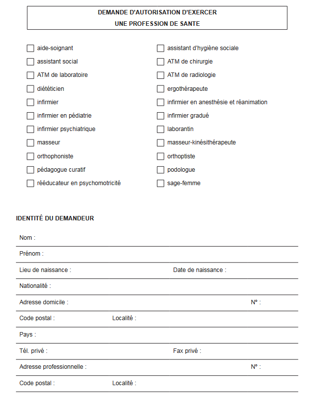
>
> 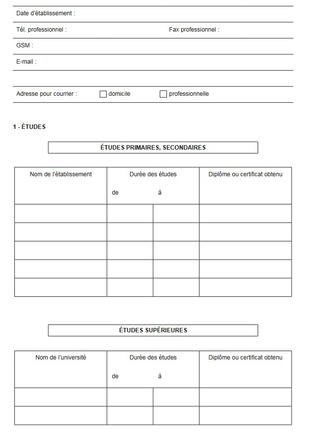
>
> 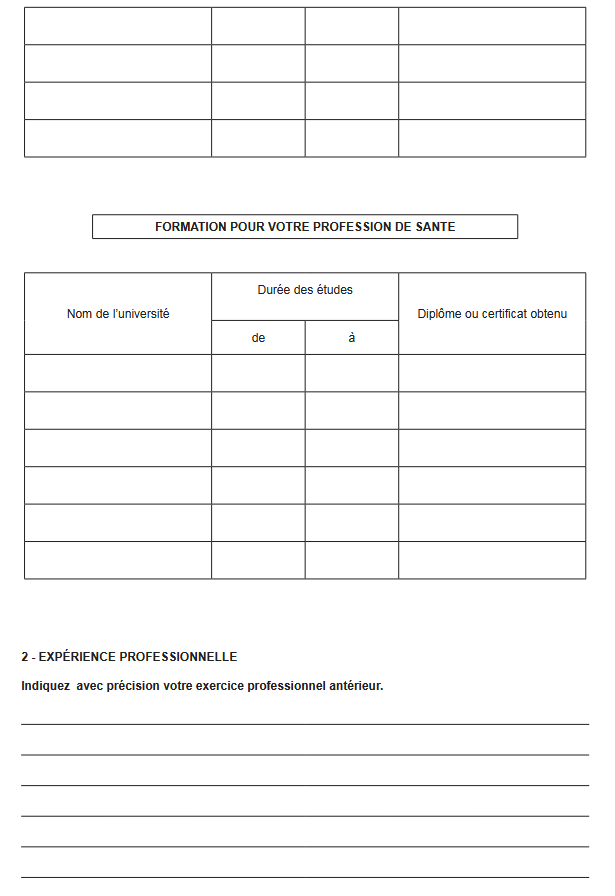
>
> 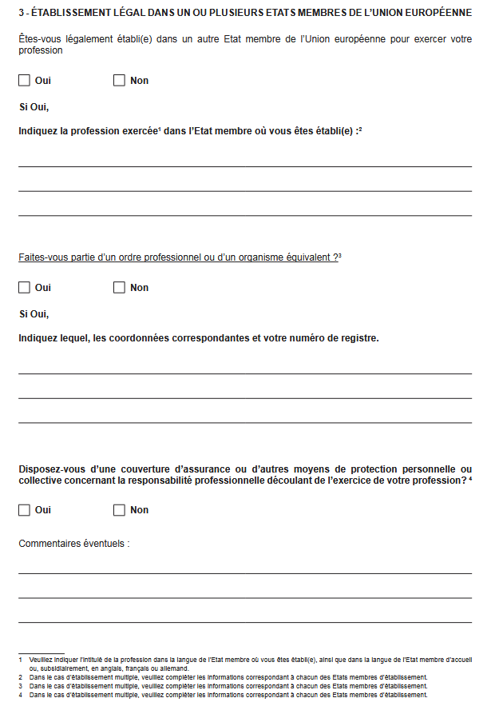
>
> 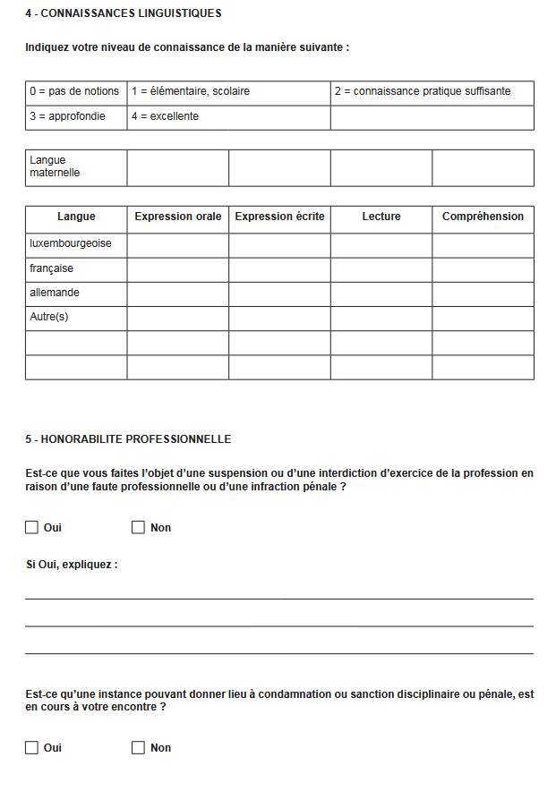
>
> 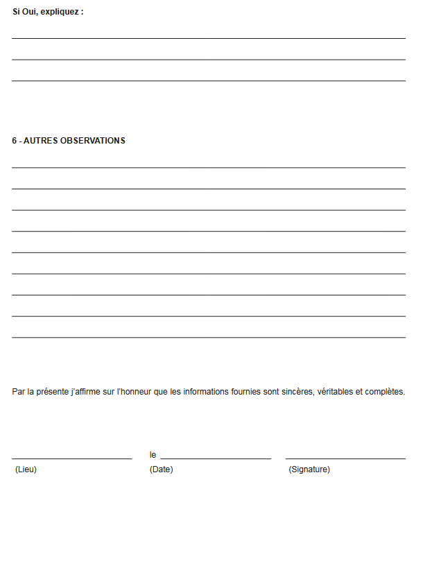

##### Version consolidée applicable au 10/03/2017 : Règlement grand-ducal du 14 septembre 2006 fixant les modalités de l'enseignement théorique et pratique de réintégration des professionnels de la santé ayant cessé l'exercice de leur profession.

###### Art. 1er.

1\. Le titulaire d'une autorisation d'exercer visé par l'article 13(2) de la [loi modifiée du 26 mars 1992](https://legilux.public.lu/eli/etat/leg/loi/1992/03/26/n1/jo) sur l'exercice et la revalorisation de certaines professions de santé, désigné ci-après par «le titulaire», désirant reprendre l'exercice de la profession visée à l'article 13(2) précité, est tenu de notifier son intention au ministre de la Santé, désigné ci-après par «le ministre».

2\. La notification visée au paragraphe 1 doit comporter les renseignements suivants:

aash le nombre d'années de cessation de l'exercice de la profession de santé;

bash le service et le lieu de travail que la personne concernée entend réintégrer;

cash le cas échéant, la participation à des formations continues telle que prévue par l'article 13(1) de la [loi modifiée du 26 mars 1992](https://legilux.public.lu/eli/etat/leg/loi/1992/03/26/n1/jo) précitée.

###### Art. 2.

Si, à la suite de cette notification, le ministre, sur avis de la direction de la Santé, oblige le titulaire à poursuivre un enseignement théorique et pratique de réintégration, désigné ci-après par «l'enseignement», le ministre:

aash fournit au titulaire une liste indiquant les terrains de stage disponibles et notamment les terrains de stage agréés conjointement par lui et le ministre de l'Éducation nationale;

bash fixe le nombre d'heures d'enseignement pratique à suivre;

cash fournit au titulaire une liste des cours de formation continue organisés ou agréés par lui;

dash détermine le nombre d'heures de cours auxquels le titulaire devra participer.

###### Art. 3.

1\. Sur base de la décision du ministre, le titulaire lui soumet pour approbation un projet de stage, à effectuer dans un service en relation avec la profession que le titulaire souhaite réintégrer.

2\. Le projet de stage visé au paragraphe 1ercomporte notamment la période, l'établissement, le lieu de stage, le nom et la profession, ainsi que le cas échéant, les coordonnées de l'employeur du maître de stage.

###### Art. 4.

L'enseignement doit comporter soixante heures au moins sans toutefois excéder cent heures et s'étaler sur une durée maximum de trois mois.

###### Art. 5.

L'enseignement est effectué sous l'autorité et sous la responsabilité du maître de stage qui doit disposer d'une expérience professionnelle d'au moins cinq ans dans la même profession que celle du titulaire. Le maître de stage doit assurer sur le lieu du stage une présence adéquate pour surveiller l'activité professionnelle du stagiaire.

###### Art. 6.

Le titulaire doit être identifiable à tout moment comme stagiaire par les patients. Il porte le titre professionnel correspondant à la profession de santé qu'il souhaite réintégrer. Ledit titre est suivi des termes «en stage de réintégration».

###### Art. 7.

À la fin du stage, le maître de stage émet un avis au ministre. En cas d’avis favorable, le ministre remet au titulaire un certificat attestant qu’il a accompli avec succès le stage conformément aux dispositions du présent règlement et qu’il remplit les obligations de l’article 13, paragraphe 2 de la [loi modifiée du 26 mars 1992](https://legilux.public.lu/eli/etat/leg/loi/1992/03/26/n1/jo) précitée.

###### Art. 8.

Notre Ministre de la Santé et Notre Ministre de l'Éducation Nationale et de la Formation Professionnelle sont chargés, chacun en ce qui le concerne, de l'exécution du présent règlement qui sera publié au Mémorial.

## RADIOPROTECTION

### DISPOSITIONS GÉNÉRALES

#### Loi du 28 mai 2019 1. relative à la protection sanitaire des personnes contre les dangers résultant de l’exposition aux rayonnements ionisants et à la sécurité des sources de rayonnements ionisants contre les actes de malveillance ; 2. relative à la gestion des déchets radioactifs, du transport de matières radioactives et de l’importation ; 3. portant modification de la loi modifiée du 21 novembre 1980 portant organisation de la Direction de la santé.

##### Titre Ier — Dispositions générales

###### Art. 1er — Objectif

La présente loi, ci-après « la loi », établit, pour des personnes soumises à une exposition professionnelle ou à des fins médicales ou à une exposition du public, le cadre juridique relatif à la protection sanitaire contre les dangers résultant des rayonnements ionisants.

Elle établit également les règles concernant la gestion responsable et sûre des matières radioactives.

###### Art. 2 — Champ d’application

(1) La loi s’applique à toute situation d’exposition planifiée, d’exposition existante ou d’exposition d’urgence comportant un risque sanitaire résultant de l’exposition à des rayonnements ionisants qui ne peut être négligé du point de vue de la protection contre les rayonnements ionisants ou en ce qui concerne l’environnement, en vue d’une protection de la santé humaine à long terme.

(2) La loi s’applique aux actes suivants :

a) la fabrication, la production, le traitement, la manipulation, la vente, la location ou la cession, le stockage, l’emploi, l’entreposage, la détention, le transport, le transit, l’importation, l’exportation, le recyclage et la réutilisation de matières radioactives ;

b) la fabrication, la vente, la détention et l’exploitation d’équipements électriques pouvant émettre des rayonnements ionisants et contenant des composants pouvant fonctionner sous une différence de potentiel supérieure à 5 kilovolts ;

c) les actes humains impliquant la présence de sources naturelles de rayonnement qui entraînent une augmentation notable de l’exposition des travailleurs ou des personnes du public ;

d) l’exposition des travailleurs ou des personnes du public au radon à l’intérieur des bâtiments, l’exposition externe aux matériaux de construction et les cas d’exposition durable résultant des suites d’une situation d’urgence ou d’une activité humaine antérieure ;

e) la préparation aux situations d’exposition d’urgence qui sont considérées comme justifiant des mesures destinées à protéger la santé des personnes du public ou des travailleurs, la planification de l’intervention dans le cadre de ces situations et la gestion de telles situations.

###### Art. 3 — Exclusion du champ d’application

La loi ne s’applique pas :

a) à l’exposition à un niveau naturel de rayonnement, tels des radionucléides contenus dans l’organisme humain et le rayonnement cosmique régnant au niveau du sol ;

b) à l’exposition des personnes du public ou des travailleurs autres que les membres d’équipages aériens ou spatiaux au rayonnement cosmique au cours d’un vol aérien ou spatial ;

c) à l’exposition en surface aux radionucléides présents dans la croûte terrestre non perturbée.

###### Art. 4 — Définitions

Pour l’application de la loi, on entend par :

1° « accélérateur » : un appareillage ou une installation dans lesquels les particules sont soumises à une accélération, émettant des rayonnements ionisants d’une énergie supérieure à un mégaélectronvolt ;

2° « activation » : un processus par lequel un nucléide stable est transformé en un radionucléide par irradiation de la substance qui le contient au moyen de particules ou de photons de haute énergie ;

3° « activité radioactive » (A) : l’activité d’une quantité d’un radionucléide à un état énergétique déterminé et à un moment donné. Il s’agit du quotient de dN par dt, où dN est le nombre probable de transitions nucléaires à partir de cet état énergétique dans l’intervalle de temps dt :

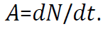

L’unité d’activité est le becquerel ;

4° « apprenti » : une personne recevant une formation ou un enseignement dans un établissement en vue d’exercer des compétences spécifiques ;

5° « aspects pratiques des procédures radiologiques médicales » : le déroulement physique d’une exposition à des fins médicales et les aspects qui le sous-tendent, y compris la manipulation et l’utilisation d’équipements radiologiques médicaux, l’évaluation de paramètres techniques et physiques (dont les doses de rayonnement), l’étalonnage et l’entretien d’équipements, la préparation et l’administration de sources radioactives et le traitement d’images ;

6° « assurance de la qualité » : l’ensemble des opérations prévues et systématiques nécessaires pour garantir, avec un niveau d’assurance satisfaisant, qu’une installation, un système, une pièce d’équipement ou une procédure fonctionnera de manière satisfaisante conformément à des normes convenues. Le contrôle de qualité fait partie de l’assurance de la qualité ;

7° « audit clinique » : un examen ou un passage en revue systématique des procédures radiologiques médicales, qui vise à améliorer la qualité et le résultat des soins administrés au patient grâce à un examen structuré dans le cadre duquel les pratiques, les procédures et les résultats radiologiques médicaux sont comparés à des référentiels convenus de bonnes procédures radiologiques médicales et qui donne lieu à la modification des pratiques, le cas échéant, et à l’application de nouveaux référentiels en cas de nécessité ;

8° « autorisation » : certificat délivré dans les cas dûment indiqués soit par le ministre ayant la Santé dans ses attributions, désigné ci-après par « le ministre », soit par la Direction de la santé, permettant l’exercice d’une pratique ou d’une profession ;

9° « becquerel » (Bq) : nom de l’unité d’activité. Un becquerel équivaut à une transition nucléaire par seconde : 1 Bq = 1 s-1 ;

10° « concentration de radon » : concentration annuelle moyenne en radon, exprimée en becquerel par mètre cube ;

11° « contamination » : la présence non intentionnelle ou non souhaitée de substances radioactives sur les surfaces ou à l’intérieur des solides, liquides ou gaz ou sur le corps humain ;

12° « contenant de source » : un assemblage de composants destiné à garantir le confinement d’une source scellée ne faisant pas partie intégrante de la source mais destiné à protéger cette dernière lors des opérations de transport et de manutention ;

13° « contrainte de dose » : une restriction définie comme plafond prospectif de doses à l’individu, utilisée pour définir l’éventail d’options envisagées dans le processus d’optimisation pour une source de rayonnement donnée en situation d’exposition planifiée ;

14° « contrôle de qualité » : l’ensemble des opérations (programmation, coordination, mise en œuvre) destinées à maintenir ou à améliorer la qualité. Il englobe la surveillance, l’évaluation et le maintien aux niveaux requis de toutes les caractéristiques d’exploitation des équipements qui peuvent être définies, mesurées et contrôlées ;

15° « contrôle réglementaire » : toute forme de contrôle ou de réglementation appliquée à des activités humaines pour satisfaire aux obligations de radioprotection ;

16° « déchet radioactif » : substance radioactive sous forme gazeuse, liquide ou solide, y compris des matières contaminées, pour lesquelles aucune utilisation ultérieure n’est prévue et dont le niveau de radioactivité ne permet pas un rejet immédiat dans l’environnement ;

17° « dépistage médical » : une procédure de diagnostic précoce pratiquée au moyen d’installations radiologiques médicales sur des groupes de population à risque ;

18° « détriment individuel » : les effets nocifs cliniquement observables sur les individus ou leurs descendants et dont l’apparition est soit immédiate soit tardive, auquel cas l’apparition est plus probable que certaine ;

19° « détriment sanitaire » : une réduction de l’espérance et de la qualité de vie d’une population résultant d’une exposition, y compris les réductions dues aux réactions tissulaires, au cancer et aux perturbations génétiques graves ;

20° « dose absorbée » (D) : énergie absorbée par unité de masse

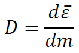

où

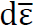 est l’énergie moyenne communiquée par le rayonnement ionisant à la matière dans un élément de volume,

est la masse de la matière contenue dans cet élément de volume.

Dans la loi, le terme « dose absorbée » désigne la dose moyenne reçue par un tissu ou un organe. L’unité de dose absorbée est le gray, un gray équivalant à un joule par kilogramme ;

21° « dose efficace » (E) : la somme des doses équivalentes pondérées dans les différents tissus et organes du corps par suite d’une exposition interne et externe. Elle est définie par la formule :

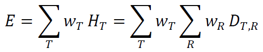

dans laquelle :

DT,R est la moyenne pour le tissu ou l’organe 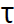 de la dose absorbée du rayonnement R,

wR est le facteur de pondération pour les rayonnements et

wT est le facteur de pondération pour les tissus valable pour le tissu ou l’organe .

Les valeurs pour wT et wR sont spécifiées par règlement grand-ducal. L’unité de dose efficace est le sievert ;

22° « dose efficace engagée » [E()] : la somme des doses équivalentes engagées dans les divers tissus ou organes HT() par suite d’une incorporation, multipliées chacune par le facteur de pondération pour les tissus wT approprié :

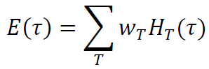

Dans E(),  est le nombre d’années sur lequel est faite l’intégration. Aux fins du respect des limites de dose spécifiées dans la loi,  est une période de cinquante ans après incorporation pour les adultes, et le nombre d’années restant jusqu’à l’âge de soixante-dix ans pour les nourrissons et les enfants. L’unité de dose efficace engagée est le sievert ;

23° « dose équivalente » (HT) : la dose absorbée par le tissu ou l’organe , pondérée suivant le type et la qualité du rayonnement R. Elle est donnée par la formule :

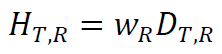

dans laquelle :

DT,R est la moyenne pour le tissu ou l’organe  de la dose absorbée du rayonnementR,

wR est le facteur de pondération pour les rayonnements.

Lorsque le champ de rayonnement comprend des rayonnements de types et d’énergies correspondant à des valeurs différentes de wR, la dose équivalente totale HT est donnée par la formule :

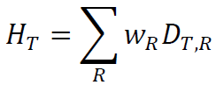

Les valeurs pour wR sont indiquées par règlement grand-ducal. L’unité de dose équivalente est le sievert ;

24° « dose équivalente engagée » (HT()) : l’intégrale sur le temps (t) du débit de dose équivalente (au tissu ou à l’organe ) qui sera reçu par un individu à la suite d’une incorporation.

Elle est donnée par la formule :

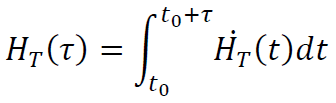

où

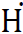 T(t) est le débit de dose équivalente à l’organe ou au tissu  au moment t,

 est la période sur laquelle l’intégration est effectuée.

Dans  T(t),  est le nombre d’années sur lequel est faite l’intégration. Aux fins du respect des limites de dose spécifiées dans la loi,  est une période de cinquante ans pour les adultes et le nombre d’années restant jusqu’à l’âge de soixante-dix ans pour les nourrissons et les enfants. L’unité de dose équivalente engagée est le sievert ;

25° « engin spatial » : un véhicule habité conçu pour opérer à une altitude supérieure à 100 kilomètres au-dessus du niveau de la mer ;

26° « entreposage » : le maintien de matières radioactives, y compris le combustible usé, de sources radioactives ou de déchets radioactifs dans une installation, avec intention de retrait ultérieur ;

27° « équipements radiologiques médicaux » : équipements utilisés pour les expositions à des fins médicales. Il s’agit des équipements médicaux nécessaires à la production et à l’interprétation des images de radiodiagnostic ou de radiologie interventionnelle, ainsi que des équipements médicaux nécessaires à la définition, à la planification, à la délivrance et à la vérification des traitements radiothérapeutiques et des équipements permettant de mesurer des grandeurs dosimétriques liées à une exposition à des fins médicales ;

28° « établissement » : une personne physique ou morale qui a la responsabilité juridique d’exercer une pratique, ou d’une source de rayonnement, y compris le cas où le propriétaire ou le détenteur d’une source de rayonnement n’exerce pas d’activités humaines en relation avec celle-ci ;

29° « expert en physique médicale » : une personne possédant les connaissances, la formation et l’expérience requises pour agir ou prodiguer des conseils sur des questions relatives à la physique des rayonnements appliquée aux expositions à des fins médicales et dont la compétence à cet égard est reconnue par la Direction de la santé ;

30° « expert en radioprotection » : une personne ou un groupe de personnes possédant les connaissances, la formation et l’expérience requises pour prodiguer des conseils en matière de radioprotection afin d’assurer une protection efficace des personnes et dont la compétence en la matière est reconnue par la Direction de la santé ;

31° « exposition » : le fait d’exposer, ou d’être exposé, à des rayonnements ionisants émis hors de l’organisme (exposition externe) ou à l’intérieur de l’organisme (exposition interne) ;

32° « exposition accidentelle » : une exposition de personnes autres que les personnes intervenant en situation d’urgence par suite d’un accident ;

33° « exposition à des fins d’imagerie non médicale » : toute exposition délibérée de personnes à des fins d’imagerie où la finalité principale de l’exposition n’est pas d’apporter un bénéfice sanitaire à la personne exposée ;

34° « exposition à des fins médicales » : une exposition subie par des patients ou des personnes asymptomatiques dans le cadre de leur propre diagnostic ou traitement médical ou médico-dentaire en vue d’un effet bénéfique sur leur santé, ainsi qu’une exposition subie par des personnes participant au soutien et au réconfort de patients ainsi que par des volontaires participant à des recherches médicales ou biomédicales ;

35° « exposition au radon » : l’exposition aux descendants du radon ;

36° « exposition du public » : une exposition de personnes, à l’exclusion des expositions professionnelles ou médicales ;

37° « exposition non intentionnelle » : exposition à des fins médicales différant considérablement de l’exposition à des fins médicales prévue dans un but déterminé ;

38° « exposition normale » : exposition attendue dans les conditions normales d’exploitation d’une installation ou d’exercice d’une activité humaine (dont la maintenance, l’inspection ou le démantèlement), y compris en cas d’incidents mineurs pouvant être maintenus sous contrôle, c’est-à-dire dans le contexte d’une exploitation normale et en cas d’incidents de fonctionnement prévus ;

39° « exposition potentielle » : exposition dont la survenance n’est pas certaine, mais qui peut résulter d’un événement ou d’une séquence d’événements de nature probabiliste, y compris des défaillances d’équipements et de fausses manœuvres ;

40° « exposition professionnelle » : exposition subie par les travailleurs, les apprentis et les étudiants au cours de leur travail ;

41° « exposition professionnelle d’urgence » : l’exposition subie lors d’une situation d’exposition d’urgence par un membre d’une équipe d’intervention ;

42° « extrémités » : les mains, les avant-bras, les pieds et les chevilles ;

43° « faible risque » : les pratiques n’ayant pas recours à des sources radioactives ouvertes et des pratiques exposant délibérant des personnes ;

44° « générateur de rayonnements » : un dispositif capable de générer des rayonnements ionisants, tels que des rayons X, des neutrons, des électrons ou d’autres particules chargées ;

45° « gestion des déchets radioactifs » : toutes les activités liées à la manipulation, au prétraitement, au traitement, au conditionnement, à l’entreposage ou au stockage des déchets radioactifs, à l’exclusion du transport hors site ;

46° « incorporation » : l’activité totale d’un radionucléide pénétrant dans l’organisme à partir du milieu ambiant ;

47° « inspection » : une enquête menée par la Direction de la santé ou pour le compte de celle-ci pour vérifier le respect des exigences légales ;

48° « installation de gestion de déchets radioactifs » : toute installation ayant pour objectif principal la gestion de déchets radioactifs ;

49° « installation radiologique médicale » : une structure dans laquelle des procédures radiologiques médicales sont accomplies ;

50° « limite de dose » : la valeur de la dose efficace (le cas échéant, de la dose efficace engagée) ou de la dose équivalente dans une période spécifiée à ne pas dépasser pour une personne ;

51° « matériau de construction » : tout produit de construction destiné à être incorporé de façon durable dans un bâtiment ou des parties de bâtiment et dont les performances influent sur celles du bâtiment en ce qui concerne l’exposition de ses occupants aux rayonnements ionisants ;

52° « matière fissile » : matière susceptible de subir une fission par interaction avec des neutrons et de soutenir une réaction en chaîne ;

53° « matière radioactive » : matière contenant des substances radioactives ;

54° « médecin demandeur » : un médecin ou un médecin-dentiste qui oriente des patients vers un médecin réalisateur aux fins de procédures radiologiques médicales ;

55° « médecin du travail chargé de la surveillance médicale des travailleurs exposés » : un professionnel de la santé compétent pour assurer la surveillance médicale de travailleurs exposés et dont la qualification pour cette tâche est reconnue par le ministre ;

56° « médecin réalisateur » : un médecin ou un médecin-dentiste habilité à assumer la responsabilité médicale d’une exposition individuelle à des fins médicales ;

57° « mesures correctives » : l’élimination d’une source ionisante ou la réduction de son importance (en termes d’activité ou de quantité) ou l’interruption des voies d’exposition ou la réduction de leurs incidences afin d’éviter ou de réduire les doses qui, en l’absence de telles mesures, pourraient être reçues dans une situation d’exposition existante ;

58° « mesures protectrices » : des mesures autres que des mesures correctives destinées à éviter ou à réduire les doses qui, en leur absence, pourraient être reçues dans une situation d’exposition d’urgence ou d’exposition existante ;

59° « niveau de référence » : dans une situation d’exposition d’urgence ou d’exposition existante, le niveau de la dose efficace ou de la dose équivalente ou de concentration d’activité au-dessus duquel il est jugé inapproprié de permettre la survenance d’expositions résultant de ladite situation d’exposition, même s’il ne s’agit pas d’une limite ne pouvant pas être dépassée ;

60° « niveaux de référence diagnostiques » : des niveaux de dose dans les pratiques de radiologie médicale radiodiagnostique ou interventionnelle ou, dans le cas de produits radiopharmaceutiques, des niveaux d’activité, pour des actes types sur des groupes de patients types ou sur des « fantômes » types, pour des catégories larges de types d’équipements ;

61° « notification » : la soumission d’informations à l’autorité compétente pour notifier l’intention d’exercer une pratique relevant du champ d’application de la loi ;

62° « personne chargée de la radioprotection » : une personne techniquement compétente sur des questions de radioprotection liées à un type de pratique déterminé pour superviser ou mettre en œuvre des dispositions en matière de radioprotection ;

63° « personne représentative » : une personne recevant une dose qui est représentative des personnes les plus exposées au sein de la population, à l’exclusion des personnes ayant des habitudes extrêmes ou rares ;

64° « personnes du public » : des personnes susceptibles d’être soumises à une exposition du public ;

65° « personnes participant au soutien et au réconfort de patients » : des personnes subissant, en connaissance de cause et de leur plein gré, une exposition à un rayonnement ionisant en contribuant, en dehors de l’exercice de leur profession, au soutien et au réconfort de personnes subissant ou ayant subi une exposition à des fins médicales ;

66° « plan d’intervention d’urgence » : les dispositions prises pour programmer une réaction adéquate en cas de survenance d’une situation d’exposition d’urgence sur la base d’événements postulés et de scénarios qui s’y rattachent ;

67° « pratique » : acte humain susceptible d’accroître l’exposition de personnes au rayonnement provenant d’une source de rayonnement et qui est gérée en tant que situation d’exposition planifiée ;

68° « pratique justifiée » : une pratique pour laquelle la justification est établie par décision du ministre ;

69° « procédure radiologique médicale » : toute procédure donnant lieu à une exposition à des fins médicales ;

70° « produit de consommation » : un dispositif ou un article manufacturé dans lequel un ou plusieurs radionucléides ont été incorporés délibérément ou produits par activation, ou qui génère des rayonnements ionisants, et qui peut être vendu ou mis à la disposition de personnes du public sans être soumis à une surveillance ou à un contrôle réglementaire particuliers après-vente ;

71° « radiodiagnostique » : qui se rapporte aux applications diagnostiques de la médecine nucléaire *in vivo* et à la radiologie diagnostique médicale utilisant des rayonnements ionisants, y compris la radiologie dentaire ;

72° « radiologie interventionnelle » : l’utilisation de techniques d’imagerie par rayons X pour faciliter l’introduction et le guidage des dispositifs à l’intérieur de l’organisme à des fins diagnostiques ou thérapeutiques ;

73° « radiologique médical » : qui se rapporte à un acte diagnostique utilisant les rayonnements ionisants et aux procédures de radiothérapie et à la radiologie interventionnelle ou à d’autres usages médicaux des rayonnements ionisants à des fins de repérage, de guidage et de vérification ;

74° « radiothérapeutique » : qui se rapporte à la radiothérapie, dont la radiothérapie externe, la médecine nucléaire à des fins thérapeutiques et la curiethérapie ;

75° « radon » : le radionucléide Rn-222 et ses descendants, le cas échéant ;

76° « rayonnement ionisant » : le transport d’énergie sous la forme de particules ou d’ondes électromagnétiques d’une longueur d’ondes inférieure ou égale à 100 nanomètres (d’une fréquence supérieure ou égale à 3 × 1015 hertz) pouvant produire des ions directement ou indirectement ;

77° « responsabilité médicale » : la responsabilité d’un médecin réalisateur en matière d’expositions individuelles à des fins médicales, dont la justification ; l’optimisation ; l’évaluation clinique du résultat ; la collaboration avec d’autres spécialistes et le personnel, le cas échéant, sur le plan des aspects pratiques des procédures radiologiques médicales ; la collecte d’informations, s’il y a lieu, sur des examens antérieurs ; la fourniture, à d’autres médecins réalisateurs et/ou au médecin demandeur, d’informations et/ou de dossiers radiologiques médicaux, selon les cas ; et la fourniture d’informations aux patients et à d’autres personnes concernées, comme il convient, sur les risques des rayonnements ionisants ;

78° « service de dosimétrie » : un organisme compétent ou une personne compétente pour l’étalonnage, la lecture ou l’interprétation des appareils de surveillance individuels, ou pour la mesure de la radioactivité dans le corps humain ou dans des échantillons biologiques, ou pour l’évaluation des doses, et dont la qualification pour cette tâche est reconnue ;

79° « sievert (Sv) » : le nom de l’unité de dose équivalente ou de dose efficace. Un sievert équivaut à un joule par kilogramme : 1 Sv = 1 J/kg ;

80° « situation d’exposition d’urgence » : une situation d’exposition due à une urgence ;

81° « situation d’exposition existante » : une situation d’exposition qui existe déjà lorsqu’une décision doit être prise quant à son contrôle et qui ne nécessite pas, ou ne nécessite plus, de mesures urgentes ;

82° « situation d’exposition planifiée » : situation d’exposition qui résulte de l’exploitation planifiée d’une source de rayonnement ou d’une activité humaine qui modifie les voies d’exposition, de manière à causer l’exposition ou l’exposition potentielle de personnes ou de l’environnement. Les situations d’exposition planifiées peuvent comprendre tant des expositions normales que des expositions potentielles ;

83° « situation post-accidentelle » : une situation d’exposition existante qui résulte d’une situation d’exposition d’urgence ;

84° « source de rayonnement » : une entité susceptible de provoquer une exposition, par exemple en émettant des rayonnements ionisants ou en rejetant des matières radioactives ;

85° « source naturelle de rayonnement » : une source de rayonnement ionisant d’origine naturelle terrestre ou cosmique ;

86° « source orpheline » : une source radioactive qui ne fait pas l’objet d’une exemption et n’est pas sous contrôle réglementaire, par exemple parce qu’elle n’a jamais fait l’objet d’un tel contrôle ou parce qu’elle a été abandonnée, perdue, égarée, volée ou transférée d’une autre manière sans autorisation en bonne et due forme ;

87° « source radioactive » : une source de rayonnement intégrant des matières radioactives aux fins d’en utiliser la radioactivité ;

88° « source retirée du service » : une source scellée qui n’est plus utilisée ni destinée à être utilisée aux fins de la pratique pour laquelle une autorisation a été délivrée, mais qui continue de nécessiter une gestion sûre ;

89° « source scellée » : une source radioactive dont les matières radioactives sont enfermées d’une manière permanente dans une capsule ou incorporées sous forme solide dans le but d’empêcher, dans des conditions d’utilisation normales, toute dispersion de substances radioactives ;

90° « source scellée de haute activité » : une source scellée dont l’activité du radionucléide qu’elle contient est égale ou supérieure à la valeur D ;

91° « substance radioactive » : toute substance contenant un ou plusieurs radionucléides dont l’activité ou la concentration d’activité ne peut être négligée du point de vue de la radioprotection ;

92° « sûreté nucléaire » : la réalisation de conditions d’exploitation adéquates, la prévention des accidents et l’atténuation des conséquences des accidents, permettant de protéger la population et les travailleurs contre les dangers résultant des rayonnements ionisants émis par les installations nucléaires ;

93° « surveillance de l’environnement » : la mesure des débits de dose externes dus aux substances radioactives dans l’environnement ou de la concentration de radionucléides dans les milieux ambiants ;

94° « système de gestion des urgences » : un cadre juridique ou administratif établissant les responsabilités en matière de préparation aux situations d’urgence et en matière d’intervention d’urgence, ainsi que les dispositions pour la prise de décision en cas de survenance d’une situation d’exposition d’urgence ;

95° « thoron » : le radionucléide Rn-220 et ses descendants, le cas échéant ;

96° « traitement des matières radioactives » : des opérations chimiques ou physiques sur des matières radioactives, y compris l’extraction, la conversion ou l’enrichissement de matières nucléaires fissiles ou fertiles et le retraitement de combustible usé ;

97° « travailleur exposé » : une personne travaillant à son compte ou pour le compte d’un employeur, soumise pendant son travail à une exposition provenant de pratiques réglementées par la loi et qui est susceptible de recevoir des doses supérieures à l’une ou l’autre des limites de dose fixées pour l’exposition du public ;

98° « travailleur extérieur » : tout travailleur exposé qui n’est pas employé par l’établissement responsable des zones surveillées et contrôlées, mais qui intervient dans ces zones, y compris les apprentis et les étudiants ;

99° « travailleur intervenant en situation d’urgence » : toute personne ayant un rôle défini lors d’une situation d’urgence et qui est susceptible d’être exposée à des rayonnements lors de la mise en œuvre d’actions pour y faire face ;

100° « urgence » : une situation ou un événement inhabituels impliquant une source de rayonnement et nécessitant une réaction rapide pour atténuer des conséquences négatives graves pour la santé humaine et la sûreté, la qualité de la vie, les biens ou l’environnement, ou un risque qui pourrait entraîner de telles conséquences négatives graves ;

101° « valeur D » : une valeur exprimée en activité totale, à laquelle ou au-dessus de laquelle une source radioactive doit être considérée comme source à risque élevé nécessitant la mise en œuvre de précautions particulières ;

102° « valeur d’exemption (XE) » : une valeur exprimée en concentration d’activité ou en activité totale d’une source radioactive, en dessous de laquelle un établissement n’est pas soumis à l’obligation d’autorisation pour la mise en œuvre de la source ;

103° « valeur de contamination surfacique labile (XS) » : une valeur exprimée en activité surfacique (becquerel par centimètre carré) exprimant une contamination non fixée sur une surface ;

104° « valeur de libération (XL) » : une valeur exprimée en concentration d’activité, en dessous de laquelle une substance radioactive provenant d’une pratique mise en œuvre par un établissement peut être éliminée, recyclée ou réutilisée indépendamment de la quantité et de l’activité totale ;

105° « valeurs standard et paramètres associés » : les valeurs standard et les paramètres associés aux fins de l’estimation des doses résultant de l’exposition externe et de l’exposition interne ;

106° « zone contrôlée » : une zone soumise à une réglementation spéciale pour des raisons de protection contre les rayonnements ionisants ou de confinement de la contamination radioactive et dont l’accès est réglementé ;

107° « zone de planification » : zone autour d’une installation pour laquelle des dispositions sont prises en vue de la mise en œuvre de mesures protectrices urgentes afin d’éviter des doses hors site conformément au niveau de référence ;

108° « zone surveillée » : une zone faisant l’objet d’une surveillance à des fins de protection contre les rayonnements ionisants.

##### Titre II — Système de radioprotection

###### Chapitre Ier — Principes fondamentaux

**Art. 5 — Justification**

(1) Toute pratique doit être justifiée, dans le sens qu’il doit être garanti que les avantages qu’elle génère sur le plan individuel ou pour la société l’emportent sur le détriment sanitaire qu’elle pourrait causer.

(2) Au cas où différentes techniques peuvent être considérées comme équivalentes, les techniques non-ionisantes sont à favoriser.

(3) Si un recours à des pratiques ionisantes s’avère justifié, les techniques qui n’utilisent pas de substances radioactives sont à privilégier. Le principe énoncé au présent paragraphe ne s’applique pas aux expositions à des fins médicales.

(4) Toute modification de la voie d’exposition pour des situations d’exposition d’urgence ou existantes est justifiée, en ce sens qu’elle devrait présenter plus d’avantages que d’inconvénients.

**Art. 6 — Optimisation**

(1) La radioprotection des personnes soumises à une exposition professionnelle ou à une exposition du public est optimisée dans le but de maintenir l’amplitude des doses individuelles, la probabilité de l’exposition et le nombre de personnes exposées au niveau le plus faible qu’il soit raisonnablement possible d’atteindre, compte tenu de l’état actuel des connaissances techniques et des facteurs économiques et sociétaux.

(2) L’optimisation de la protection des personnes soumises à des expositions à des fins médicales s’applique à l’amplitude des doses individuelles tout en assurant la finalité médicale de l’exposition tel que décrit par les articles 81 à 86 de la loi.

(3) L’optimisation des expositions s’applique à la dose efficace et aux doses équivalentes.

**Art. 7 — Limitation des doses**

(1) Dans les situations d’exposition planifiées, la somme des doses reçues par une personne ne dépasse pas les limites de dose fixées pour l’exposition professionnelle ou l’exposition du public.

(2) Les limites de dose ne s’appliquent pas aux expositions à des fins médicales.

###### Chapitre II — Outils d’optimisation

**Art. 8 — Établissement des contraintes de dose**

(1) Aux fins de l’optimisation prospective de la protection des personnes soumises à des expositions, des contraintes de dose sont établies selon les principes suivants :

a) pour l’exposition professionnelle, la contrainte de dose est établie par l’établissement en tant qu’outil opérationnel d’optimisation, sous la supervision générale de la Direction de la santé. Dans le cas des travailleurs extérieurs, la contrainte de dose est établie par l’employeur en coopération avec l’établissement ;

b) pour l’exposition du public, la contrainte de dose est fixée à la dose individuelle reçue par les personnes du public dans le cadre de l’exploitation planifiée d’une source de rayonnement donnée. La Direction de la santé veille à ce que les contraintes soient conformes à la limite de dose pour la somme des doses reçues par le même individu du fait de l’ensemble des pratiques autorisées ;

c) pour l’exposition à des fins médicales, les contraintes de dose ne s’appliquent qu’en ce qui concerne la protection des personnes participant au soutien et au réconfort de patients et des volontaires participant à des recherches à des fins médicales ou biomédicales.

(2) Les contraintes de dose sont établies en termes de doses efficaces ou équivalentes individuelles reçues pendant une durée déterminée appropriée.

(3) Un règlement grand-ducal précise les modalités de mise en œuvre et d’application de contraintes de dose.

**Art. 9 — Niveaux de référence**

(1) La Direction de la santé réexamine à intervalles réguliers les situations d’exposition d’urgence et les situations d’exposition existantes et fixe des niveaux de référence en fonction des résultats du réexamen, qui doivent être inférieurs aux niveaux de référence définis aux paragraphes 2 à 4.

(2) Pour les situations d’exposition d’urgence, le niveau de référence est fixé à 100 millisievert. Ce niveau de référence comprend toutes les expositions reçues par les personnes du public dues à l’urgence sur la durée d’une année à partir du moment de l’accident, en appliquant un niveau de référence maximal de 20 millisievert pour la situation d’exposition existante.

(3) Pour les situations d’exposition existantes traduisant une exposition au radon, le niveau de référence de la concentration dans l’air est fixé à 300 becquerel par mètre cube.

(4) Le niveau de référence pour toute situation d’exposition existante, non visée aux paragraphes 2 et 3, est fixé à 1 millisievert par an.

###### Chapitre III — Limitation des doses

**Art. 10 — Limite d’âge pour les travailleurs exposés**

Sous réserve de l’article 13, une personne n’ayant pas atteint l’âge de dix-huit ans ne peut être affectée à un poste de travail qui ferait d’elle un travailleur exposé.

**Art. 11 — Limites de dose pour l’exposition professionnelle**

(1) Les limites de dose pour l’exposition professionnelle s’appliquent à la somme des expositions professionnelles annuelles d’un travailleur du fait de toutes les pratiques autorisées.

(2) La dose efficace au titre de l’exposition professionnelle est limitée à 20 millisievert au cours d’une année quelconque.

(3) La limite de dose équivalente pour le cristallin est fixée à 20 millisievert par an.

(4) La limite de dose équivalente pour la peau est de 500 millisievert par an. Elle s’applique à la dose moyenne sur toute surface de 1 centimètre carré, quelle que soit la surface exposée.

(5) La limite de dose équivalente pour les extrémités est de 500 millisievert par an.

**Art. 12 — Protection des travailleuses enceintes ou allaitantes**

(1) Les conditions auxquelles est soumise la femme enceinte dans le cadre de son emploi doivent être telles que la dose équivalente reçue par l’embryon ou le fœtus soit la plus faible qu’il est raisonnablement possible d’obtenir.

(2) Dès la déclaration de la grossesse, les conditions d’emploi de la travailleuse sont telles que la dose équivalente reçue par l’embryon ou le fœtus est limitée à 1 millisievert pendant au moins le reste de la grossesse.

(3) Les travailleuses allaitantes ne sont pas admises aux travaux qui comportent un risque important d’incorporation de radionucléides ou de contamination corporelle.

**Art. 13 — Limites de dose pour les apprentis et les étudiants**

(1) Les limites de dose pour les apprentis âgés de dix-huit ans au moins et pour les étudiants âgés de dix-huit ans au moins qui, au cours de leurs études, sont amenés à travailler avec des sources de rayonnement sont les mêmes que celles fixées à l’article 11 pour les travailleurs exposés.

(2) Les limites de dose pour les apprentis âgés de moins de dix-huit ans et pour les étudiants d’un âge inférieur à dix-huit ans qui, au cours de leurs études, sont amenés à travailler avec des sources de rayonnement sont les mêmes que celles fixées à l’article 14 pour l’exposition du public.

**Art. 14 — Limites de dose pour l’exposition du public**

(1) La somme des expositions annuelles d’une personne du public du fait de toutes les pratiques autorisées, à l’exclusion des expositions professionnelles, des expositions à des fins médicales ou des expositions à des fins d’imagerie non-médicale, ne doit pas dépasser la dose efficace de 1 millisievert.

(2) Outre la limite de dose fixée au paragraphe 1er, les limites de dose équivalente suivantes sont d’application :

a) la limite de dose équivalente pour le cristallin est de 15 millisievert par an ;

b) la limite de dose équivalente pour la peau est de 50 millisievert par an en valeur moyenne pour toute surface de 1 centimètre carré de peau, quelle que soit la surface exposée ;

c) la limite de dose équivalente pour les extrémités est de 50 millisievert par an.

**Art. 15 — Estimation de la dose efficace et de la dose équivalente**

Pour l’estimation de la dose efficace et de la dose équivalente, il est fait usage des valeurs standard et paramètres associés dont les modalités sont précisées par règlement grand-ducal.

##### Titre III — Exigences en matière d’enseignement, de formation et d’information dans le domaine de la radioprotection et missions des différents acteurs

###### Chapitre Ier — Reconnaissance des compétences spécifiques dans le domaine de la radioprotection

**Section Ière — Services, professions réglementées et personne chargée de la radioprotection**

**Art. 16 — Autorisation d’exercer**

(1) L’exercice des professions d’expert en radioprotection et d’expert en physique médicale est subordonné à une autorisation du ministre.

(2) Sous réserve des dispositions prévues aux articles 17 et 18, l’autorisation visée au paragraphe 1er est délivrée aux conditions suivantes :

a) le demandeur doit être ressortissant au sens de l’article 3, point q), de la [loi du 28 octobre 2016](https://legilux.public.lu/eli/etat/leg/loi/2016/10/28/n2/jo) relative à la reconnaissance des qualifications professionnelles ;

b) il doit être titulaire soit d’un diplôme luxembourgeois relatif à la profession concernée, soit d’un diplôme étranger reconnu conformément aux dispositions de la [loi du 28 octobre 2016](https://legilux.public.lu/eli/etat/leg/loi/2016/10/28/n2/jo) relative à la reconnaissance des qualifications professionnelles ;

c) il doit remplir les conditions de santé physique et psychique nécessaires à l’exercice de la profession ;

d) il doit répondre aux conditions d’honorabilité et de moralité nécessaires à l’exercice de la profession ;

e) il doit avoir les connaissances linguistiques nécessaires à l’exercice de la profession, soit en allemand, soit en français, et comprendre les trois langues administratives du Grand-Duché de Luxembourg ou acquérir les connaissances lui permettant de les comprendre. Une vérification des connaissances linguistiques du candidat d’une des langues administratives suivant l’article 3 de la [loi du 24 février 1984](https://legilux.public.lu/eli/etat/leg/loi/1984/02/24/n1/jo) sur le régime des langues peut être faite par le ministre.

(3) Un règlement grand-ducal précise la procédure à suivre et les documents à présenter pour obtenir l’autorisation d’exercer.

**Art. 17 — Expert en radioprotection**

(1) L’expert en radioprotection a comme mission de conseiller les établissements sur toute question liée au respect des obligations légales et réglementaires en matière d’exposition professionnelle et d’exposition du public. Selon les pratiques de l’établissement, le conseil porte sur les matières suivantes :

a) l’optimisation et l’établissement de contraintes de dose appropriées ;

b) les projets de nouvelles installations et la réception de sources nouvelles ou modifiées en ce qui concerne tous les contrôles techniques, les caractéristiques de conception et de sûreté et les dispositifs d’alerte pour la radioprotection ;

c) la classification des zones contrôlées et surveillées ;

d) la classification des travailleurs ;

e) les programmes de contrôle radiologique individuel et de contrôle radiologique du lieu de travail, ainsi que la dosimétrie individuelle correspondante ;

f) l’instrumentation appropriée au contrôle du rayonnement ;

g) l’assurance de la qualité ;

h) le programme de surveillance radiologique de l’environnement ;

i) les dispositions en matière de prévention et de gestion des déchets radioactifs ;

j) les dispositions relatives à la prévention des accidents et des incidents ;

k) la préparation aux situations d’exposition d’urgence et d’intervention d’urgence ;

l) les programmes d’information pour les travailleurs exposés ;

m) les enquêtes et analyses relatives aux incidents, aux accidents et aux actions correctives appropriées ;

n) les conditions d’emploi des travailleuses enceintes ou qui allaitent ;

o) l’élaboration d’une documentation appropriée en matière d’évaluation préalable des risques et de procédures écrites ;

p) les méthodes d’analyse et de remédiation concernant le radon ;

q) la radioprotection des travailleurs ;

r) la radioprotection du public.

L’expert en radioprotection est indépendant des services de production et des services opérationnels.

Il travaille en étroite collaboration avec la Direction de la santé et, le cas échéant, avec l’expert en physique médicale.

(2) La demande pour l’obtention de l’autorisation visée à l’article 16, paragraphe 1er, doit être adressée au ministre. L’autorisation est délivrée sous condition que le demandeur soit en possession d’un master dans le domaine de la radioprotection ou d’un bachelor dans le domaine des sciences naturelles ou en ingénierie avec, en cas de possession d’un bachelor, accomplissement d’une formation complémentaire en radioprotection d’au moins cent vingt heures, sanctionnée par une épreuve, délivrée par un établissement de formation autorisé à dispenser des formations au Grand-Duché de Luxembourg, ou, pour les formations acquises dans un État membre de l’Union européenne, délivrée par un établissement reconnu par les autorités compétentes de l’État de délivrance, sur les matières suivantes :

a) la physique nucléaire et les rayonnements ionisants ;

b) la détection et la mesure des rayonnements ionisants ;

c) la dosimétrie ;

d) la radiobiologie ;

e) les principes de base de la radioprotection et son application pratique ;

f) les règles et les normes internationales en matière de radioprotection ;

g) la gestion des sources radioactives.

Si la profession d’expert en radioprotection est réglementée dans l’État de provenance, le détenteur d’un titre de formation doit posséder les qualifications requises pour y accéder à la profession d’expert en radioprotection.

L’autorisation visée au présent paragraphe permet à l’expert en radioprotection d’accomplir ses missions dans tous les établissements visés par la loi.

(3) Dans les procédures d’autorisation, la Direction de la santé émet un avis sur les formations visées au paragraphe 2.

(4) Dès son installation, l’expert en radioprotection recueille les informations concernant la législation en vigueur en matière de radioprotection au Grand-Duché de Luxembourg.

**Art. 18 — Expert en physique médicale**

(1) L’expert en physique médicale a comme missions :

a) de prodiguer des conseils sur toute question relative à la physique des rayonnements et aux équipements radiologiques médicaux, en vue du respect des exigences liées aux expositions à des fins médicales et des pratiques impliquant l’exposition délibérée de personnes à des fins d’imagerie non médicale, dans le cas où de telles pratiques font appel à des équipements radiologiques médicaux, et

b) de prendre en charge la dosimétrie selon le type de pratique radiologique médicale, y compris des mesures physiques permettant d’évaluer la dose reçue par le patient et, le cas échéant, d’autres personnes soumises à une exposition à des fins médicales.

(2) Dans l’exécution de ses missions, l’expert en physique médicale est chargé :

a) de contribuer à l’optimisation de la radioprotection des patients et d’autres individus soumis à une exposition à des fins médicales, y compris à l’application et à l’utilisation de niveaux de référence diagnostiques ;

b) de la mise en œuvre de l’assurance de la qualité des équipements radiologiques médicaux ;

c) de la surveillance des installations radiologiques médicales ;

d) de la formation des médecins réalisateurs et d’autres personnes prenant en charge le patient en ce qui concerne les aspects de la radioprotection ;

e) de collaborer avec la Direction de la santé et avec la personne chargée de la radioprotection ;

f) de la définition de l’assurance de la qualité des équipements radiologiques médicaux ;

g) des essais et étalonnages à la réception des équipements radiologiques médicaux ;

h) de l’élaboration des spécifications techniques relatives à la conception des équipements et installations radiologiques médicaux ;

i) de l’analyse des événements comportant ou pouvant comporter des expositions à des fins médicales accidentelles ou non intentionnelles ;

j) de la sélection et de l’étalonnage des équipements nécessaires pour effectuer des mesures dans le domaine de la radioprotection ;

k) du suivi de l’évaluation technologique et des innovations ;

l) de la recherche de solutions scientifiques.

(3) La demande pour l’obtention de l’autorisation visée à l’article 16, paragraphe 1er, doit être adressée au ministre. L’autorisation est délivrée sous condition que le demandeur soit en possession :

a) d’un master en physique médicale ;

b) d’une attestation certifiant l’accomplissement d’un stage professionnel post-master d’au moins deux ans à temps plein en milieu hospitalier dans un ou plusieurs domaines de la physique médicale ;

c) d’une attestation certifiant, dans un ou plusieurs domaines de la physique médicale, l’accomplissement d’une expérience professionnelle d’au moins deux années par domaine.

(4) La formation visée au paragraphe 3 doit permettre l’acquisition des connaissances et compétences nécessaires à l’exercice des missions de l’expert en physique médicale dans les matières suivantes :

a) la physique nucléaire et la radiophysique ;

b) la détection et la mesure des rayonnements ionisants ;

c) la dosimétrie ;

d) la radiobiologie ;

e) les principes de base de la radioprotection et l’application pratique dans le domaine médical ;

f) les règles et les normes internationales en matière de radioprotection ;

g) la technologie et l’infrastructure de sûreté des types d’installations en lien avec le domaine d’intervention ;

h) la gestion des sources radioactives ;

i) les équipements radiologiques médicaux ;

j) l’assurance de la qualité des dispositifs médicaux ;

k) les risques émanant d’agents physiques dans le domaine médical.

Si la profession d’expert en physique médicale est réglementée dans l’État de provenance, le détenteur d’un titre de formation doit posséder les qualifications requises pour y accéder à la profession d’expert en physique médicale.

(5) L’expert en physique médicale autorisé à exercer la profession au Grand-Duché de Luxembourg peut, sous sa responsabilité et pendant la période d’accomplissement de l’expérience professionnelle visée au paragraphe 3, déléguer une partie de ses missions au titulaire d’un master en physique médicale remplissant la condition visée au paragraphe 3, point b).

(6) Dans le cadre de l’exécution de ses missions, l’expert en physique médicale est autorisé à accéder aux données médicales individuelles des personnes exposées à des rayonnements ionisants en milieu médical. Il est astreint au secret professionnel prévu à l’article 458 du Code pénal.

**Art. 19 — Médecin du travail chargé de la surveillance médicale des travailleurs exposés**

(1) Conformément aux dispositions des articles 69 à 72, la mission du médecin du travail chargé de la surveillance médicale des travailleurs exposés est le contrôle de leur exposition aux rayonnements ionisants et de leur aptitude à exercer leur activité professionnelle en présence de sources de rayonnement.

(2) Le médecin du travail chargé de la surveillance médicale des travailleurs exposés est autorisé par le ministre à effectuer la surveillance médicale des travailleurs exposés à condition :

a) d’être autorisé à exercer les fonctions de médecin du travail conformément à l’article L.325-1 du Code du travail ;

b) d’avoir suivi une formation en radioprotection, délivrée par un établissement de formation autorisé à dispenser des formations au Grand-Duché de Luxembourg, ou, pour les formations acquises dans un État membre de l’Union européenne, délivrée par un établissement reconnu par les autorités compétentes de l’État de délivrance.

(3) L’objectif de la formation visée au paragraphe 2, point b), est l’acquisition des compétences scientifiques, techniques, médicales et sanitaires de la radioprotection. Elle porte sur la radioprotection, la radiobiologie et les principes du contrôle des travailleurs exposés. Un règlement grand-ducal précise les matières et la durée minimale de la formation, qui ne peut pas dépasser quarante heures.

**Art. 20 — Service de dosimétrie**

(1) Le service de dosimétrie détermine les doses dues à l’exposition interne ou externe des travailleurs faisant l’objet d’une surveillance radiologique individuelle, afin que ces doses soient enregistrées en coopération avec l’établissement et, dans le cas de travailleurs extérieurs, avec l’employeur au registre de dosimétrie central.

Dans le cadre de ses attributions, il est tenu :

a) de mettre à disposition des dosimètres ou des moyens de mesure appropriés en fonction du domaine d’expertise pour assurer la surveillance individuelle de l’exposition professionnelle ;

b) de garantir la qualité des mesures réalisées ;

c) de transférer les résultats de la surveillance individuelle au registre de dosimétrie central moyennant un format spécifié par la Direction de la santé ;

d) de contrôler la cohérence des résultats d’analyse et, en cas de déviation, d’en avertir l’établissement dans un délai de deux jours ouvrables à partir de la constatation ;

e) d’informer sans délai la Direction de la santé en cas de constatation de résultats en dehors des tolérances normatives. Dans ce cas, la Direction de la santé peut demander au service de dosimétrie de procéder à des mesures de vérification et de remédiation.

(2) L’exploitation d’un service de dosimétrie est soumise à l’autorisation préalable du ministre. L’autorisation est délivrée à condition que le service de dosimétrie dispose :

a) d’une accréditation relative au domaine d’expertise du service de dosimétrie délivrée par l’autorité compétente du pays où le service est établi et portant sur l’ensemble des techniques de mesure réalisées par le service ;

b) parmi son personnel, d’un expert en radioprotection ;

c) d’un programme de formation continue qui prévoit, par période de deux ans, au moins huit heures de formation sur les techniques de mesure, la calibration des dosimètres et l’assurance de la qualité d’un service de dosimétrie pour toute personne ayant une responsabilité, selon l’accréditation, en matière d’assurance de la qualité des résultats de la dosimétrie.

L’autorisation est accordée pour une durée de cinq ans, renouvelable, et précise, sur base des techniques de mesure pour lesquelles le service est accrédité, les domaines d’expertise du service de dosimétrie.

(3) L’accréditation visée au paragraphe 2, point a), est délivrée par l’Office luxembourgeois d’accréditation et de surveillance lorsque le service de dosimétrie :

a) applique la norme ISO/IEC 17025 relative aux exigences générales concernant la compétence des laboratoires d’étalonnages et d’essais,

b) participe à des intervalles ne dépassant pas trois ans à une vérification des contrôles des performances par le biais d’une inter-comparaison européenne portant sur la qualité des résultats de mesures dosimétriques et

c) dispose d’un programme d’assurance de la qualité couvrant la calibration et la vérification des dosimètres, y compris de leurs caractéristiques de performance dosimétrique, la gestion des incertitudes, la réalisation de tests de comparaison, la structure d’organisation du service de dosimétrie et les responsabilités au sein de cette structure.

(4) Toute modification de nature organisationnelle ou technique influençant les conditions d’autorisation est communiquée par écrit à la Direction de la santé dans le mois qui suit la modification.

(5) Le ministre peut suspendre ou retirer l’autorisation visée au paragraphe 2, pour une partie ou pour la totalité de son activité, lorsque le service de dosimétrie ne satisfait plus aux conditions mentionnées au paragraphe 2.

(6) Un règlement grand-ducal précise les paramètres techniques du programme d’assurance de la qualité visé au paragraphe 3, point c), et la procédure d’autorisation.

**Art. 21 — Personne chargée de la radioprotection**

(1) Tout établissement des classes I, II et III tel que visé par les articles 40 à 42, ainsi que tout établissement transportant des matières radioactives tel que visé par l’article 56, désigne parmi son personnel une personne chargée de la radioprotection. Ne sont pas visés par le présent paragraphe les établissements de transport de colis visés à l’article 57, paragraphe 3.

(2) La mission d’une personne chargée de la radioprotection est d’effectuer des tâches de radioprotection ou de superviser leur accomplissement.

L’établissement doit fournir à la personne chargée de la radioprotection les moyens nécessaires pour s’acquitter des missions qui leur sont dévolues.

La personne chargée de la radioprotection rend directement compte à l’établissement. Parmi les établissements, dans ceux des classes I et II, cette personne doit être indépendante des services mettant en œuvre des pratiques, sauf dans le cas où cette personne est l’établissement.

(3) Les missions de la personne chargée de la radioprotection peuvent être assurées par un service de radioprotection mis en place au sein d’un établissement ou par un expert en radioprotection. Dans les établissements de la classe II, à l’exception de ceux mettant en œuvre des expositions à des fins médicales, et dans les établissements de la classe III, une personne chargée de la radioprotection peut conseiller les établissements sur toute question liée au respect des obligations légales et réglementaires en matière d’exposition professionnelle et d’exposition du public ainsi que réaliser des tests de réception.

(4) Afin d’effectuer les missions prévues au paragraphe 2, alinéa 1er, la personne chargée de la radioprotection doit avoir suivi une formation, sanctionnée par une épreuve, sur les aspects théoriques et pratiques de la radioprotection.

(5) Afin de conseiller les établissements mentionnés au paragraphe 3, une personne chargée de la radioprotection doit avoir suivi une formation de base, sanctionnée par une épreuve, sur la radioprotection et la radiobiologie ainsi que, selon les pratiques de l’établissement, une formation complémentaire répondant aux critères suivants :

a) pour les établissements appartenant à la classe II où sont mises en œuvre des sources non scellées : une formation spécifique sur la détection et mesure de contaminations, l’élaboration de procédures de travail et travaux pratiques avec sources non scellées ;

b) pour les établissements appartenant à la classe III utilisant des équipements radiologiques médicaux : une formation spécifique sur l’assurance de la qualité des équipements radiologiques médicaux dentaires ;

c) pour les établissements appartenant à la classe II où sont mises en œuvre des sources scellées de haute activité : une formation spécifique sur la gestion et le contrôle des sources, les exigences applicables aux procédures et aux communications en cas d’urgence et l’entretien des sources et des contenants ;

d) pour les établissements appartenant à la classe III utilisant des équipements radiologiques vétérinaires : une formation spécifique sur l’assurance de la qualité des équipements radiologiques vétérinaires.

(6) Les formations visées aux paragraphes 4 et 5 sont délivrées par un établissement de formation autorisé à dispenser des formations au Grand-Duché de Luxembourg ou, pour les formations acquises dans un État membre de l’Union européenne, délivrées par un établissement reconnu par les autorités compétentes de l’État de délivrance.

(7) L’établissement, après avoir désigné la personne chargée de la radioprotection, la notifie à la Direction de la santé.

(8) Un règlement grand-ducal précise les missions de la personne chargée de la radioprotection, les matières et la durée minimale des formations.

Dans le cas visé au paragraphe 4, cette durée minimale ne peut pas dépasser

a) soixante heures dans les établissements de la classe I ;

b) quatre heures dans les établissements de la classe II et vingt heures dans un établissement utilisant des sources radioactives non scellées en quantités telles qu’il appartient à la classe II ;

c) quatre heures pour les établissements de la classe III.

Dans les cas visés au paragraphe 5, cette durée minimale ne peut pas dépasser vingt et une heures pour la formation de base et dix-huit heures pour la formation complémentaire spécifique.

**Art. 22 — Formation continue**

(1) Tout expert en radioprotection, expert en physique médicale, médecin du travail chargé de la surveillance médicale des travailleurs exposés, toute personne assumant les missions de dosimétrie et toute personne chargée de la radioprotection doit tenir à jour ses connaissances professionnelles afin de suivre le développement technologique et scientifique dans son domaine d’activité.

(2) Sur une période de cinq ans, la durée de la formation continue visée au paragraphe 1er est fixée comme suit :

a) pour l’expert en radioprotection : au moins quarante heures ;

b) pour l’expert en physique médicale : au moins cent cinquante heures ;

c) pour le médecin du travail chargé de la surveillance médicale des travailleurs exposés : au moins seize heures ;

d) pour la personne chargée de la radioprotection : au moins quatre heures.

La période de cinq ans mentionnée à l’alinéa 1er commence à courir à compter de l’entrée en vigueur de la loi pour les titulaires de l’autorisation d’exercice visée aux articles 19 et 20 et à compter de la délivrance de cette autorisation pour toute personne qui se la fait délivrer après l’entrée en vigueur de la loi. Elle commence à courir à compter de l’entrée en vigueur de la loi pour les personnes désignées selon l’article 21 et à compter de la désignation pour toute personne qui se fait désigner après l’entrée en vigueur de la loi.

(3) La formation continue doit être en lien avec la profession, y compris la législation en matière de radioprotection, et comprendre au moins quatre heures sur les matières obligatoires incluses dans la formation initiale. Les heures restantes peuvent se faire par le biais d’une participation à des formations, des conférences ou des groupes de travail européens ou internationaux. La tenue d’une formation, la présentation d’un poster ou la présentation orale dans le cadre d’une conférence scientifique, ainsi que la publication d’un article dans un journal scientifique, est comptabilisée comme formation continue selon les critères à déterminer par règlement grand-ducal.

(4) Sur demande de la Direction de la santé, la preuve de l’accomplissement de la formation continue lui est transmise.

**Section II — Médecins-spécialistes**

**Art. 23 — Radiologie et radiodiagnostic**

(1) L’exercice du radiodiagnostic général aux rayons X est réservé au médecin-spécialiste en radiologie et au médecin-spécialiste en radiodiagnostic.

(2) Par dérogation aux dispositions du paragraphe 1er et sur demande, le médecin-spécialiste dans une discipline autre que celles visées au paragraphe 1er ainsi que le médecin-dentiste est autorisé par le ministre à exercer le radiodiagnostic aux rayons X dans sa spécialité ou discipline, à condition d’avoir suivi les formations suivantes en vue de l’acquisition de connaissances et compétences en matière d’imagerie médicale aux rayonnements ionisants, de radiobiologie et de radioprotection dans le domaine des expositions médicales :

a) une formation en radiodiagnostic aux rayons X dans sa spécialité pour le médecin-spécialiste, et

b) une formation en radioprotection des travailleurs et des patients exposés pour le médecin-spécialiste et le médecin-dentiste.

Afin d’être autorisé à pratiquer le radiodiagnostic sur des techniques d’imagerie tridimensionnelle dédiées à la médecine dentaire, la chirurgie dentaire, orale et maxillo-faciale et à la chirurgie maxillo-faciale, le médecin-dentiste ou médecin-spécialiste doit avoir suivi une formation spécifique en radiodiagnostic et garantissant l’acquisition de connaissances et de compétences en matière de justification de l’examen ainsi que de l’utilisation, de l’application et du radiodiagnostic des techniques d’imagerie tridimensionnelle.

(3) Les formations visées au paragraphe 2 sont délivrées par un établissement de formation autorisé à dispenser des formations au Grand-Duché de Luxembourg ou, pour les formations acquises dans un État membre de l’Union européenne, par un établissement reconnu par les autorités compétentes de l’État de délivrance.

(4) Un règlement grand-ducal précise les matières et la durée minimale des formations visées au paragraphe 2, qui ne peut pas dépasser quatre-vingt heures pour le médecin-spécialiste et dix heures pour le médecin-dentiste. Dans le cas visé au paragraphe 2, alinéa 2, cette durée minimale ne peut pas dépasser quarante heures.

(5) Les actes de radiodiagnostic aux rayons X susceptibles d’être autorisés en application du présent article par spécialité du médecin-spécialiste et du médecin-dentiste sont précisés à l’annexe I.

L’autorisation mentionne les actes de radiodiagnostic aux rayons X autorisés et qui sont en lien avec la spécialité du médecin-spécialiste ou du médecin-dentiste.

**Art. 24 — Radiologie interventionnelle**

(1) Le médecin-spécialiste utilisant des rayons X à des fins de radiologie interventionnelle n’est pas soumis à l’obligation d’autorisation visée à l’article 23, paragraphe 2, mais doit avoir suivi une formation en radioprotection ciblée sur la radiologie interventionnelle, en maîtrise de l’équipement radiologique utilisé et en maîtrise des aspects médicaux des techniques qu’il souhaite utiliser. La formation garantit l’acquisition de connaissances et de compétences en matière d’imagerie médicale aux rayonnements ionisants, de radiobiologie et de principes de la radioprotection dans le domaine des expositions médicales.

La formation visée à l’alinéa 1er est délivrée par un établissement de formation autorisé à dispenser des formations au Grand-Duché de Luxembourg ou, pour les formations acquises dans un État membre de l’Union européenne, par un établissement reconnu par les autorités compétentes de l’État de délivrance.

(2) Un règlement grand-ducal précise les matières et la durée minimale de la formation visée au paragraphe 1er, qui ne peut pas dépasser douze heures.

**Art. 25 — Radiothérapie et médecine nucléaire**

(1) L’exercice de toute forme de radiothérapie, sauf celle ayant recours à des sources radioactives non scellées, est réservé aux médecins-spécialistes en radiothérapie.

(2) L’utilisation de sources radioactives non scellées sur l’homme est réservée aux médecins-spécialistes en médecine nucléaire.

(3) Par dérogation aux dispositions des paragraphes 1er et 2 et sur demande, le médecin-spécialiste en rhumatologie est autorisé par le ministre à exercer des actes de médecine nucléaire à visée thérapeutique dans le domaine de la rhumatologie à condition d’avoir suivi les formations suivantes en vue de l’acquisition de connaissances et de compétences sur la physique des rayonnements, la radiobiologie, la radioprotection et l’application pratique dans le domaine médical ainsi que sur la législation en vigueur en matière de radioprotection :

a) une formation en médecine nucléaire à visée thérapeutique ;

b) une formation en radioprotection.

Les formations visées à l’alinéa 1er sont délivrées par un établissement de formation autorisé à dispenser des formations au Grand-Duché de Luxembourg ou, pour les formations acquises dans un État membre de l’Union européenne, par un établissement reconnu par les autorités compétentes de l’État de délivrance.

Un règlement grand-ducal précise les matières et la durée minimale des formations, qui ne peut pas dépasser douze heures.

**Art. 26 — Procédure radiologique médicale**

(1) Des aspects pratiques de la procédure radiologique médicale peuvent être délégués par le médecin réalisateur aux assistants techniques médicaux de radiologie.

(2) Un règlement grand-ducal précise les professions de santé parmi celles prévues par la [loi modifiée du 26 mars 1992](https://legilux.public.lu/eli/etat/leg/loi/1992/03/26/n1/jo) sur l’exercice et la revalorisation de certaines professions de santé, en dehors des assistants techniques médicaux de radiologie, autorisées à réaliser des aspects pratiques de la procédure radiologique médicale, ainsi que leurs missions et conditions d’intervention.

**Art. 27 — Formation continue**

(1) Tout médecin demandeur doit tenir à jour ses connaissances professionnelles et suivre des formations continues portant sur les recommandations de bonne pratique médicale concernant les critères de bon usage des examens d’imagerie médicale.

Sur une période de cinq ans, la durée de la formation continue visée à l’alinéa 1er est d’au moins six heures.

(2) Tout médecin réalisateur et tout assistant technique médical de radiologie doit tenir à jour ses compétences professionnelles et suivre les formations continues répondant aux critères suivants :

a) sur une période de cinq ans, au moins six heures portant sur les recommandations de bonne pratique médicale concernant les critères de bon usage des examens d’imagerie médicale ;

b) sur une période de cinq ans, au moins six heures sur la radioprotection du patient ;

c) au moins deux heures en matière de maîtrise des équipements radiologiques avant la première utilisation d’un type d’équipement ou avant la première mise en œuvre d’une nouvelle pratique.

Le point a) visé à l’alinéa 1er ne s’applique pas à l’assistant technique médical de radiologie.

(3) La formation continue visée au paragraphe 2 doit être en lien avec les expositions médicales réalisées sous la responsabilité du médecin réalisateur. Elle peut se faire par le biais d’une participation à des formations, des conférences ou des groupes de travail européens ou internationaux. La tenue d’une formation, la présentation d’un poster ou la présentation orale dans le cadre d’une conférence scientifique, ainsi que la publication d’un article dans un journal scientifique, est comptabilisée comme formation continue selon les critères à déterminer par règlement grand-ducal.

(4) Sur demande de la Direction de la santé, la preuve de l’accomplissement de la formation continue lui est transmise.

(5) La période de cinq ans mentionnée aux paragraphes 1er et 2 commence à courir à compter de l’entrée en vigueur de la loi pour les personnes ayant le droit d’exercer la pratique et à compter de l’obtention de ce droit pour toute personne qui l’obtient après l’entrée en vigueur de la loi.

**Section III — L’exercice des pratiques**

**Art. 28 — L’exercice de nouvelles pratiques**

(1) Avant l’exercice de nouvelles pratiques, toute personne intervenant dans le domaine des expositions doit recevoir une formation relative à la mise en œuvre de ces pratiques et aux exigences de radioprotection qui en découlent.

(2) Les exigences minimales de cette formation sont spécifiées dans les autorisations délivrées par le ministre.

**Art. 29 — L’exercice de pratiques nécessitant des connaissances spécifiques**

(1) Avant la mise en œuvre des pratiques suivantes, toute personne intervenant dans le domaine des expositions doit recevoir une formation relative à la mise en œuvre de ces pratiques et aux exigences de radioprotection qui en découlent :

a) l’activation ou l’addition intentionnelle de substances radioactives dans la production et la fabrication de médicaments et de produits à usage domestique ;

b) la radiologie diagnostique des animaux ;

c) l’administration intentionnelle de substances radioactives, de médicaments radioactifs ou de rayonnements ionisants à des animaux à des fins de recherche médicale ou vétérinaire ;

d) l’emploi d’appareils à rayons X ou de sources radioactives à des fins de radiographie industrielle ou de traitement de produits ou de recherche et l’emploi d’accélérateurs. Sont exemptés de cette disposition les équipements opérés dans un enclos autorisé à cet effet et les microscopes électroniques.

(2) La formation visée au paragraphe 1er est destinée à l’acquisition de connaissances et de compétences sur la physique des rayonnements, la radiobiologie, la radioprotection et la maîtrise de la pratique en question ainsi que sur la législation en vigueur en matière de radioprotection.

Un règlement grand-ducal précise les matières et la durée minimale, qui ne peut pas dépasser :

a) pour les pratiques visées au paragraphe 1er, point a) : quarante heures ;

b) pour la pratique visée au paragraphe 1er, point b) : six heures ;

c) pour les pratiques visées au paragraphe 1er, point c) : vingt heures ;

d) pour les pratiques visées au paragraphe 1er, point d) : quarante heures.

(3) La personne mentionnée au paragraphe 1er tient à jour ses connaissances professionnelles afin de suivre le développement technologique et scientifique dans son domaine d’activité. Sur une période de cinq ans, la durée de la formation continue est d’au moins quatre heures. Elle doit être en lien avec la profession, y compris la législation en matière de radioprotection.

La période de cinq ans mentionnée à l’alinéa 1er commence à courir à compter de l’entrée en vigueur de la loi pour toute personne intervenant dans le domaine des expositions et à compter du début de cette intervention pour la personne qui commence l’intervention après l’entrée en vigueur de la loi.

(4) Sur demande de la Direction de la santé, la preuve de l’accomplissement de la formation continue lui est transmise.

###### Chapitre II — Régime d’information imposé à l’établissement

**Art. 30 — Information des travailleurs exposés**

(1) L’établissement assure que l’information soit donnée à tout travailleur exposé et des travailleurs intervenant en situation d’urgence sur les risques liés aux pratiques et leur impact sur la santé et la sécurité des personnes ainsi que sur l’environnement.

(2) Les éléments d’information aux travailleurs visés au paragraphe 1er, y compris les travailleurs extérieurs, doivent porter sur :

a) des risques que leur travail comporte pour leur santé du fait des rayonnements ionisants ;

b) des procédures générales de radioprotection et des précautions à prendre pour toute condition d’exploitation et de travail applicable aussi bien à la pratique en général qu’à chaque type de poste de travail ou de tâche auquel ils peuvent être affectés ;

c) des éléments pertinents des plans et procédures d’urgence ;

d) l’importance que revêt le respect des prescriptions techniques, médicales et administratives ;

e) à l’égard des travailleurs du sexe féminin exposés, l’importance de déclarer rapidement leur grossesse, eu égard aux risques d’exposition pour l’enfant à naître, et l’importance d’annoncer leur intention d’allaiter un nourrisson, eu égard aux risques d’exposition pour le nourrisson allaité à la suite d’une incorporation de radionucléides ou d’une contamination corporelle.

Dans le cas des travailleurs extérieurs, il appartient à leur employeur de veiller à ce que les informations requises aux points a), b), d) et e) leur soient fournies.

(3) Pour les établissements qui détiennent une source radioactive, l’information visée au paragraphe 2 est complétée par des exigences spécifiques concernant la gestion sûre et le contrôle de telles sources, de telle sorte que les travailleurs concernés soient prêts à faire face à tout événement ayant des incidences sur la radioprotection. Si l’établissement détient des sources scellées de haute activité, l’information met l’accent sur les exigences nécessaires en matière de sûreté et comprend des informations spécifiques sur les conséquences possibles d’une perte de contrôle adéquat de ces sources.

(4) L’établissement ou, dans le cas de travailleurs extérieurs, l’employeur est tenu d’offrir des formations continues sur le thème de la radioprotection aux travailleurs exposés portant sur la physique des rayonnements, les grandeurs radiologiques et les dispositions légales applicables en relation avec la pratique mise en œuvre par l’établissement.

(5) Pour tout travailleur, l’information prévue par le présent article doit être documentée.

(6) Un règlement grand-ducal précise la durée minimale et la périodicité de l’information.

**Art. 31 — Détection des sources orphelines**

(1) La Direction de la santé informe le responsable d’une exploitation dans laquelle une source orpheline est susceptible d’être découverte ou manipulée, y compris un grand parc à ferraille et une grande installation de recyclage des métaux, ainsi que le responsable d’un nœud de transport important, qu’ils sont susceptibles d’être confrontés à une source.

(2) Lorsque les travailleurs exerçant leur activité dans les exploitations visées au paragraphe 1er sont exposés à une source, l’établissement est tenu :

a) de les conseiller en matière de détection visuelle des sources et de leurs contenants ;

b) de les informer des données essentielles concernant les rayonnements ionisants et leurs effets ;

c) de les informer en ce qui concerne les mesures à prendre sur le site en cas de détection d’une source ou de soupçon concernant la présence d’une source.

(3) Un règlement grand-ducal précise la durée minimale et la périodicité de l’information.

**Art. 32 — Intervenants en situation d’urgence radiologique**

(1) Toute personne ayant la responsabilité pour la sécurité d’intervenants d’urgence est tenue envers les intervenants en situation d’urgence radiologique, identifiés dans un plan d’intervention d’urgence ou dans un système de gestion des urgences, d’une obligation d’information portant sur les risques que leur intervention présenterait pour leur santé et sur les mesures de précaution à prendre en pareil cas.

(2) Ces informations tiennent compte des différentes situations d’urgence susceptibles de survenir et du type d’intervention.

(3) Dès qu’une situation d’urgence survient, les informations visées au paragraphe 1er sont complétées par des instructions adaptées aux circonstances.

(4) Un règlement grand-ducal précise le contenu et fixe la durée minimale et la périodicité de l’information des intervenants en situation d’urgence radiologique.

##### Titre IV — Justification et contrôle réglementaire des pratiques

###### Chapitre Ier — Justification et interdiction des pratiques

**Art. 33 — Justification des pratiques**

(1) Avant d’adopter une nouvelle pratique ne faisant pas partie des pratiques justifiées au Grand-Duché de Luxembourg, la justification de la nouvelle pratique doit être établie conformément aux principes de l’article 5.

A cette fin, l’établissement qui s’apprête à mettre en œuvre une telle pratique introduit un dossier afin d’obtenir la justification suivant la procédure décrite à l’article 37.

(2) Chaque fois qu’apparaissent des éléments nouveaux et importants qui soient probants quant à l’efficacité ou quant aux conséquences potentielles des pratiques ou qu’apparaissent des informations nouvelles et importantes sur d’autres techniques et technologies, la Direction de la santé peut demander aux établissements d’actualiser leur justification.

(3) Les pratiques impliquant des expositions professionnelles et des expositions du public sont justifiées en tenant compte de ces deux catégories d’exposition.

(4) Les pratiques impliquant des expositions à des fins médicales sont justifiées en tenant compte des expositions à des fins médicales et, lorsqu’il y a lieu, des expositions professionnelles et des expositions du public connexes et au niveau de chaque exposition individuelle à des fins médicales, comme cela est précisé à l’article 76.

**Art. 34 — Pratiques faisant intervenir des produits de consommation**

(1) Tout établissement souhaitant produire ou importer un produit de consommation dont l’utilisation prévue est susceptible de constituer une nouvelle pratique a l’obligation d’introduire un dossier permettant d’établir la justification suivant la procédure décrite à l’article 37.

Le contenu minimal du dossier est précisé par règlement grand-ducal.

(2) Sur la base d’une évaluation de ces informations, le ministre décide que l’utilisation est justifiée si :

a) la performance du produit de consommation justifie l’utilisation à laquelle il est destiné ;

b) le produit est conçu de manière adéquate pour réduire autant que possible les expositions dans des conditions d’utilisation normales ainsi que la probabilité et les conséquences d’une utilisation détournée ou d’expositions accidentelles ;

c) le produit satisfait, de par sa conception, aux critères d’exemption et, le cas échéant, s’il appartient à un type approuvé et que son élimination après usage ne nécessite pas de précautions particulières ;

d) l’étiquetage du produit est approprié et si une documentation adaptée contenant des instructions relatives à une utilisation et à une élimination correcte est fournie au consommateur.

(3) Le ministre peut imposer des conditions pour les caractéristiques techniques et physiques du produit permettant de réduire autant que possible les expositions dans des conditions d’utilisation normales ainsi que la probabilité et les conséquences d’une utilisation détournée ou d’expositions accidentelles.

Ces conditions portent sur :

a) les propriétés physico-chimiques des produits ;

b) l’activité maximale ;

c) les dispositifs de protection ;

d) l’étiquetage du produit, y compris sa documentation et ses instructions relatives à son utilisation et son élimination correcte.

(4) Le ministre communique sa décision et les éléments sur lesquels celle-ci est fondée à l’établissement concerné et aux points de contact compétents des autres États membres de l’Union européenne.

(5) Est interdite la vente de produits de consommation ou leur mise à disposition du public si leur utilisation prévue n’est pas justifiée ou dans le cas où leur utilisation ne respecterait pas les critères d’exemption de l’autorisation ou de la notification visée à l’article 47.

**Art. 35 — Interdiction de pratiques**

Les pratiques suivantes sont interdites :

a) l’activation ou l’addition intentionnelle de substances radioactives dans la production de denrées alimentaires, de jouets, de parures et de produits cosmétiques, des denrées alimentaires pour animaux, ainsi que l’importation ou l’exportation de tels produits ;

b) la construction et l’exploitation d’une usine d’enrichissement, d’une usine de fabrication de combustible nucléaire, d’une centrale électronucléaire, d’un réacteur de recherche, d’une installation de traitement, d’entreposage ou de stockage de combustible nucléaire usé ;

c) la détention de quantités de matières fissiles supérieures à un kilogramme, à l’exception des matières contenant des matières fissiles provenant de la nature sans que la composition des matières fissiles ait été modifiée ;

d) la mise en place et l’exploitation d’une installation de stockage définitif de déchets radioactifs ;

e) le transport de combustible nucléaire et d’hexafluorure d’uranium ;

f) l’importation, la fabrication, la vente, l’utilisation et l’installation de paratonnerres contenant des matières ou substances radioactives ;

g) l’importation, la fabrication et la vente de manchons à incandescence contenant des matières ou substances radioactives ;

h) l’emploi de radioéléments dans la fabrication des détecteurs d’incendie ou de fumée ainsi que l’importation, la détention en vue de la vente, la vente et l’installation dans des bâtiments de détecteurs d’incendie ou de fumée contenant des matières ou substances radioactives ;

i) les pratiques qui impliquent l’activation de matières entraînant une augmentation de l’activité dans un produit de consommation qui, au moment de la mise sur le marché, ne peut pas être négligée du point de vue de la radioprotection.

**Art. 36 — Exposition délibérée de personnes à des fins d’imagerie non médicale**

(1) Les pratiques suivantes ne peuvent être réalisées qu’avec l’équipement radiologique médical sous la responsabilité d’un médecin réalisateur. Elles nécessitent une justification au cas par cas selon les principes de l’article 76 :

a) l’évaluation radiologique à des fins sanitaires dans le cadre professionnel, d’une immigration ou d’assurances ne peut se faire que sur demande d’examen établie par un médecin demandeur, selon les dispositions de l’article 80 ;

b) l’utilisation de rayonnements ionisants pour l’évaluation de l’âge ou pour déceler des objets dissimulés dans le corps humain.

(2) Le ministre établit la justification des pratiques impliquant une exposition à des fins d’imagerie non médicale non visées au paragraphe 1er avant d’être généralement acceptées et de toute application particulière d’une pratique généralement acceptée. La justification fait régulièrement l’objet d’une réévaluation.

(3) Les pratiques visées aux paragraphes 1er et 2 font l’objet d’une autorisation préalable du ministre. Le ministre, après avoir demandé l’avis du Conseil scientifique du domaine de la santé, fixe les conditions d’autorisation en matière de contraintes de dose et de critères de mise en œuvre individuelle.

(4) Pour les procédures d’exposition individuelle à des fins d’imagerie non médicale utilisant des équipements radiologiques médicaux, les exigences pertinentes définies en matière d’exposition à des fins médicales, telles qu’elles sont énoncées aux articles 76 à 111, sont appliquées, y compris celles relatives aux équipements, à l’optimisation, aux responsabilités, à la formation et à la protection particulière pendant la grossesse ainsi qu’à la participation appropriée de l’expert en physique médicale.

L’établissement met en place des protocoles spécifiques, cohérents avec l’objectif de l’exposition et la qualité d’image requise, et définit des niveaux de référence diagnostiques spécifiques.

(5) Toute personne sur le point d’être exposée à des fins d’imagerie non médicale est informée et son consentement est demandé.

(6) Par dérogation aux dispositions du paragraphe 5, le consentement n’est pas requis dans les cas visés au paragraphe 1er, point b), si l’exposition à des fins d’imagerie non médicale est ordonnée par le juge d’instruction.

**Art. 37 — Procédure permettant d’établir la justification**

(1) L’établissement qui s’apprête à mettre en œuvre une pratique ne faisant pas partie des pratiques justifiées introduit un dossier de demande de justification auprès du ministre qui en fait l’instruction. Les documents à fournir à l’appui du dossier et la procédure d’instruction sont précisés par règlement grand-ducal.

(2) La décision prise en application des articles 33 et 37 précise la pratique justifiée. Elle est communiquée à l’établissement et transmise à la Direction de la santé.

Pour des raisons dûment justifiées par le ministre, en particulier si les effets bénéfiques ou les détriments sanitaires d’une nouvelle pratique ne sont pas encore connus, la décision de justification d’une nouvelle pratique peut être limitée dans le temps et la mise en œuvre assortie de conditions spécifiques.

(3) Le ministre procède à la publication d’une liste des pratiques justifiées sur son site.

###### Chapitre II — Contrôle réglementaire pour la détention et l’utilisation de sources de rayonnement

**Art. 38 — Approche graduée du contrôle réglementaire**

(1) Le contrôle des pratiques aux fins de la radioprotection se fait par voie d’autorisation ou de notification et par voie d’inspections appropriées.

(2) Le contrôle est proportionné à l’ampleur et à la probabilité des expositions résultant de la pratique concernée, et à l’impact des effets que peut avoir ce contrôle sur la réduction de ces expositions ou sur l’amélioration de la sûreté radiologique.

**Art. 39 — Classement des établissements**

(1) Pour l’application de la loi, les établissements sont répartis en quatre classes dénommées classe I, classe II, classe III et classe IV.

L’appartenance d’un établissement à une des classes mentionnées aux articles 40 à 43 est fonction des pratiques mises en œuvre. Lorsqu’un établissement met en œuvre des pratiques susceptibles d’engendrer son appartenance à deux ou plusieurs classes, il appartient à la classe la plus élevée.

Cette répartition suit une approche graduée en fonction du risque radiologique de la pratique.

(2) Les niveaux d’exemption, les niveaux de libération et les valeurs D permettant de classer les radionucléides sont déterminés comme suit à l’annexe II, tableau 1 :

a) les valeurs d’exemption en concentration d’activité dans la deuxième colonne ;

b) les valeurs d’exemption en activité dans la troisième colonne ;

c) les valeurs D, définissant les sources scellées de haute activité, dans la cinquième colonne.

**Art. 40 — Établissements de la classe I**

Appartiennent à la classe I :

a) les établissements où sont utilisés un ou plusieurs accélérateurs de particules impliquant une activation non négligeable d’un point de vue de gestion de déchets radioactifs ou pour la production de radionucléides, ainsi que les établissements où ces accélérateurs sont produits ;

b) les établissements utilisant des générateurs de rayons X de plus de 1 mégaélectronvolt à des fins de stérilisation industrielle ;

c) les établissements où sont mis en œuvre ou détenus des nucléides radioactifs dont l’activité pour au moins une source individuelle dépasse d’un facteur mille la valeur D ;

d) les établissements qui produisent des substances radioactives ou fabriquent des sources pour la vente ;

e) les établissements s’occupant du traitement et du conditionnement de déchets radioactifs ;

f) les établissements utilisant des accélérateurs ou des sources radioactives scellées à des fins de radiothérapie externe ou de curiethérapie.

**Art. 41 — Établissements de la classe II**

Appartiennent à la classe II :

a) les établissements où sont mis en œuvre ou détenus des radionucléides si l’activité d’une source individuelle ou d’une substance est égale ou supérieure à mille fois la valeur d’exemption ;

b) les établissements pratiquant de la radiographie industrielle, à l’exception des établissements utilisant des équipements opérés dans une cabine destinée à cet effet ;

c) les établissements s’occupant de la collecte et du stockage intérimaire des déchets radioactifs ;

d) les établissements où se trouvent une ou plusieurs installations où :

i. sont mises en œuvre ou détenues des matières fissiles ;

ii. sont mises en œuvre des expositions à des fins médicales, à l’exception des équipements de radiologie dentaire ne disposant pas de technique d’imagerie tridimensionnelle ;

iii. sont utilisés des appareils à rayons X ou tout autre appareil accélérateur d’électrons dont les éléments fonctionnent sous une différence de potentiel dépassant 300 kilovolts ;

iv. est mise en œuvre l’addition intentionnelle de substances radioactives dans la production et la fabrication de produits de consommation, des médicaments et des dispositifs médicaux, ainsi que l’importation de tels produits ;

v. sont mises en œuvre des expositions de personnes à des fins d’imagerie non médicale ;

vi. sont présents des accélérateurs de particules et des appareils électriques générant des neutrons.

**Art. 42 — Établissements de la classe III**

Appartiennent à la classe III :

a) les établissements où sont mises en œuvre ou détenues des quantités de radionucléides si l’activité d’une source individuelle ou d’une substance est égale à la valeur d’exemption ou comprise entre la valeur d’exemption et mille fois la valeur d’exemption ;

b) les établissements où sont utilisés des appareils à rayons X ou tout autre appareil accélérateur d’électrons dont les éléments fonctionnent sous une différence de potentiel inférieure ou égale à 300 kilovolts, à l’exception des appareils électriques fonctionnant sous une différence de potentiel inférieure ou égale à 30 kilovolts, pour autant que, en fonctionnement normal, ils ne créent, en aucun point situé à 0,1 mètre de sa surface accessible, un débit de dose supérieur à 0,5 microsievert par heure ;

c) les établissements où sont mises en œuvre ou détenues des substances radioactives naturelles si la concentration d’activité est supérieure ou égale à 100 becquerel par gramme. Cette concentration correspond aux nucléides pères en équilibre avec les nucléides de filiation ;

d) les établissements où sont utilisés des équipements de radiologie dentaire ne disposant pas de technique d’imagerie tridimensionnelle.

**Art. 43 — Établissements de la classe IV**

Appartiennent à la classe IV :

a) les établissements où sont mises en œuvre ou détenues des quantités de radionucléides si l’activité d’une source individuelle ou d’une substance est inférieure à la valeur d’exemption, mais dépasse les 1/100 des valeurs d’exemption ;

b) les établissements où sont mises en œuvre ou détenues des substances radioactives naturelles si la concentration d’activité est comprise entre 1 et 100 becquerel par gramme. Cette concentration correspond aux nucléides pères en équilibre avec les nucléides de filiation.

**Art. 44 — Régime d’autorisation selon la classe de l’établissement**

(1) En vue d’exploiter un établissement appartenant à une des quatre classes mentionnées à l’article 39, l’établissement est tenu de se pourvoir d’une autorisation ou de procéder à une notification.

(2) L’établissement de la classe I ou II est tenu de se pourvoir d’une autorisation à délivrer par le ministre.

(3) L’établissement de la classe III est tenu de se pourvoir d’une autorisation à délivrer par la Direction de la santé.

(4) L’établissement de la classe IV est tenu de notifier l’établissement avec les pratiques à la Direction de la santé.

(5) Pour toute pratique non encore justifiée selon les dispositions de l’article 33, l’établissement joint le dossier de demande visé à l’article 37 à la demande d’autorisation de l’établissement ou à la notification de l’établissement.

(6) Les autorisations visées par les paragraphes 2 et 3 sont accordées pour une durée limitée minimale d’un an et ne peuvent pas dépasser dix ans.

**Art. 45 — Les conditions d’autorisation**

(1) Les autorisations visées par les paragraphes 2 et 3 de l’article 44 peuvent préciser sous forme de conditions d’autorisation :

a) les responsabilités ;

b) la formation minimale du personnel ;

c) les critères minimaux de performance de la source, de son contenant et des autres équipements et de leur utilisation ;

d) les exigences applicables aux procédures et aux communications en cas d’urgence ;

e) les procédures de travail à respecter ;

f) l’entretien des équipements, des sources et des contenants ;

g) la gestion adéquate des sources retirées du service et des déchets radioactifs, y compris des accords concernant le transfert, le cas échéant, de ces sources à un fabricant, un fournisseur, un autre établissement autorisé ou une installation de stockage ou d’entreposage des déchets ;

h) les contraintes de dose ;

i) les dispositions opérationnelles particulières visant à réduire l’exposition des travailleurs, du public et des patients ainsi qu’à assurer la protection physique de l’équipement ;

j) les modalités de surveillance ou de l’évaluation des rejets radioactifs gazeux et liquides dans l’environnement et la communication des résultats à la Direction de la santé ;

k) des restrictions sur les lieux d’utilisation ;

l) des dispositions à prendre en matière d’assurance de la qualité ;

m) la mise en place d’un système d’audit ;

n) les dispositions à prendre en cas d’arrêt d’exploitation.

(2) Pour une pratique utilisant une source scellée de haute activité, l’autorisation précise obligatoirement les éléments énumérés aux points a) à g) du paragraphe 1er.

(3) Les autorisations sont caduques au cas où :

a) l’établissement est dissous ;

b) l’établissement renonce formellement à l’autorisation ;

c) la validité de l’autorisation expire ;

d) la pratique n’est plus couverte par une assurance de responsabilité civile ;

e) la taxe visée au paragraphe 5 n’est pas réglée.

(4) Les activités humaines faisant intervenir des matériaux contaminés par radioactivité résultant de rejets autorisés ou de matières libérées conformément à l’article 51 sont exemptées de l’obligation d’autorisation et de notification.

(5) À l’échéance du 1er juin de l’année, tout établissement de la classe I est tenu de payer une taxe de 1 000 euros, tout établissement de la classe II est tenu de payer une taxe de 500 euros et tout établissement de la classe III est tenu de payer une taxe de 200 euros.

La taxe est à acquitter moyennant un versement ou un virement sur un compte bancaire de l’Administration de l’enregistrement et des domaines, comprenant indication de l’identité du requérant ainsi que de l’objet du virement ou versement.

La preuve de paiement est à envoyer à la Direction de la santé.

**Art. 46 — Extension et modification de l’établissement**

(1) Tout projet de modification concernant l’objet de l’autorisation ou les précisions fournies par l’autorisation doit être soumis pour autorisation selon la procédure d’autorisation de la classe à laquelle appartiendrait l’établissement après modification.

(2) Si la Direction de la santé estime que la modification n’entraîne pas d’augmentation de risque, elle pourra l’autoriser moyennant le régime d’autorisation de la classe III.

**Art. 47 — Exemption d’autorisation et de notification**

(1) Un établissement s’apprêtant à mettre en œuvre une pratique justifiée conformément à l’article 33 qui n’engendre pas son appartenance à une des classes visées à l’article 39 est exempté d’office de l’obligation d’autorisation et de notification.

(2) Un établissement s’apprêtant à mettre en œuvre une pratique justifiée conformément à l’article 33 qui engendre son appartenance à la classe III ou IV peut être exempté de l’obligation d’autorisation ou de notification par décision du ministre, si la pratique satisfait aux critères suivants :

a) elle comporte un risque très limité d’exposition pour les personnes et ne nécessite pas un examen au cas par cas ;

b) il est établi, sur base d’un calcul, que la dose efficace annuelle reçue par une personne du public en raison de la pratique est inférieure à 10 microsievert ;

c) elle ne comporte pas d’exposition médicale.

**Art. 48 — Régime d’autorisation des établissements de la classe I**

(1) L’établissement de la classe I introduit une demande d’autorisation auprès du ministre qui en fait l’instruction. Les documents à fournir à l’appui de la demande et la procédure d’instruction sont précisés par règlement grand-ducal.

(2) Le ministre charge la Direction de la santé du suivi administratif du dossier.

(3) Après avoir instruit la demande, la Direction de la santé transmet le dossier complet au bourgmestre de la commune sur le territoire de laquelle sera implanté l’établissement, ainsi qu’aux bourgmestres des communes dont les limites se trouvent à une distance de moins de 200 mètres de la source de rayonnement.

(4) Un avis indiquant l’objet de la demande d’autorisation est affiché par les soins du collège des bourgmestre et échevins pendant quinze jours dans la commune d’implantation de l’établissement, ainsi que dans les communes dont les limites se trouvent à une distance de moins de 200 mètres de la source de rayonnement.

(5) L’affichage doit avoir lieu au plus tard dix jours après réception du dossier par la ou les communes concernées.

(6) À dater du jour d’affichage, la demande et les plans sont déposés à la maison communale. Le dossier complet pourra y être consulté par tous les intéressés.

(7) À l’expiration d’un délai de quinze jours à compter du jour d’affichage, le bourgmestre recueille les observations écrites et procède dans la commune concernée à une enquête de commodo et incommodo dans laquelle sont entendus tous les intéressés qui se présentent. Il est dressé procès-verbal de cette enquête.

(8) Les bourgmestres concernés transmettent les observations écrites recueillies, le procès-verbal de l’enquête, les pièces attestant la publication ainsi que l’avis du collège échevinal à la Direction de la santé dans un délai de quarante-cinq jours après réception de la demande d’autorisation.

(9) Dans un délai de quinze jours après l’échéance du délai visé au paragraphe 8, le ministre, après avoir demandé l’avis de la Direction de la santé, communique sa décision et les éléments sur lesquels celle-ci est fondée :

a) au demandeur ;

b) aux bourgmestres des communes concernées pour affichage ;

c) à l’Inspection du travail et des mines.

(10) Les personnes ayant présenté des observations au cours de l’enquête publique sont informées par lettre recommandée de la part de la commune concernée de la décision du ministre. En outre, les bourgmestres s’assurent que le public est informé de la décision par affichage de celle-ci à la maison communale pendant quarante jours.

**Art. 49 — Régime d’autorisation des établissements de la classe II ou III**

(1) L’établissement de la classe II introduit la demande d’autorisation auprès du ministre. L’établissement de la classe III introduit la demande d’autorisation auprès de la Direction de la santé. Les documents à fournir à l’appui de la demande et la procédure d’instruction sont précisés par règlement grand-ducal.

(2) Le ministre s’il s’agit d’un établissement de la classe II et la Direction de la santé s’il s’agit d’un établissement de la classe III communiquent leur décision au demandeur et à l’Inspection du travail et des mines.

**Art. 50 — Régime de notification des établissements de la classe IV**

(1) L’établissement de la classe IV procède, au moins quinze jours avant la mise en œuvre de la pratique, à la notification de celle-ci à la Direction de la santé.

(2) Les documents à fournir sont précisés par règlement grand-ducal.

**Art. 51 — Exemption de contrôle réglementaire**

(1) L’élimination, le recyclage ou la réutilisation de substances radioactives ou de matières contenant des substances radioactives résultant d’une pratique d’un établissement des classes I à IV sont subordonnés au principe d’optimisation.

(2) Toute substance présentant une concentration d’activité inférieure aux valeurs XL définies à l’annexe II, tableau 1, quatrième colonne, et toute contamination surfacique labile inférieure aux valeurs XS définies à l’annexe III sont exemptées du contrôle réglementaire et peuvent être éliminées, recyclées ou réutilisées indépendamment de la quantité et de l’activité totale.

(3) Pour l’élimination, le recyclage ou la réutilisation des substances radioactives visées au paragraphe 1er qui dépassent les limites du paragraphe 2 et qui ont une activité totale par année inférieure aux valeurs d’exemption XE définies à l’annexe II, tableau 1, troisième colonne, l’établissement est tenu de se pourvoir d’une autorisation à délivrer par la Direction de la santé selon la procédure décrite à l’article 49. Les renseignements à fournir sont précisés par règlement grand-ducal.

L’autorisation est accordée s’il est établi que la dose efficace reçue par une personne du public en raison de la pratique visée au présent paragraphe est inférieure à 10 microsievert par an.

(4) Pour l’élimination, le recyclage ou la réutilisation de substances d’une activité totale annuelle supérieure aux valeurs d’exemption XE, définies à l’annexe II, tableau 1, troisième colonne, l’établissement est tenu de se pourvoir d’une autorisation à délivrer par le ministre selon la procédure d’autorisation précisée à l’article 49. Les renseignements à fournir sont précisés par règlement grand-ducal.

L’autorisation est accordée sous condition que des calculs détaillés établissent que la dose efficace reçue par une personne du public en raison de la pratique visée au présent paragraphe est inférieure à 10 microsievert par an et que la dose efficace reçue par un travailleur est inférieure à 1 millisievert. Cette évaluation des doses reçues tient compte non seulement des voies d’exposition par effluents gazeux ou liquides mais aussi de celles qui résultent de l’élimination ou du recyclage des résidus solides.

La procédure prévue au présent paragraphe est applicable à tous les radionucléides, y compris ceux ne figurant pas aux tableaux de l’annexe II.

(5) Pour ce qui est de l’application des valeurs d’exemption et de libération visées par le présent article en cas des mélanges de radionucléides artificiels, la somme pondérée des activités ou des concentrations de chaque nucléide divisée par la valeur d’exemption respectivement la valeur de libération correspondante doit être inférieure à un. Pour les mélanges de radionucléides naturels « K-40 », « Th-232 » et « U-238 » figurant à l’annexe II, les valeurs d’exemption et de libération s’appliquent individuellement à chaque radionucléide père.

(6) La dilution délibérée de matières radioactives avec le seul objectif de faire en sorte que ces matières soient exemptées du contrôle réglementaire est interdite. Le mélange de matières intervenant dans une situation de fonctionnement normal pour laquelle la radioactivité n’entre pas en ligne de compte n’est pas visé par cette interdiction.

**Art. 52 — Examen des demandes d’autorisation**

(1) La Direction de la santé examine et évalue les informations de la demande d’autorisation pour déterminer si les installations et les pratiques sont conformes aux prescriptions légales et réglementaires. Cet examen d’évaluation est effectué avant la délivrance de l’autorisation et permet également de fixer des conditions d’autorisation.

(2) Si l’évaluation des informations nécessite une expertise spécifique, la Direction de la santé peut se faire assister par un expert externe. Les frais de cet expert reviennent à la charge du demandeur d’autorisation.

(3) Si une pratique comprend le risque d’une exposition du public, la vérification visée aux paragraphes 1er et 2 comprend en fonction du type de risque :

a) l’examen et l’approbation du site proposé pour l’installation du point de vue de la radioprotection, en tenant compte des conditions démographiques, météorologiques, géologiques, hydrologiques et écologiques pertinentes ;

b) la vérification que l’installation offre une protection suffisante contre toute exposition ou contamination radioactive susceptible de déborder du périmètre de l’installation, ou contre toute contamination radioactive susceptible d’atteindre le sol situé au-dessous de l’installation ;

c) l’examen et l’approbation des projets de rejet d’effluents radioactifs ;

d) des mesures pour contrôler l’accès des personnes du public à l’installation.

(4) Lors de l’évaluation d’une demande d’autorisation qui comprend des rejets d’effluents radioactifs, la Direction de la santé tient compte des résultats de l’optimisation de la radioprotection et des résultats d’une évaluation générique fondée sur des recommandations scientifiques reconnues au plan international. Sur cette base et en prenant en considération les bonnes pratiques dans l’exploitation d’installations semblables, la Direction de la santé fixe des limites autorisées.

**Art. 53 — Test de réception des sources et des installations**

(1) Suite à l’obtention d’une autorisation, les pratiques introduites ou modifiées par cette autorisation ne peuvent être mises en œuvre qu’après :

a) réalisation d’un test de réception des sources de rayonnement et des installations, à l’initiative de l’établissement ;

b) information de la Direction de la santé que les conclusions du test de réception sont conformes.

(2) Nonobstant les dispositions prévues à l’article 102 relatives au contrôle de qualité des équipements radiologiques médicaux, le test de réception doit permettre de vérifier si les sources de rayonnement et installations, nouvelles ou modifiées, satisfont aux exigences légales et réglementaires de radioprotection des travailleurs, de la population et de l’environnement ainsi qu’aux conditions d’autorisation en ce qui concerne :

a) le conditionnement des sources ;

b) la conception des locaux ;

c) les dispositifs de sûreté et d’alerte.

(3) Le rapport du test de réception visé au paragraphe 1er est envoyé dans un délai ne dépassant pas trois semaines à la Direction de la santé.

(4) Un règlement grand-ducal précise des critères de conformité spécifiques pour certains types d’installations radiologiques concernant le conditionnement des sources, la conception des locaux et les dispositifs de sûreté et d’alerte.

**Art. 54 — Cessation d’une pratique**

(1) Toute cessation d’une pratique doit être déclarée à la Direction de la santé.

(2) L’établissement doit assurer l’évacuation ou la réutilisation des sources de rayonnement et la vérification d’absence de contamination de l’installation et du site.

(3) Au cas où l’établissement ou la personne chargée de la liquidation ne pourrait satisfaire à ces conditions, le ministre pourra ordonner la saisie des substances radioactives ou des appareils précités et, suivant le cas, les mettre sous séquestre ou les mettre hors d’usage, sans préjudice de l’application des sanctions prévues aux articles 148 et 149.

(4) Dans les cas visés aux paragraphes 2 et 3, les coûts relatifs aux opérations seront à charge de l’établissement.

**Art. 55 — Obligation des fournisseurs de sources et d’équipements**

(1) Quiconque vend, cède, loue, distribue, installe, transforme ou transporte une source de rayonnement s’assure que le destinataire s’est conformé aux articles 44 à 52.

(2) Il fournit sous forme d’une instruction écrite ou d’une documentation à l’établissement acquérant, louant ou testant une source de rayonnement ou un équipement radiologique médical des informations adéquates sur les risques radiologiques potentiels qui y sont associés et sur les bonnes procédures d’utilisation, d’essai et de maintenance et à la démonstration que leur conception permet de réduire les expositions à un niveau aussi bas que raisonnablement possible.

(3) Il fournit une source de rayonnement conçue, fabriquée et assemblée selon les règles de l’art, ainsi qu’un dispositif dans lequel est utilisée la source de rayonnement qui :

a) assure la protection et la sûreté de la source de rayonnement ;

b) présente des affichages, des repères et des instructions clairs sur des consoles opérationnelles dans la langue compréhensible pour les utilisateurs.

(4) Il veille à ce que les sources de rayonnement soient testées pour démontrer leur qualité et l’efficacité des dispositifs de protection.

(5) Il fournit à l’établissement acquérant, louant ou testant des équipements radiologiques médicaux des informations adéquates sur l’évaluation des risques pour les patients et sur les éléments disponibles de l’évaluation clinique.

###### Chapitre III — Contrôle réglementaire pour le transport, l’importation et l’exportation de substances radioactives

**Art. 56 — Obligation d’autorisation**

(1) Les opérations de transport, d’importation et d’exportation de substances radioactives ne peuvent se faire que par des établissements autorisés préalablement à cet effet conformément aux articles 57 à 60.

(2) Les articles 57 à 60 ne s’appliquent pas aux substances radioactives et aux appareils en contenant résultant d’une pratique d’un établissement de la classe IV conformément à l’article 43.

**Art. 57 — Autorisation de transport préalable**

(1) Les opérations de transport de matières radioactives doivent être conformes aux dispositions des conventions et règlements internationaux en vigueur qui règlent le transport des marchandises dangereuses, à savoir :

a) l’Accord européen relatif au transport international des marchandises dangereuses par route, ci-après nommé « ADR » ;

b) le Règlement concernant le transport international ferroviaire des marchandises dangereuses constituant l’annexe I de la Convention relative aux transports internationaux ferroviaires ;

c) les Instructions techniques pour la sécurité du transport aérien des marchandises dangereuses de l’Organisation de l’aviation civile internationale ;

d) le Code maritime international des marchandises dangereuses, ci-après nommé « IMDG » de l’Organisation maritime internationale ;

e) le Règlement pour le transport des matières dangereuses sur le Rhin.

(2) Les transports sont effectués sur autorisation préalable à délivrer par le ministre.

(3) À l’échéance du 1er juin de chaque année, tout établissement détenteur d’une autorisation de transport de matières radioactives, à l’exclusion des autorisations limitées aux transports de colis portant le numéro d’identification ONU 2908, 2909, 2910, 2911, tel que relevé à l’ADR, est tenu de payer une taxe de 500 euros.

La taxe est à acquitter moyennant un versement ou un virement sur un compte bancaire de l’Administration de l’enregistrement et des domaines, comprenant indication de l’identité du requérant ainsi que de l’objet du virement ou versement.

La preuve de paiement est à envoyer à la Direction de la santé.

(4) Les autorisations visées au paragraphe 2 sont accordées pour une durée limitée minimale d’un an et ne pouvant pas dépasser dix ans.

(5) Les autorisations visées au paragraphe 2 peuvent préciser sous forme de conditions d’autorisation :

a) les responsabilités ;

b) les restrictions sur les types et le nombre maximal de colis à transporter ;

c) les restrictions sur les activités maximales et sur les débits de dose ;

d) les compétences minimales du personnel et des travailleurs extérieurs ;

e) les exigences applicables aux procédures et aux communications en cas d’urgence ;

f) les procédures de travail à respecter ;

g) les contraintes de dose ;

h) les dispositions opérationnelles particulières visant à réduire l’exposition des travailleurs, des patients et du public ainsi qu’à assurer la protection physique des équipements ;

i) le contenu et la gestion de registres ;

j) des dispositions à prendre en matière d’assurance de la qualité ;

k) la mise en place d’un système d’audit ;

l) les accessoires nécessaires.

**Art. 58 — Régime d’autorisation de transport**

(1) L’établissement qui s’apprête à transporter des substances radioactives introduit une demande d’autorisation auprès du ministre qui en fait l’instruction. Les documents à fournir à l’appui du dossier et la procédure d’instruction sont précisés par règlement grand-ducal.

(2) Le ministre communique sa décision au demandeur.

**Art. 59 — Certificat de formation pour les conducteurs de véhicules transportant par la route certaines matières radioactives**

(1) L’extension des certificats de formation à la classe 7 de l’ADR visant des matières radioactives est accordée par le ministre ayant les Transports dans ses attributions sur présentation d’un certificat délivré par la Direction de la santé.

(2) Le cours de spécialisation doit au moins traiter les sujets suivants :

a) les dangers propres liés aux rayonnements ionisants ;

b) les prescriptions spécifiques en matière de conditionnement, de manipulation, de groupage et d’arrimage de matières radioactives ;

c) les mesures spécifiques à prendre en cas d’accident impliquant des matières radioactives.

**Art. 60 — Importation et exportation de radionucléides**

(1) Toute importation ou exportation de sources scellées ou non scellées et de produits ou dispositifs en contenant est soumise à l’autorisation préalable de la Direction de la santé.

(2) En cas d’exportation d’une source de haute activité, l’établissement exportateur doit en outre être en possession de l’accord écrit des autorités compétentes de l’État destinataire de la source. Toute sortie ou exportation d’une source de haute activité doit en outre être préalablement notifiée à la Direction de la santé.

##### Titre V — Expositions professionnelles

###### Art. 61 — Dispositions opérationnelles pour la radioprotection des travailleurs

(1) L’établissement est responsable de l’évaluation et de l’application des dispositions visant à assurer la radioprotection des travailleurs exposés, y compris des travailleurs extérieurs intervenant dans l’établissement.

(2) L’établissement doit assurer :

a) l’élaboration et la mise en œuvre des consignes à respecter en cas d’incident ou d’accident entraînant un risque notable de dispersion de la contamination radioactive ainsi que de la mise à jour de ces consignes. Ces consignes doivent permettre d’informer les intervenants d’urgence sur les risques potentiels encourus ;

b) l’information de tout employeur des travailleurs extérieurs concernant une exposition éventuelle de ses travailleurs au cours des interventions dans l’établissement ;

c) la réalisation d’une évaluation préalable permettant de déterminer la nature et l’ampleur du risque radiologique encouru par les travailleurs exposés ;

d) l’optimisation de la radioprotection, quelles que soient les conditions de travail, y compris pour ce qui est des expositions professionnelles du fait de pratiques faisant intervenir des expositions à des fins médicales ;

e) la classification des travailleurs exposés en catégorie A ou catégorie B et la classification des lieux de travail en zone surveillée et zone contrôlée ;

f) des mesures de contrôle et une surveillance adaptées aux différentes zones et aux différentes conditions de travail, y compris, le cas échéant, une surveillance radiologique individuelle. Ces mesures comprennent les modalités d’accès et de sortie des personnes et d’objets dans les zones où sont mises en œuvre ou détenues des sources de rayonnement ;

g) la mise en œuvre de la surveillance médicale des travailleurs exposés ;

h) l’information et l’instruction de toute personne des risques encourus avant d’entrer dans une zone de l’établissement où est mise en œuvre ou détenue une source de rayonnement et des comportements à adopter ;

i) qu’il a l’accès à des informations relatives à une exposition éventuelle de ses travailleurs placés sous la responsabilité d’un autre employeur.

(3) Les travailleurs exposés et les travailleurs extérieurs sont tenus :

a) de se conformer à toutes les règles et procédures spécifiées par l’établissement en application du paragraphe 2 ;

b) d’utiliser correctement les appareils de surveillance et les équipements de protection individuels qui leur sont fournis ;

c) de coopérer avec l’établissement, la personne chargée de la radioprotection et l’expert en radioprotection en ce qui concerne leur protection contre les rayonnements et les programmes de surveillance de leur santé et d’évaluation des doses ;

d) de fournir à l’établissement les informations sur leurs emplois antérieurs et actuels, si ces informations peuvent contribuer à assurer, pour eux-mêmes et pour autrui, une protection efficace ;

e) de s’abstenir de tout acte intentionnel qui pourrait les placer ou placer autrui dans des situations qui ne seraient pas conformes à la loi ;

f) de suivre les informations, les instructions et la formation concernant la protection contre les rayonnements en vue de garantir l’exécution de leur travail conformément aux prescriptions de la loi ;

g) de signaler dès que possible à l’établissement, soit directement soit par le biais de la personne chargée de la radioprotection, toute anomalie ou tout défaut susceptible de compromettre la protection contre les rayonnements ionisants.

###### Art. 62 — Dispositions opérationnelles pour la radioprotection des apprentis et des étudiants exposés aux rayonnements ionisants d’origine artificielle

(1) Les conditions d’exposition et la protection opérationnelle des apprentis et des étudiants âgés de dix-huit ans ou plus sont équivalentes à celles des travailleurs exposés.

(2) Sans préjudice des limites de dose définies à l’article 13, les conditions d’exposition et la protection opérationnelle des apprentis et des étudiants âgés de seize à dix-huit ans sont équivalentes à celles des travailleurs exposés de la catégorie B.

###### Art. 63 — Consultation d’un expert en radioprotection

(1) Les établissements de la classe I à III sollicitent les conseils d’un expert en radioprotection ou, dans l’hypothèse mentionnée à l’article 21, paragraphe 3, d’une personne chargée de la radioprotection sur les questions ci-après qui se rapportent à la pratique :

a) l’examen et le contrôle des dispositifs de protection et des instruments de mesure ;

b) l’examen critique préalable, du point de vue de la radioprotection, des plans des installations ;

c) le test de réception visé à l’article 53 ;

d) la vérification périodique de l’efficacité des dispositifs et techniques de protection ;

e) l’étalonnage périodique des instruments de mesure et la vérification périodique de leur bon fonctionnement et de leur emploi correct.

(2) Dans le cas d’une pratique à faible risque pour un établissement appartenant à la classe III, le paragraphe 1er ne s’applique pas. Dans ce cas, la Direction de la santé élabore des conseils génériques permettant à l’établissement d’assurer les dispositions du paragraphe 1er.

(3) Les modalités d’application du présent article sont précisées par règlement grand-ducal.

###### Art. 64 — Dispositions à prendre sur les lieux de travail

(1) Dans les zones de travail où les travailleurs sont susceptibles de recevoir une dose d’exposition professionnelle résultant d’une pratique supérieure aux limites applicables pour l’exposition du public, des dispositions particulières aux fins de radioprotection doivent être prises, adaptées à la nature de l’installation et des sources ainsi qu’à l’ampleur et à la nature des risques.

(2) Les zones de travail où les travailleurs sont susceptibles de recevoir une exposition supérieure à une des limites applicables pour des travailleurs exposés de catégorie B sont classées comme zones contrôlées.

(3) Les zones visées au paragraphe 1er et qui ne sont pas des zones contrôlées sont classées comme zones surveillées.

(4) La classification des zones tient compte à la fois de l’exposition normale et des expositions potentielles.

(5) Un règlement grand-ducal précise les modalités d’évaluation des doses annuelles pour la classification des zones et définit les exigences de contrôle à prendre sous la responsabilité de l’établissement dans les zones contrôlées et surveillées.

###### Art. 65 — Exposition du personnel navigant d’aéronefs aux rayonnements cosmiques

(1) L‘établissement exploitant des aéronefs dans lesquels la dose efficace reçue par le personnel navigant du fait des rayonnements cosmiques est susceptible de dépasser 1 millisievert par an doit assurer :

a) l’évaluation de l’exposition du personnel navigant concerné ;

b) l’organisation des programmes de travail en vue de réduire les doses reçues par le personnel navigant ;

c) l’information des travailleurs concernés des risques pour la santé que leur travail comporte et de leurs doses individuelles ;

d) l’application de l’article 12 aux travailleuses enceintes ou allaitantes en tant que membres du personnel navigant.

(2) Le personnel visé au paragraphe 1er susceptible de dépasser 6 millisievert par an est soumis aux dispositions de la loi applicables aux travailleurs de la catégorie A.

###### Art. 66 — Classification des travailleurs exposés

(1) Pour les besoins du contrôle et de la surveillance, on distingue deux catégories de travailleurs exposés :

a) catégorie A : les travailleurs exposés qui sont susceptibles de recevoir une dose efficace supérieure à 6 millisievert par an ou une dose équivalente supérieure à 15 millisievert par an pour le cristallin ou à 150 millisievert par an pour la peau et les extrémités ;

b) catégorie B : les travailleurs exposés qui ne relèvent pas de la catégorie A.

(2) L’établissement ou l’employeur des travailleurs extérieurs détermine la classification de chaque travailleur avant que celui-ci n’occupe un emploi susceptible d’entraîner une exposition et réexamine périodiquement cette classification sur la base des conditions de travail et en fonction des résultats de la surveillance médicale.

(3) La classification visée au paragraphe 2 tient compte à la fois de l’exposition normale et des expositions potentielles.

###### Art. 67 — Surveillance individuelle des travailleurs

(1) Tout travailleur de la catégorie A et de la catégorie B fait l’objet d’une surveillance systématique fondée sur des mesures individuelles réalisées par un service de dosimétrie. Il portera durant son travail un dosimètre individuel adapté aux types de rayonnement, mis à la disposition par un service de dosimétrie aux frais de l’établissement. La périodicité des évaluations dosimétriques est précisée par règlement grand-ducal. Elle ne doit pas dépasser trois mois.

(2) Lorsque des travailleurs sont susceptibles de subir une contamination ou incorporation ou une exposition significative du cristallin ou des extrémités, un système adéquat de surveillance doit être mis en place par l’établissement.

(3) Au lieu d’une surveillance individuelle, les travailleurs de la catégorie B peuvent être soumis, avec l’accord de la Direction de la santé, à une surveillance dosimétrique du lieu de travail ou à un autre système de surveillance de la dose qui permet de démontrer que les limites de doses pour la catégorie B sont respectées et que le classement du travailleur dans cette catégorie est justifié.

(4) Lorsque les mesures individuelles se révèlent impossibles à mettre en œuvre ou inappropriées, la surveillance individuelle repose sur une estimation effectuée soit à partir de mesures individuelles réalisées sur d’autres travailleurs exposés, soit à partir des résultats de la surveillance du lieu de travail, soit sur base de méthodes de calcul approuvées par la Direction de la santé.

(5) Si l’évaluation du risque radiologique indique un risque d’un dépassement de la limite de dose liée à une exposition externe pour un travailleur de la catégorie A, le travailleur doit porter des dosimètres à alarme et à lecture directe en sus.

(6) En cas d’exposition accidentelle d’un travailleur ou d’une personne du public*,* l’établissement doit assurer l’évaluation des doses reçues et leur répartition dans l’organisme. Les résultats de cette évaluation sont à communiquer à la Direction de la santé endéans trois jours ouvrables.

###### Art. 68 — Conservation et notification des résultats

(1) L’établissement assure qu’un relevé contenant les résultats de la surveillance radiologique individuelle soit établi pour chaque travailleur exposé aux rayonnements ionisants lors de son travail pour l’établissement.

(2) En application du paragraphe 1er, les informations suivantes relatives aux travailleurs exposés sont conservées par l’établissement et communiquées au registre de dosimétrie central tenu par la Direction de la santé :

a) les données d’identification, l’adresse et le numéro d’identification du travailleur ainsi que lesrésultats de la surveillance médicale visés à l’article 70, paragraphe 5, les informations relatives à l’établissement et, en cas de travailleurs extérieurs, celles relatives à leur employeur ;

b) un relevé des expositions mesurées ou estimées, selon le cas, des doses individuelles résultant d’expositions planifiées, d’expositions accidentelles, des expositions des travailleurs extérieurs, des expositions sous autorisation spéciale et des expositions professionnelles d’urgence ;

c) les rapports décrivant les circonstances de l’exposition et les mesures prises pour les expositions accidentelles, les expositions sous autorisation spéciale et les expositions professionnelles d’urgence ;

d) le cas échéant, les résultats de la surveillance radiologique du lieu de travail qui ont servi à l’évaluation des doses individuelles.

(3) L’établissement conserve les informations visées aux paragraphes 1er et 2 pendant une durée maximale de deux ans à partir de la fin de la relation de travail.

Les informations communiquées au registre de dosimétrie central y sont conservées pendant une durée maximale de trente ans à compter de la fin de l’activité professionnelle comportant une exposition afin de pouvoir retracer l’exposition professionnelle du travailleur.

(4) Les expositions visées au paragraphe 2, point c), sont conservées séparément dans le relevé de doses visé au paragraphe 1er.

(5) Le relevé de doses visé au paragraphe 1er est inscrit au registre de dosimétrie central. Ce registre comprend des informations relatives à l’identité du travailleur, des informations relatives à l’établissement et à l’employeur en cas de travailleurs extérieurs, les informations administratives non médicales relatives à la surveillance médicale du travailleur ainsi que les résultats de la surveillance radiologique individuelle du travailleur exposé.

(6) Un règlement grand-ducal précise les données qui doivent figurer dans le registre de dosimétrie central.

###### Art. 69 — Accès aux résultats de la surveillance radiologique individuelle

(1) L’établissement assure que le service de dosimétrie transmet les résultats de la surveillance radiologique individuelle visée à l’article 67 dans un délai de quarante jours après l’échéance de la période de surveillance au registre de dosimétrie central.

L’établissement doit donner aux travailleurs l’accès aux résultats de la surveillance radiologique individuelle, y compris aux résultats des mesures qui ont pu être utilisées pour estimer ces résultats, ou aux résultats des évaluations de dose faites à partir de la surveillance du lieu de travail dans le même délai. Dans le cas des travailleurs extérieurs, les résultats de la surveillance radiologique individuelle sont donnés à l’employeur qui en assure l’accès aux travailleurs.

(2) Les résultats de la surveillance individuelle des travailleurs de la catégorie A sont transmis par le registre de dosimétrie central de façon régulière, mais au moins une fois par an, au médecin du travail chargé de la surveillance médicale des travailleurs exposés pour une interprétation de leurs incidences sur la santé humaine, conformément à l’article 70.

(3) Dès que les 6/10 des limites de doses pour l’exposition professionnelle sont dépassées au cours d’une année de calendrier, le service de dosimétrie doit en informer sans délai injustifié la Direction de la santé et l’établissement qui a l’obligation d’en informer le travailleur concerné et l’expert en radioprotection.

(4) Lorsque le dépassement des limites de doses pour l’exposition professionnelle est constaté ou suspecté par le service de dosimétrie, celui-ci doit en informer sans délai injustifié le médecin du travail chargé de la surveillance médicale des travailleurs exposés, la Direction de la santé, l’Inspection du travail et des mines, ainsi que l’établissement qui a l’obligation d’en informer le travailleur concerné et l’expert en radioprotection.

(5) En cas d’exposition accidentelle ou d’urgence, l’établissement veille à ce que les dosimètres soient soumis sans délai injustifié au service de dosimétrie qui transmet les résultats de cette dosimétrie individuelle dans un délai de vingt-quatre heures à l’établissement, qui assure la transmission sans délai injustifié de ces résultats aux travailleurs concernés, au médecin du travail chargé de la surveillance médicale des travailleurs exposés, à la division de la radioprotection, à la division de la santé au travail et de l’environnement et à l’Inspection du travail et des mines.

(6) Sur demande du médecin du travail chargé de la surveillance médicale des travailleurs exposés, l’établissement ou, dans le cas d’un travailleur extérieur, l’employeur, la division de la radioprotection, les services de médecine du travail, les experts en radioprotection et, le cas échéant, les services de dosimétrie agréés échangent toute information pertinente concernant les doses reçues antérieurement par un travailleur pour réaliser l’examen médical préalable à l’embauche ou à la classification en tant que travailleur de la catégorie A et pour la surveillance de l’exposition ultérieure des travailleurs.

(7) Un règlement grand-ducal précise le contenu et la gestion des données pour la surveillance radiologique individuelle.

###### Art. 70 — Surveillance médicale des travailleurs exposés

(1) La surveillance médicale des travailleurs exposés et l’organisation de cette surveillance se fondent sur les principes qui régissent la médecine du travail en général.

(2) La surveillance médicale des travailleurs exposés de la catégorie A incombe aux médecins du travail chargés de la surveillance médicale des travailleurs exposés. Elle doit permettre de déterminer l’état de santé des travailleurs sous surveillance pour ce qui est de leur capacité à remplir les tâches qui leur sont assignées. À cette fin, le médecin du travail a accès à toute information pertinente qu’il estime nécessaire, y compris concernant les conditions ambiantes sur les lieux de travail.

(3) La surveillance médicale comprend :

a) un examen médical préalable à l’embauche ou à la classification en tant que travailleur exposé, afin de déterminer l’aptitude du travailleur à occuper le poste de travailleur exposé pour lequel il est candidat ;

b) des examens de santé périodiques au moins une fois par an, pour déterminer si les travailleurs restent aptes à exercer leurs fonctions. La nature de ces examens, auxquels il peut être procédé aussi souvent que le médecin du travail chargé de la surveillance médicale des travailleurs exposés l’estime nécessaire, dépend du type de travail et de l’état de santé du travailleur concerné.

(4) Le médecin du travail chargé de la surveillance médicale des travailleurs exposés indique éventuellement que la surveillance médicale doit se prolonger après la cessation du travail pendant le temps qu’il juge nécessaire pour préserver la santé de l’intéressé.

(5) Dans le cadre de la surveillance médicale visée aux paragraphes 1er à 3, le médecin du travail chargé de la surveillance médicale des travailleurs exposés déclare le travailleur apte, apte sous certaines conditions ou inapte au travail de travailleur exposé.

(6) Aucun travailleur n’est employé pendant une période quelconque à un poste spécifique en tant que travailleur de la catégorie A, ni classé dans cette catégorie, si les examens médicaux concluent à l’inaptitude de ce travailleur à occuper ce poste spécifique.

(7) Les frais liés à la surveillance médicale des travailleurs exposés incombent à l’établissement.

###### Art. 71 — Mesures de protection sanitaire complémentaires

(1) La surveillance médicale des travailleurs exposés prévue par l’article 70 est complétée par toute mesure de protection sanitaire des individus exposés que le médecin du travail chargé de la surveillance médicale des travailleurs exposés estime nécessaire, dont des examens complémentaires, des opérations de décontamination, un traitement curatif d’urgence ou d’autres mesures préconisées par le médecin du travail chargé de la surveillance médicale des travailleurs exposés.

(2) Une surveillance médicale exceptionnelle doit intervenir chaque fois que l’une des limites de dose applicables aux travailleurs de la catégorie A a été dépassée.

(3) Les conditions ultérieures d’exposition sont subordonnées à l’accord du médecin du travail chargé de la surveillance médicale des travailleurs exposés.

###### Art. 72 — Dossier médical

Le médecin du travail chargé de la surveillance médicale des travailleurs exposés établit et tient à jour un dossier médical pour chaque travailleur de la catégorie A aussi longtemps que l’intéressé reste dans cette catégorie. Il est ensuite conservé jusqu’au moment où l’intéressé a ou aurait atteint l’âge de soixante-quinze ans et, en tout état de cause, pendant une période d’au moins trente ans à compter de la fin de sa vie professionnelle impliquant une exposition aux rayonnements ionisants.

###### Art. 73 — Contenu du dossier médical

Le dossier médical contient des renseignements concernant la nature des activités professionnelles, les résultats des examens médicaux préalables à l’embauche ou à la classification en tant que travailleur de la catégorie A, les bilans de santé périodiques ainsi que les résultats de la surveillance dosimétrique.

###### Art. 74 — Protection des travailleurs extérieurs

(1) Le système de surveillance radiologique individuelle doit donner aux travailleurs extérieurs une protection équivalente à celle dont disposent les travailleurs exposés employés à titre permanent par l’établissement.

(2) L’établissement est responsable soit directement, soit par le biais d’accords contractuels avec l’employeur de travailleurs extérieurs, des aspects opérationnels de la radioprotection des travailleurs extérieurs qui ont un rapport direct avec la nature de leurs tâches dans l’établissement.

(3) Un règlement grand-ducal précise les mesures à prendre pour assurer cette responsabilité.

###### Art. 75 — Exposition professionnelle d’urgence

(1) Les expositions professionnelles d’urgence restent, dans la mesure du possible, en dessous des valeurs des limites de dose pour l’exposition professionnelle.

(2) Dans les situations où la condition mentionnée au paragraphe 1er ne peut pas être respectée, les conditions suivantes s’appliquent :

a) le niveau de référence général pour l’exposition professionnelle d’urgence d’une dose efficace ne dépassant pas la limite de 50 millisievert ;

b) dans des situations exceptionnelles, pour sauver des vies, empêcher de graves effets sanitaires radio-induits ou empêcher l’apparition de situations catastrophiques, une exposition externe des travailleurs intervenant en situation d’urgence peut être supérieure au niveau de référence, mais ne doit pas dépasser la limite de 500 millisievert.

(3) Les travailleurs intervenant en situation d’urgence susceptibles de mener des actions lors desquelles une dose efficace de 50 millisievert risque d’être dépassée ont préalablement reçu des informations claires et complètes sur les risques sanitaires associés et les mesures de protection disponibles et qu’ils mènent ces actions à titre volontaire.

(4) Dans le cas d’une exposition professionnelle d’urgence, il est procédé à un suivi dosimétrique individuel ou à une évaluation des doses individuelles en fonction des circonstances.

(5) Les travailleurs intervenant en situation d’urgence susceptibles de mener des actions lors desquelles une dose efficace de 20 millisievert risque d’être dépassée sont soumis à la surveillance médicale telle qu’elle est définie à l’article 70, qui sera adaptée aux circonstances.

##### Titre VI — Expositions à des fins médicales

###### Chapitre Ier — Principes

**Section Ière — Justification**

**Art. 76 — Principes généraux**

(1) Toute exposition à des fins médicales doit, si l’on compare les avantages diagnostiques ou thérapeutiques potentiels globaux qu’elle procure, y compris les avantages directs pour la santé de la personne concernée et les avantages pour la société, présenter un avantage net suffisant par rapport au détriment individuel que l’exposition pourrait provoquer, en tenant compte de l’efficacité, des avantages et des risques que présentent d’autres techniques disponibles visant le même objectif mais n’impliquant aucune exposition ou une exposition moindre aux rayonnements ionisants.

(2) Sans préjudice des dispositions de l’article 33 concernant la justification des pratiques, toutes les expositions individuelles à des fins médicales doivent être justifiées préalablement en tenant compte des objectifs spécifiques de l’exposition et des caractéristiques de la personne concernée.

(3) Si une pratique impliquant une exposition à des fins médicales n’est pas justifiée de manière générale, une exposition individuelle peut être justifiée, le cas échéant, dans des conditions particulières qu’il convient d’évaluer au cas par cas et de documenter.

**Art. 77 — Obligations du médecin demandeur et du médecin réalisateur**

(1) Le médecin demandeur et le médecin réalisateur s’efforcent d’obtenir, lorsque cela est possible, des informations diagnostiques antérieures ou des dossiers médicaux utiles pour l’exposition envisagée, et ils les prennent en compte afin d’éviter toute exposition inutile.

(2) Le médecin réalisateur veille à ce que l’exposition des personnes participant au soutien et au réconfort de patients présente un avantage net suffisant, si l’on tient compte des avantages médicaux directs pour le patient, des avantages possibles pour la personne participant au soutien ou au réconfort du patient et du détriment que l’exposition pourrait provoquer.

**Art. 78 — Recherche médicale ou biomédicale**

Les expositions à des fins médicales pour la recherche médicale ou biomédicale doivent être autorisées par le ministre, les avis de la Direction de la santé, du Comité national d’éthique de recherche et d’un expert en physique médicale ayant été demandés au préalable.

**Art. 79 — Programme de dépistage et personnes asymptomatiques**

(1) Le ministre, sur avis du Conseil scientifique du domaine de la santé, décide sur la justification spécifique des procédures radiologiques médicales à effectuer dans le cadre d’un programme national de dépistage médical.

(2) Aucune procédure radiologique médicale ne peut être appliquée sur une personne asymptomatique en vue de la détection précoce d’une maladie, sauf :

a) dans le cadre et selon les conditions d’un programme national de dépistage médical ;

b) en présence d’une justification individualisée et documentée de la part du médecin réalisateur, en concertation avec le médecin demandeur, selon les recommandations de bonnes pratiques élaborées par le Conseil scientifique du domaine de la santé.

Avant que l’exposition n’ait lieu, le médecin demandeur et le médecin réalisateur veillent à ce que la personne asymptomatique reçoive des informations sur les avantages et les risques liés à la dose de rayonnement ionisant résultant de l’exposition à des fins médicales.

**Art. 80 — Justification individuelle**

(1) Toute exposition à des fins médicales doit préalablement faire l’objet d’une demande écrite du médecin demandeur, y compris lorsqu’il est lui-même le médecin réalisateur de l’exposition demandée.

(2) Cette demande comportant les coordonnées et la spécialité du médecin demandeur est datée, écrite dans une des langues administratives suivant l’article 3 de la [loi du 24 février 1984](https://legilux.public.lu/eli/etat/leg/loi/1984/02/24/n1/jo) sur le régime des langues et indique les informations nécessaires à la justification de l’exposition envisagée, y compris les indications cliniques, la finalité, les circonstances particulières connues et disponibles de l’exposition envisagée, dont l’éventuel état de grossesse, et les examens d’imagerie médicale antérieurement réalisés qui sont en lien avec la demande.

(3) Sur base de la demande écrite et, le cas échéant, suite à un examen clinique du patient ou une recherche d’informations complémentaires conformément à l’article 77, le médecin réalisateur :

a) ordonne de manière traçable les expositions lorsqu’il considère que l’exposition demandée est justifiée ;

b) refuse de réaliser l’exposition lorsqu’il considère qu’il ne dispose pas d’informations suffisantes pour justifier l’exposition demandée ;

c) refuse ou modifie la demande lorsqu’il considère que l’exposition demandée n’est pas justifiée.

**Section II — Optimisation**

**Art. 81 — Acte diagnostique, acte de radiologie interventionnelle, de repérage, de guidage et de vérification**

(1) Toute dose liée à une exposition à des fins médicales pour un acte diagnostique, un acte de radiologie interventionnelle ainsi qu’un acte de repérage, de guidage et de vérification doit être maintenue au niveau le plus faible qu’il est raisonnablement possible d’atteindre tout en permettant d’obtenir l’information médicale requise, compte tenu des facteurs économiques et sociétaux.

(2) L’établissement s’assure de l’utilisation des niveaux de référence diagnostiques à des fins d’optimisation par les médecins réalisateurs.

**Art. 82 — Acte radiothérapeutique**

(1) Pour les expositions de patients à des fins radiothérapeutiques, les expositions des volumes cibles sont programmées au cas par cas et leur mise en œuvre est contrôlée de manière appropriée, en tenant compte du fait que les doses pour les volumes et tissus autres que ceux de la cible sont maintenues au niveau le plus faible qu’il soit raisonnablement possible d’atteindre tout en étant conformes à l’objectif radiothérapeutique de l’exposition.

(2) La mise en œuvre est contrôlée à chaque étape de l’exposition dans le cadre de procédures décrites dans le système d’assurance de la qualité.

**Art. 83 — Recherche médicale ou biomédicale**

(1) Pour chaque projet de recherche médicale ou biomédicale faisant intervenir une exposition à des fins médicales :

a) les personnes concernées sont informées préalablement par écrit sur les risques d’exposition ;

b) les personnes concernées participent volontairement ;

c) une contrainte de dose est fixée pour les personnes pour lesquelles aucun avantage médical direct n’est attendu de l’exposition ;

d) dans le cas de patients qui acceptent volontairement de se soumettre à une pratique expérimentale et qui devraient en retirer un avantage diagnostique ou thérapeutique, les niveaux de dose concernés sont établis au cas par cas par le médecin réalisateur et, le cas échéant, le médecin demandeur avant que l’exposition n’ait lieu.

(2) Un règlement grand-ducal précise les contraintes de dose visées au paragraphe 1er, point c).

**Art. 84 — Processus d’optimisation**

(1) Le processus d’optimisation de la radioprotection comprend le choix de l’équipement, la production constante d’informations diagnostiques adéquates ou de résultats thérapeutiques adéquats, les aspects pratiques des procédures radiologiques médicales, l’assurance de la qualité et l’évaluation des doses délivrées au patient, compte tenu des facteurs économiques et sociétaux.

(2) Les équipements, les accessoires et les procédures sont choisis de manière à garantir une optimisation adaptée au type d’exposition et au patient dans les cas d’exposition à des fins médicales suivants :

a) exposition d’une femme enceinte, d’un enfant et, en cas d’utilisation de radionucléides en source non scellée, d’une femme allaitante ;

b) exposition effectuée dans le cadre d’un programme de dépistage médical ;

c) exposition impliquant des doses élevées pour le patient.

**Art. 85 — Personnes participant au soutien et au réconfort du patient**

(1) Pour l’exposition des personnes participant au soutien et au réconfort de patients, le médecin réalisateur veille à ce que :

a) des contraintes de dose soient établies ;

b) des instructions pratiques soient remises préalablement à ces personnes.

(2) Un règlement grand-ducal précise les conditions minimales auxquelles doivent satisfaire ces contraintes de doses ainsi que le contenu minimal de ces instructions et les modalités de leur transmission aux personnes concernées.

**Art. 86 — Acte de médecine nucléaire et de curiethérapie**

(1) Dans le cas d’un patient bénéficiant d’un traitement ou d’un diagnostic au moyen de radionucléides, le médecin réalisateur remet au patient ou à son représentant des informations écrites sur les risques liés aux rayonnements ionisants et des instructions écrites appropriées en vue de restreindre, dans la mesure du possible, les doses reçues par les personnes en contact avec le patient.

(2) Ces informations et instructions sont remises au patient avant l’administration des radionucléides, sauf en cas d’urgence, auquel cas elles sont remises au patient avant que celui-ci ne quitte l’installation radiologique médicale.

(3) Un règlement grand-ducal précise le contenu minimal de ces instructions.

**Section III — Responsabilisation des professionnels**

**Art. 87 — Médecin demandeur et médecin réalisateur**

(1) Toute exposition à des fins médicales se déroule sous la responsabilité médicale d’un médecin réalisateur.

(2) Le médecin demandeur est responsable de fournir une demande écrite conforme aux exigences de l’article 80.

(3) Dans la mesure où cela est possible et avant que l’exposition n’ait lieu, le médecin demandeur et le médecin réalisateur délivrent des informations sur les avantages et les risques liés à la dose de rayonnement ionisant résultant de l’exposition à des fins médicales :

a) au patient ou à son représentant légal ;

b) aux personnes participant au soutien et au réconfort de patients.

**Art. 88 — Établissement**

(1) L’établissement s’assure que le médecin réalisateur, l’expert en physique médicale et les professionnels de santé habilités à intervenir dans les aspects pratiques des procédures radiologiques médicales contribuent au processus d’optimisation et de justification.

(2) Dans le cas d’exposition liée à des actes de radiothérapie ou de radiologie interventionnelle, l’établissement assure que le médecin réalisateur met en place des procédures écrites à suivre en cas de risque d’effet déterministe indésirable.

###### Chapitre II — Mesures de protection des patients

**Section Ière — Protocole écrit**

**Art. 89 — Objectif**

(1) Tout établissement mettant en œuvre des expositions à des fins médicales assure, en concertation avec les médecins réalisateurs, l’élaboration et la tenue à jour de protocoles écrits déterminant :

a) la mise en œuvre des aspects pratiques de la procédure radiologique médicale ;

b) la mise en œuvre de la justification individuelle des expositions.

(2) Les protocoles écrits sont :

a) portés à la connaissance des professionnels participant à la mise en œuvre des expositions à des fins médicales ;

b) tenus, en permanence, à disposition des médecins réalisateurs et de leur personnel au sein de l’établissement.

(3) L’établissement veille à l’application et au respect des protocoles écrits.

**Art. 90 — Contenu**

(1) Les protocoles écrits mentionnés à l’article 89, paragraphe 1er, point a), incluent par type de procédure radiologique médicale, par équipement et par catégorie de patients exposés les aspects suivants :

a) l’information et la préparation du patient à l’exposition ;

b) le choix des paramètres d’exposition ;

c) la manipulation et l’utilisation des équipements radiologiques médicaux ;

d) la récupération des informations utiles à l’estimation de la dose reçue par le patient ;

e) l’étalonnage et l’entretien des équipements radiologiques médicaux ;

f) la préparation et l’administration de sources radioactives ;

g) le traitement et l’archivage des données en lien avec l’exposition.

(2) Les protocoles écrits mentionnés à l’article 89, paragraphe 1er, point b), définissent les modalités en vue :

a) de vérifier la conformité des demandes par rapport aux dispositions prévues à l’article 80, paragraphe 2 ;

b) d’évaluer la justification individuelle des demandes compte tenu des recommandations de bonne pratique élaborées conformément à l’article 92 ;

c) de refuser la demande en cas de demande non justifiée ;

d) de modifier la demande en cas de demande non justifiée ;

e) de rechercher des examens d’imagerie médicale antérieurs ;

f) de rechercher des informations complémentaires auprès du médecin demandeur ;

g) de rechercher un éventuel état de grossesse chez une patiente ;

h) d’informer le patient sur les risques et bénéfices de l’exposition.

(3) Outre les aspects et modalités prévus aux paragraphes 1er et 2, les protocoles écrits mentionnés à l’article 89 contiennent des modalités spécifiques afin de garantir l’optimisation et la justification des expositions à des fins médicales dans les cas suivants :

a) expositions d’une femme enceinte, d’un enfant et, en cas d’utilisation de radionucléides en source non scellée, d’une femme allaitante ;

b) expositions effectuées dans le cadre d’un programme de dépistage médical ;

c) expositions impliquant des doses élevées pour le patient, notamment en radiologie interventionnelle, en médecine nucléaire, en tomodensitométrie et en radiothérapie.

(4) Les protocoles écrits prévus à l’article 89 précisent la répartition des tâches et des responsabilités entre les différents professionnels participant à la mise en œuvre des expositions à des fins médicales au sein de l’établissement.

**Section II — Compte rendu d’acte radiologique médical**

**Art. 91 — Objectif et contenu**

(1) Le médecin réalisateur de l’acte indique sur le compte rendu les informations au vu desquelles il a estimé l’acte justifié, les informations relatives à l’exposition du patient, dont les procédures réalisées, ainsi que toute information utile à l’estimation de la dose reçue par le patient. L’établissement assure la surveillance de leur application.

(2) Un règlement grand-ducal précise les détails à figurer dans le compte rendu et les modalités de l’établissement du compte rendu.

**Section III — Recommandations de bonne pratique médicale**

**Art. 92 — Objectif**

(1) Afin d’assurer la promotion des soins de santé de haute qualité liée à l’exposition aux rayonnements ionisants à des fins médicales, le Conseil scientifique du domaine de la santé élabore, conformément à l’article 65*bis* du [Code de la sécurité sociale](https://legilux.public.lu/eli/etat/leg/code/securite_sociale), des recommandations de bonne pratique médicale concernant les critères de bon usage des examens d’imagerie médicale.

(2) Le médecin demandeur et le médecin réalisateur suivent les recommandations mentionnées au paragraphe 1er, sauf en cas de circonstances particulières dûment motivées.

**Section IV — Recours spécifique aux professions réglementées**

**Art. 93 — Recours à l’expert en physique médicale**

Il est fait appel à un expert en physique médicale dans tout établissement où sont réalisés des actes radiologiques médicaux. Le degré d’implication de l’expert en physique médicale est proportionnel au risque radiologique lié à la pratique et satisfait au minimum aux critères suivants :

a) un expert en physique médicale est étroitement associé aux pratiques radiothérapeutiques autres que les pratiques courantes de médecine nucléaire thérapeutique. Dans toute installation de radiothérapie externe ou de curiethérapie, un expert en physique médicale est présent pendant les heures de traitement et valide la préparation de chaque traitement pour garantir que la dose de rayonnement ionisant reçue par les volumes cibles corresponde à celle ordonnée par le médecin réalisateur ;

b) toute installation où sont réalisées des pratiques de médecine nucléaire thérapeutique, des actes de médecine nucléaire diagnostique, des actes de radiologie interventionnelle, des actes de tomodensitométrie ainsi que des expositions dans le cadre d’un programme de dépistage médical doit pouvoir recourir à tout moment aux services d’un expert en physique médicale ;

c) pour les autres pratiques radiologiques médicales non couvertes par les points a) et b), il est fait appel à un expert en physique médicale à des fins de consultation et d’avis sur des questions liées à la radioprotection dans le cadre d’expositions à des fins médicales.

**Art. 94 — Recours aux médecins et pharmaciens spécialistes**

(1) Dans toute installation de radiothérapie externe ou de curiethérapie, au moins un médecin-spécialiste en radiothérapie est présent pendant les heures de traitement. Le médecin-spécialiste en radiothérapie valide la préparation de chaque traitement.

(2) L’établissement qui exploite une installation de médecine nucléaire dispose au minimum d’un médecin-spécialiste en médecine nucléaire et recourt aux services d’un pharmacien spécialisé en radiopharmacie pour l’approvisionnement, la détention, la gestion, la préparation et le contrôle des médicaments radiopharmaceutiques, générateurs, trousses et précurseurs, ainsi que leur dispensation.

**Section V — Audit clinique**

**Art. 95 — Audits internes**

(1) L’établissement où sont réalisés des actes radiologiques médicaux assure la réalisation d’audits cliniques internes aux moins une fois par an.

Le sujet et l’objectif de l’audit, ainsi que les mesures d’amélioration entamées suite à l’audit, doivent être documentés.

(2) Un règlement grand-ducal précise la procédure à suivre pour l’audit interne.

**Art. 96 — Audits externes**

Des audits cliniques externes sont effectués sur demande et instruction du ministre. Dans ces cas, l’établissement a l’obligation de mettre à disposition les informations nécessaires à la bonne conduite de l’audit au ministre.

**Section VI — Niveau de référence diagnostique**

**Art. 97 — Évaluation des doses**

(1) Pour chaque installation radiologique, l’établissement assure l’évaluation au moins une fois par an de la dose moyenne délivrée aux patients pour différents types d’actes de radiodiagnostic ou de radiologie interventionnelle courants et envoie les résultats de l’évaluation à la Direction de la santé.

(2) Les modalités de réalisation de l’évaluation et de transmission des résultats sont précisées par règlement grand-ducal.

**Art. 98 — Établissement des niveaux de référence radiodiagnostiques**

Pour les actes de radiodiagnostic et de radiologie interventionnelle qui présentent un enjeu de radioprotection pour les patients, les niveaux de référence diagnostiques sont établis et régulièrement mis à jour par règlement grand-ducal, en tenant compte des résultats des évaluations transmis à la Direction de la santé et des niveaux de référence diagnostiques recommandés au niveau européen.

**Art. 99 — Dépassement des niveaux de référence diagnostiques**

Si les résultats de l’évaluation révèlent un dépassement des niveaux de référence diagnostiques pour une pratique, l’établissement fait appel sans délai injustifié à l’expert en physique médicale en vue d’optimiser les doses.

**Section VII — Équipements radiologiques médicaux**

**Art. 100 — Inventaire**

(1) L’établissement tient à jour un inventaire permettant d’identifier les équipements radiologiques médicaux et de les localiser dans chaque installation radiologique médicale. Cet inventaire doit être mis à jour à chaque ajout, changement ou suppression d’équipement et transmis à la Direction de la santé.

(2) Les modalités du contenu minimal et de transmission de l’inventaire sont précisées par règlement grand-ducal.

**Art. 101 — Programmes d’assurance de la qualité**

L’établissement met en œuvre des programmes appropriés d’assurance de la qualité comprenant des mesures de contrôle de qualité et d’étalonnage des équipements radiologiques médicaux ainsi que des évaluations de doses reçues par le patient.

**Art. 102 — Contrôle de qualité**

(1) L’établissement fait réaliser un test d’acceptation avant la première mise en service de l’équipement radiologique médical ainsi qu’en cas de changement de propriétaire ou de l’adresse de l’installation. En outre, il assure un contrôle des performances de l’équipement radiologique médical à des intervalles réguliers et après chaque entretien susceptible d’influencer la qualité d’image ou la dose au patient. Lesdits tests et contrôles sont effectués sous l’autorité d’un expert en physique médicale.

(2) Dans le cas d’un établissement de la classe III, lesdits tests et contrôles peuvent également être réalisés par une personne chargée de la radioprotection telle que visée à l’article 21, paragraphe 5.

(3) Le contenu desdits tests et contrôles, leur fréquence ainsi que les performances minimales à atteindre sont précisés par règlement grand-ducal.

(4) L’établissement fait parvenir à la Direction de la santé une copie des pièces documentant les résultats des tests d’acceptation et des contrôles des performances réalisés.

**Art. 103 — Insuffisances ou défauts de performance**

(1) Aucun équipement radiologique médical ne peut rester en service s’il ne correspond plus aux critères définis à la présente section respectivement aux règlements pris en son exécution.

(2) L’établissement ainsi que l’expert en physique médicale notifient sans délai à la Direction de la santé les insuffisances ou défauts de performance constatés.

**Art. 104 — Contrôle de la dose délivrée aux patients**

(1) Les équipements doivent posséder des dispositifs ou fonctions permettant un contrôle des doses délivrées aux patients.

(2) L’utilisation d’appareils de fluoroscopie sans dispositifs de contrôle automatique du débit de dose ou sans intensificateur d’image ou dispositif équivalent est interdite.

(3) Les types de dispositifs ou fonctions que doivent posséder les différents types d’équipements radiologiques, les types d’informations qu’ils doivent fournir au médecin réalisateur ou enregistrer ou transmettre à d’autres dispositifs ou fonctions sont précisés par règlement grand-ducal.

**Section VIII — Protection spéciale pendant la grossesse et l’allaitement**

**Art. 105 — Femmes enceintes**

(1) Avant l’exposition à des fins médicales d’une femme, le médecin réalisateur recherche s’il existe un éventuel état de grossesse, à moins que cette possibilité ne puisse manifestement être exclue ou qu’elle ne soit pas pertinente pour la procédure radiologique.

(2) Si la femme est en état de grossesse ou si l’éventualité d’une grossesse ne peut être exclue et en particulier lorsque les zones abdominale et pelvienne sont concernées par l’exposition à des fins médicales, une attention particulière est accordée à la justification et à l’optimisation. La justification tient compte du degré d’urgence et l’optimisation de l’exposition de la femme enceinte ainsi que de celle de l’enfant à naître.

(3) En cas d’exposition médicale réalisée chez une femme enceinte concernant les zones abdominale et pelvienne, le médecin réalisateur :

a) demande à un expert en physique médicale une estimation de la dose délivrée à l’enfant à naître ;

b) délivre à la femme enceinte une information relative au risque pour l’enfant à naître.

**Art. 106 — Femmes allaitantes**

(1) Avant l’administration à des fins diagnostiques ou thérapeutiques de radionucléides à une femme, le médecin demandeur et le médecin-spécialiste en médecine nucléaire se renseignent pour savoir si la femme allaite.

(2) Dans le cas d’une femme qui allaite, une attention particulière est accordée à la justification, notamment l’urgence, et à l’optimisation, en tenant compte à la fois de l’exposition de la mère et de l’enfant allaité. Le médecin réalisateur est tenu d’informer la patiente allaitante des risques liés à l’exposition, de conseiller à la femme de suspendre l’allaitement pendant une durée adaptée et de lui remettre des instructions.

(3) Un règlement grand-ducal précise les informations minimales qui doivent être présentes dans ces instructions.

**Art. 107 — Mesures de prévention**

L’établissement prend les mesures utiles et nécessaires pour attirer l’attention des femmes devant être soumises à l’exposition à des fins médicales sur la nécessité d’informer le médecin demandeur et le médecin réalisateur de l’existence ou de la possibilité d’une grossesse ainsi que de l’allaitement, moyennant l’affichage de mises en garde dans les installations radiologiques.

**Section IX — Estimation des doses reçues par la population**

**Art. 108 — Doses individuelles**

La répartition des estimations de doses individuelles générées lors d’expositions à des fins médicales est déterminée en tenant compte, le cas échéant, de la répartition par âge et par genre des personnes exposées.

**Art. 109 — Compétence de la Direction de la santé**

Les estimations de dose sont réalisées par la Direction de la santé sur base des données qui lui sont transmises par les établissements conformément à l’article 97.

**Section X — Expositions accidentelles et non intentionnelles**

**Art. 110 — Responsabilités de l’établissement**

(1) L’établissement s’assure que toutes les mesures raisonnables soient prises afin de réduire la probabilité et l’ampleur des expositions accidentelles ou non intentionnelles des personnes soumises à une exposition à des fins médicales.

(2) Sans préjudice des dispositions de l’article 145, l’établissement s’assure que des dispositions soient prises pour informer le médecin demandeur et le médecin réalisateur, et le patient ou son représentant, des expositions non intentionnelles ou accidentelles qui sont cliniquement significatives et des résultats de l’analyse de telles expositions.

**Art. 111 — Radiothérapie**

En radiothérapie, le programme d’assurance de la qualité inclut une étude du risque d’exposition accidentelle ou non intentionnelle.

##### Titre VII — Protection du public

###### Chapitre Ier — Exposition de la population résultant d’une pratique

**Art. 112 — Tâches de l’établissement**

Afin d’assurer la protection opérationnelle des personnes du public en situation normale, l’établissement est tenu d’assurer le respect des principes de protection sanitaire de la population dans le domaine de la radioprotection et d’accomplir les tâches suivantes au sein de son établissement :

a) obtenir et maintenir un niveau optimal de protection des personnes du public ;

b) réceptionner du matériel adéquat et des procédures adaptées de mesure et d’évaluation de l’exposition des personnes du public et de la contamination radioactive de l’environnement ;

c) contrôler l’efficacité et l’entretien du matériel visé au point b) et assurer l’étalonnage périodique des instruments de mesure ;

d) pour l’exécution des tâches visées aux points a) à c) demander l’avis d’un expert en radioprotection dans les cas prévus par l’article 63.

**Art. 113 — Estimation des doses reçues par les personnes du public**

(1) La Direction de la santé surveille l’exposition de la population aux rayonnements ionisants en mettant en œuvre :

a) l’estimation des doses auxquelles est soumise la population du fait de pratiques autorisées ;

b) un répertoire des pratiques pour lesquelles il est procédé à une évaluation des doses auxquelles sont soumises les personnes du public. Cette évaluation est menée de manière réaliste ou consiste en une évaluation de détection.

(2) Les modalités pour procéder à l’évaluation des doses auxquelles sont exposées les personnes du public sont précisées par règlement grand-ducal.

###### Chapitre II — Situations d’exposition d’urgence

**Art. 114 — Intervention d’urgence sur site**

(1) L’établissement notifie sans délai à la Direction de la santé toute urgence liée aux pratiques dont il a la responsabilité et prend toutes les mesures appropriées pour en limiter les conséquences.

(2) Tout établissement où sont mises en œuvre des pratiques autorisées impliquant des substances radioactives relevant de la classe I et II est tenu d’élaborer un plan d’intervention interne pour faire face aux différents types de situations d’urgence radiologique.

(3) Les modalités d’application et d’exécution du plan d’intervention interne sont précisées par règlement grand-ducal.

**Art. 115 — Intervention d’urgence hors site**

(1) Il est établi un plan d’intervention d’urgence pour la mise en place de mesures protectrices en cas d’urgence nucléaire ou radiologique à l’intérieur ou à l’extérieur du territoire luxembourgeois.

(2) Le plan est conçu de telle manière qu’il est proportionné aux résultats d’une évaluation des situations d’exposition d’urgence potentielles en liaison avec une installation ou une activité humaine spécifique et qu’il permet une intervention efficace dans les situations d’exposition d’urgence liées à des événements imprévus.

Il doit avoir pour but d’éviter l’apparition de réactions tissulaires produisant des effets déterministes graves sur tous les membres de la population touchés et de réduire le risque d’effets stochastiques, compte tenu des principes généraux de radioprotection.

Les éléments qui doivent figurer dans le plan d’intervention d’urgence et les éléments de radioprotection du système de gestion des urgences sont précisés par règlement grand-ducal.

(3) Le plan d’intervention d’urgence est adopté et rendu exécutoire par le Gouvernement en conseil.

(4) Conformément à la [loi du 23 juillet 2016](https://legilux.public.lu/eli/etat/leg/loi/2016/07/23/n1/jo) portant création d’un Haut-Commissariat à la Protection nationale, les autorités administratives identifiées dans le plan d’intervention d’urgence sont tenues de coopérer en accord avec leurs missions à la réalisation des objectifs fixés par le plan d’intervention d’urgence. À cet effet, ces autorités administratives tiennent à jour des plans opérationnels qui leur permettent de concourir à la mise en œuvre des dispositions du plan. Les administrations communales y prêtent également leur concours.

(5) L’exécution du plan d’intervention d’urgence relève du Premier ministre, du ministre ayant l’Intérieur dans ses attributions et du ministre ayant la Santé dans ses attributions, chacun agissant dans son domaine. Conformément à la stratégie optimisée de protection dans le cadre du plan d’intervention d’urgence, la mise en place de mesures protectrices appropriées tient compte des caractéristiques réelles de l’urgence et du niveau de référence fixé à l’article 9.

(6) Le plan d’intervention d’urgence fait l’objet d’exercices réguliers, de réexamens et, le cas échéant, de modifications, en tenant compte des enseignements tirés de situations d’exposition d’urgence passées et des résultats de la participation à des exercices d’alerte en situation d’urgence aux niveaux national et international.

(7) Le plan d’intervention d’urgence est annuellement soumis à un réexamen et, le cas échéant, à des modifications, en tenant compte de l’expérience acquise dans le cadre des exercices dont il est question au paragraphe 6, de l’évolution des résultats de la recherche et de l’expérience en matière d’urgence nucléaire.

**Art. 116 — Coopération internationale**

(1) Afin de faciliter la mise en œuvre des mesures protectrices prévues par le plan d’intervention d’urgence, est établie et renforcée une collaboration étroite avec les États membres de l’Union européenne et les pays tiers permettant un échange rapide d’informations en cas d’urgence.

Un règlement grand-ducal précise les modalités de la mise en œuvre des échanges visés au présent paragraphe.

(2) En cas d’urgence risquant d’avoir des conséquences radiologiques au Grand-Duché de Luxembourg et lors de la transition d’une situation d’exposition d’urgence à une situation d’exposition existante, la Direction de la santé assure l’échange d’informations et la coopération avec :

a) les autorités de radioprotection du pays où l’accident s’est produit ;

b) l’Agence internationale de l’énergie atomique ;

c) le système d’alerte de la Commission européenne.

(3) En cas de pertes, vols ou découvertes de sources radioactives d’un établissement de la classe I ou II, la Direction de la santé échange rapidement des informations et coopère avec les autres États membres de l’Union européenne, les pays tiers concernés et les organismes internationaux cités au paragraphe 2.

(4) Les échanges d’informations visés aux paragraphes 2 et 3 portent également sur les enquêtes y afférentes, sans préjudice des exigences de confidentialité à respecter en la matière.

(5) Les ministres visés à l’article 115, paragraphe 5, agissant chacun dans son domaine, assurent une coopération avec les pays voisins lors de tout réexamen des zones de planification, ainsi que l’échange des informations sur les mesures prévues ou précautions prises en dehors des zones de planification.

**Art. 117 — Information des personnes du public affectées ou susceptibles d’être affectées en cas d’urgence**

(1) Le Gouvernement en conseil veille à ce que la population susceptible d’être affectée en cas d’urgence soit informée sur les mesures de protection sanitaire qui lui seraient applicables, ainsi que sur le comportement qu’elle aurait à adopter en cas d’urgence.

(2) Dès la survenance d’un cas d’urgence, la population effectivement affectée est informée sans délai injustifié sur les données de la situation d’urgence, sur le comportement à adopter et, en fonction du cas d’espèce, sur les mesures de protection sanitaire qui lui sont applicables.

(3) Un règlement grand-ducal précise les informations et les modalités de la mise en œuvre de l’information des personnes du public visées au présent article.

###### Chapitre III — Situations d’expositions existantes et post-accidentelles

**Art. 118 — Programme de surveillance de l’environnement**

(1) La Direction de la santé maintient un programme de surveillance de l’environnement. Ce programme contient la mesure des débits de dose externes dus aux substances radioactives dans l’environnement et de la concentration de radionucléides dans les milieux ambiants.

(2) Un règlement grand-ducal précise les critères auxquels doit répondre le programme de surveillance de l’environnement.

**Art. 119 — Programmes relatifs aux situations d’exposition existantes**

(1) La Direction de la santé est chargée de répertorier et d’évaluer les situations d’exposition existantes provenant :

a) d’activités humaines antérieures qui n’ont jamais fait l’objet d’un contrôle règlementaire ;

b) d’une urgence, après que la fin de la situation d’exposition d’urgence a été déclarée, comme le prévoit le système de gestion des urgences ;

c) de résidus d’activités humaines antérieures dont l’établissement n’est plus responsable ;

d) de matériaux de construction à l’intérieur des bâtiments ;

e) de produits qui contiennent des radionucléides provenant d’une zone contaminée ou contenant des radionucléides naturels, à l’exception des denrées alimentaires, des aliments pour animaux et de l’eau potable.

(2) Les situations d’exposition existantes mentionnées au paragraphe 1er sont préoccupantes d’un point de vue de la radioprotection s’il ne peut pas être démontré qu’aucune personne n’est susceptible d’être soumise à une exposition annuelle dépassant 1 millisievert.

(3) Les situations d’exposition existantes qui sont préoccupantes d’un point de vue de la radioprotection et pour lesquelles la responsabilité peut être attribuée sont soumises aux exigences établies par la loi pour les établissements de la classe IV.

**Art. 120 — Stratégies pour la gestion de zones contaminées**

(1) Si une contamination antérieure ou récente de l’environnement constitue une menace pour la santé humaine, et sans préjudice des dispositions applicables aux situations post-accidentelles, la Direction de la santé met en place des stratégies de protection optimisées en matière de gestion de ces zones contaminées, qui prévoient les éléments suivants :

a) des objectifs, dont les buts à long terme de la stratégie et les niveaux de référence correspondants, conformément à l’article 9 ;

b) une délimitation des zones touchées et un recensement des personnes du public affectées ;

c) une étude visant à déterminer si des mesures protectrices doivent s’appliquer aux zones et personnes du public affectées et un examen de leur portée ;

d) une étude visant à déterminer s’il faut empêcher ou limiter l’accès aux zones touchées ou imposer des restrictions ayant une incidence sur les conditions de vie dans ces zones ;

e) une évaluation de l’exposition de différents groupes de population et des moyens accessibles aux individus pour limiter leur niveau d’exposition.

(2) Dans les zones de contamination durable dans lesquelles l’installation d’habitants et la reprise des activités économiques ont été autorisées, la Direction de la santé met en place, en concertation avec les parties intéressées, un système pour contrôler l’exposition afin d’établir des conditions de vie qui peuvent être considérées comme normales. Ce système comprend au moins :

a) l’établissement de niveaux de référence appropriés ;

b) la mise en place d’une infrastructure permettant le maintien de mesures d’autoprotection, telles que la fourniture d’informations, des conseils et de la surveillance, dans les zones touchées ;

c) s’il y a lieu, des mesures de remédiation ;

d) s’il y a lieu, des zones délimitées.

**Art. 121 — Stratégie de gestion d’une situation post-accidentelle**

(1) Il est établi une stratégie de gestion post-accidentelle concernant la transition d’une situation d’exposition d’urgence à une situation d’exposition existante, y compris la récupération et la remédiation.

(2) Les parties directement concernées sont entendues en leur avis avant l’adoption de la stratégie de gestion post-accidentelle.

(3) La stratégie de gestion post-accidentelle est adoptée par le Gouvernement en conseil.

(4) Conformément à la [loi du 23 juillet 2016](https://legilux.public.lu/eli/etat/leg/loi/2016/07/23/n1/jo) portant création d’un Haut-Commissariat à la Protection nationale, les autorités administratives identifiées dans la stratégie de gestion post-accidentelle sont tenues de coopérer en accord avec leurs missions à la réalisation des objectifs fixés par la stratégie de gestion post-accidentelle.

**Art. 122 — Stratégie sur la gestion post-accidentelle**

La stratégie de gestion post-accidentelle traite des aspects suivants :

a) les objectifs poursuivis ;

b) les stratégies garantissant que la gestion de la situation post-accidentelle est appropriée et proportionnée aux risques et à l’efficacité des mesures protectrices ;

c) la définition des niveaux de référence et la définition d’un zonage conforme aux niveaux de référence ;

d) la définition des mesures protectrices ;

e) l’attribution des rôles des administrations concernées dans la mise en œuvre des mesures protectrices et de remédiation, ainsi que la coordination entre les parties concernées par la mise en œuvre de ces mesures ;

f) la définition de critères permettant à décider la nature, l’ampleur et la durée de toutes les mesures protectrices ;

g) la définition d’une cellule chargée :

i. d’évaluer régulièrement l’effet dosimétrique résultant de la mise en œuvre des stratégies visées au point a) ;

ii. de proposer des mesures supplémentaires afin d’optimiser la protection et de réduire les expositions qui seraient encore supérieures au niveau de référence ;

iii. d’évaluer de manière régulière les mesures de remédiation et mesures protectrices disponibles pour atteindre les objectifs fixés, ainsi que l’efficacité des mesures prévues et mises en œuvre ;

h) la définition d’une cellule de communication et d’information chargée de fournir aux populations exposées des informations sur les risques potentiels pour la santé et sur les moyens disponibles de limiter leur exposition ;

i) la définition d’une cellule chargée d’établir des conseils relatifs à la gestion des expositions au niveau individuel ou local ;

j) l’association des parties intéressées aux décisions relatives à l’élaboration et à la mise en œuvre des stratégies de la situation post-accidentelle ;

k) la coopération, le cas échéant, avec d’autres États membres de l’Union européenne et avec des pays tiers.

###### Chapitre IV — Protection contre le radon

**Art. 123 — Zones radon**

(1) Sont établies des zones radon permettant des mesures ciblées de prévention ou de réduction du radon, afin de protéger contre le risque de cancer du poumon résultant d’une exposition prolongée au radon à l’intérieur des bâtiments.

(2) Un règlement grand-ducal précise les zones radon visées au paragraphe 1er dans lesquelles la concentration de radon dans un nombre important de bâtiments dépasse, en moyenne annuelle, le niveau de référence fixé à l’article 9.

**Art. 124 — Radon sur les lieux de travail**

(1) Tout employeur fait mesurer l’exposition au radon sur les lieux de travail situés dans une des zones radon visées à l’article 123.

(2) Tout employeur fait mesurer l’exposition au radon sur des lieux de travail spécifiques qui sont précisés par règlement grand-ducal.

(3) Si, sur un lieu de travail, la concentration de radon en moyenne annuelle dépasse le niveau de référence fixé à l’article 9, des mesures de remédiation doivent être entamées en vue de réduire la concentration de radon en moyenne annuelle. L’employeur fait contrôler l’efficacité de ces actions par une mesure de l’exposition au radon.

(4) Les mesures de l’exposition au radon visées aux paragraphes 1er et 2 sont à réaliser avant le 1er janvier 2028 et doivent se répéter chaque fois après la réalisation de modifications importantes des bâtiments. Les résultats sont à communiquer à la Direction de la santé.

(5) Tout employeur est tenu de notifier à la Direction de la santé le ou les lieux de travail dans lesquels la concentration de radon en moyenne annuelle continue de dépasser le niveau de référence fixé à l’article 9 malgré les mesures prises pour réduire la concentration de radon.

(6) Lorsque, sur les lieux de travail visés au paragraphe 5, l’exposition d’un ou de plusieurs travailleurs est susceptible de dépasser un seuil précisé par règlement grand-ducal, l’employeur doit assurer pour ces travailleurs :

a) une surveillance de la concentration de radon adaptée aux différentes zones et aux différentes conditions de travail ;

b) une estimation des doses individuelles résultant de l’exposition au radon pour chaque travailleur exposé en tenant compte de la durée réelle de l’exposition et suivant les méthodes précisées par règlement grand-ducal, ainsi que la communication des doses individuelles au travailleur concerné ;

c) la mise en œuvre de la surveillance médicale suivant les dispositions de l’article 70 ;

d) une information appropriée des personnes concernées dans le domaine de la radioprotection.

**Art. 125 — Radon dans les logements**

(1) La Direction de la santé met à disposition les informations sur l’exposition au radon à l’intérieur des bâtiments et les risques sanitaires qui y sont associés, ainsi que sur l’importance de la mesure de l’exposition au radon et les moyens techniques permettant d’abaisser les concentrations de radon existantes.

(2) En vue de l’assainissement des maisons exposées de façon prononcée aux émanations du radon, les propriétaires des habitations et logements dans lesquels la concentration de radon en moyenne annuelle continue de dépasser le niveau de référence fixé à l’article 9 ont droit aux aides individuelles au logement promouvant l’accès à la propriété et prévues par la [loi modifiée du 25 février 1979](https://legilux.public.lu/eli/etat/leg/loi/1979/02/25/n3/jo) concernant l’aide au logement.

(3) Un règlement grand-ducal précise les conditions et les modalités de la mise en place des mesures de surveillance du radon dans les habitations et logements.

**Art. 126 — Plan d’action radon**

(1) Le ministre établit et met en œuvre un plan d’action national pour faire face aux risques à long terme dus à l’exposition au radon dans les logements, les bâtiments ouverts au public et les lieux de travail pour toutes les formes d’entrée du radon, que ce dernier provienne du sol, des matériaux de construction ou de l’eau.

(2) Le plan d’action est mis à jour tous les dix ans.

(3) Un règlement grand-ducal précise les éléments du plan d’action visé au paragraphe 1er ainsi que les modalités de son élaboration.

**Art. 127 — Mesures de la concentration d’activité du radon dans l’air**

(1) Les mesures de la concentration d’activité du radon dans l’air peuvent être réalisées par la Direction de la santé ou par tout laboratoire autorisé à cette fin par le ministre.

(2) Un règlement grand-ducal précise :

a) les modalités d’assurance de la qualité à mettre en œuvre et la procédure d’obtention de l’autorisation visée au paragraphe 1er;

b) le prix des mesures de la concentration d’activité du radon dans l’air réalisées par la Direction de la santé.

###### Chapitre V — Protection contre des expositions provenant de matières radioactives naturelles

**Art. 128 — Recensement des pratiques impliquant des matières radioactives naturelles**

(1) L’établissement où sont mises en œuvre des pratiques impliquant des matières radioactives naturelles et pouvant conduire à une présence de radionucléides naturels dans l’eau susceptible de nuire à la qualité des ressources en eau potable ou entraînant, pour les travailleurs ou les personnes du public, une exposition susceptible de dépasser 1 millisievert par an est tenu de procéder à :

a) la notification des pratiques auprès de la Direction de la santé ;

b) la mise en œuvre de la surveillance médicale suivant les dispositions de l’article 70 ;

c) l’information de toute personne avant d’entrer dans une zone de l’établissement où sont mises en œuvre ces pratiques ;

d) la formation appropriée dans le domaine de la radioprotection des travailleurs exposés ;

e) la mise en place de l’optimisation conformément à l’article 6.

(2) Un règlement grand-ducal précise les secteurs industriels pour lesquels l’établissement doit assurer une évaluation de l’exposition des travailleurs et du public.

(3) Dans les secteurs industriels visés au paragraphe 2, l’établissement compare les concentrations des radionucléides naturels présents dans les matières premières, produits, résidus ou déchets aux valeurs d’exemption fixées afin de déterminer si ces matériaux sont susceptibles d’engendrer l’appartenance de l’établissement à une des classes définies aux articles 40 à 43.

(4) Lorsque la Direction de la santé dispose pour une activité industrielle ne figurant pas parmi les secteurs visés au paragraphe 2 d’éléments montrant que les matières premières utilisées, les produits fabriqués, les résidus ou déchets générés par cette activité sont susceptibles de contenir des radionucléides naturels, en concentration significative, non utilisés pour leur propriété radioactive, fissile ou fertile, elle peut demander au responsable de cette activité une caractérisation radiologique de ces matières, produits, résidus ou déchets.

**Art. 129 — Protection contre le rayonnement gamma provenant de matériaux de construction**

(1) Pour toute situation d’exposition existante, le niveau de référence applicable à l’exposition externe au rayonnement gamma provenant de matériaux de construction, qui s’ajoute à l’exposition externe à l’extérieur, est de 1 millisievert par an.

(2) Tout producteur et tout vendeur d’un matériau de construction préoccupant sur le plan de la radioprotection est tenu, avant la mise sur le marché de ce matériau, de déterminer les concentrations d’activité des radionucléides primordiaux Ra-226, Th-232 et K-40 et de fournir à tout acheteur les informations sur les résultats des mesures et sur l’indice de concentration d’activité.

Un règlement grand-ducal précise la liste des matériaux de construction préoccupants sur le plan de la radioprotection et la méthode de calcul de l’indice de concentration d’activité.

(3) L’utilisation de matériaux de construction dans la construction de maisons ou de locaux à l’intérieur desquels séjournent des personnes est interdite si l’indice de concentration d’activité est supérieur à un, sauf si l’architecte peut démontrer que l’exposition reste inférieure au niveau de référence. La démonstration doit être réalisée au cas par cas par un expert en radioprotection et soumise à la Direction de la santé pour validation.

##### Titre VIII — Sources de rayonnement

###### Chapitre Ier — Sources sous contrôle réglementaire

**Art. 130 — Contrôle des sources de rayonnement**

(1) L’établissement doit assurer le contrôle des sources de rayonnement en ce qui concerne leur localisation, leur utilisation et, lorsqu’elles ne sont plus requises, leur recyclage ou leur élimination.

(2) Les établissements doivent tenir un registre des sources de rayonnement qui se trouvent sous leur responsabilité, y compris en ce qui concerne la localisation, le transfert et l’élimination ou le rejet. Dans ces registres sont consignés au moins les radionucléides concernés, l’activité au moment de la fabrication, le type de source ainsi que la localisation des sources.

(3) L’accès à des sources de rayonnement doit être soumis à des procédures internes dans le but de garantir leur protection physique et d’éviter tout autre mauvais usage. L’établissement assure que les sources radioactives sont accessibles uniquement à des personnes qu’il a dûment autorisées et qu’elles sont stockées dans un local sécurisé lorsqu’elles sont hors d’usage.

(4) Si un établissement n’utilise plus une source radioactive ou dans les cas visés à l’article 45, paragraphe 3, il se charge de l’élimination de cette source ou la remet à un autre établissement disposant d’une autorisation pour la détention et l’utilisation de cette source.

(5) En cas de perte, de vol, de fuite importante, d’utilisation non autorisée ou de rejet d’une source de rayonnement, l’établissement en informe sans délai injustifié la Direction de la santé.

(6) L’établissement doit veiller à ce que des essais appropriés, tels que des essais d’étanchéité répondant aux normes internationales, soient réalisés au moins tous les dix ans afin de contrôler et de conserver l’intégrité de chaque source scellée dont l’activité dépasse celle fixée pour les sources détenues par un établissement de la classe III. Toute source visée par ce paragraphe non couverte par un certificat d’agrément valable délivré par les autorités compétentes prévues à l’ADR doit être remplacée au plus tard vingt-cinq ans après sa date de fabrication.

(7) La Direction de la santé tient un registre national des sources de rayonnement qui se trouvent sous la responsabilité d’un établissement. Dans ce registre sont consignés au moins les radionucléides concernés, l’activité au moment de la fabrication, le type de source ainsi que le nom de l’établissement, le numéro et la date d’autorisation.

**Art. 131 — Suivi des sources scellées de haute activité**

(1) L’établissement assure que des fiches de suivi dûment remplies de toutes les sources scellées de haute activité soient tenues à jour.

Un règlement grand-ducal précise les informations contenues dans les fiches de suivi.

(2) L’établissement assure la transmission à la Direction de la santé, sous forme électronique ou écrite, d’une copie de la fiche de suivi visée au paragraphe 1er:

a) dans le mois qui suit la réception de la source ;

b) par la suite, une fois par an ;

c) en cas de modification de la situation indiquée dans la fiche de suivi ;

d) à la clôture des registres relatifs à une source déterminée, sans délai injustifié, lorsque l’établissement ne détient plus cette source, avec mention du nom de l’établissement ou de l’installation de stockage ou d’entreposage de déchets vers lequel cette source a été transférée ;

e) dans le mois suivant la clôture, lorsque l’établissement ne détient plus aucune source.

**Art. 132 — Contrôle des sources scellées de haute activité**

(1) L’établissement qui met en œuvre des pratiques utilisant des sources scellées de haute activité doit veiller à ce que :

a) soit vérifié au moins une fois par mois que chaque source scellée de haute activité et, lorsqu’il y a lieu, les équipements contenant la source se trouvent toujours à leur lieu d’utilisation ou d’entreposage et qu’ils sont en bon état apparent ;

b) chaque source scellée de haute activité fixe ou mobile fasse l’objet de mesures appropriées, étayées par des documents, tels que des protocoles et des procédures écrites, visant à empêcher l’accès non autorisé ainsi que la perte ou le vol de la source ou les dommages par le feu qu’elle pourrait subir ;

c) soit procédé à une vérification de l’intégrité de chaque source scellée de haute activité après tout événement, dont un incendie, susceptible de l’avoir endommagée et soit informée la Direction de la santé de ces événements ainsi que des mesures prises ;

d) soit renvoyée chaque source scellée de haute activité retirée des services au fournisseur, sauf autorisation contraire du ministre, dans un délai ne dépassant pas trois mois après le retrait du service ;

e) soit assuré, avant un transfert, que le destinataire est titulaire d’une autorisation délivrée par l’autorité compétente du pays destinataire en vue de l’importation et de la détention de chaque source scellée de haute activité en question.

(2) Un règlement grand-ducal précise les modalités d’identification et de marquage des sources scellées de haute activité qui sont à assurer par l’établissement.

###### Chapitre II — Sources orphelines

**Art. 133 — Contrôle des sources orphelines**

(1) La Direction de la santé publie des informations à destination du public visant à :

a) sensibiliser l’opinion publique à la possibilité de découverte de sources orphelines ;

b) illustrer les risques associés ;

c) donner aux personnes qui suspectent l’existence d’une source orpheline ou dont elles ont connaissance des indications sur les mesures à prendre, y compris sur la manière d’informer la Direction de la santé.

(2) La Direction de la santé encourage la mise en place de systèmes visant à détecter les sources orphelines ou une contamination radioactive dans des structures où elles sont généralement susceptibles de se trouver, par exemple dans les grands parcs à ferraille et les grandes installations de recyclage des métaux ou dans les nœuds de transport importants.

(3) Tout responsable d’une des structures visées au paragraphe 2 est tenu envers ses cadres et travailleurs ainsi qu’envers le public d’une obligation portant sur :

a) l’information qu’ils sont susceptibles d’être confrontés à une source radioactive ;

b) le conseil et les instructions en matière de détection visuelle des sources et de leurs contenants ;

c) l’information des données essentielles en ce qui concerne les rayonnements ionisants et leurs effets ;

d) l’information et les instructions en ce qui concerne les mesures à prendre sur le site et les notifications à réaliser en cas de détection ou de soupçon concernant la présence d’une source.

(4) Les personnes morales qui mettent en service un système de détection élaborent un plan opérationnel comprenant les éléments du paragraphe 3, les moyens d’alerte et de notification, les mesures de première intervention et de sauvegarde, ainsi que la récupération, la gestion et l’élimination des sources orphelines. Ce plan est à approuver par la Direction de la santé.

(5) Pour prévenir des situations d’urgence radiologique dues à des sources orphelines, la Direction de la santé est chargée :

a) d’élaborer des plans et des mesures d’intervention appropriés, y compris de la récupération, de la gestion et de l’élimination des sources orphelines ;

b) d’assurer la disponibilité sans délai injustifié d’une assistance technique spécialisée à la disposition des personnes qui ne participent pas habituellement à des opérations soumises à des exigences de radioprotection et qui soupçonnent la présence d’une source orpheline.

**Art. 134 — Contamination des métaux**

(1) Toute personne ayant la responsabilité pour une installation de recyclage des métaux informe sans délai injustifié la Direction de la santé de toute fusion ou autre exploitation métallurgique d’une source orpheline dont elle suspecte l’existence ou dont elle a connaissance. Dans un tel cas, elle est responsable pour la gestion des matériaux contaminés, y compris pour la couverture des frais y associés.

(2) L’utilisation, la mise sur le marché ou le stockage définitif de matériaux contaminés sont interdits sans analyse et approbation préalable de la Direction de la santé.

**Art. 135 — Campagnes de récupération des sources orphelines**

La Direction de la santé organise des campagnes de récupération des sources orphelines qui résultent d’activités humaines antérieures.

**Art. 136 — Garantie financière pour les sources orphelines**

Si le détenteur d’une source orpheline n’est pas identifié, l’État prend en charge les frais d’intervention relatifs à la récupération des sources orphelines.

##### Titre IX — Sûreté nucléaire et gestion des déchets

###### Chapitre Ier — Sûreté nucléaire

**Art. 137 — Compétence en sûreté nucléaire**

(1) Dans le but d’établir et de maintenir une compétence technique et scientifique sur les questions liées à la sûreté nucléaire et la préparation à des situations d’exposition d’urgence, la Direction de la santé :

a) assure une veille permanente en matière de sûreté nucléaire, prenant en compte les évolutions au niveau international ;

b) fournit des informations sur les conditions normales de fonctionnement des installations nucléaires à la population ;

c) s’engage dans des activités de coopération sur la sûreté nucléaire des installations nucléaires avec les autorités de réglementation compétentes des pays voisins exploitant une installation nucléaire en proximité du territoire du Grand-Duché de Luxembourg et établit pour ces installations des échanges directs avec les opérateurs ;

d) élabore des avis motivés sur la sûreté des installations nucléaires ;

e) encourage une culture et un niveau de sûreté élevé dans le cadre des négociations visées au point f) ;

f) participe à la définition des exigences nationales en matière de sûreté nucléaire et de radioprotection et est entendue en son avis pour toute décision prise sur base de la loi ;

g) prend des dispositions en matière d’éducation et de formation pour son personnel ayant des responsabilités en matière de sûreté nucléaire des installations nucléaires afin d’acquérir, de maintenir et de développer toutes les compétences et qualifications nécessaires en matière de sûreté nucléaire.

(2) En cas de situation d’exposition d’urgence, la Direction de la santé :

a) analyse l’ampleur et l’évolution de la radioactivité dans l’environnement et son impact sur la population ;

b) propose la délimitation du périmètre concerné ;

c) met en place un dispositif de surveillance des expositions ;

d) recommande des mesures protectrices.

**Art. 138 — Autoévaluations**

(1) La Direction de la santé organise périodiquement et au moins tous les dix ans des autoévaluations afin d’évaluer si elle possède les compétences juridiques, les qualifications ainsi que les ressources humaines et financières nécessaires pour remplir les missions qui lui sont attribuées par la loi.

(2) Les conclusions de l’autoévaluation sont publiées sous forme de rapport.

**Art. 139 — Évaluation par les pairs**

(1) La Direction de la santé soumet au moins tous les dix ans les éléments pertinents de ses missions, de sa structure organisationnelle et des dispositions de la loi et de la [loi modifiée du 21 novembre 1980](https://legilux.public.lu/eli/etat/leg/loi/1980/11/21/n1/jo) portant organisation de la Direction de la santé à un examen international à réaliser par des pairs afin d’améliorer constamment la sûreté nucléaire, la radioprotection et la gestion des déchets radioactifs.

(2) Les résultats de tout examen par des pairs sont publiés et communiqués aux États membres et à la Commission européenne dès lors qu’ils sont disponibles.

(3) Les experts en radioprotection et les ingénieurs nucléaires de la Direction de la santé peuvent participer à des examens internationaux par des pairs dans d’autres pays aux fins d’amélioration continue de la sûreté nucléaire.

**Art. 140 — Évaluations thématiques sur la sûreté nucléaire**

(1) Dans le cadre de l’examen collectif d’évaluations nationales réalisées sur un thème spécifique lié à la sûreté nucléaire des installations nucléaires européennes, la Direction de la santé assure la participation :

a) à la définition du thème spécifique et de la portée de l’examen ;

b) à l’examen collectif par les pairs des évaluations nationales ;

c) à la proposition de mesures appropriées afin d’assurer le suivi des conclusions pertinentes tirées du processus d’examen par les pairs.

(2) La Direction de la santé veille à ce que des dispositions soient prises afin qu’un examen thématique par les pairs ait lieu au moins tous les six ans.

(3) En cas d’accident aboutissant à des situations qui nécessiteraient des mesures d’intervention d’urgence hors site ou des mesures de protection de la population, la Direction de la santé fait organiser ou se charge d’organiser un examen international par les pairs sans délai injustifié.

###### Chapitre II — Gestion des déchets

**Art. 141 — Principes en matière de gestion des déchets radioactifs**

(1) Tout établissement est tenu de maintenir la production de déchets radioactifs au niveau le plus bas qu’il est raisonnablement possible d’atteindre, en termes d’activité et de volume, au moyen de mesures de conception appropriées et de pratiques d’exploitation et de démantèlement, y compris le recyclage et la réutilisation des substances. En cas de mise en œuvre de pratiques produisant des déchets radioactifs de façon systématique et planifiée, l’établissement doit disposer d’une solution d’évacuation définitive pour ces déchets radioactifs.

(2) Les coûts de gestion des déchets radioactifs sont supportés par ceux qui ont produit ces déchets radioactifs.

(3) Tout établissement assure la documentation, fondée sur des données probantes, du processus décisionnel et de toutes les étapes de la gestion des déchets radioactifs. Il assure la gestion des déchets radioactifs de manière sûre, y compris à long terme, grâce à des dispositifs passifs de sûreté et met en œuvre les mesures selon une approche graduée.

(4) Tout établissement de gestion de déchets radioactifs fait évaluer et vérifier régulièrement et améliorer de manière continue, dans la mesure où cela est raisonnablement réalisable, la sûreté de la gestion des déchets radioactifs, et ce de manière systématique et vérifiable.

La démonstration de la sûreté couvre la mise en place, l’exploitation, le démantèlement et, le cas échéant, la fermeture. La portée de la démonstration de la sûreté est en rapport avec la complexité de l’opération et l’ampleur des risques associés aux déchets radioactifs.

(5) Les dispositions des paragraphes 3 et 4 font partie de systèmes de gestion intégrés, comprenant une garantie de la qualité, qui accordent la priorité requise à la sûreté pour l’ensemble de la gestion des déchets radioactifs.

(6) La Direction de la santé informe le public dans les domaines relevant de sa compétence et publie sur son site internet le plan national pour la gestion des déchets radioactifs visé à l’article 142.

**Art. 142 — Plan national pour la gestion des déchets radioactifs**

(1) Le ministre maintient et veille à la mise en œuvre d’un plan national en matière de gestion des déchets radioactifs. Ce plan est applicable à tous les types de déchets radioactifs susceptibles d’exister sur le territoire du Grand-Duché de Luxembourg et couvre toutes les étapes de la gestion des déchets radioactifs.

(2) Le plan national est :

a) régulièrement mis à jour, en tenant compte du progrès technique et de l’évolution des connaissances scientifiques, le cas échéant, ainsi que des recommandations, des enseignements et des bonnes pratiques qui résultent de l’évaluation dont il est question aux articles 138 et 139 ;

b) soumis à une évaluation périodique, en tenant compte de l’expérience acquise dans le cadre de l’exploitation, des enseignements tirés du processus décisionnel ainsi que de l’évolution de la technologie et de la recherche dans ce domaine.

Un rapport avec les résultats et conclusions de l’évaluation, qui contient, le cas échéant, des propositions de modification du cadre national, est publié.

(3) Toute nouvelle version du plan national est notifiée à la Commission européenne.

(4) Un règlement grand-ducal précise le contenu et les modalités de la mise en œuvre du plan national.

**Art. 143 — Transferts de déchets radioactifs**

(1) Dans le but de garantir une protection adéquate de la population, le ministre maintient un système de surveillance et de contrôle pour tout transfert transfrontalier de déchets radioactifs et de combustible usé.

(2) Est assujetti à une autorisation du ministre :

a) toute exportation de déchets radioactifs et de combustible nucléaire usé vers un État membre de l’Union européenne ou vers un pays tiers ;

b) toute importation de déchets radioactifs d’un État membre de l’Union européenne ou d’un pays tiers vers le territoire du Grand-Duché de Luxembourg ;

c) tout transit de déchets radioactifs à travers le territoire du Grand-Duché de Luxembourg ;

d) tout transit de déchets radioactifs à travers l’Union européenne si le Grand-Duché de Luxembourg est le pays de première importation.

(3) Le ministre retire l’autorisation visée au paragraphe 2 lorsque les conditions applicables aux transferts ne sont plus remplies.

(4) Un règlement grand-ducal précise la procédure à suivre :

a) pour obtenir l’autorisation prévue au paragraphe 2 ;

b) en cas de non-exécution du transfert prévu au paragraphe 3.

##### Titre X — Infrastructure administrative

###### Art. 144 — Principe de transparence

(1) La Direction de la santé veille à ce que les informations concernant la justification des pratiques ainsi que la réglementation des sources de rayonnement ionisant et de la radioprotection soient mises à la disposition des établissements, des travailleurs, des personnes du public ainsi que des patients et des autres personnes soumises à une exposition à des fins médicales.

(2) La Direction de la santé informe le public dans les domaines relevant de sa compétence, conformément aux obligations découlant de la loi et de ses règlements d’exécution.

###### Art. 145 — Événements significatifs

(1) Tout établissement des classes I et II doit assurer la mise en œuvre d’un système d’enregistrement et d’analyse d’événements significatifs entraînant ou susceptibles d’entraîner :

a) une exposition accidentelle ;

b) une exposition d’une personne au-delà des limites opérationnelles ou en dehors des conditions d’exploitation qui sont énoncées dans les conditions d’autorisation en ce qui concerne l’exposition professionnelle ou l’exposition du public ;

c) des expositions à des fins médicales accidentelles ou non intentionnelles.

(2) L’établissement est tenu de déclarer auprès de la Direction de la santé tout événement significatif visé au paragraphe 1er au plus tard dans les vingt-quatre heures suivant la constatation.

(3) L’établissement doit communiquer dans un délai de quatre semaines les résultats des enquêtes et les mesures correctives prises pour éviter de tels événements à l’avenir.

(4) La Direction de la santé publie les informations relatives aux enseignements tirés d’événements significatifs qui présentent un intérêt aux fins de la radioprotection ou dans le cadre d’une exposition à des fins médicales.

###### Art. 146 — Documentation

(1) La Direction de la santé met en place et maintient un système de documentation comprenant les documents relatifs aux procédures d’autorisation et de notification, les informations relatives aux contrôles et inspections, les déclarations faites en application des articles 124 et 145 ainsi que les documents relatifs à la cessation d’une pratique.

(2) Les documents sont conservés aussi longtemps que les pratiques qu’ils concernent sont mises en œuvre, puis archivés pendant une durée complémentaire de vingt années à partir de la cessation de la pratique afin de pouvoir retracer toutes les étapes des pratiques et des expositions subies par une ou des personnes du public.

###### Art. 147 — Inspections

(1) La Direction de la santé met en œuvre un programme d’inspection pour faire respecter les dispositions adoptées en application de la loi et de ses règlements d’exécution et pour lancer des opérations de surveillance et adopter des mesures correctives en tant que de besoin.

Le programme d’inspection tient compte de l’ampleur potentielle et de la nature des risques liés aux pratiques, d’une évaluation générale des problèmes de radioprotection que posent les pratiques et du niveau de la conformité des dispositions adoptées en application de la loi et de ses règlements d’exécution.

(2) Les fonctionnaires et employés de l’État de la division de la radioprotection de la Direction de la santé relevant des catégories de traitement A, groupes de traitement A1 et A2, et B, groupe de traitement B1, de la rubrique « Administration générale » peuvent procéder, sans avertissement préalable obligatoire, à des inspections pour s’assurer du respect des dispositions de la loi et de ses règlements d’exécution dans tous les locaux, établissements, terrains et moyens de transport assujettis au champ d’application de la loi.

En ce qui concerne les locaux destinés à l’habitation, leur visite est conditionnée à l’accord explicite du président du tribunal d’arrondissement du lieu de situation de l’habitation.

Ils ont le droit de requérir directement le concours de la force publique pour l’exécution de leur mission.

(3) L’établissement doit assurer le libre accès aux agents visés au paragraphe 2 dans tous les locaux, établissements, terrains et moyens de transport assujettis au champ d’application de la loi. Il a le droit d’accompagner les agents visés au paragraphe 2 lors de la visite et les assiste en vue du bon déroulement de l’inspection.

(4) Dans le cadre de leur mission d’inspection, les agents visés au paragraphe 2 peuvent effectuer le prélèvement d’échantillons, aux fins d’examen ou d’analyse, des substances trouvées dans les locaux, établissements, terrains et moyens de transport dans lesquels des sources de rayonnement sont mises en œuvre. Ils doivent obtenir communication de tous les documents ou pièces utiles, quel qu’en soit le support, peuvent en prendre copie et recueillir sur place les renseignements et justifications nécessaires.

Tout propriétaire ou détenteur de sources de rayonnement est tenu de faciliter et d’apporter son concours aux inspections prévues par le présent article.

(5) L’agent ayant réalisé l’inspection consigne les résultats de chaque inspection dans un rapport d’inspection.

Ce rapport peut comporter des observations, le constat de non-conformités et un délai pour remédier aux non-conformités.

Une copie du rapport d’inspection est transmise :

a) à l’établissement ;

b) à l’employeur des travailleurs extérieurs et au travailleur concerné s’il est établi à son compte.

(6) La Direction de la santé publie les grandes lignes du programme d’inspection et les principaux résultats des inspections et partage, avec les fournisseurs de sources de rayonnement et, le cas échéant, avec les autorités des États membres de l’Union européenne et pays tiers ou des organisations internationales, les informations en matière de protection et de sûreté relatives aux enseignements marquants tirés des inspections et des événements significatifs.

###### Art. 148 — Mesures administratives

(1) L’autorisation visée aux articles 16, 23, 25 ou 127 est suspendue ou retirée par le ministre :

a) si l’expert en radioprotection ne s’acquitte pas de ses obligations prévues aux articles 17, paragraphe 4, et 103, paragraphe 2 ;

b) si l’expert en radioprotection ou l’expert en physique médicale ne respecte pas ses obligations de formation continue définies à l’article 22 ou si ces derniers ne fournissent pas la preuve de l’accomplissement de la formation continue ;

c) si les médecins-spécialistes ou médecins-dentistes visés aux articles 23, paragraphe 2, et 25, paragraphe 3, ne respectent pas leurs obligations de formation continue prévues par l’article 27 ;

d) si un laboratoire ne peut plus garantir l’assurance de la qualité des mesures du radon selon l’article 127.

(2) L’autorisation visée aux articles 44 ou 56 est suspendue ou retirée, en tout ou en partie, par le ministre si l’établissement :

a) ne garantit pas l’indépendance de l’expert en radioprotection des services de production et des services opérationnels telle que prévue par l’article 17, paragraphe 1er ;

b) ne désigne pas de personne chargée de la radioprotection ou ne lui accorde pas les moyens nécessaires pour s’acquitter de ses missions ou désigne une personne chargée de la radioprotection ne disposant pas des formations prévues aux articles 21 et 22 ;

c) laisse intervenir des personnes dans le domaine des expositions ne disposant pas des formations prévues par l’article 29 ;

d) n’assure pas que les travailleurs visés à l’article 30 aient reçu les informations y précisées ;

e) ne respecte pas une ou plusieurs conditions d’autorisation visées aux articles 45 ou 57 ;

f) procède sans autorisation à l’élimination, au recyclage ou à la réutilisation des substances radioactives mentionnées à l’article 51, paragraphe 3, ou contrevient à l’interdiction visée au paragraphe 6 du même article ;

g) ne sollicite pas les conseils d’un expert en radioprotection sur les questions visées à l’article 63 ;

h) ne s’acquitte pas de ses obligations prévues par les articles 46, paragraphe 1er, 53, paragraphe 1er, 61, paragraphe 2, 68, paragraphes 1er et 2, 69, paragraphes 1er et 5, 74, paragraphe 2, 81, paragraphe 1er, 88, 89, 91, paragraphe 1er, 93, 94, 97, paragraphe 1er, 99, 100, paragraphe 1er, 101, 102, paragraphes 1er et 4, 103, 104, paragraphes 1er et 3, 107, 112, 130, paragraphes 1er à 4 et 6, 131, 132, paragraphe 1er, 145, paragraphes 1er à 3 ;

i) n’a pas pris les mesures en vue d’assurer le respect des articles 83, paragraphe 1er, et 84, paragraphe 2.

Si l’autorisation est accordée pour la mise en œuvre de plusieurs pratiques, la suspension ou le retrait partiel ne s’applique qu’aux pratiques dont la mise en œuvre n’est pas conforme à la loi.

(3) Le ministre ordonne la suspension ou la cessation de l’opération :

a) si le médecin-spécialiste utilise des rayons X à des fins de radiologie interventionnelle sans avoir suivi une formation telle que prévue par l’article 24 ;

b) si les médecins-spécialistes en radiologie, en radiodiagnostic, en radiothérapie et en médecine nucléaire ne respectent pas leurs obligations de formation continue telles que prévues par l’article 27 ;

c) si le médecin du travail chargé de la surveillance médicale des travailleurs exposés n’observe pas les dispositions prévues aux articles 70 à 73 ou s’il ne respecte pas ses obligations de formation prévues aux articles 19 et 22 ;

d) si l’établissement ne s’acquitte pas de ses obligations prévues par l’article 128.

(4) Avant de procéder aux mesures prévues aux paragraphes 1er à 3, le ministre doit impartir aux personnes concernées un délai pour se conformer aux dispositions légales, délai qui ne peut être supérieur à six mois.

(5) La durée totale des mesures de suspension telles que visées aux paragraphes 1er à 3 ne peut pas dépasser deux ans.

Ces mesures de suspension sont levées lorsque le manquement constaté aux dispositions de la loi a cessé.

À défaut de régularisation endéans le délai mentionné dans la décision de suspension, le ministre procède au retrait de l’autorisation ou, pour les cas visés au paragraphe 3, émet une décision prononçant l’arrêt de l’opération.

(6) Les mesures prises par le ministre en vertu du présent article sont susceptibles d’un recours en réformation devant le tribunal administratif.

###### Art. 149 — Sanctions pénales

(1) Sera puni d’une amende de 251 à 50 000 euros :

a) l’établissement qui, sciemment ou par négligence, n’assure pas le respect des limites de dose prévues aux articles 11 à 14 ;

b) celui qui contrevient aux interdictions prévues par les articles 34, paragraphe 5, et 35, points c), f), g), h) et i) ;

c) l’établissement qui importe ou exporte des substances radioactives, sans y être autorisé, conformément à l’article 56 ;

d) l’établissement qui, sciemment ou par négligence, ne s’acquitte pas de ses obligations prévues par l’article 65 ou qui contrevient à l’interdiction prévue par l’article 104, paragraphe 2 ;

e) le médecin réalisateur qui met en œuvre des expositions à des fins médicales pour la recherche médicale ou biomédicale sans y être autorisé conformément à l’article 78 ;

f) le médecin réalisateur qui contrevient à la disposition prévue par l’article 79, paragraphe 2 ;

g) l’employeur qui, sciemment ou par négligence, ne s’acquitte pas de ses obligations prévues par l’article 124, paragraphes 1er à 3, 5 et 6 ;

h) celui qui réalise, sans y être autorisé, les mesures prévues par l’article 127, paragraphe 1er;

i) celui qui ne respecte pas une mesure de suspension ou de cessation prise en application de l’article 148, paragraphe 3.

La même sanction s’applique en cas d’entrave aux activités d’inspection visées à l’article 147.

(2) Indépendamment des peines plus fortes prévues par le [Code pénal](https://legilux.public.lu/eli/etat/leg/code/penal), est puni d’un emprisonnement de huit jours à un an et d’une amende de 251 euros à 150 000 euros ou d’une de ces peines seulement :

a) celui qui exerce, sans y être autorisé, une des professions visées à l’article 16 ;

b) le médecin-spécialiste ou médecin-dentiste qui, sans y être autorisé, met en œuvre les expositions à des fins médicales visées aux articles 23, paragraphe 2, ou 25, paragraphe 3 ;

c) celui qui exploite un établissement appartenant à une des classes I à III sans y être autorisé conformément à l’article 44 ;

d) celui qui, sans y être autorisé, procède ou tente de procéder à l’élimination, au recyclage ou à la réutilisation des substances radioactives mentionnées à l’article 51, paragraphe 4 ;

e) l’établissement qui ne s’acquitte pas de l’obligation prévue par l’article 54, paragraphe 2 ;

f) celui qui effectue des opérations de transport sans y être autorisé conformément à l’article 56, paragraphe 1er, ou des transferts de déchets radioactifs sans y être autorisé conformément à l’article 143, paragraphe 2 ;

g) l’établissement qui, sciemment ou par négligence, ne s’acquitte pas de ses obligations prévues par les articles 114, paragraphe 1er, et 130, paragraphe 5 ;

h) l’établissement qui, sciemment ou par négligence, contrevient aux dispositions prévues par l’article 134 ;

i) l’établissement qui ne supporte pas les coûts de gestion des déchets radioactifs produits ou qui n’assure pas leur gestion de manière sûre conformément à l’article 141, paragraphes 2 et 3.

(3) Indépendamment des peines plus fortes prévues par le [Code pénal](https://legilux.public.lu/eli/etat/leg/code/penal), est puni d’un emprisonnement de un à cinq ans et d’une amende de 2 500 euros à 500 000 euros ou d’une de ces peines seulement celui qui contrevient aux interdictions prévues à l’article 35, points a), b), d) et e).

(4) En cas de récidive dans le délai de deux ans après une condamnation définitive, les peines prévues au présent article peuvent être portées au double du maximum.

##### Titre XI — Dispositions modificatives

###### Art. 150 — Modification de la loi modifiée du 21 novembre 1980 portant organisation de la Direction de la santé

La [loi modifiée du 21 novembre 1980](https://legilux.public.lu/eli/etat/leg/loi/1980/11/21/n1/jo) portant organisation de la Direction de la santé est modifiée comme suit :

1° L’article 7 est remplacé par la disposition suivante :

> Les fonctionnaires et employés de l’État de la division de la radioprotection de la Direction de la santé relevant des catégories de traitement A, groupes de traitement A1 et A2, et B, groupe de traitement B1, de la rubrique « Administration générale » sont chargés de veiller à l’observation des lois et règlements ayant trait à la protection des personnes et des biens contre les dangers résultant des radiations.

2° À l’article 8, au paragraphe 3, l’alinéa 3 est modifié comme suit :

> Lorsqu’il existe des indices graves faisant présumer une infraction aux lois et règlements ayant trait à la protection des personnes et des biens contre les dangers résultant des radiations ionisantes et non-ionisantes, les membres de la Police grand-ducale ayant la qualité d’officier de police judiciaire et les agents visés à l’article 8, paragraphe 1er, troisième phrase, ont le droit d’entrer de jour et de nuit pendant les heures d’ouverture dans les locaux, établissements, terrains et moyens de transport assujettis au champ d’application des lois et règlements ayant trait à la radioprotection.

##### Titre XII — Dispositions abrogatoires, transitoires et finales

###### Art. 151 — Dispositions abrogatoires

Sont abrogées :

a) la [loi modifiée du 25 mars 1963](https://legilux.public.lu/eli/etat/leg/loi/1963/03/25/n1/jo) concernant la protection de la population contre les dangers résultant des radiations ionisantes ;

b) la [loi modifiée du 10 août 1983](https://legilux.public.lu/eli/etat/leg/loi/1983/08/10/n2/jo) concernant l’utilisation médicale des rayonnements ionisants.

###### Art. 152 — Dispositions transitoires

(1) Les activités autorisées conformément à l’article 2 de la [loi modifiée du 25 mars 1963](https://legilux.public.lu/eli/etat/leg/loi/1963/03/25/n1/jo) concernant la protection de la population contre les dangers résultant des radiations ionisantes et l’article 5 de la [loi précitée du 10 août 1983](https://legilux.public.lu/eli/etat/leg/loi/1983/08/10/n2/jo) restent valables jusqu’à échéance. Les autorisations sans délai d’expiration restent valables pendant une durée maximale de trois ans à partir de l’entrée en vigueur de la loi. De même, les activités autorisées conformément aux articles 1er à 4 de la [loi précitée du 10 août 1983](https://legilux.public.lu/eli/etat/leg/loi/1983/08/10/n2/jo) sont considérées comme autorisées au titre de la loi.

(2) Les dispositions du paragraphe 1er s’appliquent aux activités notifiées en application des lois visées au paragraphe 1er qui sont considérées comme notifiées au titre de la loi.

(3) Toute pratique mise en œuvre par un établissement bénéficiant d’une autorisation délivrée conformément à l’article 2 de la [loi modifiée du 25 mars 1963](https://legilux.public.lu/eli/etat/leg/loi/1963/03/25/n1/jo) concernant la protection de la population contre les dangers résultant des radiations ionisantes par le ministre ou le directeur de la santé au moment de l’entrée en vigueur de la loi est considérée comme pratique justifiée.

(4) Par dérogation à l’article 20, paragraphes 2 et 3, et à titre transitoire pour une durée maximale de cinq ans à partir de l’entrée en vigueur de la loi, la division de la radioprotection de la Direction de la santé assure la fonction de service de dosimétrie visé à l’article 20.

###### Art. 153 — Intitulé de citation

La référence à la loi se fait sous la forme suivante : « loi du 28 mai 2019 relative à la radioprotection ».

###### Art. 154 — Mise en vigueur

La loi entre en vigueur le premier jour du deuxième mois qui suit celui de sa publication au Journal officiel du Grand-Duché de Luxembourg, à l’exception de la disposition de l’article 130, paragraphe 6, qui entre en vigueur le 1er janvier 2023.

> \**ANNEXE I – Liste des actes associés aux différentes spécialités médicales**
>
> 1° **Cardiologie :**
>
> a) angiographies dans le cadre de la spécialité ;
>
> b) radioscopies dans le cadre de la spécialité ;
>
> c) reconstructions tridimensionnelles par équipement hybride en salle d’opération dans le cadre des actes interventionnels de la spécialité.
>
> 2° **Chirurgie dentaire, orale et maxillo-faciale (formation médicale de base et formation dentaire) :**
>
> a) radiographies des dents et os y associés (maxillaire et mandibule) ;
>
> b) radioscopies dans le cadre des actes interventionnels de la spécialité.
>
> 3° **Chirurgie des vaisseaux :**
>
> a) angiographies dans le cadre de la spécialité ;
>
> b) radioscopies dans le cadre de la spécialité ;
>
> c) reconstructions tridimensionnelles par équipement hybride en salle d’opération dans le cadre des actes interventionnels de la spécialité.
>
> 4° **Chirurgie plastique :**
>
> aone radioscopies dans le cadre des actes interventionnels de la spécialité.
>
> 5° **Chirurgie gastro-entérologique :**
>
> aone radioscopies dans le cadre des actes interventionnels de la spécialité.
>
> 6° **Chirurgie générale :**
>
> aone radioscopies dans le cadre des actes interventionnels de la spécialité.
>
> 7° **Chirurgie maxillo-faciale (formation de base de médecine) :**
>
> a) radiographies des dents et os y associés (maxillaire et mandibule) ;
>
> b) radioscopies dans le cadre des actes interventionnels de la spécialité.
>
> 8° **Chirurgie pédiatrique :**
>
> aone radioscopies dans le cadre des actes interventionnels de la spécialité.
>
> 9° **Chirurgie thoracique :**
>
> aone radioscopies dans le cadre des actes interventionnels de la spécialité.
>
> 10° **Gastro-entérologie :**
>
> aone radioscopies dans le cadre des actes interventionnels de la spécialité.
>
> 11° **Gynécologie et obstétrique :**
>
> aone hystérosalpingographie.
>
> 12° **Médecine nucléaire :**
>
> a) tout acte à finalité diagnostique mettant en œuvre des sources radioactives ;
>
> b) radiothérapie métabolique.
>
> 13° **Neurochirurgie :**
>
> a) radioscopies dans le cadre des actes interventionnels de la spécialité ;
>
> b) reconstructions tridimensionnelles par équipement hybride en salle d’opération dans le cadre des actes interventionnels de la spécialité.
>
> 14° **Orthopédie :**
>
> aone radioscopies dans le cadre des actes interventionnels de la spécialité.
>
> 15° **Oto-rhino-laryngologie :**
>
> aone radioscopies dans le cadre des actes interventionnels de la spécialité.
>
> 16° **Pneumologie :**
>
> aone radioscopies dans le cadre des actes interventionnels de la spécialité.
>
> 17° **Radiodiagnostic :**
>
> aone tous les examens de radiodiagnostic, sauf ceux de la médecine nucléaire.
>
> 18° **Radiologie :**
>
> aone tous les examens de radiodiagnostic, sauf ceux de la médecine nucléaire.
>
> 19° **Radiothérapie :**
>
> a) radiothérapie externe ;
>
> b) curiethérapie
>
> c) actes radiologiques d’imagerie à des fins de simulation, de planification, de repérage, de guidage et de vérification en relation directe avec les actes prévus au points a) et b).
>
> 20° **Rhumatologie :**
>
> a) radioscopies dans le cadre des actes interventionnels de la spécialité ;
>
> b) ostéodensitométrie si elle est pratiquée conformément aux dispositions prévues au [règlement grand-ducal du 18 mars 2000](https://legilux.public.lu/eli/etat/leg/rgd/2000/03/18/n1/jo) fixant les conditions d’accès et d’utilisation de l’appareillage pour ostéodensitométrie au Luxembourg ;
>
> c) radiosynoviorthèse.
>
> 21° **Stomatologie :**
>
> a) radiographies des dents et os y associés (maxillaire et mandibule) ;
>
> b) radioscopies dans le cadre des actes interventionnels de la spécialité.
>
> 22° **Traumatologie et médecine d’urgence :**
>
> aone radioscopies dans le cadre des actes interventionnels de la spécialité.
>
> 23° **Urologie :**
>
> a) radioscopies dans le cadre des actes interventionnels de la spécialité ;
>
> b) lithotritie si elle est pratiquée conformément aux dispositions prévues au [règlement grand-ducal du 19 septembre 1991](https://legilux.public.lu/eli/etat/leg/rgd/1991/09/19/n2/jo) fixant les conditions d’accès et d’utilisation de l’appareillage pour lithotritie extracorporelle par des usagers extérieurs au Centre Hospitalier de Luxembourg.
>
> 24° **Médecine dentaire :**
>
> aone radiographies des dents et os y associés (maxillaire et mandibule).
>
> 25° **Orthodontie :**
>
> aone radiographies des dents et os y associés (maxillaire et mandibule).
>
> 26° **Chirurgie buccale :**
>
> a) radiographies des dents et os y associés (maxillaire et mandibule) ;
>
> b) radioscopies dans le cadre des actes interventionnels de la spécialité.
>
> \**ANNEXE II – Niveaux d’exemption, niveaux de libération et valeurs D**
>
> \**Tableau 1 : Valeurs d’exemption XE, XL et valeurs D**
>
> <table>
> <tr>
> <td></td>
> <td colspan="2"><b>Valeurs de concentration d’activité et d’activité totale à des fins d’exemption</b></td>
> <td><b>Valeurs de concentration d’activité applicables par défaut à toute quantité et tout type de matières solides à des fins d’exemption ou de libération</b></td>
> <td><b>Valeurs d’activité correspondant à une source dangereuse pour une sélection de radionucléides</b></td>
> </tr>
> <tr>
> <td></td>
> <td colspan="2"><b>XE</b></td>
> <td><b>XL</b></td>
> <td><b>D</b></td>
> </tr>
> <tr>
> <td rowspan="2"><b>Radionucléide</b></td>
> <td><i>Concentration d’activité</i></td>
> <td><i>Activité</i></td>
> <td><i>Concentration d’activité</i></td>
> <td><i>Activité</i></td>
> </tr>
> <tr>
> <td><i>(Bq/g)</i></td>
> <td><i>(Bq)</i></td>
> <td><i>(Bq/g)</i></td>
> <td><i>(Bq)</i></td>
> </tr>
> <tr>
> <td><b>H-3</b></td>
> <td>1,00E+06</td>
> <td>1,00E+09</td>
> <td>1,00E+02</td>
> <td>2,00E+15</td>
> </tr>
> <tr>
> <td><b>Be-7</b></td>
> <td>1,00E+03</td>
> <td>1,00E+07</td>
> <td>1,00E+01</td>
> <td></td>
> </tr>
> <tr>
> <td><b>C-14</b></td>
> <td>1,00E+04</td>
> <td>1,00E+07</td>
> <td>1,00E+00</td>
> <td></td>
> </tr>
> <tr>
> <td><b>O-15</b></td>
> <td>1,00E+02</td>
> <td>1,00E+09</td>
> <td></td>
> <td></td>
> </tr>
> <tr>
> <td><b>F-18</b></td>
> <td>1,00E+01</td>
> <td>1,00E+06</td>
> <td>1,00E+01</td>
> <td></td>
> </tr>
> <tr>
> <td><b>Na-22</b></td>
> <td>1,00E+01</td>
> <td>1,00E+06</td>
> <td>1,00E-01</td>
> <td></td>
> </tr>
> <tr>
> <td><b>Na-24</b></td>
> <td>1,00E+01</td>
> <td>1,00E+05</td>
> <td>1,00E+00</td>
> <td></td>
> </tr>
> <tr>
> <td><b>Si-31</b></td>
> <td>1,00E+03</td>
> <td>1,00E+06</td>
> <td>1,00E+03</td>
> <td></td>
> </tr>
> <tr>
> <td><b>P-32</b></td>
> <td>1,00E+03</td>
> <td>1,00E+05</td>
> <td>1,00E+03</td>
> <td>1,00E+13</td>
> </tr>
> <tr>
> <td><b>P-33</b></td>
> <td>1,00E+05</td>
> <td>1,00E+08</td>
> <td>1,00E+03</td>
> <td></td>
> </tr>
> <tr>
> <td><b>S-35</b></td>
> <td>1,00E+05</td>
> <td>1,00E+08</td>
> <td>1,00E+02</td>
> <td></td>
> </tr>
> <tr>
> <td><b>Cl-36</b></td>
> <td>1,00E+04</td>
> <td>1,00E+06</td>
> <td>1,00E+00</td>
> <td></td>
> </tr>
> <tr>
> <td><b>Cl-38</b></td>
> <td>1,00E+01</td>
> <td>1,00E+05</td>
> <td>1,00E+01</td>
> <td></td>
> </tr>
> <tr>
> <td><b>Ar-37</b></td>
> <td>1,00E+06</td>
> <td>1,00E+08</td>
> <td></td>
> <td></td>
> </tr>
> <tr>
> <td><b>Ar-41</b></td>
> <td>1,00E+02</td>
> <td>1,00E+09</td>
> <td></td>
> <td></td>
> </tr>
> <tr>
> <td><b>K-40 (*)</b></td>
> <td>1,00E+02</td>
> <td>1,00E+06</td>
> <td>1,00E+01</td>
> <td></td>
> </tr>
> <tr>
> <td><b>K-42</b></td>
> <td>1,00E+02</td>
> <td>1,00E+06</td>
> <td>1,00E+02</td>
> <td></td>
> </tr>
> <tr>
> <td><b>K-43</b></td>
> <td>1,00E+01</td>
> <td>1,00E+06</td>
> <td>1,00E+01</td>
> <td></td>
> </tr>
> <tr>
> <td><b>Ca-45</b></td>
> <td>1,00E+04</td>
> <td>1,00E+07</td>
> <td>1,00E+02</td>
> <td></td>
> </tr>
> <tr>
> <td><b>Ca-47</b></td>
> <td>1,00E+01</td>
> <td>1,00E+06</td>
> <td>1,00E+01</td>
> <td></td>
> </tr>
> <tr>
> <td><b>Sc-46</b></td>
> <td>1,00E+01</td>
> <td>1,00E+06</td>
> <td>1,00E-01</td>
> <td></td>
> </tr>
> <tr>
> <td><b>Sc-47</b></td>
> <td>1,00E+02</td>
> <td>1,00E+06</td>
> <td>1,00E+02</td>
> <td></td>
> </tr>
> <tr>
> <td><b>Sc-48</b></td>
> <td>1,00E+01</td>
> <td>1,00E+05</td>
> <td>1,00E+00</td>
> <td></td>
> </tr>
> <tr>
> <td><b>V-48</b></td>
> <td>1,00E+01</td>
> <td>1,00E+05</td>
> <td>1,00E+00</td>
> <td></td>
> </tr>
> <tr>
> <td><b>Cr-51</b></td>
> <td>1,00E+03</td>
> <td>1,00E+07</td>
> <td>1,00E+02</td>
> <td></td>
> </tr>
> <tr>
> <td><b>Mn-51</b></td>
> <td>1,00E+01</td>
> <td>1,00E+05</td>
> <td>1,00E+01</td>
> <td></td>
> </tr>
> <tr>
> <td><b>Mn-52</b></td>
> <td>1,00E+01</td>
> <td>1,00E+05</td>
> <td>1,00E+00</td>
> <td></td>
> </tr>
> <tr>
> <td><b>Mn-52 m</b></td>
> <td>1,00E+01</td>
> <td>1,00E+05</td>
> <td>1,00E+01</td>
> <td></td>
> </tr>
> <tr>
> <td><b>Mn-53</b></td>
> <td>1,00E+04</td>
> <td>1,00E+09</td>
> <td>1,00E+02</td>
> <td></td>
> </tr>
> <tr>
> <td><b>Mn-54</b></td>
> <td>1,00E+01</td>
> <td>1,00E+06</td>
> <td>1,00E-01</td>
> <td></td>
> </tr>
> <tr>
> <td><b>Mn-56</b></td>
> <td>1,00E+01</td>
> <td>1,00E+05</td>
> <td>1,00E+01</td>
> <td></td>
> </tr>
> <tr>
> <td><b>Fe-52</b></td>
> <td>1,00E+01</td>
> <td>1,00E+06</td>
> <td></td>
> <td></td>
> </tr>
> <tr>
> <td><b>Fe-52 (+)</b></td>
> <td></td>
> <td></td>
> <td>1,00E+01</td>
> <td></td>
> </tr>
> <tr>
> <td><b>Fe-55</b></td>
> <td>1,00E+04</td>
> <td>1,00E+06</td>
> <td>1,00E+03</td>
> <td>8,00E+14</td>
> </tr>
> <tr>
> <td><b>Fe-59</b></td>
> <td>1,00E+01</td>
> <td>1,00E+06</td>
> <td>1,00E+00</td>
> <td></td>
> </tr>
> <tr>
> <td><b>Co-55</b></td>
> <td>1,00E+01</td>
> <td>1,00E+06</td>
> <td>1,00E+01</td>
> <td></td>
> </tr>
> <tr>
> <td><b>Co-56</b></td>
> <td>1,00E+01</td>
> <td>1,00E+05</td>
> <td>1,00E-01</td>
> <td></td>
> </tr>
> <tr>
> <td><b>Co-57</b></td>
> <td>1,00E+02</td>
> <td>1,00E+06</td>
> <td>1,00E+00</td>
> <td>7,00E+11</td>
> </tr>
> <tr>
> <td><b>Co-58</b></td>
> <td>1,00E+01</td>
> <td>1,00E+06</td>
> <td>1,00E+00</td>
> <td></td>
> </tr>
> <tr>
> <td><b>Co-58 m</b></td>
> <td>1,00E+04</td>
> <td>1,00E+07</td>
> <td>1,00E+04</td>
> <td></td>
> </tr>
> <tr>
> <td><b>Co-60</b></td>
> <td>1,00E+01</td>
> <td>1,00E+05</td>
> <td>1,00E-01</td>
> <td>3,00E+10</td>
> </tr>
> <tr>
> <td><b>Co-60 m</b></td>
> <td>1,00E+03</td>
> <td>1,00E+06</td>
> <td>1,00E+03</td>
> <td></td>
> </tr>
> <tr>
> <td><b>Co-61</b></td>
> <td>1,00E+02</td>
> <td>1,00E+06</td>
> <td>1,00E+02</td>
> <td></td>
> </tr>
> <tr>
> <td><b>Co-62 m</b></td>
> <td>1,00E+01</td>
> <td>1,00E+05</td>
> <td>1,00E+01</td>
> <td></td>
> </tr>
> <tr>
> <td><b>Ni-59</b></td>
> <td>1,00E+04</td>
> <td>1,00E+08</td>
> <td>1,00E+02</td>
> <td></td>
> </tr>
> <tr>
> <td><b>Ni-63</b></td>
> <td>1,00E+05</td>
> <td>1,00E+08</td>
> <td>1,00E+02</td>
> <td>6,00E+13</td>
> </tr>
> <tr>
> <td><b>Ni-65</b></td>
> <td>1,00E+01</td>
> <td>1,00E+06</td>
> <td>1,00E+01</td>
> <td></td>
> </tr>
> <tr>
> <td><b>Cu-64</b></td>
> <td>1,00E+02</td>
> <td>1,00E+06</td>
> <td>1,00E+02</td>
> <td></td>
> </tr>
> <tr>
> <td><b>Zn-65</b></td>
> <td>1,00E+01</td>
> <td>1,00E+06</td>
> <td>1,00E-01</td>
> <td></td>
> </tr>
> <tr>
> <td><b>Ge-68</b></td>
> <td></td>
> <td></td>
> <td></td>
> <td>7,00E+10</td>
> </tr>
> <tr>
> <td><b>Zn-69</b></td>
> <td>1,00E+04</td>
> <td>1,00E+06</td>
> <td>1,00E+03</td>
> <td></td>
> </tr>
> <tr>
> <td><b>Zn-69 m</b></td>
> <td>1,00E+02</td>
> <td>1,00E+06</td>
> <td></td>
> <td></td>
> </tr>
> <tr>
> <td><b>Zn-69 m (+)</b></td>
> <td></td>
> <td></td>
> <td>1,00E+01</td>
> <td></td>
> </tr>
> <tr>
> <td><b>Ga-72</b></td>
> <td>1,00E+01</td>
> <td>1,00E+05</td>
> <td>1,00E+01</td>
> <td></td>
> </tr>
> <tr>
> <td><b>Ge-71</b></td>
> <td>1,00E+04</td>
> <td>1,00E+08</td>
> <td>1,00E+04</td>
> <td></td>
> </tr>
> <tr>
> <td><b>As-73</b></td>
> <td>1,00E+03</td>
> <td>1,00E+07</td>
> <td>1,00E+03</td>
> <td></td>
> </tr>
> <tr>
> <td><b>As-74</b></td>
> <td>1,00E+01</td>
> <td>1,00E+06</td>
> <td>1,00E+01</td>
> <td></td>
> </tr>
> <tr>
> <td><b>As-76</b></td>
> <td>1,00E+02</td>
> <td>1,00E+05</td>
> <td>1,00E+01</td>
> <td></td>
> </tr>
> <tr>
> <td><b>As-77</b></td>
> <td>1,00E+03</td>
> <td>1,00E+06</td>
> <td>1,00E+03</td>
> <td></td>
> </tr>
> <tr>
> <td><b>Se-75</b></td>
> <td>1,00E+02</td>
> <td>1,00E+06</td>
> <td>1,00E+00</td>
> <td>2,00E+11</td>
> </tr>
> <tr>
> <td><b>Br-82</b></td>
> <td>1,00E+01</td>
> <td>1,00E+06</td>
> <td>1,00E+00</td>
> <td></td>
> </tr>
> <tr>
> <td><b>Kr-74</b></td>
> <td>1,00E+02</td>
> <td>1,00E+09</td>
> <td></td>
> <td></td>
> </tr>
> <tr>
> <td><b>Kr-76</b></td>
> <td>1,00E+02</td>
> <td>1,00E+09</td>
> <td></td>
> <td></td>
> </tr>
> <tr>
> <td><b>Kr-77</b></td>
> <td>1,00E+02</td>
> <td>1,00E+09</td>
> <td></td>
> <td></td>
> </tr>
> <tr>
> <td><b>Kr-79</b></td>
> <td>1,00E+03</td>
> <td>1,00E+05</td>
> <td></td>
> <td></td>
> </tr>
> <tr>
> <td><b>Kr-81</b></td>
> <td>1,00E+04</td>
> <td>1,00E+07</td>
> <td></td>
> <td></td>
> </tr>
> <tr>
> <td><b>Kr-83 m</b></td>
> <td>1,00E+05</td>
> <td>1,00E+12</td>
> <td></td>
> <td></td>
> </tr>
> <tr>
> <td><b>Kr-85</b></td>
> <td>1,00E+05</td>
> <td>1,00E+04</td>
> <td></td>
> <td>3,00E+13</td>
> </tr>
> <tr>
> <td><b>Kr-85 m</b></td>
> <td>1,00E+03</td>
> <td>1,00E+10</td>
> <td></td>
> <td></td>
> </tr>
> <tr>
> <td><b>Kr-87</b></td>
> <td>1,00E+02</td>
> <td>1,00E+09</td>
> <td></td>
> <td></td>
> </tr>
> <tr>
> <td><b>Kr-88</b></td>
> <td>1,00E+02</td>
> <td>1,00E+09</td>
> <td></td>
> <td></td>
> </tr>
> <tr>
> <td><b>Rb-86</b></td>
> <td>1,00E+02</td>
> <td>1,00E+05</td>
> <td>1,00E+02</td>
> <td></td>
> </tr>
> <tr>
> <td><b>Sr-85</b></td>
> <td>1,00E+02</td>
> <td>1,00E+06</td>
> <td>1,00E+00</td>
> <td></td>
> </tr>
> <tr>
> <td><b>Sr-85 m</b></td>
> <td>1,00E+02</td>
> <td>1,00E+07</td>
> <td>1,00E+02</td>
> <td></td>
> </tr>
> <tr>
> <td><b>Sr-87 m</b></td>
> <td>1,00E+02</td>
> <td>1,00E+06</td>
> <td>1,00E+02</td>
> <td></td>
> </tr>
> <tr>
> <td><b>Sr-89</b></td>
> <td>1,00E+03</td>
> <td>1,00E+06</td>
> <td>1,00E+03</td>
> <td></td>
> </tr>
> <tr>
> <td><b>Sr-90 (+)</b></td>
> <td>1,00E+02</td>
> <td>1,00E+04</td>
> <td>1,00E+00</td>
> <td>1,00E+12</td>
> </tr>
> <tr>
> <td><b>Sr-91</b></td>
> <td>1,00E+01</td>
> <td>1,00E+05</td>
> <td></td>
> <td></td>
> </tr>
> <tr>
> <td><b>Sr-91 (+)</b></td>
> <td></td>
> <td></td>
> <td>1,00E+01</td>
> <td></td>
> </tr>
> <tr>
> <td><b>Sr-92</b></td>
> <td>1,00E+01</td>
> <td>1,00E+06</td>
> <td>1,00E+01</td>
> <td></td>
> </tr>
> <tr>
> <td><b>Y-90</b></td>
> <td>1,00E+03</td>
> <td>1,00E+05</td>
> <td>1,00E+03</td>
> <td></td>
> </tr>
> <tr>
> <td><b>Y-91</b></td>
> <td>1,00E+03</td>
> <td>1,00E+06</td>
> <td>1,00E+02</td>
> <td></td>
> </tr>
> <tr>
> <td><b>Y-91 m</b></td>
> <td>1,00E+02</td>
> <td>1,00E+06</td>
> <td>1,00E+02</td>
> <td></td>
> </tr>
> <tr>
> <td><b>Y-92</b></td>
> <td>1,00E+02</td>
> <td>1,00E+05</td>
> <td>1,00E+02</td>
> <td></td>
> </tr>
> <tr>
> <td><b>Y-93</b></td>
> <td>1,00E+02</td>
> <td>1,00E+05</td>
> <td>1,00E+02</td>
> <td></td>
> </tr>
> <tr>
> <td><b>Zr-93</b></td>
> <td></td>
> <td></td>
> <td>1,00E+01</td>
> <td></td>
> </tr>
> <tr>
> <td><b>Zr-93 (+)</b></td>
> <td>1,00E+03</td>
> <td>1,00E+07</td>
> <td></td>
> <td></td>
> </tr>
> <tr>
> <td><b>Zr-95</b></td>
> <td>1,00E+01</td>
> <td>1,00E+06</td>
> <td></td>
> <td></td>
> </tr>
> <tr>
> <td><b>Zr-95 (+)</b></td>
> <td></td>
> <td></td>
> <td>1,00E+00</td>
> <td></td>
> </tr>
> <tr>
> <td><b>Zr-97 (+)</b></td>
> <td>1,00E+01</td>
> <td>1,00E+05</td>
> <td></td>
> <td></td>
> </tr>
> <tr>
> <td><b>Zr-97 (++)</b></td>
> <td></td>
> <td></td>
> <td>1,00E+01</td>
> <td></td>
> </tr>
> <tr>
> <td><b>Nb-93 m</b></td>
> <td>1,00E+04</td>
> <td>1,00E+07</td>
> <td>1,00E+01</td>
> <td></td>
> </tr>
> <tr>
> <td><b>Nb-94</b></td>
> <td>1,00E+01</td>
> <td>1,00E+06</td>
> <td>1,00E-01</td>
> <td></td>
> </tr>
> <tr>
> <td><b>Nb-95</b></td>
> <td>1,00E+01</td>
> <td>1,00E+06</td>
> <td>1,00E+00</td>
> <td></td>
> </tr>
> <tr>
> <td><b>Nb-97</b></td>
> <td>1,00E+01</td>
> <td>1,00E+06</td>
> <td></td>
> <td></td>
> </tr>
> <tr>
> <td><b>Nb-97 (+)</b></td>
> <td></td>
> <td></td>
> <td>1,00E+01</td>
> <td></td>
> </tr>
> <tr>
> <td><b>Nb-98</b></td>
> <td>1,00E+01</td>
> <td>1,00E+05</td>
> <td>1,00E+01</td>
> <td></td>
> </tr>
> <tr>
> <td><b>Mo-90</b></td>
> <td>1,00E+01</td>
> <td>1,00E+06</td>
> <td>1,00E+01</td>
> <td></td>
> </tr>
> <tr>
> <td><b>Mo-93</b></td>
> <td>1,00E+03</td>
> <td>1,00E+08</td>
> <td>1,00E+01</td>
> <td></td>
> </tr>
> <tr>
> <td><b>Mo-99</b></td>
> <td>1,00E+02</td>
> <td>1,00E+06</td>
> <td></td>
> <td>3,00E+11</td>
> </tr>
> <tr>
> <td><b>Mo-99 (+)</b></td>
> <td></td>
> <td></td>
> <td>1,00E+01</td>
> <td></td>
> </tr>
> <tr>
> <td><b>Mo-101</b></td>
> <td>1,00E+01</td>
> <td>1,00E+06</td>
> <td></td>
> <td></td>
> </tr>
> <tr>
> <td><b>Mo-101 (+)</b></td>
> <td></td>
> <td></td>
> <td>1,00E+01</td>
> <td></td>
> </tr>
> <tr>
> <td><b>Tc-96</b></td>
> <td>1,00E+01</td>
> <td>1,00E+06</td>
> <td>1,00E+00</td>
> <td></td>
> </tr>
> <tr>
> <td><b>Tc-96 m</b></td>
> <td>1,00E+03</td>
> <td>1,00E+07</td>
> <td>1,00E+03</td>
> <td></td>
> </tr>
> <tr>
> <td><b>Tc-97</b></td>
> <td>1,00E+03</td>
> <td>1,00E+08</td>
> <td>1,00E+01</td>
> <td></td>
> </tr>
> <tr>
> <td><b>Tc-97 m</b></td>
> <td>1,00E+03</td>
> <td>1,00E+07</td>
> <td>1,00E+02</td>
> <td></td>
> </tr>
> <tr>
> <td><b>Tc-99</b></td>
> <td>1,00E+04</td>
> <td>1,00E+07</td>
> <td>1,00E+00</td>
> <td></td>
> </tr>
> <tr>
> <td><b>Tc-99 m</b></td>
> <td>1,00E+02</td>
> <td>1,00E+07</td>
> <td>1,00E+02</td>
> <td>7,00E+11</td>
> </tr>
> <tr>
> <td><b>Ru-97</b></td>
> <td>1,00E+02</td>
> <td>1,00E+07</td>
> <td>1,00E+01</td>
> <td></td>
> </tr>
> <tr>
> <td><b>Ru-103</b></td>
> <td>1,00E+02</td>
> <td>1,00E+06</td>
> <td></td>
> <td></td>
> </tr>
> <tr>
> <td><b>Ru-103 (+)</b></td>
> <td></td>
> <td></td>
> <td>1,00E+00</td>
> <td></td>
> </tr>
> <tr>
> <td><b>Ru-105</b></td>
> <td>1,00E+01</td>
> <td>1,00E+06</td>
> <td></td>
> <td></td>
> </tr>
> <tr>
> <td><b>Ru-105 (+)</b></td>
> <td></td>
> <td></td>
> <td>1,00E+01</td>
> <td></td>
> </tr>
> <tr>
> <td><b>Ru-106 (+)</b></td>
> <td>1,00E+02</td>
> <td>1,00E+05</td>
> <td>1,00E-01</td>
> <td>3,00E+11</td>
> </tr>
> <tr>
> <td><b>Rh-103 m</b></td>
> <td>1,00E+04</td>
> <td>1,00E+08</td>
> <td>1,00E+04</td>
> <td></td>
> </tr>
> <tr>
> <td><b>Rh-105</b></td>
> <td>1,00E+02</td>
> <td>1,00E+07</td>
> <td>1,00E+02</td>
> <td></td>
> </tr>
> <tr>
> <td><b>Pd-103</b></td>
> <td>1,00E+03</td>
> <td>1,00E+08</td>
> <td></td>
> <td>9,00E+13</td>
> </tr>
> <tr>
> <td><b>Pd-103 (+)</b></td>
> <td></td>
> <td></td>
> <td>1,00E+03</td>
> <td></td>
> </tr>
> <tr>
> <td><b>Pd-109</b></td>
> <td>1,00E+03</td>
> <td>1,00E+06</td>
> <td></td>
> <td></td>
> </tr>
> <tr>
> <td><b>Pd-109 (+)</b></td>
> <td></td>
> <td></td>
> <td>1,00E+02</td>
> <td></td>
> </tr>
> <tr>
> <td><b>Ag-105</b></td>
> <td>1,00E+02</td>
> <td>1,00E+06</td>
> <td>1,00E+00</td>
> <td></td>
> </tr>
> <tr>
> <td><b>Ag-108 m</b></td>
> <td>1,00E+01</td>
> <td>1,00E+06</td>
> <td></td>
> <td></td>
> </tr>
> <tr>
> <td><b>Ag-110 m</b></td>
> <td>1,00E+01</td>
> <td>1,00E+06</td>
> <td></td>
> <td></td>
> </tr>
> <tr>
> <td><b>Ag-110 m (+)</b></td>
> <td></td>
> <td></td>
> <td>1,00E-01</td>
> <td></td>
> </tr>
> <tr>
> <td><b>Ag-111</b></td>
> <td>1,00E+03</td>
> <td>1,00E+06</td>
> <td>1,00E+02</td>
> <td></td>
> </tr>
> <tr>
> <td><b>Cd-109</b></td>
> <td>1,00E+04</td>
> <td>1,00E+06</td>
> <td></td>
> <td></td>
> </tr>
> <tr>
> <td><b>Cd-109 (+)</b></td>
> <td></td>
> <td></td>
> <td>1,00E+00</td>
> <td>2,00E+13</td>
> </tr>
> <tr>
> <td><b>Cd-115</b></td>
> <td>1,00E+02</td>
> <td>1,00E+06</td>
> <td></td>
> <td></td>
> </tr>
> <tr>
> <td><b>Cd-115 (+)</b></td>
> <td></td>
> <td></td>
> <td>1,00E+01</td>
> <td></td>
> </tr>
> <tr>
> <td><b>Cd-115 m</b></td>
> <td>1,00E+03</td>
> <td>1,00E+06</td>
> <td></td>
> <td></td>
> </tr>
> <tr>
> <td><b>Cd-115 m (+)</b></td>
> <td></td>
> <td></td>
> <td>1,00E+02</td>
> <td></td>
> </tr>
> <tr>
> <td><b>In-111</b></td>
> <td>1,00E+02</td>
> <td>1,00E+06</td>
> <td>1,00E+01</td>
> <td></td>
> </tr>
> <tr>
> <td><b>In-113 m</b></td>
> <td>1,00E+02</td>
> <td>1,00E+06</td>
> <td>1,00E+02</td>
> <td></td>
> </tr>
> <tr>
> <td><b>In-114 m</b></td>
> <td>1,00E+02</td>
> <td>1,00E+06</td>
> <td></td>
> <td></td>
> </tr>
> <tr>
> <td><b>In-114 m (+)</b></td>
> <td></td>
> <td></td>
> <td>1,00E+01</td>
> <td></td>
> </tr>
> <tr>
> <td><b>In-115 m</b></td>
> <td>1,00E+02</td>
> <td>1,00E+06</td>
> <td>1,00E+02</td>
> <td></td>
> </tr>
> <tr>
> <td><b>Sn-113</b></td>
> <td>1,00E+03</td>
> <td>1,00E+07</td>
> <td></td>
> <td></td>
> </tr>
> <tr>
> <td><b>Sn-113 (+)</b></td>
> <td></td>
> <td></td>
> <td>1,00E+00</td>
> <td></td>
> </tr>
> <tr>
> <td><b>Sn-125</b></td>
> <td>1,00E+02</td>
> <td>1,00E+05</td>
> <td>1,00E+01</td>
> <td></td>
> </tr>
> <tr>
> <td><b>Sb-122</b></td>
> <td>1,00E+02</td>
> <td>1,00E+04</td>
> <td>1,00E+01</td>
> <td></td>
> </tr>
> <tr>
> <td><b>Sb-124</b></td>
> <td>1,00E+01</td>
> <td>1,00E+06</td>
> <td>1,00E+00</td>
> <td></td>
> </tr>
> <tr>
> <td><b>Sb-125</b></td>
> <td>1,00E+02</td>
> <td>1,00E+06</td>
> <td></td>
> <td></td>
> </tr>
> <tr>
> <td><b>Sb-125 (+)</b></td>
> <td></td>
> <td></td>
> <td>1,00E-01</td>
> <td></td>
> </tr>
> <tr>
> <td><b>Te-123 m</b></td>
> <td>1,00E+02</td>
> <td>1,00E+07</td>
> <td>1,00E+00</td>
> <td></td>
> </tr>
> <tr>
> <td><b>Te-125 m</b></td>
> <td>1,00E+03</td>
> <td>1,00E+07</td>
> <td>1,00E+03</td>
> <td></td>
> </tr>
> <tr>
> <td><b>Te-127</b></td>
> <td>1,00E+03</td>
> <td>1,00E+06</td>
> <td>1,00E+03</td>
> <td></td>
> </tr>
> <tr>
> <td><b>Te-127 m</b></td>
> <td>1,00E+03</td>
> <td>1,00E+07</td>
> <td></td>
> <td></td>
> </tr>
> <tr>
> <td><b>Te-127 m (+)</b></td>
> <td></td>
> <td></td>
> <td>1,00E+01</td>
> <td></td>
> </tr>
> <tr>
> <td><b>Te-129</b></td>
> <td>1,00E+02</td>
> <td>1,00E+06</td>
> <td>1,00E+02</td>
> <td></td>
> </tr>
> <tr>
> <td><b>Te-129 m</b></td>
> <td>1,00E+03</td>
> <td>1,00E+06</td>
> <td></td>
> <td></td>
> </tr>
> <tr>
> <td><b>Te-129 m (+)</b></td>
> <td></td>
> <td></td>
> <td>1,00E+01</td>
> <td></td>
> </tr>
> <tr>
> <td><b>Te-131</b></td>
> <td>1,00E+02</td>
> <td>1,00E+05</td>
> <td>1,00E+02</td>
> <td></td>
> </tr>
> <tr>
> <td><b>Te-131 m</b></td>
> <td>1,00E+01</td>
> <td>1,00E+06</td>
> <td></td>
> <td></td>
> </tr>
> <tr>
> <td><b>Te-131 m (+)</b></td>
> <td></td>
> <td></td>
> <td>1,00E+01</td>
> <td></td>
> </tr>
> <tr>
> <td><b>Te-132</b></td>
> <td>1,00E+02</td>
> <td>1,00E+07</td>
> <td></td>
> <td></td>
> </tr>
> <tr>
> <td><b>Te-132 (+)</b></td>
> <td></td>
> <td></td>
> <td>1,00E+00</td>
> <td></td>
> </tr>
> <tr>
> <td><b>Te-133</b></td>
> <td>1,00E+01</td>
> <td>1,00E+05</td>
> <td>1,00E+01</td>
> <td></td>
> </tr>
> <tr>
> <td><b>Te-133 m</b></td>
> <td>1,00E+01</td>
> <td>1,00E+05</td>
> <td>1,00E+01</td>
> <td></td>
> </tr>
> <tr>
> <td><b>Te-134</b></td>
> <td>1,00E+01</td>
> <td>1,00E+06</td>
> <td>1,00E+01</td>
> <td></td>
> </tr>
> <tr>
> <td><b>I-123</b></td>
> <td>1,00E+02</td>
> <td>1,00E+07</td>
> <td>1,00E+02</td>
> <td></td>
> </tr>
> <tr>
> <td><b>I-125</b></td>
> <td>1,00E+03</td>
> <td>1,00E+06</td>
> <td>1,00E+02</td>
> <td>2,00E+11</td>
> </tr>
> <tr>
> <td><b>I-126</b></td>
> <td>1,00E+02</td>
> <td>1,00E+06</td>
> <td>1,00E+01</td>
> <td></td>
> </tr>
> <tr>
> <td><b>I-129</b></td>
> <td>1,00E+02</td>
> <td>1,00E+05</td>
> <td>1,00E-02</td>
> <td></td>
> </tr>
> <tr>
> <td><b>I-130</b></td>
> <td>1,00E+01</td>
> <td>1,00E+06</td>
> <td>1,00E+01</td>
> <td></td>
> </tr>
> <tr>
> <td><b>I-131</b></td>
> <td>1,00E+02</td>
> <td>1,00E+06</td>
> <td>1,00E-01</td>
> <td>2,00E+11</td>
> </tr>
> <tr>
> <td><b>I-132</b></td>
> <td>1,00E+01</td>
> <td>1,00E+05</td>
> <td>1,00E+01</td>
> <td></td>
> </tr>
> <tr>
> <td><b>I-133</b></td>
> <td>1,00E+01</td>
> <td>1,00E+06</td>
> <td>1,00E+01</td>
> <td></td>
> </tr>
> <tr>
> <td><b>I-134</b></td>
> <td>1,00E+01</td>
> <td>1,00E+05</td>
> <td>1,00E+01</td>
> <td></td>
> </tr>
> <tr>
> <td><b>I-135</b></td>
> <td>1,00E+01</td>
> <td>1,00E+06</td>
> <td>1,00E+01</td>
> <td></td>
> </tr>
> <tr>
> <td><b>Xe-131 m</b></td>
> <td>1,00E+04</td>
> <td>1,00E+04</td>
> <td></td>
> <td></td>
> </tr>
> <tr>
> <td><b>Xe-133</b></td>
> <td>1,00E+03</td>
> <td>1,00E+04</td>
> <td></td>
> <td></td>
> </tr>
> <tr>
> <td><b>Xe-135</b></td>
> <td>1,00E+03</td>
> <td>1,00E+10</td>
> <td></td>
> <td></td>
> </tr>
> <tr>
> <td><b>Cs-129</b></td>
> <td>1,00E+02</td>
> <td>1,00E+05</td>
> <td>1,00E+01</td>
> <td></td>
> </tr>
> <tr>
> <td><b>Cs-131</b></td>
> <td>1,00E+03</td>
> <td>1,00E+06</td>
> <td>1,00E+03</td>
> <td></td>
> </tr>
> <tr>
> <td><b>Cs-132</b></td>
> <td>1,00E+01</td>
> <td>1,00E+05</td>
> <td>1,00E+01</td>
> <td></td>
> </tr>
> <tr>
> <td><b>Cs-134</b></td>
> <td>1,00E+01</td>
> <td>1,00E+04</td>
> <td>1,00E-01</td>
> <td></td>
> </tr>
> <tr>
> <td><b>Cs-134 m</b></td>
> <td>1,00E+03</td>
> <td>1,00E+05</td>
> <td>1,00E+03</td>
> <td></td>
> </tr>
> <tr>
> <td><b>Cs-135</b></td>
> <td>1,00E+04</td>
> <td>1,00E+07</td>
> <td>1,00E+02</td>
> <td></td>
> </tr>
> <tr>
> <td><b>Cs-136</b></td>
> <td>1,00E+01</td>
> <td>1,00E+05</td>
> <td>1,00E+00</td>
> <td></td>
> </tr>
> <tr>
> <td><b>Cs-137</b></td>
> <td></td>
> <td></td>
> <td></td>
> <td>1,00E+11</td>
> </tr>
> <tr>
> <td><b>Cs-137 (+)</b></td>
> <td>1,00E+01</td>
> <td>1,00E+04</td>
> <td>1,00E-01</td>
> <td></td>
> </tr>
> <tr>
> <td><b>Cs-138</b></td>
> <td>1,00E+01</td>
> <td>1,00E+04</td>
> <td>1,00E+01</td>
> <td></td>
> </tr>
> <tr>
> <td><b>Ba-131</b></td>
> <td>1,00E+02</td>
> <td>1,00E+06</td>
> <td>1,00E+01</td>
> <td></td>
> </tr>
> <tr>
> <td><b>Ba-140</b></td>
> <td></td>
> <td></td>
> <td>1,00E+00</td>
> <td></td>
> </tr>
> <tr>
> <td><b>Ba-140 (+)</b></td>
> <td>1,00E+01</td>
> <td>1,00E+05</td>
> <td></td>
> <td></td>
> </tr>
> <tr>
> <td><b>La-140</b></td>
> <td>1,00E+01</td>
> <td>1,00E+05</td>
> <td>1,00E+00</td>
> <td></td>
> </tr>
> <tr>
> <td><b>Ce-139</b></td>
> <td>1,00E+02</td>
> <td>1,00E+06</td>
> <td>1,00E+00</td>
> <td></td>
> </tr>
> <tr>
> <td><b>Ce-141</b></td>
> <td>1,00E+02</td>
> <td>1,00E+07</td>
> <td>1,00E+02</td>
> <td></td>
> </tr>
> <tr>
> <td><b>Ce-143</b></td>
> <td>1,00E+02</td>
> <td>1,00E+06</td>
> <td>1,00E+01</td>
> <td></td>
> </tr>
> <tr>
> <td><b>Ce-144</b></td>
> <td></td>
> <td></td>
> <td>1,00E+01</td>
> <td></td>
> </tr>
> <tr>
> <td><b>Ce-144 (++)</b></td>
> <td>1,00E+02</td>
> <td>1,00E+05</td>
> <td></td>
> <td></td>
> </tr>
> <tr>
> <td><b>Pr-142</b></td>
> <td>1,00E+02</td>
> <td>1,00E+05</td>
> <td>1,00E+02</td>
> <td></td>
> </tr>
> <tr>
> <td><b>Pr-143</b></td>
> <td>1,00E+04</td>
> <td>1,00E+06</td>
> <td>1,00E+03</td>
> <td></td>
> </tr>
> <tr>
> <td><b>Nd-147</b></td>
> <td>1,00E+02</td>
> <td>1,00E+06</td>
> <td>1,00E+02</td>
> <td></td>
> </tr>
> <tr>
> <td><b>Nd-149</b></td>
> <td>1,00E+02</td>
> <td>1,00E+06</td>
> <td>1,00E+02</td>
> <td></td>
> </tr>
> <tr>
> <td><b>Pm-147</b></td>
> <td>1,00E+04</td>
> <td>1,00E+07</td>
> <td>1,00E+03</td>
> <td>4,00E+13</td>
> </tr>
> <tr>
> <td><b>Pm-149</b></td>
> <td>1,00E+03</td>
> <td>1,00E+06</td>
> <td>1,00E+03</td>
> <td></td>
> </tr>
> <tr>
> <td><b>Sm-151</b></td>
> <td>1,00E+04</td>
> <td>1,00E+08</td>
> <td>1,00E+03</td>
> <td></td>
> </tr>
> <tr>
> <td><b>Sm-153</b></td>
> <td>1,00E+02</td>
> <td>1,00E+06</td>
> <td>1,00E+02</td>
> <td></td>
> </tr>
> <tr>
> <td><b>Eu-152</b></td>
> <td>1,00E+01</td>
> <td>1,00E+06</td>
> <td>1,00E-01</td>
> <td></td>
> </tr>
> <tr>
> <td><b>Eu-152 m</b></td>
> <td>1,00E+02</td>
> <td>1,00E+06</td>
> <td>1,00E+02</td>
> <td></td>
> </tr>
> <tr>
> <td><b>Eu-154</b></td>
> <td>1,00E+01</td>
> <td>1,00E+06</td>
> <td>1,00E-01</td>
> <td></td>
> </tr>
> <tr>
> <td><b>Eu-155</b></td>
> <td>1,00E+02</td>
> <td>1,00E+07</td>
> <td>1,00E+00</td>
> <td></td>
> </tr>
> <tr>
> <td><b>Gd-153</b></td>
> <td>1,00E+02</td>
> <td>1,00E+07</td>
> <td>1,00E+01</td>
> <td>1,00E+12</td>
> </tr>
> <tr>
> <td><b>Gd-159</b></td>
> <td>1,00E+03</td>
> <td>1,00E+06</td>
> <td>1,00E+02</td>
> <td></td>
> </tr>
> <tr>
> <td><b>Tb-160</b></td>
> <td>1,00E+01</td>
> <td>1,00E+06</td>
> <td>1,00E+00</td>
> <td></td>
> </tr>
> <tr>
> <td><b>Dy-165</b></td>
> <td>1,00E+03</td>
> <td>1,00E+06</td>
> <td>1,00E+03</td>
> <td></td>
> </tr>
> <tr>
> <td><b>Dy-166</b></td>
> <td>1,00E+03</td>
> <td>1,00E+06</td>
> <td>1,00E+02</td>
> <td></td>
> </tr>
> <tr>
> <td><b>Ho-166</b></td>
> <td>1,00E+03</td>
> <td>1,00E+05</td>
> <td>1,00E+02</td>
> <td></td>
> </tr>
> <tr>
> <td><b>Er-169</b></td>
> <td>1,00E+04</td>
> <td>1,00E+07</td>
> <td>1,00E+03</td>
> <td></td>
> </tr>
> <tr>
> <td><b>Yb-169</b></td>
> <td></td>
> <td></td>
> <td></td>
> <td>3,00E+11</td>
> </tr>
> <tr>
> <td><b>Er-171</b></td>
> <td>1,00E+02</td>
> <td>1,00E+06</td>
> <td>1,00E+02</td>
> <td></td>
> </tr>
> <tr>
> <td><b>Tm-170</b></td>
> <td>1,00E+03</td>
> <td>1,00E+06</td>
> <td>1,00E+02</td>
> <td>2,00E+13</td>
> </tr>
> <tr>
> <td><b>Tm-171</b></td>
> <td>1,00E+04</td>
> <td>1,00E+08</td>
> <td>1,00E+03</td>
> <td></td>
> </tr>
> <tr>
> <td><b>Yb-175</b></td>
> <td>1,00E+03</td>
> <td>1,00E+07</td>
> <td>1,00E+02</td>
> <td></td>
> </tr>
> <tr>
> <td><b>Lu-177</b></td>
> <td>1,00E+03</td>
> <td>1,00E+07</td>
> <td>1,00E+02</td>
> <td></td>
> </tr>
> <tr>
> <td><b>Hf-181</b></td>
> <td>1,00E+01</td>
> <td>1,00E+06</td>
> <td>1,00E+00</td>
> <td></td>
> </tr>
> <tr>
> <td><b>Ta-182</b></td>
> <td>1,00E+01</td>
> <td>1,00E+04</td>
> <td>1,00E-01</td>
> <td></td>
> </tr>
> <tr>
> <td><b>W-181</b></td>
> <td>1,00E+03</td>
> <td>1,00E+07</td>
> <td>1,00E+01</td>
> <td></td>
> </tr>
> <tr>
> <td><b>W-185</b></td>
> <td>1,00E+04</td>
> <td>1,00E+07</td>
> <td>1,00E+03</td>
> <td></td>
> </tr>
> <tr>
> <td><b>W-187</b></td>
> <td>1,00E+02</td>
> <td>1,00E+06</td>
> <td>1,00E+01</td>
> <td></td>
> </tr>
> <tr>
> <td><b>Re-186</b></td>
> <td>1,00E+03</td>
> <td>1,00E+06</td>
> <td>1,00E+03</td>
> <td></td>
> </tr>
> <tr>
> <td><b>Re-188</b></td>
> <td>1,00E+02</td>
> <td>1,00E+05</td>
> <td>1,00E+02</td>
> <td></td>
> </tr>
> <tr>
> <td><b>Os-185</b></td>
> <td>1,00E+01</td>
> <td>1,00E+06</td>
> <td>1,00E+00</td>
> <td></td>
> </tr>
> <tr>
> <td><b>Os-191</b></td>
> <td>1,00E+02</td>
> <td>1,00E+07</td>
> <td>1,00E+02</td>
> <td></td>
> </tr>
> <tr>
> <td><b>Os-191 m</b></td>
> <td>1,00E+03</td>
> <td>1,00E+07</td>
> <td>1,00E+03</td>
> <td></td>
> </tr>
> <tr>
> <td><b>Os-193</b></td>
> <td>1,00E+02</td>
> <td>1,00E+06</td>
> <td>1,00E+02</td>
> <td></td>
> </tr>
> <tr>
> <td><b>Ir-190</b></td>
> <td>1,00E+01</td>
> <td>1,00E+06</td>
> <td>1,00E+00</td>
> <td></td>
> </tr>
> <tr>
> <td><b>Ir-192</b></td>
> <td>1,00E+01</td>
> <td>1,00E+04</td>
> <td>1,00E+00</td>
> <td>8,00E+10</td>
> </tr>
> <tr>
> <td><b>Ir-194</b></td>
> <td>1,00E+02</td>
> <td>1,00E+05</td>
> <td>1,00E+02</td>
> <td></td>
> </tr>
> <tr>
> <td><b>Pt-191</b></td>
> <td>1,00E+02</td>
> <td>1,00E+06</td>
> <td>1,00E+01</td>
> <td></td>
> </tr>
> <tr>
> <td><b>Pt-193 m</b></td>
> <td>1,00E+03</td>
> <td>1,00E+07</td>
> <td>1,00E+03</td>
> <td></td>
> </tr>
> <tr>
> <td><b>Pt-197</b></td>
> <td>1,00E+03</td>
> <td>1,00E+06</td>
> <td>1,00E+03</td>
> <td></td>
> </tr>
> <tr>
> <td><b>Pt-197 m</b></td>
> <td>1,00E+02</td>
> <td>1,00E+06</td>
> <td>1,00E+02</td>
> <td></td>
> </tr>
> <tr>
> <td><b>Au-198</b></td>
> <td>1,00E+02</td>
> <td>1,00E+06</td>
> <td>1,00E+01</td>
> <td>2,00E+11</td>
> </tr>
> <tr>
> <td><b>Au-199</b></td>
> <td>1,00E+02</td>
> <td>1,00E+06</td>
> <td>1,00E+02</td>
> <td></td>
> </tr>
> <tr>
> <td><b>Hg-197</b></td>
> <td>1,00E+02</td>
> <td>1,00E+07</td>
> <td>1,00E+02</td>
> <td></td>
> </tr>
> <tr>
> <td><b>Hg-197 m</b></td>
> <td>1,00E+02</td>
> <td>1,00E+06</td>
> <td>1,00E+02</td>
> <td></td>
> </tr>
> <tr>
> <td><b>Hg-203</b></td>
> <td>1,00E+02</td>
> <td>1,00E+05</td>
> <td>1,00E+01</td>
> <td></td>
> </tr>
> <tr>
> <td><b>Tl-200</b></td>
> <td>1,00E+01</td>
> <td>1,00E+06</td>
> <td>1,00E+01</td>
> <td></td>
> </tr>
> <tr>
> <td><b>Tl-201</b></td>
> <td>1,00E+02</td>
> <td>1,00E+06</td>
> <td>1,00E+02</td>
> <td></td>
> </tr>
> <tr>
> <td><b>Tl-202</b></td>
> <td>1,00E+02</td>
> <td>1,00E+06</td>
> <td>1,00E+01</td>
> <td></td>
> </tr>
> <tr>
> <td><b>Tl-204</b></td>
> <td>1,00E+04</td>
> <td>1,00E+04</td>
> <td>1,00E+00</td>
> <td>2,00E+13</td>
> </tr>
> <tr>
> <td><b>Pb-203</b></td>
> <td>1,00E+02</td>
> <td>1,00E+06</td>
> <td>1,00E+01</td>
> <td></td>
> </tr>
> <tr>
> <td><b>Pb-210 (+)</b></td>
> <td>1,00E+01</td>
> <td>1,00E+04</td>
> <td></td>
> <td></td>
> </tr>
> <tr>
> <td><b>Pb-212 (+)</b></td>
> <td>1,00E+01</td>
> <td>1,00E+05</td>
> <td></td>
> <td></td>
> </tr>
> <tr>
> <td><b>Bi-206</b></td>
> <td>1,00E+01</td>
> <td>1,00E+05</td>
> <td>1,00E+00</td>
> <td></td>
> </tr>
> <tr>
> <td><b>Bi-207</b></td>
> <td>1,00E+01</td>
> <td>1,00E+06</td>
> <td>1,00E-01</td>
> <td></td>
> </tr>
> <tr>
> <td><b>Bi-210</b></td>
> <td>1,00E+03</td>
> <td>1,00E+06</td>
> <td></td>
> <td></td>
> </tr>
> <tr>
> <td><b>Bi-212 (+)</b></td>
> <td>1,00E+01</td>
> <td>1,00E+05</td>
> <td></td>
> <td></td>
> </tr>
> <tr>
> <td><b>Po-203</b></td>
> <td>1,00E+01</td>
> <td>1,00E+06</td>
> <td>1,00E+01</td>
> <td></td>
> </tr>
> <tr>
> <td><b>Po-205</b></td>
> <td>1,00E+01</td>
> <td>1,00E+06</td>
> <td>1,00E+01</td>
> <td></td>
> </tr>
> <tr>
> <td><b>Po-207</b></td>
> <td>1,00E+01</td>
> <td>1,00E+06</td>
> <td>1,00E+01</td>
> <td></td>
> </tr>
> <tr>
> <td><b>Po-210</b></td>
> <td>1,00E+01</td>
> <td>1,00E+04</td>
> <td></td>
> <td>6,00E+10</td>
> </tr>
> <tr>
> <td><b>At-211</b></td>
> <td>1,00E+03</td>
> <td>1,00E+07</td>
> <td>1,00E+03</td>
> <td></td>
> </tr>
> <tr>
> <td><b>Rn-220 (+)</b></td>
> <td>1,00E+04</td>
> <td>1,00E+07</td>
> <td></td>
> <td></td>
> </tr>
> <tr>
> <td><b>Rn-222 (+)</b></td>
> <td>1,00E+01</td>
> <td>1,00E+08</td>
> <td></td>
> <td></td>
> </tr>
> <tr>
> <td><b>Ra-223 (+)</b></td>
> <td>1,00E+02</td>
> <td>1,00E+05</td>
> <td></td>
> <td></td>
> </tr>
> <tr>
> <td><b>Ra-224 (+)</b></td>
> <td>1,00E+01</td>
> <td>1,00E+05</td>
> <td></td>
> <td></td>
> </tr>
> <tr>
> <td><b>Ra-225</b></td>
> <td>1,00E+02</td>
> <td>1,00E+05</td>
> <td>1,00E+01</td>
> <td></td>
> </tr>
> <tr>
> <td><b>Ra-226</b></td>
> <td></td>
> <td></td>
> <td></td>
> <td>4,00E+10</td>
> </tr>
> <tr>
> <td><b>Ra-226 (+)</b></td>
> <td>1,00E+01</td>
> <td>1,00E+04</td>
> <td></td>
> <td></td>
> </tr>
> <tr>
> <td><b>Ra-227</b></td>
> <td>1,00E+02</td>
> <td>1,00E+06</td>
> <td>1,00E+02</td>
> <td></td>
> </tr>
> <tr>
> <td><b>Ra-228 (+)</b></td>
> <td>1,00E+01</td>
> <td>1,00E+05</td>
> <td></td>
> <td></td>
> </tr>
> <tr>
> <td><b>Ac-228</b></td>
> <td>1,00E+01</td>
> <td>1,00E+06</td>
> <td></td>
> <td></td>
> </tr>
> <tr>
> <td><b>Th-226</b></td>
> <td></td>
> <td></td>
> <td>1,00E+03</td>
> <td></td>
> </tr>
> <tr>
> <td><b>Th-226 (+)</b></td>
> <td>1,00E+03</td>
> <td>1,00E+07</td>
> <td></td>
> <td></td>
> </tr>
> <tr>
> <td><b>Th-227</b></td>
> <td>1,00E+01</td>
> <td>1,00E+04</td>
> <td></td>
> <td></td>
> </tr>
> <tr>
> <td><b>Th-228 (+)</b></td>
> <td>1,00E+00</td>
> <td>1,00E+04</td>
> <td></td>
> <td></td>
> </tr>
> <tr>
> <td><b>Th-229</b></td>
> <td></td>
> <td></td>
> <td>1,00E-01</td>
> <td></td>
> </tr>
> <tr>
> <td><b>Th-229 (+)</b></td>
> <td>1,00E+00</td>
> <td>1,00E+03</td>
> <td></td>
> <td></td>
> </tr>
> <tr>
> <td><b>Th-230</b></td>
> <td>1,00E+00</td>
> <td>1,00E+04</td>
> <td></td>
> <td></td>
> </tr>
> <tr>
> <td><b>Th-231</b></td>
> <td>1,00E+03</td>
> <td>1,00E+07</td>
> <td></td>
> <td></td>
> </tr>
> <tr>
> <td><b>Th-232 (sec)</b></td>
> <td></td>
> <td></td>
> <td>1,00E+00</td>
> <td></td>
> </tr>
> <tr>
> <td><b>Th-234 (+)</b></td>
> <td>1,00E+03</td>
> <td>1,00E+05</td>
> <td></td>
> <td></td>
> </tr>
> <tr>
> <td><b>Pa-230</b></td>
> <td>1,00E+01</td>
> <td>1,00E+06</td>
> <td>1,00E+01</td>
> <td></td>
> </tr>
> <tr>
> <td><b>Pa-231</b></td>
> <td>1,00E+00</td>
> <td>1,00E+03</td>
> <td></td>
> <td></td>
> </tr>
> <tr>
> <td><b>Pa-233</b></td>
> <td>1,00E+02</td>
> <td>1,00E+07</td>
> <td>1,00E+01</td>
> <td></td>
> </tr>
> <tr>
> <td><b>U-230</b></td>
> <td>1,00E+01</td>
> <td>1,00E+05</td>
> <td>1,00E+01</td>
> <td></td>
> </tr>
> <tr>
> <td><b>U-231</b></td>
> <td>1,00E+02</td>
> <td>1,00E+07</td>
> <td></td>
> <td></td>
> </tr>
> <tr>
> <td><b>U-231 (+)</b></td>
> <td></td>
> <td></td>
> <td>1,00E+02</td>
> <td></td>
> </tr>
> <tr>
> <td><b>U-232 (+)</b></td>
> <td></td>
> <td></td>
> <td>1,00E-01</td>
> <td></td>
> </tr>
> <tr>
> <td><b>U-232 (++)</b></td>
> <td>1,00E+00</td>
> <td>1,00E+03</td>
> <td></td>
> <td></td>
> </tr>
> <tr>
> <td><b>U-233</b></td>
> <td>1,00E+01</td>
> <td>1,00E+04</td>
> <td>1,00E+00</td>
> <td></td>
> </tr>
> <tr>
> <td><b>U-234</b></td>
> <td>1,00E+01</td>
> <td>1,00E+04</td>
> <td></td>
> <td></td>
> </tr>
> <tr>
> <td><b>U-235 (+)</b></td>
> <td>1,00E+01</td>
> <td>1,00E+04</td>
> <td></td>
> <td></td>
> </tr>
> <tr>
> <td><b>U-236</b></td>
> <td>1,00E+01</td>
> <td>1,00E+04</td>
> <td>1,00E+01</td>
> <td></td>
> </tr>
> <tr>
> <td><b>U-237</b></td>
> <td>1,00E+02</td>
> <td>1,00E+06</td>
> <td>1,00E+02</td>
> <td></td>
> </tr>
> <tr>
> <td><b>U-238 (+)</b></td>
> <td>1,00E+01</td>
> <td>1,00E+04</td>
> <td></td>
> <td></td>
> </tr>
> <tr>
> <td><b>U-238 (sec)</b></td>
> <td></td>
> <td></td>
> <td>1,00E+00</td>
> <td></td>
> </tr>
> <tr>
> <td><b>U-239</b></td>
> <td>1,00E+02</td>
> <td>1,00E+06</td>
> <td>1,00E+02</td>
> <td></td>
> </tr>
> <tr>
> <td><b>U-240</b></td>
> <td>1,00E+03</td>
> <td>1,00E+07</td>
> <td></td>
> <td></td>
> </tr>
> <tr>
> <td><b>U-240 (+)</b></td>
> <td></td>
> <td></td>
> <td>1,00E+02</td>
> <td></td>
> </tr>
> <tr>
> <td><b>U-240 (++)</b></td>
> <td>1,00E+01</td>
> <td>1,00E+06</td>
> <td></td>
> <td></td>
> </tr>
> <tr>
> <td><b>Np-237 (+)</b></td>
> <td>1,00E+00</td>
> <td>1,00E+03</td>
> <td>1,00E+00</td>
> <td></td>
> </tr>
> <tr>
> <td><b>Np-239</b></td>
> <td>1,00E+02</td>
> <td>1,00E+07</td>
> <td>1,00E+02</td>
> <td></td>
> </tr>
> <tr>
> <td><b>Np-240</b></td>
> <td>1,00E+01</td>
> <td>1,00E+06</td>
> <td>1,00E+01</td>
> <td></td>
> </tr>
> <tr>
> <td><b>Pu-234</b></td>
> <td>1,00E+02</td>
> <td>1,00E+07</td>
> <td>1,00E+02</td>
> <td></td>
> </tr>
> <tr>
> <td><b>Pu-235</b></td>
> <td>1,00E+02</td>
> <td>1,00E+07</td>
> <td>1,00E+02</td>
> <td></td>
> </tr>
> <tr>
> <td><b>Pu-236</b></td>
> <td>1,00E+01</td>
> <td>1,00E+04</td>
> <td>1,00E+00</td>
> <td></td>
> </tr>
> <tr>
> <td><b>Pu-237</b></td>
> <td>1,00E+03</td>
> <td>1,00E+07</td>
> <td>1,00E+02</td>
> <td></td>
> </tr>
> <tr>
> <td><b>Pu-238</b></td>
> <td>1,00E+00</td>
> <td>1,00E+04</td>
> <td>1,00E-01</td>
> <td>6,00E+10</td>
> </tr>
> <tr>
> <td><b>Pu-239</b></td>
> <td>1,00E+00</td>
> <td>1,00E+04</td>
> <td>1,00E-01</td>
> <td></td>
> </tr>
> <tr>
> <td><b>Pu-239/Be</b></td>
> <td></td>
> <td></td>
> <td></td>
> <td>6,00E+10</td>
> </tr>
> <tr>
> <td><b>Pu-240</b></td>
> <td>1,00E+00</td>
> <td>1,00E+03</td>
> <td>1,00E-01</td>
> <td></td>
> </tr>
> <tr>
> <td><b>Pu-241</b></td>
> <td>1,00E+02</td>
> <td>1,00E+05</td>
> <td>1,00E+01</td>
> <td></td>
> </tr>
> <tr>
> <td><b>Pu-242</b></td>
> <td>1,00E+00</td>
> <td>1,00E+04</td>
> <td>1,00E-01</td>
> <td></td>
> </tr>
> <tr>
> <td><b>Pu-243</b></td>
> <td>1,00E+03</td>
> <td>1,00E+07</td>
> <td>1,00E+03</td>
> <td></td>
> </tr>
> <tr>
> <td><b>Pu-244</b></td>
> <td>1,00E+00</td>
> <td>1,00E+04</td>
> <td></td>
> <td></td>
> </tr>
> <tr>
> <td><b>Pu-244 (+)</b></td>
> <td></td>
> <td></td>
> <td>1,00E-01</td>
> <td></td>
> </tr>
> <tr>
> <td><b>Am-241</b></td>
> <td>1,00E+00</td>
> <td>1,00E+04</td>
> <td>1,00E-01</td>
> <td>6,00E+10</td>
> </tr>
> <tr>
> <td><b>Am-241/Be</b></td>
> <td></td>
> <td></td>
> <td></td>
> <td>6,00E+10</td>
> </tr>
> <tr>
> <td><b>Am-242</b></td>
> <td>1,00E+03</td>
> <td>1,00E+06</td>
> <td>1,00E+03</td>
> <td></td>
> </tr>
> <tr>
> <td><b>Am-242 m (+)</b></td>
> <td></td>
> <td></td>
> <td>1,00E-01</td>
> <td></td>
> </tr>
> <tr>
> <td><b>Am-242 m (++)</b></td>
> <td>1,00E+00</td>
> <td>1,00E+04</td>
> <td></td>
> <td></td>
> </tr>
> <tr>
> <td><b>Am-243 (+)</b></td>
> <td>1,00E+00</td>
> <td>1,00E+03</td>
> <td>1,00E-01</td>
> <td></td>
> </tr>
> <tr>
> <td><b>Cm-242</b></td>
> <td>1,00E+02</td>
> <td>1,00E+05</td>
> <td>1,00E+01</td>
> <td></td>
> </tr>
> <tr>
> <td><b>Cm-243</b></td>
> <td>1,00E+00</td>
> <td>1,00E+04</td>
> <td>1,00E+00</td>
> <td></td>
> </tr>
> <tr>
> <td><b>Cm-244</b></td>
> <td>1,00E+01</td>
> <td>1,00E+04</td>
> <td>1,00E+00</td>
> <td>5,00E+10</td>
> </tr>
> <tr>
> <td><b>Cm-245</b></td>
> <td>1,00E+00</td>
> <td>1,00E+03</td>
> <td>1,00E-01</td>
> <td></td>
> </tr>
> <tr>
> <td><b>Cm-246</b></td>
> <td>1,00E+00</td>
> <td>1,00E+03</td>
> <td>1,00E-01</td>
> <td></td>
> </tr>
> <tr>
> <td><b>Cm-247</b></td>
> <td>1,00E+00</td>
> <td>1,00E+04</td>
> <td></td>
> <td></td>
> </tr>
> <tr>
> <td><b>Cm-247 (+)</b></td>
> <td></td>
> <td></td>
> <td>1,00E-01</td>
> <td></td>
> </tr>
> <tr>
> <td><b>Cm-248</b></td>
> <td>1,00E+00</td>
> <td>1,00E+03</td>
> <td>1,00E-01</td>
> <td></td>
> </tr>
> <tr>
> <td><b>Bk-249</b></td>
> <td>1,00E+03</td>
> <td>1,00E+06</td>
> <td>1,00E+02</td>
> <td></td>
> </tr>
> <tr>
> <td><b>Cf-246</b></td>
> <td>1,00E+03</td>
> <td>1,00E+06</td>
> <td>1,00E+03</td>
> <td></td>
> </tr>
> <tr>
> <td><b>Cf-248</b></td>
> <td>1,00E+01</td>
> <td>1,00E+04</td>
> <td>1,00E+00</td>
> <td></td>
> </tr>
> <tr>
> <td><b>Cf-249</b></td>
> <td>1,00E+00</td>
> <td>1,00E+03</td>
> <td>1,00E-01</td>
> <td></td>
> </tr>
> <tr>
> <td><b>Cf-250</b></td>
> <td>1,00E+01</td>
> <td>1,00E+04</td>
> <td>1,00E+00</td>
> <td></td>
> </tr>
> <tr>
> <td><b>Cf-251</b></td>
> <td>1,00E+00</td>
> <td>1,00E+03</td>
> <td>1,00E-01</td>
> <td></td>
> </tr>
> <tr>
> <td><b>Cf-252</b></td>
> <td>1,00E+01</td>
> <td>1,00E+04</td>
> <td>1,00E+00</td>
> <td>2,00E+10</td>
> </tr>
> <tr>
> <td><b>Cf-253</b></td>
> <td>1,00E+02</td>
> <td>1,00E+05</td>
> <td>1,00E+02</td>
> <td></td>
> </tr>
> <tr>
> <td><b>Cf-254</b></td>
> <td>1,00E+00</td>
> <td>1,00E+03</td>
> <td>1,00E+00</td>
> <td></td>
> </tr>
> <tr>
> <td><b>Es-253</b></td>
> <td>1,00E+02</td>
> <td>1,00E+05</td>
> <td>1,00E+02</td>
> <td></td>
> </tr>
> <tr>
> <td><b>Es-254</b></td>
> <td>1,00E+01</td>
> <td>1,00E+04</td>
> <td></td>
> <td></td>
> </tr>
> <tr>
> <td><b>Es-254 (+)</b></td>
> <td></td>
> <td></td>
> <td>1,00E-01</td>
> <td></td>
> </tr>
> <tr>
> <td><b>Es-254 m</b></td>
> <td>1,00E+02</td>
> <td>1,00E+06</td>
> <td></td>
> <td></td>
> </tr>
> <tr>
> <td><b>Es-254 m (+)</b></td>
> <td></td>
> <td></td>
> <td>1,00E+01</td>
> <td></td>
> </tr>
> <tr>
> <td><b>Fm-254</b></td>
> <td>1,00E+04</td>
> <td>1,00E+07</td>
> <td>1,00E+04</td>
> <td></td>
> </tr>
> <tr>
> <td><b>Fm-255</b></td>
> <td>1,00E+03</td>
> <td>1,00E+06</td>
> <td>1,00E+02</td>
> <td></td>
> </tr>
> </table>
>
> (*) Les sels de potassium en quantités inférieures à 1 000 kg sont exemptés.
>
> \**Tableau 2 : Liste des nucléides en équilibre séculaire visés au tableau 1er de la présente annexe**
>
> Les radionucléides pères ainsi que les radionucléides de filiation dont les doses entrent en ligne de compte dans le calcul de dose (seul le seuil d’exemption du radionucléide père doit alors être pris en considération) sont les suivants :
>
> | **Radionucléide** **père** | **Filiation** |
> |---|---|
> | Fe-52 + | Mn-52 m |
> | Zn-69 m + | Zn-69 |
> | Sr-90 + | Y-90 |
> | Sr-91+ | Y-91 m |
> | Zr-93 + | Nb-93 m |
> | Zr-95 + | Nb-95 |
> | Zr-97 + | Nb-97 |
> | Zr-97 ++ | Nb-97 m, Nb-97 |
> | Nb-97 + | Nb-97 m |
> | Mo-99 + | Tc-99 m |
> | Mo-101 + | Tc-101 |
> | Ru-103 + | Rh-103 m |
> | Ru-105 + | Rh-105 m |
> | Ru-106 + | Rh-106 |
> | Pd-103 + | Rh-103 m |
> | Pd-109 + | Ag-109 m |
> | Ag-108 m ++ | Ag-108 |
> | Ag-110 m + | Ag-110 |
> | Cd-109 + | Ag-109 m |
> | Cd-115 + | In-115 m |
> | Cd-115 m + | In-115 m |
> | In-114 m + | In-114 |
> | Sn-113 + | In-113 m |
> | Sb-125 + | Te-125 m |
> | Te-127 m + | Te-127 |
> | Te-129 m + | Te-129 |
> | Te-131 m + | Te-131 |
> | Te-132 + | I-132 |
> | Cs-137 + | Ba-137 m |
> | Ba-140 ++ | La-140 |
> | Ce-144 + | Pr-144, Pr-144 m |
> | Ce-144 ++ | Pr-144 |
> | Pb-210 + | Bi-210, Po-210 |
> | Pb-212 + | Bi-212, Tl-208 (0.36), Po-212 (0.64) |
> | Bi-212 + | Tl-208 (0.36), Po-212 (0.64) |
> | Rn-220 + | Po-216 |
> | Rn-222 + | Po-218, Pb-214, Bi-214, Po-214 |
> | Ra-223 + | Rn-219, Po-215, Pb-211, Bi-211, Tl-207 |
> | Ra-224 + | Rn-220, Po-216, Pb-212, Bi-212, Tl-208 (0.36), Po-212 (0.64) |
> | Ra-226 + | Rn-222, Po-218, Pb-214, Bi-214, Po-214, Pb-210, Bi-210, Po-210 |
> | Ra-228 + | Ac-228 |
> | Th-226 + | Ra-222, Rn-218, Po-214 |
> | Th-228 + | Ra-224, Rn-220, Po-216, Pb-212, Bi-212, Tl-208 (0.36), Po-212 (0.64) |
> | Th-229 + | Ra-225, Ac-225, Fr-221, At-217, Bi-213, Po-213, Pb-209 |
> | Th-232 (sec) | Ra-228, Ac-228, Th-228, Ra-224, Rn-220, Po-216, Pb-212, Bi-212, Tl-208 (0.36), Po-212 (0.64) |
> | Th-234 + | Pa-234 m |
> | U-230 ++ | Th-226, Ra-222, Rn-218, Po-214 |
> | U-232 + | Th-228, Ra-224, Rn-220, Po-216, Pb-212, Bi-212, Tl-208 |
> | U-232 ++ | Th-228, Ra-224, Rn-220, Po-216, Pb-212, Bi-212, Tl-208 (0.36), Po-212 (0.64) |
> | U-235 + | Th-231 |
> | U-238 + | Th-234, Pa-234 m |
> | U-238 (sec) | Th-234, Pa-234 m, U-234, Th-230, Ra-226, Rn-222, Po-218, Pb-214, Bi-214, Po-214, Pb-210, Bi-210, Po-210 |
> | U-240 + | Np-240 m, Np-240 |
> | U-240 ++ | Np-240 m |
> | Np237 + | Pa-233 |
> | Pu-244 + | U-240, Np-240 m, Np-240 |
> | Am-242 m + | Np-238 |
> | Am-242 m ++ | Am-242 |
> | Am-243 + | Np-239 |
> | Cm-247 + | Pu-243 |
> | Es-254 + | Bk-250 |
> | Es-254 m + | Fm-254 |
>
> \**ANNEXE III – Tableau de définition des valeurs d’exemption XS concernant une contamination surfacique labile**
>
> <table>
> <tr>
> <td colspan="6"><b>Radionucléide</b></td>
> <td><b>Seuil de libération pour contamination labile XS (Bq/cm2)</b></td>
> </tr>
> <tr>
> <td colspan="6">Groupe 1</td>
> <td></td>
> </tr>
> <tr>
> <td>H 3</td>
> <td>Be 7</td>
> <td>C 14</td>
> <td>F 18</td>
> <td>Si 31</td>
> <td>P 33</td>
> <td></td>
> </tr>
> <tr>
> <td>S 35</td>
> <td>Cl 38</td>
> <td>K 40</td>
> <td>Ca 45</td>
> <td>V 48</td>
> <td>Cr 51</td>
> <td></td>
> </tr>
> <tr>
> <td>Mn 51</td>
> <td>Mn 52m</td>
> <td>Mn 53</td>
> <td>Mn 56</td>
> <td>Fe 55</td>
> <td>Co 58m</td>
> <td></td>
> </tr>
> <tr>
> <td>Co 60m</td>
> <td>Co 61</td>
> <td>Co 62m</td>
> <td>Ni 59</td>
> <td>Ni 63</td>
> <td>Ni 65</td>
> <td></td>
> </tr>
> <tr>
> <td>Cu 64</td>
> <td>Zn 69</td>
> <td>Ge 71</td>
> <td>Sr 85m</td>
> <td>Sr 87m</td>
> <td>Y 91m</td>
> <td></td>
> </tr>
> <tr>
> <td>Nb 97</td>
> <td>Nb 98</td>
> <td>Mo 101</td>
> <td>Tc 96m</td>
> <td>Tc 97</td>
> <td>Tc 99</td>
> <td>5</td>
> </tr>
> <tr>
> <td>Tc 99m</td>
> <td>Rh 103m</td>
> <td>In 113m</td>
> <td>In 115m</td>
> <td>Te 127</td>
> <td>Te 129</td>
> <td></td>
> </tr>
> <tr>
> <td>Te 131</td>
> <td>Te 133</td>
> <td>Te 134</td>
> <td>I 129</td>
> <td>I 134</td>
> <td></td>
> <td></td>
> </tr>
> <tr>
> <td>Cs 129</td>
> <td>Cs 131</td>
> <td>Cs 134m</td>
> <td>Cs 135</td>
> <td>Cs 138</td>
> <td></td>
> <td></td>
> </tr>
> <tr>
> <td>Nd 149</td>
> <td>Pm 147</td>
> <td>Dy 165</td>
> <td>W 181</td>
> <td>Os 191m</td>
> <td></td>
> <td></td>
> </tr>
> <tr>
> <td>Pt 197m</td>
> <td>Tl 201</td>
> <td>Po 203</td>
> <td>Po 205</td>
> <td>Po 207</td>
> <td></td>
> <td></td>
> </tr>
> <tr>
> <td>Ra 227</td>
> <td>U 239</td>
> <td>Np 240</td>
> <td>Pu 235</td>
> <td>Pu 243</td>
> <td></td>
> <td></td>
> </tr>
> <tr>
> <td colspan="6">Groupe 2</td>
> <td></td>
> </tr>
> <tr>
> <td>Na 22</td>
> <td>Na 24</td>
> <td>P 32</td>
> <td>Cl 36</td>
> <td>K 42</td>
> <td>K 43</td>
> <td></td>
> </tr>
> <tr>
> <td>Ca 47</td>
> <td>Sc 16</td>
> <td>Sc 47</td>
> <td>Sc 48</td>
> <td>Mn 52</td>
> <td>Mn 54</td>
> <td></td>
> </tr>
> <tr>
> <td>Fe 52</td>
> <td>Fe 59</td>
> <td>Co 55</td>
> <td>Co 56</td>
> <td>Co 57</td>
> <td>Co 58</td>
> <td></td>
> </tr>
> <tr>
> <td>Co 60</td>
> <td>Zn 65</td>
> <td>Zn 69m</td>
> <td>Ga 72</td>
> <td>As 73</td>
> <td>As 74</td>
> <td></td>
> </tr>
> <tr>
> <td>As 76</td>
> <td>As 77</td>
> <td>Se 75</td>
> <td>Br 82</td>
> <td>Rb 86</td>
> <td>Sr 85</td>
> <td></td>
> </tr>
> <tr>
> <td>Sr 89</td>
> <td>Sr 90</td>
> <td>Sr 91</td>
> <td>Sr 92</td>
> <td>Y 90</td>
> <td>Y 91</td>
> <td></td>
> </tr>
> <tr>
> <td>Y 92</td>
> <td>Y 93</td>
> <td>Zr 93</td>
> <td>Zr 95</td>
> <td>Zr 97</td>
> <td>Nb 93m</td>
> <td></td>
> </tr>
> <tr>
> <td>Nb 94</td>
> <td>Nb 95</td>
> <td>Mo 90</td>
> <td>Mo 93</td>
> <td>Mo 99</td>
> <td>Tc 96</td>
> <td></td>
> </tr>
> <tr>
> <td>Tc 97m</td>
> <td>Ru 97</td>
> <td>Ru 103</td>
> <td>Ru 105</td>
> <td>Ru 106</td>
> <td>Rh 105</td>
> <td></td>
> </tr>
> <tr>
> <td>Pd 103</td>
> <td>Pd 109</td>
> <td>Ag 105</td>
> <td>Ag 108m</td>
> <td>Ag 110m</td>
> <td>g 111</td>
> <td></td>
> </tr>
> <tr>
> <td>Cd 109</td>
> <td>Cd 115</td>
> <td>Cd 115m</td>
> <td>In 111</td>
> <td>In 114m</td>
> <td>Sn 113</td>
> <td></td>
> </tr>
> <tr>
> <td>Sn 125</td>
> <td>Sb 122</td>
> <td>Sb 124</td>
> <td>Sb 125</td>
> <td>Te 123m</td>
> <td>Te 125m</td>
> <td></td>
> </tr>
> <tr>
> <td>Te 127m</td>
> <td>Te 129m</td>
> <td>Te 131m</td>
> <td>Te 132</td>
> <td>Te 133m</td>
> <td>I 123</td>
> <td></td>
> </tr>
> <tr>
> <td>I 125</td>
> <td>I 126</td>
> <td>I 130</td>
> <td>I 131</td>
> <td>I 132</td>
> <td>I 133</td>
> <td></td>
> </tr>
> <tr>
> <td>I 135</td>
> <td>Cs 132</td>
> <td>Cs 134</td>
> <td>Cs 136</td>
> <td>Cs 137</td>
> <td>Ba 131</td>
> <td></td>
> </tr>
> <tr>
> <td>Ba 140</td>
> <td>La 140</td>
> <td>Ce 139</td>
> <td>Ce 141</td>
> <td>Ce 143</td>
> <td>Ce 144</td>
> <td>0,5</td>
> </tr>
> <tr>
> <td>Pr 142</td>
> <td>Pr 143</td>
> <td>Nd 147</td>
> <td>Pm 149</td>
> <td>Sm 151</td>
> <td>Sm 153</td>
> <td></td>
> </tr>
> <tr>
> <td>Eu 152</td>
> <td>Eu 152m</td>
> <td>Eu 154</td>
> <td>Eu 155</td>
> <td>Gd 153</td>
> <td>Gd 159</td>
> <td></td>
> </tr>
> <tr>
> <td>Tb 160</td>
> <td>Dy 166</td>
> <td>Ho 166</td>
> <td>Er 169</td>
> <td>Er 171</td>
> <td>Tm 170</td>
> <td></td>
> </tr>
> <tr>
> <td>Tm 171</td>
> <td>Yb 175</td>
> <td>Lu 177</td>
> <td>Hf 181</td>
> <td>Ta 182</td>
> <td>W 185</td>
> <td></td>
> </tr>
> <tr>
> <td>W 187</td>
> <td>Re 186</td>
> <td>Re 188</td>
> <td>Os 185</td>
> <td>Os 191</td>
> <td>Os 193</td>
> <td></td>
> </tr>
> <tr>
> <td>Ir 190</td>
> <td>Ir 192</td>
> <td>Ir 194</td>
> <td>Pt 191</td>
> <td>Pt 193m</td>
> <td>Pt 197</td>
> <td></td>
> </tr>
> <tr>
> <td>Au 198</td>
> <td>Au 199</td>
> <td>Hg 197</td>
> <td>Hg 197m</td>
> <td>Hg 203</td>
> <td>Tl 200</td>
> <td></td>
> </tr>
> <tr>
> <td>Tl 202</td>
> <td>Tl 204</td>
> <td>Pb 203</td>
> <td>Pb 210</td>
> <td>Pb 212</td>
> <td>Bi 206</td>
> <td></td>
> </tr>
> <tr>
> <td>Bi 207</td>
> <td>Bi 210</td>
> <td>Bi 212</td>
> <td>At 211</td>
> <td>Ra 224</td>
> <td>Ac 228</td>
> <td></td>
> </tr>
> <tr>
> <td>Th 226</td>
> <td>Th 231</td>
> <td>Th 232</td>
> <td>Th 234</td>
> <td>Pa 230</td>
> <td rowspan="5">mélange de composition inconnue *</td>
> <td></td>
> </tr>
> <tr>
> <td>Pa 233</td>
> <td>U 231</td>
> <td>U 235</td>
> <td>U 236</td>
> <td>U 237</td>
> <td></td>
> </tr>
> <tr>
> <td>U 238</td>
> <td>U 240</td>
> <td>Np 239</td>
> <td>Pu 234</td>
> <td>Pu 237</td>
> <td></td>
> </tr>
> <tr>
> <td>Pu 241</td>
> <td>Pu 244</td>
> <td>Am 242</td>
> <td>Bk 249</td>
> <td>Cf 246</td>
> <td></td>
> </tr>
> <tr>
> <td>Cf 253</td>
> <td>Es 253</td>
> <td>Es 254m</td>
> <td>Fm 254</td>
> <td>Fm 255</td>
> <td></td>
> </tr>
> <tr>
> <td colspan="6">Groupe 3</td>
> <td></td>
> </tr>
> <tr>
> <td>Po 210</td>
> <td>Ra 223</td>
> <td>Ra 225</td>
> <td>Ra 226</td>
> <td>Ra 228</td>
> <td>Th 227</td>
> <td></td>
> </tr>
> <tr>
> <td>Th 228</td>
> <td>Th 229</td>
> <td>Th 230</td>
> <td>Pa 231</td>
> <td>U 230</td>
> <td>U 232</td>
> <td></td>
> </tr>
> <tr>
> <td>U 233</td>
> <td>U 234</td>
> <td>Np 237</td>
> <td>Pu 236</td>
> <td>Pu 238</td>
> <td>Ac 227</td>
> <td></td>
> </tr>
> <tr>
> <td>Pu 239</td>
> <td>Pu 240</td>
> <td>Pu 242</td>
> <td>Am 241</td>
> <td>Am 242m</td>
> <td></td>
> <td>0,05</td>
> </tr>
> <tr>
> <td>Am 243</td>
> <td>Cm 242</td>
> <td>Cm 243</td>
> <td>Cm 244</td>
> <td>Cm 245</td>
> <td></td>
> <td></td>
> </tr>
> <tr>
> <td>Cm 246</td>
> <td>Cm 247</td>
> <td>Cm 248</td>
> <td>Cf 248</td>
> <td>Cf 249</td>
> <td></td>
> <td></td>
> </tr>
> <tr>
> <td>Cf 250</td>
> <td>Cf 251</td>
> <td>Cf 252</td>
> <td>Cf 254</td>
> <td>Es 254</td>
> <td></td>
> <td></td>
> </tr>
> </table>
>
> \* mélange de radionucléides inconnus pour lequel on peut assumer qu’il n’est pas essentiellement composé de radionucléides du groupe 3

### RÈGLEMENTS D’EXÉCUTION

#### Règlement grand-ducal du 12 juin 2004 fixant les normes pour un service d'imagerie médicale travaillant avec un tomographe à résonance magnétique nucléaire.

##### Art. 1er.

Pour l'application du présent règlement, il faut entendre par:

aash «tomographe à résonance magnétique»: l'ensemble d'un appareil à résonance magnétique, de ses accessoires, de son alimentation et de ses supports d'installation,

bash classification ICD: la classification statistique internationale des maladies et des problèmes de santé connexes,

cash IRM: l'imagerie médicale basée sur la résonance magnétique,

dash normes EN: les normes élaborées au niveau de la Commission électrotechnique internationale (CIE) adoptées par le comité technique CENELEC et publiées au Mémorial.

##### Art. 2.

Le tomographe à résonance magnétique est à installer dans un service d'imagerie médicale tel que visé à l'article 26 de la loi du 28 août 1998 sur les établissements hospitaliers.

##### Art. 3.

Sans préjudice des normes générales à remplir par un service d'imagerie médicale, le service dans lequel est installé un tomographe à résonance magnétique doit répondre aux conditions spécifiques suivantes:

a) Le service doit occuper au moins quatre médecins spécialistes en radiodiagnostic ou en radiologie avec dominante radiodiagnostic, exerçant à titre exclusif ou principal.

b) Le tomographe à résonance magnétique ne peut être utilisé que par des médecins autorisés à exercer la médecine en qualité de médecin-spécialiste et justifiant d'une compétence spécifique dans l'application de la technique du tomographe à résonance magnétique et de l'interprétation des images obtenues. Celle-ci est obtenue

– soit par une formation spécifique au cours de la formation de spécialisation,

– soit par une formation complémentaire attestée par le médecin chef de service du service où le stage de formation a été effectué.

c) Au moins deux des assistants techniques médicaux de radiologie travaillant dans le service doivent justifier d'une formation spécifique dans le domaine du tomographe à résonance magnétique.

Les assistants techniques médicaux de radiologie dont les études ne comportent pas de formation spécifique du tomographe à résonance magnétique adapteront leurs connaissances par le biais de la formation continue. La formation doit être attestée par le responsable du stage visé et par la direction de l'établissement ou la direction de l'école responsable de l'organisation de la formation.

##### Art. 4.

Le médecin ou l'assistant technique médical appelé à travailler avec un tomographe à résonance magnétique dans un service d'imagerie médicale soumettra au ministre de la santé pour agrément les documents visés à l'article 3 attestant sa compétence dans le domaine de la résonance magnétique nucléaire. Le ministre délivrera l'agrément si les conditions de formation sont remplies.

##### Art. 5.

Le tomographe à résonance magnétique ne peut être installé que pour autant que les conditions techniques et d'infrastructure suivantes sont remplies:

a) l'installation doit être équipée des antennes spécialisées nécessaires et adaptées aux différentes indications;

b) les installations de sécurité suivantes doivent être présentes:

– installations permettant un contact visuel et acoustique entre le patient et l'examinateur,

– installations permettant un monitorage par électrocardiogramme et saturation d'oxygène sanguin,

– un dispositif de détection de métaux,

– un système non ferromagnétique de transport du patient,

– un système de réanimation adapté,

– un système anti-incendie adapté,

c) l'équipement doit être conforme à la réglementation relative aux dispositifs médicaux ainsi qu'aux normes européennes EN applicables au tomographe à résonance magnétique,

d) l'exploitant prendra toutes les mesures afin que

– les champs émanant du tomographe à résonance magnétique ne perturbent pas les fonctions d'autres équipements,

– d'autres objets, - ferromagnétiques, installations électriques ou autres - ne perturbent pas le fonctionnement du tomographe à résonance magnétique.

Une réception du tomographe à résonance magnétique sera effectuée conjointement par l'Inspection du Travail et des Mines et la Direction de la Santé.

##### Art. 6.

(1) L'utilisation du tomographe à résonance magnétique sera soumise à une évaluation qualitative annuelle effectuée sous l'autorité du directeur de l'établissement hospitalier et coordonnée par un médecin spécialiste en radiodiagnostic désigné parmi les médecins du service. Cette évaluation est transmise au Ministre de la Santé.

A la base de l'évaluation se trouve l'enregistrement des paramètres suivants:

aash données anonymisées concernant le patient: âge, sexe, lieu de résidence,

bash patient hospitalisé/ ambulatoire; si hospitalisé, hôpital de provenance,

cash médecin prescripteur avec indication de la spécialité,

dash motivation clinique de l'examen IRM suivant la classification ICD 10 (4 digits),

eash diagnostic ICD 10 (4 digits) suite à l'examen IRM,

fash organe ou partie du corps examiné en IRM,

gash date de demande de l'examen IRM,

hash date de réalisation de l'examen IRM,

iash durée de l'examen,

jash produits de contraste utilisés,

kash facteurs alourdissants éventuels et plus particulièrement: sédation, anesthésie, alitement, monitoring,

lash postprocessing utilisé (reconstruction 3D,……),

mash destination du patient après l'examen IRM: domicile, hospitalisation.

L'évaluation tiendra également compte de la formation continue des médecins autorisés à utiliser l'équipement ainsi que des données fournies par le rapport périodique du service de contrôle physique et de l'organisme chargé de l'entretien de l'équipement.

(2) Un programme d'assurance qualité de l'équipement résonance magnétique nucléaire ainsi que des équipements connexes sera établi par l'exploitant de l'installation, sur avis de la Direction de la Santé, et placé sous la responsabilité de l'expert en physique médicale de l'établissement hospitalier.

##### Art. 7.

Notre Ministre de la Santé est chargé de l'exécution du présent règlement qui sera publié au Mémorial.

#### Règlement grand-ducal du 1er août 2019 relatif à la radioprotection.

##### Chapitre Ier — Mise en œuvre du système de radioprotection

###### Art. 1er — Contraintes de dose

(1) Les établissements des classes I et II fixent des contraintes de dose pour les travailleurs professionnellement exposés dans le cadre de leur procédure générale de radioprotection.

La contrainte de dose est fixée à un niveau de dose au-dessus duquel il est peu probable que la protection soit optimisée pour une source donnée d’exposition.

(2) Une contrainte de dose, en tant que dose individuelle reçue par les personnes du public et par les travailleurs professionnellement exposés, peut être fixée dans les conditions d’autorisation.

(3) En cas de dépassement d’une contrainte de dose, l’établissement demande à l’expert en radioprotection d’établir un rapport en vue de déterminer :

1° si la protection a été optimisée ;

2° si la contrainte de dose appropriée a été sélectionnée ;

3° si des étapes supplémentaires pour réduire les doses à des niveaux acceptables seraient appropriées.

L’expert en radioprotection transmet son rapport comportant une description des démarches réalisées conformément aux points 1 à 3 du présent paragraphe à l’établissement.

###### Art. 2 — Estimation de la dose efficace et de la dose équivalente

Pour l’estimation de la dose efficace et de la dose équivalente, il est fait usage des valeurs standard et paramètres définis à l’annexe I.

##### Chapitre II — Règles d’exercice

###### Art. 3 — Demande d’autorisation d’exercer une profession réglementée

(1) La demande d’autorisation mentionnée à l’article 16 de la [loi du 28 mai 2019](https://legilux.public.lu/eli/etat/leg/loi/2019/05/28/a389/jo) relative à la radioprotection, ci-après « la loi », est accompagnée des pièces suivantes :

1° une description du ou des domaines d’intervention ;

2° les certificats et documents attestant de la formation ;

3° un extrait du casier judiciaire en original datant de moins de trois mois ;

4° une attestation de bonne santé physique et mentale établie par un médecin luxembourgeois ou étranger agréé en original et datée de moins de trois mois ;

5° une copie du passeport ou de la carte d’identité ;

6° un curriculum vitae indiquant l’expérience professionnelle pertinente.

Les documents visés à l’alinéa 1er sont rédigés dans une des langues administratives suivant l’article 3 de la [loi du 24 février 1984](https://legilux.public.lu/eli/etat/leg/loi/1984/02/24/n1/jo) sur le régime des langues ou en langue anglaise. Les documents rédigés dans une autre langue sont accompagnés d’une traduction effectuée dans une des langues administratives par un traducteur assermenté.

(2) Le ministre transmet le dossier de demande à la Direction de la santé pour effectuer le suivi administratif et pour donner son avis sur les conditions liées à la demande d’autorisation.

La Direction de la santé peut requérir du demandeur les informations complémentaires nécessaires à l’instruction de la demande ou à l’émission de son avis. Lorsque des pièces indispensables à l’instruction de la demande sont manquantes, l’accusé de réception fixe le délai dans lequel ces pièces doivent être fournies.

Le ministre rend sa décision après réception de l’avis motivé de la Direction de la santé.

(3) La liste des personnes autorisées à exercer une des professions réglementées visées au présent article est tenue à la disposition du public sous forme d’un annuaire consultable, à condition que les professionnels visés aient donné leur consentement préalable à la publication.

###### Art. 4 — Formation initiale du médecin du travail chargé de la surveillance médicale des travailleurs exposés

La formation en radioprotection du médecin du travail chargé de la surveillance médicale des travailleurs exposés est de quarante heures et inclut les sujets suivants :

1° la physique nucléaire et la radiophysique ;

2° la détection et la mesure des rayonnements ionisants ;

3° la dosimétrie ;

4° la radiobiologie et la radio-écologie ;

5° les principes de base de la radioprotection et leur application en pratique ;

6° les règles et les normes internationales en matière de radioprotection ;

7° la technologie et l’infrastructure de sûreté des types d’installations ayant recours aux rayonnements ionisants au sein desquels les travailleurs exposés exercent leur métier ;

8° les dispositions légales et réglementaires relatives au contrôle des travailleurs exposés.

###### Art. 5 — Assurance qualité d’un service de dosimétrie

Le programme d’assurance qualité d’un service de dosimétrie satisfait aux critères et paramètres prévus par les dernières éditions des recommandations européennes suivantes :

1° Pour la dosimétrie externe : « N° 160 – Technical recommendations for monitoring individuals occupationally exposed to external radiation » ;

2° Pour la dosimétrie externe : « N° 188 – Technical recommendations for monitoring individuals for occupational intakes of radionuclides ».

###### Art. 6 — Procédure d’autorisation pour un service de dosimétrie

(1) La demande d’autorisation pour exploiter un service de dosimétrie est adressée par écrit au ministre.

Elle est accompagnée des pièces justificatives et informations suivantes :

1° les données d’identification du service de dosimétrie et, le cas échéant, de l’organisme auquel appartient le service ;

2° le nom du responsable du service de dosimétrie et ses qualifications ;

3° l’indication des domaines d’application pour lesquels l’autorisation est sollicitée ;

4° un certificat d’accréditation accompagné des annexes techniques prouvant que le service satisfait aux normes techniques dans les domaines d’application pour lesquels l’autorisation est sollicitée ;

5° des fiches techniques renseignant sur les spécifications des divers types de dosimètres ou d’analyses utilisés ;

6° des documents officiels certifiant que ces types de dosimètres sont approuvés dans un ou plusieurs pays de l’Union Européenne, si tel est le cas, sinon des documents faisant preuve de la caractérisation du système de dosimètres et/ou de l’instrument d’analyse ;

7° les résultats du dernier test de comparaison entre services de dosimétrie afin d’évaluer leur performance d’analyse ;

8° une description du système d’enregistrement des doses comprenant la structure et les champs de la base de données, une représentation schématique des courants de données et une mention du porteur ;

9° une description de la structure d’organisation du service de dosimétrie ;

10° une description du système de qualité ;

11° des pièces justificatives en relation avec les recommandations de la Commission européenne concernant la dosimétrie.

(2) Toute demande d’extension ou modification des domaines d’application comporte les éléments du paragraphe 1er qui s’appliquent à l’extension ou à la modification demandée.

(3) Toute demande de prolongation de l’autorisation est adressée au ministre au plus tard six mois avant l’échéance de l’autorisation en vigueur. La demande comporte les pièces énumérées au paragraphe 1er pour autant que modifiées au cours de la période d’autorisation.

###### Art. 7 — Missions de la personne chargée de la radioprotection

Dans l’exécution de ses missions, la personne chargée de la radioprotection contribue, selon le type de pratique, à :

1° faire en sorte que les travaux faisant appel à des rayonnements se déroulent conformément aux exigences légales et réglementaires et procédures établies ;

2° superviser la mise en œuvre du programme de contrôle radiologique du lieu de travail ;

3° tenir des registres appropriés relatifs à toutes les sources de rayonnement ;

4° procéder à des évaluations périodiques de l’état des systèmes de sûreté et d’alerte pertinents ;

5° superviser la mise en œuvre du programme de surveillance radiologique individuelle ;

6° superviser la mise en œuvre du programme de surveillance de la santé ;

7° présenter de manière appropriée les règles et procédures aux nouveaux travailleurs ;

8° prodiguer des conseils et formuler des observations sur les programmes de travail ;

9° établir les programmes de travail ;

10° fournir des rapports à la direction de l’établissement ;

11° participer à l’élaboration de dispositions concernant la prévention de situations d’exposition d’urgence, à la préparation à ces situations et à l’intervention au cas où elles surviendraient ;

12° participer à la gestion des déchets radioactifs ;

13° informer et former les travailleurs exposés et assurer la traçabilité de l’information et de la formation des travailleurs exposés, concernant la date, la durée, les noms et signatures des travailleurs, les noms et signatures des formateurs et les sujets de formation ;

14° assurer la liaison avec l’expert en radioprotection, avec la Direction de la santé et avec le médecin du travail.

###### Art. 8 — Formation initiale de la personne chargée de la radioprotection

(1) La formation d’une personne chargée de la radioprotection est de :

1° soixante heures pour les établissements de la classe I ;

2° quatre heures pour les établissements de la classe II et, vingt heures pour un établissement utilisant des sources radioactives non scellées en quantités telles qu’il appartient à la classe II ;

3° quatre heures pour les établissements de la classe III.

La formation visée à l’alinéa 1er inclut les sujets suivants :

1° les aspects opérationnels de la radioprotection ;

2° les principes de base de la radioprotection ;

3° les connaissances de la législation en matière de radioprotection ;

4° les aspects théoriques et pratiques liés au travail avec des sources non scellées, y compris la prévention de contamination ;

5° la gestion des sources radioactives et des rejets.

(2) Le contenu et la durée de la formation initiale de la personne chargée de la radioprotection habilitée à conseiller les établissements sur toute question liée au respect des obligations légales et réglementaires en matière d’exposition professionnelle et d’exposition du public ainsi qu’à réaliser des tests de réception est précisée à l’annexe II en fonction des pratiques mises en œuvre par l’établissement.

###### Art. 9 — Critères liés à la formation continue

La formation continue visée aux articles 22 et 27 de [la loi](http://legilux.public.lu/eli/etat/leg/loi/2019/05/28/a389/jo) est comptabilisée et mise en compte comme suit :

1° En cas d’une participation à une formation, une conférence ou à un groupe de travail européens ou internationaux, les heures indiquées sur le certificat de participation sont mises en compte. Si un certificat indique les jours de participation, 8 heures sont mises en compte pour un jour entier et 4 heures pour une demi-journée ;

2° En cas d’une formation continue sanctionnée par un contrôle de connaissances, la durée de la formation est multipliée par 2 ;

3° 15 heures de formation continue sont mises en compte dans les cas suivants :

a) élaboration et prestation d’une formation d’au moins 4 heures pour une audience d’au moins 10 personnes ;

b) présentation d’un poster ou présentation orale dans le cadre d’une conférence ;

c) publication d’un article dans un journal scientifique.

###### Art. 10 — Formation initiale des médecins-spécialistes et médecins-dentistes pour exécuter des actes de radiodiagnostic aux rayons X

(1) La formation en radioprotection des médecin-spécialiste et médecin-dentiste visés à l’article 23, paragraphe 2 de [la loi](http://legilux.public.lu/eli/etat/leg/loi/2019/05/28/a389/jo) pour l’exécution des actes visés à l’annexe I de la loi est en lien avec la spécialité médicale et inclut les sujets suivants :

1° les bases physiques de l’imagerie médicale aux rayonnements ionisants ;

2° les bases de la radiobiologie concernant les effets déterministes et stochastiques ;

3° les principes de justification et d’optimisation concernant la radioprotection du patient ;

4° les stratégies d’optimisation de la dose au patient ;

5° l’application pratique de radioprotection et de la qualité d’image ;

6° la gestion et le signalement des incidents de radioprotection ;

7° la radioprotection des travailleurs exposés ;

8° la connaissance de la législation en matière de radioprotection ;

9° la mise en œuvre de la justification des actes en radiodiagnostic.

La durée de la formation en radioprotection visée à l’alinéa 1er est d’au moins seize heures pour le médecin-spécialiste et d’au moins huit heures pour le médecin dentiste.

(2) Pour le médecin spécialiste visé au paragraphe 1er, la formation en radiodiagnostic est d’au moins soixante heures.

Lorsque l’intéressé établit avoir réalisé trois cents examens par type d’examen sous la responsabilité d’un médecin-spécialiste habilité par une université ou une autorité compétente en radioprotection en tant que maître de stage, cette pratique est assimilée à une formation en radiodiagnostic initiale de soixante heures.

(3) La formation spécifique en radiodiagnostic du médecin-dentiste en vue de pratiquer le radiodiagnostic sur des techniques d’imagerie tridimensionnelle dédiées à la médecine dentaire, la chirurgie dentaire, orale et maxillo-faciale et à la chirurgie maxillo-faciale inclut les sujets suivants :

1° la justification de l’examen tridimensionnel ;

2° l’utilisation de l’équipement radiologique, y compris des exercices d’optimisation de dose et de qualité d’image liée à l’objectif clinique ;

3° la visualisation tridimensionnelle, les techniques de traitement d’images, la gestion et sauvegarde des données ;

4° l’anatomie dans l’imagerie tridimensionnelle ;

5° le radiodiagnostic sur les images tridimensionnelles, études de cas cliniques ;

6° l’application de l’examen tridimensionnel dans au moins une des spécialisations suivantes : implantologie et chirurgie guidée, endodontie, orthodontie.

La durée de la formation spécifique en radiodiagnostic visée à l’alinéa 1 est de trente heures et comprend un stage professionnel d’au moins quatorze heures auprès d’un radiologue spécialisé en radiologie dento-maxillofaciale ou un médecin-dentiste habilité par une université ou une autorité compétente en radioprotection en tant que maître de stage ou référent en imagerie tridimensionnelle.

Sont comptabilisés dans cette formation spécifique sur base de certificats attestant de compétences dans le radiodiagnostic déjà acquises au cours des cinq années précédant la demande d’autorisation :

1° jusqu’à seize heures de formation

a) si la validation médicale de l’imagerie tridimensionnelle a déjà été obtenue à l’université et a fait l’objet d’un contrôle des connaissances, ou

b) si un stage d’au moins trois jours dans un service de radiologie dentaire a été accompli dans le domaine de la justification, de la réalisation, de l’optimisation et de l’interprétation de l’image radiologique avec au moins vingt-cinq examens d’imagerie tridimensionnelle, incluant le rapport clinique validé par un radiologue spécialisé en radiologie dento-maxillofaciale ou un médecin-dentiste dûment habilité par une université ou une autorité compétente en radioprotection en tant que maître de stage pour la pratique de l’imagerie tridimensionnelle ;

2° jusqu’à une heure par éléments relatifs à l’imagerie tridimensionnelle suivants: usage pratique, traitement d’image, assurance qualité, optimisation, radioprotection et certifié par le constructeur de l’équipement ou l’autorité compétente en radioprotection.

###### Art. 11 — Formation initiale liée à la radiologie interventionnelle

(1) La formation en radioprotection du médecin-spécialiste utilisant des rayonnements ionisants à des fins de radiologie interventionnelle inclut les sujets suivants :

1° les bases physiques de l’imagerie médicale aux rayonnements ionisants ;

2° les bases de la radiobiologie concernant les effets déterministes et stochastiques ;

3° les principes de justification et d’optimisation concernant la radioprotection du patient ;

4° les stratégies d’optimisation de la dose au patient ;

5° l’application pratique de radioprotection et de la qualité d’image ;

6° la gestion et le signalement des incidents de radioprotection ;

7° la radioprotection des travailleurs exposés ;

8° la connaissance de la législation en matière de radioprotection.

(2) La durée de la formation en radioprotection visée au paragraphe 1er est de douze heures, dont une heure et demie de démonstrations pratiques.

###### Art. 12 — Formation initiale liée à la médecine nucléaire

(1) La formation du médecin-spécialiste en rhumatologie qui exécute des actes de médecine nucléaire à visée thérapeutique comprend :

1° une formation en médecine nucléaire à visée thérapeutique de huit heures, et

2° une formation en radioprotection de quatre heures.

(2) La formation en radioprotection visée au paragraphe 1er, point 2, inclut les sujets suivants :

1° les bases physiques de la radiothérapie ;

2° les bases de la radiobiologie concernant les effets déterministes et stochastiques ;

3° les principes de justification et d’optimisation concernant la radioprotection du patient ;

4° les stratégies d’optimisation de la dose au patient ;

5° les applications pratiques de la radioprotection ;

6° la gestion et le signalement des incidents de radioprotection ;

7° la radioprotection des travailleurs exposés ;

8° la législation en matière de radioprotection.

###### Art. 13 — Formations initiales liées à l’exercice des pratiques nécessitant des connaissances spécifiques

(1) La formation d’une personne effectuant l’activation ou l’addition intentionnelle de substances radioactives dans la production et la fabrication de médicaments et de produits à usage domestique, ainsi que l’importation, l’exportation, la vente et la détention de tels médicaments et produits est de quarante heures et inclut les sujets suivants :

1° les bases physiques : rayonnements ionisants, production de rayons X, les interactions des rayons X avec la matière ;

2° la détection et mesure des rayonnements ionisants et de contaminations ;

3° le dimensionnement des dispositifs de protection ;

4° l’élaboration de procédures de travail ;

5° des travaux pratiques en lien avec la pratique visée ;

6° les bases de la radiobiologie et de la dosimétrie ;

7° la gestion et le signalement des incidents de radioprotection ;

8° les aspects de radioprotection des travailleurs exposés ;

9° la législation en matière de radioprotection.

(2) La formation d’un médecin-vétérinaire en vue de pratiquer le radiodiagnostic vétérinaire aux rayons X est de six heures et inclut les sujets suivants :

1° les bases physiques : rayonnements ionisants, production de rayons X, les interactions des rayons X avec la matière, formation de l’image, radiologie numérique ;

2° les bases de la radiobiologie et de la dosimétrie ;

3° les principes de justification et d’optimisation ;

4° l’application pratique de la radioprotection et de la qualité d’image, y compris l’interprétation des images radiologiques et la manipulation des dispositifs mis en œuvre dans la chaîne d’imagerie ;

5° la gestion et le signalement des incidents de radioprotection ;

6° les aspects de radioprotection des travailleurs exposés ;

7° la législation en matière de radioprotection.

(3) La formation d’une personne effectuant l’administration intentionnelle de rayonnements ionisants, de substances radioactives ou de médicaments radioactifs à des animaux à des fins de recherche médicale ou vétérinaire est de dix heures et inclut les sujets suivants :

1° les bases de la radioprotection ;

2° la détection et la mesure des rayonnements ;

3° le dimensionnement des dispositifs de protection ;

4° des travaux pratiques en lien avec la pratique visée ;

5° la législation en matière de radioprotection.

(4) La formation d’une personne qui utilise des appareils à rayons X ou des sources radioactives à des fins de radiographie industrielle ou de traitement de produits ou de recherche, ou qui emploie des accélérateurs est de trente heures et inclut les sujets suivants :

1° les bases physiques : rayonnements ionisants, production de rayons X, les interactions des rayons X avec la matière, formation de l’image, radiologie numérique ;

2° la détection et la mesure des rayonnements ionisants ;

3° le dimensionnement des dispositifs de protection ;

4° l’élaboration de procédures de travail ;

5° des travaux pratiques en lien avec la pratique visée ;

6° les bases de la radiobiologie et de la dosimétrie ;

7° la gestion et le signalement des incidents de radioprotection ;

8° les aspects de radioprotection des travailleurs exposés ;

9° la législation en matière de radioprotection.

##### Chapitre III — Régime d’information imposé aux établissements

###### Art. 14 — Durée minimale et périodicité de l’information à fournir aux travailleurs exposés

(1) L’information du travailleur exposé doit se faire avant son entrée en service.

(2) Les travailleurs exposés de catégorie A participent annuellement à une séance d’information adaptée au risque radiologique que présente la pratique mise en œuvre d’au moins une heure.

(3) Les travailleurs exposés de catégorie B participent annuellement à une séance d’information d’au moins quinze minutes.

###### Art. 15 — Contenu et périodicité de l’information pour des travailleurs potentiellement exposés à des sources orphelines

L’information de tout travailleur potentiellement exposé à des sources orphelines doit se faire avant son entrée en service. Cette information sera par la suite réitérée régulièrement suivant une périodicité minimale annuelle.

###### Art. 16 — Contenu, durée minimale et périodicité de l’information des intervenants en situation d’urgence radiologique

(1) La durée minimale du cours d’information pour devenir intervenant en situation d’urgence radiologique dans le cadre du plan d’intervention d’urgence ou dans un système de gestion des urgences est fixée à quatre heures, comprend des cours théoriques et pratiques et inclut les sujets suivants :

1° les bases théoriques de la radioactivité, les unités de mesure et les différents types de rayonnement ;

2° les techniques de mesure de la radioactivité ;

3° les différentes voies d’exposition au rayonnement ionisant ;

4° les risques engendrés par l’exposition au rayonnement ionisant pour le corps humain ;

5° les différents moyens et les techniques de protection contre la radioactivité ;

6° les incidents et accidents potentiels liés aux différentes sources radioactives ;

7° les rôles et les devoirs dans le cadre du plan d’intervention.

(2) L’information des intervenants est réitérée à des intervalles ne dépassant pas cinq ans.

(3) Dès qu’une situation d’urgence survient, les instructions adaptées aux circonstances comprennent :

1° les mesures de protection individuelles à appliquer ;

2° les comportements à adopter en ce qui concerne la conscience du risque, les règles de protection et la communication ;

3° les missions précises à réaliser ;

4° l’indication des risques principaux attendus.

(4) Toute personne qui apporte son aide lors d’une intervention d’urgence, mais qui n’est pas désignée comme intervenant en situation d’urgence radiologique, reçoit une instruction sur les risques potentiels encourus et les mesures de protection individuelles à appliquer.

##### Chapitre IV — Justification et contrôle réglementaire des pratiques

###### Art. 17 — Demande de justification d’une nouvelle pratique

(1) La demande écrite visée à l’article 37, paragraphe 1er de [la loi](http://legilux.public.lu/eli/etat/leg/loi/2019/05/28/a389/jo) est accompagnée des pièces justificatives et informations suivantes :

1° la description et les objectifs de la pratique ;

2° les caractéristiques techniques du produit faisant l’objet de la pratique ;

3° la description des types et quantités de déchets radioactifs susceptibles d’être générés en précisant les radionucléides et leurs états physique et chimique ;

4° la description des mesures de radioprotection et de protection physique ;

5° les moyens de fixation des produits contenant des substances radioactives ;

6° les débits de dose à des distances pertinentes pour l’utilisation du produit, et les débits de dose à une distance de 0,1 m de toute surface accessible ;

7° les expositions prévisibles résultant de la pratique ;

8° l’estimation des risques individuels et collectifs avec une attention particulière concernant les groupes à risques, dont les travailleurs exposés, les patients, et le cas échéant les personnes de leur entourage ;

9° l’avantage que procure la pratique sur le plan individuel ou pour la société ;

10° l’avis d’un expert en radioprotection.

(2) S’il s’agit d’une nouvelle pratique impliquant une exposition à des fins médicales, les pièces justificatives et informations visées au paragraphe 1er sont complétées par les renseignements suivants :

1° la définition des critères de justification individuelle liés à la nouvelle pratique ;

2° la quantification du nombre d’actes attendus pour la population résidente ;

3° la proposition d’une méthodologie d’évaluation de l’avantage pour les patients un an après l’introduction de la pratique ;

4° la proposition d’un programme d’assurance de la qualité comportant les modalités de contrôle de qualité et d’étalonnage des équipements radiologiques médicaux liés à la nouvelle pratique ;

5° l’avis d’un expert en physique médicale.

(3) Sur demande du ministre, la Direction de la santé procède à l’instruction de la demande. À cette fin, elle peut requérir du demandeur les informations complémentaires nécessaires.

Elle examine si la nouvelle pratique est conforme aux prescriptions légales et réglementaires et établit si les avantages que la pratique génère sur le plan individuel ou pour la société l’emportent sur le détriment sanitaire qu’elle pourrait causer.

Au cas où les effets bénéfiques ou les détriments sanitaires d’une nouvelle pratique ne sont pas encore connus, une limite de temps et des conditions spécifiques de mise en œuvre peuvent être fixées.

Lors de l’évaluation d’une demande de justification, la Direction de la santé tient compte des résultats de l’optimisation de la radioprotection et des résultats d’une évaluation générique fondée sur des recommandations scientifiques reconnues au plan international.

Le ministre rend sa décision après réception de l’avis motivé de la Direction de la santé.

###### Art. 18 — Demande de justification d’une nouvelle pratique faisant intervenir des produits de consommation

La demande écrite visée à l’article 34, paragraphe 1er de [la loi](http://legilux.public.lu/eli/etat/leg/loi/2019/05/28/a389/jo) est accompagnée des pièces justificatives et informations suivantes :

1° l’utilisation à laquelle le produit est destiné ;

2° les caractéristiques techniques du produit ;

3° la description des types et des quantités de déchets radioactifs susceptibles d’être générés, en précisant les radionucléides et leurs états physique et chimique ;

4° les moyens de fixation des produits contenant des substances radioactives ;

5° les débits de dose à des distances pertinentes pour l’utilisation du produit et des débits de dose à une distance de 0,1 m de toute surface accessible ;

6° les doses prévisibles pour les utilisateurs réguliers du produit ;

7° l’avantage que procure l’utilisation du produit sur le plan individuel ou pour la société.

###### Art. 19 — Demande d’autorisation d’un établissement de la classe I à III

(1) En fonction de la classe de l’établissement, la demande d’autorisation est accompagnée des pièces justificatives et informations suivantes :

1° pour un établissement de la classe I : les informations et documents visés au paragraphe 2, points 1° à 14° ;

2° pour un établissement de la classe II : les informations et documents visés au paragraphe 2, points 1° à 13° ainsi que pour les sources de haute activité, le point 14° ;

3° pour un établissement de la classe III : les informations et documents visés au paragraphe 2, points 1° à 10°.

(2) Les pièces justificatives et informations à joindre à la demande d’autorisation en fonction de la classe de l’établissement sont :

1° la dénomination et la raison sociale de l’établissement, ses sièges sociaux, administratif et d’exploitation ;

2° la nature et l’objet de l’établissement, la nature, les caractéristiques et l’intensité des rayonnements émis, les caractéristiques des appareils, des équipements et des installations mis en œuvre, l’état physique et chimique, la quantité des substances radioactives, la destination des appareils, des équipements, des installations ou des substances, l’endroit où les appareils, les équipements, les installations ou les substances seront fabriqués, détenus ou mis en œuvre ;

3° l’analyse préalable du risque décrivant l’exposition professionnelle et l’exposition du public prévues en situation de fonctionnement normal ainsi que les contraintes de dose applicables. Les mesures de protection ou de sécurité préconisées tant en ce qui concerne les appareils, les équipements, les installations et les substances, qu’en ce qui concerne les locaux où ils se trouvent ; le devenir des sources radioactives lorsqu’elles sont mises hors de service ou devenues inutilisables ;

4° la déclaration écrite du fournisseur de la source radioactive ou de tout autre établissement spécialisé qui s’engage à reprendre la source radioactive lorsqu’elle est hors d’usage ;

5° le nom, le prénom, les coordonnées et la qualification en radioprotection de la personne chargée de la radioprotection et, le cas échéant, de son remplaçant ;

6° la qualification en radioprotection du personnel chargé de la production, de la distribution, de l’utilisation, de l’entretien ou de la surveillance des substances et des appareils capables de produire des rayonnements ionisants ;

7° le nombre présumé de personnes susceptibles de faire l’objet d’une exposition professionnelle due à la source de rayonnement ;

8° le projet de contrat d’assurance de responsabilité civile couvrant l’utilisation de sources de rayonnements ionisants, ainsi que lorsqu’il s’agit de sources de haute activité, les risques liés à une gestion sûre et au recyclage de ces sources en cas de leur retrait du service, y compris en cas d’insolvabilité ou de cessation d’établissement ;

9° l’identifiant de la parcelle cadastrale sur laquelle les équipements sont mis en œuvre ainsi qu’un plan des installations et des locaux où ils se trouvent. Ce plan indique également les locaux situés à moins de vingt mètres du local contenant les sources de rayonnements et la destination de ces locaux ;

10° les mesures proposées pour la gestion et l’évacuation des déchets radioactifs éventuels, y compris ceux produits lors de l’exploitation et du démantèlement de l’installation, avec les données suivantes :

a) l’accord de principe d’un centre de gestion de déchets radioactifs attestant que ce centre est capable de gérer le type et la quantité de déchets en question ;

b) des études détaillées démontrant que pour la pratique à mettre en œuvre, la production de déchets radioactifs est au niveau le plus bas qu’il est raisonnablement possible d’atteindre en termes d’activité et de volume ;

c) des indications portant sur les différentes catégories de déchets et, pour chaque catégorie, l’indication du volume et du poids maximum des déchets ou des produits à évacuer, à mettre en dépôt ou à transporter par mois et par an ;

d) la nature et la concentration des substances radioactives contenues dans les différentes catégories de déchets ou dans les produits à évacuer, à mettre en dépôt ou à transporter, ainsi que leur niveau de radioactivité, leur radiotoxicité, la valeur de la masse critique et une estimation de la quantité de chaleur dégagée pendant la durée de leur dépôt ;

e) des indications portant sur le traitement et le conditionnement sur place des déchets solides.

11° pour les installations de gestion de déchets radioactifs :

a) une démonstration de la sécurité qui couvre la mise en place, l’exploitation, le démantèlement et, le cas échéant, la fermeture ainsi que la phase postérieure à la fermeture d’une installation de stockage définitif. La portée de la démonstration de la sécurité est en rapport avec la complexité de l’opération et l’ampleur des risques associés aux déchets radioactifs ;

b) des systèmes de gestion intégrés, comprenant une garantie de la qualité, qui accordent la priorité requise à la sécurité pour l’ensemble de la gestion des déchets radioactifs ;

c) la démonstration de ressources financières et humaines adéquates ;

12° les extraits du plan d’intervention interne pour faire face aux différents types de situations d’urgence radiologique ;

13° l’avis d’un expert en radioprotection ou de la personne chargée de la radioprotection si cette personne remplit les conditions prévues par l’article 21 de la loi lui permettant de conseiller l’établissement ;

14° un rapport d’étude de risque décrivant :

a) une identification des mécanismes susceptibles d’entraîner des expositions potentielles ou des expositions accidentelles et non intentionnelles ;

b) une évaluation, dans la mesure du possible, de la probabilité et l’ampleur des expositions potentielles ;

c) une évaluation de la qualité et de la portée des mesures de protection physique et de radioprotection.

(3) La Direction de la santé peut requérir du demandeur les informations complémentaires nécessaires à l’instruction de la demande ou à l’émission de son avis sur les conditions liées à la demande d’autorisation. Lorsque des pièces indispensables à l’instruction de la demande sont manquantes, l’accusé de réception fixe le délai dans lequel ces pièces doivent être fournies.

La décision est rendue après réception de l’avis motivé de la Direction de la santé.

###### Art. 20 — Demande d’autorisation en cas d’expositions à des fins médicales ou à des fins d’imagerie non médicale

(1) En complément aux pièces justificatives et informations visées à l’article 19, paragraphe 2, la demande d’autorisation d’un établissement mettant en œuvre des expositions à des fins médicales ou des expositions à des fins d’imagerie non médicale est accompagnée des documents suivants :

1° l’inventaire des équipements radiologiques médicaux utilisés avec les informations prévues à l’article 41 ;

2° la justification de l’autorisation de mise sur le marché, la déclaration et le certificat de marquage CE pour chaque équipement radiologique médical et pour chaque type de source utilisée à des fins de radiothérapie ;

3° les informations et documents visés par les paragraphes 2 à 6 en fonction du type d’exposition considéré ;

4° les noms, prénoms et coordonnées du ou des experts en physique médicale dans le cas d’un établissement de la classe I ou de la classe II.

(2) La demande d’autorisation des établissements utilisant des sources radioactives non scellées sur l’homme est accompagnée des pièces justificatives et informations suivantes :

1° le nombre de médecins spécialistes en médecine nucléaire ;

2° le nombre de médecins spécialistes dans une autre discipline que celle citée au point 1°, autorisés à utiliser des sources radioactives non scellées sur l’homme, en précisant leurs spécialités ;

3° les noms et prénoms des pharmaciens spécialisés en radiopharmacie aux services desquels l’établissement a recours ;

4° pour chaque radionucléide en source non scellée, les activités maximales susceptibles d’être utilisées et détenues, en précisant leurs finalités :

a) le radiodiagnostic in vivo ;

b) le radiodiagnostic in vitro ;

c) la radiothérapie ;

d) les autres utilisations ;

5° pour chaque radionucléide en source non scellée utilisé à des fins thérapeutiques :

a) la technique ;

b) le fournisseur ;

c) le nombre d’actes prévisionnels ;

d) le produit ;

e) le nombre et la spécialité des médecins intervenants ;

f) les locaux prévus pour l’administration des sources ;

g) le cas échéant les locaux prévus pour l’hospitalisation des patients ;

6° pour chaque radionucléide en source scellée utilisé à des fins médicales, les activités maximales susceptibles d’être utilisées et détenues, en précisant leurs finalités :

a) le repérage anatomique ;

b) le contrôle de qualité ;

c) l’étalonnage ;

d) les autres utilisations ;

7° en cas d’administration ponctuelle de sources non scellées dans des locaux situés en dehors de l’installation de médecine nucléaire : les types d’actes, les locaux, les radionucléides, les activités, la technique, la spécialité des médecins administrant les radionucléides ;

8° en cas d’administration des radionucléides en source non scellée nécessitant l’hospitalisation des patients concernés : les types d’actes, les locaux prévus pour l’hospitalisation, les radionucléides, les activités.

(3) La demande d’autorisation des établissements où sont mis en œuvre des actes de radiodiagnostic aux rayons X ou des actes de radiologie interventionnelle est accompagnée des pièces justificatives et informations suivantes :

1° le nombre de médecins spécialistes en radiologie et de médecins spécialistes en radiodiagnostic ;

2° le nombre de médecins spécialistes dans une autre discipline que celles indiquées au point 1°, autorisés à exercer le radiodiagnostic aux rayons X, en précisant leurs spécialités ;

3° les finalités pour chaque équipement émetteur de rayon X, à savoir :

a) le radiodiagnostic aux rayons X ;

b) la radiologie interventionnelle ;

c) les autres utilisations ;

4° le nombre et la spécialité des médecins qui mettent en œuvre des actes de radiologie interventionnelle.

(4) La demande d’autorisation des établissements où sont mis en œuvre des actes de radiothérapie externe ou de curiethérapie est accompagnée des pièces justificatives et informations suivantes :

1° le nombre de médecins spécialistes en radiothérapie et le nombre d’experts en physique médicale ;

2° pour chaque radionucléide en source scellée, les activités maximales susceptibles d’être utilisées et détenues et leurs finalités, à savoir :

a) la curiethérapie haut débit de dose ;

b) la curiethérapie bas débit de dose ;

c) la curiethérapie pulsée ;

d) les autres techniques de curiethérapie ;

e) les autres utilisations ;

3° pour chaque radionucléide en source scellée utilisé à des fins thérapeutiques :

a) la technique ;

b) le fournisseur ;

c) le nombre d’actes prévisionnels ;

d) le produit ;

e) le nombre et la spécialité des médecins intervenants ;

f) les locaux prévus pour l’administration des sources ;

g) le cas échéant les locaux prévus pour l’hospitalisation des patients ;

4° les techniques de radiothérapie externes envisagées en précisant les équipements utilisés.

(5) La demande d’autorisation d’expositions à des fins médicales pour la recherche médicale ou biomédicale est accompagnée des pièces justificatives et informations suivantes :

1° les sources de rayonnements impliquées ;

2° un document de présentation de la recherche ;

3° l’avis préalable du Comité national d’éthique et de recherche et d’un expert en physique médicale ;

4° un document indiquant les modalités suivant lesquelles sont mis en œuvre les principes de justification et d’optimisation, la détermination d’une contrainte de dose et l’information des personnes exposées ;

5° le document d’information remis à la personne dont le consentement est sollicité.

(6) La demande d’autorisation d’expositions à des fins d’imagerie non médicale est accompagnée du document d’information remis à la personne dont le consentement est sollicité.

###### Art. 21 — Notification d’une pratique par les établissements de la classe IV

La notification visée à l’article 50 de la loi est accompagnée des pièces justificatives et informations suivantes :

1° la dénomination et la raison sociale de l’établissement, ses sièges sociaux, administratif et d’exploitation ;

2° le certificat précisant les caractéristiques de la source de rayonnement ;

3° la déclaration sur le devenir de la source de rayonnement après l’utilisation ;

4° le nom, le prénom et les coordonnées de la personne chargée de la gestion de la source de rayonnement.

###### Art. 22 — Demande d’autorisation pour l’élimination, le recyclage ou la réutilisation de substances radioactives

(1) La demande visée à l’article 51, paragraphe 3, de [la loi](http://legilux.public.lu/eli/etat/leg/loi/2019/05/28/a389/jo) est accompagnée des pièces justificatives et informations suivantes :

1° le nom, le prénom, la fonction du demandeur dans l’établissement et, le cas échéant, la raison sociale de l’établissement, ses sièges sociaux, administratifs et d’exploitation ;

2° la nature et l’objet de l’établissement, les caractéristiques des substances radioactives, leur état physique et chimique ainsi que la quantité des substances radioactives faisant l’objet de la demande ;

3° la fréquence des rejets prévue ainsi que le devenir du rejet ;

4° les moyens mis en œuvre pour surveiller la radioactivité et pour assurer que l’activité totale des substances rejetées reste inférieure aux valeurs XE.

5° une estimation la dose efficace reçue par une personne du public en raison de la pratique compte tenu de situations comparatives.

(2) La demande d’autoriser l’élimination visée à l’article 51, paragraphe 4, de [la loi](http://legilux.public.lu/eli/etat/leg/loi/2019/05/28/a389/jo) est accompagnée, en sus des pièces justificatives et informations mentionnées au paragraphe 1, des renseignements suivants :

1° des calculs détaillés réalisés par un expert en radioprotection établissant que la dose efficace reçue par une personne du public en raison de la pratique est inférieure à 10 μSv par an et que la dose efficace reçue par un travailleur est inférieure à 1 mSv par an. Cette évaluation des doses reçues tient compte non seulement des voies d’exposition par effluents gazeux ou liquides mais aussi de celles qui résultent de l’élimination ou du recyclage des résidus solides.

2° les mesures proposées pour l’élimination des substances radioactives avec les données suivantes :

a) s’il s’agit de substances liquides :

i. l’indication du volume des eaux usées déversées par mois et du volume maximum déversé par jour ;

ii. la nature des substances radioactives susceptibles de s’y trouver, leurs propriétés physico-chimiques et pour chacune d’elles, la quantité maximale par jour, par mois et par an, ainsi que la concentration maximale ;

iii. l’indication de l’usage éventuel d’une conduite d’évacuation ;

iv. un extrait du plan cadastral indiquant le tracé de la conduite d’évacuation et l’endroit de la décharge ;

v. l’indication de la section de la conduite d’évacuation et du matériau dont elle est ou sera constituée ;

vi. dans le cas d’un déversement dans un cours d’eau, l’estimation du débit d’étiage du cours d’eau récepteur ;

vii. dans le cas de déversement dans un égout :

i.) la situation et l’état du système d’épuration des eaux d’égout ;

ii.) l’emplacement de la décharge radioactive ;

viii. l’équipement permettant la surveillance des rejets liquides, les procédures de prélèvement et d’analyse d’échantillons, les spécifications techniques des équipements de mesure et d’analyse utilisés et les procédures de l’assurance de qualité des mesures et analyses réalisées ;

ix. les niveaux d’alarme ainsi que les procédures d’alerte et d’intervention en cas de rejets dépassant les limites autorisées ;

x. l’évaluation des effets radiologiques sur l’homme et l’impact sur l’environnement, les modèles et les paramètres utilisés pour le calcul de la dispersion dans le milieu aquatique, du transfert dans la chaîne alimentaire et les différents milieux biologiques et de la dose reçue par la population dans son ensemble ainsi que la dose reçue par les différents groupes d’âge des différents groupes de référence de la population ;

xi. la description détaillée des dispositifs transitoires de stockage des substances radioactives à éliminer.

b) s’il s’agit de substances solides :

i. un extrait du plan cadastral indiquant l’endroit où seront éliminées les substances radioactives ;

ii. l’indication des mesures proposées :

i.) pour assurer la protection des personnes lors du stockage et au cours de l’évacuation, du chargement, du déchargement, du transport et de la mise en dépôt des substances radioactives ;

ii) pour éviter la contamination du milieu ambiant et de la faune qui y a accès.

iii. dans le cas où les substances radioactives seraient entreposées dans le sol :

i.) tous les renseignements démographiques, géographiques, topographiques, écologiques, géologiques, sismologiques, hydrologiques et météorologiques utiles ;

ii.) la description du site, la conception du dépotoir et ses caractéristiques techniques ;

iii.) les mesures de protection prévues pour empêcher l’accès du terrain aux personnes étrangères à l’établissement.

iv. la description des équipements permettant la surveillance radiologique des substances radioactives éliminées ;

v. l’évaluation des effets radiologiques sur l’homme et l’impact sur l’environnement, les modèles et paramètres utilisés pour le calcul de la dispersion, du transfert dans la chaîne alimentaire et les différents milieux biologiques et de la dose reçue par la population dans son ensemble ainsi que la dose reçue par les différents groupes d’âge des différents groupes de référence de la population ;

vi. les procédures de prélèvements et d’analyses d’échantillons de l’environnement, les spécifications techniques de l’équipement d’analyse utilisé et les procédures de l’assurance de qualité des analyses réalisées.

c) s’il s’agit de substances gazeuses :

i. l’indication du volume de gaz et d’aérosols contaminés rejetés par jour et de leur température à la bouche d’évacuation ;

ii. la nature des substances radioactives susceptibles de s’y trouver, leurs propriétés physico-chimiques et la quantité maximale pour chacune d’elles par jour, par mois et par an, ainsi que la concentration maximale ;

iii. l’indication de l’usage éventuel d’une cheminée d’évacuation et dans ce cas, ses caractéristiques: son emplacement, ses dimensions, les matériaux dont elle est constituée ;

iv. les renseignements sur les conditions météorologiques et climatiques du site et sur les vents dominants dans la région ;

v. la concentration maximale au point le plus défavorable aux conditions météorologiques extrêmes ;

vi. l’indication des dispositifs d’épuration et de filtration utilisés et leur efficacité présumée pour les diverses substances radioactives en cause ;

vii. la description des stations permettant la surveillance des conditions météorologiques et du taux de la radioactivité dans l’atmosphère ;

viii. l’équipement permettant la surveillance des effluents gazeux et des aérosols, les procédures de prélèvements et d’analyses d’échantillons, les spécifications techniques des équipements de mesure et d’analyse utilisés et les procédures de l’assurance de qualité des mesures et analyses réalisées ;

ix. les niveaux d’alarme ainsi que les procédures d’alerte et d’intervention en cas de rejets dépassant les limites autorisées ;

x. l’évaluation des effets radiologiques sur l’homme et l’impact sur l’environnement, les modèles et paramètres utilisés pour le calcul de la dispersion dans l’atmosphère, du transfert dans la chaîne alimentaire et les différents milieux biologiques et de la dose reçue par la population dans son ensemble ainsi que la dose reçue par les différents groupes d’âge des différents groupes de référence de la population.

###### Art. 23 — Critères de conformité spécifiques pour certains types d’installations radiologiques

Les critères de conformité spécifiques concernant le conditionnement des sources, la conception des locaux et les dispositifs de sûreté et d’alerte auxquels doivent répondre certains types d’installations radiologiques sont précisés :

1° à l’annexe III concernant les installations de médecine nucléaire ;

2° à l’annexe XIII concernant les équipements radiologiques médicaux utilisés pour des pratiques mises en œuvre dans un établissement de la classe III.

###### Art. 24 — Demande d’autorisation de transport

(1) La demande visée à l’article 58 de [la loi](http://legilux.public.lu/eli/etat/leg/loi/2019/05/28/a389/jo) est accompagnée des pièces justificatives et informations suivantes :

1° le nom, le prénom, la fonction du demandeur dans l’établissement et, le cas échéant, la raison sociale de l’établissement, ses sièges sociaux, administratifs et d’exploitation ;

2° le genre de transports prévus, éventuellement la destination, la date présumée ou la fréquence, les moyens de transports utilisés ;

3° les caractéristiques des substances radioactives transportées, leur quantité, leur état physique et chimique, leur caractère scellé ou non scellé, le conditionnement, la nature et l’intensité des rayonnements émis ;

4° les types de colis destinés à être transportés ;

5° les mesures de précaution relatives à la manutention et l’entreposage ;

6° la procédure interne d’urgence ;

7° la qualification du personnel affecté au transport et au convoyage et l’information de ce personnel quant aux mesures à prendre en cas d’accidents ;

8° le programme de protection radiologique ;

9° la désignation d’une personne chargée de la surveillance du transport ainsi que des conditions particulières imposées éventuellement par l’autorisation ;

10° les assurances souscrites en vue de couvrir les risques inhérents aux incidents et accidents susceptibles d’être provoqués par la nature des marchandises transportées ;

11° pour le transporteur établi en dehors du territoire luxembourgeois, la copie de l’autorisation pour le transport de matières radioactives délivrée par les autorités compétentes de l’État où le transporteur a son siège ;

12° le programme de protection radiologique définissant les objectifs de radioprotection ainsi que les moyens prévues pour atteindre ces objectifs en tenant compte de la nature et de l’ampleur des risques.

(2) La demande d’autorisation de transport par voie aérienne doit être accompagnée de l’autorisation de transport spéciale ou générale prévue à l’article 7 du [règlement grand-ducal du 27 février 1986](https://legilux.public.lu/eli/etat/leg/rgd/1986/02/27/n3/jo) relatif au transport aérien de marchandises dangereuses.

##### Chapitre V — Contrôle de l’exposition professionnelle

###### Art. 25 — Conseils en radioprotection

(1) L’examen et le contrôle établissent si les dispositifs de protection et les instruments de mesure sont adaptés au risque lié à la pratique.

(2) L’examen des plans d’installation et la réalisation des tests de réception sont réalisés selon des normes internationales ainsi que des guides approuvés par la Direction de la santé et publiés sur son site internet.

(3) Le fonctionnement des dispositifs de protection et des instruments de mesure est vérifié à des intervalles ne dépassant pas un an. La validité du certificat de calibration pour tout instrument de mesure est contrôlée lors de ces vérifications.

(4) Une pratique appartenant à un établissement de classe III est considérée comme pratique à faible risque si les conditions suivantes sont remplies :

1° l’équipement est accompagné d’une analyse du risque radiologique permettant d’exclure une exposition des travailleurs à des valeurs dépassant un tiers de la limite annuelle pour personnes du public ;

2° l’équipement ne nécessite pas de mesures supplémentaires sur les lieux d’utilisation pour assurer le respect du critère fixé au point 1°.

(5) Dans les cas visés au paragraphe 2, la personne chargée de la radioprotection établit une procédure de radioprotection incluant des dispositions relatives à un contrôle visuel régulier, à la communication et aux gestes à adopter en cas de survenance d’un événement significatif.

###### Art. 26 — Classification des zones

La classification des zones de travail en zone contrôlée et en zone surveillée est effectuée sur base d’une évaluation des doses annuelles prévisibles ainsi que sur base de la probabilité et de l’ampleur des expositions potentielles.

###### Art. 27 — Exigences de contrôle à prendre dans les zones surveillées

(1) Les exigences suivantes s’appliquent à la zone surveillée :

1° en fonction de la nature et de l’ampleur des risques radiologiques encourus dans la zone surveillée, une surveillance radiologique du lieu de travail est organisée conformément aux dispositions de l’article 30 ;

2° le cas échéant, des indications précisant le type de zone, la nature des sources et les risques inhérents qu’elles comportent sont affichées ;

3° le cas échéant, des consignes de travail adaptées au risque radiologique lié aux sources et aux opérations effectuées sont établies.

(2) L’établissement est responsable de la mise en œuvre de ces exigences en tenant compte des conseils fournis par l’expert en radioprotection ou la personne chargée de la radioprotection.

###### Art. 28 — Exigences de contrôle à prendre dans les zones contrôlées

(1) La zone contrôlée est délimitée et n’est accessible qu’à des personnes ayant reçu des instructions appropriées.

L’accès à ladite zone est contrôlé selon des procédures écrites établies par l’établissement. Des dispositions spéciales sont prises chaque fois qu’il existe un risque significatif de dispersion de la contamination radioactive. Ces dispositions comprennent des contrôles de l’accès et de la sortie des personnes et des biens ainsi que la surveillance de la contamination dans la zone contrôlée et, le cas échéant, dans la zone adjacente.

(2) En fonction de la nature et de l’ampleur des risques radiologiques encourus dans les zones contrôlées, une surveillance radiologique du lieu de travail est organisée conformément aux dispositions de l’article 30.

(3) Des indications précisant le type de zone, la nature des sources et les risques encourus sont affichées à chaque point d’accès à la zone.

(4) Des consignes de travail adaptées au risque radiologique lié aux sources et aux opérations effectuées sont établies.

(5) Le travailleur reçoit une formation spécifique adaptée aux caractéristiques du lieu de travail, à ses tâches et à leur exercice.

(6) Le travailleur est doté d’équipements de protection individuelle appropriés.

(7) Les mesures prévues aux paragraphes 1er à 6 sont mises en place par l’établissement, le cas échéant après consultation de l’expert en radioprotection ou de la personne chargée de la radioprotection.

###### Art. 29 — Signalisations dans les zones contrôlées et surveillées

(1) Le signal d’avertissement pour les rayonnements ionisants est défini à l’annexe IV.

(2) Le signal d’avertissement, dont les dimensions peuvent varier selon l’endroit ou l’objet à signaler doit dans tous les cas être apposé de façon nettement apparente et clairement visible sur le fond.

(3) Le signal d’avertissement doit figurer :

1° à chaque entrée d’une zone contrôlée ou surveillée ;

2° sur les portes d’accès de chaque local où est entreposée une source radioactive ;

3° sur chaque récipient dans lequel se trouve une substance ou matière radioactive ;

4° sur tout appareil ou source émettant des rayonnements ionisants.

(4) Sous le signal d’avertissement visé au paragraphe 3, point 1°, les indications suivantes sont apposées de façon apparente et lisible :

1° « Zone contrôlée – Accès réglementé » dans le cas d’une zone contrôlée ;

2° « Zone surveillée » dans le cas d’une zone surveillée.

(5) Le signal visé au paragraphe 3 est complété par les indications suivantes :

1° « rayonnement très élevé » lorsque le débit de dose susceptible d’être délivré aux individus dépasse 1 mSv par heure ;

2° « danger de contamination radioactive » lorsque des sources non scellées sont entreposées ou utilisées ;

3° « pollution radioactive de l’air » lorsque la concentration des substances radioactives contaminantes est susceptible d’entraîner une dose supérieure aux limites de doses applicables pour une personne du public.

(6) Dans les cas identifiés au paragraphe 5, points 1° et 3°, ces inscriptions sont doublées d’une signalisation acoustique ou lumineuse qui se déclenche en présence du risque signalé.

(7) Les indications prévues au présent article sont à apposer dans une des langues officielles.

(8) Tout récipient contenant des substances radioactives porte de manière apparente les renseignements suivants :

1° les quantités des diverses substances radioactives ;

2° la nature physique et chimique de ces substances ;

3° leurs activités ;

4° la nature des rayonnements ionisants.

Cette disposition ne s’applique pas aux récipients de laboratoire pendant l’utilisation par un opérateur et aussi longtemps que celui-ci reste présent.

###### Art. 30 — Surveillance radiologique du lieu de travail

(1) Les établissements doivent disposer d’instruments de mesure appropriés aux sources et équipements mis en œuvre. Cette disposition ne s’applique ni aux établissements de la classe III mettant en œuvre uniquement des appareils à rayons X ou des pratiques à faible risque, ni aux établissements de la classe IV.

(2) Ces instruments doivent selon les sources de rayonnement permettre la mesure du débit de dose et de la contamination. Ils doivent être disponibles au lieu où est mise en œuvre la pratique.

(3) L’établissement a l’obligation d’assurer l’étalonnage et le bon fonctionnement des équipements de mesure.

(4) La surveillance radiologique du milieu de travail, visée aux articles 27 et 28 comprend :

1° la mesure des débits de dose externes avec indication de la nature et de la qualité des rayonnements en cause ;

2° en fonction du risque, la mesure de la concentration de l’activité de l’air et de la densité superficielle des substances radioactives contaminantes avec indication de leur nature et de leurs états physique et chimique.

(5) Les résultats de ces mesures sont documentés.

###### Art. 31 — Évaluations dosimétriques

(1) Les évaluations dosimétriques sont effectuées mensuellement.

(2) Par dérogation au paragraphe 1er, les évaluations dosimétriques d’un travailleur de la catégorie B peuvent, après accord de la Direction de la santé, dépasser un mois.

###### Art. 32 — Données du registre de dosimétrie central

(1) Pour chaque personne soumise à la surveillance dosimétrique, le registre de dosimétrie central comprend les données mentionnées aux paragraphes 2 à 5.

(2) Les données suivantes relatives à l’identité du travailleur :

1° le nom ;

2° le prénom ;

3° le sexe ;

4° la date de naissance ;

5° la nationalité ;

6° le numéro d’identification.

(3) Les données suivantes relatives à l’établissement :

1° le nom, l’adresse et le numéro d’identification de l’établissement ou, à défaut, le numéro d’identification du responsable de l’établissement ;

2° les coordonnées de la personne ou des personnes de contact ;

3° le médecin ou les médecins du travail chargés de la surveillance médicale des travailleurs exposés ;

4° le cas échéant, le service ou les services de dosimétrie désignés.

(4) Les données suivantes relatives à l’emploi du travailleur :

1° le nom, l’adresse et le numéro d’identification de l’employeur si celui-ci diffère de l’établissement ;

2° la date de début de la surveillance radiologique individuelle, et le cas échéant la date de fin ;

3° la catégorie à laquelle appartient le travailleur ;

4° l’information sur l’aptitude médicale de la personne ;

5° les informations sur d’éventuelles restrictions concernant le travail en milieu exposé aux rayonnements ;

6° la date du dernier examen de santé périodique ;

7° la durée de validité des résultats.

(5) Les résultats de la surveillance radiologique individuelle du travailleur exposé comportent le relevé officiel des doses en précisant l’année et la dose efficace en mSv. Le relevé comprend en cas d’exposition non uniforme, les doses équivalentes dans les différentes parties du corps en mSv et, dans le cas d’une incorporation de radionucléides, la dose efficace engagée en mSv.

###### Art. 33 — Gestion des données pour la surveillance radiologique individuelle

(1) Sont enregistrés dans le registre de dosimétrie central :

1° les travailleurs exposés employés au sein d’un établissement tenu de se pourvoir d’une autorisation ou de procéder à une notification ;

2° les travailleurs employés par un établissement implanté au Luxembourg et qui exécutent des missions comportant un risque d’exposition au Luxembourg ou à l’étranger ;

3° les travailleurs extérieurs assujettis à la sécurité sociale luxembourgeoise et exécutant au Luxembourg ou à l’étranger des missions comportant un risque d’exposition professionnelle.

(2) Les données du registre de dosimétrie central proviennent :

1° des établissements ou des employeurs dans le cas d’un travailleur extérieur ;

2° des services de dosimétrie autorisés ;

3° des médecins du travail chargés de la surveillance médicale des travailleurs exposés.

(3) Ont un droit d’accès au registre de dosimétrie central :

1° les membres de la Direction de la santé désignés par le ministre et chargés de surveiller le respect de la législation relative à la radioprotection ;

2° les établissements et les personnes chargées de la radioprotection en ce qui concerne les données visées aux paragraphes 2 à 5 de l’article 32 qui concernent leurs propres travailleurs ;

3° les employeurs des travailleurs extérieurs qui exécutent une mission comportant un risque d’exposition en ce qui concerne les données visées aux paragraphes 2 à 5 de l’article 32 qui concernent ces travailleurs extérieurs ;

4° les médecins du travail chargés de la surveillance médicale des travailleurs exposés agréés en ce qui concerne les données visées aux paragraphes 2 à 5 de l’article 32 des personnes soumises à la surveillance dosimétrique dont ils effectuent la surveillance de la santé ;

5° les services de dosimétrie autorisés en ce qui concerne leurs propres données ;

6° les personnes soumises à la surveillance dosimétrique en ce qui concerne leurs propres données par le présent article qui les concernent.

(4) En vue d’exercer le droit d’accès prévu au paragraphe 3, l’intéressé adresse une demande à la Direction de la santé qui communique les documents de surveillance radiologique individuelle pour les travailleurs.

###### Art. 34 — Protection des travailleurs extérieurs

(1) Les accords contractuels entre l’établissement et l’employeur de travailleurs extérieurs définissent les responsabilités en ce qui concerne les obligations suivantes :

1° vérifier, pour les travailleurs exposés entrant dans des zones contrôlées, que tout travailleur extérieur est reconnu médicalement apte pour l’intervention qui lui sera assignée ;

2° vérifier que la classification d’un travailleur extérieur est adaptée aux doses auxquelles il est susceptible d’être exposé au sein de l’établissement ;

3° s’assurer que, pour l’entrée dans des zones contrôlées, outre la formation de base en radioprotection, le travailleur extérieur a reçu des instructions et une formation spécifiques en rapport avec les caractéristiques du lieu de travail et les activités qui y sont menées ;

4° s’assurer que, pour l’entrée dans des zones surveillées, le travailleur extérieur a reçu des consignes de travail adaptées au risque radiologique lié aux sources et aux opérations effectuées ;

5° veiller à ce que le travailleur extérieur dispose des équipements de protection individuelle nécessaires ;

6° veiller à ce que le travailleur extérieur bénéficie d’une surveillance individuelle d’exposition appropriée à la nature de ses activités et du suivi dosimétrique opérationnel éventuellement nécessaire ;

7° assurer la conformité au système de protection applicable aux expositions professionnelles ;

8° assurer, ou prendre toute disposition utile pour que soit assuré, pour l’entrée dans des zones contrôlées et après chaque activité, l’enregistrement des éléments radiologiques de la surveillance individuelle d’exposition de chaque travailleur extérieur de la catégorie A ;

9° assurer l’enregistrement au registre de dosimétrie central des données relatives à la surveillance radiologique individuelle au moins trimestriellement et après la fin de l’activité du travailleur extérieur concernant la période couverte par l’activité.

(2) Avant le début de l’activité, l’employeur du travailleur extérieur fournit à l’établissement, par l’intermédiaire du système de données pour la surveillance radiologique individuelle, les données suivantes :

1° les données relatives à l’emploi du travailleur extérieur conformément à l’article 32 ;

2° les données relatives à la surveillance médicale du travailleur, qui comprennent :

a) l’information sur l’aptitude médicale de la personne ;

b) les informations sur d’éventuelles restrictions concernant le travail en milieu exposé aux rayonnements ;

c) la date du dernier examen de santé périodique ;

d) la durée de validité des résultats ;

3° conformément à l’article 32, paragraphe 5, les résultats de la surveillance radiologique individuelle du travailleur extérieur des cinq années précédant l’année en cours.

(3) Les travailleurs extérieurs apportent, dans la mesure du possible, leur concours à la protection que doit leur assurer le système de surveillance radiologique visé au paragraphe 1er, sans préjudice des responsabilités incombant à l’établissement ou à l’employeur.

##### Chapitre VI — Expositions à des fins médicales

###### Art. 35 — Contraintes de dose

(1) Pour l’exposition des personnes participant au soutien et au réconfort de patients, des contraintes de dose sont définies par le médecin réalisateur sur base de l’annexe V, partie A, l’avis d’un expert en physique médicale ayant été demandé au préalable.

Le médecin réalisateur remet aux personnes participant au soutien et au réconfort de patients des instructions concernant le risque et les mesures de précaution à prendre en vue de limiter leur exposition.

Dans le cas d’un patient bénéficiant d’un traitement ou d’un diagnostic au moyen de radionucléides, ces instructions comprennent les éléments prévus à l’article 36.

(2) Pour chaque projet de recherche médicale ou biomédicale faisant intervenir une exposition à des fins médicales, des contraintes de dose pour les personnes pour lesquelles aucun avantage médical direct n’est attendu de l’exposition sont définies par le médecin réalisateur sur base de l’annexe V, partie B, l’avis d’un expert en physique médicale ayant été demandé au préalable.

###### Art. 36 — Acte de médecine nucléaire

Le contenu minimal des informations écrites et des instructions à remettre par le médecin réalisateur au patient ou à son représentant en vue de restreindre, dans la mesure du possible, les doses reçues par les personnes en contact avec le patient ayant reçu un traitement ou un diagnostic au moyen de radionucléides, est précisé à l’annexe VI.

###### Art. 37 — Compte-rendu d’acte radiologique médical

(1) Le compte rendu d’acte radiologique médical comporte au moins les informations suivantes :

1° l’identification du patient, du médecin réalisateur et du médecin demandeur ;

2° la date et l’heure de réalisation de l’acte ;

3° les éléments de justification de l’acte et la procédure réalisée, compte tenu des recommandations de bonne pratique médicale concernant les critères de bon usage des examens d’imagerie médicale élaborées par le Conseil scientifique du domaine de la santé et compte tenu des protocoles écrits mis en place par l’établissement ;

4° les éléments d’identification du matériel utilisé dans le cas des expositions à des fins médicales suivantes :

a) exposition des enfants ;

b) expositions effectuées dans le cadre d’un programme de dépistage médical ;

c) expositions impliquant des doses élevées pour le patient, en radiothérapie, en radiologie interventionnelle, en médecine nucléaire, en tomodensitométrie ou avec d’autres techniques d’imagerie tridimensionnelles ;

5° les informations utiles à l’estimation de la dose reçue par le patient au cours de la procédure.

(2) Le contenu minimal des informations visées au paragraphe 1er, point 5° est précisé à l’annexe VII en fonction du type d’acte.

###### Art. 38 — Audit interne

L’audit clinique interne est réalisé selon la procédure prévue à l’annexe VIII.

###### Art. 39 — Évaluation des doses

(1) L’évaluation de la dose délivrée aux patients pour différents types d’actes de radiodiagnostic et de radiologie interventionnelle ainsi que la transmission des résultats se font selon les modalités précisées à l’annexe IX, partie A.

(2) Dans les établissements de la classe I et de la classe II, l’établissement délègue la réalisation de ces tâches à un expert en physique médicale.

###### Art. 40 — Niveaux de référence diagnostique

Les niveaux de référence diagnostique sont définis à l’annexe IX, partie B.

###### Art. 41 — Inventaire des équipements radiologiques médicaux

(1) L’inventaire des équipements radiologiques médicaux visé à l’article 100 de [la loi](http://legilux.public.lu/eli/etat/leg/loi/2019/05/28/a389/jo) comprend pour chaque équipement radiologique médical les informations suivantes :

1° le cas échéant, le numéro de référence correspondant au numéro attribué dans l’autorisation de l’établissement ;

2° le site où l’équipement radiologique médical est utilisé ;

3° le service ou l’unité où l’équipement radiologique médical est utilisé ;

4° la ou les salles où l’équipement radiologique médical est utilisé ;

5° le type d’équipement radiologique médical concerné ;

6° le fabricant ;

7° le modèle ;

8° le numéro de série ;

9° la date de fabrication ;

10° la date d’installation ;

11° la date de réalisation du test de réception de l’installation radiologique médicale ;

12° la date de réalisation du test d’acceptation de l’équipement radiologique médical ;

13° le kilovoltage maximum et la puissance du générateur pour les équipements radiologiques médicaux émetteurs de rayons X.

(2) Le type d’équipement radiologique médical visé au paragraphe 1er, point 5° est indiqué sur base de la classification précisée à l’annexe X.

(3) L’inventaire des équipements radiologiques médicaux est transmis annuellement à la Direction de la santé.

(4) L’établissement assure la cohérence entre l’inventaire des équipements radiologiques médicaux et le registre des sources de rayonnements.

###### Art. 42 — Contrôle de qualité des équipements radiologiques médicaux

(1) Le test d’acceptation d’un équipement radiologique médical est réalisé suite au test de réception de l’installation et avant la mise en service de l’équipement.

(2) Le test d’acceptation vise à vérifier si l’équipement radiologique médical considéré répond aux normes applicables aux équipements radiologiques médicaux avant sa mise en service.

(3) Le test d’acceptation comprend la réalisation des mêmes tests que ceux effectués lors des contrôles de qualité prévus au paragraphe (5), complété par tout test jugé nécessaire par l’expert en physique médicale pour s’assurer que l’équipement radiologique médical considéré répond aux normes visées au paragraphe 2 avant sa mise en service.

(4) Les résultats du test d’acceptation sont conservés et servent de valeur de base pour les contrôles de qualité ultérieurs.

(5) Les contrôles de qualité et la maintenance des équipements radiologiques médicaux sont à effectuer régulièrement après la mise en service de l’équipement radiologique médical et sont documentés.

(6) La liste des tests devant être réalisés lors des contrôles de qualité, le niveau d’expertise requis pour la réalisation, la périodicité, les niveaux d’action et les niveaux de suspension associés sont précisés :

1° à l’annexe XI pour des équipements radiologiques médicaux utilisés à des fins de radiothérapie externe et de curiethérapie ;

2° à l’annexe XII pour des équipements radiologiques médicaux utilisés pour la mise en œuvre d’expositions à des fins médicales, à l’exception des équipements radiologiques médicaux utilisés à des fins de radiologie dentaire ne disposant pas de technique d’imagerie tridimensionnelle, et pour la mise en œuvre d’expositions de personnes à des fins d’imagerie non médicale ;

3° à l’annexe XIII pour des équipements radiologiques médicaux utilisés à des fins de radiologie dentaire ne disposant pas de technique d’imagerie tridimensionnelle.

(7) Pour les équipements radiologiques médicaux utilisés à des fins de radiothérapie externe et de curiethérapie dont les modalités de contrôle de qualité ne sont pas précisées à l’annexe XI, étant donné les doses importantes reçues par les patients, les modalités des contrôles de qualité sont précisées dans l’autorisation.

(8) Après chaque entretien susceptible d’influencer la qualité image ou la dose au patient, les contrôles de qualité portent sur les paramètres susceptibles d’avoir été modifiés. Si l’intervention concerne un des organes responsables de la production de faisceaux de rayonnements ionisants, les caractéristiques des faisceaux sont vérifiées et de nouvelles valeurs de base sont déterminées en cas de besoin.

(9) Les résultats sont consignés dans des rapports de contrôle comportant les informations suivantes :

1° l’identification de l’équipement radiologique médical ;

2° les caractéristiques de l’équipement radiologique médical ;

3° la date du contrôle ;

4° l’expert en physique médicale responsable du contrôle ;

5° le matériel de contrôle ;

6° la date du dernier étalonnage des appareils de mesure ;

7° pour chaque test réalisé, la référence au critère applicable des annexes visées au paragraphe 6 ;

8° les valeurs de base et la date du contrôle ayant permis d’établir ces valeurs.

(10) Les niveaux d’expertise pour la réalisation, niveau A et niveau B, sont définis en fonction de la périodicité et de la complexité technique des tests à réaliser.

Le niveau A concerne les contrôles de qualité routiniers ne nécessitant pas de niveau d’expertise élevé et qui peuvent être effectués par le médecin réalisateur ou la personne chargée de la réalisation des aspects pratiques des procédures radiologiques médicales.

Le niveau B concerne les tests d’acceptation et les contrôles de qualité moins fréquents nécessitant une expertise technique plus élevée et qui sont effectués :

1° dans le cas d’un établissement de la classe I ou II, par un expert en physique médicale ou, sous sa responsabilité et dans le cadre d’une délégation de tâches formalisée, par une personne titulaire d’un master en physique médicale, par un assistant technique médical de radiologie ou par un technicien dûment formé à la réalisation des contrôles de qualité des équipements concernés ;

2° dans le cas d’un établissement de la classe III, par un expert en physique médicale ou par une personne chargée de la radioprotection si cette personne remplit les conditions prévues par l’article 21 de la loi lui permettant de conseiller l’établissement.

(11) Les rapports des contrôles de niveau B ainsi que le bilan des résultats des contrôles de niveau A sont transmis annuellement à la Direction de la santé par l’établissement.

(12) Les images issues des contrôles de qualité sont conservées pendant une durée minimale d’un an après la réalisation du contrôle.

(13) Les tests d’acceptation et les contrôles de qualité sont réalisés à l’aide de fantômes et d’appareils de mesure disponibles et agréés dans l’un des pays de l’Union Européenne.

(14) Les tests d’acceptation et les contrôles de qualité sont réalisés sur base des normes visées au paragraphe 2 et de protocoles approuvés par la Direction de la santé.

(15) Pour la mise en œuvre des tests prévus aux annexes XI, XII et XIII, il peut être nécessaire d’adapter la méthode en fonction de la conception de certains équipements radiologiques médicaux. Dans ce cas, l’adaptation de la méthode utilisée est consignée dans les rapports de contrôle de qualité.

(16) Dans le cas de tests concernant des modes ou des fonctions qui ne sont pas disponibles ou qui ne sont pas utilisés sur un équipement radiologique médical, lesdits tests peuvent ne pas être réalisés sur ledit équipement radiologique médical, à condition de joindre au rapport de contrôle un élément attestant de la non-utilisation de ces modes ou fonctions.

(17) Tout dépassement dans le cadre d’un contrôle de qualité d’un niveau de suspension prévu aux annexes XI, XII et XIII entraîne :

1° l’arrêt de l’utilisation de l’équipement radiologique médical, pour les paramètres concernés, jusqu’à remise en conformité attestée par un nouveau contrôle de qualité ;

2° notification sans délai à la Direction de la santé.

(18) Tout dépassement d’un niveau d’action constitue une non-conformité et nécessite :

1° la réalisation d’une action de correction ;

2° la réalisation d’un nouveau contrôle de qualité attestant de la remise en conformité moyennant les tests prévus aux annexes XI et XII.

(19) En cas d’impossibilité technique de réalisation d’un test, celle-ci est justifiée dans le rapport de contrôle de qualité.

(20) Pour chaque équipement radiologique médical dont les modalités de contrôle de qualité ne sont précisées ni aux annexes XI, XII et XIII ni dans l’autorisation, l’établissement réalise les contrôles de qualité en prenant en compte les recommandations existantes en matière de contrôle de qualité des équipements radiologiques médicaux publiées par la Commission Européenne, par les sociétés savantes et organisations compétentes dans le domaine de la radioprotection et par le fabricant d’équipement radiologique médical.

(21) Les appareils de mesure de la dose utilisés pour l’étalonnage des sources de rayonnements ionisants ainsi que pour la dosimétrie des patients sont étalonnés de manière régulière. Un expert en physique médicale s’assure de la traçabilité de l’étalonnage des appareils de mesure utilisés en médecine nucléaire et en radiothérapie auprès d’un laboratoire standard d’étalonnage.

###### Art. 43 — Contrôle de la dose délivrée aux patients

(1) Les équipements utilisés pour la radiothérapie externe par faisceau dont l’énergie nominale est supérieure à 1 MeV sont munis d’un dispositif permettant de vérifier les paramètres importants liés au traitement.

(2) Les équipements utilisés en radiologie interventionnelle possèdent un dispositif ou une fonction informant le médecin réalisateur et les personnes habilitées à intervenir dans les aspects pratiques des procédures radiologiques médicales de la quantité de rayonnement produite par les équipements au cours de la procédure.

(3) Les équipements utilisés en radiologie interventionnelle ou en tomodensitométrie et les nouveaux équipements utilisés à des fins de repérage, de guidage et de vérification possèdent un dispositif ou une fonction informant le médecin réalisateur, au terme de la procédure, des paramètres pertinents pour l’évaluation de la dose reçue par le patient. Les équipements installés après la date de publication du présent règlement doivent également disposer d’une fonction permettant le transfert de ces informations vers le rapport d’examen.

(4) Les nouveaux équipements de radiodiagnostic médical émettant des rayonnements ionisants sont munis d’un dispositif informant le médecin réalisateur des paramètres pertinents pour l’évaluation de la dose reçue par le patient ou d’un moyen équivalent en vue de l’informer ainsi que d’une fonction permettant le transfert de ces informations vers le rapport d’examen.

###### Art. 44 — Femmes allaitantes

Les instructions délivrées à une femme qui allaite lorsqu’il est prévu de lui administrer des radionucléides à des fins diagnostiques ou thérapeutiques comportent les informations précisées à l’annexe VI.

##### Chapitre VII — Protection du public

###### Art. 45 — Estimation des doses reçues par les personnes du public

(1) L’ampleur des dispositions prises pour l’estimation des doses auxquelles sont soumises les personnes du public du fait de pratiques autorisées est proportionnée au risque d’exposition concerné.

(2) Les doses auxquelles sont soumises les personnes du public du fait des expositions provenant des établissements de la classe I et des établissements autorisés à éliminer, recycler ou réutiliser de substances radioactives sont évaluées de manière réaliste. Une évaluation de détection est suffisante pour toute autre pratique impliquant une exposition des personnes du public.

(3) Pour procéder à l’évaluation de manière réaliste des doses auxquelles sont exposées les personnes du public, la Direction de la santé :

1° fixe un niveau raisonnable concernant les contrôles à effectuer et les informations à prendre en compte en vue d’identifier la personne représentative compte tenu des voies effectives de transfert des substances radioactives ;

2° fixe une fréquence raisonnable concernant la surveillance des paramètres pertinents déterminés au point 1° ;

3° veille à ce que les estimations des doses auxquelles la personne représentative est exposée incluent les opérations suivantes :

a) l’évaluation des doses dues à l’exposition externe avec indication, le cas échéant, du type de rayonnement en cause ;

b) l’évaluation de l’incorporation de radionucléides avec indication de leur nature et, au besoin, de leurs états physique et chimique, et la détermination de l’activité et des concentrations de ces radionucléides dans les denrées alimentaires et dans l’eau potable ou dans d’autres milieux environnementaux pertinents ;

c) l’évaluation des doses que la personne représentative identifiée au point a) du présent article est susceptible de recevoir ;

4° assure la conservation de documents relatifs aux mesures de l’exposition externe et de la contamination, aux estimations des incorporations de radionucléides ainsi qu’aux résultats de l’évaluation des doses reçues par la personne représentative ainsi que, sur demande, leur mise à la disposition de toutes les parties intéressées.

###### Art. 46 — Plan d’intervention interne

(1) Le plan d’intervention interne comprend :

1° l’identification d’accidents potentiels et d’autres situations d’urgence qui peuvent survenir et l’évaluation des risques associés ;

2° les moyens d’alerte des services de secours et de la Direction de la santé ;

3° la spécification et l’acquisition d’équipements d’urgence ;

4° l’identification des personnes responsables en charge d’exécuter et de coordonner les différents stades du plan d’intervention ;

5° l’interaction lors d’une intervention d’urgence avec les intervenants externes des services de secours et de la Direction de la santé ;

6° les mesures protectrices ;

7° un plan des locaux où les substances radioactives sont normalement utilisées ou entreposées.

(2) Les mesures protectrices visées au paragraphe 1er concernent :

1° la source de rayonnement afin de réduire ou d’arrêter les rayonnements, y compris le rejet de radionucléides ;

2° l’environnement afin de réduire l’exposition des personnes à des substances radioactives par les voies d’exposition concernées ;

3° les individus afin de limiter leur exposition.

(3) L’établissement a l’obligation de familiariser le personnel avec le plan d’urgence interne et de le sensibiliser au comportement à adopter en cas d’urgence. Le personnel respectera les instructions sur le comportement à adopter et sur les mesures à mettre en œuvre sur le site en cas d’urgence radiologique.

(4) L**’**établissement assure une coordination avec les services de secours en cas d’urgence radiologique. À cette fin, l’établissement informe préalablement les services de secours des arrangements prévus dans le plan d’intervention interne.

(5) Le plan d’intervention interne fait l’objet d’exercices périodiques. La portée et la fréquence d’exercice sont en lien avec la sévérité potentielle de l’accident ou de l’incident.

(6) L’établissement assure la mise à jour du plan d’intervention interne en tenant compte, entres autres, des conclusions des exercices visés au paragraphe 5, des accidents qui se sont produits ailleurs et du progrès technique en matière d’équipement d’urgence.

(7) L’équipement d’urgence est disponible et fonctionnel à tout moment et comprend un ou plusieurs appareils de mesure, du matériel de délimitation d’une zone et des notifications d’avertissement. Une vérification des lignes de communication et de la disponibilité de l’équipement d’urgence est réalisée annuellement.

(8) En cas d’urgence, l’établissement concerné :

1° alerte les personnes qui se trouvent sur le site, les services de secours et la Direction de la santé ;

2° procède à une première évaluation provisoire des circonstances et des conséquences de la situation ;

3° apporte son concours grâce à des mesures protectrices ;

4° prend les mesures nécessaires afin de réduire ou d’arrêter l’émission de rayonnements et la dispersion de radionucléides ;

5° prend les mesures nécessaires afin de réduire l’exposition des travailleurs occupés au sein de son établissement et du personnel d’intervention ;

6° veille à ce que les limites de dose des intervenants sur le site soient respectées ;

7° procède au recensement du personnel d’intervention et apporte son concours à la détermination de leur contamination interne et externe.

(9) Quand la situation d’urgence a pris fin, l’établissement procède à une enquête et à une analyse pour déterminer la cause exacte de l’accident et des répercussions sur l’homme et sur l’environnement. Il dresse un rapport avec les résultats de l’enquête. Ce rapport contient également toutes les dispositions prises ou prévues pour parer à un nouvel accident. Ce rapport est délivré endéans un délai de trois mois à la Direction de la santé.

###### Art. 47 — Éléments de radioprotection du système de gestion des urgences

(1) Le plan d’intervention d’urgence précise la répartition des responsabilités des personnes et organismes jouant un rôle dans les dispositions en matière de préparation et d’intervention.

(2) Est élaboré un système de communication fiable et des dispositions en matière de coopération et de coordination en liaison avec l’installation ainsi qu’aux niveaux national et international avec les autorités compétentes pour la préparation et la gestion de l’urgence.

(3) Des plans opérationnels du plan d’intervention d’urgence définissent les arrangements opérationnels pour assurer :

1° la protection sanitaire des travailleurs intervenant en situation d’urgence ;

2° l’information préalable et la formation des travailleurs intervenant en situation d’urgence et de toute autre personne exerçant des responsabilités ou accomplissant des tâches dans le domaine de l’intervention d’urgence par l’organisation régulière d’exercices d’entraînement ;

3° la surveillance radiologique individuelle ou l’évaluation des doses individuelles auxquelles ont été soumis les travailleurs intervenant en situation d’urgence ainsi que l’enregistrement des doses.

(4) Le plan d’intervention d’urgence couvre la transition d’une situation d’exposition d’urgence à une situation d’exposition existante, y compris la récupération et la remédiation.

(5) Le ministre, en concertation avec le Premier ministre et le ministre ayant l’Intérieur dans ses attributions, prend les dispositions nécessaires pour assurer, si la situation l’exige, la prise en charge médicale des personnes affectées par une exposition ou contamination non-négligeable du point de vue sanitaire.

###### Art. 48 — Éléments du plan d’intervention d’urgence

(1) Le plan d’intervention d’urgence et les plans opérationnels y associés concernant la planification contiennent les éléments suivants :

1° les niveaux de référence pour l’exposition du public ;

2° les niveaux de référence pour l’exposition professionnelle d’urgence ;

3° les stratégies optimisées de protection des personnes du public susceptibles d’être exposées sur la base d’événements postulés et de scénarios connexes ;

4° les critères génériques prédéfinis pour des mesures protectrices particulières ;

5° les évènements déclencheurs ou critères opérationnels tels que des éléments observables et des indicateurs des conditions sur place ;

6° les dispositions visant à garantir une coordination rapide entre les organismes jouant un rôle en matière de préparation aux situations d’urgence et d’intervention d’urgence ainsi qu’avec tous les autres États membres et avec les pays tiers qui pourraient être concernés ou qui sont susceptibles d’être touchés ;

7° les dispositions relatives au réexamen et à la révision du plan d’urgence pour tenir compte des modifications ou des enseignements tirés des exercices et des évènements ;

8° la définition des zones de planification.

(2) Des dispositions sont prises lors de l’élaboration du plan d’intervention d’urgence pour qu’il soit possible de réviser ces éléments, le cas échéant, pendant une situation d’exposition d’urgence, afin de tenir compte des conditions réelles et de leur évolution au cours de l’intervention.

(3) Les éléments du plan d’intervention d’urgence et des plans opérationnels y associés permettent la mise en œuvre des dispositions suivantes :

1° la mise en œuvre rapide de mesures protectrices, si possible avant qu’une exposition ne survienne ;

2° l’évaluation de l’efficacité des stratégies et des actions mises en œuvre et leur ajustement, le cas échéant, à la situation réelle ;

3° la mise en place d’un dispositif de surveillance des expositions et la comparaison des doses avec le niveau de référence applicable, en particulier pour les groupes pour lesquels les doses dépassent le niveau de référence ;

4° la mise en œuvre d’autres stratégies de protection, le cas échéant, en fonction des conditions réelles et des informations disponibles et en tenant compte des effets radiologiques et non-radiologiques de l’urgence ;

5° la prise en charge médicale des personnes affectées.

###### Art. 49 — Coopération internationale

(1) Les accords bilatéraux établissent des commissions bilatérales chargées de la définition et de l’implémentation des modalités opérationnelles en matière d’échange rapide d’informations en cas d’urgence.

(2) Les situations d’urgence visées par le présent article comprennent :

1° des rejets radioactifs transfrontaliers significatifs ou le risque imminent d’un tel rejet ;

2° la déclaration de l’urgence dans une installation nucléaire ;

3° des pertes, des vols ou des découvertes de sources scellées de haute activité ou d’autres matières radioactives suscitant des préoccupations ;

4° une urgence ayant comme conséquence une disruption significative du commerce international et de la mobilité des populations ;

5° tout incident radiologique ou nucléaire suscitant des préoccupations auprès de la population.

(3) Les modalités opérationnelles visées au paragraphe 1er comprennent pour des situations d’urgence ou de possibles situations d’urgence des systèmes d’alerte permettant à chaque partie d’établir rapidement des contacts avec toutes les autres parties pouvant être concernées ou qui sont susceptibles d’être touchées en vue de partager leurs évaluations de la situation d’exposition et de coordonner les mesures protectrices et l’information du public.

Le cas échéant, des systèmes internationaux d’échange d’information et de coordination peuvent compléter ou remplacer ces échanges. Les échanges d’information sont conçus de manière à ne pas retarder la mise en œuvre des mesures protectrices.

(4) Les modalités opérationnelles visées au paragraphe 1er sont actualisées et tenues à jour en tenant compte, entres autres, des conclusions d’exercices et des recommandations internationales.

###### Art. 50 — Régime d’information des personnes du public susceptibles d’être affectées en cas d’urgence

(1) L’information par rapport au risque nucléaire et radiologique fournie à la population susceptible d’être affectée en cas d’urgence comporte :

1° des notions de base sur la radioactivité et ses effets sur l’être humain ainsi que sur l’environnement ;

2° les différents cas d’urgence pris en compte et leurs conséquences pour le public et l’environnement ;

3° les mesures d’urgence prévues pour alerter, protéger et secourir les personnes du public en cas d’urgence ;

4° des informations adéquates relatives au comportement que le public devrait adopter en cas d’urgence.

(2) L’information est communiquée aux personnes du public sans qu’elles n’aient à en faire la demande.

(3) L’information est mise à jour et diffusée à intervalles réguliers ainsi que lorsque des modifications significatives interviennent. Cette information est accessible au public de façon permanente.

###### Art. 51 — Régime d’information des personnes effectivement affectées en situation d’urgence

(1) Lors d’une urgence les personnes du public effectivement affectées reçoivent de manière rapide et continue :

1° des informations sur le type d’urgence survenue et, dans la mesure du possible, sur ses caractéristiques, telles que son origine, son étendue et son évolution prévisible ;

2° des consignes de protection qui, en fonction du type d’urgence, peuvent porter sur :

a) la restriction à la consommation de certains aliments et de l’eau susceptibles d’être contaminés ;

b) des règles simples d’hygiène et de décontamination ;

c) la mise à l’abri à l’intérieur des bâtiments ;

d) la distribution et l’utilisation de substances protectrices ;

e) les dispositions à prendre en cas d’évacuation ;

f) des consignes spéciales pour certaines catégories de personnes du public ;

3° des conseils de coopération dans le cadre des instructions ou des requêtes des organes assurant la gestion de crise.

(2) Si la situation d’urgence est précédée d’une phase de préalarme, les personnes du public susceptibles d’être affectées reçoivent déjà des informations et des consignes durant cette phase, telles que :

1° une invitation aux personnes du public concernées à utiliser les moyens de communication pertinents ;

2° des consignes préparatoires à l’intention des établissements ayant des responsabilités collectives particulières ;

3° des recommandations destinées aux professions spécialement concernées.

(3) Ces informations et ces consignes seront complétées, en fonction du temps disponible, par un rappel des notions de base sur la radioactivité et ses effets sur l’être humain ainsi que sur l’environnement.

###### Art. 52 — Programme de surveillance de l’environnement

(1) Le réseau de contrôle comprend :

1° des stations de mesures automatiques assurant une couverture géographique adéquate sur le territoire du pays et permettant des mesures débits de dose gamma ambiants externes en temps réels ;

2° des mesures de milieux d’échantillonnage.

(2) Les mesures visées au paragraphe 1er sont faites de façon à permettre des mesures à haute sensibilité et une représentation transparente des niveaux réels de radioactivité et de leur évolution.

(3) Les milieux d’échantillonnage visés au paragraphe 1er et leurs contrôles répondent aux critères suivants :

1° la mesure des radionucléides est effectuée pour détecter les radio-isotopes artificiels ainsi que les radionucléides naturels dans les particules en suspension dans l’air. L’échantillonnage est effectué par des systèmes fonctionnant en continu ;

2° les radionucléides sont contrôlés dans les eaux de surface. Les échantillons sont prélevés dans les principaux cours d’eau ;

3° les radionucléides sont contrôlés :

a) sur des échantillons de lait prélevés dans les laiteries ou directement chez les fermiers ;

b) dans des échantillons de repas complets ;

c) sur une sélection représentative de denrées alimentaires produites au pays.

###### Art. 53 — Zones radon

(1) Constitue une zone radon, une zone dans laquelle, sans mesure de limitation, au moins cinq pourcents des bâtiments dépassent le niveau de référence.

(2) La zone radon visée au paragraphe 1er comprend les territoires entiers des cantons de Clervaux, Diekirch, Redange, Vianden, et Wiltz.

###### Art. 54 — Surveillance du radon sur les lieux de travail

(1) Les mesures de l’exposition au radon sur les lieux de travail sont réalisées sur base d’une mesure à long terme pendant une durée d’au moins deux mois en période de chauffage entre le premier octobre et le trente avril.

(2) Constitue un lieu de travail spécifique les lieux de travail souterrains et les bâtiments suivants :

1° les établissements d’enseignement, y compris les bâtiments d’internat ;

2° les établissements d’accueil collectif d’enfants de moins de six ans ;

3° les établissements sanitaires, sociaux et médico-sociaux avec capacité d’hébergement ;

4° les établissements thermaux ;

5° les établissements pénitentiaires ;

6° d’autres établissements ouverts au public et comprenant des séjours réguliers et étendus de personnes du public.

Les lieux de travail souterrains comprennent tout lieu de travail qui se trouve sous terre à une profondeur d’au moins cinq mètres et qui n’est pas considéré comme le sous-sol d’un bâtiment.

(3) Si plusieurs lieux de travail se situent dans un même bâtiment ou si plusieurs établissements sont implantés dans un même bâtiment, les mesures d’exposition au radon sont à réaliser dans une pièce de référence qui est occupée normalement pendant les temps de travail et située à l’étage le plus bas du bâtiment. Si à l’étage où la mesure de référence est réalisée, le bâtiment dispose d’une surface supérieure à cinq cents mètres carrés, une pièce de référence est à définir par surface de cinq cents mètres carrés.

(4) Si plusieurs lieux de travail souterrains se trouvent sur un même site, les mesures de l’exposition au radon sont à réaliser dans un ou plusieurs endroits de référence en accord avec la Direction de la santé.

(5) Les mesures de l’exposition au radon ne sont pas obligatoires sur les lieux de travail qui ne sont pas des lieux de travail spécifiques et qui remplissent une ou plusieurs des conditions suivantes :

1° ils sont occupés moins de cent heures par année en moyenne ;

2° ils se trouvent dans un bâtiment ouvert permettant un échange naturel important de l’air, tels que les ateliers artisanaux ;

3° ils sont occupés de façon temporaire, tels que les chantiers.

(6) Pour tout nouveau lieu de travail, les mesures visées au présent article peuvent être réalisées après la première occupation du lieu de travail mais dans tous les cas avant la fin des premiers trois ans.

###### Art. 55 — Seuil d’exposition au radon sur le lieu de travail

(1) Le seuil d’exposition en moyenne annuelle au radon d’un ou de plusieurs travailleurs pour la mise en place d’une surveillance et d’une information est fixé à :

1° quatre cents Bq/mètre cube pour un lieu de travail occupé plus de six cents heures par année ;

2° mille Bq/mètre cube pour un lieu de travail occupé plus de trois cents heures par année ;

3° deux mille Bq/mètre cube pour un lieu de travail occupé plus de cent heures par année ;

4° tout lieu de travail dépassant six mille Bq/mètre cube, indépendamment de la durée de l’exposition.

Lorsqu’un travailleur occupe plusieurs lieux de travail ayant une exposition au radon supérieure à quatre cents Bq/mètre cube, le seuil d’exposition au radon est atteint si la condition suivante est remplie :

( ( t 400 - 1000   ( B q )/(m3) ) )/(600) + ( ( t 1000 - 2000 ( B q )/(m3) ) )/(300) + ( ( t 2000 - 6000 ( B q )/(m 3 ) ) ) )/(100) > 1

où t(x) correspond à la durée maximale annuelle d’occupation en heures en fonction de la concentration de radon.

(2) La surveillance des lieux de travails sur lesquels le seuil visé au paragraphe 1er est dépassé se fait en continu selon les critères de mesure prévus aux paragraphes 3 et 4 de l’article 54.

###### Art. 56 — Estimation des doses individuelles résultant de l’exposition au radon

Pour l’estimation de la dose individuelle sur les lieux de travail, la formule suivante est utilisée :

E   =   Av   .   6 , 7   .   10 - 6    .   T

où :

1° E est la dose efficace en mSv ;

2° Av est l’activité volumique intégrée sur la période considérée en Bq/mètre cube ;

3° T est le temps d’exposition en heures h.

Lorsqu’un travailleur est exposé sur plusieurs lieux de travail, l’estimation est réalisée pour chaque lieu de travail. L’estimation de la dose individuelle annuelle est obtenue par l’addition des doses de chaque lieu de travail.

###### Art. 57 — Surveillance du radon dans les logements

(1) Les mesures de l’exposition au radon dans les logements sont réalisées sur base d’une mesure à long terme, c’est-à-dire pendant une durée d’au moins deux mois en période de chauffage entre le 1er octobre et le 30 avril.

(2) La Direction de la santé donne des conseils individuels aux propriétaires des logements présentant des concentrations élevées du radon en vue d’un assainissement.

(3) Le résultat des mesures de l’exposition au radon et le rapport de la Direction de la santé sont à joindre à la demande aux aides individuelles au logement.

###### Art. 58 — Plan d’action radon

(1) Lors de l’élaboration et de la mise à jour du plan d’action national pour faire face aux risques à long terme dus à l’exposition au radon dans les logements, les bâtiments ouverts au public et les lieux de travail pour toutes les formes d’entrée du radon, les éléments suivants sont pris en compte :

1° les stratégies visant à réaliser des campagnes de relevés des concentrations de radon à l’intérieur des bâtiments ou des concentrations de gaz dans le sol afin d’estimer la distribution des concentrations de radon à l’intérieur des bâtiments, à gérer les données de mesure et à déterminer d’autres paramètres pertinents, tels que les types de sols et de roches, la perméabilité et la teneur de la roche ou du sol en « radium 226 » ;

2° l’approche, les données et les critères utilisés pour la délimitation des zones ou pour la définition d’autres paramètres pouvant servir d’indicateurs spécifiques dans des situations d’exposition au radon potentiellement élevée ;

3° l’inventaire des types de lieux de travail et de bâtiments ouverts au public, tels que les écoles, les lieux de travail souterrains et ceux situés dans certaines zones où des mesures doivent être prises sur base d’une évaluation des risques en tenant compte par exemple de la durée d’occupation ;

4° la base d’établissement des niveaux de référence pour les logements et les lieux de travail ; le cas échéant, la base d’établissement de niveaux de référence différents pour des utilisations différentes des bâtiments comme les logements, les bâtiments ouverts au public, les lieux de travail, aussi bien que pour des bâtiments existants que pour des bâtiments neufs ;

5° l’attribution des responsabilités, des mécanismes de coordination et des ressources disponibles pour la mise en œuvre du plan d’action ;

6° la stratégie visant à réduire l’exposition au radon dans les logements et à donner la priorité au traitement des situations identifiées au point 2°;

7° la stratégie visant à faciliter des mesures de remédiation après construction ;

8° la stratégie comportant des méthodes et des outils destinés à prévenir la pénétration de radon dans les bâtiments neufs, comprenant un inventaire des matériaux de construction émettant du radon en quantité significative ;

9° les calendriers de révision du plan d’action ;

10° la stratégie de communication visant à sensibiliser le public et à informer les décideurs locaux, les employeurs et les employés en ce qui concerne les risques liés au radon, y compris à l’interaction entre le radon et le tabac ;

11° les conseils sur les méthodes et outils de mesure et sur les mesures de remédiation ;

12° les campagnes de mesures du radon et de mesures de remédiation pour les logements privés où les concentrations de radon sont très élevées ;

13° les objectifs à long terme relatifs à la réduction du risque de cancer du poumon attribuable à l’exposition au radon pour les fumeurs et les non-fumeurs.

(2) Le ministre charge la Direction de la santé de la préparation du plan d’action visé au paragraphe 1er. Pour la préparation du plan d’action, la Direction de la santé tient compte des expériences disponibles au plan international.

###### Art. 59 — Mesures du radon

(1) En vue de réaliser des mesures du radon, le système d’assurance de la qualité du laboratoire inclut :

1° un système de contrôle de qualité analytique ;

2° des audits annuels par des experts ou organismes qui ne relèvent pas du laboratoire en question ;

3° des essais inter-laboratoires pour la mesure du radon dans l’air.

(2) La demande d’autorisation visée à l’article 127 de [la loi](http://legilux.public.lu/eli/etat/leg/loi/2019/05/28/a389/jo) est adressée au ministre avec les pièces et informations prévus au paragraphe 1er. Aux fins d’instruction, le ministre transmet la demande à la Direction de la santé.

(3) Les laboratoires autorisés permettent à la Direction de la santé de participer en tant qu’observateur aux audits.

(4) Une mesure de l’exposition au radon sur un lieu de travail d’un établissement non-étatique est réalisée par la Direction de la santé au prix de 50 euros par détecteur de traces. À cette fin, l’employeur joint une preuve de paiement à sa demande pour la réalisation de la mesure. Le paiement est à acquitter moyennant un versement ou un virement sur un compte bancaire de l’Administration de l’enregistrement et des domaines, comprenant indication de l’identité du requérant ainsi que de l’objet du virement ou versement.

(5) Les mesures de l’exposition au radon dans les habitations, conformément à l’article 57 sont effectuées gratuitement par la Direction de la santé.

(6) Les résultats des mesures réalisées par la Direction de la santé sont communiqués au demandeur.

###### Art. 60 — Secteurs industriels nécessitant une évaluation de l’exposition des travailleurs et du public

Les secteurs industriels qui utilisent des matières radioactives naturelles pour la recherche et les procédés secondaires à prendre en considération pour évaluer l’exposition des travailleurs et du public sont les suivantes :

1° l’extraction de terres rares à partir de monazite ;

2° la production de composés du thorium et fabrication de produits contenant du thorium ;

3° le traitement de minerais de niobium et de tantale ;

4° la production pétrolière et gazière ;

5° la production d’énergie géothermique ;

6° la production de pigments « TiO 2 » ;

7° la production thermique de phosphore ;

8° l’industrie du zircon et du zirconium ;

9° la production d’engrais phosphatés ;

10° la production de ciment, maintenance de fours à clinker ;

11° les centrales thermiques au charbon, maintenance de chaudières ;

12° la production d’acide phosphorique ;

13° la production de fer primaire ;

14° les activités de fonderie d’étain, plomb ou cuivre ;

15° les installations de filtration des eaux souterraines ;

16° l’extraction de minerais autres que l’uranium.

###### Art. 61 — Indice de concentration d’activité pour les matériaux de construction

(1) Pour les types de matériaux de construction mentionnés à l’article 62, les concentrations d’activité des radionucléides primordiaux « Ra-226 », « Th-232 » et « K-40 » sont déterminées.

(2) L’indice de concentration d’activité I est obtenu en appliquant la formule suivante :

I = (C R a 226 )/( 300 ( B q )/( k g ) ) + (C T h 23 )/( 200 ( B q )/( k g ) ) + (C k 40 )/( 3000 ( B q )/( k g ) )

« CRa226 », « CTh232 » et « CK40 » sont les concentrations d’activité en Bq/kg des radionucléides correspondants dans le matériau de construction.

(3) L’indice est relié à la dose de rayonnement gamma, ajoutée à l’exposition habituelle à l’extérieur du bâtiment, dans un bâtiment construit avec un matériau de construction donné.

L’indice s’applique au matériau de construction et non à ses composants, sauf lorsque ces composants sont eux-mêmes des matériaux de construction et qu’ils sont évalués séparément en tant que tels.

Pour appliquer l’indice à ces composants et aux résidus d’industries traitant des matières naturellement radioactives qui sont recyclées dans des matériaux de construction, il convient d’appliquer un facteur de répartition approprié.

(4) Les analyses des échantillons doivent être effectuées dans un laboratoire disposant d’un système de contrôle de qualité analytique, contrôlé par des experts ou organismes qui ne relèvent pas du laboratoire en question et qui participent à des essais inter-laboratoires pour la détermination de l’indice de concentration de matériaux de construction.

###### Art. 62 — Matériaux de construction préoccupants sur le plan de la radioprotection

(1) Les matériaux naturels de construction préoccupants sur le plan de la radioprotection comprennent :

1° les schistes d’alun ;

2° les matériaux de construction ou additifs d’origine magmatique naturelle, à savoir les granitoïdes, tels que les granits, la syénite et l’orthogneiss, ainsi que les porphyres, le tuf, la pouzzolane et la lave.

(2) Les matériaux contenant des résidus d’industries traitant des matières naturellement radioactives préoccupants sur le plan de la radioprotection comprennent :

1° les cendres volantes ;

2° le phosphogypse ;

3° les scories phosphoriques ;

4° les scories stannifères ;

5° les scories de cuivre ;

6° les boues rouges, telles que les résidus de la production d’aluminium ;

7° les résidus de la sidérurgie.

##### Chapitre VIII — Sources de rayonnement

###### Art. 63 — Fiches de suivi

(1) Les fiches de suivi des sources scellées de haute activité renseignent les informations suivantes :

1° le numéro d’identification de la source ;

2° l’autorisation : la date de la première autorisation, la date de transfert de l’autorisation au dossier historique ;

3° les caractéristiques de la source : le radionucléide, les caractéristiques physiques et chimiques, l’activité à la date de fabrication, la date de référence de l’activité, du fabricant ou du fournisseur de la source ainsi que ses coordonnés ;

4° l’identification de l’établissement autorisé : le nom, l’adresse, le pays, la nature de l’établissement, c’est-à-dire le fabricant, le fournisseur ou l’utilisateur ;

5° l’autorisation: le numéro, la date de délivrance, la date d’expiration ;

6° la réception: la date de réception de la source, le nom de l’établissement de provenance ainsi que ses coordonnés et sa nature, c’est-à-dire le fabricant, le fournisseur ou l’utilisateur ;

7° le transfert : la date de transfert de la source, le destinataire ainsi que ses coordonnés, le numéro d’autorisation ainsi que les dates de délivrance et d’expiration du destinataire, la nature du destinataire, c’est-à-dire le fabricant, le fournisseur, l’installation d’entreposage à long terme ou de stockage ou autre ;

8° la localisation de la source : l’adresse de la localisation ainsi que son utilisation, c’est-à-dire l’utilisation en poste fixe, l’entreposage ou l’utilisation mobile ;

9° un relevé des contrôles opérationnels de la source avec leur date et le résultat de leurs mesures ;

10° d’autres informations pertinentes en cas de perte, de vol et de découverte de la source avec leurs dates.

(2) Un modèle pour les fiches de suivi est mis à disposition par la Direction de la santé.

###### Art. 64 — Identification et marquage des sources scellées de haute activité

Les sources scellées de haute activité sont identifiées et marquées comme suit :

1° chaque source scellée de haute activité est identifiée par un numéro unique ; ce numéro est gravé ou imprimé sur la source lorsque cela est possible ; ce numéro est également gravé ou imprimé sur le contenant de la source ; si cela n’est pas possible, ou en cas d’utilisation de contenants de transport réutilisables, des informations concernant la nature de la source figurent sur le contenant de la source ;

2° le contenant de la source et, lorsque cela est possible, la source même sont marqués et étiquetés à l’aide d’un signe approprié destiné à avertir du risque d’irradiation ;

3° une photographie de chaque type de source produite et du contenant habituellement utilisé pour cette source est fournie par le fabriquant ;

4° chaque source scellée de haute activité est accompagnée d’informations écrites indiquant que la source est identifiée et marquée conformément au point 1° et que les marques et étiquettes visées au point 2° restent lisibles. Ces informations comprennent des photographies de la source, de son contenant, de l’emballage de transport, du dispositif et de l’équipement selon le cas.

##### Chapitre IX — Gestion des déchets

###### Art. 65 — Plan national pour la gestion des déchets radioactifs

(1) Le plan national précise la mise en œuvre de la politique nationale pour assurer une gestion responsable et sûre des déchets radioactifs et inclut :

1° les objectifs généraux que cherche à atteindre la politique nationale en matière de gestion des déchets radioactifs ;

2° les échéances importantes et des calendriers clairs permettant de respecter ces échéances en tenant compte des objectifs premiers que cherche à atteindre le programme national conformément à la classification appropriée des déchets radioactifs ;

3° un inventaire de tous les déchets radioactifs et les estimations relatives aux quantités futures, y compris celles résultant d’opérations de démantèlement ; cet inventaire indique clairement la localisation et la quantité de déchets radioactifs ;

4° les concepts ou les plans et solutions techniques en matière de gestion des déchets radioactifs depuis la production jusqu’au stockage ;

5° les concepts ou les plans pour la période postérieure à la fermeture d’une installation de stockage, y compris pour la période pendant laquelle des mesures de contrôle appropriées sont maintenues, ainsi que les moyens à utiliser pour préserver la mémoire de l’installation à long terme ;

6° les activités de recherche, de développement et de démonstration nécessaires pour mettre en œuvre des solutions de gestion des déchets radioactifs ;

7° les responsabilités en ce qui concerne la mise en œuvre du programme national et les indicateurs de performance clés pour surveiller l’avancement de la mise en œuvre ;

8° une estimation des coûts du programme national, y compris la base et les hypothèses utilisées pour formuler cette estimation qui doit être assortie d’un calendrier ;

9° le ou les mécanismes de financement en vigueur ;

10° la politique ou la procédure en matière de transparence ;

11° le ou les accords conclus avec un État membre en matière de gestion des déchets radioactifs, y compris pour ce qui est de l’utilisation des installations de stockage.

(2) Le plan national et la politique nationale peuvent prendre la forme d’un document unique ou d’une série de documents.

##### Chapitre X — Dispositions abrogatoires et finales

###### Art. 66 — Mesures abrogatoires

Sont abrogés :

1° le [règlement grand-ducal du 11 août 1996](https://legilux.public.lu/eli/etat/leg/rgd/1996/08/11/n14/jo) concernant l’information de la population sur les mesures de protection sanitaire applicables et sur le comportement à adopter en cas d’urgence radiologique ;

2° le [règlement grand-ducal modifié du 14 décembre 2000](https://legilux.public.lu/eli/etat/leg/rgd/2000/12/14/n10/jo) concernant la protection de la population contre les dangers résultant des rayonnements ionisants ;

3° le [règlement grand-ducal du 16 mars 2001](https://legilux.public.lu/eli/etat/leg/rgd/2001/03/16/n3/jo) relatif à la protection sanitaire des personnes contre les dangers des rayonnements ionisants lors d’expositions à des fins médicales.

###### Art. 67.

Le ministre ayant la Santé dans ses attributions est chargé de l’exécution du présent règlement qui sera publié au Journal officiel du Grand-Duché de Luxembourg.

> Annexe
>
> Pour visualiser les annexes, veuillez consulter la [version pdf du Journal officiel](https://data.legilux.public.lu/filestore/eli/etat/leg/rgd/2019/08/01/a528/jo/fr/pdfa/eli-etat-leg-rgd-2019-08-01-a528-jo-fr-pdfa.pdf).

## TABAGISME

### DISPOSITIONS GÉNÉRALES

#### Version consolidée applicable au 01/01/2026 : Loi du 11 août 2006 1. relative à la lutte antitabac; 2. modifiant la loi modifiée du 16 avril 1979 fixant le statut général des fonctionnaires de l'Etat; 3. modifiant la loi modifiée du 24 décembre 1985 fixant le statut général des fonctionnaires communaux; 4. modifiant la loi modifiée du 17 juin 1994 concernant la sécurité et la santé des travailleurs au travail; 5. abrogeant la loi modifiée du 24 mars 1989 portant restriction de la publicité en faveur du tabac et de ses produits, interdiction de fumer dans certains lieux et interdiction de la mise sur le marché des tabacs à usage oral.

##### Art. 1er.

La présente loi a pour objet, dans l’intérêt de la santé publique, de mettre en œuvre des mesures de lutte antitabac.

##### Art. 2.

Aux fins de la présente loi, on entend par:

1\. «produits du tabac», tous les produits destinés à être fumés, prisés, sucés ou mâchés, dès lors qu’ils sont, même partiellement, constitués de tabac qu’il soit ou non génétiquement modifié, ainsi que les produits destinés à être fumés même s’ils ne contiennent pas de tabac, à la seule exclusion des cigarettes et produits à fumer qui sont destinés à un usage médicamenteux et qui sont présentés comme supprimant l’envie de fumer ou réduisant l’accoutumance au tabac.

2\. «tabacs à usage oral», tous les produits destinés à un usage oral, à l’exception de ceux destinés à être fumés ou mâchés, constitués totalement ou partiellement de tabac, sous forme de poudre, de particules fines ou toute combinaison de ces formes – notamment ceux présentés en sachets-portions ou sachets poreux – ou sous une forme évoquant une denrée comestible;

3\. «publicité», toute forme de communication commerciale qui a pour but ou effet direct ou indirect de promouvoir un produit du tabac;

4\. «parrainage», toute forme de contribution publique ou privée à un événement, à une activité ou à un individu, ayant pour but ou effet direct ou indirect de promouvoir un produit du tabac;

5\. «établissement de restauration», tout local accessible au public où des repas sont préparés ou servis pour consommation sur place ou non, et ce même gratuitement,

6\. «débit de boissons», tout local accessible au public, dont l’activité principale ou accessoire consiste à vendre ou à offrir, même gratuitement des boissons alcooliques ou non, destinées à être consommées sur place ou emportées.

7\. «produit du tabac sans combustion», un produit du tabac ne faisant appel à aucun processus de combustion, notamment le tabac à mâcher, à priser et à usage oral;

8\. «nouveau produit du tabac», un produit du tabac qui ne relève d’aucune des catégories suivantes: cigarette, tabac à rouler, tabac à pipe, tabac à pipe à eau, cigare, cigarillo, tabac à mâcher, tabac à priser ou tabac à usage oral;

9\. «produit à fumer à base de plantes», un produit à base de végétaux, de plantes aromatiques ou de fruits, ne contenant pas de tabac et pouvant être consommé au moyen d’un processus de combustion;

10\. «produits du tabac à fumer», des produits du tabac qui ne sont pas des produits du tabac sans combustion;

11\. «cigarette électronique», un produit ou tout composant de ce produit ou dispositif, y compris une cartouche, un réservoir et le dispositif dépourvu de cartouche ou de réservoir, qui peut être utilisé, au moyen d’un embout buccal, pour la consommation de vapeur ou l’inhalation de toute substance contenant ou non de la nicotine; la cigarette électronique pouvant être jetable ou rechargeable au moyen d’un flacon de recharge et un réservoir ou au moyen d’une cartouche à usage unique;

12\. «flacon de recharge», un récipient renfermant un liquide contenant ou non de la nicotine, qui est utilisé pour recharger une cigarette électronique;

13\. «ingrédient», le tabac, un additif, ainsi que toute autre substance ou tout autre élément présent dans un produit fini du tabac ou dans des produits connexes, y compris le papier, le filtre, l’encre, les capsules et les colles;

14\. «émissions», les substances dégagées lorsqu’un produit du tabac ou un produit connexe est utilisé aux fins prévues, telles que les substances contenues dans la fumée ou celles qui sont libérées lors de l’utilisation d’un produit du tabac sans combustion;

15\. «niveau maximal» «ou «niveau d’émission maximal», la teneur ou l’émission maximale, y compris égale à zéro, d’une substance présente dans un produit du tabac, mesurée en milligrammes;

16\. «additif», une substance autre que du tabac, qui est ajoutée à un produit du tabac, à un sachet de nicotine ou à un nouveau produit nicotinique à son conditionnement unitaire ou à tout emballage extérieur;

17\. «emballage extérieur», tout emballage dans lequel les produits du tabac ou les produits connexes sont mis sur le marché, comprenant une unité de conditionnement ou un ensemble d’unités de conditionnement; les suremballages transparents ne sont pas considérés comme des emballages extérieurs;

18\. «unité de conditionnement», le plus petit conditionnement individuel d’un produit du tabac ou d’un produit connexe mis sur le marché;

19\. «tabac à pipe à eau», un produit du tabac pouvant être consommé au moyen d’une pipe à eau. Aux fins de la présente loi et des règlements pris en son exécution, le tabac à pipe à eau est réputé être du tabac à fumer. Si un produit peut être utilisé à la fois dans une pipe à eau et comme tabac à rouler, il est réputé être du tabac à rouler;

20\. «arôme caractérisant», une odeur ou un goût clairement identifiable autre que celle ou celui du tabac, provenant d’un additif ou d’une combinaison d’additifs, notamment à base de fruits, d’épices, de plantes aromatiques, d’alcool, de confiseries, de menthol ou de vanille, et qui est identifiable avant ou pendant la consommation du produit du tabac;

21\. «aire de jeux», tout espace spécialement aménagé et équipé pour être utilisé, de façon collective, par des enfants à des fins de jeux;

22\. «fumer», le fait d’aspirer la fumée dégagée par la combustion d’un produit du tabac ou la vapeur d’une cigarette électronique ou de tout autre dispositif de cette nature.

23\. « tabac », les feuilles et toute autre partie naturelle, transformée ou non, de la plante de tabac y compris le tabac expansé et reconstitué ;

24\. « tabac à pipe », du tabac pouvant être consommé au moyen d’un processus de combustion et destiné exclusivement à être utilisé dans une pipe ;

25\. « tabac à rouler », du tabac pouvant être utilisé par les consommateurs ou les détaillants pour confectionner des cigarettes ;

26\. « tabac à mâcher », un produit du tabac sans combustion, exclusivement destiné à être mâché ;

27\. « tabac à priser », produit à base de tabac sans combustion pouvant être consommé par voie nasale ;

28\. « goudron », le condensat de fumée brut anhydre et exempt de nicotine ;

29\. « cigarette », un rouleau de tabac pouvant être consommé au moyen d’un processus de combustion et qui est :

a) susceptible d’être fumé en l’état et qui n’est pas un cigare ou un cigarillo ;

b) glissé dans des tubes à cigarettes par une simple manipulation non industrielle ;

c) enveloppé dans des feuilles de papier à cigarettes par une simple manipulation non industrielle ;

30\. « cigare », un rouleau de tabac pouvant être consommé au moyen d’un processus de combustion et qui est :

a) muni d’une cape extérieure en tabac ;

b) rempli d’un mélange battu et muni d’une cape extérieure en tabac, de la couleur normale des cigares, couvrant entièrement le produit, y compris le filtre le cas échéant, mais non l’embout dans le cas des cigares avec embout, lorsque leur masse unitaire, sans filtre ni embout, est égale ou supérieure à 2,3 grammes et égale ou inférieure à 10 grammes et que leur circonférence est égale ou supérieure à 34 millimètres sur au moins un tiers de leur longueur ;

31\. « cigarillo », un type de cigare de petite taille d’un poids maximum de 3 grammes par pièce ;

32\. « effet de dépendance », le potentiel pharmacologique d’une substance à créer la dépendance, un état qui altère la capacité d’un individu à contrôler son comportement, le plus souvent en induisant un effet de récompense ou une diminution des symptômes de sevrage, ou les deux ;

33\. « toxicité », la mesure dans laquelle une substance peut produire des effets nocifs sur l’organisme humain, y compris des effets apparaissant dans la durée, généralement en raison d’une consommation ou d’une exposition répétée ou continue ;

34\. « avertissement sanitaire », un avertissement à propos des effets indésirables sur la santé humaine d’un produit ou à propos d’autres conséquences non souhaitées de sa consommation, y compris les messages d’avertissement, les avertissements sanitaires combinés, les avertissements d’ordre général et les messages d’information ;

35\. « avertissement sanitaire combiné », un avertissement sanitaire associant un message d’avertissement et une photo ou une illustration correspondante ;

36\. « vente à distance », toute vente conclue dans le cadre d’un système organisé de vente à distance, sans la présence physique simultanée du vendeur et de l’acheteur, par le recours exclusif à une ou plusieurs techniques de communication à distance, jusqu’au moment, et y compris au moment, où la vente est conclue ;

37\. « fabricant », toute personne physique ou morale qui fabrique un produit ou fait concevoir ou fabriquer un produit, et commercialise ce produit sous son propre nom ou sa propre marque ;

38\. « importateur de produits du tabac ou de produits connexes », le propriétaire ou une personne ayant le droit de disposition des produits du tabac ou des produits connexes introduits sur le territoire de l’Union européenne ;

39\. « détaillant », tout point de vente dans lequel sont mis sur le marché des produits du tabac, y compris par une personne physique ;

40\. « nicotine », les alcaloïdes nicotiniques ;

41\. « nouveau produit nicotinique », tout produit ne contenant pas de tabac et constitué même partiellement de nicotine, et destiné à la consommation humaine, à l’exception des dispositifs de sevrage tabagique vendus en pharmacie, des sachets de nicotine ou des cigarettes électroniques ;

42\. « sachet de nicotine », un produit à usage oral sans tabac, constitué en tout ou en partie de nicotine synthétique ou naturelle, mélangé à des fibres végétales ou à un substrat équivalent, et présenté sous forme de poudre, de fibres, de particules ou de pâte ou d’une combinaison de ces formes en portions de sachets, de sachets poreux ou sous une forme équivalente, sans être destiné à être fumé ;

43\. « produit du tabac chauffé », un nouveau produit du tabac qui est chauffé pour produire une émission contenant de la nicotine et d’autres produits chimiques, qui est ensuite inhalé par les utilisateurs, et qui, selon ses caractéristiques, est un produit du tabac sans combustion ou un produit du tabac à fumer.

##### Art. 3.

(1) La publicité en faveur du tabac, de ses produits, de ses ingrédients, des cigarettes électroniques et des flacons de recharge, des sachets de nicotine ou des nouveaux produits nicotiniques, ainsi que toute distribution gratuite d’un produit du tabac ou d’une cigarette électronique ou d’un flacon de recharge ou d’un sachet de nicotine ou d’un nouveau produit nicotinique sont interdites.

Cette interdiction englobe l’utilisation de l’emblème de la marque ou du nom de la marque du tabac ou de produits du tabac ou de la cigarette électronique ou du flacon de recharge ou du sachet de nicotine ou du nouveau produit nicotinique, ainsi que l’utilisation de toute autre représentation ou mention susceptible de s’y référer sur des objets usuels autres que ceux qui sont directement liés à l’usage du tabac ou de la cigarette électronique ou du sachet de nicotine ou du nouveau produit nicotinique .

Cette disposition ne s’applique pas aux catégories d’objets présentés sur le marché avant le 9 avril 1989 sous des noms, marques ou emblèmes identiques à ceux du tabac ou de produits du tabac.

(2) Ne sont pas à considérer comme publicité au sens du paragraphe qui précède:

aash les panneaux ou enseignes apposés aux fins de les signaler sur les bâtiments des établissements dans lesquels les produits visés par la présente loi sont fabriqués ou entreposés, du moment qu’ils ne contiennent pas d’autre indication que le nom du fabricant ou distributeur, le nom de la marque produite ou distribuée ou une représentation graphique ou photographique de la marque ou de son emballage ou de son emblème;

bash la simple indication, sur un véhicule servant ordinairement au commerce du tabac, ou de ses produits ou des cigarettes électroniques et des flacons de recharge, de la dénomination du produit, de sa composition, du nom et de l’adresse du fabricant et, le cas échéant, du distributeur, ainsi que la représentation graphique ou photographique du produit, de son emballage et de l’emblème de la marque.

(3) Les dispositions du paragraphe 1er ne s’appliquent pas:

aash aux publications et services de communication en ligne édités par les organisations professionnelles de producteurs, fabricants et distributeurs des produits du tabac, des cigarettes électroniques et des flacons de recharge réservés à leurs adhérents, ni aux publications professionnelles spécialisées, ni aux services de communication en ligne édités a titre professionnel qui ne sont accessibles qu’aux professionnels de la production, de la fabrication et de la distribution des produits du tabac et des cigarettes électroniques et des flacons de recharge.

bash aux publications imprimées et éditées et aux services de communication en ligne mis à disposition du public par des personnes établies dans un pays n’appartenant pas à l’Union européenne, lorsque ces publications et services de communication en ligne ne sont pas principalement destinés au marché communautaire.

(4) Les dispositions du paragraphe 1er ne s’appliquent pas à la publicité faite à l’intérieur des débits de tabac. Dans les commerces offrant en vente également des produits ne relevant pas de la présente loi, la présente dérogation ne vaut que dans les surfaces réservées à la vente des produits du tabac, des sachets de nicotine et des nouveaux produits nicotiniques, ainsi que des cigarettes électroniques et des flacons de recharge et, dans les commerces ne comportant aucune subdivision en surfaces de vente, à proximité immédiate des étalages exposant des produits du tabac, des sachets de nicotine, des nouveaux produits nicotiniques , des cigarettes électroniques ou des flacons de recharge.

La publicité autorisée en vertu de l’alinéa qui précède ne peut être effectuée qu’au moyen d’affiches et de panneaux réclames. Elle ne peut s’adresser spécialement à un public de mineurs, ni faire usage d’arguments axés sur la santé, ni comporter un texte, une dénomination ou un signe figuratif laissant croire qu’un produit particulier est moins nocif qu’un autre, ni contenir une représentation d’une personne connue du grand public.

(5) Toute opération de parrainage en faveur du tabac ou de produits du tabac ou de cigarettes électroniques ou de flacons de recharge ou de sachets de nicotine ou de nouveaux produits nicotiniques est interdite.

##### Art. 3bis.

(1) Les fabricants et les importateurs de produits du tabac sont tenus de transmettre, par marque et par type, à la Direction de la santé; ci-après « la direction » une liste de tous les ingrédients et de leurs quantités utilisés dans la fabrication des produits du tabac, par ordre décroissant du poids de chaque ingrédient inclus dans le produit du tabac, ainsi que les niveaux d’émissions de goudron, de nicotine et de monoxyde de carbone.

Les fabricants et les importateurs de sachets de nicotine ou de nouveaux produits nicotiniques sont tenus de transmettre, par marque et par type, à la direction une liste de tous les ingrédients et de leurs quantités utilisés dans la fabrication des produits.

Les fabricants ou les importateurs informent également la direction si la composition d’un produit est modifiée de telle sorte que cela a une répercussion sur l’information communiquée au titre du présent article.

Pour un produit du tabac nouveau ou modifié, ainsi que pour un nouveau produit nicotinique, les informations requises en vertu du présent article sont communiquées avant la mise sur le marché de ce produit.

(2) La liste mentionnée au paragraphe 1er est accompagnée d’une déclaration qui comporte des informations portant notamment sur le statut des ingrédients au regard du [règlement (CE) n° 1907/2006](https://legilux.public.lu/eli/reg_ue/2006/1907/jo) du 18 décembre 2006 et du [règlement (CE) n° 1272/2008](https://legilux.public.lu/eli/reg_ue/2008/1272/jo) du 16 décembre 2008, les données toxicologiques, les effets sur la santé du consommateur, l’effet de dépendance des ingrédients, la raison de l’utilisation des ingrédients, ainsi qu’une description générale des additifs utilisés et leurs propriétés.

(3) Les fabricants et les importateurs de produits du tabac ainsi que les fabricants et importateurs de sachets de nicotine, communiquent à la direction les études internes et externes concernant le marché et les préférences des groupes de consommateurs, y compris les jeunes et les fumeurs actuels, en matière d’ingrédients et d’émissions, ainsi que des synthèses d’études en vue du lancement de nouveaux produits. Ils déclarent annuellement, avant la fin du premier trimestre, à la direction le volume de leurs ventes pour l’année écoulée, par marque et par type, exprimé en nombre de cigarettes/cigares/cigarillos, en nombre de sachets de nicotine ou en kilogrammes.

(4) Au plus tard dix-huit mois après l’inscription d’un additif sur la liste prioritaire établie suivant décision d’exécution prévue à l’article 6 de la [directive 2014/40/UE](https://legilux.public.lu/eli/dir_ue/2014/40/jo) du 3 avril 2014, les fabricants et les importateurs soumettent les études approfondies qu’ils ont réalisées concernant cet additif à la direction et à la Commission européenne ainsi qu’une copie de celles-ci aux autorités compétentes des États membres dans lesquels un produit du tabac contenant cet additif est mis sur le marché .

Les études visées à l’alinéa 1er visent à examiner pour chaque additif, si celui-ci :

a) contribue à la toxicité ou à l’effet de dépendance des produits en question et si cela a pour conséquence d’augmenter de manière significative ou mesurable la toxicité ou l’effet de dépendance de l’un des produits concernés ;

b) produit un arôme caractérisant ;

c) facilite l’inhalation ou l’absorption de nicotine ; ou

d) conduit à la formation de substances qui ont des propriétés CMR – et en quelles quantités – et si cela a pour effet d’augmenter de manière significative ou mesurable les propriétés CMR de l’un des produits concernés.

(4*bis*) Ces études tiennent compte de l’usage prévu des produits concernés et examinent en particulier les émissions résultant du processus de combustion impliquant l’additif concerné. Elles examinent également l’interaction de cet additif avec d’autres ingrédients contenus dans les produits concernés. Les fabricants ou les importateurs qui utilisent un additif identique dans leurs produits du tabac peuvent réaliser une étude conjointe si l’additif est utilisé dans des produits de composition comparable.

(4*ter*) Les fabricants et les importateurs établissent un rapport sur les résultats de ces études. Ledit rapport inclut une synthèse et une présentation détaillée rassemblant les publications scientifiques disponibles concernant cet additif et récapitulant les données internes relatives à ses effets. La direction peut demander aux fabricants et aux importateurs des informations complémentaires concernant l’additif concerné. Ces informations complémentaires font partie intégrante du rapport.

(4*quater*) Les petites et moyennes entreprises, telles que visées par la [loi modifiée du 9 août 2018](https://legilux.public.lu/eli/etat/leg/loi/2018/08/09/a882/jo) relative à un régime d’aides en faveur des petites et moyennes entreprises, sont exemptées des obligations relevant des paragraphes 4 à 4*ter* lorsqu’un rapport sur l’additif concerné est élaboré par un autre fabricant ou un autre importateur.

(5) Les fabricants et importateurs sont tenus de mentionner parmi les informations qu’ils communiquent conformément au paragraphe 1er, celles qu’ils estiment relever du secret commercial.

(6) Pour les substances autres que le goudron, la nicotine, le monoxyde de carbone émises par les cigarettes et pour les substances émises par les produits du tabac autres que les cigarettes, les fabricants et les importateurs indiquent les méthodes de mesure des émissions employées.

##### Art. 3ter.

(1) L’étiquetage des unités de conditionnement, tout emballage extérieur ainsi que le produit du tabac, le sachet de nicotine ou le nouveau produit nicotinique ne peuvent comprendre aucun élément ou dispositif qui:

a) contribue à la promotion d’un produit du tabac, d’un sachet de nicotine ou d’un nouveau produit nicotinique ou incite à sa consommation en donnant une impression erronée quant aux caractéristiques, effets sur la santé, risques ou émissions de ce produit; les étiquettes ne comprennent aucune information sur la teneur en nicotine, en goudron ou en monoxyde de carbone du produit du tabac;

b) suggère qu’un produit du tabac, qu’un sachet de nicotine ou qu’un nouveau produit nicotinique donné est moins nocif que d’autres ou vise à réduire l’effet de certains composants nocifs de la fumée ou présente des propriétés vitalisantes, énergisantes, curatives, rajeunissantes, naturelles, biologiques ou a des effets bénéfiques sur la santé ou le mode de vie;

c) évoque un goût, une odeur, tout arôme ou tout autre additif, ou l’absence de ceux-ci;

d) ressemble à un produit alimentaire ou cosmétique;

e) suggère qu’un produit du tabac, qu’un sachet de nicotine ou qu’un nouveau produit nicotinique donné est plus facilement biodégradable ou présente d’autres avantages pour l’environnement.

(2) Les unités de conditionnement et tout emballage extérieur ne suggèrent aucun avantage économique au moyen de bons imprimés, d’offres de réduction, de distribution gratuite, de promotion ou d’autres offres similaires.

##### Art. 4.

(1) Chaque unité de conditionnement ainsi que tout emballage extérieur de cigarettes, de tabac à rouler, de tabac à pipe à eau, de sachets de nicotine, de nouveaux produits du tabac à fumer et de nouveaux produits nicotiniques porte un avertissement général, un message d’information et des avertissements sanitaires combinés. Chaque unité de conditionnement ainsi que tout emballage extérieur d’un produit du tabac à fumer autre que ceux énumérés à la première phrase porte un avertissement général et un message d’avertissement spécifique.

Le contenu de l’avertissement général, des messages d’information, du message d’avertissement spécifique et des avertissements sanitaires combinés, les langues employées, les modalités d’impression et de présentation, ainsi que la surface des différentes unités de conditionnement et emballages extérieurs visés à l’alinéa 1er couverte par les avertissements et messages sont déterminés par règlement grand-ducal.

(2) Les niveaux d’émissions maximaux de goudron, de nicotine et de monoxyde de carbone sont fixés par règlement grand-ducal qui fixe en outre les méthodes de mesure de ces émissions.

Les mesures des émissions visées à l’alinéa 1er sont vérifiées par le Laboratoire national de santé ou par tout laboratoire agréé par le ministre ayant la Santé dans ses attributions. Ces laboratoires, qui n’appartiennent pas à l’industrie du tabac et ne sont pas contrôlés, ni directement ni indirectement par celle-ci, sont contrôlés par la direction. Un règlement grand-ducal précise les conditions d’agrément et de contrôle de ces laboratoires.

##### Art. 4bis.

(1) Les unités de conditionnement de produits du tabac sont revêtus d’un identifiant unique, imprimé ou apposé de façon inamovible et indélébile. Cet identifiant n’est ni dissimulé, ni interrompu et permet d’accéder à des données relatives à la fabrication et aux mouvements de ces produits du tabac.

(2) Les personnes concernées par le commerce des produits du tabac, du fabricant au dernier opérateur avant le premier détaillant, enregistrent l’entrée de toutes les unités de conditionnement en leur possession, ainsi que tous les mouvements intermédiaires et la sortie définitive des unités de conditionnement.

Les personnes qui interviennent dans la chaîne d’approvisionnement des produits du tabac conservent un relevé complet et précis de toutes les opérations concernées.

(3) Les fabricants de produits du tabac fournissent à toutes les personnes concernées par le commerce de ces produits, du fabricant au dernier opérateur avant le premier détaillant, y compris les importateurs, entrepôts et sociétés de transport, l’équipement nécessaire pour enregistrer les produits du tabac achetés, vendus, stockés, transportés ou soumis à toute autre manipulation. Cet équipement permet de lire les données enregistrées et de les transmettre sous forme électronique à une installation de stockage de données.

(4) Les informations qui font partie intégrante de l’identifiant unique prévu au paragraphe 1 er, et qui doivent être accessibles électroniquement au moyen d’un lien vers l’identifiant unique, sont précisées par règlement grand-ducal, de même que les modalités d’impression ou d’apposition du dispositif de sécurité.

##### Art. 4ter.

(1) Les fabricants et les importateurs de produits du tabac concluent un contrat de stockage des données accessibles grâce à l’identifiant unique avec un tiers indépendant, dans le but d’héberger l’installation de stockage des données mentionnée à l’article 4bis, paragraphe 3.

(2) Ce tiers indépendant est approuvé par la Commission européenne, qui prend en considération notamment son indépendance et ses capacités techniques. Il en va de même pour le contrat de stockage de données.

(3) L’installation de stockage de données est physiquement située sur le territoire de l’Union européenne. La Commission européenne a pleinement accès à cette installation. Les agents habilités des ministères ayant respectivement la Santé et les Finances dans leurs attributions ont pleinement accès aux installations de stockage situées sur le territoire du Grand-Duché de Luxembourg.

(4) Les activités du tiers indépendant sont contrôlées par un auditeur externe, proposé et rémunéré par le fabricant ou l’importateur, et approuvé par la Commission européenne. L’auditeur externe soumet aux ministres ayant respectivement la Santé et les Finances dans leurs attributions et à la Commission européenne un rapport annuel dans lequel sont en particulier évaluées les irrégularités éventuelles liées à l’accès aux données stockées par le tiers indépendant.

(5) Les informations mentionnées au paragraphe 1er ne peuvent pas être modifiées ou effacées par un opérateur économique concerné par le commerce des produits du tabac. Ces informations sont enregistrées dans des traitements automatisés de données à caractère personnel dans les conditions de la [loi modifiée du 2 août 2002](https://legilux.public.lu/eli/etat/leg/loi/2002/08/02/n2/jo) relative à la protection des personnes à l’égard du traitement des données à caractère personnel.

##### Art. 4quater.

Sur avis de la Commission nationale pour la protection des données, un règlement peut préciser les normes techniques pour la mise en place et le fonctionnement du système d’identification et de traçabilité prévu aux articles 4bis et 4ter, y compris le marquage à l’aide d’un identifiant unique, l’enregistrement, la transmission, le traitement et le stockage des données et l’accès aux données stockées.

##### Art. 4quinquies.

Outre l’identifiant unique mentionné à l’article 4bis, les unités de conditionnements des produits du tabac, mises sur le marché, comportent un dispositif de sécurité infalsifiable, composé d’éléments visibles et invisibles. Le dispositif de sécurité est imprimé ou apposé de façon inamovible et indélébile. Il n’est ni dissimulé, ni interrompu.

##### Art. 4sexies.

Chaque unité de conditionnement des produits du tabac sans combustion ainsi que tout emballage extérieur doit porter un avertissement sanitaire, dont les modalités de présentation, ainsi que les dimensions et le contenu sont précisés par règlement grand-ducal.

##### Art. 4septies.

(1) a) Chaque unité de conditionnement de produits à fumer à base de plantes ainsi que tout emballage extérieur doit porter un avertissement sanitaire, dont le message et les modalités de présentation sont précisés par règlement grand-ducal.

b) Les unités de conditionnement et tout emballage extérieur de produits à fumer à base de plantes ne peuvent comporter aucun des éléments ou dispositifs énoncés à l’article 3ter, paragraphe 1er, points a), b) et d), et ne peuvent indiquer que le produit est exempt d’additifs ou d’arômes.

(2) Les fabricants et les importateurs de produits à fumer à base de plantes soumettent à la direction une liste de tous les ingrédients, y compris leurs quantités, qui sont utilisés dans la fabrication desdits produits, par marque et par type. Lorsque la composition d’un produit est modifiée de telle sorte que cette modification a une incidence sur les informations communiquées au titre du présent article, les fabricants et les importateurs sont tenus d’en informer la direction. Les informations requises en vertu du présent article sont communiquées avant la mise sur le marché d’un produit à fumer à base de plantes nouveau ou modifié.

##### Art. 4octies.

(1) Les fabricants et les importateurs de cigarettes électroniques et de flacons de recharge sont tenus de soumettre une notification à la direction concernant tout produit de ce type qu’ils ont l’intention de mettre sur le marché.

(2) La notification visée au paragraphe 1er est soumise sous forme électronique six mois avant la date prévue de mise sur le marché. Une nouvelle notification doit être soumise pour toute modification substantielle du produit.

(3) La notification visée au paragraphe 1er doit contenir, selon qu’elle concerne une cigarette électronique ou un flacon de recharge, les informations suivantes:

a) le nom et les coordonnées du fabricant, d’une personne physique ou morale responsable au sein de l’Union européenne et, le cas échéant, de l’importateur dans l’Union européenne;

b) une liste de tous les ingrédients contenus dans le produit et des émissions résultant de l’utilisation de ce produit, par marque et par type, avec leurs quantités;

c) les données toxicologiques relatives aux ingrédients et aux émissions du produit, y compris lorsqu’ils sont chauffés, en ce qui concerne en particulier leurs effets sur la santé des consommateurs lorsqu’ils sont inhalés et compte tenu, entre autres, de tout effet de dépendance engendré;

d) les informations sur le dosage et l’inhalation de nicotine dans des conditions de consommation normales ou raisonnablement prévisibles;

e) une description des composants du produit, y compris, le cas échéant, du mécanisme d’ouverture et de recharge de la cigarette électronique ou du flacon de recharge;

f) une description du processus de production, en indiquant notamment s’il implique une production en série, et une déclaration selon laquelle le processus de production garantit la conformité aux exigences du présent article;

g) une déclaration selon laquelle le fabricant et l’importateur assument l’entière responsabilité de la qualité et de la sécurité du produit lors de sa mise sur le marché et dans des conditions d’utilisation normales ou raisonnablement prévisibles;

h) la preuve du paiement de la taxe prévue au paragraphe 4.

(4) Une taxe de 5.000 euros est due pour toute notification visée au paragraphe 1er.

La taxe est à acquitter moyennant un versement ou un virement sur un compte bancaire de l’Administration de l’Enregistrement et des Domaines, comprenant indication de l’identité du requérant ainsi que l’objet du virement ou versement.

(5) Lorsque la direction considère que les informations présentées sont incomplètes, elle est habilitée à demander qu’elles soient complétées.

(6) Les fabricants et les importateurs de cigarettes électroniques et de flacons de recharge soumettent chaque année à la direction:

a) des données exhaustives sur les volumes de vente, par marque et par type de produit;

b) des informations sur les préférences des différents groupes de consommateurs, y compris les jeunes, les non-fumeurs et les principaux types d’utilisateurs actuels;

c) le mode de vente des produits;

d) des synthèses de toute étude de marché réalisée à l’égard de ce qui précède, y compris leur traduction en anglais.

La direction surveille l’évolution du marché en ce qui concerne les cigarettes électroniques et les flacons de recharge, et notamment tous les éléments indiquant que l’utilisation de ces produits est un point d’entrée, pour les jeunes et les non-fumeurs, d’une dépendance à la nicotine et finalement à la consommation traditionnelle de tabac.

(7) Les fabricants et les importateurs de cigarettes électroniques et de flacons de recharge mettent en place et tiennent à jour un système de collecte d’informations sur tous les effets indésirables présumés de ces produits sur la santé humaine.

Si l’un de ces opérateurs économiques considère ou a des raisons de croire que les cigarettes électroniques ou les flacons de recharge qui sont en sa possession et qui sont destinés à être mis sur le marché ou sont mis sur le marché ne sont pas sûrs, ne sont pas de bonne qualité ou ne sont pas conformes à la présente loi, cet opérateur économique prend immédiatement les mesures correctives nécessaires pour mettre le produit concerné en conformité, le retirer ou le rappeler, le cas échéant.

Dans ces cas, l’opérateur économique est tenu d’informer immédiatement la direction en précisant en particulier les risques pour la santé humaine et la sécurité, toute mesure corrective prise, ainsi que les résultats de ces mesures correctives.

Des informations supplémentaires peuvent être demandées aux opérateurs économiques par la direction sur tout aspect touchant à la sécurité et à la qualité ou à tout effet indésirable éventuel des cigarettes électroniques ou des flacons de recharge.

(8) Sur demande de la Commission européenne ou des autorités compétentes des autres États membres, la direction met toutes les informations reçues conformément au présent article à la disposition de la Commission européenne et des autres États membres de l’Union européenne.

(9) Lorsque la direction constate ou a des motifs raisonnables de croire qu’une cigarette électronique ou un flacon de recharge, tout en étant conforme au présent article, pourrait présenter un risque grave pour la santé humaine, elle prend les mesures provisoires appropriées. Elle informe immédiatement la Commission européenne et les autorités compétentes des autres États membres des mesures prises et communique toute information utile dont elle dispose.

##### Art. 4nonies.

(1) Le liquide contenant de la nicotine ne peut être mis sur le marché que dans des flacons de recharge spécifiques d’un volume maximal de 10 millilitres, dans des cigarettes électroniques jetables ou dans des cartouches à usage unique. Les cartouches ou les réservoirs ne doivent pas excéder 2 millilitres.

(2) Le liquide contenant de la nicotine ne doit pas contenir de nicotine au-delà de 20 milligrammes par millilitre.

(3) Le liquide contenant de la nicotine ne contient pas d’additifs énumérés à l’article 7, paragraphe 3, points c) à g).

(4) Ne peuvent être utilisés que des ingrédients de haute pureté pour la fabrication du liquide contenant de la nicotine. Les substances autres que les ingrédients visés à l’article 4 octies, paragraphe 3, point b sont uniquement présentes dans le liquide contenant de la nicotine sous forme de traces, et uniquement lorsque ces traces sont techniquement inévitables au cours de la fabrication.

(5) Seuls peuvent être utilisés dans le liquide contenant de la nicotine, à l’exception de la nicotine, des ingrédients qui, chauffés ou non, ne présentent pas de risques pour la santé humaine.

(6) Les cigarettes électroniques diffusent les doses de nicotine de manière constante dans des conditions d’utilisation normale.

(7) Les cigarettes électroniques et les flacons de recharge qui leur sont associés doivent être munis d’un dispositif de sécurité pour enfants et être inviolables. Ils sont protégés contre le bris et les fuites et sont munis d’un dispositif garantissant l’absence de fuite au remplissage.

(8) Un règlement grand-ducal peut définir les normes techniques relatives au mécanisme de remplissage prévu au paragraphe 7.

##### Art. 4decies.

(1) Les unités de conditionnement des cigarettes électroniques et des flacons de recharge comprennent un dépliant présentant:

a) les consignes d’utilisation et de stockage du produit, et notamment une note indiquant que l’utilisation du produit n’est pas recommandée aux jeunes et aux non-fumeurs;

b) les contre-indications;

c) les avertissements pour les groupes à risque spécifiques;

d) les effets indésirables possibles;

e) l’effet de dépendance et la toxicité;

f) les coordonnées du fabricant ou de l’importateur et d’une personne physique ou morale au sein de l’Union européenne.

(2) Les unités de conditionnement ainsi que tout emballage extérieur des cigarettes électroniques et des flacons de recharge incluent:

a) une liste de tous les ingrédients contenus dans le produit par ordre décroissant de leur poids;

b) une indication de la teneur en nicotine du produit et la quantité diffusée par dose;

c) l’indication du numéro de lot; et

d) une recommandation selon laquelle le produit doit être tenu hors de portée des enfants.

(3) Sans préjudice du paragraphe 2, les unités de conditionnement ainsi que tout emballage extérieur des cigarettes électroniques et des flacons de recharge ne contiennent pas d’éléments ou de dispositifs visés à l’article 3ter, à l’exception du paragraphe 1er, points a) et c) de l’article 3ter, concernant les informations sur la teneur en nicotine et sur les arômes.

(4) Les unités de conditionnement ainsi que tout emballage extérieur des cigarettes électroniques et des flacons de recharge comportent un avertissement sanitaire dont le message et les modalités de présentation sont précisés par règlement grand-ducal.

##### Art. 5.

Le Gouvernement met en place ou subventionne des activités structurées de consultation et d’information, ayant pour mission:

aash de sensibiliser le public aux risques pour la santé liés à la consommation de tabac et à l’exposition à la fumée du tabac, ainsi qu’aux avantages du sevrage tabagique et des modes de vie sans tabac;

bash de sensibiliser le public aux risques pour la santé liés à la consommation de sachets de nicotine et de nouveaux produits nicotiniques ;

cash de fournir au public des informations relatives aux ingrédients des différents produits du tabac, des sachets de nicotine et des nouveaux produits nicotiniques commercialisés, indiquant les teneurs en substances nocives;

dash d’offrir des consultations au public, notamment aux personnes désireuses d’arrêter de fumer.

Des informations de nature sanitaire en rapport avec le tabagisme et une éducation à la santé sont dispensées à tous les niveaux de l’enseignement scolaire.

##### Art. 6.

(1) Il est interdit de fumer:

1\. à l’intérieur et dans l’enceinte des établissements hospitaliers;

2\. dans les locaux à usage collectif des institutions accueillant des personnes âgées à des fins d’hébergement, y compris les ascenseurs et corridors;

3\. dans les salles d’attente des médecins, des médecins-dentistes et des autres professionnels de la santé ainsi que des laboratoires d’analyses médicales;

4\. dans les pharmacies;

5\. à l’intérieur des établissements scolaires de tous les types d’enseignement ainsi que dans leur enceinte;

6\. dans les locaux destinés à accueillir ou à héberger des mineurs âgés de moins de seize ans accomplis;

7\. dans tous les établissements couverts où sont pratiqués des sports ou des activités de loisirs;

8\. dans les salles de cinéma, de spectacles et de théâtre ainsi que dans les halls et couloirs des bâtiments qui les abritent;

9\. dans les musées, galeries d’art, bibliothèques et salles de lecture, ouverts au public;

10\. dans les halls et salles des bâtiments de l’Etat, des communes et des établissements publics;

11\. dans tout moyen collectif de transport de personnes, même à l’arrêt ou en stationnement;

12\. dans les aires de jeux, ainsi que dans toutes les enceintes sportives accueillant des mineurs de moins de 16 ans accomplis, y exerçant une activité sportive;

13\. a) dans les établissements de restauration,

b) dans les salons de consommation des pâtisseries et des boulangeries dans les établissements de restauration et les salons de consommation des pâtisseries et des boulangeries;

14\. dans les discothèques au sens de la réglementation portant nomenclature et classification des établissements classés,

15\. dans les galeries marchandes ou commerciales et les salles d’exposition ouvertes au public;

16\. dans les locaux de vente de tous commerces de denrées alimentaires;

17\. dans les débits de boissons;

18\. dans les locaux à usage collectif des établissements d’hébergement, y compris les ascenseurs et corridors.

19\. dans tout véhicule en présence d’un enfant de moins de douze ans accomplis.

(2) L’interdiction dont question au point 1 du paragraphe 1er ne vaut pas dans des fumoirs spécialement aménagés à cette fin par l’exploitant d’un établissement hospitalier ainsi que dans des zones fumeurs aménagées en plein air.

Exception faite de fumoirs aménageables à l’intérieur de services psychiatriques fermés, un seul fumoir peut être admis par établissement hospitalier. Ce fumoir devra être localisé à distance des services et aménagé de façon à ce que la fumée de tabac n’atteigne ni le personnel ni le public. L’accès aux fumoirs est strictement réservé aux patients hospitalisés qui en font la demande.

Une seule zone fumeurs aménagée en plein air peut être admise par établissement hospitalier. Cette zone fumeurs doit être séparée de toute zone d’accès de l’établissement hospitalier. Elle doit être clairement signalée comme espace réservé aux fumeurs.

(3) Pour les lieux dont question aux points 13 a), 17 et 18 du paragraphe 1er, un fumoir peut être installé dans un local isolé à part dans lequel l’interdiction dont question au présent article ne vaut pas.

Le fumoir doit être muni d’un système d’extraction de fumée ou d’épuration d’air.

Le fumoir doit être conçu et réalisé de manière à réduire au maximum les inconvénients de la fumée vis-à-vis du non-fumeur et ne peut être une zone de transit.

Les caractéristiques techniques du système d’extraction de fumée ou d’épuration d’air ainsi que les conditions visées à l’alinéa ci-dessus seront fixées par règlement grand-ducal.

La superficie du fumoir ne peut excéder trente pour cent de la superficie totale du local tel que défini à l’article 2, points 5 et 6, ou des locaux visés au point 18 du paragraphe 1er.

Le fumoir doit être clairement identifié comme local réservé aux fumeurs. Un ou plusieurs signaux rappelant l’interdiction de fumer dans les espaces réservés aux non-fumeurs doivent être posés de telle sorte que toute personne présente puisse en prendre connaissance.

L’exploitant des lieux est tenu de prendre des mesures empêchant les mineurs d’avoir accès au fumoir.

Aucune prestation de service ne peut être délivrée dans le fumoir. Seules des boissons peuvent être emportées dans le fumoir.

L’exploitation du fumoir est soumise à l’autorisation préalable du ministre, qui ne l’accorde sur rapport de la direction de la Santé que si les exigences prévues au présent article sont remplies.

La direction de la Santé veille au respect des exigences précitées.

(4) Un panneau avertissant sur les risques encourus par le tabagisme passif doit être placé visiblement à l’entrée des fumoirs et zones fumeurs dont question aux paragraphes 2 et 3.

(5) Il est interdit de consommer des sachets de nicotine ou des nouveaux produits nicotiniques :

1\. à l’intérieur des établissements visés au paragraphe 1er, point 5 ;

2\. dans les locaux visés au paragraphe 1er, point 6 ;

3\. dans les aires de jeux et les enceintes sportives visées au paragraphe 1er, point 12.

##### Art. 7.

(1) La mise sur le marché, la vente, la distribution ou l’offre à titre gratuit, la détention en vue de la vente, ainsi que l’importation à des fins commerciales des tabacs à usage oral sont interdites.

(2) La mise sur le marché, la vente, la distribution ou l’offre à titre gratuit de paquets de moins de vingt et de plus de cinquante cigarettes, ainsi que des contenants de moins de 30 et de plus de 1.000 grammes de tabac à rouler, quel que soit leur conditionnement, sont interdites.

(2*bis*) Le nombre de cigarettes par unité de conditionnement correspond à la condition du multiplicateur de cinq pièces.

Les quantités des unités de conditionnement pour le tabac à rouler correspondent aux conditions suivantes :

a) Chaque unité de conditionnement dont le poids est compris entre 30 grammes et 50 grammes constitue un multiple de 5 grammes ;

b) Chaque unité de conditionnement dont le poids est compris entre 50 grammes et 100 grammes constitue un multiple de 10 grammes ;

c) Chaque unité de conditionnement dont le poids est compris entre 100 grammes et 500 grammes constitue un multiple de 25 grammes ;

d) Chaque unité de conditionnement dont le poids est compris entre 500 grammes et 1.000 grammes constitue un multiple de 50 grammes.

(3) Sont interdites la mise sur le marché, la vente, la distribution ou l’offre à titre gratuit de produits du tabac:

a) contenant un arôme caractérisant particulier;

b) contenant tout dispositif technique permettant de modifier l’odeur ou le goût des produits du tabac ou leur intensité de combustion;

c) contenant des vitamines ou d’autres additifs laissant entendre qu’un produit du tabac a des effets bénéfiques sur la santé ou que les risques qu’il présente pour la santé ont été réduits;

d) contenant de la caféine, de la taurine ou d’autres additifs et stimulants associés à l’énergie et à la vitalité;

e) contenant des additifs qui confèrent des propriétés colorantes aux émissions de fumée;

f) contenant des additifs qui facilitent l’inhalation ou l’absorption de nicotine;

g) contenant des additifs qui, sans combustion, ont des propriétés cancérogènes, mutagènes ou toxiques pour la reproduction humaine;

h) contenant des arômes dans l’un de leurs composants tels que les filtres, le papier, le conditionnement et les capsules, ou tout dispositif technique permettant de modifier l’odeur ou le goût des produits du tabac concernés ou leur intensité de combustion. Les filtres, le papier et les capsules ne doivent pas contenir de tabac ni de nicotine.

Les produits du tabac autres que les cigarettes, les produits du tabac chauffés et le tabac à rouler sont exemptés des interdictions visées aux points a), b) et h).

(4) Sont interdites la mise sur le marché, la vente, la distribution ou l’offre à titre gratuit de sachets de nicotine contenant soit :

a) plus de 0,048 milligrammes de nicotine par sachet ;

b) des additifs qui facilitent l’absorption de nicotine ;

c) de la caféine, de la taurine, du CBD ou d’autres additifs et stimulants associés à l’énergie ou à la relaxation.

Les sachets de nicotine sont munis d’un dispositif de sécurité pour enfant et sont inviolables.

Les fabricants de sachets de nicotine sont tenus d’observer les règles en matière d’hygiène prévues à l’article 4 du [règlement (CE) n° 852/2004](https://legilux.public.lu/eli/reg_ue/2004/852/jo) du Parlement européen et du Conseil du 29 avril 2004 relatif à l’hygiène des denrées alimentaires pour les exploitants du secteur alimentaire.

(5) Sont également interdites la mise sur le marché, la vente, la distribution ou l’offre à titre gratuit de nouveaux produits nicotiniques contenant plus de 0,048 milligrammes de nicotine par unité de produit ou par gramme de produit lorsque celui-ci n’est pas conditionné sous forme d’unité.

Les nouveaux produits nicotiniques sont munis d’un dispositif de sécurité pour enfant et sont inviolables.

Les fabricants de nouveaux produits nicotiniques sont tenus d’observer les règles en matière d’hygiène prévues à l’article 4 du [règlement (CE) n° 852/2004](https://legilux.public.lu/eli/reg_ue/2004/852/jo) précité.

##### Art. 8.

(1) Les fabricants et les importateurs de nouveaux produits du tabac soumettent une notification à la direction six mois avant la date prévue de mise sur le marché de tels produits. Cette notification est soumise sous forme électronique. Elle est assortie d’une description détaillée du nouveau produit du tabac concerné ainsi que des instructions de son utilisation. La direction met à disposition de la Commission européenne les informations reçues en application du présent article.

(2) La notification visée au paragraphe 1er doit contenir les informations suivantes:

a) la liste de tous les ingrédients, avec leurs quantités, utilisés dans la fabrication du nouveau produit du tabac et ses émissions et leurs niveaux, conformément à l’article 4;

b) les études scientifiques disponibles sur la toxicité, l’effet de dépendance et l’attractivité du nouveau produit du tabac, en particulier du point de vue de ses ingrédients et de ses émissions;

c) les études disponibles, leur synthèse et les analyses de marché au sujet des préférences des différents groupes de consommateurs, y compris les jeunes et les fumeurs actuels;

d) d’autres informations utiles disponibles, notamment une analyse risques/bénéfices du produit, ses effets attendus sur l’arrêt de la consommation de tabac, ses effets attendus sur l’initiation à la consommation de tabac ainsi que des prévisions concernant la perception des consommateurs;

e) la preuve du paiement de la taxe prévue au paragraphe 4.

(3) Les fabricants et les importateurs de nouveaux produits du tabac soumettent à la direction toute information nouvelle ou actualisée sur les études, recherches et autres informations visées au paragraphe 2, points b) à d). La direction peut exiger des fabricants ou des importateurs de nouveaux produits du tabac qu’ils procèdent à des essais supplémentaires ou qu’ils présentent des informations complémentaires.

(4) Une taxe de 5.000 euros est due pour toute notification visée au paragraphe 1er. La taxe est à acquitter moyennant un versement ou un virement sur un compte bancaire de l’Administration de l’Enregistrement et des Domaines, comprenant indication de l’identité du requérant ainsi que l’objet du virement ou versement.

(5) La mise sur le marché de nouveaux produits du tabac est soumise à autorisation préalable à délivrer par le ministre sur avis de la direction.

##### Art. 9.

(1) La mise sur le marché, la vente, la détention en vue de la vente et l’importation à des fins commerciales de confiseries et de jouets destinés aux enfants et fabriqués avec la nette intention de donner au produit ou à son emballage l’apparence d’un type de produit du tabac, d’un sachet de nicotine, d’un nouveau produit nicotinique ou d’une cigarette électronique ou d’une recharge sont interdites.

(2) Il est interdit de vendre ou d’offrir gratuitement du tabac et des produits du tabac, des sachets de nicotine, des nouveaux produits nicotiniques, ainsi que des cigarettes électroniques et des flacons de recharge à des mineurs âgés de moins de dix-huit ans accomplis. En cas de doute quant à la majorité de ses clients, le vendeur exige la présentation d’une pièce d’identité à des fins de vérification.

(3) Tout exploitant d’appareils automatiques de distribution délivrant du tabac et des produits du tabac, ainsi que des cigarettes électroniques et des flacons de recharge, des sachets de nicotine ou des nouveaux produits nicotiniques, est tenu de prendre des mesures empêchant les mineurs âgés de moins de dix-huit ans accomplis d’avoir accès auxdits appareils.

(4) Tout exploitant d’un débit de tabac ou d’un commerce offrant en vente des produits du tabac, ainsi que des cigarettes électroniques et des flacons de recharge, doit veiller à conserver ces produits de façon à ce que la clientèle ne puisse y avoir accès sans l’aide d’un préposé.

(5) Est interdite la vente à distance de produits du tabac, de sachets de nicotine, de nouveaux produits nicotiniques, ainsi que de cigarettes électroniques et de flacons de recharge, y compris lorsque l’acquéreur est situé à l’étranger.

Sont également interdites l’acquisition, l’introduction en provenance d’un autre État membre de l’Union européenne ou l’importation en provenance de pays tiers de produits du tabac, ainsi que de cigarettes électroniques et de flacons de recharge vendus à distance.

Ne sont pas visées par les interdictions du présent paragraphe, les transactions entre professionnels et commerçants.

##### Art. 10.

Les infractions aux dispositions des articles 3, 3*bis*, paragraphe 1er, alinéas 1er et 2 , 3ter, 4bis paragraphe 1er, 4ter paragraphe 5, 4quinquies, 4sexies, 4septies, 4octies paragraphes 1er, 6 et 7, de l’article 4nonies et des articles 7, 8 paragraphe 1er et de l’article 9 de la présente loi, ainsi que les infractions aux dispositions du règlement grand-ducal à prendre en vertu de ses articles 4 et 4sexies, sont punies d’une amende de 251 à 50.000 euros.

Les infractions aux dispositions de l’article 4*bis*, paragraphe 2, et de l’article 6 de la présente loi sont punies d’une amende de 25 à 250 euros.

L’exploitant d’un des établissements visés au paragraphe (1) sous 13 a), 17 et 18 de l’article 6, ou la personne qui le remplace, qui omet délibérément de veiller dans son établissement au respect de l’interdiction énoncée à l’article précité, est puni d’une amende de 251 à 1.000 euros. Est puni de la même peine l’exploitant ou la personne qui le remplace qui installe dans son établissement un fumoir clairement identifié comme local réservé aux fumeurs, mais ne répondant pas aux exigences définies au paragraphe (3) de l’article précité.

En cas de récidive dans les deux ans qui suivent une condamnation définitive, les amendes prévues aux premier alinéa du présent article peuvent être portées au double du maximum.

Les dispositions du livre 1er du [Code pénal](https://legilux.public.lu/eli/etat/leg/code/penal) ainsi que les articles 130-1 à 132-1 du [Code de procédure pénale](https://legilux.public.lu/eli/etat/leg/code/procedure_penale) sont applicables aux peines prévues aux premier alinéa du présent article.

##### Art. 10*bis*.

(1) Sans préjudice de l’article 10 du [Code de procédure pénale](https://legilux.public.lu/eli/etat/leg/code/procedure_penale), les infractions aux dispositions de la présente loi sont recherchées et constatées par les fonctionnaires de l’Administration des douanes et accises, ci-après « ADA », à partir du grade de brigadier principal. Les fonctionnaires prémentionnés peuvent procéder à des contrôles relatifs au respect des dispositions de la présente loi.

Dans l’exercice de leurs fonctions prévues au présent article, les fonctionnaires de l’ADA y visés ont la qualité d’officier de police judiciaire. Ils constatent les infractions par des procès-verbaux faisant foi jusqu’à preuve du contraire. Leur compétence s’étend à tout le territoire du Grand-Duché de Luxembourg.

Avant d’entrer en fonction, ils prêtent devant le Tribunal d’arrondissement de Luxembourg, siégeant en matière civile, le serment suivant : « Je jure de remplir mes fonctions avec intégrité, exactitude et impartialité ».

Les fonctionnaires de l’ADA visés au présent paragraphe doivent avoir suivi une formation professionnelle spéciale portant sur la recherche et la constatation des infractions, sur les dispositions de la présente loi ainsi que sur ses règlements d’exécution.

La formation professionnelle spéciale est organisée par l’ADA dans le cadre de la formation continue des agents de l’État, selon les besoins de l’ADA.

Le programme de la formation professionnelle spéciale, qui est théorique, et dont la durée ne peut pas dépasser dix heures, porte sur la recherche et la constatation des infractions au titre de la présente loi et des règlements pris en son exécution. Le contenu du programme de la formation est précisé par règlement grand-ducal. Ce règlement précise également les modalités du contrôle des connaissances, qui est organisé par l’ADA dans les trois mois qui suivent la fin de la période de l’organisation des cours.

Les épreuves sont corrigées séparément par deux correcteurs. A réussi à l’examen, le candidat qui a obtenu dans chacune des épreuves au moins la moitié du maximum des points, et sous condition que le total des points obtenus soit égal au moins aux deux tiers du total du maximum des points pouvant être obtenus.

En cas d’échec, le candidat peut se représenter au prochain contrôle des connaissances organisé par l’ADA. Le candidat est libre de participer de nouveau à la formation.

(2) Les médecins de la direction, qui ont qualité d’officier de police judiciaire au sens de l’article 8 de la [loi modifiée du 21 novembre 1980](https://legilux.public.lu/eli/etat/leg/loi/1980/11/21/n1/jo) portant organisation de la Direction de la santé, sont chargés de rechercher et de constater les infractions aux articles 3*bis*, paragraphes 1er et 2, 3*ter*, 7 et 9 de la présente loi.

(3) Les fonctionnaires de la division de l’inspection sanitaire de la direction portant le titre d’inspecteur sanitaire ont la qualité d’officier de police judiciaire pour constater les infractions aux dispositions de l’article 6, paragraphes 2 à 4.

Ils constatent les infractions par des procès-verbaux faisant foi jusqu’à preuve du contraire. Leur compétence s’étend à tout le territoire du Grand-Duché de Luxembourg.

Avant d’entrer en fonction, ils prêtent devant le Tribunal d’arrondissement de Luxembourg, siégeant en matière civile, le serment suivant : « Je jure de remplir mes fonctions avec intégrité, exactitude et impartialité ».

Les fonctionnaires de la division de l’inspection sanitaire visés au présent paragraphe doivent avoir suivi une formation professionnelle spéciale portant sur la recherche et la constatation des infractions aux dispositions de l’article 6, paragraphes 2 à 4.

La formation est organisée par la direction, dans le cadre de la formation continue des agents de l’État, selon les besoins de la division de l’inspection sanitaire.

La formation se déroule sur une durée ne pouvant pas dépasser quatre heures. Elle est théorique et porte sur la recherche et la constatation des infractions à l’article 6, paragraphes 2 à 4, de la présente loi, au [règlement grand-ducal du 26 janvier 2007](https://legilux.public.lu/eli/etat/leg/rgd/2007/01/26/n3/jo) fixant les caractéristiques techniques des systèmes d’extraction ou d’épuration des pièces séparées dans les établissements de restauration et les salons de consommation des pâtisseries et des boulangeries et au [règlement grand-ducal du 27 novembre 2013](https://legilux.public.lu/eli/etat/leg/rgd/2013/11/27/n1/jo) fixant les caractéristiques techniques et les modalités de conception des systèmes d’extraction ou d’épuration des fumoirs dans les débits de boissons et dans les locaux à usage collectif des établissements d’hébergement. Le contenu du programme de la formation est précisé par règlement grand-ducal. Ce règlement précise également les modalités du contrôle des connaissances, qui est organisé par la direction dans les trois mois qui suivent la fin de la période de l’organisation des cours.

Les épreuves sont corrigées séparément par deux correcteurs. A réussi à l’examen, le candidat qui a obtenu dans chacune des épreuves au moins la moitié du maximum des points, et sous condition que le total des points obtenus soit égal au moins aux deux tiers du total du maximum des points pouvant être obtenus.

En cas d’échec, le candidat peut se représenter au prochain contrôle des connaissances organisé par la direction. Le candidat est libre de participer de nouveau à la formation.

(4) Les agents municipaux qui ont réussi à l’examen de promotion de leur carrière et qui remplissent les conditions de l’article 15-1*bis*, paragraphes 2 et 3, du [Code de procédure pénale](https://legilux.public.lu/eli/etat/leg/code/procedure_penale), recherchent et constatent par procès-verbaux, faisant foi jusqu’à preuve du contraire, les infractions à l’article 6, paragraphes 1er, point 12, et 5, point 3, de la présente loi.

##### Art. 11.

En cas d’infractions punies conformément aux dispositions de l’article 4*bis*, paragraphe 2, et de l’article 6 des avertissements taxés peuvent être décernés par les fonctionnaires de la police grand-ducale habilités à cet effet par le directeur général de la police grand-ducale et par les fonctionnaires de l’administration des douanes et accises habilités à cet effet par le directeur de l’administration des douanes et accises.

En cas de contraventions punies conformément aux dispositions de l’article 6, paragraphes 1er, point 12, et 5, point 3, des avertissements taxés peuvent être décernés par les agents municipaux qui remplissent les conditions de l’article 10*bis*, paragraphe 4.

L’avertissement taxé est subordonné à la condition soit que le contrevenant consent à verser immédiatement entre les mains des fonctionnaires préqualifiés la taxe due, soit, lorsque la taxe ne peut pas être perçue sur le lieu même de l’infraction, qu’il s’en acquitte dans le délai lui imparti par sommation. Dans cette deuxième hypothèse le paiement peut notamment se faire dans le bureau de la police grand-ducale, dans le bureau des douanes et accises ou par versement au compte postal ou bancaire indiqué par la même sommation.

L’avertissement taxé est remplacé par un procès-verbal ordinaire:

1\. si le contrevenant n’a pas payé dans le délai imparti;

2\. si le contrevenant déclare ne pas vouloir ou ne pas pouvoir payer la ou les taxes;

3\. si le contrevenant a été mineur au moment des faits.

Le montant de la taxe ainsi que les modes du paiement sont fixés par règlement grand-ducal qui détermine aussi les modalités d’application du présent article.

Les frais de rappel éventuels font partie intégrante de la taxe.

Le montant à percevoir par avertissement taxé ne peut pas dépasser le maximum de l’amende prévue à l’article 10 alinéa 2.

Le versement de la taxe dans un délai de 30 jours, à compter de la constatation de l’infraction, augmentée le cas échéant des frais prévus au cinquième alinéa du présent paragraphe a pour conséquence d’arrêter toute poursuite.

Lorsque la taxe a été réglée après ce délai, elle est remboursée en cas d’acquittement, et elle est imputée sur l’amende prononcée et sur les frais de justice éventuels en cas de condamnation.

##### Art. 12.

Si le contrevenant qui n’a pas sa résidence normale au Luxembourg, ne s’acquitte pas de l’avertissement taxé sur le lieu même de l’infraction, il devra verser aux fonctionnaires de la police grand-ducale ou de l’administration des douanes et accises une somme destinée à couvrir l’amende et les frais de justice éventuels en vue de la consignation de cette somme entre les mains du receveur de l’Enregistrement du siège de la Justice de paix compétente. Un règlement grand-ducal en fixe le montant et les modalités d’application; le montant ne peut pas excéder le double du maximum de l’amende, fixé à l’article 10 alinéa 2.

##### Art. 13.

En cas d’infraction aux dispositions de l’article 3 de la présente loi, sont poursuivis comme auteurs principaux:

1\. Les producteurs, fabricants et commerçants de tabac, de produits du tabac, de cigarettes électroniques ou de flacons de recharge, ainsi que les exploitants des lieux, à la demande desquels est effectuée la publicité irrégulière.

2\. l’entrepreneur de publicité qui a prêté son service aux opérations irrégulières;

3\. celui qui assure la diffusion de la publicité interdite;

4\. celui qui a diffusé ou fait diffuser dans une salle de spectacle ou autre lieu public ou ouvert au public, dont il assure la direction, la publicité interdite;

5\. celui qui a laissé apposer une affiche, un panneau ou une enseigne irrégulière sur ou dans un immeuble bâti ou non bâti ou une installation dont il a la jouissance.

##### Art. 14.

(1) En cas d’infraction aux dispositions des articles 4, 4sexies et 4septies de la présente loi, sont poursuivis comme auteurs principaux ceux qui fabriquent, mettent sur le marché, importent à des fins commerciales, vendent en gros ou détiennent en vue de la vente en gros des produits du tabac qui:

a) sont dépourvus d’un avertissement sanitaire conforme,

b) sont dépourvus d’un identifiant unique et d’un dispositif de sécurité infalsifiable.

(2) En cas d’infraction aux dispositions de l’article 4 decies de la même loi, sont poursuivis comme auteurs principaux ceux qui fabriquent, mettent sur le marché, importent à des fins commerciales, vendent en gros ou détiennent en vue de la vente en gros des cigarettes électroniques et des flacons de recharge des produits du tabac qui sont dépourvus d’un avertissement sanitaire conforme.

(3) La vente au détail d’un des produits visés aux paragraphes 1er et 2, non conforme aux prédites dispositions, ainsi que d’un produit du tabac non conforme à l’article 7, paragraphe 3, ne sont pas constitutives d’infraction.

##### Art. 15.

Les contrats relatifs à des activités de publicité ou de parrainage interdites en vertu de la présente loi, mais autorisées avant son entrée en vigueur, peuvent encore être exécutés jusqu’à leur terme, sans que celui-ci puisse se situer plus de deux ans après cette entrée en vigueur.

La disposition de l’alinéa qui précède ne s’applique pas aux contrats relatifs à des activités de publicité ou de parrainage rentrant dans le champ d’application de la [directive 2003/33/CE](https://legilux.public.lu/eli/dir_ue/2003/33/jo) du Parlement européen et du Conseil du 26 mai 2003 concernant le rapprochement des dispositions législatives, réglementaires et administratives des Etats membres en matière de publicité et de parrainage en faveur des produits du tabac.

\**Dispositions modificatives**

##### Art. 17.

L’article 32 de la [loi modifiée du 16 avril 1979](https://legilux.public.lu/eli/etat/leg/loi/1979/04/16/n1/jo) fixant le statut général des fonctionnaires de l’Etat est modifié et complété comme suit:

Le paragraphe 2 alinéa 1er est complété par un point c) libellé comme suit:

> c) en prenant les mesures nécessaires afin que les fonctionnaires soient protégés de manière efficace contre les émanations résultant de la consommation de tabac d’autrui.

##### Art. 18.

L’article 36, paragraphe 2, alinéa 1 de la [loi modifiée du 24 décembre 1985](https://legilux.public.lu/eli/etat/leg/loi/1985/12/24/n3/jo) fixant le statut général des fonctionnaires communaux est complété par une lettre c) libellée comme suit:

> c) en prenant les mesures nécessaires afin que les fonctionnaires soient protégés de manière efficace contre les émanations résultant de la consommation de tabac d’autrui.

\**Disposition abrogatoire**

##### Art. 19.

La [loi modifiée du 24 mars 1989](https://legilux.public.lu/eli/etat/leg/loi/1989/03/24/n2/jo) portant restriction de la publicité en faveur du tabac et de ses produits, interdiction de fumer dans certains lieux et interdiction de la mise sur le marché des tabacs à usage oral est abrogée.

Ses dispositions restent applicables aux contrats visés à l’article 15.

##### Art. 20.

La référence à la présente loi pourra se faire sous une forme abrégée en recourant à l’intitulé suivant: «Loi du 11 août 2006 relative à la lutte antitabac».

___________

1 à l’exception:

1\. des articles 4bis, 4ter, 4quinquies et 14, paragraphe 1er, point b), qui prennent effet:

a) le 20 mai 2019 pour les cigarettes et le tabac à rouler;

b) le 20 mai 2024 pour les produits du tabac autres que les cigarettes et le tabac à rouler; et

2\. de l’article 7, paragraphe 3 de la [loi du 11 août 2006](https://legilux.public.lu/eli/etat/leg/loi/2006/08/11/n1/jo) relative à la lutte antitabac, telle que modifiée, qui prend effet le 20 mai 2020 pour les produits du tabac contenant un arôme caractérisant particulier, dont le volume des ventes à l’échelle de l’Union européenne représente trois pourcent ou plus dans une catégorie de produits déterminée

### RÈGLEMENTS D’EXÉCUTION

#### Règlement grand-ducal du 26 janvier 2007 fixant les caractéristiques techniques des systèmes d'extraction ou d'épuration des pièces séparées dans les établissements de restauration et les salons de consommation des pâtisseries et des boulangeries.

##### Art. 1er — Objet.

Le présent règlement a pour objet de fixer les caractéristiques techniques auxquelles doivent répondre les systèmes d’extraction et d’épuration d’air dont doit être munie toute pièce séparée, au sens de l’article 6 (3) de la loi du 11 août 2006 relative à la lutte antitabac, pouvant être aménagée dans les établissements de restauration, les salons de consommation des pâtisseries et des boulangeries, et dans laquelle l’interdiction de fumer n’est pas d’application.

##### Art. 2 — Définitions.

Au sens du présent règlement on entend par:

Systèmes de ventilation: Terme générique désignant les systèmes d’extraction et les systèmes d’épuration des pièces séparées, visées à l’article qui précède.

Système d’extraction: Système qui extrait de l’air vicié en provenance d’une pièce séparée pour le décharger dans l’atmosphère extérieure.

Système d’épuration: Système qui recircule une partie de l’air repris d’une pièce séparée tout en effectuant une épuration de cet air via des systèmes de filtration.

Air repris: Air sortant de la pièce traitée.

Air neuf: Air pénétrant dans le système par une ouverture en provenant de l’extérieur avant tout traitement de l’air.

Air rejeté: Air déchargé dans l’atmosphère extérieure.

Air transféré: Air intérieur passant d’une pièce traitée à une autre pièce traitée.

Air d’un niveau de pollution élevé: Air contenant des odeurs et des impuretés nuisibles à la santé avec des concentrations nettement plus élevées que celles admises pour l’air intérieur dans les zones occupées.

##### Art. 3 — Dispositions générales applicables à tout système de ventilation.

(1) Tout système de ventilation sera planifié et exécuté selon les règles de l’art.

(2) L’air repris dans les pièces séparées est classifié comme air avec un niveau de pollution élevé.

(3) Pour tout système de ventilation d’une pièce séparée un débit d’air d’au moins 144 m3 x h-1 x personne-1 est à assurer.

(4) Afin d’éviter des flux d’air vicié de la pièce séparée vers d’autres pièces, une dépression d’au moins -6 Pa doit être assurée dans la pièce séparée.

(5) Le bruit occasionné par le système de ventilation doit être inférieur à 50 dB dans la pièce séparée.

(6) En principe, le système de ventilation travaille pendant toute la plage d’ouverture de l’établissement.

Sont proscrits:

aot L’interrupteur manuel commandé par les utilisateurs de la pièce séparée;

bot La combinaison avec un interrupteur d’éclairage;

cot La combinaison avec un détecteur infrarouge ou un détecteur de mouvement;

dot L’interrupteur à la fenêtre.

La régulation commandée par horloge est admise à condition que la période de fonctionnement soit synchronisée sur la plage horaire d’ouverture.

(7) Tout système de ventilation doit être aménagé en système de ventilation par déplacement au moyen d’injection d’air neuf et d’extraction de l’air repris.

Un flux d’air ascendant est à réaliser en injectant l’air neuf au niveau du plancher de la pièce séparée et en reprenant l’air vicié au niveau du plafond.

##### Art. 4 — Dispositions spécifiques applicables aux systèmes d’extraction.

(1) L’objectif du système d’extraction consiste à améliorer la qualité de l’air par extraction de l’air contaminé par la fumée de tabac et son remplacement par de l’air neuf pénétrant dans le système par une ouverture et provenant de l’extérieur.

(2) L’air repris des pièces séparées par un système d’extraction ne peut pas être renvoyé dans la même pièce séparée ni transféré d’une pièce séparée à une autre pièce.

##### Art. 5 — Dispositions spécifiques applicables aux systèmes d’épuration.

(1) L’objectif du système d’épuration consiste à améliorer la qualité de l’air par extraction d’au moins 50 pour cent de l’air contaminé par la fumée de tabac et son remplacement par de l’air neuf pénétrant dans le système par une ouverture et provenant de l’extérieur avant tout traitement de l’air.

L’autre partie sera traitée par des systèmes de filtration de l’air et restituée à la pièce séparée.

(2) Les systèmes d’épuration fonctionnant à l’ozone ne sont pas admis.

(3) Le système de filtration doit comprendre au moins un électro-filtre et un filtre à charbon actif.

Les filtres doivent être surveillés, entretenus et le cas échéant remplacés, de façon à ce que leur efficacité soit assurée à tout moment.

(4) Le système doit être muni d’un dispositif qui surveille l’efficacité de la filtration et qui indique si les filtres doivent être nettoyés ou remplacés.

(5) L’air repris des pièces séparées par un système d’épuration ne peut pas être transféré d’une pièce séparée à une autre pièce.

##### Art. 6 — Buses de refoulement de l’air rejeté.

(1) La buse de refoulement de l’air rejeté en provenance des pièces séparées sera telle que les occupants des bâtiments avoisinants et les passants ne seront en aucun cas incommodés ni par l’air rejeté, ni par le bruit occasionné par l’installation.

(2) L’air extrait des pièces séparées doit, dans la mesure du possible, être rejeté par la toiture. La hauteur de la conduite de rejet respectivement la distance par rapport aux parties d’immeubles avoisinants surélevés et aux ouvertures dans les façades et toitures sera telle que les occupants des bâtiments avoisinants ne seront en aucun cas incommodés ni par l’air rejeté, ni par le bruit occasionné par l’installation.

(3) Dans le cas où la conception de l’immeuble concerné ne permet pas la mise en place de conduits de refoulement de l’air rejeté jusqu’en toiture, les buses de refoulement peuvent être installées en façade.

Toutefois elles doivent être disposées à une distance latérale d’au moins 3 mètres des ouvertures telles que fenêtres ou portes, et à une distance verticale d’au moins 5 m de ces ouvertures.

(4) Les dispositions du présent article s’appliquent sans préjudice des critères à respecter en vertu d’autres réglementations, et notamment les règlements communaux sur les bâtisses.

##### Art. 7 — Distance entre la prise d’air neuf et les orifices d’air rejeté.

Les distances horizontale et verticale entre la prise d’air neuf et les orifices d’air rejeté doivent être telles qu’une recirculation de l’air vicié est exclue.

##### Art. 8 — Récupération de chaleur.

(1) En cas de recours à des systèmes de récupération de la chaleur ceux-ci doivent être de nature à éviter tout danger de contamination croisée.

(2) Dans ces systèmes le flux d’air vicié et le flux d’air neuf doivent être séparés à tout moment par une paroi.

L’échange thermique doit se faire par diffusion de la chaleur par la paroi séparatrice.

(3) Les systèmes d’échangeurs à roue sont interdits.

##### Art. 9 — Elimination de l’air repris.

Des conduits individuels doivent être aménagés pour éliminer l’air repris des pièces séparées. Un mélange avec de l’air repris d’une autre origine n’est pas admis.

##### Art. 10 — Conditions de pression.

L’air repris des pièces séparées doit être évacué par des conduits à pression négative.

##### Art. 11 — Exécution.

Notre Ministre de la Santé est chargé de l’exécution du présent règlement qui sera publié au Mémorial.

#### Version consolidée applicable au 01/08/2017 : Règlement grand-ducal du 14 mars 2007 relatif aux avertissements taxés et aux consignations en matière d'interdiction de fumer.

##### Art. 1er.

Le montant de la taxe à percevoir pour l'avertissement taxé prévu par la [loi du 11 août 2006](https://legilux.public.lu/eli/etat/leg/loi/2006/08/11/n1/jo) relative à la lutte antitabac est fixé à 24 euros.

##### Art. 2.

(1) La perception sur place du montant de la taxe se fait soit en espèces, soit par règlement au moyen des seuls cartes de crédit et modes de paiement électronique acceptés à cet effet par les membres de la police grand-ducale et de l'administration des douanes et accises.

(2) Lorsque le montant de l'avertissement taxé ne peut pas être perçu sur le lieu même de l'infraction, la convocation est donnée d'après une formule spéciale composée d'un reçu, d'une copie et d'une souche.

A cet effet est utilisée la formule spéciale de convocation dont question à l'article 2 sous 2. du [règlement grand-ducal modifié du 26 août 1993](https://legilux.public.lu/eli/etat/leg/rgd/1993/08/26/n1/jo) relatif aux avertissements taxés, aux consignations pour contrevenants non résidents ainsi qu'aux mesures d'exécution de la législation en matière de mise en fourrière des véhicules et en matière de permis à points, et figurant à l'annexe II - 2 dudit règlement pour les convocations données par les agents relevant de la police grand-ducale et à l'annexe II - 4 du [même règlement](https://legilux.public.lu/eli/etat/leg/rgd/1993/08/26/n1/jo) pour les convocations données par les agents relevant de l'administration des douanes et accises.

L'agent verbalisant supprime les mentions qui ne conviennent pas.

Les formules, dûment numérotées, sont reliées en carnets de 15 exemplaires.

Le contrevenant s'en acquittera dans le délai imparti au bureau de la police grand-ducale ou des douanes et accises lui désigné par l'agent verbalisant, soit par versement ou virement de la taxe sur un des comptes-chèques postaux spécialement ouverts à cet effet au nom de la police ou des douanes et accises.

##### Art. 3.

Sans préjudice des dispositions de l'article 4 applicables en cas de règlement par versement ou virement postal, l'avertissement taxé est donné d'après des formules spéciales, composées, d'un reçu, d'une copie et d'une souche.

A cet effet est utilisée la formule spéciale de convocation dont question à l'article 2 sous 2. du [règlement grand-ducal modifié du 26 août 1993](https://legilux.public.lu/eli/etat/leg/rgd/1993/08/26/n1/jo) relatif aux avertissements taxés, aux consignations pour contrevenants non résidents ainsi qu'aux mesures d'exécution de la législation en matière de mise en fourrière des véhicules et en matière de permis à points, et figurant à l'annexe II - 1 dudit règlement pour les avertissements donnés par les agents relevant de la police grand-ducale et à l'annexe II - 3 du [même règlement](https://legilux.public.lu/eli/etat/leg/rgd/1993/08/26/n1/jo) pour les avertissements donnés par les agents relevant de l'administration des douanes et accises.

L'agent verbalisant supprime les mentions qui ne conviennent pas.

Ces formules, dûment numérotées, sont reliées en carnets de 15 exemplaires que l'administration de l'Enregistrement et des Domaines mettra à la disposition du directeur général de la police grand-ducale et de l'administration des douanes et accises.

Toutes les taxes perçues par les membres de la police grand-ducale et de l'administration des douanes et des accises sont transmises sans retard à un compte-chèques postal déterminé de l'administration de l'Enregistrement et des Domaines à Luxembourg.

Les frais de versement, de virement ou d'encaissement éventuels sont à charge du contrevenant, lorsque la taxe est réglée par versement ou virement bancaire. Elles sont à charge de l'Administration si le règlement se fait par carte de crédit ou au moyen d'un mode de paiement électronique.

Le catalogue des infractions est établi à l'annexe du présent règlement.

##### Art. 4.

(1) Un reçu est remis au contrevenant, contre le paiement de la somme due.

(2) La copie est remise respectivement au directeur général de la police grand-ducale ou au directeur de l'administration des douanes et des accises.

(3) L'information au procureur d'Etat des avertissements taxés donnés se fait moyennant l'établissement par le directeur général de la police grand-ducale et par le directeur de l'administration des douanes et des accises de relevés mensuels.

(4) La souche reste dans le carnet de formules.

Du moment que le carnet est épuisé, il est renvoyé avec toutes les souches et les quittances de dépôt y relatives, par les membres de la police grand-ducale au directeur général de la police grand-ducale et par les membres de l'administration des douanes et des accises au directeur de l'administration des douanes et des accises.

Si une ou plusieurs formules n'ont pas abouti à l'établissement d'un avertissement taxé, elles doivent être renvoyées en entier et porter une mention afférente.

En cas de versement ou de virement de la taxe à un des comptes-chèques postaux prévus à l'article 2, le titre de virement ou de versement fait fonction de souche.

(5) Lorsque le montant de l'avertissement taxé ne peut pas être perçu sur le lieu même de l'infraction, le contrevenant se verra remettre la convocation.

En cas d'établissement d'un procès-verbal, la copie est annexée audit procès-verbal et sera transmise au procureur d'Etat.

La souche reste dans le carnet de formules. Du moment que le carnet est épuisé, il est renvoyé avec toutes les souches par les membres de la police grand-ducale au directeur général de la police et par les membres de l'administration des douanes et accises au directeur de cette administration.

##### Art. 5.

Chaque unité de la police grand-ducale et de l'administration des douanes et des accises doit tenir un registre indiquant les formules mises à sa disposition, les avertissements taxés donnés et les formules annulées.

Le directeur général de la police grand-ducale et le directeur de l'administration des douanes et accises établissent au début de chaque mois, en triple exemplaire, un bordereau récapitulatif portant sur les perceptions du mois précédent; ce bordereau récapitulatif indique les noms et prénoms du contrevenant, son adresse exacte, la date et l'heure de l'infraction et la date du paiement. Un exemplaire de ce bordereau est transmis à l'administration de l'enregistrement et des domaines, et un autre exemplaire sert de relevé d'information au procureur d'Etat dans les conditions du paragraphe (3) de l'article 4.

Le directeur général de la police grand-ducale et le directeur de l'administration des douanes et des accises établissent au 31 décembre de chaque année un inventaire des opérations de l'année écoulée. Un exemplaire de cet inventaire est adressé à l'administration de l'Enregistrement et des Domaines avec les formules annulées. Un autre exemplaire est transmis au procureur d'Etat.

##### Art. 6.

Le montant de la somme à consigner en vertu de l'article 12 de la [loi du 11 août 2006](https://legilux.public.lu/eli/etat/leg/loi/2006/08/11/n1/jo) précitée par un contrevenant non résident non communautaire est fixé à 74 euros.

Ce montant comprend les frais bancaires ou postaux éventuels. Les frais sont toujours à charge de l'intéressé.

##### Art. 7.

(1) La somme à consigner est perçue moyennant une formule spéciale composée d'un reçu, de deux copies et d'une souche.

A cet effet est utilisée la formule dont question à l'article 3 du présent règlement, sur laquelle l'agent verbalisant supprime les mentions qui ne conviennent pas.

Ces formules, dûment numérotées, sont reliées en carnets de 15 exemplaires que l'administration de l'Enregistrement et des Domaines met à la disposition du directeur général de la police grand-ducale et du directeur de l'administration des douanes et des accises.

Toutes les sommes à consigner perçues par les membres de la police grand-ducale et de l'administration des douanes et des accises sont versées entre les mains du receveur de l'Enregistrement par l'intermédiaire de la caisse de consignation.

(2) Le reçu est immédiatement remis au contrevenant contre paiement de la somme à consigner.

(3) La première copie est remise à la caisse de consignation en même temps que le montant de la somme à consigner.

(4) La deuxième copie certifiée par le receveur de l'Enregistrement est annexée au procès-verbal établi en la matière.

(5) La souche, dûment certifiée par le receveur de l'Enregistrement ou, en cas de virement postal de la somme à consigner, par le préposé du bureau des postes, reste dans le carnet de formules. Du moment que le carnet est épuisé, il est renvoyé avec toutes les souches dûment certifiées par les membres de la police grand-ducale au directeur général de la police grand-ducale et par les membres de l'administration des douanes et des accises au directeur de l'administration des douanes et des accises.

Si une ou plusieurs formules n'ont pas abouti à la perception d'une somme à consigner, elles doivent être renvoyées en entier et porter une mention afférente.

(6) Chaque unité de la police grand-ducale et de l'administration des douanes et des accises doit tenir un registre indiquant les formules mises à sa disposition, les sommes à consigner perçues et les formules annulées.

Le directeur général de la police grand-ducale et le directeur de l'administration des douanes et des accises établissent au début de chaque mois, en double exemplaire, un bordereau récapitulatif portant sur les perceptions du mois précédent. Un exemplaire de ce bordereau est transmis à l'administration de l'Enregistrement et des Domaines.

Le directeur général de la police grand-ducale et le directeur de l'administration des douanes et des accises établissent au 31 décembre de chaque année un inventaire des opérations de l'année écoulée. Un exemplaire de cet inventaire est adressé à l'administration de l'Enregistrement et des Domaines avec les formules annulées.

##### Art. 8.

Il n'y a lieu à consignation que lorsque le contrevenant non résident non communautaire ne s'acquitte pas entre les mains des membres de la police grand-ducale ou de l'administration des douanes et des accises du montant de l'avertissement taxé.

En cas de condamnation l'amende prononcée et les frais de justice éventuels sont imputés sur la somme consignée; l'excédent éventuel est remboursé par l'administration de l'Enregistrement et des Domaines. En cas d'acquittement, la somme consignée est remboursée par ladite administration.

##### Art. 9.

Notre Ministre de la Santé, Notre Ministre des Finances et Notre Ministre de la Justice sont chargés, chacun en ce qui le concerne, de l'exécution du présent règlement qui sera publié au Mémorial.

> \**ANNEXE**
>
> \***Catalogue des infractions***
>
> <table>
> <tr>
> <td><b>T 006</b></td>
> <td><b>01</b></td>
> <td>Interdiction de fumer à l’intérieur ou dans l’enceinte d’un établissement hospitalier</td>
> </tr>
> <tr>
> <td><b>T 006</b></td>
> <td><b>02</b></td>
> <td>Interdiction de fumer dans un local à usage collectif des institutions accueillant des personnes âgées à des fins d’hébergement, y compris les ascenseurs et corridors,</td>
> </tr>
> <tr>
> <td><b>T 006</b></td>
> <td><b>03</b></td>
> <td>Interdiction de fumer dans une salle d’attente d’un médecin, d’un médecin-dentiste ou d’un autre professionnel de la santé ou dans un laboratoire d’analyses médicales</td>
> </tr>
> <tr>
> <td><b>T 006</b></td>
> <td><b>04</b></td>
> <td>Interdiction de fumer dans une pharmacie</td>
> </tr>
> <tr>
> <td><b>T 006</b></td>
> <td><b>05</b></td>
> <td>Interdiction de fumer à l’intérieur des établissements scolaires ou dans son enceinte</td>
> </tr>
> <tr>
> <td><b>T 006</b></td>
> <td><b>06</b></td>
> <td>Interdiction de fumer dans un local destiné à accueillir ou à héberger des mineurs âgés de moins de seize ans accomplis</td>
> </tr>
> <tr>
> <td><b>T 006</b></td>
> <td><b>07</b></td>
> <td>Interdiction de fumer dans un établissement couvert où est pratiqué un sport ou une activité de loisirs</td>
> </tr>
> <tr>
> <td><b>T 006</b></td>
> <td><b>08</b></td>
> <td>Interdiction de fumer dans une salle de cinéma ou de théâtre, ou dans un hall ou couloir du bâtiment qui l’abrite</td>
> </tr>
> <tr>
> <td><b>T 006</b></td>
> <td><b>09</b></td>
> <td>Interdiction de fumer dans un musée, une galerie d’art, une bibliothèque ou salle de lecture, ouvert au public</td>
> </tr>
> <tr>
> <td><b>T 006</b></td>
> <td><b>10</b></td>
> <td>Interdiction de fumer dans le hall ou une salle d’un bâtiment de l’État, d’une commune ou d’un établissement public</td>
> </tr>
> <tr>
> <td><b>T 006</b></td>
> <td><b>11</b></td>
> <td>Interdiction de fumer dans tout moyen collectif de transport de personnes</td>
> </tr>
> <tr>
> <td><b>T 006</b></td>
> <td><b>12</b></td>
> <td>Interdiction de fumer dans les aires de jeux, ainsi que dans toutes les enceintes sportives accueillant des mineurs de moins de seize ans accomplis, y exerçant une activité sportive</td>
> </tr>
> <tr>
> <td><b>T 006</b></td>
> <td><b>13</b></td>
> <td>Interdiction de fumer dans un établissement de restauration ou dans un salon de consommation d’une pâtisserie ou boulangerie</td>
> </tr>
> <tr>
> <td><b>T 006</b></td>
> <td><b>14</b></td>
> <td>Interdiction de fumer dans une discothèque</td>
> </tr>
> <tr>
> <td><b>T 006</b></td>
> <td><b>15</b></td>
> <td>Interdiction de fumer dans une galerie marchande ou commerciale ou dans une salle d’exposition ouverte au public</td>
> </tr>
> <tr>
> <td><b>T 006</b></td>
> <td><b>16</b></td>
> <td>| Interdiction de fumer dans le local de vente d’un commerce de denrées alimentaires |
> |---|</td>
> </tr>
> <tr>
> <td>Interdiction de fumer dans le local de vente d’un commerce de denrées alimentaires</td>
> </tr>
> <tr>
> <td><b>T 006</b></td>
> <td><b>17</b></td>
> <td>Interdiction de fumer dans un débit de boissons</td>
> </tr>
> <tr>
> <td><b>T 006</b></td>
> <td><b>18</b></td>
> <td>Interdiction de fumer dans un local à usage collectif des établissements d’hébergement, y compris les ascenseurs et les corridors</td>
> </tr>
> <tr>
> <td><b>T 006</b></td>
> <td><b>19</b> |  |
> |---|</td>
> <td>Interdiction de fumer dans tout véhicule en présence d’un enfant de moins de douze ans accomplis.</td>
> </tr>
> <tr>
> <td></td>
> </tr>
> </table>

#### REPUBLICATION du règlement grand-ducal du 27 novembre 2013 fixant les caractéristiques techniques et les modalités de conception des systèmes d'extraction ou d'épuration des fumoirs dans les débits de boissons et dans les locaux à usage collectif des établissements d'hébergement.

##### Art. 1er.

Le fumoir constitue un lieu fermé par des parois fixes et hermétiques. Il doit être équipé de fermetures autonomes sans possibilité d'ouverture non intentionnelle.

##### Art. 2.

Au sens du présent règlement on entend par:

Système d'extraction: Système qui extrait de l'air vicié pour le décharger dans l'atmosphère extérieure.

Système d'épuration d'air: Système qui recircule une partie de l'air repris, tout en en effectuant une épuration par des systèmes de filtration.

##### Art. 3.

(1) Tout système d'extraction ainsi que tout système d'épuration d'air sera planifié et exécuté selon les règles de l'art.

(2) L'air repris dans le fumoir est classifié comme air avec un niveau de pollution élevé.

(3) Pour tout système d'extraction de fumée et d'épuration d'air d'un fumoir un débit d'air d'au moins trois fois le volume du fumoir par heure est à assurer.

(4) Afin d'éviter des flux d'air vicié du fumoir vers d'autres pièces, une pression négative continue significative doit être assurée dans le fumoir.

##### Art. 4.

(1) L'objectif du système d'extraction d'air consiste à améliorer la qualité de l'air par extraction de l'air contaminé par la fumée de tabac et son remplacement par de l'air neuf.

(2) L'air repris du fumoir par un système d'extraction de fumée ne peut pas être renvoyé dans le fumoir ni transféré du fumoir vers une autre pièce.

##### Art. 5.

(1) L'objectif du système d'épuration consiste à améliorer la qualité de l'air par extraction d'au moins cinquante pour cent de l'air contaminé par la fumée de tabac et son remplacement par de l'air neuf pénétrant dans le système par une ouverture et provenant de l'extérieur avant tout traitement de l'air.

L'autre partie sera traitée par des systèmes de filtration de l'air et restituée au fumoir.

(2) Les systèmes d'épuration fonctionnant à l'ozone ne sont pas admis.

(3) Le système de filtration doit comprendre au moins un pré-filtre et un filtre à charbon actif. Les filtres doivent être entretenus et le cas échéant remplacés.

(4) L'air repris d'un fumoir par un système d'épuration ne peut pas être transféré d'un fumoir vers une autre pièce.

(5) Le système d'épuration doit travailler pendant l'occupation du fumoir.

##### Art. 6.

(1) L'air extrait des fumoirs doit, dans la mesure du possible, être rejeté par la toiture. La hauteur de la conduite de rejet sera telle que les occupants des bâtiments avoisinants ne seront en aucun cas incommodés ni par l'air rejeté, ni par le bruit occasionné par l'installation.

(2) Les dispositions du présent article s'appliquent sans préjudice des critères à respecter en vertu d'autres réglementations, et notamment les règlements communaux sur les bâtisses.

##### Art. 7.

(1) L'installateur ou le professionnel assurant la maintenance d'un système tel que défini à l'article 2 atteste que celui-ci permet de respecter les exigences mentionnées aux articles 3 à 6.

(2) L'exploitant de l'établissement est tenu de produire cette attestation dans le cadre de la demande d'autorisation prévue à l'article 6, paragraphe (3), alinéa 9 de la loi modifiée du 11 août 2006 relative à la lutte antitabac, ainsi qu'à l'occasion de tout contrôle.

(3) L'exploitant de l'établissement est tenu de faire procéder à l'entretien régulier de l'installation.

##### Art. 8.

Aucune tâche d'entretien et de maintenance ne peut être exécutée dans le fumoir sans que l'air ait été dûment renouvelé.

##### Art. 9.

Notre Ministre de la Santé est chargé de l'exécution du présent règlement qui sera publié au Mémorial.

#### Règlement grand-ducal du 20 juin 2017 relatif: - à l’étiquetage et au conditionnement des produits du tabac, des produits à fumer à base de plantes autres que le tabac, ainsi que des produits à fumer sans combustion; - aux méthodes d’analyse des émissions des cigarettes; - à l’étiquetage, au conditionnement et au mécanisme de remplissage des cigarettes électroniques et des flacons de recharge.

##### Chapitre 1er — Etiquetage et conditionnement

###### Art. 1er. **Dispositions générales**

(1) Chaque unité de conditionnement ainsi que tout emballage extérieur d’un produit du tabac, de produits à fumer à base de plantes autres que le tabac ainsi que de papiers à rouler les cigarettes portent les avertissements sanitaires prévus au présent chapitre. Ces avertissements sont en français et en allemand et sont imprimés pour chaque langue sur une ligne distincte.

(2) Les avertissements sanitaires occupent l’intégralité de la surface de l’unité de conditionnement ou de l’emballage extérieur qui leur est réservée. Ils ne sont pas commentés, paraphrasés et ne peuvent faire l’objet de référence de quelque manière que ce soit.

(3) Les avertissements sanitaires présents sur une unité de conditionnement ou tout emballage extérieur sont imprimés de façon inamovible, indélébile et pleinement visible. Ils ne sont pas dissimulés ou interrompus, partiellement ou en totalité, par des timbres fiscaux, des étiquettes de prix, des dispositifs de sécurité, des suremballages, des enveloppes, des boîtes ou tout autre élément.

(4) Sur les unités de conditionnement des produits du tabac autres que les cigarettes et le tabac à rouler en pochettes, les avertissements sanitaires peuvent être apposés au moyen d’adhésifs, à condition que ces derniers soient inamovibles.

(5) Les avertissements sanitaires doivent rester intacts lors de l’ouverture de l’unité de conditionnement, sauf pour les paquets comportant un couvercle supérieur rabattable pour lesquels les avertissements sanitaires peuvent être interrompus par l’ouverture du paquet, mais uniquement d’une façon qui garantisse l’intégrité graphique et la visibilité du texte, des photos et des informations concernant le sevrage.

(6) Les avertissements sanitaires ne doivent en aucune façon dissimuler ou interrompre les timbres fiscaux, les étiquettes de prix, les marquages destinés à l’identification et à la traçabilité ou les dispositifs de sécurité figurant sur les unités de conditionnement.

(7) Les dimensions des avertissements sanitaires prévus aux articles 2, 3, 4 et 5 sont calculées en fonction de la surface concernée lorsque l’unité de conditionnement est fermée.

(8) Les avertissements sanitaires sont encadrés par une bordure noire d’une largeur d’un millimètre à l’intérieur de la surface réservée à ces avertissements, excepté pour les avertissements sanitaires prévus à l’article 5.

###### Art. 2. **Avertissement général et message d’information sur les produits du tabac à fumer**

(1) Chaque unité de conditionnement ainsi que tout emballage extérieur des produits du tabac à fumer porte l’avertissement général suivant:

> Fumer tue - Arrêtez maintenant
>
> Rauchen ist tödlich - hören Sie jetzt auf.

(2) Chaque unité de conditionnement ainsi que tout emballage extérieur des produits du tabac à fumer comporte le message d’information relatif au sevrage tabagique suivant:

> La fumée du tabac contient plus de 70 substances cancérigènes
>
> Tabakrauch enthält über 70 Stoffe, die erwiesenermaßen krebserregend sind.

(3) L’avertissement général et le message d’information sont imprimés de la manière suivante :

a) Dans le cas des paquets de cigarettes et du tabac à rouler en paquets parallélépipédiques, l’avertissement général apparaît sur la partie inférieure de l’une des surfaces latérales de l’unité de conditionnement et le message d’information apparaît sur la partie inférieure de l'autre surface latérale. Ces avertissements sanitaires ont une largeur supérieure ou égale à 20 millimètres.

b) Pour les paquets se présentant sous la forme d’une boîte pliante à couvercle basculant, et dont la surface latérale se sépare donc en deux lors de l’ouverture du paquet, l’avertissement général et le message d’information apparaissent dans leur intégralité sur les plus grandes parties de ces deux surfaces séparées. L’avertissement général apparaît aussi sur la partie intérieure de la surface supérieure, visible lorsque le paquet est ouvert.

Les surfaces latérales de ce type de paquet doivent être d’une hauteur supérieure ou égale à 16 millimètres.

c) Dans le cas du tabac à rouler commercialisé en pochettes, l’avertissement général et le message d’information apparaissent sur les surfaces qui garantissent une visibilité totale de ces avertissements sanitaires. Les spécifications techniques concernant l'emplacement exact de l'avertissement général et du message d'information sur le tabac à rouler commercialisé en pochettes sont conformes à la décision européenne d'exécution 2015/1735 de la Commission du 24 septembre 2015.

(4) Dans le cas du tabac à rouler en paquets cylindriques, l’avertissement général apparaît sur la surface extérieure du couvercle et le message d’information sur sa surface intérieure.

Tant l’avertissement général que le message d’information doivent couvrir 50 % des surfaces sur lesquelles ils sont imprimés.

(5) L’avertissement général et le message d’information visés aux paragraphes 1er et 2 sont:

a) imprimés en caractères gras Helvetica noirs sur fond blanc avec une taille de caractère telle que le texte occupe la portion la plus grande possible de la surface qui lui est destinée sans en affecter la lisibilité; et

b) au centre de la surface qui leur est réservée, et, sur les paquets parallélépipédiques et tout emballage extérieur, parallèles à l’arête latérale de l’unité de conditionnement ou de l’emballage extérieur.

###### Art. 3 — Avertissements sanitaires combinés concernant les produits du tabac à fumer

(1) Les avertissements sanitaires combinés visés par les dispositions de l’article 4, paragraphe 1erde la [loi modifiée du 11 août 2006](https://legilux.public.lu/eli/etat/leg/loi/2006/08/11/n1/jo) relative à la lutte antitabac:

a) se composent d’un message d’avertissement figurant à l’annexe 1 du présent règlement et d’une photographie en couleurs correspondante figurant dans la bibliothèque d’images de la [directive déléguée 2014/109/UE](https://legilux.public.lu/eli/dir_ue/2014/109/jo) de la Commission du 10 octobre 2014 ;

b) comportent, en dessous du message d’avertissement visé au point a), les informations relatives au sevrage tabagique suivantes :

> Tobacco Stop Line: 8002 6767
>
> [www.tabac-stop.lu](http://www.tabac-stop.lu) ;

c) sont au nombre de deux pour les unités de conditionnement cylindriques, affichés de façon équidistante l’un de l’autre ; chacun couvrant 65 % de la moitié de sa surface bombée respective ;

d) apparaissent contre le bord supérieur d’une unité de conditionnement et de tout emballage extérieur, et sont orientés de la même façon que les autres informations figurant éventuellement sur cette surface de conditionnement ;

e) respectent les dimensions ci-après, dans le cas d’unités de conditionnement des cigarettes :

aash hauteur : 44 millimètres au minimum ;

bash largeur : 52 millimètres au minimum.

(2) Les spécifications techniques concernant le format, la disposition, la présentation et les proportions des avertissements sanitaires combinés sont conformes à la décision européenne d’exécution 2015/1842 de la Commission du 9 octobre 2015.

(3) Les avertissements sanitaires combinés sont répartis en trois séries d’illustrations de 14 photographies. Chaque série est utilisée alternativement d’une année à l’autre. Les séries sont numérotées 1, 2 et 3.

Les photographies de la série 1 sont apposées sur les unités de conditionnement fabriquées entre le 1er février 2017 et le 31 janvier 2017. Les photographies de la série 2 sont apposées sur les unités de conditionnement fabriquées entre le 1er février 2018 et le 31 janvier 2018. Les photographies de la série 3 sont apposées sur les unités de conditionnement fabriquées entre le 1er février 2019 et le 31 janvier 2019. Cet ordre est reproduit les années suivantes.

Chacun des avertissements sanitaires combinés à utiliser au cours d’une année donnée est apposé sur chaque marque de produits du tabac en nombre égal, dans la mesure du possible.

La procédure pour utiliser ces photographies est décrite à l’annexe II du présent règlement.

###### Art. 4. **Étiquetage des produits du tabac à fumer autres que les cigarettes, le tabac à rouler et le tabac à pipe à eau**

(1) Outre l’avertissement général prévu à l’article 2, paragraphe 1er, chaque unité de conditionnement desdits produits ainsi que tout emballage extérieur doivent porter l’un des messages d’avertissement figurant à l’annexe I du présent règlement. L’avertissement général précisé à l’article 2, paragraphe 1, fait référence aux informations relatives au sevrage tabagique, telles que précisées à l’article 3, paragraphe 1er, point b).

(2) L’avertissement général apparaît sur la surface la plus visible de l’unité de conditionnement et de tout emballage extérieur. Les messages d’avertissement sont affichés sur chaque marque en nombre égal. Les messages d’avertissement apparaissent sur l’autre face la plus visible de l’unité de conditionnement et de tout emballage extérieur.

Pour les unités de conditionnement comportant un couvercle basculant, l’autre surface la plus visible est celle qui devient visible lorsque le paquet est ouvert.

(3) L’avertissement général visé au paragraphe 1er couvre 32 % de la surface pertinente correspondante de l’unité de conditionnement et de tout emballage extérieur.

(4) Le message d’avertissement visé au paragraphe 1er couvre 45 % de la surface pertinente correspondante de l’unité de conditionnement et de tout emballage extérieur.

(5) Lorsque les avertissements sanitaires visés au paragraphe 1er doivent apparaître sur une surface supérieure à 150 centimètres carrés, les avertissements couvrent une surface de 48 centimètres carrés.

(6) Les avertissements sanitaires visés au paragraphe 1er sont conformes aux exigences de l’article 2, paragraphe 5. Le texte des avertissements sanitaires est parallèle au texte principal figurant sur la surface réservée à ces avertissements.

Les avertissements sanitaires sont entourés d’une bordure noire d’une largeur comprise entre 3 et 4 millimètres. Cette bordure apparaît à l’extérieur de la surface réservée aux avertissements de santé.

###### Art. 5. **Étiquetage des produits du tabac sans combustion et des produits à fumer à base de plantes**

(1) Chaque unité de conditionnement des produits du tabac sans combustion ainsi que tout emballage extérieur porte l’avertissement sanitaire suivant:

> Ce produit du tabac nuit à votre santé et crée une dépendance
>
> Dieses Tabakerzeugnis schädigt Ihre Gesundheit und macht süchtig.

L’avertissement sanitaire visé au présent paragraphe apparaît sur les deux surfaces les plus grandes de l’unité de conditionnement et de tout emballage extérieur.

(2) Chaque unité de conditionnement des produits à fumer à base de plantes ainsi que tout emballage extérieur porte l’avertissement sanitaire suivant:

> Fumer ce produit nuit à votre santé
>
> Das Rauchen dieses Produkts schädigt Ihre Gesundheit.

L’avertissement sanitaire visé au présent paragraphe est imprimé sur la surface extérieure avant et arrière de l’unité de conditionnement ainsi que sur tout emballage extérieur.

(3) L’avertissement sanitaire dont question aux paragraphes 1er et 2 est conforme aux exigences de l’article 2, paragraphe 5. Le texte des avertissements sanitaires est parallèle au texte principal figurant sur la surface réservée à ces avertissements.

En outre:

a) Pour les produits du tabac sans combustion il apparaît sur les deux surfaces les plus grandes de l’unité de conditionnement et de tout emballage extérieur;

b) Pour les produits à fumer à base de plantes il est imprimé sur la surface extérieure avant et arrière de l’unité de conditionnement ainsi que sur tout emballage extérieur. Pour les deux catégories de produits visés au présent article il recouvre 32 % de la surface correspondante de l’unité de conditionnement et de tout emballage extérieur.

###### Art. 6. **Présentation et contenu des unités de conditionnement**

(1) Les unités de conditionnement des cigarettes ont une forme parallélépipédique. Les unités de conditionnement du tabac à rouler ont une forme parallélépipédique ou cylindrique, ou la forme d’une pochette.

(2) Une unité de conditionnement de cigarettes peut être composée de carton ou d’un matériau souple et ne comporte aucune ouverture susceptible d’être refermée ou rescellée après la première ouverture, à l’exception du couvercle supérieur rabattable et du couvercle basculant d’une boîte pliante. Pour les paquets comportant un couvercle supérieur rabattable et une ouverture par couvercle basculant, le couvercle n’est articulé qu’au dos de l’unité de conditionnement.

##### Chapitre 2 — Niveaux d’émissions et méthodes de mesure

###### Art. 7. **Niveaux d’émissions et méthodes de mesure**

(1) Les niveaux d’émissions maximaux de produits du tabac et de nouveaux produits du tabac mis sur le marché ou fabriqués ne peuvent excéder:

a) 10 mg de goudron par cigarette;

b) 1 mg de nicotine par cigarette;

c) 10 mg de monoxyde de carbone par cigarette.

(2) Les émissions de goudron, de nicotine et de monoxyde de carbone des cigarettes sont mesurées sur la base de la norme ISO 4387 pour le goudron, de la norme ISO 10315 pour la nicotine et de la norme ISO 8454 pour le monoxyde de carbone.

L’exactitude des mesures de goudron, de nicotine et de monoxyde de carbone est déterminée conformément à la norme ISO 8243.

##### Chapitre 3 — Etiquetage, conditionnement et mécanisme de remplissage des cigarettes électroniques et des flacons de recharge

###### Art. 8. **Etiquetage et conditionnement des cigarettes électroniques et des flacons de recharge**

(1) Toutes les unités de conditionnement et tous les emballages extérieurs de cigarettes électroniques et de flacons de recharge contenant de la nicotine portent l’avertissement sanitaire suivant :

> La nicotine contenue dans ce produit crée une forte dépendance. Son utilisation par les non-fumeurs n’est pas recommandée
>
> Dieses Produkt enthält Nikotin: einen Stoff, der sehr stark abhängig macht. Es wird nicht für den Gebrauch durch Nichtraucher empfohlen.

(2) L’avertissement sanitaire visé au paragraphe 1er est conforme aux exigences de l’article 2, paragraphe 5. Le texte des avertissements sanitaires est parallèle au texte principal figurant sur la surface réservée à ces avertissements.

En outre:

a) il apparaît sur les deux surfaces les plus grandes de l’unité de conditionnement et de tout emballage extérieur;

b) il recouvre 32 % de la surface correspondante de l’unité de conditionnement et de tout emballage extérieur.

###### Art. 9. **Exigences relatives au mécanisme de remplissage** **des cigarettes électroniques et des flacons de recharge**

(1) Les cigarettes électroniques rechargeables et les flacons de recharge ne sont mis sur le marché que si le mécanisme permettant de recharger les cigarettes électroniques remplit l'une des conditions suivantes:

a) il nécessite l'utilisation d'un flacon de recharge comportant, d'une part, un embout solidement fixé d'une longueur de 9 millimètres au minimum et d'une largeur inférieure à celle de l'ouverture du réservoir de la cigarette électronique correspondante dans laquelle il vient s'insérer aisément et, d'autre part, un dispositif de réglage du débit ne laissant s'écouler que 20 gouttes de liquide de recharge par minute au maximum lorsqu'il est en position verticale et soumis à la seule pression atmosphérique, à une température de 20 °C ± 5 °C;

b) il fonctionne au moyen d'un système d'emboîtement qui ne libère le liquide de recharge dans le réservoir de la cigarette électronique que lorsque cette dernière et le flacon de recharge sont raccordés.

(2) Les cigarettes électroniques rechargeables et les flacons de recharge doivent être accompagnés d'instructions concernant le remplissage appropriées, y compris des schémas, dans le cadre des consignes d'utilisation requises par l'article 4*decies*, paragraphe 1er, point a) de la [loi modifiée du 11 août 2006](https://legilux.public.lu/eli/etat/leg/loi/2006/08/11/n1/jo) relative à la lutte antitabac. Les consignes d'utilisation des cigarettes électroniques rechargeables et des flacons de recharge équipés d'un type de mécanisme de remplissage visé au paragraphe 1, point a), précisent la largeur de l'embout du flacon ou de l'ouverture du réservoir d'une manière qui permette aux consommateurs de s'assurer de la compatibilité des cigarettes électroniques et des flacons de recharge. Les consignes d'utilisation des cigarettes électroniques rechargeables et des flacons de recharge équipés d'un type de mécanisme de remplissage visé au paragraphe 1, point b), précisent les types de système d'emboîtement avec lesquels ces cigarettes électroniques et ces flacons de recharge sont compatibles.

##### Chapitre 4 — Dispositions transitoires et abrogatoires

###### Art. 10. **Disposition transitoire**

Par dérogation aux dispositions de l’article 3, paragraphe 1er point d), et pour une période allant jusqu’au 19 mai 2019, les règles suivantes s’appliquent en ce qui concerne la position de l’avertissement sanitaire combiné **:**

a) lorsque le timbre fiscal est apposé contre le bord supérieur d’une unité de conditionnement en carton, l’avertissement sanitaire combiné qui doit apparaître sur la surface arrière peut être placé directement sous le timbre fiscal;

b) lorsqu’une unité de conditionnement est composée d’un matériau souple, une surface rectangulaire d’une hauteur ne dépassant pas 13 millimètres entre le bord supérieur du paquet et l’extrémité supérieure des avertissements sanitaires combinés peut être réservée au timbre fiscal.

Les marques ou logos ne doivent pas être placés au-dessus de l’avertissement sanitaire.

###### Art. 11. **Disposition abrogatoire**

Est abrogé le [règlement grand-ducal modifié du 16 septembre 2003](https://legilux.public.lu/eli/etat/leg/rgd/2003/09/16/n1/jo) portant exécution de la [loi modifiée du 24 mars 1989](https://legilux.public.lu/eli/etat/leg/loi/1989/03/24/n2/jo) portant restriction de la publicité en faveur du tabac et de ses produits, interdiction de fumer dans certains lieux et interdiction de la mise sur le marché des tabacs à usage oral.

###### Art. 12.

Notre Ministre de la Santé est chargé de l’exécution du présent règlement qui sera publié au Journal officiel du Grand-Duché de Luxembourg ensemble avec ses annexes.

> \**ANNEXE I**
>
> \**Liste des messages d’avertissements visés à l’article 3, paragraphe 1, point a).**
>
> A. **En langue française**
>
> 1\. Fumer provoque 9 cancers du poumon sur 10
>
> 2\. Fumer provoque le cancer de la bouche et de la gorge
>
> 3\. Fumer nuit à vos poumons
>
> 4\. Fumer provoque des crises cardiaques
>
> 5\. Fumer provoque des AVC et des handicaps
>
> 6\. Fumer bouche vos artères
>
> 7\. Fumer augmente le risque de devenir aveugle
>
> 8\. Fumer nuit à vos dents et à vos gencives
>
> 9\. Fumer peut tuer l’enfant que vous attendez
>
> 10\. Votre fumée est dangereuse pour vos enfants, votre famille et vos amis
>
> 11\. Les enfants des fumeurs ont plus de risques de devenir fumeurs
>
> 12\. Arrêtez de fumer : restez en vie pour vos proches
>
> 13\. Fumer diminue la fertilité
>
> 14\. Fumer augmente le risque d’impuissance.
>
> B. **En langue allemande**
>
> 1\. Rauchen verursacht 9 von 10 Lungenkarzinomen
>
> 2\. Rauchen verursacht Mund-, Rachen- und Kehlkopfkrebs
>
> 3\. Rauchen schädigt Ihre Lunge
>
> 4\. Rauchen verursacht Herzanfälle
>
> 5\. Rauchen verursacht Schlaganfälle und Behinderungen
>
> 6\. Rauchen verstopft Ihre Arterien
>
> 7\. Rauchen erhöht das Risiko zu erblinden
>
> 8\. Rauchen schädigt Zähne und Zahnfleisch
>
> 9\. Rauchen kann Ihr ungeborenes Kind töten
>
> 10\. Wenn Sie rauchen, schaden Sie Ihren Kindern, Ihrer Familie, Ihren Freunden
>
> 11\. Kinder von Rauchern werden oft selbst zu Rauchern
>
> 12\. Das Rauchen aufgeben — für Ihre Lieben weiterleben
>
> 13\. Rauchen mindert Ihre Fruchtbarkeit
>
> 14\. Rauchen bedroht Ihre Potenz.
>
> \**ANNEXE 2**
>
> \**Bibliothèque d’images**
>
> Les images de ces avertissements prévus à l’article 3, paragraphe 3 figurent dans une bibliothèque électronique de documents sources, disponible auprès du Ministère de la santé.
>
> La demande de ces fichiers peut être formulée par courrier à l’adresse postale du Ministère de la santé, Direction de la santé L-2935 Luxembourg.

### CONVENTIONS INTERNATIONALES

#### Loi du 8 juin 2005 portant approbation de la Convention-cadre de l’OMS pour la lutte antitabac, faite à Genève, le 21 mai 2003.

##### Article unique.

Est approuvée la Convention-cadre de l’OMS pour la lutte antitabac, faite à Genève, le 21 mai 2003.

> CONVENTION-CADRE DE L’OMS POUR LA LUTTE ANTITABAC
>
> \**Préambule**
>
> LES PARTIES A LA PRESENTE CONVENTION,
>
> \*Résolues* à donner la priorité à leur droit de protéger la santé publique,
>
> \*Reconnaissant* que la propagation de l’épidémie de tabagisme est un problème mondial aux conséquences sérieuses pour la santé publique qui appelle la coopération internationale la plus large possible et la participation de tous les pays à une action internationale efficace, adaptée et globale,
>
> \*Se faisant l’écho* de l’inquiétude que suscitent dans la communauté internationale les conséquences sanitaires, sociales, économiques et environnementales dévastatrices au plan mondial de la consommation de tabac et de l’exposition à la fumée du tabac,
>
> \*Gravement* *préoccupées* par l’augmentation de la consommation et de la production mondiales de cigarettes et d’autres produits du tabac, en particulier dans les pays en développement, ainsi que par la charge que cela représente pour les familles, les pauvres et les systèmes de santé nationaux,
>
> \*Reconnaissant* que des données scientifiques ont établi de manière irréfutable que la consommation de tabac et l’exposition à la fumée du tabac sont cause de décès, de maladie et d’incapacité, et qu’il existe un décalage entre l’exposition à la cigarette et l’utilisation d’autres produits du tabac et l’apparition des maladies liées au tabac,
>
> \*Reconnaissant également* que les cigarettes et certains autres produits contenant du tabac sont des produits très sophistiqués, qui visent à engendrer et à entretenir la dépendance, qu’un grand nombre des composés qu’ils contiennent et que la fumée qu’ils produisent sont pharmacologiquement actifs, toxiques, mutagènes et cancérigènes, et que la dépendance à l’égard du tabac fait l’objet d’une classification distincte en tant que trouble dans les grandes classifications internationales des maladies,
>
> \*Conscientes* qu’il existe des données scientifiques montrant clairement que l’exposition prénatale à la fumée du tabac a des répercussions indésirables sur la santé et le développement des enfants,
>
> \*Profondément préoccupées* par la forte augmentation de la consommation de cigarettes et des autres formes d’usage du tabac chez les enfants et les adolescents dans le monde entier, et en particulier par le fait que ceux-ci commencent à fumer de plus en plus jeunes,
>
> \*Inquiètes* de l’augmentation de la consommation de cigarettes et des autres formes d’usage du tabac chez les femmes et les jeunes filles partout dans le monde, et ayant à l’esprit la nécessité d’une pleine participation des femmes à tous les niveaux de l’élaboration et de la mise en œuvre des politiques ainsi que la nécessité de stratégies sexospécifiques de lutte antitabac,
>
> \*Profondément préoccupées* par les niveaux élevés de tabagisme et des autres formes de consommation du tabac par les peuples autochtones,
>
> \*Sérieusement préoccupées* par les effets de toutes les formes de publicité, de promotion et de parrainage visant à encourager l’usage des produits du tabac,
>
> \*Reconnaissant* qu’une action concertée est nécessaire pour éliminer toutes formes de commerce illicite des cigarettes et autres produits du tabac, y compris la contrebande, la fabrication illicite et la contrefaçon,
>
> \*Reconnaissant* que la lutte antitabac à tous les niveaux, et en particulier dans les pays en développement et les pays à économie en transition, exige des ressources financières et techniques suffisantes, proportionnelles aux besoins actuels et prévus des activités de lutte antitabac,
>
> \*Reconnaissant* la nécessité d’élaborer des mécanismes adaptés pour faire face aux répercussions sociales et économiques à long terme des stratégies de réduction de la demande de tabac,
>
> \*Conscientes* des difficultés économiques et sociales que les programmes de lutte antitabac peuvent engendrer à moyen et à long terme, dans certains pays en développement et pays à économie en transition, et reconnaissant qu’il leur faut une assistance technique et financière dans le cadre des stratégies de développement durable élaborées par eux,
>
> \*Conscientes* du travail très utile effectué par de nombreux Etats en matière de lutte antitabac et félicitant l’Organisation mondiale de la Santé de son rôle directeur, ainsi que les autres organisations et organismes du système des Nations Unies et les autres organisations intergouvernementales internationales et régionales des efforts déployés pour élaborer des mesures de lutte antitabac,
>
> \*Soulignant* la contribution particulière apportée par les organisations non gouvernementales et d’autres membres de la société civile sans liens avec l’industrie du tabac, y compris les associations de professionnels de la santé, les associations de femmes, de jeunes, de défenseurs de l’environnement et de consommateurs et les établissements d’enseignement et de santé, aux efforts de lutte antitabac aux niveaux national et international, et l’importance vitale de leur participation aux efforts nationaux et internationaux de lutte antitabac,
>
> \*Reconnaissant* la nécessité d’être vigilant face aux efforts éventuels de l’industrie du tabac visant à saper ou dénaturer les efforts de lutte antitabac et la nécessité d’être informé des activités de l’industrie du tabac qui ont des répercussions négatives sur les efforts de lutte antitabac,
>
> \*Rappelant* l’article 12 du Pacte international relatif aux droits économiques, sociaux et culturels, adopté par l’Assemblée générale des Nations Unies le 16 décembre 1966, qui énonce le droit de toute personne de jouir du meilleur état de santé physique et mentale qu’elle est capable d’atteindre,
>
> \*Rappelant* également le préambule de la Constitution de l’Organisation mondiale de la Santé, qui stipule que la possession du meilleur état de santé qu’il est capable d’atteindre constitue l’un des droits fondamentaux de tout être humain, quelles que soient sa race, sa religion, ses opinions politiques, sa condition économique ou sociale,
>
> \*Résolues* à promouvoir des mesures de lutte antitabac fondées sur les considérations scientifiques, techniques et économiques actuelles et pertinentes,
>
> \*Rappelant* que la Convention sur l’élimination de toutes les formes de discrimination à l’égard des femmes adoptée par l’Assemblée générale des Nations Unies le 18 décembre 1979 dispose que les Etats Parties à ladite Convention prennent toutes les mesures appropriées pour éliminer la discrimination à l’égard des femmes dans le domaine des soins de santé,
>
> \*Rappelant en outre* que la Convention relative aux droits de l’enfant, adoptée par l’Assemblée générale des Nations Unies le 20 novembre 1989, dispose que les Etats Parties à ladite Convention reconnaissent le droit de l’enfant de jouir du meilleur état de santé possible,
>
> SONT CONVENUES DE CE QUI SUIT:
>
> **PARTIE I**
>
> \**Introduction**
>
> ***Article premier***
>
> \**Emploi des termes**
>
> Aux fins de la présente Convention:
>
> a) On entend par «commerce illicite» toute pratique ou conduite interdite par la loi, relative à la production, l’expédition, la réception, la possession, la distribution, la vente ou l’achat, y compris toute pratique ou conduite destinée à faciliter une telle activité;
>
> b) On entend par «organisation d’intégration économique régionale» une organisation composée de plusieurs Etats souverains, et à laquelle ses Etats Membres ont donné compétence sur un certain nombre de questions, y compris le pouvoir de prendre des décisions ayant force obligatoire pour ses Etats Membres concernant ces questions[^1-22];
>
> c) On entend par «publicité en faveur du tabac et promotion du tabac» toute forme de communication, recommandation ou action commerciale ayant pour but, effet ou effet vraisemblable de promouvoir directement ou indirectement un produit du tabac ou l’usage du tabac;
>
> d) On entend par «lutte antitabac» toute une série de stratégies de réduction de l’offre, de la demande et des effets nocifs visant à améliorer la santé d’une population en éliminant ou en réduisant sa consommation de produits du tabac et l’exposition de celle-ci à la fumée du tabac;
>
> e) On entend par «industrie du tabac» les entreprises de fabrication et de distribution en gros de produits du tabac et les importateurs de ces produits;
>
> f) On entend par «produits du tabac» des produits fabriqués entièrement ou partiellement à partir de tabac en feuilles comme matière première et destinés à être fumés, sucés, chiqués ou prisés;
>
> g) On entend par «parrainage du tabac» toute forme de contribution à tout événement, activité ou personne, ayant pour but, effet ou effet vraisemblable de promouvoir directement ou indirectement un produit du tabac ou l’usage du tabac.
>
> ***Article 2***
>
> \**Relations entre la présente Convention et d’autres accords  et instruments juridiques**
>
> 1\. Afin de mieux protéger la santé humaine, les Parties sont encouragées à appliquer des mesures allant au-delà des dispositions de la Convention et de ses protocoles, et rien dans ces instruments n’empêche une Partie d’imposer des restrictions plus sévères si elles sont compatibles avec leurs dispositions et conformes au droit international.
>
> 2\. Les dispositions de la Convention et de ses protocoles n’affectent en rien le droit d’une Partie de conclure des accords bilatéraux ou multilatéraux, y compris des accords régionaux ou sous-régionaux, sur les questions ayant trait à la Convention et à ses protocoles ou s’y rattachant, à condition que ces accords soient compatibles avec leurs obligations au titre de la Convention et de ses protocoles. La Partie concernée communique le texte de tels accords à la Conférence des Parties par l’intermédiaire du Secrétariat.
>
> **PARTIE II**
>
> \***Objectif, principes directeurs et obligations générales***
>
> ***Article 3***
>
> \***Objectif***
>
> L’objectif de la Convention et de ses protocoles est de protéger les générations présentes et futures des effets sanitaires, sociaux, environnementaux et économiques dévastateurs de la consommation de tabac et de l’exposition à la fumée du tabac en offrant un cadre pour la mise en œuvre de mesures de lutte antitabac par les Parties aux niveaux national, régional et international, en vue de réduire régulièrement et notablement la prévalence du tabagisme et l’exposition à la fumée du tabac.
>
> ***Article 4***
>
> \***Principes directeurs***
>
> Pour atteindre l’objectif de la présente Convention et de ses protocoles et en appliquer les dispositions, les Parties suivent notamment les principes directeurs énoncés ci-après:
>
> 1\. Chacun doit être informé des conséquences pour la santé, du caractère dépendogène et du risque mortel de la consommation de tabac et de l’exposition à la fumée du tabac, et des mesures législatives, exécutives, administratives ou autres mesures efficaces doivent être envisagées au niveau gouvernemental approprié pour protéger tous les individus contre l’exposition à la fumée du tabac.
>
> 2\. Un engagement politique fort est nécessaire pour élaborer et appuyer, aux niveaux national, régional et international, des mesures plurisectorielles complètes et des actions coordonnées, tenant compte:
>
> a) de la nécessité de prendre des mesures pour protéger tous les individus contre l’exposition à la fumée du tabac;
>
> b) de la nécessité de prendre des mesures pour éviter que les individus commencent à fumer, pour promouvoir et appuyer le sevrage et pour faire diminuer la consommation de produits du tabac sous toutes leurs formes;
>
> c) de la nécessité de prendre des mesures pour encourager les autochtones et les communautés autochtones à participer à l’élaboration, à la mise en œuvre et à l’évaluation de programmes de lutte antitabac qui soient socialement et culturellement adaptés à leurs besoins et à leur manière de voir; et
>
> d) de la nécessité de prendre des mesures pour tenir compte des risques sexospécifiques lors de l’élaboration des stratégies de lutte antitabac.
>
> 3\. La coopération internationale, et en particulier le transfert de technologie, de connaissances et d’aide financière et la fourniture de compétences connexes pour établir et mettre en œuvre des programmes de lutte antitabac efficaces, tenant compte des facteurs culturels locaux ainsi que de facteurs sociaux, économiques, politiques et juridiques, est un élément important de la Convention.
>
> 4\. Des mesures et des ripostes multisectorielles globales pour réduire la consommation de tous les produits du tabac aux niveaux national, régional et international sont essentielles afin de prévenir, conformément aux principes de la santé publique, l’incidence des maladies et l’incapacité et les décès prématurés provoqués par la consommation de tabac et l’exposition à la fumée du tabac.
>
> 5\. Les questions relatives à la responsabilité, telles que déterminées par chaque Partie dans les limites de sa compétence, sont un élément important d’une lutte antitabac globale.
>
> 6\. II faut reconnaître et prendre en compte l’importance d’une assistance technique et financière pour faciliter la reconversion économique des cultivateurs de tabac ainsi que des travailleurs dont les moyens de subsistance sont gravement compromis par l’application de programmes de lutte antitabac dans les pays en développement Parties et dans les Parties à économie en transition dans le cadre de stratégies de développement durable élaborées au niveau national.
>
> 7\. La participation de la société civile est essentielle pour atteindre l’objectif de la Convention et de ses protocoles.
>
> ***Article 5***
>
> \***Obligations générales***
>
> 1\. Chaque Partie élabore, met en œuvre, actualise et examine périodiquement des stratégies et des plans et programmes nationaux multisectoriels globaux de lutte antitabac conformément aux dispositions de la Convention et des protocoles auxquels elle est Partie.
>
> 2\. A cette fin, chaque Partie en fonction de ses capacités:
>
> a) met en place ou renforce, et dote de moyens financiers, un dispositif national de coordination ou des points focaux nationaux pour la lutte antitabac; et
>
> b) adopte et applique des mesures législatives, exécutives, administratives et/ou autres mesures efficaces et coopère, le cas échéant, avec d’autres Parties afin d’élaborer des politiques appropriées pour prévenir et réduire la consommation de tabac, l’addiction nicotinique et l’exposition à la fumée du tabac.
>
> 3\. En définissant et en appliquant leurs politiques de santé publique en matière de lutte antitabac, les Parties veillent à ce que ces politiques ne soient pas influencées par les intérêts commerciaux et autres de l’industrie du tabac, conformément à la législation nationale.
>
> 4\. Les Parties coopèrent en vue de formuler des propositions de mesures, de procédures et de lignes directrices pour la mise en œuvre de la Convention et des protocoles auxquels elles sont Parties.
>
> 5\. Les Parties coopèrent, le cas échéant, avec les organisations intergouvernementales internationales et régionales et autres organismes compétents afin d’atteindre les objectifs de la Convention et des protocoles auxquels elles sont Parties.
>
> 6\. Les Parties, dans les limites des moyens et des ressources dont elles disposent, coopèrent pour obtenir les ressources financières nécessaires à la mise en œuvre efficace de la Convention par le canal de dispositifs de financement bilatéraux et multilatéraux.
>
> **PARTIE III**
>
> \**Mesures relatives à la réduction de la demande de tabac**
>
> ***Article 6***
>
> \***Mesures financières et fiscales visant à réduire la demande de tabac***
>
> 1\. Les Parties reconnaissent que les mesures financières et fiscales sont un moyen efficace et important de réduire la consommation de tabac pour diverses catégories de la population, en particulier les jeunes.
>
> 2\. Sans préjudice du droit souverain des Parties de déterminer et de fixer leur politique fiscale, chaque Partie doit tenir compte de ses objectifs nationaux de santé en ce qui concerne la lutte antitabac et adopte ou maintient, selon le cas, des mesures pouvant comprendre:
>
> a) l’application de politiques fiscales et, le cas échéant, de politiques des prix concernant les produits du tabac afin de contribuer aux objectifs de santé visant à réduire la consommation de tabac; et
>
> b) l’interdiction ou la restriction, selon le cas, de la vente aux voyageurs internationaux, et/ou de l’importation par eux, de produits du tabac en franchise de droits et de taxes.
>
> 3\. Les Parties indiquent les taux de taxation des produits du tabac et les tendances de la consommation de tabac dans les rapports périodiques qu’elles soumettent à la Conférence des Parties, conformément à l’article 21.
>
> ***Article 7***
>
> \***Mesures autres que financières visant à réduire la demande de tabac***
>
> Les Parties reconnaissent que l’application de mesures autres que financières globales est un moyen efficace et important de réduire la consommation de tabac. Chaque Partie adopte et applique des mesures législatives, exécutives, administratives ou autres mesures efficaces nécessaires pour s’acquitter de ses obligations au titre des articles 8 à 13 et coopère en tant que de besoin avec les autres Parties, directement ou à travers les organismes internationaux compétents, en vue de les faire appliquer. La Conférence des Parties propose des directives appropriées pour l’application des dispositions contenues dans ces articles.
>
> ***Article 8***
>
> \***Protection contre l’exposition à la fumée du tabac***
>
> 1\. Les Parties reconnaissent qu’il est clairement établi, sur des bases scientifiques, que l’exposition à la fumée du tabac entraîne la maladie, l’incapacité et la mort.
>
> 2\. Chaque Partie adopte et applique, dans le domaine relevant de la compétence de l’Etat en vertu de la législation nationale, et encourage activement, dans les domaines où une autre compétence s’exerce, l’adoption et l’application des mesures législatives, exécutives, administratives et/ou autres mesures efficaces prévoyant une protection contre l’exposition à la fumée du tabac dans les lieux de travail intérieurs, les transports publics, les lieux publics intérieurs et, le cas échéant, d’autres lieux publics.
>
> ***Article 9***
>
> \***Réglementation de la composition des produits du tabac***
>
> La Conférence des Parties, en consultation avec les organismes internationaux compétents, propose des directives pour les tests et l’analyse de la composition et des émissions des produits du tabac, et pour la réglementation de cette composition et de ces émissions. Chaque Partie adopte et applique, sous réserve de l’approbation des autorités nationales compétentes, des mesures législatives, exécutives, administratives ou autres mesures efficaces concernant ces tests et analyses et cette réglementation.
>
> ***Article 10***
>
> \***Réglementation des informations sur les produits du tabac à communiquer***
>
> Chaque Partie, dans le respect de son droit national, adopte et applique des mesures législatives, exécutives, administratives ou autres mesures efficaces exigeant des fabricants et des importateurs de produits du tabac qu’ils communiquent aux autorités gouvernementales les informations relatives à la composition et aux émissions des produits du tabac. Chaque Partie adopte et applique en outre des mesures efficaces pour que soient communiquées au public des informations sur les constituants toxiques des produits du tabac et les émissions qu’ils sont susceptibles de produire.
>
> ***Article 11***
>
> \***Conditionnement et étiquetage des produits du tabac***
>
> 1\. Chaque Partie, dans les trois ans suivant l’entrée en vigueur de la Convention en ce qui la concerne, adopte et applique conformément à sa législation nationale des mesures efficaces pour faire en sorte que:
>
> a) le conditionnement et l’étiquetage des produits du tabac ne contribuent pas à la promotion d’un produit du tabac par des moyens fallacieux, tendancieux ou trompeurs, ou susceptibles de donner une impression erronée quant aux caractéristiques, effets sur la santé, risques ou émissions du produit, y compris des termes, descriptifs, marques commerciales, signes figuratifs ou autres qui donnent directement ou indirectement l’impression erronée qu’un produit du tabac particulier est moins nocif que d’autres, comme par exemple des termes tels que «à faible teneur en goudrons», «légère», «ultra-légère» ou «douce»; et
>
> b) chaque paquet ou cartouche de produits du tabac et toutes les formes de conditionnement et d’étiquetage extérieurs de ces produits portent également des mises en garde sanitaires décrivant les effets nocifs de la consommation de tabac et peuvent inclure d’autres messages appropriés.
>
> Ces mises en garde et messages
>
> i) sont approuvés par l’autorité nationale compétente,
>
> ii) sont utilisés tour à tour,
>
> iii) de grande dimension, clairs, visibles et lisibles,
>
> iv) devraient couvrir 50% ou plus des faces principales mais pas moins de 30%,
>
> v) peuvent se présenter sous la forme de dessins ou de pictogrammes ou inclure de tels dessins ou pictogrammes.
>
> 2\. Chaque paquet et cartouche de produits du tabac et toutes les formes de conditionnement et d’étiquetage extérieurs de ces produits, outre les mises en garde visées au paragraphe 1.b) du présent article, portent des informations sur les constituants et émissions pertinents des produits du tabac tels que définis par les autorités nationales.
>
> 3\. Chaque Partie exige que les mises en garde et autres informations textuelles visées au paragraphe 1.b) et au paragraphe 2 du présent article apparaissent sur chaque paquet et cartouche de produits du tabac et sur toutes les formes de conditionnement et d’étiquetage extérieurs de ces produits dans sa ou ses langues principales.
>
> 4\. Aux fins du présent article, l’expression «conditionnement et étiquetage extérieurs», à propos des produits du tabac, s’entend de toutes les formes de conditionnement et d’étiquetage utilisées dans la vente au détail du produit.
>
> ***Article 12***
>
> \***Education, communication, formation et sensibilisation du public***
>
> Chaque Partie s’efforce de promouvoir et de renforcer la sensibilisation du public aux questions ayant trait à la lutte antitabac, en utilisant, selon qu’il conviendra, tous les outils de communication disponibles. A cette fin, chaque Partie adopte et applique des mesures législatives, exécutives, administratives ou autres mesures efficaces pour favoriser:
>
> a) un large accès à des programmes efficaces et complets d’éducation et de sensibilisation du public aux risques sanitaires, y compris les caractéristiques dépendogènes de la consommation de tabac et de l’exposition à la fumée du tabac;
>
> b) la sensibilisation du public aux risques pour la santé liés à la consommation de tabac et à l’exposition à la fumée du tabac, ainsi qu’aux avantages du sevrage tabagique et des modes de vie sans tabac, ainsi que le stipule l’article 14.2;
>
> c) l’accès du public, conformément à la législation nationale, à un large éventail d’informations concernant l’industrie du tabac pertinentes au regard de l’objectif de la Convention;
>
> d) des programmes de formation ou de sensibilisation et prise de conscience efficaces et appropriés en matière de lutte antitabac à l’intention des personnes telles que les agents de santé, les agents communautaires, les travailleurs sociaux, les professionnels des médias, les éducateurs, les décideurs, les administrateurs et autres personnes concernées;
>
> e) la sensibilisation et la participation des organismes publics et privés et d’organisations non gouvernementales qui ne soient pas liés à l’industrie du tabac, lors de l’élaboration et de la mise en œuvre de programmes et de stratégies intersectoriels de lutte antitabac; et
>
> f) la sensibilisation du public aux informations concernant les conséquences sanitaires, économiques et environnementales préjudiciables de la production et de la consommation de tabac, et l’accès du public à ces informations.
>
> **Article 13**
>
> \***Publicité en faveur du tabac, promotion et parrainage***
>
> 1\. Les Parties reconnaissent que l’interdiction globale de la publicité, de la promotion et du parrainage réduira la consommation des produits du tabac.
>
> 2\. Chaque Partie, dans le respect de sa constitution ou de ses principes constitutionnels, instaure une interdiction globale de toute publicité en faveur du tabac et de toute promotion et de tout parrainage du tabac. Cette interdiction, sous réserve du cadre jurjdique et des moyens techniques dont dispose cette Partie, inclut l’interdiction globale de la publicité, de la promotion et du parrainage transfrontières à partir de son territoire. A cet égard, dans les cinq années suivant l’entrée en vigueur de la Convention pour cette Partie, celle-ci adopte des mesures législatives, exécutives, administratives et/ou d’autres mesures appropriées et fait rapport conformément à l’article 21.
>
> 3\. Une Partie qui est dans l’incapacité d’instaurer une interdiction globale du fait de sa constitution ou de ses principes constitutionnels impose des restrictions à toute publicité en faveur du tabac et à toute promotion et tout parrainage du tabac. Ces restrictions, sous réserve du cadre juridique et des moyens techniques dont dispose cette Partie, incluent des restrictions ou l’interdiction globale de la publicité, de la promotion et du parrainage à partir de son territoire ayant des effets transfrontières. A cet égard, chaque Partie adopte des mesures législatives, exécutives, administratives et/ou d’autres mesures appropriées et fait rapport conformément à l’article 21.
>
> 4\. Comme mesure minimum, et dans le respect de sa constitution ou de ses principes constitutionnels, chaque Partie:
>
> a) interdit toutes les formes de publicité en faveur du tabac, de promotion et de parrainage qui contribuent à promouvoir un produit du tabac par des moyens fallacieux, tendancieux ou trompeurs, ou susceptibles de donner une impression erronée quant aux caractéristiques, aux effets sur la santé, aux risques ou émissions du produit;
>
> b) exige qu’une mise en garde sanitaire ou d’autres mises en garde ou messages appropriés accompagnent toute publicité en faveur du tabac et, le cas échéant, toute promotion et tout parrainage du tabac;
>
> c) limite le recours à des mesures d’incitation directes ou indirectes qui encouragent l’achat de produits du tabac par le public;
>
> d) si elle n’a pas imposé d’interdiction globale, exige de l’industrie du tabac qu’elle fasse connaître aux autorités gouvernementales compétentes les dépenses qu’elle consacre à la publicité, à la promotion et au parrainage encore non interdits. Ces autorités, dans les conditions fixées par la législation nationale, peuvent décider de rendre ces chiffres accessibles au public ainsi qu’à la Conférence des Parties, conformément à l’article 21;
>
> e) impose une interdiction globale ou, si elle est dans l’incapacité d’imposer une interdiction globale du fait de sa constitution ou de ses principes constitutionnels, limite la publicité en faveur du tabac, ainsi que la promotion et le parrainage à la radio, à la télévision, dans la presse écrite et, le cas échéant, dans d’autres médias tels que l’Internet, dans les cinq ans; et
>
> f) interdit ou, si elle est dans l’incapacité d’interdire du fait de sa constitution ou de ses principes constitutionnels, limite le parrainage des manifestations ou des activités internationales et/ou des participants à ces manifestations ou activités.
>
> 5\. Les Parties sont encouragées à appliquer des mesures allant au-delà des obligations énoncées au paragraphe 4.
>
> 6\. Les Parties coopèrent à la mise au point de technologies et d’autres moyens nécessaires pour faciliter l’élimination de la publicité transfrontières.
>
> 7\. Les Parties qui ont interdit certaines formes de publicité en faveur du tabac, de promotion et de parrainage ont le droit souverain d’interdire ces formes de publicité, de promotion et de parrainage transfrontières entrant dans leur territoire et d’imposer les mêmes sanctions que celles qui s’appliquent à la publicité, à la promotion et au parrainage, tant sur le plan intérieur qu’à partir de leur territoire, conformément à leur législation nationale. Le présent paragraphe n’entérine ni n’approuve aucune sanction spécifique.
>
> 8\. Les Parties étudient l’élaboration d’un protocole définissant des mesures appropriées qui nécessitent une collaboration internationale en vue d’une interdiction globale de la publicité, de la promotion et du parrainage transfrontières.
>
> ***Article 14***
>
> \***Mesures visant à réduire la demande en rapport avec la dépendance   l’égard du tabac et le sevrage tabagique***
>
> 1\. Chaque Partie élabore et diffuse des directives appropriées, globales et intégrées fondées sur des données scientifiques et sur les meilleures pratiques, en tenant compte du contexte et des priorités nationaux et prend des mesures efficaces pour promouvoir le sevrage tabagique et le traitement adéquat de la dépendance à l’égard du tabac.
>
> 2\. A cette fin, chaque Partie s’efforce:
>
> a) de concevoir et mettre en œuvre des programmes efficaces visant à promouvoir le sevrage tabagique, dans des lieux comme les établissements d’enseignement, les établissements de santé, les lieux de travail et de pratique des sports;
>
> b) d’inclure le diagnostic et le traitement de la dépendance à l’égard du tabac et les services de conseil sur le sevrage tabagique dans les programmes, plans et stratégies nationaux de santé et d’éducation, avec la participation des agents de santé, des agents communautaires et des travailleurs sociaux, selon qu’il conviendra;
>
> c) de mettre sur pied, dans les établissements de santé et les centres de réadaptation, des programmes de diagnostic, de conseil, de prévention et de traitement de la dépendance à l’égard du tabac; et
>
> d) de collaborer avec les autres Parties afin de faciliter l’accès à un traitement de la dépendance à l’égard du tabac à un coût abordable, y compris aux produits pharmaceutiques, conformément à l’article 22.
>
> Ces produits et leurs composants peuvent comprendre des médicaments ou des produits utilisés pour administrer des médicaments et des diagnostics, le cas échéant.
>
> **PARTIE IV**
>
> \**Mesures relatives à la réduction de l’offre de tabac**
>
> ***Article 15***
>
> \***Commerce illicite des produits du tabac***
>
> 1\. Les Parties reconnaissent que l’élimination de toutes les formes de commerce illicite de produits du tabac, y compris la contrebande, la fabrication illicite et la contrefaçon, et l’élaboration et la mise en œuvre d’une législation nationale dans ce domaine, en sus des accords sous-régionaux, régionaux et mondiaux, constituent des aspects essentiels de la lutte antitabac.
>
> 2\. Chaque Partie adopte et applique des mesures législatives, exécutives, administratives ou autres mesures efficaces pour faire en sorte que tous les paquets et cartouches de produits du tabac et toutes les formes de conditionnement extérieur de ces produits comportent une marque pour aider les Parties à déterminer l’origine des produits du tabac et, conformément à la législation nationale et aux accords bilatéraux ou multilatéraux pertinents, pour aider les Parties à déterminer le point où intervient le détournement et à surveiller, suivre et contrôler le mouvement des produits du tabac et leur statut en droit. En outre, chaque Partie:
>
> a) exige que les paquets et cartouches de produits du tabac destinés à la vente au détail ou en gros sur son marché intérieur comportent l’indication «Vente autorisée uniquement en (inscrire le nom du pays, de la subdivision nationale, régionale ou fédérale)» ou toute autre marque appropriée indiquant la destination finale ou susceptible d’aider les autorités à déterminer si le produit est légalement en vente sur le marché intérieur; et
>
> b) envisage, selon qu’il conviendra, la mise en place d’un régime pratique permettant de suivre et de retrouver la trace des produits de manière à rendre le système de distribution plus sûr et de contribuer aux enquêtes sur le commerce illicite.
>
> 3\. Chaque Partie exige que l’information sur le conditionnement ou les marques visées au paragraphe 2 du présent article soit présentée lisiblement et/ou rédigée dans sa ou ses langues principales.
>
> 4\. En vue d’éliminer le commerce illicite des produits du tabac, chaque Partie:
>
> a) surveille le commerce transfrontières des produits du tabac, y compris le commerce illicite, recueille des données à ce sujet et assure l’échange d’informations entre les administrations douanières et fiscales et les autres administrations, selon qu’il conviendra et conformément à la législation nationale et aux accords bilatéraux ou multilatéraux applicables;
>
> b) adopte ou renforce des mesures législatives, assorties des sanctions et des recours appropriés, contre le commerce illicite des produits du tabac, y compris des cigarettes de contrefaçon et de contrebande;
>
> c) prend des mesures appropriées pour assurer la destruction de tout le matériel de fabrication et des cigarettes et autres produits du tabac de contrefaçon et de contrebande confisqués, au moyen si possible de méthodes respectueuses de l’environnement, ou leur élimination conformément à la législation nationale;
>
> d) adopte et applique des mesures pour surveiller, vérifier et contrôler l’entreposage et la distribution des produits du tabac gardés ou circulant en franchise de droits ou de taxes dans le cadre de sa juridiction; et
>
> e) adopte les mesures voulues pour permettre la confiscation des profits dérivés du commerce illicite des produits du tabac.
>
> 5\. Les informations recueillies en application des paragraphes 4.a) et 4.d) du présent article doivent être fournies selon les besoins, par les Parties, sous forme agrégée, dans leurs rapports périodiques à la Conférence des Parties, conformément à l’article 21.
>
> 6\. Les Parties encouragent, selon les besoins et conformément à leur législation nationale, la coopération entre les organismes nationaux, ainsi qu’entre les organisations intergouvernementales internationales et régionales compétentes, en ce qui concerne les enquêtes, les poursuites et les procédures, pour éliminer le commerce illicite des produits du tabac. Une attention spéciale est accordée à la coopération aux niveaux régional et sous-régional pour lutter contre le commerce illicite des produits du tabac.
>
> 7\. Chaque Partie s’efforce d’adopter et d’appliquer d’autres mesures, y compris l’octroi de licences, le cas échéant, pour contrôler ou réglementer la production et la distribution des produits du tabac afin de prévenir le commerce illicite.
>
> ***Article 16***
>
> \***Vente aux mineurs et par les mineurs***
>
> 1\. Chaque Partie adopte et applique des mesures législatives, exécutives, administratives ou autres mesures efficaces au niveau gouvernemental approprié pour interdire la vente de produits du tabac aux personnes qui n’ont pas atteint l’âge prévu en droit interne ou fixé par la législation nationale, ou l’âge de dix-huit ans. Ces mesures peuvent comprendre:
>
> a) l’exigence pour tous les vendeurs de produits du tabac d’afficher visiblement et en évidence dans leur point de vente un avis d’interdiction de la vente de tabac aux mineurs et, en cas de doute, de demander à chaque acheteur de prouver par des moyens appropriés qu’il a atteint l’âge légal;
>
> b) l’interdiction de vendre des produits du tabac en les rendant directement accessibles, par exemple sur les étagères des magasins;
>
> c) l’interdiction de la fabrication et de la vente de confiseries, encas, jouets ou autres objets ayant la forme de produits du tabac attrayants pour les mineurs; et
>
> d) des mesures prises pour s’assurer que les distributeurs automatiques de produits du tabac placés sous sa juridiction ne soient pas accessibles aux mineurs et ne fassent pas de promotion pour la vente de ces produits aux mineurs.
>
> 2\. Chaque Partie interdit la distribution gratuite de produits du tabac au public et surtout aux mineurs ou encourage cette interdiction.
>
> 3\. Chaque Partie s’efforce d’interdire la vente de cigarettes à la pièce ou par petits paquets, ce qui facilite l’accès de ces produits aux mineurs.
>
> 4\. Les Parties reconnaissent que, pour en accroître l’efficacité, les mesures visant à interdire la vente de produits du tabac aux mineurs devraient, selon qu’il convient, être appliquées conjointement avec les autres dispositions de la Convention.
>
> 5\. Lorsqu’elle signe, ratifie, accepte ou approuve la Convention ou y adhère, ou à tout moment par la suite, une Partie peut, par une déclaration écrite ayant force obligatoire, indiquer qu’elle s’engage à interdire l’introduction de distributeurs automatiques de produits du tabac dans sa juridiction ou, le cas échéant, à proscrire totalement ces machines. La déclaration faite en vertu du présent article sera communiquée par le Dépositaire à toutes les Parties à la Convention.
>
> 6\. Chaque Partie adopte et applique des mesures législatives, exécutives, administratives ou autres mesures efficaces, y compris des sanctions à l’encontre des vendeurs et des distributeurs, afin d’assurer le respect des obligations énoncées aux paragraphes 1-5 du présent article.
>
> 7\. Chaque Partie devrait adopter et appliquer, selon qu’il convient, des mesures législatives, exécutives, administratives ou autres mesures efficaces pour interdire les ventes de produits du tabac par les personnes qui n’ont pas atteint l’âge prévu en droit interne ou fixé par la législation nationale, ou l’âge de dix-huit ans.
>
> ***Article 17***
>
> \***Fourniture d’un appui à des activités de remplacement économiquement viables***
>
> Les Parties s’efforcent, en coopérant entre elles et avec les organisations intergouvernementales internationales et régionales compétentes, de promouvoir, le cas échéant, des solutions de remplacement économiquement viables pour les cultivateurs, les travailleurs et, selon qu’il conviendra, les vendeurs.
>
> **PARTIE V**
>
> \**Protection de l’environnement**
>
> ***Article 18***
>
> \**Protection de l’environnement et de la santé des personnes**
>
> En s’acquittant de leurs obligations en vertu de la Convention, les Parties conviennent de tenir dûment compte, pour ce qui est de la culture du tabac et de la fabrication de produits du tabac sur leur territoire respectif, de la protection de l’environnement et de la santé des personnes eu égard à l’environnement.
>
> **PARTIE VI**
>
> \**Questions se rapportant à la responsabilité**
>
> ***Article 19***
>
> \***Responsabilité***
>
> 1\. Aux fins de la lutte antitabac, les Parties envisagent de prendre des mesures législatives ou de promouvoir les lois existantes, si nécessaire, en matière de responsabilité pénale et civile, y compris l’indemnisation le cas échéant.
>
> 2\. Les Parties coopèrent pour échanger des informations par l’intermédiaire de la Conférence des Parties conformément à l’article 21, y compris:
>
> a) des informations sur les effets sanitaires de la consommation de produits du tabac et de l’exposition à la fumée de tabac, conformément à l’article 20.3 a); et
>
> b) des informations sur la législation et la réglementation en vigueur, ainsi que sur la jurisprudence pertinente.
>
> 3\. Les Parties, selon qu’il conviendra et d’un commun accord, dans les limites fixées par la législation nationale, les politiques, les pratiques juridiques et les dispositions conventionnelles applicables, s’accordent une assistance juridique mutuelle pour toute procédure judiciaire relative à la responsabilité civile et pénale, dans le respect de la Convention.
>
> 4\. La Convention n’affecte ou ne limite en rien les droits d’accès des Parties aux tribunaux d’autres Parties lorsque de tels droits existent.
>
> 5\. La Conférence des Parties peut envisager, si possible, dans une phase initiale, compte tenu des travaux en cours dans les instances internationales compétentes, des questions liées à la responsabilité, y compris des approches internationales appropriées de ces questions et des moyens appropriés pour aider les Parties, à leur demande, dans leurs activités législatives et autres, conformément au présent article.
>
> **PARTIE VII**
>
> \**Coopération scientifique et technique et communication d’informations**
>
> ***Article 20***
>
> \***Recherche, surveillance et échange d’informations***
>
> 1\. Les Parties s’engagent à développer et à promouvoir la recherche nationale et à coordonner des programmes de recherche aux niveaux régional et international dans le domaine de la lutte antitabac.
>
> A cette fin, chaque Partie s’efforce:
>
> a) d’entreprendre, directement ou par l’intermédiaire des organisations intergouvernementales internationales et régionales et autres organismes compétents, des activités de recherche et d’évaluation scientifique, et d’y coopérer, en encourageant la recherche sur les déterminants et les conséquences de la consommation de tabac et de l’exposition à la fumée du tabac, ainsi que la recherche de cultures de substitution; et
>
> b) de promouvoir et de renforcer, avec l’appui des organisations intergouvernementales internationales et régionales et autres organismes compétents, la formation et le soutien de tous ceux qui participent à des activités de lutte antitabac, y compris la recherche, la mise en œuvre et l’évaluation.
>
> 2\. Les Parties mettent en place, selon le cas, des programmes de surveillance nationale, régionale et mondiale de l’ampleur, des tendances, des déterminants et des conséquences de la consommation de tabac et de l’exposition à la fumée du tabac. A cette fin, les Parties intègrent les programmes de surveillance du tabagisme aux programmes de surveillance de la santé aux niveaux national, régional et mondial afin que les données soient comparables et puissent être analysées aux niveaux régional et international, le cas échéant.
>
> 3\. Les Parties reconnaissent l’importance de l’aide financière et technique des organisations intergouvernementales internationales et régionales et autres organismes. Chaque Partie s’efforce:
>
> a) de mettre en place progressivement un système national de surveillance épidémiologique de la consommation de tabac et des indicateurs sociaux, économiques et sanitaires y relatifs;
>
> b) de coopérer avec les organisations intergouvernementales internationales et régionales et autres organismes compétents, y compris les organismes gouvernementaux et non gouvernementaux, à la surveillance régionale et mondiale du tabac et à l’échange d’informations sur les indicateurs visés au paragraphe 3.a) du présent article; et
>
> c) de coopérer avec l’Organisation mondiale de la Santé à l’élaboration de lignes directrices ou de procédures générales pour recueillir, analyser et diffuser les données de surveillance en rapport avec le tabac.
>
> 4\. Les Parties, sous réserve de leur législation nationale, encouragent et facilitent l’échange d’informations scientifiques, techniques, socio-économiques, commerciales et juridiques du domaine public, ainsi que d’informations concernant les pratiques de l’industrie du tabac et la culture du tabac en rapport avec la Convention, en tenant compte des besoins spéciaux des pays en développement Parties et des Parties à économie en transition et en prenant des mesures à cet égard. Chaque Partie s’efforce:
>
> a) d’établir progressivement et de maintenir une base de données actualisée concernant les lois et règlements sur la lutte antitabac et, le cas échéant, un ensemble d’informations sur leur application, ainsi que sur la jurisprudence pertinente, et de coopérer à la mise sur pied de programmes de lutte antitabac aux niveaux régional et mondial;
>
> b) d’établir progressivement et de maintenir une base de données actualisée concernant les programmes de surveillance nationaux, conformément au paragraphe 3 a) du présent article; et
>
> c) de coopérer avec les organisations internationales compétentes pour mettre en place progressivement et maintenir un système mondial chargé de recueillir et de diffuser régulièrement des informations sur la production de tabac, la fabrication de produits du tabac et les activités de l’industrie du tabac qui ont un impact sur la Convention ou sur les activités nationales de lutte antitabac.
>
> 5\. Les Parties devront coopérer, au sein des organisations intergouvernementales internationales et régionales et des institutions financières et de développement dont ils sont membres, pour promouvoir et encourager la fourniture de ressources techniques et financières au Secrétariat afin d’aider les pays en développement Parties et les Parties à économie en transition à s’acquitter de leurs obligations en matière de recherche, de surveillance et d’échange d’informations.
>
> ***Article 21***
>
> \***Notification et échange d’informations***
>
> 1\. Chaque Partie soumet à la Conférence des Parties, par l’intermédiaire du Secrétariat, des rapports périodiques sur la mise en œuvre de la Convention, qui devront inclure:
>
> a) des informations sur les mesures législatives, exécutives, administratives ou toutes autres mesures prises pour la mise en œuvre de la Convention;
>
> b) des informations, le cas échéant, sur les difficultés ou obstacles qu’elle a rencontrés dans la mise en œuvre de la Convention, et sur les mesures prises pour surmonter ces derniers;
>
> c) des informations, le cas échéant, sur l’aide financière et technique fournie ou reçue pour des activités de lutte antitabac;
>
> d) des informations sur la surveillance et la recherche ainsi qu’il est spécifié à l’article 20; et
>
> e) les informations précisées aux articles 6.3, 13.2, 13.3, 13.4 d), 15.5 et 19.2.
>
> 2\. La fréquence et la forme des rapports présentés par l’ensemble des Parties sont déterminées par la Conférence des Parties. Chaque Partie établit son rapport initial dans les deux années suivant l’entrée en vigueur de la Convention pour cette Partie.
>
> 3\. La Conférence des Parties, conformément aux articles 22 et 26, examine les dispositions pour aider les pays en développement Parties et les Parties à économie en transition, qui en font la demande, à s’acquitter de leurs obligations aux termes du présent article.
>
> 4\. La notification et l’échange d’informations au titre de la Convention sont régis par le droit national relatif à la confidentialité et à la vie privée. Les Parties protègent, comme convenu entre elles, toute information confidentielle qui est échangée.
>
> ***Article 22***
>
> \***Coopération dans les domaines scientifique, technique et juridique  et fourniture de compétences connexes***
>
> 1\. Les Parties coopèrent directement ou par l’intermédiaire des organismes internationaux compétents pour renforcer leur capacité de s’acquitter des obligations découlant de la Convention, en tenant compte des besoins des pays en développement Parties et des Parties à économie en transition. Cette coopération facilite, dans les conditions convenues d’un commun accord, le transfert de compétences techniques, scientifiques et juridiques et de technologie pour établir et renforcer les stratégies, les plans et les programmes nationaux de lutte antitabac visant notamment:
>
> a) à favoriser la mise au point, le transfert et l’acquisition de technologies, de connaissances, de compétences et de capacités liées à la lutte antitabac;
>
> b) à fournir des compétences techniques, scientifiques et juridiques ou autres pour établir et renforcer les stratégies, les plans et les programmes nationaux de lutte antitabac destinés à mettre en œuvre la Convention, notamment:
>
> i) en aidant, sur demande, à l’élaboration d’une base législative solide ainsi que de programmes techniques visant notamment à dissuader les personnes de commencer à fumer, à les encourager à cesser de fumer et à les protéger contre l’exposition à la fumée du tabac;
>
> ii) en aidant, le cas échéant, les travailleurs du tabac à trouver d’autres moyens de subsistance appropriés économiquement et juridiquement viables d’une manière économiquement et juridiquement viable; et
>
> iii) en aidant, le cas échéant, les cultivateurs de tabac à passer à d’autres cultures d’une manière économiquement viable;
>
> c) à appuyer des programmes de formation ou de sensibilisation bien conçus adaptés au personnel concerné, conformément à l’article 12;
>
> d) à mettre à disposition, le cas échéant, le matériel, les équipements et les fournitures, ainsi que le soutien logistique nécessaires aux stratégies, plans et programmes de lutte antitabac;
>
> e) à définir des méthodes de lutte antitabac, y compris pour le traitement complet de l’addiction nicotinique; et
>
> f) à promouvoir, le cas échéant, la recherche visant à rendre le coût du traitement complet de l’addiction nicotinique plus abordable.
>
> 2\. La Conférence des Parties encourage et facilite le transfert de compétences techniques, scientifiques et juridiques et de technologie avec le soutien financier obtenu selon les modalités prévues à l’article 26.
>
> **PARTIE VIII**
>
> \**Dispositions institutionnelles et ressources financières**
>
> ***Article 23***
>
> \***Conférence des Parties***
>
> 1\. Il est institué une Conférence des Parties. La première session de la Conférence sera convoquée par l’Organisation mondiale de la Santé un an au plus tard après l’entrée en vigueur de la présente Convention. La Conférence déterminera le lieu et la date des sessions ordinaires ultérieures à sa première session.
>
> 2\. Des sessions extraordinaires de la Conférence des Parties peuvent avoir lieu à tout autre moment si la Conférence le juge nécessaire, ou à la demande écrite d’une Partie, sous réserve que, dans les six mois suivant sa communication auxdites Parties par le Secrétariat de la Convention, cette demande soit appuyée par un tiers au moins des Parties.
>
> 3\. La Conférence des Parties adoptera son règlement intérieur par consensus à sa première session.
>
> 4\. La Conférence des Parties adoptera par consensus son propre règlement financier qui sera également applicable au financement des organes subsidiaires qu’elle pourrait établir ainsi que des dispositions financières qui régiront le fonctionnement du Secrétariat. A chacune de ses sessions ordinaires, elle adopte un budget pour l’exercice financier prenant fin à sa session ordinaire suivante.
>
> 5\. La Conférence des Parties examine régulièrement l’application de la Convention et prend les décisions nécessaires pour en promouvoir la mise en œuvre efficace; elle peut adopter des protocoles, des annexes et des amendements à la Convention, conformément aux articles 28, 29 et 33. A cette fin, la Conférence:
>
> a) encourage et facilite l’échange d’informations, conformément aux articles 20 et 21;
>
> b) encourage et oriente l’élaboration et l’amélioration périodique de méthodologies comparables pour la recherche et la collecte de données, en plus de celles qui sont prévues à l’article 20, concernant la mise en œuvre de la Convention;
>
> c) encourage, selon qu’il convient, l’élaboration, l’application et l’évaluation de stratégies, de plans et de programmes, ainsi que de politiques, de lois et autres mesures;
>
> d) examine les rapports soumis par les Parties conformément à l’article 21 et adopte des rapports périodiques sur la mise en œuvre de la Convention;
>
> e) encourage et facilite la mobilisation de ressources financières pour la mise en œuvre de la Convention, conformément à l’article 26;
>
> f) crée les organes subsidiaires nécessaires pour atteindre l’objectif de la Convention;
>
> g) requiert, selon les besoins, les services, la coopération et les informations fournis par les organisations et organes compétents et pertinents du système des Nations Unies et d’autres organisations intergouvernementales internationales et régionales, et organisations et organes non gouvernementaux afin de renforcer la mise en œuvre de la Convention; et
>
> h) étudie d’autres actions, le cas échéant, pour atteindre l’objectif de la Convention, à la lumière de l’expérience acquise dans la mise en œuvre de celle-ci.
>
> 6\. La Conférence des Parties fixe les critères de participation des observateurs à ses débats.
>
> **Article 24**
>
> \**Secrétariat**
>
> 1\. La Conférence des Parties désignera un secrétariat permanent et organisera son fonctionnement. La Conférence des Parties s’efforcera de s’acquitter de cette tâche à sa première session.
>
> 2\. Jusqu’à ce qu’un secrétariat permanent soit désigné et établi, les fonctions de secrétariat de la présente Convention seront assurées par l’Organisation mondiale de la Santé.
>
> 3\. Les fonctions du Secrétariat sont les suivantes:
>
> a) organiser les sessions de la Conférence des Parties et de tout organe subsidiaire, et leur fournir les services nécessaires;
>
> b) transmettre les rapports qu’il reçoit conformément à la Convention;
>
> c) aider les Parties qui en font la demande, et en particulier les pays en développement Parties et les Parties à économie en transition, à compiler et à communiquer les informations requises conformément aux dispositions de la Convention;
>
> d) établir des rapports sur ses activités en vertu de la Convention sous l’autorité de la Conférence des Parties et les soumettre à la Conférence des Parties;
>
> e) assurer, sous l’autorité de la Conférence des Parties, la coordination nécessaire avec les organisations intergouvernementales internationales et régionales et autres organismes compétents;
>
> f) prendre, sous l’autorité de la Conférence des Parties, les dispositions administratives ou contractuelles nécessaires à l’accomplissement efficace de ses fonctions; et
>
> g) s’acquitter des autres fonctions de secrétariat précisées par la Convention et par l’un quelconque de ses protocoles, ainsi que des autres fonctions qui pourront lui être assignées par la Conférence des Parties.
>
> ***Article 25***
>
> \***Relations entre la Conférence des Parties et les organisations intergouvernementales***
>
> Afin d’assurer la coopération technique et financière requise pour atteindre l’objectif de la présente Convention, la Conférence des Parties peut solliciter la coopération des organisations intergouvernementales internationales et régionales compétentes, y compris des institutions financières et de développement.
>
> ***Article 26***
>
> \***Ressources financières***
>
> 1\. Les Parties reconnaissent le rôle important que jouent les ressources financières pour atteindre l’objectif de la présente Convention.
>
> 2\. Chaque Partie fournit un appui financier en faveur des activités nationales visant à atteindre l’objectif de la Convention, conformément aux plans, priorités et programmes nationaux.
>
> 3\. Les Parties encouragent, le cas échéant, l’utilisation des voies bilatérales, régionales, sous-régionales et autres voies multilatérales pour fournir des fonds destinés à l’élaboration et au renforcement des programmes complets et multisectoriels de lutte antitabac des pays en développement Parties et des Parties à économie en transition. Des solutions de rechange économiquement viables à la production de tabac, et notamment la diversification des cultures, doivent donc être envisagées et soutenues dans le cadre de stratégies de développement durable élaborées au niveau national.
>
> 4\. Les Parties représentées dans les organisations intergouvernementales internationales et régionales compétentes et les institutions financières et de développement encouragent ces entités à fournir une assistance financière aux pays en développement Parties et aux Parties à économie en transition afin de les aider à s’acquitter de leurs obligations en vertu de la Convention, sans limitation du droit à la participation au sein de ces organisations.
>
> 5\. Les Parties sont convenues que:
>
> a) pour permettre aux Parties de s’acquitter de leurs obligations en vertu de la Convention, toutes les ressources potentielles et existantes pertinentes, qu’elles soient financières, techniques ou autres, tant publiques que privées, qui sont disponibles pour les activités de lutte antitabac doivent être mobilisées et utilisées en faveur de toutes les Parties, surtout des pays en développement et des pays à économie en transition;
>
> b) le Secrétariat conseille les pays en développement Parties et les Parties à économie en transition, sur leur demande, au sujet des sources de financement existantes afin de les aider à exécuter leurs obligations en vertu de la Convention;
>
> c) sur la base d’une étude entreprise par le Secrétariat et d’autres informations pertinentes, la Conférence des Parties examine à sa première session les sources et les mécanismes d’assistance existants et potentiels, et détermine dans quelle mesure elles sont adéquates;
>
> d) la Conférence des Parties tient compte des résultats de cet examen pour déterminer s’il y a lieu de renforcer les mécanismes existants ou de créer un fonds mondial de contributions volontaires ou tout autre mécanisme de financement approprié en vue de canaliser des ressources supplémentaires, si nécessaire, vers les pays en développement Parties et les Parties à économie en transition, et les aider ainsi à atteindre les objectifs de la Convention.
>
> **PARTIE IX**
>
> \**Règlement des différends**
>
> ***Article 27***
>
> \***Règlement des différends***
>
> 1\. Si un différend surgit entre deux ou plusieurs Parties à propos de l’interprétation ou de l’application de la présente Convention, les Parties concernées s’efforcent de le régler par les voies diplomatiques, par la négociation ou par tout autre moyen pacifique de leur choix, y compris en recourant aux bons offices ou à la médiation d’un tiers ou à la conciliation. En cas d’échec, les Parties en cause restent tenues de poursuivre leurs efforts en vue de parvenir à un règlement.
>
> 2\. Lorsqu’il ratifie, accepte, approuve ou confirme formellement la Convention ou y adhère, ou à tout moment par la suite, tout Etat ou toute organisation d’intégration économique régionale peut déclarer par écrit au Dépositaire qu’il accepte comme étant obligatoire de soumettre un différend qui n’est pas réglé conformément au paragraphe 1 du présent article à un arbitrage ad hoc, conformément aux procédures adoptées par consensus par la Conférence des Parties.
>
> 3\. Les dispositions du présent article s’appliquent à l’égard de tout protocole entre les Parties audit protocole, sauf s’il en est disposé autrement dans ledit protocole.
>
> **PARTIE X**
>
> \***Elaboration ultérieure de la Convention***
>
> ***Article 28***
>
> \***Amendements à la présente Convention***
>
> 1\. Toute Partie peut proposer des amendements à la présente Convention. Ces amendements sont examinés par la Conférence des Parties.
>
> 2\. Les amendements à la Convention sont adoptés par la Conférence des Parties. Le texte de tout amendement proposé à la Convention est communiqué par le Secrétariat aux Parties six mois au moins avant la session à laquelle il est proposé pour adoption. Le Secrétariat communique aussi les amendements proposés aux signataires de la Convention et, pour information, au Dépositaire.
>
> 3\. Les Parties n’épargnent aucun effort pour parvenir à un accord par consensus au sujet de tout amendement proposé à la Convention. Si tous les efforts en ce sens ont été épuisés et si un accord ne s’est pas dégagé, l’amendement est adopté en dernier recours par un vote à la majorité des trois quarts des Parties présentes et votantes à la session. Aux fins du présent article, on entend par Parties présentes et votantes les Parties présentes et votant pour ou contre. Tout amendement adopté est communiqué par le Secrétariat au Dépositaire qui le transmet à toutes les Parties pour acceptation.
>
> 4\. Les instruments d’acceptation des amendements sont déposés auprès du Dépositaire. Tout amendement adopté conformément au paragraphe 3 du présent article entre en vigueur entre les Parties l’ayant accepté le quatre-vingtdixième jour qui suit la date de réception, par le Dépositaire, des instruments d’acceptation déposés par les deux tiers au moins des Parties à la Convention.
>
> 5\. L’amendement entre en vigueur à l’égard de toute autre Partie le quatre-vingt-dixième jour qui suit la date du dépôt par ladite Partie, auprès du Dépositaire, de son instrument d’acceptation de l’amendement.
>
> ***Article 29***
>
> \***Adoption et amendement des annexes à la présente Convention***
>
> 1\. Les annexes à la présente Convention et les amendements y relatifs sont proposés, adoptés et entrent en vigueur selon la procédure décrite à l’article 28.
>
> 2\. Les annexes à la Convention font partie intégrante de celle-ci et, sauf disposition contraire expresse, toute référence à la présente Convention est aussi une référence auxdites annexes.
>
> 3\. Les annexes ne contiendront que des listes, des formulaires et divers autres éléments de description relatifs aux questions procédurales, scientifiques, techniques ou administratives.
>
> **PARTIE XI**
>
> \**Dispositions finales**
>
> ***Article 30***
>
> \**Réserves**
>
> Aucune réserve ne pourra être faite à la présente Convention.
>
> ***Article 31***
>
> \***Dénonciation***
>
> 1\. A tout moment après l’expiration d’un délai de deux ans à compter de la date d’entrée en vigueur de la présente Convention à l’égard d’une Partie, ladite Partie peut dénoncer la Convention par notification écrite donnée au Dépositaire.
>
> 2\. La dénonciation prendra effet à l’expiration d’un délai d’un an à compter de la date à laquelle le Dépositaire en aura reçu notification, ou à toute autre date ultérieure qui serait spécifiée dans la notification.
>
> 3\. Toute Partie qui aura dénoncé la Convention est réputée avoir dénoncé également tout protocole auquel elle est Partie.
>
> ***Article 32***
>
> \***Droit de vote***
>
> 1\. Chaque Partie à la présente Convention dispose d’une voix, sous réserve des dispositions du paragraphe 2 du présent article.
>
> 2\. Les organisations d’intégration économique régionale disposent, pour exercer leur droit de vote dans les domaines relevant de leur compétence, d’un nombre de voix égal au nombre de leurs Etats Membres qui sont Parties à la Convention. Ces organisations n’exercent pas leur droit de vote si l’un quelconque de leurs Etats Membres exerce le sien, et inversement.
>
> ***Article 33***
>
> \***Protocoles***
>
> 1\. Toute Partie peut proposer des protocoles. Ces propositions sont examinées par la Conférence des Parties.
>
> 2\. La Conférence des Parties peut adopter des protocoles à la présente Convention. Tout est mis en œuvre pour adopter ces protocoles par consensus. Si tous les efforts en vue de parvenir à un consensus ont été épuisés et qu’aucun accord n’est intervenu, le protocole est en dernier recours adopté à la majorité des trois quarts des Parties présentes et votantes à la session. Aux fins du présent article, on entend par Parties présentes et votantes les Parties présentes votant pour ou contre le protocole.
>
> 3\. Le texte de tout protocole proposé est communiqué par le Secrétariat aux Parties six mois au moins avant la session à laquelle il est proposé pour adoption.
>
> 4\. Seules les Parties à la Convention peuvent être Parties à un protocole.
>
> 5\. Les protocoles à la Convention n’ont force obligatoire que pour les Parties aux protocoles en question. Seules les Parties à un protocole peuvent prendre des décisions sur des questions intéressant exclusivement ledit protocole.
>
> 6\. Les conditions d’entrée en vigueur de tout protocole sont régies par ledit instrument.
>
> ***Article 34***
>
> \***Signature***
>
> La présente Convention sera ouverte à la signature de tous les Membres de l’Organisation mondiale de la Santé et des Etats qui ne sont pas Membres de l’Organisation mondiale de la Santé mais sont Membres de l’Organisation des Nations Unies ainsi que des organisations d’intégration économique régionale, au Siège de l’Organisation mondiale de la Santé à Genève du 16 juin 2003 au 22 juin 2003, puis au Siège de l’Organisation des Nations Unies à New York du 30 juin 2003 au 29 juin 2004.
>
> ***Article 35***
>
> \***Ratification, acceptation, approbation, confirmation formelle ou adhésion***
>
> 1\. La présente Convention est soumise à la ratification, à l’acceptation, à l’approbation ou à l’adhésion des Etats et à la confirmation formelle ou à l’adhésion des organisations d’intégration économique régionale. Elle sera ouverte à l’adhésion dès le lendemain du jour où elle cessera d’être ouverte à la signature. Les instruments de ratification, d’acceptation, d’approbation, de confirmation formelle ou d’adhésion seront déposés auprès du Dépositaire.
>
> 2\. Toute organisation d’intégration économique régionale qui devient Partie à la Convention, sans qu’aucun de ses Etats Membres n’y soit Partie, est liée par toutes les obligations énoncées dans la Convention. Lorsqu’un ou plusieurs Etats Membres d’une de ces organisations sont Parties à la Convention, l’organisation et ses Etats Membres conviennent de leurs responsabilités respectives en ce qui concerne l’exécution de leurs obligations en vertu de la Convention. En pareil cas, l’organisation et les Etats Membres ne sont pas habilités à exercer simultanément leurs droits au titre de la Convention.
>
> 3\. Les organisations d’intégration économique régionale dans leurs instruments de confirmation formelle, ou dans leurs instruments d’adhésion, indiquent l’étendue de leurs compétences dans les domaines régis par la Convention. Ces organisations notifient également toute modification importante de l’étendue de leurs compétences au Dépositaire qui en informe à son tour les Parties.
>
> ***Article 36***
>
> \***Entrée en vigueur***
>
> 1\. La présente Convention entrera en vigueur le quatre-vingt-dixième jour suivant la date du dépôt du quarantième instrument de ratification, d’acceptation, d’approbation, de confirmation formelle ou d’adhésion auprès du Dépositaire.
>
> 2\. A l’égard de chacun des Etats qui ratifie, accepte ou approuve la Convention, ou y adhère, après que les conditions énoncées au paragraphe 1 du présent article en ce qui concerne l’entrée en vigueur ont été remplies, la Convention entrera en vigueur le quatre-vingt-dixième jour suivant la date du dépôt, par ledit Etat, de son instrument de ratification, d’acceptation, d’approbation ou d’adhésion.
>
> 3\. A l’égard de chacune des organisations d’intégration économique régionale déposant un instrument de confirmation formelle ou un instrument d’adhésion après que les conditions énoncées au paragraphe 1 du présent article en ce qui concerne l’entrée en vigueur ont été remplies, la Convention entrera en vigueur le quatre-vingt-dixième jour suivant la date du dépôt, par ladite organisation, de son instrument de confirmation formelle ou d’adhésion.
>
> 4\. Aux fins du présent article, aucun des instruments déposés par une organisation d’intégration économique régionale ne doit être considéré comme venant s’ajouter aux instruments déjà déposés par les Etats Membres de ladite organisation.
>
> ***Article 37***
>
> \***Dépositaire***
>
> Le Secrétaire général de l’Organisation des Nations Unies sera le Dépositaire de la présente Convention et des amendements y relatifs et des protocoles et annexes adoptés conformément aux articles 28, 29 et 33.
>
> ***Article 38***
>
> \***Textes faisant foi***
>
> L’original de la présente Convention, dont les textes anglais, arabe, chinois, espagnol, français et russe font également foi, sera déposé auprès du Secrétaire général de l’Organisation des Nations Unies.
>
> EN FOI DE QUOI, les soussignés, à ce dûment autorisés, ont signé la présente Convention.
>
> FAIT à Genève le vingt et un mai deux mille trois.

## TATOUAGE / SOLARIUMS

### DISPOSITIONS GÉNÉRALES

#### Version consolidée applicable au 25/08/2018 : Loi du 24 mai 2018 sur les conditions d’hygiène et de salubrité relatives à la pratique des techniques de tatouage par effraction cutanée, du perçage, du branding, cutting, ainsi que du bronzage UV.

##### Art. 1er.

Les dispositions de la présente loi s’appliquent à la mise en œuvre des techniques de tatouage par effraction cutanée, y compris la technique du maquillage permanent, du perçage, du branding, du cutting, ainsi que du bronzage UV auprès de clients. Elles ne sont pas applicables aux professionnels de santé lorsqu’ils réalisent des actes de soins de santé. La mise en œuvre de toute autre technique incluant une effraction de l’épiderme, d’une muqueuse ou de tout autre organe est réservée aux professionnels de santé.

##### Art. 2.

Au sens de la présente loi, les définitions suivantes sont d’application :

(1) Pour les techniques de tatouage :

1\. « tatouage » : la technique par laquelle, moyennant effraction cutanée, une injection intradermique de produits colorants est réalisée afin de créer sous la peau une marque ou d’affiner les traits du visage ;

2\. « perçage » : la technique par laquelle, moyennant effraction cutanée, des objets sont placés dans l’épiderme, les muqueuses, les tissus sous-jacents ou les cartilages ;

3\. « cutting » : la technique par laquelle, moyennant incision cutanée, l’épiderme est blessé de sorte à ce que les cicatrices subséquentes forment un dessin ;

4\. « branding » : la technique par laquelle, moyennant une source de chaleur intense, l’épiderme est brûlé de sorte à ce que les cicatrices subséquentes forment un dessin ;

5\. « produits de tatouage » : toute substance ou préparation colorante destinée, par effraction cutanée, à créer une marque sur les parties superficielles du corps humain à l’exception des produits qui sont des dispositifs médicaux.

(2) Pour les appareils et l’éclairement :

1\. « appareils de bronzage UV » : appareils de traitement de la peau par rayonnement équipés d’émetteurs ultraviolets ;

2\. « éclairement effectif Eery » : Somme sur toutes les longueurs d’onde UV concernées des produits entre éclairement énergétique à la longueur d’onde donnée (en W/m2) et l’efficacité spectrale à la même longueur d’onde pour induire un érythème ;

Eery = Σ E(L) *  S(L) (sommation sur toutes les longueurs d’onde L) avec S(L) = 1 pour toute longueur d’onde L < 298 nm et S(L) = 100,094 * (298-L) pour toute longueur d’onde L ≥ 298 nm et L ≤ 328 nm et S(L) = 100,015 * (140-L) pour toute longueur d’onde L > 328 nm et L ≤ 400 nm ;

3\. « appareil de type UV 3 » : appareil comportant un émetteur UV tel que l’effet biologique est causé par des rayonnements de longueurs d’ondes inférieures et supérieures à 320 nm et caractérisé par un éclairement limité sur toute la bande de rayonnement UV, et dont l’éclairement effectif est inférieur à 0,15 W/m2 pour les longueurs d’ondes de 250 à 320 nm, et inférieur à 0,15 W/m2 pour les longueurs d’ondes de 320 à 400 nm.

##### Art. 3.

Les prestataires qui offrent des services comportant les techniques mentionnées à l’article 2, paragraphe 1er, notifient cette activité au ministre ayant la Santé dans ses attributions (ci-après « le ministre »). Cette notification doit être faite un mois avant le début de l’activité. La cessation de cette activité est également notifiée au ministre au plus tard endéans un délai d’un mois. Les éléments faisant l’objet de ces notifications sont déterminés par règlement grand-ducal. Les personnes qui appliquent les techniques visées à l’article 2, paragraphe 1er, doivent avoir suivi une formation d’au moins 21 heures aux conditions d’hygiène et de salubrité prévues à l’article 4 délivrée par un établissement de formation autorisé à dispenser des formations au Luxembourg, ou, pour les formations acquises dans un État membre de l’Union européenne, délivrée par un établissement reconnu par les autorités compétentes de l’État de délivrance. Les modalités pratiques, le contenu et les titres de formation acceptés en équivalence de cette formation sont fixés par règlement grand-ducal. Les dispositions de l’article sous examen ne s’appliquent pas aux personnes disposant d’une autorisation d’établissement en tant que bijoutier-orfèvre délivrée par le ministre ayant les Classes moyennes dans ses attributions, lorsqu’elles mettent en œuvre la technique du perçage du lobule de l’oreille moyennant un pistolet perce-oreille.

##### Art. 4.

(1) La mise en œuvre des techniques visées à l’article 2, paragraphe 1er, s’exerce dans le respect des règles d’hygiène et de salubrité suivantes :

1\. le matériel, ainsi que ses supports directs, pénétrant ou entrant en contact avec l’épiderme, les muqueuses, les tissus sous-jacents ou les cartilages sont soit à usage unique et stérile, soit stérilisés adéquatement avant chaque opération ;

2\. les locaux dans lesquels sont exercés de telles activités doivent comprendre une salle exclusivement réservée à la réalisation des techniques visées à l’article 2, paragraphe 1er ;

3\. à l’intérieur des locaux une mise en garde contre les risques liés aux techniques visées à l’article 2, paragraphe 1er, comprenant les informations visées à la fiche prévue à l’article 7 de la présente loi est affichée ;

4\. le stockage et l’élimination des déchets issus de cette activité doivent être assurés de manière à respecter les dispositions de la [loi modifiée du 17 juin 1994](https://legilux.public.lu/eli/etat/leg/loi/1994/06/17/n4/jo) relative à la prévention et à la gestion des déchets relatives aux déchets hospitaliers et assimilés ;

5\. une interdiction de fumer, de consommer des denrées alimentaires et de présence d’animaux s’applique aux locaux dans lesquels sont exercées de telles activités ;

6\. une procédure d’hygiène des mains est appliquée ;

7\. la préparation de la zone à traiter est réalisée selon un protocole ;

8\. la sécurité et le nettoyage du matériel utilisé sont assurés.

Les personnes qui mettent en œuvre la technique du perçage du lobule de l’oreille moyennant un pistolet perce-oreille respectent, outre les règles d’hygiène et de salubrité fixées à l’alinéa 1er, les règles suivantes :

1\. la peau du client est isolée des éléments permanents du pistolet perce-oreille par un élément jetable et à usage unique servant de support au bijou de pose ;

2\. le bijou de pose et son support sont fournis stériles dans un emballage hermétique qui en garantit la stérilité jusqu’à son utilisation. Un règlement grand-ducal précise les caractéristiques et l’équipement des locaux visés à l’alinéa 1er, la procédure d’hygiène des mains, les différents éléments du protocole relatif à la préparation de la zone à traiter, les mesures relatives à la sécurité et les modalités de nettoyage du matériel utilisé, les règles spécifiques d’hygiène à respecter lors de la réalisation de l’acte, le protocole de stérilisation des matériels ainsi que les règles spécifiques dans ces domaines lors de la mise en œuvre de la technique du perçage du lobule de l’oreille moyennant un pistolet perce-oreille.

(2) La mise en œuvre d’une des techniques visées à l’article 2, paragraphe 1er, peut être autorisée par le ministre pour une durée ne dépassant pas une semaine dans un local ne répondant pas aux exigences figurant au deuxième tiret du paragraphe 1er, si elle se réalise dans des locaux provisoires sur des postes de travail séparés du public par une barrière physique permettant de limiter les risques de projections. Les demandes y afférentes sont à introduire au plus tard un mois avant le début de l’activité.

##### Art. 5.

Un tatouage ne peut être réalisé qu’avec des produits de tatouage répondant aux normes de qualité et sécurité applicables en vertu de la [loi modifiée du 31 juillet 2006](https://legilux.public.lu/eli/etat/leg/loi/2006/07/31/n3/jo) relative à la sécurité générale des produits, ainsi qu’à la [loi du 16 décembre 2011](https://legilux.public.lu/eli/etat/leg/loi/2011/12/16/n6/jo) concernant l’enregistrement, l’évaluation et l’autorisation des substances chimiques ainsi que la classification, l’étiquetage et l’emballage des substances et mélanges chimiques.

Un règlement grand-ducal peut déterminer une liste de substances ne pouvant pas entrer dans la composition des produits de tatouage.

Les tiges utilisées lors d’un perçage initial jusqu’à cicatrisation et les tiges utilisées après cicatrisation doivent être conformes aux dispositions de la [loi du 16 décembre 2011](https://legilux.public.lu/eli/etat/leg/loi/2011/12/16/n6/jo) concernant l’enregistrement, l’évaluation et l’autorisation des substances chimiques ainsi que la classification, l’étiquetage et l’emballage des substances et mélanges chimiques.

##### Art. 6.

(1) La pratique des techniques mentionnées à l’article 2 paragraphe 1er est interdite sur une personne mineure, à l’exception du perçage du lobule de l’oreille. Elle ne peut être effectuée sur une personne majeure qu’après obtention de son consentement éclairé. Par dérogation à l’alinéa 1er, le perçage et le tatouage peuvent être pratiqués sur une personne mineure d’au moins seize ans accomplis, sous condition d’un consentement éclairé préalable d’un titulaire de l’autorité parentale ou du tuteur.

(2) Le consentement visé au paragraphe 1er est recueilli par écrit selon des modalités à fixer par règlement grand-ducal. En cas de doute quant à la majorité de ses clients, le professionnel doit exiger la présentation d’une pièce d’identité à des fins de vérification. Les personnes réalisant ces pratiques doivent être en mesure, pendant cinq ans, de présenter la preuve de ce consentement.

##### Art. 7.

(1) La personne qui applique une des techniques visées à l’article 2, paragraphe 1er, informe préalablement le client sur qui l’acte est réalisé, et dans le cas de personnes mineures de moins de 18 ans accomplis, sur lesquelles des techniques de tatouage ou de perçage sont appliquées, la personne titulaire de l’autorité parentale, lors d’un entretien personnel sur les risques et conséquences de ces actes. Cet entretien porte obligatoirement sur les points suivants :

1\. l’irréversibilité de certains actes impliquant une modification corporelle définitive ;

2\. les douleurs éventuellement associées à ces techniques, tant durant l’acte que lors de la cicatrisation ;

3\. les risques d’infections ;

4\. les risques allergiques notamment liés aux encres de tatouage et aux bijoux de piercing ;

5\. les contre-indications au geste liées au terrain ou aux traitements en cours ;

6\. le temps de cicatrisation adapté à la technique qui a été mise en œuvre et les risques cicatriciels ;

7\. les précautions à respecter après la réalisation des techniques, notamment pour permettre une cicatrisation rapide.

(2) Il doit s’assurer du consentement éclairé du client ou en cas d’une personne mineure de moins de 18 ans accomplis, de la personne titulaire de l’autorité parentale ou de son tuteur, selon les conditions prévues à l’article 6 (2). Il peut refuser la pratique d’une ou des techniques visées à l’article 2, paragraphe 1er, pour des motifs sanitaires, déontologiques ou esthétiques. Après l’entretien il remet une fiche d’information regroupant les informations citées à l’alinéa qui précède au client. Le contenu minimal de cette fiche est déterminé par règlement grand-ducal.

##### Art. 8.

(1) Sans préjudice d’autres dispositions plus sévères, est puni d’un emprisonnement de huit jours à trois mois et d’une amende de deux cent cinquante et un à cinq mille euros ou d’une de ces peines seulement le fait de mettre en œuvre une des techniques citées à l’article 2, paragraphe 1er :

1\. sans avoir notifié son activité conformément aux dispositions de l’article 3 ;

2\. sans respecter les conditions d’hygiène et de salubrité prévues à l’article 4 ;

3\. sans avoir reçu la formation prévue à l’article 3 ;

4\. sans procéder à l’information et à l’affichage prévus à l’article 4 ;

5\. sans respecter les dispositions de l’article 4 relatives au traitement des déchets ;

6\. en utilisant des produits ou des matériaux non conformes aux dispositions de l’article 5 ;

7\. sans avoir procédé à l’entretien préalable ou la remise de la fiche prévus à l’article 7 ;

8\. sur une personne sans avoir préalablement recueilli l’accord dans les conditions prévues à l’article 6 ;

9\. en utilisant la technique du pistolet perce-oreille pour le perçage d’une partie du corps autre que le lobule de l’oreille.

(2) Sans préjudice d’autres dispositions plus sévères, est puni d’un emprisonnement de huit jours à trois mois et d’une amende de deux cent cinquante et un à cinquante mille euros ou d’une de ces peines seulement le fait de mettre en œuvre les techniques de branding et cutting sur des personnes mineures.

(3) Est puni d’une amende de deux cent cinquante et un à cinq mille euros le fait de pratiquer le perçage du lobule de l’oreille par la technique du pistolet perce-oreille :

1\. sans disposer des qualifications prévues à l’article 4 ;

2\. sans respecter les conditions d’hygiène prévues à l’article 4 ;

3\. sans procéder à l’information et à l’affichage prévus à l’article 4 ;

4\. en utilisant des matériaux non conformes aux dispositions de l’article 5 ;

5\. sans avoir procédé à l’entretien préalable ou la remise de la fiche prévus à l’article 7 ;

6\. sur une personne sans avoir préalablement recueilli l’accord dans les conditions prévues à l’article 6.

##### Art. 9.

La vente et la mise à disposition au public des appareils de bronzage UV est soumise aux conditions ci-après :

1\. Les appareils à éclairement effectif supérieur à 0,3 W/m2 ainsi que les appareils à éclairement effectif supérieur à 0,15 W/m2 pour les longueurs d’ondes de 250 à 320 nm sont réservés à un usage thérapeutique et ne peuvent être utilisés que sur prescription médicale et sous la responsabilité d’un médecin. Leur détention et mise à disposition est limitée aux médecins et établissements hospitaliers.

2\. L’utilisation d’appareils à éclairement effectif supérieur à 0,003 W/m2 pour les longueurs d’ondes de 200 à 280 nm est interdite.

custom Les appareils à éclairement effectif inférieur ou égal à 0,3 W/m2 et à éclairement effectif supérieur à 0,15 W/m2 pour les longueurs d’ondes de 320 à 400 nm sont réservés à un usage professionnel dans le domaine de l’esthétique ou du loisir conformément au présent chapitre. Leur vente au public est interdite.

dustom Les appareils de type UV 3 peuvent être mis librement en vente ou à la disposition du public sous réserve des dispositions et limitations du présent chapitre. Il est interdit de mettre un appareil de bronzage UV à disposition d’une personne mineure.

Il est interdit de vendre un appareil de bronzage UV à une personne mineure.

Les appareils de bronzage UV ne peuvent être mis à la disposition du public que sous la surveillance directe d’un personnel qualifié.

Les appareils de bronzage UV mis à la disposition du public, à titre gratuit ou onéreux, et leurs conditions d’utilisation doivent être conformes aux règles de l’art prévalant en matière de sécurité.

(3) La mise à disposition des appareils de bronzage UV doit être réalisée dans le respect des règles d’hygiène et de salubrité suivantes :

1\. les locaux dans lesquels sont réalisées les activités de bronzage doivent être aménagés et entretenus de manière à garantir un niveau d’hygiène approprié aux activités réalisées ;

2\. le matériel utilisé pour réaliser les activités de bronzage doit satisfaire à des spécificités techniques et être entretenu de manière à garantir un niveau d’hygiène approprié aux activités réalisées. Le matériel, y compris les lunettes de protection, ainsi que ses supports directs, entrant en contact direct avec la peau ou les cheveux sont nettoyés adéquatement après chaque client ;

3\. une interdiction de fumer, de consommer des denrées alimentaires et de présence d’animaux s’applique aux locaux dans lesquels sont mis à disposition des appareils de bronzage UV ;

4\. la présence de personnes disposant d’une formation adaptée, la mise à disposition de lunettes de protection et d’une documentation relative au bronzage UV est assurée et le déroulement des séances de bronzage est défini.

Un règlement grand-ducal peut préciser ces règles.

##### Art. 10.

Dans les locaux où des appareils de bronzage UV sont mis à disposition du public une fiche de mise en garde contre les effets sanitaires liés aux rayonnements ultraviolets doit être affichée de manière claire et visible.

Tout appareil de bronzage UV mis à disposition du public doit comporter :

1\. l’identification unique de l’appareil de bronzage UV ;

2\. le label de conformité CE et

3\. un avertissement concernant le rayonnement ultraviolet en langue française et allemande. Un règlement grand-ducal peut déterminer le contenu et les modalités pratiques de la mise en garde visée à l’alinéa qui précède.

##### Art. 11.

Les personnes qui encadrent l’utilisation par le public d’appareils de bronzage UV notifient cette activité au ministre, en indiquant le type d’appareils de bronzage employés. Cette notification doit être faite un mois avant le commencement de l’activité. La cessation de cette activité est également notifiée auprès du ministre au plus tard endéans un délai d’un mois.

Les modalités de ces notifications sont fixées par règlement grand-ducal.

Les personnes qui mettent à disposition du public des appareils de bronzage UV doivent avoir suivi une formation d’au moins 8 heures aux conditions d’hygiène et de protection contre les rayonnements ultraviolets délivrée par un établissement de formation autorisé à dispenser des formations au Luxembourg, respectivement, pour les formations acquises dans un État membre de l’Union européenne, délivrée par un établissement reconnu par les autorités compétentes de l’État de délivrance. Les modalités pratiques, le contenu et les titres de formation acceptés en équivalence de cette formation sont fixés par règlement grand-ducal.

##### Art. 12.

Les appareils de bronzage UV font l’objet d’un contrôle technique et d’une maintenance régulière par l’exploitant ou par une société spécialisée.

En cas de doute quant à la conformité technique des appareils de bronzage UV, le ministre peut demander une évaluation par un organisme externe.

Un règlement grand-ducal détermine le détail de ces vérifications et contrôles.

##### Art. 13.

Toute publicité relative aux appareils de bronzage UV ou à une prestation de service incluant l’utilisation d’un appareil de bronzage, ainsi que toute présentation à la vente d’un tel appareil, est accompagnée d’un avertissement sur les risques pour la santé liés à l’exposition aux UV, dont le contenu et les modalités de présentation sont précisés par règlement grand-ducal.

Est interdite toute publicité affirmant que l’exposition aux UV des appareils de bronzage aurait des effets bénéfiques pour la santé.

##### Art. 14.

(1) Est puni d’une amende de deux cent cinquante et un à cinq mille euros le fait de pratiquer les activités visées à 9 :

1\. Sans respecter les restrictions de vente et de mise à disposition prévues aux paragraphes 1er et 2 de 9 ;

2\. sans respecter les conditions d’hygiène prévues à l’article 9 (3) ;

3\. sans afficher la fiche de mise en garde prévue à l’article 10 ;

4\. sans avoir fait la notification prévue à l’article 11 ;

5\. sans remplir les conditions de formation prévues à l’article 11 ;

6\. sans avoir effectué et documenté le contrôle technique visé à l’article 12 ;

7\. sans respecter les conditions de publicité prévues à l’article 13 ;

8\. sur un appareil de bronzage UV ayant subi une modification technique au-delà des limites prévues par le mode d’emploi du constructeur de l’appareil.

##### Art. 15.

(1) Les médecins, les ingénieurs nucléaires, les experts en radioprotection ayant la qualité de fonctionnaires, ainsi que les fonctionnaires de la division de l’inspection sanitaire portant le titre d’inspecteur sanitaire suivant l’article 15 de la [loi modifiée du 21 novembre 1980](https://legilux.public.lu/eli/etat/leg/loi/1980/11/21/n1/jo) portant organisation de la Direction de la santé, à désigner par le ministre, sont chargés de rechercher et de constater les infractions à la présente loi et à ses règlements d’exécution.

Dans l’exercice de leurs fonctions prévues à la présente loi, les prédits fonctionnaires de la Direction de la santé ont la qualité d’officiers de police judiciaire. Ils constatent les infractions par des procès-verbaux faisant foi jusqu’à preuve contraire.

Avant d’entrer en fonction, ils prêtent devant le tribunal d’arrondissement de leur domicile le serment suivant : « Je jure de remplir mes fonctions avec intégrité, exactitude et impartialité. »

L’article 458 du [Code pénal](https://legilux.public.lu/eli/etat/leg/code/penal) leur est applicable.

(2) Les fonctionnaires visés au paragraphe 1er doivent avoir suivi une formation professionnelle spéciale portant sur la recherche et la constatation des infractions ainsi que sur les dispositions pénales de la présente loi. Le programme et la durée de la formation ainsi que les modalités de contrôle des connaissances sont arrêtés par règlement grand-ducal.

##### Art. 16.

Les dispositions de la présente loi entrent en vigueur 24 mois après sa publication au Journal officiel du Grand-Duché de Luxembourg. Par dérogation, les interdictions et sanctions pénales ayant trait à la réalisation de branding et cutting sur des personnes mineures, les techniques de tatouage et de perçage sur des personnes mineures de moins de 16 ans accomplis et la vente et mise à disposition d’appareils de bronzage UV à des personnes mineures, entrent en vigueur 1 mois après sa publication au Journal officiel du Grand-Duché de Luxembourg.

### RÈGLEMENTS D’EXÉCUTION

#### Version consolidée applicable au 12/06/2022 : Règlement grand-ducal du 9 novembre 2018 portant exécution de la loi modifiée du 24 mai 2018 sur les conditions d'hygiène et de salubrité relatives à la pratique des techniques de tatouage par effraction cutanée, du perçage, du branding, cutting, ainsi que du bronzage UV, et portant modification du règlement grand-ducal du 1er décembre 2011 ayant pour objet : 1. d'établir la liste et le champ d'application des activités artisanales prévues à l'article 12 (1) de la loi du 2 septembre 2011 réglementant l'accès aux professions d'artisan, de commerçant, d'industriel ainsi qu'à certaines professions libérales ; 2. de déterminer les critères d'équivalence prévus à l'article 12 (3) de la loi du 2 septembre 2011 réglementant l'accès aux professions d'artisan, de commerçant, d'industriel ainsi qu'à certaines professions libérales ; 3. d'abroger le règlement grand-ducal du 4 février 2005 déterminant le champ d'activité des métiers principaux et secondaires du secteur artisanal ; 4. d'abroger le règlement grand-ducal du 4 février 2005 ayant pour objet d'établir une nouvelle liste des métiers principaux et secondaires, prévus à l'article 13 (1) de la loi modifiée du 28 décembre 1988 ; 5. d'abroger le règlement grand-ducal modifié du 15 septembre 1989 fixant les critères d'équivalences prévues à l'article 13 de la loi modifiée du 28 décembre 1988.

##### Art. 1er.

La notification prévue à l'article 3 de la [loi modifiée du 24 mai 2018](https://legilux.public.lu/eli/etat/leg/loi/2018/05/24/a442/jo) sur les conditions d'hygiène et de salubrité relatives à la pratique des techniques de tatouage par effraction cutanée, du perçage, du branding, cutting, ainsi que du bronzage UV (ci-après « la loi ») comprend obligatoirement :

aash les noms et prénoms du déclarant ;

bash le nom de l'employeur et des personnes faisant l'objet de la notification ;

cash l’adresse du lieu de l'exercice des activités ;

dash les techniques visées à l'article 2 (1) de la loi mises en oeuvre ;

eash la/les attestation(s) de formation ou le/les titre(s) équivalent(s) visés à l'article 3 de la loi.

Tout changement des données ci-dessus est notifié au ministre.

##### Art. 2.

La formation prévue à l’article 3 de la loi comporte deux modules dont le contenu est fixé à l'annexe A du présent règlement.

Le ministre reconnaît les qualifications professionnelles obtenues dans un autre État de l'Union européenne à condition que le programme de formation porte sur les matières visées à l'annexe A.

##### Art. 3.

L’annexe B précise les caractéristiques et l’équipement des locaux visés à l’article 4 de la loi, la procédure d’hygiène des mains, les différents éléments du protocole relatif à la préparation de zone à traiter, les mesures relatives à la sécurité et les modalités de nettoyage du matériel utilisé. Les règles spécifiques d’hygiène à respecter lors de la réalisation de l’acte, le protocole de stérilisation des matériels ainsi que les règles spécifiques dans ces domaines lors de la mise en œuvre de la technique du perçage du lobule de l’oreille moyennant un pistolet perce-oreille.

##### Art. 4.

Ne peuvent pas entrer dans la composition des produits de tatouage :

1\) Les substances énumérées à l’annexe XVII du [règlement (CE) n° 1907/2006](https://legilux.public.lu/eli/reg_ue/2006/1907/jo) du Parlement européen et du Conseil du 18 décembre 2006 concernant l’enregistrement, l’évaluation et l’autorisation des substances chimiques, ainsi que les restrictions applicables à ces substances ;

2\) Les substances listées dans le [règlement (CE) n° 1272/2008](https://legilux.public.lu/eli/reg_ue/2008/1272/jo) du Parlement européen et du Conseil du 16 décembre 2008 relatif à la classification, à l’étiquetage et à l’emballage des substances et des mélanges.

##### Art. 5.

L'annexe C précise les règles spécifiques d’hygiène et de salubrité à respecter lors de la mise en œuvre de la technique du perçage du lobule de l’oreille moyennant un pistolet perce-oreille.

##### Art. 6.

Suite à l'information préalable telle que prévue à l'article 7 de la loi, le professionnel remet au client une fiche regroupant au moins les informations contenues dans l'annexe D du présent règlement, ainsi que des instructions spécifiques relatives aux soins post-interventionnels.

##### Art. 7.

Le professionnel recueille le consentement éclairé du client respectivement du client mineur d'âge et de son titulaire de l'autorité parentale par écrit en double exemplaire moyennant un document, comprenant au moins les informations suivantes :

aash nom, prénom(s) du client ;

bash pour les clients mineurs d'âge, nom, prénom(s) du titulaire de l'autorité parentale ;

cash adresse postale ;

dash date de naissance ;

eash type d'acte ;

fash localisation de l'acte ;

gash nom, prénom(s) du professionnel qui exécute l'acte ;

hash déclaration du client qu'il a été adéquatement mis en garde contre les risques et conséquences de l'acte moyennant entretien préalable et fiche d'information, conformément aux dispositions de l'article 7 de la loi ;

iash déclaration de consentement éclairé à l' acte proposé du client et du professionnel moyennant signature apposée de la date et du lieu de signature.

##### Art. 8.

La notification prévue à l'article 11 de la loi est notifiée au ministre moyennant le formulaire figurant à l'annexe H. Y est/sont jointe(s) la/les attestation(s) de formation ou le/les titre(s) équivalent(s) visés à l'article 11 de la loi.

Tout changement des données visées ci-dessus est notifié au ministre.

##### Art. 9.

L'annexe E du présent règlement définit, en application de l'article 9 de la loi, les règles générales d'hygiène et de protection contre les rayonnements ultraviolets applicables à la mise en œuvre techniques de bronzage UV.

L'annexe I définit les contrôles à réaliser par l’exploitant.

##### Art. 10.

En application de l'article 10 de la loi, tout local dans lequel sont mis à disposition du public des appareils de bronzage UV doivent afficher de manière apparente à proximité immédiate de chaque appareil de bronzage la mise en garde en langue française et allemande telles que figurant à l'annexe F.

##### Art. 11.

La formation prévue à l’article 11 de la loi comporte différents modules dont le contenu est fixé à l'annexe G du présent règlement.

Le ministre reconnaît les qualifications professionnelles obtenues dans un autre État de l'Union européenne à condition que le programme de formation porte sur les matières visées à l'annexe G.

##### Art. 12.

Le [règlement grand-ducal du 1er décembre 2011](https://legilux.public.lu/eli/etat/leg/rgd/2011/12/01/n1/jo) ayant pour objet : 1. d'établir la liste et le champ d'application des activités artisanales prévues à l'article 12 (1) de la [loi du 2 septembre 2011](https://legilux.public.lu/eli/etat/leg/loi/2011/09/02/n1/jo) réglementant l'accès aux professions d'artisan, de commerçant, d'industriel ainsi qu'à certaines professions libérales ; 2. de déterminer les critères d'équivalence prévus à l'article 12 (3) de la [loi du 2 septembre 2011](https://legilux.public.lu/eli/etat/leg/loi/2011/09/02/n1/jo) réglementant l'accès aux professions d'artisan, de commerçant, d'industriel ainsi qu'à certaines professions libérales ; 3. d'abroger le [règlement grand-ducal du 4 février 2005](https://legilux.public.lu/eli/etat/leg/rgd/2005/02/04/n2/jo) déterminant le champ d'activité des métiers principaux et secondaires du secteur artisanal ; 4. d'abroger le [règlement grand-ducal du 4 février 2005](https://legilux.public.lu/eli/etat/leg/rgd/2005/02/04/n1/jo) ayant pour objet d'établir une nouvelle liste des métiers principaux et secondaires, prévus à l'article 13 (1) de la [loi modifiée du 28 décembre 1988](https://legilux.public.lu/eli/etat/leg/loi/1988/12/28/n2/jo) ; 5. d'abroger le [règlement grand-ducal modifié du 15 septembre 1989](https://legilux.public.lu/eli/etat/leg/rgd/1989/09/15/n2/jo) fixant les critères d'équivalences prévues à l'article 13 de la [loi modifiée du 28 décembre 1988](https://legilux.public.lu/eli/etat/leg/loi/1988/12/28/n2/jo) dans les rubriques dédiées aux métiers de « coiffeur », « esthéticien », « manucure-maquilleur » le point ayant la teneur « Application de tatouages et de maquillages permanents » , est modifié comme suit :

« À l’annexe 1, liste A, à l’intitulé « Groupe 2 – mode, santé, hygiène », sous les rubriques « Coiffeur » et « Esthéticien », les points Application de tatouages et de maquillages permanents sont supprimés. »

##### Art. 13.

La référence au présent règlement se fait sous une forme abrégée en recourant à l’intitulé suivant : « règlement grand-ducal du 9 novembre 2018 portant exécution de la [loi modifiée du 24 mai 2018](https://legilux.public.lu/eli/etat/leg/loi/2018/05/24/a442/jo) sur les conditions d'hygiène et de salubrité relatives à la pratique des techniques de tatouage par effraction cutanée, du perçage, du branding, cutting, ainsi que du bronzage UV ».

##### Art. 14.

Le présent règlement entre en vigueur le jour de prise d'effet de la loi sur les conditions d'hygiène et de salubrité relatives à la pratique des techniques de tatouage par effraction cutanée, du perçage, du branding, cutting, ainsi que du bronzage.

##### Art. 15.

Notre Ministre de la Santé est chargé de l'exécution du présent règlement qui sera publié au Journal officiel du Grand-Duché de Luxembourg.

> \**Annexe A**
>
> Module de formation théorique
>
> L'enseignement du module théorique comprend les sept unités suivantes :
>
> Unité 1 : Rappel des réglementations relatives au tatouage, au perçage, branding et au cutting et des normes concernant les encres de tatouage et les bijoux de perçage.
>
> Unité 2 : Généralités d'anatomie et de physiologie de la peau, notamment cicatrisation.
>
> Unité 3 : Règles d'hygiène en lien avec le contenu de l'Annexe B du présent règlement
>
> aash flores microbiennes ;
>
> bash précautions universelles concernant les règles d'hygiène ;
>
> cash antiseptiques et désinfectants : spectres d'action et modalités d'utilisation.
>
> Unité 4 : Généralités sur les risques allergiques et infectieux, notamment :
>
> aash agents infectieux, notamment responsables des complications infectieuses liées aux actes de tatouage, de perçage, de branding et de cutting ;
>
> bash mécanismes de l'infection ;
>
> cash facteurs de risques ;
>
> dash modes de transmission ;
>
> eash précautions et contre-indications liées à la réalisation de l'acte.
>
> Unité 5 : Stérilisation et désinfection :
>
> aash désinfection du matériel réutilisable thermosensible ;
>
> bash stérilisation du matériel, y compris le conditionnement et la maintenance des dispositifs médicaux utilisés ;
>
> cash traçabilité des procédures et des dispositifs.
>
> Unité 6 : Règles de protection du travailleur, et notamment les accidents infectieux par transmission sanguine et les obligations et recommandations vaccinales.
>
> Unité 7 : Élimination des déchets.
>
> Module de formation pratique
>
> Il est conseillé d'enseigner ce module de manière différenciée, en regroupant les personnes selon les techniques mises en œuvre. Ce module comporte au moins une mise en situation permettant aux personnes formées d'acquérir les bonnes pratiques.
>
> Ce module pratique comprend les deux unités suivantes :
>
> Unité 8 : Connaître les différents espaces de travail (nettoyage et désinfection).
>
> Unité 9 : Savoir mettre en œuvre les procédures d'asepsie pour un geste de tatouage de perçage, de branding ou de cutting :
>
> aash connaître la procédure d'hygiène des mains ;
>
> bash savoir utiliser des gants, notamment stériles ;
>
> cash savoir préparer le poste de travail ;
>
> dash savoir préparer le matériel, notamment stérile, et l'organiser ;
>
> eash savoir préparer et utiliser un champ stérile ;
>
> fash savoir réaliser les procédures de stérilisation, y compris les contrôles de stérilisation.
>
> \**Annexe B**
>
> Règles générales d’hygiène et de salubrité pour la mise en œuvre des techniques visées à l’article 2 (1) de la loi
>
> 1\. Les actes visés à l'article 2 (1) de la loi sont réalisés dans un environnement adapté.
>
> Leur mise en œuvre est réalisée dans des locaux aérés.
>
> Ces locaux comprennent :
>
> a) Une salle technique individualisée où se réalisent ces actes, à l'exclusion de toute autre fonction.
>
> Cette salle répond aux caractéristiques suivantes :
>
> aash sols et plans de travail en matériaux lisses, non poreux, résistants aux produits désinfectants et d'entretien ;
>
> bash surfaces lessivables, non textiles, résistants aux désinfectants.
>
> La salle est équipée d'une zone de lavage des mains comprenant au minimum un lavabo avec robinet à fermeture automatique ou mécanique, non manuelle, un distributeur de savon liquide, un distributeur de désinfectant et un distributeur de serviettes à usage unique.
>
> b) Les deux espaces différenciés suivants :
>
> aash un local dédié au nettoyage et à la stérilisation du matériel : ce local répond aux mêmes caractéristiques que la salle technique. Il comporte deux zones séparées : zone de nettoyage-désinfection des matériels et zone de conditionnement-stérilisation ;
>
> bash un local dédié à l'entreposage des déchets et du linge sale.
>
> Le mobilier utilisé dans la salle technique et dans l'espace de nettoyage et de stérilisation est non poreux et facilement nettoyable et résistant aux désinfectants.
>
> Le professionnel interdit l'accès des animaux à la salle technique et au local de nettoyage et de stérilisation.
>
> 2\. Les locaux sont entretenus de manière à garantir l'hygiène des pratiques.
>
> Le nettoyage de la salle technique et du local dédié au nettoyage ainsi que du mobilier de la salle technique se font quotidiennement selon la méthode d'essuyage humide moyennant un produit désinfectant approprié dont l'efficacité est certifiée.
>
> Entre chaque client, toutes les surfaces utilisées sont nettoyées et désinfectées.
>
> De plus, en cas de souillures biologiques dans la salle technique, cette salle et son mobilier sont nettoyés sans délai avec un support non pelucheux à usage unique imprégné d'un détergent-désinfectant.
>
> Le nettoyage et la désinfection sont documentés sur une fiche de contrôle qui indique l'action, l'heure de l'action et la personne ayant fait l'action.
>
> 3\. Le professionnel respecte la procédure d'hygiène des mains.
>
> Tout bijou est retiré préalablement à la désinfection des mains.
>
> La désinfection des mains de l'opérateur est ensuite réalisée :
>
> aash soit par un lavage hygiénique des mains avec un savon liquide antiseptique ou une solution moussante antiseptique ;
>
> bash soit par un traitement hygiénique des mains par friction avec un produit hydroalcoolique ;
>
> Après la désinfection des mains et pour la réalisation de l'acte, l'opérateur s'équipe de gants stériles.
>
> Ils sont marqués CE et correspondent aux dispositifs médicaux de classe II (a). Les gants utilisés sont en latex, ou matière équivalente en cas d'allergie au latex. Les gants sont changés entre deux clients, et au minimum toutes les deux heures au cours d'une même intervention.
>
> Ils sont également changés après désinfection préalable des mains, pour un même client, après tout geste septique, notamment à chaque fois que le professionnel est amené à toucher un objet étranger à la réalisation de l'acte en cours, et en cas de passage successif sur des zones corporelles différentes.
>
> 4\. Le professionnel prépare la zone à traiter selon un protocole spécifique.
>
> La zone cutanée ou muqueuse concernée, propre et sans lésion, est préparée en respectant le protocole suivant en quatre phases :
>
> 1\) détersion par savon liquide antiseptique ou solution moussante antiseptique de la même famille que l'antiseptique utilisé à la phase 4 ;
>
> 2\) rinçage ;
>
> 3\) séchage ;
>
> 4\) antisepsie dermique comprenant deux badigeons successifs d'un antiseptique ; entre les deux badigeons et à l'issue du second, les temps d'action de l'antiseptique spécifié par le fabricant sont respectés, au moins jusqu'à séchage complet.
>
> En cas de besoin, la dépilation de la zone concernée est réalisée avec un système à lame à usage unique immédiatement avant la réalisation de l'acte.
>
> 5\. Le professionnel utilise un matériel garantissant la sécurité du client en limitant les risques allergiques et infectieux.
>
> Le fauteuil ou lit d'examen devra être recouvert d'une protection à usage unique changée après chaque client.
>
> À chaque séance, pour chaque client, dispositifs, notamment piquants, coupants ou brûlants pénétrant la barrière cutanée sont stériles et à usage unique. Les autres matériels (ciseaux, pinces, supports d'aiguilles, buses, ...) sont stériles et subissent après chaque utilisation la procédure décrite dans l’annexe « Protocole de stérilisation ». Le matériel et l'encre utilisés doivent être conformes à la réglementation en vigueur et être utilisés conformément aux instructions du fabricant. La dilution des encres est réalisée avec de l'eau pour préparation injectable en conditions stériles.
>
> Les autres éléments matériels reliés aux matériels cités et qui n'entrent pas en contact avec la peau ou la muqueuse du client subissent un nettoyage avec un produit détergent-désinfectant. Ce nettoyage est quotidien et après chaque souillure par un produit biologique.
>
> Le nettoyage et la désinfection sont documentés sur une fiche de contrôle qui indique l'action, l'heure de l'action et la personne ayant fait l'action.
>
> 6\. Le professionnel réalise l'acte en respectant des règles d'hygiène spécifiques.
>
> La table de travail et les dispositifs sont préparés immédiatement avant l'acte. Après avoir été préalablement désinfectée, la table de travail est équipée d'un champ stérile, respectivement elle est équipée d'un champ à usage unique sur lequel sont déposées les capsules, l'encre de tatouage et l'eau de rinçage qui ont été préparées à l'avance.
>
> Lors du remplissage des capsules, le bac verseur de la bouteille d'encre ne doit en aucun cas toucher la capsule ou, le cas échéant, l'encre versée préalablement dans la capsule. Tous les dispositifs stériles sont déballés en respectant les règles d'asepsie.
>
> En cas d'utilisation de vaseline, celle-ci est prélevée de son conditionnement d'origine à l'aide d'un dispositif à usage unique.
>
> Immédiatement après la réalisation de l'acte, les dispositifs à stériliser sont immergés dans un bac de prédésinfection selon les dispositions de l'annexe « Protocole de stérilisation ». L'élimination des déchets assimilés aux déchets hospitaliers respecte la réglementation qui leur est applicable.
>
> Protocole de stérilisation des matériels
>
> La stérilisation du matériel réutilisable est réalisée selon les étapes suivantes :
>
> 1\. Le prétraitement ou prédésinfection :
>
> Tout matériel réutilisable doit, aussitôt après chaque utilisation, être mis à tremper par immersion totale, le cas échéant après démontage, dans un bain de produit détergent-désinfectant, en respectant scrupuleusement la dilution et le temps de trempage préconisé par le fabricant.
>
> Ce premier traitement est obligatoirement suivi d'un rinçage abondant à l'eau du robinet.
>
> 2\. Le nettoyage :
>
> Il suit obligatoirement la phase de prédésinfection, il est obligatoire aussi pour tout matériel en inox neuf avant la mise en service et la première stérilisation. Le nettoyage peut se faire en machine à laver ou par utilisation d'un bac à ultrasons suivant les recommandations du fabricant. Le nettoyage associe obligatoirement quatre facteurs : l'action chimique (détergent), l'action mécanique (brossage), la température et le temps (conformes aux indications du fabricant du produit détergent) ; ce nettoyage est suivi d'un rinçage abondant à l'eau du réseau et d'un séchage soigneux par essuyage avec un support non tissé ou un textile à usage unique non pelucheux. La vérification de la propreté et de la fonctionnalité du matériel avant stérilisation est indispensable pour ne stériliser que du matériel apte à remplir son rôle.
>
> 3\. Le conditionnement :
>
> Il vise à préserver l'état stérile et doit être compatible avec le mode de stérilisation.
>
> 4\. La stérilisation :
>
> Elle est réalisée pour le matériel thermorésistant par un procédé utilisant la chaleur humide ayant la capacité de réaliser le vide, un cycle à 134 degrés pendant au moins 5 minutes (temps plateau) et le séchage. Les étapes de conditionnement, préparation de la charge, mise en place de la charge, lancement et déchargement du stérilisateur ainsi que le contrôle quotidien du stérilisateur suivent les recommandations du fabricant. Le stérilisateur est à contrôler au moins une fois par an par un service agréé par le fabricant.
>
> 5\. Alternative à la stérilisation pour le matériel thermosensible.
>
> L'usage du matériel thermosensible est déconseillé.
>
> Toutefois, s'il n'existe pas de matériel à usage unique ou de matériel thermorésistant, il sera pratiqué une procédure de désinfection de haut niveau pour ce matériel.
>
> Les étapes de prédésinfection et de nettoyage sont identiques à celles utilisées pour la stérilisation.
>
> L'étape de désinfection du matériel thermosensible est réalisée par immersion complète du matériel dans un produit désinfectant pour dispositifs médicaux thermosensibles répondant aux normes EN 1040, EN 1275 et EN 14476 à une température et pendant une durée conformes aux recommandations du fabricant pour une désinfection de haut niveau.
>
> Immédiatement à la fin de cette étape, et en utilisant des gants stériles à usage unique, le matériel sera rincé abondamment avec de l'eau stérile en flacon versable dans un bac stérile (l'eau stérile sera renouvelée à chaque opération et le bac subira la procédure de stérilisation entre deux utilisations).
>
> À la fin du rinçage, le matériel sera séché soigneusement avec un textile à usage unique non tissé stérile.
>
> Le matériel est soit utilisé immédiatement, soit protégé par un emballage stérile et stocké dans un local propre et sec. Dans ce dernier cas, il subira une étape de désinfection avant toute nouvelle utilisation.
>
> Une fiche de traçabilité sera établie pour chaque désinfection (type de matériel, date, produits utilisés, temps, nom de l'opérateur ...).
>
> 6\. Le stockage.
>
> Le matériel est étiqueté et stocké dans un endroit propre et sec.
>
> \**Annexe C**
>
> Règles générales d’hygiène et de salubrité pour la mise en œuvre du perçage corporel du lobule de l’oreille par la technique du pistolet perce-oreille
>
> Le perçage par la technique du pistolet est réservé à la seule zone corporelle qu'est le lobule de l'oreille.
>
> 1\. Le professionnel utilise un matériel conforme à la réglementation en vigueur.
>
> Le pistolet utilisé est muni d'un dispositif d'effraction cutanée stérile.
>
> Les deux parties du bijou de pose reposent sur un support jetable à usage unique qui isole le bijou du pistolet perce-oreille de telle façon que ce dernier n'entre jamais en contact avec la peau du client au moment du perçage.
>
> L'ensemble constitué par le bijou de pose et le support, présenté en une seule partie ou en deux parties, est fourni stérile dans un emballage hermétique garantissant le maintien de la stérilité.
>
> Le contenu d'un emballage n'est utilisé que pour un seul consommateur.
>
> Les pistolets perce-oreille qui ne répondent pas aux caractéristiques décrites, notamment ceux qui permettent la mise en contact directe des parois du pistolet perce-oreille avec la peau du client, ne peuvent être utilisés par le professionnel.
>
> 2\. Le professionnel respecte la procédure d'hygiène des mains.
>
> Tout bijou est retiré préalablement à la désinfection des mains.
>
> La désinfection des mains de l’opérateur est ensuite réalisée :
>
> aash soit par un lavage hygiénique des mains avec un savon liquide antiseptique ou une solution moussante antiseptique portant mention des normes EN 1499 et EN 13727 ;
>
> bash soit par un traitement hygiénique des mains par friction avec un produit hydroalcoolique portant mention de la norme EN 1500.
>
> Après la désinfection des mains et pour la réalisation de l'acte, l'opérateur s'équipe de gants à usage unique.
>
> Les gants sont changés entre deux clients.
>
> 3\. Le professionnel prépare la zone à percer selon un protocole spécifique.
>
> Avant l'implantation du bijou de pose, la zone cutanée devant recevoir le bijou doit être propre et nettoyée avec un antiseptique portant mention de la norme EN 1 040 en respectant le mode d'emploi et, le cas échéant, les contre-indications qui figurent dans la notice fournie par le fabricant.
>
> L'ouverture de l'emballage du bijou de pose a lieu immédiatement avant l'implantation de celui-ci.
>
> Tout emballage ouvert et non utilisé dans les minutes suivant son ouverture ne peut plus être utilisé comme bijou de pose pour un perçage.
>
> 4\. Le professionnel réalise un perçage en respectant des règles d'hygiène spécifiques.
>
> La désinfection du pistolet est effectuée par une lingette imprégnée avec un produit détergent-désinfectant pour dispositif médical.
>
> Le matériel est désinfecté entre deux clients.
>
> L'ensemble du matériel est stocké dans un contenant propre.
>
> Les déchets issus de l'activité de perçage (support du bijou de pose, gants et « lingettes » d'application de l'antiseptique) sont des déchets spéciaux à éliminer de manière séparée des autres déchets produits.
>
> \**Annexe D**
>
> Tatouages, maquillages permanents, piercings, branding, cutting
>
> \**Quels risques, quelles précautions ?**
>
> La [loi du 24 mai 2018](https://legilux.public.lu/eli/etat/leg/loi/2018/05/24/a442/jo) sur les conditions d'hygiène et de salubrité relatives à la pratique des techniques de tatouage par effraction cutanée, du perçage, du branding, du cutting ainsi que du bronzage UV réglemente la mise en œuvre des techniques de tatouage, de maquillage permanent, de perçage, de perçage par la technique du pistolet du branding et du cutting en exigeant des professionnels qu'ils respectent les règles générales d'hygiène et de salubrité, ceci en vue de réduire le risque de contamination.
>
> L'article 7 de la [loi précitée](https://legilux.public.lu/eli/etat/leg/loi/2018/05/24/a442/jo) prévoit notamment que les professionnels informent leurs clients, avant qu'ils se soumettent à ces techniques, des risques auxquels ils s'exposent et, après la réalisation de ces techniques, des précautions à respecter.
>
> Le contenu de cette information est le suivant :
>
> \**Quels sont les risques ?**
>
> Chaque acte qui implique une effraction cutanée (piercing, tatouage et maquillage permanent notamment) peut être à l'origine d'infections si la peau de la personne sur laquelle l'acte est réalisé n'est pas désinfectée, si le matériel pénétrant la barrière cutanée n'est pas stérile ou si l'ensemble des règles d'hygiène n'est pas respecté.
>
> Toutes ces techniques, quelle que soit la partie du corps, entraînent de minimes saignements ou de microscopiques projections de sang ou de liquides biologiques (pas toujours visibles) et peuvent donc transmettre des infections (bactériennes le plus souvent, mais aussi les virus des hépatites B et C et également le virus du sida).
>
> L'infection peut passer de client à client par le biais des instruments s'ils ne sont pas correctement stérilisés, mais aussi de l'opérateur vers le client, et enfin du client vers l’opérateur en cas de piqûre accidentelle.
>
> L'état de santé du client, en particulier s'il suit un traitement (anticoagulant...), peut contre-indiquer l'acte envisagé, notamment en cas de terrain allergique aux produits et matériels utilisés (encres de tatouage et métaux des bijoux de pose). Il est conseillé d'en discuter préalablement avec le professionnel et son médecin traitant.
>
> \**Quelles sont les précautions de base à respecter après l'acte ?**
>
> Le client doit veiller aux règles d'hygiène corporelle. Les soins locaux constituent un facteur important de la durée et la qualité de la cicatrisation. L'exposition à certains environnements peut être déconseillée.
>
> L'application d'une solution antiseptique est recommandée durant les premiers jours après l'acte.
>
> Pour toute interrogation, il est conseillé de prendre contact avec le professionnel qui a réalisé l'acte.
>
> En cas de complication, il est important de consulter un médecin.
>
> Autres indications (à renseigner, le cas échéant).
>
> \**Annexe E**
>
> Règles générales, règles d'hygiène et règles de protection contre les rayonnements ultraviolets applicables à la mise en œuvre techniques de bronzage UV
>
> En-dehors des dispositions de la loi, l'exploitant est tenu :
>
> aash d'assurer qu'à chaque moment pendant les heures d'ouverture au moins une personne disposant de la formation requise en matière de bronzage UV soit présente
>
> bash de mettre à disposition des utilisateurs (et sans que celui-ci doit le solliciter) des lunettes à usage unique assurant une protection appropriée des yeux
>
> cash d'afficher de manière apparente à proximité de chaque appareil de bronzage toute information relative concernant les contre-indications, les risques et les précautions d'emploi à respecter lors du bronzage UV en langue française et allemande telles que figurant à l'annexe F
>
> dash de présenter sur simple demande d'un utilisateur ou d'un des agents visés à l'article 15 de la loi
>
> aot un explicatif sur les différents phototypes de peau (expliquant la sensibilité individuelle de la peau par rapport aux rayonnements UV)
>
> bot un mode d'emploi de l'appareil UV comprenant des programmes d'exposition aux UV en fonction du phototype de peau de l'utilisateur
>
> cot une (des) fiche(s) technique(s) reprenant les éléments échangeables de l'appareil UV susceptibles d'avoir une incidence sur l'intensité des UV : ce(s) document(s) indique(nt) au moins les lampes UV, les filtres et les réflecteurs utilisables pour l'appareil UV sans qu'il y ait incidence sur le programme d'exposition recommandé
>
> dot une liste indicative de (groupes de) médicaments photo-sensibilisants
>
> eot une déclaration d'équivalence des émetteurs UV établie par le constructeur de l'appareil UV en cas d'utilisation d'émetteurs différents de ceux cités dans le mode d'emploi de l'appareil UV
>
> eash de réaliser respectivement de faire réaliser les contrôles périodiques suivant l'annexe I
>
> fash documenter le nettoyage et la désinfection des appareils UV sur une fiche de contrôle qui indique l'action, l'heure de l'action et la personne ayant fait l'action.
>
> \**Annexe F**
>
> La fiche de mise en garde en langue française et allemande à afficher de manière apparente à proximité de chaque appareil de bronzage
>
> Les fiches de mise en garde doivent figurer de manière bien visible au moins dans chaque cabine où se trouve un appareil UV (banc ou douche solaire, bronzeur de visage etc., ...). La fiche ne doit pas être cachée par l'appareil UV en position ouverte (hors utilisation). Si plusieurs appareils UV se trouvent dans une cabine, il faut autant de fiches de mise en garde en langue française et allemande qu'il y a d'appareils UV et il faut assurer que pour chaque appareil UV le programme de bronzage approprié soit identifiable sans équivoque.
>
> La fiche de mise en garde est expliquée à l'utilisateur lors de sa première visite. Une copie est signée par l'utilisateur avant sa première séance. Une 2ème copie identique lui est délivrée à titre d'information.
>
> La fiche de mise en garde comprend 4 parties :
>
> 1\. les informations essentielles
>
> 2\. les informations complémentaires
>
> 3\. les instructions d'utilisation générales
>
> 4\. l'identification des émetteurs UV et les programmes de bronzage spécifiques à l'appareil UV
>
> 1\. Les lettres majuscules des **informations essentielles** ont au moins 7 mm de hauteur. Les informations essentielles comprennent les textes suivants :
>
> « L'utilisation des appareils de bronzage UV est interdite aux personnes de moins de 18 ans. Le rayonnement ultraviolet peut affecter les yeux et la peau, accélérer le vieillissement de la peau et augmenter le risque d'avoir un cancer de la peau.
>
> Porter les lunettes de protection fournies.
>
> Certains médicaments et cosmétiques peuvent augmenter la sensibilité aux UV.
>
> Consulter le surveillant responsable pour information supplémentaire. »
>
> « Benutzung von Solarien für Kinder und Jugendliche unter 18 Jahren verboten UV-Strahlung kann akute Schäden an Augen und Haut verursachen, führt zu vorzeitiger Hautalterung und erhöht das Risiko, an Hautkrebs zu erkranken.
>
> Medikamente und Kosmetika können die UV-Empfindlichkeit der Haut erhöhen.
>
> Weitere Informationen beim Aufsichtspersonal erfragen. »
>
> Pour des appareils dont la luminance est supérieure à 100000 cd/cm2, il y a lieu d'ajouter au texte précédent la mise en garde suivante :
>
> « Lumière intense. Ne jamais pas regarder l'émetteur. »
>
> « Intensive Strahlung. Nicht direkt in die Strahlenquelle hineinschauen. »
>
> 2\. Les **informations complémentaires** comprennent les indications suivantes :
>
> aash effets biologiques du rayonnement UV sur la peau et l'œil :
>
> aot principe du bronzage UV
>
> bot risque de brûlure de la peau (en cas d'exposition excessive ou d'expositions trop rapprochées, prise de médicaments, utilisation de cosmétiques, ... )
>
> cot risques à long terme (vieillissement précoce et cancer de la peau)
>
> dot risques pour l'œil (conjonctivite, kératite, cataracte, dommages à la rétine) - d'où l'importance de porter des lunettes de protection
>
> eot les différents phototypes de peau
>
> bash Die biologischen Auswirkungen der UV-Strahlung auf die Haut und die Augen :
>
> aot der Wirkungsmechanismus der Bräunung durch UV-Strahlung
>
> bot das Risiko von Sonnenbrand (bei zu intensiver Bestrahlung und wenn der Abstand zwischen den Bestrahlungen zu kurz ist, Einnahme von Medikamenten, Anwendung von Kosmetika, ... )
>
> cot das Risiko von Langzeitfolgen (vorzeitige Hautalterung und Hautkrebs)
>
> dot die Risiken für die Augen (Bindehaut - und Hornhautentzündung, Grauer Star, Schädigung der Netzhaut) - daher stets eine Schutzbrille tragen
>
> eot die unterschiedlichen Hauttypen
>
> 3\. Les **instructions d'utilisation générales** comprennent les indications suivantes :
>
> « -  que l'appareil UV ne doit pas être utilisé par des personnes de peau claire, sensible aux coups de soleil et qui ne bronze pas, des mineurs, des personnes présentant ou ayant présenté un cancer de la peau ou ayant une prédisposition pour un cancer de la peau,
>
>  -  que l'utilisation d'un appareil UV à des fins esthétiques est déconseillée aux femmes enceintes (risque de masque de grossesse - pigmentation irrégulière permanente du visage)
>
>  -  que l'appareil ne doit pas être utilisé si la minuterie est défectueuse ou si un filtre est brisé, glissé de son emplacement ou enlevé. »
>
> « -  dass das UV-Bestrahlungsgerät nicht benutzt werden darf von Personen, deren Haut leicht in der Sonne verbrennt und dabei nicht oder kaum braun wird, von Minderjährigen, von Personen, die Hautkrebs haben, hatten oder eine Veranlagung zum Hautkrebs haben,
>
>  -  dass Schwangeren die Nutzung eines UV-Bestrahlungsgerätes zu ästhetischen Zwecken abgeraten wird (Risiko der « Schwangerschaftsmaske » - permanente unregelmässige Hautpigmentierung im Gesicht)
>
>  -  dass das Bestrahlungsgerät nicht benutzt werden darf, wenn die Zeitschaltuhr defekt ist oder ein Filter beschädigt, verrutscht ist oder fehlt. »
>
> Ces instructions sont complétées par les mentions suivantes :
>
> « - utiliser toujours les lunettes de protection fournies,
>
> \- enlever les cosmétiques bien avant l'exposition aux UV et ne pas appliquer des produits d'écran solaire
>
> \- s'abstenir de s'exposer pendant les périodes de prise de médicaments qui augmentent la sensibilité aux UV. En cas de doute consulter un médecin ou un pharmacien.
>
> \- respecter un délai d'au moins 48 heures entre les deux premières expositions
>
> \- ne pas s'exposer au soleil et à l'appareil UV le même jour
>
> \- suivre les informations spécifiques à l'appareil UV
>
> \- consulter un médecin, si des cloques persistantes, des blessures ou des rougeurs se développent sur la peau ou en cas d'antécédents de pathologie cutanée ».
>
> « - Immer die ausgehändigte Schutzbrille tragen
>
> \- Kosmetika vor der UV-Bestrahlung entfernen und keine Sonnenschutzmittel verwenden
>
> \- Keine Bestrahlung während der Einnahme von Medikamenten, die die Hautempfindlichkeit gegenüber UV-Strahlung erhöhen. lm Zweifelsfall den Arzt oder Apotheker fragen.
>
> \- Mindestens einen Zeitabstand von 48 Stunden zwischen den ersten beiden Bestrahlungseinheiten einhalten
>
> \- Kein Sonnenbaden und UV-Bestrahlung am selben Tag
>
> \- Die besonderen Hinweise am UV-Bestrahlungsgerät befolgen
>
> \- Bei anhaltender Blasenbildung, bei Entzündungen oder Rotungen der Haut oder bei Vorerkrankungen der Haut einen Arzt konsultieren. »
>
> 4\. Les **informations spécifiques à l'appareil** UV comprennent les indications suivantes :
>
> aash l'identification des émetteurs remplaçables suivant le mode d'emploi
>
> bash l'information sur la distance d'exposition prévue, à moins que cette distance ne soit contrôlée par la construction de l'appareil UV
>
> cash si approprié : l'identification d'un bouton d'arrêt et/ou l'instruction spécifique pour ouvrir le couvercle
>
> dash la durée initiale de la séance UV basant sur une dose efficace inférieure ou égale à 100 J/m2 (pondérés en fonction de l'efficacité spectrale)
>
> eash les précautions à observer en fonction des différents phototypes
>
> fash le programme d'exposition recommandé tenant compte de la sensibilité individuelle de la peau (phototype de peau) - ce programme indique au moins la durée maximale d'exposition pour une séance en fonction du phototype et l'espacement minimal entre les séances. Cet espacement est de 48 heures au minimum entre les 2 premières séances.
>
> gash Le nombre d'expositions ne doit pas dépasser 30 par année ; expositions au soleil comprises.
>
> aash Identifizierung der auswechselbaren Strahler entsprechend der Bedienungsanleitung
>
> bash Hinweise zur vorgesehenen Entfernung (zum Strahler), sofern die Entfernung nicht durch die Bauweise des UV-Bestrahlungsgeräts selbst vorgegeben wird
>
> cash Gegebenenfalls : Kennzeichnung des Ausschaltknopfs und/oder spezifische Anweisungen für das Öffnen des Deckels
>
> dash Die Anfangsdauer einer UV-Bestrahlungseinheit auf der Grundlage der effektiven Dosis von höchstens 100 J/m" (gemäss der UV-Aktionsspektrum)
>
> eash Die für die unterschiedlichen Hauttypen zu beachtenden Schutzmassnahmen das empfohlene Bestrahlungsprogramm unter Beachtung der individuellen Hautempfindlichkeit (Hauttyp) - die Empfehlung gibt mindestens die maximale Dauer einer Bestrahlungseinheit je nach Hauttyp an sowie den Mindestabstand zwischen zwei Bestrahlungseinheiten. Dieser Zeitraum muss bei den ersten zwei Bestrahlungseinheiten mindestens 48 Stunden betragen.
>
> fash Die Anzahl der zulässigen Bestrahlungen darf 30 pro Jahr nicht überschreiten ; diese Zahl beinhaltet bereits die Anzahl der Sonnenbäder.
>
> Remarque : Au cas, où les émetteurs référés au mode d'emploi ne sont pas disponibles, l'exploitant veille à disposer d'une déclaration écrite du constructeur de l'appareil UV que les émetteurs de remplacement sont équivalents en matière de rayonnement UV aux émetteurs référés au mode d'emploi et qu'aucun changement du programme d'exposition prévu dans le mode d'emploi ne doit avoir lieu.
>
> \**Annexe G**
>
> Le programme de la formation prévue à l'article 11 de la loi comprend au moins les modules suivants :
>
> 1\. Physique des rayonnements ultraviolets (10 %)
>
> a) rayonnement optique
>
> b) longueur d'onde
>
> c) spectre
>
> d) puissance
>
> e) éclairement énergétique
>
> f) spectre d'action
>
> g) éclairement effectif
>
> h) interaction rayonnement-matière
>
> i) application des interactions au rayonnement solaire (dans l'atmosphère ; dans la peau)
>
> j) dose
>
> 2\. Effets des rayonnements UV sur la peau (20 %)
>
> a) fonctionnement d'une cellule
>
> b) anatomie et fonctions de la peau
>
> c) caractéristiques optiques de la peau (pénétration des UV)
>
> d) les différents types de peau- sensibilité aux UV
>
> e) Réactions de la peau aux rayonnements ultraviolets :
>
> aash l'érythème solaire et analyse de ses causes possibles ; la DEM
>
> bash réactions de protection : pigmentation directe et indirecte, eumélanines et phéomélanines, accroissement en épaisseur de la couche cornée
>
> cash effets systémiques (vitamine 03, paramètres circulatoires, système immunitaire)
>
> f) Les risques liés à l'exposition aux ultraviolets :
>
> aash Les photodermatoses ;
>
> bash Les réactions phototoxiques et photo-allergiques ;
>
> cash La prise de certains médicaments, parfums et cosmétiques
>
> dash Le vieillissement photo-induit ;
>
> eash Les cancers cutanés et photo-induits (mélanome, épithélioma spinocellulaire, épithélioma basocellulaire ; évolution de l'incidence et de la mortalité des mélanomes ; signes cliniques - règle ABCDE)
>
> fash Anatomie de l'œil et les risques liés à l'exposition (pour l'œil) ;
>
> gash Les risques des techniques de bronzage altératives ou combinées : les autobronzants, les pilules de bronzage, les accélérateurs de bronzage ;
>
> hash Situation légale et responsabilité engagée
>
> 3\. Technique des bancs solaires et dosimétrie (10 %)
>
> a) principe de fonctionnement d'une lampe fluorescente
>
> b) principe de fonctionnement d'une lampe UV haute pression
>
> c) comparaison des spectres : lampes UV et soleil
>
> d) obligation de recyclage des lampes UV
>
> e) principe de fonctionnement d'un banc solaire
>
> f) composants du banc solaire influençant son éclairement effectif
>
> g) planification d'un centre UV : disponibilité de l'électricité ; importance de la ventilation
>
> h) mesure des UV
>
> i) paramètres influençant l'éclairement effectif du soleil - index UV
>
> j) calcul du temps d'exposition maximal en fonction du type de peau et de l'éclairement effectif respectivement index UV
>
> 4\. La réglementation luxembourgeoise en matière d'usage des appareils de bronzage émetteurs de rayonnements ultraviolets (10 %)
>
> a) la responsabilité de l'exploitant
>
> b) la notification
>
> c) la formation
>
> d) l'obligation d'information du client
>
> e) contrôles et vérifications par l'exploitant et l'entretien de l'appareil UV
>
> f) contrôles par un organisme agréé
>
> g) contenu du livre d'entretien de l'appareil UV
>
> h) documentation et traçabilité
>
> 5\. Normes et Recommandations (10 %)
>
> a) La norme EN 60335-2-27
>
> b) Les recommandations internationales en matière d'exposition aux bancs solaire ;
>
> c) Les règles générales de protection lors d'expositions au soleil
>
> d) Les produits de protection solaire - le facteur de protection solaire et ses limites ; le facteur de protection anti-UV vestimentaire
>
> 6\. Conseils au client (30 %)
>
> a) La fiche de mise en garde
>
> b) Critères d'exclusion
>
> c) Détermination du type de peau
>
> d) Instructions d'utilisation générales du banc solaire
>
> e) Informations spécifiques de l'appareil UV et détermination du programme (plan) d'exposition
>
> f) Le consentement éclairé
>
> g) Documentation et traçabilité
>
> h) L'importance du port des lunettes de protection
>
> i) L'importance d'éviter la séance UV après la prise de médicaments, et l'application de produits cosmétiques
>
> 7\. Hygiène et salubrité ; (10 %)
>
> a) Hygiène ; plan d'hygiène
>
> b) Types de matériaux/surfaces dans un centre UV
>
> c) Secteurs chaussures et pieds-nus
>
> d) Ustensiles et machines de nettoyage
>
> e) Détergents - tension superficielle - action dispersive
>
> f) Choix du détergent adéquat
>
> g) Germes
>
> h) Désinfectant (bactéricide, fongicide, virucide)
>
> i) Dilution et temps d'action
>
> j) Sécurité
>
> k) Compatibilité des surfaces aux produits utilisés
>
> l) Traçabilité selon procédures locales : produits utilisés, concentrations, temps d'action, moment d'utilisation
>
> Les participants à la formation doivent à la fin avoir les compétences suivantes :
>
> aash reproduire les informations données au cours
>
> bash informer correctement le client sur les risques, conséquences et éventuelles contre-indications du bronzage UV,
>
> cash déterminer le type de peau du client, déterminer le programme d'exposition, régler l'appareil conformément au programme d'exposition,
>
> dash pouvoir répondre correctement aux questions du client concernant l'exposition aux UV et les risques y liés
>
> eash réaliser les contrôles et vérifications requises
>
> fash reconnaitre les défauts techniques potentiels de l'appareil UV
>
> gash assurer la documentation et traçabilité requise par la loi ou règlement grand-ducal
>
> \**Annexe H**
>
> | **FORMULAIRE DE NOTIFICATION DE MISE À DISPOSITION DU PUBLIC D'APPAREILS DE BRONZAGE UV** |
> |---|
>
> \**IDENTITÉ DU DÉCLARANT**
>
> | Nom du déclarant : |  |  |
> |---|---|---|
> | Prénom du déclarant : |  |  |
> | Nom du siège de l’établissement : |  |  |
> | Adresse du siège national : |  | N o : |
> | Code postal : | Localité : |  |
>
> Date :
>
> Signature :
>
> Par la présente je déclare disposer des appareils UV suivants :
>
> | **Nom et lieu d’exploitation** |
> |---|
>
> | Nom de l’établissement | Rue, n°, Code postal et Localité |
> |---|---|
> |  |  |
> |  |  |
> |  |  |
> |  |  |
> |  |  |
>
> | **Identification, caractéristiques et contrôle des  appareils UV** |
> |---|
>
> | Fabiquant, Modèle et n° de série | Classification UV Type 1 ou 3 | Éclairement effectif total (W/m2) | Organisme de contrôle agrée et date du dernier contrôle |
> |---|---|---|---|
> |  |  |  |  |
> |  |  |  |  |
> |  |  |  |  |
> |  |  |  |  |
> |  |  |  |  |
> |  |  |  |  |
> |  |  |  |  |
>
> | **Qualification du personnel** |
> |---|
>
> | Personnel (Nom / Prénom) | Formation | Année / Mois |
> |---|---|---|
> |  |  |  |
> |  |  |  |
> |  |  |  |
> |  |  |  |
> |  |  |  |
> |  |  |  |
>
> \**Annexe I :**
>
> Contrôles et actions à réaliser par l'exploitant
>
> Avant chaque séance de bronzage :
>
> aash Vérification que le matériel est intact (absence de défauts apparents comme p.ex. fissure dans un filtre optique, déplacement ou absence du filtre, et autres vérifications conformément au mode d'emploi)
>
> bash Nettoyage et désinfection des matières étant en contact avec le client (en alternative, des plastics à usage unique peuvent être utilisés)
>
> cash Vérification que le client a au moins 18 ans
>
> dash Vérification si le client est déjà enregistré et a déjà reçu les informations de l'annexe F - sinon :
>
> aot Donner l'annexe F au client et la passer en revue avec lui
>
> bot Déterminer avec le client son type de peau
>
> cot Informer le client sur les clauses d'exclusion au bronzage UV visées à l'annexe F, point 3
>
> dot Recueillir son consentement éclairé concernant les risques liés à l'utilisation de l'appareil UV avant les séances UV
>
> eot Expliquer les modalités (fonctionnement de l'appareil UV, séances ultérieures, ...) au client
>
> eash Rappel au client que la prise de certains médicaments peut entraîner des brûlures très graves (le cas échéant, voir notice d'emploi du médicament) et que l'utilisation de produits cosmétiques et parfums n'est pas compatible avec une séance UV
>
> fash Vérification de l'état des lunettes de protection mis à disposition du client : usage unique ou bien réservées à usage personnel ou bien correctement désinfectées
>
> gash Rappeler l'importance du port des lunettes de protection
>
> hash Détermination et réglage du temps d'exposition adéquats (selon le programme d'exposition recommandé)
>
> Avant chaque jour d'ouverture :
>
> aash nettoyage de toutes les zones pieds-nus
>
> De façon hebdomadaire :
>
> aash vérification si le nombre recommandé d'heures de fonctionnement des lampes UV a été dépassé
>
> aash si c'est le cas, réaliser l'échange dans les meilleurs délais,
>
> bash documenter dans le livre d'entretien de l'appareil UV avec date et nombre d'heures de fonctionnement
>
> Lors de chaque intervention technique sur l'appareil UV, y compris le changement de lampes UV :
>
> aash garder à jour le livre d'entretien de l'appareil UV (Betriebsbuch) en notant à chaque fois l'affichage du compteur des heures de service, la date et la raison d'intervention
>
> bash décrire et faire signer les opérations réalisées par une firme externe (réparations, entretien, ...)
>
> cash vérifier qu'aucune des données susceptibles à avoir un impact sur le programme d'exposition n'ait changé (Gerätebuch)
>
> dash au cas où les lampes UV sont remplacées par un modèle différent, obligation de demander un certificat d'équivalence par le constructeur de l'appareil UV ; en absence d'un tel certificat, il faut faire réaliser avant le prochain passage d'un client un contrôle par un organisme de contrôle agrée
>
> \**Annexe J**
>
> Liste des amines aromatiques qui ne doivent pas être présentes dans les produits servant au tatouage et au maquillage permanent ni libérées par les colorants azoïques, en particulier en raison de leurs propriétés cancérigènes, mutagènes, reprotoxiques et sensibilisantes
>
> | **Numéro  CAS** 3 | **Numéro  CE** | **Substances** |
> |---|---|---|
> | 293733-21-8 |  | 6-amino-2-éthoxynaphtaline |
> |  |  | 4-amino-3-fluorophénol |
> | 60-09-3 |  | 4-aminoazobenzène |
> | 97-56-3 | 202-591-2 | o-aminoazotoluène |
> | 92-67-1 | 202-177-1 | 4-aminobiphényle |
> | 90-04-4 | 201-963-1 | o-anisidine (2-méthoxyaniline) |
> | 92-87-5 | 202-199-1 | Benzidine |
> | 106-47-8 | 203-401-0 | 4-chloroaniline |
> | 95-69-2 | 202-411-6 | 4-chloro-o-toluidine |
> | 91-94-1 | 202-109-0 | 3,3’-dichlorobenzidine |
> | 119-90-4 | 204-355-4 | 3,3’-diméthoxybenzidine |
> | 119-93-7 | 204-358-0 | 3,3’-diméthylbenzidine |
> | 120-71-8 | 204-419-1 | 6-méthoxy-m-toluidine |
> | 615-05-4 | 210-406-1 | 4-méthoxy-m-phénylènediamine |
> | 101-14-4 | 202-918-9 | 4,4’-méthylène-bis-(2-chloroaniline) |
> | 101-77-9 | 202-974-4 | 4,4’-méthylènedianiline (4,4’-Diamino-diphénylméthane) |
> | 838-88-0 | 212-658-8 | 4,4’-méthylènedi-o-toluidine (3’-diméthyl-4,4’-diaminodiphénylméthane) |
> | 95-80-7 | 202-453-1 | 4-méthyl-m-phénylènediamine (2,4-toluènediamine) |
> | 91-59-8 | 202-080-4 | 2-naphtylamine |
> | 99-55-8 | 202-765-8 | 5-nitro-o-toluidine (2-amino-4-nitrotoluène) |
>
> Autres substances des catégories 1, 2, et 3 considérées comme cancérogènes par la Commission européenne et mentionnées dans la [Directive 67/548/CEE](https://legilux.public.lu/eli/dir_ue/1967/548/jo) du Conseil, du 27 juin 1967, concernant le rapprochement des dispositions législatives, réglementaires et administratives relatives à la classification, l’emballage et l’étiquetage des substances dangereuses
>
> | 101-80-4 | 202-977-0 | 4,4’-oxydianiline |
> |---|---|---|
> | 106-50-3 | 2003-404-7 | Paraphénylène diamine |
> | 139-65-1 | 205-370-9 | 4,4’-thiodianiline |
> | 95-53-4 | 202-429-0 | o-toluidine |
> | 137-17-7 | 205-282-0 | 2,4,5-triméthylaniline |
> | 87-62-7 |  | 2,6-xylidine |
> | 95-68-1 |  | 2,4-xylidine (2,6-diméthylaniline) |
>
> \**Annexe K**
>
> Liste non exhaustive de substances qui ne doivent pas être présentes dans les produits servant au tatouage et au maquillage permanent en raison de leurs propriétés cancérogènes, mutagènes, reprotoxiques et/ou sensibilisantes (BC/CEN/97/29.11)
>
> | **Nom CI** 4 | **Numéro CAS** 5 | **Numéro CI** |
> |---|---|---|
> | Acid Green 16 | 12768-78-4 | 44025 |
> | Acid Red 26 | 3761-53-3 | 16150 |
> | Acid Violet 17 | 4129-84-4 | 42650 |
> | Acid Violet 49 | 1694-09-3 | 42640 |
> | Acid Yellow 36 | 587-98-4 | 13065 |
> | Basic Blue 7 | 2390-60-5 | 42595 |
> | Basic Green 1 | 633-03-4 | 42040 |
> | Basic Red 1 | 989-38-8 | 45160 |
> | Basic Red 9 | 569-61-9 | 42500 |
> | Basic Violet 1 | 8004-87-3 | 42535 |
> | Basic Violet 10 | 81-88-9 | 45170 |
> | Basic Violet 3 | 548-62-9 | 42555 |
> | Disperse Blue 1 | 2475-45-8 | 64500 |
> | Disperse Blue 106 | 12223-01-7 |  |
> | Disperse Blue 124 | 61951-51-7 |  |
> | Disperse Blue 3 | 2475-46-9 | 61505 |
> | Disperse Blue 35 | 12222-75-2 |  |
> | Disperse Orange 3 | 730-40-5 | 11005 |
> | Disperse Orange 37 | 12223-33-5 |  |
> | Disperse Red 1 | 2872-52-8 | 11110 |
> | Disperse Red 17 | 3179-89-3 | 11210 |
> | Disperse Yellow 3 | 2832-40-8 | 11855 |
> | Disperse Yellow 9 | 6373-73-5 | 10375 |
> | Pigment Orange 5 | 3468-63-1 | 12075 |
> | Pigment Red 53 | 2092-56-0 | 15585 |
> | Pigment Violet 3 | 1325-82-2 | 42535:2 |
> | Pigment Violet 39 | 64070-98-0 | 42555:2 |
> | Solvent Blue 35 | 17354-14-2 | 61554 |
> | Solvent Orange 7 | 3118-97-6 | 12140 |
> | Solvent Red 24 | 85-83-6 | 26105 |
> | Solvent Red 49 | 509-34-2 | 45170:1 |
> | Solvent Violet 9 | 467-63-0 | 42555:1 |
> | Solvent Yellow 1 | 60-09-3 | 11000 |
> | Solvent Yellow 2 | 60-11-7 | 11020 |
> | Solvent Yellow 3 | 97-56-3 | 11160 |

#### Règlement grand-ducal du 4 juin 2020 fixant le programme et la durée de la formation professionnelle spéciale portant sur la recherche et la constatation des infractions ainsi que sur les dispositions pénales prévues par la loi modifiée du 24 mai 2018 sur les conditions d’hygiène et de salubrité relatives à la pratique des techniques de tatouage par effraction cutanée, du perçage, du branding, cutting, ainsi que du bronzage UV, et portant modification du règlement grand-ducal modifié du 1er décembre 2011 ayant pour objet : 1. d’établir la liste et le champ d’application des activités artisanales prévues à l’article 12 (1) de la loi du 2 septembre 2011 réglementant l’accès aux professions d’artisan, de commerçant, d’industriel ainsi qu’à certaines professions libérales ; 2. de déterminer les critères d’équivalence prévus à l’article 12 (3) de la loi du 2 septembre 2011 réglementant l’accès aux professions d’artisan, de commerçant, d’industriel ainsi qu’à certaines professions libérales ; 3. d’abroger le règlement grand-ducal du 4 février 2005 déterminant le champ d’activité des métiers principaux et secondaires du secteur artisanal ; 4. d’abroger le règlement grand-ducal du 4 février 2005 ayant pour objet d’établir une nouvelle liste des métiers principaux et secondaires, prévus à l’article 13 (1) de la loi modifiée du 28 décembre 1988 ; 5. d’abroger le règlement grand-ducal modifié du 15 septembre 1989 fixant les critères d’équivalences prévues à l’article 13 de la loi modifiée du 28 décembre 1988.

##### Art. 1er.

La formation définie à l’article 2 est organisée par l’Institut national d’administration publique, ci-après « INAP », dans le cadre de la formation continue des fonctionnaires et agents de l’État, selon les besoins des fonctionnaires chargés, conformément à l’article 15, paragraphe 1er , de la [loi modifiée du 24 mai 2018](https://legilux.public.lu/eli/etat/leg/loi/2018/05/24/a442/jo) sur les conditions d’hygiène et de salubrité relatives à la pratique des techniques de tatouage par effraction cutanée, du perçage, du branding, cutting, ainsi que du bronzage UV, ci-après « [loi du 24 mai 2018](https://legilux.public.lu/eli/etat/leg/loi/2018/05/24/a442/jo) », de la constatation des infractions qui y sont visées.

##### Art. 2.

Le programme de la formation professionnelle spéciale des fonctionnaires chargés de la recherche et de la constatation des infractions au titre de la [loi du 24 mai 2018](https://legilux.public.lu/eli/etat/leg/loi/2018/05/24/a442/jo) et des règlements grand-ducaux pris en son exécution, ainsi que le nombre des heures y afférentes sont fixés comme suit :

1° Première partie :

a) l’organisation judiciaire ;

b) le fonctionnement du parquet ;

c) l’acheminement des dossiers ;

d) la fonction de juge d’instruction et la saisine du juge d’instruction ;

e) la saisine des juridictions de jugement et le déroulement des audiences ;

f) la recherche et la constatation des infractions.

2° Deuxième partie :

a) les droits et obligations de l’officier de police judiciaire ;

b) la valeur probante.

3° Troisième partie :

a) la constatation des infractions ;

b) le flagrant délit ;

c) l’ordonnance de perquisition et de saisie.

4° Quatrième partie : la [loi du 24 mai 2018](https://legilux.public.lu/eli/etat/leg/loi/2018/05/24/a442/jo).

Chaque partie comprend une durée de deux heures.

##### Art. 3.

Le contrôle des connaissances se fait à l’issue de la formation prévue à l’article 2 et est organisé par l’INAP.

Le contrôle des connaissances de fin de formation est organisé dans les trois mois qui suivent la fin de la période de l’organisation des cours. II comporte une épreuve écrite dont le maximum des points à attribuer s’élève à soixante points.

Si la note attribuée au candidat s’élève au moins à trente sur soixante points, le candidat est considéré avoir réussi la formation et est admis à prêter serment en qualité d’officier de police judiciaire.

##### Art. 4.

En cas d’échec, le candidat peut se représenter au prochain contrôle de connaissances organisé par l’lNAP.

Le candidat est libre de participer de nouveau à la formation prévue à l’article 2.

Si la note attribuée au candidat s’élève au moins à trente sur soixante points, le candidat est considéré avoir réussi la formation et est admis à prêter serment en qualité d’officier de police judiciaire.

##### Art. 5.

Les fonctionnaires qui, au moment de l’entrée en vigueur du présent règlement ont déjà suivi une formation correspondant aux première, deuxième et troisième parties du programme mentionné à l’article 2, organisée ou reconnue par l’INAP, sont de plein droit dispensés de la formation et du contrôle de connaissances en ce qui concerne ces trois parties.

##### Art. 6.

À l’annexe 2, intitulée « Liste B », sous « Groupe 2 – Mode, santé et hygiène », rubrique « Manucure-Maquilleur », du [règlement grand-ducal modifié du 1er décembre 2011](https://legilux.public.lu/eli/etat/leg/rgd/2011/12/01/n1/jo) ayant pour objet : 1. d’établir la liste et le champ d’application des activités artisanales prévues à l’article 12 (1) de la [loi du 2 septembre 2011](https://legilux.public.lu/eli/etat/leg/loi/2011/09/02/n1/jo) réglementant l’accès aux professions d’artisan, de commerçant, d’industriel ainsi qu’à certaines professions libérales ; 2. de déterminer les critères d’équivalence prévus à l’article 12 (3) de la [loi du 2 septembre 2011](https://legilux.public.lu/eli/etat/leg/loi/2011/09/02/n1/jo) réglementant l’accès aux professions d’artisan, de commerçant, d’industriel ainsi qu’à certaines professions libérales ; 3. d’abroger le [règlement grand-ducal du 4 février 2005](https://legilux.public.lu/eli/etat/leg/rgd/2005/02/04/n2/jo) déterminant le champ d’activité des métiers principaux et secondaires du secteur artisanal ; 4. d’abroger le [règlement grand-ducal du 4 février 2005](https://legilux.public.lu/eli/etat/leg/rgd/2005/02/04/n1/jo) ayant pour objet d’établir une nouvelle liste des métiers principaux et secondaires, prévus à l’article 13 (1) de la [loi modifiée du 28 décembre 1988](https://legilux.public.lu/eli/etat/leg/loi/1988/12/28/n2/jo) ; 5. d’abroger le [règlement grand-ducal modifié du 15 septembre 1989](https://legilux.public.lu/eli/etat/leg/rgd/1989/09/15/n2/jo) fixant les critères d’équivalences prévues à l’article 13 de la [loi modifiée du 28 décembre 1988](https://legilux.public.lu/eli/etat/leg/loi/1988/12/28/n2/jo), le point libellé Application de tatouages et de maquillages permanents est supprimé.

##### Art. 7.

La référence au présent règlement grand-ducal se fait sous la forme suivante : « règlement grand-ducal du 4 juin 2020 fixant le programme et la durée de la formation professionnelle spéciale portant sur la recherche et la constatation des infractions ainsi que sur les dispositions pénales prévues par la [loi modifiée du 24 mai 2018](https://legilux.public.lu/eli/etat/leg/loi/2018/05/24/a442/jo) sur les conditions d’hygiène et de salubrité relatives à la pratique des techniques de tatouage par effraction cutanée, du perçage, du branding, cutting, ainsi que du bronzage UV ».

##### Art. 8.

Notre ministre ayant la Santé dans ses attributions, Notre ministre ayant la Fonction publique dans ses attributions et Notre ministre ayant les Classes moyennes dans ses attributions sont chargés, chacun en ce qui le concerne, de l’exécution du présent règlement qui sera publié au Journal officiel du Grand-Duché de Luxembourg.

## TISSUS ET CELLULES HUMAINS

### DISPOSITIONS GÉNÉRALES

#### Loi du 1er août 2007 relative aux tissus et cellules humains destinés à des applications humaines.

##### Art. 1er — Objet et champ d’application

(1) La présente loi établit des normes de qualité et de sécurité pour les tissus et cellules humains destinés à des applications humaines, afin d’assurer un niveau élevé de protection de la santé humaine.

(2) Elle s’applique au don, à l’obtention, au contrôle, à la transformation, à la conservation, au stockage et à la distribution de tissus et cellules humains destinés à des applications humaines ainsi que de produits manufacturés dérivés de tissus et cellules humains destinés à des applications humaines.

Lorsque de tels produits manufacturés sont couverts par d’autres dispositions légales, la présente loi s’applique uniquement au don, à l’obtention et au contrôle.

(3) La présente loi ne s’applique pas:

a) aux tissus et cellules utilisés pour une greffe autologue dans le cadre d’une seule et même intervention chirurgicale;

b) au sang et aux composants sanguins au sens de la [directive 2002/98/CE](https://legilux.public.lu/eli/dir_ue/2002/98/jo) du Parlement européen et du Conseil du 27 janvier 2003 établissant des normes de qualité et de sécurité pour la collecte, le contrôle, la transformation, la conservation et la distribution du sang humain, et des composants sanguins, et modifiant la [directive 2001/83/CE](https://legilux.public.lu/eli/dir_ue/2001/83/jo);

c) aux organes ou aux parties d’organes si elles sont destinées à être utilisées aux mêmes fins que l’organe entier dans le corps humain.

##### Art. 2 — Définitions

Aux fins de la présente loi on entend par:

a) «cellules»: des cellules d’origine humaine isolées ou un ensemble de cellules d’origine humaine non reliées entre elles par un tissu conjonctif;

b) «tissu»; toute partie constitutive du corps humain constituée de cellules;

c) «donneur»; toute source humaine, vivante ou décédée, de cellules ou tissus humains;

d) «don»: le fait de donner des tissus ou des cellules humains destinés à des applications humaines;

e) «organe»; une partie différenciée et vitale du corps humain, constituée de différents tissus, qui maintient, de façon largement autonome, sa structure, sa vascularisation et sa capacité à exercer des fonctions physiologiques;

f) «obtention»; un processus permettant la mise à disposition des tissus ou cellules;

g) «transformation»; toute activité liée à la préparation, la manipulation, la conservation et le conditionnement de tissus ou de cellules destinés à des applications humaines;

h) «conservation»; le fait d’utiliser des agents chimiques, de modifier le milieu ambiant ou d’utiliser d’autres procédés pendant la phase de transformation, afin d’empêcher ou de retarder la détérioration biologique ou physique des cellules ou des tissus;

i) «quarantaine»; la situation de tissus ou cellules prélevés, ou de tissus isolés par des procédés physiques ou par d’autres procédés efficaces, placés en attente d’une décision sur leur acceptation ou leur rejet;

j) «stockage»; le maintien du produit sous conditions contrôlées et appropriées jusqu’à la distribution;

k) «distribution»; le transport et la fourniture de tissus ou cellules destinés à des applications humaines;

l) «application humaine»; l’utilisation des tissus ou cellules sur ou dans un receveur humain et les applications extracorporelles;

m) «incident indésirable grave»; tout incident malencontreux lié à l’obtention, au contrôle, à la transformation, au stockage ou à la distribution de tissus et de cellules, susceptible de transmettre une maladie transmissible, d’entraîner la mort ou de mettre la vie en danger, ou d’entraîner une invalidité ou une incapacité chez le patient, ou de provoquer ou de prolonger une hospitalisation ou une morbidité;

n) «réaction indésirable grave»; une réaction imprévue, incluant une maladie transmissible, chez le donneur ou le receveur, liée à l’obtention ou à l’application humaine de tissus et de cellules, qui est mortelle, met la vie en danger, entraîne une invalidité ou une incapacité, provoque ou prolonge une hospitalisation ou une morbidité;

o) «établissement de tissus»; une banque de tissus ou une unité d’un hôpital ou un autre organisme où sont menées des activités de transformation, de conservation, de stockage ou de distribution de tissus et cellules humains. L’établissement de tissus peut également être chargé de l’obtention ou du contrôle des tissus et des cellules;

p) «usage allogénique»; le prélèvement de cellules et de tissus sur une personne et leur application sur une autre personne;

q) «usage autologue»; le prélèvement de cellules et de tissus sur une personne et leur application sur cette même personne;

r) «le ministre»; le ministre ayant la santé dans ses attributions.

##### Art. 3 — Autorisation des établissements

(1) Tout établissement dans lequel sont menées des activités d’obtention, de contrôle, de transformation, de conservation, de stockage et de distribution, ou l’une de ces activités seulement, doit se munir d’une autorisation à délivrer par le ministre, préalablement au commencement de toute activité.

(2) Le ministre accorde l’autorisation si l’établissement satisfait aux conditions fixées à la présente loi ainsi qu’aux exigences techniques visées à l’article 26.

L’autorisation précise les activités que l’établissement peut effectuer et les conditions qui y sont attachées.

(3) Toute modification substantielle apportée aux activités autorisées est soumise à la condition d’une autorisation écrite préalable délivrée sur demande par le ministre.

(4) Le ministre peut, sur demande, permettre aux établissements agréés de distribuer directement, en vue de la transplantation immédiate au receveur certains tissus et cellules spécifiés déterminés conformément aux exigences visées à l’article 26 ci-après.

##### Art. 4 — Traçabilité

(1) La traçabilité du donneur au receveur et inversement de tous les tissus et cellules obtenus, traités, stockés ou distribués au pays doit être garantie à tout moment. L’exigence de traçabilité s’applique aussi à toutes les données pertinentes concernant les produits et matériels entrant en contact avec ces tissus et cellules.

(2) Tout établissement procédant à l’obtention de tissus ou cellules est tenu de mettre en œuvre un système d’identification des donneurs qui attribue un code unique à chaque don et à chacun des produits qui lui sont associés.

(3) Tous les tissus et cellules doivent être identifiés au moyen d’une étiquette comportant les informations ou les références permettant d’établir un lien avec les exigences techniques dont question à l’article 26 (1) sous f) et h) ci-après.

(4) Les établissements de tissus conservent les données nécessaires pour garantir la traçabilité à toutes les étapes. Les données permettant de garantir pleinement la traçabilité sont conservées pendant 30 ans au moins après l’utilisation clinique. Cette conservation peut également s’effectuer sous forme électronique.

Lorsqu’il s’agit de gamètes prélevés à des fins d’assistance médicale à la procréation les données visées à l’alinéa ci-dessus doivent être conservées pendant 50 ans au moins.

(5) Les exigences de traçabilité pour les tissus et cellules, ainsi que pour les produits et matériels entrant en contact avec ceux-ci et ayant une incidence sur leur qualité et leur sécurité sont déterminées comme il est dit à l’article 26 ci-après.

##### Art. 5 — Importation et exportation

(1) L’importation de tissus ou cellules en provenance de pays tiers et l’exportation vers un pays tiers ne peuvent s’effectuer que par un établissement muni de l’autorisation prévue à l’article 3 ci-dessus et spécialement agréé par le ministre aux fins des présentes.

(2) Les tissus et cellules importés et exportés visés sous (1) doivent correspondre à des normes de qualité et de sécurité équivalentes à celles prévues par la présente loi, y compris celles déterminées pour assurer leur traçabilité.

(3) En cas d’urgence le ministre peut, sur demande, autoriser la distribution directe, en vue de la transplantation immédiate au receveur, de certains tissus et cellules importés, ainsi que l’exportation aux mêmes fins de ces tissus et cellules, lorsque ceux-ci auront fait l’objet d’une détermination conformément aux exigences visées à l’article 26 ci-après.

##### Art. 6 — *Rapport annuel* – *Registre des établissements*

(1) Les établissements de tissus consignent leurs activités, y compris les types et les quantités de tissus et/ou de cellules obtenus, contrôlés, traités, stockés et distribués, ou utilisés autrement, ainsi que l’origine et la destination des tissus et cellules destinés à des applications humaines, conformément aux exigences visées à l’article 26 ci-après sous (1) f. Ils soumettent au ministre un rapport annuel de ces activités, qui est accessible au public. Les données utilisées dans le cadre de ce rapport doivent être anonymes.

(2) La direction de la santé établit et tient à jour un registre des établissements de tissus accessible au public, dans lequel sont mentionnées les activités pour lesquelles chaque établissement a été agréé, désigné ou autorisé.

(3) La direction de la santé participe au niveau communautaire à la mise en place d’un réseau réunissant les registres des établissements de tissus nationaux.

##### Art. 7 — Notification des incidents et réactions indésirables graves

(1) La direction de la santé met en place un système permettant de notifier, d’examiner, d’enregistrer et de transmettre des informations concernant tout incident ou réaction indésirable grave, qui pourrait influer sur la qualité et la sécurité des tissus et cellules et qui pourrait être associé à l’obtention, au contrôle, au traitement, au stockage et à la distribution des tissus et cellules, ainsi que toute réaction indésirable grave observée au cours ou à la suite de l’application clinique, qui peut être en rapport avec la qualité et la sécurité des tissus et cellules.

(2) Toute personne ou tout établissement qui utilise des tissus ou cellules humains régis par la présente loi communique toute information pertinente aux établissements engagés dans le don, l’obtention, le contrôle, le traitement, le stockage et la distribution des tissus et cellules humains, afin de faciliter la traçabilité et de garantir le contrôle de la qualité et de la sécurité.

(3) La personne responsable visée à l’article 18 ci-après est tenue d’avertir la direction de la santé de tous les incidents ou réactions indésirables graves mentionnés sous (1) et de lui adresser un rapport qui en analyse les causes et les conséquences.

La notification se fait selon la procédure dont question à l’article 26 ci-après.

(4) Chaque établissement de tissus met en place une procédure précise, rapide et vérifiable, lui permettant de retirer de la distribution tout produit susceptible d’être lié à un incident ou une réaction indésirable.

##### Art. 8 — Prélèvement sur une personne vivante

(1) Le prélèvement de tissus et de cellules en vue de don ne peut être pratiqué qu’avec le consentement exprès et écrit du donneur. Ce consentement est révocable à tout moment.

La révocation du consentement ne fait pas obstacle à l’utilisation des tissus et cellules précédemment prélevés, sauf s’il s’agit de gamètes prélevés à des fins d’assistance médicale à la procréation.

(2) Aucun prélèvement de tissus ou de cellules en vue de don ne peut être pratiqué sur une personne vivante mineure ou sur une personne vivante majeure faisant l’objet d’une des mesures de protection prévues au titre onzième du livre 1er du [Code civil](https://legilux.public.lu/eli/etat/leg/code/civil).

Par dérogation à l’alinéa qui précède un prélèvement de cellules hématopoïétiques issues de la moelle osseuse peut être pratiqué sur un mineur si les conditions suivantes sont toutes réunies:

– il n’y a pas d’autre solution thérapeutique;

– un donneur compatible majeur n’est pas disponible;

– le receveur est un frère ou une sœur du donneur;

– chacun des titulaires de l’autorité parentale, dûment informé des risques encourus par le mineur, autorise spécifiquement et par écrit le prélèvement;

– le mineur, s’il est apte à exprimer sa volonté, n’oppose pas de refus au prélèvement, après avoir été dûment informé des risques encourus;

– un comité de trois experts, dont deux médecins au moins, nommé par le ministre, y marque son accord.

(3) Les tissus et cellules ne peuvent être utilisés qu’aux fins auxquelles ils ont été prélevés, telles qu’indiquées au donneur à l’occasion de la procédure d’information visée à l’article 13, à moins que ce dernier, dûment informé d’une autre utilisation, n’y ait pas manifesté d’opposition. Toutefois, lorsqu’il s’agit de tissus et cellules reproducteurs, l’utilisation à une autre fin requiert le consentement écrit et exprès du donneur.

(4) Avant le prélèvement des investigations et des interventions médicales appropriées doivent être pratiquées pour évaluer et limiter les risques pour la santé physique ou mentale du donneur.

Le prélèvement ne peut être effectué s’il existe un risque sérieux pour la vie ou la santé du donneur.

##### Art. 9 — Déchets opératoires

Par dérogation à l’article qui précède les tissus et cellules prélevés à l’occasion d’une intervention chirurgicale pratiquée dans l’intérêt de la personne opérée peuvent être destinés à des applications humaines, sauf opposition de cette personne, informée de l’éventualité d’une utilisation ultérieure des substances prélevées.

L’opposition exprimée par le patient est mentionnée dans son dossier individuel, qui doit être consulté avant toute utilisation des substances prélevées.

La dérogation introduite par le présent article à l’article qui précède ne vaut pas pour les tissus et cellules reproducteurs.

##### Art. 10 — Prélèvement sur une personne décédée

Le prélèvement de tissus et de cellules sur une personne décédée ne peut être effectué que dans le respect des dispositions des articles 6 à 13 de la [loi du 25 novembre 1982](https://legilux.public.lu/eli/etat/leg/loi/1982/11/25/n2/jo) réglant le prélèvement de substances d’origine humaine.

##### Art. 11 — Finalité du prélèvement

(1) Le prélèvement de tissus ou de cellules en vue de don ne peut être effectué que dans un but destiné à des applications humaines ou de réalisation ou de contrôle des dispositifs médicaux de diagnostic in vitro ou de contrôle de qualité des analyses de biologie médicale, sans préjudice de dispositions particulières relatives au don de gamètes servant dans l’assistance médicale à la procréation.

(2) Des tissus ou cellules embryonnaires ou fœtaux ne peuvent être prélevés, conservés et utilisés à l’issue d’une interruption de grossesse qu’à des fins destinés à des applications humaines. La femme ayant subi une interruption de grossesse donne son consentement écrit après avoir reçu une information appropriée sur les finalités d’un tel prélèvement. Cette information doit être postérieure à la décision prise par la femme d’interrompre sa grossesse.

Un tel prélèvement ne peut avoir lieu si la femme ayant subi l’interruption de grossesse est mineure ou fait l’objet d’une mesure de protection légale, sauf s’il s’agit de rechercher les causes de l’interruption de grossesse. Dans ce cas, la femme ayant subi cette interruption de grossesse doit avoir reçu auparavant une information sur son droit de s’opposer à un tel prélèvement.

##### Art. 12 — Gratuité du don et interdiction de tout profit

(1) Sans préjudice du remboursement des pertes de revenus et de tous les frais que peuvent occasionner les prélèvements visés à la présente loi le don de tous tissus et cellules doit être gratuit.

(2) Sont interdits

– le fait d’obtenir d’une personne vivante le prélèvement de tissus ou de cellules contre un paiement autre que le remboursement visé au paragraphe (1);

– le fait d’acquérir à titre onéreux des tissus ou des cellules ou d’apporter son entremise pour favoriser ladite opération. La présente interdiction ne vise pas l’acquisition faite pour compte d’un établissement disposant de l’autorisation visée à l’article 3 (1) ci-dessus auprès d’un autre établissement disposant de ladite autorisation, ni l’entremise tendant à favoriser cette opération;

– le fait de céder à titre onéreux des tissus ou des cellules d’autrui ou d’apporter son entremise pour favoriser cette opération. La présente interdiction ne vise pas la cession faite pour compte d’un établissement disposant de l’autorisation visée à l’article 3 (1) ci-dessus.

##### Art. 13 — Information du donneur

(1) La personne responsable du prélèvement doit, préalablement au don, fournir au donneur ou à la personne qui le représente les informations sur les points suivants d’une manière claire et adaptée, en utilisant des termes aisément compréhensibles:

1° nécessité du consentement obligatoire;

2° nature du don;

3° conséquences et risques du don;

4° résultats, le cas échéant, des tests analytiques effectués;

5° enregistrement et protection des données concernant le donneur;

6° respect du secret médical;

7° objectifs thérapeutiques et avantages potentiels de ceux-ci;

8° garanties destinées à protéger le donneur.

(2) La personne responsable du prélèvement doit également informer le donneur ou la personne qui le représente du droit de recevoir une confirmation claire et aisément compréhensible des résultats des tests analytiques ainsi qu’une information indépendante des risques du prélèvement par un professionnel de la santé ayant une expérience adéquate et ne participant ni au prélèvement ni aux étapes ultérieures du réemploi.

##### Art. 14 — Protection des données et confidentialité

(1) Le traitement des données recueillies conformément à la présente loi, y compris les informations génétiques, est soumis aux dispositions de la [loi du 2 août 2002](https://legilux.public.lu/eli/etat/leg/loi/2002/08/02/n2/jo) relative à la protection des personnes à l’égard du traitement des données à caractère personnel.

La communication de données visées à l’alinéa qui précède à des tiers, au sens de la [prédite loi](https://legilux.public.lu/eli/etat/leg/loi/2002/08/02/n2/jo), ne peut se faire que dans le respect des dispositions réglementaires prises ou à prendre en vertu du paragraphe (4) de son article 7. Tout autre accès à de telles données par des tiers n’est possible qu’après qu’elles aient été rendues anonymes, de sorte que tant le donneur que le receveur ne soient plus identifiables.

(2) L’identité du receveur ne doit être révélée ni au donneur ni à sa famille et inversement, sans préjudice de dispositions particulières pouvant régir le don de gamètes.

##### Art. 15 — Exigences pour la sélection et l’évaluation des donneurs et l’obtention des tissus

(1) – L’évaluation et la sélection des donneurs,

– l’obtention, le conditionnement et le transport de tissus et de cellules,

– l’observation des critères d’admissibilité dans le cas de dons destinés à un usage autologue

doivent se faire suivant les exigences dont question à l’article 26 ci-après.

(2) Les examens requis pour les donneurs doivent être effectués par un laboratoire à ce agréé par le ministre.

##### Art. 16 — Documentation de procédures et notification d’anomalies

Les résultats des procédures d’évaluation et d’examen des donneurs sont documentés. Toute anomalie importante est notifiée au donneur conformément à l’article 13 de la présente loi.

##### Art. 17 — Gestion de la qualité

(1) Chaque établissement de tissus est tenu de mettre en place et de tenir à jour un système de qualité, y compris la formation, fondé sur les principes de bonnes pratiques, conforme aux exigences techniques dont question à l’article 26 ci-après.

(2) Le système de qualité doit comprendre au moins les points suivants:

– modes opératoires validés,

– lignes directrices,

– manuels de formation et de référence,

– formulaires de compte rendu,

– données relatives au donneur,

– informations sur la destination finale des tissus ou cellules.

(3) Les établissements de tissus doivent tenir ces documents disponibles lors des inspections.

(4) Les établissements de tissus conservent les données nécessaires pour assurer la traçabilité conformément à l’article 4.

##### Art. 18 — P*ersonne responsable*

(1) Chaque établissement de tissus désigne une personne responsable qui doit, au moins, satisfaire aux conditions et aux qualifications suivantes:

a) soit être médecin, autorisé à exercer sa profession au Luxembourg, soit être titulaire d’un diplôme sanctionnant un cycle de formation universitaire dans le domaine de la biologie;

b) soit disposer d’une expérience pratique d’au moins deux ans dans les domaines pertinents.

(2) La personne désignée en vertu du paragraphe (1) est chargée de:

a) veiller à ce que les tissus et cellules humains destinés à des applications humaines dans l’établissement dont cette personne est responsable soient obtenus, contrôlés, transformés, stockés et distribués conformément à la présente loi;

b) communiquer au ministre les informations exigibles en vertu de l’article 3 ci-dessus;

c) mettre en œuvre au sein de l’établissement les exigences dont question aux articles 6, 7, 15 et 17 ci-dessus ainsi qu’aux articles 19 à 24 ci-après.

(3) L’établissement de tissus notifie au ministre le nom de la personne responsable visée au paragraphe (1). Lorsque la personne responsable est remplacée à titre temporaire ou définitif, l’établissement de tissus communique immédiatement le nom de la nouvelle personne responsable et la date à laquelle elle prend ses fonctions.

##### Art. 19 — Personnel

Chaque établissement de tissus doit, pour les interventions directes dans les activités liées à l’obtention, à la transformation, à la conservation, au stockage et à la distribution de tissus et de cellules, disposer d’un personnel possédant les qualifications nécessaires pour exécuter ces tâches et recevant la formation dont question à l’article 26 ci-après.

##### Art. 20 — Réception de tissus et de cellules

(1) Les tests auxquels doivent être soumis tous les dons de tissus et cellules humains, y compris les examens de laboratoire requis pour les donneurs ainsi que la sélection, l’acceptation et l’obtention doivent se faire dans le respect des exigences dont question à l’article 26 ci-après.

(2) Les établissements de tissus vérifient et consignent le fait que le conditionnement des tissus et cellules humains reçus est conforme aux exigences fixées visées à l’article 26 sous (1) f) ci-après.

(3) L’acceptation ou le rejet des tissus ou cellules reçus est étayée par des documents.

(4) Les établissements de tissus veillent à ce que les tissus et cellules humains soient toujours identifiés correctement. Un code d’identification est attribué à chaque livraison ou lot de tissus ou cellules conformément à l’article 4 ci-dessus.

(5) Les tissus et cellules humains sont maintenus en quarantaine jusqu’à ce que les exigences en matière d’examen et d’information du donneur soient satisfaites conformément à l’article 15 ci-dessus.

##### Art. 21 — Transformation de tissus et cellules

(1) L’établissement de tissus inclut dans ses modes opératoires validés tous les procédés ayant une répercussion sur la qualité et la sécurité, et veille à ce que ces procédés se déroulent sous contrôle.

L’établissement de tissus vérifie que le matériel utilisé, le milieu de travail et la conception, la validation et les conditions de contrôle des procédés sont conformes aux exigences fixées en application de la procédure visée à l’article 26 sous (1) h) ci-après.

(2) Toute modification apportée aux procédés utilisés dans la préparation des tissus et cellules doit également être conforme aux critères énoncés au paragraphe (1).

(3) Dans ses modes opératoires validés, l’établissement de tissus prévoit des dispositions spéciales concernant la manipulation des tissus et cellules à écarter, afin d’empêcher la contamination d’autres tissus et cellules ainsi que du milieu dans lequel la transformation est effectuée, ou du personnel.

##### Art. 22 — Conditions de stockage des tissus et cellules

(1) Les établissements de tissus veillent à ce que toutes les procédures liées au stockage des tissus et cellules soient étayées par des documents dans les modes opératoires validés et à ce que les conditions de stockage répondent aux exigences dont question à l’article 26 ci-après.

(2) Les établissements de tissus veillent à ce que tous les processus de stockage se déroulent sous contrôle.

(3) Les établissements de tissus établissent et appliquent des procédures de contrôle des lieux de conditionnement et de stockage, afin de prévenir toute circonstance susceptible de porter atteinte à la fonctionnalité ou à l’intégrité des tissus et cellules.

(4) Les tissus ou cellules transformés ne sont pas mis en distribution tant que toutes les exigences prévues par la présente loi ne sont pas satisfaites.

(5) Tout établissement de tissus est tenu de mettre en place des accords et procédures garantissant qu’en cas de cessation d’activité, pour quelque raison que ce soit, les cellules et tissus qu’il détient soient transférés, conformément au consentement y afférent, vers un autre ou d’autres établissements de tissus dûment autorisés au Luxembourg, conformément à l’article 3 ci-dessus, ou à l’étranger.

##### Art. 23 — Etiquetage, documentation et conditionnement

Les établissements de tissus observent les exigences fixées en application de la procédure visée à l’article 26 sous (1) f) ci-après en matière d’étiquetage, de documentation et de conditionnement.

##### Art. 24 — Distribution

Les établissements de tissus prennent toutes mesures utiles pour assurer la qualité des tissus et cellules pendant la distribution.

La distribution doit se faire dans le respect des exigences fixées dont question à l’article 26 ci-après.

##### Art. 25 — Liens entre les établissements de tissus et les tiers

(1) Un établissement de tissus conclut un accord écrit avec un tiers chaque fois qu’une intervention extérieure à l’établissement a lieu et que cette activité a une influence sur la qualité et la sécurité des tissus et cellules traités avec un tiers, et notamment dans les cas suivants:

a) lorsque l’établissement de tissus confie à un tiers la responsabilité d’une des étapes de la transformation des tissus ou cellules;

b) lorsqu’un tiers fournit des biens et des services ayant une incidence sur l’assurance de la qualité et de la sécurité des tissus ou cellules y compris leur distribution;

c) lorsqu’un établissement de tissus fournit des services à un établissement de tissus qui ne dispose pas d’une autorisation;

d) lorsqu’un établissement de tissus distribue des tissus ou cellules transformés par des tiers.

(2) L’établissement de tissus évalue et sélectionne les tiers en fonction de leur aptitude à respecter les normes établies par la présente loi.

(3) Les établissements de tissus tiennent une liste complète des accords visés au paragraphe (1) qu’ils ont conclus avec des tiers.

(4) Les accords passés entre un établissement de tissus et des tiers précisent les responsabilités des tiers et le détail des procédures.

(5) Les établissements de tissus fournissent des copies des accords passés avec des tiers à la demande du directeur de la santé.

##### Art. 26 — Exigences techniques

(1) Sont applicables au Luxembourg, dès leur publication au Journal Officiel de l’Union Européenne, les exigences techniques avec leurs adaptations subséquentes au progrès scientifique et technique arrêtées par la Commission des Communautés Européennes dans les domaines suivants:

a) exigences en matière d’autorisation des établissements de tissus;

b) exigences en matière d’obtention de tissus ou cellules humains;

c) système de qualité, y compris la formation du personnel;

d) critères de sélection applicables aux donneurs de tissus et/ou de cellules;

e) examens de laboratoire requis pour les donneurs;

f) procédures d’obtention de cellules et/ou de tissus et réception par l’établissement de tissus;

g) exigences en matière de procédé de préparation de tissus et cellules;

h) transformation, stockage et distribution de tissus et de cellules;

i) exigences en matière de distribution directe au receveur de tissus et cellules spécifiques.

(2) Il en est de même

– des règles directrices relatives aux modalités des inspections et des mesures de contrôle ainsi qu’en matière de formation et de qualification des agents participant à ces activités;

– des exigences de traçabilité pour les tissus et cellules, ainsi que pour les produits et matériels entrant en contact avec ceux-ci et ayant une incidence sur leur qualité et leur sécurité;

– des exigences visant à garantir la traçabilité à l’échelle communautaire;

– des procédures permettant de vérifier le respect des normes de qualité et de sécurité des tissus et cellules en provenance de pays tiers;

– des procédures de notification des incidents et réactions indésirables graves également arrêtées par la Commission des Communautés Européennes.

(3) Toutefois les exigences techniques dont question aux paragraphes qui précèdent, arrêtées au niveau communautaire par voie de directive, feront l’objet de règlements grand-ducaux qui en transposeront les dispositions.

##### Art. 27 — Retrait et suspension d’autorisation

Indépendamment des poursuites pénales qui peuvent être exercées le ministre peut suspendre ou retirer les autorisations et agréments dont question aux articles 3 et 5 ci-dessus si le titulaire de l’autorisation ou agrément

– n’observe pas ou plus les dispositions de la présente loi et du règlement à prendre en son exécution;

– n’observe pas les réserves et conditions sous lesquelles il a été accordé;

– refuse de se soumettre aux nouvelles conditions que le ministre peut lui imposer à la suite d’une évolution des connaissances, conformément aux exigences visées par l’article 26.

##### Art. 28 — Constatation des infractions

Les médecins, pharmaciens et ingénieurs de la direction de la santé et les médecins, pharmaciens et ingénieurs du Laboratoire national de Santé ayant la qualité de fonctionnaires sont chargés de rechercher et de constater les infractions à la présente loi et à ses règlements d’exécution.

Dans l’exercice de leurs fonctions prévues à la présente loi, les prédits fonctionnaires de la direction de la santé et du Laboratoire national de Santé ont la qualité d’officiers de police judiciaire. Ils constatent les infractions par des procès-verbaux faisant foi jusqu’à preuve contraire. Leur compétence s’étend sur tout le territoire du Grand-Duché.

Avant d’entrer en fonction, ils prêtent devant le tribunal d’arrondissement de leur domicile le serment suivant: «Je jure de remplir mes fonctions avec intégrité, exactitude et impartialité.»

L’article 458 du [code pénal](https://legilux.public.lu/eli/etat/leg/code/penal) leur est applicable.

##### Art. 29 — Pouvoirs de contrôle

Les personnes visées à l’article qui précède ont accès aux locaux, terrains et moyens de transport des personnes et entreprises assujetties à la présente loi. Elles peuvent pénétrer même pendant la nuit, lorsqu’il existe des indices graves faisant présumer une infraction à la présente loi, dans les locaux, terrains et moyens de transport visés ci-dessus. Elles signalent leur présence au chef de l’établissement ou à celui qui le remplace. Celui-ci a le droit de les accompagner lors de la visite.

Les actions de contrôle entreprises sur place respecteront le principe de proportionnalité par rapport aux motifs indiqués. Il sera établi un procès-verbal mentionnant le lieu et les dates du début et de la fin des opérations. Un exemplaire de ce procès-verbal sera remis à l’intéressé et un autre est transmis sans délai au Procureur d’Etat.

Les dispositions du présent article ne sont pas applicables aux locaux qui servent à l’habitation.

##### Art. 30 — Prérogative de contrôle

Les personnes visées à l’article 28 peuvent exiger la production des documents relatifs aux activités visées par la présente loi.

Elles peuvent en outre prélever des échantillons, aux fins d’examen ou d’analyse, des substances trouvées dans les locaux, terrains et moyens de transport dans lesquels des substances visées par la présente loi sont utilisées ou véhiculées.

Les échantillons sont pris contre délivrance d’un accusé de réception. Une partie de l’échantillon, cachetée ou scellée, est remise au propriétaire ou détenteur quelconque à moins que celui-ci n’y renonce expressément.

Tout propriétaire ou détenteur quelconque de ces substances est tenu, à la réquisition des personnes visées ci-dessus, de faciliter les opérations auxquelles celles-ci procèdent en vertu de la présente loi.

En cas de condamnation, les frais occasionnés par les mesures prises en vertu du présent article sont mis à charge du prévenu.

Dans tous les autres cas ces frais sont à charge de l’Etat.

##### Art. 31 — Instruction des demandes et inspection

(1) La division de la médecine curative de la direction de la santé est chargée des formalités administratives auxquelles donne lieu la présente loi, notamment de l’instruction des demandes d’autorisation, du traitement des notifications et de la tenue du registre des établissements autorisés.

(2) Elle est également chargée des inspections et mesures de contrôle requises pour s’assurer de l’observation des dispositions de la présente loi.

En particulier

– elle procède à des intervalles réguliers, et au minimum tous les deux ans, à l’inspection des établissements autorisés, y compris les installations des tiers visés à l’article 25 ci-dessus;

– elle évalue et vérifie les procédures et les activités qui se déroulent dans les établissements et les installations de tiers;

– elle examine tout document ou autre enregistrement se rapportant aux exigences de la présente loi.

(3) Les inspections et contrôles se font conformément aux règles directrices dont question à l’article 26 ci-dessus.

(4) En cas d’incident indésirable grave la division de la médecine curative procède aux inspections et contrôles requis pour en déterminer la cause. Elle fait rapport au ministre qui ordonne toute mesure susceptible de remédier à la situation qui était à l’origine de l’incident, le cas échéant au moyen d’une modification de l’autorisation prévue à l’article 3.

(5) Dans les conditions prévues à l’alinéa qui précède la division de la médecine curative procède à des contrôles sur demande motivée des autorités compétentes d’un autre Etat membre. A la demande de cet Etat ou de la Commission le ministre fournit toute information sur le résultat de ces contrôles.

##### Art. 32 — Sanctions pénales

Sans préjudice des peines plus fortes prévues par le [code pénal](https://legilux.public.lu/eli/etat/leg/code/penal) ou par d’autres lois

(1) sera puni d’un emprisonnement de huit jours à six mois et d’une amende de deux mille à cent vingt-cinq mille euros ou d’une de ces peines seulement

– quiconque exploite un établissement visé à l’article 3 (1) de la présente loi sans être en possession de l’autorisation y prévue ou en violation des conditions auxquelles cette autorisation est subordonnée;

– quiconque s’adonne à une des activités réservées aux titulaires de l’autorisation prévue à l’article 3 (1) sans être en possession de l’autorisation y prévue;

– quiconque procède à la distribution directe, en vue de la transplantation immédiate au receveur, de certains tissus et cellules, sans être en possession d’un des agréments à ce prévu aux articles 3 (4) et 5 (3) de la présente loi;

– quiconque procède à l’importation en provenance de pays tiers ou à l’exportation vers des pays tiers de tissus et cellules sans disposer tant de l’autorisation prévue à l’article 3 (1) de la présente loi que de l’agrément spécial prévu à son article 5 (1);

– quiconque procède à un prélèvement de tissus ou de cellules en violation des dispositions des articles 8 à 11 et 13 de la présente loi;

– quiconque contrevient à l’article 12 de la présente loi.

(2) sera puni d’une amende de deux cent cinquante et un à deux mille euros quiconque contrevient à l’une des exigences auxquelles la présente loi soumet l’exploitation d’un établissement visé à son article 3, prévues aux articles 4, 6 (1), 7 (2) à (4), 14 (2), 15, 16, 17, 18, 19, 20, 21, 22, 23 et 24.

### RÈGLEMENTS D’EXÉCUTION

#### Version consolidée applicable au 31/03/2017 : Règlement grand-ducal du 30 août 2007 concernant les exigences de traçabilité, la notification des réactions et incidents indésirables graves, ainsi que certaines exigences techniques relatives à la codification, à la transformation, à la conservation, au stockage et à la distribution des tissus et de cellules d’origine humaine.

##### Art. 1er — Champ d’application.

1\. Le présent règlement s’applique à la codification, à la transformation, à la conservation, au stockage et à la distribution:

a) des tissus et cellules d’origine humaine destinés à des applications humaines, et

b) des produits préparés à partir de tissus et cellules d’origine humaine et destinés à des applications humaines, lorsque ces produits ne relèvent pas d’une autre réglementation.

2\. Les dispositions figurant aux articles 5 à 9 du présent règlement, concernant la traçabilité et la notification des réactions et incidents indésirables graves, s’appliquent également au don, à l’obtention et au contrôle des tissus et cellules d’origine humaine.

3\. Le présent règlement s’applique à l’importation des tissus et cellules humains destinés à des applications humaines, et de produits manufacturés dérivés de tissus et cellules humains et destinés à des applications humaines.

4\. Lorsque les tissus et cellules humains dont l’importation est prévue sont destinés à être utilisés exclusivement dans des produits manufacturés, le présent règlement s’applique uniquement au don, à l’obtention et au contrôle qui ont lieu en dehors de l’Union européenne et il contribue à garantir la traçabilité, du donneur au receveur et inversement.

5\. Le présent règlement ne s’applique pas:

a) à l’importation de tissus et cellules visée à l’article 3 paragraphe 4 de la [loi du 1er août 2007](https://legilux.public.lu/eli/etat/leg/loi/2007/08/01/n12/jo) relative aux tissus et cellules humains destinés à des applications humaines;

b) à l’importation de tissus et cellules visée à l’article 5 paragraphe 3 de la [loi du 1er août 2007](https://legilux.public.lu/eli/etat/leg/loi/2007/08/01/n12/jo) relative aux tissus et cellules humains destinés à des applications humaines;

c) au sang et aux composants sanguins;

d) aux organes ou parties d’organes.

##### Art. 2 — Définitions.

Aux fins du présent règlement on entend par:

a) «cellules reproductrices»: tous les tissus et cellules destinés à être utilisés à des fins de procréation assistée;

b) «don entre partenaires»: un don de cellules reproductrices entre un homme et une femme qui déclarent entretenir une relation physique intime;

c) «système de qualité»: la structure organisationnelle, les responsabilités, procédures, processus et ressources définis pour la mise en oeuvre de la gestion de la qualité et incluant toutes les activités contribuant à la qualité, directement ou indirectement;

d) «gestion de la qualité»: les actions coordonnées visant à diriger et à contrôler un organisme en ce qui concerne la qualité;

e) «modes opératoires normalisés (MON)»: les instructions écrites décrivant les étapes d’un processus spécifique, y compris le matériel et les méthodes utilisés et le produit final attendu;

f) «validation» (ou «qualification» pour l’équipement ou l’environnement): le fait d’apporter la preuve, documents à l’appui, qu’un processus, équipement ou partie d’équipement ou environnement spécifique permettra, avec un degré de certitude élevé, de fabriquer invariablement un produit conforme à ses spécifications et qualités déterminées au préalable; un processus est validé pour évaluer le fonctionnement d’un système sur la base de son efficacité par rapport à son utilisation prévue;

g) «traçabilité»: la capacité de localiser et d’identifier le tissu/la cellule à toutes les étapes du processus, depuis l’obtention jusqu’à la distribution au receveur ou la destruction, en passant par la transformation, le contrôle et le stockage; cela implique la capacité d’identifier le donneur et l’établissement de tissus ou le local de production qui reçoivent, transforment ou stockent les tissus/cellules, et la capacité d’identifier le(s) receveur(s) dans le(s) service(s) de soins appliquant les tissus/cellules à ce(s) dernier(s); la traçabilité couvre également la capacité de localiser et d’identifier toutes les données pertinentes concernant des produits et des matériaux entrant en contact avec ces tissus/cellules;

h) «critique»: qui peut avoir un effet sur la qualité et/ou la sécurité des tissus et cellules ou entre en contact avec ceux-ci;

i) «organisme d’obtention»: un établissement de soins, un service hospitalier ou un autre organisme qui intervient dans l’obtention de tissus et cellules d’origine humaine et qui peut ne pas être agréé, désigné, autorisé ou titulaire d’une licence en tant qu’établissement de tissus;

j) «organisme responsable de l’application humaine»: un établissement hospitalier ou un autre organisme qui effectue l’application humaine des tissus et cellules d’origine humaine;

k) « autorité compétente » : la direction de la santé.

l) « urgence »: toute situation imprévue dans laquelle il n’existe pas d’autre alternative pratique que celle d’importer en urgence des tissus et cellules provenant d’un pays tiers en vue de leur application immédiate pour un ou plusieurs receveurs connus et dont la santé est gravement menacée;

m) « établissement de tissus importateur »: une banque de tissus ou une unité d’un hôpital ou un autre organisme qui est liée par contrat avec un fournisseur établi dans un pays tiers en vue de l’importation au Luxembourg de tissus et cellules provenant d’un pays tiers et destinés à une application humaine;

n) « importation exceptionnelle »: l’importation de tout type spécifique de tissus ou cellules qui est destiné à l’usage personnel d’un ou plusieurs receveurs connus de l’établissement de tissus importateur et du fournisseur établi dans un pays tiers avant que l’importation ait lieu. Cette importation d’un type spécifique de tissus ou de cellules n’a normalement lieu qu’une fois pour un même receveur. Les importations régulières ou répétées en provenance du même fournisseur établi dans un pays tiers ne sont pas des « importations exceptionnelles »;

o) « fournisseur établi dans un pays tiers »: un établissement de tissus ou un autre organisme, établi dans un pays tiers, qui est responsable de l’exportation vers le Luxembourg des tissus et cellules qu’il fournit à un établissement de tissus importateur luxembourgeois. Un fournisseur établi dans un pays tiers peut aussi exercer, en dehors du Luxembourg, une ou plusieurs des activités se rapportant au don, à l’obtention, au contrôle, à la transformation, à la conservation, au stockage ou à la distribution des tissus et cellules importé au Luxembourg;

p) « code européen unique » ou « SEC » (Single European Code): l’identifiant unique appliqué aux tissus et cellules distribués dans l’Union européenne. Le code européen unique se compose d’une séquence d’identification du don et d’une séquence d’identification du produit, conformément à l’annexe VII du présent règlement;

q) « séquence d’identification du don »: la première partie du code européen unique, composée du code d’établissement de tissus et du numéro unique de don;

r) « code d’établissement de tissus »: l’identifiant unique pour les établissements de tissus agréés, désignés, autorisés ou titulaires d’une licence. Le code d’établissement de tissus est composé du code ISO et du numéro de l’établissement de tissus figurant dans le registre des établissements de tissus, conformément à l’annexe VII du présent règlement;

s) « numéro unique de don »: le numéro unique attribué à un don de tissus et cellules conformément au système en vigueur au Luxembourg pour l’attribution de ces numéros, conformément à l’annexe VII du présent règlement;

t) « séquence d’identification du produit »: la deuxième partie du code européen unique, composée du code de produit, du numéro de sous-lot et de la date d’expiration;

u) « code de produit »: le code identifiant le type spécifique de tissus et cellules concerné. Ce code est composé de l’identifiant du système de codification du produit, qui indique le système de codification utilisé par l’établissement de tissus (“E” pour EUTC, “A” pour ISBT 128, “B” pour Eurocode), et du numéro du produit tissulaire ou cellulaire prévu dans le système de codification correspondant pour le type de produit, conformément à l’annexe VII du présent règlement;

v) « numéro de sous-lot »: le numéro qui distingue et identifie de manière unique les tissus et cellules ayant le même numéro de don et le même code de produit et provenant du même établissement de tissus, conformément à l’annexe VII du présent règlement;

w) « date d’expiration »: la date jusqu’à laquelle les tissus et cellules peuvent être utilisés, conformément à l’annexe VII du présent règlement;

x) « plate-forme de codification de l’Union »: la plate-forme informatique hébergée par la Commission qui contient le registre des établissements de tissus de l’Union et le registre des produits tissulaires et cellulaires de l’Union;

y) « registre des établissements de tissus de l’Union »: le registre de tous les établissements de tissus autorisés, titulaires d’une licence, désignés ou agréés par la ou les autorités compétentes des États membres et qui contient les informations concernant ces établissements, conformément à l’annexe VIII de la présente directive;

z) « registre des produits tissulaires et cellulaires de l’Union »: le registre de tous les types de tissus et cellules circulant dans l’Union et des codes de produit correspondants dans les trois systèmes de codification autorisés (EUTC, ISBT 128 et Eurocode);

zi) « EUTC »: le système de codification des produits pour les tissus et cellules mis en place par l’Union consistant en un registre de tous les types de tissus et cellules circulant dans l’Union et de leurs codes de produit correspondants;

zii) « libéré pour mise en circulation »: la distribution pour l’application humaine ou le transfert à un autre opérateur, par exemple en vue d’une transformation ultérieure avec ou sans retour;

ziii) « dans le même centre »: toutes les étapes, de l’obtention à l’application humaine, sont réalisées sous la responsabilité de la même personne, selon le même système de gestion de la qualité et le même système de traçabilité, dans un centre de santé comprenant au moins un établissement de tissus agréé, désigné, autorisé ou titulaire d’une licence et un organisme responsable de l’application humaine sur le même site;

ziv) « regroupement »: le contact physique ou le mélange dans un récipient unique de tissus ou de cellules provenant de plusieurs obtentions d’un même donneur ou de deux ou plusieurs donneurs.

##### Art. 3 — Exigences en matière d’agrément, de désignation, d’autorisation ou de délivrance de licence pour les établissements de tissus.

Les établissements de tissus sont tenus de satisfaire aux exigences énoncées à l’annexe I.

##### Art. 4 — Exigences en matière d’agrément, de désignation, d’autorisation ou de délivrance de licence pour les processus de préparation des tissus et des cellules.

Les processus de préparation réalisés dans les établissements de tissus doivent être conformes aux exigences énoncées à l’annexe II.

##### Art. 4*bis* — Accréditation, désignation, autorisation ou agrément des établissements de tissus importateurs

1\. Les établissements de tissus importateurs sont tenus de satisfaire aux exigences énoncées à l’annexe IX du présent règlement.

2\. Après avoir obtenu les informations visées à l’annexe IX et après avoir vérifié que l’établissement de tissus importateur satisfait aux exigences, l’autorité compétente accrédite, désigne, autorise ou agrée l’établissement de tissus importateur aux fins de l’importation de tissus et cellules et indiquent les conditions applicables telles que toute restriction concernant les types de tissus et cellules à importer ou les fournisseurs établis dans un pays tiers auxquels l’établissement de tissus doit faire appel. L’autorité compétente délivre le certificat prévu à l’annexe X à l’établissement de tissus importateur accrédité, désigné, autorisé ou agréé.

3\. L’établissement de tissus importateur n’apporte aucune modification substantielle à ses activités d’importation sans autorisation écrite préalable de l’autorité compétente. En particulier, toute modification apportée au type de tissus et cellules importés et aux activités exercées dans un pays tiers qui peut avoir une influence sur la qualité et la sécurité des tissus et cellules importés ou aux fournisseurs établis dans un pays tiers auxquels il est fait appel est réputée être une modification substantielle. Lorsqu’un établissement de tissus importateur réalise une importation exceptionnelle de tissus ou cellules provenant d’un fournisseur établi dans un pays tiers non mentionné dans son accréditation, désignation, autorisation ou agrément, cette importation n’est pas réputée être une modification substantielle si l’établissement de tissus importateur est autorisé à importer le même type de tissus ou cellules en provenance d’un ou de plusieurs autres fournisseurs établis dans un ou plusieurs pays tiers.

4\. L’autorité compétente peut suspendre ou retirer, complètement ou partiellement, l’accréditation, la désignation, l’autorisation ou l’agrément d’un établissement de tissus importateur si, notamment, des inspections ou d’autres mesures de contrôle permettent d’établir que cet établissement ne satisfait plus aux exigences du présent règlement.

##### Art. 4*ter* — Inspections et autres mesures de contrôle de l’autorité compétente

1\. L’autorité compétente organise des inspections et d’autres mesures de contrôle des établissements de tissus importateurs et, en cas de nécessité, de leurs fournisseurs établis dans des pays tiers, d’une part, et à ce que les établissements de tissus importateurs effectuent des contrôles appropriés pour garantir l’équivalence entre les normes de qualité et de sécurité auxquelles satisfont les tissus et cellules destinés à être importés et les normes établies par la [loi du 1er août 2007](https://legilux.public.lu/eli/etat/leg/loi/2007/08/01/n12/jo) relative aux tissus et cellules humains destinés à des applications humains, d’autre part. L’intervalle entre deux inspections d’un établissement de tissus importateur ne dépasse pas deux ans.

2\. Ces inspections sont effectuées par des agents représentant l’autorité compétente, qui:

a) sont habilités à inspecter les établissements de tissus importateurs et, en cas de nécessité, les activités de tout fournisseur établi dans des pays tiers;

b) évaluent et vérifient les procédures et les activités qui se déroulent dans les établissements de tissus importateurs et les installations de fournisseurs établis dans des pays tiers et qui sont utiles pour garantir l’équivalence entre les normes de qualité et de sécurité applicables aux tissus et cellules destinés à être importés et les normes établies par la [loi du 1er août 2007](https://legilux.public.lu/eli/etat/leg/loi/2007/08/01/n12/jo) relative aux tissus et cellules humains destinés à des applications humains;

c) examinent tout document ou autre dossier qui présente un intérêt dans le cadre de cette évaluation et de cette vérification.

3\. À la demande dûment justifiée d’un autre État membre ou de la Commission européenne, le Luxembourg fournit des informations sur les résultats des inspections et des autres mesures de contrôle relatives aux établissements de tissus importateurs et aux fournisseurs établis dans des pays tiers.

4\. À la demande dûment justifiée d’un autre État membre dans lequel des tissus et cellules importés sont ensuite distribués, le Luxembourg en tant que pays dans lequel des tissus et cellules sont importés, envisage d’inspecter les établissements de tissus importateurs et les activités de tout fournisseur établi dans un pays tiers ou de les soumettre à d’autres mesures de contrôle. Le Luxembourg, pays dans lequel est situé l’établissement de tissus importateur décide des mesures adéquates à prendre après avoir consulté l’État membre qui a fait la demande.

5\. Lorsqu’une inspection sur place fait suite à une telle demande, l’autorité compétente dans lequel est situé l’établissement de tissus importateur, en l’espèce au Luxembourg, et la ou les autorités compétentes de l’État membre qui a fait la demande s’accordent sur la question de savoir si et de quelle manière l’État membre qui a fait la demande participe à l’inspection. La décision finale concernant cette participation appartient au Luxembourg, pays dans lequel est situé l’établissement de tissus importateur. Les motifs de toute décision de refus de cette participation sont expliqués à l’État membre qui a fait la demande.

6\. Fait partie de l’inspection et des mesures de contrôle de l’autorité compétente la mission de veiller à ce que le code européen unique soit appliqué aux tissus et cellules importés conformément au présent règlement.

##### Art. 4*quater* — Demande d’accréditation, de désignation, d’autorisation ou d’agrément en tant qu’établissement de tissus importateur

1\. Les établissements de tissus importateurs ayant pris des mesures pour garantir que toute importation de tissus et cellules satisfait à des normes de qualité et de sécurité équivalant à celles qui sont établies par la [loi du 1er août 2007](https://legilux.public.lu/eli/etat/leg/loi/2007/08/01/n12/jo) relative aux tissus et cellules humains destinés à des applications humains et pour garantir la traçabilité, du donneur au receveur et inversement, des tissus et cellules importés, demandent une accréditation, une désignation, une autorisation ou un agrément en tant qu’établissement de tissus importateur:

a) en fournissant à l’autorité compétente les informations et la documentation requises conformément à l’annexe IX du présent règlement;

b) en mettant à disposition et, à la demande de l’autorité compétente, en fournissant la documentation décrite à l’annexe XI du présent règlement.

2\. Dans l’hypothèse d’une importation exceptionnelle, les établissements de tissus importateurs ne doivent pas fournir les informations de l’annexe IX, partie F et de l’annexe XI, à condition que :

a) la traçabilité des importations, du donneur au receveur et inversement est garanti; et

b) que les tissus et cellules importés ne sont pas appliqués à des personnes autres que les receveurs prévus.

##### Art. 4*quinquies* — Informations actualisées à fournir

1\. Les établissements de tissus importateurs demandent l’accord écrit de l’autorité compétente avant toute modification substantielle envisagée de leurs activités d’importation, et notamment avant toute modification substantielle telle que visée à l’article 4*bis*, paragraphe 3, et ils informent l’autorité compétente de leur décision de cesser totalement ou partiellement leurs activités d’importation.

2\. Les établissements de tissus importateurs notifient sans délai à l’autorité compétente tous les incidents ou réactions indésirables graves suspectés ou avérés qui leur sont rapportés par des fournisseurs établis dans un pays tiers et qui peuvent avoir une influence sur la qualité et la sécurité des tissus et cellules qu’ils importent. Les informations qui figurent aux annexes III et IV du présent règlement sont fournies dans ces notifications.

3\. L’établissement de tissus importateur notifie, sans délai, à l’autorité compétente:

a) tout retrait ou suspension, complet ou partiel, de l’autorisation d’exporter des tissus et cellules d’un fournisseur établi dans un pays tiers; et

b) toute autre décision motivée par le non-respect de la législation, prise par l’autorité compétente du pays tiers dans lequel le fournisseur est établi et qui peut être en rapport avec la qualité et la sécurité des tissus et cellules importés.

##### Art. 4*sexies* — Accords écrits

1\. Les établissements de tissus importateurs ont conclu des accords écrits avec les fournisseurs établis dans des pays tiers lorsque l’une quelconque des activités liées au don, à l’obtention, au contrôle, à la transformation, à la conservation, au stockage ou à l’exportation vers le Luxembourg des tissus et cellules destinés à être importés au Luxembourg est exercée en dehors de l’Union européenne.

Dans l’hypothèse d’une importation exceptionnelle, les établissements de tissus importateurs peuvent passer outre cet accord écrit, à condition que :

a) la traçabilité des importations, du donneur au receveur et inversement est garanti; et

b) que les tissus et cellules importés ne sont pas appliqués à des personnes autres que les receveurs prévus.

2\. L’accord écrit entre l’établissement de tissus importateur et le fournisseur établi dans un pays tiers stipule les exigences de qualité et de sécurité auxquelles il doit être satisfait pour garantir l’équivalence entre les normes de qualité et de sécurité applicables aux tissus et cellules humains destinés à être importés et les normes établies par la [loi du 1er août 2007](https://legilux.public.lu/eli/etat/leg/loi/2007/08/01/n12/jo) relative aux tissus et cellules humains destinés à des applications humaines. En particulier, l’accord écrit porte, sur les points énumérés à l’annexe XII.

3\. L’accord écrit accorde à l’autorité compétente le droit d’inspecter les activités, ainsi que les installations, de tout fournisseur établi dans un pays hors de l’Union européenne pendant la période de validité de l’accord écrit et pendant une période supplémentaire de deux ans à compter de l’expiration de l’accord écrit.

4\. Les établissements de tissus importateurs fournissent des copies des accords écrits conclus avec des fournisseurs établis dans des pays hors de l’Union européenne à l’autorité compétente lorsqu’ils demandent l’accréditation, la désignation, l’autorisation ou l’agrément.

##### Art. 4*septies* — Registre des établissements de tissus importateurs

1\. Les établissements de tissus importateurs tiennent un registre de leurs activités; ils y spécifient, entre autres, les types et quantités de tissus et cellules importés ainsi que leur origine et leur destination. Ils y consignent les mêmes informations lorsqu’ils effectuent des importations exceptionnelles. Le rapport annuel visé à l’article 6 paragraphe 1 de la [loi du 1er août 2007](https://legilux.public.lu/eli/etat/leg/loi/2007/08/01/n12/jo) relative aux tissus et cellules humains destinés à des applications humaines et à l’article 7 du présent règlement, comprend également des informations sur ces activités.

2\. L’autorité compétente inscrit les établissements de tissus importateurs sur le registre public des établissements de tissus visé à l’article 6, paragraphe 2, de la [loi du 1er août 2007](https://legilux.public.lu/eli/etat/leg/loi/2007/08/01/n12/jo) relative aux tissus et cellules humains destinés à des applications humaines.

3\. Les informations relatives aux accréditations, désignations, autorisations ou agréments des établissements de tissus importateurs sont également rendues accessibles par l’intermédiaire du réseau des registres visé à l’article 6, paragraphe 3 de la [loi du 1er août 2007](https://legilux.public.lu/eli/etat/leg/loi/2007/08/01/n12/jo) relative aux tissus et cellules humains destinés à des applications humaines.

##### Art. 5 — Notification des réactions indésirables graves.

1\. a) Les organismes d’obtention doivent disposer des procédures nécessaires pour enregistrer les tissus et cellules obtenus et pour notifier sans délai aux établissements de tissus toute réaction indésirable grave observée chez le donneur vivant et susceptible d’influer sur la qualité et la sécurité des tissus et des cellules;

b) Les organismes responsables de l’application humaine doivent disposer des procédures nécessaires pour conserver l’enregistrement des données relatives aux tissus et cellules appliqués et pour notifier sans délai aux établissements de tissus toute réaction indésirable grave observée au cours ou à la suite de l’application clinique et susceptible d’être liée à la qualité et à la sécurité des tissus et des cellules;

c) Les établissements de tissus qui distribuent des tissus et cellules destinés à des applications humaines sont tenus d’informer l’organisme responsable de l’application humaine des modalités selon lesquelles il doit notifier les réactions indésirables graves visées au point b).

2\. Les établissements de tissus sont tenus:

a) de disposer des procédures nécessaires pour communiquer sans délai à l’autorité compétente toutes les informations utiles disponibles concernant les suspicions de cas de réactions indésirables graves, visées au paragraphe 1, points a) et b);

b) de disposer des procédures nécessaires pour communiquer sans délai à l’autorité compétente la conclusion de l’investigation visant à analyser la cause et les conséquences.

3\. a) la personne responsable visée à l’article 18 de la [loi du 1er août 2007](https://legilux.public.lu/eli/etat/leg/loi/2007/08/01/n12/jo) relative aux tissus et cellules humains destinés à des applications humaines communique à l’autorité compétente les informations figurant dans la notification présentée à l’annexe III, partie A;

b) les établissements de tissus avisent l’autorité compétente des mesures prises en ce qui concerne d’autres tissus et cellules impliqués qui ont été distribués pour des applications humaines;

c) les établissements de tissus communiquent la conclusion de l’investigation à l’autorité compétente en fournissant au minimum les informations présentées à l’annexe III, partie B.

4\. L’autorité compétente veille par des inspections faites à des intervalles réguliers à l’observation des dispositions du présent article.

##### Art. 6 — Notification des incidents indésirables graves.

1\. a) les organismes d’obtention et les établissements de tissus doivent disposer des procédures nécessaires pour enregistrer et notifier sans délai aux établissements de tissus tout incident indésirable grave survenant au cours de l’obtention et susceptible d’influer sur la qualité et/ou la sécurité des tissus et cellules d’origine humaine;

b) les organismes responsables de l’application humaine doivent disposer des procédures nécessaires pour notifier sans délai aux établissements de tissus tout incident indésirable grave qui pourrait influer sur la qualité et la sécurité des tissus et des cellules;

c) les établissements de tissus doivent informer l’organisme responsable de l’application humaine des modalités selon lesquelles il doit leur signaler les incidents indésirables graves qui pourraient influer sur la qualité et la sécurité des tissus et des cellules.

2\. Dans le cas de la procréation assistée, tout type de mauvaise identification ou de confusion concernant un gamète ou un embryon est considéré comme un incident indésirable grave. L’ensemble des personnes ou organismes d’obtention ou organismes responsables de l’application humaine qui posent des actes de procréation assistée signalent de tels incidents aux établissements de tissus fournisseurs, pour investigation et notification à l’autorité compétente.

3\. Les établissements de tissus sont tenus:

a) de disposer des procédures nécessaires pour communiquer sans délai à l’autorité compétente toutes les informations utiles disponibles concernant les suspicions de cas d’incidents indésirables graves, visés au paragraphe 1, points a) et b);

b) de disposer des procédures nécessaires pour communiquer sans délai à l’autorité compétente la conclusion de l’investigation visant à analyser la cause et les conséquences.

4\. a) la personne responsable visée à l’article 18 de la [loi du 1er août 2007](https://legilux.public.lu/eli/etat/leg/loi/2007/08/01/n12/jo) précitée communique à l’autorité compétente les informations figurant dans la notification présentée à l’annexe IV, partie A;

b) les établissements de tissus évaluent les incidents indésirables graves pour déterminer les causes évitables pendant le processus;

c) les établissements de tissus communiquent la conclusion de l’investigation à l’autorité compétente en fournissant au minimum les informations présentées à l’annexe IV, partie B.

5\. L’autorité compétente veille par des inspections faites à des intervalles réguliers à l’observation des dispositions du présent article.

##### Art. 7 — Rapports annuels.

1\. Le ministre de la Santé présente à la Commission, au plus tard le 30 juin de l’année suivant celle considérée, un rapport annuel sur les notifications de réactions et d’incidents indésirables graves transmises à l’autorité compétente. L’autorité compétente met à la disposition des établissements de tissus le rapport de synthèse des rapports nationaux établi par la Commission.

2\. La transmission des données est effectuée suivant les spécifications relatives au format d’échange des données figurant à l’annexe V, parties A et B, et porte sur toutes les informations nécessaires pour identifier l’expéditeur et tenir à jour les données de référence le concernant.

##### Art. 8 — Communication d’informations entre les autorités compétentes et à la Commission.

Le ministre de la Santé veille à ce que l’autorité compétente communique à la Commission et aux autorités compétentes des autres Etats membres toutes les informations relatives aux réactions et incidents indésirables graves nécessaires pour garantir que des mesures adéquates sont prises.

##### Art. 9 — Traçabilité

1\. La traçabilité des tissus et cellules est assurée, notamment par les documents et l’utilisation du code européen unique, de l’obtention à l’application humaine ou la destruction et inversement. La traçabilité des tissus et cellules destinés à des médicaments de thérapie innovante (MTI) est assurée au titre du présent règlement, au moins jusqu’à leur transfert chez le fabricant de MTI.

2\. Les établissements de tissus et les organismes responsables de l’application humaine conservent les données mentionnées à l’annexe VI sur un support approprié et lisible pendant au moins trente ans.

3\. Dans le cas de tissus et cellules obtenus à partir d’un donneur décédé par des équipes d’obtention travaillant pour deux ou plusieurs établissements de tissus, l’autorité compétente veille à ce qu’un système approprié garantisse la traçabilité des différentes obtentions.

##### Art. 10 — Système de codification européen

1\. Sans préjudice du paragraphe 2 du présent article, un code unique européen s’applique à tous les tissus et cellules distribués pour des applications humaines. Dans les autres cas de libération de tissus et cellules pour mise en circulation, il y a lieu d’appliquer au minimum la séquence d’identification du don, au moins dans les documents d’accompagnement.

2\. Le paragraphe 1er n’est pas applicable:

a) au don entre partenaires de cellules reproductrices;

b) aux tissus et cellules distribués directement en vue de leur transplantation immédiate au receveur, tel que prévu à l’article 3 paragraphe 4 de la [loi du 1er août 2007](https://legilux.public.lu/eli/etat/leg/loi/2007/08/01/n12/jo) relative aux tissus et cellules humains destinés à des applications humaines ;

c) aux tissus et cellules dont l’importation est, en cas d’urgence, autorisée directement par le ministre ayant la Santé dans ses attributions, tel que prévu à l’article 5 paragraphe 3 de la [loi du 1er août 2007](https://legilux.public.lu/eli/etat/leg/loi/2007/08/01/n12/jo) relative aux tissus et cellules humains destinés à des applications humaines.

##### Art. 10*bis* — Format du code européen unique

1\. Le code européen unique visé à article 10, paragraphe 1er, du présent règlement, est conforme aux spécifications définies dans le présent article et à l’annexe VII.

2\. Le code européen unique se présente dans un format lisible à l’œil nu et est précédé de l’acronyme “SEC”. Il est possible d’utiliser en parallèle d’autres systèmes d’étiquetage et de traçabilité.

3\. Le code européen unique est imprimé avec la séquence d’identification du don et la séquence d’identification du produit séparé par un espace unique ou sous forme de deux lignes successives.

##### Art. 10*ter* — Exigences relatives à l’application du code européen unique

1\. Les établissements de tissus, et notamment les établissements de tissus importateurs tels que définis à l’article 2 point m) du présent règlement, respectent les exigences minimales suivantes, à savoir:

a) attribuer un code européen unique à tous les tissus et cellules nécessitant l’application de ce code, au plus tard avant leur distribution en vue de l’application humaine;

b) attribuer une séquence d’identification du don après l’obtention des tissus et cellules, lors de leur réception en provenance d’un organisme d’obtention ou lors de l’importation de tissus et cellules provenant d’un fournisseur établi dans un pays tiers. La séquence d’identification du don contient:

1\. le code d’établissement de tissus de l’Union européenne attribué dans le registre des établissements de tissus de l’Union;

2\. un numéro de don unique attribué par l’établissement de tissus, sauf si ce numéro est attribué de manière centralisée à l’échelon national ou est un numéro unique attribué à l’échelon mondial par le système de codification ISBT 128. Si c’est autorisé, en cas de regroupement de tissus et cellules, un nouveau numéro d’identification du don est attribué au produit final; la traçabilité au regard des dons individuels est assurée par l’établissement de tissus qui procède au regroupement;

c) ne pas modifier la séquence d’identification du don une fois qu’elle est attribuée aux tissus et cellules libérés pour mise en circulation, à moins qu’il ne soit nécessaire de corriger une erreur d’encodage; toute correction requiert des documents distincts;

d) utiliser un des systèmes autorisés de codification des tissus et cellules et les numéros de produit correspondants figurant dans le recueil des produits tissulaires et cellulaires de l’Union européenne, au plus tard avant leur distribution en vue de l’application humaine;

e) utiliser un numéro de sous-lot et une date d’expiration appropriés. Dans le cas des tissus et cellules pour lesquels aucune date d’expiration n’est définie, la date d’expiration est 00000000 et indiquée au plus tard avant leur distribution pour des applications humaines;

f) appliquer le code européen unique sur l’étiquette du produit concerné de manière indélébile et permanente et mentionner ce code dans les documents d’accompagnement, au plus tard avant la distribution en vue de l’application humaine. L’établissement de tissus peut confier cette tâche à un ou des tiers, à condition de veiller au respect des dispositions du présent règlement, notamment en ce qui concerne l’unicité du code. Lorsque la taille de l’étiquette empêche d’y appliquer le code européen unique, le code est clairement relié aux tissus et cellules conditionnés avec cette étiquette dans les documents d’accompagnement;

g) informer l’autorité compétente lorsque:

1\. les informations contenues dans le registre des établissements de tissus de l’Union doivent être mises à jour ou corrigées,

2\. le registre des produits tissulaires et cellulaires de l’Union nécessite une mise à jour,

3\. l’établissement de tissus constate un cas de non-respect significatif des exigences relatives au code unique européen concernant des tissus et cellules reçus d’autres établissements de tissus de l’Union européenne;

h) prendre les mesures nécessaires en cas d’application incorrecte du code européen unique sur l’étiquette.

2\. L’autorité compétente doit respecter les exigences minimales suivantes, à savoir:

a) assurer l’attribution d’un numéro unique d’établissement de tissus à tous les établissements de tissus agréés, désignés, autorisés ou titulaires d’une licence. Si un établissement de tissus dispose de plusieurs sites, mais d’un seul système d’attribution des numéros de don uniques, il peut être considéré comme un seul et même établissement de tissus. Si un établissement de tissus utilise deux ou plusieurs systèmes d’attribution de numéros de don uniques, cette entité doit se voir attribuer des numéros d’établissement de tissus distincts correspondant au nombre de systèmes d’attribution utilisés;

b) choisir le ou les systèmes d’attribution de numéros de don uniques. Les systèmes d’attribution autorisés comprennent les systèmes nationaux établissant l’attribution centralisée du numéro de don national unique, les systèmes exigeant que chaque établissement de tissus attribue des numéros de don uniques ou les systèmes internationaux qui attribuent des numéros de don uniques à l’échelon mondial qui sont compatibles avec le code européen unique;

c) assurer le suivi et l’application de la mise en œuvre intégrale du code européen unique;

d) assurer la validation des données sur les établissements de tissus contenues dans le registre des établissements de tissus de l’Union et mettre à jour le registre sans retard injustifié, notamment dans les situations suivantes:

1\. lorsqu’un nouvel établissement de tissus est autorisé, désigné, agréé ou titulaire d’une licence;

2\. lorsque les renseignements relatifs à un établissement de tissus sont modifiés ou ne sont pas enregistrés correctement dans le registre des établissements de tissus de l’Union;

3\. lorsque les informations sur l’agrément, la désignation, l’autorisation ou la licence d’un établissement de tissus telles qu’énumérées à l’annexe VIII font l’objet de modifications concernant notamment:

aash l’agrément, la désignation, l’autorisation ou la licence pour un nouveau type de tissus ou cellules,

bash l’agrément, la désignation, l’autorisation ou la licence pour une nouvelle activité prescrite,

cash les renseignements concernant toute condition et/ou dérogation ajoutée à une autorisation,

dash la suspension, totale ou partielle, d’un agrément, d’une désignation, d’une autorisation ou d’une licence spécifique pour une activité déterminée ou un type déterminé de tissus ou cellules,

eash le retrait, total ou partiel, d’un agrément, d’une désignation, d’une autorisation ou d’une licence pour un établissement de tissus,

fash les situations dans lesquelles un établissement de tissus cesse volontairement tout ou partie de la ou des activités pour lesquelles il est agréé, désigné, autorisé ou titulaire d’une licence.

Par « sans retard injustifié », on entend dans les dix jours ouvrables après toute modification substantielle de l’autorisation, de l’agrément, de la désignation ou de la licence de l’établissement de tissus concerné.

e) alerter les autorités compétentes d’un autre État membre lorsqu’elles découvrent des informations inexactes relatives à cet autre État membre dans le registre des établissements de tissus de l’Union ou qu’elles constatent un cas de non-respect significatif des dispositions relatives au code unique européen concernant cet autre État membre;

f) alerter la Commission européenne lorsqu’elle estime que le registre des produits tissulaires et cellulaires de l’Union e nécessite une mise à jour.

##### Art. 10*quater* — Période transitoire

Les obligations relatives au code européen unique ne s’appliquent pas aux tissus et cellules déjà en stock au 29 octobre 2016, à condition que ces tissus et cellules soient libérés pour mise en circulation dans l’Union européenne dans les cinq ans suivant cette date et que la traçabilité soit pleinement garantie par d’autres moyens. Pour les tissus et cellules qui restent en stock et ne sont libérés pour mise en circulation qu’après l’expiration de cette période de cinq ans et pour lesquels l’application du code européen unique n’est pas possible, notamment parce qu’ils sont stockés dans des conditions de congélation, les établissements de tissus mettent en œuvre les procédures applicables aux produits portant des étiquettes de petites dimensions conformément à l’article 10*ter*, paragraphe 1, point f).

##### Art. 11 — Exécution.

Notre Ministre de la Santé est chargé de l’exécution du présent règlement qui sera publié au Mémorial.

> \**ANNEXE I**
>
> \**Exigences visées à l’article 3 en matière d’agrément, de désignation, d’autorisation ou de délivrance de licence pour les établissements de tissus**
>
> \**A. ORGANISATION ET GESTION**
>
> 1\. Il y a lieu de nommer une personne responsable, dotée des qualifications et des responsabilités prévues à l’article 17 de la [directive 2004/23/CE](https://legilux.public.lu/eli/dir_ue/2004/23/jo).
>
> 2\. Chaque établissement de tissus doit disposer d’une structure organisationnelle et de procédures opérationnelles adaptées aux activités pour lesquelles l’agrément/la désignation/l’autorisation/la licence est demandé; il doit exister un organigramme définissant clairement les liens de responsabilité et les rapports hiérarchiques.
>
> 3\. Chaque établissement de tissus doit pouvoir s’adresser à un médecin agréé, désigné pour donner des conseils sur les activités médicales de l’établissement, telles que la sélection des donneurs, l’examen des résultats cliniques relatifs aux tissus et cellules appliqués ou les relations éventuelles avec les cliniciens utilisateurs, et pour exercer une surveillance sur ces activités.
>
> 4\. Un système documenté de gestion de la qualité doit être appliqué aux activités pour lesquelles l’agrément/ la désignation/l’autorisation/la licence est demandé, conformément aux normes fixées par la présente directive.
>
> 5\. Il y a lieu de veiller à ce que les risques inhérents à l’utilisation et à la manipulation de matière biologique soient identifiés et réduits autant que possible, tout en maintenant une qualité et une sécurité adéquates pour l’usage auquel les tissus et les cellules sont destinés. Font notamment partie de ces risques ceux liés aux procédures, à l’environnement et à l’état de santé du personnel propres à l’établissement de tissus.
>
> 6\. Les accords conclus entre les établissements de tissus et les tiers doivent être conformes à l’article 24 de la [directive 2004/23/CE](https://legilux.public.lu/eli/dir_ue/2004/23/jo). Les accords passés avec des tiers doivent préciser les modalités de la relation et les responsabilités, ainsi que les protocoles à suivre pour satisfaire à la spécification de performance requise.
>
> 7\. Il doit exister un système documenté, contrôlé par la personne responsable et servant à confirmer que les tissus et/ou cellules satisfont à des spécifications appropriées en matière de sécurité et de qualité, pour leur libération et leur distribution.
>
> 8\. En cas de cessation d’activités, les accords conclus et les procédures adoptées conformément à l’article 21, paragraphe 5, de la [directive 2004/23/CE](https://legilux.public.lu/eli/dir_ue/2004/23/jo) incluent les données de traçabilité et les informations concernant la qualité et la sécurité des tissus et des cellules.
>
> 9\. Il doit exister un système documenté garantissant l’identification de chaque unité de tissu ou cellules à toutes les étapes des activités pour lesquelles l’agrément/la désignation/l’autorisation/la licence est demandé.
>
> \**B. PERSONNEL**
>
> 1\. Le personnel des établissements de tissus doit être disponible en nombre suffisant et être qualifié pour les tâches à effectuer. La compétence du personnel doit être évaluée à des intervalles appropriés, précisés dans le système de qualité.
>
> 2\. Il doit exister des descriptions de poste claires, documentées et actualisées pour tous les membres du personnel. Leurs tâches, leurs fonctions et leur responsabilité doivent être clairement documentées et bien comprises.
>
> 3\. Le personnel doit bénéficier d’une formation initiale/de base et d’une formation de mise à jour lorsqu’une modification des procédures ou une évolution des connaissances scientifiques l’exige, et se voir offrir des propositions appropriées de perfectionnement professionnel dans le domaine considéré. Le programme de formation doit assurer et prouver par des documents que chaque individu:
>
> a) a apporté la preuve de sa compétence dans l’exécution des tâches qui lui sont assignées;
>
> b) possède une connaissance et une compréhension adéquates des principes et processus scientifiques/techniques correspondant aux tâches qui lui incombent;
>
> c) comprend le cadre organisationnel, le système de qualité et les règles de santé et de sécurité de l’établissement dans lequel il travaille; et
>
> d) est dûment informé du contexte éthique, juridique et réglementaire plus large dans lequel son travail s’inscrit.
>
> \**C. ÉQUIPEMENT ET MATÉRIELS**
>
> 1\. L’ensemble de l’équipement et du matériel doit être conçu et entretenu de telle sorte qu’il convienne à l’usage auquel il est destiné et doit réduire autant que possible tout risque pour les receveurs et/ou le personnel.
>
> 2\. Tous les équipements et dispositifs techniques critiques doivent être identifiés et validés, et faire l’objet de contrôles réguliers et d’un entretien préventif, conformément aux instructions des fabricants. Lorsque l’équipement ou les matériels concernent des paramètres critiques de transformation ou de conservation (par exemple température, pression, comptage des particules, niveaux de contamination microbienne), ils doivent être identifiés comme tels et faire l’objet d’une surveillance, d’alertes, d’alarmes et de mesures correctives appropriées, le cas échéant, pour détecter les dysfonctionnements et les défauts et garantir le maintien des paramètres critiques dans des limites acceptables à tout moment. Tous les équipements dotés d’une fonction de mesure critique doivent être étalonnés sur la base d’une norme identifiable, s’il en existe une.
>
> 3\. Les équipements neufs et réparés doivent être testés à l’installation et être validés avant utilisation. Les résultats des tests doivent être documentés.
>
> 4\. L’entretien et la réparation, le nettoyage, la désinfection et l’assainissement de tous les équipements critiques doivent être effectués régulièrement et enregistrés en conséquence.
>
> 5\. Il doit exister des procédures pour le fonctionnement de chaque partie d’équipement critique, détaillant la marche à suivre en cas de dysfonctionnement ou de panne.
>
> 6\. Les procédures relatives aux activités pour lesquelles l’agrément/la désignation/l’autorisation/la licence est demandé doivent décrire de façon détaillée les caractéristiques de tous les matériels et réactifs critiques utilisés. Des spécifications doivent notamment être définies pour les additifs (solutions, par exemple) et les matériaux d’emballage. Les réactifs et matériels critiques doivent satisfaire à des exigences et caractéristiques documentées et, le cas échéant, aux exigences de la [directive 93/42/CEE](https://legilux.public.lu/eli/dir_ue/1993/42/jo) du Conseil du 14 juin 1993 relative aux dispositifs médicaux et de la [directive 98/79/CE](https://legilux.public.lu/eli/dir_ue/1998/79/jo) du Parlement européen et du Conseil du 27 octobre 1998 relative aux dispositifs médicaux de diagnostic in vitro.
>
> \**D. INSTALLATIONS/LOCAUX**
>
> 1\. Les établissements de tissus doivent disposer d’installations adaptées à l’exécution des activités pour lesquelles l’agrément/la désignation/l’autorisation/la licence est demandé, conformément aux normes fixées par la présente directive.
>
> 2\. Lorsque ces activités comprennent la transformation de tissus et cellules exposés à l’environnement, elles doivent se dérouler dans un environnement présentant une qualité d’air et une propreté déterminées afin de réduire autant que possible le risque de contamination, y compris la contamination croisée entre les dons. L’efficacité de ces mesures doit être validée et contrôlée.
>
> 3\. Sauf dispositions contraires au point 4, lorsque les tissus ou cellules sont exposés à l’environnement au cours de leur transformation, sans qu’il y ait de procédé d’inactivation microbienne ultérieure, il y a lieu d’assurer une qualité d’air se caractérisant par un nombre de particules et une numération de colonies microbiennes équivalents à ceux de la classe A, telle que définie à l’annexe 1 de l’actuel guide européen des bonnes pratiques de fabrication (BPF) et dans la [directive 2003/94/CE](https://legilux.public.lu/eli/dir_ue/2003/94/jo); l’environnement doit, quant à lui, être adapté à la transformation du tissu ou de la cellule concerné, mais doit être au moins équivalent à la classe D des BPF en ce qui concerne les nombres de particules et les numérations microbiennes.
>
> 4\. Un environnement moins strict que celui précisé au point 3 est acceptable:
>
> a) lorsqu’un procédé validé d’inactivation microbienne ou de stérilisation dans le récipient final est utilisé;
>
> b) lorsqu’il est démontré que l’exposition à un environnement de classe A a un effet néfaste sur les propriétés requises du tissu ou de la cellule concerné;
>
> c) lorsqu’il est démontré que le mode et la voie d’application du tissu ou de la cellule au receveur comportent un risque de transmission d’une infection bactérienne ou fongique au receveur sensiblement inférieur à celui présenté par une transplantation cellulaire ou tissulaire;
>
> d) ou lorsqu’il n’est pas possible techniquement d’exécuter le processus requis dans un environnement de classe A (par exemple en raison de la nécessité de disposer, dans la zone de transformation, d’un équipement spécifique qui n’est pas pleinement compatible avec la classe A).
>
> 5\. Dans les situations décrites au point 4, lettres a) à d), l’environnement doit être précisé. Il y a lieu de prouver, documents à l’appui, que l’environnement choisi garantit la qualité et la sécurité requises, du moins compte tenu de l’usage prévu, du mode d’application et de l’état immunitaire du receveur. Des vêtements et un équipement de protection individuelle et d’hygiène appropriés, de même que des instructions écrites en matière d’hygiène et d’habillement, doivent être mis à disposition dans chaque service concerné au sein de l’établissement de tissus.
>
> 6\. Lorsque les activités pour lesquelles l’agrément/la désignation/l’autorisation/la licence est demandé impliquent le stockage de tissus et de cellules, il y a lieu de déterminer les conditions de stockage indispensables pour préserver les propriétés requises des tissus et des cellules, y compris les paramètres clés tels que la température, l’humidité ou la qualité d’air.
>
> 7\. Les paramètres critiques (température, humidité, qualité d’air, etc.) doivent être contrôlés, surveillés et enregistrés pour faire la preuve de leur conformité avec les conditions de stockage précisées.
>
> 8\. Les locaux de stockage doivent assurer une séparation et une distinction claires entre les tissus et cellules avant libération/en quarantaine et ceux qui sont libérés ou rejetés, afin de prévenir toute confusion et contamination croisée entre eux. Il y a lieu de prévoir, dans les espaces de stockage des matières sous quarantaine ou libérées, des zones de séparation physique ou des dispositifs de stockage ou d’isolement sécurisés, pour détenir certains tissus et cellules prélevés selon des critères spéciaux.
>
> 9\. L’établissement de tissus doit disposer de règles et procédures écrites pour le contrôle de l’accès aux locaux, le nettoyage et l’entretien, l’élimination des déchets et la réorganisation des services en cas d’urgence.
>
> \**E. DOCUMENTATION ET ENREGISTREMENTS**
>
> 1\. Il y a lieu de mettre en place un système se caractérisant par une documentation clairement définie et efficace, un enregistrement des données et des registres corrects, ainsi que des modes opératoires normalisés (MON) autorisés, pour les activités pour lesquelles l’agrément/la désignation/l’autorisation/la licence est demandé. Les documents doivent être revus régulièrement et être conformes aux normes établies par la présente directive. Le système doit garantir la standardisation des travaux effectués et la possibilité de retracer toutes les étapes, à savoir la codification, l’éligibilité du donneur, l’obtention, la transformation, la conservation, le stockage, le transport, la distribution ou l’élimination, y compris les aspects liés au contrôle de la qualité et à l’assurance qualité.
>
> 2\. Pour toute activité critique, les matériels, l’équipement et le personnel concernés doivent être identifiés et documentés.
>
> 3\. Dans les établissements de tissus, toute modification des documents doit être contrôlée, datée, approuvée, documentée et exécutée sans retard par le personnel autorisé.
>
> 4\. Une procédure de contrôle des documents doit être mise en place pour assurer l’historique des réexamens et modifications de documents et pour garantir que seules les versions actuelles des documents sont utilisées.
>
> 5\. Il doit être démontré que les données enregistrées sont fiables et constituent une représentation fidèle des résultats.
>
> 6\. Les données enregistrées doivent être lisibles et indélébiles. Elles peuvent être écrites à la main ou transférées sur un autre système validé, tel qu’un ordinateur ou un microfilm.
>
> 7\. Sans préjudice de l’article 9, paragraphe 2, toutes les données enregistrées, y compris les données de base, qui sont critiques pour la sécurité et la qualité des tissus et des cellules doivent être conservées de telle sorte que l’accès à ces données soit garanti pendant au moins dix ans après la date d’expiration, l’utilisation clinique ou l’élimination.
>
> 8\. Les enregistrements doivent satisfaire aux exigences de confidentialité définies à l’article 14 de la [directive 2004/23/CE](https://legilux.public.lu/eli/dir_ue/2004/23/jo). L’accès aux registres et aux données doit être limité aux personnes autorisées par la personne responsable, ainsi qu’à l’autorité compétente, dans le cadre de l’application de mesures d’inspection et de contrôle.
>
> \**F. CONTRÔLE DE LA QUALITÉ**
>
> 1\. Il y a lieu de mettre en place un système d’audit des activités pour lesquelles l’agrément/la désignation/ l’autorisation/la licence est demandé. Des personnes formées et compétentes doivent effectuer ces audits de manière indépendante, au moins tous les deux ans, afin de s’assurer du respect des protocoles approuvés et des exigences réglementaires. Les résultats et les mesures correctives doivent être documentés.
>
> 2\. Tout manquement au respect des exigences prévues par les standards de qualité et de sécurité doit donner lieu à des investigations documentées, assorties d’une décision sur d’éventuelles mesures correctives et préventives. Le sort réservé aux tissus et cellules non conformes doit être décidé conformément aux procédures écrites, sous le contrôle de la personne responsable, et enregistré. Tous les tissus et cellules concernés doivent être identifiés et comptabilisés.
>
> 3\. Les mesures correctives doivent être documentées, mises en œuvre et menées à terme efficacement et dans des délais appropriés. Il conviendra d’évaluer l’efficacité des mesures préventives et correctives, après leur application.
>
> 4\. L’établissement de tissus devra mettre en place des processus permettant d’évaluer l’efficacité du système de gestion de la qualité, afin de garantir une amélioration systématique et permanente de celui-ci.
>
> \**ANNEXE II**
>
> \**Exigences visées à l’article 4 pour l’autorisation des processus de préparation des tissus et des cellules dans les établissements de tissus**
>
> L’autorité compétente doit autoriser chaque procédé de préparation de tissus et de cellules après évaluation des critères de sélection des donneurs, des procédures d’obtention, des protocoles relatifs à chaque étape du procédé, des critères de gestion de la qualité, et des critères quantitatifs et qualitatifs finaux applicables aux tissus et aux cellules. Cette évaluation doit satisfaire au minimum aux exigences énoncées dans la présente annexe.
>
> \**A. RÉCEPTION À L’ÉTABLISSEMENT DE TISSUS**
>
> Les tissus et cellules prélevés doivent, au moment de leur réception par l’établissement de tissus, être conformes aux exigences définies dans la [directive 2006/17/CE](https://legilux.public.lu/eli/dir_ue/2006/17/jo).
>
> \**B. TRANSFORMATION**
>
> Lorsque les activités pour lesquelles l’agrément/la désignation/l’autorisation/la licence est demandé impliquent la transformation de tissus et de cellules, les procédures suivies par l’établissement de tissus doivent satisfaire aux critères énoncés ci-après.
>
> 1\. Les procédés critiques de transformation doivent être validés et ne peuvent rendre les tissus ou cellules cliniquement inefficaces ou nocifs pour le receveur. Cette validation peut reposer sur des études réalisées par l’établissement lui-même ou sur des données provenant d’études publiées ou, pour les procédés de transformation utilisés depuis longtemps, sur une évaluation rétrospective des résultats cliniques relatifs aux tissus fournis par l’établissement.
>
> 2\. Il y a lieu de démontrer que le procédé validé peut être appliqué de manière systématique et efficace par le personnel, dans l’environnement offert par l’établissement de tissus.
>
> 3\. Les procédures doivent être documentées dans des MON, qui doivent être conformes à la méthode validée et aux normes établies par la présente directive, en application de l’annexe I E, points 1 à 4.
>
> 4\. Il faut garantir que tous les processus sont exécutés suivant les MON approuvés.
>
> 5\. Lorsque les tissus/cellules sont soumis à un procédé d’inactivation microbienne, ce dernier doit être désigné expressément, documenté et validé.
>
> 6\. Avant d’opérer un quelconque changement significatif dans la transformation, il y a lieu de valider et de documenter le procédé modifié.
>
> 7\. Il y a lieu de soumettre les procédés de transformation à des évaluations critiques régulières, pour s’assurer qu’ils continuent à donner les résultats escomptés.
>
> 8\. Les procédures d’élimination de tissus et cellules doivent empêcher la contamination d’autres dons et produits, de l’environnement de transformation et du personnel. Ces procédures doivent être conformes aux dispositions nationales.
>
> \**C. STOCKAGE ET LIBÉRATION DES PRODUITS**
>
> Lorsque les activités pour lesquelles l’agrément/la désignation/l’autorisation/la licence est demandé impliquent le stockage et la libération de tissus et de cellules, les procédures autorisées suivies par l’établissement de tissus doivent satisfaire aux critères énoncés ci-après.
>
> 1\. Le temps de stockage maximal doit être précisé pour chaque type de condition de stockage. La période choisie doit être liée, entre autres, à la détérioration possible des propriétés requises pour les tissus et les cellules.
>
> 2\. Il y a lieu de mettre en place un système d’inventaire des tissus et/ou cellules, pour assurer qu’ils ne puissent être libérés avant que toutes les exigences énoncées dans la présente directive soient satisfaites. Il doit exister un mode opératoire normalisé décrivant de façon détaillée les conditions, les responsabilités et les procédures pour la libération des tissus et des cellules en vue de leur distribution.
>
> 3\. Le système d’identification des tissus et des cellules à toutes les phases de la transformation dans l’établissement de tissus doit clairement distinguer les produits libérés des produits non libérés (en quarantaine) ou rejetés.
>
> 4\. L’enregistrement des données doit démontrer que toutes les spécifications appropriées sont respectées avant la libération des tissus et des cellules et, en particulier, que tous les formulaires de déclaration en vigueur, ainsi que les dossiers médicaux, les dossiers relatifs à la transformation et les résultats de tests concernés ont été vérifiés, selon une procédure écrite, par une personne habilitée à effectuer cette tâche par la personne responsable visée à l’article 17 de la [directive 2004/23/CE](https://legilux.public.lu/eli/dir_ue/2004/23/jo). Si un système informatique est utilisé pour rendre les résultats du laboratoire, un chemin d’accès doit indiquer la personne qui était chargée de leur divulgation.
>
> 5\. Une évaluation des risques documentée, approuvée par la personne responsable définie à l’article 17 de la [directive 2004/23/CE](https://legilux.public.lu/eli/dir_ue/2004/23/jo), doit être entreprise pour déterminer le sort réservé à tous les tissus et cellules stockés, après l’instauration de tout nouveau critère de sélection des donneurs, d’une modification dans les analyses à effectuer ou de toute modification significative d’une étape quelconque de la transformation qui renforce la sécurité ou la qualité.
>
> \**D. DISTRIBUTION ET RAPPEL**
>
> Lorsque les activités pour lesquelles l’agrément/la désignation/l’autorisation/la licence est demandé impliquent la distribution de tissus et de cellules, les procédures autorisées suivies par l’établissement de tissus doivent satisfaire aux critères énoncés ci-après.
>
> 1\. Les conditions de transport critiques, telles que la température et la durée maximale, doivent être définies de telle sorte que les propriétés requises des tissus et des cellules soient préservées.
>
> 2\. Le conditionnement/l’emballage doit être sécurisé et assurer le maintien des tissus et des cellules dans les conditions déterminées. Tous les conditionnements et emballages doivent être validés pour l’usage auxquels ils sont destinés.
>
> 3\. Si la distribution est confiée par contrat à un tiers, elle doit donner lieu à une convention écrite garantissant le maintien des conditions requises.
>
> 4\. L’établissement de tissus doit comprendre parmi son personnel des personnes habilitées à juger de la nécessité d’un rappel, ainsi qu’à entreprendre et coordonner les actions nécessaires.
>
> 5\. Il y a lieu de prévoir une procédure de rappel efficace, comprenant une description des responsabilités et des mesures à prendre. Parmi ces mesures figure la notification à l’autorité compétente.
>
> 6\. Les mesures doivent être prises dans des délais donnés et consistent notamment à retracer le circuit de tous les tissus et cellules concernés. Le cas échéant, elles doivent comporter une enquête ascendante ou rétrospective. Ces démarches ont pour but d’identifier tout donneur qui aurait pu contribuer à provoquer la réaction chez le receveur et de retrouver les tissus et cellules existants provenant de ce donneur, ainsi que d’avertir les destinataires et les receveurs de tissus et cellules prélevés sur le même donneur d’un éventuel danger.
>
> 7\. Des procédures doivent être mises en place pour le traitement des demandes de tissus et de cellules. Les règles d’attribution des tissus et cellules à certains patients ou établissements de soins doivent être documentées et mises à la disposition de ces parties, sur demande.
>
> 8\. Un système documenté doit être mis en place pour le traitement des produits retournés, y compris les critères qui président à leur inscription dans l’inventaire, le cas échéant.
>
> \**E. ÉTIQUETAGE FINAL EN VUE DE LA DISTRIBUTION**
>
> 1\. Le conditionnement primaire des tissus/cellules doit porter les mentions suivantes:
>
> a) le type de tissus/cellules, le numéro ou code d’identification des tissus/cellules, et le lot ou numéro de lot, le cas échéant;
>
> b) l’identification de l’établissement de tissus;
>
> c) la date d’expiration;
>
> d) en cas de don autologue, il y a lieu de l’indiquer (pour usage autologue uniquement) et d’identifier le donneur/receveur;
>
> e) en cas de don destiné à un receveur déterminé, l’étiquette doit identifier le receveur désigné;
>
> f) lorsqu’il est avéré que des tissus/cellules sont positifs pour un marqueur de maladie infectieuse, il y a lieu d’ajouter la mention «RISQUE BIOLOGIQUE».
>
> g) le code européen unique tel qu’il est applicable aux tissus et cellules distribués pour des applications humaines ou la séquence d’identification du don telle qu’elle est applicable aux tissus et cellules libérés pour mise en circulation autres que ceux distribués pour des applications humaines.
>
> Si l’une des informations prévues aux points d), e) et g) ci-dessus ne peut être mentionnée sur l’étiquette du conditionnement primaire, elle doit être indiquée sur une feuille distincte accompagnant ce dernier. Cette feuille doit être fixée au conditionnement primaire de telle sorte qu’ils restent ensemble.
>
> 2\. Les informations mentionnées ci-après doivent figurer sur l’étiquette ou dans les documents d’accompagnement:
>
> a) description (définition) et, si nécessaire, dimensions du produit tissulaire ou cellulaire;
>
> b) morphologie et données fonctionnelles, le cas échéant;
>
> c) date de distribution des tissus/cellules;
>
> d) tests biologiques effectués sur le donneur et résultats;
>
> e) recommandations en matière de stockage;
>
> f) instructions relatives à l’ouverture du conditionnement et de l’emballage, ainsi qu’à toute manipulation/reconstitution nécessaire;
>
> g) date d’expiration après ouverture/manipulation;
>
> h) instructions relatives à la notification des réactions et/ou incidents indésirables graves prévue aux articles 5 et 6;
>
> i) présence de résidus potentiellement nocifs (antibiotiques, oxyde d’éthylène, etc.) ;
>
> j) en ce qui concerne les tissus et cellules importés, le pays où a été réalisée l’obtention et le pays exportateur (s’il est différent du pays où a été réalisée l’obtention.
>
> \**F. ÉTIQUETAGE EXTÉRIEUR DU RÉCIPIENT DE TRANSPORT**
>
> Pour le transport, le conditionnement primaire doit être placé dans un récipient de transport sur lequel doit être apposée une étiquette comportant au minimum les informations suivantes:
>
> a) l’identification de l’établissement de tissus expéditeur, comprenant une adresse et un numéro de téléphone;
>
> b) l’identification de l’organisme responsable de l’application humaine destinataire, comprenant une adresse et un numéro de téléphone;
>
> c) l’indication que le récipient de transport contient des tissus/cellules d’origine humaine et la mention «FRAGILE»;
>
> d) lorsque la fonction de la greffe exige des cellules vivantes, telles que des cellules souches, des gamètes et des embryons, il y a lieu d’ajouter la mention «NE PAS IRRADIER»;
>
> e) les conditions de transport recommandées (par exemple tenir au frais, en position debout, etc.);
>
> f) les consignes de sécurité / la méthode de refroidissement (le cas échéant).
>
> \**ANNEXE III**
>
> \**NOTIFICATION DES RÉACTIONS INDÉSIRABLES GRAVES**
>
> \**PARTIE A**
>
> \**Notification rapide de la suspicion de cas de réactions indésirables graves**
>
> 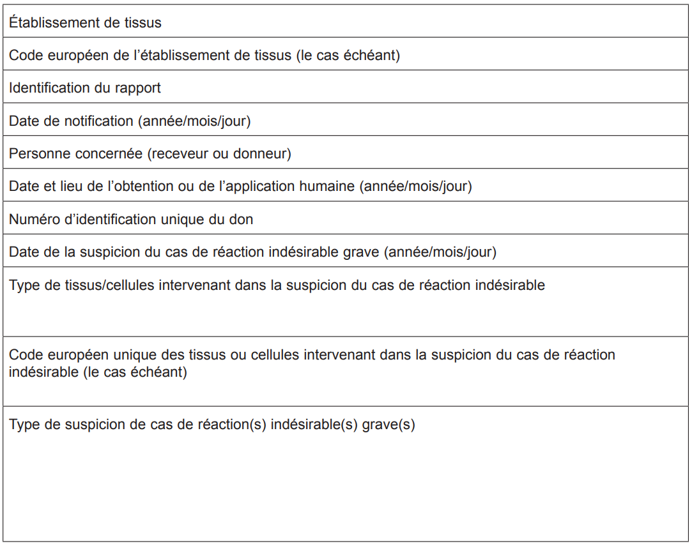
>
> \**PARTIE B**
>
> \**Conclusions de l’investigation sur les réactions indésirables graves**
>
> 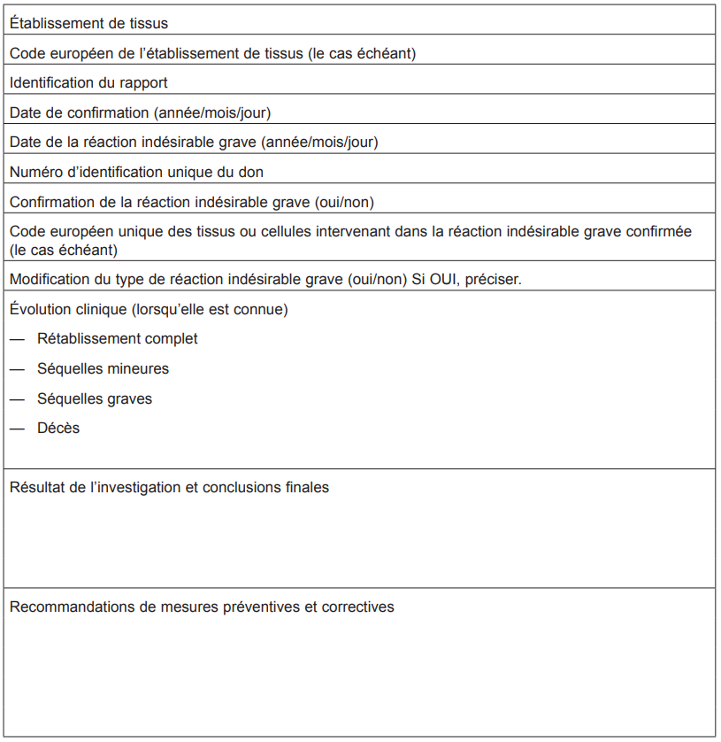
>
> \**ANNEXE IV**
>
> \**NOTIFICATION DES INCIDENTS INDÉSIRABLES GRAVES**
>
> \**PARTIE A**
>
> \**Notification rapide de la suspicion de cas d’incidents indésirables graves**
>
> 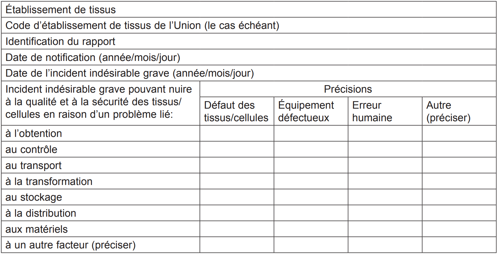
>
> \**PARTIE B**
>
> \**Conclusions de l’investigation sur les incidents indésirables graves**
>
> 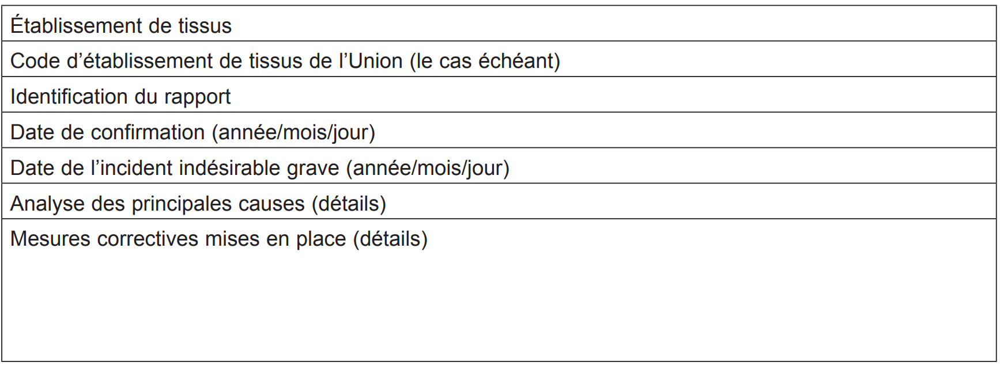
>
> \**ANNEXE V**
>
> \**FORMULAIRE DE NOTIFICATION ANNUELLE**
>
> PARTIE A
>
> \**Formulaire de notification annuelle des réactions indésirables graves**
>
> 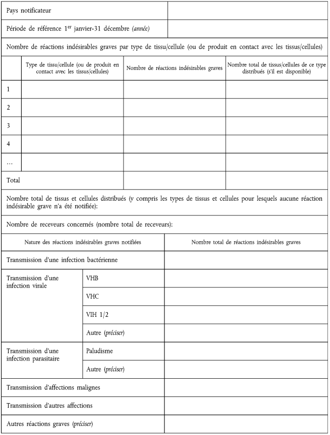
>
> PARTIE B
>
> \**Formulaire de notification annuelle des incidents indésirables graves**
>
> 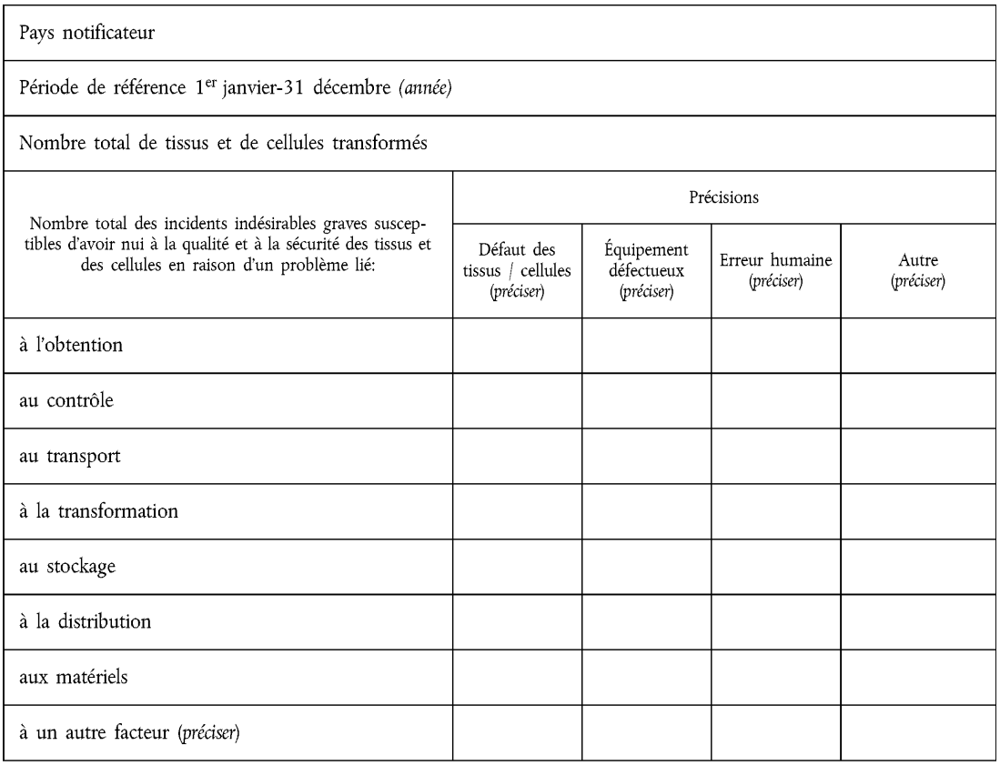
>
> \**ANNEXE VI**
>
> \**Données minimales à conserver conformément à l’article 9, paragraphe 2**
>
> \**A. PAR LES ÉTABLISSEMENTS DE TISSUS**
>
> 1\) Identification du donneur
>
> 2\) Identification du don, comprenant au minimum les éléments suivants:
>
> aash identification de l’organisme d’obtention (y compris ses coordonnées) ou de l’établissement de tissus,
>
> bash numéro unique du don,
>
> cash date de l’obtention,
>
> dash lieu de l’obtention,
>
> eash type de don (par exemple tissu unique/multi-tissus, usage autologue/allogénique, donneur vivant/ décédé).
>
> 3\) Identification du produit, comprenant au minimum les éléments suivants:
>
> aash identification de l’établissement de tissus,
>
> bash type de tissu/cellule/produit (nomenclature de base),
>
> cash numéro du groupe de lots (dans le cas d’un regroupement),
>
> dash numéro du sous-lot (le cas échéant),
>
> eash date d’expiration (le cas échéant),
>
> fash statut des tissus/cellules (c’est-à-dire en quarantaine, prêt à l’emploi, etc.),
>
> gash description et origine du produit, étapes de transformation appliquées, matériaux et additifs entrant en contact avec les tissus/cellules et ayant un effet sur leur qualité et/ou sécurité,
>
> hash identification du lieu émettant l’étiquette finale.
>
> 4\) Code européen unique (le cas échéant)
>
> 5\) Identification de l’application humaine, comprenant au minimum les éléments suivants:
>
> aash date de distribution ou d’élimination,
>
> bash identification du médecin ou de l’utilisateur final/lieu d’utilisation.
>
> \**B. PAR LES ORGANISMES RESPONSABLES DE L’APPLICATION HUMAINE**
>
> 1\. Identification de l’établissement de tissus fournisseur
>
> 2\. Identification du médecin ou de l’utilisateur final/installation
>
> 3\. Type de tissus/cellules
>
> 4\. Identification du produit
>
> 5\. Identification du receveur
>
> 6\. Date de l’application
>
> 7\. Code européen unique (le cas échéant)
>
> \**ANNEXE VII**
>
> \**STRUCTURE DU CODE EUROPÉEN UNIQUE**
>
> 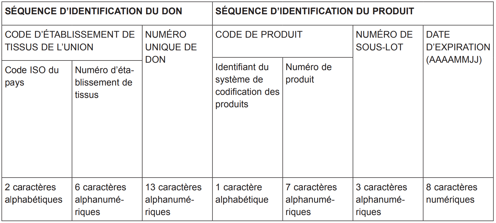
>
> \**ANNEXE VIII**
>
> \**Données à consigner dans le registre des établissements de tissus de l’Union**
>
> \**A. Informations sur l’établissement de tissus**
>
> 1\. Nom de l’établissement de tissus
>
> 2\. Code d’établissement de tissus national ou international
>
> 3\. Dénomination de l’organisme au sein duquel l’établissement de tissus est situé (le cas échéant)
>
> 4\. Adresse de l’établissement de tissus
>
> 5\. Coordonnées publiables: adresse fonctionnelle de courrier électronique, téléphone et télécopieur
>
> \**B. Informations sur l’autorisation, l’agrément, la désignation ou la licence de l’établissement de tissus**
>
> 1\. Nom de la ou des autorités compétentes en matière d’autorisation, d’agrément, de désignation ou de licence
>
> 2\. Nom de la ou des autorités nationales compétentes responsables de la maintenance du registre des établissements de tissus de l’Union
>
> 3\. Nom de la ou des autorités nationales compétentes responsables de la maintenance du registre des établissements de tissus de l’Union
>
> 4\. Tissus et cellules sur lesquels porte l’autorisation, l’agrément, la désignation ou la licence
>
> 5\. Activités réelles sur lesquelles porte l’autorisation, l’agrément, la désignation ou la licence
>
> 6\. Statut de l’autorisation, de l’agrément, de la désignation ou de la licence (valide, suspendu, retiré en partie ou en totalité, cessation volontaire des activités)
>
> 7\. Renseignements concernant toute condition et dérogation ajoutée à l’autorisation (le cas échéant).
>
> \**ANNEXE IX**
>
> \**Exigences minimales concernant les informations et la documentation à fournir par un établissement de tissus importateur qui demande l’accréditation, la désignation, l’autorisation ou l’agrément aux fins de ses activités d’importation**
>
> Lorsqu’il demande une accréditation, une désignation, une autorisation ou un agrément aux fins d’activités d’importation, un établissement de tissus importateur doit fournir les informations (actualisées) énumérées ci-après et la documentation visée au point F, sauf s’il les a déjà fournies dans le cadre de demandes antérieures d’accréditation, de désignation, d’autorisation ou d’agrément en tant qu’établissement de tissus ou qu’établissement de tissus importateur.
>
> \**A. Informations générales sur l’établissement de tissus importateur (ETI)**
>
> 1\. Nom de l’ETI (dénomination ou raison sociale).
>
> 2\. Adresse visiteurs de l’ETI.
>
> 3\. Adresse postale de l’ETI *(si différente)*.
>
> 4\. Statut de l’ETI demandeur: il faut indiquer s’il s’agit de la première demande d’accréditation, de désignation, d’autorisation ou d’agrément en tant qu’ETI ou, le cas échéant, s’il s’agit d’une demande de renouvellement. Lorsque le demandeur est déjà accrédité, désigné, autorisé ou agréé en tant qu’établissement de tissus, il doit fournir le code mentionné dans le registre des établissements de tissus.
>
> 5\. Nom de l’unité qui introduit la demande *(s’il est différent de la dénomination ou raison sociale)*.
>
> 6\. Adresse visiteurs de l’unité qui introduit la demande.
>
> 7\. Adresse postale de l’unité qui introduit la demande *(si différente)*.
>
> 8\. Nom du site de réception des importations *(s’il est différent de la dénomination ou raison sociale ou du nom de l’unité qui introduit la demande)*.
>
> 9\. Adresse visiteurs du site de réception.
>
> 10\. Adresse postale du site de réception *(si différente)*.
>
> \**B. Coordonnées des personnes avec qui prendre contact au sujet de la demande**
>
> 1\. Nom de la personne de contact.
>
> 2\. Numéro de téléphone.
>
> 3\. Adresse électronique.
>
> 4\. Nom de la personne responsable (si différente de la personne de contact).
>
> 5\. Numéro de téléphone.
>
> 6\. Adresse électronique.
>
> 7\. URL du site web de l’ETI (si disponible).
>
> \**C. Renseignements sur les tissus et cellules destinés à être importés**
>
> 1\. Liste des types de tissus et cellules qui seront importés, y compris les types spécifiques de tissus et cellules qui feront l’objet d’importations exceptionnelles.
>
> 2\. Nom de produit (selon le cas, conformément à la liste générique de l’Union européenne) de tous les types de tissus et cellules qui seront importés.
>
> 3\. Dénomination commerciale (si différente du nom de produit) de tous les types de tissus et cellules qui seront importés.
>
> 4\. Nom du fournisseur établi dans un pays tiers pour chaque type de tissu et cellule qui sera importé.
>
> \**D. Localisation des activités**
>
> 1\. Liste spécifiant les activités liées au don, à l’obtention, au contrôle, à la transformation, à la conservation ou au stockage qui sont effectuées avant l’importation par le fournisseur établi dans un pays tiers, par type de tissu ou cellule.
>
> 2\. Liste spécifiant les activités liées au don, à l’obtention, au contrôle, à la transformation, à la conservation ou au stockage qui sont effectuées avant l’importation par des sous-traitants du fournisseur établi dans un pays tiers, par type de tissu ou cellule.
>
> 3\. Liste de toutes les activités effectuées par l’ETI après l’importation, par type de tissu ou cellule.
>
> 4\. Nom des pays tiers dans lesquels se déroulent les activités antérieures à l’importation, par type de tissu ou cellule.
>
> \**E. Renseignements sur les fournisseurs établis dans des pays tiers**
>
> 1\. Nom du ou des fournisseurs établis dans un ou des pays tiers (dénomination ou raison sociale).
>
> 2\. Nom de la personne de contact.
>
> 3\. Adresse visiteurs.
>
> 4\. Adresse postale (si différente).
>
> 5\. Numéro de téléphone (y compris l’indicatif international).
>
> 6\. Numéro d’appel d’urgence (si différent).
>
> 7\. Adresse électronique.
>
> \**F. Documentation à joindre à la demande**
>
> 1\. Une copie de l’accord écrit conclu avec le fournisseur établi dans un pays tiers.
>
> 2\. Une description détaillée du flux de tissus et cellules importés, de leur obtention à leur réception à l’établissement de tissus importateur.
>
> 3\. Une copie de l’autorisation d’exporter du fournisseur établi dans un pays tiers ou, si aucune autorisation spécifique n’est délivrée, un certificat établi par la ou les autorités compétentes du pays tiers concerné autorisant les activités du fournisseur établi dans le pays tiers dans le secteur des tissus et cellules, y compris l’exportation. Cette documentation doit en outre comprendre les coordonnées de la ou des autorités compétentes du pays tiers. Dans tout pays tiers où cette documentation n’est pas disponible, d’autres documents, tels des rapports d’audit du fournisseur établi dans le pays tiers, doivent être fournis.
>
> \**ANNEXE X**
>
> \**Certificat d’accréditation, de désignation, d’autorisation ou d’agrément délivré par la ou les autorités compétentes à l’établissement de tissus importateur**
>
> 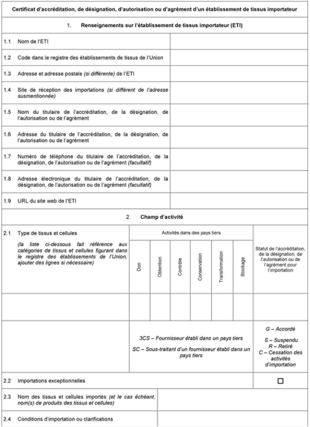
>
> 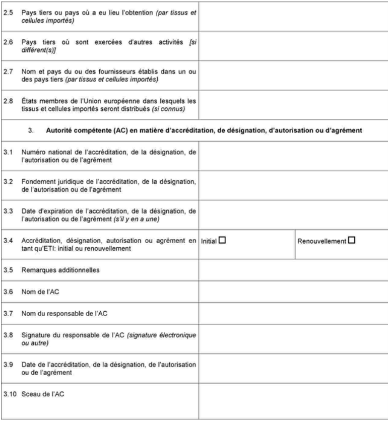
>
> \**ANNEXE XI**
>
> \**Exigences minimales concernant la documentation que les établissements de tissus importateurs de tissus et cellules en provenance de pays tiers doivent mettre à la disposition de la ou des autorités compétentes**
>
> Sauf pour les importations exceptionnelles telles que définies à l’article 2 de la présente directive, qui font l’objet d’une dérogation aux présentes exigences documentaires, l’établissement de tissus importateur qui introduit la demande met à la disposition et — sauf s’il les a déjà fournies dans le cadre de demandes antérieures d’accréditation, de désignation, d’autorisation ou d’agrément en tant qu’établissement de tissus importateur ou qu’établissement de tissus — fournit sur demande à la ou aux autorités compétentes une version actualisée des documents énumérés ci-après le concernant ainsi que son ou ses fournisseurs établis dans un ou des pays tiers.
>
> \**A. Documentation relative à l’établissement de tissus importateur**
>
> 1\. Une description du poste de la personne responsable et de ses qualifications et formations telles que prévues dans la [directive 2004/23/CE](https://legilux.public.lu/eli/dir_ue/2004/23/jo).
>
> 2\. Une copie des étiquettes apposées sur les différents conteneurs et emballages (emballage primaire, emballage extérieur, emballage final, conteneur utilisé pour le transport).
>
> 3\. Une liste des versions pertinentes et actualisées des modes opératoires normalisés (MON) relatifs aux activités d’importation de l’établissement, y compris les MON concernant l’application du code européen unique, la réception et le stockage des tissus et cellules importés à l’établissement de tissus importateur, la gestion des incidents et réactions indésirables, la gestion des rappels et la traçabilité, du donneur au receveur, des tissus et cellules.
>
> \**B. Documentation relative au ou aux fournisseurs établis dans un ou des pays tiers**
>
> 1\. Une description détaillée des critères utilisés pour l’identification et la sélection du donneur, des informations fournies au donneur ou à sa famille, de la manière de recueillir le consentement du donneur ou de sa famille et du caractère volontaire et non rémunéré — ou non — du don.
>
> 2\. Des informations détaillées sur le ou les centres de contrôle utilisés par le ou les fournisseurs établis dans un ou des pays tiers et sur les contrôles effectués par ce ou ces centres.
>
> 3\. Des informations détaillées sur les méthodes utilisées pendant le procédé de transformation des tissus et cellules, y compris des renseignements sur la validation des étapes critiques du procédé.
>
> 4\. Une description détaillée des locaux, des équipements et matériels critiques et des critères utilisés pour le contrôle de la qualité et le contrôle de l’environnement pour chaque activité effectuée par le ou les fournisseurs établis dans un ou des pays tiers.
>
> 5\. Des informations détaillées sur les conditions de mise à disposition des tissus et cellules par le ou les fournisseurs établis dans un ou des pays tiers.
>
> 6\. Les coordonnées des sous-traitants utilisés par le ou les fournisseurs établis dans un ou des pays tiers, y compris le nom, le lieu et l’activité exercée.
>
> 7\. Un compte rendu récapitulatif de la dernière inspection effectuée chez le ou les fournisseurs établis dans un ou des pays tiers par la ou les autorités compétentes du ou des pays tiers, avec mention de la date de l’inspection, du type d’inspection et des principales conclusions tirées.
>
> 8\. Un compte rendu récapitulatif du dernier audit effectué chez le ou les fournisseurs établis dans un ou des pays tiers par ou pour l’établissement de tissus importateur.
>
> 9\. Toute accréditation nationale ou internationale pertinente.
>
> \**ANNEXE XII**
>
> \**Exigences minimales concernant le contenu des accords écrits conclus par les établissements de tissus importateurs avec leurs fournisseurs établis dans des pays tiers**
>
> Sauf pour les importations exceptionnelles telles que définies à l’article 2 de la présente directive, qui font l’objet d’une dérogation aux présentes exigences, l’accord écrit entre l’établissement de tissus importateur et le fournisseur établi dans un pays tiers porte au moins sur les éléments énoncés ci-après.
>
> 1\. Des informations détaillées sur les spécifications de l’établissement de tissus importateur visant à garantir que les normes de qualité et de sécurité établies par la [directive 2004/23/CE](https://legilux.public.lu/eli/dir_ue/2004/23/jo) sont respectées ainsi que sur les rôles et responsabilités que les deux parties se sont attribués d’un commun accord pour veiller à ce que les tissus et cellules importés satisfassent à des normes de qualité et de sécurité équivalentes.
>
> 2\. Une clause prévoyant que le fournisseur établi dans un pays tiers fournit les informations visées à l’annexe XI, point B, du présent règlement.
>
> 3\. Une clause prévoyant que le fournisseur établi dans un pays tiers informe l’établissement de tissus importateur de tout incident ou réaction indésirable grave suspecté ou avéré qui peut avoir une influence sur la qualité et la sécurité des tissus et cellules importés ou destinés à être importés par l’établissement de tissus importateur.
>
> 4\. Une clause prévoyant que le fournisseur établi dans un pays tiers informe l’établissement de tissus importateur de toute modification substantielle de ses activités, y compris tout retrait ou suspension, complet ou partiel, de son autorisation d’exporter des tissus et cellules ou toute autre décision motivée par le non-respect de la législation, prise par la ou les autorités compétentes du pays tiers qui peut avoir une influence sur la qualité et la sécurité des tissus et cellules importés ou destinés à être importés par l’établissement de tissus importateur.
>
> 5\. Une clause prévoyant que la ou les autorités compétentes ont le droit d’inspecter les activités du fournisseur établi dans un pays tiers, y compris en effectuant des inspections sur place, si elles souhaitent le faire dans le cadre de leur inspection de l’établissement de tissus importateur. Cette clause devrait également accorder à l’établissement de tissus importateur le droit d’auditer régulièrement son fournisseur établi dans un pays tiers.
>
> 6\. Les conditions de transport des tissus et cellules entre le fournisseur établi dans un pays tiers et l’établissement de tissus importateur.
>
> 7\. Une clause prévoyant que les données relatives aux donneurs de tissus et cellules importés sont conservées par le fournisseur établi dans un pays tiers ou par son sous-traitant, conformément aux règles en matière de protection des données de l’Union européenne, pendant trente ans à compter de l’obtention et que des dispositions sont prises pour que ces données soient préservées si le fournisseur établi dans un pays tiers cesse ses activités.
>
> 8\. Les modalités de réexamen régulier et, si nécessaire, de révision de l’accord écrit, notamment en cas de modification des exigences des normes européennes de qualité et de sécurité établies par la [directive 2004/23/CE](https://legilux.public.lu/eli/dir_ue/2004/23/jo).
>
> 9\. Une liste de tous les modes opératoires normalisés du fournisseur établi dans un pays tiers se rapportant à la qualité et à la sécurité des tissus et cellules importés et l’engagement de les fournir sur demande.

#### Version consolidée applicable au 16/02/2013 : Règlement grand-ducal du 30 août 2007 déterminant certaines exigences techniques relatives au don, à l’obtention et au contrôle de tissus et de cellules d’origine humaine.

##### Art. 1er — Objet.

Le présent règlement a pour objet de déterminer des exigences en matière d’obtention de tissus et de cellules d’origine humaine, y compris des critères de sélection applicables aux donneurs et des examens de laboratoire qu’ils doivent subir, ainsi que de fixer les procédures pour le don et l’obtention de tissus et/ou de cellules et pour leur réception à l’établissement de tissus.

##### Art. 2 — Définitions.

Aux fins du présent règlement on entend par:

a) «cellules reproductrices»: tous les tissus et cellules destinés à être utilisés à des fins de procréation assistée;

b) «don entre partenaires»: un don de cellules reproductrices entre un homme et une femme qui déclarent entretenir une relation physique intime;

c) «usage direct»: toute procédure en vertu de laquelle les cellules sont données et utilisées sans passer par une banque;

d) «système de qualité»: la structure organisationnelle, les responsabilités, procédures, processus et ressources définis pour la mise en oeuvre de la gestion de la qualité et incluant toutes les activités contribuant à la qualité, directement ou indirectement;

e) «modes opératoires normalisés (MON)»: instructions écrites décrivant les étapes d’un processus spécifique, y compris le matériel et les méthodes utilisés et le produit final attendu;

f) «validation» (ou «homologation» pour l’équipement ou l’environnement): apporter la preuve, documents à l’appui, qu’un processus, des MON, un équipement ou un environnement spécifiques permettront, avec un degré de certitude élevé, de fabriquer invariablement un produit conforme à ses spécifications et qualités déterminées au préalable; un processus est validé pour évaluer le fonctionnement d’un système sur la base de son efficacité par rapport à son utilisation prévue;

g) «traçabilité»: capacité de localiser et d’identifier le tissu/la cellule à toutes les étapes du processus, depuis l’obtention jusqu’à la distribution au receveur ou la destruction, en passant par la transformation, le contrôle et le stockage; cela implique la capacité d’identifier le donneur et l’établissement de tissus ou l’installation de production qui reçoivent, transforment ou stockent les tissus/cellules, et la capacité d’identifier le(s) receveur(s) dans le ou les service(s) de soins transplantant les tissus/cellules à ce(s) dernier(s); la traçabilité couvre également la capacité de localiser et d’identifier toutes les données pertinentes concernant des produits et des matériaux entrant en contact avec ces tissus/cellules;

h) «organisme d’obtention»: un établissement hospitalier ou un autre organisme qui intervient dans l’obtention de tissus et de cellules d’origine humaine et qui peut ne pas être agréé, désigné, autorisé ou titulaire d’une licence en tant qu’établissement de tissus.

##### Art. 3 — Exigences en matière d’obtention de tissus et de cellules d’origine humaine.

1\. Pour obtenir l’autorisation de procéder à l’obtention de tissus et de cellules d’origine humaine un établissement doit satisfaire, outre aux exigences prévues par la [loi du 1er août 2007](https://legilux.public.lu/eli/etat/leg/loi/2007/08/01/n12/jo) relative aux tissus et cellules humains destinés à des applications humaines, à celles définies aux paragraphes 2 à 12 ci-après.

Le don entre partenaires de cellules reproductrices destinés à un usage direct ne tombe pas sous l’application du présent article.

2\. L’obtention doit être effectuée par le personnel qualifié de l’établissement ou par des personnes qui ont terminé avec succès un programme de formation établi par une équipe clinique, et qui sont spécialisés dans le prélèvement de tissus et de cellules.

3\. L’établissement de tissus ou l’organisme d’obtention doit avoir conclu un accord écrit avec le personnel ou les responsables des équipes cliniques chargés de la sélection des donneurs, sauf s’ils sont employés par le même établissement ou le même organisme, précisant les procédures à suivre pour garantir le respect des critères de sélection des donneurs fixés à l’annexe I.

4\. L’établissement de tissus ou l’organisme d’obtention doit avoir conclu un accord écrit avec le personnel ou les responsables des équipes cliniques chargés de l’obtention des tissus/cellules, sauf s’ils sont employés par le même établissement ou le même organisme, précisant le(s) type(s) de tissu(s) et/ou de cellule(s) et/ou d’échantillon(s) pour examen qui doivent être obtenus ainsi que les protocoles à suivre.

5\. Des modes opératoires normalisés (MON) s’appliquent pour la vérification:

a) de l’identité du donneur;

b) des renseignements relatifs au consentement ou à l’autorisation du donneur ou de sa famille;

c) de l’évaluation des critères de sélection des donneurs, décrits à l’article 4;

d) de l’évaluation des examens de laboratoire requis pour les donneurs, décrits à l’article 5.

Des modes opératoires normalisés doivent également être définis concernant les procédures d’obtention, de conditionnement, d’étiquetage et de transport des tissus et des cellules jusqu’à leur destination à l’établissement de tissus ou, en cas de distribution directe des tissus ou des cellules, à l’équipe clinique chargée de leur utilisation, ou encore, dans le cas d’échantillons de tissus/cellules, au laboratoire chargé d’effectuer les analyses, conformément à l’article 6 de la présente directive.

6\. L’obtention s’effectue dans des installations appropriées, selon des procédures qui minimisent la contamination bactérienne ou autre des tissus et des cellules prélevés, conformément à l’article 6.

7\. Le matériel et l’équipement utilisés pour l’obtention sont gérés conformément aux normes et aux spécifications établies à l’annexe IV, point 1.3, en tenant compte d’autres réglementations applicables, des normes et des orientations régissant la stérilisation des médicaments et des dispositifs médicaux. Des instruments et des dispositifs d’obtention homologués, stériles, doivent être utilisés pour l’obtention de tissus et de cellules.

8\. L’obtention de tissus et de cellules sur des donneurs vivants s’effectue dans un environnement qui garantit leur sécurité, leur santé et le respect de leur vie privée.

9\. Le cas échéant, le personnel et l’équipement nécessaires pour la reconstruction du corps des donneurs décédés sont mis à disposition. La reconstruction est réalisée de manière appropriée.

10\. Les procédures à suivre pour l’obtention de tissus et de cellules sont appliquées conformément aux exigences définies à l’article 6.

11\. Un code d’identification unique est attribué au donneur et aux tissus ainsi qu’aux cellules prélevés, pendant l’opération d’obtention ou à l’établissement de tissus, afin de garantir une identification adéquate du donneur et la traçabilité de tout le matériel donné. Les données codifiées sont inscrites dans un registre tenu à cet effet.

12\. La documentation relative au donneur est conservée conformément au point 1.4 de l’annexe IV.

##### Art. 4 — Critères de sélection applicables aux donneurs de tissus et de cellules.

Les donneurs doivent répondre aux critères de sélection établis à:

a) l’annexe I pour les donneurs de tissus et de cellules autres que les donneurs de cellules reproductrices;

b) l’annexe III pour les donneurs de cellules reproductrices.

##### Art. 5 — Examens de laboratoire requis pour les donneurs.

1\. Les donneurs de tissus et de cellules autres que les donneurs de cellules reproductrices doivent subir les examens biologiques prévus au point 1 de l’annexe II, à réaliser conformément aux exigences générales établies au point 2 de l’annexe II.

2\. Les donneurs de cellules reproductrices doivent subir les examens biologiques prévus aux points 1, 2 et 3 de l’annexe III, à réaliser conformément aux exigences générales établies au point 4 de l’annexe III.

##### Art. 6 — Procédures pour le don et l’obtention de tissus et/ou de cellules et réception à l’établissement de tissus.

Les procédures de don et d’obtention de tissus et/ou de cellules et la réception de tissus et/ou de cellules à l’établissement de tissus respectent les exigences établies à l’annexe IV.

##### Art. 7 — Annexes.

Les annexes I à IV du présent règlement en font partie intégrante.

Elles peuvent être modifiées par un règlement à prendre par le Ministre de la Santé, qui réalise la transposition conforme d’une directive communautaire.

##### Art. 8 — Exécution.

Notre Ministre de la Santé est chargé de l’exécution du présent règlement qui sera publié au Mémorial.

> \*ANNEXE I*
>
> CRITERES DE SELECTION APPLICABLES AUX DONNEURS DE TISSUS ET/OU DE CELLULES  (A L’EXCEPTION DES DONNEURS DE CELLULES REPRODUCTRICES) CONFORMEMENT A L’ARTICLE 4, POINTa)
>
> Les critères de sélection des donneurs reposent sur une analyse des risques liés à l’utilisation des cellules/tissus spécifiques. L’examen physique, l’étude des antécédents médicaux et comportementaux, les examens biologiques, l’examen post-mortem (pour les donneurs décédés) et tout examen jugé utile donneront des indications quant à l’existence de tels risques. A moins qu’une évaluation documentée du risque, réalisée avec l’assentiment de la personne responsable désignée par l’établissement conformément à l’article 18 de la [loi](https://legilux.public.lu/eli/etat/leg/loi/2007/08/01/n12/jo), ne le justifie, les donneurs doivent être écartés si l’un des critères suivants s’applique:
>
> 1\. **Donneurs décédés**
>
> 1.1. *Critères généraux d’exclusion*
>
> 1.1.1. La cause du décès est inconnue, sauf si l’autopsie révèle la cause du décès après l’obtention et si aucun des critères généraux d’exclusion exposés dans la présente section ne s’applique.
>
> 1.1.2. Le donneur a souffert d’une maladie dont l’étiologie est inconnue.
>
> 1.1.3. Présence ou antécédents de maladie maligne, à l’exception du carcinome basocellulaire primitif, du carcinome in situ du col utérin et de certaines tumeurs primitives du système nerveux central qui doivent être évaluées à la lumière des connaissances scientifiques. Les donneurs porteurs de maladies malignes peuvent faire l’objet d’une évaluation et être retenus pour un don de cornée, à l’exception de ceux qui sont atteints d’un rétinoblastome, d’un néoplasme hématologique ou de tumeurs malignes susceptibles d’affecter le pôle antérieur de l’œil.
>
> 1.1.4. Risque de transmission de maladies à prions. Ce risque concerne par exemple les personnes suivantes:
>
> a) personnes chez qui a été diagnostiquée la maladie de Creutzfeldt-Jakob ou des variantes de la maladie de Creutzfeldt-Jakob ou ayant des antécédents familiaux de maladie de Creutzfeldt-Jakob non iatrogène;
>
> b) personnes ayant des antécédents de démence progressive d’évolution rapide ou de maladies neurologiques dégénératives, y compris celles qui sont d’origine inconnue;
>
> c) personnes ayant reçu des hormones issues de l’hypophyse humaine (hormones de croissance, par exemple), des greffes de cornée, de sclère et de dure-mère, et personnes ayant subi une intervention neurochirurgicale non documentée (pour laquelle on a peut-être utilisé de la dure-mère);
>
> En ce qui concerne les variantes de la maladie de Creutzfeldt-Jakob, d’autres mesures de précaution peuvent être recommandées.
>
> 1.1.5. Une infection systémique qui n’est pas contrôlée au moment du don, y compris les maladies bactériennes, les infections virales, fongiques ou parasitaires généralisées, ou une infection locale significative des tissus et des cellules à donner. Les donneurs atteints de septicémie bactérienne peuvent faire l’objet d’une évaluation et être pris en considération pour un don d’oeil, mais uniquement dans le cas où les cornées sont destinées à être stockées par organoculture, afin de permettre la détection de toute contamination bactérienne du tissu.
>
> 1.1.6. Antécédents, preuves cliniques ou résultats positifs confirmés d’examens de laboratoire établissant un risque de transmission du VIH, de l’hépatite B chronique ou aiguë (sauf dans le cas des personnes dont l’état immunitaire est avéré), de l’hépatite C ou du HTLV I/II, ou la présence avérée de facteurs de risque pour ces infections.
>
> 1.1.7. Antécédents de maladie auto-immunitaire chronique systémique qui pourrait nuire à la qualité du tissu à donner.
>
> 1.1.8. Des indications selon lesquelles les résultats des examens effectués sur les échantillons de sang du donneur seront invalidés, en raison:
>
> a) de l’apparition d’une hémodilution, conformément aux spécifications de l’annexe II, point 2, dans le cas où l’on ne dispose pas d’un échantillon prélevé avant transfusion; ou
>
> b) d’un traitement à base d’agents immunosuppresseurs.
>
> 1.1.9. Eléments attestant de la présence de tout autre facteur de risque pour les maladies transmissibles sur la base d’une évaluation des risques, en tenant compte des voyages effectués par le donneur, de son exposition aux risques et de la présence de maladies infectieuses locales.
>
> 1.1.10. Présence sur le corps du donneur de signes physiques impliquant un risque de maladie transmissible tel qu’il est décrit à l’annexe IV, point 1.2.3.
>
> 1.1.11. Ingestion d’une substance ou exposition à une substance (comme le cyanure, le plomb, le mercure, l’or) susceptible d’être transmise au receveur dans des doses qui risquent de nuire à sa santé.
>
> 1.1.12. Antécédents de vaccination récente au moyen d’un virus atténué vivant lorsqu’un risque de transmission existe.
>
> 1.1.13. Transplantation de xénogreffes.
>
> 1.2. *Critères d’exclusion supplémentaires lorsque les donneurs sont des enfants décédés*
>
> 1.2.1. Aucun enfant né d’une mère infectée par le VIH ou qui remplit l’un des critères d’exclusion visés au point 1.1 ne peut être considéré comme donneur tant que le risque de transmission de l’infection n’est pas définitivement écarté.
>
> a) Aucun enfant de moins de dix-huit mois né d’une mère infectée par le VIH, l’hépatite B, l’hépatite C ou le HTLV, chez qui le risque d’une telle infection existe, et qui a été allaité par sa mère au cours des douze derniers mois, ne peut être considéré comme donneur quels que soient les résultats des examens analytiques.
>
> b) Tout enfant né d’une mère infectée par le VIH, l’hépatite B, l’hépatite C ou une infection HTLV ou chez qui le risque d’une telle infection existe, qui n’a pas été allaité par sa mère au cours des douze derniers mois et dont les examens analytiques, les examens médicaux et l’étude des antécédents médicaux ne permettent pas de conclure à une infection par le VIH, l’hépatite B ou C ou le HTLV, peut être considéré comme donneur.
>
> 2\. **Donneurs vivants**
>
> 2.1. *Donneur vivant en cas d’usage autologue*
>
> 2.1.1. Si les tissus ou cellules prélevés doivent être stockés ou cultivés, il y a lieu d’effectuer les mêmes examens biologiques que pour un donneur vivant en cas d’usage allogénique. Des résultats positifs n’empêcheront pas nécessairement de stocker, de transformer et de réimplanter les tissus ou cellules ou tout produit dérivé de ces tissus ou cellules, pour autant que des installations de stockage isolé appropriées permettent d’exclure le risque de contamination croisée d’autres greffes et/ou le risque de contamination par des agents adventices et/ou le risque de confusion.
>
> 2.2. *Donneur vivant en cas d’usage allogénique*
>
> 2.2.1. En cas d’usage allogénique, les donneurs vivants doivent être sélectionnés en fonction de leur état de santé et de leurs antécédents médicaux, sur la base d’un questionnaire et d’une entrevue du donneur avec un professionnel des soins de santé qualifié et formé, conformément au point 2.2.2. Cette évaluation doit porter sur tous les facteurs susceptibles de contribuer à identifier et à écarter les personnes chez qui un don pourrait comporter un risque pour la santé des autres, notamment la possibilité de transmission de maladies, ou pour leur propre santé. Quel que soit le don, le processus d’obtention ne peut interférer ou compromettre la santé du donneur ou le traitement qui lui est administré. Dans le cas d’un don de sang de cordon ou de membrane amniotique, cette condition s’applique à la fois à la mère et au bébé.
>
> 2.2.2. Les critères de sélection des donneurs vivants en cas d’usage allogénique doivent être établis et consignés par écrit par l’établissement de tissus (et par le clinicien chargé de la transplantation en cas de distribution directe au receveur) en fonction des tissus ou des cellules spécifiques à donner, de l’état physique du donneur, de ses antécédents médicaux et personnels, des résultats des analyses cliniques et des examens de laboratoire destinés à déterminer son état de santé.
>
> 2.2.3. Les critères d’exclusion à respecter sont les mêmes que pour les donneurs décédés, à l’exception du point 1.1.1. D’autres critères d’exclusion spécifiques devront peut-être être ajoutés, en fonction du tissu ou de la cellule à donner, notamment:
>
> a) la grossesse (à l’exception des donneurs de cellules sanguines du cordon et de membrane amniotique et des donneurs collatéraux de progéniteurs hématopoïétiques);
>
> b) l’allaitement;
>
> c) dans le cas des progéniteurs hématopoïétiques, le risque de transmission de conditions héréditaires.
>
> \*ANNEXE II*
>
> EXAMENS DE LABORATOIRE REQUIS POUR LES DONNEURS (A L’EXCEPTION DES DONNEURS DE CELLULES REPRODUCTRICES) CONFORMEMENT A L’ARTICLE 5, PARAGRAPHE 1
>
> 1\. **Examens biologiques requis pour les donneurs**
>
> 1.1. Tous les donneurs doivent au minimum subir les examens biologiques suivants:
>
> V1H 1 et 2 Anti-VlH-1,2 Hépatite B HbsAg Anti HBc Hépatite C Anti-HCV-Ab Syphilis voir 1.4 (ci-dessous)
>
> 1.2. L’examen concernant l’anticorps HTLV-I doit être effectué chez tous les donneurs vivant dans des régions à forte prévalence ou provenant de ces régions ou dont les partenaires sexuels ou les parents proviennent de ces régions.
>
> 1.3. Lorsque l’anti-HBc est positif et que le HbsAg est négatif, d’autres examens doivent être effectués sur la base d’une évaluation du risque en vue de déterminer l’admissibilité du donneur pour un usage clinique.
>
> 1.4. Des examens effectués selon un algorithme validé doivent exclure la présence d’infection active à Treponana pallidum. Un test non réactif, spécifique ou non, permet d’utiliser les tissus et cellules. Lorsqu’un test non spécifique est effectué, un résultat réactif n’empêche pas l’obtention ou l’utilisation des tissus ou des cellules pour autant qu’un test de confirmation spécifique à Treponema ne produise pas de résultat réactif. Un donneur chez qui l’échantillon est réactif à l’examen spécifique à Treponema doit faire l’objet d’une évaluation rigoureuse du risque afin de déterminer son admissibilité pour un usage clinique.
>
> 1.5. Dans certaines circonstances, des examens supplémentaires doivent être effectués en fonction des antécédents du donneur et des caractéristiques des tissus ou des cellules donnés (par exemple RhD, HLA, malaria, CMV, toxoplasme, EBV, Ttypanosoma auzi).
>
> 1.6. Pour les donneurs en cas d’usage autologue, l’annexe 1, point 2.1.1, s’applique.
>
> 2\. **Conditions générales à remplir pour déterminer les marqueurs biologiques**
>
> 2.1. Les examens doivent être effectués par un laboratoire homologué ayant reçu l’autorisation de l’autorité compétente de l’Etat membre, en utilisant des dispositifs d’examen portant le label CE, le cas échéant. Le type d’examen effectué doit être validé à cette fin sur la base des connaissances scientifiques actuelles.
>
> 2.2. Les examens biologiques seront effectués sur le sérum ou le plasma du donneur; ils ne doivent pas être réalisés sur d’autres fluides ou sécrétions tels que l’humeur aqueuse ou vitrée, sauf si cela se justifie cliniquement, auquel cas un examen validé pour un tel fluide doit être effectué.
>
> 2.3. Lorsque des donneurs potentiels ont perdu du sang et ont récemment reçu du sang de donneur, des composants du sang, des colloïdes ou des cristalloïdes, les examens effectués sur le sang risquent de ne pas être valables en raison de l’hémodilution de l’échantillon. Un algorithme doit être utilisé pour évaluer le degré d’hémodilution dans les circonstances suivantes:
>
> a) **prélèvement d’un échantillon de sang ante-mortem:** si du sang, des composants du sang et/ou des colloïdes ont été administrés en perfusion au cours des quarante-huit heures qui ont précédé le prélèvement d’un échantillon de sang, ou si des cristalloïdes ont été administrés par perfusion dans l’heure qui a précédé le prélèvement d’un échantillon;
>
> b) **prélèvement d’un échantillon de sang post-mortem:** si du sang, des composants sanguins et/ou des colloïdes ont été administrés par perfusion dans les quarante-huit heures qui ont précédé le décès, ou si des cristalloïdes ont été administrés par perfusion dans l’heure qui a précédé le décès.
>
> Les établissements de tissus ne peuvent accepter des tissus et des cellules de donneurs présentant une dilution du plasma de plus de 50 % que si les procédures d’examen utilisées sont validées pour un tel plasma ou si l’on dispose d’un échantillon prélevé avant la transfusion.
>
> 2.4. Dans le cas d’un donneur décédé, les échantillons de sang doivent avoir été prélevés juste avant le décès ou, si ce n’est pas possible, le prélèvement doit être effectué dans les plus brefs délais après le décès et, en tout état de cause, dans les 24 heures suivant le décès.
>
> 2.5. a) Dans le cas de donneurs vivants (à l’exception des donneurs de cellules souches de moelle osseuse et de cellules souches de sang périphérique à usage allogénique, pour des raisons pratiques), les échantillons de sang doivent être prélevés au moment du don ou, si ce n’est pas possible, dans les sept jours qui suivent le don (il s’agit de «l’échantillon prélevé au moment du don»).
>
> b) Lorsque les tissus et les cellules provenant de donneurs vivants et à usage allogénique peuvent être stockés durant de longues périodes, il y a lieu de recommencer la prise d’échantillon et les examens après une période de cent quatre-vingts jours. En cas de répétitions des examens, l’échantillon prélevé au moment du don peut être collecté dans les trente jours qui précèdent le don et dans les sept jours qui suivent le don.
>
> c) Lorsque les tissus et les cellules provenant de donneurs vivants et à usage allogénique ne peuvent être stockés durant de longues périodes et qu’une nouvelle prise d’échantillon n’est donc pas possible, le paragraphe 2.5. a) ci-dessus s’applique.
>
> 2.6. Si, dans le cas d’un donneur vivant (à l’exception des donneurs de cellules souches de moelle osseuse et de cellules souches de sang périphérique), «l’échantillon prélevé au moment du don», tel que défini au paragraphe 2.5. a) ci-dessus, fait également l’objet d’un examen selon la technique d’amplification de l’acide nucléique pour le VIH, le HBV et le HCV, il n’est pas nécessaire de recommencer les examens. Il en est de même lorsque la transformation comporte une étape d’inactivation validée pour les virus concernés.
>
> 2.7. Dans le cas de la collecte de cellules souches de moelle osseuse et de sang périphérique, les échantillons sanguins doivent être prélevés, en vue de leur analyse, dans les trente jours qui précèdent le don.
>
> 2.8. Dans le cas de donneurs nouveau-nés, les tests biologiques peuvent être effectués sur la mère du donneur afin d’éviter à l’enfant des interventions médicales inutiles.
>
> \*ANNEXE III*
>
> CRITERES DE SELECTION ET EXAMENS DE LABORATOIRE REQUIS POUR LES DONNEURS DE CELLULES REPRODUCTRICES CONFORMEMENT A L’ARTICLE 4, POINT b) ET A L’ARTICLE 5, PARAGRAPHE 2
>
> 1\. **Don entre partenaires pour un usage direct**
>
> Les critères de sélection des donneurs et les analyses en laboratoire ne s’appliquent pas dans le cas d’un don de cellules reproductrices entre partenaires pour un usage direct.
>
> 2\. **Don entre partenaires (autre que pour un usage direct)**
>
> Les cellules reproductrices qui sont transformées et/ou stockées et les cellules reproductrices qui donneront lieu à la cryoconservation d’embryons doivent respecter les critères suivants:
>
> 2.1. Le clinicien responsable du donneur doit déterminer et mettre par écrit, sur la base des antécédents médicaux du patient et des indications thérapeutiques, les justifications à la base du don et la sécurité du don pour le receveur et pour tout enfant éventuellement à naître de ce don.
>
> 2.2. Les examens biologiques suivants doivent être effectués pour évaluer le risque de contamination croisée:
>
> V1H 1 et 2 Anti-VlH-1,2 Hépatite B HBsAg Anti-HBc Hépatite C Anti-HCV-Ab En cas de sperme traité en vue d’une insémination intra-utérine, non destiné à être conservé, et si l’établissement de tissus peut démontrer que le risque de contamination croisée et d’exposition du personnel a été pris en compte au moyen de l’utilisation de processus validés, les examens biologiques peuvent ne pas s’imposer.
>
> 2.3. Si les résultats des examens concernant le VIH 1 et 2, l’hépatite B ou C sont positifs ou non disponibles, ou s’il s’avère que le donneur est une source de risque d’infection, un système de stockage séparé doit être prévu.
>
> 2.4. Des examens concernant les anticorps HTLV-I doivent être réalisés dans le cas de donneurs vivant dans des régions à forte prévalence ou originaires de ces régions, ou dont les partenaires sexuels ou les parents sont originaires de ces régions.
>
> 2.5. Dans certaines circonstances, des examens supplémentaires doivent être effectués en fonction des voyages effectués par le donneur, de son exposition aux risques et des caractéristiques des tissus ou des cellules donnés (par exemple Rh D, malaria, CMV, T *cruzi*).
>
> 2.6. Des résultats positifs n’excluent pas nécessairement le don entre partenaires.
>
> 3\. **Dons autres que les dons entre partenaires**
>
> En dehors des dons entre partenaires, l’utilisation de cellules reproductrices doit remplir les critères suivants:
>
> 3.1. Les donneurs doivent être sélectionnés en fonction de leur âge, de leur état de santé et de leurs antécédents médicaux, sur la base d’un questionnaire et d’une entrevue avec un professionnel de la santé qualifié et formé. Cette évaluation doit porter sur tous les facteurs qui peuvent contribuer à identifier et à exclure les personnes chez qui un don pourrait présenter un risque pour autrui, notamment la possibilité de transmettre des maladies (des infections transmises sexuellement, par exemple), ou pour leur propre santé (par exemple superovulation, sédation, risques liés au prélèvement d’ovules ou conséquences psychologiques liées au don).
>
> 3.2. Les tests VIH 1 et 2, HCV, HBV et le test de la syphilis effectués sur un échantillon de sérum ou de plasma du donneur, conformément aux dispositions de l’annexe II, point 1.1, doivent être négatifs. De plus, les tests au Chlamydia effectués sur un échantillon d’urine au moyen de la technique d’amplification de l’acide nucléique doivent être négatifs pour les donneurs de sperme.
>
> 3.3. Le test de l’anticorps HTLV-I doit être effectué chez les donneurs vivant dans les régions à forte prévalence ou originaires de telles régions, ou dont les partenaires sexuels ou les parents sont originaires de ces régions.
>
> 3.4. Dans certaines circonstances, des tests supplémentaires doivent être effectués en fonction des antécédents du donneur et des tissus ou des cellules donnés (par exemple RhD, malaria, CMV, T. *cruzi*).
>
> 3.5. Pour les donneurs autologues, les dispositions de l’annexe I, point 2.1.1 sont applicables.
>
> 3.6. Le dépistage génétique des gènes récessifs autosomiques prévalents dans le contexte ethnique du donneur selon les connaissances scientifiques internationales et l’évaluation du risque de transmission des facteurs héréditaires présents dans la famille doivent être effectués avec l’accord du donneur. Des informations complètes doivent être fournies, conformément aux dispositions en vigueur.
>
> Des informations complètes sur le risque associé et sur les mesures prises pour le réduire doivent être communiquées et expliquées clairement au receveur.
>
> 4\. **Conditions générales à respecter pour déterminer les marqueurs biologiques**
>
> 4.1. Les examens doivent être effectués conformément à l’annexe II, points 2.1 et 2.2.
>
> 4.2. Pour les dons autres que les dons entre partenaires, les échantillons de sang doivent être prélevés lors de chaque don.
>
> Pour les dons entre partenaires (autres que pour un usage direct), les échantillons de sang doivent être prélevés dans les trois mois précédant le premier don. Pour d’autres dons entre partenaires provenant du même donneur, de nouveaux échantillons de sang doivent être prélevés au plus tard douze mois à compter du dernier prélèvement.
>
> 4.3. Les dons de sperme autres que les dons entre partenaires sont mis en quarantaine pendant cent quatrevingts jours au minimum, période au terme de laquelle les examens doivent être recommencés. Si l’échantillon de sang prélevé au moment du don est également testé au moyen de la technique d’amplification de l’acide nucléique pour le VIH, le HBV et le HCV, il n’est pas nécessaire de recommencer l’examen sur un autre échantillon de sang. De même, il n’est pas nécessaire de recommencer l’examen lorsque la procédure de transformation comporte une étape d’inactivation validée pour les virus concernés.
>
> \*ANNEXE IV*
>
> PROCEDURES DE DON ET D’OBTENTION DE CELLULES ET/OU DE TISSUS ET RECEPTION A L’ETABLISSEMENT DE TISSUS CONFORMEMENT A L’ARTICLE 6
>
> 1\. **Procédures de don et d’obtention**
>
> 1.1. *Consentement et identification du donneur*
>
> 1.1.1. Préalablement à l’obtention des tissus et des cellules, une personne autorisée doit confirmer et consigner par écrit:
>
> (a) que le consentement pour l’obtention a été donné conformément aux dispositions légales en la matière; et
>
> (b) comment et par qui le donneur a été identifié d’une manière fiable.
>
> 1.1.2. Dans le cas de donneurs vivants, le professionnel de la santé chargé de recueillir les antécédents médicaux doit s’assurer:
>
> (a) que le donneur a compris les informations données;
>
> (b) que le donneur a eu la possibilité de poser des questions et qu’il a reçu des réponses satisfaisantes;
>
> (c) que le donneur a confirmé que toutes les informations fournies étaient exactes à sa connaissance.
>
> 1.2. *Evaluation du donneur (ce point ne s’applique pas aux dons de cellules reproductrices entre partenaires ni aux donneurs en cas d’usage autologue)*
>
> 1.2.1. Une personne autorisée doit recueillir et consigner les informations relatives aux antécédents médicaux et comportementaux du donneur conformément aux exigences décrites au point 1.4.
>
> 1.2.2. Pour réunir les informations appropriées, il y a lieu de recourir à plusieurs moyens, dont au moins une entrevue avec le donneur, dans le cas de donneurs vivants, ainsi que les éléments suivants, s’il y a lieu:
>
> (a) le dossier médical du donneur;
>
> (b) une entrevue avec une personne qui a bien connu le donneur, dans le cas de donneurs décédés;
>
> (c) une entrevue avec le médecin traitant;
>
> (d) une entrevue avec le médecin généraliste;
>
> (e) le rapport d’autopsie.
>
> 1.2.3. En outre, dans le cas d’un donneur décédé, et dans le cas d’un donneur vivant lorsque cela se justifie, un examen physique du corps doit être effectué afin de détecter tous les signes qui pourraient suffire à exclure le donneur, ou qui doivent être évalués à la lumière des antécédents médicaux et personnels du donneur.
>
> 1.2.4. L’ensemble des informations relatives au donneur doit être examiné et évalué puis signé par un professionnel des soins de santé qualifié.
>
> 1.3. *Procédures d’obtention de tissus et de cellules*
>
> 1.3.1. Les procédures d’obtention doivent être appropriées en fonction du type de donneur et du type de tissus/cellules donnés. Des procédures doivent être mises en place pour garantir la sécurité des donneurs vivants.
>
> 1.3.2. Les procédures d’obtention doivent préserver les caractéristiques des tissus/cellules qui sont nécessaires pour leur usage clinique final et minimisent par ailleurs le risque de contamination microbiologique durant le processus, en particulier lorsque les tissus et cellules ne peuvent être stérilisés ultérieurement.
>
> 1.3.3. Dans le cas d’un donneur décédé, le champ d’accès doit être restreint. Un espace stérile doit être aménagé au moyen de champs opératoires stériles. Le personnel chargé de l’obtention doit être habillé comme il se doit pour ce type d’obtention. Cela consistera généralement à se brosser de manière appropriée, à porter des vêtements stériles et des gants stériles, des écrans et des masques de protection.
>
> 1.3.4. Dans le cas d’un donneur décédé, le lieu de prélèvement doit être indiqué par écrit et l’intervalle entre le décès et le prélèvement doit être précisé afin d’assurer que les caractéristiques biologiques et/ou physiques requises des tissus/cellules sont préservées.
>
> 1.3.5. Après avoir prélevé les tissus et cellules sur le corps d’un donneur décédé, il y a lieu de procéder à la restauration du corps afin de lui rendre au maximum son apparence anatomique d’origine.
>
> 1.3.6. Tout incident indésirable survenu durant l’obtention et qui a porté ou aurait pu porter préjudice à un donneur vivant, et les résultats de toute investigation menée afin d’en déterminer la cause doivent être consignés et examinés.
>
> 1.3.7. Des politiques et des procédures doivent être mises en place en vue de minimiser le risque de contamination des tissus ou des cellules par du personnel susceptible d’être infecté par des maladies transmissibles.
>
> 1.3.8. Des instruments et des dispositifs stériles doivent être utilisés pour l’obtention de tissus et de cellules. Les instruments et dispositifs doivent être de bonne qualité, validés ou certifiés expressément et entretenus régulièrement en vue de l’obtention de tissus et de cellules.
>
> 1.3.9. Lorsque des instruments réutilisables doivent être employés, une procédure validée de nettoyage et de stérilisation doit être mise en place pour la destruction des agents infectieux.
>
> 1.3.10. Dans la mesure du possible, seuls des dispositifs médicaux marqués CE doivent être utilisés, et l’ensemble du personnel doit avoir reçu une formation appropriée concernant le maniement de ces dispositifs.
>
> 1.4. *Documentation relative au donneur*
>
> 1.4.1. Un dossier doit être établi pour chaque donneur, contenant:
>
> (a) l’identification du donneur (nom, prénom et date de naissance - si une mère et un enfant interviennent dans le don, les nom et date de naissance de la mère ainsi que le nom de l’enfant, s’il est connu, et sa date de naissance);
>
> (b) l’âge, le sexe, les antécédents médicaux et personnels (les informations recueillies doivent être suffisantes pour pouvoir appliquer les critères d’exclusion le cas échéant);
>
> (c) le résultat de l’examen du corps, le cas échéant;
>
> (d) la formule d’hémodilution, le cas échéant;
>
> (e) le formulaire de consentement/d’autorisation, le cas échéant;
>
> (f) les données cliniques, les résultats des examens de laboratoire et les résultats d’autres examens effectués;
>
> (g) si une autopsie a été pratiquée, les résultats doivent être portés au dossier (pour les tissus et les cellules qui ne peuvent être stockés pendant de longues périodes, un rapport d’autopsie verbal préliminaire doit être enregistré);
>
> (h) dans le cas des donneurs de cellules progénitrices hématopoïétiques, la compatibilité entre le donneur et le receveur choisi doit être documentée. Dans le cas de dons en faveur de personnes qui ne sont pas génétiquement liées au donneur, lorsque l’organisation responsable de l’obtention dispose d’un accès limité aux données relatives au receveur, l’organisation chargée de la transplantation doit recevoir les informations relatives au donneur permettant de confirmer la compatibilité.
>
> 1.4.2. L’organisation qui procède à l’obtention doit établir un rapport d’obtention et le transmettre à l’établissement de tissus. Ce rapport doit contenir au minimum;
>
> (a) l’identification, le nom et l’adresse de l’établissement de tissus destinataire;
>
> (b) les données relatives à l’identification du donneur (indiquant notamment comment et par qui le donneur a été identifié);
>
> (c) la description et l’identification des tissus et des cellules prélevés (y compris des échantillons à des fins d’examen);
>
> (d) l’identification de la personne responsable de l’obtention, y compris sa signature;
>
> (e) la date, l’heure (le cas échéant, les heures de début et de fin), le lieu d’obtention et la procédure (MON) utilisée, y compris tout incident survenu; le cas échéant, les conditions environnementales régnant dans l’installation où a lieu l’obtention (description de l’espace physique dans lequel l’obtention a eu lieu);
>
> (f) dans le cas de donneurs décédés, conditions dans lesquelles le corps est conservé; réfrigéré (ou non), heure de début et de fin de la réfrigération;
>
> (g) identification/numéros de lot des réactifs et des solutions utilisées pour le transport.
>
> Le rapport doit également mentionner, dans la mesure du possible, la date et l’heure du décès. Lorsque le sperme est obtenu à domicile, le rapport d’obtention doit le préciser et ne contenir que:
>
> (a) le nom et l’adresse de l’établissement de tissus destinataire;
>
> (b) l’identification du donneur.
>
> La date et l’heure de l’obtention peuvent être mentionnées, le cas échéant.
>
> 1.4.3. Toutes les données enregistrées doivent être claires et lisibles, protégées contre toute modification non autorisée, aisément consultables en l’état durant la période de conservation spécifiée conformément à la législation en matière de protection des données.
>
> 1.4.4. Les données relatives aux donneurs et nécessaires pour une traçabilité totale doivent être conservées au minimum trente ans après l’utilisation clinique ou la date d’expiration, dans des archives appropriées acceptables.
>
> 1.5. *Conditionnement*
>
> 1.5.1. Après l’obtention, tous les tissus et cellules prélevés doivent être conditionnés de manière à minimiser le risque de contamination et doivent être stockés à des températures qui préservent les caractéristiques nécessaires des tissus et/ou cellules et leur fonction biologique. Le conditionnement doit également empêcher la contamination des personnes chargées du conditionnement et du transport des tissus et des cellules.
>
> 1.5.2. Les cellules/tissus conditionnés doivent être expédiés dans un conteneur approprié pour le transport de matériaux biologiques, qui garantit la sécurité et préserve la qualité des tissus ou des cellules transportés.
>
> 1.5.3. Tout échantillon de tissu ou de sang accompagnant les tissus ou cellules et prélevé à des fins d’examen doit être correctement étiqueté afin de pouvoir identifier le donneur et comporter des indications mentionnant le lieu et le moment auxquels l’échantillon a été prélevé.
>
> 1.6. *Etiquetage des tissus/cellules obtenus*
>
> Lors de l’obtention, chaque colis contenant des tissus et des cellules doit être étiqueté. Le premier conteneur utilisé pour le conditionnement des tissus/cellules doit mentionner l’identification ou le code du don ainsi que le type de tissus et de cellules. Si la taille du colis le permet, il y a également lieu d’y faire figurer les informations suivantes:
>
> (a) date (et si possible heure) du don;
>
> (b) mises en garde;
>
> (c) nature de tout additif éventuel (pour autant qu’un additif ait été utilisé);
>
> (d) en cas d’usage autologue, l’étiquette doit indiquer: «Pour usage autologue uniquement»;
>
> (e) en cas de don destiné à un receveur déterminé, l’étiquette doit identifier le receveur désigné.
>
> Si l’une des informations prévues aux points (a) à (e) ci-dessus ne peut être mentionnée sur le premier conteneur, elle doit être indiquée sur une feuille distincte accompagnant le premier conteneur.
>
> 1.7. *Etiquetage du conteneur utilisé pour le transport*
>
> Lorsque les tissus/cellules sont expédiés par un intermédiaire, chaque conteneur utilisé pour le transport doit comporter au minimum les informations suivantes:
>
> (a) les mentions «TISSUS ET CELLULES» et «FRAGILE»;
>
> (b) l’identification de l’établissement à partir duquel le colis est expédié (adresse et numéro de téléphone) et d’une personne de contact en cas de problème;
>
> (c) l’identification de l’établissement de tissus destinataire (adresse et numéro de téléphone) et de la personne à contacter pour prendre livraison du conteneur;
>
> (d) la date et l’heure de départ;
>
> (e) des spécifications concernant les conditions de transport afin de garantir la qualité et la sécurité des tissus et des cellules;
>
> (f) pour tous les produits cellulaires, il convient d’ajouter la mention «NE PAS IRRADIER»; et
>
> (g) lorsqu’il s’avère qu’un produit est positif pour un marqueur de maladie infectieuse, il y a lieu d’ajouter la mention «RISQUE BIOLOGIQUE»;
>
> (h) dans le cas de donneurs autologues, il y a lieu d’ajouter la mention «POUR USAGE AUTOLOGUE UNIQUEMENT»;
>
> (i) des spécifications concernant les conditions de stockage (comme la mention «NE PAS CONGELER»).
>
> 2\. **Réception des tissus/cellules à l’établissement de tissus**
>
> 2.1. Lorsque les tissus/cellules prélevés arrivent à l’établissement de tissus, il y a lieu de vérifier et d’établir par écrit que les modalités d’expédition, y compris les conditions de transport, le conditionnement, l’étiquetage et la documentation ainsi que les échantillons qui les accompagnent, satisfont aux exigences imposées par la présente annexe et aux spécifications de l’établissement destinataire.
>
> 2.2. Chaque établissement est tenu de veiller à ce que les tissus et cellules reçus restent en quarantaine jusqu’à ce que l’on ait inspecté ou vérifié d’une autre manière que ces tissus et cellules ainsi que les documents qui les accompagnent sont conformes aux exigences. L’examen des informations pertinentes relatives au donneur et à l’obtention ainsi qu’à l’acceptation du don doivent être effectués par des personnes désignées/autorisées.
>
> 2.3. Chaque établissement de tissus doit appliquer une politique et des prescriptions techniques consignées par écrit pour la vérification de chaque lot de tissus et de cellules, y compris des échantillons. Il s’agit notamment des exigences techniques et d’autres critères que l’établissement de tissus considère essentiels pour conserver une qualité acceptable. L’établissement de tissus doit appliquer des procédures établies par écrit pour la gestion et la mise en isolement des livraisons non conformes ou pour lesquelles les résultats des analyses sont incomplets afin d’éviter tout risque de contamination d’autres tissus et cellules transformés, conservés ou stockés.
>
> 2.4. Les données qui doivent être consignées par l’établissement de tissus (à l’exception des données concernant les donneurs de cellules reproductrices destinées à un don entre partenaires) concernent;
>
> (a) le consentement/l’autorisation; notamment l’usage (les usages) qui peut (peuvent) être fait(s) des tissus et cellules (c’est-à-dire soit usage thérapeutique soit recherche, ou à la fois usage thérapeutique et recherche) et toute instruction spécifique pour la destruction des cellules ou des tissus qui n’auraient pas été utilisés aux fins pour lesquelles le consentement avait été donné;
>
> (b) toutes les informations requises concernant l’obtention et les antécédents du donneur, telles qu’elles sont décrites au point consacré à la documentation relative au donneur;
>
> (c) les résultats de l’examen physique, des analyses de laboratoire et d’autres examens (comme le rapport d’autopsie, si un tel rapport est utilisé, conformément à la section 1.2.2.);
>
> (d) dans le cas de donneurs allogéniques, l’analyse dûment documentée de l’évaluation complète du donneur sur la base des critères de sélection, par une personne autorisée et formée;
>
> (e) dans le cas de cultures cellulaires destinées à un usage autologue, des informations relatives à la possibilité d’allergies médicamenteuses (aux antibiotiques, par exemple) du receveur.
>
> 2.5. Dans le cas de cellules reproductrices destinées à un don entre partenaires, les données qui doivent être consignées par l’établissement de tissus concernent notamment:
>
> (a) le consentement; notamment les fins auxquelles les tissus et cellules peuvent être utilisés (à des fins de reproduction uniquement et/ou pour la recherche) et toute instruction spécifique pour la destruction des tissus ou des cellules qui n’auraient pas été utilisés aux fins pour lesquelles le consentement avait été donné;
>
> (b) l’identification et les caractéristiques du donneur: type de donneur, âge, sexe, présence de facteurs de risque dans le cas d’un donneur décédé, cause du décès;
>
> (c) l’identification du partenaire;
>
> (d) le lieu d’obtention;
>
> (e) les tissus et cellules prélevés et leurs caractéristiques.

## TOXICOMANIE

### DISPOSITIONS GÉNÉRALES

#### Version consolidée applicable au 21/07/2023 : Loi du 19 février 1973 concernant la vente de substances médicamenteuses et la lutte contre la toxicomanie.

##### Art. 1er.

Le Grand-Duc réglementera, le Collège médical entendu:

a) la fabrication, la vente en gros et la conservation en gros des substances médicamenteuses.

La fabrication en gros doit être faite avec le concours et sous la responsabilité d’un pharmacien.

b) l’importation, l’exportation, la fabrication, le transport, la détention, la vente et l’offre en vente, la délivrance ou l’acquisition, à titre onéreux ou à titre gratuit, et l’usage des stupéfiants, des cultures et toxines bactériennes, des substances toxiques, soporifiques, psychotropes, désinfectantes ou antiseptiques, ainsi que la culture des plantes dont ces substances peuvent être extraites.

c) l’inspection et la révision des pharmacies et des dépôts de médicaments, des entreprises visées sub a) et b) de cet article ainsi que le prélèvement d’échantillon, la saisie et la destruction des substances altérées ou illégalement détenues.

Une taxe d’un montant de 50 euros est due pour toute demande d’autorisation d’importation de stupéfiants et de psychotropes.

Une taxe d’un montant de 50 euros est également due en cas de demande de modification ou de renouvellement d’autorisation visée à l’alinéa précédent.

Une taxe d’un montant de 10 euros est due en cas d’établissement d’un duplicata du document attestant les autorisations visées aux alinéas précédents.

La taxe est à acquitter moyennant un versement ou un virement sur un compte bancaire de l’Administration de l’enregistrement et des domaines, comprenant indication de l’identité du requérant ainsi que l’objet du virement ou versement.

La preuve de paiement est à joindre à la demande et constitue une pièce obligatoire du dossier.

##### Art. 2.

Outre les officiers de police judiciaire, les agents de la police et de l’administration des douanes et accises, et sans préjudice des fonctions attribuées au Collège médical par le titre II de la [loi modifiée du 6 juillet 1901](https://legilux.public.lu/eli/etat/leg/loi/1901/07/06/n1/jo) concernant l’organisation et les attributions du Collège médical, le directeur, le directeur adjoint, les médecins-inspecteurs et les pharmaciens-inspecteurs de la Direction de la Santé sont chargés de contrôler l’application des dispositions de la présente loi et des règlements pris en son exécution.

Dans l’accomplissement de leurs fonctions les fonctionnaires de la Direction de la Santé ont la qualité d’officiers de police judiciaire. Ils constatent les infractions par des procès-verbaux faisant foi jusqu’à preuve du contraire. Leur compétence s’étend à tout le territoire du Grand-Duché. En tant qu’officiers de police judiciaire ils sont placés sous la surveillance du procureur général de l’État. Avant d’entrer en fonction, ils prêtent devant le tribunal d’arrondissement de leur domicile, le serment suivant : « Je jure de remplir mes fonctions avec intégrité, exactitude et impartialité ».

Les agents de l’administration des douanes et accises, à partir du grade de brigadier principal, nominativement désignés par un arrêté du ministre ayant la Justice dans ses attributions ont la qualité d’officier de police judiciaire et sont autorisés à rechercher et à constater les infractions aux articles 5, 7, 7-1, 7-3, 8, 8-1 et 9 de la présente loi.

Préalablement à leur désignation les agents de l’administration des douanes et accises visés à l’alinéa 3 doivent avoir suivi une formation professionnelle spéciale portant sur la recherche et la constatation des infractions, sur les dispositions de la présente loi ainsi que sur les règlements d’exécution. Le programme et la durée de formation ainsi que les modalités de contrôle des connaissances sont arrêtés par règlement grand-ducal.

Sans préjudice de l’application de l’article 3-1, seules les infractions constatées dans le cadre de l’alinéa 3 relevant exclusivement de la présente loi sont de la compétence des agents de l’administration des douanes et accises.

##### Art. 3.

Lorsqu’il existe des présomptions d’infraction à la présente loi, ou aux règlements pris en son exécution, les officiers de police judiciaire ainsi que les agents des douanes et de la police ont le droit de visiter et de contrôler tous les moyens de transport et bagages à mains ainsi que de procéder aux fouilles de personnes.

Les officiers de police judiciaire ont le droit de pénétrer, à tout heure du jour et de la nuit à l’intérieur de tout hôtel, maison meublée, pension, débit de boissons, club, cercle, dancing, lieu de spectacle et leurs annexes et en tout autre lieu ouvert au public ou utilisé par le public en vue d’y constater des infractions à la présente loi et aux règlements pris en son exécution et de procéder aux visites, perquisitions et saisies requises à cet effet.

Les officiers de police judiciaire ne pourront effectuer ces visites, perquisitions et saisies dans les maisons d’habitation ou appartements qu’en cas de flagrant délit ou sur mandat du juge d’instruction.

Les personnes visées au présent article ont également le droit de prélever, à leur choix, aux fins d’examen et -d’analyse, des échantillons des substances visées à l’article 1er ainsi que de saisir ou de mettre sous séquestre lesdites substances. Les substances saisies sont mises sous scellés en présence du détenteur lorsque celui-ci se trouve sur les lieux.

##### Art. 3-1.

Le procureur d’Etat ou le juge d’instruction peut décider, en fonction des besoins et de l’envergure d’une affaire, d’une instruction ou d’une enquête, de confier l’exécution des devoirs à une équipe commune d’enquête composée de membres de la police grand-ducale et de membres de l’administration des douanes et accises.

Les actes exécutés par l’équipe commune d’enquête sont dirigés conformément aux articles 24 et 51 du [Code de procédure pénale](https://legilux.public.lu/eli/etat/leg/code/procedure_penale).

##### Art. 4.

S’il existe des indices graves faisant présumer qu’une personne a fait un usage illicite d’un stupéfiant ou d’une substance toxique, soporifique ou psychotrope déterminée conformément aux articles 6, 7 et 7-1 , cette personne pourra être astreinte à subir un examen médical. Cet examen pourra être complété par une prise de sang ou tout autre prélèvement approprié.

Il en est de même s’il existe des indices graves faisant présumer qu’une personne transporte sur ou dans son corps des stupéfiants ou des substances toxiques, soporifiques ou psychotropes déterminées conformément aux articles 6, 7 et 7-1 .

L’examen, la prise de sang et le prélèvement ne pourront être effectués que par un médecin figurant sur la liste publiée au Mémorial en exécution de l’article 33 de la [loi du 29 avril 1983](https://legilux.public.lu/eli/etat/leg/loi/1983/04/29/n1/jo) concernant l’exercice des professions de médecin, de médecindentiste et de médecin-vétérinaire.

Ces examens, prises de sang ou prélèvements seront ordonnés, soit par le juge d’instruction, soit par le procureur d’Etat, soit par les agents de la police grand-ducale ou de l’Administration des douanes, soit par les fonctionnaires de la Direction de la Santé visés à l’article 2, qui auront constaté le fait, soit, s’il s’agit de détenus, par le directeur du centre pénitentiaire concerné ou le membre du personnel de l’administration pénitentiaire qui le remplace. Les modalités de l’examen médical, de la prise de sang et du prélèvement seront fixées par un règlement d’administration publique, le Collège médical entendu. Les questionnaires à remplir par le médecin à l’occasion de ces opérations seront déterminés par règlement grand-ducal, le Collège médical entendu.

##### Art. 5.

Ceux qui se seront refusés ou opposés aux visites, aux inspections, aux prélèvements d’échantillons, à la mise sous séquestre ou à la saisie seront punis d’une amende de 251 euros à 1.000 euros, sans préjudice des peines prévues par le [Code pénal](https://legilux.public.lu/eli/etat/leg/code/penal) en matière de rébellion.

Ceux qui dans les conditions prévues à l’article 4, alinéas 1er et 2, auront refusé de se prêter à l’examen médical y prévu, seront punis d’un emprisonnement de huit jours à trois mois ou d’une amende de 251 euros à 1.000 euros.

Ceux qui auront vendu, offert, mis en circulation, utilisé ou importé, de quelque façon que ce soit, des produits, substances, objets ou moyens dans le but de falsifier ou influencer la prise de sang, le prélèvement ou l’examen médical prévus à l’article 4 seront punis d’un emprisonnement de trois mois à trois ans et d’une amende de 251 euros à 10.000 euros ou d’une de ces peines seulement.

##### Art. 6.

Sous réserve de l’application des peines plus graves prévues par d’autres lois répressives et sans préjudice de peines disciplinaires éventuelles, toute infraction à l’une des mesures prescrites en vertu de l’article 1er, à l’exclusion de celles relatives aux stupéfiants et à certaines substances toxiques, soporifiques ou psychotropes déterminées par le règlement grand-ducal visé à l’article 7 et de celles relatives au cannabis et aux produits dérivés de la même plante , est punie d’un emprisonnement de huit jours à trois mois et d’une amende de 251 à 10.000 euros, ou d’une de ces peines seulement.

Les substances médicamenteuses auxquelles s’applique la disposition du présent article seront déterminées par règlement grand-ducal.

En cas de récidive dans le délai de deux ans, les peines pourront être portées au double du maximum.

##### Art. 7.

(1) Seront punis d’un emprisonnement de huit jours à six mois et d’une amende de 251 euros à 2.500 euros, ou de l’une de ces peines seulement, ceux qui auront, de manière illicite, en dehors des locaux spécialement agrées par le ministre de la Santé, fait usage d’un ou plusieurs stupéfiants ou d’une ou de plusieurs substances toxiques, soporifiques ou psychotropes déterminées par règlement grand-ducal, à l’exception du cannabis et des produits dérivés de la même plante, ou qui les auront, pour leur usage personnel, transportés, détenus ou acquis à titre onéreux ou à titre gratuit.

(2) Seront punis d’un emprisonnement de un mois à un an et d’une amende de 251 euros à 12.500 euros ou de l’une de ces peines seulement, ceux qui auront, de manière illicite, fait usage des substances visées au paragraphe 1er, devant un ou des mineurs ou sur les lieux de travail.

(3) Seront punis d’un emprisonnement de un à cinq ans et d’une amende de 2.500 euros à 250.000 euros, ou de l’une de ces peines seulement, les membres du personnel employé à titre d’enseignant, ou à tout autre titre dans un établissement scolaire, qui auront, de manière illicite, fait usage des substances visées au paragraphe 1er dans un tel établissement.

(4) Les peines prévues au présent article ne s’appliquent pas en relation avec le cannabis ou les produits dérivés de la même plante.

##### Art. 7-1.

(1) Seront punis d’un emprisonnement de huit jours à cinq ans et d’une amende de 500 euros à 250.000 euros, ou de l’une de ces peines seulement, ceux qui ne respectent pas le lieu de culture visé à l’article 7-2, paragraphe 2, et ceux qui possèdent plus de quatre plantes de cannabis par communauté domestique.

(2) Seront punis d’un emprisonnement de huit jours à six mois et d’une amende de 251 euros à 2.500 euros, ou de l’une de ces peines seulement, ceux qui auront, de manière illicite, pour leur seul usage personnel, transportés, détenus ou acquis à titre onéreux ou à titre gratuit du cannabis ou des produits dérivés de la même plante d’une quantité supérieure à 3 grammes.

(3) Seront punis d’une amende de 251 euros à 25.000 euros, ceux qui auront facilité à autrui l’usage, à titre onéreux ou à titre gratuit, de cannabis ou des produits dérivés de la même plante, soit en procurant à cet effet un local, soit par tout autre moyen.

Cette peine ne s’applique pas aux médecins, pharmaciens et autres dépositaires légalement autorisés à détenir du cannabis ou des produits dérivés de la même plante, qui auront prescrit, détenu ou délivré ces substances à titre de cannabis médicinal conformément aux dispositions de l’article 30-2, ni aux pharmaciens qui auront exécuté une ordonnance médicale établie dans le cadre du programme de traitement de la toxicomanie par substitution visé à l’article 8.

(4) Seront punis d’un emprisonnement de huit jours à six mois et d’une amende de 251 euros à 2.500 euros, ou de l’une de ces peines seulement, ceux qui auront fait usage devant un ou des mineurs ou fait usage, de manière illicite, dans les établissements scolaires et lieux de travail de cannabis ou des produits dérivés de la même plante, y compris ces mêmes substances cultivées conformément aux dispositions de l’article 7-2.

(5) Seront punis d’un emprisonnement de six mois à deux ans et d’une amende de 500 euros à 25.000 euros, ou de l’une de ces peines seulement, ceux qui auront, de manière illicite, offert en vente ou de quelque autre façon offert de cannabis ou des produits dérivés de la même plante à des mineurs, y compris ces mêmes substances cultivées conformément aux dispositions de l’article 7-2, ainsi que le médecin ou médecin-dentiste, pharmacien ou autre dépositaire légalement autorisé à détenir ces substances, qui en aura, de manière illicite, fait usage pour lui-même.

(6) Seront punis d’un emprisonnement de un an à cinq ans et d’une amende de 500 euros à 125.000 euros, ou de l’une de ces peines seulement, le médecin, médecin-dentiste, pharmacien ou autre dépositaire légalement autorisé à détenir du cannabis ou des produits dérivés de la même plante, qui aura, de manière illicite, fait usage de ces substances pour lui-même dans un établissement pénitentiaire, dans un établissement d’enseignement, dans un centre de services sociaux ou dans leur voisinage immédiat ou en un autre lieu où des écoliers ou des étudiants se livrent à des activités éducatives, sportives ou sociales.

##### Art. 7-2.

(1) La culture de cannabis est autorisée jusqu’à quatre plantes de cannabis par communauté domestique à partir de semences et à condition qu’elle soit exclusivement effectuée par une personne majeure. Constituent une communauté domestique, toutes les personnes qui vivent dans le cadre d’un foyer commun et qui disposent d’un budget commun.

Les semences visées à l’alinéa 1er sont soumises à un étiquetage comprenant au moins les coordonnées du producteur ou éleveur, le nombre de semences ainsi qu’un avertissement sanitaire. Les informations essentielles relatives aux étiquettes des semences sont déterminées par règlement grand-ducal.

(2) Le lieu de culture d’une ou plusieurs plantes de cannabis est limité au domicile ou à la résidence habituelle d’une personne majeure faisant partie de la communauté domestique. Les plantes ne doivent pas être visibles à partir de la voie publique.

(3) Toute personne majeure est autorisée à consommer et à détenir du cannabis ou des produits dérives de la même plante, cultivés conformément au paragraphe 1er, alinéa 1er, à son domicile ou à sa résidence habituelle.

##### Art. 7-3.

(1) Seront punis d’une amende de 25 euros à 500 euros, ceux qui auront, de manière illicite, fait usage de cannabis ou des produits dérivés de la même plante, dans tout autre lieu que celui prévu à l’article 7-2, paragraphe 3, ou ceux qui auront, de manière illicite, pour leur seul usage personnel, transportés, détenus ou acquis à titre onéreux ou à titre gratuit, une quantité inférieure ou égale à 3 grammes de ces substances. Cette amende présente le caractère d’une peine de police.

Cette peine ne s’applique pas aux personnes à qui du chanvre (cannabis) ou des produits dérivés de la même plante ont été prescrits et délivrés à titre de cannabis médicinal conformément aux dispositions de l’article 30-2.

(2) Lorsque les officiers de police judiciaire ou les agents de police judiciaire de la Police grand-ducale et de l’Administration des douanes et accises constatent que des personnes physiques ne respectent pas les infractions prévues au paragraphe 1er, alinéa 1er, ils peuvent émettre un avertissement taxé d’un montant de 145 euros, conformément aux dispositions du présent article.

(3) Le décernement de l’avertissement taxé est subordonné à la condition soit que le contrevenant consent à verser immédiatement et sur place entre les mains des membres de la Police grand-ducale ou de l’Administration des douanes et accises préqualifiés la taxe due, soit, lorsque la taxe ne peut pas être perçue sur le lieu même de l’infraction, qu’il s’en acquitte dans le délai lui imparti par sommation.

La perception sur place du montant de la taxe se fait soit en espèces, soit par règlement au moyen des seules cartes de crédit et modes de paiement électronique acceptés à cet effet par les membres de la Police grand-ducale ou de l’Administration des douanes et accises.

Le versement de la taxe dans un délai de quarante-cinq jours, à compter de la constatation de l’infraction, a pour conséquence d’arrêter toute poursuite. Lorsque la taxe a été réglée après ce délai, elle est remboursée en cas d’acquittement, et elle est imputée sur l’amende prononcée et sur les frais de justice éventuels en cas de condamnation.

Lorsque le contrevenant consent à verser immédiatement l’avertissement taxé, il renonce de plein droit à son produit et la destruction du produit est ordonnée par les membres de la Police grand-ducale ou de l’Administration des douanes et accises. En cas de contestation de l’infraction sur place, procès-verbal est dressé et le produit est saisi à des fins d’examen et d’analyse conformément à l’article 3, alinéa 4. Les frais d’examen et d’analyse font partie des frais de justice et sont à charge de la personne poursuivie en cas de condamnation.

(4) L’avertissement taxé est donné d’après des formules spéciales, composées, d’un reçu, d’une copie et d’une souche.

À cet effet est utilisée la formule spéciale visée à l’article 3, alinéa 1er, du [règlement grand-ducal modifié du 26 août 1993](https://legilux.public.lu/eli/etat/leg/rgd/1993/08/26/n1/jo) relatif aux avertissements taxés, aux consignations pour contrevenants non résidents ainsi qu’aux mesures d’exécution de la législation en matière de mise en fourrière des véhicules et en matière de permis à points, et figurant à l’annexe II – 1 [dudit règlement](https://legilux.public.lu/eli/etat/leg/rgd/1993/08/26/n1/jo) pour les avertissements taxés donnés par les membres de la Police grand-ducale et à l’annexe II – 3 du [même règlement](https://legilux.public.lu/eli/etat/leg/rgd/1993/08/26/n1/jo) pour les avertissements taxés donnés par les membres de l’Administration des douanes et accises. L’agent verbalisant supprime les mentions qui ne conviennent pas. Ces formules, dûment numérotées, sont reliées en carnets de quinze exemplaires.

Toutes les taxes perçues par les membres de la Police grand-ducale ou de l’Administration des douanes et accises sont transmises sans retard à un compte bancaire déterminé de l’Administration de l’enregistrement, des domaines et de la TVA à Luxembourg. Les frais de versement, de virement ou d’encaissement éventuels sont à charge du contrevenant, lorsque la taxe est réglée par versement ou virement bancaire. Elles sont à charge de l’État si le règlement se fait par carte de crédit ou au moyen d’un mode de paiement électronique.

Le reçu est remis au contrevenant, contre le paiement de la taxe due. La copie est remise respectivement au directeur général de la Police grand-ducale et au directeur de l’Administration des douanes et accises. La souche reste dans le carnet de formules. Du moment que le carnet est épuisé, il est renvoyé, avec toutes les souches et les quittances de dépôt y relatives, par les membres de la Police grand-ducale au directeur général de la Police grand-ducale et par les membres de l’Administration des douanes et accises au directeur de l’Administration des douanes et accises. Si une ou plusieurs formules n’ont pas abouti à l’établissement d’un avertissement taxé, elles doivent être renvoyées en entier et porter une mention afférente. En cas de versement ou de virement de la taxe à un compte bancaire, le titre de virement ou de versement fait fonction de souche.

(5) Lorsque le montant de l’avertissement taxé ne peut pas être perçu sur le lieu même de l’infraction, le contrevenant se verra remettre la sommation de payer la taxe dans le délai lui imparti. En cas d’établissement d’un procès-verbal, la copie est annexée audit procès-verbal et sera transmise au procureur d’État.

À cet effet est utilisée la formule spéciale visée à l’article 2, paragraphe 2, du [règlement grand-ducal modifié du 26 août 1993](https://legilux.public.lu/eli/etat/leg/rgd/1993/08/26/n1/jo) relatif aux avertissements taxés, aux consignations pour contrevenants non résidents ainsi qu’aux mesures d’exécution de la législation en matière de mise en fourrière des véhicules et en matière de permis à points, et figurant à l’annexe II – 2 [dudit règlement](https://legilux.public.lu/eli/etat/leg/rgd/1993/08/26/n1/jo) pour les avertissements taxés donnés par les membres de la Police grand-ducale et à l’annexe II – 4 du [même règlement](https://legilux.public.lu/eli/etat/leg/rgd/1993/08/26/n1/jo) pour les avertissements taxés donnés par les membres de l’Administration des douanes et accises. L’agent verbalisant supprime les mentions qui ne conviennent pas. Ces formules, dûment numérotées, sont reliées en carnets de quinze exemplaires.

Le contrevenant s’en acquittera dans le délai imparti au bureau de la Police grand-ducale ou de l’Administration des douanes et accises lui désigné par l’agent verbalisant, soit par virement de la taxe sur un des comptes bancaires spécialement ouverts à cet effet au nom de la Police grand-ducale ou de l’Administration des douanes et accises.

(6) Chaque unité de la Police grand-ducale ou de l’Administration des douanes et accises doit tenir un registre informatique indiquant les formules mises à sa disposition, les avertissements taxés donnés et les formules annulées. Le directeur général de la Police grand-ducale et le directeur de l’Administration des douanes et accises établissent au début de chaque trimestre, en triple exemplaire, un bordereau récapitulatif portant sur les perceptions du trimestre précédent. Ce bordereau récapitulatif indique les noms et prénoms du contrevenant, son adresse exacte, la date et l’heure de l’infraction et la date du paiement. Un exemplaire de ce bordereau est transmis à l’Administration de l’enregistrement, des domaines et de la TVA, et un autre exemplaire sert de relevé d’information au procureur d’État.

(7) À défaut de paiement ou de contestation de l’avertissement taxé dans le délai de quarante-cinq jours prévu au paragraphe 3, alinéa 3, le contrevenant est déclaré redevable, sur décision écrite du procureur d’État, d’une amende forfaitaire de 300 euros. À cette fin, la Police grand-ducale et l’Administration des douanes et accises informent régulièrement le procureur d’État des avertissements taxés contestés ou non payés dans le délai. La décision d’amende forfaitaire du procureur d’État vaut titre exécutoire. Elle est notifiée au contrevenant par le procureur d’État par lettre recommandée et elle comporte les informations nécessaires sur le droit de réclamer contre cette décision et les modalités d’exercice y afférentes, y compris le compte bancaire de l’Administration de l’enregistrement, des domaines et de la TVA sur lequel l’amende forfaitaire est à payer et le compte bancaire de la Caisse de consignation sur lequel le montant de l’amende forfaitaire est à consigner en cas de réclamation. Copie de la décision d’amende forfaitaire est transmise à l’Administration de l’enregistrement, des domaines et de la TVA.

L’amende forfaitaire est payable dans un délai de trente jours à partir de la date où le contrevenant a accepté la lettre recommandée ou, à défaut, à partir du jour de la présentation de la lettre recommandée ou du jour du dépôt de l’avis par le facteur des postes, sur un compte bancaire déterminé de l’Administration de l’enregistrement, des domaines et de la TVA. À cette fin, cette administration informe régulièrement le procureur d’État des amendes forfaitaires non payés dans le délai.

À défaut de paiement dans le délai prévu à l’alinéa 2 ou de réclamation conformément à l’alinéa 5, l’amende forfaitaire est recouvrée par l’Administration de l’enregistrement, des domaines et de la TVA. Celle-ci bénéficie pour ce recouvrement du droit de procéder à une sommation à tiers détenteur conformément à l’article 8 de la [loi modifiée du 27 novembre 1933](https://legilux.public.lu/eli/etat/leg/loi/1933/11/27/n1/jo) concernant le recouvrement des contributions directes, des droits d’accise sur l’eau-de-vie et des cotisations d’assurance sociale.

L’action publique est éteinte par le paiement de l’amende forfaitaire. Sauf en cas de réclamation formée conformément à l’alinéa 5, l’amende forfaitaire se prescrit par deux années révolues à compter du jour de la décision d’amende forfaitaire.

La décision d’amende forfaitaire est considérée comme non avenue si, au cours du délai prévu à l’alinéa 2, le contrevenant notifie au procureur d’État une réclamation écrite, motivée, accompagnée d’une copie de la notification de la décision d’amende forfaitaire ou des renseignements permettant de l’identifier. La réclamation doit encore être accompagnée de la justification de la consignation auprès de la Caisse de consignation du montant de l’amende forfaitaire sur le compte indiqué dans la décision d’amende forfaitaire. Ces formalités sont prescrites sous peine d’irrecevabilité de la réclamation.

En cas de réclamation, le procureur d’État, sauf s’il renonce à l’exercice des poursuites, cite la personne concernée devant le tribunal de police, qui statue sur l’infraction en dernier ressort. En cas de condamnation, le montant de l’amende prononcée ne peut pas être inférieur au montant de l’amende forfaitaire.

En cas de classement sans suite ou d’acquittement, s’il a été procédé à la consignation, le montant de la consignation est restitué à la personne à qui avait été adressé l’avis sur la décision d’amende forfaitaire ou ayant fait l’objet des poursuites. Il est imputé sur l’amende prononcée et sur les frais de justice éventuels en cas de condamnation.

(8) Les données à caractère personnel des personnes concernées par les avertissements taxés émis et payés conformément aux dispositions du présent article sont anonymisées dans un délai d’un an qui commence à courir à partir du jour de l’acquittement de l’avertissement taxé ou de l’amende forfaitaire.

##### Art. 8.

Seront punis d’un emprisonnement de un à cinq ans et d’une amende de 500 à 1.250.000 euros, ou de l’une de ces peines seulement:

1\. a) ceux qui auront, de manière illicite, cultivé, produit, fabriqué, extrait, préparé, expédié, importé, exporté, vendu ou offert en vente ou de quelque autre façon offert ou mis en circulation l’une ou l’autre des substances visées aux articles 7 et 7- 1 ;

b) ceux qui auront, en vue de l’usage par autrui, de manière illicite, transporté, expédié, détenu ou acquis à titre onéreux ou à titre gratuit l’une ou plusieurs des substances visées aux articles 7 et 7-1 , ou qui auront agi, ne fût-ce qu’à titre occasionnel, comme courtier ou comme intermédiaire en vue de l’acquisition des substances visées aux articles 7 et 7-1 ;

c) ceux qui auront de manière illicite fait usage avec un ou des mineurs des substances visées à l’article 7 ;

d) ceux qui auront facilité à autrui l’usage, à titre onéreux ou à titre gratuit, de l’une ou l’autre substance visée à l’article 7 , soit en procurant à cet effet un local, soit par tout autre moyen, à l’exception des locaux et des moyens agréés par le Ministre de la Santé;

e) ceux qui auront fait une propagande ou publicité en faveur des substances visées aux articles 7, 7-1 et 7-2 ou qui auront, par un moyen quelconque, provoqué à l’une des infractions prévues aux articles 7, 7-1, 8, 8-1, 9 et 10 alors même que cette provocation n’aurait pas été suivie d’effets;

f) sans préjudice de peines plus graves prévues par d’autres lois répressives ou de peines disciplinaires éventuelles, ceux qui, au moyen d’ordonnances fausses ou fictives, ou d’ordonnances de complaisance, ou encore au moyen d’une fausse signature, ou par quelqu’autre moyen frauduleux se seront fait délivrer l’une ou l’autre de ces substances, et ceux qui connaissant le caractère fictif, frauduleux ou de complaisance de ces ordonnances ou demandes, auront, sur la présentation qui leur en aura été faite, délivré l’une ou l’autre de ces substances;

g) le médecin ou médecin-dentiste qui aura, sans nécessité prescrit ou administré l’une ou l’autre de ces substances, de façon à créer, à entretenir ou à aggraver la toxicomanie;

h) le médecin, médecin-dentiste, pharmacien ou autre dépositaire légalement autorisé à détenir les substances visées à l’article 7 qui en aura, de manière illicite, fait usage pour lui-même;

i) ceux qui auront fabriqué, transporté, distribué ou détenu des équipements, des matériels ou des substances visées aux articles 7 et 7- 1 , sachant qu’ils devraient être ou étaient utilisés dans ou pour la culture, la production ou la fabrication illicite de ces substances.

Le minimum de l’emprisonnement est de deux ans et le minimum de l’amende de 1.000 euros, si l’infraction a été commise dans un établissement pénitentiaire, dans un établissement d’enseignement, dans un centre de services sociaux ou dans leur voisinage immédiat ou en un autre lieu où des écoliers ou des étudiants se livrent à des activités éducatives, sportives ou sociales.

2\. Ne sont pas visés par la disposition du point 1, lettre g), le médecin qui aura prescrit ou administré des substances y visées ou des médicaments ou préparations en contenant dans le cadre d’un programme de traitement de la toxicomanie par substitution, agréé par le ministre de la Santé, ni le médecin qui aura prescrit du chanvre (cannabis) ou des produits dérivés de la même plante à titre de cannabis médicinal conformément aux dispositions de l’article 30-2.

Il est institué un programme de traitement de la toxicomanie par substitution.

Les modalités de ce programme sont précisées par un règlement grand-ducal, qui déterminera notamment les critères d’admission des toxicomanes audit programme ainsi que le suivi psychosocial des toxicomanes pris en charge.

Ce règlement prévoira un agrément des médecins admis à prescrire dans le cadre du programme des substances, préparations ou médicaments à des fins de traitement par substitution de la toxicomanie. Ce règlement déterminera la liste des médicaments, ainsi que la liste des substances actives pouvant entrer dans la composition des préparations magistrales, susceptibles d’être prescrits dans le cadre du programme en question.

##### Art. 8-1.

Sont punis d’un emprisonnement d’un à cinq ans et d’une amende de 1.250 à 1.250.000 euros, ou de l’une de ces peines seulement:

1\) ceux qui ont sciemment facilité par tout moyen, la justification mensongère de la nature, de l’origine, de l’emplacement, de la disposition, du mouvement ou de la propriété des biens ou revenus tirés de l’une des infractions mentionnées aux articles 7-1, paragraphe 1er, 8, alinéa 1er, point 1, lettres a) et b) ;

2\) ceux qui ont sciemment apporté leur concours à une opération de placement, de dissimulation, de déguisement, de transfert ou de conversion de l’objet ou du produit direct ou indirect de l’une des infractions mentionnées aux articles 7-1, paragraphe 1er, 8, alinéa 1er, point 1, lettres a) et b) ;

3\) ceux qui ont acquis, détenu ou utilisé l’objet ou le produit direct ou indirect de l’une des infractions mentionnées aux articles 7-1, paragraphe 1er, 8, alinéa 1er, point 1, lettres a) et b) , sachant au moment où ils le recevaient, qu’il provenait de l’une de ces infractions ou de la participation à l’une de ces infractions;

4\) Les infractions visées aux points 1) à 3) sont également punissables:

aash lorsque l’infraction primaire a été commise à l’étranger,

bash lorsque l’auteur est aussi l’auteur ou le complice de l’infraction primaire.

5\) Les infractions visées aux points 1) à 3) sont punissables indépendamment de toutes poursuites ou condamnations pour l’une des infractions mentionnées aux articles 7-1, paragraphe 1er, 8, alinéa 1er, point 1, lettres a) et b) .

Seront punis des mêmes peines ceux qui auront acquis, détenu ou utilisé des biens, sachant, au moment ou ils les recevaient, qu’ils provenaient de l’une des infractions mentionnées à l’article 8 sous a) et b) ou de la participation à l’une de ces infractions.

##### Art. 8-2.

Dans les cas prévus aux articles 7 à 10, le tribunal, sans préjudice de l’article 32 du [code pénal](https://legilux.public.lu/eli/etat/leg/code/penal), ordonne en outre la confiscation des biens meubles ou immeubles, divis ou indivis, du condamné qui auront été acquis au moyen du produit de l’infraction ou dont la valeur correspond à celle dudit produit.

Les revenus produits par les biens saisis et confisqués suivent le sort des biens.

##### Art. 9.

Les infractions visées à l’article 8 seront punies d’un emprisonnement de cinq à dix ans et d’une amende de 1.250 à 1.250.000 euros.

a) si elles ont été commises à l’égard d’un mineur, à l’exception des infractions visées à l’article 8, alinéa 1er, point 1, lettre c) ;

b) si l’usage des substances qui a été fait à la suite des infractions a causé, à autrui soit une maladie paraissant incurable, soit une incapacité permanente de travail personnel, soit la perte de l’usage absolue d’un organe, soit une mutilation grave.

##### Art. 10.

Les infractions visées aux articles 7-1  8 et 8-1 seront punies d’un emprisonnement de quinze à vingt ans et d’une amende de 1.250 à 1.250.000 euros si elles constituent des actes de participation à l’activité principale ou accessoire d’une association ou organisation.

Les infractions visées à l’article 8 seront punies d’un emprisonnement de quinze à vingt ans et d’une amende de 1.250 à 1.250.000 euros si l’usage qui a été fait des substances a causé la mort. Si l’infraction a été commise à l’égard d’un mineur le coupable sera puni de réclusion à perpétuité.

Par dérogation à l’article 638 du [Code de procédure pénale](https://legilux.public.lu/eli/etat/leg/code/procedure_penale), la durée de la prescription de l’action publique est de dix années dans les cas visés au présent article.

##### Art. 10-1.

Si, l’usage qui a été fait des substances visées aux articles 7 et 7-1 a causé un trouble grave de la santé, les coupables d’une infraction visée aux articles 7, 7-1 ou 8, alinéa 1er, point 1, lettre c) seront exemptés des peines d’emprisonnement et d’amende s’ils ont immédiatement fait toutes les diligences pour procurer à la personne en danger le secours par des services spécialisés.

Dans ces mêmes conditions, les peines d’emprisonnement et d’amende seront réduites dans la mesure déterminée par l’article 414 du [code pénal](https://legilux.public.lu/eli/etat/leg/code/penal) à l’égard du coupable d’une infraction visée aux articles 9 ou 10 alinéa 2, s’il a immédiatement fait toutes les diligences pour procurer à la personne en danger le secours par des services spécialisés.

##### Art. 11.

L’association ou l’entente en vue de commettre les délits prévus aux articles 7-1 et 8, alinéa 1er, point 1, lettres a) et b) est punissable de la même peine que l’infraction consommée.

Il en est de même de la tentative des crimes ou délits prévus aux articles 7-1 et 8 à 10.

##### Art. 12.

En cas de récidive dans le délai de cinq ans après une condamnation du chef d’une infraction prévue aux articles 7-1 et 8 à 11, les peines correctionnelles pourront être portées au double, et les peines criminelles majorées conformément à l’art. 54 du [code pénal](https://legilux.public.lu/eli/etat/leg/code/penal).

Les condamnations définitives prononcées à l’étranger sont prises en considération aux fins d’établissement de la récidive pour autant que les infractions ayant donné lieu à ces condamnations sont également punissables suivant les articles 7-1 et 8 à 11 de la présente loi.

##### Art. 14.

Sans préjudice de l’application des articles 11 et 12 du [Code pénal](https://legilux.public.lu/eli/etat/leg/code/penal) en cas de condamnation à une peine criminelle, l’article 13 du [même code](https://legilux.public.lu/eli/etat/leg/code/penal) est applicable aux auteurs ou complices des infractions visées aux articles 7 à 11.

S’ils exercent une branche de l’art de guérir, la profession de pharmacien ou une profession paramédicale, le juge pourra leur interdire, temporairement ou définitivement, l’exercice de cet art ou de cette profession. S’ils exercent une autre profession, le juge a le même pouvoir, si l’infraction a été commise à l’occasion de l’exercice de cette profession.

Le juge pourra interdire au condamné l’exploitation temporaire ou définitive, soit par lui-même, soit par personne interposée, de tout établissement ou lieu quelconque où les infractions ont été commises; il pourra en outre ordonner la fermeture temporaire ou définitive de tels établissements.

En cas de condamnation à une peine principale d’amende, la durée des interdictions ou de la fermeture courra du jour où la condamnation contradictoire ou par défaut sera devenue irrévocable.

En cas de condamnation à une peine privative de liberté, cette durée courra du jour où le condamné aura subi ou prescrit sa peine et, s’il est libéré conditionnellement, à partir du jour de la libération.

Dans le cas visé à l’alinéa précédent, les interdictions ou la fermeture produiront, en outre, leurs effets à compter du jour où la condamnation contradictoire ou par défaut sera devenue irrévocable.

##### Art. 16.

Les tribunaux pourront également prononcer une interdiction de conduire un véhicule automoteur ou un aéronef pour une durée de 3 mois à 15 ans.

##### Art. 17.

Toute infraction aux interdictions prononcées en vertu des alinéas 2 et 3 de l’article 14 sera punie d’un emprisonnement de trois mois à un an et d’une amende de 251 à 5.000 euros.

##### Art. 18.

Sans préjudice des dispositions des articles 31 et 32 du [Code pénal](https://legilux.public.lu/eli/etat/leg/code/penal), la confiscation des substances prohibées et des biens visés par l’article 8-2 sera prononcée, dans les cas prévus aux articles 7 à 10, même en cas d’acquittement, d’exemption de peine, d’extinction ou de prescription de l’action publique et même si ces substances ou biens ne sont pas la propriété de l’auteur de l’infraction, à moins, en ce qui concerne les substances, que celles-ci ne soient la propriété de personnes physiques ou morales légalement habilitées à les détenir et n’ayant pas participé à l’infraction.

La confiscation des véhicules, aéronefs, appareils, instruments ou choses qui ont servi ou ont été destinés à commettre les mêmes infractions pourra être ordonnée même s’ils ne sont pas la propriété de l’auteur de l’infraction.

Lorsqu’aucune juridiction n’a été saisie ou lorsque la juridiction saisie a épuisé sa compétence sans avoir statué sur la restitution de biens saisis, le procureur d’Etat du lieu où se trouvent les biens placés sous la main de la justice est compétent pour décider, d’office ou sur requête, de la restitution des biens.

Le procureur d’Etat refuse la restitution si le requérant ne prouve pas son droit de propriété ou si les biens proviennent d’une infraction aux articles 7 à 10.

La décision de non-restitution prise par le procureur d’Etat peut être contestée, dans le mois de sa notification, par requête de l’intéressé devant la chambre correctionnelle du tribunal d’arrondissement, qui statue en chambre du conseil.

Si la restitution n’a pas été demandée ou décidée dans un délai de trois ans à compter de la décision de classement ou de la décision par laquelle la dernière juridiction saisie a épuisé sa compétence, les objets non restitués deviennent propriété de l’Etat, sous réserve des droits des tiers.

##### Art. 19.

Après l’ouverture d’une information, le juge d’instruction pourra ordonner, sur requête du procureur d’Etat, à titre provisoire pour une durée de trois mois au plus, la fermeture de tout établissement ou lieu quelconque ouvert au public, ou utilisé par le public, s’il existe des indices graves que des infractions visées aux articles 7 à 10 de la présente loi y ont été commises par l’exploitant ou avec sa complicité.

Cette fermeture pourra, quelle qu’en ait été la durée, faire l’objet de renouvellements pour une durée de trois mois au plus chacun:

1\. par le juge d’instruction pendant la période de l’instruction;

2\. par la chambre du conseil de la Cour d’appel, si elle est saisie d’un recours contre l’ordonnance de renvoi de la chambre du conseil du tribunal d’arrondissement;

3\. par la chambre correctionnelle du tribunal d’arrondissement si l’affaire y est renvoyée;

4\. par la chambre correctionnelle de la Cour d’appel, si appel a été interjeté sur le fond;

5\. par la chambre criminelle du tribunal d’arrondissement, si l’affaire y est renvoyée;

6\. par la chambre criminelle de la Cour d’appel, si appel a été interjeté sur le fond;

7\. par la chambre correctionnelle de la Cour d’appel, si un pourvoi en cassation a été formé soit contre une décision d’une juridiction d’instruction, soit contre une décision d’une juridiction de jugement.

Toute infraction aux ordonnances du juge d’instruction prononçant la fermeture provisoire d’un établissement ou lieu quelconque ouvert au public ou utilisé par le public sera punie des peines prévues à l’article 17.

##### Art. 20.

La mainlevée de l’ordonnance de fermeture peut être demandée en tout état de cause, à savoir:

1\. à la chambre du conseil du tribunal d’arrondissement, pendant la période de l’instruction;

2\. à la chambre du conseil de la Cour d’appel, si elle est saisie d’un recours contre l’ordonnance de renvoi de la chambre du conseil du tribunal d’arrondissement;

3\. à la chambre correctionnelle du tribunal d’arrondissement, si l’affaire y est renvoyée;

4\. à la chambre correctionnelle de la Cour d’appel, si appel a été interjeté sur le fond;

5\. à la chambre criminelle du tribunal d’arrondissement, si l’affaire y est renvoyée;

6\. à la chambre criminelle de la Cour d’appel, si appel a été interjeté sur le fond;

7\. à la chambre correctionnelle de la Cour d’appel, si un pourvoi en cassation a été formé soit contre une décision d’une juridiction d’instruction, soit contre une décision d’une juridiction de jugement.

##### Art. 21.

La requête sera déposée au greffe de la juridiction appelée à y statuer. Il y sera statué d’urgence et au plus tard dans les trois jours du dépôt, le Ministère public et l’inculpé ou son défenseur entendus en leurs explications orales ou dûment appelés.

L’inculpé ou son défenseur seront avertis, par les soins du greffier, des lieu, jour et heure de la comparution.

##### Art. 22.

En cas de fermeture ordonnée par la juridiction de jugement, la durée de la fermeture provisoire déjà subie est imputée de plein droit sur l’interdiction prononcée par jugement ou arrêt. Si la juridiction de jugement ne prononce pas de fermeture, ou une fermeture d’une durée égale ou inférieure à celle déjà subie, l’effet de la fermeture provisoire cesse immédiatement et nonobstant appel.

##### Art. 23.

L’action publique pour infraction aux articles 7, 7-1, et 8, alinéa 1er, point 1, lettres c) ou h) ne sera pas exercée à l’égard des personnes qui auront fait un usage illicite d’une substance visée auxdits articles et qui, avant la découverte des faits d’usage illicite se seront soumises à une cure de désintoxication.

Le procureur d’Etat pourra proposer aux personnes contre lesquelles procès-verbal a été dressé pour usage illicite d’une des substances visées aux articles 7 et 7-1 , de se soumettre volontairement à une cure de désintoxication.

Le procureur d’Etat pourra également proposer aux personnes contre lesquelles procès-verbal a été dressé pour infraction aux articles 7-1 et 8, alinéa 1er, point 1, lettres a) et b) de se soumettre volontairement à une cure de désintoxication, s’il appert des éléments de la cause que l’activité dominante de ces personnes est celle d’un consommateur.

L’action publique pour infraction aux articles 7, 7-1, et 8, alinéa 1er, point 1, lettres a), b), c) ou h) ne sera pas exercée à l’égard des personnes qui se seront conformées à la cure de désintoxication proposée par le procureur d’Etat et l’auront suivie jusqu’à son terme.

Dans tous les cas prévus au présent article, la confiscation des plantes ou substances saisies sera ordonnée, s’il y a lieu, par décision du juge d’instruction sur réquisitoire du procureur d’Etat.

##### Art. 24.

Après l’ouverture d’une information à charge d’une personne inculpée d’avoir, de manière illicite, fait usage d’une substance visée aux articles 7 et 7-1 et lorsqu’il aura été établi que cette personne relève d’un traitement médical, le juge d’instruction pourra ordonner, sur requête du procureur d’Etat ou de l’inculpé, une cure de désintoxication.

L’exécution de l’ordonnance du juge d’instruction prescrivant cette cure se poursuivra, s’il y a lieu, après la clôture de l’information.

La mainlevée de l’ordonnance du juge d’instruction prescrivant la cure peut être demandée selon les règles relatives à la mainlevée de l’ordonnance de fermeture fixées aux articles 20 à 21.

##### Art. 25.

Le tribunal de la jeunesse pourra ordonner la même cure de désintoxication à l’égard des mineurs comparaissant devant lui du chef d’usage d’une substance visée aux articles 7 et 7-1 .

Cette mesure peut être rapportée ou modifiée selon des règles afférentes prévues par la législation sur la protection de l’enfance.

##### Art. 26.

La juridiction de jugement pourra, de même, astreindre les personnes désignées à l’article 24 à subir une cure de désintoxication, notamment en confirmant l’ordonnance y prévue ou en prolongeant les effets. Dans ces deux derniers cas cette mesure sera déclarée exécutoire par provision à titre de mesure de protection. Dans les autres cas elle pourra, au même titre, être déclarée exécutoire par provision.

Lorsque la juridiction de jugement décide d’ordonner une cure de désintoxication, elle pourra, après avoir déclaré établis les faits de la prévention, ordonner la suspension du prononcé de la condamnation.

Lorsque le prévenu aura satisfait aux dispositions prévues à l’article 24 et au premier alinéa du présent article, la juridiction saisie pourra prononcer l’exemption de toute peine principale du chef d’infraction aux articles 7, 7-1, et 8, alinéa 1er, point 1, lettres c) et h) .

##### Art. 27.

L’autorité qui a proposé ou ordonné la cure de désintoxication conformément aux articles 23 à 26 sera informée de son déroulement et de ses résultats par le médecin responsable.

##### Art. 28.

Ceux qui se soustrairont à l’exécution d’une décision ayant ordonné une cure de désintoxication seront punis des peines prévues à l’article 6 alinéa 1er sans préjudice, le cas échéant, d’une nouvelle application des dispositions des articles 24 à 26.

Toutefois, ces sanctions ne seront pas applicables lorsque la cure de désintoxication constituera une obligation particulière imposée à une personne qui avait été condamnée à une peine d’emprisonnement assortie du sursis avec mise à l’épreuve. Il en sera de même lorsque la juridiction de jugement aura ordonné la suspension du prononcé conformément à l’article 26 alinéa 2.

##### Art. 29.

La cure de désintoxication prévue par les articles 23 à 26 sera subie, soit dans un établissement spécialisé, soit en dehors d’un établissement spécialisé sous surveillance médicale.

Un règlement d’administration publique arrêtera les modalités de la cure de désintoxication.

Les dépenses d’aménagement des établissements de cure sont à charge de l’Etat. Les frais d’hospitalisation, de cure et de surveillance médicale pourront être pris en charge par l’Etat dans les conditions et limites à déterminer par règlement grand-ducal.

##### Art. 30.

Il est créé auprès du ministère de la santé publique un service multidisciplinaire qui a pour mission:

a) d’étudier et de mettre en oeuvre les moyens d’action préventifs dans la lutte contre la toxicomanie;

b) de déterminer les mesures curatives prévues par l’article 29.

La composition et le fonctionnement du service seront déterminés par règlement grand-ducal.

Dans l’exercice de leur mission les membres du service sont dispensés de l’observation de l’article 23 du [Code de procédure pénale](https://legilux.public.lu/eli/etat/leg/code/procedure_penale) à l’égard des personnes qui se soumettent spontanément à la cure.

##### Art. 30-1.

Les pharmaciens ne peuvent délivrer au public les substances visées à l’article 7 ainsi que les médicaments et préparations en contenant que sur prescription médicale, rédigée sur une feuille extraite d’un carnet à souches, dont le modèle est déterminé par règlement grand-ducal, le collège médical demandé en son avis.

La délivrance du carnet ainsi que son renouvellement se font par les soins du directeur de la Santé pour les médecins et médecins-dentistes et du directeur de l’Administration des services vétérinaires pour les médecins vétérinaires. La délivrance d’un nouveau carnet ne se fera que sur remise du carnet précédent.

Le directeur de la Santé et le directeur de l’Administration des services vétérinaires sont habilités à contrôler, à l’occasion d’une demande de renouvellement du carnet, le respect par les médecins-prescripteurs des dispositions de la présente loi et notamment de son article 8, alinéa 1er, point 1, lettre g) . En cas de suspicion d’une contravention à la loi ils demandent des justifications au médecin-prescripteur. S’il apparaît que le médecin a contrevenu à l’une des dispositions précitées, ils en réfèrent au procureur d’Etat conformément à l’article 23(2) du [Code de procédure pénale](https://legilux.public.lu/eli/etat/leg/code/procedure_penale), ainsi qu’au Ministre de la Santé qui, sans préjudice d’éventuelles poursuites pénales, peut refuser au médecin le renouvellement du carnet pour une période ne pouvant pas dépasser un an ou, en cas de récidive, deux ans. Un recours contre la décision du Ministre de la Santé est ouvert devant le tribunal administratif, qui statue au fond.

##### Art. 30-2.

Tout médecin autorisé à exercer sa profession au Luxembourg est autorisé à prescrire du cannabis médicinal à un patient, à condition que :

1\. le patient soit atteint d’une maladie grave, en phase avancée ou terminale, ou d’une maladie dont les symptômes ont un impact négatif sensible et durable sur sa qualité de vie et qui peuvent être atténués par l’administration de cannabis médicinal,

2\. le médecin ait préalablement suivi une formation spéciale portant sur la pharmacologie du cannabis médicinal, ses formes de présentation, indications thérapeutiques et effets secondaires, ainsi que sur les modalités et bases scientifiques de sa prescription.

Sont à considérer comme « cannabis médicinal », les sommités fleuries séchées de la plante à taux définis de tetrahydrocannabinol et de cannabidiol, ainsi que l’ensemble des composantes et composés issus de la plante de cannabis, tel qu’extraits, teintures et huiles de qualité standardisée et certifiée, obtenus à partir d’une plante du genre cannabis de qualité standardisée et certifiée, autre que le chanvre industriel, approuvés par la Direction de la santé pour leur usage à des fins médicales.

La délivrance du cannabis médicinal est réservée aux pharmacies hospitalières.

Un règlement grand-ducal fixe la liste des maladies précitées et précise le programme et la durée de la formation précitée qui ne peut dépasser vingt-quatre heures.

##### Art. 31.

(1) Seront exemptés des peines d’emprisonnement et d’amende :

a) ceux des coupables d’infractions aux articles 7, 7-1, 8, alinéa 1er, point 1, lettres c) et h), qui auront révélé à l’autorité l’identité d’auteurs d’infractions aux articles 8, alinéa 1er, point 1, lettres a), b), d), f), g), i), 9, 10 et 11, ou, si ces auteurs ne sont pas connus, l’existence de ces infractions ;

b) ceux des coupables d’infractions aux articles 7, 7-1, 8, alinéa 1er, point 1, lettres a), b), d) e), i) et 10, alinéa 1er, qui, avant toute poursuite judiciaire auront révélé à l’autorité l’identité d’auteurs d’infractions aux articles 8, alinéa 1er, point 1, lettres a), b), d), f), g), i), 9, 10 et 11 ou, si ces auteurs ne sont pas connus, l’existence de ces infractions ;

c) ceux des coupables de participation à l’association ou à l’entente prévue à l’article 11 qui, avant toutes poursuites judiciaires, auront révélé à l’autorité l’existence de cette bande et fourni des renseignements utiles relatifs au fonctionnement et à la hiérarchie de la bande.

(2) Les peines de réclusion, d’emprisonnement et d’amende seront réduites dans la mesure déterminée par l’article 414 du [Code pénal](https://legilux.public.lu/eli/etat/leg/code/penal) :

a) à l’égard des coupables d’infractions aux articles 7-1, 8, alinéa 1er, point 1, lettres a), b), d) e), i) et 10, alinéa 1er, ou des coupables de participation à l’association ou à l’entente prévue à l’article 11 qui, après le commencement des poursuites judiciaires, auront révélé à l’autorité l’identité d’auteurs restés inconnus d’infractions aux articles, 8, alinéa 1er, point 1, lettres a), b), d), f), i), 9, 10 et 11 ;

b) à l’égard des coupables d’infractions aux articles 9 ou 10, alinéa 2, qui auront révélé à l’autorité l’identité d’auteurs restés inconnus d’infractions aux articles 8, alinéa 1er, point 1, lettres a), b), d), f), g), i), 9, 10 et 11.

##### Art. 32.

L’article 1er de la [loi du 13 mars 1870](https://legilux.public.lu/eli/etat/leg/loi/1870/03/13/n2/jo) sur l’extradition des malfaiteurs étrangers est complété par la disposition suivante:

##### Art. 33.

La [loi du 28 avril 1922](https://legilux.public.lu/eli/etat/leg/loi/1922/04/28/n1/jo) concernant la préparation et la vente des médicaments et des substances toxiques est abrogée.

\**Disposition transitoire:**

Les règlements d’administration publique pris en vertu de la [loi du 28 avril 1922](https://legilux.public.lu/eli/etat/leg/loi/1922/04/28/n1/jo) pour autant qu’ils sont compatibles avec la présente loi resteront en vigueur jusqu’à ce qu’il en soit autrement disposé, et les peines plus sévères prévues par la présente loi seront immédiatement applicables aux infractions à ces règlements d’administration publique.

### RÈGLEMENTS D’EXÉCUTION

#### Version consolidée applicable au 08/08/2025 : Règlement grand-ducal du 19 février 1974 portant exécution de la loi du 19 février 1973 sur la vente des substances médicamenteuses et la lutte contre la toxicomanie.

##### Art. 1er.

Les substances visées à l’article 7 de la [loi du 19 février 1973](https://legilux.public.lu/eli/etat/leg/loi/1973/02/19/n1/jo) concernant la vente des substances médicamenteuses et la lutte contre la toxicomanie, ainsi que les préparations de ces substances, ne peuvent être importées ou exportées que moyennant l’autorisation préalable du Ministre de la Santé Publique. Les différents groupes de ces substances seront établis par des règlements grand-ducaux séparés.

L’autorisation d’importer est délivrée sur demande écrite, énonçant la nature, la quantité des substances à importer, ainsi que le cas échéant, leur titre alcaloidique. L’importateur ne pourra prendre possession des produits importés qu’après vérification par le pharmacien-inspecteur de la Santé Publique ou par l’agent qu’il déléguera à cet effet, lequel pourra prélever des échantillons.

La demande d’autorisation d’exporter mentionnera, indépendamment des indications exigées pour la demande d’importation, l’adresse exacte du destinataire.

L’autorisation d’exporter ne sera accordée que sur la production d’un document officiel établissant que le destinataire a le droit de recevoir les substances demandées.

L’importation et l’exportation des produits ci-dessus visés ne peuvent avoir lieu que par les bureaux de douane de Luxembourg-Ville.

##### Art. 2.

Nul ne peut détenir, délivrer ou acquérir, à titre onéreux ou gratuit, les substances ou préparations visées à l’article précédent, s’il n’a obtenu l’autorisation préalable du Ministre de la Santé, excepté les catégories de personnes et établissements suivants:

1\. Les pharmaciens tenant officine ouverte au public,

2\. Les hôpitaux et établissements hospitaliers spécialisés visées par la [loi du 28 août 1998](https://legilux.public.lu/eli/etat/leg/loi/1998/08/28/n1/jo) sur les établissements hospitaliers et disposant d’une pharmacie hospitalière.

3\. les médecins et médecins-vétérinaires autorisés à détenir des médicaments dans la limite d’une provision pour les soins urgents en vertu de l’article 9 ci-après.

A l’exception des personnes visées à l’alinéa 1er sous 1), nul ne peut vendre ou offrir en vente les substances ou préparations visées à l’article 1er, s’il n’en a pas reçu l’autorisation préalable du Ministre de la Santé.

Nul ne peut fabriquer ces mêmes substances s’il n’a pas reçu l’autorisation préalable du Ministre de la Santé Publique.

Les autorisations du Ministre de la Santé Publique indiqueront l’endroit où l’intéressé se livre aux opérations susdites. Elles sont toujours révocables.

L’acquisition dans le pays, par les personnes et les établissements cités à l’alinéa 1er, des substances et préparations visées à l’article 1er ne pourra se faire qu’au moyen d’un bon de commande. Le modèle de ce bon de commande ainsi que les modalités d’application seront fixés par un arrêté du Ministre de la Santé Publique, le Collège médical entendu. L’importation desdites substances, par les mêmes personnes et établissements, en provenance de pays avec lesquels le Grand-Duché de Luxembourg entretient une union douanière, se fera au moyen du même bon de commande, avec dispense de l’autorisation prévue à l’article 1er.

Les dispositions des alinéas précédents ne visent pas l’acquisition et la détention en vertu d’une prescription médicale.

##### Art. 3.

Tous ceux qui détiennent pour la vente ou pour la délivrance l’une ou l’autre des substances et préparations susvisées, doivent les conserver dans un local ou dans une armoire fermés à clé et réservés à la conservation des toxiques.

##### Art. 4.

Nul ne peut transporter ou faire transporter lesdites substances et préparations que si les enveloppes ou récipients qui les renferment portent d’une manière bien apparente et lisible les noms et adresses de l’expéditeur et du destinataire.

Les substances ou préparations susvisées ne peuvent être détenues, délivrées, importées, exportées ou transportées que si les enveloppes ou récipients qui les renferment directement mentionnent d’une manière lisible le nom desdites substances ou préparations et portent un double filet rouge bien apparent. Ces obligations ne sont pas requises pour les substances et préparations délivrées sur ordonnance médicale individuelle.

##### Art. 5.

Tous ceux qui détiennent certaines des substances ou préparations visées à l’article 1er, doivent consigner dans un registre spécial, préalablement coté et paraphé par le bourgmestre ou le commissaire de police, les quantités qu’ils possèdent de chacune de ces substances ou préparations. Le modèle de ce registre sera fixé par un arrêté du Ministre de la Santé Publique, le Collège médical entendu en son avis.

Ils inscriront jour par jour dans ce registre les quantités qu’ils acquièrent, produisent, fabriquent ou débitent et celles qu’ils utilisent pour des préparations ou des fabrications. Ils tiendront une comptabilité distincte par produit. Les entrées et les sorties seront totalisées à la fin de chaque mois. Ce registre, ainsi que les factures, lettres de voiture, demandes écrites et autres pièces justificatives doivent être tenus pendant 10 ans à la disposition des autorités judiciaires et des agents chargés de veiller à l’application de la [loi du 19 février 1973](https://legilux.public.lu/eli/etat/leg/loi/1973/02/19/n1/jo). Ces inscriptions doivent être faites sans blanc, ni rature, ni surcharge. Une fois par an au moins le détenteur du registre est tenu de procéder à l’inventaire des substances visées à l’article 1er et des préparations qui en contiennent, et d’établir la balance des entrées et des sorties. Les différences constatées sont proposées à la ratification du pharmacien-inspecteur ou de l’agent qu’il déléguera à cet effet, à l’occasion de la première visite qui suit l’établissement de la balance.

Les dispositions du présent article ne s’appliquent toutefois pas aux médecins, médecins-vétérinaires et médecins-dentistes, autorisés à détenir un dépôt en vertu de l’article 2 sub 4 du présent règlement.

##### Art. 5-1.

Le registre spécial, prévu à l’article qui précède, peut être remplacé par un fichier informatique. Les données déterminées à l’article qui précède doivent être enregistrées au jour le jour. Les informations introduites doivent être imprimées sur feuilles libres dans l’ordre chronologique de la date de délivrance du produit ainsi que par produit; ces feuilles doivent être classées et conservées dans le même ordre.

L’utilisation simultanée d’un registre manuel et d’un fichier informatique n’est pas admise.

##### Art. 6.

Les industriels et pharmaciens qui emploient des substances pour en extraire les alcaloïdes ou qui les transforment en produits pharmaceutiques sont tenus, après avoir indiqué ces opérations sur le registre spécial prévu à l’article 5, d’inscrire, à la suite des quantités employées, les quantités des produits résultant de la transformation, avec la mention de leur teneur en alcaloïdes.

##### Art. 7.

Le pharmacien tenant officine ouverte au public ne pourra délivrer lesdites substances ou préparations visées à l’article 1er que sur prescription originale écrite du médecin, du médecin-dentiste ou médecin-vétérinaire, chacun dans la limite de sa compétence.

Ces prescriptions doivent être rédigées sur des feuilles extraites d’un carnet à souches. Le modèle de ce carnet et le mode d’obtention seront déterminés par le Ministre de la Santé Publique, le Collège médical entendu en son avis.

S’il s’agit d’une préparation magistrale, l’auteur de la prescription indique en toutes lettres les doses des substances visées à l’article 1er. S’il s’agit d’un médicament spécialisé il indique en toutes lettres le nombre d’unités thérapeutiques ou unités de présentation. Il indique également la durée du traitement.

Le renouvellement des prescriptions comportant des substances mentionnées à l’article 1er est interdit.

Le pharmacien devra coller son étiquette sur les flacons, boîtes, pots ou autres contenants. L’étiquette mentionnera le nom du malade, le mode d’emploi du médicament et la date de l’exécution de la prescription.

##### Art. 8.

À l’exception de celles prescrivant des liniments et pommades, il est interdit de rédiger et d’exécuter des ordonnances prescrivant pour une période supérieure à sept jours des substances et préparations visées à l’article 1er. La validité de ces ordonnances n’est que de vingt-et-un jours à dater de leur émission à l’exception de celles visées à l’alinéa 8 . Le médecin prescripteur peut imposer sur l’ordonnance la délivrance par fractionnement.

II est interdit aux médecins de formuler et aux pharmaciens d’exécuter une prescription de ces substances pour un même usager au cours d’une période couverte par une prescription antérieure de ces substances, sauf mention formelle portée sur l’ordonnance par le praticien prescripteur et faisant état de la prescription antérieure.

En cas de changement de médecin il est interdit à toute personne déjà pourvue d’une prescription comportant une ou plusieurs substances visées à l’article 1er, de solliciter ou d’accepter pendant la période de traitement fixée par cette prescription, une nouvelle ordonnance comportant les substances susvisées, sans qu’elle ait informé de la ou des prescriptions précédentes le nouveau praticien.

Ce dernier mentionne sur la nouvelle ordonnance qu’il a pris connaissance de la ou des prescriptions précédentes.

Par dérogation aux dispositions qui précèdent, la période maximale de couverture d’une prescription est de trois mois pour le méthylphénidate, de vingt et un jours pour la morphine par voie orale, pour le fentanyl par voie transdermique, buccale, orale ou nasale, la buprénorphine par voie transdermique, injectable ou orale, l’hydromorphone par voie orale, l’oxycodone par voie orale et de quatorze jours pour la méthadone pouvant être prescrite dans le cadre du programme de traitement de la toxicomanie par substitution. Dans le cas d’une unité de conditionnement non fractionnable, le pharmacien est autorisé à délivrer, s’il y a lieu, le nombre d’unités de conditionnement arrondi vers le haut ou vers le bas.

Par dérogation aux dispositions qui précèdent, la période maximale de couverture d’une prescription est de vingt-huit jours pour le cannabis médicinal, dont la quantité maximale de sommités fleuries séchées est fixée à 60.000 milligrammes par vingthuit jours.

Par dérogation aux dispositions qui précèdent, la période maximale de couverture d’une prescription est de vingt-huit jours pour les extraits de cannabis, dont la teneur en Δ9-tétrahydrocannabinol (THC) ne peut pas dépasser 1.000 milligrammes par vingt-huit jours.

La validité d’une prescription pour les substances citées aux alinéas 6 et 7 est de deux mois à dater de son émission.

##### Art. 9.

Les médecins et médecins-vétérinaires sont autorisés à détenir des médicaments contenant des substances et préparations visées à l’article 1er, dans la limite d’une provision pour soins urgents.

La constitution initiale de cette provision se fera auprès d’un pharmacien tenant officine ouverte au public dans le pays sur présentation d’une ordonnance extraite du carnet à souches prévu à l’article 7 du présent règlement.

La reconstitution de la provision ne peut se faire qu’au moyen d’ordonnances individuelles établies au nom du malade bénéficiaire.

##### Art. 10.

Les compagnies de navigation aérienne établies au Grand-Duché de Luxembourg peuvent, sur demande écrite adressée au Ministre de la Santé Publique, être autorisées à détenir, pour les trousses de premier secours de leurs aéronefs, des substances et préparations visées à l’article 1er.

L’acquisition de ces substances et préparations doit se faire à l’aide d’une ordonnance datée et signée par un médecin luxembourgeois. Elle ne peut être exécutée que par un pharmacien tenant officine ouverte au public dans le pays.

La reconstitution du stock ne peut se frire qu’au moyen d’ordonnances individuelles établies au nom du malade bénéficiaire.

##### Art. 11.

(1) Les hôpitaux et établissements hospitaliers spécialisés visés à l’article 1er sous a) et b) de la [loi du 28 août 1998](https://legilux.public.lu/eli/etat/leg/loi/1998/08/28/n1/jo) sur les établissements hospitaliers qui disposent d’un dépôt de médicaments, peuvent, sur demande écrite adressée au ministre de la Santé, être autorisés à détenir les substances et préparations visés à l’article 1er du présent règlement. L’acquisition de ces substances et préparations se fait à l’aide d’une ordonnance médicale hospitalière collective, extraite d’un carnet à souches, datée et signée par un médecin attaché à l’établissement. L’exécution des ordonnances ne peut être faite que par le pharmacien responsable du dépôt de médicaments.

(2) Dans les établissements hospitaliers où il existe une pharmacie hospitalière, l’acquisition des substances et préparations visées à l’article 1er du présent règlement se fait par le pharmacien-gérant auprès des grossistes établis au Luxembourg, au moyen de bons de commande spéciaux dont le modèle est établi par le ministre de la Santé.

(3) Ces substances et préparations doivent être conservées dans une armoire à part, avec système de fermeture de sécurité spéciale, et réservée uniquement à cet effet. Elles ne peuvent être administrées qu’aux patients de l’établissement, sur prescription individuelle, au moyen d’une fiche de dispensation spéciale devant comporter au moins les indications suivantes: nom du patient, date de la dispensation, nom et signature du médecin prescripteur, nom et signature de la personne ayant administré le médicament. Le modèle de cette fiche sera établi par le ministre de la Santé.

Le pharmacien responsable du dépôt de médicaments, respectivement le pharmacien-gérant de la pharmacie hospitalière doit tenir le registre des entrées et sorties prévues à l’article 5 du présent règlement.

##### Art. 12.

Tout médecin, médecin-dentiste ou médecin-vétérinaire qui aura prescrit ou acquis des doses exagérées de ces substances ou préparations devra justifier sur requête de leur emploi devant le Médecin-Directeur de la Santé-Publique ou l’agent qu’il déléguera à cet effet.

##### Art. 13.

Est interdit le transport des substances et préparations susvisées pour le compte d’une personne non autorisée en vertu des articles 1 et 2 du présent règlement.

##### Art. 14.

Indépendamment des officiers de la police judiciaire, des agents de la Gendarmerie, de la Police et de l’administration des douanes, le Médecin-Directeur de la Santé Publique, les médecins-inspecteurs, le médecin-inspecteur adjoint, le pharmacieninspecteur et le pharmacien-inspecteur adjoint ont mission de veiller à l’application des dispositions de la [loi du 19 février 1973](https://legilux.public.lu/eli/etat/leg/loi/1973/02/19/n1/jo) et des règlements pris en son exécution.

##### Art. 15.

Les infractions aux dispositions du présent règlement seront punies des peines prévues par la [loi du 19 février 1973](https://legilux.public.lu/eli/etat/leg/loi/1973/02/19/n1/jo) sans préjudice de celles comminées par le [Code pénal](https://legilux.public.lu/eli/etat/leg/code/penal) et par d’autres lois répressives, ainsi que des poursuites disciplinaires.

##### Art. 16.

L’[arrêté grand-ducal du 25 septembre 1953](https://legilux.public.lu/eli/etat/leg/agd/1953/09/25/n1/jo) concernant l’exécution de la [loi du 28 avril 1922](https://legilux.public.lu/eli/etat/leg/loi/1922/04/28/n1/jo), sur la préparation et la vente des médicaments et des substances toxiques est abrogé.

##### Art. 17.

Nos Ministres de la Santé Publique et de la Justice sont chargés, chacun en ce qui le concerne, de l’exécution du présent règlement, qui sera publié au Mémorial.

#### Version consolidée applicable au 29/09/2024 : Règlement grand-ducal du 4 mars 1974 concernant certaines substances toxiques.

##### Art. 1er.

Les substances énumérées en annexe tombent sous les dispositions de l’article 7 de la [loi du 19 février 1973](https://legilux.public.lu/eli/etat/leg/loi/1973/02/19/n1/jo) concernant la vente des substances médicamenteuses et la lutte contre la toxicomanie. Les dispositions du [règlement grand-ducal du 19 février 1974](https://legilux.public.lu/eli/etat/leg/rgd/1974/02/19/n1/jo) portant exécution de la [loi du 19 février 1973](https://legilux.public.lu/eli/etat/leg/loi/1973/02/19/n1/jo) précitée leurs sont applicables.

##### Art. 2.

Pour les préparations concernant une ou plusieurs des substances dont question à l’article 1er du présent règlement, en association avec une ou plusieurs autres substances actives qui ne sont pas des stupéfiants, les dispositions de l’article 8 du [règlement grand-ducal du 19 février 1974](https://legilux.public.lu/eli/etat/leg/rgd/1974/02/19/n1/jo) précité ne sont pas applicables. Toutefois l’article 8 du [règlement grand-ducal du 19 février 1974](https://legilux.public.lu/eli/etat/leg/rgd/1974/02/19/n1/jo) précité reste applicable lorsque la substance visée à l’article 1er est soit le 16. Méthaqualone, soit le 22. Secobarbital, soit le 23. Amfépramone, soit le 24. Dihydrocodéine, soit le 25. Dextropropoxyphène.

##### Art. 3.

Le [règlement grand-ducal du 8 septembre 1971](https://legilux.public.lu/eli/etat/leg/rgd/1971/09/08/n3/jo) concernant certaines substances toxiques, ainsi que les règlements ministériels pris en son exécution, sont abrogés.

##### Art. 4.

Nos Ministres de la Santé Publique et de la Justice sont chargés, chacun en ce qui le concerne, de l’exécution du présent règlement qui sera publié au Mémorial.

> \**ANNEXE**
>
> 1\. Amphétaminum (± amino-2 phényl-1 propane)
>
> 2\. DEXAMFETAMINE (+ amino-2 phényl-1 propane)
>
> La période maximale de couverture d’une prescription pour un médicament contenant la prédite substance est de 90 jours.
>
> 3\. Ethylamphétaminum (éthylamino-2 phény~l-1 propane)
>
> 4\. Fenproporexum (alpha-méthyl phénéthylamino)-3 proprionitrile)
>
> 5\. Furfenorexum (+ - (furyl-2 méthyl) (méthyl-1 phényl-2 éthyl) méthylamine)
>
> 6\. Mefenorexum (N-(chloro-3 propyl) alpha-méthyl phénéthylamine)
>
> 7\. Methamphétaminum (+ phényl-1 méthylamino-2 propane)
>
> 9\. METHYLPHENIDATUM (alpha-phényl-alpha-piperidyl-2acétate de méthyle).
>
> La période maximale de couverture d’une prescription pour un médicament contenant la prédite substance est de trois mois. Pour le surplus l’article 8 du [règlement grand-ducal modifié du 19 février 1974](https://legilux.public.lu/eli/etat/leg/rgd/1974/02/19/n1/jo) portant exécution de la [loi modifiée du 19 février 1973](https://legilux.public.lu/eli/etat/leg/loi/1973/02/19/n1/jo) sur la vente des substances médicamenteuses et la lutte contre la toxicomanie n’est toutefois pas applicable à cette substance.
>
> 10\. Phenmetrazinum (méthyl-3 phényl-2 morpholine)
>
> 11\. Pipradolum (alpha, alpha-diphényl-2 pipéridine méthanol)
>
> 12\. Fénétyllinum [(méthyl- 1 phényl- 2 éthylamino)- 2 éthyl] - 7 théophylline
>
> 13\. PENTAZOCINE [hydroxy-8 diméthyl- 6,11 (méthyl- 3’ butène - 2’ - yl) - 3 hexahydro - 1 , 2 , 3 , 4 , 5, 6 méthano - 2,6 - benzazocine - 3]
>
> 15\. PHENCYCLIDINE [ (phényl -1’cyclohexyl )-1 pipéridine]
>
> 16\. Méthaqualone (méthyl-2 o-tolyl-3 quinazolone-4)
>
> 17\. Mécloqualone (o-chlorophényl-3 méthyl-2 3H-quinazolinone-4)
>
> 18\. Ketamine (chloro-2 phényl)-2 méthylamino-2 cyclohexanone)
>
> 19\. Levampethamine
>
> 20\. Levomethamphetamine
>
> 21\. Buprenorphine
>
> 22\. Secobarbital
>
> 23\. Amfépramone (Diéthylpropion hydrochloride)
>
> 24\. Dihydrocodéine (DHC)
>
> 25\. DEXTROPROPOXYPHENE
>
> 26\. ZIPEPROL
>
> 27\. delta-9-tetrahydrocannabinol (THC), cannabinol (CBN) et leurs isomères, pour autant qu’incorporés « en tant que substance prescrite à titre de cannabis médicinali dans un médicament couvert par une autorisation de mise sur le marché délivrée conformément à l’acquis communautaire.
>
> La période maximale de couverture d’une prescription médicale pour un médicament incorporant une substance prescrite à titre de cannabis médicinal disposant d’une autorisation de mise sur le marché et contenant les prédites substances est de vingt-et-un jours. Le pharmacien est autorisé à délivrer, s’il y a lieu, le nombre d’unités de conditionnement arrondi vers le bas ou vers le haut.
>
> 28\. Flunitrazépam (DCI).
>
> La période maximale de couverture d’une prescription pour un médicament contenant la prédite substance est de sept jours.
>
> 29\. 2C-B (4 - bromo - 2,5 - diméthoxyphénéthylamine)
>
> 30\. PMMA (paramethoxymethamphetamine ou N-methyl-1-4-(methoxyphenyl)-2-aminopropane)
>
> 31\. Amineptine ou acide [(dihydro-10,11 5H-dibenzo (a,d) cycloheptenyl-5) amino]-7 heptanoïque
>
> 32\. GHB (acide γ – hydroxybutyrique)
>
> La période maximale de couverture d’une prescription pour un médicament contenant la prédite substance est de 21 jours. Dans le cas d’une unité de conditionnement non fractionnable dans des conditions d’hygiène acceptables, le pharmacien est autorisé à délivrer, s’il y a lieu, le nombre d’unités de conditionnement arrondi vers le haut.
>
> 33\. Tapentadol et ses sels
>
> La période maximale de couverture d’une prescription pour un médicament contenant la prédite substance est de 21 jours.
>
> 34\. LISDEXAMFETAMINE (N-[(2S)-1-phényl--2-propanyl]-L-lysinamide)
>
> La période maximale de couverture d’une prescription pour un médicament contenant la prédite substance est de 90 jours.

#### Version consolidée applicable au 13/07/2026 : Règlement grand-ducal du 20 mars 1974 concernant certaines substances psychotropes.

##### Art. 1er.

Les substances énumérées en annexe tombent sous les dispositions de l’article 7 de la [loi du 19 février 1973](https://legilux.public.lu/eli/etat/leg/loi/1973/02/19/n1/jo) concernant la vente des substances médicamenteuses et la lutte contre la toxicomanie.

Il en est de même:

a) des stéréo-isomères de ces substances, sauf exception expresse, dans tous les cas où ces stéréo-isomères peuvent exister conformément à la désignation chimique spécifiée;

b) des organismes et parties d’organismes qui contiennent l’une des substances énumérées en annexe de manière naturelle et dont, le cas échéant après une intervention humaine, le potentiel d’abus à des fins enivrantes est avéré d’après l’état actuel des connaissances en matière de toxicomanie et pour lesquels il n’existe pas d’usage coutumier licite;

c) du matériel biologique apte à la reproduction et à la culture des organismes visés sous b), à l’exclusion des semences de cannabis.

##### Art. 2.

Les substances précitées, ainsi que les préparations de ces substances, ne peuvent être importées ou exportées que moyennant l’autorisation préalable du Ministre de la Santé Publique.

L’autorisation d’importer est délivrée sur demande écrite, énonçant la nature, la quantité des substances à importer, ainsi que, le cas échéant, leur titre alcaloïdique.

L’importateur ne pourra prendre possession des produits importés qu’après vérification par le pharmacien-inspecteur de la Santé Publique.

La demande d’autorisation d’exporter mentionnera, indépendamment des indications exigées pour la demande d’importation, l’adresse exacte du destinataire.

L’autorisation d’exporter ne sera accordée que sur la production d’un document officiel établissant que le destinataire a le droit de recevoir les substances demandées.

L’importation et l’exportation des produits visés ci-dessus ne peuvent avoir lieu que par les bureaux de douane de Luxembourg-Ville.

##### Art. 3.

Nul ne peut fabriquer, détenir, vendre ou offrir en vente, délivrer ou acquérir à titre onéreux ou gratuit, les substances ou préparations visées à l’article précédent, s’il n’en a obtenu l’autorisation préalable du Ministre de la Santé Publique.

Les autorisations du Ministre de la Santé Publique sont toujours révocables. Elles indiqueront l’endroit où l’intéressé se livre aux opérations ci-dessus.

##### Art. 4.

Tous ceux qui détiennent pour la vente ou pour la délivrance l’une ou l’autre des substances et préparations susvisées, doivent les conserver dans un local ou dans une armoire fermés à clé et réservés à la conservation des toxiques.

##### Art. 5.

Nul ne peut transporter ou faire transporter lesdites substances et préparations que si les enveloppes ou récipients qui les renferment portent d’une manière bien apparente et lisible les noms et adresses de l’expéditeur et du destinataire.

Les substances ou préparations susvisées ne peuvent être détenues, délivrées, importées, exportées ou transportées que si les enveloppes ou récipients qui les renferment directement sont pourvus d’une étiquette bien apparente mentionnant d’une manière lisible le nom desdites substances ou préparations.

L’étiquette portera en outre sur fond rouge une tête de mort avec les mots: «Poison - Gift».

##### Art. 6.

Tous ceux qui détiennent certaines des substances ou préparations visées à l’article 1er doivent consigner dans un registre spécial les quantités qu’ils possèdent de chacune de ces substances ou préparations. Le modèle de ce registre est celui fixé par l’article 5 du [règlement grand-ducal du 19 février 1974](https://legilux.public.lu/eli/etat/leg/rgd/1974/02/19/n1/jo) portant exécution de la [loi du 19 février 1973](https://legilux.public.lu/eli/etat/leg/loi/1973/02/19/n1/jo) sur la vente des substances médicamenteuses et la lutte contre la toxicomanie.

Ils inscriront jour par jour dans ce registre les quantités qu’ils acquièrent, produisent, fabriquent ou débitent et celles qu’ils utilisent pour des préparations ou des fabrications. Ils tiendront une comptabilité par produit. Les entrées et les sorties seront totalisées à la fin de chaque mois. Ce registre, ainsi que les factures, lettres de voitures, demandes écrites et autres pièces justificatives doivent être tenus pendant 10 ans à la disposition des autorités judiciaires et des agents chargés de veiller à l’application de la [loi précitée](https://legilux.public.lu/eli/etat/leg/loi/1973/02/19/n1/jo).

Ces inscriptions doivent être faites sans blanc, ni rature, ni surcharge. Une fois par an au moins, le détenteur du registre est tenu de procéder à l’inventaire des substances visées à l’article 1er et des préparations qui en contiennent et d’établir la balance des entrées et des sorties. Les différences constatées ont proposées à la ratification du pharmacien-inspecteur de la Santé Publique.

##### Art. 7.

Est interdit le transport des substances et préparations susvisées pour le compte d’une personne non autorisée par le Ministre de la Santé Publique.

##### Art. 8.

Indépendamment des officiers de la police judiciaire, des agents de la Gendarmerie, de la Police et de l’administration des douanes, le Médecin-Directeur de la Santé Publique, les médecins-inspecteurs, le médecin-inspecteur adjoint, le pharmacieninspecteur et le pharmacien-inspecteur adjoint ont mission de veiller à l’application des dispositions du présent règlement.

##### Art. 9.

Les infractions aux dispositions du présent règlement seront punies des peines prévues par la [loi du 19 février 1973](https://legilux.public.lu/eli/etat/leg/loi/1973/02/19/n1/jo) concernant la vente des substances médicamenteuses et la lutte contre la toxicomanie, sans préjudice de celles comminées par le [Code pénal](https://legilux.public.lu/eli/etat/leg/code/penal) et par d’autres lois répressives, ainsi que des poursuites disciplinaires.

##### Art. 10.

Le [règlement grand-ducal du 19 mars 1968](https://legilux.public.lu/eli/etat/leg/rgd/1968/03/19/n2/jo) concernant certaines substances hallucinogènes st abrogé.

##### Art. 11.

Nos Ministres de la Santé Publique et de la Justice sont chargés, chacun en ce qui le concerne, de l’exécution du présent règlement qui sera publié au Mémorial.

> \**ANNEXE**
>
> 1\. DET (N.N-diéthyltryptamine)
>
> 2\. DMHP (hydroxy-1(diméthyl-1,2 heptyl)-3 tétrahydro-7,8,9,10 triméthyl-6,69 6H-dibenzo(b,d)pyranne)
>
> 3\. DMT (N.N-diméthyltryptamine)
>
> 3a. DOC (2,5-Diméthoxy-4-chloroamphétamine)
>
> 4\. (+)-LYSERGIDE (LSD-25) (+)-N.N-diéthyllysergamide ou diéthylamide de l’acide dextrolysergique)
>
> 5\. MESCALINE (triméthoxy-3,4,5 phénéthylamine)
>
> 6\. PARAHEXYL (hydroxy-1 n-hexyl-3 tetrahydro-7,8,9,10 triméthyl-6,6,9 6H-dibenzo(b,d)pyranne)
>
> 7\. PSILOCINE (diméthylamino-2 éthyl)-3 hydroxy-4- indol)
>
> 8\. PSILOCYBINE (dihydrogénophosphate de (diméthylamino-2 éthyl)-3 indolyle-4)
>
> 9\. STP, DOM (amino-2 (diméthoxy-2,5 méthyl-4) phényl-1 propane)
>
> 10\. TETRAHYDROCANNABINOLS (hydro-1 pentyl-3 tétrahydro-6a,7,10,10a triméthyl-6,6,9 6H-dibenzo(b,d)pyranne.)
>
> (isomères), à l’exclusion du delta-9-tetrahydrocannabinol (THC) contenu dans les quatre plantes de cannabis et les produits dérivés de ces mêmes plantes visés à l’article 7-2 de la [loi modifiée du 19 février 1973](https://legilux.public.lu/eli/etat/leg/loi/1973/02/19/n1/jo) concernant la vente de substances médicamenteuses et de la lutte contre la toxicomanie, dans les variétés de chanvre admissibles à un régime de soutien dans le cadre de la politique agricole commune, et, à condition que leur teneur en THC par rapport au poids d’un échantillon porté à poids constant soit inférieur à 1 pour cent, dans les variétés destinées à un usage commercial à des fins non enivrantes pour lesquelles aucun potentiel d’abus n’est avéré d’après l’état actuel des connaissances en matière de toxicomanie
>
> 11\. TCP (1- [(thiényl-2)-1 pipéridine
>
> 12\. PHP ou PCPY [1-(phényl-1 cyclohexyl)-1 pyrrolidine]
>
> 13\. PCE (N-éthyl-phényl-1 cyclohexylamine)
>
> 14\. DOB (dimethoxybromoamphétamine)
>
> 15\. MDA (méthylènedioxyamphétamine)
>
> 16\. CATHINONE
>
> 17\. DMA (diméthoxy -2 ,5amphétamine)
>
> 18\. PMA (paraméthoxyamphétamine)
>
> 19\. TMA (triméthoxy - 3,4,5 -amphétamine)
>
> 20\. DOET (dlméthoxy - 2 ,5éthyl-4amphétamine)
>
> 21\. MMDA (méthoxy -5méthylènedioxy - 3,4amphétamine)
>
> 22\. MDMA (méthylènedioxy-3,4méthamphétamine)
>
> 23\. N-HYDROXY MDA ((+)-N-[alpha-methyl(methylenedioxy)-3,4phenethyl] hydroxylamine)
>
> 24\. N-ETHYL MDA ((+)-N ethyl-alpha-methyl(methylenedioxy)-3,4 phenethylamine)
>
> 24a. N-éthylhexédrone ((2-(étylamino)-1-phénylhexan-1-one)
>
> 25\. METHYL-4 AMINOREX ((+)-cis-dihydro-4,5 methyl-4 phenyl-5 oxazolamine-2)
>
> 26\. ETRYPTAMINE
>
> 27\. METHCATHINONE
>
> 28\. 4-Allyloxy-3,5-dimethoxyphenethylazane
>
> 29\. 3,5-Dimethoxy-4-(2-methylallyloxy) phenethylazane
>
> 30\. 2,5-Dimethoxy-4-(prophylsulfanyl) phenethylazane
>
> 31\. MDE (3,4-Méthylendioxy-N-éthylamphétamine)
>
> 32\. MBDB (N-Méthyl-1-(1,3-benzodioxol-5-yl)-2-butanamine
>
> 33\. 4 - MTA (4 - Méthylthioamphétamine)
>
> 34\. 2C-I (2,5-diméthoxy-4-iodophénéthylamine)
>
> 35\. 2C-T-2 (2,5-diméthoxy-4-éthylthiophénéthylamine)
>
> 36\. 2C-T-7 (2,5-diméthoxy-4-(n)-prophylthiophénéthylamine)
>
> 37\. TMA-2 (2,4,5-triméthoxyamphétamine)
>
> 38\. BZP (1-benzylpipérazine)
>
> 39\. Agonistes synthétiques et semi-synthétiques des récepteurs cannabinoïdes ou cannabinomimétiques synthétiques et semi-synthétiques
>
> 40\. MEPHEDRONE, 4-MMC (4-méthylmethcathinone)
>
> 41\. MDPV (3,4 méthylène-dioxy-pyrovalerone)
>
> 42\. Salvia Divinorium (Salvinorine A)
>
> 43\. Mytragyna Speciosa, Kratom (Mytragynine, 7-hydroxymitragynine)
>
> 44\. MDMC (méthylone)
>
> 44a. 4-CMC (4-chlorométhcathinone, cléphédrone)
>
> 45\. 4-MA (4-méthylamphétamine)
>
> 46\. 5-(2-aminopropyl)indole
>
> 47\. 4-iodo-2,5-diméthoxy-N-(2-méthoxybenzyl)phénéthylamine (25I-NBOMe);
>
> 48\. 3,4-dichloro-N-[[1-diméthylamino)cyclohéxyl]méthyl]benzamide (AH-7921);
>
> 49\. 2-(3-méthoxyphényl)-2-(éthylamino)cyclohéxanone (méthoxétamine).
>
> 50\. 25B-NBOMe 2-(4-bromo-2,5-diméthoxyphényl)-N-[(2-méthoxyphényl)méthyl]éthanamine
>
> 51\. 25C-NBOMe 2-(4-chloro-2,5-diméthoxyphényl)-N-[(2-methoxyphényl)méthyl]éthanamine
>
> 51a. alpha-PHP (alpha-pyrrolidinohexanophénone)
>
> 52\. alpha -PVP1-phényl-2-(1-pyrrolidinyl)-1-pentanone
>
> 53\. 4-methyl-5-(4-methylphenyl)-4,5-dihydrooxazol-2-amine
>
> 54\. 1-cyclohexyl-4-(1,2-diphenylethyl)piperazine
>
> 55\. *4-MEC (4-méthylethcathinone) 2-(éthylamino)-1-(4-méthylphényl)propan-1-one*
>
> 56\. *Ethylone 1-(2H-1,3-benzodioxol-5-yl)-2-(éthylamino)propan-1-one*
>
> 57\. *Pentédrone 2-(méthylamino)-1-phénylpentan-1-one*
>
> 58\. *Ethylphénidate éthyl phényl(pipéridin-2-yl)acétate*
>
> 59\. *MPA (méthiopropamine) N-méthyl-1-(thiophen-2-yl)propan-2-amine*
>
> 60\. *4-Fluoroamphétamine (4-FA) 1-(4-Fluorophényl)propan-2-amine*
>
> 61\. Diphénidine - 1-(1,2-diphényléthyl)pipéridine)
>
> 62\. 2-(methylamino)-1-(3-methylphenyl)propan-1-one (3-MMC) ;
>
> 63\. 1-(3-chlorophenyl)-2-(methylamino)propan-1-one (3-CMC)
>
> 64\. 2-(Méthylamino)-1-(2-méthylphényl)propan-1-one (2-méthylméthcathinone, 2-MMC)
>
> 65\. 2-(Ethylamino)-1-phénylpentan-1-one (N-Ethylnorpentédrone, NEP)
>
> 66\. 1-(4-Bromophényl)-2-(méthylamino)propan-1-one (4-bromométhcathinone, 4-BMC)

#### Version consolidée applicable au 12/12/2025 : Règlement grand-ducal du 26 mars 1974 établissant la liste des stupéfiants.

##### Art. 1er.

Sont considérés comme stupéfiants au sens de la [loi du 19 février 1973](https://legilux.public.lu/eli/etat/leg/loi/1973/02/19/n1/jo) concernant la vente des substances médicamenteuses et la lutte contre la toxicomanie et pour l’application du [règlement grand-ducal du 19 février 1974](https://legilux.public.lu/eli/etat/leg/rgd/1974/02/19/n1/jo) portant exécution de cette loi, les substances considérées comme telles par la Convention Unique faite à New-York le 30 mars 1961, à savoir:

1\. Acétorphinum (acétoxy-0-3- (hydroxy-1 méthyl-1 butyl)-7 alpha endoéthéno-6,14 tétrahydro-oripavine).

1a. Acetylmethadolum (diphényl-4,4 diméthylamino-6 acétoxy-3 heptane)

1b. ACETYL-ALPHA-METHYLFENTANYL (N-[1- (a-méthylphénéthyl)-4 -pipéridyl] acétanilide)

1b. Acryloylfentanyl N-(1-phénéthylpipéridine-4-yl) -N-phénylacrylamide)

2\. Aethylmethylthiambutenum (éthylméthylamino-3 di-(thiényl-2)-1, 1 butène-1)

2a. Alfentanil (monohydrochlorure de N- [(éthyl-4-oxo-5 dihydro-4, 5 IH-tétrazolyl-1) 2 éthyl] (-1) (méthoxyméthil)-4] pipéridinyl-4 proprionamilide

3\. Allylprodinum (allyl-3 méthyl-1 phényl-4 propionoxy-4 pipéridine)

4\. Alphacetylmethadolum (alpha diphényl-4, 4 diméthylamino-6 acétoxy-3 heptane)

5\. Alphameprodinum (alpha méthyl-1 éthyl-3 phényl-4 propionoxy-4 pipéridine)

6\. Alphamethadolum (alpha diphényl-4,4 diméthylamino-6 heptanol-3)

6a. ALPHA-METHYLFENTANYL (N-[1-(a-méthylphénéthyl)-4 -pipéridyl] propionanilide)

6b. ALPHA-METHYLTHIOFENTANYL (N[methyl-1(thienyl-2)-2ethyl]-1 piperidyl-4)propionanilide)

7\. Alphaprodinum (alpha diméthyl-1, 3 phényl-4 propionoxy-4 pipéridine)

8\. Anileridinum (ester éthylique de l’acide ((p-aminophényl)-2éthyl]-1 phényl-4 pipéridine carboxylique-4)

9\. Benzethidinum (ester éthylique de l’acide (benzyloxy-2 éthyl-1 phényl-4 pipéridine carboxylique-4)

10\. Benzylmorphinum

10a. Benzoylmorphinum

11\. Betacetylmethadolum (beta diphényl-4, 4 diméthylamino-6 acétoxy-3 heptane)

11a. BETA-HYDROXYFENTANYL (N-[(beta-hydroxyphenethyl)-1 piperidyl-4] propionanilide)

11b. BETA-HYDROXYMETHYL-3 FENTANYL (N-[beta-hydroxyphenethyl)-1 methyl-3 piperidyl-4) propionanilide

12\. Betameprodinum (beta méthyl-1 éthyl-3 phényl-4 propionoxy-4 pipéridine)

13\. Betamethadolum (beta diphényl-4, 4 diméthylamino-6 heptanol-3)

14\. Betaprodinum (beta diméthyl-1, 3 phényl-4 propionoxy-4 pipéridine)

14a. Bezitramidum ((cyano-3 diphénylpropyl-3,3)-1(oxo-2 propionyl-3 benzimidazolinyl-1)-4 pipéridine)

14b. *Butyrfentanyl N-phényl-N-[1-(2-phényléthyl)-4-pipéridinyl]butanamide*

15\. Plante de cannabis (cannabis sativa) et de ses produits dérivés, y inclus les produits dérivés obtenus par extraction ou par de quelconques manipulations, procédés ou réactions chimiques, à l’exception :

1° des quatre plantes de cannabis visées à l’article 7-2 de la [loi modifiée du 19 février 1973](https://legilux.public.lu/eli/etat/leg/loi/1973/02/19/n1/jo) concernant la vente de substances médicamenteuses et de la lutte contre la toxicomanie et des produits dérivés de ces plantes, à l’exclusion des produits dérivés obtenus par extraction ou par de quelconques manipulations, procédés ou réactions chimiques ;

Les semences de cannabis destinées à la culture de plantes de cannabis visées au point 1°, dès lors que les plantes sont consommées ou utilisées à des fins récréatives et qu’elles sont potentiellement enivrantes et pour lesquelles il existe un potentiel d’abus avéré d’après l’état actuel des connaissances en matière de toxicomanie, ne peuvent être mises en circulation qu’à condition d’être étiquetées. L’étiquetage en question contient les informations suivantes :

a) les coordonnées du producteur ou éleveur des semences de cannabis : nom, numéro de téléphone et adresse du courrier électronique ;

b) le nombre de semences de cannabis ;

c) le signal d’avertissement « THC » ;

d) un avertissement sanitaire conforme, à savoir :

i) chaque unité de conditionnement de produits de semences de cannabis ainsi que tout emballage extérieur porte l’avertissement sanitaire suivant : « Fumer du cannabis/tabac nuit à votre santé » ;

ii) l’avertissement sanitaire est imprimé sur la surface extérieure avant et arrière de l’unité de conditionnement ainsi que sur tout emballage extérieur ;

e) l’information que les semences ne sont pas prévues pour un usage agricole ou ornemental ;

2° des variétés de chanvre admissibles à un régime de soutien dans le cadre de la politique agricole commune et, à condition que leur teneur en delta-9-tetrahydrocannabinol (THC) par rapport au poids d’un échantillon porté à poids constant soit inférieur à 1 pour cent, des variétés destinées à un usage commercial à des fins non enivrantes pour lesquelles aucun potentiel d’abus n’est avéré d’après l’état actuel des connaissances en matière de toxicomanie

15b. Carfentanil Méthyl 1-(2-phényléthyl)-4[phényl(propanoyl]amino]pipéridine-4-carboxylate

16\. Cetobemidonum (méthyl-1 metahydroxyphényl-4 propionyl-4 pipéridine)

17\. Clonitazenum ([p-chlorobenzyl]-2 diéthylaminoéthyl-1 nitro-5 benzimidazole)

18\. Coca, folium.

19\. Cocainum (ester méthylique de la benzoylecgonine)

19a. Codoximum (carboxyméthyloxime-6 de dihydrocodéinone)

20\. Concentratum paleae papaveris

20a. Cyclopropylfentanyl(N-phényl-N-[1-(2-phényléthyl)pipéridine 4yl]cyclopropanecarboxamide)

20b. Crotonylfentanyl ((2E)-N-phényl-N-[1-(2-phényléthyl)-4-piperidinyl]-2-butenamide)

21\. Desomorphinum (dihydrodésoxymorphine)

22\. Dextromoramidum (d-méthyl-3 diphényl-2, 2 morpholino-4 butyryl-pyrrolidine)

23\. Diaethylthiambutenum (diéthylamino-3 di-(xhiényl-2)-1, 1 butène-1)

24\. Diampromidum (N-[(méthylphénéthylamino)-2 propyl] propionanilide)

24a. Difenoxinum (acide (cyano-3 diphényl-3,3 propyl)-1 phényl-4 pipéridine-carboxylique-4)

24b. DIHYDROETORPHINE (7,8-dihydro-7-a-[1-(R)-hydroxy-1-méthylbutyl]-6,14-endo-éthanothétrahydrooripavine)

25\. Dihydromorphinum.

26\. Dimenoxadolum (éthox-1 diphényl-1, 1 acétate de diméthylamino-éthyle)

27\. Dimepheptanolum (diphényl-4, 4 diméthylamino-6 heptanol-3)

28\. Dimethylthiambutenum (dimethylamino-3 di-(thiényl-2)-1, 1 butène-1)

29\. Dioxaphétylum butyricum (éthyl diphényl-2, 2 morpholino-4 butyrate)

30\. Diphenoxylatum (ester éthylique de l’acide (diphényl-3, 3 cyano-propyl-3)-1 phényl-4 pipéridine carboxylique-4)

31\. Dipipanonum (diphényl-4, 4 pipéridino-6 heptanone-3)

31a. Drotebanolum (hydroxy-14 dihydro thébainol 6 éther méthylique-4)

32\. Ecgoninum, ses esters et dérivés qui sont transformables en ecgonine et cocaine

32a. Étonitazépipne (N-pipéridino étonitazène)

33\. Etonitazenum ((p-éthoxybenzyl]-2 diéthylaminoéthyl-1 nitro-5 benzimidazole)

33a. Etorphinum (hydroxy-1 méthyl-1 butyl)-7 alpha endoéthéno-6, 14 tétrahydro-oripavine)

34\. Etoxeridinum (ester éthylique de l’acide ((hydroxy-2 éthoxy)-2 éthyl)]-1 phényl-4 pipéridine carboxylique-4)

34a. fentanylum (phénéthyl-1 N-propionylanilino-4 pipéridine)

34b. Furanylfentanyl N-Phényl1-N-[1-(2-phényléthyl)pipéridin-4-yl]furan-2-carboxamide

35\. Furethidinum (ester éthylique de l’acide (tétrahydrofurfuryloxy-2 éthyl)-1 phényl-4 pipéridine carboxylique-4)

36\. Heroinum (diacétylmorphine)

Toutefois un médicament disposant d’une autorisation de mise sur le marché conforme à l’acquis communautaire contenant la prédite substance peut être délivré dans le cadre et conformément aux modalités de fonctionnement d’un projet-pilote autorisé par le ministre de la Santé en application du [règlement grand-ducal modifié du 30 janvier 2002](https://legilux.public.lu/eli/etat/leg/rgd/2002/01/30/n1/jo) déterminant les modalités du programme de traitement de la toxicomanie par substitution.

37\. Hydrocodonum (dihydrocodéinone)

38\. Hydromorphinolum (hydroxy-14 dihydromorphine)

39\. Hydromorphonum (dihydromorphinone)

40\. Hydroxypethidinum (ester éthylique de l’acide méthyl-1 (méthahydroxyphényl-3)-4 pipéridine carboxylique-4)

41\. Isomethadonum (diphényl-4, 4 méthyl-5 diméthylamino-6 hexanone-3)

41a. Isotonitazène - N,N-diéthyl-2-(2-(4-isopropoxybenzyl)-5-nitro-1H-benzoId]imidazol-1-yl)éthan-1-amine)

42\. Levomethorphanum (L-méthoxy-3 N-méthylmorphinane)

43\. Levomoramidum (L-méthyl-3 diphényl-2,2 morpholino-4 butyryl-pyrrolidine)

44\. Levophenacylmorphanum (hydroxy-3 N-phénacylmorphinane)

45\. Levorphanolum (L-hydroxy-3 N-méthylmorphinane)

46\. Metazocinum (hydroxy-2 triméthyl-2, 5, 9 benzo-6, 7 morphane)

47\. Methadonum (diphényl-4, 4 diméthylamino-6 heptanone-3)

47a. Methadonum, corpus intermissum (cyano-4 diméthylamino-2 diphényl-4, 4 butane)

47b. Méthoxyacétylfentanyl (2-méthoxy-Nphényl-N-[1-(2-phényléthyl)pipéridine-4-yl]acétamide)

48\. Methyldesorphinum (méthyl-6 trans-6 désoxymorphine)

49\. Methyldihydromorphinum (méthyl-6 dihydromorphine)

49b. 3-METHYLFENTANYL (f. isomériques cis et trans) (N-[3-méthyl-1-/-2-phényléthyl)-4-pipéridyl] proprionanilide)

49c. METHYL-3THIOFENTANYL (N-[methyl-3[(thienyl-2)-2ethyl]-1 piperidyl-4] propionanilide)

50\. Metoponum (méthyldihydromorphinone).

51\. Moramidum, corpus intermissum (acide méthyl-2 morpholino-3 diphényl-1, 1 propane carboxylique).

52\. Morpheridinum (ester éthylique de l’acide (morpho[ ino-éthyl-2)-1 phényl-4 pipéridine carboxylique-4).

53a. Morphine méthabromide et autres dérivés morphiniques à azote pentavalent, y compris notamment les dérivés N-oxymorphiniques (telle que la N-oxycodeïne)

53b. MPPP (propionate (ester) de méthyl-1 phényl-4 pipéridinol-4)

54\. Myrophinum (benzyl-3 myristylmorphine-6)

55\. Nicomorphinum (di-ester nicotinique de la morphine)

56\. Noracymethadolum (alpha-D, L méthylamino-6 diphényl-4, 4 acétoxy-3 heptane)

57\. Norlevorphanolum (hydroxy-3 N-morphinane)

58\. Normethadonum (diphényl-4, 4 diméthylamino-6 hexanone-3)

59\. Normorphinum (morphine N-déméthylée)

59a. Norpipanonum (diphényl-4, 4 pipéridino-6 hexanone-3)

59b. Ocfentanil N-(2-Fluorophényl)-2-méthoxy-N-[1-(2-phényléthyl)pipéridin-4-yl]acétamide

60\. N,N-diéthyl-2-[[4-(1-méthyléthoxy)phényl]méthyl]-5-nitro-1H-benzimidazol-1-éthanamine (isotonitazène)

61\. *N*-déséthyl isotonitazène

61a. *N*-pyrrolidino protonitazène (protonitazépyne)

61b. *N*-pyrrolidino métonitazène (métonitazépyne)

62\. Opium.

63\. Oxycodonum (dihydro-oxycodéinone)

64\. Oxymorphonum (dihydro-oxymorphinone)

64a. PEPAP (acetate(ester) de phénéthyl-1 phényl-4 pipéridinol-4)

64b. PARA-FLUOROFENTANYL (fluoro-4’N-(phenethyl-1 piperidyl-4) propionanilide)

65\. Pethidinum (ester éthylique de l’acide méthyl-1 phényl-4 pipéridine carboxylique-4)

65a. Pethidinum, corpus intermissum A (cyano-4 méthyl-1 phényl-4 pipéridine)

65b. Pethidinum, corpus intermissum B (ester éthylique de l’acide phényl-4 pipéridine carboxylique-4)

65c. Pethidinum, corpus intermissum C (acide méthyl-1 phényl-4 pipéridine carboxylique-4)

66\. Phenadoxonum (diphényl-4, 4 morpholino-6 heptanone-3)

67\. Phenampromidum (N-[(méthyl-1 pipéridyl-2)-2 éthyl] propionanilide)

68\. Phenazocinum (hydroxy-2 phényléthyl-2 diméthyl-5, 9 benzo-6, 7 morphane)

69\. Phenomorphanum (hydroxy-3 N-phénéthylmorphinane)

70\. Phenoperidinum (ester éthylique de l’acide (phényl-3 hydroxy-propyl-3)-1 phényl-4 pipéridinecarboxylique-4)

71\. Piminodinum (ester éthylique de l’acide (phényl-3 aminopropyl)-1 phényl-4 pipéridine carboxyIique-4)

71a. Piritramidum (amide de l’acide (cyano-3 diphénylpropyl-3,3)-1 pipéridino-1)-4 pipéridine carboxylique-4)

72\. Proheptazinum (diméthyl-1, 3 phényl-4, propionoxy-4 hexaméthylèneimine)

73\. Properidinum (ester isopropylique de l’acide méthyl-1 phényl-4 pipéridine carboxylique-4)

74\. Racemethorphanum (D, L méthoxy-3 N-méthylmorphinane)

75\. Racemoramidum (D L méthyl-3 diphényl-2, 2 morpholino-4 butyryl-pyrrolidine)

76\. Racemorphanum (D, L hydroxy-3 N-méthylmorphinane)

76a. Sufentanil (N-méthoxyméthyl-4 (thiényl-2)-2 éthyl-1 pipéridinyl -4-propionanilide)

76b. REMIFENTANIL (méthyl ester de l’acide carboxylique 1-(2-méthoxycarbonyléthyl)-4-(phénylpropionylamino)- pipéridine-4)

76c. Tetrahydrofuranylfentanyl (THF-F)N-Phényl-N-[1-(2-phényléthyl)pipéridin-4-yl]oxolane-2-carboxamide

77\. Thebaconum (acétyldihydrocodéinone)

78\. Thebainum (méthylcodèinone)

78a. Tilidine (diméthylamino-2 phényl -1 cyclohexéne-3 carboxylate-1 d’éthyle.)

78b. THIOFENTANYL (N-[[(thienyl-2)-2ethyl]-1piperidyl-4] propionanilide)

79\. Trimeperidinum (triméthyl-1,2,5, phényl-4 propionoxy-4 pipéridine)

80\. *U-47700 3,4-dichloro-N-(2-diméthylamino-cyclohéxyl)-N-méthyl-benzamide*

80a. Valerylfentanyl (N-(1-phénéthylpiperidin-4-yl)-N-phénylpentanamide))

81\. 4-Fluoroisobutyrfentanyl (4-FIBF, pFIBF) N-(4-Fluorophényl)-2-méthyl-N-[1-(2-phényléthyl)pipéridin-4-yl]propanamide

et les préparations de ces substances;

les isomères de ces substances sauf exception expresse, dans tous les cas où ces isomères peuvent exister conformément à la désignation chimique spécifiée;

les esters et les éthers de ces substances à moins qu’ils ne figurent dans un autre tableau, dans tous les cas où ces esters et éthers peuvent exister;

les sels de ces substances y compris les sels d’esters, d’éthers et d’isomères visés ci-dessus, dans tous les cas où ces sels peuvent exister.

##### Art. 2.

Les substances énumérées ci-dessous sont considérées comme stupéfiants pour ce qui concerne la fabrication, l’importation, la détention, le transport, l’exportation, la vente ou l’offre en vente, la cession à titre onéreux ou à titre gratuit et le commerce de gros de ces substances jusque et y compris l’achat par le pharmacien.

Toutefois la délivrance au public par le pharmacien ne tombe pas sous l’application des dites dispositions.

1\. Acetyldihydrocodeinum

2\. Aethylmorphinum (3-éthylmorphine)

3\. Codeinum (3-méthylmorphine)

3a. Dextropropoxyphène ((+) diméthylamino-4 méthyl -3 dlphényl -1,2 propionyloxy -2 butane)

4\. Dihydrocodeinum

5\. Nicocodinum (ester nicotinique de la méthylmporphine)

5a. Nicodicodine (6-nicotinyldihydrocodéine)

6\. Norcodeinum (N-déméthylcodéine)

7\. Pholcodinum (morpholinyléthylmorphine)

8\. Propiram (N-(méthyl-1 pipéridino-2 éthyl) (N-(pyridyl-2) propionamide)

et les isomères de ces substances, sauf exception expresse, dans tous les cas où ces isomères peuvent exister conformément à la désignation chimique spécifiée;

les sels de ces substances y compris le sels de leurs isomères visés ci-dessus, dans tous les cas où ces sels peuvent exister.

##### Art. 3.

Ne sont pas soumises aux dispositions du [règlement grand-ducal du 19 février 1974](https://legilux.public.lu/eli/etat/leg/rgd/1974/02/19/n1/jo) visé à l’article 1er:

b) lorsque la fabrication en est achevée, les pâtes caustiques pour les nerfs, dites «pâtes dévitalisantes», employées en médecine dentaire, si ces pâtes contiennent, outre des sels de cocaïne du de morphine ou des sels de l’une et de l’autre de ces substances, 25% au moins d’acide arsénique ou d’acide arsénieux libres ou combinés, et si elles sont fabriquées avec la quantité de créosote ou de phéno nécessaire pour leur donner la consistance d’une pâte.

c) les préparations des stupéfiants suivants:

aone Acétyldihydrocodéine

bone Codéine

cone Dihydrocodéine

done Ethylmorphine

eone Nicocodine

fone Nicodicodine

gone Norcodéine

hone Pholcodine

lorsque ces préparations contiennent un ou plusieurs autres composants que la quantité de stupéfiants n’excède pas 100 milligrammes par unité de prise et que la concentration n’est pas supérieure à 2,5 pour 100 dans les préparations de forme non divisée.

d) Les préparations à base de propiram ne contenant pas plus de 100 mg de propiram par unité d´administration et mélangées avec une quantité au moins égale de méthylcellulose.

e) Les préparations de cocaïne renfermant au maximum 0,1 pour 100 de cocaïne calculée en cocaïne base et préparations d’opium ou de morphine contenant au maximum 0,2 pour 100 de morphine base anhydre, et contenant un ou plusieurs autres composants, de telle manière que le stupéfiant ne puisse être récupéré par des moyens aisément mis en oeuvre ou dans une proportion qui constituerait un danger pour la sauté.

f) Les préparations de difénoxine contenant, par unité d’administration, un maximum de 0,5 mg de difénoxine et une quantité de sulfate d´atropine égale à 5 pour cent au minimum de la quantité de difénoxine.

g) Les préparations de diphénoxylate en unités d´administration contenant au maximum 2,5 milligrammes de diphénoxylate calculé en base et au minimum une quantité de sulfate d’atropine égale à un pour cent de la dose de diphénoxylate.

h) Pulvis ipecacuanhae et opii compositus

aone 10 pour 100 de poudre d’opium

bone 10 pour 100 de poudre de racine d’ipécacuanha, bien mélangées avec 80 pour 100 d’un autre composant pulvérulent non stupéfiant.

i) Les préparations administrables par voie orale qui ne contiennent pas plus de 135 mg de dextropropoxyphène base par unité de prise ou dont la concentration n’excède pas 2,5% dans les préparations de forme non divisée, à condition que ces préparations ne contiennent aucune substance soumise aux mesures de contrôle prévues dans la [Convention du 21 février 1971 sur les substances psychotropes](https://legilux.public.lu/eli/etat/traite/1971/4).

j) Les préparations correspondant à une quelconque des formules énumérées dans le présent article, et mélanges de ces préparations avec toute substance ne contenant pas de stupéfiant.

k) après leur acquisition par le pharmacien: les préparations à base de tilidine qui renferment également une quantité de naloxone égale à au moins 8% de la quantité de tilidine, ces deux quantités étant calculées en base anhydre.

##### Art. 4.

Le [règlement ministériel du 4 août 1969](https://legilux.public.lu/eli/etat/leg/rmin/1969/08/04/n1/jo) établissant la liste des substances considérées comme engendrant la toxicomanie est abrogé.

##### Art. 5.

Notre Ministre de la Santé Publique est chargé de l’exécution du présent règlement qui sera publié au Mémorial.

> \**ANNEXE**
>
> \**Variétés de chanvre qui ne sont pas considérées comme stupéfiants:**
>
> | Carmagnola | Felina 34 |
> |---|---|
> | CS | Ferimon |
> | Delta-Llosa | Fibranova |
> | Delta-405 | Fibrimon 24 |
> | Epsilon 68 | Fibrimon 56 |
> | Fedora 19 | Futura |
> | Fedrina 74 | Santhica 23 |

#### Règlement grand-ducal du 19 mars 1982 fixant les modalités de l'examen médical et de la prise de sang et/ou d'urine, effectués en cas de présomption d'usage illicite d'un stupéfiant ou d'une substance toxique, soporifique ou psychotrope.

##### Art. 1er.

Le présent règlement arrête les modalités de l'examen médical, de la prise de sang et/ou d'urine effectués lorsqu'il existe des indices graves faisant présumer qu'une personne a fait un usage illicite d'un stupéfiant ou d'une substance toxique, soporifique ou psychotrope.

##### Art. 2.

La prise de sang et/ou d'urine se fait dans les conditions suivantes:

Les instruments servant à la prise de sang et/ou d'urine doivent être exempts de toute trace d'alcool et de drogue.

Le nettoyage de la peau, en cas de prise de sang, doit se faire à l'eau distillée.

Le récipient destiné au transport du sang doit être rempli aussi complètement que possible.

Le récipient destiné au transport de l'urine doit contenir au moins 50 ml.

La personne qui a procédé à la prise de sang et/ou d'urine en dresse procès-verbal.

Tous les instruments destinés aux prises de sang et d'urine, ainsi que l'imprimé servant à l'établissement du procès-verbal, sont remis à la personne ci-avant désignée par les agents de la gendarmerie ou de la police ou de l'administration des douanes.

La personne qui a procédé à la prise de sang et/ou d'urine remet les récipients contenant le sang ou l'urine,après les avoir munis d'une étiquette renseignant avec précision l'identité de la personne sur laquelle la prise de sang et/ou d'urine a été effectuée, aux agents précités qui les font parvenir sans retard au Laboratoire national de santé.

La personne qui a procédé aux prises de sang et/ou d'urine remet le procès-verbal y relatif sous enveloppe aux agents précités qui le transportent au Procureur d'Etat compétent.

Le laboratoire procède à la recherche de stupéfiants et d'autres substances toxiques dans le sang et les urines et au dosage éventuel de telles substances dans le sang. Les analyses se font d'après deux méthodes différentes dont une au moins est spécifique pour la drogue en question.

Le résultat de l'examen toxicologique est transmis au Procureur d'Etat compétent.

##### Art. 3.

L'examen médical ayant pour objet de déterminer si une personne se trouve sous l'empire d'une substance visée à l'article premier consiste dans un examen clinique exécuté par le médecin qui en dresse procès-verbal à l'aide d'un questionnaire mis à sa disposition.

L'imprimé servant à l'établissement du procès-verbal est remis au médecin par les agents de la gendarmerie ou de la police ou de l'administration des douanes. Le médecin remet ce procès-verbal sous enveloppe fermée aux agents précités qui le transmettent au Procureur d'Etat compétent.

##### Art. 4.

Notre Ministre de la Santé et Notre Ministre de la Justice sont chargés, chacun en ce qui le concerne, de l'exécution du présent règlement qui sera publié au Mémorial.

#### Règlement grand-ducal du 6 juillet 1990 fixant les modalités de l'examen médical effectué en cas de présomption de trafic illicite d'un stupéfiant ou d'une substance toxique, soporifique ou psychotrope.

##### Art. 1er.

Le présent règlement arrête les modalités de l'examen médical effectué lorsqu'il existe des indices graves faisant présumer qu'une personne transporte sur ou dans son corps un stupéfiant ou une substance toxique,soporifique ou psychotrope.

##### Art. 2.

L'examen comporte, au choix du médecin suivant le cas, l'une ou plusieurs des investigations suivantes:

aash une radiographie de l'abdomen

bash le toucher rectal

cash le toucher vaginal

dash la prise d'urine. Cette prise se fait dans les conditions déterminées à l'article 2 du règlement grand-ducal du 19 mars 1982 fixant les modalités de l'examen médical et de la prise de sang et/ou d'urine, effectués en cas de présomption d'usage illicite d'un stupéfiant ou d'une substance toxique, soporifique ou psychotrope

eash l'enlèvement d'un pansement ou d'un plâtre. Le médecin remet en place le pansement ou repose le plâtre s'il s'avère qu'il est justifié par une raison médicale.

##### Art. 3.

L'examen radiographique ne peut être effectué que par un médecin spécialiste en radiodiagnostic ou en électroradiologie, ou par un médecin autorisé à effectuer des radiographies abdominales conformément au règlement grand-ducal modifié du 17 février 1987 portant exécution de la loi du 10 août 1983 concernant l'utilisation médicale des rayonnements ionisants.

L'examen radiographique doit être effectué dans l'hôpital qui assure le service d'urgence.

##### Art. 4.

L'examen radiographique ne peut pas être effectué sur une femme enceinte.

Si la femme qui doit faire l'objet de l'examen se prétend enceinte et que le médecin a des doutes, il procède au préalable à un test de grossesse sur les urines.

##### Art. 5.

Le ou les médecins examinateurs dressent procès-verbal à l'aide d'un questionnaire mis à leur disposition.

L'imprimé servant à l'établisement du procès-verbal est remis au médecin par les agents de la gendarmerie ou de la police ou de l'administration des douanes. Le médecin remet ce procès-verbal sous enveloppe fermée aux agents précités qui le transmettent au Procureur d'Etat compétent.

##### Art. 6.

Notre Ministre de la Santé et Notre Ministre de la Justice sont chargés, chacun en ce qui le concerne, de l'exécution du présent règlement qui sera publié au Mémorial.

#### Version consolidée applicable au 03/04/2017 : Règlement grand-ducal du 8 mai 1993 relatif au commerce de stupéfiants et de substances psychotropes.

##### Art. 1er.

L'application de l'article 4 de la [loi du 17 mars 1992](https://legilux.public.lu/eli/etat/leg/loi/1992/03/17/n1/jo) portant

1\) approbation de la Convention des Nations Unies contre le trafic illicite de stupéfiants et de substances psychotropes, faite à Vienne, le 20 décembre 1988;

2\) modifiant et complétant la [loi du 19 février 1973](https://legilux.public.lu/eli/etat/leg/loi/1973/02/19/n1/jo) concernant la vente de substances médicamenteuses et la lutte contre la toxicomanie;

3\) modifiant et complétant certaines dispositions du Code de procédure pénale ; est étendue

a) aux substances

aash N -acétylanthranilique

bash isosafrole

cash méthylènedioxy-3,4 phényl propanone - 2

dash pipéronal

eash safrole

figurant auTableau I de l'annexe de la prédite Convention des Nations Unies

b) aux substances

aash acide chlorhydrique (non compris ses sels)

bash méthyléthylcétone (butanone-2;MEK)

cash permanganate de potassium

dash acide sulfurique (non compris ses sels)

eash toluène

figurant au Tableau II de l'annexe de la prédite Convention des Nations Unies.

##### Art. 2.

Notre Ministre de la Santé et Notre Ministre de la Justice sont chargés, chacun en ce qui le concerne, de l'exécution du présent règlement qui sera publié au Mémorial.

#### Version consolidée applicable au 18/12/2023 : Règlement grand-ducal du 30 janvier 2002 déterminant les modalités du programme de traitement de la toxicomanie par substitution.

##### Art. 1er.

Le présent règlement a pour objet de déterminer les modalités du programme de traitement de la toxicomanie par substitution prévu à l’article 8 sous 2. de la [loi modifiée du 19 février 1973](https://legilux.public.lu/eli/etat/leg/loi/1973/02/19/n1/jo) concernant la vente de substances médicamenteuses et la lutte contre la toxicomanie, ci-après «le programme de substitution».

Le programme de substitution consiste dans une prise en charge des personnes souffrant d’une toxicodépendance avérée aux opiacés, au moyen d’une mise à disposition d’un produit de substitution, accompagnée de conseils et d’une guidance.

##### Art. 2.

Participent à la réalisation du programme de substitution une ou plusieurs associations agréées par le Ministre de la Santé ainsi que des médecins autorisés à exercer leur profession au Luxembourg, également agréés aux fins des présentes par le prédit Ministre.

Peut obtenir l’agrément prévu à l’alinéa qui précède tout médecin autorisé à exercer au Luxembourg qui en fait la demande auprès du ministre ayant la Santé dans ses attributions et qui remplit les conditions prévues aux alinéas suivants:

Le médecin demandeur doit participer à une séance d’information-formation, assurée par un médecin agréé d’un organisme gestionnaire établi sur le territoire national et disposant d’un agrément pour le traitement de la toxicomanie par substitution, délivré auprès du ministre ayant la Santé dans ses attributions. Les matières abordées au cours de la séance d’information-formation porteront au minimum sur la législation en vigueur, la bonne pratique médicale en la matière et les offres de prise en charge pour les personnes toxicodépendantes, disponibles à l’échelle nationale.

La preuve écrite de l’accomplissement de cette obligation de participation visée à l’alinéa qui précède, doit être jointe par le médecin demandeur à la requête adressée au ministre ayant la Santé dans ses attributions.

Le médecin agréé s’engage à participer à une formation continue spécifique au traitement de la toxicomanie par substitution.

Une association ne peut obtenir ledit agrément, sur demande à adresser au Ministre de la Santé, que si elle bénéficie également d’un agrément dans le domaine de l’assistance et de conseils aux toxicomanes accordé en vertu de la [loi du 8 septembre 1998](https://legilux.public.lu/eli/etat/leg/loi/1998/09/08/n4/jo) réglant les relations entre l’Etat et les organismes oeuvrant dans les domaines social, familial et thérapeutique. Le Ministre peut limiter l’agrément à une ou plusieurs associations. En cas de pluralité de demandes préférence est accordée à la ou aux association(s) pouvant se prévaloir d’une expérience étendue dans les domaines précités.

##### Art. 3.

Ne peuvent être admises au programme de substitution que les personnes atteintes d’une toxicodépendance avérée aux opiacés suivant des critères internationalement reconnus, établie par tous moyens diagnostiques appropriés, dont notamment des analyses toxicologiques, et non susceptible d’être traitée adéquatement par une autre méthode, qui répondent à un des critères suivants:

– résider au Luxembourg;

– être de nationalité luxembourgeoise;

– être bénéficiaire de l’assurance maladie luxembourgeoise.

Une personne qui ne répond à aucun de ces critères peut toutefois être admise au programme de substitution pour la durée de son séjour au pays si elle peut se prévaloir, pièces à l’appui, d’un traitement de substitution en cours dans un autre État membre de l’Union européenne.

##### Art. 4.

La demande d’admission au programme de substitution doit être adressée à une association ou un médecin agréé en vertu de l’article 2 ci-dessus.

Si la personne à admettre est un mineur d’âge la demande doit être formulée par écrit par la personne ou l’une des personnes qui assure la garde du mineur.

##### Art. 5.

L’association ou médecin agréé qui reçoit une demande d’admission au programme réalise avec le candidat un entretien préliminaire d’information et d’orientation. Au cours de cet entretien le candidat est informé de l’existence de traitements alternatifs à la substitution.

Le candidat est rendu attentif au fait que l'admission au programme comporte son accord avec la communication de données personnelles à des fins de règlement de frais en rapport avec la délivrance du produit de substitution.

##### Art. 6.

1\) L’association agréée transmet la demande d’admission à la commission de surveillance du programme de substitution, qui statue sur l’admission, et en informe l’association agréée qui a recueilli la demande.

Le traitement par substitution ne peut commencer qu’après l’admission au programme de la personne concernée, prononcée par la commission de surveillance.

Toutefois, en cas d’urgence, l’association agréée peut commencer le traitement de suite, à condition d’en avertir la commission de surveillance et en indiquant les motifs justifiant l’urgence. Le traitement peut être provisoirement continué jusqu’à la décision de la commission de surveillance prise conformément à l’alinéa premier, à moins que la commission ne notifie endéans la semaine son opposition à l’admission provisoire, en quel cas le traitement doit être suspendu de suite.

(2) Si le candidat adresse sa demande à un médecin agréé, celui-ci décide lui-même de l’admission. Il notifie l’admission à la commission de surveillance.

Toute personne formulant une première demande de traitement de substitution au Grand-Duché de Luxembourg auprès d’un médecin agréé doit obligatoirement être orientée, en début de traitement par ce dernier, vers une association agréée en matière de traitement de la toxicomanie par substitution, afin d’y être informée des offres de prise en charge existantes.

(3) Les demandes et notifications adressées à la commission de surveillance, conformément au présent article, doivent être faites moyennant le formulaire en annexe 1 du présent règlement.

La Direction de la Santé tient un registre national de substitution sur lequel elle inscrit les demandes et notifications lui adressées.

##### Art. 7.

La commission de surveillance du programme de substitution, ci-après «la commission», nommée par le Ministre de la Santé, se compose de 7 membres, dont trois proposés par respectivement l’association la plus représentative des intérêts des médecins, l’association la plus représentative des pharmaciens tenant officine ouverte au public et la ou les association(s) agréée(s) visées à l’article 2.

Il y a autant de membres suppléants que de membres effectifs.

La commission surveille le déroulement du programme de substitution et notamment le respect des dispositions du présent règlement.

Elle suit l’évolution du traitement par substitution sur le plan international et fait, s’il y a lieu, des propositions d’adaptation du programme national au Ministre de la Santé.

##### Art. 8.

La prise en charge assurée par l’association agréée comporte un suivi psycho-social incluant notamment les services suivants:

– l’accompagnement et le soutien

– le contact avec le pharmacien-distributeur du produit de substitution

– la concertation avec d’autres personnes intervenant dans le suivi psycho-social

– s’il y a lieu, une aide pour la recherche d’un emploi et d’un logement

– un bilan toxicologique régulier.

##### Art. 9.

Le médecin agréé qui prend en charge un patient peut soumettre celui-ci à tout ou partie du suivi psycho-social offert par une association agréée, de l’accord de celle-ci.

##### Art. 10.

Sauf dérogation, aucun médecin agréé ne peut prendre en charge dans le cadre du programme de substitution plus de 50 patients différents par année.

Le médecin qui désire dépasser le nombre total de 50 patients par année est tenu d’introduire au préalable une demande écrite dûment motivée. La commission de surveillance du programme de substitution demandée en son avis, le ministre peut accorder le dépassement justifié du nombre total. Il informe le médecin agréé de la durée de la dérogation accordée et du nouveau nombre maximal de patients fixé.

##### Art. 11.

L’association agréée exclut du programme de substitution tout patient qui ne respecterait pas les directives pertinentes émises par elle ou le contrat de prise en charge qu’il a conclu avec elle.

Le médecin agréé exclut du programme de substitution tout patient qui ne respecterait pas les directives pertinentes qu’il lui a données.

##### Art. 12.

Le Ministre de la Santé peut retirer, sur avis de la commission prévue à l’article 7 ci-dessus, l’agrément prévu à l’article 2 ci-dessus à toute association et à tout médecin n’observant pas les dispositions du présent règlement.

##### Art. 13.

(1) Sont seuls susceptibles d’être prescrits dans le cadre du programme de substitution

– les médicaments qui contiennent comme principe actif la méthadone ou la buprénorphine et en plus ont comme indication thérapeutique le traitement de la toxicomanie par substitution, conformément à leur notice;

– les préparations magistrales contenant comme seul principe actif l’une des substances visées au tiret qui précède.

(2) A titre exceptionnel, lorsque le résultat escompté ne peut pas être atteint à l’aide d’un médicament ou d’une préparation dont question au paragraphe (1), un médicament contenant de la morphine sous forme d’un sel pourra être prescrit. L’ordonnance devra porter la mention «indication thérapeutique».

Le médecin prescripteur est tenu de justifier cette ordonnance devant la commission de surveillance du programme de substitution, si celle-ci lui en fait la demande.

(3) Par dérogation aux paragraphes (1) et (2) ci-dessus, de la diacétylmorphine peut être distribuée dans le cadre d’un projet-pilote de traitement assisté à la diacétylmorphine à des toxicomanes atteints d’une dépendance avérée à l’héroïne. Le projet pilote est exécuté par un organisme gestionnaire spécialement agréé à cette fin par le ministre ayant la Santé dans ses attributions. Il est placé sous la surveillance de la Direction de la Santé.

Le ministre ayant la Santé dans ses attributions approuve les modalités de ce projet-pilote, qui doit prévoir des conditions au moins aussi restrictives que le présent règlement quant aux critères d’admission des toxicomanes, ainsi que des dispositions au moins équivalentes à celles du présent règlement en matière de suivi social et de surveillance.

Peut participer au projet exclusivement un médecin autorisé à exercer sa profession au Luxembourg, qui est salarié de l’organisme gestionnaire chargé de l’exécution du projet pilote visé à l’alinéa premier. Le médecin doit être spécialement agréé à cette fin par le ministre ayant la Santé dans ses attributions et participer à une séance d’information-formation, assurée par un médecin agréé d’un organisme gestionnaire établi sur le territoire national et disposant d’un agrément pour le traitement de la toxicomanie par substitution, délivré par le ministre ayant la Santé dans ses attributions. Les matières abordées au cours de la séance d’informationformation porteront au minimum sur la législation en vigueur, la bonne pratique médicale en la matière et les offres de prises en charge pour les personnes toxicodépendantes, disponibles à l’échelle nationale.

La preuve écrite de l’accomplissement de cette obligation de participation visée à l’alinéa qui précède, doit être jointe par le médecin demandeur à la requête adressée au ministre ayant la Santé dans ses attributions.

Le médecin agréé s’engage à participer à une formation continue spécifique au traitement de la toxicomanie par substitution et au traitement assisté à la diacétylmorphine.

##### Art. 14.

La administration du médicament ou de la substance de substitution doit, au moins pendant les deux premiers mois qui suivent l’admission au programme, se faire quotidiennement soit en pharmacie soit dans les locaux de l’association agréée.

L’association agréée ou le médecin agréé qui prend en charge le patient peut dispenser de l’exigence des conditions visées à l’alinéa qui précède pour des motifs graves, liés à des contraintes professionnelles ou géographiques ou à l’état de santé de l’intéressé.

Aux fins des présentes les pharmaciens tenant officine ouverte au public participent au programme de traitement de la toxicomanie par substitution.

Le médecin prescripteur est tenu d’indiquer la dose prescrite en chiffres et en toutes lettres sur l’ordonnance.

Il est tenu de répondre par écrit à toute demande d’explication éventuelle de la part du pharmacien auprès duquel la délivrance du médicament de substitution est demandée. Le pharmacien délivrant des médicaments de substitution tombant sous le présent règlement veillera à ne pas exécuter des ordonnances qui ne répondent pas aux dispositions énoncées au présent règlement. Lorsqu’il est confronté à une ordonnance douteuse quant à son authenticité ou lorsque le dosage lui semble dépasser les bonnes pratiques, il peut suspendre l’exécution de l’ordonnance jusqu’à réception d’explications complémentaires sollicitées auprès du médecin prescripteur.

##### Art. 14*bis*.

Par dérogation à l’article 8, alinéa 5, du [règlement grand-ducal modifié du 19 février 1974](https://legilux.public.lu/eli/etat/leg/rgd/1974/02/19/n1/jo), la période maximale de couverture d’une prescription de méthadone, de buprénorphine et de morphine sous forme d’un sel et par voie orale, effectuée dans le cadre du programme de traitement de la toxicomanie par substitution, peut être de 28 jours pour la méthadone, la buprénorphine par voie transdermique ou orale et la morphine et de 30 jours pour la buprénorphine par voie injectable , à condition que la prescription soit établie pour un patient ayant bénéficié préalablement d’une durée continue de traitement de substitution de six mois au moins auprès du même médecin prescripteur. Une telle prescription est à effectuer sur base d’une seule ordonnance issue du carnet à souches prévu à l’article 30-1 de la [loi modifiée du 19 février 1973](https://legilux.public.lu/eli/etat/leg/loi/1973/02/19/n1/jo) concernant la vente de substances médicamenteuses et la lutte contre la toxicomanie. La délivrance doit être fractionnée avec une durée maximale de couverture de 14 jours consécutifs et l’ordonnance doit porter la mention suivante: ‘Indication thérapeutique: traitement de la toxicomanie par substitution, patient suivi depuis plus de 6 mois’

##### Art. 15.

L’association agréée est autorisée à stocker les médicaments et préparations magistrales visés à l’article 13 en des quantités couvrant ses besoins courants pour la durée de deux semaines. Elle ne peut remettre ces médicaments et substances qu’à des patients admis au programme de substitution et dans le respect des dispositions du présent règlement.

L’organisme gestionnaire s’approvisionne auprès d’un pharmacien tenant une officine ouverte au public, à l’exception des médicaments visés à l’article 13, paragraphe 3, pour lesquels un approvisionnement direct à l’organisme gestionnaire du projet-pilote de traitement assisté à la diacétylmorphine peut avoir lieu.

Le stock en médicaments et substances actives est placé sous la surveillance de la Division de la Pharmacie et des Médicaments de la Direction de la Santé.

##### *Art. 15bis.*

L'Union des caisses de maladie est chargée de faire l'avance aux pharmaciens de leurs prestations faites en vertu du présent règlement, comportant le prix du médicament ou de la substance et les honoraires de dispensation.

L'Etat rembourse à l'Union des caisses de maladie le montant des prestations effectivement avancées.

##### Art. 16.

Par dérogation aux articles 2, 3 et 6 ci-dessus un traitement par substitution en cours au moment de l’entrée en vigueur du présent règlement peut être continué, à condition que

– l’association ou le médecin qui assure la prise en charge sollicite et obtienne dans le mois de l’entrée en vigueur du présent règlement l’autorisation prévue à l’article 2 alinéa 1er ci-dessus;

– l’association ou le médecin concerné notifie dans les deux semaines de l’entrée en vigueur du présent règlement à la commission de surveillance l’identité de la personne prise en charge et que la commission ne manifeste pas d’opposition.

##### Art. 17.

Notre Ministre de la Santé est chargé de l’exécution du présent règlement qui sera publié au Mémorial.

#### Version consolidée applicable au 01/08/2005 : Règlement grand-ducal du 23 décembre 2003 portant exécution de l’article 8 sous 1 d) de la loi modifiée du 19 février 1973 concernant la vente de substances médicamenteuses et la lutte contre la toxicomanie.

##### Art. 1er.

Sont considérés comme moyen agréé au sens de l’article 8 sous 1 d) de la [loi modifiée du 19 février 1973](https://legilux.public.lu/eli/etat/leg/loi/1973/02/19/n1/jo) concernant la vente de substances médicamenteuses et la lutte contre la toxicomanie la distribution d’une seringue avec aiguille montée ainsi que l’échange d’une seringue nouvelle contre une seringue utilisée effectués à un toxicomane par

a) un pharmacien tenant officine ouverte au public dans les locaux de sa pharmacie

b) un médecin agréé par le Ministre de la Santé conformément à l’article 2 du [règlement grand-ducal du 30 janvier 2002](https://legilux.public.lu/eli/etat/leg/rgd/2002/01/30/n1/jo) déterminant les modalités du programme de traitement de la toxicomanie par substitution

c) un préposé de la «Fondation Jugend- an Drogenhëllef» dans ses locaux sis 25, rue du Fort Wedell à Luxembourg et 4, rue des Charbons à Esch-sur-Alzette

d) un préposé de l’association sans but lucratif «Comité National de Défense Sociale» dans sa structure d’accueil située 8, rue de Thionville à Luxembourg et en milieu ouvert dans le quartier de la Gare à Luxembourg

e) un préposé de l’association sans but lucratif «Réseau Psy - Psychesch Hëllef Dobaussen» dans ses locaux sis 3, rue de la Montagne, à Esch-sur-Alzette

f) un préposé de la Croix-Rouge Luxembourgeoise dans les locaux de son service «Dispensaire pour Sexworkers - Dropin» sis 31, rue de Bonnevoie, à Luxembourg.

##### Art. 2.

Est également considéré comme moyen agréé au sens de la disposition légale citée à l’article 1er la délivrance de seringues par les distributeurs automatiques mis en place par la «Fondation Jugend- an Drogenhëllef» à Luxembourg-Ville, Esch-sur-Alzette, Differdange, Dudelange et Ettelbruck.

##### Art. 3.

Notre Ministre de la Santé et Notre Ministre de la Justice sont chargés, chacun en ce qui le concerne, de l’exécution du présent règlement qui sera publié au Mémorial.

#### Version consolidée applicable au 17/02/2023 : Règlement grand-ducal du 18 janvier 2005 déterminant le modèle du carnet à souches prévu à l'article 30-1 de la loi modifiée du 19 février 1973 concernant la vente de substances médicamenteuses et la lutte contre la toxicomanie.

##### Art. 1er.

Les annexes au présent règlement déterminent le modèle du carnet à souches au moyen duquel se font les prescriptions en vue de la délivrance au public de substances visées à l'article 7 de la [loi modifiée du 19 février 1973](https://legilux.public.lu/eli/etat/leg/loi/1973/02/19/n1/jo) concernant la vente de substances médicamenteuses et la lutte contre la toxicomanie, ainsi que de médicaments et préparations en contenant.

##### Art. 2.

L'annexe A détermine le modèle du carnet à utiliser pour la prescription d'une substance, d'un médicament ou d'une préparation dans le cadre d'un traitement médical ordinaire.

##### Art. 3.

L'annexe B détermine le modèle du carnet à utiliser pour la prescription d'une substance, d'un médicament ou d'une préparation dans le cadre du programme de traitement de la toxicomanie par substitution.

Ce même carnet est à utiliser dans le cadre d'une substitution de courte durée.

##### Art. 3*bis*.

L’annexe C détermine le modèle du carnet à souches à utiliser dans le cadre de la prescription de cannabis et de certains de ses dérivés à des fins médicales.

##### Art. 4.

Le carnet visé à l'article 2 ci-dessus est de couleur rose-vert. Le carnet visé à l'article 3 est de couleur bleujaune. Le carnet visé à l’article 3*bis* est de couleur orange-violet.

##### Art. 5.

L'article 8 du [règlement grand-ducal modifié du 19 février 1974](https://legilux.public.lu/eli/etat/leg/rgd/1974/02/19/n1/jo) portant exécution de la [loi du 19 février 1973](https://legilux.public.lu/eli/etat/leg/loi/1973/02/19/n1/jo) sur la vente des substances médicamenteuses et la lutte contre la toxicomanie est complété par un alinéa final, libellé comme suit:

##### Art. 6.

Les modifications suivantes sont apportées au [règlement grand-ducal du 30 janvier 2002](https://legilux.public.lu/eli/etat/leg/rgd/2002/01/30/n1/jo) déterminant les modalités du programme de traitement de la toxicomanie par substitution:

1\. L'article 5 est complété par un alinéa 2, rédigé comme suit:

2\. Un article 15bis nouveau, rédigé comme suit, est intercalé entre les articles 15 et 16:

##### Art. 7.

Notre Ministre de la Santé est chargé de l'exécution du présent règlement qui sera publié au Mémorial.

> \**ANNEXE A**
>
> \**Modèle du carnet à souches  à utiliser dans le cadre d’un traitement médical ordinaire.**
>
> \**Prescription**
>
> <table>
> <tr>
> <td colspan="2">Carnet N°</td>
> <td></td>
> <td>Feuille N°</td>
> </tr>
> <tr>
> <td colspan="4">Date de la prescription:</td>
> </tr>
> <tr>
> <td colspan="4">Nom et adresse du malade:</td>
> </tr>
> <tr>
> <td></td>
> <td colspan="3">...........................................................................................................................</td>
> </tr>
> <tr>
> <td colspan="3">Matricule</td>
> <td></td>
> </tr>
> <tr>
> <td colspan="4">Rp. (en toutes lettres)</td>
> </tr>
> <tr>
> <td colspan="2">(Nom de la marque du</td>
> <td></td>
> <td></td>
> </tr>
> <tr>
> <td colspan="4">médicament et dosage)</td>
> </tr>
> <tr>
> <td colspan="4">Posologie (en toutes lettres):</td>
> </tr>
> <tr>
> <td colspan="4">(Durée du traitement, unités/jour, voie d’administration)</td>
> </tr>
> <tr>
> <td colspan="2">Nom et adresse du prescripteur:</td>
> <td></td>
> <td>Signature:</td>
> </tr>
> <tr>
> <td colspan="2">Code médecin:</td>
> <td></td>
> <td>Cachet:</td>
> </tr>
> <tr>
> <td colspan="4">Date d’exécution de l’ordonnance:</td>
> </tr>
> </table>
>
> \**ANNEXE B**
>
> \**Modèle du carnet à souches à utiliser dans le cadre du traitement de la toxicomanie par substitution.**
>
> \**Prescription**
>
> <table>
> <tr>
> <td colspan="2">Carnet N°</td>
> <td></td>
> <td>Feuille N°</td>
> </tr>
> <tr>
> <td colspan="2">[  ] Maintenance</td>
> <td></td>
> <td>[  ] Intervention brève</td>
> </tr>
> <tr>
> <td colspan="4">Date de la prescription :</td>
> </tr>
> <tr>
> <td colspan="4">Nom et adresse du patient :</td>
> </tr>
> <tr>
> <td></td>
> <td colspan="3">............................................................................................................................</td>
> </tr>
> </table>
>
> | Matricule du patient : |  |  |  |  |  |  |  |  |  |  |  |  |  |  |
> |---|---|---|---|---|---|---|---|---|---|---|---|---|---|---|
>
> Nom de la marque du médicament ou D.C.I et dosage prescrit (en toutes lettres)
>
> ……………………………………………………………………………………………………..…..........................
>
> ……………………………………………………………………………………………………..…..........................
>
> Posologie (en toutes lettres) : ……………………………………………………………………...........................
>
> (Durée du traitement, unités/jour, voie d’administration)
>
> Date de début du traitement : ……………………………………………………………………...........................
>
> Date de fin du traitement : ……………………………………………………………………................................
>
> <table>
> <tr>
> <td colspan="7">Grille de délivrance et de dosage : (à compléter en cas de besoin <b>par le médecin-prescripteur</b>)</td>
> </tr>
> <tr>
> <td><b>Date:</b></td>
> <td>du</td>
> <td>au</td>
> <td><b>Dose:</b></td>
> <td>………………......</td>
> <td>mg</td>
> <td></td>
> </tr>
> <tr>
> <td><b>Date:</b></td>
> <td>du</td>
> <td>au</td>
> <td><b>Dose:</b></td>
> <td>…………………..</td>
> <td>mg</td>
> <td></td>
> </tr>
> <tr>
> <td><b>Date:</b></td>
> <td>du</td>
> <td>au</td>
> <td><b>Dose:</b></td>
> <td>…………………..</td>
> <td>mg</td>
> <td></td>
> </tr>
> <tr>
> <td><b>Date:</b></td>
> <td>du</td>
> <td>au</td>
> <td><b>Dose:</b></td>
> <td>…………………..</td>
> <td>mg</td>
> <td></td>
> </tr>
> </table>
>
> Délivrance :
>
> [  ] quotidienne [  ] deux fois par semaine [  ] une fois par semaine [  ] tous les quatorze jours
>
> [  ] autre (à préciser) : ………………………………………….......................................................................
>
> Délivrance effective : (à compléter en cas de besoin **par le pharmacien**)
>
> Date effective de la 1ère délivrance: ………………………………………………………………....................
>
> Date effective de la 2ième délivrance: …………………………………………………………….....................
>
> Date effective de la 3ième délivrance: …………………………………………………………….....................
>
> Date effective de la 4ième délivrance: …………………………………………………………….....................
>
> Distribution : [  ] Pharmacie [  ] Association agrée [  ] Etablissement hospitalier
>
> Nom et adresse du médecin-prescripteur :
>
> ……………………………………………………………………………………………………........................
>
> …………………………………………………………………………………………………….......................
>
> Code du médecin-prescripteur : …………………………………………………………………..................
>
> Cachet et signature du médecin-prescripteur :
>
> \**ANNEXE C**
>
> \**Modèle du carnet à souches**   **à utiliser dans le cadre de la prescription de cannabis  et de certains de ses dérivés à des fins médicales**
>
> \**Prescription**
>
> <table>
> <tr>
> <td colspan="2">Carnet N° ......................</td>
> <td></td>
> <td>Feuille N° ......................</td>
> </tr>
> <tr>
> <td colspan="4">Date de la prescription:</td>
> </tr>
> <tr>
> <td colspan="4">Nom et adresse du patient:</td>
> </tr>
> <tr>
> <td colspan="4">..................................................................................................................................................................................................................</td>
> </tr>
> </table>
>
> | Matricule du patient: |  |  |  |  |  |  |  |  |  |  |  |  |  |  |
> |---|---|---|---|---|---|---|---|---|---|---|---|---|---|---|
>
> Nom/dénomination/spécification du produit prescrit (en toutes lettres) : (voir la liste des produits approuvés par la Direction de la santé)
>
> ……………………………………………………………………………………………………...........................................................................
>
> ……………………………………………………………………………………………………...........................................................................
>
> <table>
> <tr>
> <td colspan="3">Posologie[^1-23] (en toutes lettres): (Durée du traitement, unités/jour, voie d'administration)...........................................................................</td>
> </tr>
> <tr>
> <td colspan="3">..................................................................................................................................................................................................................</td>
> </tr>
> <tr>
> <td colspan="3">..................................................................................................................................................................................................................</td>
> </tr>
> <tr>
> <td colspan="3">..................................................................................................................................................................................................................</td>
> </tr>
> <tr>
> <td colspan="3">..................................................................................................................................................................................................................</td>
> </tr>
> </table>
>
> <table>
> <tr>
> <td colspan="3">Indication(s) thérapeutique(s)[^1-24] :...............................................................................................................................................................</td>
> </tr>
> <tr>
> <td colspan="3">.................................................................................................................................................................................................................</td>
> </tr>
> <tr>
> <td colspan="3">.................................................................................................................................................................................................................</td>
> </tr>
> </table>
>
> Date de début du traitement: ......................... Date de fin du traitement:.................................................................................................
>
> Délivrance: [ ] quotidienne    [ ] 2 fois/semaine    [ ] 1 fois/semaine    [ ] tous les 14 jours
>
> [ ] 28 jours    [ ] autre (à préciser):.................................................................................................
>
> Date(s) effective(s) de délivrance(s): (à compléter en cas de besoin par le pharmacien):......................................................................
>
> ……………………………………………………………………………………………………........................................................................
>
> …………………………………………………………………………………………………….......................................................................
>
> …………………………………………………………………………………………………….......................................................................
>
> …………………………………………………………………………………………………….......................................................................
>
> Nom et adresse du médecin-prescripteur: ...........................................................................................................................................
>
> ……………………………………………………………………………………………………......................................................................
>
> Code du médecin-prescripteur: ...........................................................................................................................................................
>
> Cachet et signature du médecin-prescripteur:......................................................................................................................................

#### Version consolidée applicable au 03/04/2017 : Règlement grand-ducal du 13 février 2007 relatif à la surveillance du commerce des précurseurs de drogues et déterminant les modalités d'application et sanctions des dispositions: 1.du règlement (CE) n° 273/2004 du Parlement européen et du Conseil du 11 février 2004 relatif aux précurseurs de drogues; 2.du règlement (CE) n° 111/2005 du Conseil du 22 décembre 2004 fixant des règles pour la surveillance du commerce des précurseurs des drogues entre la Communauté et les pays tiers; 3.du règlement (CE) n° 1277/2005 de la Commission du 27 juillet 2005 établissant les modalités d'application du règlement (CE) n° 273/2004 du Parlement européen et du Conseil relatif aux précurseurs de drogues et du règlement (CE) n° 111/2005 du Conseil fixant des règles pour la surveillance du commerce des précurseurs des drogues entre la Communauté et les pays tiers.

##### Art. 1 — Champ d'application.

Le présent règlement fixe les mesures d'application du règlement (CE) n° 273/2004 du Parlement européen et du Conseil du 11 février 2004 relatif aux précurseurs de drogues, du règlement (CE) n° 111/2005 du Conseil du 22 décembre 2004 fixant des règles pour la surveillance du commerce des précurseurs des drogues entre la Communauté et les pays tiers et du règlement (CE) n° 1277/2005 de la Commission du 27 juillet 2005 établissant les modalités d'application du règlement (CE) n° 273/2004 du Parlement européen et du Conseil relatif aux précurseurs de drogues et du règlement (CE) n° 111/2005 du Conseil fixant des règles pour la surveillance du commerce des précurseurs des drogues entre la Communauté et les pays tiers, y compris leurs modifications ultérieures.

Il détermine les sanctions applicables en cas de violations des textes visés à l'alinéa qui précède.

Aux fins du présent règlement les définitions, procédures et notions fixées par chacun des règlements communautaires visés à l'alinéa premier s'appliquent

##### Art. 2 — Autorités compétentes.

(1) Les autorités nationales compétentes pour la surveillance et le contrôle des précurseurs, de même que pour la vérification de l'application par les opérateurs des dispositions des règlements communautaires visés à l'article premier, sont celles désignées à l'article 4 (1) de la [loi modifiée du 17 mars 1992](https://legilux.public.lu/eli/etat/leg/loi/1992/03/17/n1/jo) portant:

1\. approbation de la Convention des Nations Unies contre le trafic illicite de stupéfiants et de substances psychotropes, faite à Vienne, le 20 décembre 1988;

2\. modifiant et complétant la [loi du 19 février 1973](https://legilux.public.lu/eli/etat/leg/loi/1973/02/19/n1/jo) concernant la vente de substances médicamenteuses et la lutte contre la toxicomanie;

3\. modifiant et complétant certaines dispositions du [Code de procédure pénale](https://legilux.public.lu/eli/etat/leg/code/procedure_penale).

Sans préjudice des pouvoirs directement conférés aux autorités compétentes par les textes communautaires visés à l'article premier, les agents visés à l'article 4 (1) de la [loi modifiée du 17 mars 1992](https://legilux.public.lu/eli/etat/leg/loi/1992/03/17/n1/jo) précitée jouissent dans l'exercice de leurs missions des pouvoirs prévus au paragraphe (4) du prédit article.

(2) Les opérateurs sont tenus de notifier immédiatement aux autorités chargées de la surveillance des précurseurs de drogues tous les éléments, tels que des commandes ou des transactions inhabituelles portant sur des substances classifiées, qui donnent lieu à penser que ces substances destinées à l'importation, à l'exportation ou à des activités intermédiaires pourraient être détournées pour la fabrication illicite de stupéfiants ou de substances psychotropes.

##### Art. 3 — Agréments, enregistrements, notifications et déclarations.

(1) Le ministre ayant la Santé dans ses attributions, ci-après dénommé «le ministre», est chargé d'agréer et d'enregistrer les opérateurs tombant sous le champ d'application des règlements communautaires visés à l'article premier. Il peut procéder au retrait ou à la suspension des agréments.

Les demandes afférentes sont instruites pour compte du ministre par la Direction de la Santé, Division de la Pharmacie et des Médicaments.

(2) La Division de la Pharmacie et des Médicaments est chargée de recevoir pour compte du ministre les déclarations et notifications prévues par les règlements communautaires visés à l'article premier.

##### Art. 4 — Importation à partir de et exportation à destination de pays tiers.

La Direction de la Santé, Division de la Pharmacie et des Médicaments, instruit pour compte du ministre les demandes d'exportation et d'importation avec les pays tiers. Elle procède aux notifications préalables et aux notifications simplifiées préalables.

##### Art. 5 — Registre des transactions.

Les informations sur les opérations visées par les articles 17 et 18 du règlement (CE) n° 1277/2005 sont à communiquer à la Division de la Pharmacie et des Médicaments avant le délai visé à l'article 19 du règlement précité.

A ces fins les opérateurs tiennent un registre qui reprend sous une forme synthétique les informations qui doivent être obligatoirement fournies.

##### Art. 6 — Lignes directrices.

La Division de la Pharmacie et des Médicaments et l'Administration des Douanes tiennent à la disposition des opérateurs et de l'industrie une version actualisée des lignes directrices communautaires, y compris la liste des produits non classifiés.

En cas de modification de ces lignes directrices ou de la liste des produits non classifiés, la Division de la Pharmacie et des Médicaments et l'Administration des Douanes veillent à en informer les opérateurs concernés.

##### Art. 7 — Communication à la Commission et échange d'information.

Les autorités compétentes sont autorisées à s'échanger dans l'exécution de leurs missions les informations nécessaires à l'application du présent règlement. Pour l'échange des informations au titre de la coopération administrative entre les autorités nationales compétentes, d'une part, la Commission européenne et les autorités compétentes des autres Etats membres, d'autre part, les dispositions du règlement (CE) n° 515/97 du Conseil du 13 mars 1997 relatifs à l'assistance mutuelle entre les autorités administratives des Etats membres et à la collaboration entre celles-ci et la Commission en vue d'assurer la bonne application des réglementations douanière et agricole sont applicables par analogie.

##### Art. 8 — Dispositions pénales.

Est puni des peines prévues à l'article 4 paragraphe 5 de la [loi du 17 mars 1992](https://legilux.public.lu/eli/etat/leg/loi/1992/03/17/n1/jo) précitée, tout manquement aux dispositions de surveillance des précurseurs de drogues instaurées par le présent règlement et les règlements communautaires visés à l'article premier, notamment:

aash le fait de mettre sur le marché communautaire des substances classifiées;

bash le fait de détenir, de tenter de se procurer, ou de fournir à une personne physique ou morale non spécialement agrée, une des substances classifiées;

cash le fait par un opérateur de ne pas procéder aux déclarations et notifications prévues par les règlements communautaires, notamment en ce qui concerne les locaux de fabrication, la notification d'une personne responsable, la déclaration de fourniture de substances classifiées et la déclaration de leur usage, la notification aux autorités compétentes des commandes ou transactions inhabituelles;

dash le défaut de procéder au marquage ou à l'étiquetage des substances classifiées ou l'inobservation des obligations de documentation requises;

eash le fait, par un opérateur qui procède à une opération d'importation, d'exportation, ou à une activité intermédiaire du commerce avec un pays tiers, de ne pas faire accompagner les substances classifiées des documents douaniers et commerciaux requis;

fash le défaut de veiller à la protection des locaux contre l'enlèvement de substances classifiées au titre de la catégorie 1 de la classification de l'annexe I du règlement communautaire (CE) n° 273/2004 ou de la catégorie 1 de la classification de l'annexe I du règlement communautaire (CE) n° 111/2005, visés à l'article 1.

##### Art. 9 — Disposition abrogatoire.

Le [règlement grand-ducal du 7 juin 1996](https://legilux.public.lu/eli/etat/leg/rgd/1996/06/07/n1/jo) déterminant les mesures d'application et de sanction du règlement CEE modifié N° 3677/90 du Conseil relatif au commerce de précurseurs de drogues entre la Communauté et les pays tiers et le [règlement grand-ducal modifié du 2 février 1995](https://legilux.public.lu/eli/etat/leg/rgd/1995/02/02/n1/jo) relatif à la fabrication et à la mise sur le marché de certaines substances utilisées pour la fabrication illicite de stupéfiants et de substances psychotropes sont abrogés.

##### Art. 10 — Exécution.

Notre Ministre de la Santé et Notre Ministre de la Justice sont chargés, chacun en ce qui le concerne, de l'exécution du présent règlement, qui sera publié au Mémorial.

#### Version consolidée applicable au 31/05/2022 : Règlement grand-ducal du 21 août 2018 déterminant les modalités de prescription et d’accès à l’usage de cannabis à des fins médicales, ainsi que le contenu et la durée de la formation spéciale pour les médecins et modifiant : 1° le règlement grand-ducal modifié du 19 février 1974 portant exécution de la loi du 19 février 1973 sur la vente des substances médicamenteuses et la lutte contre la toxicomanie ; 2° le règlement grand-ducal modifié du 18 janvier 2005 déterminant le modèle du carnet à souches prévu à l’article 30-1 de la loi modifiée du 19 février 1973 concernant la vente de substances médicamenteuses et la lutte contre la toxicomanie.

##### Art. 1er.

(1) La prescription du cannabis médicinal est réservée aux patients souffrant de :

aash pathologies chroniques graves qualifiées d’affections de longue durée visées à l’article 19*bis*, alinéa 1er, du [Code de la sécurité sociale](https://legilux.public.lu/eli/etat/leg/code/securite_sociale), en phase avancée ou terminale, entraînant des douleurs chroniques sévères et invalidantes n’ayant pas répondu aux traitements médicamenteux ou non disponibles ;

bash maladies cancéreuses, autres que celles visées au premier tiret, traitées par une chimiothérapie induisant des nausées ou des vomissements ;

cash sclérose en plaque accompagnée de la spasticité musculaire symptomatique.

(2) Les patients visés au paragraphe 1er doivent répondre à un des critères suivants :

aash résider au Grand-Duché de Luxembourg ;

bash être bénéficiaire de l’assurance maladie luxembourgeoise ;

cash être de nationalité luxembourgeoise.

Une personne qui ne répond à aucun de ces critères peut toutefois être admise au traitement par du cannabis médicinal pour la durée de son séjour au pays si elle peut se prévaloir, pièces à l’appui, d’un traitement au cannabis médicinal pour les indications prévues au paragraphe 1er en cours dans un autre État membre de l’Union européenne.

##### Art. 2.

(1) Le programme portant sur la formation spéciale visée à l’article 30-2 de la [loi modifiée du 19 février 1973](https://legilux.public.lu/eli/etat/leg/loi/1973/02/19/n1/jo) concernant la vente de substances médicamenteuses et la lutte contre la toxicomanie comporte les matières suivantes :

aash sommaire historique de l’utilisation du cannabis à des fins thérapeutiques,

bash description botanique du genre cannabis incluant génotypes et phénotypes des différentes sortes,

cash système endocannabinoïde humain et cannabinoïdes exogènes,

dash action pharmacologique, incluant l’action pharmacocinétique et pharmacodynamique du cannabis,

eash état actuel des connaissances scientifiques en matière d’utilisation de cannabis, de ses composants naturels et des cannabinoïdes synthétiques à des fins médicales et d’indications thérapeutiques,

fash législation et réglementation nationales en matière de cannabis médicinal et de médicaments à base d’extraits de cannabis ou de cannabinoïdes synthétiques,

gash formes de présentation du cannabis médicinal et des médicaments autorisées à base de cannabinoïdes,

hash coûts pour le patient et financement des traitements à base de cannabis médicinal et de médicaments à base d’extraits de cannabis ou de cannabinoïdes synthétiques,

iash modes d’administration du cannabis médicinal et de ses produits dérivés,

jash modalités de prescription, choix de la forme et du dosage du cannabis médicinal, de ses composants et produits dérivés et des médicaments à base d’extraits de cannabis ou de cannabinoïdes synthétiques,

kash contre-indications, effets secondaires et indésirables, incluant l’aptitude à la conduite d’un véhicule et l’exercice de certaines activités professionnelles et autres activités et interactions pharmacologiques potentielles,

lash tolérance, dépendance et symptômes de sevrage associés l’usage de cannabis médicinal et de médicaments à base d’extraits de cannabis ou de cannabinoïdes synthétiques.

(2) La durée minimale de la formation visée au paragraphe 1er est de six heures. Les différentes matières y mentionnées doivent être acquises par le médecin au cours de la formation. L’accomplissement de la formation est attesté par un certificat de participation qui indique les matières traitées ainsi que la durée de la formation.

##### Art. 3.

L’article 8 du [règlement grand-ducal modifié du 19 février 1974](https://legilux.public.lu/eli/etat/leg/rgd/1974/02/19/n1/jo) portant exécution de la [loi du 19 février 1973](https://legilux.public.lu/eli/etat/leg/loi/1973/02/19/n1/jo) sur la vente de substances médicamenteuses et la lutte contre la toxicomanie est complété par un alinéa 7 et un alinéa 8, qui prennent la teneur suivante :

> Par dérogation aux dispositions qui précèdent, la période maximale de couverture d'une prescription est de trente jours pour le cannabis à des fins médicales, dont la quantité maximale de sommités fleuries séchées est fixée à 100000 milligrammes par trente jours.
>
> Par dérogation aux dispositions qui précèdent, la période maximale de couverture d'une prescription est de trente jours pour les extraits de cannabis, dont la teneur en Δ9-tétrahydrocannabinol (THC) ne peut pas dépasser 1000 milligrammes par trente jours.

##### Art. 4.

Le [règlement grand-ducal modifié du 18 janvier 2005](https://legilux.public.lu/eli/etat/leg/rgd/2005/01/18/n3/jo) déterminant le modèle du carnet à souches prévu à l’article 30-1 de la [loi modifiée du 19 février 1973](https://legilux.public.lu/eli/etat/leg/loi/1973/02/19/n1/jo) concernant la vente de substances médicamenteuses et la lutte contre la toxicomanie est modifié comme suit :

(1) Entre les articles 3 et 4 est inséré un nouvel article 3*bis*, libellé comme suit :

> **Art. 3*bis.***
>
> L’annexe C détermine le modèle du carnet à souches à utiliser dans le cadre de la prescription de cannabis et de certains de ses dérivés à des fins médicales.

(2) L’article 4 est complété par une troisième phrase qui prend la teneur suivante :

> Le carnet visé à l’article 3*bis* est de couleur jaune – rose .

(3) L’annexe est complétée par une annexe C figurant en annexe du présent règlement.

##### Art. 5.

Notre ministre de la Santé est chargé de l’exécution du présent règlement qui sera publié au Journal officiel du Grand-Duché de Luxembourg.

> \**Annexe**
>
> « **ANNEXE C**
>
> \**Modèle du carnet à souches**
>
> \**à utiliser dans le cadre de la prescription de cannabis et de certains de ses dérivés à des fins médicales**
>
> 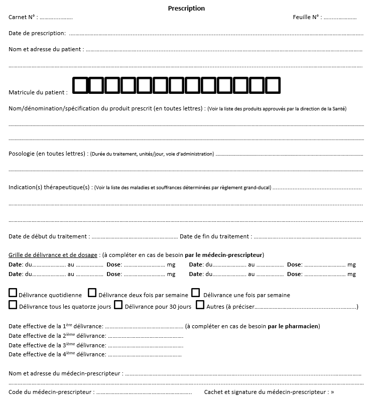

### CONVENTIONS INTERNATIONALES

#### Loi du 3 juillet 1972 portant approbation de la Convention unique sur les stupéfiants, faite à New York le 30 mars 1961.

##### Article unique.

Est approuvée la Convention unique sur les stupéfiants, fait à New York, le 30 mars 1961.

> CONVENTION UNIQUE SUR LES STUPEFIANTS DE 1961
>
> PREAMBULE
>
> \*Les Parties,*
>
> \*Soucieuses* de la santé physique et morale de l’humanité,
>
> \*Reconnaissant* que l’usage médical des stupéfiants demeure indispensable pour soulager la douleur et que les mesures voulues doivent être prises pour assurer que des stupéfiants soient disponibles à cette fin,
>
> \*Reconnaissant* que la toxicomanie est un fléau pour l’individu et constitue un danger économique et social pour l’humanité,
>
> \*Conscientes* du devoir qui leur incombe de prévenir et de combattre ce fléau,
>
> \*Estimant* qu’une action universelle de cet ordre exige une coopération internationale guidée par les mêmes principes et visant des buts communs,
>
> \*Reconnaissant* la compétence de l’Organisation des Nations Unies en matière de contrôle des stupéfiants et désireuses que les organes internationaux intéressés soient groupés dans le cadre de cette Organisation,
>
> \*Désireuses* de conclure une convention internationale acceptable pour tous, remplaçant la plupart des traités existants relatifs aux stupéfiants, limitant l’usage des stupéfiants aux fins médicales et scientifiques et établissant une coopération internationale constante pour mettre en oeuvre ces principes et atteindre ces buts,
>
> \*Conviennent* de ce qui suit:
>
> **Article 1er — Définitions**
>
> 1\. Sauf indication expresse en sens contraire ou sauf si le contexte exige qu’il en soit autrement, les définitions ci-aprés s’appliquent à toutes les dispositions de la présente Convention:
>
> a) Le terme « Organe » désigne l’Organe international de contrôle des stupéfiants.
>
> b) Le terme « cannabis » désigne les sommités florifères ou fructifères de la plante de cannabis (à l’exclusion des graines et des feuilles qui ne sont pas accompagnées des sommités) dont la résine n’a pas été extraite, quelle que soit leur application.
>
> c) L’expression « plante de cannabis » désigne toute plante du genre cannabis.
>
> d) L’expression « résine de cannabis » désigne la résine séparée, brute ou purifiée, obtenue à partir de la plante de cannabis.
>
> e) Le terme « cocaïer » désigne toute espèce d’arbustes du genre érythroxylon.
>
> f) L’expression « feuille de coca » désigne la feuille du cocaïer à l’exception de la feuille dont toute l’ecgonine, la cocaïne et tout autre alcaloïde ecgoninique ont été enlevés.
>
> g) Le terme « Commission » désigne la Commission des stupéfiants du Conseil.
>
> h) Le terme « Conseil » désigne le Conseil économique et social des Nations Unies.
>
> i) Le terme « culture » désigne la culture du pavot à opium, du cocaïer et de la plante de cannabis.
>
> j) Le terme « stupéfiant » désigne toute substance des Tableaux I et II, qu’elle soit naturelle ou synthétique.
>
> k) L’expression « Assemblée générale » désigne ’lAssemblée générale des Nations Unies.
>
> l) L’expression « trafic illicite » désigne la culture ou tout trafic de stupéfiants contraires aux buts de la présente Convention.
>
> m) Les termes « importation » et « exportation » désignent, chacun avec son sens particulier, le transport matériel de stupéfiants d’un État dans un autre État ou d’un territoire dans un autre territoire du même État.
>
> n) Le terme « fabrication » désigne toutes les opérations, autre que la production, permettant d’obtenir des stupéfiants et comprend la purification de même que la transformation de stupéfiants en d’autres stupéfiants.
>
> o) L’expression « opium médicinal » désigne l’opium qui a subi les préparations nécessaires pour son utilisation thérapeutique.
>
> p) Le terme « opium » désigne le latex épaissi du pavot à opium.
>
> q) L’expression « pavot à opium » désigne la plante de l’espèce *Papaver somniferum*, L.
>
> r) L’expression « paille de pavot » désigne toutes les parties (à l’execption des graines) du pavot à opium,après fauchage.
>
> s) Le terme « préparation » désigne un mélange, solide ou liquide, contenant un stupéfiant.
>
> t) Le terme « production » désigne l’opération qui consiste à recueillir l’opium, la feuille de coca, le cannabis et la résine de cannabis des plantes qui les fournissent.
>
> u) Les expressions « Tableau I », « Tableau II », « Tableau III » et « Tableau IV » s’entendent des listes de stupéfiants ou de préparations annexées à la présente Convention et qui pourront être modifiées de de temps à autre conformément à l’article 3.
>
> v) L’expression « Secrétaire général » désigne le Secrétaire général de l’Organisation des Nations Unies.
>
> w) L’expression « stocks spéciaux » désigne les quantités de stupéfiants détenues dans un pays ou territoire par le gouvernement de ce pays ou territoire pour ses besoins spéciaux et en prévision de circonstances exceptionnelles; l’expression « besoins spéciaux » doit s’entendre en conséquence.
>
> x) Le terme « stocks » désigne les quantités de stupéfiants détenues dans un pays ou territoire et destinées:
>
> i) A une consommation médicale et scientifique dans ce pays ou territoire;
>
> ii) A la fabrication et à la préparation de stupéfiants et d’autres substances dans ce pays ou territoire;
>
> iii) A l’exportation;
>
> mais n’inclut pas les quantités de stupéfiants détenues dans un pays ou territoire par:
>
> iv) Les pharmaciens ou d’autres distributeurs détaillants autorisés et les établissements ou les personnes qualifiés dans l’exercice dûment autorisé de leurs fonctions thérapeutiques ou scientifiques; ou
>
> v) En tant que stocks spéciaux.
>
> y) Le terme « territoire » désigne toute partie d’un État qui est traitée comme une entité distincte pour l’application du système de certificats d’importation et d’autorisations d’exportations prévu à l’article 31. Cette définition ne s’applique pas au terme « territoire » tel qu’il est employé aux articles 42 et 46.
>
> 2\. Aux fins de cette Convention ,un stupéfiant sera considéré comme consommé lorsqu’il aura été fourni à toute personne ou entreprise pour la distribution au détail, pour l’usage médical ou pour la recherche scientifique; le mot « consommation » s’entendra conformément à cette définition.
>
> **Article 2 — *Substances soumises au contrôle***
>
> 1\. Sauf en ce qui concerne les mesures de contrôle limitées à des stupéfiants donnés, les stupéfiants du Tableau I sont soumis à toutes les mesures de contrôle applicables aux stupéfiants visés par la présente Convention et, en particulier, aux mesures prévues dans les articles ci-aprés: 4 (paragraphe c) 19, 20, 21, 29, 30, 31, 32, 33, 34, et 37.
>
> 2\. es stupéfiants du Tableau II sont soumis aux mêmes mesures de contrôle que les stupéfiants du, Tableau I, à l’exception des mesures prévues aux paragraphes 2 et 5 de l’article 30, en ce qui concerne le commerce de détail.
>
> 3\. Les préparations autres que celles du Tableau III sont soumises aux mêmes mesures de contrôle que les stupéfiants qu’elles contiennent, mais les évaluations (article 19) et les statistiques (article 20) autres que celles se rapportant à ces stupéfiants ne seront pas requises dans le cas de telles préparations et les dispositions de l’article 29 (paragraphe 2, c) et de l’article 30 (paragraphe 1, b, ii) ne seront pas appliquées
>
> 4\. Les préparations du Tableau III sont soumises aux mêmes mesures de contrôle que les préparations qui contiennent des stupéfiants du Tableau II, sauf que les paragraphes 1, b, et 3 à 15 de l’article 31 ne seront pas appliqués et que pour les évaluations (article 19) et les statistiques (article 20) les reseignements demandés seront limités aux quantités de stupéfiants utilisées dans la fabrication desdites préparations.
>
> 5\. Les stupéfiants du Tableau IV seront également inclus au Tableau I et soumis à toutes les mesures de contrôle applicables aux stupéfiants de ce dernier Tableau, et en outre:
>
> a) Les Parties devront adopter toutes les mesures spéciales de contrôle qu’elles jugeront nécessaires en raison des propriétés particulièrement dangereuses des stupéfiants visés; et
>
> b) Les Parties devront si, à leur avis, la situation dans leur pays fait que c’est là le moyen le plus approprié de protéger la santé publique, interdire la production, la fabrication, l’exportation et l’importation, le commerce, la détention ou l’utilisation de tels stupéfiants à l’exception des quantitités qui pourront être nécessaires exclusivement pour la recherche médicale et scientifique, y compris les essais cliniques avec lesdits stupéfiants, qui devront avoir lieu sous la surveillance et le contrôle directs de ladite Partie ou être subordonnés à cette surveillance et à ce contrôle.
>
> 6\. En plus des mesures de contrôle applicables à tous les stupéfiants du Tableau I, l’opium est soumis aux dispositions des articles 23 et 24, la feuille de coca aux dispositions des articles 26 et 27 et le cannabis aux dispositions de l’article 28.
>
> 7\. Le pavot à opium, le cocaïer, la plante de cannabis, la paille de pavot et les feuilles de cannabis sont soumis aux mesures de contrôle prévues respectivement aux articles 22 à 24; 22, 26 et 27; 22 et 28; 25; et 28.
>
> 8\. Les Parties feront tout ce qui est en leur pouvoir afin de soumettre à des mesures de surveillance autant que faire se pourra les substances qui ne sont pas visées par la présente Convention, mais qui peuvent être utilisées pour la fabrication illicite de stupéfiants.
>
> 9\. Les Parties ne sont pas tenues d’appliquer les dispositions de la présente Convention aux stupéfiants qui sont couramment employés dans l’industrie à des fins autres que les fins médicales ou scientifiques, à condition:
>
> a) Qu’elles prennent des mesures pour empêcher, en recourant à des procédés appropriés de dénaturation ou par tout autre moyen, que les stupéfiants ainsi employés puissent donner lieu à des abus ou produire des effets nocifs (article 3, paragraphe 3) et que dans la pratique la substance nocive puisse être récupérée; et
>
> b) Qu’elles fassent figurer dans les reseignements statistiques (article 20) qu’elles fournissent la quantité de chaque stupéfiant ainsi employé.
>
> **Article 3 — *Modifications du champ d’application du contrôle***
>
> 1\. Si une Partie ou l’Organisation mondiale et de la santé est an possession de renseignements qui, à son avis, rendent nécessaire de modifier l’un ou l’autre des Tableaux, elle adressera au Secrétaire général une notification accompagnée de tous les renseignements pertinents à l’appui de celle-ci.
>
> 2\. Le Secrétaire général communiquera cette notification et les renseignements qu’il jugera pertinents aux Parties, à la Commission et, si la notification a été adressée par une Partie, à l’Organisation mondiale de la santé.
>
> 3\. Si une notification se rappotre à une substance qui n’est pas déjà inscrite au Tableau I ou au Tableau II,
>
> i) Toutes les Parties examineront ,compte tenu des renseignements disponibles, la possibilité, d’appliquer provisoirement à la substance toute les mesures de contrôle applicables aux stupéfiants du Tableau I;
>
> ii) En attendant sa décision ,prise en vertu du sous-paragraphe iii du présent paragraphe, la Commission peut décider que les Parties appliquent provisoirement à ladite substance toutes les metures de contrôle applicables aux stupéfiants du Tableau I. Les Parties appliqueront provisoirement ces mesures à la substance en question;
>
> iii) Si l’Organisation mondiale de la santé constate que cette substance peut donner lieu à des abus analogues et produire des effets nocifs analogues à ceux des stupéfiants du Tableau I ou du Tableau II, ou qu’elle est transformable en un stupéfiant, elle en avisera la Commission, et celle-ci pourra alors décider, selon la recommandation de l’Organisation mondiale de la santé, que cette substance sera inscrite au Tableau I ou au Tableau II.
>
> 4\. Si l’Organisation mondiale de la santé constate qu’une préparation ne peut ,en raison des substances qu’elle contient, donner lieu à des abus ni produire d’effets nocifs (paragraphe 3) et que le stupéfiant qu’elle contient n’est pas facilement récupérable, la Commission ,selon la recommandation de l’Organisation mondiale de la santé ,pourra inscrire cette préparation au Tableau III.
>
> 5\. Si l’Organisation mondiale de la santé constate qu’une préparation ne peut ,en raison des substances qu’elle contient, donner lieu à des abus ni produire d’effets nocifs (paragraphe 3) et que le stupéfiant qu’elle contient n’est pas facilement récupérable, la Commission ,selon la recommandation de l’Organisation mondiale de la santé ,pourra inscrire cette préparation au Tableau III.
>
> 6\. Lorsqu’une notification a trait à un stupéfiant du Tableau I ou du Tableau II ou à une préparation du Tableau III, la Commission, mise à part l’action prévue par le paragraphe 5, peut, selon la recommandation de l’Organisation mondiale de la santé, modifier l’un ou l’autre des Tableaux, soit:
>
> a) En transférant un stupéfiant du Tableau I au Tableau II ou du Tableau II au Tableau I; ou
>
> b) En rayant un stupéfiant ou une préparation, selon le cas ,d’un Tableau.
>
> 7\. Toute décision de la Commission prise en application du présent article sera communiquée par le Secrétaire général à tous les États Membres de l’Organisation des Nations Unies, aux États non membres Parties à la présente Convention, à l’Organisation mondiale de la santé et à l’Organe. La décision prendra effet à l’égard de chaque Partie à la date de réception de la communication susvisée, et les Parties prendront alors toutes mesures requises par la présente Convention.
>
> 8\. a) Toute décision de la Commision de modifier un tableau sera soumise à l’examen du Conseil si une Partie en fait la demande dans les quatre-vingt-dix jours qui suivront la réception de la notification de la décision. Cette demande sera présentée au Secrétaire général avec tous reneignements pertinents à l’appui.
>
> b) Le Secrétaire général communiquera copie de cette demande et des renseignements pertinents à la Commission, à l’Orgnisation mondiale de la santé et à toutes les Parties, qu’il invitera à présenter leurs observations dans les quatre-vingt-dix jours. Toutes les observations reçues seront soumises à l’examen du Conseil.
>
> c) Le Conseil pourra confirmer, modifier ou annuler la décision de la Commission; il statuera en dernier ressort. Sa décision sera notifiée à tous les États Members de l’Organisation des Nations Unies, aux États non membres Parties à la présente Convention, à la Commission, à l’Organisation mondiale de la santé et à l’Organe.
>
> d) En attendant son examen par le Conseil, la décision de la Commission restera en vigueur.
>
> 9\. Les décisions de la Commission prises en application du présent article ne seront pas soumises à l’examen prévu à l’article 7.
>
> **Article 4 — *Obligations générales***
>
> Les Parties prendront les mesures législatives et administratives qui pourront être nécessaires:
>
> a) Pour exécuter les dispositions de la presente Convention dans leurs propres territoires;
>
> b) Pour coopérer avec les autres États à l’exécution des dispositions de ladite Convention; et
>
> c) Sous réserve des dispositions de la présente Convention, pour limiter exclusivement aux fins médicales et scientifiques la production, la fabrication, l’exportation, l’importation, la distribution, le commerce, l’emploi et la détention des stupéfiants.
>
> **Article 5 — *Les organes internationaux de contrôle***
>
> Reconnaissant la compétence de l’Organisation des Nations Unies en matière de contrôle international des stupéfiants, les Parties conviennent de confier à la Commission des stupéfiants du Conseil économique et social et à l’Organe international de contrôle des stupéfiants les fonctions qui sont respectivement attribuées à ces organes par la présente Convention.
>
> **Article 6 — *Dépenses des organes internationaux de contrôle***
>
> L’Organisation des Nations Unies assume les dépenses de la Commission et de l’Organe dans des conditions qui seront déterminées par l’Assemblée générale. Les Parties qui ne sont pas membres de l’Organisation des Nations Unies contribueront aux frais des organes internationaux de contrôle, l’Assemblée générale fixant périodiquement, après avoir consulté les gouvernements de ces Parties, le montant des contributions qu’elle jugera équitable.
>
> **Article 7 — *Revision des décisions et recommandations de la Commission***
>
> Sauf en ce qui concerne les décisions prévues à l’article 3, toute décision ou recommandation adoptée par la Commission en exécution des dispositions de la présente Convention est prise sous réserve de l’approbation du Conseil ou de l’Assemblée générale ou de toute modification adoptée par l’un ou l’autre de ces organes de la même manière que les autres décisions ou recommandations de la Commission.
>
> **Article 8 — *Fonctions de la Commission***
>
> La Commission est habilitée à examiner toutes les questions ayant trait aux buts de la présente Convention, et en particulier:
>
> a) A modifier les tableaux conformément à l’article 3;
>
> b) A appeler l’attention de l’Organe sur toutes les questions qui peuvent avoir trait aux fonctions de celui-ci;
>
> c) A formuler des recommandations pour mettre en oeuvre les dispositions de la présente Convention ou atteindre les buts qu’elle vise, y compris des programmes de rechreche scientifique et les échanges de renseignements de caractère scientifique ou technique; et
>
> d) A attirer l’attention des États non parties sur les décisions et recommandations qu’elle adopte conformément aux fonctions que lui confère la présente Convention de façon qu’ils examinent les mesures qu’elle peut être amenée à prendre en vertu de la présente Convention.
>
> **Article 9 — *Compositoin de l’Organe***
>
> 1\. L’Organe se compose de onze membres élus par le Conseil ainsi qu’il suit:
>
> a) Trois membres ayant l’expérience de la médecine, de la pharmacologie ou de la pharmacie et choisis sur une liste d’au moins cinq personnes désignées par l’Organisation mondiale de la santé; et
>
> b) Huit membres choisis sur une liste de personnes désignées par les Membres de l’Organisation des Nations Unies et par les Parties qui n’en sont pas membres.
>
> 2\. Les membres de l’Organe doivent être des personnes qui, par leur compétence, leur impartialité et leur désintéressement, inspirent la confiance générale. Pendant la durée de leur mandat, elles ne doivent occuper aucun poste ni se livrer à aucune activité qui soit de nature à les empêcher d’exercer avec impartialité leurs fonctions. Le Conseil prend, en consultation avec l’Organe, toutes les dispositions nécessaires pour assurer la pleine indépendance technique de ce dernier dans l’exercice de ses fonctions.
>
> 3\. Le Conseil, eu égard au principe d’une représentation géographique équitable, doit tenir compte de l’interêt qu’il y a à faire entrer dans l’Organe, en proportion équitable, des personnes qui soient au courant de la situation en matière de stupéfiants dans les pays producteurs, fabricants et consommateurs et qui aient des attaches avec lesdits pays.
>
> **Article 10 — *Durée du mandat et rémunération des membres de l’Organe***
>
> 1\. Le mandat des membres de l’Organe est de trois ans et il est renouvelable.
>
> 2\. Le mandat de chaque membre de l’Organe se termine la veille de la première séance de l’Organe à laquelle son successeur a le droit de siéger.
>
> 3\. Un membre de l’Organe qui a été absent lors de trois sessions consécutives sera considéré comme démissionnaire.
>
> 4\. Le Conseil peut, sur la recommandation de l’Organe, révoquer un membre de l’Organe qui ne remplit plus les conditions requises au paragraphe 2 de l’article 9. Cette recommandation doit être formulée par un vote affirmatif de huit membres de l’Organe.
>
> 5\. Lorsque le siège d’un membre de l’Organe devient vacant au cours du mandat de son titulaire, le Conseil pourvoit à cette vacance en élisant un autre membre aussitôt que possible pour le reste de la durée du mandat, conformément aux dispositions applicables de l’article 9.
>
> 6\. Les membres de l’Organe reçoivent une rémunération appropriée dont le montant est fixé par l’Assemblée générale.
>
> **Article 11 — *Règlement intérieur de l’Organe***
>
> 1\. L’Organe élit son président et les membres dont l’élection lui paraît nécessaire pour constituer son bureau; il adopte son règlement intérieur.
>
> 2\. L’Organe se réunit aussi souvent qu’il le juge nécessaire à l’accomplissement satisfaisant de ses fonctions, mais il doit tenir au moins deux sessions par année civile.
>
> 3\. Le quorum indispensable pour les réunions de l’Organe est de sept membres.
>
> **Article 12 — *Application du régime des évaluations***
>
> 1\. L’Organe fixera la date ou les dates auxquelles les évaluations devront être fournies, conformément à l’article 19, ainsi que la forme sous laquelle elles devront être présentées, et il prescrira des formulaires à cette fin.
>
> 2\. En ce qui concerne les pays et territoires auxquels ne s’applique pas la présente Convention, l’Organe invitera les gouvernements intéressés à fournir des évaluations conformément aux dispositions de celle-ci.
>
> 3\. Au cas où un État ne fournirait pas conformément à la date fixée les évaluations relatives à l’un de ses territoires, l’Ogane les établira lui-même dans la mesure du possible, et, autant que faire se pourra, en coopération avec le gouvernement interessé.
>
> 4\. L’Organe examinera les évaluations, y compris les évaluations supplémentaires, et, sauf en ce qui concerne les besoins spéciaux, il pourra demander pour chaque pays ou territoire pour lequel une évaluation aura été fournie, les renseignements qu’il estimera nécessaires afin de compléter les évaluations ou d’élucider telle indication qui s’y trouve.
>
> 5\. L’Organe confirmera ensuite, dans le plus bref délai possible, les évaluations, y compris les évaluations supplémentaires; il pourra également les modifier avec le consentement du gouvernement intéressé.
>
> 6\. Outre la documentation prévue à l’article 15, l’Organe publiera ,aux dates qu’il aura fixées, mais au moins une fois par an, les renseignements relatifs aux évaluations qui lui paraîtront devoir faciliter l’application de la présente Convention.
>
> **Article 13 — *Application du régime des statistiques***
>
> 1\. L’Organe fixera la manière et la forme sous lesquelles les statistiques devront être fournies comme prévu à l’atricle 20 et prescrira les formulaires à cette fin.
>
> 2\. L’Organe examinera les statistiques afin de déterminer si les Parties ou tous autres États se sont conformés aux dispositions de la présente Convention.
>
> 3\. L’Organe pourra demander les renseignements supplémentaires qu’il estimera nécessaires pour compléter ces statistiques ou élucider telle indication qui s’y trouve.
>
> 4\. L’Organe n’aura pas compétence pour poser des questions ou exprimer une opinion au sujet des statistiques relatives aux stupéfiants requis pour les besoins spéciaux.
>
> **Article 14 — *Mesures à prendre par l’Organe pour assurer l’exécution des dispositions de la Convention***
>
> 1\. a) Si, après examen des renseignements adressés à l’Organe par le gouvernement conformément aux dispositions de la présente Convention ou des renseignements communiqués par des organes des Nations Unies et ayant trait à des questions relevant desdites dispositions, l’Organe a motif de croire que les buts de la présente Convention sont sérieusement compromis du fait qu’une Partie ou un pays ou territoire manque d’exécuter les dispositions de la Convention, l’Organe a le droit de demander des explications au gouvernement du pays ou territoire interessé. Sous réserve du droit qu’il posséde d’appeler l’attention des Parties et du Conseil et de la Commission sur la question, ainsi qu’il est prévu à l’alinéa c ci-dessous, l’Organe considérera comme confidentielle une demande de renseingements ou une explication fournie par un gouvernement conformément au présent alinéa.
>
> b) Après avoir agi conformément à l’alinéa a ci-dessus, l’Organe peut, s’il juge nécessaire de le faire, demander au gouvernement intéressé de prendre les mesures correctives qui, en raison des circonstances peuvent paraître nécessaires pour assurer l’exécution des dispositions de la présente Convention.
>
> c) Si l’Ograne constate que le gouvernement intéressé a manqué de donner des explications satisfaisantes lorsqu’il a été invité à le faire conformément à l’alinéa a ci-dessus, ou a négligé d’adopter toute mesure corrective qu’il a été invité à prendre conformément à l’alinéa b ci-dessus, il peut appeler l’attention des Parties, du Conseil et de la Commission sur la question.
>
> 2\. Lorsqu’il appelle l’attention des Parties, du Conseil et de la Commission sur une question conformément à l’alinéa c du paragraphe 1 ci-dessus, l’Organe peut, s’il juge une telle mesure nécessaire, recommander aux Parties d’arrêter l’importation de stupéfiants en provenance du pays intéressé, ou l’exportation de stupéfiants à destination de ce pays ou territoire, ou, à la fois, l’importation et l’exportation, soit pour une période déterminée, soit jusqu’à ce que la situation dans ce pays ou territoire lui donne satisfaction. L’État intéressé a le droit de porter la question devant le Conseil.
>
> 3\. L’Organe a le droit de publier un rapport sur toute question visée par les dispositions du présent article, et de le communiquer au Conseil, qui le transmettra à toutes les Parties. Si l’Organe publie dans ce rapport une décision prise en vertu du présent article, ou des renseignements concernant cette décision, il doit également y publier l’avis du gouvernement intéressé si celui-ci le demande.
>
> 4 Dans les cas où une décision de l’Organe publiée conformément au présent article n’a pas été prise à l’unanimité, l’opinion de la minorité doit être exposée.
>
> 5\. Tout État sera invité à se faire représenter aux séances de l’Organe au cours desquelles est examinée une question l’intéressant directement aux termes du présent article.
>
> 6\. Les décisions de l’Organe prises en vertu du présent article doivent être adoptées à la majorité des deux tiers du nombre total des membres de l’Organe.
>
> **Article 15 — *Rapports de l’Organe***
>
> 1\. L’Organe établit un rapport annuel sur ses travaux et tous autres rapports supplémentaires qu’il peut estimer nécessaires et dans lesquels figurent également une analyse des évaluations et des renseignements statistiques dont il dispose et, dans les cas appropriés, un exposé des explications que les gouvernements ont pu fournir ou ont été requis de fournir, ainsi que toute observation et recommandation que l’Organe peut vouloir formuler. Ces rapports sont présentés au Conseil par l’intermédiarie de la Commission, qui peut formuler les observations qu’elle juge opportunes.
>
> 2\. Les rapports sont communiqués aux Parties et publiés ultérieurement par le Secrétaire général. Les Parties autorisent la libre distribution de ces rapports.
>
> **Article 16 — *Secrétariat***
>
> Les services de secrétariat de la Commission et de l’Organe seront fournis par le Secrétaire général.
>
> **Article 17 — *Administration spéciale***
>
> Les Parties maintiendront une administration spéciale chargée d’appliquer les dispositions de la présente Convention.
>
> **Article 18 — *Renseignements à fournir au Secrétaire général par les Parties***
>
> 1\. Les Parties fourniront au Secrétaire général les renseignements que la Commission peut demander en tant que nécessaires pour l’exercice de ses fonctions, et notamment:
>
> a) Un rapport annuel relatif au fonctionnement de la Convention dans chacun de leurs territoires;
>
> b) De temps à autre, les textes de toutes les lois et de tous les règlements promulgués pour donner effet à la présente Convention;
>
> c) Toutes précisions que la Commission demandera sur les affaires de trafic illicite, et notamment les détails de chaque affaire de trafic illicite découverte qui pourront présenter de l’importance soit en raison de la lumière qu’ils jettent sur les sources d’approvisionnement en stupéfiants du trafic illicite, soit en raison des quantités en cause ou de la méthode utilisée par les trafiquants illicites; et
>
> d) Les noms et adresses des autorités administratives habilitées à délivrer les autorisations ou certificats d’exportation et d’importation.
>
> 2\. Les Parties fourniront les renseignements prévus au paragraphe précédent, sous la forme et aux dates indiquées et en utilisant tels formulaires dont la Commission pourra demander l’emploi.
>
> **Article 19 — *Evaluations des besoins en stupéfiants***
>
> 1\. Les Parties adresseront à l’Organe ,chaque année et pour chacun de leurs territoires, de la manière et sous la forme qu’il prescrira, des évaluations ayant trait aux sujets suivants et établies sur des formulaires fournis par l’Organe:
>
> a) Les quantités de stupéfiants qui seront consommées à des fins medicales et scientifiques;
>
> b) Les quantités de stupéfiants qui seront utilisées pour la fabrication d’autres stupéfiants, de préparations du Tableau III et de substances non visées par la présente Convention;
>
> c) Les quantités de stupéfiants qui seront en stock au 31 décembre de l’année à laquelle les évaluations se rapportent; et
>
> d) Les quantités de stupéfiants qu’il est nécessaire d’ajouter aux stocks spéciaux.
>
> 2\. Sous réserve des déductions prévues au paragraphe 3 de l’article 21, le total des évaluations pour chaque territoire et pour chaque stupéfiants sera la somme des quantités spécifiées aux alinéas a, b et d du paragraphe 1 du présent article, augmentée de toute quantité nécessaire pour porter les stocks existant au 31 décembre de l’année précédente au niveau évalué conformément aux dispositions de l’alinéa c du paragraphe 1.
>
> 3\. Tout État pourra fournir en cours d’année des évaluations supplémentaires en exposant les circonstances qui les rendent nécessaires.
>
> 4\. Les Parties feront connaître à l’Organe la méthode employée pour déterminer les quantités indiquées dans les évaluations et les modifications qui auront pu être apportées à cette méthode.
>
> 5\. Sous réserve des déductions prévues au paragraphe 3 de l’article 21, les évaluations ne devront pas être dépassées.
>
> **Article 20 — *Statistiques à fournir à l’Organe***
>
> 1\. Les Parties adresseront à l’Organe ,pour chacun de leurs territoires, de la manière et sous la forme qu’il prescrira, des statistiques ayant trait aux sujets suivants et établies sur des formulaires fournis par l’Organe:
>
> a) Production ou fabrication de stupéfiants;
>
> b) Utilisation de stupéfiants pour la fabrication d’autre stupéfiants, de préparations du Tableau III et de substances non visées par la présente Convention et utilisation de la paille de pavot pour la fabrication de stupéfiants;
>
> c) Consommation de stupéfiants;
>
> d) Importations et exportations de stupéfiants et de paille de pavot;
>
> e) Saisies de stupéfiants et affectation des quantités saisies; et
>
> f) Stocks de stupéfiants au 31 décembre de l’année à laquelle les statistiques se rapportent.
>
> 2\. a) Les statistiques ayant trait aux sujets mentionnés au paragraphe 1, exception faite de l’alinéa d, seront établies annuellement et seront fournies à l’Organe au plus tard le 30 juin de l’année suivant celle à laquelle elles se rapportent;
>
> b) Les statistiques ayant trait aux sujets mentionnés à l’alinéa d du paragraphe 1 seront établies trimestriellement et seront fournies à l’Organe dans le délai d’un mois à compter de la fin du trimestre auquel elles se rapportent.
>
> 3\. Outre les renseignements visés au paragraphe 1 du présent article, les Parties peuvent adresser à l’Organe, dans toute la mesure du possible, pour chacun de leurs territoires, les renseignements concernant les superficies (en hectares) cultivées en vue de la production de l’opium.
>
> 4\. Les Parties ne sont pas tenues de fournir de statistiques ayant trait aux stocks spéciaux ,mais elles fourniront séparément des statistiques ayant trait aux stupéfiants importés ou acquis dans le pays ou territoire pour les besoins spéciaux ,ainsi qu’aux quantités de stupéfiants prélevés sur les stocks spéciaux pour satisfaire aux besoins de la population civile.
>
> **Article 21 — *Limitation de la fabrication et de l’importation***
>
> 1\. La quantité totale de chaque stupéfiant qui sera fabriquée et importée par un pays ou territoire quelconque au cours d’une année donnée ne devra pas être supérierue à la somme des éléments suivants:
>
> a) La quantité consommée ,dans la limite de l’évaluation correspondante, à des fins médicales et scientifiques;
>
> b) La quantité utilisée, dans la limite de l’évaluation correspondante, en vue de la fabrication d’autres stupéfiants, de préparations du Tableau III et de substances non visées par la présente Convention;
>
> c) La quantité exportée;
>
> d) La quantité versée au stock afin de porter celui-ci au niveau spécifié dans l’évaluation correspondante; et
>
> e) La quantité acquise, dans la limite de l’évaluation correspondante, pour les besoins spéciaux.
>
> 2\. De la somme des éléments énumérés au paragraphe 1, il sera déduit toute quantité qui aura été saisie et mise sur le marche licite, ainsi que toute quantité prélevée sur les stocks spéciaux pour satisfaire aux besoins de la population civile.
>
> 3\. Si l’Organe constate que la quantité tabriquée et importée au cours d’une année donnée excède la somme des quantités énumérées au paragraphe 1, compte tenu des déductions prévues au paragraphe 2 du présent article, l’excédent ainsi constaté qui subsisterait à la fin de l’année sera déduit, l’année suivante, des quantités qui doivent être fabriquées ou importées, ainsi que du total des évaluations défini au paragraphe 2 de l’article 19.
>
> 4\. a) S’il ressort des statistiques des importations ou des exportations (article 20) que la quantité exportée à destination d’un pays ou territoire quelconque dépasse le total des évaluations relatives à ce pays ou territoire, tel qu’il est défini au paragraphe 2 de l’article 19, augmenté des quantités déclarées comme ayant été exportées et déduction faite de tout excédent constaté aux termes de paragraphe 3 du présent article, l’Organe peut en faire notification aux États, qui, à son avis, devraient en être informés.
>
> b) Dès réception d’une telle notification, les Parties n’autoriseront plus, pendant l’année en cours, aucune exportation nouvelle du stupéfiant dont il s’agit à destination du pays ou territoire en cause, sauf;
>
> i) Dans le cas où une évaluation supplémentaire aura été fournie pour ce pays ou territoire en ce qui concerne à la fois toute quantité importée en excédent et la quantité supplémentaire requise; ou
>
> ii) Dans les cas exceptionnels où l’exportation est, de l’avis du gouvernement du pays exportateur, indispensable au traitement des malades.
>
> **Article 22 — *Disposition spéciale applicable à la culture***
>
> Lorsque la situation dans le pays ou un territoire d’une Partie est telle que l’interdiction de la culture du pavot à opium ,du cocaïer ou de la plante de cannabis est, à son avis, la mesure la plus appropriée pour protéger la santé publique, et empêcher que des stupéfiants ne soient détournés vers le trafic illicite, la Partie intéressée en interdira la culture.
>
> **Article 23 — *Organismes nationaux de l’opium***
>
> 1\. Toute Partie qui autorise la culture du pavot à opium en vue de la production d’opium établira si elle ne l’a déjà fait, et maintiendra un ou plusieurs organismes d’État (désignés ci-aprés dans le présent article par le terme « organisme » )chargés d’exercer les fonctions stipulées au présent article.
>
> 2\. Toute Partie visée au paragraphe précédent appliquera les dispositions ci-après à la culture du pavot à opium pour la production de l’opium et à l’opium:
>
> a) L’organisme délimitera les régions et désignera les parcelles de terrain où la culture du pavot à opium en vue de la production d’opium sera autorisée;
>
> b) Les cultivateurs titulaires d’une licence délivrée par l’organisme seront seuls autorisés à se livrer à cette culture;
>
> c) Chaque licence spécifiera la superficie du terrain sur lequel cette culture est autorisée;
>
> d) Tout cultivateur de pavot à opium sera tenu de livrer à l’organisme la totalité de sa récolte d’opium l’organisme achètera cette récolte et en prendra matériellement possession dès que possible ,mais au plus tard dans un délai de quatre mois à compter de la fin de la récolte; et
>
> e) L’organisme aura seul le droit, en ce qui concerne l’opium, d’importer, d’exporter, de se livrer au commerce de gros et de conserver des stocks, à l’exception des stocks détenus par les fabricants d’alcaloïdes de l’opium, d’opium médicinal ou de préparations à base d’opium. Les Parties ne sont pas tenues d’étendre cette clause à l’opium médicinal et aux préparations à base d’opium.
>
> 3\. Les fonctions administratives prévues au paragraphe 2 seront exercées par un seul organisme d’État si la constitution de la Partie interéssée le permet.
>
> **Article 24 — *Restrictions à la production de l’opium destiné au commerce international***
>
> 1\. a) Si l’une des Parties a l’intention de commercer à produire de l’opium ou d’augmenter sa production d’opium ,elle tiendra compte de la demande mondiale d’opium existante, conformément aux évaluations publiées par l’Organe, afin que sa production d’opium n’entraîne pas une surproduction d’opium dans l’ensemble du monde.
>
> b) Aucune Partie n’autorisera la production de l’opium ou n’augmentera sa production d’opium si, à son avis, une telle production ou augmentation de la dprouction sur son territoire risque d’alimenter le trafic illicite de l’opium.
>
> 2\. a) Sous réserve des dispositions du paragraphe 1, si une Partie, qui au 1er janvier 1961 ne produisait pas d’opium pour l’exportation, désire exporter sur l’opium qu’elle produit des quantités n’excédant pas cinq tonnes par an ,elle le notifiera à l’Organe, en joignant à cette notification des renseignements concernant:
>
> i) Les contrôles en vigueur exigés par la présente Convention en ce qui concerne la production de l’exportation de l’opium; et
>
> ii) Le nom du pays ou des pays vers lesquels elle compte exporter l’opium; et l’Organe pourra soit approuver cette notification, soit recommander à la Partie intéressée de ne pas produire d’opium pour l’exportation.
>
> b) Si une Partie autre qu’une Partie désignée au paragraphe 3 désire produire plus de cinq tonnes d’opium destiné à l’exportation par an, elle le notifiera au Conseil, en joignant à cette notification des renseignements appropriés, y compris:
>
> i) L’évaluation des quantités qui doivent être produites pour l’exportation;
>
> ii) Les contrôles existants ou proposés en ce qui concerne l’opium qui doit être produit;
>
> iii) Le nom du pays ou des pays vers lesquels elle compte exporter cet opium; et le Conseil pourra soit approuver la notification soit recommander à la Partie intéressée de ne pas produire d’opium pour l’exportation.
>
> 3\. Nonobstant les dispositions des alinéas a et b du paragraphe 2, une Partie qui, pendant les dix années qui ont précédé immédiatement le 1er janvier 1961, a exporté l’opium produit par elle pourra continuer à exporter l’opium qu’elle produit.
>
> 4\. a) Une Partie n’importera d’opium d’aucun pays ou territoire sauf si l’opium est produit sur le territoire:
>
> i) D’une Partie mentionnée au paragraphe 3;
>
> ii) D’une Partie qui a adressé une notification à l’Organe conformément aux dispositions de l’alinéa a du paragraphe 2; ou
>
> iii) D’une Partie qui a reçu l’approbation du Conseil conformément aux dispositions de l’alinéa b du paragraphe 2.
>
> b) Nonobstant les dispositions de l’alinéa a du présent paragraphe, une Partie peut importer l’opium produit par tout pays qui a produit et exporté de l’opium pendant les dix années qui ont précédé le 1er janvier 1961, si un organisme ou agence de contrôle national a été établi et fonctionne aux fins définies à l’article 23 dans le pays intéressé et si celui-ci possède des moyens efficaces de faire en sorte que l’opium qu’il produit n’alimente pas le trafic illicite.
>
> 5\. Les dispositions du présent article n’empêcheront pas une Partie:
>
> a) De produire de l’opium en quantité suffisante pour ses besoins; ou
>
> b) D’exporter de l’opium saisi dans le trafic illicite à une autre Partie, conformément aux exigences de la présente Convention.
>
> **Article 25 — *Contrôle de la paille de pavot***
>
> 1\. Une Partie qui permet la culture du pavot à opium pour des buts autres que la production de l’opium prendra toutes les mesures nécessaires pour assurer:
>
> a) Que de l’opium n’est pas produit à partir de tels pavots à opium;et
>
> b) Que la fabrication de stupéfiants à partir de la paille de pavot est contrôlée de façon satisfaisante.
>
> 2\. Les Parties appliqueront à la paille de pavot le système de certificats d’importation et d’autorisations d’exportation prévu aux paragraphes 4 à 15 de l’article 31.
>
> 3\. Les Parties fourniront les mêmes statistiques sur l’importation et l’exportation de la paille de pavot que celles qui sont prévues pour les stupéfiants aux paragraphes 1, d, et 2, b, de l’article 20.
>
> **Article 25 — *Le cocaïer et la feuille de coca***
>
> 1\. Si une Partie autorise la culture du cocaïer ,elle lui appliquera, aisni qu’à la feuille de coca, le régime de contrôle prévu à l’article 23 pour le pavot à opium; en ce qui concerne l’alinéa d du paragraphe 2 de 1268 cet article, l’obligation imposée à l’organisme mentionné sera seulement d’entrer matériellement en possession de la récolte, aussitôt que possible après qu’elle aura été faite.
>
> 2\. Dans la mesure du possible, les Parties feront procéder à l’arrachage de tous les cocaïers existant à l’état sauvage Elles détruiront les cocaïers cultivés illégalement.
>
> **Article 27 — *Dispositions supplémentaires relatives à la feuille de coca***
>
> 1\. Les Parties peuvent permettre l’utilisation de feuilles de coca pour la préparation d’un produit aromatique qui ne devra contenir aucun alcaloïde et elles peuvent ,dans la mesure nécessaire à cette utilisation, permettre la production, l’importation, l’exportation, le commerce et la détention de ces feuilles.
>
> 2\. Les Parties fourniront séparément les évaluations (article 19) et les statisques (article 20) concernant les feuilles de coca destinées à la préparation d’un tel produit aromatique; toutefois, il n’y aura pas lieu de le faire si les mêmes feuilles de coca sont utilisées pour l’extraction d’alcaloïdes ainsi que pour celle de produits aromatiques, et si ce tait est précisé dans les évaluatuions et les statistiques.
>
> **Article 28 — *Contrôle du Cannabis***
>
> 1\. Si une Partie autorise la culture de la plante de cannabis en vue de la production de cannabis ou de résine de cannabis ,elle lui appliquera le régime de contrôle prévu à l´article 23 en ce qui concerne le contrôle du pavot à opium.
>
> 2\. La présente Convention ne s´appliquera pas à la culture de la plante de cannabis exclusivement à des fins industrielles (fibres et graines) ou pour des buts horticulturaux.
>
> 3\. Les Parties adopteront les mesures qui peuvent être nécessaires pour empêcher l´abus des feuilles de la plante de cannabis ou le trafic illicite de celles-ci.
>
> **Article 29 — *Fabrication***
>
> 1\. Les Parties exigeront que la fabrication des stupéfiants s’effectue sous licence, sauf quand cette fabrication est effectuée par une ou des enterprises d’État.
>
> 2\. Les Parties:
>
> a) Exerceront une surveillance sur toutes les personnes et entreprises se livrant à la fabrication de stupéfiants ou y participant;
>
> b) Soumettront à un régime de licences les établissements et les locaux dans lesquels la fabrication peut se faire; et
>
> c) Exigeront que les fabricants de stupéfiants titulaires d’une licence se munissent de permis périodiques précisant les catégories et les quantités de stupéfiants qu’ils auront le droit de fabriquer. Cependant, un permis périodique ne sera pas nécessaire pour les préparations.
>
> 3\. Les Parties empêcheront l’accumulation, en la possession des fabricants de stupéfiants, de quantités de stupéfiants et de paille de pavot excédant celles qui sont nécessaires au fonctionnement normal de l’entreprise, compte tenu de la situation du marché.
>
> **Article 30 — *Commerce et distribution***
>
> 1\. a) Les Parties exigeront que le commerce et la distribution des stupéfiants s’effectuent sous licence, sauf si ce commerce ou cette distribution sont effectués par une ou des enterprises d’État.
>
> b) Les Parties:
>
> i) Exerceront une surveillance sur toutes les personnes et entreprises se livrant au commerce ou à la distribution des stupéfiants ou y participant; et
>
> ii) Soumettront a un régime de licence les établissements et les locaux dans lesquels ce commerce et cette distribution peuvent se faire .Cependant, une licence ne sera pas nécessairement requise pour les préparations.
>
> c) Les dispositions des alinéas a et b concernant le régime des licences ne s’appliqueront pas nécessairement aux personnes dûment autorisées à exercer des fonctions thérapeutiques ou scientifiques et agissant dans l’exercice de ces fonctions.
>
> 2\. En outre, les Parties:
>
> a) Empêcheront aussi l’accumulation, en la possession des commerçants, des distributeurs, des entreprises d’État ,ou des personnes dûment autorisées visées ci-dessus ,de quantités de stupéfiants et de paille de pavot excédant celles qui sont nécessaires au fonctionnement normal de l’entreprise, compte tenu de la situation du marché;
>
> b) i) Exigeront que les stupéfiants ne soient fournis ou dispensés à des particuliers que sur ordonnance médicale. Cette disposition n’est pas nécessairement applicable aux stupéfiants que des particuliers peuvent légalement obtenir, utiliser, dispenser ou administrer à l’occasion de l’exercice dûment autorisé de leurs fonctions thérapeutiques; et
>
> ii) Si les Parties jugent ces mesures nécessaires ou souhaitables, elles exigeront que les ordonnances prescrivant des stupéfiants du Tableau I soient écrites sur des formules officielles qui seront fournies sous la forme de carnet à souches par les autorités administratives compétentes ou par les associations professionnelles autorisées.
>
> 3\. Il est souhaitable que les Parties exigent que les offres écrites ou imprimées de stupéfiants, les annonces publicitaires de quelque nature qu’elles soient ainsi que les notices descriptives relatives aux stupéfiants et utilisées à des fins commerciales, les conditionnements contenant des stupéfiants et les étiquettes sous lesquelles les stupéfiants sont mis en vente, indiquent la dénomination commune internationale communiquée par l’Organisation mondiale de la santé.
>
> 4\. Si une Partie juge qu’une telle mesure est nécessaire ou souhaitable, elle exigera que tout conditionnement contenant un stupéfiant porte un double filet rouge trés apparent. Le colis dans lequel ce conditionnement est expédié ne portera pas ce double filet rouge.
>
> 5\. Les Parties exigeront que l’étiquette sous laquelle une drogue est mise en vente indique nommément le ou les stupéfiants qu’elle contient ainsi que leur poids ou leur pourcentage. L’obligation de fournir ces renseignements sur l’étiquette ne s’appliquera pas nécessairement à un stupéfiant dispensé à un particulier sur prescription magistrale.
>
> 6\. Les dispositions des paragraphes 2 et 5 ne s’appliqueront pas nécessairement au commerce de détail ni à la distribution au détail des stupéfiants du Tableau II.
>
> **Article 31 — *Dispositions spéciales relatives au commerce international***
>
> 1\. Les Parties ne permettront pas sciemment l’exportation de stupéfiants à destination d’un pays ou territoire quelconque, si ce n’est:
>
> a) Conformément aux lois et règlements de ce pays ou territoire; et
>
> b) Dans les limites du total des évaluations afférentes à ce pays ou territoire, tel qu’il est défini au paragraphe 2 de l’article 19, en y ajoutant les quantités qui doivent être réexportées.
>
> 2\. Les Parties exerceront dans les ports francs et les zones franches la même surveillance et le même contrôle que dans les autres parties de leurs territoires, étant entendu, toutefois, qu’elles pourront appliquer un régime plus sévère.
>
> 3\. a) Les Parties contrôleront au moyen d’une licence l’importation et l’exportation des stupéfiants sauf dans les cas où cette importation ou cette exportation est effectuée par une ou des entreprises d’État.
>
> b) Les Parties exerceront une surveillance sur toutes les personnes et entreprises se livrant à une telle importation ou exportation ou y participant.
>
> 4\. a) Chaque Partie autorisant l’importation ou l’exportation d’un stupéfiant exigera l’obtention d’une autorisation d’importation ou d’exportation distincte pour chaque importation ou exportation, qu’il s’agisse d’un ou de plusieurs stupéfiants.
>
> b) Cette autorisation indiquera le nom du stupéfiant, la dénomination commune internationale si elle existe, la quantité à importer ou à exporter, les noms et adresses de l’importateur et de l’exportateur et spécifiera la période durant laquelle l’importation ou l’exportation doit être effectuée.
>
> c) L’autorisation d’exportation indiquera en outre le numéro et la date du certificat d’importation (paragraphe 5) ainsi que l’autorité qui l’a délivré.
>
> d) L’autorisation d’importation pourra permette d’importer en plusieurs envois.
>
> 5\. Avant de délivrer une autorisation d’exportation ,les Parties exigeront un certificat d’importation, délivré par les autorités compétentes du pays ou territoire importateur et attestant que l’importation du stupéfiant ou des stupéfiants dont il est question est approuvée et ce certificat sera produit par la personne ou l’établissement demandant l’autorisation d’exportation. Les Parties se conformeront autant que faire se pourra au modèle de certificat d’importation approuvé par la Commission.
>
> 6\. Une copie de l’autorisation d’exportation sera jointe à chaque envoi, et le gouvernement qui délivre l’autorisation d’exportation en adressera une copie au gouvernement du pays ou territoire importateur.
>
> 7\. a) Lorsque l’importation a été effectuée ou lorsque la période fixée pour l’impotation prend fin, le gouvernement du pays ou territoire importateur renverra au gouvernement du pays ou territoire exportateur l’autorisation d’exportation, avec une mention spéciale à cet effet.
>
> b) La mention précitée spécifiera la quantité effectivement importée.
>
> c) Si la quantité effectivement exportée est inférieure à celle qui est indiquée dans l’autorisation d’exportation, les autorités compétentes indiqueront la quantité effectivement exportée sur l’autorisation d’exportation et sur toute copie officielle de celle -ci.
>
> 8\. Les exportations sous forme d’envois adressés à une banque au compte d’une personne différente de celle dont le nom figure sur l’autorisation d’exportation ou à une boîte postale seront interdites.
>
> 9\. Les exportations sous forme d’envois adressés à un entrepôt de douane seront interdites, sauf si le gouvernement du pays importateur précise sur le certificat d’importation produit par la personne ou l’établissement qui demande l’autorisation d’exportation qu’il a approuvé l’importation de l’envoi afin que celui-ci soit déposé dans un entrepôt de douane. En pareil cas, l’autorisation d’exportation précisera que l’envoi est effectué à cette fin. Tout retrait de l’entrepôt de douane sera subordonné à la présentation d’un permis émanant des autorités dont reléve l’entrepôt,et, dans le cas d’un envoi à destination de l’étranger, il sera assimilé à une exportation nouvelle au sens de la présente Convention.
>
> 10\. Les envois de stupéfiants entrant dans le territoire d’une Partie ou en sortant sans être accompagnés d’une autorisation d’exportation seront retenus par les autorités compétentes.
>
> 11\. Une Partie n’autorisera pas le passage en transit sur son territoire, en direction d’un autre pays, d’un envoi quelconque de stupéfiants, que cet envoi soit ou non déchargé du véhicule qui le transporte, sauf si la copie de l’autorisation d’exportation pour cet envoi est présentée aux autorités compétentes de ladite Partie.
>
> 12\. Les autorités compétentes d’un pays ou territoire quelconque à travers lequel le passage d’un envoi de stupéfiants est autorisé prendront toutes les mesures nécessaires pour empêcher le déroutement dudit envoi vers une destination autre que celle qui figure sur la copie de l’autorisation d’expor- 1271 tation jointe à l’envoi, à moins que le gouvernement du pays ou territoire à travers lequel ledit envoi s’effectue n’autorise ce déroutement. Le gouvernement de ce pays ou territoire traitera toute demande de déroutement comme s’il s’agissait d’une exportation du pays ou territoire de transit vers le pays ou territoire de la nouvelle destination. Si le déroutement est autorisé, les dispositions des alinéas a et b du paragraphe 7 s’appliqueront également entre le pays ou territoire de transit et le pays ou territoire d’où l’envoi a primitivement été exporté.
>
> 13\. Aucun envoi de stupéfiants en transit ou déposé dans un entrepôt de douane ne peut être soumis à un traitement quelconque qui modifierait la nature de ces stupéfiants. L’emballage ne peut être modifié sans l’autorisation des autorités compétentes.
>
> 14\. Les dispositions des paragraphes 11 à 13 relatives au transit des stupéfiants sur le territoire d’une Partie ne sont pas applicables si cet envoi est transporté par la vole aérienne à condition que l’aéronef n’atterrisse pas dans le pays ou le territoire de transit .Si l’aéronef fait un atterrissage dans ce pays ou territoire, ces dispositions s’appliqueront dans la mesure où les circonstances l’exigent.
>
> 15\. Les dispositions du présent article ne portent pas préjudice à celle de tout accord international qui limite le contrôle pouvant être exercé par toute partie sur les stupéfiants en transit.
>
> 16\. Aucune des dispositions de cet article, à part les paragraphes 1, a, et 2, ne s’appliquera nécessairement aux préparations du Tableau III.
>
> **Article 32 — *Di* *spositions spéciales concernant le transport des stupéfiants dans les trousses de premiers secours des navires ou aéronefs effectuant des parcours internationaux***
>
> 1\. Le transport international par navires ou aéronefs de quantités limitées de stupéfiants susceptibles d’être nécessaires pendant le voyage pour l’administration des premiers secours et pour les cas d’urgence ne sera pas considéré comme une importation ou une exportation au sens de la présente Convention.
>
> 2\. Des précautions appropriées seront prises par le pays d’immatriculation pour empêcher l’usage indu des stupéfiants mentionnés au paragraphe 1 ou leur détournement à des fins illicites. La Commission recommandera ces précautions en consultation avec les organisations internationales compétentes.
>
> 3\. Les stupéfiants transportés par navires ou aéronefs conformément aux dispositions du paragraphe 1 seront soumis aux lois, réglements, permis et licences du pays d’immatriculation sans préjudice du droit des autorités locales compétentes de procéder à des vérifications, inspections et autre opérations de contrôle à bord des navires ou aéronefs. L’administration de ces stupéfiants en cas d’urgence ne sera pas considérée comme contrevenant aux dispositions de l’article 30, paragraphe 2, b.
>
> **Article 33 — *Détention de stupéfiants***
>
> Les Parties ne permettront pas la détention de stupéfiants sans autorisation légale.
>
> **Article 34 — *Mesures de surveillance et d’inspection***
>
> Les Parties exigeront:
>
> a) Que toutes les personnes à qui des licences sont délivrées en application de la présente Convention ou qui occupent des postes de direction ou de surveillance dans une entreprise d’Etat établie conformément à la présente Convention réunissent les qualités nécessaires pour appliquer effectivement et fidèlement les dispositions des lois et règlements édictés en exécution de la présente Convention; et
>
> b) Que les autorités administratives, les fabricants, les commerçants, les hommes de science, les établissements scientifiques et les hôpitaux tiennent des registres où serontc onsignées les quantités de chaque stupéfiant fabriqué et chaque opération portant sur l’acquisition et l’aliénation de stupéfiants.
>
> Ces registres seront conservés pendant une période qui ne sera pas inférieure à deux ans. Dans les cas où des carnets à souches (article 30, paragraphe 2, alinéa b) d’ordonnances médicales sont utilisés, ces carnets à souches, y compris les souches, seront également conservés pendant une période qui ne sera pas inférieure à deux ans.
>
> **Article 35 — *Lutte contre le trafic illicite***
>
> Compte dûment tenu de leurs régimes constitutionnel, juridique et administratif, les Parties:
>
> a) Assureront sur le plan national une coordination de l’action préventive et répressive contre le trafic illicite; à cette fin, elles pourront utilement désigner un service approprié chargé de cette coordination;
>
> b) S’assisteront mutuellement dans la lutte contre le trafic illicite;
>
> c) Coopéreront étroitement entre elles et avec les organisations internationales compétentes dont elles sont membres afin de mener une lutte coordonnée contre le trafic illicite;
>
> d) Veilleront à ce que la coopération internationale des services appropriés soit effectuée par des voies rapides; et
>
> e) S’assureront que, lorsque des pièces de justice sont transmises entre des pays pour la poursuite d’une action judiciaire, la transmission soit effectuée par des voies rapides à l’adresse des instances désignées par les Parties; cette disposition ne porte pas atteinte au droit des Parties de demander que les pièces de justice leur soient envoyées par la voie diplomatique.
>
> **Article 36 — *Dispositions pénales***
>
> 1\. Sous réserve de ses dispositions constitutionnelles, chaque Partie adoptera les mesures nécessaires pour que la culture et la production, la fabrication, l’extraction, la préparation, la détention, l’offre, la mise en vente, la distribution, l’achat, la vente, la livraison, à quelque titre que ce soit, le courtage, l’envoi, l’expédition en transit, le transport, l’importation et l’exportation de stupéfiants non conformes aux dispositions de la présente Convention ,ou tout autre acte qui, de l’avis de ladite Partie, serait contraire aux dispositions de la présente Convention, constituent des infractions punissables lorsqu’elles sont commises intentionnellement et pour que les infractions graves soient passibles d’un châtiment adéquat ,notamment de peines de prison ou d’autres peines privatives de liberté.
>
> 2\. Sous réserve des dispositions constitutionnelles de chaque Partie, de son système juridique et de sa législation nationale,
>
> a) i) Chacune des infractions énumérées au paragraphe 1 sera considérée comme une infraction distincte, si elles sont commises dans des pays différents;
>
> ii) La participation intentionnelle à l’une quelconque desdites infractions, l’association ou l’entente en vue de la commettre ou la tentative de la commettre, ainsi que les actes préparatoires et les opérations financières intentionnellement accomplis, relatifs aux infractions dont il est question dans cet article, constitueront des infractions passibles des peines prévues au paragraphe 1;
>
> iii) Les condamnations prononcées à l’étranger pour ces infractions seront prises en considération aux fins d’établissement de la récidive; et
>
> iv) Les infractions graves précitées, qu’elles soient commises par des nationaux ou des étrangers, seront poursuivies par la Partie sur le territoire de laquelle l’infraction a été commise, ou par la Partie sur le territoire de laquelle le délinquant se trouvera si son extradition n’est pas acceptable conformement à la législation de la Partie à laquelle la demande est adressée, et si ledit délinquant n’a pas été déjà poursuivi et jugé.
>
> b) Il est souhaitable que les infractions mentionnées au paragraphe 1 et dans la partie ii de l’alinéa a du paragraphe 2 soient considérées comme des cas d’extradition aux termes de tout traité d’extradition conclu ou à conclure entre des Parties et soient reconnues comme cas d’extradition entre elles par les Parties qui ne subordonnent pas l’extradition à l’existence d’un traité ou à la réciprocité, étant entendu, toutefois, que l’extradition sera accordée conformément à la législation de la Partie à qui la demande d’extradition est adressée et que ladite Partie aura le droit de refuser de procéder à l’arrestation du délinquant ou de refuser d’accorder son extradition si les autorités compétentes considèrent que l’infraction n’est pas suffisamment grave.
>
> 3\. Aucune disposition du présent article ne portera atteinte aux dispositions du droit pénal d’une Partie en matière de juridiction.
>
> 4\. Les dispositions du présent article seront limitées en matière de compétence par la législation pénale de chacune des Parties.
>
> **Article 37 — *Saisie et confiscation***
>
> Tous stupéfiants, toutes substances et tout matériel utilisés pour commettre l’une quelconque des infractions visées à l’article 36 ou destinés à commettre une telle infraction pourront être saisis et confisqués.
>
> **Article 38 — *Traitement des toxicomanes***
>
> 1\. Les Parties prendront particulièrement en considération les mesures à prendre pour faire traiter et soigner les toxicomanes et assurer leur réadaption.
>
> 2\. Si la toxicomanie constitue un grave problème pour une Partie et si ses ressources économiques le le permettent, il est souhaitable qu’elle crée les services adéquats en vue du traitement efficace des toxicomanes.
>
> **Article 39 — *Application de mesures nationales de contrôle plus sevères que celles qu’exige la présente Convention***
>
> Nonobstant toute disposition de la présente Convention ,aucune Partie ne sera, ou ne sera censée être, empêchée d’adopter des mesures de contrôle plus strictes ou plus sévères que celles qui sont prévues par la présente Convention, et notamment d’exiger que les réparations du Tableau III ou les stupéfiants du Tableau II soient soumis aux mesures de contrôle applicables aux stupéfiants du Tableau I, ou à certaines d’entre elles, si elle le juge nécessaire ou opportun pour la protection de la santé publique.
>
> **Article 40 — *Langues de la Convention et procédure de signature, de ratification et d’adhésjon***
>
> 1\. La présente Convention, dont les textes anglais, chinois, espagnol, français et russe font également foi, sera ouverte jusqu’au 1er août 1961 à la signature de tous les Etat Membres de l’Organisation des Nations Unies, de tous les Etats non membres qui sont parties au Statut de la Cour internationale de Justice ou membre d’une institution spécialisée des Nations Unies et également de tout autre Etat que le Conseil peut inviter à devenir Partie.
>
> 2\. La présente Convention est soumise à ratification. Les instruments de ratification seront déposés auprès du Secrétaire général.
>
> 3\. La présente Convention sera ouverte à l’adhésion des Etats visés au paragraphe 1 après le 1er août 1961. Les instruments d’adhésion seront déposés auprès du Secrétaire général.
>
> **Article 41 — *Entrée en vigueur***
>
> 1\. La présente Convention entrera en vigueur à l’expiration du trentième jour qui suivra la date du dépôt du quarantième instrument de ratification ou d’adhésion, conformément à l’article 40.
>
> 2\. Pour tout autre Etat déposant un instrument de ratification ou d’adhésion après la date de dépôt dudit quarantième instrument, la présente Convention entrera en vigueur à l’expiration du trentième jour qui suivra le dépôt par cet Etat de son instrument de ratification ou d’adhésion.
>
> **Article 42 — *Application territoriale***
>
> La présente Convention s’appliquera à tous les territoires non métropolitains qu’une Partie représente sur le plan international, sauf si le consentement préalable d’un te! territoire est nécessaire en vertu soit de la constitution de la Partie ou du territoire intéressé ,soit de la coutume. En ce cas, la Partie s’efforcera d’obtenir dans le plus bref délai le consentement du territoire qui est nécessaire et, lorsque ce consentement aura été obtenu ,elle le notifiera au Secrétaire général. La présente Convention s’appliquera au territoire ou territoires désignés par la notification, dès la date de la réception de cette dernière par le Secrétaire général. Dans les cas où le consentement préalable du territoire non métropolitain n’est pas nécessaire, la Partie intéressée déclarera, au moment de la signature, de la ratification ou de l’adhésion, à quel territoire ou territoires non métropolitains s’applique la présente Convention.
>
> **Article 43 — *Territoires aux fins des articles 19, 20, 21 et 31***
>
> 1\. Toute Partie peut notifier au Secrétaire général qu’aux fins des articles 19, 20, 21 et 31 l’un de ses territoires est divisé en deux ou plusieurs territoires ou que deux ou plusieurs de ses territoires sont groupés en un seul.
>
> 2\. Deux ou plusieurs Parties peuvent notifier au Secrétaire géneral qu’à la suite de l’institution d’une union douanière entre elles, ces Parties constituent un seul territoire aux fins des articles 19, 20, 21 et 31.
>
> 3\. Toute notification faite en vertu du paragraphe 1 ou 2 ci-dessus prendra effet au 1er janvier de l’année qui suivra celle où ladite notification est faite.
>
> **Article 44 — *Abrogation des traités internationaux antérieurs***
>
> 1\. Des l’entrée en vigueur de la présente Convention, ses dispositions abrogeront et remplaceront, entre les Parties, les dispositions des traités ci-après:
>
> a) Convention internationale de l’opium ,signée à La Haye, le 23 janvier 1912;
>
> b) Accord concernant la fabrication, le commerce intérieur et l’usage de l’opium prépare, signé à Genève, le 11 février 1925;
>
> c) Convention internationale de l’opium, signée à Genève, le 19 février 1925;
>
> d) Convention pour limiter la fabrication et réglementer la distribution des stupéfiants, signée à Genève, le 13 juillet 1931;
>
> e) Accord pour le contrôle de la consommation de l’opium à fumer en Extrême -Orient,signé à Bangkok, le 27 novembre 1931;
>
> f) Protocole signé à Lake Success, le 11 décembre 1946, amendant les Accords, Conventions et Protocoles sur les stupéfiants conclus à La Haye, le 23 janvier 1912, à Genève, le 11 février 1925, le 19 février 1925 et le 13 juillet 1931, à Bangkok, le 27 novembre 1931, et à Genève, le 26 juin 1936, sauf en ce qui concerne ses effects sur la dernière de ces Conventions;
>
> g) Les Conventions et Accords visés aux alinéas a à e, tels qu’ils ont été amendés par le Protocole de 1946 visé à l’alinéa f;
>
> h) Protocole signé à Paris, le 19 novembre 1948 ,plaçant sous contrôle international certaines drogues non visées par la Convention du 13 juillet 1931 pour limiter la fabrication et réglementer la distribution des stupéfiants, amendée par le Protocole signé à Lake Success, le 11 décembre 1946;
>
> i) Protocole viasnt à limiter et à réglementer la culture du pavot ,ainsi que la production, le commerce international, le commerce de gros et l’emploi de l’opium, signé à New York, le 23 juin 1953, si ce Protocole entre en vigueur.
>
> 2\. Dés l’entrée en vigueur de la présente Convention, l’article 9 de la Convention pour la répression du trafic illicite des drogues nuisibles, signée à Genève, le 26 juin 1936, sera, entre les Parties à ladite Convention, qui sont aussi Parties à la présente Convention, abrogé et remplacé par l’alinéa b du paragraphe 2 de l’article 36 de la présente Convention; toutefois, une telle Partie pourra, après en avoir informé le Secrétaire général. maintenir en vigueur ledit article 9.
>
> **Article 45 — *Dispositiohs transitoires***
>
> 1\. Les fonctions de l’Organe dont la création est prévue à l’atricle 9 seront, à partir de la date d’entrée en vigueur de la présente Convention (article 41, paragraphe 1) exercées provisiorement, selon leur nature, par le Comité central permanent créé en exécution des dispositions du chapitre VI de la Convention mentionnée à l’alinéa c de l’article 44, telle qu’elle a été amendée ,et par l’Organe de contrôle créé en exécution des dispositions du chapitre II de la Convention mentionnée à l’alinéa d de l’article 44, telle qu’elle a été amendée.
>
> 2\. Le Conseil fixera la date à laquelle le nouvel Organe mentionné à l’article 9 entrera en fonctions. A cette date, ledit Organe assumera les fonctions du Comité central permanent et celles de l’Organe de contrôle mentionnés au paragraphe 1, à l’égard des Etats qui sont Parties aux traités énumérés à l’article 44 et qui ne sont pas Parties à la présente Convention.
>
> **Article 46 — *Dénonciation***
>
> 1\. A l’expiration d’un délai de deux ans à compter de la date de l’entrée en vigueur de la présente Convention (article 41, paragraphe 1), toute Partie pourra, en son nom ou au nom d’un territoire qu’elle represente sur le plan international et qui a retiré le consentement donné en vertu de l’article 42, déponcer la présente Convention en déposant un instrument à cet effet auprès du Secrétaire genéral.
>
> 2\. Si le Secrétaire générel reçoit la dénonciation avant le 1er juillet ou à cette date, elle prendra effet le 1er janvier de l’année suivante ;si la dénonciation est reçue après le 1er juillet, elle prendra effet comme si elle avait été reçue l’année suivante avant le 1er juillet ou à cette date.
>
> **Article 47 — *Amendements***
>
> 1\. Toute Partie pourra proposer un amendement à la présente Convention. Le texte dudit amendement et les raisons qui l’ont motivé seront communiqués au Secrétaire général qui les communiquera aux Parties et au Conseil. Le Conseil pourra décider soit:
>
> a) De convoquer une conférence, conformément au paragraphe 4 de l’Article 62 de la Charte des Nations Unies, en vue d’étudier l’amendement proposé; soit
>
> b) De demander aux Parties si elles acceptent l’amendement proposé et aussi de les prier de présenter éventuellement au Conseil leurs observations sur cette proposition.
>
> 2\. Si un projet d’amendement distribué conformément au paragraphe 1, b, du présent article n’a été rejeté par aucune Partie dans les dix-huit mois qui suivent sa communication, il entrera immédiatement en vigueur. Si toutefois il est rejeté par une Partie ,le Conseil pourra décider ,compte tenu des observations des Parties, s’il convient de convoquer une conférence chargée d’étudier ledit amendement.
>
> **Article 48 — *Différends***
>
> 1\. S’il s’élève entre deux ou plusieurs Parties un differend concernant l’interprétation ou l’application de la présente Convention, lesdites Parties se consulteront en vue de régler ce différend par voie de négociation, d’enquête, de médiation, de conciliation, d’arbitrage, de recours à des organismes régionaux, par voie judiciaire ou par d’autres moyens pacifiques de leur choix.
>
> 2\. Tout différend de ce genre qui n’aura pas été réglé par les moyens prévus au paragraphe 1 sera soumis à la Cour internationale de Justice.
>
> **Article 49 — *Réserves transitoires***
>
> 1\. Une Partie peut, au moment de la signature, de la ratification ou de l’adhésion,se réserver le droit d’autoriser temporairement dans l’un de ses territoires:
>
> a) L’usage de l’opium à des fins quasi médicales;
>
> b) L’usage de l’opium à fumer;
>
> c) La mastication de la feuille de coca;
>
> d) L’usage du cannabis ,de la résine de cannabis, d’extraits et teintures de cannabis à des fins non médicales; et
>
> e) La production, la fabrication et le commerce des stupéfiants visés aux alinéas a à d aux fins mentionnées dans lesdits alinéas.
>
> 2\. Les réserves faites en vertu du paragraphe 1 seront soumises aux restrictions suivantes:
>
> a) Les activités mentionnées au paragraphe 1 ne pourront être autorisées que dans la mesure où elles étaient traditionnelles dans les territoires pour lesquels la reserve est faite et y étaient autorisées au 1er janvier 1961;
>
> b) Aucune exportation des stupéfiants visés au paragraphe 1 aux fins mentionnées dans ledit paragraphe ne pourra être autorisée à destination d’un Etat non partie ou d’un territoire auquel la présente Convention ne s’applique pas aux termes de l’article 42;
>
> c) Seules pourront être autorisées à fumer l’opium les personnes immatriculées à cet effet avant le 1er janvier 1964 par les autorités compétentes;
>
> d) L’usage de l’opium à des fins quasi médicales devra être aboli dans un délai de quinze ans à compter de l’entrée en vigueur de la présente Convention, comme prévu au paragraphe 1 de l’article 41;
>
> e) La mastication de la feuille de coca devra être abolie dans un délai de vingt-cinq ans à compter de l’entrée en vigueur de la présente Convention, comme prévu au paragraphe 1 de l’article 41;
>
> f) L’usage du cannabis à des fins autres que médicales et scientificques devra cesser aussitôt que possible mais en tout cas dans un délai de vingt-cinq ans à compter de l’entrée en vigueur de la présente Convention, comme prévu au paragrapghe 1 de l’article 41;
>
> g) La production, la fabrication et le commerce des stupéfiants visés au paragraphe 1 pour les usages mentionnés audit paragraphe devront être réduits et finalement supprimés en même temps que ces usages.
>
> 3\. Toute Partie faisant une réserve en vertu du paragraphe 1 devra:
>
> a) Inclure dans le rapport annuel qu’elle adressera au Secrétaire général, conformément à l’alinéa a du paragraphe 1 de l’article 18, un exposé des progrés accomplis au cours de l’année précédente en vue de rendre effective l’abolition de l’usage ,de la production, de la fabrication ou du commerce visée au paragraphe 1; et
>
> b) Fournir à l’Organe des évaluations (article 19) et des statistiques (atticle 20) séparées pour les activités au sujet desquelles une réserve aura été faite, de la manière et sous la forme prescrite par l’Organe.
>
> 4\. a) Si une Partie qui fait une réserve en vertu du paragraphe 1 ne fournit pas:
>
> i) Le rapport mentionné à l’alinéa a du paragraphe 3 dans les six mois suivant la fin de l’année à laquelle ont trait les renseignements qu’il contient;
>
> ii) Les évaluations mentionnées à l’alinéa b du paragraphe 3 dans les trois mois suivant la date fixée à cet égard par l’Organe conformément au paragraphe 1 de l’article 12;
>
> iii) Les statistiques mentionnées à l’alinéa b du paragraphe 3 dans les trois mois suivant la date où elles doivent être fournies conformément au paragraphe 2 de l’article 20;
>
> l’Organe ou le Secrétaire général, selon le cas, adressera à la Partie en cause une notification indiquant son retard et lui demandera de fournir ces renseignements dans un délai de trois mois à compter de la réception de cette notification.
>
> b) Si une Partie ne se conforme pas, dans le délai indiqué ci-dessus, à la demande de l’Organe ou du Secrétaire général, la réserve en question faite en vertu du paragraphe 1 cessera d’avoir effet.
>
> 5\. L’Etat qui aura fait des réserves pourra à tout moment et par voie de notification écrite retirer tout ou partie de ses réserves.
>
> **Article 50 — *Autres réserves***
>
> 1\. Aucune réserve n’est autorisée en dehors des réserves faites conformément à l’article 49 ou aux paragraphes suivants.
>
> 2\. Tout Etat peut, au moment de la signature, de la ratification ou de l’adhésion, faire des réserves sur les dispositions suivantes de la présente Convention: paragraphes 2 et 3 de l’article 12; paragraphe 2 de l’article 13; paragraphes 1 et 2 de l’article 14; alinéa b du paragraphe 1 de l’article 31; et article 48.
>
> 3\. Tout Etat qui désire devenir Partie à la Convention mais qui veut être autorisé à faire des réserves autres que celles qui sont enumérées au paragraphe 2 du présent article ou à l’article 49 peut aviser le Secrétaire général de cette intention. A moins qu’à l’expiration de douze mois aprés la date de la communication de la réserve en question par le Secrétaire général, un tier des Etats qui ont ratifié la Convention ou y ont adhéré avant la fin de ladite période n’aient élevé des objections contre elle, elle sera considérée comme autorisée, étant entendu toutefois que les Etats qui auront élevé des objections contre cette réserve n’auront pas à assumer à l’égard de l’Etat qui l’a formulée d’obligation juridique découlant de la présente Convention, sur laquelle porte la réserve.
>
> 4\. L’Etat qui aura fait des réserves pourra à tout moment et par voie de notification écrite retirer tout ou partie de ses réserves.
>
> **Article 51 — *Notifications***
>
> Le Secrétaire général notifiera à tous les Etats mentionnés au paragraphe 1 de l’article 40:
>
> a) Les signatures, ratifications ou adhésions conformément à l’article 40;
>
> b) La date à laquelle la présente Convention entrera en vigueur conformément à l’article 41;
>
> c) Les dénonciations conformément à l’article 46; et
>
> d) Les déclarations et notifications conformément aux articles 42, 43, 47, 49 et 50.
>
> En foi de quoi les soussignés ,dûment autorisés, ont signé la présente Convention au nom de leurs gouvernements respectifs.
>
> Fait à New York, le trente mars mil neuf cent soixante et un, en un seul exemplaire qui sera conservé dans les archives de l’Organisation des Nations Unies et dont les copies certifiées conformes seront envoyées à tous les Etats Membres de l’Organisation des Nations Unies et aux autre Etats visés au paragraphe 1 de l’article 40.
>
> TABLEAUX
>
> \**Liste des stupéfiants inclus au Tableau I**
>
> \**Acétorphine** (acétyl-O3 [hydroxy-1(R) méthyl-1 butyl]-7α méthyl-O6 endoéthéno-6, 14 dihydro-7,8 morphine ou acétyl-O-3 (hydroxy-1 méthyl-1 butyl)-7α endoéthéno-6,14 tétrahydro-oripavine ou acétoxy-5 [hydroxy-1 (R) méthyl-1 butyl]-2 α méthoxy-3 méthyl-12 éthéno-3,9a iminoéthano-9,9b hexahydro-1,2,3,3a,8,9 phénanthro [4,5-bcd] furanne)
>
> \**Acétylméthadol** (acétoxy-3 diméthylamino-6 diphényl-4,4 heptane)
>
> \**Allylprodine** (allyl-3 méthyl-1 phényl-4 propionoxy-4 pipéridine) Alphacétylméthadol (alpha-acétoxy-3 diméthylamino-6 diphényl-4,4 heptane)
>
> \**Alphaméprodine** (alpha-éthyl-3 méthyl-1 phényl-4 propionoxy-4 pipéridine)
>
> \**Alphaméthadol** (alpha-diméthylamino-6 diphényl-4,4 heptanol-3)
>
> \**Alphaprodine** (alpha-diméthyl-3,3 phényl-4 propionoxy-4 pipéridine)
>
> \**Aniléridine** (ester éthylique de l’acide para-aminophénéthyl -1 phényl-4 pipéridine carboxylique-4 ou ester éthylique de l’acide [(*para*-aminophényl )-2 éthyl]-1 phényl-4 pipéridine carboxylique-4)
>
> \**Benzéthidine** (ester éthylique de l’acide (benzyloxy-2 éthyl)-1 phényl-4 pipéridine carboxylique-4) Benzylmorphine (benzyl-3 morphine)
>
> \**Bétacétylméthadol** (bêta-acétoxy-3 diméthylamino-6 diphényl-4,4 heptane)
>
> \**Bétaméprodine** (bêta-éthyl-3 méthyl-1 phényl-4 propionoxy-4 pipéridine)
>
> \**Bétaméthadol** (bêta-diméthylamino-6 diphényl-4,4 heptonal-3)
>
> \**Bétaprodine** (bêta-diméthyl-1,3 phényl-4 propionoxy-4 pipéridine)
>
> \**Bezitramide** ((cyano-3 diphénylpropyl-3,3)-1 (oxo-2 propionyl-3 benzimidazolinyl-1)-4 pipéridine)
>
> \**Butyrate de dioxaphétyl** (morpholino-4 diphényl-2,2 butyrate d’éthyl) Cannabis (chanvre indien ) et résine de cannabis (résine de chanvre indien)
>
> \**Cétobémidone** *(méta*-hydroxyphenyl-4 méthyl-1 propionyl-4 pipéridine ou éthyl cétone (hydroxyphényl-3)-4 méthyl-1 pipérdyl-4 ou méthyl-1 métahydroxyphényl-4 propionyl-4 pipéridine)
>
> \**Clonitazène** (para-chlorbenzyl-2 diéthylaminoéthyl-1 nitro-5 benzimidazole)
>
> Coca (Feuille de)[^1-25]
>
> Cocaïne (ester méthylique de la benzoylecgonine)[^1-26]
>
> \**Codoxime** (dihydrocodéinone carboxyméthyloxime-6)
>
> Concentré de paille de pavot (matière obtenue lorsque la paille de pavot a subi un traitement en vue de la concentration de ses alcaloïdes, lorsque cette matière est mise dans le commerce)[^1-27]
>
> \**Désomorphine** (dihydrodésoxymorphine)
>
> \**Dextromoramide** ((+) [méthyl-2 oxo-4 diphényl-3,3 (pyrrolidinyl-1)-4 butyl]-4 morpholine ou (+)- méthyl-3 diphényl-2,2 morpholino-4 butyryl pyrrolidine)
>
> \**Diampromide** (N- [(méthylphénéthylamino)-2 propyl] propionanilide)
>
> \**Diéthylthiambutène** (diéthylamino-3 di-(thiényl-2’)-1,1 butène-1)
>
> Dihydromorphine
>
> \**Diménoxadol** (dlrnéthylamlnoéthyl-2 éthoxy-1 diphényl-1,1 acétate ou éthoxy-1 diphényl-1,1 acétate de diméthylaminoéthyle ou diphényl-alpha-éthoxyacétate de diméthylaminoéthyle)
>
> \**Dimépheptanol** (diméthylamino-6 diphényl-4,4 heptanol-3)
>
> \**Diméthylthiambutène** (diméthylamino-3 di-(thiényl-2’)-1,1 butène-1)
>
> \**Diphénoxylate** (ester éthylique de l’acide (cyano-3 diphényl-3,3 propyl)-1 phényl-4 pipéridine carboxylique-4 ou 2,2-diphényl-4 [(4-carbéthoxy-4-phényl) pipéridino] butyronitril) Dipipanone (diphényl-4,4 pipéridine-6 heptanone-3) Ecgonine, ses esters et dérivés qui sont transformables en ecgonine et cocaïne Ethylméthylthiambutène (éthylméthylamino-3 di-(thiényl-2’)-1,1 butène-1)
>
> \**Etonitazène** ((diéthylaminoéthyl)-1 para-éthoxybenzyl-2 nitro-5 benzimidazole)
>
> \**Etorphine** ([hydroxy-1(R) méthyl-1 butyl]-7 α méthyl-O6 endoéthéno-6,14 dihydro-7,8 morphine ou (hydroxy-1 méthyl-1 butyl)-7α endoéthéno-6,14 tétrahydro-oripavine ou hydroxy-5 [hydroxy-1(R) méthyl-1 butyl]-2α méthoxy-3 méthyl-12 éthéno-3,9a iminoéthano-9,9b hexahydro-1,2,3,3a,8,9 phénanthro [4,5-bcd] furanne)
>
> \**Etoxéridine** (ester éthylique de l’acide [(hydroxy-2 éthoxy)-2 éthyl]-1 phényl-4 pipéridine carboxylique-4)
>
> \**Fentanyl** (phénéthyl-1 N-propionylanilino-4 pipéridine)
>
> \**Furéthidine** (ester éthylique de l’acide (tétrahydrofurfuryloxyéthyl-2)-1 phényl-4 pipéridine carboxylique-4) Héroïne (diacétylmorphine) Hydrocodone (dihydrocodéinone)
>
> \**Hydromorphinol** (hydroxy-14 dihydromorphine)
>
> \**Hydromorphone** (dihydromorphinone)
>
> \**Hydroxypéthidine** (ester éthylique de l’acide méta-hydroxyphényl-4 méthyl-1 pipéridine carboxylique-4 ou ester éthylique de l’acide méthyl-1 (hydroxyphényl-3)-4 pipéridine carboxylique-4)
>
> \**Isométhadone** (diméthylamino-6 méthyl-5 diphényl-4,4 hexanone-3)
>
> \**Lévométhorphane*** ((-)-méthoxy-3 N-méthylmorphinane)
>
> \**Lévomoramide** ((—)-(méthyl-2 oxo-4 diphényl-3,3 (pyrrolidinyl-1)-4 butyl)-4 morpholine ou (—)- méthyl-3 diphényl-2,2 morpholino-4 butyryl pyrrolidine)
>
> \**Lévophénacylmorphane** ((—)-hydroxy-3 N-phénacylmorphinane)
>
> \**Lévorphanol*** ((—)-hydroxy-3 N-méthylmorphinane)
>
> \**Métazocine** (hydroxy-2’ triméthyl-2,5,9 benzomorphane-6,7 ou hexahydro-1,2,3,4,5,6 hydroxy-8 triméthyl-3,6,11 méthano-2,6 benzazocine-3)
>
> \**Méthadone** diméthylamino-6 diphényl-4,4 heptanone-3)
>
> Méthadone, intermédiaire de la (cyano-4 diméthylamino-2 diphényl-4,4 butane ou diméthylamino-2 diphényl-4 cyano-4 butane) **Méthyldésorphine** (méthyl-6 delta-6 désoxymorphine)
>
> \**Méthyldihydromorphine** (méthyl-6 dihydromorphine)
>
> \**Métopon** (méthyl-5 dihydromorphinone)
>
> Moramide, intermédiaire du (acide méthyl-2 morpholino-3 diphényl-1,1 propane carboxylique ou acide diphényl-1 méthyl-2 morpholino-3 propane carboxylique)
>
> \**Morphéridine** (ester éthylique de l’acide (morpholino-2 éthyl)-1 phényl-4 pipéridine carboxylique-4)
>
> Morphine**
>
> Morphine méthobromide et autres dérivés morphiniques à azote pentavalent, y compris notamment les dérivés N-oxymorphiniques (telle la N-oxycodéine)
>
> N-Oxymorphine
>
> \**Myrophine** (myristylbenzylmorphine)
>
> \**Nicodicodine** (6-nicotinyldihydrocodéine ou ester nicotinique de la dihydrocodéine)
>
> \**Nicomorphine** (dinicotinyl-3,6 morphine ou di-ester nicotinique de la morphine)
>
> \**Noracyméthadol** ((±)-alpha-acétoxy-3 méthylamino-6 diphényl-4,4 heptane)
>
> \**Norlevorphanol** ((—)-hydroxy-3 morphinane)
>
> \**Norméthadone** (diméthylamino-6 diphényl-4,4 hexanone-3 ou diphényl-1,1 diméthylaminoéthyl-1 butanone-2 ou 1-diméthylamino-3,3 diphényl-hexanone-(4))
>
> \**Normorphine** (déméthylmorphine ou morphine N-déméthylée)
>
> \**Norpipanone** (diphényl-4,4 pipéridino-6 hexanone-3) Opium**
>
> \**Oxycodone** (hydroxy-14 dihydrocodéinone ou dihydrooxycodéinone)
>
> \**Oxymorphone** (hydroxy-14 dihydromorphinone ou dihydrooxymorphinone)
>
> \**Péthidine** (ester éthylique de l’acide méthyl-1 phényl-4 pipéridine carboxylique-4) Péthidine, intermédiaire A de la (cyano-4 méthyl-1 phényl-4 pipéridine ou méthyl-1 phényl-4 cyanopipéridine)
>
> Péthidine, intermédiare B de la (ester éthylique de l’acide phényl-4 pipéridine carboxylique-4 ou phényl-4 pipéridine carboxylate-4 d’ethyle)
>
> Péthidine, intermédiaire C de la (acide méthyl-1 phényl-4 pipéridine carboxylique-4)
>
> \**Phénadoxone** (morpholino-6 diphényl-4,4 heptanone-3)
>
> \**Phénampromide** (N-(méthyl-1 pipéridino-2 éthyl) propionanilide ou N-[(méthyl-1 pipérid-2’yl)-2 éthyl] propionanilide)
>
> \**Phénazocine** (hydroxy-2’ diméthyl-5,9 phénéthyl-2 benzomorphane-6,7 ou hexahydro-1,2,3,3,4,5,6 hydroxy-8 diméthyl-6,11 phénéthyl-3 méthano-2,6 benzazocine-3)
>
> \**Phénomorphane** (hydroxy-3 N-phénéthylmorphinane)
>
> \**Phénopéridine** (ester éthylique de l’acide (hydroxy-3 phényl-3 propyl)-1 phényl-4 pipéridine carboxylique-4 ou phényl-1 (carbéthoxy-4 phényl-4 pipéridine)-3 propanol)
>
> \**Piminodine** (ester éthylique de l’acide phényl-4 (phénylamino-3 propyl)-1 pipéridine carboxylique-4)
>
> \**Piritramide** (amide de l’acide (cyano-3 diphénylpropyl-3,3)-1 (pipéridino -1)-4 pipéridine carboxylique-4 ou 2,2-diphényl-4-[1-(4-carbamoyi-4-pipéridino)-] butyronitrile)
>
> \**Proheptazine** (diméthyl-1,3 phényl-4 propionoxy-4 azacycloheptane ou diméthyl-1,3 phényl-4 propionoxy-4 hexaméthylèneimine) **Propéridine** (ester isopropylique de l’acide méthyl-1 phényl-4 pipéridine carboxylique-4)
>
> \**Racéméthorphane** ((±)-méthoxy-3 N-méthylmorphinane)
>
> \**Racémoramide** ((±)-[méthyl-2 oxo-4 diphényl-3,3 (pyrrolidinyl-1)-4 butyl]-4 morpholine ou (±)- méthyl-3 diphényl-2,2 morpholino-4 butyryl pyrrolidine)
>
> \**Racémorphane** ((±)-hydroxy-3 N-méthylmorphinane)
>
> \**Thébacone** (acétyldihydrocodéinone ou acétylodéméthylodihydrothébaïne) Thébaïne
>
> \**Trimépéridine** (triméthyl-1,2,5 phényl-4 propionoyx-4 pipéridine); et
>
> Les isomères des stupéfiants inscrits au Tableau, sauf exception expresse, dans tous les cas où ces isomères peuvent exister conformément à la désignation chimique spécifiée;
>
> Les esters et les éthers des stupéfiants inscrits au présent Tableau, à moins qu’ils ne figurent dans un autre tableau, dans tous les cas où ces esters et éthers peuvent exister;
>
> Les sels des stupéfiants inscrits au présent Tableau, y compris les sels d’esters, d’éthers et d’isomères visés ci-dessus, dans tous les cas où ces sels peuvent exister.
>
> \**Liste des stupéfiants inclus au Tableau II**
>
> 2\. Stupéfiants inclus dans le Tableau II de la Convention de 1961 et/ou dans le Groupe II de la Convention de 1931
>
> Acétyldihydocodéine
>
> Codéine (3-méthylmorphine)
>
> Dihydrocodéine
>
> Ethylmorphine (3-éthylmorphine)
>
> \**Nicocodine** (nicotinyl-6 codéine ou ester (acide pyridine caboxylique-3)-6 de codéine)
>
> \**Norcodéine** (N-déméthylcodéine)
>
> \**Pholcodine** (morpholinyléthylmorphine ou bêta-4-morpholinyléthylmorphine); et
>
> Les isomères des stupéfiants inscrits au Tableau, sauf exception expresse, dans tous les cas où ces isomères peuvent exister conformément à la désignation chimique spécifiée;
>
> Les sels des stupéfiants inscrits au présent Tableau, y compris les sels de leurs isomères visés ci-dessus, dans tous les cas où ces sels peuvent exister.
>
> \**Liste des préparations incluses au Tableau III**
>
> 1\. Préparations des stupéfiants suivants:
>
> aone Acétyldihydrocodéine,,
>
> bone codéine,
>
> cone Dihydrocodéine,
>
> done Ethylmorphine,
>
> eone **Norcodéine et**
>
> fone **Pholcodine**
>
> lorsque ces préparations contiendront un ou plusieurs autres composants et que la quantité de stupéfiants n’excédera pas 100 milligrammes par unité de prise et que la concentration ne sera pas supérieure à 2,5 pour 100 dans les préparations de forme non divisée.
>
> 2\. Préparations de cocaïne renfermant au maximum 0,1 pour 100 de cocaïne calculée en cocaïne base et préparations d’opium ou de morphine contenant au maximum 0,2 pour 100 de morphine calculée en morphine base anhydre, et contenant un ou plusieurs autres composants et que le stupéfiant ne puisse être récupéré par des moyens aisément mis en oeuvre ou dans une proportion qui constituerait un danger pour la santé publique.
>
> 3\. Préparations de diphénoxylate en unités d’administration contenant au maximum 2,5 milligrammes de diphénoxylate calculé en base et au moins 25 microgrammes de sulfate d’atropine par unité d’administration.
>
> 4\. *Pulvis ipecacuanhae et opii compositus*
>
> aone 10 pour 100 de poudre d’opium
>
> bone 10 pour 100 de poudre racine d’ipécacuanha, bien mélangées avec
>
> cone 80 pour 100 d’un autre composant pulvérulent non stupéfiant.
>
> 5\. Préparations correspondant à l’une quelconque des formules énumérées dans le présent Tableau, et mélanges de ces préparations avec substance ne contenant pas de stupéfiant.
>
> \**Liste des stupéfiants inclus au Tableau IV**
>
> annabis et résine de cannabis
>
> Désomorphine (dihydrodésoxymorphine)
>
> Héroïne (diacétylmorphine)
>
> Cétobémidone (méta-hydroxyphényl-4 méthyl-1 propionyl-4 pipéridine)
>
> Les sels des stupéfiants inscrits au présent Tableau, dans tous les cas où ces sels peuvent exister.
>
> \**ACTE FINAL de la Conference des Nations Unies pour l’adoption d’une Convention unique sur les stupéfiants**
>
> 1\. Par sa résolution 689 J (XXVI) du 28 juillet 1958, le Conseil économique et social des Nations Unies a décidé de convoquer, contormément au paragraphe 4 de l’Article 62 de la Charte des Nations Unies et aux dispositions de la résolution 336 (IV) de l’Assemblée générale, en date du 3 décembre 1949, une conférence de plénipotentiaires en vue de faire adopter une convention unique sur les stupéfiants appèlée à remplacer par un instrument unique les instruments multilatéraux existant en la matière, à réduire le nombre des organes internationaux créés par les instruments existants et s’occupant exclusivement du contrôle des stupéfiants et à assurer le contrôle de la production des matières premières des stupéfiants.
>
> 2\. La Conférence des Nations Unies pour l’adoption d’une Convention unique sur les stupéfiants s’est tenue au Siège de l’Organisation des Nations Unies du 24 janvier au 25 mars 1961.
>
> 3\. Les soixante-treize Etats ci-après étaient représentés à la Conférence par des représentants:
>
> | Afghanistan | Dahomey |
> |---|---|
> | Albanie | Danemark |
> | Argentine | Espagne |
> | Australie | Etats-Unis d’Amérique |
> | Birmanie | Finlande |
> | Bolivie | France |
> | Brésil | Ghana |
> | Bulgarie | Grèce |
> | Cambodge | Guatemala |
> | Canada | Haïti |
> | Chili | Hongrie |
> | Chine | Inde |
> | Congo (Léopoldville) | Indonésie |
> | Costa Rica | Irak |
> | Iran | République arabe unie |
> | Israël | République de Corée |
> | Italie | République Dominicaine |
> | Japon | République fédérale d’Allemagne |
> | Jordanie | République socialiste soviétique de Biélorussie |
> | Liban | République socialiste soviétique d’Ukraine |
> | Libéria | Roumanie |
> | Madagascar | Royaume-Uni de Grande-Bretagne et d’Irlande du |
> | Maroc | Nord |
> | Mexique | Saint-siège |
> | Monaco | Salvador |
> | Nicaragua | Sénégal |
> | Nigéria | Suède |
> | Norvège | Suisse |
> | Nouvelle-Zélande | Tchad |
> | Pakistan | Tchécoslovaquie |
> | Panama | Thaïlande |
> | Paraguay | Tunisie |
> | Pays-Bas | Turquie |
> | Pérou | Union des Républiques socialistes soviétiques |
> | Philippines | Uruguay |
> | Pologne | Venezuela |
> | Portugal | Yougoslavie |
>
> 4\. L’Etat ci-après était représenté à la Conférence par un observateur: Ceylan.
>
> 5\. Les institutions spécialisées ci-après étaient représentées à la Conférence:
>
> aone Organisation de l’aviation civile internationale;
>
> bone Organisation des Nations Unies pour l’alimentation et l’agriculture;
>
> cone Organisation internationale du Travail;
>
> done Organisation mondiale de la santé.
>
> 6\. Les organismes internationaux ci-après étaient représentés à la Conference:
>
> aone Comité central permanent de l’opium;
>
> bone Organe de contrôle des stupéfiants.
>
> 7\. Les organisations non gouvernementales ci-après étaient représentées à la Conference:
>
> aone Conférence internationale des charirés catholiques;
>
> bone Fédération internationale des femmes juristes;
>
> cone Organisation internationale de police criminelle.
>
> 8\. Sur l’invitation de la Conférence, était aussi présent, à titre privé, le général Safwat, directeur général du Bureau permanent de la ligue des Etats arabes pour le contrôle des stupéfiants.
>
> 9\. Conformément à la résolution du Conseil économique et social mentionnée au paragraphe 1 et au règlement intérieur adopté par la Conférence, les observateurs et les représentants des organisations et organismes susmentionnés ont participé aux travaux de la Conférence sans droit de vote.
>
> 10\. La Conférence a élu président M. Carl Schurmann (Pays-Bas) et elle a élu vice-présidents les représentants des Etats ci-après:
>
> | Afghanistan | Pakistan |
> |---|---|
> | Brésil | Pérou |
> | Dahomey | République arabe unie |
> | Etats-Unis d’Amérique | Royaume-Uni de Grande-Bretagne et d’Irlande du |
> | France | Nord |
> | Hongrie | Suisse |
> | Inde | Thaïlande |
> | Iran | Turquie |
> | Japon | Union des Républiques socialistes soviétiques |
> | Mexique |  |
>
> 11\. Le Secrétaire exécutif de la Conférence était M. G. E. Yates et le Secrétaire exécutif adjoint M. Adolf Lande.
>
> 12\. Conformément à la résolution du Conseil économique et social, la Conférence était saisie du troisième projet de Convention unique sur les stupéfiants établi par la Commission des stupéfiants du Conseil et d’un recueil d’observations y realtives; elle était également saisie d’autres documents établis par le Secrétariat.
>
> 13\. La Conférence a constitué les commissions et comité ci-aprés:
>
> | *Bureau* Président: le Président de la Conférence |
> |---|
> | *Comité ad hoc chargé des articles 2 et 3 du Troisième Projet* (Champ d’application de la Convention et moyen d’étendre le contrôle à d’autres substances) Président: M. A. Tabibi (Afghanistan) |
> | *Comité ad hoc chargé des articles* 25, 30 et 40-43) (Contrôle national: dispositions générales) Président: M. B. Banerji (Inde) |
> | *Comité ad hoc chargé des articles* 31-34 (Contrôle national: pavot à opium et paille de pavot) Président: M. L. Ignacio-Pinto (Dahomey) Vice-Président: M. J. Koch (Danemark) |
> | *Comité ad hoc chargé des articles* 35-38 (Contrôle national: feuille de coca) Président: M. K. Chikaraishi (Japon) |
> | *Comité ad hoc chargé de l’aticle* 39 (Contrôle national: cannabis) Président: M. B. Grinberg (Bulgarie) |
> | *Comité ad hoc chargé des articles* 26, 27-29, 20-21, 4 (Renseignements à fournir par les gouvernements; le système des évaluations et des statistiques; obligations des gouvernements en général) Président: M. E. Rodriguez Fabregat (Uruguay) Vice-Président: M. J. Bertschinger (Suisse) |
> | *Comité ad hoc chargé de l’article* 22 (Mesures que peut prendre l’Organe en cas de non-exécution de la Convention) Président: M. A. Gourinovitch (RSS de Biélorussie) |
> | *Comité ad hoc chargé des articles* 5-11, 13-19, 23 (Organes internationaux: constitution, fonctions et secrétariat) Président: M. H. Blomstedt (Finlande) |
> | *Comité ad hoc chargé des articles* 44-46 (Mesures directes contre le trafic illicite) Président: M. A. Bittencourt (Brésil) |
> | *Comité technique* Président: M. A. Johnson (Australie) Vice-Président: M.A. Ismaël (Republique arabe unie) |
> | *Comité de rédaction* Président: M. R. Curran (Canada) Vice-Président: M. D. Nikolic (Yougoslavie) |
> | *Commission de vérification des pouvoirs* Président: M. G. Ortiz (Costa Rica) |
>
> 14\. l’issue de ses délibérations, telles qu’elles sont consignées dans les comptes rendus analytiques des séances plénières ainsi que dans les comptes rendus analytiques et rapports des commissions et comités, la Conférence a adopté1 et ouvert à la signature la Convention unique sur les stupéfiants de 1961. La Conférence a aussi adopté les cinq résolutions jointes en annexe au présent Acte final.
>
> En foi de quoi les représentants ont signé le présente Act final.
>
> Fait à New York, le trente mars mil neuf cent soixante et un, en un seul exemplaire, en anglais, chinois, espagnol, français et russe, les cinq textes faisant également foi. Les textes originaux seront déposés auprés du Secrétaire général de l’Organisation des Nations Unies.
>
> 1 La Conférence a noté que la Convention avait été approuvée sans préjudice des décisions ou déclarations contenues dans les résolutions pertinentes de l’Assemblée générale.
>
> \**RESOLUTIONS adoptées par la Conférence des Nations Unies pour l’adoption d’une Convention unique sur les stupéfiants**
>
> **Résolution I *Assistance technique en matière de contrôle des stupéfiants***
>
> \*La Conférence,*
>
> \*Se félicitant* des dispositions spéciales prises par l’Assemblée générale aux termes de sa résolution 1395 (XIV) en vue d’une assistance technique pour la lutte contre l’abus des stupéfiants;
>
> \*Notant* que l’Organisation des Nations Unies et les institutions spécialisées intéressées ont déjà fourni une assistance limitée au titre du Programme élargi et de leurs programmes ordinaires d’assistance technique;
>
> \*Se félicitant* en outre du concours de l’Organisation internationale de police criminelle dans l’exécution de projets d’assistance technique;
>
> \*Exprime l’espoir* que des ressources suffisantes seront rendues disponibles en vue de fournir aux pays qui en exprimeront le désir une assistance pour la lutte contre le trafic illicite, notament sous la forme de services de conseillers techniques et de cours destinés à la formation de fonctionnaires nationaux.
>
> **Résolution II *Traitement des toxicomanes***
>
> \*La Conférence*,
>
> \*Rappelant* les dispositions de l’article 38 de la Convention concernant le traitement et la réadaptation des toxicomanes,
>
> 1\. *Déclare* que l’une des méthodes les plus efficaces de traitement des toxicomanes est celle qui peut être appliquée dans des établissements hospitaliers, dans lesquels le toxicomane ne peut plus se procurer de stupéfiants;
>
> 2\. Invite instamment les Etats Parties où la toxicomanie constitue un problème grave à fournir, si leurs ressources économiques le leur permettent, les services voulus.
>
> **Résolution III *Trafic illicite***
>
> \*La Conférence,*
>
> \*Appelle l’attention* sur l’importance des fiches techniques concernant les trafiquants qui sont établies actuellement par l’Organisation internationale de police criminelle;
>
> \*Recommande* que ce fichier soit complété dans la mesure du possible par toutes les Parties et soit largement utilisé par cette organisation pour la diffusion du signalement des trafiquants.
>
> **Résolution IV *Composition de la Commission des stupéfiants***
>
> \*La Conférence*,
>
> \*Invite* le Conseil économique et social à examiner, à sa trente-deuxième session, la question de l’augmentation du nombre des membres de la Commission des stupéfiants, compte tenu des termes de la présente Convention et des opinions exprimées sur cette question à la présente Conférence.
>
> **Résolution V *Appareil international de contrôle***
>
> \*La Conférence*,
>
> \*Considérant* qu’il importe de faciliter les arrangements transitoires prevus à l’article 45 de la Convention unique sur les stupéfiants de 1961,
>
> le Conseil économique et social à étudier la possibilité de prendre des mesures qui permettent d’assurer rapidement et sans à-coups la simplification de l’appareil international de contrôle.

#### Loi du 4 décembre 1990 portant approbation de la Convention sur les substances psychotropes, faite à Vienne, le 21 février 1971.

##### Article unique.

Est approuvée la Convention sur les substances psychotropes, faite à Vienne, le 21 février 1971.

> CONVENTION SUR LES SUBSTANCES PSYCHOTROPES
>
> Les Parties,
>
> Soucieuses de la santé physique et morale de I’humanité,
>
> Préoccupées par le problème de santé publique et le probléme social qui résultent de l’abus de certaines substances psychotropes,
>
> Déterminées à prévenir et à combattre l’abus de ces substances et le trafic illicite auquel il donne lieu,
>
> Considerant qu’il est nécessaire de prendre des mesures rigoureuses pour limiter l’usage de ces substances à des fins légitimes,
>
> Reconnaissant que l’utilisation des substances psychotropes B des fins médicales et scientifiques est indispensable et que la possibilité de se procurer des substances à ces fins ne devrait faire l’objet d’aucune restriction injustifiée,
>
> Croyant que pour être eficcaces les mesures prises contre l’abus de ces substances doivent être coordonnées et universelles,
>
> Reconnaissant la compétence de l’Organisation des Nations Unies en matière de contrôle des substances psychotropes et désirant que les organes internationaux intéressés exercent leur activité dans le cadre de cette Organisation,
>
> onvaincues qu’une convention internationale est nécessaire pour réaliser ces fins,
>
> \*Conviennent* de ce qui suit:
>
> ***Article premier***
>
> \**Glossaire**
>
> Sauf indication expresse en sens contraire, ou sauf si le contexte exige qu’il en soit autrement, les expressions suivantes ont dans la présente Convention les significations indiquées ci-dessous:
>
> a) L’expression ,Conseil” désigne le Conseil économique et social des Nations Unies.
>
> b) L’expression ,,Commission” désigne la Commission des stupéfiants du Conseil.
>
> c) L’expression ,,Organe” désigne l‘Organe international de contrôle des stupéfiants institué en vertu de la Convention unique sur les stupéfiants de 1961.
>
> d) L’expression ,,Secrétaire général” désigne le Secrétaire général de l’organisation des Nations Unies.
>
> e) L’expression ,,Substance psychotrope” désigne toute substance, qu’elle soit d’origine naturelle ou synthétique, ou tout produit naturel du Tableau I, II, III ou IV.
>
> f) L’expression ,,préparation” désigne:
>
> g) Une solution ou un mélange, quel que soit son état physique, contenant une ou plusieurs substances psychotropes, ou
>
> h) une ou plusieurs substances psychotropes divisées en unités de prise.
>
> i) Les expressions ,,Tableau I”, ,,Tableau II” , ,,Tableau III” et ,,Tableau IV” désignent les listes de substances psychotropes portant les numéros correspondants, annexées à la présente Convention, qui pourront être modifiées, conformément à l’article 2.
>
> j) Les expressions ,,exportation” et ,,importation” désignent, chacune dans son acception particulière, le transfert matériel d’une substance psychotrope d’un Etat dans un autre Etat.
>
> k) L’expression ,,fabrication” désigne toutes les opérations permettant d’obtenir des substances psychotropes, et comprend la purification et la transformation de substances psychotropes en d’autres substances psychotropes. Cette expression comprend aussi la fabrication de préparations autres que celles qui sont faites, sur ordonnance, dans une pharmacie.
>
> l L’expression ,,trafic illicite” désigne la fabrication ou de trafic de substances psychotropes, effectués contrairement aux dispositions de la présente Convention.
>
> k) L’expression ,,région” désigne toute partie d’un Etat qui, en vertu de l’article 28, est traitée comme une entité distincte aux fins de la présente Convention.
>
> l) L’expression locaux désigne les bâtiments, les parties de bâtiments ainsi que le terrain affecté auxdits bâtiments ou aux parties desdits bâtiments.
>
> ***Article 2***
>
> \**Champ d’application du contrôle des substances**
>
> 1\. Si une Partie ou l’Organisation mondiale de la santé est en possession de renseignements se rapportant à une substance non encore soumise au contrôle international qui, à son avis, peuvent rendre nécessaire son adjonction à l’un des Tableaux de la présente Convention, elle adressera au Secrétaire général une notification accompagnée de tous les renseignements pertinents à l’appui. Cette procédure sera de même appliquée lorsqu’une Partie ou l’organisation mondiale de la santé sera en possession de renseignements qui justifient le transfert d’une substance d’un Tableau à un autre, ou la suppression de son inscription à l’un des Tableaux.
>
> 2\. Le Secrétaire général communiquera cette notification, ainsi que les renseignements qu’il jugera pertinents, aux Parties, à la Commission et, si la notification a été faite par une Partie, à l’Organisation mondiale de la santé.
>
> 3\. S’il résulte des renseignements accompagnant cette notification que ladite substance est susceptible d’être inscrite au Tableau I ou au Tableau 11 en vertu du paragraphe 4, les Parties examineront, à la lumière de tous les renseignements dont elles disposeront, la possibilité d’appliquer à titre provisoire à cette substance toutes les mesures de contrôle applicables aux substances du Tableau 1 ou du Tableau II, selon le cas.
>
> 4\. Si l’Organisation mondiale de la santé constate:
>
> a) que ladite substance peut provoquer
>
> i) un état de dépendance, et
>
> 2\) une stimulation ou une dépression du système nerveux central donnant lieu à des hallucinations ou à des troubles de la fonction motrice ou du jugement ou du comportement ou de la perception ou de l’humeur, ou
>
> ii) des abus et des effets nocifs comparables à ceux d’une substance du Tableau I, II, III ou IV, et
>
> b) qu’il existe des raisons suffisantes de croire que la substance donne ou risque de donner lieu à des abus tels qu’elle constitue un problème de santé publique et un problème social justifiant qu’elle soit placée sous contrôle international,
>
> elle communiquera à la Commission une évaluation de cette substance, où elle indiquera notamment la mesure dans laquelle la substance donne ou risque de donner lieu à des abus, le degré de gravité du problème de santé publique et du problème social et le degré d’utilité de la substance en thérapeutique, ainsi que des recommandations sur les mesures éventuelles de Contrôle auxquelles il serait opportun de l’assujettir à la lumière de cette évaluation.
>
> 5\. Tenant compte de la communication de l’organisation mondiale de la santé, dont les évaluations seront déterminantes en matière médicale et scientifique, et prenant en considération les facteurs d’ordre économique, social, juridique, administratif et tous autres facteurs qu’elle pourra juger pertinents, la Commission pourra ajouter ladite substance au Tableau I, II, III ou IV. Elle pourra demander des renseignements complémentaires à l’Organisation mondiale de la santé ou à d’autres sources appropriées.
>
> 6\. Si une notification faite en vertu du paragraphe 1 a trait à une substance déjà inscrite à l’un des Tableaux, l’Organisation mondiale de la santé transmettra à la Commission ses nouvelles constatations ainsi que toute nouvelle évaluation de cette substance qu’elle pourra faire conformément aux dispositions du paragraphe 4 et toutes nouvelles recommandations portant sur des mesures de contrôle qui pourront lui paraître appropriées à la lumière de ladite évaluation. La Commission, tenant compte de la communication reçue de l’organisation mondiale de la santé conformément au paragraphe 5, ainsi que des facteurs énumérés dans ledit paragraphe, pourra décider de transférer cette substance d’un Tableau à un autre, ou de supprimer son inscription aux Tableaux.
>
> 7\. Toute décision de la Commission prise en vertu du présent article sera communiquée par le Secrétaire général à tous les Etats Membres de l’Organisation des Nations Unies, aux Etats nonmembres Parties à la présente Convention, à l’Organisation mondiale de la santé et à l’organe. Cette décision prendra pleinement effet pour chaque Partie 180 jours après fa date de la communication, sauf pour une Partie qui, pendant cette période, et au sujet d’une décision ayant pour effet d’ajouter une substance à un Tableau, aura informé par écrit le Secrétaire général qu’en raison de circonstances exceptionnelles elle n’est pas en mesure de soumettre cette substance à toutes les dispositions de la Convention applicables aux substances de ce Tableau. Une telle notification exposera les motifs de cette décision exceptionnelle. Nonobstant cette notification, chaque Partie devra appliquer au minimum les mesures de contrôle énumérées ci-après.
>
> a) La Partie qui a notifié au Secrétaire général une telle décision au sujet d’une substance jusque-là non soumise au contrôle et ajoutée au Tableau I, tiendra compte, autant que possible, des mesures de contrôle spéciales énumérées à l’article 7 et, en ce qui concerne cette substance, devra:
>
> i) exiger des licences pour sa fabrication, son commerce et sa distribution, conformément aux dispositions prévues par l’article 8 pour les substances du Tableau II;
>
> ii) exiger qu’elle ne soit fournie ou dispensée que sur ordonnance médicale, conformément aux dispositions prévues par l’article 9 pour les substances du Tableau II;
>
> iii) se conformer aux obligations relatives à l’exportation et à l’importation énoncées à l’article 12, sauf à l'égard d’une autre Partie ayant adressé au Secrétaire général une notification au sujet de la substance en question;
>
> iv) se conformer aux obligations énoncées pour les substances du Tableau II à l’article 13, portant interdiction ou restrictions à l’exportation et à l’importation;
>
> v fournir à l’organe des rapports statistiques conformément aux dispositions de l’alinéa a) du paragraphe 4 de l’article 16; et
>
> vi) prendre des mesures conformes aux dispositions de l’article 22 en vue de réprimer tout acte contraire aux lois ou réglements adoptés en exécution des obligations ci-dessus.
>
> 5\) La Partie qui a notifié au Secrétaire général une telle décision au sujet d’une substance jusque-là non soumise au contrôle et ajoutée au Tableau II devra en ce qui concerne cette substance:
>
> i) exiger des licences pour sa fabrication, son commerce et sa distribution, conformément aux dispositions de l’article 8;
>
> ii) exiger qu’elle ne soit fournie ou dispensée que sur ordonnance médicale, conformément aux dispositions de l’article 9;
>
> iii) se conformer aux obligations relatives à l’exportation et à l’importation énoncées à l’article 12, sauf l’égard d’une autre Partie ayant adressé au Secrétaire général une notification au sujet de la substance en question;
>
> iv) se conformer aux obligations énoncées à l’article 13, portant interdiction ou restrictions 21 l’exportation et à l’importation;
>
> v) fournir à l’organe des rapports statistiques conformément aux dispositions des alinéas a), c) et d), du paragraphe 4 de l’article 16; et
>
> vi) prendre des mesures conformes aux dispositions de l’article 22 en vue de réprimer tout acte contraire aux lois ou règlements adoptés en exécution des obligations ci-dessus.
>
> c) La Partie qui a notifié au Secrétaire général une telle décision au sujet d’une substance jusque-18 non soumise au contrôle et ajoutée au Tableau III devra, en ce qui concerne cette substance:
>
> i) exiger des licences pour sa fabrication, son commerce et sa distribution, conformément aux dispositions de l’article 8;
>
> ii) exiger qu’elle ne soit fournie ou dispensée que sur ordonnance médicale, conformément aux dispositions de l’article 9;
>
> iii) se conformer aux obligations relatives à l’exportation énoncées à l’article 12, sauf à l'égard d’une autre Partie ayant adressé au Secrétaire général une notification au sujet de la substance en question;
>
> iv) se conformer aux obligations énoncées à l’article 13, portant interdiction ou restrictions à l’exportation et à l’importation; et
>
> v) prendre des mesures conformes aux dispositions de l’article 22 en vue de réprimer tout acte contraire aux lois ou règlements adoptés en exécution des obligations ci-dessus.
>
> d) La Partie qui a notifié au Secrétaire général une telle décision au sujet d’une substance jusque-là non soumise au contrôle et ajoutée au Tableau IV devra, en ce qui concerne cette substance:
>
> i) exiger des licences pour sa fabrication, son commerce et sa distribution, conformément aux dispositions de l’article 8;
>
> ii) se conformer aux obligations énoncées à l’article 13, portant interdiction ou restrictions à l’exportation et à l’importation; et
>
> iii) prendre des mesures conformes aux dispositions de l’article 22 en vue de réprimer tout acte contraire aux lois ou règlements adoptés en exécution des obligations ci-dessus.
>
> e) La Partie qui a notifié au Secrétaire général une telle décision au sujet d’une substance transférée à un Tableau auquel s’appliquent des mesures de contrôle et des obligations plus strictes appliquera au minimum l’ensemble des dispositions de la présente Convention applicables au Tableau d’où elle a été transférée.
>
> 8\. a) Les décisions de la Commission prises en vertu du présent article seront sujettes à revision par le Conseil si une Partie en formule la demande dans les 180 jours suivant la réception de la notification de la décision. La demande de revision devra être adressée au Secretaire général en même temps que tous les renseignements pertinents qui l’auront motivée.
>
> b) Le Secrétaire général communiquera copie de la demande de revision et des renseignements pertinents à la Commission, à l’Organisation mondiale de la santé et à toutes les Parties, en les invitant à lui communiquer leurs observations dans un délai de quatre-vingt-dix jours. Toutes les observations ainsi reçues seront soumises à l’examen du Conseil.
>
> c) Le Conseil peut confirmer, modifier ou annuler la décision de la Commission. Sa décision sera notifiée à tous les Etats Membres de l’organisation des Nations Unies, aux Etats non Membres Parties à la présente Convention, à la Commission, à l’Organisation mondiale de la santé et à l’Organe.
>
> d) Au cours de la procédure de revision, la décision originale de la Commission restera en vigueur, sous réserve des dispositions du paragraphe 7.
>
> 9\. Les Parties feront tout ce qui est en leur pouvoir afin de soumettre à des mesures de surveillance autant que faire se pourra les substances qui ne sont pas visées par la présente Convention, mais qui peuvent être utilisées pour la fabrication illicite de substances psychotropes.
>
> ***Article 3***
>
> \**Dispositions particulières relatives au contrôle des préparations**
>
> 1\. Sous réserve de ce qui est stipule aux paragraphes suivants du présent article, une préparation est soumise aux mêmes mesures de contrôle que la substance psychotrope qu’elle contient et si elle contient plus d’une telle substance, aux mesures applicables à celle de ces substances qui est le plus strictement contrôlée.
>
> 2\. Si une préparation qui contient une substance psychotrope autre qu’une substance du Tableau 1 est composée de telle manière qu’elle ne présente qu’un risque d’abus négligeable ou nul, et que la substance ne peut pas être récupérée en quantité pouvant donner lieu à des abus, par des moyens facilement applicables, et qu’en conséquence cette préparation ne crée, ni un problème pour la santé publique, ni un problème social, ladite préparation pourra être exemptée de certaines des mesures de contrôle énoncées dans la présente Convention, conformément au paragraphe 3.
>
> 3\. Si une Partie constate qu’une préparation relève des dispositions du paragraphe précédent, elle peut décider de l’exempter, dans son pays ou dans l’une de ses régions, d’une ou de toutes les mesures de contrôle prévues dans la présente Convention; toutefois ladite préparation demeurera soumise aux obligations énoncées dans les articles suivants:
>
> a) article 8 (licences) en ce qu’il s’applique à la fabrication;
>
> b) article 11 (enregistrement), en ce qu’il s’applique aux préparations exemptées;
>
> c) article 13 (interdiction et restrictions à l’exportation et à l’importation);
>
> d) article 15 (inspection), en ce qu’il s’applique à la fabrication;
>
> e) article 16 (renseignements à fournir par les Parties), en ce qu’il s’applique aux préparations exemptées; et
>
> f) article 22 (dispositions pénales), dans la mesure nécessaire à la répression d’actes contraires aux lois ou règlements adoptés conformément aux obligations ci-dessus.
>
> Ladite Partie notifiera au Secrétaire général toutes décisions de ce genre, ainsi que le nom et la composition de la préparation exemptée et les mesures de contrôle dont celle-ci est exemptée. Le Secrétaire général transmettra la notification aux autres Parties, à l’Organisation mondiale de la santé et à l’organe.
>
> 4\. Si une Partie ou l’organisation mondiale de la santé a des informations sur une préparation exemptée en vertu du paragraphe 3, qui, à son avis, justifient la suppression complète ou partielle de l’exemption, elle les notifiera au Secrétaire général et lui fournira les informations à l’appui de cette notification. Le Secrétaire général transmettra cette notification, accompagnée de toute information qu’il jugera pertinente, aux Parties, à la Commission et, lorsque la notification sera faite par une Partie, à l’organisation mondiale de la santé. L’Organisation mondiale de la santé communiquera à la Commission une évaluation de la préparation prenant en considération les facteurs énumérés au paragraphe 2, ainsi qu’une recommandation relative aux mesures de contrôle dont la préparation devrait éventuellement cesser d’être exemptée. La Commission, tenant compte de la communication de l’organisation mondiale de la santé, dont l’évaluation sera déterminante en matière médicale et scientifique et prenant en considération les facteurs d’ordre économique, social, juridique, administratif et autres, qu’elle pourra juger pertinents, pourra décider que la préparation cessera d’être exemptée d’une ou de toutes les mesures de contraie. Le Secrétaire général communiquera toute décision de la Commission prise en vertu du présent paragraphe à tous les Etats Membres de l’Organisation des Nations Unies, aux Etats non membres Parties à la présente Convention, à l’organisation mondiale de la santé et à l’Organe. Toutes les Parties prendront des dispositions en vue de supprimer l’exemption de la ou des mesures de contrôle en question dans un délai de 180 jours à compter de la date de la communication du Secrétaire général.
>
> ***Article 4***
>
> \**Autres dispositions particulières relatives au champ d’application du contrôle**
>
> En ce qui concerne les substances psychotropes autres que celles du Tableau I, les Parties pourront autoriser:
>
> a) le transport par les voyageurs internationaux de petites quantités de préparations pour leur usage personnel; chaque Partie pourra cependant s’assurer que ces préparations ont été légalement obtenues;
>
> b) l’emploi de ces substances dans l’industrie pour la fabrication de substances ou produits non psychotropes, sous réserve que leur soient appliquées les mesures de contrôle requises par la présente Convention jusqu'à ce que l'Etat des substances psychotropes soit tel qu’elles ne puissent pas, dans la pratique, donner lieu à des abus ou être récupérées; et
>
> c) l’utilisation de ces substances, sous réserve que leur soient appliquées les mesures de contrôle requises par la présente Convention, pour la capture d’animaux par des personnes expressément autorisées par les autorités compétentes à utiliser lesdites substances à cet effet.
>
> ***Article 5***
>
> \**Limitation de l’utilisation aux fins médicales et scientifiques**
>
> 1\. Chaque Partie limitera l’utilisation des substances du Tableau I ainsi qu’il est prévu à l’article 7.
>
> 2\. Chaque Partie devra, sous réserve des dispositions de l’article 4, limiter, par les mesures qu’elle jugera appropriées, la fabrication, l’exportation, l’importation, la distribution, les stocks, le commerce, l’emploi et la détention de substances des Tableaux II, III et IV aux fins médicales et scientifiques.
>
> 3\. Il est souhaitable que les Parties n’autorisent pas la détention de substances des Tableaux II, III et IV, sauf dans les conditions prévues par la loi.
>
> ***Article. 6***
>
> \**Administration spéciale**
>
> Il est souhaitable qu’à l’effet d’appliquer les dispositions de la présente Convention chaque Partie institue et entretienne une administration spéciale. Il peut y avoir avantage à ce que cette administration soit la même que l’administration spéciale qui a été instituée en vertu des dispositions des conventions soumettant les stupéfiants à un contrôle, ou qu’elle travaille en étroite collaboration avec cette administration spéciale.
>
> ***Article 7***
>
> \**Dispositions spéciales visant les substances du Tableau I**
>
> En ce qui concerne les substances du Tableau I, les Parties devront:
>
> a) interdire toute utilisation de ces substances, sauf à des fins scientifiques ou à des fins médicales très limitées par des personnes dûment autorisées qui travaillent dans des établissements médicaux ou scientifiques relevant directement de leurs gouvernements ou expressément autorisés par eux;
>
> b) exiger que la fabrication, le commerce, la distribution et la détention de ces substances soient subordonnées à la possession d’une licence spéciale ou d’une autorisation préalable;
>
> c) prévoir une surveillance étroite des activités et des actes mentionnés aux alinéas a) et b);
>
> d) ne permettre de délivrer à une personne dûment autorisée que la quantité de ces substances nécessaire aux fins pour lesquelles l’autorisation a été accordée;
>
> e) exiger que les personnes exerçant des fonctions médicales et scientifiques enregistrent l’acquisition de ces substances et les détails de leur utilisation, lesdits enregistrements devant être conservés pendant au moins deux ans après la dernière utilisation qui y aura été Consignée; et
>
> f) interdire l’exportation et l’importation de ces substances sauf lorsque l’exportateur et l‘importateur seront l’un et l’autre l’autorité ou l’administration compétente du pays ou de la région exportateurs et importateurs, respectivement, ou d’autres personnes ou entreprises que les autorités compétentes de leurs pays ou régions auront expressément autorisées à cet effet. Les exigences prévues au paragraphe 1 de l’article 12 en ce qui concerne les autorisations d’exportation et d’importation pour les substances du Tableau II s’appliqueront également aux substances du Tableau I.
>
> ***Article 8***
>
> \**Licences**
>
> 1\. Les Parties exigeront une licence ou autre mesure de contrôle similaire pour la fabrication, le commerce (y compris le commerce d’exportation et d’importation) et la distribution des substances des Tableaux II, III et IV.
>
> 2\. Les Parties:
>
> a) exerceront une surveillance sur toutes les personnes et entreprises dûment autorisées se livrant à la fabrication, au commerce (y compris le commerce d’exportation et d’importation) ou à la distribution des substances visées au paragraphe 1;
>
> b) soumettront à un régime de licence ou autre mesure de contrôle similaire les établissements et les locaux dans lesquels cette fabrication, ce commerce ou cette distribution peuvent se faire; et
>
> c) feront en sorte que des mesures de sécurité soient prises pour ces établissements et ces locaux, de manière à prévenir les vols ou autres détournements de stocks.
>
> 3\. Les dispositions des paragraphes 1 et 2 du présent article concernant le régime de licence ou autres mesures de contrôle similaires ne s’appliqueront pas nécessairement aux personnes dûment autorisées à exercer des fonctions thérapeutiques ou scientifiques et agissant dans l’exercice de ces fonctions.
>
> 4\. Les Parties exigeront que toutes les personnes à qui des licences sont délivrées en application de la présente Convention ou qui possèdent des autorisations équivalentes conformément aux dispositions prévues au paragraphe 1 du présent article ou à l’alinéa b) de l’article 7 soient dûment qualifiées pour appliquer effectivement et fidèlement les dispositions des lois et règlements adoptés en exécution de la présente Convention.
>
> ***Article 9***
>
> \**Ordonnances médicales**
>
> 1\. Les Parties exigeront que les substances des Tableaux II, Ill et IV ne soient fournies ou dispensées pour être utilisées par des particuliers que sur ordonnance médicale, sauf dans les cas où des particuliers peuvent également obtenir, utiliser, dispenser ou administrer ces substances dans l’exercice dûment autorisé de fonctions thérapeutiques ou scientifiques.
>
> 2\. Les Parties prendront les mesures nécessaires pour que les ordonnances prescrivant des substances des Tableaux II, III et IV soient délivrées conformément à la pratique médicale et soumises, en ce qui concerne notamment le nombre des renouvellements possibles et la durée de leur validité, à une réglementation qui assure la protection de la santé et de l’intérêt publics.
>
> 3\. Nonobstant les dispositions du paragraphe 1, une Partie peut si, à son avis, la situation locale l’exige et dans les conditions qu’elle pourra prescrire, y compris en matière d’enregistrement, autoriser les pharmaciens sous licence ou tous autres distributeurs de détail sous licence désignés par les autorités chargées de la santé publique dans son pays ou une partie de celui-ci, à fournir, à leur discrétion et sans ordonnance, pour être utilisées par des particuliers dans des cas exceptionnels et à des fins médicales, de petites quantités de substances des Tableaux III et IV, dans les limites que les Parties définiront.
>
> ***Article 10***
>
> \**Mises en garde à porter sur le conditionnement et annonces publicitaires**
>
> 1\. Chaque Partie exigera, compte tenu des réglementations ou recommandations pertinentes de l’organisation mondiale de la santé, que soient indiqués sur les étiquettes, lorsqu’il sera possible de le faire et de toute façon sur la notice accompagnant le conditionnement pour la distribution au détail des substances psychotropes, le mode d’emploi ainsi que les précautions à prendre et les mises en garde qui sont nécessaires, à son avis, pour la sécurité de l’usager.
>
> 2\. Chaque Partie, tenant dûment compte des dispositions de sa constitution, interdira les annonces publicitaires ayant trait aux substances psychotropes et destinées au grand public.
>
> ***Article 11***
>
> \**Enregistrement**
>
> 1\. Les Parties exigeront que, pour les substances du Tableau I, les fabricants et toutes autres personnes autorisées en vertu de l’article 7 à faire le commerce de ces substances et à les distribuer procédent à l’enregistrement, dans les conditions déterminées par chaque Partie, de manière à faire apparaître, de façon précise, les quantités fabriquées ou détenues en stock ainsi que pour chaque acquisition et pour chaque cession, la quantité, la date et les noms du fournisseur et de l’acquéreur.
>
> 2\. Les Parties exigeront que, pour les substances des Tableaux II et III, les fabricants, les distributeurs de gros, les exportateurs et les importateurs procèdent à l’enregistrement dans les conditions déterminées par chaque Partie, de manière aàfaire apparaître de façon précise, les quantités fabriquées ainsi que, pour chaque acquisition et pour chaque cession, la quantité, la date et les noms du fournisseur et de l’acquéreur.
>
> 3\. Les Parties exigeront que, pour les substances du Tableau II, les distributeurs de détail, les établissements hospitaliers, les centres de traitement et les institutions scientifiques procèdent à l’enregistrement dans les conditions déterminées pour chaque Partie, de manière à faire apparaître, de façon précise, pour chaque acquisition et pour chaque cession, la quantité, la date et les noms du fournisseur et de l’acquéreur.
>
> 4\. Les Parties veilleront, par des méthodes appropriées et en tenant compte des pratiques professionnelles et commerciales qui leur sont propres, à ce que les informations relatives à l’acquisition et à la cession de substances du Tableau III par des distributeurs de détail, des établissements hospitaliers, des centres de traitement et des institutions scientifiques puissent être facilement consultées.
>
> 5\. Les Parties exigeront que, pour les substances du Tableau IV, les fabricants, les exportateurs et les importateurs procèdent à l’enregistrement, dans les conditions déterminées par chaque Partie, de manière a faire apparaître les quantités fabriquées, exportées et importées.
>
> 6\. Les Parties exigeront des fabricants de préparations exemptées conformément au paragraphe 3 de l’article 3 qu’ils enregistrent la quantité de chaque substance psychotrope utilisée dans la fabrication d’une préparation exemptée, la nature et la quantité totale de la préparation exemptée fabriquée à partir de cette substance, ainsi que les mentions relatives à fa première cession de ladite préparation.
>
> 7\. Les Parties veilleront à ce que les enregistrements et les informations visées au présent article et qui sont nécessaires à l’établissement des rapports prévus à l’article 16, soient conservés pendant deux ans au moins.
>
> ***Article 12***
>
> \**Dispositions relatives au commerce international**
>
> 1\. a) Toute Partie autorisant L’exportation ou l’importation de substances du Tableau I et II doit exiger qu’une autorisation d’importation ou d’exportation distincte, rédigée sur un formulaire d’un modèle établi par la Commission, soit obtenue pour chaque exportation ou importation, qu’il s’agisse d’une ou de plusieurs substances.
>
> b) Cette autorisation doit comporter la dénomination comme internationale de la substance ou, en l’absence d’une telle dénomination, la désignation de la substance dans le Tableau, la quantité à exporter ou à importer, la forme pharmaceutique, le nom et l’adresse de l’exportateur et de l’importateur, et la période au cours de laquelle l’exportation ou l’importation doit avoir lieu. Si la substance est exportée ou importée sous forme de préparation, le nom de la préparation, s’il en existe un, sera aussi indiqué. L’autorisation d’exportation doit aussi indiquer le numéro et la date du certificat d’importation, et spécifier l’autorité qui l’a délivré.
>
> c) Avant de délivrer une autorisation d’exportation les Parties exigeront une autorisation d’importation délivrée par les autorités compétentes du pays ou de la région importateurs et attestant que l’importation de la substance ou des substances dont il est question est approuvée, et cette autorisation sera produite par la personne ou l’établissement demandant l’autorisation d’exportation.
>
> d) Une copie de l’autorisation d’exportation sera jointe à chaque envoi, et le gouvernement qui délivre l’autorisation d’exportation en adressera une copie au gouvernement du pays ou de la région importateurs.
>
> e) Lorsque l’importation a été effectuée, le gouvernement du pays ou de la région importateurs renverra au gouvernement du pays ou de la région exportateurs l'autorisation d’exportation avec une attestation certifiant la quantité effectivement importée.
>
> 2\. a) Les Parties exigeront que, pour chaque exportation de substances du Tableau III, les exportateurs établissent en trois exemplaires une déclaration, rédigée sur un formulaire d’un modèle établi par la Commission, contenant les renseignements suivants:
>
> i) le nom et l’adresse de l’exportateur et de l’importateur;
>
> ii) la dénomination commune internationale ou, en l’absence d’une telle dénomination, la désignation de la substance dans le Tableau;
>
> iii) la quantité de la substance et la forme pharmaceutique sous laquelle la substance est exportée, et, si c’est sous la forme d’une préparation, le nom de cette préparation, s’il existe; et
>
> iv) la date d’envoi.
>
> b) Les exportateurs fourniront aux autorités compétentes de leur pays ou de leur région deux exemplaires de cette déclaration. Ils joindront le troisième exemplaire à leur envoi.
>
> c) La Partie du territoire de laquelle une substance du Tableau III a été exportée devra, aussitôt que possible mais au plus tard quatre-vingt-dix jours après la date d’envoi, transmettre aux autorités compétentes du pays ou de la région importateurs, sous pli recommandé avec accusé de réception, un exemplaire de la déclaration reçue de l’exportateur.
>
> d) Les Parties pourront exiger que, dès réception du colis, l’importateur adresse aux autorités compétentes de son pays ou de sa région l’exemplaire qui accompagne l’envoi dûment endossé; en indiquant les quantités reçues et la date de réception.
>
> 3\. Les substances des Tableaux I et II seront en outre soumises aux dispositions ci-après:
>
> a) Les Parties exerceront dans les ports francs et les zones franches la même surveillance et le même contrôle que dans les autres parties de leur territoire, étant entendu, toutefois, qu’elles pourront appliquer un régime plus sévère.
>
> b) Les exportations sous forme d’envois adressés à une banque au compte d’une personne différente de celle dont le nom figure sur l’autorisation d’exportation ou à une boîte postale seront interdites.
>
> c) Les exportations de substances du Tableau I sous forme d’envois adressés à un entrepôt de douane seront interdites. Les exportations de substances du Tableau II sous forme d’envois adressés à un entrepôt et de douane seront interdites, sauf si le Gouvernement du pays importateur précise, sur le certificat d’importation produit par la personne ou l’établissement qui demande l’autorisation d’exportation, qu’il a approuvé l’importation de l’envoi afin que celui-ci soit déposé dans un entrepôt de douane. En pareil cas, l’autorisation d’exportation précisera que l’envoi est effectué à cette fin. Tout retrait de l’entrepôt de douane sera subordonné à la présentation d’un permis émanant des autorités dont relève l’entrepôt, et, dans le cas d’un envoi à destination de l'étranger, il sera assimilé à une exportation nouvelle au sens de la présente Convention.
>
> d) Les envois entrant sur le territoire d’une Partie ou en sortant sans être accompagnés d’une autorisation d’exportation seront retenus par les autorités compétentes.
>
> e) Une Partie n’autorisera pas le passage en transit sur son territoire, en direction d’un autre pays, d’un envoi quelconque de ces substances, que cet envoi soit ou non déchargé du véhicule qui le transporte, sauf si la copie de l’autorisation d’exportation pour cet envoi est présentée aux autorités compétentes de ladite Partie.
>
> f) Les autorités compétentes d’un pays ou d’une région quelconque à travers lesquels le passage d’un envoi de ces substances est autorisé prendront toutes les mesures nécessaires pour empêcher le déroutement dudit envoi vers une destination autre que celle qui figure sur la copie de l’autorisation d’exportation jointe à l’envoi, à moins que le Gouvernement du pays ou de la région à travers lesquels ledit envoi s’effectue n’autorise ce déroutement. Le Gouvernement de ce pays ou de cette région de transit traitera toute demande de déroutement comme s’il s’agissait d’une exportation du pays ou de la région de transit vers le pays ou la région de la nouvelle destination. Si le déroutement est autorisé, les dispositions de l’alinéa e) du paragraphe 1 s’appliqueront également entre le pays ou la région de transit et le pays ou la région d’où l’envoi a primitivement été exporté.
>
> g) Aucun envoi de ces substances en transit ou déposé dans un entrepôt de douane ne peut être soumis à un traitement quelconque qui modifierait la nature des substances. L’emballage ne peut être modifié sans l’agrément des autorités compétentes.
>
> h) Les dispositions des alinéas e) à g) relatives au transit de ces substances sur le territoire d’une Partie ne sont pas applicables si l’envoi est transporté par la voie aérienne à condition que l’aéronef n’atterisse pas dans le pays ou la région de transit. Si l’aéronef atterrit dans ce pays ou cette région, ces dispositions s’appliqueront dans la mesure où les circonstances l’exigent.
>
> i) Les dispositions du présent paragraphe ne portent pas préjudice à celles de tout accord international qui limite le contrôle pouvant être exercé par toute Partie sur ces substances en transit.
>
> ***Article 13***
>
> \**Interdiction et restrictions à l’exportation et à l’importation**
>
> 1\. Une Partie peut notifier à toutes les autres Parties par l’intermédiaire du Secrétaire général qu’elle interdit l’importation dans son pays ou dans l’une de ses régions d’une ou plusieurs substances du Tableau II, III ou IV, spécifiées dans sa notification. Dans cette notification, elle indiquera le nom donné à la substance dans le Tableau II, III ou IV.
>
> 2\. Si une Partie a reçu une notification d’interdiction comme prévu au paragraphe 1, elle prendra les mesures nécessaires pour qu’aucune des substances spécifiées dans ladite notification ne soit exportée vers le pays ou l’une des régions de la Partie qui a fait la notification.
>
> 3\. Nonobstant les dispositions des paragraphes précédents, une Partie qui a fait une notification conformément au paragraphe 1 peut, en délivrant dans chaque cas un permis spécial d’importation, autoriser l’importation de quantités déterminées des substances en question ou de préparations qui en contiennent. L’autorité du pays importateur qui aura délivré le permis spécial d’importation l’adressera en deux exemplaires, qui porteront le nom et l’adresse de l’importateur et de l’exportateur, à l’autorité compétente du pays ou de la région exportateur, qui pourra alors autoriser l'exportateur à faire l’expédition. Celle-ci sera accompagnée d’un exemplaire du permis spécial d’importation dûment visé par l’autorité compétente du pays ou de la région exportateurs.
>
> ***Article 14***
>
> \**Dispositions spéciales concernant le transport des substances psychotropes**   **dans les trousses de premiers secours des navires; aéronefs ou antres moyens de transport**   **public effectuant des parcours internationaux**
>
> 1\. Le transport international par navires, aéronefs ou autres moyens de transport public international, tels que les trains et autocars internationaux, de quantités limitées de substances du Tableau II, III ou IV susceptibles d’être nécessaires pendant le voyage pour l’administration des premiers secours et pour les cas d’urgence ne sera pas considéré comme une exportation, une importation ou un transit au sens de la présente Convention.
>
> 2\. Des précautions appropriées seront prises par le pays d’immatriculation pour empêcher l’usage indu des substances mentionnées au paragraphe 1 ou leur détournement à des fins illicites. La Commission recommandera ces précautions en consultation avec les organisations internationales compétentes.
>
> 3\. Les substances transportées par navires, aéronefs ou autres moyens de transport public international, tels que les trains et autocars internationaux, conformément aux dispositions du paragraphe 1, seront soumises aux lois, règlements, permis et licences du pays d’immatriculation, sans préjudice du droit des autorités locales compétentes de procéder à des vérifications, inspections et autres opérations de contrôle à bord de ces moyens de transport. L’administration de ces substances en cas d’urgence ne sera pas considérée comme contrevenant aux dispositions du paragraphe 1 de l’article 9.
>
> ***Article 15***
>
> \**Inspection**
>
> Les Parties institueront un système d’inspection des fabricants, des exportateurs, des importateurs et des distributeurs de gros et de détail de substances psychotropes, ainsi que des institutions médicales et scientifiques qui utilisent ces substances. Elles prévoiront des inspections aussi fréquentes qu’elles le jugeront nécessaire des locaux, des stocks et des enregistrements.
>
> **Article 16**
>
> \**Renseignements à fournir par les Parties**
>
> 1\. Les Parties fourniront au Secrétaire général les renseignements que la Commission peut demander en tant que nécessaires pour l’exercice de ses fonctions, et notamment un rapport annuel ayant trait au fonctionnement de la Convention sur leurs territoires et contenant des renseignements sur:
>
> a) les modifications importantes apportées à leurs lois et règlements relatifs aux substances psychotropes; et
>
> b) les faits particulièrement significatifs qui se seront produits sur leurs territoires en matière d’abus et de trafic illicite des substances psychotropes.
>
> 2\. Les Parties communiqueront d’autre part au Secrétaire général les noms et adresses des autorités gouvernementales mentionnées à l’alinéa f) de l’article 7, à l’article 12 et au paragraphe 3 de l’article 13. Le Secrétaire général diffusera ces renseignements à toutes les Parties.
>
> 3\. Les Parties adresseront au Secrétaire général, dans les plus brefs délais, un rapport sur les cas de trafic illicite de substances psychotropes et de saisie de substances faisant l’objet de ce trafic illicite, lorsque ces cas leur paraîtront importants en raison:
>
> a) des tendances nouvelles mises en évidence;
>
> b) des quantités en cause;
>
> c) de la lumière qu’elles jettent sur les sources d’approvisionnement; ou
>
> d) des méthodes employées par les trafiquants illicites.
>
> Des copies du rapport seront communiquées conformément à l’alinéa b) de l’article 21.
>
> 4\. Les Parties fourniront à l’Organe des rapports statistiques annuels, en utilisant à cet effet les formulaires établis par l’Organe. Ces rapports porteront:
>
> a) en ce qui concerne chacune des substances des Tableaux I et II, sur les quantités fabriquées, exportées à destination de et importées en provenance de chaque pays ou région, ainsi que sur les stocks détenus par les fabricants;
>
> b) en ce qui concerne chacune des substances des Tableaux III et IV, sur les quantités fabriquées, ainsi que sur les quantités totales exportées et importées;
>
> c) en ce qui concerne chacune des substances des Tableaux II et III, sur les quantités utilisées pour la fabrication de préparations exemptées; et
>
> d) en ce qui concerne chacune des substances inscrites à un Tableau autre que le Tableau I, sur les quantités employées à des fins industrielles, conformément aux dispositions de l’alinéa b) de l’article 4.
>
> Les quantités fabriquées qui sont visées aux alinéas a) et b) du présent paragraphe ne comprennent pas les quantités de préparations fabriquées.
>
> 5\. Une Partie fournira à l’Organe, sur sa demande, des renseignements statistiques supplémentaires ayant trait à des périodes à venir sur les quantités de telle ou telle substance des Tableaux III et IV exportées à destination de chaque pays ou région et importées en provenance de chaque pays ou région. Cette Partie pourra demander à l’Organe de donner un caractère confidentiel tant à sa demande de renseignements qu’aux renseignements fournis en vertu du présent paragraphe.
>
> 6\. Les Parties fourniront les renseignements mentionnés dans les paragraphes 1 et 4 de la manière et aux dates que la Commission ou l’Organe pourra fixer.
>
> ***Article 17***
>
> \**Fonctions de la Commission**
>
> 1\. La Commission peut examiner toutes les questions ayant trait aux buts de la présente Convention et à l’application de ses dispositions et faire des recommandations à cet effet.
>
> 2\. Les décisions de la Commission prévues à l’article 2 et à l’article 3 seront prises à la majorité des deux tiers des membres de la Commission.
>
> ***Article 18***
>
> \**Rapports de l’Organe**
>
> 1 L’Organe établit sur ses travaux des rapports annuels dans lesquels figurent une analyse des renseignements statistiques dont il dispose et, dans les cas appropriés, un exposé des explications que les gouvernements ont pu fournir ou ont été requis de fournir, ainsi que toute observation et recommandation que l’Organe peut vouloir formuler. L’Organe peut également faire tous rapports supplémentaires qu’il peut juger nécessaires. Les rapports sont présentés au Conseil par l’intermédiaire de la Commission qui peut formuler les observations qu’elle juge opportunes.
>
> 2\. Les rapports de l’Organe sont communiqués aux Parties et publiés ultérieurement par le Secrétaire général. Les Parties autorisent la libre distribution de ces rapports.
>
> ***Article 19***
>
> \**Mesures à prendre par l’Organe pour assurer l’exécution  des dispositions de la Convention**
>
> 1\. a) Si, après examen des renseignements adressés à l’Organe par les gouvernements ou des renseignements communiqués par des organes des Nations Unies, l’Organe a motif de croire que les buts de la présente Convention sont sérieusement compromis du fait qu’un pays ou une région n’exécute pas ses dispositions, l’Organe a le droit de demander des explications au Gouvernement du pays ou de la région intéressés. Sous réserve du droit qu’il possède d’appeler l’attention des Parties, du Conseil et de la Commission sur la question visée à l’alinéa c), l’Organe considérera comme confidentielle une demande de renseignements ou une explication fournie par un gouvernement conformément au présent alinéa.
>
> b) Après avoir agi conformément à l’alinéa a), l’Organe peut, s’il juge nécessaire de le faire, demander au Gouvernement intéressé de prendre les mesures correctives qui, en raison des circonstances, peuvent paraître nécessaires pour assurer l’exécution des dispositions de la présente Convention.
>
> c) Si l’Organe constate que le Gouvernement intéressé n’a pas donné des explications satisfaisantes lorsqu’il a été invité à le faire conformément à l’alinéa a), ou négligé d’adopter toute mesure corrective qu’il a été invité à prendre conformément à l'alinéa b), il peut appeler l'attention des Parties,du conseil et de de la Commission sur la question.
>
> 2\. Lorsqu’il appelle l’attention des Parties, du Conseil et de la Commission sur une question conformément à l’alinéa c) du paragraphe 1, l’organe peut, s’il juge une telle mesure nécessaire, reconmander aux Parties d’arrêter l’exportation de substances psychotropes à destination du pays ou de la région intéressés ou l’importation de substances psychotropes en provenance de ce pays ou de cette région, ou à la fois l’exportation et l’importation, soit pour une période déterminée, soit jusqu’à ce que la situation dans ce pays ou cette région lui donne satisfaction. L’Etat intéressé a le droit de porter la question devant le Conseil.
>
> 3\. L’Organe a le droit de publier un rapport sur toute question visée par les dispositions du présent article,et de le communiquer au Conseil qui le transmettra à toutes les Parties. Si l’organe publie dans ce rapport une décision prise en vertu du présent article ou des renseignements concernant cette décision, il doit également publier l’avis du Gouvernement intéressé si celui-ci le demande.
>
> 4\. Dans les cas où une décision de l‘Organe publiée conformément au présent article n’a pas été prise à l’unanimité, l’opinion de la minorité doit être exposée.
>
> 5\. Tout Etat sera invité à se faire représenter aux séances de l’Organe au cours desquelles est examinée une question l’intéressant directement aux termes du présent article.
>
> 6\. Les décisions de l’Organe prises en vertu du présent article doivent être adoptées à la majorité des deux tiers du nombre total des membres de l’Organe.
>
> 7\. Les dispositions des paragraphes précédents s’appliqueront également si l’Organe a motif de croire que les buts de la présente Convention sont sérieusement compromis du fait d’une décision prise par une Partie en vertu des dispositions du paragraphe 7 de l’article 2.
>
> ***Article 20***
>
> \**Mesures contre l’abus des substances psychotropes**
>
> 1\. Les Parties prendront toutes les mesures susceptibles de prévenir l’abus des substances psychotropes et assurer le prompt dépistage ainsi que le traitement, l’éducation, la postcure, la réadaptation et la réintégration sociale des personnes intéressées; elles coordonneront leurs efforts à cette fin.
>
> 2\. Les Parties favoriseront, autant que possible, la formation d’un personnel pour assurer le traitement, la postcure, la réadaptation et la réintégration sociale des personnes qui abusent de substances psychotropes.
>
> 3\. Les Parties aideront les personnes qui en ont besoin dans l’exercice de leur profession à acquérir la connaissance des problèmes posés par l’abus des substances psychotropes et par sa prévention, et elles développeront aussi cette connaissance parmi le grand public s’il y a lieu de craindre que l’abus de ces substances ne se répande très largement.
>
> ***Article 21***
>
> \**Lutte contre Le trafic illicite**
>
> Compte dûment tenu de leurs régimes constitutionnel, juridique et administratif, les Parties:
>
> a) assureront sur le plan national la coordination de l’action préventive et répressive contre le trafic illicite; à cette fin elles pourront utilement désigner un service approprié chargé de cette coordination;
>
> b) s’assisteront mutuellement dans la lutte contre le trafic illicite des substances psychotropes, et en particulier transmettront immédiatement aux autres Parties directement intéressées, par la voie diplomatique ou par l’intermédiaire des autorités compétentes qu’elles auront. désignées à cet effet, copie de tout rapport qu’elles auraient adressée au Secrétaire général en vertu de l’article 16 à la suite de la découverte d’une affaire de trafic illicite ou d’une saisie;
>
> c) coopéreront étroitement entre elles et avec les organisations internationales compétentes dont elles sont membres afin de mener une lutte coordonnée contre le trafic illicite;
>
> d) veilleront à ce que la coopération internationale des services appropriés se réalise par des voies rapides; et
>
> e) s’assureront que, lorsque des pièces de procédure sont transmises entre des pays pour l’exercice d’une action judiciaire, la transmission soit effectuée par des voies rapides à l’adresse des instances désignées par les Parties; cette disposition ne porte pas atteinte au droit des Parties de demander que les pièces de procédure leur soient envoyées par la voie diplomatique.
>
> ***Article 22***
>
> \**Dispositions pénales**
>
> 1, a) Sous réserve de ses dispositions constitutionnelles, chaque Partie considérera comme une infraction punissable tout acte commis intentionnellement qui contrevient à une loi ou à un règlement adopté en exécution de ses obligations découlant de la présente Convention, et prendra les mesures nécessaires pour que les infractions graves soient dûment sanctionnées, par exemple, par une peine d'emprisonnement ou une autre peine privative de liberté .
>
> b) Nonobstant les dispositions figurant à l’alinéa précédent, lorsque des personnes utilisant de façon abusive des substances psychotropes auront commis ces infractions, les Parties pourront, au lieu de les condamner ou de prononcer une sanction pénale à leur encontre, ou comme complément de la sanction pénale, soumettre ces personnes à des mesures de traitement, d’éducation, de postcure, de réadaptation et de réintégration sociale, conformément aux dispositions du paragraphe 1 de l’article 20.
>
> 2\. Sous réserve des dispositions constitutionnelles, du système juridique et de la législation nationale de chaque Partie:
>
> a) i) si une suite d’actes qui sont liés entre eux et qui constituent des infractions en vertu du paragraphe 1 ci-dessus a été commise dans des pays différents, chacun de ces actes sera considéré comme une infraction distincte;
>
> ii) la participation intentionnelle à l’une quelconque desdites infractions, l’association ou l’entente en vue de la commettre ou la tentative de la commettre, ainsi que les actes préparatoires et les opérations fïnancières intentionnellement accomplis, relatifs aux infractions mentionnées dans le présent article, constitueront des infractions passibles des peines prévues au paragraphe 1;
>
> iii) les condamnations prononcées à l'étranger pour ces infractions seront prises en considération aux fins d’établissement de la récidive; et
>
> iv) les infractions graves précitées, qu’elles soient commises par des nationaux ou des étrangers, seront poursuivies par la Partie sur le territoire de laquelle infraction a été commise ou par la Partie sur le territoire de laquelle le délinquant se trouve si l’extradition n’est pas compatible avec la législation de la Partie à laquelle la demande est adressée et si le délinquant n’a pas déjà été poursuivi et jugé.
>
> b) II est souhaitable que les infractions mentionnées au paragraphe 1 et dans la partie ii) de l’alinéa a) du paragraphe 2 soient considérées comme des cas d’extradition aux termes de tout traité d’extradition conclu ou à conclure entre des Parties, et soient reconnues comme cas d’extradition entre elles par les Parties qui ne subordonnent pas l’extradition à l’existence d’un traité ou à la réciprocité, étant entendu, toutefois, que l’extradition sera accordée conformément à la législation de la Partie à qui la demande d’extradition est adressée et que ladite Partie aura le droit de refuser de procéder à l’arrestation du délinquant ou de refuser d’accorder son extradition si les autorités compétentes considèrent que l’infraction n’est pas suffisamment grave.
>
> 3\. Toute substance psychotrope, toute autre substance et tout matériel utilisés ou qu’il était envisagé d’utiliser pour commettre l’une quelconque des infractions visées aux paragraphes 1 et 2, pourront être saisis et confisqués.
>
> 4\. Aucune disposition du présent article ne portera atteinte aux dispositions de la législation nationale d’une Partie en matière de compétence.
>
> 5\. Aucune disposition du présent article ne portera atteinte au principe selon lequel lesinfractions auxquelles il se réfère seront définies, poursuivieset punies conformément à la législation nationale de chacune des Parties.
>
> ***Article 23***
>
> \**Application de mesures de contrôle plus sévères que celles qu’exige la Convention**
>
> Les Parties pourront adopter des mesures de contrôle plus strictes ou plus sévères que celles qui sont prévues par la présente Convention si elles le jugent opportun ou nécessaire pour la protection de la santé et de l’intérêt publics.
>
> ***Article 24***
>
> \**Dépenses des organes internationaux encourues pour l’administration  des dispositions de la Convention**
>
> Les dépenses de la Commission et de l’organe pour l’exécution de leurs fonctions respectivesen vertu de la présente Convention seront assumées par l’organisation des Nations Unies dans tes conditions qui seront déterminées par l'Assemblée générale. Les Parties qui ne sont pas Membres de l’Organisation des Nations Unies contribueront à ces dépenses, l’Assemblée générale fixant périodiquement, après avoir consulté les Gouvernements de ces Parties, le montant des contributions qu’elle jugera équitable,
>
> ***Article 25***
>
> \**Procédure d’admission, de signature, de ratification et d’adhésion**
>
> 1\. Les Etats Membres de l’Organisation des Nations Unies, les Etats non membres de l’Organisation des Nations Unies qui sont membres d’une institution spécialisée des Nations Unies ou de l’Agence internationale de l’énergie atomique, ou qui sont Parties au Statut de la Cour internationale de Justice, ainsi que tout autre Etat invité par le Conseil, peuvent devenir Parties à la présente Convention:
>
> a) en la signant; ou
>
> b) en la ratifiant après l’avoir signée sous réserve de ratification; ou
>
> c) en y adhérant.
>
> 2\. La présente Convention sera ouverte à la signature jusqu’au ler janvier 1972 inclus. Elle sera ensuite ouverte à l’adhésion.
>
> 3\. Les instruments de ratification où d’adhésion seront déposés auprès du Secrétaire général.
>
> ***Article 26***
>
> \**Entrée en vigueur**
>
> 1\. La présente Convention entrera en vigueur quatre-vingt-dix jours après que quarante des Etats visés au paragraphe 1 de l’article 25 l’auront signée sans réserve de ratification ou auront déposé leurs instruments de ratification ou d’adhésion.
>
> 2\. Pour tout autre Etat qui signe sans réserve de ratification, ou qui dépose un instrument de ratification ou d’adhésion après la date de la dernière signature ou du dernier dépôt visés au paragraphe précédent, la présente Convention entrera en vigueur quatre-vingt-dix jours après la date de sa signature ou du dépôt de son instrument de ratification ou d’adhésion.
>
> ***Article 27***
>
> \**Application territoriale**
>
> La présente Convention s’appliquera à tous les territoires non métropolitains qu’une Partie représente sur le plan international, sauf si le consentement préalable d’un tel territoire est nécessaire en vertu soit de la Constitution de la Partie ou du territoire intéressé, soit de la coutume. En ce cas, la Partie s’efforcera d’obtenir dans le plus bref délai le consentement du territoire qui est nécessaire et, lorsque ce consentement aura été obtenu, elle le notifiera au Secrétaire général la présente Convention s’appliquera au territoire ou aux territoires désignés par ladite notification, dès la date de la réception de cette dernière par le Secrétaire général. Dans les cas où le consentement préalable du territoire non métropolitain n’est pas nécessaire, la Partie intéressée déclarera, au moment de la signature, de la ratification ou de l’adhésion, à quel territoire ou territoires non métropolitains s’applique la présente Convention.
>
> ***Article 28***
>
> \**Régions aux fins de la présente Convention**
>
> 1\. Toute Partie peut notifier au Secrétaire général qu’aux fins de la présente Convention, son territoire est divisé en deux ou plusieurs régions, ou que deux ou plusieurs de ces régions sont groupées en une seule.
>
> 2\. Deux ou plusieurs Parties peuvent notifier au Secrétaire général qu’à la suite de l’institution d’une union douanière entre elles, ces Parties constituent une région aux fins de la présente Convention.
>
> 3\. Toute notification faite en vertu du paragraphe 1 ou 2 prendra effet au 1er janvier de l’année qui suivra celle où ladite notification aura été faite.
>
> ***Article 29***
>
> \**Dénonciation**
>
> 1\. A l’expiration d’un délai de deux ans à compter de la date de l’entrée en vigueur de la présente Convention, toute Partie pourra, en son nom ou au nom d’un territoire qu’elle représente sur le plan international et qui a retiré le consentement donné en vertu de l’article 27, dénoncer la présente Convention en déposant un instrument à cet effet auprès du Secrétaire général.
>
> 2\. Si le Secrétaire général reçoit la dénonciation avant le 1er juillet ou à cette date, elle prendra effet le 1er janvier de l’année suivante; si la dénonciation est reçue après le 1er juillet, elle prendra effet comme si elle avait été reçue l’année suivante avant le Ier juillet ou à cette date.
>
> 3\. La présente Convention viendra à expiration si, par suite de dénonciations notifiées conformément aux dispositions des paragraphes 1 et 2, les conditions de son entrée en vigueur prévues au paragraphe 1 de l’article 26 cessent d’être remplies.
>
> ***Article 30***
>
> \**Amendements**
>
> 1\. Toute Partie pourra proposer un amendement à la présente Convention. Le texte dudit amendement et les raisons qui l’ont motivé seront communiqués au Secrétaire général qui les communiquera aux Parties et au Conseil. Le Conseil pourra décider soit:
>
> a) de convoquer une conférence, conformément au paragraphe 4 de l’Article 62 de la Charte des Nations Unies, en vue d’étudier l’amendement proposé; soit
>
> b) de demander aux Parties si elles acceptent l’amendement proposé et aussi de les prier de présenter éventuellement au Conseil leurs observations sur cette proposition.
>
> 2\. Si un projet d’amendement distribue conformément à l’alinéa b) du paragraphe 1 n’a été rejeté par aucune Partie dans les dix-huit mois qui suivent sa communication, il entrera immédiatement en vigueur. Si toutefois il est rejeté par une Partie, le Conseil pourra décider, compte tenu des observations des Parties, s’il convient de convoquer une conférence chargée d’étudier ledit amendement.
>
> ***Article 31***
>
> \**Différends**
>
> 1\. S’il s’élève entre deux ou plusieurs Parties un différend concernant l’interprétation ou l’application de la présente Convention, lesdites Parties se consulteront en vue de régler ce différend par voie de négociation, d’enquête, de médiation, de conciliation, d’arbitrage, de recours à des organismes régionaux, par voie judiciaire ou par d’autres moyens pacifiques de leur choix.
>
> 2\. Tout différend de ce genre qui n’aura pas été réglé par les moyens prévus au paragraphe 1 sera soumis, à la demande de l’une des parties au différend, à la Cour internationale de Justice.
>
> ***Article 32***
>
> \**Réserves**
>
> 1\. Aucune réserve n’est autorisée en dehors des réserves faites conformément aux paragraphes 2,3 et 4 du présent article.
>
> 2\. Tout Etat peut, au moment de la signature, de la ratification ou de l’adhésion, faire des réserves sur les dispositions suivantes de la présente Convention:
>
> a) article 19, paragraphes 1 et 2;
>
> b) article 27; et
>
> c) article 31.
>
> 3\. Tout Etat qui désire devenir Partie à la Convention, mais qui veut être autorisé à faire des réserves autres que celles qui sont énumérées aux paragraphes 2 et 4, peut aviser le Secrétaire général de cette intention. A moins qu’à l’expiration de douze mois après la date de la communication de la réserve en question par le Secrétaire général, un tiers des Etats qui ont signé sans réserve de ratification ou ratifié la Convention ou y ont adhéré avant la fin de ladite période n’aient élevé des objections contre elle, elle sera considérée comme autorisée, étant entendu toutefois que les Etats qui auront élevé des objections contre cette réserve n’auront pas à assumer à l’égard de l’Etat qui l’a formulée l’obligation juridique découlant de la présente Convention, sur laquelle porte la réserve.
>
> 4\. Tout Etat sur le territoire duquel poussent à l’état sauvage des plantes contenant des substances psychotropes du Tableau 1 utilisées traditionnellement par certains groupes restreints bien déterminés à l’occasion de cérémonies magiques ou religieuses, peut, au moment de la signature de la ratification ou de l’adhésion, faire des réserves concernant ces plantes sur les dispositions de l’article 7, sauf sur celles relatives au commerce international.
>
> 5\. L’Etat qui aura fait des réserves pourra à tout moment et par voie de notification écrite au Secrétaire général retirer tout ou partie de ses réserves.
>
> ***Article 33***
>
> \**Notifications**
>
> Le Secrétaire général notifiera à tous les Etats mentionnés au paragraphe 1 de l’article 25:
>
> a) les signatures, ratifications ou adhésions conformément à l’article 25;
>
> b) la date à laquelle la présente Convention entrera en vigueur conformément à l’article 26;
>
> c) les dénonciations conformément à l’article 29; et
>
> d) les déclarations et notifications conformément aux articles 27, 28, 30 et 32.
>
> EN FOI DE QUOI les soussignés, dûment autorisés, ont signé la présente Convention au nom de leurs Gouvernements respectifs.
>
> FAIT à Vienne, le vingt et un février mil neuf cent soixante et onze, en un seul exemplaire, en anglais, chinois, espagnol, français et russe, les cinq textes faisant également foi. La Convention sera déposée auprès du Secrétaire général de l'Organisation des Nations Unies qui en transmettra des copies certifiées conformes à tous les Etats Membres de l’organisation des Nations Unies et aux autres Etats visés au paragraphe 1 de l’article 25.
>
> SUBSTANCES PSYCHOTROPES PLACÉES  SOUS CONTROLE INTERNATIONAL
>
> Les noms figurant en majuscules dans la colonne de gauche sont des dénominations communes internationales (DCI). Les autres dénominations ou noms communs ne sont indiqués que si aucune DC1 n’a encore été proposée ou lorsque les noms qui ont été donnés à ces substances sont ceux sous lesquels elles sont le plus couramment désignées. Sont également placés sous contrôle international les sels des substances inscrites à ces Tableaux, lorsque l’existence de tels sels est possible.
>
> 
>
> 
>
> 

#### Version consolidée applicable au 24/12/2021 : Loi du 17 mars 1992 portant 1. approbation de la Convention des Nations Unies contre le trafic illicite de stupéfiants et de substances psychotropes, faite à Vienne, le 20 décembre 1988; 2. modifiant et complétant la loi du 19 février 1973 concernant la vente de substances médicamenteuses et la lutte contre la toxicomanie; 3. modifiant et complétant certaines dispositions du Code d'instruction criminelle.

##### Art. 1er.

Est approuvée la Convention des Nations Unies contre le trafic illicite de stupéfiants et de substances psychotropes, faite à Vienne, le 20 décembre 1988.

##### Art. 2.

Le procureur général d’Etat est désigné comme autorité chargée de répondre aux demandes d’entraide judiciaire ou de les transmettre aux autorités compétentes pour exécution, en application de l’article 7, § 8 de la Convention.

Les demandes sont rédigées en langue française ou accompagnées d’une traduction en langue française.

Le procureur général d’Etat refuse l’entraide judiciaire si l’exécution de la demande peut porter atteinte à la souveraineté, à la sécurité, à l’ordre public ou à d’autres intérêts essentiels du Grand-Duché de Luxembourg.

Contre la décision par laquelle le procureur général d’Etat déclare que rien ne s’oppose à l’exécution d’une demande en application de l’article 7, § 8 de la Convention au regard des conditions fixées à l’alinéa 3 du présent article, aucun recours, fût-il de droit commun, ne saurait être exercé, ni à titre principal, ni à titre incident, devant quelque juridiction que ce soit.

##### Art. 3.

(1) Le tribunal correctionnel du lieu où sont situés les produits, biens, instruments ou autres choses visés au paragraphe 1 de l’article 5 de la convention est compétent pour connaître des demandes tendant à la confiscation ou à l’exécution d’une décision de confiscation en application du paragraphe 4 a) du même article 5.

Les dispositions du [Code de procédure pénale](https://legilux.public.lu/eli/etat/leg/code/procedure_penale) relatives au jugement des délits sont applicables.

(2) Le juge d’instruction près du tribunal d’arrondissement du lieu où sont situés les produits, biens, instruments ou autres choses visés au paragraphe 1 de l’article 5 de la convention est compétent pour ordonner les mesures de perquisition et de saisie demandées en application du paragraphe 4 b) du même article 5.

Les dispositions du [Code de procédure pénale](https://legilux.public.lu/eli/etat/leg/code/procedure_penale) relative aux perquisitions et aux saisies sont applicables. Une inculpation n’est pas nécessaire.

La durée maximale des mesures est limitée à deux ans. Elles peuvent être renouvelées dans les mêmes conditions avant l’expiration de ce délai.

(3) Les demandes de confiscation, de perquisition ou de saisie présentées au ministère de la Justice par une autorité étrangère sont traitées comme étant des demandes d’entraide judiciaire régies par l’article 7 de la convention.

(4) La demande de l’autorité étrangère doit contenir les renseignements prévus à l’article 5, paragraphe 4 d) et à l’article 7, paragraphe 10 de la convention.

(5) Si la demande tend à une confiscation, ou à l’exécution d’une décision de confiscation, ou à une mesure de perquisition ou de saisie, le Ministre ayant la Justice dans ses attributions la transmet au procureur général d’Etat aux fins de saisir le tribunal correctionnel ou le juge d’instruction compétents.

(6) Le tribunal correctionnel saisi d’une demande de confiscation ou d’exécution d’une décision de confiscation examine si le fait pour lequel la confiscation doit être prononcée ou a été prononcée constituerait une infraction selon la loi luxembourgeoise et si l’auteur serait punissable au Luxembourg si le fait y avait été commis.

Le tribunal est lié par les constatations de fait de la décision étrangère. S’il estime que ces constatations sont insuffisantes pour lui permettre de statuer, il peut ordonner un complément d’information.

Le tribunal entend, le cas échéant par commission rogatoire, le condamné ainsi que toute personne ayant des droits sur les biens qui ont fait l’objet de la décision étrangère de confiscation.

Le condamné et les autres personnes mentionnées à l’alinéa qui précède peuvent se faire représenter par un avocat. Dans ce cas, la décision est contradictoire à leur égard.

Le jugement du tribunal est réputé contradictoire lorsque la citation a été notifiée à la dernière adresse connue du condamné et des autres personnes mentionnées aux alinéas qui précèdent.

Le jugement réputé contradictoire est notifié à la dernière adresse connue du condamné et des personnes mentionnées aux alinéas qui précèdent et est publié dans un journal luxembourgeois ou étranger.

La notification est réputée faite le cinquième jour suivant celui de l’insertion du jugement dans le journal.

Les dispositions des alinéas qui précèdent s’appliquent également à la procédure d’appel.

L’exécution du jugement étranger ne peut être ordonnée:

1\) si ce jugement a été prononcé dans des conditions qui n’offrent pas de garanties suffisantes au regard de la protection des libertés individuelles et des droits de la défense;

2\) s’il existe des raisons sérieuses de croire que la demande est fondée sur des considérations de race, de religion, de nationalité ou d’opinion politique;

3\) si une cause légale fait obstacle à l’exécution de la décision;

4\) si les faits en raison desquels la confiscation a été prononcée font l’objet d’une poursuite pénale sur le territoire luxembourgeois;

5\) si l’exécution avait pour effet de porter atteinte aux droits reconnus aux tiers de bonne foi par la loi luxembourgeoise.

La décision autorisant l’exécution de la décision étrangère entraîne le transfert, à l’Etat luxembourgeois, de la propriété du bien confisqué, sauf s’il en est convenu autrement avec l’Etat requérant ou si, dans un cas donné, un arrangement intervient entre le Gouvernement luxembourgeois et le Gouvernement de l’Etat requérant.

##### Art. 4.

(1) la commercialisation, l’importation et l’exportation des substances inscrites aux tableaux I et II figurant à l’Annexe de la Convention précitée du 20 décembre 1988 sont soumises à la surveillance du Ministre ayant la Santé dans ses attributions et du Ministre ayant la Justice dans ses attributions. Les mesures de contrôle sont effectuées pour compte du Ministre ayant la Santé dans ses attributions par les pharmaciens inspecteurs de la Division de la Pharmacie et des Médicaments de la Direction de la Santé et pour compte du Ministre ayant la Justice dans ses attributions par les fonctionnaires de l’Administration des Douanes ayant au moins le grade de vérificateur-adjoint nommés par arrêté conjoint du Ministre ayant la Justice dans ses attributions et du Ministre des Finances.

Dans l’exercice de leur mission ces agents ont la qualité d’officiers de police judiciaire. Ils constatent les infractions par des procès-verbaux faisant foi jusqu’à preuve au contraire.

Avant d’entrer en fonction ils prêtent devant le tribunal d’arrondissement de leur domicile le serment suivant: Je jure de remplir mes fonctions avec intégrité, exactitude et impartialité.

Un règlement grand-ducal, pris sur avis du Conseil d’Etat et de l’assentiment de la Commission de Travail de la Chambre des Députés, arrête les modalités de cette surveillance.

(2) Ce règlement grand-ducal peut notamment:

aash déterminer les modalités permettant d’identifier les substances visées ci-dessus pendant toutes les opérations de commercialisation.

bash déterminer les documents qui doivent accompagner ces substances pendant les opérations de commercialisation et en fixer la durée de conservation.

cash soumettre à une autorisation préalable tout établissement d’une entreprise ou d’un particulier se livrant à des activité de commerce ou de stockage de ces substances.

dash soumettre à la condition d’une notification préalable toute opération d’exportation de ces substances ou de certaines d’entre elles.

eash limiter le volume de stockage de ces substances en fonction des activités normales des entreprises concernées.

(3) Un règlement grand-ducal pris dans les formes prévues au paragraphe (1) peut étendre l’application du présent article à d’autres substances, suite à une modification en ce sens de l’Annexe de la Convention citée audit paragraphe ou suite à l’adoption d’un règlement ou d’une directive en ce sens arrêté ou adopté au sein des Communautés Européennes.

(4) Dans l’exercice de leur mission de surveillance, les agents visés au paragraphe (1) ci-dessus ont le droit de contrôler tous moyens de transport, d’entrer de jour et de nuit pendant les heures d’ouverture dans les lieux où sont fabriquées, manipulées, entreposées ou vendues des substances visées au paragraphe (1), de contrôler les produits qui s’y trouvent et d’exiger la production de toutes les pièces visées au paragraphe (2).

(5) Sous réserve de l’application de peines plus graves prévues par d’autres lois répressives, les infractions aux dispositions des règlements grand-ducaux pris en exécution du présent article sont punies d’un emprisonnement de huit jours à cinq mois et d’une amende de 251,- à 12.500,- euros, ou d’une de ces peines seulement.

Le livre Ier du [code pénal](https://legilux.public.lu/eli/etat/leg/code/penal) ainsi que les articles 130-I à 132-1 du [Code de procédure pénale](https://legilux.public.lu/eli/etat/leg/code/procedure_penale) sont applicables.

##### Art. 5.

(1) Il est institué un établissement public, jouissant de la personnalité juridique, dénommé Fonds de lutte contre certaines formes de criminalité.

Le siège du Fonds est à Luxembourg.

(2) La mission du Fonds consiste à favoriser l’élaboration, la coordination et la mise en oeuvre de moyens de lutter contre certaines formes de criminalité.

(3) Le Fonds dispose de l’autonomie financière et est alimenté par tous les biens meubles et immeubles, divis et indivis, confisqués en application des dispositions suivantes:

– les articles 8-2 et 18 de la [loi du 19 février 1973](https://legilux.public.lu/eli/etat/leg/loi/1973/02/19/n1/jo) concernant la vente de substances médicamenteuses et la lutte contre la toxicomanie;

– aux articles 31 et 32 du [Code pénal](https://legilux.public.lu/eli/etat/leg/code/penal) concernant les biens confisqués par l’Etat luxembourgeois provenant d’une ou de plusieurs des infractions visées aux articles 112-1, 135-1 à 135-16 et 506-1 à 506-8 du [Code pénal](https://legilux.public.lu/eli/etat/leg/code/penal);

– l’article 5, paragraphe 4, de la Convention des Nations Unies contre le trafic illicite de stupéfiants et de substances psychotropes, faite à Vienne, le 20 décembre 1988;

– l’article 13 de la Convention du Conseil de l’Europe relative au blanchiment, au dépistage, à la saisie et à la confiscation des produits du crime, faite à Strasbourg, le 8 novembre 1990;

– l’article 13 de la Convention des Nations Unies contre la criminalité transnationale organisée, adoptée par l’Assemblée Générale des Nations Unies à New York, le 15 novembre 2000.

Ces biens confisqués, ainsi que tous les produits de ces biens nés après la confiscation, sont transférés au Fonds qui en devient propriétaire, sans préjudice d’un éventuel partage avec les autorités étrangères intervenu au cours de la procédure de confiscation.

Le Fonds doit en assurer la gestion et l’emploi conformément à sa mission. Le Fonds a la faculté de faire gérer son patrimoine par des personnes physiques ou morales spécialisées et agréées par le Ministre ayant la Place financière dans ses attributions

(4) Le Fonds est administré par un comité-directeur composé de cinq membres dont le membre-président et un membre sont nommés par le Ministre ayant la Place financière dans ses attributions, un membre par le Ministre ayant la Coopération dans ses attributions, un membre par le Ministre ayant la Santé dans ses attributions et un membre par le Ministre ayant la Justice dans ses attributions.

Le mandat des membres du comité-directeur est de deux ans. Il est renouvelable. Le comité-directeur soumet à l’approbation des Ministres compétents les comptes arrêtés au 31 décembre de chaque année.

Deux fois par an un rapport sur les activités et la situation financière du Fonds est soumis au Conseil de Gouvernement.

Un rapport annuel circonstancié est adressé à la Chambre des Députés.

Les comptes sont publiés au Mémorial, Recueil Spécial des Sociétés et Associations, dans le mois de leur approbation.

(5) L’exécution des décision du comité-directeur et l’expédition des affaires courantes peuvent être déléguées à un ou plusieurs fonctionnaires détachés au Fonds selon les dispositions du règlement intérieur soumis à l’approbation des Ministres de la Justice et du Trésor. Le Fonds est engagé en toutes circonstances par la signature conjointe de deux membres du comité.

(6) La gestion du Fonds est assujettie au contrôle de la Chambre des Comptes suivant des modalités à déterminer par règlement grand-ducal.

(7) Le Fonds est doté d’une allocation de départ unique de 2.478,93 euros.

##### Art. 6.

Le [Code de procédure pénale](https://legilux.public.lu/eli/etat/leg/code/procedure_penale) est modifié comme suit:

1\. L’article 31 (3) est rédigé ainsi:

> (3) Il saisit les objets, document et effets qui ont servi à commettre le crime ou qui étaient destinés à le commettre et ceux qui ont formé l’objet du crime, de même que tout ce qui paraît avoir été le produit du crime, ainsi qu’en général, tout ce qui paraît utile à la manifestation de la vérité ou dont l’utilisation serait de nature à nuire à la bonne marche de l’instruction et tout ce qui est susceptible de confiscation ou de restitution.

2\. a) L’article 66 (1) est rédigé ainsi:

> (1) Le juge d’instruction opère la saisie des objets, documents, effets et autres choses visés à l’article 31 (3).

b) Aux paragraphes (2) et (4) de l’article 66, les termes objets et documents sont remplacés par les mots objets, documents, effets et autres choses.

3 L’article 68 est complété par un point (6) libellé ainsi:

> (6) Il n’y a pas lieu à restitution lorsque celle-ci est de nature à faire obstacle à la manifestation de la vérité ou à la sauvegarde des droits des parties ou lorsqu’elle présente un danger pour les personnes ou les biens. Elle peut être refusée lorsque la confiscation de l’objet est prévue par la loi.

##### Art. 7.

La [loi modifiée du 19 février 1973](https://legilux.public.lu/eli/etat/leg/loi/1973/02/19/n1/jo) concernant la vente de substances médicamenteuses et la lutte contre la toxicomanie est modifiée comme suit:

1\. Les points a) et b) de l’article 8 sont rédigés ainsi:

> a) ceux qui auront, de manière illicite, cultivé, produit, fabriqué, extrait, préparé, importé, exporté, vendu ou offert en vente ou de quelque autre façon offert ou mis en circulation l’une ou plusieurs des substances visées à l’article 7;
>
> b) ceux qui auront, en vue de l’usage par autrui, de manière illicite, transporté, expédié, détenu ou acquis à titres onéreux ou à titre gratuit l’une ou plusieurs de ces substances, ou qui auront agi, ne fût-ce qu’à titre occasionnel, comme courtier ou comme intermédiaire en vue de l’acquisition de ces substances;

2\. L’article 8 est complété par un point i) libellé ainsi:

> i) ceux qui auront fabriqué, transporté, distribué ou détenu des équipements, des matériels ou des substances visées à l’article 7, sachant qu’ils devaient être ou étaient utilisés dans ou pour la culture, la production ou la fabrication illicite de ces substances.

3\. L’article 8 est complété par un alinéa 2 libellé ainsi:

> Le minimum de l’emprisonnement est de deux ans et le minimum de l’amende est de 10.000 francs, si l’infraction a été commise dans un établissement pénitentiaire, dans un établissement d’enseignement, dans un centre de services sociaux ou dans leur voisinage immédiat ou en un autre lieu où des écoliers ou des étudiants se livrent à des activités éducatives, sportives ou sociales.

4\. L’article 8-1 est complété par un alinéa 2 libellé ainsi:

> Seront punis des mêmes peines ceux qui auront acquis, détenu ou utilisé des biens, sachant, au moment ou ils les recevaient, qu’ils provenaient de l’une des infractions mentionnées à l’article 8 sous a) et b) ou de la participation à l’une de ces infractions.

5\. L’article 8-2 est rédigé ainsi:

> Dans les cas prévus aux articles 7 à 10, le tribunal, sans préjudice de l’article 42 du [code pénal](https://legilux.public.lu/eli/etat/leg/code/penal), ordonne en outre la confiscation des biens meubles ou immeubles, divis ou indivis, du condamné qui auront été acquis au moyen du produit de l’infraction ou dont la valeur correspond à celle dudit produit.
>
> Les revenus produits par les biens saisis et confisqués suivent le sort des biens.

6\. L’alinéa 1er de l’article 10 est libellé ainsi:

> Les infractions visées aux articles 8 et 8-1 seront punies d’un emprisonnement de quinze à vingt ans et d’une amende de 50.000 à 50.000.000 francs si elles constituent des actes de participation à l’activité principale ou accessoire d’une association.

7\. L’article 10 est complété par un alinéa 3 libellé ainsi:

> Par dérogation à l’article 638 du [Code de procédure pénale](https://legilux.public.lu/eli/etat/leg/code/procedure_penale), la durée de la prescription de l’action publique est de dix années dans le cas visé à l’alinéa 1er du présent article.

8\. L’article 18 est rédigé ainsi:

> Sans préjudice des dispositions des articles 42 et 43 du [code pénal](https://legilux.public.lu/eli/etat/leg/code/penal), la confiscation des substances prohibées et des biens visés par l’article 8-2 sera prononcée, dans les cas prévus aux articles 7 à 10, même en cas d’acquittement, d’exemption de peine, d’extinction ou de prescription de l’action publique et même si ces substances ou biens ne sont pas la propriété de l’auteur de l’infraction, à moins, en ce qui concerne les substances, que celles-ci ne soient la propriété de personnes physiques ou morales légalement habilitées à les détenir et n’ayant pas participé à l’infraction.
>
> La confiscation des véhicules, aéronefs, appareils, instruments ou choses qui ont servi ou ont été destinés à commettre les mêmes infractions pourra être ordonnée même s’ils ne sont pas la propriété de l’auteur de l’infraction.
>
> Lorsqu’aucune juridiction n’a été saisie ou lorsque la juridiction saisie a épuisé sa compétence sans avoir statué sur la restitution de biens saisis, le procureur d’Etat du lieu où se trouvent les biens placés sous la main de la justice est compétent pour décider, d’office ou sur requête, de la restitution des biens.
>
> Le procureur d’Etat refuse la restitution si le requérant ne prouve pas son droit de propriété ou si les biens proviennent d’une infraction aux articles 7 à 10.
>
> La décision de non-restitution prise par le procureur d’Etat peut être contestée, dans le mois de sa notification, par requête de l’intéressé devant la chambre correctionnelle du tribunal d’arrondissement, qui statue en chambre du conseil.
>
> Si la restitution n’a pas été demandée ou décidée dans un délai de trois ans à compter de la décision de classement ou de la décision par laquelle la dernière juridiction saisie a épuisé sa compétence, les objets non restitués deviennent propriété de l’Etat sous réserve des droits des tiers.

##### Art. 8.

Le Gouvernement est autorisé à publier au Mémorial un texte coordonné de la [loi modifiée du 19 février 1973](https://legilux.public.lu/eli/etat/leg/loi/1973/02/19/n1/jo) concernant la vente de substances médicamenteuses et la lutte contre la toxicomanie.

> \*CONVENTION DES NATIONS UNIES*   *contre le trafic illicite de stupéfiants et de substances psychotropes*
>
> \*Adoptée par la Conférence à sa 6ème séance plénière,* *le 19 décembre 1988*
>
> Les Parties à la présente Convention,
>
> Profondément préoccupées par l’ampleur et l’augmentation de la production, de la demande et du trafic illicite de stupéfiants et de substances psychotropes, qui constituent une menace grave pour la santé et le bien-être des individus et ont des effets néfastes sur les fondements économiques, culturels et politiques de la société,
>
> Profondément préoccupées aussi par les effets dévastateurs croissants du trafic illicite de stupéfiants et de substances psychotropes dans les diverses couches de la société, et plus particulièrement par le fait que les enfants sont, dans de nombreuses régions du monde, exploités en tant que consommateurs sur le marché de la drogue et utilisés aux fins de la production, de la distribution et du commerce illicites de stupéfiants et de substances psychotropes, ce qui constitue un danger d’une gravité incommensurable,
>
> Reconnaissant les liens entre le trafic illicite et d’autres activités criminelles organisées connexes qui sapent les fondements de l’économie légitime et menacent la stabilité, la sécurité et là souveraineté des Etats,
>
> Reconnaissant aussi que le trafic illicite est une activité criminelle internationale dont l’élimination exige une attention urgente et le rang de priorité le plus élevé,
>
> Conscientes que le trafic illicite est la source de gains financiers et de fortunes importantes qui permettent aux organisations criminelles transnationales de pénétrer, contaminer et corrompre les structures de l’Etat, les activités commerciales et financières légitimes et la société à tous les niveaux,
>
> Résolues à priver ceux qui se livrent au trafic illicite du fruit de leurs activités criminelles et à supprimer ainsi leur principal mobile,
>
> Désireuses d’éliminer les causes profondes du problème de l’abus des stupéfiants et des substances psychotropes, notamment la demande illicite de ces stupéfiants et substances et les gains énormes tirés du trafic illicite,
>
> Considérant qu’il est nécessaire de prendre des mesures pour contrôler certaines substances, y compris les précurseurs, les produits chimiques et les solvants, qui sont utilisées dans la fabrication de stupéfiants et de substances psychotropes et dont la disponibilité a entraîné un accroissement de la fabrication clandestine de ces stupéfiants et substances,
>
> Résolues à améliorer la coopération internationale pour la répression du trafic illicite par mer,
>
> Reconnaissant que l’élimination du trafic illicite relève de la responsabilité collective de tous les Etats et qu’une action coordonnée dans le cadre de la coopération internationale est nécessaire à cette fin,
>
> Reconnaissant la compétence de l’Organisation des Nations Unies en matière de contrôle des stupéfiants et des substances psychotropes et souhaitant que les organismes internationaux compétents en la matière exercent leur activité dans le cadre de cette Organisation,
>
> Réaffirmant les principes directeurs des traités en vigueur relatifs aux stupéfiants et aux substances psychotropes et le système de contrôle établi par ces traités,
>
> Reconnaissant la nécessité de renforcer et de compléter les mesures prévues dans la Convention unique sur les stupéfiants de 1961, dans cette Convention telle que modifiée par le Protocole de 1972 portant amendement de la Convention unique sur les stupéfiants de 1961 et dans la Convention de 1971 sur les substances psychotropes, afin de réduire l’ampleur et l’étendue du trafic illicite et d’en atténuer les graves conséquences,
>
> Reconnaissant aussi qu’il importe de renforcer et d’accroître les moyens juridiques efficaces de coopération internationale en matière pénale pour mettre fin aux activités criminelles internationales que représente le trafic illicite,
>
> Désirant conclure une convention internationale globale, efficace et opérationnelle visant spécifiquement à lutter contre le trafic illicite, d’ans laquelle il soit tenu compte des divers aspects de l’ensemble du problème, en particulier de ceux qui ne sont pas traités dans les instruments internationaux existant dans le domaine des stupéfiants et des substances psychotropes,
>
> Conviennent de ce qui suit:
>
> **Art. 1er — Définitions**
>
> Sauf indication expresse en sens contraire ou sauf si le contexte exige qu’il en soit autrement, les définitions ci-après s’appliquent à toutes les dispositions de la présente Convention:
>
> a) Le terme «Organe» désigne l’Organe international de contrôle des stupéfiants établi par la Convention unique sur les stupéfiants de 1961 et cette Convention telle que modifiée par le Protocole de 1972 portant amendement de la Convention unique sur les stupéfiants de 1961;
>
> b) L’expression «plante de cannabis» désigne toute plante du genre cannabis;
>
> c) Le terme «cocaïer» désigne toute espèce d’arbustes du genre érythroxylon;
>
> d) L’expression «transporteur commercial» désigne toute personne ou entité publique, privée ou autre qui assure le transport de personnes, de biens ou de courrier ä titre onéreux;
>
> e) Le terme «Commission» désigne la Commission des stupéfiants du Conseil économique et social de l’Organisation des Nations Unies;
>
> f) Le terme «confiscation» désigne la dépossession permanente de biens sur décision d’un tribunal ou d’une autre autorité compétente;
>
> g) L’expression «livraison surveillée» désigne les méthodes consistant à permettre le passage par le territoire d’un ou de plusieurs pays de stupéfiants ou de substances psychotropes, de substances inscrites au Tableau I ou au Tableau II annexés à la présente Convention, ou de substances qui leur sont substituées, expédiés illicitement ou suspectés de l’être, au su et sous le contrôle des autorités compétentes desdits pays, en vue d’identifier les personnes impliquées dans la commission des infractions établies conformément au paragraphe 1 de l’article 3 de la Convention;
>
> h) L’expression «Convention de 1961» désigne la Convention unique sur les stupéfiants de 1961;
>
> i) L’expression «Convention de 1961 talle que modifiée» désigne la Convention unique sur les stupéfiants de 1961 telle que modifiée par le Protocole de 1972 portant amendement de la Convention unique sur les stupéfiants de 1961;
>
> j) L’expression «Convention de 1971» désigne la Convention de 1971 sur les substances psychotropes;
>
> k) Le terme «Conseil» désigne le Conseil économique et social de l’Organisation des Nations Unies;
>
> l) Les termes «gel» ou «saisie» désignent l’interdiction temporaire du transfert, de la conversion, de la disposition ou du mouvement de biens ou le fait d’assumer temporairement la garde ou le contrôle de biens sur décision d’un tribunal ou d’une autre autorité compétente;
>
> m) L’expression «trafic illicite» désigne les infractions visées aux paragraphes 1 et 2 de l’article 3 de la présente Convention;
>
> n) Le terme «stupéfiant» désigne toute substance, qu’elfe soit d’origine naturelle ou de synthèse, figurant au Tableau I ou au Tableau II de la Convention de 1961 et de la Convention de 1961 telle que modifiée;
>
> o) L’expression «pavot à opium» désigne la plante de l’espèce Papaver somniferum L.;
>
> p) Le ferme «produit» désigne tout bien provenant directement ou indirectement de la commission d’une infraction établie conformément au paragraphe 1 de l’article 3 ou obtenu directement ou indirectement en la commettant;
>
> q) Le terme «biens» désigne tous les types d’avoirs, corporels ou incorporels, meubles ou immeubles, tangibles ou intangibles, ainsi que les actes juridiques ou documents attestant la propriété de ces avoirs ou des droits y relatifs;
>
> r) L’expression «substance psychotrope» désigne toute substance, qu’elle soit d’origine naturelle ou de synthèse, ou tout produit naturel du Tableau I, II, III ou IV de la Convention de 1971 sur les substances psychotropes;
>
> s) Le terme « Secrétaire général» désigne le Secrétaire général de l’Organisation des Nations Unies;
>
> t) Les expressions «Tableau I» et «Tableau II» désignent les listes de substances annexées à la présente Convention, qui pourront être modifiées de temps à autre conformément à l’article 12;
>
> u) L’expression «Etat de transit» désigne un Etat sur le territoire duquel des substances illicites stupéfiants, substances psychotropes et substances inscrites au Tableau I et au Tableau II sont déplacées et qui n’est ni le point d’origine ni la destination finale de ces substances.
>
> **Art. 2 — Portée de la Convention**
>
> 1\. L’objet de la présente Convention est de promouvoir la coopération entre les Parties de telle sorte qu’elles puissent s’attaquer avec plus d’efficacité aux divers aspects du trafic illicite des stupéfiants et des substances psychotropes qui ont une dimension internationale. Dans l’exécution de leurs obligations aux termes de la Convention, les Parties prennent les mesures nécessaires, y compris des mesures législatives et réglementaires compatibles avec les dispositions fondamentales de leurs systèmes législatifs internes respectifs.
>
> 2\. Les Parties exécutent leurs obligations au titre de la présente Convention d’une manière compatible avec les principes de l’égalité souveraine et de l’intégrité territoriale des Etats et avec celui de la non-intervention dans les affaires intérieures d’autres Etats.
>
> 3\. Toute Partie s’abstient d’exercer sur le territoire d’une autre Partie une compétence ou des fonctions qui sont exclusivement réservées aux autorités de cette autre Partie par son droit interne.
>
> **Art. 3 — Infractions et sanctions**
>
> 1\. Chaque Partie adopte les mesures nécessaires pour conférer le caractère d’infractions pénales conformément à son droit interne, lorsque l’acte a été commis intentionnellement.
>
> a) i) A la production, à la fabrication, à l’extraction, à la préparation, à l’offre, à la mise en vente, à la distribution, à la vente, à la livraison à quelque condition que ce soit, au courtage, à l’expédition, à l’expédition en transit, au transport, à l’importation ou à l’exportation de tout stupéfiant ou de toute substance psychotrope en violation des dispositions de la Convention de 1961, de la Convention de 1961 telle que modifiée ou de la Convention de 1971;
>
> ii) A la culture du pavot à opium, du cocaïer ou de la plante de cannabis aux fins de la production de stupéfiants en violation des dispositions de la Convention de 1961 et de la Convention de 1961 telle que modifiée;
>
> iii) A la détention ou à l’achat de tout stupéfiant ou de toute substance psychotrope aux fins de l’une des activités énumérées au sous-alinéa i) ci-dessus;
>
> iv) A la fabrication, au transport ou à la distribution d’équipements, de matériels ou de substances inscrites au Tableau I et au Tableau II, dont celui qui s’y livre sait qu’ils doivent être utilisés dans ou pour la culture, la production ou la fabrication illicites de stupéfiants ou de substances psychotropes;
>
> v) A l’organisation, à la direction ou au financement de l’une des infractions énumérées aux sous-alinéas i), ii), iii) ou iv) ci-dessus;
>
> b) i) A la conversion ou au transfert de biens dont celui qui s’y livré sait qu’ils proviennent d’une des infractions établies conformément à l’alinéa a) du présent paragraphe ou d’une participation à sa commission, dans le but de dissimuler ou de déguiser l’origine illicite desdits biens ou d’aider toute personne qui est impliquée dans la commission de l’une de ces infractions à échapper aux conséquences juridiques de ses actes;
>
> ii) A la dissimulation ou su déguisement de la nature, de l’origine, de l’emplacement, de la disposition, du mouvement, ou de la propriété réels de biens ou de droits y relatifs, dont l’auteur sait qu’ils proviennent de l’une des infractions établies conformément à l’alinéa a) du présent paragraphe ou d’une participation à une de ces infractions;
>
> c) Sous réserve de ses principes constitutionnels et des concepts fondamentaux de son système juridique,
>
> i) A l’acquisition, à la détention ou à l’utilisation de biens, dont celui qui les acquiert, les détient ou les utilise sait, au moment où il les reçoit, qu’ils proviennent de l’une des infractions établies conformément à l’alinéa a) du présent paragraphe ou de la participation à l’une de ces infractions;
>
> ii) A la détention d’équipements, de matériels ou de substances inscrites au Tableau I ou au Tableau II, dont celui qui les détient sait qu’ils sont ou doivent être utilisés dans ou pour la culture, la production ou la fabrication illicites de stupéfiants ou de substances psychotropes;
>
> iii) Au fait d’inciter ou d’amener publiquement autrui, par quelque moyen que ce soit, à commettre l’une des infractions établies conformément au présent article ou à faire illicitement usage de stupéfiants ou de substances psychotropes;
>
> iv) A la participation à l’une des infractions établies conformément au présent article ou à toute association, entente, tentative ou complicité par fourniture d’une assistance, d’une aide ou de conseils en vue de sa commission.
>
> 2\. Sous réserve de ses principes constitutionnels et des concepts fondamentaux de son système juridique, chaque Partie adopte les mesures nécessaires pour conférer le caractère d’infraction pénale conformément à son droit interne, lorsque l’acte a été commis intentionnellement, à la détention et à l’achat de stupéfiants et de substances psychotropes et à la culture de stupéfiants destinés à la consommation personnelle en violation des dispositions de la Convention de 1961, de la Convention de 1961 telle que modifiée ou de la Convention de 1971.
>
> 3\. La connaissance, l’intention ou la motivation nécessaires en tant qu’élément d’une des infractions visées au paragraphe 1 du présent article peut être déduite de circonstances factuelles objectives.
>
> 4\. a) Chaque Partie rend les infractions établies conformément au paragraphe 1 du présent article punissables de sanctions tenant compte de leur gravité, telles que l’emprisonnement ou d’autres peines privatives de liberté, l’imposition d’amendes et la confiscation;
>
> b) Les Parties peuvent prévoir que, comme mesures complémentaires de la condamnation nu de la sanction pénale prononcées pour une infraction établie conformément au paragraphe 1 du présent article, l’auteur de l’infraction sera soumis à des mesures de traitement, d’éducation, de postcure, de réadaptation ou de réinsertion sociale;
>
> c) Nonobstant les dispositions des alinéas précédents, dans les cas appropriés d’infractions de caractère mineur, les Parties peuvent notamment prévoir, au lieu d’une condamnation ou d’une sanction pénale, des mesures d’éducation, de réadaptation ou de réinsertion sociale, ainsi que, lorsque l’auteur de l’infraction est un toxicomane, des mesures de traitement et de postcure;
>
> d) Les Parties peuvent prévoir que des mesures de traitement, d’éducation, de postcure, de réadaptation ou de réinsertion sociale de l’auteur de l’infraction soit remplaceront la condamnation ou la peine prononcées du chef d’une infraction établie conformément aux dispositions du paragraphe 2 du présent article, soit s’y ajouteront.
>
> 5\. Les Parties font en sorte que leurs tribunaux et autres autorités compétentes puissent tenir compte de circonstances factuelles conférant une particulière gravité aux infractions établies conformément au paragraphe 1 du présent article, telles que:
>
> a) La participation à la commission de l’infraction d’une organisation de malfaiteurs à laquelle l’auteur de l’infraction appartient;
>
> b) La participation de l’auteur de l’infraction à d’autres activités criminelles organisées internationales;
>
> c) La participation de l’auteur de l’infraction à d’autres activités illégales facilitées par la commission de l’infraction;
>
> d) L’usage de la violence ou d’armes par l’auteur de l’infraction;
>
> e) Le fait que l’auteur de l’infraction assume une charge publique et que l’infraction est liée à ladite charge;
>
> f) La victimisation ou l’utilisation de mineurs;
>
> g) Le fait que l’infraction a été commise dans un établissement pénitentiaire, dans un établissement d’enseignement, dans un centre de services sociaux ou dans leur voisinage immédiat ou en d’autres lieux où des écoliers et des étudiants se livrent à des activités éducatives, sportives ou sociales;
>
> h) Dans la mesure où le droit interne d’une Partie le permet, les condamnations antérieures, en particulier pour des infractions analogues, dans te pays ou à l’étranger.
>
> 6\. Les Parties s’efforcent de faire en sorte que tout pouvoir judiciaire discrétionnaire conféré par leur droit interne et afférent aux poursuites judiciaires engagées contre des individus pour des infractions établies conformément au présent article soit exercé de façon à optimiser l’efficacité des mesures de détection et de répression pour ce qui est des infractions en question, compte dûment tenu de la nécessité d’exercer un effet dissuasif en ce qui concerne leur commission.
>
> 7\. Les Parties s’assurent que leurs tribunaux ou autres autorités compétentes prennent en considération la gravité des infractions énumérées au paragraphe 1 du présent article et les circonstances visées su paragraphe 5 du présent article lorsqu’elles envisagent l’éventualité d’une libération anticipée ou conditionnelle de personnes reconnues coupables de ces infractions.
>
> 8\. Lorsqu’il y a lieu, chaque Partie détermine dans le cadre de son droit interne une période de prescription prolongée au cours de laquelle des poursuites peuvent être engagées du chef d’une des infractions établies conformément au paragraphe 1 du présent article. Cette période sera plus longue lorsque l’auteur présumé de l’infraction s’est soustrait à la justice.
>
> 9\. Chaque Partie prend, conformément à son système juridique, les mesures appropriées afin que toute personne accusée ou reconnue coupable d’une infraction établie conformément au paragraphe 1 du présent article qui se trouve sur son territoire assiste au déroulement de la procédure pénale nécessaire.
>
> 10\. Aux fins de la coopération entre les Parties en vertu de la présente Convention, et en particulier de la coopération en vertu des articles 5, 6, 7 et 9, les infractions établies conformément au présent article ne sont pas considérées comme des infractions fiscales ou politiques ni considérées comme ayant des motifs politiques, sans préjudice des limites constitutionnelles et de la législation fondamentale des Parties.
>
> 11\. Aucune disposition du présent article ne porte atteinte au principe selon lequel la définition des infractions qui y sont visées et des moyens juridiques de défense y relatifs relève exclusivement du droit interne de chaque Partie et selon lequel lesdites infractions sont poursuivies et punies conformément audit droit.
>
> **Art. 4 — Compétence**
>
> 1\. Chaque Partie:
>
> a) Adopte les mesures nécessaires pour établir sa compétence en ce qui concerne les infractions qu’elle a établies conformément au paragraphe 1 de l’article 3 lorsque:
>
> i) L’infraction a été commise sur son territoire;
>
> ii) L’infraction a été commise à bord d’un navire battant son pavillon ou d’un aéronef immatriculé conformément à sa législation au moment où l’infraction a été commise;
>
> b) Peut adopter les mesures nécessaires pour établir sa compétence en ce qui concerne les infractions qu’elle a établies conformément au paragraphe 1 de l’article 3 lorsque:
>
> i) L’infraction a été commise par un de ses nationaux ou par une personne résidant habituellement sur son territoire;
>
> ii) L’infraction a été commise à bord d’un navire contre lequel cette Partie a été autorisée à prendre des mesures appropriées en vertu de l’article 17, sous réserve que cette compétence ne soit exercée que sur la base des accords ou arrangements visés aux paragraphes 4 et 9 dudit article;
>
> iii) L’infraction est l’une de celles qui sont établies conformément à l’alinéa C) iv) du paragraphe 1 de l’article 3 et a été commise hors de son territoire en vue de la commission sur son territoire d’une des infractions établies conformément au paragraphe 1 de l’article 3.
>
> 2\. Chaque Partie:
>
> a) Adopte aussi les mesures nécessaires pour établir sa compétence en ce qui concerne les infractions qu’elle a établies conformément au paragraphe 1 de l’article 3 lorsque l’auteur présumé de l’infraction se trouve sur son territoire et qu’elle ne l’extrade pas vers le territoire d’une autre Partie au motif
>
> i) Que l’infraction a été commise sur son territoire ou à bord d’un navire battant son pavillon ou d’un aéronef immatriculé conformément à sa législation au moment où l’infraction a été commise, ou
>
> ii) Que l’infraction a été commise par un de ses nationaux;
>
> b) Peut aussi adopter les mesures nécessaires pour établir sa compétence en ce qui concerne les infractions qu’elle a établies conformément au paragraphe 1 de l’article 3 lorsque l’auteur présumé de l’infraction se trouve sur son territoire et qu’elle ne l’extrade pas vers le territoire d’une autre Partie.
>
> La présente Convention n’exclut l’exercice d’aucune compétence en matière pénale établie par une Partie conformément à son droit interne.
>
> **Art. 5 — Confiscation**
>
> 1\. Chaque Partie adopte les mesures qui se révèlent nécessaires pour permettre la confiscation:
>
> a) Des produits tirés d’infractions établies conformément au paragraphe 1 de l’article 3 ou des biens dont la valeur correspond à celle desdits produits;
>
> b) Des stupéfiants, substances psychotropes, matériels ou équipements ou autres instruments utilisés ou destinés à être utilisés de quelque manière que ce soit pour les infractions établies conformément au paragraphe 1 de l’article 3.
>
> 2\. Chaque Partie adopte en outre les mesures qui se révèlent nécessaires pour permettre à ses autorités compétentes d’identifier, de détecter et de geler ou saisir les produits, les biens, les instruments ou toutes autres choses visés au paragraphe 1 du présent article aux fins de confiscation éventuelle.
>
> 3\. Pour pouvoir appliquer les mesures prévues au présent article, chaque Partie habilite ses tribunaux ou autres autorités compétentes à ordonner la production ou la saisie de documents bancaires, financiers ou commerciaux. Les Parties ne peuvent invoquer le secret bancaire pour refuser de donner effet aux dispositions du présent paragraphe.
>
> (4) a) Lorsqu’une demande est faite en vertu du présent article par une autre Partie qui a compétence pour connaître d’une infraction établie conformément au paragraphe 1 de l’article 3, la Partie sur le territoire de laquelle sont situés des produits, des biens, des instruments ou toutes autres choses visés au paragraphe 1 du présent article;
>
> i) Transmet la demande à ses autorités compétentes en vue de faire prononcer une décision de confiscation et, si cette décision intervient, la fait exécuter, ou
>
> ii) Transmet à ses autorités compétentes, afin qu’elle ‘soit exécutée dans les limites de la demande, la décision de confiscation prise par la Partie requérante conformément au paragraphe 1 du présent article, pour ce qui est des produits, des biens, des instruments ou toutes autres choses visés au paragraphe 1 situés sur le territoire de la Partie requise;
>
> b) Lorsqu’une demande est faite en vertu du présent article par une autre Partie qui a compétence pour connaître d’une infraction établie conformément au Paragraphe 1 de l’article 3, la Partie requise prend des mesures pour identifier, détecter et geler ou saisir les produits, les biens, les instruments ou toutes autres choses visés au paragraphe 1 du présent article, aux tins de confiscation éventuelle ordonnée soit par la Partie requérante, soit, suite à une demande formulée en vertu de l’alinéa a) du présent paragraphe, par la Partie requise;
>
> c) Les décisions ou mesures prévues aux alinéas a) et b) du présent paragraphe sont prises par la Partie requise conformément à son droit interne et selon les dispositions dudit droit, et conformément à ses règles de procédure ou à tout traité, accord ou arrangement bilatéral ou multilatéral la liant à la Partie requérante;
>
> d) Les dispositions des paragraphes 6 à 19 de l’article 7 s’appliquent mutatis mutandis. Outre les renseignements visés au paragraphe 10 de l’article 7, les demandes faites conformément au présent article contiennent les renseignements suivants:
>
> i) Lorsque la demande relève de l’alinéa a) i) du présent paragraphe, une description des biens à confisquer et un exposé des faits sur lesquels se fonde la Partie requérante qui permette à la Partie requise de faire prononcer une décision de confiscation dans le cadre de son droit interne;
>
> ii) Lorsque ta demande relève de l’alinéa a) ii), une copie légalement admissible de ta décision de confiscation rendue par la Partie requérante sur laquelle la demande est fondée, un exposé des faits, et des renseignements indiquant dans quelles limites il est demandé d’exécuter la décision;
>
> iii) Lorsque la demande relève de l’alinéa b), un exposé des faits sur lesquels se fonde la Partie requérante et une description des mesures demandées;
>
> e) Chaque Partie communique au Secrétaire général le texte de ses lois et règlements qui donnent effet au présent paragraphe ainsi que le texte de toute modification ultérieurement apportée à ces lois et règlements;
>
> f) Si une Partie décide de subordonner l’adoption des mesures visées aux alinéas a) et b) du présent paragraphe à l’existence d’un traité en la matière, elle considère la présente Convention comme une base conventionnelle nécessaire et suffisante;
>
> g) Les Parties s’efforcent de conclure des traités, accords ou arrangements bilatéraux et multilatéraux afin de renforcer l’efficacité de la coopération internationale au fins du présent article.
>
> 5\. a) Toute Partie qui confisque des produits ou des biens en application du paragraphe 1 ou du paragraphe 4 du présent article en dispose conformément à son droit interne et à ses procédures administratives;
>
> b) Lorsqu’une Partie agit à la demande d’une autre Partie en application du présent article, elle peut envisager spécialement de conclure des accords prévoyant:
>
> i) De verser la valeur de ces produits et biens, ou les fonds provenant de leur vente, ou une partie substantielle de la valeur desdits produits et biens, à des organismes intergouvernementaux spécialisés dans la lutte contre le trafic illicite et l’abus des stupéfiants et des substances psychotropes;
>
> ii) De partager avec d’autres Parties, systématiquement ou au cas par cas, ces produits ou ces biens, ou les fonds provenant de leur vente, conformément à son droit interne, ses procédures administratives ou aux accords bilatéraux ou multilatéraux conclus à cette fin.
>
> 6\. a) Si des produits ont été transformés ou convertis en d’autres biens, ces biens peuvent faire l’objet des mesures visées au présent article en lieu et place de ces produits;
>
> b) Si des produits ont été mêlés à des biens acquis légitimement, ces biens, sans préjudice de tous pouvoirs de saisie ou de gel, peuvent être confisqués à concurrence de la valeur estimée des produits qui y ont été mêlés;
>
> c) Les revenus et autres avantages tirés:
>
> i) Des produits,
>
> ii) Des biens en lesquels ces produits ont été transformés ou convertis, ou
>
> iii) Des biens auxquels ont été mêlés des produits peuvent aussi faire l’objet des mesures visées au présent article de la même manière et dans la même mesure que des produits.
>
> 7\. Chaque Partie peut envisager de renverser la charge de la preuve en ce qui concerne l’origine licite des produits présumés ou autres biens pouvant faire l’objet d’une confiscation, dans la mesure où cela est conforme aux principes de son droit interne et à la nature de la procédure judiciaire et des autres procédures.
>
> 8\. L’interprétation des dispositions du présent article ne doit en aucun cas porter atteinte aux droits des tiers de bonne foi.
>
> 9\. Aucune disposition du présent article ne porte atteinte au principe selon lequel les mesures qui y sont visées sont définies et exécutées conformément au droit interne de chaque Partie et selon les dispositions dudit droit.
>
> **Art. 6 — Extradition**
>
> 1\. Le présent article s’applique aux infractions établies par les Parties conformément au paragraphe 1 de l’article 3.
>
> 2\. Chacune des infractions auxquelles s’applique le présent article est de plein droit incluse dans tout traité d’extradition en vigueur entre les Parties en tant qu’infraction dont l’auteur peut être extradé. Les Parties s’engagent à inclure ces infractions en tant qu’infractions dont l’auteur peut être extradé dans tout traité d’extradition qu’elles concluront.
>
> 3\. Si une Partie qui subordonne l’extradition à l’existence d’un traité reçoit une demande d’extradition d’une Partie avec laquelle elle n’a pas conclu pareil traité, elle peut considérer la présente Convention comme la base légale de l’extradition pour les infractions auxquelles le présent article s’applique. Les Parties qui ont besoin de mesures législatives détaillées pour pouvoir utiliser la présente Convention en tant que base légale de l’extradition envisageront l’adoption de telles mesures.
>
> 4\. Les Parties qui ne subordonnent pas l’extradition à l’existence d’un traité reconnaissent entre elles aux infractions auxquelles le présent article s’applique le caractère d’infractions dont l’auteur peut être extradé.
>
> 5\. L’extradition est subordonnée aux conditions prévues parle droit de la Partie requise ou parles traités d’extradition applicables, y compris les motifs pour lesquels la Partie requise peut refuser l’extradition.
>
> 6\. Lorsqu’elle examine les demandes reçues en application du présent article, la Partie requise peut refuser d’y faire droit si ses autorités judiciaires ou autres autorités compétentes ont de sérieuses raisons de penser que l’extradition faciliterait l’exercice de poursuites ou l’imposition d’une sanction pénale à l’encontre d’une personne en raison de sa race, de sa religion, de sa nationalité ou de ses opinions politiques, ou causerait un préjudice pour l’une quelconque de ces raisons à une personne mise en cause par la demande.
>
> 7\. Les Parties s’efforcent d’accélérer les procédures d’extradition et de simplifier les exigences en matière de preuve y relatives en ce qui concerne les infractions auxquelles le présent article s’applique.
>
> 8\. Sous réserve des dispositions de son droit interne et des traités d’extradition qu’elle a conclus, la Partie requise peut, à la demande de la Partie requérante et si elle estime que les circonstances le justifient et qu’il y a urgence, placer en détention une personne présente sur soya territoire dont l’extradition est demandée, ou prendre à son égard toutes autres mesures appropriées pour assurer sa présence lors de la procédure d’extradition.
>
> 9\. Sans préjudice de l’exercice de la compétence pénale établie conformément à son droit interne, une Partie sur le territoire de laquelle se trouve l’auteur présumé d’une infraction doit:
>
> a) Si, pour les motifs énoncés à l’alinéa a) du paragraphe 2 de l’article 4, elle ne l’extrade pas pour une infraction établie conformément au paragraphe 1 de l’article 3, soumettre l’affaire à ses autorités compétentes pour l’exercice de l’action pénale, à moins qu’il n’en soit convenu autrement avec la Partie requérante;
>
> b) Si elle ne l’extrade pas pour une telle infraction et qu’elle a établi sa compétence en ce qui concerne cette infraction conformément à l’alinéa b) du paragraphe 2 de l’article 4, soumettre l’affaire à ses autorités compétentes pour l’exercice de l’action pénale, à moins que la Partie requérante ne demande qu’il en soit autrement afin de préserver sa compétence légitime.
>
> 10\. Si l’extradition, demandée aux fins d’exécution d’une peine, est refusée parce que la personne faisant l’objet de cette demande est un national de la Partie requise, celle-ci, si sa législation le lui permet, en conformité avec les prescriptions de cette législation et à la demande de la Partie requérante, envisagera de faire exécuter elle-même la peine qui a été prononcée conformément à la législation de la Partie requérante ou le reliquat de cette peine.
>
> 11\. Les Parties s’efforcent de conclure des accords bilatéraux et multilatéraux pour permettre l’extradition ou pour en accroître l’efficacité.
>
> 12\. Les Parties peuvent envisager de conclure des accords bilatéraux ou multilatéraux, portant sur des points particuliers ou de caractère général, relatifs au transfert dans leur pays des personnes condamnées à des peines d’emprisonnement ou autres peines privatives de liberté du chef des infractions auxquelles le présent article s’applique, afin qu’elles puissent y purger le reste de leur peine.
>
> **Art. 7 — Entraide judiciaire**
>
> 1\. Les Parties s’accordent mutuellement, conformément au présent article, l’entraide judiciaire la plus étendue pour toutes enquêtes, poursuites pénales et procédures judiciaires concernant les infractions établies conformément au paragraphe 1 de l’article 3.
>
> 2\. L’entraide judiciaire qui est accordée en application du présent article peut être demandée aux fins suivantes:
>
> a) Recueillir des témoignages ou des dépositions;
>
> b) Signifier des actes judiciaires,
>
> c) Effectuer des perquisitions et des saisies;
>
> d) Examiner des objets et visiter des lieux;
>
> e) Fournir des informations et des pièces à conviction;
>
> f) Fournir des originaux ou des copies certifiées conformes de documents et dossiers pertinents, y compris des relevés bancaires, documents comptables, dossiers de sociétés et documents commerciaux;
>
> g) Identifier ou détecter des produits, des biens, des instruments ou d’autres choses afin de recueillir des éléments de preuve.
>
> 3\. Les Parties peuvent s’accorder entre elles toute autre forme d’entraide judiciaire autorisée par le droit interne de la Partie requise.
>
> 4\. Sur demande, les Parties facilitent ou encouragent, dans la mesure compatible avec leur législation et leur pratique internes, la présentation ou la mise à disposition de personnes, y compris de détenus qui acceptent d’apporter leur concours à l’enquête ou de participer à la procédure.
>
> 5\. Les Parties ne peuvent invoquer le secret bancaire pour refuser l’entraide judiciaire prévue au présent article.
>
> 6\. Les dispositions du présent article n’affectent en rien les obligations découlant de tout autre traité bilatéral ou multilatéral régissant ou devant régir, entièrement ou partiellement, l’entraide judiciaire en matière pénale.
>
> 7\. Les paragraphes 8 à 19 du présent article sont applicables aux demandes faites conformément au présent article si les Parties en question ne sont pas liées par un traité d’entraide judiciaire. Si ces Parties sont liées par un tel traité, les dispositions correspondantes de ce traité sont applicables, à moins que les Parties ne conviennent d’appliquer à leur place les dispositions des paragraphes 8 à 19 du présent article.
>
> 8\. Les Parties désignent une autorité ou, si besoin est, des autorités qui ont la responsabilité et le pouvoir de répondre aux demandes d’entraide judiciaire ou de les transmettre aux autorités compétentes pour exécution.
>
> L’autorité ou les autorités désignées à cette lin font l’objet d’une notification adressée au Secrétaire général. La transmission dés demandes d’entraide judiciaire et de toute communication y relative se fait entre les autorités désignées par les Parties; la présente disposition s’entend sans préjudice du droit de toute Partie d’exiger que ces demandes et communications lui soient adressées par la voie diplomatique et, dans des cas urgents, si les Parties en conviennent, par l’intermédiaire de l’OIPC/Interpol si cela est possible.
>
> 9\. Les demandes sont adressées par écrit, dans une langue acceptable pour la Partie requise. La ou les langues acceptables pour chaque Partie sont notifiées au Secrétaire général. En cas d’urgence et si les Parties en conviennent, les demandes peuvent être faites oralement, mais doivent être confirmées sans délai par écrit.
>
> 10\. Les demandes d’entraide judiciaire doivent contenir les renseignements suivants:
>
> a) La désignation de l’autorité dont émane la demande;
>
> b) L’objet et la nature de l’enquête, des poursuites pénales ou de la procédure judiciaire auxquelles se rapporte la demande et le nom et les fonctions de l’autorité qui en est chargée;
>
> c) Un résumé des faits pertinents, sauf pour les demandes adressées aux fins de la signification d’actes judiciaires;
>
> d) Une description de l’assistance requise et le détail de toute procédure particulière que la Partie requérante souhaite voir appliquer;
>
> e) Si possible, l’identité, l’adresse et la nationalité de toute personne visée; et
>
> f) Le but dans lequel le témoignage, les renseignements ou les mesures sont demandés.
>
> 11\. La Partie requise peut demander un complément d’information lorsque cela lui parait nécessaire pour exécuter la demande conformément à sa législation ou lorsque cela peut faciliter l’exécution de la demande.
>
> 12\. Toute demande est exécutée conformément à la législation de la Partie requise et, dans la mesure où cela ne contrevient pas à ladite législation, et lorsque cela est possible, conformément aux procédures spécifiées dans la demande.
>
> 13\. La Partie requérante ne communique ni n’utilise les informations ou les témoignages fournis par la Partie requise pour des enquêtes, des poursuites pénales ou des procédures judiciaires autres que celles visées dans la demande sans le consentement préalable de la Partie requise.
>
> 14\. La Partie requérante peut exiger que la Partie requise garde le secret sur la demande et sa teneur, sauf dans la mesure nécessaire pour y donner effet. Si la Partie requise ne peut satisfaire à cette exigence, elle en informe sans délai la Partie requérante.
>
> 15\. L’entraide judiciaire peut être refusée:
>
> a) Si la demande n’est pas faite conformément aux dispositions du présent article;
>
> b) Si la Partie requise estime que l’exécution de la demande peut porter atteinte à sa souveraineté, à sa sécurité, à son ordre public ou à d’autres intérêts essentiels;
>
> c) Au cas où la législation de la Partie requise interdirait à ses autorités de prendre les mesures demandées s’il s’était agi d’une infraction analogue ayant fait l’objet d’une enquête, de poursuites pénales ou d’une procédure judiciaire dans le cadre de leur propre compétence;
>
> d) Au cas où il serait contraire au système juridique de la Partie requise concernant l’entraide judiciaire d’accepter la demande.
>
> 16\. Tout refus d’entraide judiciaire doit être motivé.
>
> 17\. L’entraide judiciaire peut être différée par la Partie requise au motif qu’elle entraverait une enquête, des poursuites pénales ou une procédure judiciaire encours. En pareil cas, la Partie requise consulte la Partie requérante afin de déterminer si cette entraide peut encore être fournie aux conditions jugées nécessaires par la Partie requise.
>
> 18\. Un témoin, un expert ou une autre personne qui consent à déposer au cours d’une procédure ou à collaborer à une enquête, à des poursuites pénales ou à une procédure judiciaire sur le territoire de la Partie requérante ne sera ni poursuivi, ni détenu, ni puni, ni soumis à aucune autre restriction de sa liberté personnelle sur ce territoire pour des actes, omissions ou condamnations antérieurs à son départ du territoire de la Partie requise. Cette immunité cessera lorsque le témoin, l’expert ou ladite personne, ayant eu, pour une période de 15 jours consécutifs ou pour toute autre période convenue par les Parties, à compter de la date à laquelle ils ont été officiellement informés que leur présence n’était plus requise par les autorités judiciaires, la possibilité de quitter le territoire, y seront néanmoins demeurés volontairement ou, l’ayant quitté, y seront revenus de leur plein gré.
>
> 19\. Les frais ordinaires encourus pour exécuter une demande sont à la charge de la Partie requise à moins qu’il n’en soit convenu autrement entre les Parties concernées. Lorsque des dépenses importantes ou extraordinaires sont ou se révèlent ultérieurement nécessaires pour exécuter la demande, les Parties se consulteront pour fixer les conditions selon lesquelles la demande sera exécutée ainsi que la manière dont les frais seront assumés.
>
> 20\. Les Parties envisagent, le cas échéant, la possibilité de conclure des accords ou des arrangements bilatéraux ou multilatéraux qui servent les objectifs des dispositions du présent article, leur donnent un effet pratique ou les renforcent.
>
> **Art. 8 — Transfert des procédures répressives**
>
> Les Parties envisageront la possibilité de se transférer les procédures répressives relatives aux infractions établies conformément au paragraphe 1 de l’article 3 dans les cas où ce transfert est nécessaire dans l’intérêt d’une bonne administration de la justice.
>
> **Art. 9 — Autres formes de coopération et formation**
>
> 1\. Les Parties coopèrent étroitement, conformément à leurs systèmes juridiques et administratifs respectifs, en vue de renforcer l’efficacité de l’action de détection et de répression visant à mettre fin à la commission des infractions établies conformément au paragraphe 1 de l’article 3. En particulier, sur la base d’accords au d’arrangements bilatéraux ou multilatéraux:
>
> a) Elles établissent et maintiennent des canaux de communication entre les organismes et services nationaux compétents en vue de faciliter l’échange sûr et rapide de renseignements concernant tous les aspects des infractions établies conformément au paragraphe 1 de l’article 3, y compris, si les Parties intéressées le jugent approprié, les liens de ce trafic avec d’autres activités délictueuses;
>
> b) Elles coopèrent entre elles, s’agissant d’infractions établies conformément au paragraphe 1 de l’article 3 et ayant un caractère international, en menant des enquêtes concernant:
>
> i) L’identité, le lieu où se trouvent et les activités qu’exercent des personnes soupçonnées des infractions établies conformément au paragraphe 1 de l’article 3;
>
> ii) Le mouvement des produits et des biens provenant de la commission desdites infractions;
>
> iii) Le mouvement des stupéfiants, substances psychotropes, substances inscrites au Tableau I et au Tableau II de la présente convention et instruments utilisés ou destinés à être utilisés dans la commission de ces infractions;
>
> c) Lorsqu’il y a lieu et si cela n’est pas contraire à leur droit interne, elles créent, compte tenu de la nécessité de protéger la sécurité des personnes et des opérations, des équipes mixtes chargées de mettre en oeuvre les dispositions du présent paragraphe. Les agents de toute Partie membres de telles équipes se conforment aux indications des autorités compétentes de la Partie sur le territoire de laquelle l’opération se déroule. Dans tous ces cas, les Parties intéressées veillent à ce que soit pleinement respectée la souveraineté de la Partie sur le territoire de laquelle l’opération se déroule;
>
> d) Elles fournissent, lorsqu’il y a lieu, les quantités nécessaires de substances à des fins d’analyse ou d’enquête;
>
> e) Elles facilitent une coordination efficace entre leurs organismes et services compétents et favorisent l’échange de personnel et d’experts, y compris le détachement d’agents de liaison.
>
> 2\. Dans la mesure où cela est nécessaire, chaque Partie institue, développe ou améliore des programmes de formation spécifiques à l’intention des membres de ses services de détection et de répression et autres personnels, y compris les agents des douanes, chargés de la répression des infractions établies conformément au paragraphe 1 de l’article 3. Ces programmes devront porter notamment sur les points suivants:
>
> a) Les méthodes employées pour détecter et réprimer les infractions établies conformément au paragraphe 1 de l’article 3;
>
> b) Les itinéraires empruntés et les techniques employées par les personnes soupçonnées des infractions établies conformément au paragraphe 1 de l’article 3, en particulier dans les Etats de transit, et les mesures de lutte appropriées;
>
> c) Le contrôle de l’importation et de l’exportation des stupéfiants, substances psychotropes et substances inscrites au Tableau I et au Tableau II;
>
> d) La détection et le contrôle du mouvement des produits et des biens provenant de la commission des infractions établies conformément au paragraphe 1 de l’article 3, et des stupéfiants, substances psychotropes, substances inscrites au Tableau I et au Tableau II et instruments utilisés ou destinés à être utilisés pour commettre lesdites infractions;
>
> e) Les méthodes employées pour transférer, dissimuler ou déguiser ces produits, biens et instruments;
>
> f) Le rassemblement des éléments de preuve;
>
> g) Les techniques de contrôle dans les zones franches et les ports francs;
>
> h) Les techniques modernes de détection et de répression.
>
> 3\. Les Parties s’entraident pour planifier et exécuter des programmes de formation et de recherche leur permettant d’échanger des connaissances spécialisées dans les domaines visés au paragraphe 2 du présent article et, à cette fin, organisent aussi, lorsqu’il y a lieu, des conférences et séminaires régionaux et internationaux pour stimuler la coopération et permettre l’examen de problèmes d’intérêt commun, y compris les problèmes et besoins particuliers des Etats de transit.
>
> **Art. 10 — Coopération internationale et assistance aux états de transit**
>
> 1\. Les Parties coopèrent, directement ou par l’intermédiaire des organisations internationales nu régionales compétentes, en vue d’aider et d’appuyer dans la mesure du possible les Etats de transit, et en particulier les pays en développement ayant besoin d’une telle assistance et d’un tel appui, au moyen de programmes de coopération technique visant à empêcher l’entrée et le transit illicites et concernant des activités connexes.
>
> 2\. Les Parties peuvent entreprendre, directement ou par l’intermédiaire des organisations internationales ou régionales compétentes, de fournir une aide financière à ces Etats de transit pour développer et renforcer l’infrastructure nécessaire à l’efficacité de la lutte contre le trafic illicite et de la prévention de ce trafic.
>
> 3\. Les Parties peuvent conclure des accords ou arrangements bilatéraux ou multilatéraux pour renforcer l’efficacité de la coopération internationale prévue au présent article et peuvent envisager de conclure des arrangements financiers à cet égard.
>
> **Art. 11 — Livraisons surveillées**
>
> 1\. Si les principes fondamentaux de leurs systèmes juridiques internes le permettent, les Parties prennent les mesures nécessaires, compte tenu de leurs possibilités, pour permettre le recours approprié aux livraisons surveillées à l’échelon international, sur la base d’accords ou d’arrangements qu’elles auront conclus, en vue d’identifier les individus impliqués dans des infractions établies conformément au paragraphe 1 de l’article 3 et d’engager des poursuites à leur encontre.
>
> 2\. La décision de recourir à des livraisons surveillées est prise dans chaque cas d’espèce et peut, le cas échéant, tenir compte d’arrangements et d’ententes financiers quant à l’exercice de leur compétence par les Parties intéressées.
>
> 3\. Les expéditions illicites dont il est convenu de surveiller la livraison peuvent, avec le consentement des Parties intéressées, être interceptées et autorisées à poursuivre leur acheminement, soit telles quelles, soit après que les stupéfiants ou les substances psychotropes en aient été soustraits ou aient été remplacés en tout ou en partie par d’autres produits.
>
> **Art. 12 — Substances fréquemment utilisées dans la fabrication illicite de stupéfiants ou de substances psychotropes**
>
> 1\. Les Parties adoptent les mesures qu’elles jugent appropriées pour empêcher le détournement de substances inscrites au Tableau I et au Tableau II aux fins de la fabrication illicite de stupéfiants et de substances psychotropes et coopèrent entre elles à cette fin.
>
> 2\. Si une Partie ou l’Organe sont en possession da renseignements qui, à leur avis, rendent nécessaire l’inscription d’une substance au Tableau I ou au Tableau II, ils adressent au Secrétaire général une notification accompagnée de tous les renseignements pertinents à (appui de celle-ci. La procédure exposée aux paragraphes 2 à 7 du présent article s’applique également lorsqu’une Partie ou l’Organe sont en possession de renseignements justifiant la radiation d’une substance du Tableau I ou du Tableau II, ou le passage d’une substance d’un tableau à l’autre.
>
> 3\. Le Secrétaire général communique cette notification et tous renseignements qu’il juge pertinents aux Parties, à la Commission et, si la notification émane d’une Partie, à l’Organe. Les Parties communiquent au Secrétaire général leurs observations concernant la notification, ainsi que tous renseignements complémentaires de nature à aider l’Organe à procéder à une évaluation et la Commission à se prononcer.
>
> 4\. Si l’Organe, tenant compte de l’ampleur, de l’importance et de la diversité des utilisations licites de la substance et après avoir examiné s’il serait possible et aisé d’utiliser des substances de remplacement, tant à des fins licites que pour la fabrication illicite de stupéfiants ou de substances psychotropes, constate:
>
> a) Que la substance est fréquemment utilisée dans la fabrication illicite d’un stupéfiant ou d’une substance psychotrope, et
>
> b) Que la fabrication illicite d’un stupéfiant ou d’une substance psychotrope, par leur volume et leur ampleur, crée de graves problèmes de santé publique ou sociaux, justifiant ainsi une action au plan international,
>
> il communique à la Commission une évaluation de la substance, en indiquant notamment les effets probables de son inscription au Tableau I ou au Tableau II tant sur les utilisations licites que sur la fabrication illicite et, le cas échéant, il fait des recommandations quant aux mesures de contrôle qui seraient appropriées au vu de ladite évaluation.
>
> 5\. La Commission, tenant compte des observations présentées parles Parties et des observations et recommandations de l’Organe, dont l’évaluation sera déterminante sur le plan scientifique, et prenant aussi dûment en considération tous autres facteurs pertinents, peut décider, à la majorité des deux tiers de ses membres, d’inscrire une substance au Tableau I ou au Tableau II.
>
> 6\. Toute décision prise par la Commission en vertu du présent article est communiquée par le Secrétaire général à tous les Etats et autres entités qui sont Parties à la présente Convention ou sont habilités à le devenir, et à l’Organe. Elle prend pleinement effet à l’égard de chaque Partie 180 jours après la date de sa communication.
>
> 7\. a) Les décisions prises par la Commission en vertu du présent article sont soumises au Conseil pour révision si une Partie en fait la demande dans les 180 jours suivant la date de leur notification. La demande doit être adressée au Secrétaire général accompagnée de tous renseignements pertinents qui la motivent;
>
> b) Le Secrétaire général communique copie de la demande et des renseignements pertinents à la Commission, à l’Organe et à toutes les Parties, en les invitant à présenter leurs observations dans les 90 jours. Toutes les observations reçues sont communiquées au Conseil pour examen;
>
> c) Le Conseil peut confirmer ou annuler la décision de ta Commission. Sa décision est communiquée à tons les Etats et autres entités qui sont Parties à la présente Convention ou sont habilités à le devenir, à la Commission et à l’Organe.
>
> 8\. a) Sans préjudice du caractère général des dispositions du paragraphe 1 du présent article et des dispositions de la Convention de 1961, de la Convention de 1961 telle que modifiée et de la Convention de 1971, les Parties prennent les mesures qu’elles jugent appropriées pour contrôler, sur leur territoire, la fabrication et la distribution des substances inscrites au Tableau I et au Tableau II;
>
> b) A cette fin, les Parties peuvent:
>
> i) Exercer une surveillance sur toutes les personnes et entreprises se livrant à la fabrication et à la distribution desdites substances;
>
> ii) Soumettre à un régime de licence les établissements et les locaux dans lesquels cette fabrication ou distribution peuvent se faire;
>
> iii) Exiger que les titulaires d’une licence obtiennent une autorisation pour se livrer aux opérations susmentionnées;
>
> iv) Empêcher l’accumulation par des fabricants et des distributeurs de quantités desdites substances excédant celles que requièrent le fonctionnement normal de leur entreprise et la situation du marché.
>
> 9\. En ce qui concerne les substances inscrites au Tableau I et au Tableau II, chaque Partie prend les mesures suivantes:
>
> a) Elle établit et maintient un système de surveillance du commerce international des substances inscrites au Tableau I et au Tableau II afin de faciliter la détection des opérations suspectes. Ces systèmes de surveillance doivent être mis en oeuvre en étroite coopération avec les fabricants, importateurs, exportateurs, grossistes et détaillants, qui signalent aux autorités compétentes les commandes et opérations suspectes;
>
> b) Elle prévoit la saisie de toute substance inscrite au Tableau I et au Tableau II s’il existe des preuves suffisantes qu’elle est destinée à servir à ta fabrication illicite d’un stupéfiant ou d’une substance psychotrope;
>
> c) Elle informe le plus rapidement possible les autorités et services compétents des Parties intéressées s’il y a des raisons de penser qu’une substance inscrite au Tableau I ou au Tableau II est importée, exportée ou acheminée en transit en vue de la fabrication illicite de stupéfiants ou de substances psychotropes, notamment en leur fournissant des informations sur les modes de paiement utilisés et tous autres éléments essentiels sur lesquels repose sa conviction;
>
> d) Elle exige que les envois faisant l’objet d’importations et d’exportations soient correctement marqués et accompagnés des documents nécessaires. Les documents commerciaux tels que factures, manifestes, documents douaniers, de transport ou autres documents d’expédition doivent indiquer les noms des substances faisant l’objet de l’importation ou de l’exportation tels qu’ils figurent au Tableau I ou au Tableau II, la quantité importée ou exportée, ainsi que le nom et l’adresse de l’exportateur, de l’importateur et, lorsqu’il est connu, ceux du destinataire;
>
> e) Elle fait en sorte que les documents visés à l’alinéa d) du présent paragraphe soient conservés pendant au moins deux ans et tenus à la disposition des autorités compétentes pour examen.
>
> 10\. a) Outre les dispositions du paragraphe 9, et sur demande adressée au Secrétaire général par la Partie intéressée, chaque Partie du territoire de laquelle une substance inscrite au Tableau I doit être exportée veille à ce qu’avant l’exportation les renseignements ci-après soient fournis par ses autorités compétentes aux autorités compétentes du pays importateur:
>
> i) Le nom et l’adresse de l’exportateur et de l’importateur et, lorsqu’il est connu, ceux du destinataire;
>
> ii) La désignation de la substance telle qu’elle figure au Tableau I;
>
> iii) La quantité de la substance exportée;
>
> iv) Le point d’entrée et la date d’expédition prévus,
>
> v) Tous autres renseignements mutuellement convenus entre les Parties;
>
> b) Toute Partie peut adopter des mesures de contrôle plus strictes ou plus sévères que celles qui sont prévues au présent paragraphe si elle le juge souhaitable ou nécessaire.
>
> 11\. Lorsqu’une Partie fournit des renseignements à une autre conformément aux paragraphes 9 et 10) du présent article, elle peut exiger de la Partie qui les reçoit qu’elle préserve le caractère confidentiel de tout secret économique, industriel, commercial ou professionnel ou procédé commercial qu’ils peuvent contenir.
>
> 12\. Chaque Partie fournit annuellement à l’Organe, sous la forme et selon la manière définies par celui-ci et en utilisant les formules qu’il lui fournira, des renseignements sur:
>
> a) Les quantités de substances inscrites su Tableau I et au Tableau II qui ont été saisies et, si elle est connue, leur origine;
>
> b) Toute autre substance qui n’est pas inscrite au Tableau I ou au Tableau II mais qui a été identifiée comme ayant servi à la fabrication illicite de stupéfiants ou de substances psychotropes et que la Partie considère comme suffisamment importante pour être portée à l’attention de l’Organe;
>
> c) Les méthodes de détournement et de fabrication illicite.
>
> 13\. L’Organe fait rapport chaque année à la Commission sur l’application du présent article, et la Commission examine périodiquement si le Tableau I et le Tableau II sont adéquats et pertinents.
>
> 14\. Les dispositions du présent-article ne s’appliquent ni aux préparations pharmaceutiques, ni aux autres préparations contenant des substances inscrites au Tableau I ou au Tableau II et composées de telle manière que lesdites substances ne peuvent pas être facilement utilisées ni extraites par des moyens aisés à mettre en oeuvre.
>
> **Art. 13 — Matériels et équipements**
>
> Les Parties prennent les mesures qu’elles jugent appropriées pour prévenir le commerce et le détournement de matériels et d’équipements en vue de la production ou de la fabrication illicites de stupéfiants et de substances psychotropes, et elles coopèrent à cette fin.
>
> **Art. 14 — Mesures visant à éliminer la culture illicite des plantes dont on extrait des stupéfiants et à supprimer la demande illicite de stupéfiants et de substances psychotropes**
>
> 1\. Les mesures prises par les Parties en vertu de la présente Convention ne seront pas moins strictes que les dispositions applicables à l’élimination de la culture illicite de plantes contenant des stupéfiants et des substances psychotropes et à l’élimination de la demande illicite de stupéfiants et de substances psychotropes aux termes des dispositions de la Convention de 1961, de la Convention de 1961 telle que modifiée et de la Convention de 1971.
>
> 2\. Chaque Partie prend des mesures appropriées pour empêcher sursoit territoire la culture illicite de plantes contenant des stupéfiants ou des substances psychotropes comme le pavot à opium, le cocaïer et ta plante de cannabis, et pour détruire celles qui y seraient illicitement cultivées. Les mesures adoptées doivent respecter les droits fondamentaux de l’homme et tenir dûment compte des utilisations licites traditionnelles - lorsque de telles utilisations sont attestées par l’histoire - ainsi que de la protection de l’environnement.
>
> 3\. a) Les Parties peuvent coopérer pour rendre plus efficaces les efforts visant à éliminer la culture illicite. Cette coopération peut notamment comporter, le cas échéant, l’appui à un développement rural intégré aboutissant à des cultures de remplacement économiquement viables. Avant d’appliquer de tels programmes de développement rural, on devra tenir compte de facteurs tels que l’accès au marché, les ressources disponibles et la situation socio-économique. Les Parties peuvent convenir d’autres mesures appropriées de coopération;
>
> b) Les Parties facilitent aussi l’échange de renseignements scientifiques et techniques et l’exécution de travaux de recherche sur l’élimination de la culture illicite;
>
> c) Quand elles ont des frontières communes, les Parties s’efforcent de coopérer aux pro. Grammes d’élimination de la culture illicite dans leurs zones frontalières respectives.
>
> 4\. Les Parties adoptent les mesures appropriées pour supprimer ou réduire la demande illicite de stupéfiants et de substances psychotropes en vue de réduire les souffrances humaines et de faire disparaître les incitations d’ordre financier au trafic illicite. Ces mesures peuvent être notamment fondées sur les recommandations de l’Organisation des Nations Unies, des institutions spécialisées des Nations Unies comme l’Organisation mondiale de la santé, et d’autres organisations internationales compétentes, et sur le Schéma multidisciplinaire complet adopté par la Conférence internationale sur l’abus et le trafic illicite des drogues tenue en 1987, dans la mesure où celui-ci concerne les efforts des organismes gouvernementaux et non gouvernementaux et l’initiative privée dans les domaines de la prévention, du traitement et de la réadaptation. Les Parties peuvent conclure des accords ou arrangements bilatéraux ou multilatéraux visant à supprimer ou à réduire la demande illicite de stupéfiants et de substances psychotropes.
>
> 5\. Les Parties peuvent aussi prendre les mesures nécessaires pour la destruction rapide ou l’utilisation licite des stupéfiants, des substances psychotropes et des substances inscrites au Tableau I et au Tableau II qui ont été saisis ou confisqués, et pour que les quantités nécessaires dûment certifiées de ces substances soient admissibles comme preuve.
>
> **Art. 15 — Transporteurs commerciaux**
>
> 1\. Les Parties prennent les mesures appropriées en vue d’assurer que les moyens de transport exploités par des transporteurs commerciaux ne servent pas à la commission des infractions établies conformément au paragraphe 1 de l’article 3; ces mesures peuvent comprendre la conclusion d’arrangements spéciaux avec les transporteurs commerciaux.
>
> 2\. Chaque Partie exige des transporteurs commerciaux qu’ils prennent des précautions raisonnables pour empêcher que leurs moyens de transport ne servent à la commission des infractions établies conformément au paragraphe 1 de l’article 3. Ces précautions peuvent notamment consister:
>
> a) Si le transporteur commercial a son établissement principal sur le territoire de cette Partie:
>
> i) A former du personnel qui soit à même d’identifier les envois ou les personnes suspects;
>
> ii) A stimuler l’intégrité du personnel;
>
> b) Si le transporteur commercial opère sur le territoire de cette Partie;
>
> i) A déposer les manifestes à l’avance, chaque fois que cela est possible;
>
> ii) A employer, pour les conteneurs, des scellés infalsifiables et susceptibles d’un contrôle distinct;
>
> iii) A informer les autorités compétentes dans les meilleurs délais de toute circonstance suspecte pouvant être liée à la commission des infractions établies conformément au paragraphe 1 de l’article 3.
>
> 3\. Chaque Partie veille à ce qu’aux points d’entrée et de sortie et dans les autres zones de contrôle douanier les transporteurs commerciaux et les autorités compétentes coopèrent en vue d’empêcher l’accès non autorisé aux moyens de transport et aux chargements et d’appliquer les mesures de sécurité appropriées.
>
> **Art. 16 — Documents commerciaux et marquage des exportations**
>
> 1\. Chaque Partie exige que les expéditions licites de stupéfiants et de substances psychotropes destinées à l’exportation soient accompagnées des documents nécessaires. Outre que les expéditions doivent satisfaire aux prescriptions en matière de documentation énoncées à l’article 31 de la Convention de 1961, à l’article 31 de la Convention de 1961 telle que modifiée et à l’article 12 de la Convention de 1971, les documents commerciaux tels que factures, manifestes, documents douaniers, de transport et autres documents d’expédition doivent indiquer les noms des stupéfiants et des substances psychotropes faisant l’objet de l’exportation tels qu’ils figurent dans les tableaux pertinents de la Convention de 1961, de la Convention de 1961 telle que modifiée et de la Convention de 1971, la quantité exportée, ainsi que le nom et l’adresse de l’exportateur, de l’importateur et, lorsqu’il est connu, ceux du destinataire.
>
> 2\. Chaque Partie exige que les expéditions de stupéfiants et de substances psychotropes destinées à l’exportation ne soient pas marquées incorrectement.
>
> **Art. 17 — Trafic illicite par mer**
>
> 1\. Les Parties coopèrent dans toute la mesure du possible en vue de mettre fin au trafic illicite par mer, en conformité avec le droit international de la mer.
>
> 2\. Une Partie qui a des motifs raisonnables de soupçonner qu’un navire battant son pavillon ou n’arborant aucun pavillon ou ne portant aucune-immatriculation se livre au trafic illicite peut demander aux autres Parties de l’aider à mettre fin à cette utilisation. Les Parties ainsi requises fournissent cette assistance dans la limite des moyens dont elles disposent.
>
> 3\. Une Partie qui ides motifs raisonnables de soupçonner qu’un navire exerçant la liberté de navigation conformément au droit international et battant le pavillon ou portant une immatriculation d’une autre Partie se livre au trafic illicite peut le notifier à l’Etat du pavillon, demander confirmation de l’immatriculation et, si celle-ci est confirmée, demander l’autorisation à cet Etat de prendre les mesures appropriées à l’égard de ce navire.
>
> 4\. Conformément aux dispositions du paragraphe 3 ou aux traité en vigueur entre elles ou à tous autres accords ou arrangements conclus par ailleurs entre ces Parties, l’Etat du pavillon peut notamment autoriser l’Etat requérant à:
>
> a) Arraisonner le navire;
>
> b) Visiter le navire;
>
> c) Si des preuves de participation à un trafic illicite sont découvertes, prendre les mesures appropriées à l’égard du navire, des personnes qui se trouvent à bord et de la cargaison.
>
> 5\. Lorsqu’une mesure est prise en application du présent article, les Parties intéressées tiennent dament compte de la nécessité de ne pas porter atteinte à la sécurité de la vie en mer et à celle du navire et de sa cargaison, et de ne pas porter préjudice aux intérêts commerciaux et juridiques de l’Etat du pavillon ou de tout autre Etat intéressé.
>
> 6\. L’Etat du pavillon peut, dans la mesure compatible avec ses obligations au titre du paragraphe 1 du présent l’article, subordonner son autorisation à des conditions arrêtées d’un commun accord entre lui et l’Etat requérant, notamment en ce qui concerne la responsabilité.
>
> 7\. Aux fins des paragraphes 3 et 4 du présent article, chaque Partie répond sans retard à toute demande que lui adresse une autre Partie en vue de déterminer si un navire qui bat son pavillon y est autorisé et aux demandes d’autorisation présentées en application du paragraphe 3. Au moment où il devient Partie à la présente Convention, chaque Etat désigne l’autorité ou, le cas échéant, les autorités habilitées à recevoir de telles demandes et à y répondre. Dans le mois qui suit cette désignation, le Secrétaire général notifie à toutes les autres Parties l’autorité désignée par chacune d’elles.
>
> 8\. Une Partie qui a pris une des mesures prévues au présent article informe sans retard l’Etat du pavillon concerné des résultats de cette mesure.
>
> 9\. Les Parties envisageront de conclure des accords ou arrangements bilatéraux ou régionaux en vue de donner effet aux dispositions du présent article ou d’en renforcer l’efficacité.
>
> 10\. Les mesures prises en application du paragraphe 4 ne sont exécutées que par des navires de guerre ou des aéronefs militaires, ou d’autres navires ou aéronefs à ce dûment habilités portant visiblement une marque extérieure et identifiables comme étant au service de l’Etat.
>
> 11\. Toute mesure prise conformément au présent article tient dûment compte, conformément au droit international de la mer, de la nécessité de ne pas empiéter sur les droits et obligations et l’exercice de la compétence des Etats côtiers, ni de porter atteinte à ces droits, obligations ou compétence.
>
> **Art. 18 — Zones franches et ports francs**
>
> 1\. Les Parties appliquent, pour mettre fin au trafic illicite des stupéfiants, des substances psychotropes et des substances inscrites au Tableau I et au Tableau II dans les zones franches et les ports francs, des mesures qui ne sont pas moins strictes que celles qu’elles appliquent dans les autres parties de leur territoire.
>
> 2\. Les Parties s’efforcent:
>
> a) De surveiller le mouvement des marchandises et des personnes dans les zones franches et les ports francs et, à cette fin, habilitent les autorités compétentes à procéder à la visite des chargements et des navires entrant et sortant, y compris les navires de plaisance et de pêche, de même que les aéronefs et véhicules et, lorsqu’il y a lieu, à fouiller les membres de l’équipage et les passagers ainsi que leurs bagages;
>
> b) D’établir et de maintenir un système qui permette de déceler les expéditions suspectées de contenir des stupéfiants, des substances psychotropes ou des substances inscrites au Tableau I et au Tableau II qui entrent dans les zones franches et les ports francs ou qui en sortent;
>
> c) D’établir et de maintenir des systèmes de surveillance dans les bassins et entrepôts portuaires ainsi qu’aux aéroports et aux postes frontières dans les zones franches et les ports francs.
>
> **Art. 19 — Utilisation des services postaux**
>
> 1\. En exécution de leurs obligations découlant des conventions de l’Union postale universelle et conformément aux principes fondamentaux de leurs systèmes juridiques internes, les Parties prennent des mesures pour mettre fin à l’utilisation des services postaux aux fins du trafic illicite et coupèrent entre elles à cette fin.
>
> 2\. Les mesures visées au paragraphe 1 du présent article comprennent notamment:
>
> a) Une action coordonnée pour la prévention et la répression de l’utilisation des services postaux aux fins du trafic illicite;
>
> b) L’adoption et la mise en oeuvre, par les services de détection et de répression à ce habilités, de techniques d’enquête et de contrôle devant permettre de déceler dans les envois postaux les expéditions illicites de stupéfiants, de substances psychotropes et de substances inscrites au Tableau I et au Tableau II;
>
> c) Des mesures législatives permettant le recours à des moyens appropriés pour réunir les preuves nécessaires aux poursuites judiciaires.
>
> **Art. 20 — Renseignements devant être tournis par les Parties**
>
> 1\. Les Parties fournissent à la Commission, par l’entremise du Secrétaire général, des renseignements sur l’application de la présente Convention sur leur territoire, et en particulier:
>
> a) Le texte des lois et règlements promulgués pour donner effet à la présente Convention;
>
> b) Des détails sur les affaires de trafic illicite relevant de leur compétence qu’elles jugent importantes parce que ces affaires révèlent de nouvelles tendances, en indiquant les quantités dont il s’agit, les sources dont proviennent les substances ou les méthodes utilisées par les personnes qui se livrent au trafic illicite,
>
> 2\. Les Parties fournissent ces renseignements de la manière et aux dates que fixe la Commission.
>
> **Art. 21 — Fonctions de la Commission**
>
> La Commission est habilitée à examiner toutes les questions ayant trait aux buts de la présente Convention, et en particulier:
>
> a) Sur la base des renseignements présentés par les Parties conformément à l’article 20, la Commission suit la mise en oeuvre de la présente Convention;
>
> b) La Commission peut faire des suggestions pt des recommandations générales fondées sur l’examen des renseignements reçus des Parties;
>
> c) La Commission périt appeler l’attention de l’Organe sur toutes les questions qui peuvent avoir trait aux fonctions de celui-ci;
>
> d) La Commission prend les mesures qu’et le juge appropriées en ce qui concerne toute question qui lui est renvoyée par l’Organe en application du paragraphe 1 b) de l’article 22;
>
> e) La Commission peut, conformément aux procédures énoncées à l’article 12, modifier le Tableau I et le Tableau II;
>
> f) La Commission peut appeler l’attention des Etats non Parties sur les décisions et recommandations qu’elle adopte en vertu de la présente Convention, afin qu’ils envisagent de prendre des mesures en conséquence.
>
> **Art. 22 — Fonctions de l’organe**
>
> 1\. Sans préjudice des fonctions incombant à la Commission en vertu de l’article 21 et sans préjudice des fonctions incombant à l’Organe et à la Commission en vertu de la Convention de 1961, de la Convention de 1961 telle que modifiée et de la Convention de 1971:
>
> a) Si, après examen des renseignements dont disposent l’Organe, le Secrétaire général ou la Commission, ou des renseignements communiqués par des organismes de l’Organisation des Nations Unies, l’organe a des raisons de croire qu’il n’est pas répondu aux buts de la présente Convention dans les domaines relevant de sa compétence, il peut inviter une Partie ou des Parties à fournir tous renseignements pertinents;
>
> b) En ce qui concerne les articles 12, 13 et 16:
>
> i) Après avoir agi conformément à l’alinéa a) du présent paragraphe, l’Organe peut, s’il le juge nécessaire, demander à la Partie intéressée de prendre les mesures correctives qui, en raison des circonstances, paraissent nécessaires pour assurer l’exécution des dispositions des articles 12, 13 et 16;
>
> ii) Avant d’agir conformément à l’alinéa iii) ci-dessous, l’Organe considérera comme confidentielles les communications qu’il aura échangées avec la Partie intéressée en vertu des alinéas qui précèdent;
>
> iii) S’il constate que la Partie intéressée n’a pas pris les mesures correctives qu’elle a été invitée à prendre conformément au présent alinéa, l’Organe peut appeler l’attention des Parties, du Conseil et de la Commission sur la question. Tout rapport publié en vertu du présent alinéa contiendra aussi l’avis de la Partie intéressée si celle-ci le demande.
>
> 2\. Toute Partie sera invitée à se faire représenter aux séances de l’Organe au cours desquelles une question l’intéressant directement doit être examinée en application du présent article.
>
> 3\. Dans les cas où une décision de l’Organe adoptée en vertu du présent article n’est pas unanime, l’opinion de la minorité doit être exposée.
>
> 4\. Les décisions de l’Organe en vertu du présent article doivent être prises à la majorité des deux tiers du nombre total des membres de l’Organe.
>
> 5\. Dans l’exercice des fonctions qui lui incombent en vertu de l’alinéa a) du paragraphe 1 du présent article, l’Organe préserve le caractère confidentiel de toutes les informations qu’il pourra avoir.
>
> 6\. L’exécution des traités ou des accords conclus entre Parties conformément aux dispositions de la présente Convention ne relève pas de la responsabilité incombant à l’Organe en vertu du présent article.
>
> 7\. Les dispositions du présent article ne s’appliquent pas aux différends entre Parties relevant des dispositions de l’article 32.
>
> **Art. 23 — Rapports de l’organe**
>
> 1\. L’Organe établit un rapport annuel sur ses activités, dans lequel il analyse les renseignements dont il dispose en rendant compte, dans les cas appropriés, des explications éventuelles qui sont données par les Parties ou qui leur sont demandées et en formulant toute observation et recommandation qu’il souhaite faire. L’Organe peut établir des rapports supplémentaires s’il le juge nécessaire. Les rapports sont présentés su Conseil par l’intermédiaire de la Commission, qui peut formuler toute observation qu’elle juge opportune.
>
> 2\. Les rapports de l’Organe sont communiqués aux Parties et publiés ultérieurement par le Secrétaire général. Les Parties doivent permettre leur distribution sans restriction.
>
> **Art. 24 — Application de mesures plus sévères que celles qu’exige la présente Convention**
>
> Les Parties peuvent adopter des mesures plus strictes ou plus sévères que celles qui sont prévues par la présente Convention si elles le jugent souhaitable ou nécessaire pour prévenir ou éliminer le trafic illicite.
>
> **Art. 25 — Non-dérogation aux droits et obligations découlant de traités antérieurs**
>
> Les dispositions de la présente Convention ne dérogent à aucun droit ou obligation que la Convention de 1961, la Convention de 1961 telle que modifiée ou la Convention de 1971 reconnaissent ou imposent aux Parties à la présente Convention.
>
> **Art. 26 — Signature**
>
> La présente Convention sera ouverte, du 20 décembre 1988 au 28 février 1989, à l’Office des Nations Unies à Vienne et ensuite, jusqu’au 20 décembre 1989, au Siège de l’Organisation des Nations Unies à New York, à la signature:
>
> a) De tous les Etats;
>
> b) De la Namibie, représentée par le Conseil des Nations Unies pour la Namibie;
>
> c) Des organisations régionales d’intégration économique ayant compétence en matière de négociation, de conclusion et d’application d’accords internationaux relatifs à des questions faisant l’objet de la présente Convention, les références dans la Convention aux Parties, Etats ou services nationaux étant applicables à ces organisations dans la limite de leur compétence.
>
> **Art. 27 — Ratification, acceptation, approbation ou acte de confirmation formelle**
>
> 1\. La présente Convention est soumise à la ratification, l’acceptation ou l’approbation des Etats et de la Namibie, représentée par le Conseil des Nations Unies pour la Namibie, et à un acte de confirmation formelle des organisations régionales d’intégration économique visées à l’alinéa c) de l’article 26. Les instruments de ratification, d’acceptation ou d’approbation et les instruments relatifs aux actes de confirmation formelle seront déposés auprès du Secrétaire général.
>
> 2\. Dans leurs instruments de confirmation formelle, les organisations régionales d’intégration économique préciseront l’étendue de leur compétence dans les domaines relevant de la présente Convention. En outre, ces organisations informeront le Secrétaire général de toute modification apportée à l’étendue de leur compétence dans les domaines relevant de la Convention.
>
> **Art. 28 — Adhésion**
>
> 1\. La présente Convention restera ouverte à l’adhésion de tout Etat, de la Namibie, représentée par le Conseil des Nations Unies pour la Namibie, et des organisations régionales d’intégration économique visées à l’alinéa c) de l’article 26. L’adhésion s’effectuera par le dépôt d’un instrument d’adhésion auprès du Secrétaire général.
>
> 2\. Dans leurs instruments d’adhésion, les organisations régionales d’intégration économique préciseront l’étendue de leur compétence dans les domaines relevant de la présente Convention. En outre, ces organisations informeront le Secrétaire général de toute modification apportée à l’étendue de leur compétence dans les domaines relevant de la Convention.
>
> **Art. 29 — Entrée en vigueur**
>
> 1\. La présente Convention entrera en vigueur le quatre-vingt-dixième jour qui suivra la date du dépôt, auprès du Secrétaire général, du vingtième instrument de ratification d’acceptation, d’approbation bu d’adhésion par des Etats ou par la Namibie, représentée par le Conseil pour la Namibie.
>
> 2\. Pour chacun des Etats et pour la Namibie, représentée par le Conseil pour la Namibie, qui ratifieront, accepteront ou approuveront la présente Convention ou y adhéreront après le dépôt du vingtième instrument de ratification, d’acceptation, d’approbation ou d’adhésion, la Convention entrera en vigueur le quatre-vingt-dixième jour après le dépôt de son instrument de ratification, d’acceptation, d’approbation ou d’adhésion.
>
> 3\. Pour chaque organisation régionale d’intégration économique visée à l’alinéa c) de l’article 26 qui déposera un instrument relatif à un acte de confirmation formelle ou un instrument d’adhésion, la Convention entrera en vigueur à la plus éloignée des deux dates suivantes. le quatre-vingt-dixième jour après ledit dépôt, ou la date à laquelle la Convention entrera en vigueur conformément au paragraphe 1 du présent article.
>
> **Art. 30 — Dénonciation**
>
> 1\. Toute Partie peut dénoncer la présente Convention à tout moment par notification écrite adressée au Secrétaire général.
>
> 2\. La dénonciation prend effet pour la Partie intéressée un an après la date à laquelle la notification aura été reçue par le Secrétaire général.
>
> **Art. 31 — Amendements**
>
> 1\. Toute Partie peut proposer un amendement à la présente Convention. Le texte dudit amendement et les raisons qui le motivent sont communiqués par cette Partie au Secrétaire général, qui les transmet aux autres Parties et leur demande si elles acceptent l’amendement proposé. Si le texte d’un amendement ainsi distribué n’a été rejeté par aucune Partie dans les 24 mois qui suivent sa communication, ledit amendement est réputé avoir été accepté et entre en vigueur pour chaque Partie 90 jours après que cette Partie a déposé auprès du Secrétaire général un instrument exprimant son consentement à être liée par cet amendement.
>
> 2\. Si un amendement a été rejeté par une Partie, le Secrétaire général engage des consultations avec les Parties et, si une majorité le demande, il porte la question, ainsi que toute observation présentée par les Parties, devant le Conseil qui peut décider de réunir une conférence conformément au paragraphe 4 de l’Article 62 de la Charte des Nations Unies. Tout amendement résultant d’une telle conférence est consigné dans un protocole d’amendement.
>
> Les Parties qui consentent à être liées par ce protocole sont tenues d’en informer expressément le. Secrétaire général.
>
> **Art. 32 — Règlement des différends**
>
> 1\. S’il s’élève entre deux ou plusieurs Parties un différend concernant l’interprétation ou l’application de la présente Convention, les Parties se consultent en vue de régler ce différend par voie de négociation, d’enquête, de médiation, de conciliation, d’arbitrage ou de recours à des organismes régionaux, par voie judiciaire ou par d’autres moyens pacifiques de leur choix.
>
> 2\. Tout différend de cette nature qui ne peut être réglé par les moyens prévus au paragraphe 1 du présent article est soumis, à la demande de l’un quelconque des Etats Parties au différend, à la Cour internationale de Justice, pour décision.
>
> 3\. Si une organisation régionale d’intégration économique visée à l’alinéa c) de l’article 26 est partie à un différend qui ne peut être réglé de la manière prévue au paragraphe 1 du présent article, elle peut, par l’intermédiaire d’un Etat Membre de l’Organisation des Nations Unies, prier le Conseil de demander un avis consultatif à la Cour internationale de Justice en vertu de l’Article 65 du Statut de la Cour, avis qui sera considéré comme décisif.
>
> 4\. Chaque Etat, au moment où il signe, ratifie, accepte ou approuve la présente Convention ou y adhère, ou chaque organisation régionale d’intégration économique, au moment de la signature, du dépôt d’un acte de confirmation formelle ou de l’adhésion, peut déclarer qu’il ne se considère pas lié par les dispositions des paragraphes 2 et 3 du présent article. Les autres Parties ne sont pas liées par les dispositions des paragraphes 2 et 3 envers une Partie qui a fait une telle déclaration.
>
> 5\. Toute Partie qui a fait une déclaration en vertu du paragraphe 4 du présent article peut à tout moment retirer cette déclaration par une notification adressée au Secrétaire général.
>
> **Art. 33 — Textes authentiques**
>
> Les textes anglais, arabe, chinois, espagnol, français et russe de la présente Convention font également foi.
>
> **Art. 34 — Dépositaire**
>
> Le Secrétaire général est le dépositaire de la présente Convention.
>
> En foi de quoi les soussignés, à ce dûment autorisés, ont signé la présente Convention.
>
> Fait à Vienne, en un exemplaire original, le vingt décembre mil neuf cent quatre-vingt-huit.
>
> \**ANNEXE**
>
> | **Tableau I** | **Tableau II** |
> |---|---|
> | Acide lysergique Ephédrine Ergométrine Ergotamine Phenyl-1 propanone-2 Pseudo-éphédrine | Acétone Acide anthranilique Acide phénylacétique Anhydride acétique Ether éthylique Pipéridine |
> | Les sels des substances inscrites au présent Tableau dans tous les cas où l'existence de ces sels est possible. | Les sels des substances inscrites au présent Tableau dans tous les cas où l'existence de ces sels est possible. |

#### Version consolidée applicable au 12/12/2025 : Règlement grand-ducal du 6 février 1997 relatif aux substances visées aux tableaux III et IV de la Convention sur les substances psychotropes, faite à Vienne, le 21 février 1971.

##### Art. 1er.

Sont visées par les dispositions du présent règlement les substances énumérées à son annexe, qui en font partie intégrante.

##### Art. 2.

Sont applicables aux substances visées à l'article 1er les articles 1er, 2, 5, 5-1, 7 alinéa 1er, 14 et 15 du [règlement grand-ducal modifié du 19 février 1974](https://legilux.public.lu/eli/etat/leg/rgd/1974/02/19/n1/jo) portant exécution de la [loi modifiée du 19 février 1973](https://legilux.public.lu/eli/etat/leg/loi/1973/02/19/n1/jo) sur la vente des substances médicamenteuses et la lutte contre la toxicomanie.

Toutefois, par dérogation à l'alinéa 1er ci-dessus

aash les dispositions de l'article 5 du [règlement grand-ducal modifié du 19 février 1974](https://legilux.public.lu/eli/etat/leg/rgd/1974/02/19/n1/jo) précité ne sont pas applicables aux substances figurant à la partie B de l'annexe. Pour ces dernières substances le fabricant, commerçant ou détenteur tiendra un registre dans lequel seront inscrites jour par jour, les quantités totales, substance par substance, des substances fabriquées, acquises, cédées, exportées et importées.

bash les dispositions des articles 5 et 5-1 du [règlement grand-ducal modifié du 19 février 1974](https://legilux.public.lu/eli/etat/leg/rgd/1974/02/19/n1/jo) précité ne s'appliquent pas au pharmacien tenant officine ouverte au public ni au pharmacien-gérant d'une pharmacie d'hôpital.

##### Art. 3.

Les infractions aux dispositions du présent règlement seront punies des peines prévues par la [loi modifiée du 19 février 1973](https://legilux.public.lu/eli/etat/leg/loi/1973/02/19/n1/jo) concernant la vente de substances médicamenteuses et la lutte contre la toxicomanie, sans préjudice de celles comminées par le [code pénal](https://legilux.public.lu/eli/etat/leg/code/penal) ou par d'autres lois.

##### Art. 4.

Notre ministre de la Santé et Notre ministre de la Justice sont chargés, chacun en ce qui le concerne, de l'exécution du présent règlement qui sera publié au Mémorial.

> \**ANNEXE:**
>
> \**PARTIE A**
>
> | Dénominations communes internationales | Autres noms communs ou vulgaires | Désignation chimique |
> |---|---|---|
> | AMOBARBITAL |  | acide éthyl-5 isopentyl-5 barbiturique |
> |  |  | éthyl-2 phényl-2 glutarimide acide éthyl-5 (méthyl-1 butyl)-5 barbiturique |
> | BUTALBITAL |  | acide allyl-5 isobutyl-5 barbiturique |
> | CATHINE | (+)-norpseudo-éphédrine | (+)-(R)-[(R)-aminoéthyl-1] alcool benzyilique |
> | CYCLOBARBITAL |  | acide éthyl-5 (cyclohexényl)-5 barbiturique |
> |  |  |  |
> | GLUTETHIMIDE |  | éthyl-2 phényl-2 glutarimide |
> | PENTOBARBITAL |  | acide éthyl-5 (méthyl-1 butyl)-5 barbiturique |
>
> \**PARTIE B**
>
> | Dénomination communes internationales | Autres noms communs ou vulgaires | Désignation chimique |
> |---|---|---|
> | ALLOBARBITAL |  | acide diallyl-5,5 barbiturique |
> | ALPRAZOLAM |  | chloro-8 méthyl-1 phényl-6 4*H*-s-triazolo(4,3- a)benzodiazépine(1,4) |
> | AMINOREX |  | 2-amino-5-phényl-2-oxazoline |
> | BARBITAL |  | acide diéthyl-5,5 barbiturique |
> | BENZFETAMINE | benzphétamine | *N*-benzyl-N,*a*-diméthylphénéthylamine |
> | BROMAZEPAM |  | bromo-7 didhydro-1,3(pyridyl-2)-5 2*H*-benzodiazépine-1,4 one-2 |
> |  | butobarbital | acide butyl-5 éthyl-5 barbiturique |
> | BROTIZOLAM |  | 2-bromo-4-(*o*-chlorophényl)-9- méthyl-6*H*-thiénol [3,2-*f*]-s-triazolo [4,3-*a*] [1,4] diazépine |
> | CAMAZEPAM |  | diméthylcarbamate(ester) de chloro-7 dihydro-1,3 hydroxy-3 méthyl-1 phényl-5 2*H*-benzodiazépine-1,4 one-2 |
> | CARISOPRODOL |  | (2RS)-2- [(carbamoyloxy)méthyl]-2-méthylpentyl(1-méthyléthyl)carbamate |
> | CHLORDIAZEPOXIDE |  | chloro-7 méthylamino-2 phényl-5 3*H*-benzodiazépine-1,4 oxyde-4 |
> | CLOBAZAM |  | chloro-7méthyl-1 phényl-5 1*H*benzodiazépine-1,5 (3*H*,5*H*)dione-2,4 |
> | CLONAZEPAM |  | (*o*-chlorophényl)-5 dihydro-1,3 nitro-7 2*H*-benzodiazépine-1,4 one-2 |
> | CLORAZEPATE |  | acide chloro-7 dihydddro-2,3 oxo-2 phényl-5 1*H*-benzodiazépine-1,4 carboxylique-3 |
> |  |  | CLONAZOLAM - 6-(2-chlorophényl)-1-méthyl-8-nitro-4Hbenzo[f] [1,2,4]triazolol4,3-alll,4ldiazépine) |
> | CLOTIAZEPAM |  | (*o*-chlorophényl)-5 éthyl-7 dihydro-1,3 méthyyl-1 2*H*-thiéno [2,3-e]-diazépine-1,4 one-2 |
> |  |  | 62. DICLAZEPAM-7-chloro-5-(2-chlorophényl)-1-méthyl-1,3-dihydro-2Hbenzofe] fl ,4]diazépine2-one) |
> | CLOXAZOLAM |  | chloro-10 (*o*-chlorophényl)-1 1b tétrahydro-2,3,7,11b 5*H*-oxazolo [3,2-*d*]benzodiazépine[1,4]one-6 |
> | DELORAZEPAM |  | chloro-7 (*o*-chlorophényl) -5 dihydro-1,3 2*H*-benzodiazépine-1,4 one-2 |
> | DIAZEPAM |  | chloro-7 dihydro-1,3 méthyl-1 phényl-5 2*H*-benzodiazépine-1,4 one-2 |
> | ESTAZOLAM |  | chloro-8 phényl-6 4*H*-*s-*triazolo[4,3- *a*]benzodiazépine[1,4] |
> | ETHCHLORVYNOL |  | chloro-1 éthyl-3 pentène-1 yne-4 ol-3 |
> | ETHINAMATE |  | carbamate d’éthynyl-1 cyclohexyle |
> |  |  | 64. FLUBROMAZOLAM -8-bromo-6-(2-fluorophényl)-i-méthyl-4H-benzolfflI,2,ltriazolol{,3-al[1,4]- diazépine) |
> | ETIZOLAM |  | (4-(2-chlorophényl)-2-éthyl-9-méthyl-6H-thiéno[3,2-f][1,2,4]triazolo[4,3-a][1,4]diazépine) |
> | FENCAMFAMINE |  | *N*-éthyl phényl-3 amino-2 narbornane |
> | FLUALPRAZOLAM |  | (8-chloro-6-(2-fluorophényl)-1-méthyl-4H-[1,2,4,]triazolo[4,3-a][1,4]benzodiazépine) |
> | FLUDIAZEPAM |  | chloro-7 (*o*-fluorophényl)-5 dihydro-1,3 méthyl-1 2*H*-benzodiazépine-1,4 one-2 |
> |  |  |  |
> | FLURAZEPAM |  | chloro-7 [(diéthylamino)-2 éthyl]-1 (*o*-fluorophényl)- 5dihydro-1,3 2*H*-benzodiazépine-1,4 one-2 |
> | GBH |  | acide gamma-hydroxybutyrique |
> | HALAZEPAM |  | chloro-7 dihydro-1,3 phényl-5 (trifluoroéthyl-2,2,2)-1 2*H*-benzodiazépine-1,4 one-2 |
> | HALOXAZOLAM |  | bromo-10 (*o*-fluorophényl)-1 1*b* tétrahydrooxazolo-2,3,7,11*b*[3,2- d](5*H*)-benzodiazépine[1,4] one-6 |
> | KETAZOLAM |  | chloro-11 dihydro-8,12*b* *diméthyl-2,8 phényl-12b* 4*H*-oxazyno[1,3][3,2- *d*]benzodiazépine[1,4](6*H*) dione -4,7 |
> | LEFETAMINE | SPA | (-)-N,N-diméthyl diphényl-1,2 éthylamine |
> | LOFLAZEPATE D’ETHYLE |  | carboxylate-3 d’éthyl chloro-7 (*o*-fluorophényl)-5 dihydro-2,3 oxo-2 1*H*-benzodiazépine-1,4 |
> | LOPRAZOLAM |  | (*o*-chlorophényl)-6 dihydro-2,4 [(méthyl-4 pipérazinyl-1 méthylène]-2 nitro-8 1*H*-imidazo[1,2-*a* benzodiazépine[1,4] one-1 |
> | LORAZEPAM |  | chloro-7 (*o*-chlorophényl)-5 dihydro-1,3 hydroxy-3 2*H*-benzodiazépine-1,4 one-2 |
> | LORMETAZEPAM |  | chloro-7 (*o*-chlorophényl)-5 dihydro-1,3 hydroxy-3 méthyl -1 2*H*-benzodiazépine-1,4 one-2 |
> | MAZINDOL |  | (*p*-chlorophényl)-5 dihydro-2,5 3*H*-imidazo (2,1-*a*) isoindolol-5 |
> | MEDAZEPAM |  | chloro-7 dihydro-2,3 méthyl-1 phényl-5 1*H*-benzodiazépine-1,4 |
> | MEPROBAMATE |  | dicarbamate de méthyl-2 propyl2 propanediol-1,3 |
> | MÉSOCARBE |  | 3-(*a*-méthylphénéthyl)-N- (phénylcarbamoyl)sydnone imine |
> | METHYLPHENOBARBITAL |  | acide éthyl-5 méthyl-1 phényl-5 barbiturique |
> | METHYPRYLONE |  | diéthyl-3,3 méthyl-5 pipéridinedione-2,4 |
> | MIDAZOLAM |  | chloro-8 (*o*-fluorophényl)-6 méthyl-1 4*H*-imidazo[1,5-*a*] benzodiazépine-1,4 dihydro-1,3 méthyl-1 nitro-7 |
> | NIMETAZEPAM |  | phényl-5 2*H*-benzodiazépine-1,4 one-2 |
> | NITRAZEPAM |  | dihydro-1,3 méthyl-1 nitro-7 phényl-5 2*H*-benzodiazépine-1,4 one-2 |
> | NORDAZEPAM |  | chloro-7 dihydro-1,3 phényl-5 2*H*-benzodiazépine-1,4 one-2 |
> | OXAZEPAM |  | chloro-7 dihydro-1,3 hydroxy-3 phényl-5 2*H*-benzodiazepine-1,4 one-2 |
> | OXAZOLAM |  | chloro-10 tétrahydro-2,3,7,1 1*b* méthyl-2 phényl-1 1*b* oxazolo [3,2-*d*] (5*H*)-benzodiazépine [1,4] one-6 |
> | PEMOLINE |  | amino-2 phényl-oxazolidinone-4 |
> | PHENDIMETRAZINE |  | (+)-(2*S*,3*S*)-diméthyl-3,4 phényl-2 morpholine |
> | PHENOBARBITAL |  | acide éthyl-5 phényl-5 barbiturique |
> | PHENTERMINE |  | *a,a*-diméthylphénéthylamine |
> | PINAZEPAM |  | chloro-7 dihydro-1,3 phényl-5 (propinyl-2)-1 2*H*-benzodiazépine-1,4 one-2 |
> | PIPRADOL |  |  |
> | PRAZEPAM |  | chloro-7(cyclopropylméthyl)-1 dihydro-1,3 phényl-5 2*H*-benzodiazépine-1,4 one-2 |
> | PYROVALERONE |  | méthyl-4’ (pyrrolidinyl-1)-2 valérophénone |
> | SECBUTARBITAL |  | acide *sec*-butyl-5 éthyl-5 barbiturique |
> | TEMAZEPAM |  | chloro-7 dihydro-1,3 hydroxy-3 méthyl-1 phényl-5 2*H*-benzodiazépine-1,4 one-2 |
> | TETRAZEPAM |  | chloro-7 (cyclohexène-1yl)-5 dihydro-1,3 méthyl-1 2*H*-benzodiazépine-1,4 one-2 |
> | TRIAZOLAM |  | chloro-8 (*o*-chlorophényl)-6 méthyl-1*4H*-s-triazolo[4,3-*a*] benzodiazépine[1,4] |
> | VINYLBITAL |  | acide (méthyl-1 butyl)-5 vinyl-5 barbiturique |
> | ZOLPIDEM |  |  |

## TRANSFUSION SANGUINE

### DISPOSITIONS GÉNÉRALES

#### Version consolidée applicable au 03/04/2017 : Loi du 15 mars 1979 portant réglementation de la transfusion sanguine.

##### Art. 1er.

La présente loi a pour objet de réglementer la transfusion sanguine de telle façon que le don de sang s'opère à l'abri de tout esprit de lucre et que le prélèvement, la conservation et la transfusion du sang s'effectuent dans des conditions qui garantissent la sécurité tant du receveur que du donneur.

##### Art. 2.

Le trafic de son propre sang et du sang prélevé sur une autre personne est interdit.

Toutefois, le don de son propre sang, le prélèvement de sang d'autrui et la délivrance du sang prélevé sont autorisés dans les conditions et selon les modalités fixées dans la présente loi et dans les règlements à prendre en son exécution.

##### Art. 3.

Le don de son sang est bénévole et ne peut donner lieu à aucune rémunération.

##### Art. 4.

Le prélèvement de sang ou de plasma humains en vue de leur délivrance sous forme de sang complet ou de ses dérivés, ne peut être effectué que par un organisme spécialement agréé à ces fins par le Ministre de la Santé publique.

Cet agrément ne peut être accordé qu'à un organisme

aash jouissant de la personnalité civile;

bash ne poursuivant en droit et en fait aucun but lucratif;

cash disposant du personnel médical et médico-technique qualifié pour procéder aux prélèvements sanguins, à la préparation, la conservation et la délivrance des substances sanguines d'origine humaine;

dash remplissant toutes autres conditions à définir par règlement grand-ducal.

Pour la délivrance de l'agrément, le Ministre tient en outre compte de considérations géographiques, démographiques et de planification sanitaire.

##### Art. 5.

L'importation et l'exportation de sang humain, ou de ses dérivés, sont réservées au détenteur de l'agrément prévu à l'article 4, à moins qu'il ne s'agisse de produits préparés ndustriellement et figurant sur une liste établie par règlement grand-ducal.

La délivrance du sang humain ou de ses dérivés est réservée à ce même organisme. Toutefois la délivrance immédiate au receveur peut être faite pas un établissement hospitalier sous l'autorité d'un médecin responsable des dépôts de sang et de ses dérivés, désigné par la direction médicale de l'établissement hospitalier.

##### Art. 6.

Le prélèvement de sang ou de plasma humain ne peut se faire que par un médecin ou sous sa direction.

##### Art. 7.

La direction du service de transfusion sanguine de l'organisme agréé est confiée à un médecin qualifié responsable, autorisé à exercer la profession de médecin-spécialiste au Luxembourg dans une des disciplines à déterminer par le Ministre de la Santé publique sur avis du Collège médical et qui consacre son activité professionnelle exclusivement à ce service. Les modalités de son remplacement sont déterminées par règlement grand-ducal.

##### Art. 8.

Le Ministre de la Santé publique désignera un médecin-fonctionnaire qualifié de son département qui pourra à tout moment procéder à des contrôles pour surveiller l'application de la présente loi et de ses mesures d'exécution. A ce effet, ce médecin-expert a libre accès aux locaux du service de transfusion et peut prendre inspection des documents médico-techniques de ce service. Un tel contrôle sera effectué au moins une fois par an.

Dans l'accomplissement de sa mission, ce médecin a la qualité d'officier de police judiciaire.

Avant d'entrer en fonction il prêtera devant le tribunal d'arrondissement de son domicile le serment suivant: «Je jure de remplir mes fonctions avec intégrité, exactitude et impartialité». L'article 458 du [code pénal](https://legilux.public.lu/eli/etat/leg/code/penal) lui est applicable.

##### Art. 9.

La comptabilité de l'organisme agréé, en ce qu'elle a trait au service de transfusion sanguine, sera mise, sur demande, à la disposition du Ministre de la Santé publique ou du fonctionnaire qu'il délègue à cet effet, pour lui permettre de s'assurer du caractère non lucratif du service de transfusion.

##### Art. 10.

Lorsqu'il appert au vu des contrôles effectués en conformité des articles 8 et 9 ci-dessus que les disposiions de la présente loi et de ses règlements d'exécution ne sont pas respectées par le détenteur de l'agrément visé à l'article 4, le Ministre de la Santé publique mettra l'exploitant en demeure de s'y conformer dans un délai qu'il fixera et qui ne pourra pas dépasser 6 mois. Passé ce délai, et à défaut par le détenteur de s'être conformé aux prescriptions, le Ministre peut retirer l'autorisation.

Lorsque des raisons urgentes de santé publique le justifient, le Ministre de la Santé publique, après avoir entendu l'organisme agréé en ses explications, peut ordonner, par décision motivée et à titre provisoire, la fermeture immédiate de l'établissement pendant un temps qui ne peut être supérieur à trois mois. A l'expiration de ce délai le Ministre prend une décision définitive. Celle-ci est notifiée par lettre recommandée à l'organisme agréé.

Lorsque la fermeture d'un organisme agréé compromet la fourniture de sang et de ses dérivés sanguins en quantités correspondant aux besoins du pays, le Ministre de la Santé publide désigne à titre provisoire un organisme de suppléance luxembourgeois ou étranger.

##### Art. 11.

Un recours peut être introduit auprès du Conseil d'Etat, comité du contentieux, contre les décisions ministérielles visées aux articles 4 et 10. Le délai de recours est d'un mois. Le recours est dispensé du ministère d'avocat. Le comité du contentieux statue comme juge du fond.

##### Art. 12.

Un règlement grand-ducal pris sur avis du Collège médical, établit les prescriptions qui doivent être observées en ce qui concerne:

a) les conditions techniques de la détermination des groupes sanguins;

b) les épreuves servant à contrôler la compatibilité du sang du donneur et du sang du receveur, ainsi que les précautions qui doivent entourer les transfusions;

c) les critères de qualification des donneurs et leur surveillance médicale périodique;

d) les conditions et modalités de prélèvement, de manipulation, de préparation, de conservation, de dispensation et de délivrance du sang humain et de ses dérivés;

e) les locaux dans lesquels les opérations sont effectuées ainsi que les équipements et appareillages qui servent à les effectuer.

Tous les établissements hospitaliers et laboratoires, pour autant qu'ils sont habilités à effectuer une des opérations sous a) à d), doivent observer les prescriptions de ce règlement grand-ducal.

##### Art. 13.

L'organisme agréé établit un règlement intérieur, qui règle l'organisation et le fonctionnement du service de transfusion sanguine. Ce règlement qui prévoit également le fonctionnement d'un service d'urgence de transfusion et de délivrance de sang est soumis à l'approbation du Ministre de la Santé publique.

L'organisme agréé est tenu de contracter une assurance couvrant tous les risques courus par les donneurs en rapport avec les prélèvements de sang, y compris ceux survenant sur le trajet normal que le donneur parcourt pour se rendre de sa résidence ou de son lieu de travail au centre de prélèvement et inversément.

##### Art. 14.

Le prix auquel le sang complet et ses dérivés, à l'exception des produits préparés industriellement, peut être délivré par l'organisme agréé, est soumis à l'approbation du Ministre de la Santé publique. Ce prix devra être fixé de façon à exclure tout profit.

##### Art. 15.

Les infractions aux dispositions de la présente loi et de ses règlements d’exécution sont punies d’un emprisonnement de huit jours à six mois et d’une amende de deux cent cinquante et un à douze mille cinq cents euros ou d’une de ces peines seulement.

Est puni des mêmes peines celui qui s’oppose ou se soustrait à l’exercice des pouvoirs ou à la mise en oeuvre des mesures prévues à l’article 8.

Les dispositions du livre 1er du [code pénal](https://legilux.public.lu/eli/etat/leg/code/penal) ainsi que les articles 130-1 à 132-1 du [Code de procédure pénale](https://legilux.public.lu/eli/etat/leg/code/procedure_penale), sont applicables.

Ces peines peuvent être portées au double du maximum lorsque le délit a été commis dans les deux ans qui suivent une condamnation définitive d’une infraction à la présente loi.

### RÈGLEMENTS D’EXÉCUTION

#### Règlement grand-ducal du 25 janvier 2006 établissant des normes de qualité et de sécurité pour la collecte, le contrôle, la transformation, la conservation, la distribution et la transfusion du sang humain, et des composants sanguins.

##### Chapitre I — Dispositions générales

###### Art. 1er — Objectifs

Le présent règlement établit des normes de qualité et de sécurité pour le sang humain et les composants sanguins afin d’assurer un niveau élevé de protection de la santé humaine.

###### Art. 2 — Champ d’application

1\. Le présent règlement s’applique à la collecte et au contrôle du sang humain et des composants sanguins, quelle que soit leur destination, ainsi qu’à leur transformation, leur stockage, leur distribution et leur administration, lorsqu’ils sont destinés à la transfusion.

2\. Lorsque du sang ou des composants sanguins sont collectés et contrôlés dans le seul but d’être utilisés pour des transfusions autologues, sont applicables les dispositions à prendre par règlement du ministre de la Santé, conformément à la [directive 2004/33/CE](https://legilux.public.lu/eli/dir_ue/2004/33/jo) de la Commission du 22 mars 2004 portant application de la [directive 2002/98/CE](https://legilux.public.lu/eli/dir_ue/2002/98/jo) du Parlement européen et du Conseil concernant certaines exigences techniques relatives au sang et aux composants sanguins, ainsi que celles du présent règlement.

Les prélèvements autologues sont clairement identifiés comme tels et sont séparés des dons homologues de manière à empêcher la transfusion de ces produits à d’autres patients.

Les exigences relatives à la qualité du sang et des composants sanguins autologues, tant en ce qui concerne l’établissement de transfusion sanguine que les dépôts de sang hospitaliers, sont déterminées par un règlement du ministre de la Santé.

3\. Le présent règlement s’applique sans préjudice du [règlement grand-ducal modifié du 11 août 1996](https://legilux.public.lu/eli/etat/leg/rgd/1996/08/11/n12/jo) relatif aux dispositifs médicaux et du [règlement grand-ducal du 24 juillet 2001](https://legilux.public.lu/eli/etat/leg/rgd/2001/07/24/n1/jo) relatif aux dispositifs médicaux de diagnostic in vitro.

4\. Le présent règlement ne s’applique pas aux cellules souches hématopoïétiques.

###### Art. 3 — Définitions

Aux fins du présent règlement, on entend par:

a) «sang», le sang total prélevé chez un donneur et transformé à des fins soit de transfusion soit de fabrication;

b) «composant sanguin», un composant thérapeutique du sang (globules rouges, globules blancs, plaquettes, plasma), qui peut être obtenu par différentes méthodes;

c) «produit sanguin», tout produit thérapeutique dérivé du sang ou du plasma humain;

d) «transfusion autologue», une transfusion dans laquelle le donneur et le receveur sont la même personne et dans laquelle sont utilisés du sang et des composants sanguins obtenus par prélèvement antérieur;

e) «établissement de transfusion sanguine», l’organisme qui, agréé conformément aux dispositions de l’article 4 de la [loi du 15 mars 1979](https://legilux.public.lu/eli/etat/leg/loi/1979/03/15/n4/jo) portant réglementation de la transfusion sanguine, ci-après «la [loi](https://legilux.public.lu/eli/etat/leg/loi/1979/03/15/n4/jo)», est responsable de tout aspect de la collecte et du contrôle de sang humain ou de composants sanguins, quel que soit l’usage auquel ils sont destinés, et de leur transformation, leur conservation et leur distribution lorsqu’ils sont destinés à la transfusion. La présente définition ne s’applique pas aux dépôts de sang hospitaliers;

f) «dépôt de sang hospitalier», une unité d’un hôpital ou d’un établissement hospitalier spécialisé, visés à l’article 1erde la [loi du 28 août 1998](https://legilux.public.lu/eli/etat/leg/loi/1998/08/28/n1/jo) sur les établissements hospitaliers, qui stocke et distribue du sang et des composants sanguins destinés exclusivement à être utilisés dans les services de l’hôpital, y compris lors de transfusions sanguines dans un cadre hospitalier, et qui peut effectuer des tests de compatibilité;

g) «incident indésirable grave», tout incident malencontreux lié à la collecte, au contrôle, à la transformation, au stockage, à la distribution ou à l’administration de sang ou de composants sanguins susceptible d’entraîner la mort ou de mettre la vie en danger, ou entraînant une invalidité ou une incapacité chez le patient, ou provoquant ou prolongeant une hospitalisation ou une morbidité;

h) «réaction indésirable grave», une réaction imprévue chez le donneur ou le patient, liée à la collecte ou à la transfusion de sang ou de composants sanguins, qui est mortelle, met la vie en danger, entraîne une invalidité ou une incapacité ou provoque ou prolonge une hospitalisation ou une morbidité;

i) «levée de quarantaine d’un composant sanguin», processus à l’issue duquel un composant sanguin cesse d’être placé en quarantaine, après utilisation de systèmes et de procédures garantissant que le produit fini satisfait aux spécifications permettant la levée de la quarantaine;

j) «exclusion», la suspension de l’admissibilité d’une personne à donner du sang ou des composants sanguins, cette suspension étant soit permanente soit temporaire;

k) «distribution», la fourniture de sang et de composants sanguins à d’autres établissements de transfusion sanguine, dépôts de sang hospitaliers et fabricants de produits dérivés du sang et du plasma. Elle ne comprend pas la délivrance du sang ou des composés sanguins destinés à la transfusion;

l) «hémovigilance», ensemble des procédures de surveillance organisées relatives aux incidents et réactions indésirables graves ou imprévus survenant chez les donneurs ou les receveurs, ainsi qu’au suivi épidémiologique des donneurs;

m) «inspection», un contrôle formel et objectif mené conformément aux normes adoptées, visant à évaluer le respect de la [loi](https://legilux.public.lu/eli/etat/leg/loi/1979/03/15/n4/jo) et des règlements pris en son exécution ainsi qu’à identifier les problèmes.

###### Art. 4 — Autorité compétente

Le ministre de la Santé est l’autorité compétente responsable de la mise en oeuvre des exigences de la [loi](https://legilux.public.lu/eli/etat/leg/loi/1979/03/15/n4/jo) et de ses règlements d’exécution.

###### Art. 5 — Dépôts de sang hospitaliers

1\. S’appliquent aux dépôts de sang hospitaliers les articles 10, 12, 15, 21, 23 et 24 du présent règlement.

2\. Dans chaque établissement hospitalier qui entreprend des transfusions sanguines est mis en place un comité multidisciplinaire qui est chargé d’assurer la sécurité transfusionnelle. Ledit comité a pour mission d’organiser l’hémovigilance et d’élaborer des guides de bonnes pratiques transfusionnelles.

###### Art. 6 — Inspections et mesures de contrôle

1\. Dans l’établissement de transfusion sanguine, le médecin-fonctionnaire visé à l’article 8 de la [loi](https://legilux.public.lu/eli/etat/leg/loi/1979/03/15/n4/jo) organise, en tant que de besoin, des inspections et d’autres mesures de contrôle en cas d’incident ou de réaction indésirable grave ou de suspicion d’incident ou de réaction de ce type, conformément à l’article 15 du présent règlement.

2\. En ce qui concerne les établissements hospitaliers équipés d’un dépôt de sang hospitalier, le directeur de la Santé est chargé d’organiser en tant que de besoin, et sans préjudice des dispositions de la [loi du 28 août 1998](https://legilux.public.lu/eli/etat/leg/loi/1998/08/28/n1/jo) sur les établissements hospitaliers, les inspections et mesures de contrôle visées au paragraphe 1.

##### Chapitre II — Dispositions relatives à l’établissement de transfusion sanguine

###### Art. 7 — Activités d’un établissement de transfusion sanguine

Après avoir vérifié que l’établissement de transfusion sanguine respecte les exigences de la [loi](https://legilux.public.lu/eli/etat/leg/loi/1979/03/15/n4/jo) et des règlements pris en son exécution, l’autorité compétente lui indique les activités qu’il peut entreprendre et les conditions énumérées à l’article 8. L’établissement de transfusion sanguine ne peut apporter aucune modification substantielle à ses activités sans autorisation écrite préalable de l’autorité compétente.

###### Art. 8 — Conditions préalables à l’agrément de l’établissement de transfusion sanguine

L’agrément pour le prélèvement de sang ou de plasma humain en vue de leur délivrance sous forme de sang complet, de ses composants sanguins et de ses dérivés, visé à l’article 4 de la [loi](https://legilux.public.lu/eli/etat/leg/loi/1979/03/15/n4/jo), ne peut être accordé qu’à un organisme qui:

aash dispose de locaux et d’un équipement réservés à la collecte de sang et garantissant le traitement aseptique du sang, de ses fractions et de ses composants sanguins ainsi que leur conservation et

bash dispose du personnel, des locaux et de l’équipement nécessaires pour effectuer la collecte du sang dans plusieurs régions du pays et

cash dispose des moyens requis pour parer, lors du prélèvement, à tout incident ou accident pouvant mettre en péril la santé du donneur et

dash est à même d’assurer le contrôle médical périodique des donneurs et

eash dispose des locaux et de l’équipement nécessaires en vue du contrôle médical des donneurs ainsi que des locaux destinés au repos des donneurs et

fash qui remplit en outre les conditions exigées par la loi, notamment celles visées à l’article 4.

En vue de la délivrance de l’agrément, l’établissement de transfusion sanguine est par ailleurs tenu de communiquer à l’autorité compétente les informations énumérées à l’annexe I.

###### Art. 9 — Personne responsable

1\. Le médecin qualifié responsable de l’établissement de transfusion sanguine conformément aux dispositions de l’article 7 de la [loi](https://legilux.public.lu/eli/etat/leg/loi/1979/03/15/n4/jo), est notamment chargé de:

aash veiller à ce que chaque unité de sang ou de composants sanguins, quel que soit l’usage auquel elle est destinée, a été collectée et contrôlée et, lorsqu’elle est destinée à la transfusion, préparée, stockée et distribuée conformément à la [loi](https://legilux.public.lu/eli/etat/leg/loi/1979/03/15/n4/jo);

bash communiquer à l’autorité compétente des informations au cours de la procédure de la délivrance de l’agrément ou d’autorisation des activités conformément à l’article 8 du présent règlement; et

cash mettre en oeuvre dans l’établissement de transfusion sanguine les exigences figurant aux articles 10 à 15.

2\. Le médecin qualifié responsable qui dirige l’établissement de transfusion sanguine doit:

aash être médecin-spécialiste soit en hématologie, soit en hématologie biologique, soit justifier d’une formation spéciale reconnue équivalente par le ministre de la Santé, sur avis du collège médical;

bash disposer d’une expérience pratique post-universitaire d’au moins deux ans dans les domaines pertinents acquise dans un ou plusieurs établissements autorisés à mener des activités liées à la collecte et/ou au contrôle du sang humain et des composants sanguins ou à leur transformation, leur stockage et leur distribution.

3\. Les tâches énumérées au paragraphe 1 peuvent être déléguées à d’autres personnes qui sont qualifiées, de par leur formation et leur expérience, pour les exécuter.

4\. L’établissement de transfusion sanguine communique à l’autorité compétente le nom du médecin qualifié responsable visé au paragraphe 1 et celui des autres personnes visées au paragraphe 3, ainsi que les informations relatives aux tâches spécifiques dont elles sont chargées.

5\. Lorsque le médecin qualifié responsable ou toute personne visée au paragraphe 3 est remplacé, que ce soit temporairement ou définitivement, l’établissement de transfusion sanguine communique immédiatement à l’autorité compétente le nom de la nouvelle personne responsable, ainsi que la date à laquelle elle prend ses fonctions.

###### Art. 10 — Personnel

Le personnel intervenant dans la collecte, le contrôle, la transformation, le stockage et la distribution ou la transfusion du sang humain et des composants sanguins doit posséder les qualifications nécessaires pour pouvoir exécuter ces tâches et reçoit, en temps opportun, une formation adaptée et régulièrement mise à jour.

##### Chapitre III — Gestion de la qualité

###### Art. 11 — Système de la qualité dans l’établissement de transfusion sanguine et dans les établissements hospitaliers

1\. L’établissement de transfusion sanguine ainsi que les établissements hospitaliers qui entreprennent des activités liées aux dons de sang autologues sont tenus de mettre en place et de tenir à jour des systèmes de qualité fondés sur les principes de bonnes pratiques.

Les modalités des systèmes de qualité dont question au paragraphe 1 seront déterminées par règlement à prendre par le ministre de la Santé.

2\. Lorsque du sang et des composants sanguins sont importés de pays tiers et destinés à être utilisés ou distribués dans la Communauté, l’établissement de transfusion sanguine est soumis, au cours des étapes antérieures à l’importation, à un système de qualité équivalent à celui visé au paragraphe 1.

###### Art. 12 — Documents

1\. L’établissement de transfusion sanguine tient à jour les documents relatifs aux procédures opérationnelles et aux lignes directrices, aux manuels de formation et de référence ainsi qu’aux formulaires de compte rendu.

2\. Les agents chargés de l’inspection et des mesures de contrôle visées à l’article 6 doivent avoir accès à ces documents.

###### Art. 13 — Archivage des données

1\. L’établissement de transfusion sanguine tient à jour un registre des informations requises aux annexes II, partie A et IV et en vertu des articles 16 et 17. Les dossiers sont conservés pendant au moins quinze ans.

2\. Les établissements hospitaliers qui pratiquent l’administration de transfusions sanguines tiennent à jour des registres contenant les informations énumérées à l’annexe II, partie B. Les dossiers sont conservés pendant au moins quinze ans.

3\. L’autorité compétente conserve les dossiers relatifs aux données reçues de l’établissement de transfusion sanguine et des dépôts de sang hospitaliers dans le cadre des inspections et mesures de contrôle visées à l’article 6, ainsi que conformément aux articles 9 et 15.

##### Chapitre IV — Hémovigilance

###### Art. 14 — Traçabilité

1\. L’établissement de transfusion sanguine ainsi que les établissements hospitaliers qui pratiquent des transfusions sanguines sont tenus d’assurer, dans le cadre de leurs compétences respectives, la traçabilité, du donneur au receveur et inversement, du sang et des composants sanguins qui sont collectés, contrôlés, transformés ou stockés, dont la quarantaine a été levée, et/ou qui sont importés ou distribués sur le territoire du Grand-Duché de Luxembourg.

A cette fin, l’établissement de transfusion sanguine et les établissements hospitaliers visés à l’alinéa 1 mettent en oeuvre un système permettant d’identifier chaque don de sang et chaque unité de sang et de composants sanguins qui en provient de sorte à garantir une traçabilité du donneur au receveur et inversement. Le système doit identifier de manière indiscutable chaque don de sang et chaque composant sanguin. Ce système est mis en place conformément aux exigences à déterminer par règlement à prendre par le ministre de la Santé.

2\. Pour ce qui est du sang et des composants sanguins importés de pays tiers, l’établissement de transfusion sanguine met en oeuvre un système d’identification des dons. Ce système doit garantir un niveau équivalent de traçabilité.

3\. L’établissement de transfusion sanguine est tenu de mettre en place un système d’étiquetage du sang et des composants sanguins qui sont collectés, contrôlés, transformés, stockés, dont la quarantaine a été levée et/ou qui sont importés ou distribués sur le territoire du Grand-Duché de Luxembourg, qui doit être conforme au système d’identification visé au paragraphe 1 et satisfaire aux exigences en matière d’étiquetage figurant à l’annexe III.

4\. Les données nécessaires pour assurer la traçabilité intégrale conformément au présent article sont conservées pendant au moins trente ans.

###### Art. 15 — Notification des incidents et réactions indésirables graves

1\. L’établissement de transfusion sanguine est tenu de notifier à l’autorité compétente tout incident indésirable grave, tel qu’un accident ou une erreur, lié à la collecte, au contrôle, à la transformation, au stockage à la distribution et à la transfusion de sang ou de composants sanguins qui peut avoir une influence sur leur qualité et leur sécurité, ainsi que toute réaction indésirable grave observée au cours ou à la suite de la transfusion, qui peut être attribuée à la qualité et à la sécurité du sang et des composants sanguins.

2\. L’établissement de transfusion sanguine doit disposer d’une procédure écrite permettant de retirer de la distribution, avec précision, efficacité et d’une manière vérifiable, du sang ou des composants sanguins associés à la notification susmentionnée.

##### Chapitre V — Dispositions relatives à la qualité et à la sécurité du sang et des composants sanguins

###### Art. 16 — Informations à fournir aux candidats au don

Le ministre de la Santé détermine les informations que l’établissement de transfusion sanguine est tenu de communiquer à chaque candidat au don de sang ou de composants sanguins.

###### Art. 17 — Informations que doivent fournir les donneurs

Chaque donneur qui indique sa volonté d’effectuer un don de sang ou de composants sanguins est tenu de fournir à l’établissement de transfusion sanguine les informations qui seront déterminées par règlement à prendre par le ministre de la Santé.

###### Art. 18 — Admissibilité des donneurs

1\. L’établissement de transfusion sanguine est tenu:

aash d’appliquer des procédures d’évaluation à tous les donneurs de sang et de composants sanguins, et

bash de respecter les critères d’admissibilité pour les donneurs de sang total et de composants sanguins tels que déterminés par règlement à prendre par le ministre de la Santé.

2\. Les résultats des procédures d’évaluation et d’examen des donneurs sont enregistrés et toute anomalie importante est signalée par l’établissement de transfusion au donneur.

###### Art. 19 — Examen des donneurs

1\. Avant le premier prélèvement le donneur est soumis à un examen médical approprié. Cet examen est répété lors de chaque don de sang et de composants sanguins.

Il comporte:

aash un interrogatoire tendant au dépistage des affections présentant une contre-indication au prélèvement du sang ou à la transfusion sanguine respectivement des produits sanguins qui en sont préparés, et

bash un examen clinique approprié avec appréciation de l’état général et de la fonction cardiovasculaire.

2\. Un professionnel de la santé visé par la [loi modifiée du 26 mars 1992](https://legilux.public.lu/eli/etat/leg/loi/1992/03/26/n1/jo) sur l’exercice et la revalorisation de certaines professions de santé est en particulier chargé de fournir individuellement au donneur et de recueillir auprès de lui les informations nécessaires pour établir son admissibilité à donner du sang. En conséquence, ledit professionnel décide de l’admissibilité du don.

###### Art. 20 — Contrôle des dons

1\. L’établissement de transfusion sanguine est tenu de contrôler à l’aide des tests énumérés à l’annexe IV les dons de sang, de composants sanguins et de plasma, y compris les dons de sang autologues, par prélèvement préalable.

2\. L’établissement de transfusion sanguine est tenu de respecter les mêmes dispositions lorsque le sang ou les composants sanguins sont importés de pays tiers.

###### Art. 21 — Conditions de conservation, de transport et de distribution

L’établissement de transfusion sanguine est tenu d’observer les conditions de conservation, de transport et de distribution du sang et des composants sanguins qui seront fixées par règlement à prendre par le ministre de la Santé.

###### Art. 22 — Exigences relatives à la qualité et à la sécurité du sang et des composants sanguins

L’établissement de transfusion sanguine veille à ce que les exigences relatives à la qualité et à la sécurité du sang et des composants sanguins répondent à des normes élevées, conformément aux critères fixés par règlement à prendre par le ministre de la Santé.

###### Art. 23 — Exigences relatives à l’acte transfusionnel

Les conditions destinées à assurer une exécution sûre de l’acte transfusionnel, tant en ce qui concerne l’établissement de transfusion sanguine que les établissements hospitaliers, sont déterminées par règlement à prendre par le ministre de la Santé.

##### Chapitre VI — Protection des données

###### Art. 24 — Protection des données et confidentialité

Sans préjudice des dispositions de la [loi du 2 août 2002](https://legilux.public.lu/eli/etat/leg/loi/2002/08/02/n2/jo) relative à la protection des personnes à l’égard du traitement des données à caractère personnel, et notamment son article 7, toutes les données, y compris les informations génétiques, qui ont été recueillies conformément au présent règlement, ne peuvent être communiquées à des tiers que sous forme anonymisée.

Les données visées à l’alinéa 1erdoivent être traitées de façon à assurer leur sécurité et à empêcher des ajouts, suppressions ou modifications non autorisés dans les fichiers de donneurs ou les registres d’exclusion, ainsi que les transferts non autorisés d’informations.

Sous réserve de l’application du principe de traçabilité des dons visé à l’article 14, la divulgation non autorisée de ces informations n’est pas admise.

##### Chapitre VII — Rapports et annexes

###### Art. 25 — Rapports

Tous les trois ans, le ministre de la Santé communique à la Commission européenne un rapport sur les activités réalisées en relation avec les dispositions du présent règlement, notamment un compte rendu des mesures prises en matière d’inspection et de contrôle.

###### Art. 26 — Annexes

Font partie intégrante du présent règlement les annexes suivantes:

aone Annexe I: Informations à fournir par l’établissement de transfusion sanguine à l’autorité compétente aux fins de l’agrément conformément à l’article 8.

bone Annexe II: Rapport concernant les activités de l’année précédente de l’établissement de transfusion sanguine et des établissements hospitaliers pratiquant des transfusions sanguines.

cone Annexe III: Exigences en matière d’étiquetage.

done Annexe IV: Exigences de base relatives aux tests pratiqués sur les dons de sang total, de composants sanguins et de plasma.

##### Chapitre VIII — Dispositions pénales, abrogatoires et finales

###### Art. 27.

Les infractions aux dispositions du présent règlement seront punies des peines édictées par l’article 15 de la [loi du 15 mars 1979](https://legilux.public.lu/eli/etat/leg/loi/1979/03/15/n4/jo) portant réglementation de la transfusion sanguine, sans préjudice des peines prévues par le code pénal ou par d’autres lois.

###### Art. 28.

Sont abrogés:

aash le [règlement grand-ducal modifié du 21 novembre 1980](https://legilux.public.lu/eli/etat/leg/rgd/1980/11/21/n3/jo) fixant les conditions à remplir par l’organisme agréé pour le prélèvement de sang ainsi que les modalités suivant lesquelles ce prélèvement s’opère, et

bash le [règlement grand-ducal du 28 octobre 1981](https://legilux.public.lu/eli/etat/leg/rgd/1981/10/28/n2/jo) concernant la transfusion sanguine.

###### Art. 29.

Notre Ministre de la Santé et Notre Ministre de la Justice sont chargés, chacun en ce qui le concerne, de l’exécution du présent règlement qui sera publié au Mémorial avec ses annexes.

> \**ANNEXE I**
>
> \**Informations à fournir par l’établissement de transfusion sanguine à l’autorité compétente aux fins de l’agrément conformément à l’article 8**
>
> \**Partie A: Informations générales**
>
> aash Identification de l’établissement de transfusion sanguine
>
> bash Identification, qualifications et liste des moyens de contact des personnes responsables
>
> cash Liste des dépôts de sang hospitaliers que l’établissement approvisionne.
>
> \**Partie B: Description du système de qualité comprenant:**
>
> aash documentation, telle qu’un organigramme, y compris les fonctions des personnes responsables et la structure hiérarchique,
>
> bash documentation, telle qu’un dossier «état des lieux» (Site Master File) ou un manuel de qualité, décrivant le système de qualité conformément à l’article 11, paragraphe 1,
>
> cash nombre et qualifications des personnes employées,
>
> dash dispositions en matière d’hygiène,
>
> eash locaux et équipements,
>
> fash liste des procédures opérationnelles normalisées en matière de recrutement, de fidélisation et d’évaluation des donneurs, de préparation et de contrôle, de distribution et de rejet des dons de sang et de composants sanguins, ainsi qu’en ce qui concerne la
>
> gash notification et l’enregistrement d’incidents et de réactions indésirables graves.
>
> \**ANNEXE II**
>
> \**Rapport concernant les activités de l’année précédente**
>
> Ce rapport annuel comprend, pour chacune des deux parties, les éléments suivants:
>
> \**Partie A: l’établissement de transfusion sanguine:**
>
> a) nombre total de donneurs qui offrent du sang et des composants sanguins,
>
> b) nombre total de dons,
>
> c) liste mise à jour des dépôts de sang hospitaliers que l’établissement approvisionne,
>
> d) nombre total de dons non utilisés,
>
> e) nombre de composants sanguins produits et distribués (par type de composant sanguin),
>
> f) fréquence et prévalence de marqueurs d’infections transmissibles par le sang chez les donneurs de sang et de composants sanguins,
>
> g) nombre de produits rejetés,
>
> h) nombre d’incidents et de réactions indésirables graves signalés.
>
> \**Partie B: établissements hospitaliers qui entreprennent des transfusions sanguines**
>
> a) nombre d’incidents et de réactions indésirables graves signalés;
>
> b) types et nombre de produits sanguins reçus de la part de l’établissement de transfusion sanguine,
>
> c) types et nombre de produits sanguins transfusés dans l’hôpital,
>
> d) types et nombre de produits sanguins détruits dans l’hôpital,
>
> e) nombre de patients transfusés.
>
> \**ANNEXE III**
>
> \**Exigences en matière d’étiquetage**
>
> L’étiquette apposée sur le composant doit comporter les informations suivantes:
>
> aash le nom officiel du composant,
>
> bash le volume ou le poids ou le nombre (selon le cas) des cellules du composant,
>
> cash le code d’identification unique, numérique ou alphanumérique, du don,
>
> dash le nom de l’établissement de transfusion sanguine producteur,
>
> eash le groupe ABO (pas pour le plasma destiné uniquement à être fractionné),
>
> fash le groupe Rh D, avec indication «Rh D positif» ou «Rh D négatif» (pas pour le plasma destiné uniquement à être fractionné),
>
> gash la date ou le délai de péremption (selon le cas),
>
> hash la température de conservation,
>
> iash le nom, la composition et (éventuellement) le volume de l’anticoagulant ou de la solution ajoutée.
>
> \**ANNEXE IV**
>
> \**Exigences de base relatives aux tests pratiqués sur les dons de sang total, de composants sanguins et de plasma**
>
> Le prélèvement est toujours précédé, accompagné ou immédiatement suivi d’analyses biologiques comportant notamment la détermination du taux d’hémoglobine ou de l’hématocrite.
>
> Les tests suivants doivent être pratiqués sur les dons de sang total ou les dons par aphérèse, y compris les dons de sang autologues par prélèvement préalable:
>
> aash groupe ABO (pas pour le plasma destiné uniquement à être fractionné),
>
> bash groupe Rh D (pas pour le plasma destiné uniquement à être fractionné),
>
> cash tests de dépistage des infections suivantes chez les donneurs:
>
> dash hépatite B (Ag HBs),
>
> eash hépatite C (Anti-VHC),
>
> fash VIH I/II (Anti-VIH I/II).
>
> Des tests supplémentaires peuvent être requis pour des composants, des donneurs ou des situations épidémiologiques particuliers.

#### Version consolidée applicable au 28/07/2015 : Règlement ministériel du 14 février 2006 déterminant certaines exigences techniques relatives au sang et aux composants sanguins.

\**Définitions**

##### Art. 1er.

Aux fins du présent règlement, les définitions de l’annexe I sont applicables.

\**Informations à fournir aux candidats au don**

##### Art. 2.

L’établissement de transfusion sanguine fournit aux candidats au don de sang ou de composants sanguins les informations figurant à l’annexe II, partie A.

\**Informations à fournir par les donneurs**

##### Art. 3.

Lorsqu’il a été convenu de procéder au don de sang ou de composants sanguins, les donneurs fournissent à l’établissement de transfusion sanguine les informations figurant à l’annexe II, partie B.

\**Admissibilité des donneurs**

##### Art. 4.

L’établissement de transfusion sanguine est tenu de s’assurer que les donneurs de sang total et de composants sanguins satisfont aux critères d’admissibilité définis à l’annexe III.

\**Conditions de conservation, de transport et de distribution du sang et des composants sanguins**

##### Art. 5.

L’établissement de transfusion sanguine et les hôpitaux où des transfusions sanguines sont administrées sont tenus d’observer les exigences en matière de conservation, de transport et de distribution du sang et des composants sanguins telles que définies à l’annexe IV.

\**Exigences en matière de qualité et de sécurité du sang et des composants sanguins**

##### Art. 6.

L’établissement de transfusion sanguine est tenu d’observer les exigences en matière de qualité et de sécurité du sang et des composants sanguins telles que définies à l’annexe V.

\**Prélèvements autologues**

##### Art. 7.

Sans préjudice des dispositions du [règlement grand-ducal du 25 janvier 2006](https://legilux.public.lu/eli/etat/leg/rgd/2006/01/25/n10/jo) établissant des normes de qualité et de sécurité pour la collecte, le contrôle, la transformation, la conservation, la distribution et la transfusion du sang humain, et des composants sanguins, les prélèvements autologues sont clairement identifiés comme tels et sont séparés des dons homologues de manière à empêcher la transfusion de ces produits à d’autres patients.

\**Conditions et précautions à la transfusion sanguine**

##### Art. 8.

L’établissement de transfusion sanguine ainsi que les hôpitaux où des transfusions sanguines sont administrées sont tenus d’observer les dispositions fixant les conditions techniques de la détermination des groupes sanguins ainsi que les précautions qui doivent entourer les transfusions de sang ou de composants sanguins, telles que définies à l’annexe VI.

\**Validation**

##### Art. 9.

Les contrôles et processus visés aux annexes II à VI doivent être validés.

\**Disposition finale**

##### Art. 10.

Le présent règlement sera publié au Mémorial avec ses annexes qui en font partie intégrante.

> \***ANNEXE I***
>
> \**Définitions**
>
> (visées à l’article 1er)
>
> 1\. «Prélèvement autologue»: sang et composants sanguins prélevés chez un individu et destinés uniquement à une transfusion autologue différée au profit du même individu ou dont les applications humaines sont destinées au même individu.
>
> 2\. «Don homologue»: sang et composants sanguins prélevés chez un individu et destinés à une transfusion au profit d’un autre individu, ou dont les applications humaines sont destinées à un autre individu.
>
> 3\. «Validation»: établissement de preuves objectives démontrant que les exigences particulières relatives à une utilisation spécifique prévue peuvent être satisfaites en permanence.
>
> 4\. «Sang total»: don simple de sang.
>
> 5\. «Cryoconservation»: technique permettant de prolonger la durée de conservation des composants cellulaires par congélation.
>
> 6\. «Plasma»: partie liquide du sang, dans laquelle les cellules sont en suspension. Le plasma peut être séparé de la partie cellulaire d’un prélèvement de sang total pour un usage thérapeutique sous la forme de plasma frais congelé ou en vue d’une transformation ultérieure en cryoprécipité et en plasma dépourvu de cryoprécipité à des fins transfusionnelles. Il peut être utilisé pour la fabrication de médicaments dérivés de sang humain ou de plasma humain ou servir dans la préparation de mélanges de concentrés de plaquettes ou de mélanges de concentrés de plaquettes déleucocytés. Il peut également servir à la remise en suspension de préparations de globules rouges pour une exsanguino-transfusion ou une transfusion périnatale.
>
> 7\. «Lavage»: procédure d’élimination du plasma ou de la solution de conservation des produits cellulaires par centrifugation, décantage du liquide surnageant des cellules et ajout d’un liquide de suspension isotonique, qui est, à son tour, généralement éliminé et remplacé à la suite d’une nouvelle centrifugation de la suspension. Le processus de centrifugation, décantage et remplacement peut être répété à plusieurs reprises.
>
> 8\. «Solution additive de conservation»: solution formulée spécifiquement pour conserver les propriétés intéressantes des composants cellulaires pendant leur durée de conservation.
>
> 9\. «Couche leuco-plaquettaire»: composant sanguin préparé par centrifugation d’une unité de sang total et contenant la plupart de ses leucocytes et de ses plaquettes.
>
> 10\. «Globules rouges déleucocytés avec solution additive de conservation»: globules rouges provenant d’un don simple de sang total, dont une proportion élevée du plasma est retirée et dont les leucocytes sont retirés en grandes parties. Une solution nutritive/de conservation y est ajoutée.
>
> 11\. «Globules rouges d’aphérèse»: globules rouges provenant d’un don de globules rouges d’aphérèse.
>
> 12\. «Aphérèse»: processus permettant d’obtenir un ou plusieurs composants sanguins au moyen d’une transformation mécanique du sang total dans le cadre de laquelle les composants sanguins résiduels sont restitués au donneur pendant ou à l’issue du processus.
>
> 13\. «Plaquettes d’aphérèse déleucocytées»: suspension concentrée de plaquettes sanguines, obtenue par aphérèse, et dont les leucocytes ont été éliminés en grandes parties.
>
> 14\. «Mélange de plaquettes standards, déleucocyté»: suspension concentrée de plaquettes sanguines, obtenue par transformation d’unités de sang total et mélange des plaquettes obtenues pendant ou après la séparation, et dont les leucocytes ont été retirés en grandes parties.
>
> 15\. «Plasma frais congelé»: plasma surnageant séparé d’un don de sang total ou plasma prélevé par aphérèse, congelé, éventuellement soumis à une étape de viro-atténuation et stocké, pour administration en tant que plasma thérapeutique.
>
> 16\. «Granulocytes d’aphérèse»: suspension concentrée de granulocytes, obtenue par aphérèse.
>
> 17\. «Maîtrise statistique des processus»: méthode de contrôle de la qualité d’un produit ou d’un processus, fondée sur un système d’analyse d’un échantillon de taille appropriée sans devoir procéder au mesurage de chaque produit du processus.
>
> 18\. «NAT»: nucleic acid testing, technique de biologie moléculaire par amplification génomique, par exemple PCR (polymerase chain rection).
>
> \***ANNEXE II***
>
> \**Exigences en matière d’information**
>
> (visées aux articles 2 et 3)
>
> PARTIE A.
>
> \**Informations à fournir aux candidats au don de sang ou de composants sanguins**
>
> 1\. Des données didactiques précises, compréhensibles par le grand public, sur les caractéristiques essentielles du sang, sur la procédure du don de sang, sur les produits dérivés des dons de sang total et d’aphérèse, et sur tous les bénéfices importants apportés aux patients.
>
> 2\. Pour les dons homologues et autologues, les raisons qui justifient l’examen médical, la demande des antécédents de santé médicaux et le contrôle des dons et la signification du «consentement éclairé».
>
> Pour les dons homologues: l’auto-exclusion, l’exclusion temporaire et permanente et les raisons de s’abstenir de donner du sang ou des composants sanguins lorsqu’il y a un risque pour le receveur. Pour les prélèvements autologues: l’éventualité d’une exclusion et les raisons pour lesquelles la procédure de don ne pourrait être exécutée en cas de risque pour la santé de l’individu, en sa qualité de donneur ou de receveur du sang ou des composants sanguins autologue(s).
>
> 3\. Des informations sur la protection des données personnelles: aucune divulgation non autorisée de l’identité du donneur, des informations relatives à sa santé, ni des résultats des examens pratiqués.
>
> 4\. Les raisons pour lesquelles le donneur est exclu, qui tiennent à la protection de sa santé.
>
> 5\. Des informations spécifiques sur la nature des procédures que comporte le don de sang, homologue ou autologue, et les risques respectifs qui y sont liés. En ce qui concerne les prélèvements autologues, l’éventualité que le sang et les composants sanguins autologues ne puissent pas suffire aux exigences de la transfusion prévue.
>
> 6\. La mention de la possibilité qu’ont les candidats de renoncer au don avant le début de celui-ci, ou de la possibilité de se retirer ou de s’auto-exclure à tout moment au cours du processus de don sans gêne, ni embarras.
>
> 7\. Les raisons pour lesquelles il importe que les donneurs informent l’établissement de transfusion sanguine de tout événement ultérieur pouvant rendre tout don antérieur impropre à la transfusion.
>
> 8\. La mention de la responsabilité de l’établissement de transfusion sanguine d’informer le donneur, par un mécanisme approprié, si les résultats des tests révèlent une anomalie pouvant avoir des conséquences pour le donneur.
>
> 9\. Les raisons pour lesquelles le sang et les composants sanguins autologues non utilisés seront écartés et ne pourront servir pour la transfusion d’autres patients.
>
> 10\. La mention que les résultats positifs confirmés des tests de dépistage des marqueurs des virus, tels que le VIH, les virus de l’hépatite B et C ou d’autres agents microbiologiques transmissibles par le sang entraîneront l’exclusion du donneur et la destruction de l’unité prélevée.
>
> 11\. La mention de la possibilité qu’a le donneur de poser des questions à tout moment.
>
> PARTIE B.
>
> \**Informations que l’établissement de transfusion sanguine doit obtenir des donneurs à chaque don**
>
> 1\. *Identification du donneur*
>
> Informations personnelles permettant l’identification unique du donneur, sans risque d’erreur possible, et comportant ses coordonnées.
>
> 2\. *Etat de santé et antécédents médicaux du donneur*
>
> Etat de santé et antécédents médicaux, obtenus au moyen d’un questionnaire et d’un entretien individuel avec un professionnel du secteur médical formé à cet effet, qui comprennent tous les facteurs utiles susceptibles de contribuer à identifier et à exclure les personnes dont les dons pourraient présenter un risque pour leur propre santé ou pour celle d’autres personnes, par exemple le risque de transmission de maladies.
>
> 3\. *Signature du donneur*
>
> Signature du donneur sur le questionnaire du donneur, qui sera contresigné par le membre du personnel médical qui a obtenu les renseignements relatifs à l’état de santé et aux antécédents médicaux, confirmant que le donneur:
>
> a) a lu et compris les informations didactiques fournies;
>
> b) a eu la possibilité de poser des questions;
>
> c) a répondu de manière satisfaisante aux questions qui lui ont été posées;
>
> d) a donné son consentement éclairé pour la poursuite du processus de don;
>
> e) a été informé, en cas de prélèvement autologue, de l’éventualité que le sang et les composants sanguins autologues ne puissent pas suffire aux exigences de la transfusion prévue, et
>
> f) affirme que tous les renseignements fournis par lui sont, à sa connaissance, exacts.
>
> \***ANNEXE III***
>
> \**Critères d’admissibilité pour les donneurs de sang total ou de composants sanguins**
>
> (visés à l’article 4)
>
> \**1. Critères d’acceptation des donneurs de sang total ou de composants sanguins**
>
> Dans certains cas exceptionnels, des dons individuels provenant de personnes ne correspondant pas aux critères ci-dessous peuvent être acceptés par un professionnel de la santé responsable au sein de l’établissement de transfusion sanguine. Tous ces cas doivent être clairement documentés et être soumis aux dispositions de contrôle de qualité applicables en la matière.
>
> Les critères ci-dessous ne s’appliquent pas aux prélèvements autologues.
>
> \**1.1. Age et poids des donneurs**
>
> | **Age** | de 18 à 65 ans |  |
> |---|---|---|
> |  | de 17 à 18 ans | si considéré juridiquement comme majeur, ou moyennant le consentement écrit d’un parent ou d’un tuteur légal selon les termes de la loi |
> |  | premier don après 60 ans | à la discrétion du médecin de l’établissement de transfusion sanguine |
> |  | plus de 65 ans | moyennant l’autorisation du médecin de l’établissement de transfusion sanguine, renouvelée chaque année |
>
> | **Poids** | ≥ 50 kg pour les donneurs de sang total ou de cellules sanguines par aphérèse |
> |---|---|
> |  | 45-49 kg pour les donneurs de plasma par aphérèse, moyennant l’autorisation du médecin de l’établissement de transfusion sanguine, renouvelée chaque année |
>
> \**1.2. Taux d’hémoglobine du sang du donneur**
>
> | **Hémoglobine** | pour les femmes ≥ 125 g/l | pour les hommes ≥ 135 g/l | pour les donneurs homologues de sang total et de cellules sanguines |
> |---|---|---|---|
> |  | pour les femmes ≥ 115 g/l | pour les hommes ≥ 125 g/l | pour les donneurs de plasma par aphérèse, moyennant l’autorisation du médecin de l’établissement de transfusion sanguine, renouvelée chaque année |
>
> \**1.3. Taux de protéines du sang du donneur**
>
> | **Protéines** | ≥ 60 g/l | Le dosage des protéines doit être effectué au moins une fois par an pour les donneurs de plasma par aphérèse si le volume annuel prélevé dépasse 7,5 litres de plasma |
> |---|---|---|
>
> \**1.4. Taux de plaquettes du sang du donneur**
>
> | **Plaquettes** | nombre de plaquettes supérieur ou égal à 150 x 109/l | nombre requis, pour les donneurs de plaquettes d’aphérèse |
> |---|---|---|
>
> \**1.5. Délai entre deux dons de sang total**
>
> |  | Femmes | hommes |
> |---|---|---|
> | sang total | ≥ 2 mois | ≥ 2 mois |
>
> \**1.6. Volume des dons de sang total**
>
> |  | Femmes | hommes |
> |---|---|---|
> | sang total | ≤ 500 ml +/- 10% | ≤ 500 ml +/- 10% |
>
> \**2. Critères d’exclusion des donneurs de sang total et de composants sanguins**
>
> \***Lorsque le sang est exclusivement utilisé pour le plasma destiné au fractionnement, les tests et périodes d’exclusion indiqués par un astérisque (*) ne sont pas applicables.***
>
> \**2.1. Critères d’exclusion permanente pour les candidats à des dons homologues**
>
> <table>
> <tr>
> <td><b><i>Maladies cardio-vasculaires</b></i></td>
> <td>Candidats au don ayant une maladie cardio-vasculaire grave ou présentant des antécédents à cet égard, sauf les cas d’anomalies congénitales avec guérison complète</td>
> </tr>
> <tr>
> <td><b><i>Maladies du système nerveux central</b></i></td>
> <td>Antécédents d’une maladie grave du système nerveux central</td>
> </tr>
> <tr>
> <td><b><i>Tendance anormale aux hémorragies</b></i></td>
> <td>Candidats au don présentant des antécédents d’une coagulopathie</td>
> </tr>
> <tr>
> <td><b><i>Episodes répétés de syncope, ou antécédents de convulsions</b></i></td>
> <td>Autres que les convulsions infantiles ou après que trois ans au minimum sans convulsions se sont écoulés depuis la date de la dernière prise de médicaments antiépileptiques</td>
> </tr>
> <tr>
> <td><b><i>Maladies des systèmes gastro-intestinal, génito-urinaire, hématologique, immunologique, métabolique, rénal ou respiratoire</b></i></td>
> <td>Candidats au don présentant une maladie grave active, chronique ou à rechute</td>
> </tr>
> <tr>
> <td><b><i>Diabète</b></i></td>
> <td>Si le sujet est traité à l’insuline</td>
> </tr>
> <tr>
> <td rowspan="7"><b><i>Maladies infectieuses</b></i></td>
> <td>Hépatite B, à l’exception des personnes AgHBs négatives dont l’immunité est démontrée</td>
> </tr>
> <tr>
> <td>Hépatite C</td>
> </tr>
> <tr>
> <td>VIH 1/2</td>
> </tr>
> <tr>
> <td>HTLV I/II</td>
> </tr>
> <tr>
> <td>Babésiose(*)</td>
> </tr>
> <tr>
> <td>Kala-azar (leishmaniose viscérale)(*)</td>
> </tr>
> <tr>
> <td>Trypanosomiase américaine (maladie de Chagas)</td>
> </tr>
> <tr>
> <td><b><i>Maladies malignes</b></i></td>
> <td>A l’exception d’un cancer in situ avec guérison complète</td>
> </tr>
> <tr>
> <td><b><i>Encéphalopathies spongiformes transmissibles (EST), par exemple maladie de Creutzfeldt-Jakob, variante de la maladie de Creutzfeldt-Jakob</b></i></td>
> <td>Sujets ayant des antécédents familiaux qui les exposent au risque de développer une EST, ou sujets qui ont reçu des greffons de dure-mère ou de cornée ou qui ont été traités par le passé avec des extraits de glandes hypophysaires d’origine humaine. En ce qui concerne la variante de la maladie de Creutzfeldt-Jakob, des mesures de précaution supplémentaires peuvent être recommandées</td>
> </tr>
> <tr>
> <td><b><i>Consommation de drogue par voie intraveineuse (IV) ou intramusculaire (IM)</b></i></td>
> <td>Tout antécédent de consommation de drogue par voie IV ou IM sans prescription, y compris des hormones ou des stéroïdes anabolisants</td>
> </tr>
> <tr>
> <td><b><i>Receveurs d’une xénogreffe</b></i></td>
> <td>Candidats au don ayant reçu une greffe d’origine non-humaine</td>
> </tr>
> <tr>
> <td><b><i>Comportement sexuel</b></i></td>
> <td>Sujets dont le comportement sexuel les expose au risque élevé de contracter des maladies infectieuses graves transmissibles par le sang</td>
> </tr>
> </table>
>
> \**2.2. Critères d’exclusion temporaire pour les candidats à des dons homologues**
>
> \*2.2.1. Infections*
>
> \**Durée de la période d’exclusion:**
>
> Après une maladie infectieuse, les candidats au don seront exclus pour une durée de deux semaines au minimum après constatation clinique de la guérison complète.
>
> Cependant, les périodes d’exclusion suivantes s’appliquent aux infections figurant dans le tableau ci-dessous:
>
> | Brucellose(*) | *2* ans après la date de la guérison complète |
> |---|---|
> | Ostéomyélite | *2* ans après que la personne a été déclarée guérie |
> | Fièvre Q(*) | *2* ans après la date à laquelle la personne a été déclarée guérie |
> | Syphilis(*) | *1* an après la date à laquelle la personne a été déclarée guérie |
> | Toxoplasmose(*) | *6* mois après la date à laquelle la personne a été déclarée complètement guérie |
> | Tuberculose | *2* ans après la date à laquelle la personne a été déclarée guérie |
> | Rhumatisme articulaire aigu | *2* ans après la date de disparition des symptômes, en l’absence de preuve de maladie cardiaque chronique |
> | Fièvre supérieure à 38 °C | *2* semaines après la date de disparition des symptômes |
> | Maladies de type grippal | *2* semaines après disparition des symptômes |
> | Paludisme(*) |  |
> | Personnes qui ont vécu dans des régions à paludisme endémique pendant leurs cinq premières années de vie | *3* ans après la fin du dernier séjour dans une région endémique, pour autant que le sujet ne présente pas de symptômes; cette période peut être réduite à *4* mois si, lors de chaque don, un test immunologique ou génomique moléculaire est négatif |
> | Personnes ayant des antécédents de paludisme | *3* ans après la fin du traitement et en l’absence de symptômes. Passé cette période, les dons sont acceptés uniquement si un test immunologique ou génomique moléculaire est négatif |
> | Visiteurs asymptomatiques dans les régions endémiques | *6* mois après avoir quitté la région endémique, ou moins si un test immunologique ou génomique moléculaire est négatif |
> | Personnes ayant des antécédents de maladie fébrile non diagnostiquée pendant un séjour dans une région endémique ou dans les six mois suivants | *3* ans après la disparition des symptômes; cette période peut être réduite à *4* mois si un test immunologique ou génomique moléculaire est négatif |
> | Virus du Nil occidental (VNO)(*) | 28 jours après avoir quitté une région à risque de transmission locale du virus du Nil occidental, sauf si le résultat d’un test d’amplification des acides nucléiques (TAN) individuel est négatif |
>
> \*2.2.2. Exposition au risque d’infection transmissible par transfusion*
>
> | examen endoscopique au moyen d’instruments souples projection de sang sur une muqueuse ou piqûre avec une aiguille transfusion de composants sanguins greffe de tissus ou de cellules d’origine humaine opération chirurgicale importante tatouage ou «body piercing» acupuncture (si elle n’a pas été pratiquée par un praticien qualifié et au moyen d’aiguilles stériles à usage unique) personnes à risque en raison de contacts intimes avec une personne présentant une hépatite B | Exclusion pour *6* mois, ou pour *4* mois ou moins si le test NAT pour l’hépatite C est négatif |
> |---|---|
> | Individus dont le comportement sexuel ou l’activité professionnelle les expose au risque de contracter des maladies infectieuses graves transmissibles par le sang. | Exclusion après la fin du comportement à risque pendant une période dont la durée dépend de la maladie en question et de la disponibilité de tests adéquats |
>
> \*2.2.3 Vaccination*
>
> | Virus ou bactéries atténués | *4* semaines |
> |---|---|
> | Vaccins viraux, bactériens ou rickettsiens tués ou inactivés | Pas d’exclusion si l’état est satisfaisant |
> | Anatoxines | Pas d’exclusion si l’état est satisfaisant |
> | Hépatite A ou B | Pas d’exclusion si l’état est satisfaisant et en l’absence d’exposition au virus |
> | Rage | Pas d’exclusion si l’état est satisfaisant et en l’absence d’exposition au virus. Exclusion d’un an si la vaccination est administrée après l’exposition au virus |
> | Encéphalite transmise par les tiques | Pas d’exclusion si l’état est satisfaisant et en l’absence d’exposition au virus |
>
> \*2.2.4 Autres exclusions temporaires*
>
> | Grossesse | *6* mois après l’accouchement ou la fin de la grossesse, sauf dans certains cas exceptionnels et à la discrétion d’un médecin |
> |---|---|
> | Opération chirurgicale mineure | *1* semaine |
> | Traitement dentaire | Traitement mineur par un dentiste ou un hygiéniste bucco-dentaire: exclusion jusqu’au lendemain (*NB:* les extractions, les obturations radiculaires et traitements analogues sont considérés comme des opérations chirurgicales mineures) |
> | Médication | En fonction de la nature du médicament prescrit, de son mode d’action et de la maladie traitée |
>
> \**2.3. Critères d’exclusion pour les situations épidémiologiques particulières**
>
> | Situations épidémiologiques particulières (par exemple, foyers de maladies) | Exclusion en fonction de la situation épidémiologique. (Ces exclusions devraient être notifiées par l’autorité compétente à la Commission en vue d’une action à l’échelle communautaire) |
> |---|---|
>
> \***ANNEXE IIIbis***
>
> \**Critères d’exclusion pour les candidats à des prélèvements autologues**
>
> | Maladie cardiaque grave | En fonction du contexte clinique du prélèvement de sang |
> |---|---|
> | Personnes présentant au moment du don ou présentant des antécédents de: hépatite B, à l’exception des personnes AgHBs négatives dont l’immunité est démontrée hépatite C VIH 1/2 HTLV I/II | L’autorité compétente peut toutefois établir des dispositions spécifiques pour les prélèvements autologues sur ces personnes |
> | Infection bactérienne active |  |
>
> \***ANNEXE IV***
>
> \**Conditions de conservation, de transport et de distribution du sang et des composants sanguins**
>
> (visées à l’article 5)
>
> 1\. **Conservation**
>
> 1.1. **Conservation sous forme liquide**
>
> | **Composant** | **Température de conservation** | **Durée maximale de conservation** |
> |---|---|---|
> | Préparations de globules rouges | + 2° C à + 6° C | de **28** à **49** jours selon les procédures appliquées pour la collecte, la préparation et la conservation. |
> | Préparations de plaquettes | + 20° C à + 24° C | **5** jours; conservation jusqu’à **7** jours si elle est conjuguée à un système de détection ou de réduction de la contamination bactérienne |
> | Préparations de granulocytes | + 20° C à + 24° C | **24** heures |
>
> 1.2. **Cryoconservation**
>
> | **Composant** | **Conditions et durée de conservation** |
> |---|---|
> | Globules rouges | jusqu’à *30* ans selon les procédures appliquées pour la collecte, la préparation et la conservation. |
> | Plaquettes | jusqu’à *24* mois selon les procédures appliquées pour la collecte, la préparation et la conservation. |
> | Plasma et cryoprécipité | jusqu’à *36* mois selon les procédures appliquées pour la collecte, la préparation et la conservation. |
>
> \***Les concentrés de globules rouges et les concentrés de plaquettes cryoconservés doivent être remis en suspension dans un milieu adéquat après décongélation. La période de conservation autorisée après la décongélation sera fonction de la méthode appliquée.***
>
> 2\. **Transport et distribution**
>
> Le transport et la distribution du sang et des composants sanguins à toutes les étapes de la chaîne transfusionnelle doivent s’effectuer dans des conditions garantissant l’intégrité du produit.
>
> 3\. **Exigences supplémentaires concernant les prélèvements autologues**
>
> 3.1. Le sang et les composants sanguins autologues doivent être clairement identifiés comme tels et être conservés, transportés et distribués séparément du sang et des composants sanguins homologues.
>
> 3.2. Le sang et les composants sanguins autologues doivent être étiquetés conformément aux dispositions applicables en la matière. L’étiquette doit en outre comporter l’identification du donneur et l’avertissement «POUR TRANSFUSION AUTOLOGUE EXCLUSIVEMENT».
>
> \***ANNEXE V***
>
> \**Exigences en matière de qualité et de sécurité du sang et des composants sanguins**
>
> (visées à l’article 6)
>
> \**1. Les composants sanguins**
>
> | 1. **Préparations de globules rouges** | Les composants énumérés aux points 1.1 à 1.2 peuvent faire l’objet d’une transformation ultérieure au sein des établissements de transfusion sanguine et doivent être étiquetés en conséquence |
> |---|---|
> | 1.1 | Globules rouges déleucocytés avec solution additive de conservation |
> | 1.2 | Globules rouges d’aphérèse |
> | 2. **Préparations de plaquettes** | Les composants énumérés aux points 2.1 à 2.2 peuvent faire l’objet d’une transformation ultérieure au sein des établissements de transfusion sanguine et doivent être étiquetés en conséquence. |
> | 2.1 | Plaquettes d’aphérèse déleucocytés |
> | 2.2 | Mélange de plaquettes issues de sang total, déleucocyté |
> | 3. **Préparations de plasma** | Les composants énumérés au point 3.1 peuvent faire l’objet d’une transformation ultérieure au sein des établissements de transfusion sanguine et doivent être étiquetés en conséquence |
> | 3.1 | Plasma frais congelé |
> | 4. **Préparations de granulocytes** | Les composants énumérés au point 4.1 peuvent faire l’objet d’une transformation ultérieure au sein des établissements de transfusion sanguine et doivent être étiquetés en conséquence |
> | 4.1 | Granulocytes d’aphérèse |
> | 5. **Nouveaux composants** | Les exigences en matière de qualité et de sécurité des nouveaux composants sanguins doivent être réglementées par l’autorité nationale compétente. Les nouveaux composants doivent être notifiés à la Commission européenne en vue d’une action à l’échelle communautaire |
>
> \**2. Exigences relatives au contrôle de la qualité du sang et des composants sanguins**
>
> 2.1. Le sang et les composants sanguins doivent être soumis aux mesures de la qualité technique précisées ci-dessous et être conformes aux résultats acceptables.
>
> 2.2. Le processus de collecte et de préparation doit faire l’objet d’un contrôle bactériologique adéquat.
>
> 2.3. L’autorité compétente doit prendre toutes les mesures qui s’imposent pour garantir que toutes les importations de sang et de produits sanguins de pays tiers respectent toutes les dispositions réglementaires applicables en la matière, notamment les exigences de qualité et de sécurité, y compris lorsqu’ils sont utilisés comme matière première pour la fabrication de spécialités pharmaceutiques dérivées de sang humain ou de plasma humain.
>
> 2.4. En ce qui concerne les prélèvements autologues, les mesures marquées d’un astérisque (*) sont simplement recommandées. Toutes les autres dispositions applicables en relation avec la qualité et la sécurité transfusionnelles établies pour les prélèvements et composants sanguins homologues sont à respecter par l’établissement de transfusion sanguine et les hôpitaux qui entreprennent des activités liées aux dons autologues (mis à part les critères d’exclusion applicables aux donneurs homologues de sang total et de composants sanguins).
>
> <table>
> <tr>
> <td><b>Composant</b></td>
> <td><b>Mesures de la qualité requises</b></td>
> <td><b>Résultats acceptables des mesures de la qualité</b> <i>(N.B. La fréquence d’échantillonnage requise pour la totalité des mesures est déterminée sur la base du contrôle statistique des processus)</i></td>
> </tr>
> <tr>
> <td rowspan="4">Globules rouges déleucocytés avec solution additive de conservation</td>
> <td>Volume</td>
> <td>Conforme aux critères de conservation garantissant le respect des spécifications relatives à l’hémoglobine et à l’hémolyse</td>
> </tr>
> <tr>
> <td>Hémoglobine (*)</td>
> <td>40 g par unité au minimum</td>
> </tr>
> <tr>
> <td>Taux de leucocytes</td>
> <td>Moins de 1 x 106 par unité</td>
> </tr>
> <tr>
> <td>Hémolyse</td>
> <td>Moins de 0,8% de la masse globulaire à la fin de la durée de conservation</td>
> </tr>
> <tr>
> <td rowspan="3">Globules rouges d’aphérèse</td>
> <td>Volume</td>
> <td>Conforme aux critères de conservation garantissant le respect des spécifications relatives à l’hémoglobine et à l’hémolyse</td>
> </tr>
> <tr>
> <td>Hémoglobine (*)</td>
> <td>40 g par unité au minimum</td>
> </tr>
> <tr>
> <td>Hémolyse</td>
> <td>Moins de 0,8 % de la masse globulaire à la fin de la durée de conservation</td>
> </tr>
> <tr>
> <td rowspan="4">Plaquettes d’aphérèse déleucocytées</td>
> <td>Volume</td>
> <td>Conforme aux critères de conservation garantissant le respect des spécifications relatives au pH</td>
> </tr>
> <tr>
> <td>Taux de plaquettes</td>
> <td>Le taux de plaquettes peut varier pour chaque don dans les limites conformes aux conditions validées de préparation et de conservation</td>
> </tr>
> <tr>
> <td>Taux de leucocytes</td>
> <td>Moins de 1 x 106 par unité</td>
> </tr>
> <tr>
> <td>pH</td>
> <td>6,4 au minimum corrigé à 22 °C à la fin de la durée de conservation</td>
> </tr>
> <tr>
> <td rowspan="4">Mélange de plaquettes standards, déleucocyté</td>
> <td>Volume</td>
> <td>Conforme aux critères de conservation garantissant le respect des spécifications relatives au pH</td>
> </tr>
> <tr>
> <td>Taux de plaquettes</td>
> <td>Le taux de plaquettes peut varier pour chaque mélange dans les limites conformes aux conditions validées de préparation et de conservation</td>
> </tr>
> <tr>
> <td>Taux de leucocytes</td>
> <td>Moins de 1 x 106 par unité</td>
> </tr>
> <tr>
> <td>pH</td>
> <td>6,4 au minimum corrigé à 22 °C à la fin de la durée de conservation</td>
> </tr>
> <tr>
> <td rowspan="4">Plasma frais congelé</td>
> <td>Volume</td>
> <td>Volume indiqué +/- 10%</td>
> </tr>
> <tr>
> <td>Facteur VIIIc (*)</td>
> <td>Moyenne (après congélation et décongélation): 70% ou plus de la valeur de l’unité de plasma fraîchement prélevée</td>
> </tr>
> <tr>
> <td>Protéines totales (*)</td>
> <td>50 g/l au minimum</td>
> </tr>
> <tr>
> <td>Taux de cellules résiduelles (*)</td>
> <td>Globules rouges: moins de 6,0 x 109/l Leucocytes: moins de 0,1 x 109/l Plaquettes: moins de 50 x 109/l</td>
> </tr>
> <tr>
> <td rowspan="2">Granulocytes d’aphérèse</td>
> <td>Volume</td>
> <td>Moins de 500 ml</td>
> </tr>
> <tr>
> <td>Nombre de granulocytes</td>
> <td>Supérieur à 1 x 1010 granulocytes par unité</td>
> </tr>
> </table>
>
> \***ANNEXE VI***
>
> \**Exigences en matière de groupage sanguin et précautions à prendre dans le cadre de la transfusion sanguine**
>
> \**Détermination du groupe sanguin**
>
> La détermination du groupe sanguin se fait au moyen des méthodes suivantes:
>
> 1\) pour le système ABO, par au moins deux épreuves, dont l’une consiste à déterminer les antigènes globulaires au moyen de réactifs anti-A et anti-B, et l’autre à rechercher et à déterminer à l’aide de globules rouges-tests appropriés les agglutinines anti-A et anti-B.
>
> Les résultats de toutes ces épreuves doivent être concordants.
>
> 2\) pour le système Rh standard (D,d), au moyen de deux réactifs anti-D appropriés et différents.
>
> Une réaction témoin où l’antisérum anti-D est remplacé par un milieu inerte doit rester négative.
>
> Si cette réaction est positive, le typage du facteur Rhésus est sans valeur. Ce milieu inerte est avantageusement remplacé par un milieu identique à celui du réactif anti-D utilisé, mais ne contenant pas d’anticorps anti-D. Le typage du facteur D doit être complété par la recherche de l’antigène Du pour tous les sangs Rhésus D-négatifs.
>
> \**Précautions à prendre avant la transfusion**
>
> La transfusion sanguine ne peut être exécutée qu’après que les opérations suivantes ont été effectuées:
>
> 1\. l’identification du receveur et des échantillons qui sont prélevés sur lui doit se faire de manière à exclure toute erreur;
>
> 2\. la détermination des groupes ABO et Rh standard du receveur doit se faire par les méthodes spécifiées ci-dessus;
>
> 3\. la compatibilité entre le receveur et les concentrés de globules rouges à transfuser doit être assurée par une des techniques suivantes:
>
> a) le test sérologique de compatibilité («crossmatch»), comportant au minimum une épreuve de compatibilité entre le sérum du receveur et les globules rouges du donneur suivant des méthodes scientifiquement reconnues. Cette épreuve comprend obligatoirement le test à l’antiglobuline (test de Coombs indirect);
>
> b) le «type and screen» comprenant à côté du groupage sanguin une recherche d’anticorps irréguliers avec des cellules-tests adéquates; en l’absence d’anticorps irrégulier(s) chez le receveur, la transfusion sanguine peut être entreprise sans avoir recours au «crossmatch»;
>
> c) le «crossmatch électronique» ou «computer crossmatch» consistant à effectuer la distribution de produits sanguins sécurisée par des programmes informatiques validés et à garantir une administration sûre des produits sanguins compatibles par la vérification de données électroniques du donneur et du receveur.
>
> 4\. un ultime contrôle au lit du receveur («bedside test»), se limitant à la simple vérification par sérums-tests des groupes du donneur et du receveur pour le système ABO, doit se faire juste avant l’administration des concentrés de globules rouges.

#### Règlement ministériel du 14 février 2006 déterminant les exigences en matière de traçabilité et la notification des réactions et incidents indésirables graves.

##### Art. 1er — Définitions

Aux fins du présent règlement, on entend par:

a) «traçabilité», la capacité de tracer le cheminement de chaque unité de sang ou de composant sanguin qui en provient, du donneur à sa destination finale, qu’il s’agisse d’un receveur, d’un fabricant de médicaments ou du lieu d’élimination, et inversement;

b) «établissement notificateur», l’établissement de transfusion sanguine, le dépôt de sang hospitalier ou l’établissement où a lieu la transfusion sanguine qui notifie les réactions et/ou incidents indésirables graves au ministre de la Santé;

c) «receveur», toute personne à qui du sang ou des composants sanguins ont été transfusés;

d) «délivrance», la fourniture de sang ou de composants sanguins par un établissement de transfusion sanguine ou un dépôt de sang hospitalier en vue de leur transfusion à un receveur;

e) «imputabilité», la probabilité qu’une réaction indésirable grave chez un receveur puisse être attribuée au sang ou au composant sanguin transfusé ou qu’une réaction indésirable grave chez un donneur puisse être attribuée au processus de don;

f) «établissements», les établissements hospitaliers, fabricants et établissements de recherche biomédicale auxquels le sang ou les composants sanguins peuvent être fournis.

##### Art. 2 — Traçabilité

1\. La traçabilité du sang et des composants sanguins doit être assurée au moyen de procédures d’identification adaptées, de l’archivage des dossiers et d’un système d’étiquetage approprié.

2\. L’établissement de transfusion sanguine est tenu de mettre en place un système de traçabilité permettant de tracer la localisation et le stade de préparation des composants sanguins.

3\. L’établissement de transfusion sanguine est tenu de disposer d’un système d’identification unique de chaque donneur, de chaque unité de sang collectée et de chaque composant sanguin préparé, quelle que soit sa destination, ainsi que de chaque établissement auquel un composant sanguin a été fourni.

4\. L’établissement de transfusion sanguine doit être doté d’un système d’enregistrement de chaque unité de sang ou de composant sanguin reçue, qu’elle soit préparée sur place ou non, et de la destination finale de cette unité reçue, qu’elle soit transfusée, éliminée ou renvoyée à l’établissement de distribution du sang.

5\. L’établissement de transfusion sanguine doit disposer d’un identifiant unique qui permet d’établir un lien précis entre l’établissement de transfusion sanguine et chaque unité de sang qu’il a collectée et chaque composant sanguin qu’il a préparé.

Le présent article s’applique sous réserve des dispositions de l’article 14, paragraphe 1, alinéa 1er du [règlement grand-ducal du 25 janvier 2006](https://legilux.public.lu/eli/etat/leg/rgd/2006/01/25/n10/jo) établissant des normes de qualité et de sécurité pour la collecte, le contrôle, la transformation, la conservation, la distribution et la transfusion du sang humain, et des composants sanguins.

##### Art. 3 — Procédure de vérification de la délivrance de sang ou de composants sanguins

L’établissement de transfusion sanguine, lorsqu’il délivre des unités de sang ou de composants sanguins destinés à la transfusion, ainsi que l’établissement hospitalier doté d’un dépôt de sang hospitalier, sont tenus de disposer d’une procédure permettant de vérifier, chacun pour la part qui le concerne, que chaque unité délivrée a été transfusée au receveur auquel elle était destinée ou, si elle n’a pas été transfusée, de vérifier sa destination ultérieure.

##### Art. 4 — Enregistrement des données concernant la traçabilité

Afin d’assurer la traçabilité, l’établissement de transfusion sanguine, les dépôts de sang hospitaliers ou les établissements conservent les données mentionnées à l’annexe I sur un support approprié et lisible pendant au moins trente ans.

##### Art. 5 — Notification des réactions indésirables graves

1\. Les établissements dans lesquels des transfusions sont effectuées sont tenus d’élaborer des procédures nécessaires pour enregistrer les transfusions et pour notifier sans délai à l’établissement de transfusion sanguine toutes les réactions indésirables graves qui sont observées chez des receveurs durant ou après la transfusion et qui peuvent être imputables à la qualité ou à la sécurité du sang et des composants sanguins.

2\. Les établissements notificateurs sont tenus de disposer des procédures nécessaires pour communiquer au ministre de la Santé, ci-après «le ministre», dès qu’ils en ont connaissance, toutes les informations utiles concernant des cas suspects de réaction indésirable grave. Les formulaires de notification figurant à l’annexe II, parties A et C, sont utilisés.

3\. Les établissements notificateurs sont tenus:

a) de notifier au ministre toutes les informations utiles concernant les réactions indésirables graves avec des niveaux d’imputabilité 2 et 3, tels qu’ils sont définis à l’annexe II, partie B, et imputables à la qualité et à la sécurité du sang et des composants sanguins;

b) de notifier au ministre tout cas de transmission d’agents infectieux par le sang et les composants sanguins dès qu’ils en ont connaissance;

c) de décrire les mesures prises à l’égard des autres composants sanguins concernés qui ont été distribués afin d’être transfusés ou utilisés en tant que plasma destiné au fractionnement;

d) d’évaluer les cas suspects de réaction indésirable grave conformément aux niveaux d’imputabilité définis à l’annexe II, partie B;

e) de finaliser, au terme de l’investigation, la procédure de notification de la réaction indésirable grave en utilisant le formulaire figurant à l’annexe II, partie C;

f) de transmettre chaque année au ministre un rapport complet sur les réactions indésirables graves en utilisant le formulaire figurant à l’annexe II, partie D.

##### Art. 6 — Notification des incidents indésirables graves

1\.  L’établissement de transfusion sanguine et les dépôts de sang hospitaliers sont tenus de disposer des procédures nécessaires pour enregistrer tous les incidents indésirables graves qui peuvent affecter la qualité ou la sécurité du sang et des composants sanguins.

2\. Les établissements notificateurs sont tenus de disposer des procédures nécessaires pour communiquer au ministre, dès qu’ils en ont connaissance, au moyen du formulaire de notification figurant à l’annexe III, partie A, toutes les informations utiles concernant les incidents indésirables graves qui peuvent mettre en danger des donneurs ou des receveurs autres que ceux directement concernés par l’incident en question.

3\. Les établissements notificateurs sont tenus:

a) d’évaluer les incidents indésirables graves pour identifier et prévenir les causes dans le processus;

b) de finaliser, au terme de l’investigation, la procédure de notification de l’incident indésirable grave en utilisant le formulaire figurant à l’annexe III, partie B;

c) de transmettre chaque année au ministre un rapport complet sur les incidents indésirables graves en utilisant le formulaire figurant à l’annexe III, partie C.

##### Art. 7 — Exigences concernant le sang et les composants sanguins importés

Pour les importations de sang et de composants sanguins en provenance d’établissements de transfusion sanguine établis dans des pays tiers, l’établissement de transfusion sanguine importateur veille à ce que ceux-ci disposent d’un système de traçabilité équivalent à celui prévu par l’article 2, paragraphes 2 à 5 ainsi que d’un système de notification équivalent à celui prévu par les articles 5 et 6.

##### Art. 8 — Rapports annuels

Le ministre soumet à la Commission européenne, pour le 30 juin de l’année suivant l’année considérée, un rapport annuel sur les notifications de réactions et incidents indésirables, transmises conformément aux articles 5 et 6, au moyen des formulaires figurant à l’annexe II, partie D, et à l’annexe III, partie C.

##### Art. 9 — Communication d’informations entre autorités compétentes

Le ministre communique aux autorités compétentes des Etats membres concernés toutes les informations relatives aux réactions et incidents indésirables graves nécessaires pour garantir que le sang ou les composants sanguins dont le caractère défectueux est avéré ou suspecté seront écartés, ne seront plus utilisés et seront éliminés.

##### Art. 10.

Le présent règlement sera publié au Mémorial ensemble avec ses annexes qui en font partie intégrante.

> ANNEXE I
>
> \**Enregistrement des données concernant la traçabilité conformément à l’article 4**
>
> \**PAR LES ETABLISSEMENTS DE TRANSFUSION SANGUINE**
>
> 1\) Identification de l’établissement de transfusion sanguine
>
> 2\) Identification du donneur de sang
>
> 3\) Identification de l’unité de sang
>
> 4\) Identification de chaque composant sanguin
>
> 5\) Date de collecte (jour/mois/année)
>
> 6\) Etablissements auxquels des unités de sang ou des composants sanguins sont distribués, ou destination ultérieure
>
> \**PAR LES ETABLISSEMENTS DEFINIS AU POINT F) DE L’ARTICLE 1er**
>
> 1\) Identification du fournisseur du composant sanguin
>
> 2\) Identification du composant sanguin délivré
>
> 3\) Identification du receveur transfusé
>
> 4\) Pour les unités de sang non transfusées, confirmation de la destination ultérieure
>
> 5\) Date de transfusion ou d’autre destination (jour/mois/année)
>
> 6\) Numéro de lot du composant, s’il y a lieu
>
> ANNEXE II
>
> \**NOTIFICATION DES REACTIONS INDESIRABLES GRAVES**
>
> \**PARTIE A**
>
> \**Formulaire de notification rapide des cas suspects de réactions indésirables graves**
>
> | Etablissement notificateur |
> |---|
> | Identification de la notification |
> | Date de notification (jour/mois/année) |
> | Date de transfusion (jour/mois/année) |
> | Age et sexe du receveur |
> | Date de la réaction indésirable grave (jour/mois/année) |
> | La réaction indésirable grave se rapporte à: du sang total des globules rouges des plaquettes du plasma autre *(préciser)* |
> | Type de réaction(s) indésirable(s) grave(s) Hémolyse immunologique due à une incompatibilité ABO Hémolyse immunologique due à un allo-anticorps Hémolyse non immunologique Infection bactérienne transmise par transfusion Anaphylaxie/hypersensibilité Syndrome de détresse respiratoire post-transfusionnelle (TRALI) Infection virale transmise par transfusion (VHB) Infection virale transmise par transfusion (VHC) Infection virale transmise par transfusion (VIH-1/2) Infection virale transmise par transfusion, autre *(préciser)* Infection parasitaire transmise par transfusion (paludisme) Infection parasitaire transmise par transfusion, autre *(préciser)* Purpura post-transfusionnel (PTP) Maladie du greffon contre l’hôte (GvHD) Autre(s) réaction(s) grave(s) *(préciser)* |
> | Niveau d’imputabilité (NE, 0-3) |
>
> \**PARTIE B**
>
> \**Réactions indésirables graves — niveaux d’imputabilité**
>
> Niveaux d’imputabilité destinés à l’évaluation des réactions indésirables graves
>
> <table>
> <tr>
> <td colspan="2">Niveau d’imputabilité</td>
> <td>Explication</td>
> </tr>
> <tr>
> <td>NE</td>
> <td>Non évaluable</td>
> <td>Lorsque les données sont insuffisantes pour évaluer l’imputabilité.</td>
> </tr>
> <tr>
> <td rowspan="2">0</td>
> <td>Exclu</td>
> <td>Lorsque les éléments probants ne peuvent être mis en doute et permettent d’attribuer la réaction indésirable à d’autres causes.</td>
> </tr>
> <tr>
> <td>Improbable</td>
> <td>Lorsque les éléments d’appréciation disponibles incitent clairement à attribuer la réaction indésirable à des causes autres que le sang ou les composants sanguins.</td>
> </tr>
> <tr>
> <td>1</td>
> <td>Possible</td>
> <td>Lorsque les éléments d’appréciation disponibles ne permettent d’attribuer clairement la réaction indésirable ni au sang ou au composant sanguin ni à d’autres causes.</td>
> </tr>
> <tr>
> <td>2</td>
> <td>Probable</td>
> <td>Lorsque les éléments d’appréciation disponibles incitent clairement à attribuer la réaction indésirable au sang ou au composant sanguin.</td>
> </tr>
> <tr>
> <td>3</td>
> <td>Certain</td>
> <td>Lorsque des éléments probants ne peuvent être mis en doute et permettent d’attribuer la réaction indésirable au sang ou au composant sanguin.</td>
> </tr>
> </table>
>
> \**PARTIE C**
>
> \**Formulaire de confirmation de réactions indésirables graves**
>
> | Etablissement notificateur |
> |---|
> | Identification de la notification |
> | Date de confirmation (jour/mois/année) |
> | Date de la réaction indésirable grave (jour/mois/année) |
> | Confirmation de la réaction indésirable grave (oui/non) |
> | Niveau d’imputabilité (NE, 0-3) |
> | Modification du type de réaction indésirable grave (oui/non) |
> | Si oui, *préciser.* |
> | Evolution clinique du receveur lorsqu’elle est connue Rétablissement complet Séquelles mineures Séquelles graves Décès |
>
> \**PARTIE D**
>
> \**Formulaire de notification annuelle des réactions indésirables graves**
>
> <table>
> <tr>
> <td colspan="8">Etablissement notificateur</td>
> </tr>
> <tr>
> <td colspan="8">Période de référence</td>
> </tr>
> <tr>
> <td colspan="2" rowspan="3">Le présent tableau concerne: du sang total des globules rouges des plaquettes du plasma autre</td>
> <td colspan="6">Nombre d’unités délivrées (nombre total d’unités délivrées au moyen d’un nombre donné de composants sanguins)</td>
> </tr>
> <tr>
> <td colspan="6">Nombre de receveurs transfusés (nombre total de receveurs transfusés au moyen d’un nombre donné de composants sanguins) <i>(s’il est disponible)</i></td>
> </tr>
> <tr>
> <td colspan="6">Nombre d’unités transfusées [nombre total de composants sanguins (unités) transfusés durant la période de référence] <i>(s’il est disponible)</i></td>
> </tr>
> <tr>
> <td colspan="2"></td>
> <td>Nombre total notifié</td>
> <td colspan="5" rowspan="2">Nombre de réactions indésirables graves ayant un niveau d’imputabilité de 0 à 3, après confirmation (voir annexe II, partie A)</td>
> </tr>
> <tr>
> <td colspan="2"></td>
> <td>Nombre de décès</td>
> </tr>
> <tr>
> <td colspan="3"></td>
> <td>Non évaluable</td>
> <td>Niveau 0</td>
> <td>Niveau 1</td>
> <td>Niveau 2</td>
> <td>Niveau 3</td>
> </tr>
> <tr>
> <td rowspan="4">Hémolyse immunologique</td>
> <td rowspan="2">Due à une incompatibilité ABO</td>
> <td>Total</td>
> <td></td>
> <td></td>
> <td></td>
> <td></td>
> <td></td>
> </tr>
> <tr>
> <td>Décès</td>
> <td></td>
> <td></td>
> <td></td>
> <td></td>
> <td></td>
> </tr>
> <tr>
> <td rowspan="2">Due à un allo-anticorps</td>
> <td>Total</td>
> <td></td>
> <td></td>
> <td></td>
> <td></td>
> <td></td>
> </tr>
> <tr>
> <td>Décès</td>
> <td></td>
> <td></td>
> <td></td>
> <td></td>
> <td></td>
> </tr>
> <tr>
> <td colspan="2" rowspan="2">Hémolyse non immunologique</td>
> <td>Total</td>
> <td></td>
> <td></td>
> <td></td>
> <td></td>
> <td></td>
> </tr>
> <tr>
> <td>Décès</td>
> <td></td>
> <td></td>
> <td></td>
> <td></td>
> <td></td>
> </tr>
> <tr>
> <td colspan="2" rowspan="2">Infection bactérienne transmise par transfusion</td>
> <td>Total</td>
> <td></td>
> <td></td>
> <td></td>
> <td></td>
> <td></td>
> </tr>
> <tr>
> <td>Décès</td>
> <td></td>
> <td></td>
> <td></td>
> <td></td>
> <td></td>
> </tr>
> <tr>
> <td colspan="2" rowspan="2">Anaphylaxie / Hypersensibilité</td>
> <td>Total</td>
> <td></td>
> <td></td>
> <td></td>
> <td></td>
> <td></td>
> </tr>
> <tr>
> <td>Décès</td>
> <td></td>
> <td></td>
> <td></td>
> <td></td>
> <td></td>
> </tr>
> <tr>
> <td colspan="2" rowspan="2">Syndrome de détresse respiratoire post-transfusionnelle (TRALI)</td>
> <td>Total</td>
> <td></td>
> <td></td>
> <td></td>
> <td></td>
> <td></td>
> </tr>
> <tr>
> <td>Décès</td>
> <td></td>
> <td></td>
> <td></td>
> <td></td>
> <td></td>
> </tr>
> <tr>
> <td rowspan="8">Infection virale transmise par transfusion</td>
> <td rowspan="2">VHB</td>
> <td>Total</td>
> <td></td>
> <td></td>
> <td></td>
> <td></td>
> <td></td>
> </tr>
> <tr>
> <td>Décès</td>
> <td></td>
> <td></td>
> <td></td>
> <td></td>
> <td></td>
> </tr>
> <tr>
> <td rowspan="2">VHC</td>
> <td>Total</td>
> <td></td>
> <td></td>
> <td></td>
> <td></td>
> <td></td>
> </tr>
> <tr>
> <td>Décès</td>
> <td></td>
> <td></td>
> <td></td>
> <td></td>
> <td></td>
> </tr>
> <tr>
> <td rowspan="2">VIH 1/2</td>
> <td>Total</td>
> <td></td>
> <td></td>
> <td></td>
> <td></td>
> <td></td>
> </tr>
> <tr>
> <td>Décès</td>
> <td></td>
> <td></td>
> <td></td>
> <td></td>
> <td></td>
> </tr>
> <tr>
> <td rowspan="2">Autre <i>(préciser)</i></td>
> <td>Total</td>
> <td></td>
> <td></td>
> <td></td>
> <td></td>
> <td></td>
> </tr>
> <tr>
> <td>Décès</td>
> <td></td>
> <td></td>
> <td></td>
> <td></td>
> <td></td>
> </tr>
> <tr>
> <td rowspan="4">Infection parasitaire transmise par transfusion</td>
> <td rowspan="2">Paludisme</td>
> <td>Total</td>
> <td></td>
> <td></td>
> <td></td>
> <td></td>
> <td></td>
> </tr>
> <tr>
> <td>Décès</td>
> <td></td>
> <td></td>
> <td></td>
> <td></td>
> <td></td>
> </tr>
> <tr>
> <td rowspan="2">Autre <i>(préciser)</i></td>
> <td>Autre</td>
> <td></td>
> <td></td>
> <td></td>
> <td></td>
> <td></td>
> </tr>
> <tr>
> <td>Décès</td>
> <td></td>
> <td></td>
> <td></td>
> <td></td>
> <td></td>
> </tr>
> <tr>
> <td colspan="2">Purpura post-transfusionnel (PTP)</td>
> <td>Total</td>
> <td></td>
> <td></td>
> <td></td>
> <td></td>
> <td></td>
> </tr>
> <tr>
> <td colspan="2">Purpura post-</td>
> <td>Décès</td>
> <td></td>
> <td></td>
> <td></td>
> <td></td>
> <td></td>
> </tr>
> <tr>
> <td colspan="2">Maladie du greffon contre l’hôte (GvHD)</td>
> <td>Total</td>
> <td></td>
> <td></td>
> <td></td>
> <td></td>
> <td></td>
> </tr>
> <tr>
> <td colspan="2">Maladie du greffon</td>
> <td>Décès</td>
> <td></td>
> <td></td>
> <td></td>
> <td></td>
> <td></td>
> </tr>
> <tr>
> <td colspan="2">Autre(s) réaction(s) grave(s) (préciser)</td>
> <td>Total</td>
> <td></td>
> <td></td>
> <td></td>
> <td></td>
> <td></td>
> </tr>
> <tr>
> <td colspan="2">Autre(s) réaction(s)</td>
> <td>Décès</td>
> <td></td>
> <td></td>
> <td></td>
> <td></td>
> <td></td>
> </tr>
> </table>
>
> ANNEXE III
>
> \**NOTIFICATION DES INCIDENTS INDESIRABLES GRAVES**
>
> PARTIE A
>
> \**Formulaire de notification rapide des incidents indésirables graves**
>
> <table>
> <tr>
> <td colspan="5"><b>Etablissement notificateur</b></td>
> </tr>
> <tr>
> <td colspan="5"><b>Identification de la notification</b></td>
> </tr>
> <tr>
> <td colspan="5"><b>Date de notification</b> <i>(jour/mois/année)</i></td>
> </tr>
> <tr>
> <td colspan="5"><b>Date de l’incident indésirable grave</b> <i>(jour/mois/année)</i></td>
> </tr>
> <tr>
> <td rowspan="2"><b>Incident indésirable grave pouvant affecter la qualité et la sécurité du composant sanguin en raison d’un problème lié:</b></td>
> <td colspan="4"><b>Précisions</b></td>
> </tr>
> <tr>
> <td>Produit défectueux</td>
> <td>Equipement défectueux</td>
> <td>Erreur humaine</td>
> <td>Autre <i>(préciser)</i></td>
> </tr>
> <tr>
> <td>à la collecte du sang</td>
> <td></td>
> <td></td>
> <td></td>
> <td></td>
> </tr>
> <tr>
> <td>à la collecte par aphérèse</td>
> <td></td>
> <td></td>
> <td></td>
> <td></td>
> </tr>
> <tr>
> <td>au contrôle des dons</td>
> <td></td>
> <td></td>
> <td></td>
> <td></td>
> </tr>
> <tr>
> <td>à la transformation</td>
> <td></td>
> <td></td>
> <td></td>
> <td></td>
> </tr>
> <tr>
> <td>à la conservation</td>
> <td></td>
> <td></td>
> <td></td>
> <td></td>
> </tr>
> <tr>
> <td>à la distribution</td>
> <td></td>
> <td></td>
> <td></td>
> <td></td>
> </tr>
> <tr>
> <td>au matériel</td>
> <td></td>
> <td></td>
> <td></td>
> <td></td>
> </tr>
> <tr>
> <td>à un autre facteur <i>(préciser)</i></td>
> <td></td>
> <td></td>
> <td></td>
> <td></td>
> </tr>
> </table>
>
> PARTIE B
>
> \**Formulaire de confirmation d’incidents indésirables graves**
>
> | **Etablissement notificateur** |
> |---|
> | **Identification de la notification** |
> | **Date de confirmation** *(jour/mois/année)* |
> | **Date de l’incident indésirable grave** *(jour/mois/année)* |
> | **Analyse des principales causes** (détails) |
> | **Mesures correctives mises en place** (détails) |
>
> PARTIE C
>
> \**Formulaire de notification annuelle des incidents indésirables graves**
>
> <table>
> <tr>
> <td colspan="6"><b>Etablissement notificateur</b></td>
> </tr>
> <tr>
> <td colspan="3"><b>Période de référence</b></td>
> <td colspan="3"><b>1er janvier - 31 décembre <i>(année)</b></i></td>
> </tr>
> <tr>
> <td colspan="6"><b>Nombre total d’unités de sang et de composants sanguins transformés:</b></td>
> </tr>
> <tr>
> <td rowspan="2"><b>Incident indésirable</b> <b>grave pouvant affecter la</b> <b>qualité et la sécurité du</b> <b>composant sanguin en</b> <b>raison</b> <b>d’un problème lié:</b></td>
> <td colspan="5"><b>Précisions</b></td>
> </tr>
> <tr>
> <td><b>Nombre</b> <b>total</b></td>
> <td>Produit défectueux</td>
> <td>Equipement défectueux</td>
> <td>Erreur humaine</td>
> <td>Autre <i>(préciser)</i></td>
> </tr>
> <tr>
> <td>à la collecte du sang</td>
> <td></td>
> <td></td>
> <td></td>
> <td></td>
> <td></td>
> </tr>
> <tr>
> <td>à la collecte par aphérèse</td>
> <td></td>
> <td></td>
> <td></td>
> <td></td>
> <td></td>
> </tr>
> <tr>
> <td>au contrôle des dons</td>
> <td></td>
> <td></td>
> <td></td>
> <td></td>
> <td></td>
> </tr>
> <tr>
> <td>à la transformation</td>
> <td></td>
> <td></td>
> <td></td>
> <td></td>
> <td></td>
> </tr>
> <tr>
> <td>à la conservation</td>
> <td></td>
> <td></td>
> <td></td>
> <td></td>
> <td></td>
> </tr>
> <tr>
> <td>à la distribution</td>
> <td></td>
> <td></td>
> <td></td>
> <td></td>
> <td></td>
> </tr>
> <tr>
> <td>au matériel</td>
> <td></td>
> <td></td>
> <td></td>
> <td></td>
> <td></td>
> </tr>
> <tr>
> <td>à un autre facteur <i>(préciser)</i></td>
> <td></td>
> <td></td>
> <td></td>
> <td></td>
> <td></td>
> </tr>
> </table>

#### Règlement ministériel du 14 février 2006 déterminant les normes et les spécifications relatives à un système de qualité dans l'établissement de transfusion sanguine.

##### Art. 1er — Définitions

Aux fins du présent règlement, on entend par:

a) «norme», les exigences servant de point de comparaison;

b) «spécification», une description des critères à remplir pour atteindre la norme de qualité requise;

c) «système de qualité», la structure organisationnelle, les responsabilités, les procédures, les processus et les ressources intervenant dans le management de la qualité;

d) «management de la qualité», les activités coordonnées visant à diriger et à contrôler une organisation en ce qui concerne la qualité à tous les niveaux au sein de l'établissement de transfusion sanguine;

e) «contrôle de la qualité», la partie d'un système de qualité axée sur la satisfaction d'exigences de qualité;

f) «assurance de la qualité», toutes les activités, de la collecte à la distribution du sang, effectuées dans le but de garantir que le sang et les composants sanguins sont de la qualité requise pour l'usage auquel ils sont destinés;

g) «enquête ascendante ou rétrospective», le processus consistant à examiner une notification d'un cas suspect de réaction indésirable liée à une transfusion chez un receveur, afin d'identifier un donneur potentiellement impliqué;

h) «procédures écrites», des documents gérés qui décrivent la manière dont certaines opérations doivent être effectuées;

i) «site mobile», un endroit utilisé temporairement ou un véhicule utilisé pour la collecte de sang et de composants sanguins, situé à l'extérieur de l'établissement de transfusion sanguine, tout en étant placé sous son contrôle;

j) «préparation», toute opération concourant à l'élaboration d'un composant sanguin accomplie entre la collecte du sang et la délivrance d'un composant sanguin;

k) «bonne pratique», tous les éléments d'une pratique éprouvée qui concourent collectivement à l'obtention de sang et de composants sanguins satisfaisant systématiquement à des spécifications prédéfinies et au respect de réglementations définies;

l) «quarantaine», l'isolement physique de composants sanguins ou de matériels/dispositifs médicaux de diagnostic in vitro réceptionnés, pendant un laps de temps variable, dans l'attente de la levée de la quarantaine ou du rejet des composants sanguins ou des matériels/dispositifs médicaux de diagnostic in vitro réceptionnés;

m) «validation», l'établissement de preuves objectives et documentées que les exigences prédéfinies pour une procédure ou un processus spécifique peuvent être satisfaites en permanence;

n) «qualification», l'action, en tant qu'élément de la validation, consistant à vérifier que l'ensemble des membres du personnel, tous les locaux, l'ensemble de l'équipement ou du matériel remplissent correctement leurs fonctions et donnent les résultats attendus;

o) «système informatisé», un système comprenant l'entrée de données, le traitement électronique et la sortie d'informations afin d'établir des rapports, de réaliser des contrôles automatiques ou de participer à la gestion documentaire.

##### Art. 2 — Normes et spécifications applicables au système de qualité de l'établissement de transfusion sanguine

1\. Le système de qualité en place dans l'établissement de transfusion sanguine doit être conforme aux normes et aux spécifications définies à l'annexe du présent règlement.

2\. Pour le sang et les composants sanguins importés de pays tiers et destinés à être utilisés ou distribués dans la Communauté européenne, l'établissement de transfusion sanguine doit être soumis, au cours des étapes antérieures à l'importation, à un système de qualité équivalent à celui prévu au présent article.

##### Art. 3 — Normes et spécifications applicables au système de qualité du dépôt de sang hospitalier

Le système de qualité en place dans le dépôt de sang hospitalier doit être conforme aux normes et aux spécifications définies à l'annexe du présent règlement, à l'exception de celles définies aux points 3.1., 3.2., 3.3, 3.4., 6.1., 6.2., 6.3., 6.4, 6.5. et 6.6 de l'annexe.

##### Art. 4.

Le présent règlement sera publié au Mémorial ensemble avec son annexe qui en fait partie intégrante.

> \*ANNEXE*
>
> \**Normes et spécifications applicables au système de qualité**
>
> \**1. Introduction et principes généraux**
>
> \**1.1. Système de qualité**
>
> 1\. Il doit être spécifié que le système de qualité est de la responsabilité de toutes les personnes intervenant dans les opérations de l’établissement de transfusion sanguine afin de veiller à la qualité. La direction de l’établissement de transfusion sanguine garantit une approche systématique axée sur la qualité, ainsi que sur l’application et le maintien d’un système de qualité.
>
> 2\. Le système de qualité englobe le management de la qualité, l’assurance de la qualité, l’amélioration continue de la qualité, le personnel, les locaux et l’équipement, la documentation, la collecte, le contrôle et la préparation, la conservation, la distribution, le contrôle de la qualité, le rappel des composants sanguins, ainsi que les audits externes et internes, la gestion des contrats et des non-conformités et les auto-évaluations.
>
> 3\. Le système de qualité garantit que tous les processus critiques sont décrits dans des instructions appropriées et sont mis en oeuvre conformément aux normes et aux spécifications définies dans la présente annexe. La direction de l’établissement examine le système à intervalles réguliers afin d’en contrôler l’efficacité et d’instaurer des mesures correctives, si elle le juge nécessaire.
>
> 1.2. Assurance de la qualité
>
> 1\. L’établissement de transfusion sanguine s’appuie sur une organisation interne ou associée d’assurance de la qualité, pour s’acquitter de ses obligations en la matière. Cette organisation intervient dans toutes les questions relatives à la qualité, examine et approuve l’ensemble des documents pertinents portant sur la qualité.
>
> 2\. L’ensemble des procédures, tous les locaux et les équipements ayant une influence sur la qualité et la sécurité du sang et des composants sanguins doivent être validés avant leur première utilisation et revalidés à intervalles réguliers, déterminés à la suite de ces actions.
>
> \**2. Personnel et organisation**
>
> 1\. Les membres du personnel de l’établissement de transfusion sanguine doivent être en nombre suffisant pour effectuer les activités liées à la collecte, au contrôle, à la transformation, à la conservation et à la distribution du sang et des composants sanguins, et bénéficier de formations et d’évaluations garantissant leur aptitude à accomplir leurs tâches.
>
> 2\. Tous les membres du personnel de l’établissement de transfusion sanguine doivent avoir des descriptions de poste actualisées, qui définissent clairement leurs tâches et leurs responsabilités.
>
> L’établissement de transfusion sanguine confie la responsabilité de la préparation et de l’assurance de la qualité à des personnes différentes, qui assument leurs fonctions de manière indépendante.
>
> 3\. Tous les membres du personnel de l’établissement de transfusion sanguine doivent bénéficier d’une formation initiale et continue adaptée à leurs tâches spécifiques. Des enregistrements de formation doivent être conservés. Des programmes de formation doivent être en place et englober les bonnes pratiques.
>
> 4\. Il y a lieu d’évaluer périodiquement le contenu des programmes de formation et d’évaluer régulièrement les compétences du personnel.
>
> 5\. L’établissement de transfusion sanguine doit disposer d’instructions écrites en matière de sécurité et d’hygiène, adaptées aux activités à effectuer et conformes à la [directive 89/391/CEE](https://legilux.public.lu/eli/dir_ue/1989/391/jo) du Conseil[^1-28] du 12 juin 1989 concernant la mise en oeuvre de mesures visant à promouvoir l’amélioration de la sécurité et de la santé des travailleurs au travail et à la [directive 2000/54/CE](https://legilux.public.lu/eli/dir_ue/2000/54/jo) du Parlement et du Conseil[^2-9] du 18 septembre 2000 concernant la protection des travailleurs contre les risques liés à l’exposition à des agents biologiques au travail.
>
> \**3. Locaux**
>
> 3.1. **Généralités**
>
> Les locaux, y compris les collectes mobiles, doivent être adaptés aux activités à effectuer et entretenus en conséquence. Ils doivent permettre un déroulement logique du travail, de façon à réduire le risque d’erreur et un nettoyage et un entretien efficaces, afin de limiter au minimum le risque de contamination.
>
> 3.2. **Zone réservée aux candidats au don de sang et à la vérification de leur admissibilité**
>
> Une zone doit être réservée aux entretiens individuels et confidentiels avec les candidats au don afin d’établir leur admissibilité.
>
> 3.3. **Zone de collecte du sang**
>
> La collecte de sang doit être effectuée dans une zone destinée au prélèvement du sang des donneurs dans les conditions de sécurité, correctement équipée pour donner les premiers soins aux donneurs ayant des réactions indésirables ou des lésions apparues lors du don de sang, et organisée de manière à garantir la sécurité des donneurs et du personnel ainsi qu’à éviter des erreurs dans la procédure de collecte.
>
> 3.4. **Zones de contrôle et de préparation**
>
> L’établissement de transfusion sanguine doit disposer d’une zone de laboratoire dédiée au contrôle, séparée de la zone réservée aux donneurs de sang et de la zone de préparation des composants sanguins et uniquement accessible au personnel autorisé.
>
> 3.5. **Zone de conservation**
>
> 1\. Les zones de conservation doivent permettre une conservation sécurisée et séparée de différentes catégories de sang et de composants sanguins et de matériels, y compris des matériels placés en quarantaine et dont la quarantaine a été levée, ainsi que des unités de sang ou de composants sanguins prélevés selon des critères spécifiques (don autologue, par exemple).
>
> 2\. Il y a lieu de prendre des dispositions dans l’éventualité d’une défaillance de l’équipement ou d’une panne de courant dans les installations de conservation.
>
> 3.6. **Zone d’élimination des déchets**
>
> Une zone doit être affectée à l’élimination sécurisée des déchets, du matériel à usage unique utilisé pendant la collecte, le contrôle et la préparation, ainsi que du sang ou des composants sanguins rejetés.
>
> \**4. Equipement et matériels**
>
> 1\. L’ensemble de l’équipement doit être validé, calibré et entretenu de telle sorte qu’il convienne à l’usage auquel il est destiné. Les modes d’emploi doivent être disponibles et des enregistrements appropriés doivent être réalisés.
>
> 2\. Le choix de l’équipement doit être effectué en vue de réduire tout risque pour les donneurs, le personnel ou les composants sanguins.
>
> Seuls les réactifs et les matériels qui proviennent de fournisseurs agréés et satisfont aux exigences et aux spécifications documentées peuvent être utilisés. La libération des matériels critiques ne peut être effectuée que par une personne habilitée pour accomplir cette tâche. Lorsque c’est applicable, les matériels, les réactifs et l’équipement doivent satisfaire aux exigences de la [directive 93/42/CEE](https://legilux.public.lu/eli/dir_ue/1993/42/jo) du Conseil[^3-4] du 14 juin 1993 relative aux dispositifs médicaux pour les dispositifs médicaux, et de la directive 98/79/CE du Parlement européen et du Conseil du 27 octobre 1998 relative aux dispositifs médicaux de diagnostic in vitro, pour les dispositifs médicaux de diagnostic in vitro, ou répondre à des normes équivalentes en cas de collecte dans des pays tiers.
>
> 3\. Les documents des inventaires de stocks doivent être conservés pendant une période jugée acceptable par l’autorité compétente et convenue avec cette dernière.
>
> 4\. En cas d’utilisation de systèmes informatisés, les logiciels, le matériel, les procédures de sauvegarde et de restauration doivent être régulièrement soumis à un contrôle de fiabilité, validés avant utilisation et entretenus pour demeurer dans un état fonctionnel. Il y a lieu de protéger les logiciels et le matériel contre un usage non autorisé ou des modifications non autorisées. La procédure de sauvegarde doit prévenir toute perte ou détérioration de données en cas de périodes d’indisponibilité ou de défaillances de fonctions, tant prévues qu’imprévues.
>
> \**5. Documentation**
>
> 1\. Il y a lieu de mettre en place et de tenir à jour des documents définissant les spécifications, des procédures et des formulaires relatifs à chaque activité effectuée par l’établissement de transfusion sanguine.
>
> 2\. Les enregistrements doivent être lisibles. Ils peuvent être écrits à la main, transférés sur un autre support (microfilm, par exemple) ou enregistrés dans un système informatisé.
>
> 3\. Toute modification significative des documents doit être exécutée sans retard, contrôlée, datée et signée par une personne habilitée à accomplir cette tâche.
>
> \**6. Collecte, contrôle et préparation du sang**
>
> 6.1. **Admissibilité des donneurs**
>
> 1\. Il y a lieu d’appliquer et de maintenir des procédures pour l’identification certaine et univoque des donneurs, et l’établissement de leur admissibilité. Elles doivent précéder chaque don et être conformes aux exigences définies à l’annexe III du [règlement ministériel du 14 février 2006](https://legilux.public.lu/eli/etat/leg/rmin/2006/02/14/n3/jo) déterminant certaines exigences techniques relatives au sang et aux composants sanguins.
>
> 2\. L’entretien avec le donneur doit être mené de façon à garantir la confidentialité.
>
> 3\. L’enregistrement relatif à l’admissibilité du donneur et l’évaluation finale doivent être signés par un professionnel de santé qualifié.
>
> 6.2. **Collecte de sang et de composants sanguins**
>
> 1\. La procédure de collecte de sang doit être conçue pour garantir que l’identité du donneur est vérifiée et enregistrée de manière sûre et que le lien entre, d’une part, le donneur et, d’autre part, le sang, les composants sanguins et les échantillons sanguins est clairement établi.
>
> 2\. Les systèmes de poches de sang stériles utilisés pour la collecte de sang et de composants sanguins et leur transformation doivent porter le marquage CE ou satisfaire à des normes équivalentes si le sang et les composants sanguins sont collectés dans des pays tiers. La traçabilité du numéro de lot figurant sur la poche de sang doit être assurée pour chaque composant sanguin.
>
> 3\. Les procédures de collecte de sang doivent réduire autant que possible le risque de contamination microbienne.
>
> 4\. Les échantillons de laboratoire doivent être prélevés au moment du don et conservés de manière adéquate avant le contrôle.
>
> 5\. La procédure utilisée pour l’apposition des étiquettes portant les numéros de dons sur les enregistrements, les poches de sang et les échantillons de laboratoire doit être conçue de manière à éviter tout risque d’erreur d’identification et de confusion.
>
> 6\. Après la collecte de sang, les poches de sang doivent être manipulées d’une manière qui préserve la qualité du sang et à des températures de conservation et de transport adaptées aux exigences de préparation ultérieure.
>
> 7\. Il y a lieu de mettre en place un système garantissant la possibilité d’établir un lien entre chaque don et les lots de poches utilisées lors de la collecte et la préparation, grâce auxquelles le sang donné a été collecté et/ou transformé.
>
> 6.3. **Contrôles de laboratoire**
>
> 1\. Toutes les méthodes de contrôle réalisées au laboratoire doivent être validées avant utilisation.
>
> 2\. Chaque don doit être contrôlé conformément aux exigences définies à l’annexe IV du [règlement grand-ducal du 25 janvier 2006](https://legilux.public.lu/eli/etat/leg/rgd/2006/01/25/n10/jo) établissant des normes de qualité et de sécurité pour la collecte, le contrôle, la transformation, la conservation, la distribution et la transfusion du sang humain, et des composants sanguins.
>
> 3\. Des procédures clairement définies doivent déterminer la conduite à tenir en cas de discordances de résultats et garantir que le sang et les composants sanguins qui donnent à plusieurs reprises un résultat réactif à un test de dépistage sérologique des infections aux virus mentionnés à l’annexe IV du règlement grand-ducal précité sont exclus de l’usage thérapeutique et conservés séparément dans un environnement dédié. Des tests de confirmation appropriés doivent être effectués. En cas de résultats positifs confirmés, il y a lieu de mettre en place une gestion appropriée du donneur, comprenant la communication d’informations au donneur et des procédures de suivi.
>
> 4\. Des données doivent confirmer que tous les réactifs de laboratoire utilisés pour l’analyse des échantillons prélevés sur les donneurs et des échantillons de composants sanguins sont appropriés.
>
> 5\. La qualité des tests de laboratoire doit être régulièrement évaluée, par la participation à un système reconnu de contrôle de qualité externe.
>
> 6\. Les procédures de contrôle sérologique et de la détermination du groupe sanguin doivent inclure des procédures relatives aux contrôles à réaliser pour des groupes spécifiques de donneurs (par exemple, personnes effectuant leur premier don, donneurs ayant des antécédents de transfusion).
>
> 6.4. **Préparation et validation**
>
> 1\. L’ensemble de l’équipement et tous les dispositifs techniques doivent être utilisés selon des procédures validées.
>
> 2\. La préparation des composants sanguins doit être effectuée selon des procédures appropriées et validées, comprenant des mesures destinées à éviter le risque de contamination et de prolifération microbienne dans les composants sanguins préparés.
>
> 6.5. **Etiquetage**
>
> 1\. Tous les contenants doivent, à tous les stades, être munis d’une étiquette comportant les informations nécessaires à leur identification. En l’absence d’un système informatisé validé pour gérer le contrôle du statut du sang et des composants sanguins, l’étiquetage doit permettre de distinguer clairement les unités de sang et composants sanguins placés en quarantaine de ceux qui sont libérés.
>
> 2\. Le système d’étiquetage des poches pour le sang collecté et les composants sanguins, à l’état intermédiaire ou fini, et des échantillons doit identifier sans erreur possible le type de contenu et satisfaire aux exigences en matière d’étiquetage et de traçabilité visées à l’article 14 du [règlement grand-ducal précité](https://legilux.public.lu/eli/etat/leg/rgd/2006/01/25/n10/jo) et au [règlement ministériel du 14 février 2006](https://legilux.public.lu/eli/etat/leg/rmin/2006/02/14/n3/jo) déterminant les exigences en matière de traçabilité et de notification des réactions et incidents indésirables graves.
>
> 3\. L’étiquette apposée sur un composant sanguin fini doit être conforme aux exigences définies à l’annexe III du règlement grand-ducal précité.
>
> 4\. Pour le sang et les composants sanguins autologues, l’étiquette doit également être conforme aux dispositions de l’article 7 du [règlement ministériel du 14 février 2006](https://legilux.public.lu/eli/etat/leg/rmin/2006/02/14/n3/jo) concernant certaines exigences techniques relatives au sang et aux composants sanguins ainsi qu’aux exigences supplémentaires concernant les dons autologues mentionnées à l’annexe IV dudit règlement ministériel.
>
> 6.6. **Libération du sang et des composants sanguins**
>
> 1\. Un système sécurisé doit être en place afin d’éviter une libération de toute unité de sang ou de tout composant sanguin avant que toutes les exigences obligatoires énoncées dans le présent règlement ministériel soient remplies. L’établissement de transfusion sanguine doit être en mesure de démontrer que la libération de chaque unité de sang ou de composant sanguin a été formellement effectuée par une personne autorisée. Les enregistrements doivent indiquer que tous les éléments d’admissibilité administrative, médicale et de contrôles satisfont à l’ensemble des critères d’admissibilité, avant qu’un composant sanguin cesse d’être placé en quarantaine.
>
> 2\. Avant la libération, le sang et les composants sanguins doivent être bloqués administrativement et conservés physiquement de manière séparée du sang et des composants sanguins libérés. En l’absence d’un système informatisé validé pour gérer le contrôle du statut des composants sanguins, l’étiquette apposée sur une unité de sang ou un composant sanguin doit identifier le statut de quarantaine, conformément au point 6.5.1.
>
> 3\. Au cas où le composant fini ne ferait pas l’objet d’une libération, en raison d’un résultat positif confirmé à un test de dépistage d’une infection virale tel que visé dans l’annexe IV du [règlement grand-ducal du 25 janvier 2006](https://legilux.public.lu/eli/etat/leg/rgd/2006/01/25/n10/jo) précité, et conformément aux exigences définies aux points 6.3.2 et 6.3.3, il y a lieu de procéder à une enquête pour garantir que d’autres composants provenant du même don et des composants préparés à partir de dons précédents du donneur sont identifiés. Le dossier du donneur doit être immédiatement mis à jour.
>
> \**7. Conservation et distribution**
>
> 1\. Le système de qualité de l’établissement de transfusion sanguine doit garantir que, pour le sang et les composants sanguins destinés à la fabrication de médicaments, les exigences en matière de conservation et de distribution sont conformes à la [directive 2003/94/CE](https://legilux.public.lu/eli/dir_ue/2003/94/jo) de la Commission du 8 octobre 2003 établissant les principes et lignes directrices de bonnes pratiques de fabrication concernant les médicaments à usage humain et les médicaments expérimentaux à usage humain.
>
> 2\. Les procédures de conservation et de distribution doivent être validées pour garantir la qualité du sang et des composants sanguins pendant toute la période de conservation et pour exclure les risques d’erreurs dans le choix des composants sanguins. Tous les processus de transport et de conservation, y compris la réception et la distribution, doivent être définis dans des procédures écrites et des spécifications.
>
> 3\. Le sang et les composants sanguins autologues ainsi que les composants sanguins collectés et préparés à des fins spécifiques doivent être conservés séparément.
>
> 4\. Il y a lieu de tenir des inventaires de stock et de distribution appropriés.
>
> 5\. L’emballage doit préserver l’intégrité et la température de conservation du sang ou des composants sanguins pendant la distribution et le transport.
>
> 6\. La remise en stock de sang et de composants sanguins, en vue d’une nouvelle délivrance ultérieure, n’est admissible que moyennant le respect de l’ensemble des critères de qualité et des procédures établies par l’établissement de transfusion sanguine pour garantir l’intégrité des composants sanguins.
>
> \**8. Gestion des contrats**
>
> Les activités sous-traitées doivent être définies dans un contrat écrit spécifique.
>
> \**9. Non-conformité**
>
> 9.1. **Dérogations**
>
> Les composants sanguins dérogeant aux normes obligatoires définies à l’annexe V du [règlement ministériel du 14 février 2006](https://legilux.public.lu/eli/etat/leg/rmin/2006/02/14/n3/jo) déterminant certaines exigences techniques relatives au sang et aux composants sanguins ne peuvent faire l’objet d’une libération en vue d’une transfusion que dans des cas exceptionnels et avec l’accord, consigné par écrit, du médecin prescripteur et du médecin de l’établissement de transfusion sanguine.
>
> 9.2. **Réclamations**
>
> Toutes les réclamations et autres informations, concernant notamment les réactions indésirables graves et les incidents indésirables graves, qui semblent indiquer que des composants sanguins défectueux ont été délivrés, doivent être documentées, soigneusement examinées en vue de déterminer les causes du défaut et, si nécessaire, suivies d’un rappel et de l’application de mesures correctives visant à éviter que le problème ne se répète. Il y a lieu de mettre en place des procédures pour garantir que les autorités compétentes sont dûment avisées de réactions indésirables graves ou d’incidents indésirables graves, conformément aux exigences réglementaires.
>
> 9.3. **Rappel**
>
> 1\. Au sein de l’établissement de transfusion sanguine, des personnes habilitées doivent être désignées pour juger de la nécessité d’un rappel de sang et de composants sanguins, ainsi qu’à entreprendre et à coordonner les actions nécessaires.
>
> 2\. Il y a lieu de prévoir une procédure de rappel efficace, comprenant une description des responsabilités et des mesures à prendre. Parmi ces mesures figure la notification à l’autorité compétente
>
> 3\. Les mesures doivent être prises dans des délais donnés et consistent notamment à retracer le cheminement de tous les composants sanguins concernés. Le cas échéant, elles doivent comporter une enquête ascendante ou rétrospective. Ces démarches ont pour but d’identifier tout donneur qui aurait pu contribuer à provoquer la réaction à la transfusion et de retrouver les composants sanguins existants provenant de ce donneur, ainsi que d’avertir les destinataires et les receveurs de composants prélevés sur le même donneur d’un éventuel danger.
>
> 9.4. **Mesures correctives et préventives**
>
> 1\. Il y a lieu de mettre en place un système visant à garantir des mesures correctives et préventives en cas de nonconformité de composants sanguins et de problèmes de qualité.
>
> 2\. Il y a lieu de procéder à une analyse systématique des données visant à détecter les problèmes de qualité susceptibles de nécessiter des mesures correctives ou à identifier les dérives susceptibles de nécessiter des mesures préventives.
>
> 3\. Toutes les erreurs et tous les accidents doivent être documentés et faire l’objet d’enquête (ou d’investigation) pour identifier les problèmes dans le système, en vue de les corriger.
>
> \**10. Auto-évaluations, audits et améliorations**
>
> 1\. Des systèmes d’auto-évaluation ou d’audit doivent être en place pour tous les aspects des opérations, afin de s’assurer du respect des normes définies dans la présente annexe. Ces contrôles doivent être réalisés de manière régulière et indépendante par des personnes formées et compétentes, selon des procédures approuvées.
>
> 2\. Il y a lieu de documenter l’ensemble des résultats et de prendre les mesures correctives et préventives qui s’imposent en temps utile et de manière efficace.

## URGENCES

### DISPOSITIONS GÉNÉRALES

#### Version consolidée applicable au 01/02/2026 : Version consolidée applicable au 19/10/2021 : Loi du 8 mars 2018 relative aux établissements hospitaliers et à la planification hospitalière, et portant modification : 1. du Code de la sécurité sociale ; 2. de la loi modifiée du 21 novembre 1980 portant organisation de la Direction de la santé ; 3. de la loi modifiée du 16 juillet 1984 relative aux laboratoires d’analyses médicales ; 4. de la loi du 19 décembre 2003 portant création de l’établissement public « Centre national de rééducation fonctionnelle et de réadaptation » ; 5. de la loi du 7 août 2012 portant création de l’établissement public « Laboratoire national de santé » ; 6. de la loi du 24 juillet 2014 relative aux droits et obligations du patient ; 7. de la loi modifiée du 25 mars 2015 fixant le régime des traitements et les conditions et modalités d’avancement des fonctionnaires de l’État.

##### Art. 1er.

(1) La présente loi est applicable :

1\. aux hôpitaux ;

2\. aux établissements d’accueil pour personnes en fin de vie ;

3\. aux établissements de cures thermales ;

4\. aux centres de diagnostic ;

qu’ils soient gérés par une personne morale de droit public ou de droit privé.

Les établissements visés aux points 1. à 4. sont désignés par l’expression « établissement hospitalier ».

(2) Les établissements hospitaliers ont pour mission de dispenser dans leur domaine d’activités des soins de santé stationnaires ou ambulatoires dans un contexte pluridisciplinaire, dans les conditions de soins et le cadre médical, médico-technique, professionnel et logistique requis et appropriés, pour ou à des patients qui y sont admis parce que leur état de santé exige cet ensemble de soins afin de traiter ou de soulager la maladie, de rétablir ou d’améliorer l’état de santé ou de stabiliser les lésions dans les plus brefs délais.

Ils peuvent être autorisés par le ministre ayant la Santé dans ses attributions, dénommé ci-après « le ministre », à accomplir une mission d’enseignement et de recherche en matière de santé ou toute autre mission de santé publique.

Les établissements hospitaliers doivent disposer d’une personnalité juridique.

(3) Est considéré comme :

1\. « hôpital », tout établissement ayant principalement une mission de diagnostic, de surveillance et de traitement relevant de la médecine, de la chirurgie ou de l’obstétrique ainsi que de soins préventifs et palliatifs et disposant de services dans lesquels les patients sont admis ;

2\. « centre hospitalier », tout hôpital assurant une large offre de prises en charge diagnostiques et thérapeutiques ;

3\. « établissement hospitalier spécialisé », tout hôpital qui répond aux besoins spécifiques de certaines prises en charge diagnostiques et thérapeutiques ou à des affections particulières ;

4\. « établissement d’accueil pour personnes en fin de vie », tout établissement qui a pour mission principale de dispenser des soins stationnaires à des personnes en phase avancée ou terminale d’une affection grave et incurable, à l’exclusion de soins à visée essentiellement curative ;

5\. « établissement de cures thermales », tout établissement qui a pour mission de dispenser des cures thérapeutiques ;

6\. « centre de diagnostic », tout établissement qui répond à des besoins spécifiques de certaines prises en charge diagnostiques de patients, y compris les analyses de biologie médicale conformément à l’article 1erde la [loi modifiée du 16 juillet 1984](https://legilux.public.lu/eli/etat/leg/loi/1984/07/16/n1/jo) relative aux laboratoires d’analyses médicales, à l’exclusion de tous les traitements et soins.

(4) Dans le cadre de l’exercice d’activités réservées à une profession réglementée du domaine de la santé, l’utilisation des termes « hôpital », « clinique », « centre de diagnostic » ou de tout autre terme pouvant être confondu avec ces trois termes dans la dénomination sur les notes d’honoraires ou dans des actes officiels est réservée aux établissements hospitaliers autorisés conformément à l’article 7.

##### Art. 2.

(1) Sont considérés comme :

1\. « unité de soins » : une unité fonctionnelle soit d’hospitalisation, soit médico-technique, prenant en charge des patients, située dans une même enceinte architecturale et relevant d’une dotation et d’une gestion communes ;

2\. « service hospitalier » : unité d’organisation et de gestion comportant une ou plusieurs unités de soins où s’exerce l’activité médico-soignante de l’hôpital ;

3\. « service national » : service hospitalier unique pour le pays regroupant les pathologies nécessitant le recours à des compétences, des équipements ou des infrastructures spécifiques. Il garantit la continuité des soins sur le plan national ;

4\. « lits » : les lits hospitaliers qui sont de façon continue à la disposition des patients dans les services hospitaliers, en distinguant entre :

a) lits aigus ;

b) lits de moyen séjour ;

c) lits d’hospitalisation de longue durée ;

d) lits de réserve sanitaire.

Les lits d’hospitalisation de jour et lits-portes ne sont pas considérés comme lits au sens de l’alinéa qui précède ;

5\. « lits aigus » : les lits, y compris les lits de soins intensifs, hormis les lits de moyen séjour et les lits d’hospitalisation de longue durée, les lits de soins intensifs étant des lits réservés aux patients nécessitant des soins intensifs ;

6\. « lits de moyen séjour » : lits réservés à la rééducation et à la réhabilitation de patients ainsi que les lits de soins palliatifs ;

On entend par « lits de rééducation et de réhabilitation » : lits de moyen séjour des établissements hospitaliers et des services hospitaliers ayant pour mission la rééducation ou la réhabilitation sous ses différentes formes, que sont la rééducation et la réhabilitation fonctionnelle, la rééducation gériatrique, la réhabilitation physique et post-oncologique, la réhabilitation et la réadaptation de malades souffrant de troubles psychiques.

7\. « lits d’hospitalisation de longue durée » : lits réservés aux soins hospitaliers de longue durée destinés aux patients souffrant de restrictions fonctionnelles justifiant une surveillance médicale, une prise en charge de même que des soins particuliers et continus par du personnel spécifiquement qualifié ainsi que des traitements d’entretien ;

8\. « lits d’hospitalisation de jour » : lits d’hôpital ou places situés dans un hôpital de jour ou un service de dialyse, réservés aux activités suivantes :

a) actes chirurgicaux ou interventionnels nécessitant une surveillance et des soins pré- ou post-interventionnels ;

b) autres actes diagnostiques et thérapeutiques avec ou sans sédation majeure, à savoir :

aash explorations fonctionnelles et endoscopiques ;

bash imagerie interventionnelle ;

cash ponctions et biopsies non-chirurgicales ;

c) diverses prises en charge thérapeutiques :

aash épuration extra-rénale ;

bash chimiothérapie, antibiothérapie, immunothérapie intraveineuses ;

cash transfusion de produits et dérivés sanguins cytaphérèse ;

dash traitements et prise en charge de situations spécifiques ;

d) soins de rééducation psychiatrique adulte, juvénile ou infantile ;

e) soins de revalidation, y compris gériatrique.

9\. « lits-portes » : lits d’hôpital ou places situés dans l’enceinte d’un service d’urgence, exclusivement à la disposition des prises en charge urgentes nécessitant une présence médicale et une présence continue par du personnel soignant spécifiquement qualifié pendant une durée inférieure à 12 heures ;

10\. « lits de réserve sanitaire » : lits hospitaliers aigus ou de moyen séjour dédiés à la prise en charge de patients dans le cadre d’une crise sanitaire, d’une catastrophe, d’une crise internationale grave, d’une pandémie, d’un acte de terrorisme ou d’un accident de grande envergure, qui nécessite le recours à des compétences, des ressources humaines, des équipements ou des infrastructures spécifiques ;

11\. « site » : zone accueillant un ou plusieurs bâtiments exploités par un même organisme gestionnaire et dans laquelle la distance entre un bâtiment et le bâtiment le plus proche ne dépasse pas 500 mètres.

(2) Le nombre maximum de lits par catégories de lits pouvant être autorisé au niveau national est fixé à l’annexe 1 .

La dénomination des différents types de service, les normes essentielles y afférentes, le nombre maximal au niveau national par type de service, le nombre minimal de lits par service et le nombre maximal de lits au niveau national par type de service figurent à l’annexe 2 à l’exception des lits visés au paragraphe 1er, point 10 .

##### Art. 3.

(1) Le ministre procède à une évaluation des besoins sanitaires de la population résidente et non-résidente protégée sur base des données établies par la carte sanitaire, d’une évaluation démographique de la population résidente, de données relatives à l’état de santé de cette population ainsi que d’une comparaison internationale. Cette évaluation des besoins sanitaires nationaux a pour objectifs de :

1\. définir les besoins au niveau national en établissements hospitaliers et en réseaux de compétences ;

2\. définir les services hospitaliers autorisés et fixer leur nombre maximal au niveau national ;

3\. fixer au niveau national un nombre maximal de lits pour l’ensemble des services de même dénomination, le nombre maximal de lits pouvant être autorisé.

(2) La carte sanitaire est un ensemble d’informations établi et mis à jour tous les deux ans par l’Observatoire national de la santé et constitué par :

1\. l’inventaire de tous les établissements hospitaliers existants, de leurs services, de leur agencement général, du niveau de qualité des prestations et de leur taux d’utilisation ;

2\. l’inventaire des réseaux de compétences, de leurs services hospitaliers et de leurs membres extrahospitaliers, de leur organisation générale, du niveau de qualité des prestations et de leur taux d’utilisation ;

3\. les motifs d’hospitalisation stationnaire et ambulatoire des patients admis dans un établissement hospitalier ;

4\. le relevé des médecins agréés, de leur spécialité, des professions de santé et du personnel administratif et technique desdits établissements ;

5\. l’inventaire des équipements et appareils soumis à une planification nationale ou exigeant des conditions d’emploi particulières ;

6\. l’inventaire des établissements ou services prestataires en milieu extrahospitalier collaborant activement avec le secteur hospitalier dans le cadre de réseaux de compétences ;

7\. l’inventaire des services d’urgence et des modalités de prise en charge qui y sont proposées ;

8\. le nombre et les motifs des transferts ou hospitalisations dans des établissements qui se trouvent à l’étranger ;

9\. l’utilisation des prestations des établissements hospitaliers nationaux par des non-résidents.

Tous les établissements hospitaliers doivent fournir les renseignements nécessaires à l’élaboration de la carte sanitaire et à sa mise à jour biennale. À défaut de ce faire, le ministre n’accordera pas ou, le cas échéant, ne prorogera pas les autorisations dont question aux articles 7, 9 et 11.

(3) Le ministre doit recourir aux données dépersonnalisées des administrations publiques, des établissements publics ou d’autres organismes luxembourgeois ou étrangers, ainsi que des différents établissements hospitaliers, relatives :

1\. aux séjours hospitaliers: données démographiques des patients, diagnostics, procédures médicales et des autres professions de santé, services d’hospitalisation et durée de séjour, mode d’entrée, provenance, mode de sortie, destination du patient après sortie ;

2\. à l’utilisation des lits, lits d’hospitalisation de jour et équipements médicaux des établissements hospitaliers: la fréquence des différentes prestations par patient hospitalisé et ambulatoire, nombre de patients ;

3\. à l’utilisation des services d’urgence: fréquence et distribution du recours à ces services, caractéristiques démographiques des patients et du degré d’urgence, mode d’entrée, provenance, mode de sortie et destination après sortie, taux d’utilisation des lits-portes au service d’urgence ;

4\. à la fréquence et aux motifs d’un transfert à un établissement hospitalier situé à l’étranger ;

5\. aux délais d’attente pour toutes les prestations hospitalières.

##### Art. 4.

(1) La gestion d’un hôpital ainsi que son exploitation sont assurées par un même organisme gestionnaire.

Un centre hospitalier peut être exploité sur un ou plusieurs sites.

Quatre centres hospitaliers peuvent être autorisés au maximum par le ministre. Chaque centre hospitalier dispose au maximum de trois sites hospitaliers et participe au service d’urgence sur un seul de ses sites.

Par dérogation à l’alinéa 3 et dans les limites visées à l’article 9, paragraphe 6, chaque centre hospitalier peut disposer de sites supplémentaires dédiés aux soins de santé ambulatoires dans le cadre des services visés au paragraphe 2, points 2 et 6 pour les interventions légères en ophtalmologie et en dermatologie, ainsi qu’aux points 3, 7 et 8 et au paragraphe 3, point 5. Pour les sites supplémentaires, un centre hospitalier peut conclure avec un ou plusieurs médecins autorisés à exercer la médecine en vertu de la [loi modifiée du 29 avril 1983](https://legilux.public.lu/eli/etat/leg/loi/1983/04/29/n1/jo) relative à l’exercice de la profession de médecin, de médecin-dentiste et de médecin-vétérinaire un contrat précisant les modalités de gestion et d’utilisation des équipements et appareils visés à l’annexe 3, ainsi que des parties d’infrastructures les hébergeant.

Un centre hospitalier doit disposer de 300 lits aigus au moins et peut être autorisé à exploiter 700 lits aigus au maximum. Il exploite des lits aigus sur au maximum deux sites hospitaliers. Pour chaque centre hospitalier, le nombre exact de lits est arrêté dans l’autorisation d’exploitation.

(2) Tout centre hospitalier doit obligatoirement disposer d’une autorisation d’exploitation pour les services hospitaliers suivants, dans le respect des dispositions de l’annexe 2 :

1\. Cardiologie

2\. Chirurgie générale, digestive ou viscérale

3\. Dialyse

4\. Gastroentérologie

5\. Gériatrie aiguë

6\. Hospitalisation de jour chirurgicale

7\. Hospitalisation de jour non chirurgicale

8\. Imagerie médicale

9\. Médecine interne générale

10\. Neurologie

11\. Obstétrique

12\. ORL

13\. Pneumologie

14\. Psychiatrie aiguë

15\. Soins intensifs et anesthésie

16\. Soins palliatifs

17\. Traumatologie et orthopédie

18\. Urgence

19\. Urologie

Les centres hospitaliers, qui ne disposent pas du service national de néphrologie, doivent disposer d’un service de dialyse.

(3) Chaque centre hospitalier peut exploiter un des services hospitaliers suivants, dans le respect des dispositions de l’annexe 2 et dans la limite du nombre maximal autorisable au niveau national :

1\. Chirurgie esthétique

2\. Chirurgie vasculaire

3\. Gynécologie

4\. Neuro-vasculaire (stroke unit niveau 1)

5\. Oncologie

6\. Pédiatrie de proximité

7\. Rééducation gériatrique

Les centres hospitaliers, qui ne disposent pas du service national de pédiatrie spécialisée, peuvent être autorisés à exploiter un service de pédiatrie de proximité. Les centres hospitaliers, qui ne disposent pas du service national de chirurgie plastique, peuvent être autorisés à exploiter un service de chirurgie esthétique.

(4) Chacun des services hospitaliers suivants est qualifié de « service national » et, en tant que tel, son exploitation ne peut être autorisée que dans un seul hôpital :

1\. Chirurgie pédiatrique

2\. Chirurgie plastique

3\. Hémato-oncologie

4\. Hospitalisation de longue durée médicale

5\. Immuno-allergologie

6\. Maladies infectieuses

7\. Médecine de l’environnement

8\. Néonatologie intensive

9\. Néphrologie

10\. Neurochirurgie

11\. Stroke unit niveau 2

12\. Ophtalmologie spécialisée

13\. Pédiatrie spécialisée

14\. Procréation médicalement assistée

15\. Psychiatrie infantile

16\. Psychiatrie juvénile

17\. Soins intensifs pédiatriques

18\. Urgence pédiatrique

Les services de chirurgie pédiatrique, de néonatologie intensive, de pédiatrie spécialisée, de procréation médicalement assistée, de soins intensifs pédiatriques et d’urgence pédiatrique sont obligatoirement réunis dans un même centre hospitalier disposant d’une maternité de niveau 2, telle que définie à l’annexe 2.

(5) Un centre hospitalier qui en fait la demande peut être autorisé à exploiter 30 à 70 lits de moyen séjour dans le domaine de la rééducation gériatrique.

Un seul centre hospitalier peut être autorisé à exploiter 20 lits d’hospitalisation de longue durée au maximum.

(6) Les centres hospitaliers sont obligés de participer au service de garde.

Ils conviennent entre eux de l’établissement du plan du service de garde, le directeur de la Santé entendu en son avis. Ils communiquent ce plan pour approbation au ministre, six mois à l’avance et pour une période semestrielle. Le plan indique la personne responsable de l’organisation du service de garde de chaque centre hospitalier. Tout changement à ce plan est immédiatement communiqué au ministre, qui est censé ratifier le changement, à moins de faire connaître sans délai son opposition. Dans ce cas, il doit prendre les mesures propres à assurer le fonctionnement du service. Si les centres hospitaliers n’arrivent pas à se mettre d’accord sur l’établissement du plan du service de garde, le ministre établit ce plan d’office.

(7) Un règlement grand-ducal précise les exigences auxquelles les services d’urgence doivent répondre en ce qui concerne leur équipement et la présence effective ou la disponibilité du personnel médical et soignant, ainsi que les modalités suivant lesquelles ces services assurent la prise en charge des urgences.

(8) En cas de besoins sanitaires liés à tout type de catastrophes ou d’une crise internationale grave , de pandémies, d’actes de terrorisme ou d’accidents de grande envergure déclarés par une décision du Gouvernement en conseil ou de catastrophe, le ministre ou le membre du Gouvernement qui le remplace en cas d’empêchement peut prendre toutes les mesures que la situation exige, et même ordonner la réquisition des établissements hospitaliers et du personnel médical, soignant et technique qui leur est attaché. La réquisition est faite oralement ou par écrit à un responsable de l’établissement. Elle comporte pour celui-ci l’obligation d’avertir, en spécifiant qu’il agit sur ordre du ministre, un nombre suffisant de médecins et de membres du personnel soignant et technique pour assurer le service qui est demandé à l’établissement. Toute prestation effectuée en vertu de la réquisition par un établissement hospitalier ou par un médecin donne droit à une indemnisation. Si celle-ci ne peut pas être obtenue de la part de la personne qui a bénéficié de la prestation ou de l’organisme de sécurité sociale dont elle relève, elle est à charge de l’État.

Dans les hypothèses visées à l’alinéa 1er, le ministre peut également autoriser les établissements hospitaliers qu’il désigne, à exploiter le nombre de lits de réserve sanitaire qu’il estime nécessaire et ce en dépassement du nombre maximum de lits autorisables au titre des articles 4 et 5, de l’annexe 1 et 2 ainsi que du nombre maximum de lits retenus dans les différentes autorisations d’exploitation et de services des établissements hospitaliers. Ces lits peuvent être exploités soit dans un ou plusieurs services hospitaliers autorisés conformément à l’annexe 2, soit dans un service hospitalier spécifique y dédié et non prévu à l’annexe 2.

Dans les hypothèses visées à l’alinéa 1er, le ministre peut également autoriser un hôpital à acquérir, détenir ou utiliser temporairement tout équipement national au-delà du nombre maximal déterminé à l’annexe 3 ou tout équipement de plus de 250 000 euros nécessaire à la gestion d’un tel événement sans devoir se soumettre à la procédure prévue à l’article 14, paragraphe 2.

Les moyens financiers, structurels, en ressources humaines nécessaires à l’exploitation des lits de réserve sanitaire autorisés selon l’alinéa 2 et les équipements autorisés selon l’alinéa 4 sont à charge du budget de l’État.

##### Art. 5.

(1) Les services hospitaliers nationaux suivants peuvent constituer un établissement hospitalier spécialisé de :

1\. cardiologie interventionnelle et chirurgie cardiaque avec un nombre maximum de 30 lits aigus pouvant y être autorisé ;

2\. radiothérapie avec un nombre maximum de 2 lits aigus pouvant y être autorisé.

(2) L’établissement public dénommé « Centre hospitalier neuropsychiatrique » constitue un établissement hospitalier spécialisé en réhabilitation psychiatrique et exploite le service national de réhabilitation psychiatrique ainsi que le service d’hospitalisation de longue durée psychiatrique. Le nombre maximum de lits pouvant y être autorisé ne peut être supérieur à 240 lits de moyen séjour et 140 lits d’hospitalisation de longue durée.

(3) L’établissement public dénommé « Centre national de rééducation fonctionnelle et de réadaptation » constitue un établissement hospitalier spécialisé en rééducation fonctionnelle et exploite le service national de rééducation fonctionnelle. Le nombre maximum de lits pouvant y être autorisé ne peut être supérieur à 150 lits de moyen séjour.

(4) Outre les services de rééducation gériatrique autorisés dans les hôpitaux, le ministre peut autoriser un établissement hospitalier spécialisé en rééducation gériatrique à exploiter un service de rééducation gériatrique. Le nombre maximum de lits pouvant y être autorisé ne peut être supérieur à 40 lits de moyen séjour.

(5) Le ministre peut autoriser au maximum un établissement hospitalier spécialisé en réhabilitation physique et post-oncologique qui exploite les services nationaux de réhabilitation physique et de réhabilitation post-oncologique. Le nombre maximum de lits pouvant y être autorisé ne peut être supérieur à 60 lits de moyen séjour.

(6) Pour chaque établissement hospitalier spécialisé, le nombre exact de lits autorisés est arrêté dans l’autorisation d’exploitation. Les établissements hospitaliers spécialisés visés aux paragraphes 2 à 5 doivent disposer de 30 lits au moins.

##### Art. 6.

(1) Le ministre peut autoriser au maximum un établissement d’accueil pour personnes en fin de vie. Le nombre maximum de lits de cet établissement pouvant être autorisé ne peut être supérieur à 25 lits de moyen séjour. Le nombre exact de lits de l’établissement hospitalier qui est autorisé ci-avant est arrêté dans son autorisation d’exploitation.

(2) Le ministre peut autoriser au maximum un établissement de cures thermales.

(3) À l’exception du centre de diagnostic dans le domaine de la génétique humaine et de l’anatomopathologie visé à l’article 2 de la [loi du 7 août 2012](https://legilux.public.lu/eli/etat/leg/loi/2012/08/07/n1/jo) portant création de l’établissement public « Laboratoire national de santé », aucun centre de diagnostic ne peut être autorisé par le ministre.

Le centre de diagnostic visé à l’alinéa précédent a pour objet de réaliser des examens en ce qui concerne :

a) l’anatomie pathologique : les examens relevant de la cytologie et de l’histologie ;

b) la génétique humaine : les examens portant sur l’hérédité ou non de malformations et d’anomalies, tant physiques que psychiques, la nature moléculaire de ces malformations et anomalies ou le fait d’être porteur de caractères héréditaires, y compris l’interprétation de ces examens et le conseil génétique.

##### Art. 7.

(1) L’exploitation et l’extension de tout établissement hospitalier sont soumises à l’autorisation du ministre conformément à la procédure prévue ci-dessous.

(2) L’organisme gestionnaire de l’établissement hospitalier sollicite, sur base d’un projet d’établissement, une autorisation d’exploitation auprès du ministre qui décide après avoir demandé l’avis du Collège médical et de la Commission permanente pour le secteur hospitalier.

(3) Ce projet d’établissement comporte :

1\. la dénomination de l’établissement hospitalier ;

2\. les objectifs et missions de l’établissement ;

3\. la dénomination et la forme juridique de son organisme gestionnaire ;

4\. l’organigramme général de l’établissement ;

5\. le nombre ainsi que la localisation de ses sites et bâtiments hospitaliers ;

6\. le nombre et le type de lits, y compris les lits d’hospitalisation de jour et de lits-portes, que l’établissement souhaite exploiter ;

7\. le nombre et la localisation des services hospitaliers stationnaires et ambulatoires sollicités ;

8\. les équipements ou les appareils soumis à planification nationale.

Au projet d’établissement est joint l’avis y relatif du Conseil médical.

(4) L’autorisation d’exploitation délivrée par le ministre à un établissement hospitalier reprendra les points 1. à 8. retenus ou rectifiés par le ministre suite à l’examen du projet d’établissement, y compris le nombre de lits autorisés pour chaque service.

(5) Lorsqu’un organisme gestionnaire d’un établissement hospitalier modifie son projet d’établissement, il en avise le ministre, qui décide sur le bien-fondé de cette modification en respectant la procédure prévue au paragraphe 2 du présent article.

(6) Un établissement hospitalier ne peut bénéficier des subventions financières étatiques visées à l’article 15 qu’à condition de disposer d’une autorisation d’exploitation valable.

##### Art. 8.

(1) Sur base de l’évaluation des besoins de santé sanitaires et dans la limite des besoins en lits et services hospitaliers autorisables en vertu de la présente loi, seuls peuvent être autorisés :

1\. des projets de modernisation, d’extension ou de mise en conformité avec des normes de sécurité ou d’hygiène de structures hospitalières existantes ;

2\. des projets de construction nouvelle en remplacement de structures existantes ou résultant de synergies ou de coopérations entre plusieurs établissements hospitaliers existants entraînant une désaffectation des structures hospitalières remplacées ou leur réaffectation à une destination hospitalière dûment autorisée ;

3\. des projets de construction nouvelle ou de réaménagement ou de transformation de structures existantes visant à développer la prise en charge ambulatoire  .

(2) Seuls les projets mentionnés aux points 1. à 3. sont financés par le biais du fonds pour le financement des infrastructures hospitalières au titre de l’article 15.

##### Art. 9.

(1) L’exploitation d’un service hospitalier ainsi que toute demande de création, d’extension ou de modernisation d’un service hospitalier ou de prorogation d’autorisation d’un service hospitalier doit être soumise par l’organisme gestionnaire de l’établissement hospitalier pour autorisation au ministre qui décide après avoir demandé l’avis du Collège médical et de la Commission permanente pour le secteur hospitalier.

(2) Par extension d’un service hospitalier, on entend l’augmentation des surfaces architecturales destinées à l’accueil et au séjour des patients ou l’augmentation du nombre des lits. Une extension limitée en mètres carrés pour des petits travaux d’agrandissement de fonctions existantes, et qui ne donnent pas lieu à de nouvelles fonctionnalités, n’est pas considérée comme une extension de service.

(3) Par modernisation d’un service hospitalier, on entend les adaptations nécessaires pour que ce service puisse se conformer aux normes de sécurité ou d’hygiène, aux critères contenus dans les définitions de services visés à l’annexe 2 ou dans les normes réglementaires prévues à l’article 10.

(4) La demande d’exploitation d’un service doit être accompagnée, pour chaque service hospitalier, d’un projet de service cohérent avec le projet d’établissement visé à l’article 7 et respectant les critères fixés dans les définitions de services prévues à l’annexe 2 ainsi que d’autres normes déterminées par règlement grand-ducal conformément à l’article 10.

(5) Ce projet de service comporte :

1\. la dénomination du service, le type de patients et de pathologies pris en charge et le volume d’activités attendu ;

2\. les unités de soins au sens de l’article 2, stationnaires, ambulatoires, médico-techniques ou autres qui le constituent ainsi que les liens organisationnels et fonctionnels entre elles et avec d’autres services hospitaliers ;

3\. les ressources humaines, l’organigramme, les équipements y affectés spécifiquement, le nombre de lits et le type de lits ainsi que le nombre de lits d’hospitalisation de jour ou de lits-portes ;

4\. la localisation principale du service et de ses antennes éventuelles sur un ou plusieurs sites hospitaliers ;

5\. l’organisation et les moyens mis en place pour assurer la continuité des soins ;

6\. la prise en charge dans laquelle les activités médicales et chirurgicales du service s’inscrivent ;

7\. le volume d’activités en cas d’extension et de modernisation d’un service hospitalier ou de prorogation d’autorisation d’un service hospitalier ;

8\. la politique d’admission, de transfert et de sortie de patients.

Au projet de service est joint l’avis y relatif du Conseil médical.

(6) Chaque établissement hospitalier ne peut disposer que d’un seul service hospitalier de la même nature et sur un site unique. Toutefois, lorsqu’il s’agit d’un établissement multi-sites, un service hospitalier autorisé peut comprendre une unité de soins située sur un autre site hospitalier du même établissement hospitalier. Dans ce cas, l’unité est considérée comme une « antenne de service ». Un centre hospitalier peut disposer de deux antennes supplémentaires par service visé à l’article 4, paragraphe 1er, alinéa 4.

(7) L’antenne de service répond aux conditions ci-après :

1\. assurer une amélioration objective de l’accessibilité des soins prodigués par le service hospitalier correspondant ;

2\. être en liaison fonctionnelle étroite avec le service hospitalier ;

3\. disposer de la même équipe de médecins spécialisés pour assurer la continuité des soins dans le service hospitalier et son « antenne », et appliquer les mêmes procédures de prise en charge.

Une « antenne de service » peut également être exploitée par un établissement hospitalier ne disposant pas du service hospitalier en question, sur base d’une convention de collaboration interhospitalière avec un établissement hospitalier disposant d’un tel service, dont le projet de service reprend les modalités de cette collaboration.

(8) Un établissement hospitalier ne peut bénéficier des subventions financières étatiques visées à l’article 15 au profit des services hospitaliers qu’à condition de disposer d’une autorisation d’exploitation valable.

##### Art. 10.

Les normes des services hospitaliers mentionnées aux articles 4 et 5 et qui figurent à l’annexe 2 peuvent être précisées par règlement grand-ducal en ce qui concerne :

1\. l’aménagement, l’organisation générale ainsi que le taux d’occupation du service ;

2\. les effectifs médicaux requis, les spécialités médicales concernées, les professionnels de santé et leur dotation ;

3\. le niveau de continuité de service à respecter ;

4\. l’environnement, l’infrastructure et l’architecture requis sur le site hospitalier abritant le service, dont la disponibilité d’autres services et de compétences médicales et professionnelles extérieures au service ;

5\. les procédures, les activités ainsi que les modalités de documentation de l’activité et de l’évaluation des résultats d’activité ;

6\. la politique d’admission, de transfert et de sortie de patients.

##### Art. 11.

(1) La première autorisation d’exploitation d’un établissement hospitalier ou d’un service hospitalier, suite à la procédure prévue aux articles 7 et 9, est accordée pour une durée maximale de cinq ans.

(2) Les autorisations mentionnées au paragraphe précédent sont prorogées à chaque fois pour une durée maximale de cinq ans. L’autorisation d’exploitation d’un établissement hospitalier peut être adaptée avant l’échéance de cinq ans. Au cas où un organisme gestionnaire modifie son projet d’établissement ou de service, et que ce changement affecte les conditions de l’autorisation d’exploitation, il sollicite une adaptation de son autorisation d’exploitation avant son délai d’échéance.

(3) La demande de prorogation est faite par l’organisme gestionnaire moyennant une lettre recommandée à adresser au ministre au plus tard six mois avant l’échéance de l’autorisation.

À l’appui de la demande visée à l’alinéa qui précède, l’organisme gestionnaire doit établir :

1\. pour la prorogation de l’autorisation d’exploitation, que l’établissement hospitalier continue à respecter, son projet d’établissement ;

2\. pour la prorogation des autorisations de services hospitaliers, que l’établissement hospitalier continue à respecter, toutes les prescriptions des définitions des services mentionnées à l’annexe 2 ainsi que les normes réglementaires fixées conformément à l’article 10.

(4) Sans préjudice du paragraphe 2 et de l’article 12 ci-après et après avoir demandé l’avis du Collège médical et de la Commission permanente pour le secteur hospitalier, le ministre peut refuser :

1\. l’autorisation d’exploitation d’un établissement hospitalier ou sa prorogation s’il ne respecte plus son projet d’établissement ou s’il ne répond plus aux besoins sanitaires nationaux ;

2\. l’autorisation d’exploitation d’un service hospitalier ou sa prorogation s’il ne répond pas aux prescriptions des définitions mentionnées à l’annexe 2, aux normes déterminées conformément à l’article 10 ou aux besoins sanitaires nationaux.

(5) En cas de non-prorogation de l’autorisation d’exploitation d’un établissement hospitalier ou d’un service hospitalier ou de fermeture d’un site hospitalier, le ministre fixe le délai endéans lequel l’établissement hospitalier, le service hospitalier ou le site hospitalier doit être fermé. Ce délai est de deux ans au maximum dans le cas de la fermeture d’un établissement hospitalier ou d’un site hospitalier. Dans le cas d’un service hospitalier, ce délai est d’un an au maximum.

(6) Aux termes des délais visés au paragraphe précédent, l’organisme gestionnaire doit cesser l’exploitation de l’établissement hospitalier, du service hospitalier ou toute activité sur le site hospitalier.

##### Art. 12.

(1) Lorsqu’il appert, au vu d’un rapport du directeur de la Santé, qu’un établissement ou service hospitalier :

1\. ne répond pas aux conditions mentionnées aux définitions de l’annexe 2 ou aux normes déterminées conformément à l’article 10, ou

2\. ne dispose pas des autorisations d’exploitation requises en vertu des articles 7 et 9 ;

3\. contrevient aux autres dispositions de la présente loi ;

4\. ne répond plus aux besoins sanitaires déterminés conformément à l’article 3 ;

le ministre met l’organisme gestionnaire de l’établissement concerné en demeure de se conformer aux procédures, définitions et normes dans un délai qu’il fixera et qui sera inférieur à un an.

(2) Passé ce délai et à défaut par l’organisme gestionnaire de s’être conformé aux prescriptions, le ministre peut ordonner endéans les délais prévus à l’article 11, paragraphe 5, la fermeture de l’établissement ou du service après avis du Collège médical et de la Commission permanente pour le secteur hospitalier. Ces avis doivent être fournis dans le mois de leur saisine.

(3) Lorsque des raisons urgentes de santé publique le justifient, le ministre, au vu d’un rapport du directeur de la Santé et après avoir entendu l’organisme gestionnaire concerné, peut ordonner, par décision motivée et à titre provisoire, la fermeture immédiate d’un établissement hospitalier ou d’un service hospitalier. Le ministre en informe immédiatement le Collège médical et la Commission permanente pour le secteur hospitalier. Ceux-ci doivent fournir leurs avis dans un délai d’un mois. Après avoir reçu communication de l’avis du Collège médical et de la Commission permanente pour le secteur hospitalier, le ministre prend une décision définitive dans le délai d’un mois. La décision est notifiée à l’intéressé par lettre recommandée.

##### Art. 13.

L’organisme gestionnaire qui veut cesser l’exploitation totale d’un établissement hospitalier ou d’un service hospitalier doit en aviser au préalable le ministre au moins un an à l’avance. Ce délai peut être abrégé par le ministre à la demande de l’organisme gestionnaire si aucune raison majeure de santé publique ne s’y oppose.

##### Art. 14.

(1) Les équipements et appareils utilisés en vue d’une prise en charge médicale , qui soit en raison de leur coût dépassant 250.000 euros HTVA valeur à neuf, soit en raison du personnel hautement qualifié que leur utilisation requiert , soit exigeant des conditions d’emploi particulières, sont réservés aux centres hospitaliers sur leurs sites visés à l’article 4 . Les équipements et appareils utilisés en vue d’une prise en charge médicale nécessitant une planification nationale sont limités par un nombre maximum. Les équipements et appareils utilisés en vue d’une prise en charge médicale nécessitant une planification nationale, du personnel hautement qualifié ou des conditions d’emploi particulières sont déterminés à l’annexe 3.

Ne sont pas visés par l’alinéa 1er, les laboratoires d’analyses médicales au sens de la [loi modifiée du 16 juillet 1984](https://legilux.public.lu/eli/etat/leg/loi/1984/07/16/n1/jo) relative aux laboratoires d’analyses médicales.

(2) Tout établissement hospitalier ayant l'intention d'acquérir ou d’utiliser un appareil ou un équipement hospitalier mentionné au paragraphe 1er ou un équipement ou appareil médical dont le coût dépasse 250.000 euros doit soumettre son projet à l'autorisation du ministre qui sollicite l'avis de la Commission permanente pour le secteur hospitalier. La demande d’autorisation doit être accompagnée d’une analyse des coûts et des charges du personnel qui utilise cet équipement ou appareil, des coûts de formation de ce personnel et des coûts d’entretien relatifs à cet équipement ou appareil.

(3) Le choix des établissements hospitaliers dans lesquels peuvent être installés les équipements prévus au paragraphe 1er se fait en fonction d’une activité correspondante adéquate ainsi que de l’attribution des services hospitaliers dont ils relèvent, pour ce qui est des équipements uniques, de la disponibilité d’autres équipements et ressources indispensables ou utiles au fonctionnement de l’équipement à installer.

(4) L’autorisation d’exploitation de chaque établissement mentionnera le lieu d’installation des appareils et équipements visés au paragraphe 1er.

(5) Un règlement grand-ducal peut déterminer les conditions d’accès et d’utilisation des appareils et équipements médicaux mentionnés au paragraphe 1er par des usagers extérieurs à l’établissement propriétaire, le Collège médical et la Commission permanente pour le secteur hospitalier demandés en leurs avis.

##### Art. 15.

L’État participe à raison de 80 pour cent aux frais des investissements mobiliers et immobiliers des établissements hospitaliers autorisés par le ministre conformément à l’article 17, la Commission permanente pour le secteur hospitalier demandée en son avis et qui ont trait :

1\. aux équipements et appareils dont question à l’article 14, paragraphe 1er , et soumis à planification nationale ;

2\. aux projets visés aux points 1. à 3. de l’article 8 :

a) lorsqu’un tel projet concerne un centre hospitalier et dépasse un montant de 500.000 euros hors TVA ;

b) lorsqu’un tel projet concerne un établissement hospitalier spécialisé mentionné à l’article 5 ou un autre établissement hospitalier mentionné à l’article 6 et dépasse un montant de 250.000 euros hors TVA.

##### Art. 16.

(1) Sur décision de leurs organismes gestionnaires respectifs, des établissements hospitaliers peuvent mettre en commun des activités et bénéficier à ce titre des subventions prévues à l’article qui précède, lorsqu’ils procèdent à des investissements communs.

(2) L’allocation de l’aide financière pour les projets en commun suit les mêmes règles que pour les projets individuels des établissements hospitaliers, en ce qui concerne la définition des parties subventionnables et des besoins des établissements hospitaliers.

##### Art. 17.

(1) En vue d’obtenir une subvention conformément aux dispositions qui précèdent, la direction d’un établissement hospitalier doit présenter une demande au ministre. La demande doit être accompagnée des pièces justificatives requises. Elle est instruite par la Commission permanente pour le secteur hospitalier conformément aux dispositions de l’article 22.

(2) Un règlement grand-ducal détermine les modalités détaillées de la procédure de demande, notamment en ce qui concerne :

1\. les délais et modalités d’instruction du dossier ;

2\. les pièces justificatives à joindre ;

3\. une étude des besoins et de l’impact sur le système de santé ainsi que l’étendue et les modalités de cette étude.

(3) La subvention est allouée par décision du ministre.

##### Art. 18.

(1) Il est institué un fonds pour le financement des infrastructures hospitalières appelé par la suite « fonds », conformément aux articles 76 et 77 de la [loi modifiée du 8 juin 1999](https://legilux.public.lu/eli/etat/leg/loi/1999/06/08/n2/jo) sur le budget, la comptabilité et la trésorerie de l’État.

Le fonds est destiné à honorer les engagements pris par l’État conformément à l’article 15, point 2. ainsi qu’à l’article 16, y compris les frais financiers .

(2) Les subventions pour équipements et appareils nécessitant une planification nationale ou exigeant des conditions d’emploi particulières qui sont sollicitées par les établissements hospitaliers conformément à l’article 15, point 1., sont à charge du budget de l’État et non du fonds.

(3) Le fonds est placé sous l’autorité du ministre et alimenté par des dotations budgétaires annuelles.

Les dépenses imputables au fonds font l’objet d’une programmation pluriannuelle par le gouvernement.

(4) Les subventions prévues à la présente loi sont accordées sur base de conventions signées avec les maîtres d’ouvrage respectifs telles que prévues à l’article 1er, dernier alinéa de la [loi modifiée du 21 juin 1999](https://legilux.public.lu/eli/etat/leg/loi/1999/06/21/n1/jo) autorisant l’État à participer au financement de la modernisation, de l’aménagement ou de la construction de certains établissements hospitaliers.

Ces conventions prévoient les modalités de contrôle par rapport à la conformité des investissements autorisés et de la liquidation des subventions consenties.

(5) La liquidation, à charge du fonds, des subventions accordées au titre d’un projet d’investissement déterminé est effectuée, le cas échéant, après déduction des avances éventuellement déjà accordées au titre du même projet d’investissement.

(6) Après signature de la convention prévue au paragraphe 4, chaque établissement hospitalier fait parvenir au ministre les factures dont il sollicite le remboursement. Le remboursement des factures payées est à solliciter dans un délai de six mois à compter de la date de paiement ou de la libération de garantie.

Le remboursement des factures payées avant la date de signature de la convention est à solliciter dans un délai de six mois à compter de la date de signature de la convention, sur la base d’un décompte certifié par le réviseur d’entreprises agréé de l’établissement hospitalier.

##### Art. 19.

Pour chaque projet pour lequel la participation étatique visée à l’article 15 dépasse le seuil fixé à l’article 80 de la [loi modifiée du 8 juin 1999](https://legilux.public.lu/eli/etat/leg/loi/1999/06/08/n2/jo) sur le budget, la comptabilité et la trésorerie de l’État, une loi spéciale fixe le montant des subventions à charge du fonds à ne pas dépasser.

##### Art. 20.

(1) Les bénéficiaires des subventions régies par la présente loi perdent les avantages qui leur ont été consentis si, avant l’expiration d’un délai de 5 ans pour les investissements mobiliers et d’un délai de 20 ans pour les investissements immobiliers, à partir de leur octroi, ils :

1\. aliènent à titre onéreux, cèdent ou échangent les biens mobiliers ou immobiliers en vue desquels les subventions ont été consenties, ou

2\. modifient l’affectation originaire des biens mobiliers ou immobiliers.

La perte des avantages est calculée au prorata du temps restant à courir jusqu’à la fin des délais respectifs prévus à l’alinéa 1er.

(2) Sans préjudice des dispositions prévues au paragraphe 1er, les subventions financières restent acquises si les biens mobiliers ou immobiliers continuent d’être affectés à une utilisation poursuivant un objectif de santé publique ou un objectif de service public.

(3) L’organisme gestionnaire d’un établissement hospitalier qui souhaite aliéner à titre onéreux, céder, échanger ou modifier un bien mobilier ou immobilier qui a fait l’objet d’un subventionnement au titre de la présente loi, doit en informer le ministre par lettre recommandée au plus tard trois mois avant l’opération envisagée.

##### Art. 20*bis*.

L’État participe à raison de 80 pour cent aux frais de location des infrastructures mobilières et immobilières qui ont trait aux équipements, appareils ou projets visés aux articles 4, paragraphe 1er, alinéa 4, et 15, à condition qu’ils sont autorisés par le ministre et qu’une subvention en vertu de l’article 17 n’est pas demandée. La participation financière de l’État est à charge du budget de l’État sur base d’un décompte annuel de la Caisse nationale de santé à établir sur les montants payés aux établissements hospitaliers sur base de l’article 78, alinéa 3 du [Code de la sécurité sociale](https://legilux.public.lu/eli/etat/leg/code/securite_sociale).

##### Art. 21.

(1) Le commissaire du Gouvernement aux hôpitaux ci-après dénommé le « commissaire » est nommé par le ministre.

Pour pouvoir être nommé commissaire, le candidat doit remplir les conditions pour l’admission à l’examen-concours d’admission au stage du groupe de traitement A1.

(2) Les missions du commissaire consistent à :

1\. exercer un droit d’information et de contrôle sur l’activité des établissements hospitaliers ainsi que sur leur gestion technique, administrative et financière ;

2\. contrôler le respect des dispositions de la présente loi et de ses règlements d’exécution ;

3\. contrôler l’affectation des subventions publiques versées au titre de l’article 15 ;

4\. faire toute proposition en relation avec une meilleure utilisation des ressources ;

5\. faciliter les projets d’intérêt commun ou de mutualisation des établissements hospitaliers.

Pour l’exécution de sa mission le commissaire peut requérir l’assistance des services d’un établissement hospitalier. Il a le droit, aussi souvent qu’il le juge utile, de demander rapport aux organes de direction et de gestion des établissements hospitaliers ainsi que de prendre connaissance, même sans se déplacer, des livres, comptes et autres documents des établissements hospitaliers.

(3) Le commissaire ou son délégué assiste avec voix consultative aux assemblées générales et aux réunions des organismes gestionnaires de tous les établissements hospitaliers. Les avis de convocation contenant l’ordre du jour de ces assemblées et réunions lui sont adressés en même temps qu’aux membres des organes statutaires. Il obtient tous les documents et renseignements fournis à ces membres. Il doit être entendu en ses observations à chaque fois qu’il le demande.

Le commissaire suspend l’exécution des décisions d’un organisme gestionnaire d’un établissement hospitalier, lorsqu’il estime que celles-ci sont contraires aux lois, aux règlements et aux conventions conclues avec l’État. Il fait acter son veto. Si, dans le mois de la suspension, l’organisme gestionnaire de l’établissement hospitalier visé n’a pas été informé des suites que le ministre a réservées à ce veto, la suspension est présumée levée et la décision peut être mise à exécution.

##### Art. 22.

(1) Une Commission permanente pour le secteur hospitalier, ci-après dénommé « Commission », exerce des fonctions consultatives auprès du ministre et du ministre ayant la Sécurité sociale dans ses attributions et a pour mission d’aviser :

1\. toute modification à la présente loi ;

2\. les demandes de subventions financières des établissements hospitaliers telle que prévues aux articles 15 et 16 ;

3\. les demandes d’autorisation de création, de modernisation ou d’extension d’un établissement hospitalier conformément à l’article 7 ;

4\. les demandes d’autorisation de création, d’extension ou de modernisation d’un service hospitalier conformément à l’article 9 ;

5\. les demandes de prorogation des demandes visées aux points 3 et 4 du présent article et ce conformément à l’article 11 ;

6\. tous les projets de règlements grand-ducaux qui sont applicables aux établissements hospitaliers ;

7\. tout projet de création d’un réseau de compétences conformément à l’article 28.

(2) Dès qu’il apparaît à un maître d’ouvrage qu’un projet de modernisation ou de construction d’un établissement hospitalier financé conformément à l’article 15 dépasse de 5 pour cent le montant global arrêté dans la convention de financement prévue à l’article 18 paragraphe 4, pour autant que ce montant soit supérieur à 50.000 euros, il doit saisir dans les deux mois de cette constatation la Commission qui est demandée une nouvelle fois en son avis sur ce projet avec toutes les pièces justifiant ce dépassement de budget. Le subventionnement de ce dépassement par le fonds est ensuite soumis pour autorisation au ministre.

(3) La Commission peut, de sa propre initiative, proposer aux ministres tous voies et moyens d’ordre sanitaire, financier ou administratif portant amélioration du système et des services hospitaliers.

La Commission peut être demandée en son avis par le ministre ou le ministre ayant la Sécurité sociale dans ses attributions sur toute question relevant du secteur hospitalier.

(4) La Commission se compose :

1\. de deux représentants du ministre dont l’un est le directeur de la Santé ou son représentant ;

2\. de deux représentants du ministre ayant dans ses attributions la Sécurité sociale dont l’un est le directeur du Contrôle médical de la sécurité sociale ou son représentant ;

3\. d’un représentant du ministre ayant dans ses attributions le budget ;

4\. de trois représentants de la Caisse nationale de santé dont l’un est le président ou son représentant ;

5\. de deux représentants proposés par le groupement le plus représentatif des hôpitaux luxembourgeois ;

6\. de deux représentants des professions de la santé dont l’un est médecin proposé par l’association la plus représentative des médecins et médecins-dentistes et l’autre professionnel de santé proposé par le Conseil supérieur de certaines professions de santé.

II y a autant de membres suppléants qu’il y a de membres effectifs.

Les membres effectifs et suppléants sont nommés pour une durée de cinq ans par arrêté grand-ducal sur proposition du ministre.

Le commissaire du Gouvernement aux hôpitaux assiste aux réunions de la Commission avec voix consultative.

(5) La Commission est présidée par le directeur de la Santé ou son représentant. Elle peut se constituer en sous-commissions de travail et s’adjoindre des experts. Les avis de la Commission sont pris dans un délai fixé par le ministre qui ne peut être supérieur à six mois, à la majorité des voix, chaque membre pouvant faire constater son vote au procès-verbal et y faire joindre un exposé de ses motifs. Le vote séparé et l’exposé des motifs sont transmis aux ministres compétents. En cas d’égalité des voix, celle du président est prépondérante.

(6) Si les représentants de la Caisse nationale de santé estiment que la décision à prendre comporte des répercussions financières importantes pour l’assurance maladie-maternité, ils peuvent demander une prolongation du délai fixé afin de faire examiner la proposition soumise par expertise à charge de la Caisse nationale de santé. La prolongation doit être accordée par le ministre et ne saurait être inférieure à trois mois.

(7) Un règlement grand-ducal détermine le fonctionnement de la Commission, les procédures à suivre et l’indemnisation des membres qui n’ont pas le statut d’agent de l’État, y compris celle des experts et du secrétaire administratif.

Les frais de fonctionnement et les indemnités des membres de la Commission sont à charge du budget de l’État.

##### Art. 23.

(1) L’organisme gestionnaire arrête la politique générale, les choix stratégiques et définit les activités de l’établissement. Il exerce le contrôle sur les activités de l’établissement.

(2) Il assume les fonctions suivantes :

1\. il engage et licencie le directeur général ;

2\. il engage et licencie le directeur médical, le directeur des soins et le directeur administratif et financier sur proposition du directeur général ;

3\. il arrête le règlement général de l’établissement hospitalier ;

4\. il arrête le budget annuel et les comptes annuels ;

5\. il arrête le rapport d’activité ;

6\. il approuve les acquisitions, aliénations et échanges d’immeubles ;

7\. il approuve les emprunts ;

8\. il approuve les dons et legs.

(3) Par organisme gestionnaire d’un établissement hospitalier, on entend l’organe qui, selon le statut juridique de l’établissement hospitalier, est chargé de la gestion et de l’exploitation de l’établissement.

(4) La gestion et l’exploitation d’un établissement hospitalier autorisé selon les dispositions de la présente loi ne peuvent être assurées que par un seul gestionnaire. Le Conseil médical de l’établissement hospitalier doit être représenté avec au moins une voix délibérative et une voix consultative au sein de l’organisme gestionnaire. La même représentation doit être garantie pour la délégation du personnel au sein de l’organisme gestionnaire sans préjudice des dispositions des articles L.426-1, L.426-2 et L.426-3 et suivants du [Code du travail](https://legilux.public.lu/eli/etat/leg/loi/2006/07/31/n2/jo) qui s’appliquent aux établissements hospitaliers qui revêtent la forme juridique y visée.

(5) Les membres de l’organisme gestionnaire agissent dans l’intérêt de l’établissement hospitalier.

Ne peuvent devenir membres d’un organisme gestionnaire le ou les fonctionnaires qui, en vertu de leurs fonctions, sont appelés à surveiller ou à contrôler l’établissement hospitalier ou qui, en vertu des pouvoirs leur délégués, approuvent des actes administratifs ou signent des ordonnances de paiement ou d’autres pièces administratives entraînant une dépense de l’État en faveur de l’établissement hospitalier.

Il est interdit à tout membre d’un organisme gestionnaire d’un établissement hospitalier d’être présent aux délibérations sur des objets auxquels il a un intérêt direct, soit personnellement, soit comme chargé d’affaires ou fondé de pouvoir ou auxquels, son conjoint, son partenaire au sens de l'article 2 de la [loi modifiée du 9 juillet 2004](https://legilux.public.lu/eli/etat/leg/loi/2004/07/09/n3/jo) relative aux effets légaux de certains partenariats, ses parents ou alliés jusqu'au troisième degré inclusivement ont un intérêt personnel et direct. Cette interdiction s'applique tant aux discussions qu’au vote. Mention en est faite au procès-verbal de la réunion de l’organisme gestionnaire.

##### Art. 24.

(1) L’organisme gestionnaire adopte le règlement général de l’hôpital.

Le règlement général porte sur :

1\. les objectifs et les modalités du fonctionnement hospitalier et notamment des actions concourant à une prise en charge globale des patients, à la prévention de la dépendance et à l’amélioration continue de la qualité des prestations hospitalières ;

2\. la qualité des prestations globales et spécifiquement celles dans le domaine médical et des soins ;

3\. le système d’information, l’utilisation rationnelle et scientifique des médicaments et des équipements ;

4\. l’organisation médicale, des soins et administrative ainsi que le mode d’exercice de la médecine, des soins et de leurs disciplines annexes ;

5\. l’organigramme et le tableau des effectifs du personnel, les règles concernant l’engagement, l’emploi, le remplacement et les tâches des différentes catégories de personnel ;

6\. la politique sociale et de formation continue du personnel ;

7\. le règlement d’ordre intérieur relatif aux dispositions concernant les patients et les visiteurs ;

8\. l’organisation et le contrôle de la prévention et du contrôle de l’infection nosocomiale ;

9\. les règlements de sécurité et les plans d’intervention pour faire face aux catastrophes et événements analogues ;

10\. la prévention et l’élimination des déchets.

(2) Les différentes parties du règlement général et leurs mises à jour sont portées à la connaissance du ministre et des personnes concernées par tout moyen approprié.

(3) Pour assurer l’organisation des gardes et astreintes découlant des dispositions relatives aux services hospitaliers prévues à l’annexe 2 ainsi que des règlements d’exécution de la présente loi, l’organisme gestionnaire est indemnisé, à charge du budget de l’État, sur base du nombre d’heures et des taux horaires visés aux alinéas 4, 5 et 6.

On entend par « garde », le temps de présence effective des médecins hospitaliers au sein des services hospitaliers concernés.

On entend par « astreinte », le temps de disponibilité des médecins hospitaliers sur appel au bénéfice des services hospitaliers concernés.

En ce qui concerne les gardes, le nombre d’heures indemnisé est de vingt-quatre heures par jour de garde.

En ce qui concerne les astreintes, le nombre d’heures indemnisé est de treize heures allant de dix-huit le soir à sept heures le lendemain matin les jours ouvrables et de vingt-quatre heures les weekends et les jours fériés.

Les taux horaires du temps de présence effective et de disponibilité sont fixés respectivement à 10,95 euros et à 4,56 euros et correspondent à la cote 100 de l’indice des prix à la consommation au 1er janvier 1948.

##### Art. 25.

(1) Dans chaque hôpital, l’organisme gestionnaire met en place des structures et des mécanismes de gestion des risques, d’évaluation et de promotion de la qualité des prestations, ainsi que de prévention, de signalement et de lutte contre les évènements indésirables, y inclus la prévention et le contrôle des infections nosocomiales.

(2) Tout hôpital fournit au comité national de gestion interhospitalière visé à l’article 28 un rapport annuel portant sur les données et informations recueillies et traitées par le système de signalement, les actions entreprises en matière de lutte contre les évènements indésirables et un rapport biennal portant sur la culture de sécurité des soins dans l’établissement.

##### Art. 26.

(1) Tout hôpital doit se doter, seul ou en association avec un ou plusieurs autres hôpitaux ou établissements hospitaliers spécialisés, d'un comité d'éthique hospitalier.

(2) L'organisme gestionnaire compose le comité d'éthique de manière à assurer une diversité des compétences tant dans le domaine médical qu'à l'égard des questions éthiques, sociales et juridiques. Il est mis en place par l'organisme gestionnaire de l'hôpital, ou, dans le cas d'un comité compétent pour plus d'un hôpital, par décision conjointe de leurs organismes gestionnaires. Le comité peut comprendre tant des membres extérieurs à l'hôpital que des membres attachés à celui-ci.

(3) Le comité d'éthique hospitalier a pour attribution :

1\. de fournir, en l’absence de disposition de fin de vie ou de directive anticipée une aide à la décision au patient ou à ses proches, si le patient n'est plus en état de s'exprimer, ainsi qu'aux médecins traitants hospitaliers, chaque fois qu'une pluralité de démarches peut être envisagée du point de vue médical et que le choix entre elles donne lieu à des dilemmes éthiques ;

2\. de préparer des orientations internes à l'hôpital pour autant qu'elles concernent des questions d'éthique.

Tout membre du personnel ainsi que tous les médecins exerçant à l'hôpital peuvent émettre des suggestions au comité d'éthique hospitalier en vue de l'établissement de ces orientations internes.

(4) Dans l'exercice de sa mission définie sous 1. au paragraphe qui précède, le comité d'éthique émet ses avis en toute indépendance de l'organisme gestionnaire et de la direction de l'hôpital. Ces avis sont confidentiels et non contraignants. Le comité d'éthique est en droit d'obtenir communication des éléments médicaux et autres du dossier du patient concerné dont il a besoin pour se prononcer en connaissance de cause.

##### Art. 27.

(1) Aucun essai, étude ou expérimentation clinique ne peut être pratiqué sur l'être humain en vue du développement des connaissances biologiques ou médicales sans autorisation préalable du ministre, les avis de la Direction de la santé et du Comité national d’éthique de recherche ayant été demandés au préalable.

(2) Le Comité national d'éthique de recherche est composé, outre d'une majorité de personnes ayant des compétences en médecine, en pharmacie, en biologie ou en chimie, de personnes ayant des compétences dans les domaines éthique, social ou juridique. Les membres du comité sont nommés par le ministre. La proportion des membres du comité de chaque sexe ne peut être inférieure à quarante pour cent.

L'organisation et le fonctionnement du Comité national d'éthique de recherche, le montant précis des taxes à percevoir ainsi que l’indemnisation de ses membres qui n’ont pas le statut d’agent de l’État, font l'objet d'un règlement grand-ducal.

(3) Le Comité national d'éthique de recherche émet ses avis en toute indépendance. Si et dans la mesure où l'avis du Comité national d'éthique de recherche n'est pas favorable au projet ou le soumet à des conditions ou restrictions jugées inacceptables par le promoteur de la recherche, celui-ci ne peut passer outre qu'après en avoir référé au ministre, dont la décision est contraignante pour le promoteur de la recherche et l'investigateur.

Ni l'avis du comité ni la décision du ministre ne dégagent le promoteur de la recherche ou l'investigateur de leur responsabilité.

(4) Le promoteur ou, à défaut l’investigateur, souscrit une assurance couvrant sa responsabilité et celle de tous les intervenants.

Une taxe d’un montant maximal de 2.000 euros est due pour toute demande d’autorisation en vue de la décision visée au paragraphe 1er.

Une taxe d’un montant maximal de 600 euros est également due en cas de demande de modification ou de renouvellement de l’autorisation.

Une taxe d’un montant maximal de 20 euros est due en cas d’établissement d’un duplicata du document attestant les autorisations visées aux alinéas précédents.

La taxe est à acquitter moyennant un versement ou un virement sur un compte bancaire de l’Administration de l’enregistrement et des domaines, comprenant indication de l’identité du requérant ainsi que l’objet du virement ou versement. La preuve de paiement est à joindre à la demande et constitue une pièce obligatoire du dossier.

##### Art. 28.

(1) Un « réseau de compétences » est une entité organisationnelle qui rassemble à l’intérieur d’un ou de plusieurs établissements hospitaliers des ressources d’un ou de plusieurs services, assurant une prise en charge interdisciplinaire intégrée de patients présentant une pathologie ou un groupe de pathologies, garantissant le respect de critères de qualité élevés par tous les intervenants et la prise en compte des avancées médicales et scientifiques les plus récentes. Les réseaux de compétences peuvent inclure des prestataires extrahospitaliers, institutionnels et individuels, y compris les ressources d’un ou de plusieurs établissements de recherche. Ils peuvent exercer, outre leur mission de diagnostic et de soins, une mission de recherche et d’enseignement.

(2) Des réseaux de compétences pourront être créés afin d’assurer la prise en charge interdisciplinaire des patients atteints des pathologies ou groupes de pathologies suivants :

1\. accidents vasculaires cérébraux (1) ;

2\. cancers intégrant le service de radiothérapie (2) ;

3\. affections rachidiennes à traitement chirurgical (1) ;

4\. diabète et obésité avec comorbidité de l’adulte (1) ;

5\. diabète et obésité avec comorbidité de l’enfant (1) ;

6\. immuno-rhumatologie de l’adulte et de l’enfant (1) ;

7\. maladies psychosomatiques (1) ;

8\. douleur chronique (1) ;

9\. maladies neuro-dégénératives (1).

(3) La demande d’autorisation est introduite par au moins deux hôpitaux sous forme d’un projet de réseau de compétences auprès du Comité de gestion interhospitalière mentionné au paragraphe 5. Tous les hôpitaux traitant la pathologie ou le groupe de pathologies en question peuvent y participer.

(4) Ce projet précise :

1\. les disciplines médicales impliquées, le domaine d’activité médicale projeté ;

2\. les objectifs quantitatifs et qualitatifs visés ;

3\. les ressources et équipements à y affecter spécifiquement pour atteindre ces objectifs, y inclus le nombre de lits et d’emplacements dans le ou les établissements abritant le réseau ;

4\. les modalités d’organisation médicale et soignante et de gestion du réseau ;

5\. les qualifications et compétences déterminant les modalités d’agrément des médecins et, le cas échéant, d’autres professionnels de santé collaborant dans le réseau ;

6\. l’organisation et les moyens mis en place pour assurer la continuité des prises en charge afférentes, conformes aux acquis de la science ;

7\. la composition et la mission du Conseil scientifique ;

8\. le contenu minimal du rapport d’activité annuel ;

9\. les modalités d’évaluation et d’assurance qualité des prestations ;

10\. le cas échéant, les activités de recherche et d’enseignement envisagées.

Chaque projet de réseau de compétences doit être accompagné d’un Conseil scientifique.

Le projet de réseau de compétences ne peut être soumis au ministre que si au moins la moitié des membres du Comité de gestion interhospitalière visé au paragraphe 5 y donnent un avis favorable.

(5) Il est créé un Comité de gestion interhospitalière qui est composé des membres suivants :

1\. quatre membres désignés par les directions des hôpitaux ;

2\. deux représentants des conseils médicaux ;

3\. deux représentants du Conseil supérieur de certaines professions de santé ;

4\. un représentant du ministre ;

5\. un représentant du ministre ayant la Sécurité sociale dans ses attributions ;

6\. un membre représentant les établissements de recherche ;

7\. le directeur de la Santé ou son représentant ;

8\. un représentant de l’organisme gestionnaire de l’assurance maladie ;

9\. en cas de discussion d’un projet de réseau de compétences, un représentant de l’association des patients la plus représentative de la pathologie visée.

(6) II y a autant de membres suppléants qu’il y a de membres effectifs.

Les membres effectifs et suppléants sont nommés pour une durée de cinq ans renouvelable par arrêté grand-ducal sur proposition du ministre. Le Président du comité est nommé par arrêté grand-ducal parmi ses membres sur proposition du ministre. La proportion de chaque sexe des membres du comité ne peut être inférieure à quarante pour cent.

Le commissaire du Gouvernement aux hôpitaux assiste comme observateur aux réunions du comité.

Le comité peut s’adjoindre les experts qu’il estime nécessaire.

(7) Le comité a pour mission de :

1\. soutenir les établissements hospitaliers dans l’élaboration des projets de réseaux de compétences et d’aviser leur projet de réseau ;

2\. de retenir les modalités organisationnelles des réseaux de compétences ;

3\. de proposer les modalités de collaboration entre les services nationaux et les différents hôpitaux ;

4\. d’élaborer des projets de mutualisation interhospitalière ;

5\. de proposer les modalités de collaboration des médecins exerçant dans les réseaux de compétences et dans les services nationaux ;

6\. de définir le système d’assurance qualité des prestations hospitalières, d’assurer la coordination nationale de la politique de promotion de la qualité des prestations hospitalières dans les établissements hospitaliers et d’en dresser un état dans un rapport annuel.

(8) Les modalités relatives à la coordination de la politique de promotion de la qualité des prestations hospitalières et à la coordination des structures mises en place dans les établissements hospitaliers conformément à l’article 25, ainsi que les indemnités des membres du comité qui n’ont pas le statut d’agent de l’État, y compris celle des experts, sont définies par règlement grand-ducal.

Le comité a accès, sous une forme dépersonnalisée, aux données et informations nécessaires à l’exécution de ses missions.

Un règlement d’ordre intérieur détermine les modalités de fonctionnement du comité.

(9) L’autorisation d’exploitation d’un réseau de compétences délivrée par le ministre mentionnera les sites hospitaliers et les services hospitaliers faisant partie du réseau de compétences.

La première autorisation d’exploitation et les prolongements successifs de l’autorisation d’exploitation d’un réseau de compétences sont valables pour une durée de cinq ans.

L’autorisation d’exploitation d’un réseau de compétences est à chaque fois prorogée pour une durée de cinq ans, à condition que les établissements hospitaliers faisant partie du réseau de compétences adressent une lettre recommandée dans un délai de six mois avant l’échéance de l’autorisation au ministre confirmant qu’ils respectent toujours leur projet de réseau de compétences.

Sans préjudice de l’alinéa précédent, le ministre ne peut refuser la prorogation de l’autorisation d’exploitation d’un réseau de compétences que si ce dernier ne respecte plus son projet de réseau de compétences ou qu’il ne corresponde plus aux besoins sanitaires nationaux.

En cas de non-prorogation de l’autorisation d’exploitation d’un réseau de compétences, le ministre fixe le délai endéans lequel le réseau doit être fermé. Ce délai est au maximum de deux ans.

##### Art. 29.

(1) Dans chaque hôpital la direction est confiée à un directeur général, nommé par l’organisme gestionnaire et exclusivement responsable devant celui-ci.

(2) Le directeur général de tous les hôpitaux, à l’exception de celui des hôpitaux visés à l’article 5, paragraphes 4 et 5 doit disposer d’une autorisation d’exercer la médecine au sens de la [loi modifiée du 29 avril 1983](https://legilux.public.lu/eli/etat/leg/loi/1983/04/29/n1/jo) concernant l'exercice des professions de médecin, de médecin-dentiste et de médecin-vétérinaire. Le directeur général doit aussi pouvoir se prévaloir d’une formation certifiée en gestion hospitalière et d'une expérience de deux années au moins dans le domaine de la gestion hospitalière.

(3) Le directeur général est lié à l’hôpital par un contrat de louage de services.

En cas d’empêchement ou de vacance de poste de directeur général, ses fonctions sont exercées temporairement par un des directeurs visés à l’article 31 à désigner par l’organisme gestionnaire.

##### Art. 30.

(1) Le directeur général veille à ce que la continuité des missions imparties à l’hôpital soit assurée pendant toute la durée de la présence des patients faisant appel à ses services.

(2) Le directeur général est chargé d'exécuter les décisions de l'organisme gestionnaire et de régler toutes les affaires lui dévolues par celui-ci. Il assure la gestion journalière de l’établissement et organise son fonctionnement. L’organisme gestionnaire définit les attributions du directeur général devant lui permettre d’assumer la mise en œuvre de ses missions. Le directeur général rend compte à l’organisme gestionnaire de sa gestion et sur les activités de l’établissement.

(3) Les fonctions de directeur général sont incompatibles avec celle de membre de l’organisme gestionnaire.

##### Art. 31.

(1) Dans les hôpitaux de plus de 200 lits, le directeur général est assisté par un directeur des soins, un directeur médical ainsi qu’un directeur administratif et financier. Le directeur général est le chef hiérarchique du directeur médical, du directeur des soins et du directeur administratif et financier de l’établissement.

En cas d'empêchement ou de vacance de poste visé à l’alinéa 1er de ce paragraphe, les fonctions de ceux-ci sont exercées par le directeur général de l’établissement.

Les directeurs des soins, médical ainsi qu’administratif et financier répondent de leur gestion au directeur général.

(2) Chaque hôpital de plus de 200 lits est structuré en trois départements: un département médical, un département des soins et un département administratif et technique.

Le département médical se trouve sous l’autorité du directeur médical, le département des soins sous l’autorité du directeur des soins et le département administratif et technique sous l’autorité du directeur administratif et financier.

Un Conseil de direction comprenant tous les directeurs est institué en vue de la coordination de l’activité hospitalière. Le Conseil de direction et le Conseil médical visés à l’article 32 se réunissent au moins six fois par an afin de se concerter sur toutes les questions relatives à l’organisation médicale.

(3) Le directeur médical doit être médecin. Il a pour mission de mettre en place, sous l’autorité du directeur général auquel il rapporte, la politique médicale générale définie par l’organisme gestionnaire et les actions décidées en Conseil de direction pour le département médical. Il participe à la conception et au pilotage du projet médical d’établissement.

(4) Le directeur médical propose à l’instance dotée du pouvoir de nomination les engagements, les agréments ou révocations de médecins. Ces propositions ne pourront se faire qu’après avoir entendu le Conseil médical en son avis.

(5) Le directeur médical s’assure, assisté par le médecin-coordinateur concerné et dans le respect des compétences légales et réglementaires attribuées au Conseil médical, de la bonne application du règlement général ainsi que des prescriptions de l’article 33.

Il est assisté par les médecins-coordinateurs pour définir les objectifs à atteindre en relation avec le projet médical d’établissement et les efforts de standardisation des procédures thérapeutiques et de matériel médical.

(6) Des médecins-coordinateurs, nommés par l’organisme gestionnaire, participent au sein du département médical et sans préjudice des attributions de la direction médicale, au développement et à la coordination de l’activité médicale d’un service ou d’un groupement de services hospitaliers conformément aux objectifs du ou des projet(s) de service afférents et aux orientations du projet d’établissement.

(7) Ils assurent des fonctions de coordination et de planification de l’activité médicale du ou des service(s) et veillent :

1\. au bon fonctionnement du ou des services et à la qualité des prestations ;

2\. à la standardisation de la prise en charge des patients ;

3\. à l’utilisation efficiente des ressources disponibles.

Ils exercent leurs missions en collaboration avec le responsable des soins et le pharmacien responsable.

(8) Les médecins-coordinateurs disposent dans l’exercice de leurs missions d’un droit de regard sur l’activité de tous les intervenants du ou des services.

(9) Un règlement grand-ducal précise le statut, les missions et les attributions des médecins-coordinateurs, ainsi que les modalités de leur désignation.

##### Art. 32.

(1) Chaque hôpital dispose d’un Conseil médical.

Le Conseil médical est l’organe représentant les médecins, les pharmaciens et les chefs de laboratoire exerçant à l’hôpital, par lequel ceux-ci peuvent collaborer à la prise de décision à l’hôpital.

Les membres du Conseil médical sont élus par les médecins exerçant à l’hôpital ainsi que par les pharmaciens et chefs de laboratoire.

Le Conseil médical fait régulièrement rapport sur l’exécution de son mandat devant l’assemblée de ses électeurs convoquée à cet effet.

(2) Le Conseil médical veille à la discipline des professionnels qu’il représente, au respect des dispositions légales et réglementaires et des règles de déontologie les concernant ainsi qu’aux bonnes relations entre les médecins, les pharmaciens et les chefs de laboratoire, sans préjudice des attributions du Collège médical, du directeur général et directeur médical.

Le Conseil médical est appelé à donner son avis sur les questions suivantes :

1\. le règlement général ;

2\. le budget prévisionnel de l’établissement, le bilan et les comptes de profits et pertes ;

3\. les projets de constructions, grosses réparations et transformations ;

4\. les créations, transformations ou suppressions de services médicaux ou médico-techniques ;

5\. l’acquisition des appareils et équipements visés à l’article 14 paragraphe 1er;

6\. l’agrément ou la nomination des médecins, des chefs de laboratoire et des pharmaciens ;

7\. la composition et le fonctionnement du comité d’éthique hospitalier.

(3) Le Conseil médical peut en outre, de sa propre initiative, soumettre au directeur médical, qui les transmet à l’organisme gestionnaire, des avis ou propositions concernant toute question en rapport avec l’organisation médicale ou pharmaceutique de l’établissement ou ayant une influence sur l’exercice de la médecine à l’établissement.

(4) Le Conseil médical peut émettre un avis renforcé lorsque les questions lui soumises pour avis par l’organisme gestionnaire concernent :

1\. les dispositions du règlement général relatives à l’organigramme structurel du département médical et à la composition du Conseil médical ;

2\. la nomination du directeur médical ;

3\. la nomination des médecins responsables de service ;

4\. les méthodes de contrôle de qualité de l’activité médicale ;

5\. le licenciement ou le retrait d’agrément d’un médecin hors motif grave.

Lorsque cet avis a été pris à la majorité des deux tiers des membres votants du Conseil médical et que le gestionnaire ne peut s’y rallier, ce dernier ne peut prendre de décision en la matière que suivant la procédure prévue au paragraphe 6.

(5) Sous réserve des avis renforcés qui sont toujours donnés par écrit, les avis du Conseil médical peuvent être soit donnés par écrit, soit exprimés oralement au cours d’une réunion de l’organisme gestionnaire. Ils doivent être donnés dans un délai d’un mois à partir de la saisine du Conseil médical, sauf si un autre délai a été convenu entre le gestionnaire et le président du Conseil médical.

Les résolutions du Conseil médical sont arrêtées à la majorité des voix. En cas de partage des voix, les membres dissidents peuvent donner un avis séparé. Le résultat du vote est joint à l’avis.

(6) Si l’organisme gestionnaire ne peut pas, dans les cas prévus au paragraphe 4, se rallier à l’avis renforcé émis par le Conseil médical, il se concerte préalablement à toute décision avec ce dernier.

Si cette concertation n’aboutit pas à un accord, les parties procèdent d’un commun accord à la désignation d’un médiateur. Si elles ne peuvent pas se concilier sur la personne du médiateur, celui-ci est désigné par le directeur de la Santé.

La prise de décision de l’organisme gestionnaire est suspendue à partir de la désignation du médiateur et jusqu’à l’aboutissement de la procédure de médiation, sans que le délai de suspension puisse dépasser trois mois.

Le médiateur soumet une proposition de médiation aux parties. Si aucun accord n’est trouvé, l’organisme gestionnaire prend la décision finale qui sera motivée et consignée au procès-verbal de la réunion.

Un règlement grand-ducal arrête les règles relatives aux modalités d’élection des membres, à la désignation du président et de son délégué, à la durée des mandats et au fonctionnement du Conseil médical.

##### Art. 33.

(1) Le médecin hospitalier exerce son activité à titre principal ou accessoire dans un ou plusieurs services hospitaliers. Il respecte les dispositions du règlement général visé à l’article 24 et du règlement interne du ou des services auxquels il est attaché selon l’organigramme de l’établissement hospitalier, ainsi que toute procédure interne et directive du directeur médical qui le concerne dans son exercice. Les procédures de l’établissement impliquant une utilisation rationnelle et scientifique des pratiques médicales ou des thérapies et dispositifs médicaux sont motivées et prises en concertation avec le Conseil médical.

(2) Il tient compte des recommandations et respecte les décisions du Comité d’évaluation et d’assurance qualité des prestations hospitalières visé à l’article 25, paragraphe 1er et participe activement au système de signalement et de surveillance mis en place conformément à l’article 25, paragraphe 2.

(3) Il participe à la continuité des soins et des gardes, y compris, le cas échéant, des réseaux de compétences au sein desquels il exerce son activité hospitalière en coordination étroite avec l’organisation générale de l’hôpital. Il respecte le plan de service établi notamment en vue d’assurer la permanence médicale dans l’établissement pendant le temps où celui-ci est de garde.

(4) Il utilise de manière efficiente les ressources disponibles.

(5) Il tient à jour le dossier du patient conformément aux prescriptions légales et réglementaires. Il tient à jour un relevé par patient comportant les interventions et examens et établit le diagnostic principal et les diagnostics auxiliaires suivant les classifications mentionnées à l’article 38. Il inscrit les codes dans le dossier du patient.

(6) Sans préjudice des prescriptions établies par les paragraphes qui précèdent, le médecin exerce sa profession sans lien de subordination sur le plan médical, sous sa propre responsabilité. Les décisions individuelles prises par le médecin dans l’intérêt du patient relèvent de la liberté thérapeutique. L’établissement hospitalier n’intervient pas dans la relation individuelle du médecin avec son patient.

(7) Les médecins libéraux agréés à un établissement hospitalier y exercent sur base d’un contrat de collaboration. Ce contrat doit correspondre à un contrat-type, dont le contenu minimal est arrêté d’un commun accord entre l’association la plus représentative des médecins et les groupements des hôpitaux prévus à l’article 62 du [Code de la sécurité sociale](https://legilux.public.lu/eli/etat/leg/loi/1925/12/17/n1/jo).

A défaut d’accord endéans les 12 mois, le ministre peut en arrêter le contenu.

Le modèle de contrat-type de collaboration une fois arrêté fait, à l’initiative du ministre, l’objet d’une publication au Journal officiel du Grand-Duché de Luxembourg.

Le contenu essentiel du contrat-type de collaboration entre un établissement hospitalier et les médecins libéraux y agréés comprend :

1\. son objet et les activités médicales que le médecin exerce dans l’établissement hospitalier ;

2\. le respect des objectifs de qualité et de sécurité arrêtés par l’établissement hospitalier conformément au règlement général de l’établissement et aux considérations du Comité de gestion interhospitalière ;

3\. la durée du contrat et ses règles de prorogation ;

4\. les conditions d’accès aux unités de soins ainsi que les conditions d’utilisation rationnelle et scientifique des équipements médico-techniques et des infrastructures ;

5\. les modalités de gestion des absences des médecins ;

6\. l’obligation pour le médecin de souscrire une assurance responsabilité civile ;

7\. les modalités de résolution extra-judiciaire des conflits entre les établissements hospitaliers et les médecins ;

8\. les modalités d’application pratiques des droits et obligations prévus aux paragraphes 1er à 6 du présent article et les conséquences sur le contrat de collaboration en cas de non-respect par l’une des parties contractantes de ces prescriptions et ce dans le respect des procédures applicables à l’article 32.

##### Art. 34.

Les dispositions des articles L.421-1 et suivants du [Code du travail](https://legilux.public.lu/eli/etat/leg/loi/2006/07/31/n2/jo) relatifs aux comités mixtes dans les entreprises du secteur privé et organisant la représentation des salariés dans les sociétés anonymes sont applicables aux établissements hospitaliers.

##### Art. 35.

(1) La pharmacie hospitalière, obligatoire dans les hôpitaux, fonctionne sous l’autorité et la surveillance d’un pharmacien-gérant. Les pharmaciens y organisent une activité hospitalière de pharmacie clinique.

(2) Elle peut fonctionner sous forme d’un service intégré à l’établissement hospitalier ou être assurée à travers une structure interne réduite associée à une ou plusieurs structures externes à l’établissement hospitalier, de façon à garantir la continuité des soins et les besoins urgents de l’établissement hospitalier.

En cas de recours à une structure externe, disposant d’un pharmacien-gérant, la structure interne réduite et la structure externe fonctionnent, chacune dans le cadre des activités qui leurs sont confiées, sous la responsabilité de leur pharmacien-gérant respectif.

La pharmacie hospitalière de la Centrale nationale d’achat et de logistique constitue une structure externe au titre du présent article.

(3) Un règlement grand-ducal détermine les conditions auxquelles la pharmacie hospitalière ou la structure externe doit répondre, en ce qui concerne :

1\. les exigences et modalités d’organisation et d’aménagement, y inclus les surfaces et équipements minimaux requis ;

2\. les exigences et conditions auxquelles le pharmacien-gérant, les pharmaciens-assistants et le personnel doivent répondre, ainsi que leur statut et leurs attributions ;

3\. les conditions et exigences minimales du stock pharmaceutique ;

4\. la préparation, la division, le conditionnement et le reconditionnement des médicaments et autres produits relevant de la pharmacie hospitalière, dans des conditions de sécurité et de qualité optimales, en assurant leur traçabilité ;

5\. les catégories de médicaments ou autres produits relevant de la pharmacie hospitalière qui peuvent être délivrés à des patients ne séjournant pas à l’hôpital, ainsi que les modalités et conditions sous lesquelles la délivrance peut se faire.

##### Art. 36.

(1) Chaque hôpital dispose d’un laboratoire d’analyses de biologie médicale suivant les conditions et modalités de la [loi modifiée du 16 juillet 1984](https://legilux.public.lu/eli/etat/leg/loi/1984/07/16/n1/jo) relative aux laboratoires d’analyses médicales et de ses règlements d’exécution.

(2) L’exploitation du laboratoire d’analyses de biologie médicale hospitalier visé au paragraphe 1er est assurée soit par un service faisant partie de l’hôpital soit par une structure commune à plusieurs hôpitaux.

(3) Toute analyse de biologie médicale prélevée dans le cadre d’une prise en charge médicale concomitante en policlinique ou sur un plateau méico-technique de l’hôpital ou de l’établissement hospitalier et effectuée par le laboratoire hospitalier de cet hôpital ou établissement est considérée comme prestation du secteur hospitalier au sens de l’article 74, alinéa 4 du Code de la sécurité sociale.

(4) Lorsque, pour des raisons techniques, d’équipement ou de qualification un laboratoire hospitalier ne peut pas effectuer des analyses, il peut déléguer la phase analytique ou post-analytique d’analyses de biologie médicale relevant du secteur hospitalier, conformément aux dispositions de la [loi modifiée du 16 juillet 1984](https://legilux.public.lu/eli/etat/leg/loi/1984/07/16/n1/jo) précitée, à un autre laboratoire d’analyses de biologie médicale hospitalier. Lorsque ces phases ne peuvent pas être assurées en milieu hospitalier, elles peuvent être déléguées vers un laboratoire d’analyses biologiques relevant du secteur extrahospitalier.

##### Art. 37.

(1) Pour les hôpitaux un dossier patient individuel du patient hospitalier retrace, de façon chronologique et fidèle, l’état de santé du patient et son évolution au cours de la prise en charge. Il comporte les volets médical, de soins et administratif et renseigne toute information pertinente pour la sécurité et l’évolution de l’état de santé du patient. Le contenu minimal du dossier individuel du patient hospitalier et du résumé clinique de sortie est déterminé par règlement grand-ducal, l’avis de la Commission nationale pour la protection des données ayant été demandé. Ce règlement grand-ducal peut aussi fixer le format, les standards et les normes à utiliser aux fins d’assurer l’interopérabilité du dossier individuel du patient hospitalier et l’établissement du résumé clinique de sortie et de ses éléments, de faciliter la tenue de bases de données communes standardisées, de tableaux de bord, et de permettre à l’aide de techniques d’anonymisation la conservation et l’extraction des données relatives au fonctionnement, à la performance et à la gestion du système de santé ainsi qu’à des fins statistiques, de recherche et d’amélioration continue.

(2) Sans préjudice des dispositions particulières de la présente loi et de ses règlements d’exécution, les dispositions de la [loi du 24 juillet 2014](https://legilux.public.lu/eli/etat/leg/loi/2014/07/24/n2/jo) relative aux droits et obligations du patient s’appliquent au dossier individuel du patient hospitalier.

(3) A la sortie de l’établissement hospitalier, il est établi un résumé clinique par le ou les médecin(s) traitant(s). Si la codification d’éléments du dossier patient aux fins de leur utilisation secondaire ultérieure légitime est déléguée à un tiers encodeur disposant des qualifications nécessaires, les informations pertinentes lui sont transmises par les intervenants de façon à ce que la codification puisse être faite fidèlement et sans délai.

(4) Le directeur général de l’établissement hospitalier veille à l’observation des prescriptions prévues par le présent article. Il prend les mesures organisationnelles requises pour prévenir tout accès illicite au dossier et assurer le respect des droits du patient à l’égard de son dossier conformément à la [loi du 24 juillet 2014](https://legilux.public.lu/eli/etat/leg/loi/2014/07/24/n2/jo) relative aux droits et obligations du patient.

##### Art. 38.

(1) Tout hôpital procède à l’analyse quantitative et qualitative de son activité.

Cette analyse repose sur les données administratives, médicales et de soins, produites pour chaque séjour en hospitalisation stationnaire ou de jour.

(2) Ces données concernent en particulier :

1\. les diagnostics des affections ayant motivé l’hospitalisation, y compris les diagnostics des affections ayant eu une influence sur la prise en charge hospitalière ;

2\. les interventions, les examens médicaux et les prestations des professionnels de santé impliqués dans la prise en charge ;

3\. les prescriptions ;

4\. le service et, le cas échéant, l’unité de soins où le patient a été pris en charge et où ces prestations ont été dispensées ;

5\. les dates et horaires de l’admission, de la sortie et des prestations médicales dispensées tout au long du séjour ;

6\. le mode d’entrée, la provenance, le mode de sortie et la destination du patient.

(3) La production de ces informations repose sur les éléments du dossier individuel du patient hospitalier et sur le résumé clinique de sortie, établi pour tout patient pris en charge dans un service d’hospitalisation stationnaire ou d’hospitalisation de jour.

Les médecins agréés ou salariés ainsi que les professionnels de santé des établissements hospitaliers transmettent ce dossier au médecin responsable de l’information médicale pour l’établissement hospitalier.

Les médecins agréés ou salariés des établissements hospitaliers encodent les actes ainsi que les examens prestés par eux et les diagnostics qu’ils établissent selon la méthodologie retenue. Ils rapportent de même les codes de facturation de leurs honoraires médicaux relatifs à ces actes et examens.

(4) Afin de mettre l’établissement hospitalier en mesure de produire ces informations, de constituer des bases de données nécessaires aux fins de l’analyse de son activité, de réponse aux exigences de l’article 3, un service d’information médicale est créé dans tout établissement hospitalier visé à l’article 1er, paragraphe 3, points 1. à 3.. Ce service procède à la collecte ainsi qu’au traitement des données administratives, médicales et de soins nécessaires à la documentation des séjours stationnaires et de jour.

(5) Les diagnostics et les interventions et examens médicaux sont codés suivant les classifications ICD-10-CM et ICD-10-PCS mises à disposition par le ministre, dans le respect des consignes de bonnes pratiques de codage établies par la commission consultative de la documentation hospitalière.

(6) Le service de documentation médicale est dirigé par un médecin responsable de la documentation médicale, qui est nommé par l’organisme gestionnaire. Ce médecin est engagé sous le statut de salarié et fait partie du département médical. Il peut déléguer les activités de codage à des tiers encodeurs au sein de son service.

Dans le respect du secret médical et des droits des patients, le service de documentation médicale a pour mission :

1\. la collecte des données administratives, médicales et de soins relatives à l’ensemble des séjours hospitaliers stationnaires et ambulatoires ;

2\. le traitement de ces données et la production de tableaux de bord en vue d’améliorer la connaissance et l’évaluation de l’activité et de favoriser l’optimisation de l’offre de soins ;

3\. l’assurance de la qualité des données produites ;

4\. la transmission d’informations structurées relatives à ces séjours hospitaliers vers les administrations de la santé et de la sécurité sociale, selon des formats et des modalités à fixer par règlement grand-ducal ;

5\. la conservation des données produites pendant une durée de 10 ans.

Un règlement grand-ducal fixe les normes ayant trait à l’organisation générale, la dotation en personnel et les procédures de documentation que le service de documentation médicale doit respecter.

(7) Il est institué, sous l’autorité du ministre et du ministre de la Sécurité sociale, une Commission consultative de la documentation hospitalière qui a pour mission d’assurer au niveau national le suivi du système de documentation médicale hospitalière et d’élaborer des bonnes pratiques de codage.

La commission peut de sa propre initiative, proposer aux ministres tous voies et moyens d’ordre financier ou administratif portant amélioration du système.

La commission peut être demandée en son avis par le ministre ou le ministre ayant la Sécurité sociale dans ses attributions sur toute question relevant de la documentation médicale hospitalière.

La commission se compose :

1\. d’un représentant du ministre ;

2\. d’un représentant du ministre ayant dans ses attributions la Sécurité sociale ;

3\. d’un représentant de la Direction de la Santé ;

4\. d’un représentant de la Caisse nationale de santé ;

5\. d’un représentant du groupement le plus représentatif des hôpitaux luxembourgeois ;

6\. d’un représentant de l’association la plus représentative des médecins et médecins-dentistes ;

7\. d’un représentant du Conseil supérieur de certaines professions de santé.

II y a autant de membres suppléants qu’il y a de membres effectifs.

La présidence de la commission est assurée par le représentant de la Direction de la santé, la vice-présidence par le représentant du ministre ayant dans ses attributions la Sécurité sociale. Elle peut constituer des sous-groupes de travail en y incluant des experts.

Un règlement grand-ducal détermine le fonctionnement de la commission et des sous-groupes de travail, les procédures à suivre et l’indemnisation des membres qui n’ont pas le statut d’agent de l’État y compris celle des experts et du secrétaire administratif.

Les frais de fonctionnement et les indemnités des membres de la commission et des sous-groupes de travail sont à charge du budget de l’État.

##### Art. 39.

(1) Chaque patient reçoit, lors de son admission dans un établissement hospitalier, une information par écrit sur ses droits et ses devoirs, ainsi que sur les conditions générales de son séjour.

(2) Cette information porte en outre sur les mécanismes de traitement d’une éventuelle plainte et les possibilités de résolution de celle-ci par la voie de la médiation. Elle inclut les modalités pratiques de saisine du service national d’information et de médiation santé.

##### Art. 40.

(1) Dans chaque établissement hospitalier, l’organisme gestionnaire met en place un mécanisme de traitement et de ventilation des suggestions, doléances et plaintes lui adressées.

(2) Le gestionnaire des plaintes peut être saisi par le patient, ou la personne qui le représente dans l’exercice des droits du patient conformément aux articles 12 à 14 de la [loi du 24 juillet 2014](https://legilux.public.lu/eli/etat/leg/loi/2014/07/24/n2/jo) relative aux droits et obligations du patient, ainsi que, après le décès du patient, par l’une des personnes disposant conformément à l’article 19 de la prédite loi d’un droit d’accès au dossier et aux données relatives à la santé du défunt.

La saisine peut se faire par une réclamation écrite ou moyennant une déclaration orale faite dans une des langues prévues à l’article 3 de la [loi du 24 février 1984](https://legilux.public.lu/eli/etat/leg/loi/1984/02/24/n1/jo) sur le régime des langues.

(3) Sur mandat écrit du patient ou de la personne qui le représente, le directeur général de l’établissement hospitalier, le gestionnaire des plaintes et tout autre collaborateur délégué à cet effet par le directeur général est en droit de requérir et d’obtenir communication de tous les éléments pertinents en rapport avec le traitement du dossier dont il a été saisi, notamment les éléments médicaux, soignants ou administratifs du dossier patient. Il peut prendre tous les renseignements utiles auprès des organismes de sécurité sociale ou d’autres administrations.

##### Art. 41.

(1) Le directeur de la Santé instruit toute plainte faisant état d’un manquement général ou du fonctionnement défectueux d’un service hospitalier.

(2) La plainte peut émaner d’un patient, d’une association ayant la défense des intérêts du patient dans ses missions ou d’un prestataire de soins de santé. La plainte peut par ailleurs émaner d’une personne représentant valablement le patient conformément aux dispositions de la [loi du 24 juillet 2014](https://legilux.public.lu/eli/etat/leg/loi/2014/07/24/n2/jo) relative aux droits et obligations du patient. Après le décès du patient elle peut émaner des personnes disposant, conformément à l’article 19 de la [loi du 24 juillet 2014](https://legilux.public.lu/eli/etat/leg/loi/2014/07/24/n2/jo) relative aux droits et obligations du patient, d’un droit d’accès au dossier et aux données relatives à la santé du défunt.

(3) Dans l’exercice de sa mission d’instruction, le directeur de la Santé ou le fonctionnaire de sa direction délégué par lui à cet effet a notamment accès aux dossiers individuels du patient hospitalier dont question à l’article 37.

(4) Le directeur de la Santé informe le plaignant, le directeur général de l’établissement et le ministre du résultat de son instruction.

##### Art. 42.

Dans chaque hôpital, le règlement d’ordre intérieur contient les dispositions nécessaires pour garantir la sécurité des patients et des visiteurs. Il précise notamment les heures et modalités de visite auprès des patients.

##### Art. 43.

L’identité et la qualification des prestataires de soins et de services hospitaliers doivent être facilement connaissables à tout moment par les patients avec lesquels ceux-ci sont en contact.

##### Art. 44.

(1) Un recours est ouvert auprès du tribunal administratif contre toute décision de refus ou de fermeture définitive prise en vertu de la présente loi ainsi que contre la décision de mise en demeure dont question à l’article 12.

(2) Le recours doit être introduit, sous peine de forclusion, dans le délai de trois mois à partir de la notification de la décision. Le tribunal administratif statue comme juge du fond.

##### Art. 45.

(1) Les personnes qui ont obtenu une subvention prévue par la présente loi sur la base de renseignements sciemment inexacts ou incomplets sont passibles des peines prévues à l’article 496 du Code pénal, sans préjudice de la restitution de la subvention.

(2) Est punie d’une amende de 5.000 à 100.000 euros, la personne physique ou morale qui contreviendra au dernier paragraphe de l’article 1er.

(3) Sont punis d’un emprisonnement de huit jours à six mois et d’une amende de 251 à 5.000 euros ou d’une de ces peines seulement :

1\. toute personne qui, responsable d’organiser le service d’urgences d’un hôpital ou chargée de participer à cette organisation, refuse ou omet de prendre ou faire prendre tout ou partie des mesures ou dispositions nécessaires pour assurer le fonctionnement normal de ces services ;

2\. toute personne qui, tenue ou chargée de participer au service d’urgences d’un hôpital ou d’un service de garde, refuse ou omet d’assurer ce service ou de remplir sans retard tout ou partie des devoirs que l’exécution normale exige.

En cas de récidive dans le délai de deux ans après une condamnation définitive à une peine d’emprisonnement du chef d’une infraction au présent article, les peines prévues peuvent être portées au double du maximum.

(4) Est puni d’une amende de 5.000 à 100.000 euros, la personne physique ou morale qui utilise, exploite ou met à la disposition en vue d’une prise en charge médicale soit un appareil ou équipement visés à l’article 14, paragraphe 1er, soit une unité fonctionnelle d’hospitalisation ou médico-technique prenant en charge des patients aux termes de la présente loi sans pouvoir se prévaloir d’une autorisation d’exploitation visée à l’article 7, paragraphe 1er.

Ne sont pas visés par l’alinéa 1er, les laboratoires d’analyses médicales au sens de la [loi modifiée du 16 juillet 1984](https://legilux.public.lu/eli/etat/leg/loi/1984/07/16/n1/jo) relative aux laboratoires d’analyses médicales.

##### Art. 46.

L’article 60, alinéa 2 du [Code de la sécurité sociale](https://legilux.public.lu/eli/etat/leg/loi/1925/12/17/n1/jo) est modifié comme suit :

> Sont considérées comme prestations du secteur hospitalier toutes les prestations en nature dispensées à des assurés traités dans un hôpital, un établissement hospitalier spécialisé, un établissement d’accueil pour personnes en fin de vie ou un centre de diagnostic au sens de la [loi du 8 mars 2018](https://legilux.public.lu/eli/etat/leg/loi/2018/03/08/a222/jo) relative aux établissements hospitaliers et à la planification hospitalière.

##### Art. 47.

L’article 60bis, alinéa 3 du [Code de la sécurité sociale](https://legilux.public.lu/eli/etat/leg/loi/1925/12/17/n1/jo) est modifié comme suit :

> Les dispositions organisant la documentation des diagnostics, des prescriptions et des prestations effectuées relevant du secteur extrahospitalier peuvent être fixées par règlement grand-ducal.

##### Art. 48.

L’alinéa 2 de l’article 74 du [Code de la sécurité sociale](https://legilux.public.lu/eli/etat/leg/loi/1925/12/17/n1/jo) est modifié comme suit :

> Les éléments de l’enveloppe sont établis sur base de l’évolution démographique de la population résidente, de la morbidité, des pratiques d’une médecine basée sur des preuves scientifiques et en tenant compte de la croissance économique du pays. L’enveloppe budgétaire globale et les budgets spécifiques des hôpitaux tiennent compte des dispositions de la [loi du 8 mars 2018](https://legilux.public.lu/eli/etat/leg/loi/2018/03/08/a222/jo) relative aux établissements hospitaliers et à la planification hospitalière, des autorisations d’exploitation et des autorisations de services des établissements hospitaliers, des spécificités des services spécialisés et nationaux et des réseaux de compétences, ainsi que des obligations découlant de la participation au service médical d’urgence.

##### Art. 49.

La [loi modifiée du 21 novembre 1980](https://legilux.public.lu/eli/etat/leg/loi/1980/11/21/n1/jo) portant organisation de la Direction de la santé est modifiée comme suit :

1° À l’article 1er, deuxième alinéa, à la fin du point 9, il est rajouté un nouveau point 10, libellé comme suit :

> 10\) assurer une protection de la santé publique au niveau des denrées alimentaires.

2° L’article 2 est modifié comme suit :

Au paragraphe 2, deuxième alinéa, la deuxième phrase prend la rédaction suivante :

> Si le directeur est empêché d’exercer ses fonctions, il est remplacé par un directeur adjoint.

3° L’article 4, deuxième alinéa, est modifié comme suit :

1\. au point 4, à la première phrase, les termes et des dispositifs médicaux sont supprimés ;

2\. au point 5, à la fin de la deuxième phrase, les termes organismes génétiquement modifiés sont remplacés par les termes dispositifs médicaux ;

3\. à la fin du point 9, est rajoutée la phrase suivante :

> Sa compétence s’étend également aux organismes génétiquement modifiés.

4° À l’article 6, au paragraphe 1er, point 1, les termes organismes génétiquement modifiéssont remplacés par les termes dispositifs médicaux.

5° L’article 16 est modifié comme suit :

1\. au paragraphe 1er, le deuxième alinéa est supprimé ;

2\. l’alinéa 1er du paragraphe 2 est remplacé par la disposition suivante :

> Les candidats au poste de directeur, de directeur adjoint médical et technique ou à un poste de médecin ou de médecin-dentiste à la Direction de la santé doivent être autorisés à exercer la profession de médecin ou de médecin-dentiste au Luxembourg suivant les dispositions légales en vigueur au moment où il est pourvu à la vacance de poste.

##### Art. 50.

La [loi modifiée du 16 juillet 1984](https://legilux.public.lu/eli/etat/leg/loi/1984/07/16/n1/jo) relative aux laboratoires d’analyses médicales est modifiée comme suit :

1\. À l’article 1er, le paragraphe 3 est complété in fine par la phrase suivante :

> Les examens relevant de l’anatomopathologie et de la génétique humaine sont effectués exclusivement dans le centre de diagnostic visé à l’article 2, paragraphe 4 de la [loi du 7 août 2012](https://legilux.public.lu/eli/etat/leg/loi/2012/08/07/n1/jo) portant création de l’établissement public « Laboratoire national de santé.

2\. À l’article 2, le paragraphe 1er est modifié comme suit :

> (1) Un laboratoire d’analyses de biologie médicale peut être exploité soit à titre personnel par une ou plusieurs personnes physiques, soit par une personne morale de droit privé ou public.
>
> Ne peuvent, directement ou indirectement, s’associer au sein d’une personne morale exploitant un laboratoire de biologie médicale ou en détenir de façon directe ou indirecte une fraction du capital social, mettre à disposition ou partager avec un laboratoire de biologie médicale des locaux :
>
> aash un médecin, médecin-dentiste, ainsi que tout autre professionnel de santé autorisé à prescrire des examens de biologie médicale, à l’exception du ou des responsable(s) de laboratoire dont question à l’article 4 ;
>
> bash un établissement hospitalier, sans préjudice de la faculté de s’associer dans une structure commune conformément à l’article 36 de la [loi du 8 mars 2018](https://legilux.public.lu/eli/etat/leg/loi/2018/03/08/a222/jo) relative aux établissements hospitaliers et à la planification hospitalière ;
>
> cash les personnes associées au sein de l’organisme gestionnaire d’un établissement hospitalier, ainsi que toute autre personne qui détient directement ou indirectement une fraction du capital social de l’organisme gestionnaire d’un établissement hospitalier.

##### Art. 51.

L’article 4, paragraphe 1er, de la [loi du 19 décembre 2003](https://legilux.public.lu/eli/etat/leg/loi/2003/12/19/n14/jo) portant création de l’établissement public « Centre national de rééducation fonctionnelle et de réadaptation » est modifié comme suit :

> (1) Les fonctions d’organisme gestionnaire sont assurées par un conseil d’administration composé de onze membres effectifs et de onze membres suppléants, nommés et révoqués par le Grand-Duc, sur proposition du ministre ayant la Santé dans ses attributions, dont :
>
> aash cinq membres proposés par le Conseil de Gouvernement, dont deux pour représenter plus particulièrement les intérêts des usagers ;
>
> bash quatre membres représentant chacun un des centres hospitaliers proposés par l’organisme gestionnaire de l’hôpital respectif ;
>
> cash un membre proposé par le Conseil médical de l’établissement ;
>
> dash un membre représentant le personnel non-médecin, proposé par les délégations du personnel.

##### Art. 52.

L’article 2 de la [loi du 7 août 2012](https://legilux.public.lu/eli/etat/leg/loi/2012/08/07/n1/jo) portant création de l’établissement public « Laboratoire national de santé » est complété par un paragraphe 4 qui prend la teneur suivante :

> (4) L’établissement gère le centre de diagnostic dans les domaines :
>
> 1\. de la génétique humaine, constitutionnelle et somatique, y compris l’interprétation de ces examens et le conseil génétique ;
>
> 2\. de l’anatomie pathologique assurant au niveau national les examens cytologiques et histologiques visés à l’article 6 de la [loi du 8 mars 2018](https://legilux.public.lu/eli/etat/leg/loi/2018/03/08/a222/jo) relative aux établissements hospitaliers et à la planification hospitalière.

##### Art. 53.

À l’article 15, paragraphe 1er de la [loi du 24 juillet 2014](https://legilux.public.lu/eli/etat/leg/loi/2014/07/24/n2/jo) relative aux droits et obligations du patient, la dernière phrase est remplacée par Ce règlement grand-ducal peut aussi fixer le format, les standards et les normes à utiliser aux fins d’assurer l’interopérabilité du dossier individuel du patient hospitalier et l’établissement du résumé clinique de sortie et de ses éléments, de faciliter la tenue de bases de données communes standardisées, de tableaux de bord, et de permettre à l’aide de techniques d’anonymisation la conservation et l’extraction des données relatives au fonctionnement, à la performance et à la gestion du système de santé ainsi qu’à des fins statistiques, de recherche et d’amélioration continue.

##### Art. 54.

La [loi modifiée du 25 mars 2015](https://legilux.public.lu/eli/etat/leg/loi/2015/03/25/n3/jo) fixant le régime des traitements et les conditions et modalités d’avancement des fonctionnaires de l’État est modifiée comme suit :

1\. à l’article 12, paragraphe 1er, alinéa 7, à la fin du point 10., les termes le commissaire du Gouvernement aux hôpitaux sont intercalés entre les termes de commissaire du Gouvernement chargé de l’instruction disciplinaire et ceux de classées au grade 17 ;

2\. à l’annexe A, au tableau « Classification des fonctions », dans la rubrique « Sous-groupe à attributions particulières » de la catégorie A, sous-groupe de traitement A1, la fonction de « commissaire du Gouvernement aux hôpitaux » est classée dans la colonne de droite correspondant au grade 17.

##### Art. 55.

Dans tous les textes législatifs et réglementaires les termes centre de compétences sont remplacés par réseaux de compétences.

##### Art. 56.

L’article 29, paragraphe 2 ne s’applique pas aux directeurs généraux des hôpitaux actuellement en fonction.

##### Art. 57.

Au plus tard 4 mois après l’entrée en vigueur de la présente loi, doivent être soumis pour autorisation au ministre

1\. les projets d’établissement des établissements hospitaliers tels que prévus à l’article 7 ;

2\. les projets de services visés à l’article 9 des services hospitaliers que les établissements sont tenus ou souhaitent exploiter conformément aux articles 4 et 5 ;

3\. les demandes d’autorisation, d'acquisition ou d’utilisation :

a) d’un équipement ou d’un appareil médical nécessitant une planification nationale ou exigeant des conditions d’emploi particulières tel que déterminé à l’annexe 3 ;

b) d’un équipement ou d’un appareil médical dont le coût dépasse 250.000 euros.

##### Art. 58.

La [loi modifiée du 28 août 1998](https://legilux.public.lu/eli/etat/leg/loi/1998/08/28/n1/jo) sur les établissements hospitaliers et la [loi du 27 février 1986](https://legilux.public.lu/eli/etat/leg/loi/1986/02/27/n1/jo) concernant l’aide médicale urgente sont abrogées.

##### Art. 59.

La référence à la présente loi se fait sous la forme suivante : « Loi du 8 mars 2018 relative aux établissements hospitaliers et à la planification hospitalière ».

##### Art. 60.

La présente loi entre en vigueur le premier jour du mois suivant celui de sa publication au Journal officiel du Grand-Duché de Luxembourg.

> \**Annexe 1** **- Nombre maximal de lits pouvant être autorisé au niveau national**
>
> 1\. Lits aigus
>
> Total du nombre maximal de lits aigus pouvant être autorisé : 2.745, dont un nombre maximal de lits de réserve sanitaire : 200
>
> 2\. Lits de moyen séjour
>
> Total du nombre maximal des lits de moyen séjour pouvant être autorisé : 840
>
> dont
>
> a) un nombre maximal de lits de rééducation gériatrique pouvant être autorisé : 310
>
> b) un nombre maximal de lits de rééducation fonctionnelle pouvant être autorisé : 150
>
> c) un nombre maximal de lits de réhabilitation physique et post oncologique pouvant être autorisé : 60
>
> d) un nombre maximal de lits de réhabilitation psychiatrique pouvant être autorisé : 240
>
> e) un nombre maximal de lits de soins palliatifs situés dans un établissement d’accueil pour personnes en fin de vie pouvant être autorisé : 25
>
> 3\. Lits d’hospitalisation de longue durée
>
> Total du nombre maximal de lits d’hospitalisation de longue durée pouvant être autorisé : 160
>
> 4\. Total des lits hospitaliers
>
> Total du nombre maximal de lits hospitaliers pouvant être autorisé : 3.745
>
> \**Annexe 2 - Définitions des services hospitaliers**
>
> A. Services de soins aigus (lits aigus)
>
> | **Dénomination du service, nombre max de services, nombre de lits min par service, nombre de lits max nationaux** | **Définition** |
> |---|---|
> | Cardiologie 4 services # lits min/service : 14 # lits max nationaux : 140 | Un service de diagnostic, de traitement et de soins médicaux, prenant en charge des patients présentant des problèmes cardio-vasculaires qui sont de nature à nécessiter une exploration diagnostique et un traitement de nature non-invasive. Il est en mesure d’assurer la défibrillation, la thrombolyse coronaire, le placement d’un stimulateur cardiaque provisoire, la prise de la pression cardiaque droite et de tension intra-artérielle. Le service de cardiologie a recours aux soins de kinésithérapie et dispose d’un accès au plateau médicotechnique d’investigations cardio-circulatoires d’électrocardiographie, d’échocardiographie, de cyclométrie et de monitorage de Holter. Il dispose d’un lien fonctionnel direct avec un service d’urgence et un service de soins intensifs établis sur le même site. Il dispose également d’un lien fonctionnel direct avec le service de cardiologie interventionnelle et de chirurgie cardiaque et un service de chirurgie vasculaire, soit au sein du même établissement, soit dans un autre établissement sur base d’une convention écrite. |
> | Cardiologie interventionnelle et chirurgie cardiaque Service national # lits min/service : 20 # lits max nationaux : 30 | Un service de diagnostic, de traitement et de soins médicaux, disponible 24h/24 et 7jours/7, prenant en charge des patients adultes présentant des problèmes cardiaques qui sont de nature à nécessiter une exploration diagnostique invasive poussée ou nécessiter un traitement à caractère invasif prononcé, y compris la thérapie interventionnelle, l’électrophysiologie et l’implantation d’un stimulateur cardiaque et un traitement chirurgical invasif, à l’exception de la transplantation et du traitement des anomalies congénitales durant l’enfance. Le service de cardiologie interventionnelle et de chirurgie cardiaque dispose de liens fonctionnels étroits avec les services de secours, les services d’urgence, ainsi qu’avec un service de soins intensifs et un service de cardiologie établis sur le même site. Les transferts de patients et les modalités de ces transferts entre les services sont établis en commun et font l’objet de procédures écrites*.* L’autorisation de pratiquer la chirurgie cardiaque ne peut être accordée ou renouvelée que sur base de l’activité annuelle de chirurgie cardiaque pour adultes établie sur base des interventions pratiquées sous circulation extracorporelle ou par la technique à « cœur battant ». |
> | Chirurgie esthétique # services max _3 #lits min par service : 5 #lits max nationaux : 15 | Un service de traitement chirurgical à visée esthétique, prenant en charge des personnes, à la suite d’altérations morphologiques ou de disgrâces acquises ou constitutionnelles non pathologiques. Il a recours aux compétences de chirurgie plastique ou maxillo-faciale et, selon le territoire anatomique des interventions réalisées, aux compétences chirurgicales des spécialités concernées. La chirurgie esthétique est soumise aux conditions suivantes : Fournir à la personne concernée, pour toute prestation de chirurgie esthétique, les informations relatives aux conditions de l’intervention, les risques et éventuelles conséquences et complications, ainsi qu’un devis détaillé des honoraires médicaux, frais et durée estimée de séjour hospitalier, produits, médicaments et dispositifs médicaux ; ce devis est daté et signé du ou des chirurgiens devant réaliser l’intervention prévue. Respecter un délai minimal de quinze jours entre la remise du devis et l’intervention éventuelle. Disposer de l’accès au soutien psychologique pour tout patient tout au long de la prise en charge. |
> | Chirurgie pédiatrique Service national # lits min/service : 15 # lits max nationaux : 20 | Un service de diagnostic et de traitement chirurgical, prenant en charge des enfants et adolescents âgés de 0 à 16 ans et, le cas échéant jusqu’à 18 ans, relevant d’une discipline chirurgicale, à la suite de blessures, de malformation ou de maladie. Le service dispose d’infrastructures, d’équipement et d’une organisation adaptés aux besoins de l’enfant. Le service dispose d’un lien fonctionnel avec un service d’imagerie disposant de compétences en radiologie pédiatrique, un service d’urgences pédiatriques, un service de soins intensifs pédiatriques et un service de pédiatrie établis sur le même site. Le service a accès à des compétences en anesthésiologie pédiatrique, garantissant la sécurité anesthésique aux nourrissons et jeunes enfants (moins de 10 kg et/ou moins de 2 ans). Il participe aux réunions de concertation pluridisciplinaire pour toute son activité oncologique. |
> | Chirurgie plastique Service national # lits min/service : 10 # lits max nationaux : 15 | Un service de diagnostic et de traitement chirurgical à visée thérapeutique, reconstructive ou fonctionnelle, prenant en charge des patients, à la suite d’un accident, d’un traitement, de blessures, de malformation ou d’un déficit fonctionnel. Il a recours aux soins de kinésithérapie et au soutien psychologique et dispose de liens fonctionnels étroits avec un service de rééducation fonctionnelle musculo-squelettique, situé ou non sur le même site. Le service de chirurgie plastique peut pratiquer la chirurgie esthétique s’il se soumet aux conditions applicables au service de chirurgie esthétique. |
> | Chirurgie vasculaire # services max 4 # lits min/service : 10 # lits max nationaux : 70 | Un service prenant en charge des patients présentant des problèmes vasculaires qui sont de nature à nécessiter un traitement interventionnel par voie chirurgicale, endovasculaire, ou mixte (hybride) intéressant les vaisseaux périphériques. Le service de chirurgie vasculaire dispose d’un lien fonctionnel direct avec un service d’imagerie et un service de soins intensifs établis sur le même site. Le service de chirurgie vasculaire peut assurer le traitement de patients présentant des pathologies carotidiennes s’il dispose, sur le même site, d’un service neuro-vasculaire. |
> | Chirurgie générale, digestive ou viscérale 4 services # lits min/service : 15 # lits max nationaux : 105 | Un service de diagnostic et de traitement chirurgical, prenant en charge des patients relevant d’une discipline chirurgicale générale, digestive ou viscérale, à la suite de blessures, de malformation ou de maladie. Le service de chirurgie viscérale dispose d’un accès à un plateau médicotechnique d’imagerie et d’investigations fonctionnelles situé sur le même site. Le service dispose de liens fonctionnels étroits avec le service des urgences et, le cas échéant, les services de médecine interne générale, de gastro-entérologie et d’oncologie établis sur le même site. Le service participe aux réunions de concertation pluridisciplinaire pour toute son activité oncologique et participe aux réunions de concertation multidisciplinaire bariatrique pour toute son activité de chirurgie bariatrique. |
> | Gastroentérologie 4 services # lits min/service : 12 # lits max nationaux : 85 | Un service de diagnostic, de traitement et de soins médicaux, prenant en charge des patients présentant des affections des organes digestifs et de leurs voies. Le service de gastro-entérologie dispose d’un accès à un plateau médicotechnique d’imagerie, d’endoscopie et d’investigations fonctionnelles digestives, ainsi que d’un lien fonctionnel avec un service de soins intensifs établis sur le même site qui précise les conditions de transfert des patients dans ces services. Le service participe aux réunions de concertation pluridisciplinaire pour toute son activité oncologique. |
> | Gériatrie aiguë 4 services # lits min/service : 15 # lits max nationaux : 195 | Un service de diagnostic, de traitement, de soins et de suivi de patients gériatriques, dans une approche pluridisciplinaire, dont l’objectif est la récupération optimale des performances fonctionnelles, de la meilleure autonomie et qualité de vie de la personne âgée. Un service de gériatrie aiguë dispose d’un accès à un plateau médicotechnique d’imagerie et d’investigations fonctionnelles. Le service de gériatrie aiguë a recours aux soins de kinésithérapie, orthophonie, ergothérapie, en soutien psychologique, à l’assistance sociale et diététique sur le même site et d’un lien fonctionnel avec un service de rééducation gériatrique, établi ou non sur le même site ; dans ce dernier cas, une convention écrite précise les critères et modalités de transfert des patients. Un service de gériatrie aiguë peut être localisé sur un site hospitalier ne disposant pas d’un service de médecine interne générale, de chirurgie viscérale, ou d’urgence ; dans ce cas, le service de gériatrie est considéré comme isolé et doit répondre aux conditions ci-après : Être en liaison fonctionnelle avec un service hospitalier réservé aux malades les plus aigus, soit au sein du même établissement, soit dans un autre établissement proche en faisant l’objet d’une convention écrite, précisant les modalités de recours au plateau technique. Disposer de la même équipe de médecins spécialistes en gériatrie pour assurer le traitement dans les deux services. Appliquer une politique d’admission, de transfert et de sortie transparente reposant sur des critères objectifs. |
> | Gynécologie # service max : 4 # lits min/service : 8 # lits max nationaux : 85 | Un service de diagnostic et de traitement, médical et chirurgical, prenant en charge les patientes présentant des pathologies de l’appareil génital féminin, pouvant inclure les pathologies endocriniennes, les interventions plastiques et reconstructives, et l’oncologie gynécologique. Le service a recours aux soins de kinésithérapie et dispose d’un accès à un plateau médicotechnique d’imagerie et d’investigations fonctionnelles gynécologiques situé sur le même site et participe aux réunions de concertation pluridisciplinaire pour toute son activité oncologique. |
> | Hémato-oncologie Service national # lits min/service : 7 # lits max nationaux : 25 | Le service d’hémato-oncologie répond à la définition du service d’oncologie et assure en outre la prise en charge des patients atteints d’affections hématologiques malignes. Il dispose de l’expertise et des équipements propres à la réalisation d’aphérèses, de greffes de cellules hématopoïétiques et de thérapie cellulaire. |
> | Immuno-allergologie Service national # lits min/service : 1 # lits max nationaux : 5 | Un service de diagnostic et de traitement, prenant en charge des patients affectés de troubles immunitaires, y compris allergiques, et de maladies auto-inflammatoires. Le service dispose de compétences en allergologie, immunologie et rhumatologie et dispense des traitements immuno-modulateurs. Le centre hospitalier disposant du service d’immuno-allergologie établit obligatoirement une convention avec, le cas échéant, celui disposant d’une unité de transplantation d’organes, précisant les critères et modalités de transfert des patients d’un service à l’autre. |
> | Maladies infectieuses Service national # lits min/service : 18 # lits max nationaux : 30 | Un service de diagnostic, de traitement et de soins médicaux, prenant en charge des patients présentant des affections causées par des agents infectieux et, dans certaines conditions, des patients présentant des formes inhabituelles et/ou sévères de maladies infectieuses. Un service de maladies infectieuses dispose de chambres d’isolement à pression négative ; des procédures spécifiques y sont prévues pour la prise en charge des patients contagieux ainsi que pour la prise en charge de maladies causées par des germes émergents, l’admission et le transfert de patients hautement infectieux depuis et vers d’autres services hospitaliers et les structures extrahospitalières. |
> | Médecine de l’environnement Service national # lits min/service : 0 # lits max nationaux : 2 | Un service de diagnostic et de traitement prenant en charge des patients atteints de problèmes de santé liés à l’exposition à des facteurs environnementaux. Il dispose de compétences médicales en médecine de l’environnement et en santé au travail et travaille en lien étroit avec les services de l’Etat et les établissements publics qui analysent l’exposition à des polluants, ainsi qu’avec les services de médecine du travail. Le médecin-spécialiste expérimenté en médecine environnementale collabore à une prise en charge interdisciplinaire en fonction de la symptomatologie du patient et dans le respect des aspects somatiques, psychiques et sociaux du patient. Le service assure les soins ambulatoires et a accès à des lits d’hospitalisation dans un environnement répondant à des critères protecteurs stricts en matière de polluants. Il contribue à une documentation exhaustive des pathologies liées à l’environnement, des expositions à des facteurs environnementaux et des actions entreprises, dans un but de santé publique, de prévention et d’analyse de son activité en réseau avec d’autres services de médecine environnementale notamment universitaires, à l’étranger. |
> | Médecine interne générale 4 services # lits min/service : 10 # lits max nationaux : 140 | Un service de diagnostic, de traitement et de soins médicaux, prenant en charge des patients adultes présentant une ou plusieurs affections complexes, aiguës ou chroniques relevant d’une discipline médicale, à l’exception des disciplines chirurgicales et psychiatriques, dans le respect de leurs aspects somatiques, psychiques et sociaux et, le cas échéant, par une approche multidisciplinaire coordonnée. Un service de médecine interne dispose d’un accès à un plateau médicotechnique d’imagerie et d’investigations fonctionnelles et de liens fonctionnels avec le service des urgences et le service de soins intensifs établis sur le même site. Le service participe aux réunions de concertation pluridisciplinaire pour toute son activité oncologique. |
> | Néonatologie intensive Service national # lits min/service : 14 # lits max nationaux : 25 | Un service assurant l’accueil, la surveillance et la prise en charge des nouveau-nés, prématurés ou à terme, 24h/24 et 7j/7, qui présentent ou sont susceptibles de présenter des problèmes d’adaptation mettant directement en jeu leur pronostic vital ou leur avenir fonctionnel ou une défaillance aiguë d’un ou plusieurs organes mettant directement en jeu à court terme leur pronostic vital ou leur avenir fonctionnel, et qui nécessitent en conséquence le recours à des techniques de surveillance, de suppléance et de soins spécifiques, intensives ou non. Le service de néonatologie intensive assure également les soins intensifs postopératoires des nouveau-nés relevant de la chirurgie pédiatrique. Le service est organisé de telle façon qu’il puisse assurer : la permanence médicale et de professions de santé sur place permettant l’accueil des patients et leur prise en charge 24h/24 et 7j/7, la mise en œuvre prolongée de techniques spécifiques, invasives ou non, l’utilisation de dispositifs médicaux spécialisés, la sécurité et la continuité des soins en organisant le retour et le transfert des nouveau-nés à la maternité, dans les services d’hospitalisation ou au domicile dès que leur état de santé le permet. Le service de néonatologie intensive est en lien direct et fonctionnel avec un service d’obstétrique situé sur le même site ainsi qu’avec toutes les maternités ne disposant pas de service de néonatologie intensive ; les critères et les modalités de transfert des nouveau-nés ex utero vers le service de néonatologie intensive font l’objet d’une convention et sont portés à la connaissance du public. Le service de néonatologie intensive dispose de liens fonctionnels directs, sur le même site, avec un service de chirurgie pédiatrique et un service d’imagerie avec compétences en imagerie médicale pédiatrique, ainsi qu’avec un service de soins intensifs pédiatriques. |
> | Néphrologie Service national # lits min/service : 5 # lits max nationaux : 45 | Un service répondant à la définition du service de dialyse, assurant en outre le diagnostic, le traitement, les soins et le suivi de patients atteints d’affections rénales et la prise en charge de patients soumis à un traitement de suppléance rénale à tout stade de leur affection et de leur traitement. Le service de néphrologie dispose d’un accès au plateau médicotechnique d’imagerie et d’investigations fonctionnelles néphrologiques sur le même site. Le service participe aux réunions de concertation pluridisciplinaire pour toute son activité oncologique. Le service de néphrologie dispose de la capacité à assurer l’épuration extra-rénale sur le même site et peut assurer de tels services sur d’autres sites hospitaliers. Le service assure le suivi de patients après transplantation rénale. |
> | Neurochirurgie Service national # lits min/service : 30 # lits max nationaux : 55 | Un service assurant le diagnostic, le traitement chirurgical et la prise en charge péri-opératoire des malformations, maladies, traumatismes, y compris leurs séquelles, du système nerveux central, de ses enveloppes, de ses vaisseaux et de ses cavités, ainsi que du système nerveux périphérique et végétatif. Le service de neurochirurgie dispose d’un lien fonctionnel, sur le même site, avec un service d’imagerie médicale pratiquant la neuro-imagerie interventionnelle, un service de neurologie, un service neuro-vasculaire (de niveau 2) et un service de soins intensifs pratiquant des soins intensifs spécialisés en neurologie et en neurochirurgie ; les critères et les modalités d’accès et de transfert des patients entre ces services font l’objet de dispositions établies en commun. Il participe aux réunions de concertations pluridisciplinaires pour toute son activité oncologique. Il dispose d’une convention avec un service de réhabilitation neurologique et avec tout service d’orthopédie d’un autre site réalisant des interventions sur le squelette axial, précisant les critères et les modalités de transfert des patients. Le service de neurochirurgie est autorisé à pratiquer la chirurgie stéréotaxique à condition de disposer de l’équipement nécessaire. |
> | Neurologie 4 services # lits min/service : 14 # lits max nationaux : 90 | Un service de diagnostic, de traitement et de soins médicaux, prenant en charge des patients présentant des affections du système nerveux central, périphérique et végétatif, y compris leurs conséquences fonctionnelles. Le service de neurologie a recours aux soins en médecine physique et réadaptation, en kinésithérapie, en ergothérapie, en orthophonie et au soutien psychologique. Le service de neurologie dispose d’un accès à un plateau médicotechnique sur le même site, permettant de réaliser des examens d’imagerie par radiographie, scannographie computérisée et résonnance magnétique nucléaire, ainsi que des examens fonctionnels d’électromyographie, d’électro-encéphalographie, d’urodynamique et d’analyse du mouvement. Le service participe aux réunions de concertation pluridisciplinaire pour toute son activité oncologique. En l’absence de lien fonctionnel direct avec un service neuro-vasculaire établi sur le même site, le service dispose obligatoirement d’une convention avec un service neuro-vasculaire, précisant les critères et les modalités d’admission et de transfert entre les deux services. |
> | Neuro-vasculaire de niveau 1 (stroke unit niveau 1) # service max : 4 # lits min/service : 4 # lits max nationaux : 18 | Un service fonctionnellement identifié, comprenant des lits de soins intensifs neuro-vasculaires et des lits d’hospitalisation «classiques» dédiés exclusivement à l’accueil 24h/24 et 7j/7 et à la prise en charge aiguë et en temps utile des patients présentant des accidents vasculaires cérébraux, en lien fonctionnel avec les services de secours, les structures d’accueil des urgences, et les structures de revalidation. Le service stroke unit niveau 1 dispose sur son site d’une expertise médicale en pathologie neuro-vasculaire 24h/24 et 7j/7 dans un délai de 30 minutes et d’un accès direct à l’imagerie par scannographie computérisée et par résonnance magnétique. Il dispose de critères d’admission et d’évaluation ainsi que de processus standardisés pour le diagnostic, la surveillance et le traitement des patients atteints d’un accident vasculaire cérébral, et se soumet à une évaluation externe annuelle selon des indicateurs de résultats définis. Il a recours aux soins en kinésithérapie, en ergothérapie, en orthophonie, au soutien psychologique et à l’assistance sociale. Les hôpitaux disposant d’un service stroke unit type niveau 1 établissent obligatoirement une convention avec celui disposant d’un service stroke unit niveau 2, précisant les critères et les modalités de transfert des patients d’un service à l’autre. Le service stroke est organisé afin de garantir aux patients présentant des accidents vasculaires cérébraux la continuité de l’accès à l’expertise et à la prise en charge neuro-vasculaire. Il organise la réhabilitation précoce multidisciplinaire des patients concernés. |
> | Neuro-vasculaire de niveau 2 (stroke unit niveau 2) Service national # lits min/service : 6 # lits max nationaux : 12 | Le service stroke niveau 2 répond aux critères du service stroke unit niveau 1 défini ci-dessus et assure en outre, sur le même site, la prise en charge des accidents vasculaires hémorragiques et des patients relevant des techniques de neuro-imagerie interventionnelle et de neurochirurgie. Il dispose d’un accès direct, sur le même site, à une salle d’angiographie numérisée interventionnelle. |
> | Obstétrique (niveau 1 et 2) 4 services # lits min/service : 10 # lits max nationaux : 130 | Un service de diagnostic, de suivi et de traitement de la femme et de l’enfant durant la grossesse normale et pathologique, ainsi que lors de l’accouchement, et qui assure le suivi postnatal immédiat de la mère et de l’enfant, par l’intervention coordonnée des professionnels concernés. Le service d’obstétrique doit être accessible 24h/24 et 7j/7 et assure un nombre minimum de 300 accouchements par an. Tout service d’obstétrique a recours aux soins de kinésithérapie, au soutien psychologique et à l’assistance sociale. Le service est en lien direct et fonctionnel avec un service de soins intensifs pour adultes établi sur le même site et avec un service de néonatologie intensive, situé ou non sur le même site ; les critères et les modalités de transfert des nouveau-nés in utero vers une autre maternité et ex utero vers le service national de néonatologie intensive font l’objet de conventions et sont portés à la connaissance du public. Un service d’obstétrique fait partie intégrante de la maternité, unité organisationnelle d’un hôpital, dont on distingue 2 niveaux : une maternité de niveau 1 comporte un service d’obstétrique pour la prise en charge des grossesses normales et l’examen et la prise en charge du nouveau-né auprès de sa mère, dans des situations fréquentes et sans gravité. Si une maternité de niveau 1 réalise 1.500 accouchements par an ou plus, elle peut assurer le suivi des grossesses pathologiques et le service de pédiatrie de proximité peut y disposer d’une unitéde néonatologie (non-intensive) pour la prise en charge des nouveau-nés pouvant présenter des difficultés d’adaptation et qui nécessitent des soins néonataux non-intensifs spécialisés. Une convention avec l’hôpital exploitant le service national de néonatologie précise les critères et les modalités de transfert des nouveau-nés, une maternité de niveau 2 comporte un service d’obstétrique et un service de néonatologie intensive pour la prise en charge des grossesses normales, pathologiques et à haut risque et des nouveau-nés pouvant présenter des difficultés d’adaptation nécessitant des soins néonataux spécialisés, ainsi que des nouveau-nés présentant des détresses graves. Une maternité qui assure moins de 1500 accouchements par an dispose au moins d’une disponibilité 24h/24 et 7j/7 sur appel et dans des délais compatibles avec l’impératif de sécurité, du médecin spécialiste en gynécologie-obstétrique et du médecin spécialiste en anesthésie pour la prise en charge de la femme enceinte et parturiente, ainsi que du médecin spécialiste en pédiatrie pour la prise en charge du nouveau-né. Une maternité de niveau 1 qui assure annuellement 1500 accouchements ou plus, ou une maternité de niveau 2 quel que soit son niveau d’activité, doit disposer d’une présence, 24h/24 et 7j/7 sur le site de l’établissement, d’un médecin spécialiste en gynécologie-obstétrique, d’un médecin spécialiste en anesthésie pour la prise en charge de la femme enceinte et parturiente, ainsi que de la présence d’un médecin spécialiste en pédiatrie pour la prise en charge du nouveau-né. |
> | Oncologie # service max : 4 # lits min/service : 8 # lits max nationaux : 145 | Un service de diagnostic et de traitement pluridisciplinaires, de soins et de suivi des affections oncologiques des patients âgés de 18 ans ou plus. Le service d’oncologie est organisé afin d’assurer à chaque patient : l’accès rapide au diagnostic, l’annonce du diagnostic et d’une proposition thérapeutique fondée sur une concertation pluridisciplinaire, selon des modalités conformes aux référentiels de prise en charge et traduite dans un programme de soins remis au patient et accepté par celui-ci, la mise en œuvre de traitements conformes à des référentiels de bonne pratique clinique publiés ou, à défaut, à des recommandations faisant l’objet d’un consensus des sociétés savantes, l’accès aux soins et aux soutiens nécessaires aux personnes malades tout au long de la maladie, notamment la prise en charge de la douleur, le soutien psychologique, le renforcement de l’accès aux services sociaux, et s’il y a lieu, la démarche palliative, l’organisation de la prise en charge pluridisciplinaire en collaboration formelle avec d’autres services hospitaliers, le cas échéant, et, dans tous les cas, avec le secteur des soins primaires. Le service dispose d’un accès direct à une unité hospitalière de diagnostic, de traitement et de soins médicaux prenant en charge des patients présentant un état de douleurs chroniques, par une approche multidisciplinaire incluant les aspects somatiques, psychologiques et sociaux. Cette unité dispose de compétences médicales en algologie et en anesthésie et a recours à des compétences en psychologie, en kinésithérapie, en relaxation et en éducation thérapeutique. Elle offre une consultation spécialisée accessible aux patients ambulatoires au moins trois demi-journées par semaine, tient des réunions de concertation interdisciplinaires régulières et travaille en réseau avec les médecins et structures de soins extrahospitaliers. En l’absence d’un accès direct à une telle unité, le service d’oncologie dispose d’une convention avec un établissement hospitalier disposant d’une telle unité, précisant les modalités de la prise en charge coordonnée des patients. L’établissement hospitalier dispose d’une convention avec le centre de diagnostic visé à l’article 2, paragraphe 5, de la [loi du 7 août 2012](https://legilux.public.lu/eli/etat/leg/loi/2012/08/07/n1/jo) portant création de l’établissement public « Laboratoire national de santé » précisant les critères et les modalités d’analyse des prélèvements, ainsi qu’avec le service de radiothérapie, précisant les critères et les modalités de transfert des patients. Ce service doit de plus satisfaire aux critères définis en matière de qualité de la prise en charge des affections cancéreuses et assurer aux patients, soit par lui-même, le cas échéant en lien avec une des structures existant dans des pays étrangers, soit par une convention avec d’autres établissements de santé, l’accès aux traitements innovants et aux essais cliniques. Le service dispose d’une charte de bonnes pratiques dans sa version la plus récente en matière d’oncologie, établie par le Conseil scientifique du domaine de la santé et accessible au public. Le service d’oncologie dispose d’un lien fonctionnel avec le service de réhabilitation post-oncologique, avec lequel il établit une convention, précisant les critères et les modalités de transfert des patients. Les services d’oncologie et d’hémato-oncologie sont soumis à un seuil d’activité minimal annuel à respecter en tenant compte de l’évidence disponible en matière de sécurité et de qualité des pratiques médicales, définis par le Conseil scientifique du domaine de la santé composé d’experts nationaux et internationaux. Ces seuils concernent certaines thérapeutiques ou certaines interventions chirurgicales éventuellement par appareil anatomique ou par pathologie, déterminées en raison de leur fréquence, ou de la complexité de leur réalisation ou de la prise en charge ultérieure. Ils prennent en compte le nombre d’interventions effectuées ou le nombre de patients traités sur les 3 années écoulées. |
> | Ophtalmologie spécialisée Service national # lits min/service : 6 # lits max nationaux : 10 | Un service de diagnostic, de traitement et de soins, prenant en charge des patients présentant des troubles réfractifs, des pathologies médicales et chirurgicales de l’œil et de la sphère péri-oculaire. Il dispose d’un plateau d’explorations fonctionnelles des troubles de la vue. Il garantit la continuité des soins sur le plan national et participe au service d’urgence*.* Le service participe aux réunions de concertation pluridisciplinaire pour toute son activité oncologique. |
> | ORL 4 services # lits min/service : 7 # lits max nationaux : 50 | Un service de diagnostic, de traitement et de soins, prenant en charge des patients présentant des affections de l’oreille, du nez et des sinus, de la face, de la gorge et du cou. Il a recours aux soins d’orthophonie et dispose d’un plateau d’explorations fonctionnelles des troubles de l’audition, de l’équilibre et de la voix et de liens fonctionnels étroits avec un service d’imagerie établi sur le même site. Le service participe aux réunions de concertation pluridisciplinaire pour toute son activité oncologique. |
> | Orthopédie 4 services # lits min/service : 15 # lits max nationaux : 170 | Un service de diagnostic, de traitement et de suivi, prenant en charge des patients atteints d’affections innées et acquises de l’appareil musculo-squelettique axial et périphérique. Le service d’orthopédie qui assure une prise en charge interventionnelle des affections du squelette axial dispose de procédures précisant les modalités de prise en charge de ces affections et d’un lien fonctionnel direct avec le service de neurochirurgie ou, dans le cas où ce service n’est pas disponible sur le même site, d’une convention écrite précisant les critères et les modalités de transfert des patients. Le service d’orthopédie a recours aux soins de kinésithérapie sur le même site, et dispose d’un lien fonctionnel direct avec un service de rééducation fonctionnelle ou, dans le cas où un tel service n’est pas disponible sur le même site, d’une convention écrite précisant les critères et les modalités de transfert des patients. Le service participe aux réunions de concertation pluridisciplinaire pour toute son activité oncologique. Le service dispose d’un accès direct à une unité hospitalière de diagnostic, de traitement et de soins médicaux prenant en charge des patients présentant un état de douleurs chroniques, par une approche multidisciplinaire incluant les aspects somatiques, psychologiques et sociaux. Cette unité dispose de compétences médicales en algologie et en anesthésie et a recours à des compétences en psychologie, en kinésithérapie, en relaxation et en éducation thérapeutique. Elle offre une consultation spécialisée accessible aux patients ambulatoires au moins trois demi-journées par semaine, tient des réunions de concertation interdisciplinaires régulières et travaille en réseau avec les médecins et structures de soins extrahospitaliers. En l’absence d’un accès direct à une telle unité, une convention avec un hôpital disposant d’une telle unité, précise les modalités de la prise en charge coordonnée des patients. |
> | Pédiatrie de proximité # service max : 3 # lits min/service : 3 # lits max nationaux : 40 | Un service axé sur le diagnostic, le traitement et le suivi des affections des enfants et adolescents, couvrant les âges de 0 à 16 ans, et le cas échéant jusqu’à 18 ans, dont la prise en charge est assurée lors de séjours hospitaliers ne dépassant pas en moyenne 48 heures. Le service dispose d’infrastructures, d’équipements et d’une organisation adaptés aux besoins de l’enfant. Le service peut disposer d’une unité dédiée à la prise en charge ambulatoire, qui répond aux conditions du service d’hospitalisation de jour. Le service assure une disponibilité du médecin spécialiste en pédiatrie pour toute consultation pédiatrique de 08h à 20h les jours ouvrables. En dehors de ces heures et en cas de disponibilité du médecin spécialiste en pédiatrie, le service peut participer au service de garde de pédiatrie. Une convention avec l’hôpital exploitant le service national de pédiatrie spécialisée précise les critères et les modalités de transfert des enfants à pathologies complexes. |
> | Pédiatrie spécialisée Service national # lits min/service : 15 # lits max nationaux : 50 | Un service spécialisé axé sur le diagnostic, le traitement et le suivi des affections des enfants et adolescents, couvrant les âges de 0 à 16 ans et, le cas échéant jusqu’à 18 ans. Le service dispose d’infrastructures, d’équipements et d’une organisation adaptés aux besoins de l’enfant. Il est en lien fonctionnel direct avec le service d’imagerie disposant de compétences en imagerie pédiatrique, le service d’urgences pédiatriques, le service de soins intensifs pédiatriques*,* le service de néonatologie intensive et le service de chirurgie pédiatrique, sur le même site. Il dispose d’une structure et de compétences permettant d’offrir l’enseignement aux enfants relevant de traitements hospitaliers dès le 7ème jour, en lien avec l’établissement scolaire habituellement fréquenté par l’enfant. Pour les enfants atteints d’une pathologie chronique grave, le service assure : la communication entre, d'une part, l'équipe hospitalière et, d'autre part, les acteurs de première ligne, la continuité du traitement hospitalier lorsque le jeune patient quitte l'hôpital pour poursuivre le traitement à son domicile ou inversement. Pour les enfants atteints d’une affection oncologique ou cardiologique faisant l’objet d’une prise en charge à l’étranger, le service assure le transfert vers une structure établie à l’étranger, dont les critères et les modalités sont précisées par convention. Le service participe aux réunions de concertation pluridisciplinaire pour toute son activité oncologique. Le service dispose : d’une unité dédiée à la prise en charge ambulatoire, qui répond aux conditions du service d’hospitalisation de jour, d’une unité dédiée à la prise en charge ambulatoire et stationnaire d’enfants atteints de cancer ou de maladies hématologiques oncologiques dans la mesure où il met en œuvre un processus de prise en charge structurée et coordonnée de ces patients, en collaboration avec des centres étrangers avec lesquels une convention de collaboration est établie, d’une unité dédiée à la prise en charge ambulatoire et stationnaire de l’adolescent dans la mesure où il met en œuvre un processus de prise en charge multidisciplinaire répondant aux besoins spécifiques des adolescents et de leur développement et qui prépare et soutient la transition vers une prise en charge médicale de l’adulte. |
> | Pneumologie 4 services # lits min/service : 8 # lits max nationaux : 100 | Un service de diagnostic, de traitement et de soins médicaux, prenant en charge des patients présentant des affections des organes respiratoires, de leurs voies et de leurs vaisseaux. Les techniques de ventilation mécanique non-invasive, d’oxygénothérapie avec surveillance continue de l’oxymétrie et de kinésithérapie respiratoire y sont mises en œuvre. Le service de pneumologie dispose d’un accès à un plateau médicotechnique d’imagerie, de bronchoscopie et d’investigations fonctionnelles respiratoires, ainsi que d’un lien fonctionnel avec un service de soins intensifs établis sur le même site précisant les conditions de transfert des patients entre ces services. Le service participe aux réunions de concertation pluridisciplinaire pour toute son activité oncologique. |
> | Psychiatrie aiguë 4 services # lits min/service : 35 # lits max nationaux : 260 | Un service assurant la prévention, l’observation, le diagnostic, les soins, le traitement, la réadaptation et la réinsertion sociale d’adultes atteints de troubles mentaux ou de problèmes liés à l’abus de substance, dans une approche pluridisciplinaire. Il doit être en lien fonctionnel étroit avec un service d’urgence et de médecine interne établis sur le même site, ainsi qu’avec un service de réhabilitation psychiatrique, les structures extrahospitalières de santé mentale, les soins de santé primaire et les institutions appropriées pour les personnes handicapées. Les transferts de patients et les modalités de ces transferts entre les services sont établis en commun et font l’objet de procédures écrites. Le service doit disposer 24h/24, 7j/7, d’une capacité d’accueil appropriée aux besoins urgents spécifiques des patients qui y sont pris en charge et d’une section fermée protectrice pour les patients qui le nécessitent. |
> | Psychiatrie infantile Service national # lits min/service : 8 # lits max nationaux : 16 | Un service assurant l’observation, le diagnostic, le traitement et le suivi d’enfants âgés de moins de 13 ans, atteints de troubles mentaux ou de problèmes liés à l’abus de substance, dans une approche pluridisciplinaire. Il doit être en lien fonctionnel étroit avec un service de pédiatrie spécialisée et un service de psychiatrie juvénile, un service d’urgence pédiatrique, un service d’hospitalisation de jour assurant la réadaptation socio-éducative maximale des enfants, les structures extrahospitalières de santé mentale, les soins de santé primaire ainsi qu’avec les institutions appropriées pour les personnes handicapées. Les transferts de patients et les modalités de ces transferts entre les services sont établis en commun et font l’objet de procédures écrites. Le service doit disposer 24h/24, 7j/7, d’une capacité d’accueil appropriée aux besoins urgents spécifiques des patients qui y sont pris en charge. |
> | Psychiatrie juvénile Service national # lits min/service : 15 # lits max nationaux : 45 | Un service assurant l’observation, le diagnostic, le traitement et le suivi d’adolescents âgés de 13 à 18 ans, atteints de troubles mentaux ou de problèmes liés à l’abus de substance, dans une approche pluridisciplinaire. Il doit être en lien fonctionnel étroit avec un service de pédiatrie ou médecine interne, un service d’urgence et un service d’hospitalisation de jour assurant la réadaptation socio-éducative maximale des adolescents, les structures extrahospitalières de santé mentale, les soins de santé primaire ainsi qu’avec les institutions appropriées pour les personnes handicapées. Les transferts de patients et les modalités de ces transferts entre les services sont établis en commun et font l’objet de procédures écrites. Le service doit disposer 24h/24, 7j/7, d’une capacité d’accueil appropriée aux besoins urgents spécifiques des patients qui y sont pris en charge et d’une section fermée protectrice pour les patients qui le nécessitent. |
> | Soins intensifs et anesthésie 4 services # lits min/service : 12 # lits max nationaux : 120 | Un service assurant l’accueil, la prise en charge diagnostique et thérapeutique ainsi que la surveillance des patients qui présentent ou sont susceptibles de présenter une ou plusieurs défaillance(s) aiguë(s) d’organe(s), mettant directement en jeu à court terme leur pronostic vital et impliquant le recours à une méthode de suppléance. Le service prend également en charge des patients nécessitant le recours à l’anesthésie, sous quelque modalité que ce soit (générale, locorégionale, épidurale, rachianesthésie ou autre), cette prise en charge incluant l’évaluation pré-anesthésique des facteurs de risque et le suivi post-anesthésique jusqu’à récupération des fonctions vitales, ainsi que l’analgésie pour la prise en charge de la douleur post-interventionnelle. Il assure : une permanence médicale et de professions de santé permettant l’accueil des patients et leur prise en charge 24h/24 et 7j/7, la mise en œuvre prolongée de techniques spécifiques, l’utilisation de dispositifs médicaux spécialisés, la sécurité et la continuité des soins en organisant le retour et le transfert des patients dans les services d’hospitalisation dès que leur état de santé le permet. Le service de soins intensifs dispose de liens fonctionnels directs avec le service d’urgence, avec le service d’imagerie médicale et avec d’autres services d’hospitalisation dédiés à des patients présentant des affections médicales ou chirurgicales sur le même site ; le transfert des patients de et vers un service de soins intensifs répond à des critères documentés et accessibles à tous les médecins de l’établissement. Des conditions particulières aux soins intensifs spécialisés en cardiologie et en neurologie-neurochirurgie peuvent être déterminées. |
> | Soins intensifs pédiatriques Service national # lits min/service : 5 # lits max nationaux : 10 | Un service prenant en charge des nourrissons, enfants et adolescents, à partir de la 5ème semaine de vie et jusqu’à l’âge de 16 ans et, le cas échéant jusqu’à 18 ans, qui présentent ou sont susceptibles de présenter une défaillance aiguë d’un ou plusieurs organes, mettant directement en jeu à court terme leur pronostic vital et impliquant le recours à une méthode de suppléance ou dont l’affection requiert des avis et prises en charge spécialisés du fait de sa rareté ou de sa complexité. Il assure également la réanimation postopératoire des enfants relevant de la chirurgie pédiatrique. Il assure : une permanence médicale et de professions de santé permettant l’accueil des enfants et adolescents et leur prise en charge 24h/24 et 7j/7, la mise en œuvre prolongée de techniques invasives spécifiques, l’utilisation de dispositifs médicaux spécialisés, la sécurité et la continuité des soins en organisant le retour et le transfert des enfants et adolescents dans les services d’hospitalisation dès que leur état de santé le permet. Le service de soins intensifs pédiatriques dispose de liens fonctionnels direct avec les services de secours extrahospitaliers et avec le service des urgences, de néonatologie intensive, le service d’imagerie disposant de compétences en imagerie pédiatrique et avec d’autres services d’hospitalisation dédiés à des enfants présentant des affections médicales ou chirurgicales sur le même site ; le transfert des patients de et vers un service de soins intensifs pédiatriques répond à des critères documentés et accessibles à tous les médecins de l’établissement. |
> | Traumatologie 4 services # lits min/service : 15 # lits max nationaux : 120 | Un service de diagnostic, de traitement et de suivi, prenant en charge des patients atteints de lésions traumatiques intéressant la peau et les muqueuses, l’appareil musculo-squelettique, les organes internes, pouvant inclure les interventions plastiques et reconstructives. Un service de traumatologie dispose d’un lien fonctionnel direct avec le service d’urgence, le service des soins intensifs et le service d’imagerie médicale situés sur le même site. Il dispose en outre d’une convention avec le service de neurochirurgie précisant les critères et les modalités de transfert des patients. Le service de traumatologie a recours aux soins de kinésithérapie sur le même site, et dispose d’un lien fonctionnel direct avec un service de rééducation fonctionnelle ou, dans le cas où un tel service n’est pas disponible sur le même site, d’une convention écrite précisant les critères et les modalités de transfert des patients. |
> | Urologie 4 services # lits min/service : 5 # lits max nationaux : 70 | Un service de diagnostic, de traitement et de suivi, prenant en charge des patients atteints de pathologies innées et acquises de l’appareil et des voies urinaires, pouvant inclure les interventions plastiques et reconstructives et l’oncologie de l’appareil urinaire et de ses annexes. Le service d’urologie dispose d’un accès à un plateau médicotechnique d’imagerie, d’endoscopie et d’investigations fonctionnelles urologiques situé sur le même site et participe aux réunions de concertation pluridisciplinaires pour toute son activité oncologique. Il a recours à au moins un médecin spécialiste en urologie disposant d’un agrément pour l’accès à et l’utilisation de l’équipement de lithotritie extracorporelle. |
> | Radiothérapie Service national # lits min/service : 2 # lits max nationaux : 2 | Un service assurant, au bénéfice de patients atteints d’affections tumorales, cancéreuses ou hématologiques, des traitements de radiothérapie à visée curative ou palliative, dans un contexte pluridisciplinaire de cancérologie. Le service de radiothérapie participe aux décisions thérapeutiques oncologiques dans le cadre des réunions de concertation pluridisciplinaires. Le service dispose d’une convention avec tous les services d’oncologie autorisés, précisant les critères et les modalités de transfert des patients, et d’un lien fonctionnel étroit avec les soins de santé primaires et spécialisés. Ce service doit de plus satisfaire aux critères définis en matière de qualité de la prise en charge des affections cancéreuses et assurer aux patients, soit par lui-même, le cas échéant en lien avec une des structures existant dans des pays étrangers, soit par une convention avec d’autres établissements de santé, l’accès aux traitements innovants et aux essais cliniques. Le service dispose d’une charte de bonnes pratiques dans sa version la plus récente en matière de radiothérapie oncologique, approuvée par le Conseil scientifique du domaine de la santé et accessible au public. Le service de radiothérapie est soumis à un seuil d’activité minimal annuel à respecter, de l’ordre de 400 traitements par an et par accélérateur linéaire. |
>
> B. Services de moyen séjour (lits de moyen séjour)
>
> | Rééducation fonctionnelle Service national # lits min/service : 30 # lits max nationaux : 150 | Un service assurant la récupération optimale des performances fonctionnelles, de la meilleure autonomie et qualité de vie de la personne présentant un déficit neurologique, cardiaque ou musculo-squelettique, en vue du retour ou maintien dans le milieu de vie du patient à la suite d’une maladie ou d’un événement de santé. Si le service de rééducation fonctionnelle travaille en lien fonctionnel avec les services de neurologie, de neurochirurgie, de cardiologie, d’orthopédie, de rhumatologie ou de traumatologie, l’établissement hospitalier spécialisé dispose d’une convention avec les centres hospitaliers exploitant ces services, précisant les critères et les modalités de transfert des patients. En outre, il dispose de liens fonctionnels avec le secteur extrahospitalier ; il met à la disposition du public les critères d’admission, de début et de fin de prise en charge des patients, ainsi que l’offre de soins disponible, qui doit couvrir quotidiennement au moins deux des disciplines suivantes : kinésithérapie, orthophonie, ergothérapie, au soutien psychologique, à l’assistance sociale et diététique. Pour chaque patient, il réalise un bilan interdisciplinaire d’admission, un programme individualisé de rééducation précisant les objectifs et la durée prévisible du projet thérapeutique, et une réévaluation hebdomadaire interdisciplinaire. Le service dispose d’un accès direct à une unité hospitalière de diagnostic, de traitement et de soins médicaux prenant en charge des patients présentant un état de douleurs chroniques, par une approche multidisciplinaire incluant les aspects somatiques, psychologiques et sociaux. Cette unité dispose de compétences médicales en algologie et en anesthésie et a recours à des compétences en psychologie, en kinésithérapie, en relaxation et en éducation thérapeutique. Elle offre une consultation spécialisée accessible aux patients ambulatoires au moins trois demi-journées par semaine, tient des réunions de concertation interdisciplinaires régulières et travaille en réseau avec les médecins et structures de soins extrahospitaliers. En l’absence d’un accès direct à une telle unité, une convention est établie avec un établissement hospitalier disposant d’une telle unité, précisant les modalités de la prise en charge coordonnée des patients. |
> |---|---|
> | Rééducation gériatrique # service max : 4 # lits min/service : 30 # lits max nationaux : 310 | Un service assurant la récupération optimale des performances fonctionnelles, de la meilleure autonomie et qualité de vie de la personne fragile d’âge gériatrique, tenant compte de ses spécificités médicales, cognitives, psychiques, sociales, nutritionnelles et culturelles, en vue du retour ou maintien dans le milieu de vie du patient à la suite d’un événement de santé. Le service de rééducation gériatrique travaille en lien fonctionnel avec un service de gériatrie aiguë ou de médecine interne de l’établissement ou dispose d’une convention avec au moins un service de gériatrie aiguë d’un autre établissement, précisant les critères et les modalités de transfert des patients. En outre, il dispose de liens fonctionnels avec le secteur extrahospitalier ; il met à la disposition du public les critères d’admission, de début et de fin de prise en charge des patients, ainsi que l’offre de soins disponible, qui doit couvrir quotidiennement au moins 2 des disciplines suivantes : kinésithérapie, orthophonie, ergothérapie, au soutien psychologique, à l’assistance sociale et diététique. Pour chaque patient, il réalise un bilan interdisciplinaire d’admission, un programme individualisé de rééducation précisant les objectifs et la durée prévisible du projet thérapeutique et une réévaluation hebdomadaire interdisciplinaire. Un service de rééducation gériatrique peut disposer d’un hôpital de jour accueillant des patients ambulatoires pour rééducation gériatrique. Un service de rééducation gériatrique peut héberger une unité de rééducation neurologique et orthopédique, en l’absence de service dédié à ce type de rééducation sur le territoire. |
> | Réhabilitation physique Service national # lits min/service : 30 # lits max nationaux : 40 | Un service assurant la récupération optimale des performances fonctionnelles, de la meilleure autonomie et qualité de vie de la personne présentant un état général affaibli suite à une pathologie médicale ou chirurgicale aiguë, ou suite à une aggravation récente d’une affection chronique. La prise en charge tient compte des spécificités médicales, cognitives, psychiques, sociales, nutritionnelles et culturelles de la personne ; elle met en œuvre, après un bilan et l’établissement d’un plan de traitement en vue du retour ou maintien dans le milieu de vie du patient, des actes de réentraînement à l’effort, d’ergothérapie, de soutien psychologique et à l’éducation thérapeutique. Le service de réhabilitation physique dispose d’une convention avec au moins un service de médecine interne et un service de chirurgie d’un autre établissement, précisant les critères et les modalités de transfert des patients. En outre, il dispose de liens fonctionnels avec le secteur extrahospitalier ; il met à la disposition du public les critères d’admission, de début et de fin de prise en charge des patients, ainsi que l’offre de soins disponible, qui doit couvrir quotidiennement au moins deux des disciplines suivantes: kinésithérapie, ergothérapie, soutien psychologique, assistance sociale et diététique. Pour chaque patient, il réalise un bilan interdisciplinaire d’admission, un programme individualisé de rééducation précisant les objectifs et la durée prévisible du projet thérapeutique et une réévaluation hebdomadaire interdisciplinaire. |
> | Réhabilitation post-oncologique Service national # lits min/service : 20 # lits max nationaux : 30 | Un service assurant la récupération optimale des performances fonctionnelles, de la meilleure autonomie et qualité de vie de la personne présentant un déficit fonctionnel, en vue du retour ou maintien dans le milieu de vie du patient à la suite d’une affection oncologique ou d’un événement de santé lié à une telle affection. Le service de réhabilitation post-oncologique travaille en lien fonctionnel avec les services d’oncologie ou, selon la spécificité d’organe concerné, avec d’autres services hospitaliers ayant une activité d’oncologie, avec lesquels il dispose d’une convention, précisant les critères et les modalités de transfert des patients. En outre, il dispose de liens fonctionnels avec le secteur extrahospitalier ; il met à la disposition du public les critères d’admission, de début et de fin de prise en charge des patients, ainsi que l’offre de soins disponible, qui doit couvrir quotidiennement au moins deux des disciplines suivantes : kinésithérapie, orthophonie, ergothérapie, au soutien psychologique, à l’assistance sociale et diététique. Pour chaque patient, il réalise un bilan interdisciplinaire d’admission, un programme individualisé de rééducation précisant les objectifs et la durée prévisible du projet thérapeutique, et une réévaluation hebdomadaire interdisciplinaire. |
> | Réhabilitation psychiatrique Service national # lits min/service : 30 # lits max nationaux : 240 | Un service assurant la récupération optimale des performances fonctionnelles, la meilleure autonomie et qualité de vie des personnes atteintes de troubles mentaux ou de problèmes liés à l’abus de substances dans une approche pluridisciplinaire. Le service de réhabilitation psychiatrique travaille en lien fonctionnel avec les services de psychiatrie du pays. L’établissement public établit une convention avec les centres hospitaliers, précisant les critères et les modalités de transfert des patients. L’offre de soins disponible doit couvrir les besoins psychiques, sociaux, éducatifs et thérapeutiques de la population ciblée. En outre, le service dispose de liens fonctionnels avec le secteur extrahospitalier. Pour chaque patient, il réalise un bilan interdisciplinaire d’admission, un programme individualisé de rééducation et une réévaluation hebdomadaire interdisciplinaire. Le service comprend une unité de psychiatrie socio-judiciaire implantée sur le site du Centre pénitentiaire de Luxembourg. |
> | Soins palliatifs 5 services # lits min/service : 6 # lits max nationaux : 70 | Un service destiné à des patients souffrant d’une affection grave et incurable en phase avancée ou terminale et dispensant des soins actifs, continus et coordonnés, pratiqués par une équipe pluridisciplinaire dans le respect de la personne soignée, visant à couvrir l’ensemble des besoins physiques, psychiques et spirituels de la personne soignée et de son entourage et comportant le traitement de la douleur et de la souffrance psychique. Le personnel médical et soignant du service atteste d’une formation spécifique en soins palliatifs et en accompagnement de patients en fin de vie, conformément aux dispositions prises sur base de l’article 1er, alinéa 4 de la [loi du 16 mars 2009](https://legilux.public.lu/eli/etat/leg/loi/2009/03/16/n1/jo) relative aux soins palliatifs, à la directive anticipée et à l’accompagnement en fin de vie. Le service a recours aux soins de kinésithérapie, au soutien psychologique et à l’assistance sociale, et dispose de liens fonctionnels étroits avec des services médicaux et chirurgicaux hospitaliers, ainsi qu’avec les prestataires d’aide et de soins extrahospitaliers, qui précisent les critères et les modalités de transfert des patients. Le service garantit le respect de la [loi du 16 mars 2009](https://legilux.public.lu/eli/etat/leg/loi/2009/03/16/n2/jo) sur l’euthanasie et l’assistance au suicide, ainsi que la [loi du 24 juillet 2014](https://legilux.public.lu/eli/etat/leg/loi/2014/07/24/n2/jo) relative aux droits et obligations du patient. |
>
> C. Services d’hospitalisation de longue durée (lits d’hospitalisation de longue durée)
>
> | Hospitalisation de longue durée médicale Service national # lits min/ service : 8 # lits max nationaux : 20 | Un service de surveillance médicale, de soins particuliers et continus et de traitements d’entretien de longue durée destinés aux patients souffrant de restrictions fonctionnelles prolongées ou permanentes de nature neurologique ou musculo-squelettique, pour lesquels une amélioration ne peut être atteinte à moyen terme par une prise en charge en rééducation ou en réhabilitation. Le service dispose de compétences médicales et professionnelles adaptées à la prise en charge et aux soins de patients en état pauci-relationnel ou affectés de déficiences neurologiques ou sensori-motrices graves. |
> |---|---|
> | Hospitalisation de longue durée psychiatrique Service national # lits min/ service : 67 # lits max nationaux : 140 | Un service de surveillance médicale, de soins particuliers et continus et de traitements d’entretien de longue durée destinés aux patients souffrant de restrictions fonctionnelles prolongées ou permanentes relevant de troubles de la santé mentale, pour lesquels une amélioration ne peut être atteinte à moyen terme par une prise en charge en rééducation ou en réhabilitation. Le service dispose de compétences médicales et professionnelles et d’un environnement adaptés à la prise en charge et aux soins de patients souffrant de troubles de la santé mentale graves et prolongés. |
>
> D. Services hospitaliers prenant en charge des patients mais ne disposant pas de lit hospitalier
>
> | Dialyse 4 services # lits min/service : 0 # lits max nationaux : 0 | Un service de soins ambulatoires dispensant la pratique de l’épuration extra-rénale aux patients âgés de plus de 8 ans atteints d’insuffisance rénale, par hémodialyse périodique. Le service se situe au sein d’un établissement hospitalier et dispose de liens fonctionnels étroits avec un service de médecine interne, un service d’imagerie médicale et un service de soins intensifs . Le centre hospitalier disposant d’un service de dialyse établit une convention avec le service de néphrologie, précisant les critères et les modalités de transfert des patients. Le service de dialyse est placé sous la responsabilité d’un médecin spécialiste en néphrologie et comporte au moins huit postes d’hémodialyse de traitement, chaque poste de traitement ne pouvant servir à plus de trois patients par 24h. Le service de dialyse peut dispenser, sous la responsabilité du médecin spécialiste en néphrologie, la formation du patient pour l’autodialyse ; dans ce cas, le service dispose d’un poste d’entraînement situé dans un local spécifique au sein du service. Au sein du service, on distingue : L’unité d’hémodialyse médicalisée, accueillant des patients qui nécessitent une présence médicale non-continue pendant la séance de traitement. L’unité d’autodialyse, accueillant des patients formés à l’hémodialyse et ne requérant pas une présence médicale pendant la séance de traitement. L’unité d’autodialyse simple accueille des patients en mesure d’assurer eux-mêmes tous les gestes nécessaires à leur traitement ; l’unité d’autodialyse assistée accueille des patients qui requièrent l’assistance d’un infirmier pour certains gestes. Le service peut également dispenser, sous la responsabilité du médecin spécialiste en néphrologie, la formation du patient et de la tierce personne aidant le patient pour la dialyse à domicile par hémodialyse ou par dialyse péritonéale. Le service veille à orienter les patients vers l’unité et la modalité de dialyse la mieux adaptée à leur situation ; le centre hospitalier ne disposant pas d’une unité d’autodialyse conclut une convention de coopération avec un service offrant cette modalité de traitement, dès que disponible, précisant les critères et les modalités de la prise en charge coordonnée des patients. La convention prévoit la mise à disposition, dans l’unité d’hémodialyse médicalisée, de postes de repli réservés à la prise en charge temporaire des patients autodialysés pour motif médical, technique ou social. |
> |---|---|
> | Imagerie médicale 4 services # lits min/service : 0 #lits max nationaux : 0 | Un service de diagnostic, pouvant également héberger des prestations de traitement et de soins pour des patients stationnaires ou ambulatoires, disposant de compétences médicales et professionnelles spécialisées en radiodiagnostic ou en médecine nucléaire utilisant les techniques d’acquisition et de restitution d’images du corps humain, structurelles et fonctionnelles. Le service est composé d’un plateau technique comprenant des équipements fixes ou mobiles d’imagerie médicale telles que l’échographie, la radiologie conventionnelle digitalisée, la radiologie par tomographie computérisée (CT-scanner), la résonnance magnétique nucléaire et la médecine nucléaire, dans leurs applications diagnostiques et dans leurs applications thérapeutiques telles que la réalisation d’actes médicaux guidés par l’imagerie, à l’exception de la radiothérapie externe. Le service se soumet aux lois et règlements en vigueur en matière d’utilisation médicale des rayonnements ionisants et en matière d’imagerie par résonnance magnétique nucléaire et assure le contrôle qualité de l’imagerie médicale de l’établissement. En vue d’une utilisation appropriée des ressources d’imagerie médicale, le service applique les principes de la justification des examens, de l’optimisation des examens et des doses, et de la limitation des risques. Il enregistre son activité afin de répondre aux exigences du carnet radiologique du patient. Un service d’imagerie médicale peut héberger un équipement pour mesure de la densité osseuse selon le procédé DEXA (absorption biphotonique à rayons X). |
> | Hospitalisation de jour # services : non défini # lits min/service : non défini # lits max nationaux : non défini | Un service, faisant l’objet de dispositions organisationnelles et fonctionnelles distinctes, où sont dispensées des prestations de soins programmées dont la durée n’excède pas douze heures et qui ne donnent pas lieu à une nuitée. Le service est exploité par le même gestionnaire que celui de l’établissement hospitalier sur le site duquel il se trouve, dont il utilise l’infrastructure et emploie le personnel médical et les professions de santé. Le service exerce ses activités en lien fonctionnel et organisationnel direct avec les services hospitaliers correspondants aux domaines d’activité médicale ou chirurgicale couverts, ainsi qu’avec les plateaux médicotechniques associés dans cette prise en charge. Le service dispose de procédures écrites concernant la sécurité, la qualité, la continuité des soins et le suivi de la prise en charge des patients qui y sont admis. Un service d’hospitalisation de jour peut accueillir des enfants et adolescents âgés de moins de 16 ans à condition que la disponibilité sur appel d’un médecin spécialiste en pédiatrie pendant toute la durée de la prise en charge des enfants et adolescents y soit garantie. On distingue : Le service d’hospitalisation de jour chirurgical, prenant en charge des patients pour des interventions chirurgicales programmées, dans le cadre de procédures établies d’évaluation préopératoire, d’admission, de sortie, de continuité des soins et de prise en charge de la douleur, en lien fonctionnel et organisationnel direct avec le plateau technique chirurgical de l’établissement dont il dépend. Les modalités d’accès et de transfert des patients entre le service d’hospitalisation de jour chirurgical et le bloc opératoire font l’objet de procédures écrites. Le service d’hospitalisation de jour non-chirurgical, prenant en charge des patients pour des actes diagnostiques et thérapeutiques non-chirurgicaux planifiés, dans le cadre de procédures établies d’admission, de sortie et de continuité des soins. Outre le service d’hospitalisation de jour médical, des services d’hospitalisation de jour couvrant les domaines spécifiques de la rééducation, de la psychiatrie et de la pédiatrie peuvent être autorisés. |
> | Procréation médicalement assistée Service national # lits min/service : 0 # lits max nationaux : 0 | Un service réalisant, dans le cadre de la médecine de la reproduction, des pratiques cliniques et biologiques permettant la conception in vitro, la conservation des ovocytes, des tissus germinaux et des embryons, le transfert d’embryons et l’insémination artificielle. Le service de procréation médicalement assistée dispose d’un lien fonctionnel direct avec un ou des services d’obstétrique, établis ou non sur le même site. Ce service doit de plus satisfaire aux critères définis en matière de qualité de la prise en charge de la stérilité et assurer aux patients, soit sur le même site et en lien avec son service d’obstétrique, soit par une convention avec d’autres établissements de santé, l’accès au suivi des grossesses à haut risque et au soutien psychologique. Le service dispose d’une charte de bonnes pratiques en matière de procréation médicalement assistée, approuvée par le comité d’éthique national et accessible au public. Il se soumet à un audit externe annuel évaluant le respect des dispositions de cette charte pour l’ensemble de son activité. |
> | Urgence 4 services # lits min/service : 0 # lits max nationaux : 0 (lits porte) | Un service tenu d’accueillir toute personne en situation d’urgence qui s’y présente spontanément ou qui lui est adressée. Il doit assurer la prise en charge diagnostique et thérapeutique, les soins, la surveillance et l’observation du patient, le cas échéant jusqu’à son orientation vers le service adéquat. Le service d’urgence travaille en lien étroit avec les services de secours et les maisons médicales et dispose d’un accès à un service d’imagerie médicale, aux services de médecine interne générale, de traumatologie, de chirurgie viscérale, de soins intensifs et anesthésie et de psychiatrie aiguë, ainsi qu’au plateau technique de chirurgie, établis sur le même site. Les critères et les modalités de transfert des patients vers le service de soins intensifs et anesthésie sont précisés et portés à la connaissance du personnel de l’établissement. L’organisation de l’orientation du patient vers une autre structure se fait selon des procédures préalablement définies et l’orientation vers un autre établissement fait l’objet d’une convention entre les établissements concernés. Lorsqu’elle n’a pas lieu dans un service d’urgence pédiatrique, la prise en charge des enfants dans un service d’urgence est organisée en collaboration avec une structure pédiatrique située ou non dans l’établissement ou avec les médecins spécialistes concernés, selon une filière d’accueil et de soins séparée. Lorsque l’activité le justifie, l’accueil des enfants est organisé dans des locaux individualisés de manière à permettre une prise en charge adaptée à leur âge et à leur état de santé. L’organisation est adaptée pour favoriser la présence des proches, et notamment des parents, auprès des enfants pris en charge. |
> | Urgence pédiatrique service national # lits min/service : 0 # lits max nationaux : 0 (lits porte) | Un service tenu d’accueillir tout enfant ou adolescent âgé de 0 à 16 ans et, le cas échéant jusqu’à 18 ans en situation d’urgence qui s’y présente spontanément ou qui lui est adressé, et organisé de manière à permettre une prise en charge spécifique adaptée à leur âge et à leur état de santé 24h/24 et 7j/7. L’organisation du service favorise la présence des proches, notamment des parents de l’enfant ou de l’adolescent lors de sa prise en charge. Il doit assurer l’observation, les soins, la surveillance de l’enfant ou de l’adolescent et le cas échéant sa prise en charge diagnostique et thérapeutique jusqu’à son orientation vers la structure adéquate. L’orientation du patient vers une autre structure de prise en charge se fait selon des procédures préalablement définies ; l’orientation vers un autre établissement fait l’objet d’une convention entre les établissements concernés, précisant les modalités et les critères de transfert entre les deux établissements. Le service d’urgence pédiatrique travaille en lien étroit avec les services de secours et les maisons médicales et dispose d’un accès à un service d’imagerie médicale disposant de compétences pédiatriques, à un service de pédiatrie spécialisée, à un plateau technique de chirurgie pédiatrique et à un service de soins intensifs pédiatriques établis sur le même site. Les critères et les modalités de transfert des patients vers ces services sont précisés et portés à la connaissance du personnel de l’établissement. |
>
> Annexe 3 – Tableau des équipements et appareils médicaux nécessitant une planification nationale, du personnel hautement qualifié ou des conditions d’emploi particulières
>
> | **Type d’appareil ou équipement** | **Nombre maximum** |
> |---|---|
> | Equipement de coronarographie par cathétérisme | 2 |
> | Ensemble de dispositifs de radiothérapie | 1 |
> | Tomographe à émission de positrons | 2 |
> | Caisson d'oxygénothérapie hyperbare | 1 |
> | Equipement de lithotritie extracorporelle | 1 |
> | Prone-table | 1 |
> | Equipements de neurochirurgie pour stéréotaxie neurologique et endoscopie intra ventriculaire | 1 |
> | Equipements servant à la fécondation in-vitro | 1 |
> | Equipement propre à la réalisation d’aphérèses de cellules souches hématopoiétiques | 1 |
> | Equipement pour mesure de la densité osseuse selon le procédé DXA | 3 |
> | Tomographie à résonnance magnétique nucléaire |  |
> | Équipement d’imagerie médicale fonctionnant sur le principe de la tomodensitométrie à rayons X ou sur le principe de la tomosynthèse à rayons X, à l’exception d’un équipement de type tomographe volumique à faisceau conique (CBCT) à emplacement fixe utilisé à des fins de radiodiagnostic dans le domaine de la radiologie dentaire |  |
> | Équipement de radiologie permettant de pratiquer des artériographies et/ou des angiographies digitalisées et/ou des cathétérismes vasculaires. |  |
> | Équipement de diagnostic utilisant l’émission de radioéléments artificiels : caméra à scintillation, tomographe à émissions, caméra à positrons |  |
> | Laser à utilisation endovasculaire et les lasers urologiques |  |
> | Appareils ou équipements d’épuration extra-rénale par hémodialyse |  |
> | Équipement permettant la réalisation de circulation sanguine extracorporelle |  |
> | Tout équipement supplémentaire à l’appareil d’EEG et qui est nécessaire pour le monitoring ambulatoire EEG respectivement pour la polysomnographie |  |
> | Appareil ou équipement nécessaire à l’anesthésie générale |  |
> | Équipement nécessaire à la robotique chirurgicale de chirurgie assistée par ordinateur |  |
> | Équipement de mammographie |  |

### RÈGLEMENTS D’EXÉCUTION

#### Version consolidée applicable au 31/12/2025 : Règlement grand-ducal du 25 janvier 2019 déterminant les exigences et les normes auxquelles doivent répondre les services hospitaliers d’urgence des hôpitaux et le service hospitalier national d’urgence pédiatrique.

##### Art. 1er.

Les services hospitaliers d’urgence des hôpitaux et le service hospitalier national d’urgence pédiatrique doivent répondre aux exigences et aux normes déterminées à l’annexe du présent règlement.

##### Art. 2.

Le [règlement grand-ducal modifié du 29 août 1979](https://legilux.public.lu/eli/etat/leg/rgd/1979/08/29/n3/jo) établissant les normes auxquelles doivent répondre les établissements hospitaliers qui participent au service d'urgence est abrogé.

##### Art. 3.

Le service hospitalier d’urgence est continu vingt-quatre heures sur vingt-quatre, sept jours sur sept.

Par dérogation à l’alinéa 1er, le service hospitalier d’urgence des deux centres hospitaliers situés sur le territoire de la Ville de Luxembourg est organisé comme suit :

aash une garde diurne est assurée en parallèle de sept heures à dix-sept heures les jours ouvrables ;

bash une garde nocturne est assurée en alternance de dix-sept heures à sept heures les jours ouvrables ;

cash une garde continu vingt-quatre heures sur vingt-quatre est assurée les fins de semaine à partir de vendredi dix-sept heures au lundi sept heures, ainsi que les jours fériés selon un plan de garde établi en vertu de l’article 4, paragraphe 6, de la [loi modifiée du 8 mars 2018](https://legilux.public.lu/eli/etat/leg/loi/2018/03/08/a222/jo) relative aux établissements hospitaliers et à la planification hospitalière.

##### Art. 4.

Notre Ministre de la Santé, Notre Ministre des Finances et Notre Ministre de la Sécurité sociale sont chargés, chacun en ce qui le concerne, de l’exécution du présent règlement qui sera publié au Journal officiel du Grand-Duché de Luxembourg.

> \**Annexe**
>
> **1. Normes architecturales**
>
> Le service d’urgence est composé d’une partie administrative et d’une partie technique qui forment un ensemble continu et cohérent des points de vue architectural et fonctionnel.
>
> L’ensemble des locaux du service d’urgence est accessible aux personnes à mobilité réduite.
>
> L’ensemble des locaux du service d’urgence doit permettre de garantir l’intimité des patients.
>
> La conception architecturale du service d’urgence doit permettre une gestion efficace des flux de patients valides et de patients alités.
>
> Le service d’urgence dispose d’une entrée clairement identifiée permettant l’accès vingt-quatre heures sur vingt-quatre. Cette entrée comporte deux accès séparés, l’un piéton et l’autre pour ambulances, couvert, chauffé, pouvant être fermé.
>
> **1.1 Partie administrative.**
>
> La partie administrative se compose au minimum :
>
> a.) D’un espace de réception des patients et de réalisation des formalités administratives permettant un accueil garantissant la confidentialité.
>
> b.) D’une salle d’attente assise pour les patients et leurs accompagnants.
>
> c.) Des installations sanitaires publiques hommes et femmes séparées, dont au moins une installation sanitaire accessible aux personnes à mobilité réduite.
>
> d.) D’un espace avec table à langer.
>
> e.) Des installations sanitaires pour le personnel du service d’urgence, hommes et femmes séparées.
>
> f.) Des bureaux adaptés aux besoins des médecins.
>
> g.) D’un bureau destiné au chef soignant du service.
>
> h.) Des locaux de travail adaptés aux besoins du personnel soignant.
>
> i.) D’une pièce de repos et repas pour le personnel permettant d’accueillir de manière assise au moins la moitié du personnel en poste du service d’urgence.
>
> j.) D’une pièce de repos (agrémentée d’un lit) par médecin travaillant de minuit à 6 heures du matin, située dans une partie attenante au service d’urgence.
>
> **1.2 Partie technique.**
>
> La zone technique est composée d’un ensemble d’espaces et de pièces qui permettent la prise en charge des patients.
>
> Chaque espace ou pièce a une vocation définie mais doit être polyvalent pour l’accueil des patients.
>
> Chaque espace ou pièce sauf celui mentionné aux points k) et o) ci-dessous doit disposer d’un site de lavage de mains.
>
> La partie technique du service d’urgence comprend au minimum :
>
> a.) Une pièce à accès sécurisé hébergeant une réserve de médicaments et de matériel médical permettant de faire face aux urgences.
>
> b.) Au minimum deux pièces dédiées à l’accueil et au triage des patients.
>
> c.) Des salles d’examen polyvalentes et de soins, avec arrivées fixes d’oxygène, air et vide.
>
> d.) Une salle dédiée constituée de deux espaces de déchoquage d’au moins 25 m2 chacun, permettant la préservation, la stabilisation et la restauration des fonctions vitales, avec arrivées fixes d’oxygène, air et vide, à l’exception du service national d’urgence pédiatrique qui ne peut disposer que d’un espace de déchoquage.
>
> e.) Une salle d’accueil dédiée aux urgences pédiatriques, avec arrivées fixes d’oxygène, air et vide (sauf pour le service national d’urgence pédiatrique dont l’ensemble des salles a vocation à accueillir les patients de moins de seize ans et le cas échéant jusqu’à dix-huit ans).
>
> f.) Une pièce équipée pour la petite chirurgie réalisée sous anesthésie locorégionale ou locale .
>
> g.) Une pièce équipée pour la pose de plâtre, ou à défaut un chariot mobile dédié à la pose de plâtre.
>
> h.) Un espace proche de l’entrée permettant un triage supplémentaire si besoin, avec accès fixes d’oxygène et vide.
>
> i.) Une salle permettant l’accueil d’un patient souffrant de troubles psychiatriques (sauf pour le service hospitalier national d’urgence pédiatrique) avec des fenêtres sécurisées.
>
> j.) Une salle de bain permettant de prodiguer des soins d’hygiène au patient même alité.
>
> k.) Des locaux pour le stockage du linge, du matériel, des vêtements et un coffre permettant de stocker les objets de valeur des patients. Ces locaux peuvent être partagés avec un autre service.
>
> l.) Si le service d’urgence dispose de lits-portes, chaque lit-porte est équipé de matériel de surveillance adapté à un patient nécessitant un suivi continu des paramètres vitaux et relié à un dispositif de monitorage centralisé. Chaque lit-porte possède un accès fixe d’oxygène, air et vide et est équipé d’un système d’appel.
>
> m.) Les salles d’examen, les espaces de déchoquage et la salle d’examen d’urgence pédiatrique doivent permettre l’utilisation d’appareils mobiles d’imagerie médicale (radiographie et échographie).
>
> n.) Un espace d’attente pour patients allongés sur brancard.
>
> o.) Une salle permettant de recevoir les accompagnants.
>
> o.) Une salle équipée pour l’accueil d’un patient suspect d’être atteint d’une pathologie infectieuse à transmission aérienne, disposant d’un système de filtration d’air de type filtre à particules aériennes à haute efficacité (Hepa) et si possible d’un sas.
>
> **2. Équipements spécifiques**
>
> **2.1 Équipement médical**
>
> Chaque service d’urgence, doit disposer de matériel adapté permettant les prises en charge des urgences vitales de l’adulte et de l’enfant, à l’exception du service d’urgence pédiatrique qui se limitera à l’équipement pédiatrique.
>
> L’équipement minimum obligatoire pour chaque service d’urgence est composé des éléments suivants :
>
> a.) Trois appareillages de ventilation artificielle permettant une ventilation contrôlée et assistée ainsi que la pression expiratoire positive, dont un appareillage mobile permettant le transport du malade. (deux appareils pour le service hospitalier national d’urgence pédiatrique).
>
> b.) Un appareil permettant la ventilation non invasive (sauf pour le service hospitalier national d’urgence pédiatrique).
>
> c.) Trois appareils de monitorage électrocardioscopique dont un au moins mobile (sauf le service hospitalier national d’urgence pédiatrique : deux appareils adaptés aux enfants dont au moins un mobile).
>
> d.) Trois défibrillateurs avec écran pour le monitorage du rythme cardiaque, dont au moins un mobile (deux défibrillateurs pour le service hospitalier national d’urgence pédiatrique).
>
> e.) Six pousses-seringues pourvus de batteries (quatre pousse-seringues pour le service hospitalier national d’urgence pédiatrique).
>
> f.) Trois appareils permettant le monitorage en continu en O2et CO2, dont au moins un mobile (sauf pour le service hospitalier national d’urgence pédiatrique : deux appareils adaptés aux enfants dont au moins de transport).
>
> g.) Trois aspirateurs électriques de mucosité (sauf pour le service hospitalier national d’urgence pédiatrique : un appareil adapté aux enfants).
>
> h.) Deux électrocardiographes permettant l’enregistrement selon les douze dérivations connectables au réseau informatique de l’établissement (sauf le service hospitalier national d’urgence pédiatrique : un appareil adapté aux enfants).
>
> i.) Le matériel de réanimation cardio respiratoire de l’enfant et de l’adulte.
>
> j.) Des sources d’oxygène portable permettant le transport intra hospitalier.
>
> k.) k.)
>
> Un appareil de massage cardiaque (sauf pour le service hospitalier national d’urgence pédiatrique).
>
> q.) l.)
>
> Deux plateaux d’intubation classique pour enfants et deux pour adultes (sauf pour le service hospitalier national d’urgence pédiatrique) et vidéolaryngoscope.
>
> r.) m.)
>
> Insufflateurs manuels.
>
> s.) n.)
>
> Du matériel permettant l’accès veineux périphérique, l’accès intra-osseux et vasculaire central.
>
> t.) o.)
>
> Un réchauffeur pour transfusion rapide.
>
> u.) p.)
>
> Un système de couverture chauffante.
>
> v.) q.)
>
> Un appareil de mesure instantanée de l’hémoglobine.
>
> k.) r.)
>
> Un nombre adapté de brancards permettant la réanimation cardiopulmonaire et équipés de barrières dont au moins un bariatrique. Le brancard bariatrique n’est pas exigé dans le service hospitalier national d’urgence pédiatrique.
>
> **2.2 Équipement logistique**
>
> Le service d’urgence doit disposer des moyens suivants :
>
> a) Postes de travail équipés de logiciel informatique spécifique aux urgences permettant la tenue des dossiers médicaux et de soins, horodatés, couplés à l’échelle nationale de tri unique compatibles avec l’environnement informatique de l’hôpital et le Dossier de Soins Partagés, dans chaque salle d’examen et de soins ainsi que dans chaque pièce dédiée à l’accueil et au triage des patients et dans les bureaux des médecins et personnels de soins.
>
> b) Équipement digital permettant la pratique de la télémédecine composée de matériel informatique, audio et vidéo permettant la réalisation au lit du malade de consultations et examens audiovisuels à distance, ainsi que la transmission sécurisée de données médicales.
>
> c) Liens fonctionnels et procédures permettant un accès rapide à la banque de sang gérée par l’établissement hospitalier.
>
> En cas de panne électrique, l’ensemble des matériels électriques sus mentionnés doit être automatiquement connecté à la source autonome électrique de l’établissement hospitalier.
>
> Le service d’urgence doit disposer d’au moins une ligne téléphonique indépendante du central téléphonique de l’établissement hospitalier lui permettant de communiquer directement avec l’extérieur de l’établissement hospitalier et inversement.
>
> **3. Ressources humaines et organigramme**
>
> **3.1 Gestion du service**
>
> L’organisation et la gestion du service sont assurés par un binôme médico-soignant composé d’un médecin du service, appelé médecin chef de service, et d’un chef soignant.
>
> Le chef soignant est chargé de la gestion du personnel soignant, de la gestion administrative du service d’urgence et des liens avec le directeur des soins et le directeur administratif et financier.
>
> Le médecin chef de service coordonne et planifie l’action médicale au sein du service d’urgence et assure le lien avec le directeur médical de l’établissement et le cas échéant, le médecin coordinateur. Il est responsable du planning de garde des médecins intervenants dans le service d’urgence.
>
> **3.2 Personnel médical**
>
> La garde médicale est continue vingt-quatre heures sur vingt-quatre, sept jours sur sept et s’effectue au sein même du service d’urgence.
>
> Est présent au minimum, vingt-quatre heures sur vingt-quatre dans les locaux du service d’urgence, un médecin titulaire d’un diplôme sanctionnant une formation spécifique en médecine générale ou d’une spécialité en médecine reconnue au Luxembourg.
>
> Pour exercer au service d’urgence, le médecin doit y exercer régulièrement sur base d’un contrat avec l’hôpital.
>
> Des médecins pourront de façon ponctuelle effectuer des gardes dans le service d’urgence après accord du médecin chef de service et du directeur médical et selon le règlement de chaque hôpital.
>
> Le nombre de médecins par service d’urgence doit être adapté à une prise en charge de qualité et permettre de garantir la sécurité des patients se présentant au service d’urgence. Un médecin ne peut prendre en charge, sur trois mois lissés, plus de quarante-huit patients par vingt-quatre heures.
>
> **3.3 Personnel soignant.**
>
> Le personnel soignant se compose de chefs soignants, d’infirmiers et d’aides-soignants.
>
> Le nombre de personnel soignant doit être adapté à une prise en charge de qualité et permettre de garantir la sécurité des patients se présentant aux services d’urgence en tenant compte des dispositions particulières requises en fonction des exigences de prise en charge énoncées au point 4.6. .
>
> Chacune des fonctions suivantes doit être assurée par au moins un infirmier :
>
> a.) Tri et orientation des malades.
>
> b.) Coordination et gestion des flux et des filières de patients.
>
> c.) Prise en charge du flux des patients valides.
>
> d.) Prise en charge du flux des patients alités.
>
> e.) Prise en charge du déchoquage.
>
> f.) Prise en charge des lits portes.
>
> g.) Gestion des lits et de la sortie des patients.
>
> L’équipe infirmière présente au service d’urgence ne doit pas compter plus de deux infirmiers non affectés à temps plein au service d’urgence, représentant au plus 50 % de l’équipe infirmière en poste sauf en cas de catastrophe sanitaire ou plan blanc.
>
> Le nombre d’aides-soignants doit permettre d’assurer simultanément la prise en charge des patients au sein de la zone de prise en charge des urgences et des lits-portes.
>
> **3.4 Personnel administratif, logistique et social**
>
> L’établissement hospitalier doit mettre à disposition du service d’urgence en nombre suffisant pour assurer une prise en charge de qualité :
>
> a.) Des agents dédiés à l’accueil administratif.
>
> b.) Un service de transport des malades.
>
> c.) Une équipe de nettoyage.
>
> d.) Un service de sécurité.
>
> e.) un service d’assistance sociale.
>
> **3.5 Personnel supplémentaire stratégique**
>
> En cas de mise en place de la filière telle que définie au point 4.7, le nombre de médecins et de personnel soignant nécessaire à son fonctionnement doit y être mis à disposition par l’établissement.
>
> **4. Normes fonctionnelles**
>
> **4.1 Services présents**
>
> L’établissement hospitalier exploitant un service hospitalier d’urgence doit au minimum comporter les services et unités de soins ci-dessous qui sont localisés sur le même site :
>
> a.) Service d’imagerie médicale, avec nécessité d’au moins une salle de radiographie standard et d’un scanner dédié au service d’urgence,
>
> b.) Service de médecine interne générale,
>
> c.) Service de traumatologie,
>
> d.) Service de chirurgie viscérale,
>
> e.) Service de soins intensifs et anesthésie,
>
> f.) Service de psychiatrie aigue,
>
> g.) Plateau technique de chirurgie
>
> Le service d’urgence doit avoir organisé des liens fonctionnels avec ces services et unités de soins afin d’assurer la coordination et la sécurité des prises en charge des patients.
>
> Chaque service d’urgence doit disposer d’un protocole fixant les modalités de transfert inter-hospitaliers du service d’urgence vers un service d’un autre hôpital, le cas échéant dans un service national.
>
> **4.2 Accès aux compétences médicales**
>
> Le médecin du service d’urgence doit pouvoir faire appel à tout moment et selon des modalités pré- établies au sein de chaque établissement à un médecin hospitalier pour tout service hospitalier autorisé de cet établissement.
>
> En complément l’alinéa 1er, le médecin du service d’urgence doit pouvoir faire appel à tout moment et selon des modalités préétablies au sein de chaque établissement à un médecin hospitalier spécialiste en ophtalmologie pour sécuriser une prise en charge adéquate du patient. Le médecin du service d’urgence doit également pouvoir à tout moment et selon les modalités préétablies entre les différents établissements, avoir accès à un médecin hospitalier spécialisé en endocrinologie, exerçant dans l’un des établissements, pour sécuriser une prise en charge adéquate du patient.
>
> L’hôpital organise sur prescription médicale le transfert du patient dans les services nationaux pour lesquels la [loi du 8 mars 2018](https://legilux.public.lu/eli/etat/leg/loi/2018/03/08/a222/jo) relative aux établissements hospitaliers et à la planification hospitalière prévoit une obligation de permanence 24 h /24 et 7j/7 respectivement un lien fonctionnel avec le service des urgences.
>
> Les médecins hospitaliers visés à l’alinéa 1er doivent pouvoir fournir un avis médical sur place ou à distance dès que la demande leur en est faite et se rendre, si nécessaire, au service d’urgence dans un délai adapté à l’état clinique du patient.
>
> Lorsqu’après avis du médecin hospitalier visé à l’alinéa 1er une décision d’hospitalisation est prise, ni la consultation de ce médecin ni la réalisation d’examens complémentaires non indispensables à la prise en charge ne doivent retarder l’admission du patient dans le service d’hospitalisation, sauf raison médicale justifiée.
>
> **4.3 Accès aux examens d’imagerie et de laboratoire**
>
> Chaque établissement hospitalier hébergeant un service d’urgence doit s’assurer de pouvoir réaliser en urgence en son sein et à tout moment un examen de radiologie conventionnelle, une échographie, un scanner ainsi qu’une imagerie par résonance magnétique nucléaire. Un seul établissement hospitalier doit s’assurer de pouvoir réaliser en urgence en son sein et à tout moment les examens de radiologie interventionnelle.
>
> Le délai d’obtention d’un examen d’imagerie est fonction du degré d’urgence de l’état du patient.
>
> Le délai maximum de réalisation d’un examen après la demande du médecin urgentiste au radiologue est d’une heure sauf en cas d’urgence réelle ou suspectée annoncée par le médecin urgentiste où le délai doit être réduit au minimum.
>
> Le compte-rendu écrit de scanner, d’échographie ou d’IRM doit être fourni au maximum une demi-heure après la réalisation de l’examen sauf urgence avérée où le compte-rendu écrit est remis immédiatement au médecin du service d’urgence.
>
> Les résultats d’examens de laboratoire doivent être disponibles et validés au maximum une heure après l’arrivée du prélèvement au laboratoire, sauf impossibilité technique justifiée.
>
> **4.4 Tri unique**
>
> La dernière version actualisée de l’Échelle canadienne de triage et de gravité est utilisée dans chaque service d’urgence permettant de définir cinq niveaux de priorités.
>
> Tout infirmier occupant le poste d’Infirmier d’accueil et d’orientation doit avoir été formé à l’utilisation de l’Échelle canadienne de triage et de gravité et avoir au minimum une ancienneté d’un an dans un service d’urgence.
>
> Les niveaux de priorité de l’Échelle canadienne de triage et de gravité doivent être connus du personnel médical et soignant travaillant au service d’urgence.
>
> Tout patient se présentant au service d’urgence doit bénéficier du tri dès son arrivée aux urgences.
>
> La prise en charge des patients aux services d’urgence est réalisée en fonction du niveau de priorité de l’Échelle canadienne de Triage et de Gravité.
>
> **4.5 Flux des patients.**
>
> Il existe pour chaque service d’urgence deux circuits permettant la gestion des flux de patients valides et alités : l’un dit debout et l’autre couché.
>
> La gestion des lits d’hospitalisation doit être réalisée par le gestionnaire de lit selon des protocoles décisionnels mis en place dans chaque établissement.
>
> Chaque centre hospitalier possède un protocole en cas d’engorgement du service d’urgence et d’indisponibilité de lits d’hospitalisation appelé « Protocole hôpital sous tension » qu’il transmet pour information au ministre ayant la Santé dans ses attributions, ci-après « ministre ». L’activation du « Protocole hôpital sous tension » est notifiée aux autres centres hospitaliers et au ministre.
>
> **4.6. Filières de prises en charges spécifiques**
>
> Chaque service d’urgence, à l’exception du service national d’urgence pédiatrique, doit mettre en place au minimum les six filières décrites aux alinéas suivants :
>
> ***4.6.1* *Filière gériatrique.***
>
> Cette filière concerne les patients de soixante-quinze ans ou plus ainsi que tout patient dont l’état de santé requiert, pour des raisons médicales, une prise en charge en gériatrie. Chaque établissement doit mettre en place une filière permettant une prise en charge adaptée, efficace et rapide de ces patients dans une surface dédiée.
>
> Ces patients doivent bénéficier au sein du service d’urgence, d’un dépistage de leur fragilité gériatrique par l’infirmier d’accueil et d’orientation selon les recommandations en vigueur du Conseil scientifique du domaine de la santé.
>
> ***4.6.2* *Filière pédiatrique***
>
> La filière pédiatrique concerne les patients de moins de 16 ans et le cas échéant jusqu’à dix-huit ans.
>
> Chaque établissement doit mettre en place une filière permettant la prise en charge adaptée, efficace et rapide de patients de moins de seize ans et le cas échéant jusqu’à dix-huit ans.
>
> Conformément à l’annexe 2 de la [loi du 8 mars 2018](https://legilux.public.lu/eli/etat/leg/loi/2018/03/08/a222/jo) relative aux établissements hospitaliers et à la planification hospitalière, une convention entre chaque centre hospitalier et le centre hospitalier hébergeant le service national d’urgence pédiatrique précisant les critères d’admission et d’orientation entre ces établissements doit être rédigée, signée et transmise pour information au ministre.
>
> Tout enfant dont le niveau de priorité de l’Échelle canadienne de triage et de gravité se situe entre un et trois doit être vu en urgence par un médecin spécialiste en pédiatrie ou par un autre médecin spécialiste selon la pathologie qu’il présente. L’enfant après stabilisation est adressé, avec accord du médecin receveur, au service national d’urgence pédiatrique dans les plus brefs délais si son état clinique le justifie, selon les termes de la convention visée à l’alinéa 3. Si le service national ne peut l’accueillir, le transfert se fera vers un service spécialisé en pédiatrie à l’étranger ayant des capacités de prise en charge au moins similaires à celles du service national d’urgence pédiatrique.
>
> Tout enfant vu pour le même motif à deux reprises aux urgences en moins de vingt-quatre heures doit être vu par un pédiatre en urgence ou adressé au service national d’urgence pédiatrique pour avis spécialisé.
>
> ***4.6.3* *Filière psychiatrique***
>
> Chaque établissement doit mettre en place une filière permettant la prise en charge adaptée, efficace et rapide de patients présentant une pathologie psychiatrique et veiller à ce que le parcours de soins assure la sécurisation des patients à risque pour eux-mêmes ou autrui.
>
> Chaque patient présentant une pathologie psychiatrique, doit pouvoir bénéficier après examen par le médecin du service d’urgence et à la demande de celui-ci, d’un entretien psychiatrique effectué soit par un psychologue soit par un infirmier psychiatrique soit encore par un psychiatre. Le psychologue et l’infirmier psychiatrique travaillent sous la responsabilité du psychiatre de garde.
>
> ***4.6.4* *Filière Accident Vasculaire Cérébral (AVC)***
>
> Chaque établissement possède un protocole de prise en charge des Accidents Vasculaires Cérébraux ischémiques avec indication de thrombolyse ou thrombectomie selon les recommandations en vigueur du Conseil scientifique du domaine de la santé .
>
> ***4.6.5* *Filière coronaropathie.***
>
> Chaque établissement possède un protocole de prise en charge des « ST-segment elevation myocardial infarction » (STEMI) selon les recommandations en vigueur du Conseil scientifique du domaine de la santé .
>
> ***4.6.6* *Filière gynéco-obstétrique***
>
> Chaque établissement possède un protocole de prise en charge spécifique à la gynécologie et l’obstétrique.
>
> ***4.6.7* *Filière de prise en charge rapide***
>
> Chaque établissement peut mettre en place une filière organisationnelle rapide de prise en charge de patients présentant des scores d’évaluation de faible gravité, tel qu’évalué par l’échelle de tri visée au point 4.4, et ne nécessitant pas d’examen complémentaire qui demande un délai important.
>
> Cette filière a pour objectif d’assurer une prise en charge sélective de ces patients, et d’optimiser la gestion des flux au sein des services d’urgences en évitant l’encombrement du circuit principal par des cas non critiques.
>
> **4.7 Afflux de patient / Situations de catastrophe / Filière spécifique**
>
> Chaque établissement doit disposer d’un plan tel que défini dans le [règlement grand-ducal du 21 février 2018](https://legilux.public.lu/eli/etat/leg/rgd/2018/02/21/a151/jo) fixant la structure des plans de sécurité et de continuité de l’activité des infrastructures critiques. Ce plan, ci-après désigné par « plan blanc », doit notamment être adapté aux situations suivantes : afflux massif de victimes, accueil et prise en charge de patients contaminés radiologiques ou chimiques, pandémie.
>
> Une filière spécifique est définie dans le plan blanc pour assurer une prise en charge rapide et adaptée de patients suspects de présenter un risque de transfert de contamination. Elle assure la protection du personnel et des autres patients vis-à-vis du risque en mettant en place une séparation par cohortes des patients et du personnel.
>
> Le plan blanc peut être déclenché selon la nature des évènements par le directeur général de l’établissement qui en informe le ministre, ou sur décision du ministre ou du Haut-Commissariat à la protection nationale.
>
> Le personnel affecté aux urgences doit connaitre le fonctionnement du « Plan Blanc » de son établissement, y compris en cas de menace chimique, radiologique, nucléaire et connaitre le rôle et les missions qui sont les siennes lors de son déclenchement.
>
> Un exercice de mise en œuvre du « Plan Blanc » est effectué annuellement au sein de chaque établissement.
>
> Un exercice d’accueil de patients contaminés radioactifs ou chimiques est mis en place annuellement à l’accueil du service d’urgence de chaque établissement.
>
> **5. Dossier médical et courrier de sortie**
>
> L’ensemble des données médicales et soignantes de tout patient pris en charge dans le service des urgences doit être consigné dans un dossier informatisé horodaté.
>
> Le dossier médical et soignant du service d’urgence comporte le motif d’admission, le niveau de priorité de l’Échelle canadienne de triage et de gravité , l’histoire de la maladie, les antécédents et allergies, l’examen cliniques, les résultats des examens paracliniques, des hypothèses diagnostiques ou une conclusion ainsi que les soins et traitements entrepris au service d’urgence et les traitements de sortie.
>
> Un résumé clinique de la prise en charge du patient au service d’urgence est transmis au médecin traitant (ou au médecin indiqué par le patient) au plus tard le premier jour ouvrable après la sortie du patient. Sauf raison majeure, un double de ce courrier doit être remis au patient. Le motif de sollicitation du service d’urgence par le patient est codé selon la dernière version actualisée de la classification unique ICPC (« International classification of primary care ») de l’Organisation mondiale de la santé.
>
> **6. Veille sanitaire**
>
> Chaque service d’urgence participe à la veille sanitaire en rapport avec la protection de la santé publique. Il recueille et transmet les informations demandées par le ministre dans les délais et selon les moyens de communication que ce dernier définit.
>
> **7. Indicateurs d’activité et de processus des services d’urgence**
>
> Chaque établissement fournit annuellement au ministre un rapport annuel comportant :
>
> 7.1 Les indicateurs d’activité
>
> aash Le nombre de passages aux urgences par an.
>
> bash Le nombre de passages aux urgences par jour de la semaine.
>
> cash Le nombre de passages aux urgences par tranche horaire.
>
> 7.2 Le caractère démographique des patients
>
> aash Nombre d’enfants de 0 à moins de 3 mois admis aux urgences par an.
>
> bash Nombre d’enfants de 3 mois à moins de 2 ans admis aux urgences par an.
>
> cash Nombre d’enfants de 2 ans à moins de 8 ans admis aux urgences par an.
>
> dash Nombre d’enfants de 8 ans à moins de 16 ans admis aux urgences par an
>
> eash Nombre patients de 75 ans et plus admis aux urgences par an.
>
> fash Distribution des admissions aux urgences par classes d’âge de 10 ans.
>
> gash Sexe des patients admis aux urgences.
>
> 7.3 Les indicateurs de processus : en amont du service d’urgence
>
> aash Mode d’entrée.
>
> bash Motif d’admission selon la classification internationale des maladies (CIM) publiée par l’Organisation mondiale de la Santé (OMS).
>
> cash Degré d’urgence : Distribution des patients admis par niveau de priorité de l’Échelle canadienne de triage et de gravité par an.
>
> dash Provenance du patient.
>
> 7.4 Les indicateurs de processus au et en aval du service d’urgence
>
> aash Pourcentage de patients bénéficiant d’un triage par l’infirmière d’accueil et d’orientation endéans 10 minutes.
>
> bash Délai moyen entre l’admission administrative et l’ouverture du dossier informatisé par le médecin.
>
> cash Durée moyenne de séjour aux urgences selon le niveau de l’Échelle canadienne de triage et de gravité.
>
> dash Durée moyenne de séjour aux urgences des patients de plus de 75 ans selon le niveau de l’Échelle canadienne de triage et de gravité.
>
> eash Délai moyen entre la décision médicale de sortie et la sortie effective du patient du service d’urgence
>
> fash Délai moyen pour l’obtention des résultats de l’urée et de la créatinine dans le sang.
>
> gash Délai médian entre la prescription de la tomodensitométrie et sa réalisation.
>
> hash Délai médian entre la prescription de l’imagerie par résonance magnétique et sa réalisation.
>
> iash Délai médian entre la réalisation de la tomodensitométrie et la disponibilité du compte-rendu de l’examen.
>
> jash Délai médian entre la réalisation de l’imagerie par résonance magnétique et la disponibilité du compte-rendu de l’examen.
>
> kash Nombre d’hospitalisations et pourcentage par rapport aux admissions.
>
> lash Taux de rotation des patients en lits portes.
>
> mash Ratio de patients admis au service d’urgence par médecin par heure.
>
> nash Ratio de patents admis au service d’urgence par soignant par heure.
>
> 7.5 Les indicateurs des filières de prise en charge
>
> aash filière AVC : Délai moyen entre l’heure de début des symptômes neurologiques et l’heure d’admission au service d’urgence.
>
> bash filière AVC : Délai moyen entre l’heure d’admission au service d’urgence et la thrombolyse.
>
> cash filière AVC : Pourcentage de patients de la filière AVC transférés vers la stroke unit de niveau 2.
>
> dash filière coronarienne : délai moyen entre l’admission au service d’urgence et la coronarographie.
>
> eash filière coronarienne : pourcentage de patients de la filière coronarienne Stemi-positifs transférés à l’INCCI.
>
> fash filière gériatrique : pourcentage de patients pris en charge au service urgences de plus de 75 ans et ceux dont l’état de santé requiert, pour des raisons médicales, une prise en charge en gériatrie, ayant bénéficié d’un scoring de fragilité gériatrique.
>
> gash filière gériatrique : pourcentage de patients de plus de 75 ans et ceux dont l’état de santé requiert, pour des raisons médicales, une prise en charge en gériatrie, hospitalisés à la suite du passage au service d’urgence.
>
> hash filière gériatrique : pourcentage de patients pris en charge au service urgences de plus de 75 ans et ceux dont l’état de santé requiert, pour des raisons médicales, une prise en charge en gériatrie, avec un score de fragilité pathologique bénéficiant d’une demande d’évaluation gériatrique ultérieure.
>
> iash filière pédiatrique : pourcentage de patients pédiatriques transférés au service hospitalier national de pédiatrie selon les 5 degrés de l’Échelle canadienne de triage et de gravité.
>
> jash filière pédiatrique : pourcentage de patients pédiatriques vus par un médecin spécialiste en pédiatre.
>
> kash filière psychiatrique : nombre de patients admis pour tentative de suicide.
>
> lash filière psychiatrique : pourcentage de patients psychiatriques hospitalisés suite au passage au service d’urgence.
>
> mash filière psychiatrique : pourcentage de patients psychiatriques ambulatoires avec  proposition de prise en charge ambulatoire.
>
> nash filière spécifique : nombre de patients traités dans la filière spécifique.
>
> oash filière spécifique : pourcentage de patients vus au service d’urgence traités dans la filière spécifique.
>
> pash filière spécifique : pourcentage de patients hospitalisés suite au passage dans la filière spécifique.

## VACCINATIONS

### DISPOSITIONS GÉNÉRALES

#### Loi du 4 juillet 2000 relative à la responsabilité de l'Etat en matière de vaccinations.

##### Art. 1er.

Lorsqu'une vaccination imposée par une disposition légale ou réglementaire ou recommandée par l'Etat cause la mort de la personne vaccinée ou entraîne dans son chef une incapacité physique permanente, l'Etat répond du dommage, sans préjudice des actions qui pourraient être exercées conformément au droit commun, et dans la mesure où le dommage n'est pas indemnisable en vertu du code des assurances sociales. Jusqu'à concurrence de l'indemnité qu'il a versée, l'Etat est, s'il y a lieu, subrogé dans les droits et actions de la victime contre les responsables du dommage.

##### Art. 2.

Un règlement grand-ducal détermine la liste des vaccinations recommandées.

##### Art. 3.

Les dispositions de l'article 1er ne s'appliquent qu'aux vaccinations pratiquées après l'entrée en vigueur de la présente loi.

### RÈGLEMENTS D’EXÉCUTION

#### Version consolidée applicable au 24/02/2026 : Règlement grand-ducal du 18 octobre 2001 déterminant la liste des vaccinations recommandées.

##### Art. 1er.

La liste des vaccinations recommandées est déterminée comme suit :

1\. *Vaccinations universelles :*

> <table>
> <tr>
> <td rowspan="15">Vaccinations contre</td>
> <td>la diphtérie</td>
> </tr>
> <tr>
> <td>le tétanos</td>
> </tr>
> <tr>
> <td>la coqueluche au moyen du vaccin acellulaire</td>
> </tr>
> <tr>
> <td>la poliomyélite</td>
> </tr>
> <tr>
> <td>l’infection à Haemophilus influenzæ type b</td>
> </tr>
> <tr>
> <td>l’hépatite B</td>
> </tr>
> <tr>
> <td>la gastro-entérite à rotavirus</td>
> </tr>
> <tr>
> <td>les infections invasives à pneumocoques, au moyen du vaccin conjugué contre 13 sérotypes au minimum</td>
> </tr>
> <tr>
> <td>les infections invasives à méningocoque du groupe B et les infections invasives à méningocoque des groupes A, C, W et Y</td>
> </tr>
> <tr>
> <td>la rougeole</td>
> </tr>
> <tr>
> <td>la rubéole</td>
> </tr>
> <tr>
> <td>les oreillons</td>
> </tr>
> <tr>
> <td>la varicelle</td>
> </tr>
> <tr>
> <td>le papillomavirus humain, au moyen du vaccin contre 9 sérotypes au minimum</td>
> </tr>
> <tr>
> <td></td>
> </tr>
> </table>

2\. *Vaccinations pour groupes-cibles spécifiques :*

> <table>
> <tr>
> <td rowspan="5">Vaccinations contre</td>
> <td>la grippe</td>
> </tr>
> <tr>
> <td>le pneumocoque, au moyen du vaccin conjugué contre 13 sérotypes au minimum et du vaccin polysaccharidique contre 23 sérotypes au minimum</td>
> </tr>
> <tr>
> <td>l’hépatite A</td>
> </tr>
> <tr>
> <td>la rage</td>
> </tr>
> <tr>
> <td></td>
> </tr>
> <tr>
> <td></td>
> <td>la variole</td>
> </tr>
> <tr>
> <td></td>
> <td>le zona</td>
> </tr>
> <tr>
> <td></td>
> <td>le SARS-COV2</td>
> </tr>
> <tr>
> <td></td>
> <td>le virus respiratoire syncitial</td>
> </tr>
> </table>

3\. *Vaccinations individuelles recommandées dans le cadre de voyage ou séjour en région endémique, outre les vaccinations des catégories 1 et 2 ci-dessus :*

> <table>
> <tr>
> <td rowspan="4">Vaccinations contre</td>
> <td>la fièvre jaune</td>
> </tr>
> <tr>
> <td>la fièvre typhoïde</td>
> </tr>
> <tr>
> <td>l’encéphalite à tiques centre-européenne</td>
> </tr>
> <tr>
> <td>l’encéphalite japonaise</td>
> </tr>
> </table>

4\. Vaccinations recommandées par arrêté du Ministre de la Santé en cas d’épidémie ou d’attaque bioterroriste :

> |  |  |
> |---|---|
> | Vaccination contre | la grippe pandémique. |

##### Art. 2.

Notre ministre de la Santé et de la Sécurité Sociale est chargé de l'exécution du présent règlement qui sera publié au Mémorial.

#### Version consolidée applicable au 18/05/2021 : Règlement grand-ducal du 22 octobre 2009 relatif aux centres de traitement et aux centres de vaccination dans le cadre de la gestion d’une pandémie grippale.

##### Art. 1er — Définitions

Centre de traitement :

Un centre de traitement ou d’isolement est une infrastructure médicale mise en œuvre temporairement en cas de menace de pandémie ou de pandémie pour traiter ou isoler les patients infectés par un agent pathogène dès que le nombre de personnes atteintes dépassera les possibilités de prise en charge des structures médicales existantes.

Centre de vaccination:

Un centre de vaccination est une infrastructure médicale mise en œuvre temporairement pour assurer une vaccination rapide et efficace des personnes à vacciner.

##### Art. 2 — Mise en œuvre

Les centres de traitement et les centres de vaccination sont mis en œuvre sur décision du Gouvernement en Conseil. Cette décision fixe une date de mise en place.

Une cellule de crise mandatée par le Gouvernement en Conseil de la gestion stratégique de la pandémie procède à une réception du centre dès sa mise en place terminée. Le centre peut être mis en opération sur décision de la cellule de crise après un délai de préavis de 24 heures.

Les dispositions opérationnelles relatives aux centres de traitement et aux centres de vaccination sont fixées par règlement ministériel à prendre conjointement par les ministres ayant respectivement la Santé, l’Intérieur et la Sécurité civile dans leurs attributions. Elles portent notamment sur les lieux d’implantation, l’organisation et le fonctionnement des centres, ainsi que sur les conditions d’accès.

##### Art. 3 — Fonctionnement

Les centres de traitement et les centres de vaccination sont opérés sous l’autorité de l’Etat. Les missions des différents intervenants sont fixées au règlement ministériel prévu à l’article 2.

L’Etat se charge de doter les centres de traitement et les centres de vaccination du personnel de santé, médecins et membres des autres professions de santé, en nombre suffisant pour garantir leur fonctionnement. Il met à leur disposition le matériel médical, les vaccins et médicaments, ainsi que le système informatique nécessaires aux mêmes fins.

L’État et les communes sont chargés d’assumer, avec les moyens qui leur sont propres, les travaux administratifs et logistiques relatifs au fonctionnement des centres en y affectant notamment le personnel nécessaire. Ils mettent en outre à disposition les infrastructures administratives et logistiques non-médicales nécessaires au fonctionnement des centres.

##### Art. 4 — Direction opérationnelle

La direction opérationnelle des centres de traitement et des centres de vaccination est assurée conjointement par un médecin-fonctionnaire et le bourgmestre de la commune d’implantation ou son remplaçant, lorsque l’infrastructure du centre est la propriété de la commune concernée. Lorsque l’infrastructure du centre n’est pas la propriété d’une commune, la direction opérationnelle est assurée conjointement par un médecin-fonctionnaire et une personne désignée par la cellule de crise.

Le médecin-fonctionnaire peut être assisté dans sa tâche par des médecins libéraux désignés par le Directeur de la santé.

##### Art. 5 — Aspects financiers

Les médecins libéraux affectés aux centres de traitement et aux centres de vaccination touchent une indemnité calculée sur base horaire. Le montant de la vacation horaire est déterminé par une convention à conclure entre l’Etat, représenté par le Ministre de la Santé, et l’association la plus représentative des médecins.

Les dispositions légales et réglementaires en matière de congé spécial s’appliquent aux agents volontaires des services de secours du Corps grand-ducal d’incendie et de secours et des associations et organismes de secours agréés dispensés de leurs obligations professionnelles par leur employeur pour participer aux missions confiées aux services de secours dans le cadre de la gestion de la pandémie.

Les montants des salaires payés pendant le congé spécial ainsi que des indemnités versées en vertu des paragraphes qui précèdent, sont pris en charge conformément à l’article 48 de la [loi modifiée du 27 mars 2018](https://legilux.public.lu/eli/etat/leg/loi/2018/03/27/a221/jo) portant organisation de la sécurité civile.

L’État prend en charge les frais de mise en place des centres de vaccination et des centres de traitement.

Les frais déboursés par les communes sont remboursés par l’État sur base de déclarations à présenter au Ministre de l’Intérieur au plus tard six mois après l’arrêt de fonctionnement des centres.

##### Art. 6 — Fermeture

Les centres de traitement et les centres de vaccination cesseront de fonctionner dès que la situation de santé publique relative à la pandémie le permet. La fermeture des centres est constatée par décision du Ministre de la Santé.

##### Art. 7 — Dispositions modificatives

L’article 1er, point 1, du [règlement grand-ducal modifié du 18 octobre 2001](https://legilux.public.lu/eli/etat/leg/rgd/2001/10/18/n3) déterminant la liste des vaccinations recommandées est complété par une ligne, libellée comme suit:

##### Art. 8 — Exécution

Notre Premier Ministre, Ministre d’Etat, Notre Ministre de la Santé, Notre Ministre de l’Intérieur et à la Grande Région et Notre Ministre des Finances sont chargés, chacun en ce qui le concerne, de l’exécution du présent règlement qui sera publié au Mémorial.

---

[^1]: Dans l’antiquité : tampon ou bâtonnet enduit ou fabriqué de substances médicamenteuses, introduit dans une cavité, ici le vagin
[^2]: Ouverture chirurgicale de la vessie ou cystostomie
[^1-2]: Le taux de l’amende indiqué est celui résultant de l’application \- de la loi du 19 novembre 1975 portant augmentation du taux des amendes à prononcer par les tribunaux répressifs (Mém. A - 78 du 3 décembre 1975, p. 1558; doc. parl. 1672) \- de la loi du 13 juin 1994 relative au régime des peines (Mém. A - 59 du 7 juillet 1994, p. 1096; doc. parl. 2974) \- de la loi du 1er août 2001 relative au basculement en euro (Mém. A - 117 du 18 septembre 2001, p. 2440; doc. parl. 4722)
[^1-3]: Dans l’antiquité : tampon ou bâtonnet enduit ou fabriqué de substances médicamenteuses, introduit dans une cavité, ici le vagin
[^2-2]: Ouverture chirurgicale de la vessie ou cystostomie
[^1-4]: [JO L 159 du 29.6.1996, p. 1](http://data.europa.eu/eli/dir/1996/29/oj).
[^2-3]: [JO L 180 du 9.7.1997, p. 22](http://data.europa.eu/eli/dir/1997/43/oj).
[^1-5]: [Règlement (CE) n° 726/2004](https://legilux.public.lu/eli/reg_ue/2004/726/jo) du Parlement européen et du Conseil du 31 mars 2004 établissant des procédures communautaires pour l’autorisation et la surveillance en ce qui concerne les médicaments à usage humain et à usage vétérinaire, et instituant une Agence européenne des médicaments (JO L 136 du 30.4.2004, p. 1). Règlement modifié par le [règlement (CE) n° 1901/2006](https://legilux.public.lu/eli/reg_ue/2006/1901/jo).
[^1-6]: On entend par «risques d’interférence réciproques» les influences négatives sur le dispositif provoquées par des instruments présents lors des investigations, traitements et vice-versa.
[^1-7]: [Règlement (CE) n° 726/2004](https://legilux.public.lu/eli/reg_ue/2004/726/jo) du Parlement européen et du Conseil du 31 mars 2004 établissant des procédures communautaires pour l'autorisation et la surveillance en ce qui concerne les médicaments à usage humain et à usage vétérinaire, et instituant une Agence européenne des médicaments (JO L 136 du 30.4.2004, p. 1). Règlement modifié en dernier lieu par le [règlement (CE) n° 1901/2006](https://legilux.public.lu/eli/reg_ue/2006/1901/jo).
[^1-8]: JO L 196 du 16.8.1967, p. 1. Directive modifiée en dernier lieu par la [directive 2006/121/CE](https://legilux.public.lu/eli/dir_ue/2006/121/jo) du Parlement européen et du Conseil (JO L 396 du 30.12.2006, p. 850).
[^1-9]: JO no L 39 du 15. 2. 1980, p. 40. Directive modifiée en dernier lieu par la [directive 89/617/CEE](https://legilux.public.lu/eli/dir_ue/1989/617/jo) (JO no L 357 du 7. 12. 1989, p. 28).
[^1-10]: [Directive 2003/32/CE](https://legilux.public.lu/eli/dir_ue/2003/32/jo) de la Commission du 23 avril 2003 introduisant des spécifications détaillées en ce qui concerne les exigences prévues à la [directive 93/42/CEE](https://legilux.public.lu/eli/dir_ue/1993/42/jo) du Conseil pour les dispositifs médicaux fabriqués à partir de tissus d'origine animale (JO L 105 du 26.4.2003, p. 18).
[^1-11]: JO L 39 du 15.2.1980, p. 40. Directive modifiée en dernier lieu par la [directive 89/617/CEE](https://legilux.public.lu/eli/dir_ue/1989/617/jo) (JO L 357 du 7.12.1989, p. 28).
[^2-4]: [Directive 67/548/CEE](https://legilux.public.lu/eli/dir_ue/1967/548/jo) du Conseil du 27 juin 1967 concernant le rapprochement des dispositions législatives, réglementaires et administratives relatives à la classification, l’emballage et l’étiquetage des substances dangereuses (JO 196 du 16.8.1967, p. 1). Directive modifiée en dernier lieu par la [directive 97/69/CE](https://legilux.public.lu/eli/dir_ue/1997/69/jo) de la Commission (JO L 343 du 13.12.1997, p. 19).
[^3]: [Directive 88/379/CEE](https://legilux.public.lu/eli/dir_ue/1988/379/jo) du Conseil du 7 juin 1988 concernant le rapprochement des dispositions législatives, réglementaires et administratives des États membres relatives à la classification, à l’emballage et à l’étiquetage des préparations dangereuses (JO L 187 du 16.7.1988, p. 14). Directive modifiée en dernier lieu par la [directive 96/65/CE](https://legilux.public.lu/eli/dir_ue/1996/65/jo) de la Commission (JO L 265 du 18.10.1996, p. 15).
[^1-12]: À l’annexe du même règlement, le formulaire intitulé ​ « Déclaration de prolongation en vue de l’obtention des soins palliatifs - Volet médical » ​ est supprimé ([règlement grand-ducal du 18 février 2026](https://legilux.public.lu/eli/etat/leg/rgd/2026/02/18/a78/jo)).
[^1-13]: Note explicative concernant le paragraphe 29: L’AMM note avec préoccupation que le paragraphe 29 de la Déclaration d’Helsinki (octobre 2000) est l’objet d’interprétations diverses et de possibles malentendus. Elle réaffirme par ailleurs que les essais avec témoins sous placebo ne doivent être utilisés qu’avec de grandes précautions et, d’une façon générale, lorsqu’il n’existe pas de traitement éprouvé. Toutefois, même s’il existe un traitement éprouvé, les essais avec témoins sous placebo peuvent être éthiquement acceptables dans les conditions suivantes: aash lorsque, pour des raisons méthodologiques impérieuses et scientifiquement solides, il n’existe pas d’autres moyens qui permettent de déterminer l’efficacité ou l’innocuité d’une méthode prophylactique, diagnostique ou thérapeutique; ou bash lorsqu’une méthode prophylactique, diagnostique ou thérapeutique est mise à l’essai pour une affection bénigne et que la participation à l’essai n’expose pas à des risques supplémentaires de dommages significatifs ou durables. Toutes les dispositions énoncées dans la DoH doivent être respectées, en particulier, la nécessité d’un examen éthique et scientifique approfondi.
[^2-5]: Note explicative concernant le paragraphe 30 L’AMM réaffirme par la présente qu’il est important, pendant la phase de planification d’une étude, d’identifier l’accès après étude des patients impliqués aux traitements prophylactiques, diagnostiques et thérapeutiques, jugés comme bénéfiques au cours de l’étude ou bien à des soins adéquats. Le mode d’accès post étude ou les autres soins doivent être décrits dans le protocole de l’étude afin que le comité d’éthique puisse étudier ces dispositions.
[^35]: Entrée en vigueur le 04/07/2026 conformément à l'[article 5 de la loi du 28 juin 2023](https://legilux.public.lu/eli/etat/leg/loi/2023/06/28/a344/art_5).
[^1-14]: Note explicative concernant le paragraphe 29: L’AMM note avec préoccupation que le paragraphe 29 de la Déclaration d’Helsinki (octobre 2000) est l’objet d’interprétations diverses et de possibles malentendus. Elle réaffirme par ailleurs que les essais avec témoins sous placebo ne doivent être utilisés qu’avec de grandes précautions et, d’une façon générale, lorsqu’il n’existe pas de traitement éprouvé. Toutefois, même s’il existe un traitement éprouvé, les essais avec témoins sous placebo peuvent être éthiquement acceptables dans les conditions suivantes: aash lorsque, pour des raisons méthodologiques impérieuses et scientifiquement solides, il n’existe pas d’autres moyens qui permettent de déterminer l’efficacité ou l’innocuité d’une méthode prophylactique, diagnostique ou thérapeutique; ou bash lorsqu’une méthode prophylactique, diagnostique ou thérapeutique est mise à l’essai pour une affection bénigne et que la participation à l’essai n’expose pas à des risques supplémentaires de dommages significatifs ou durables. Toutes les dispositions énoncées dans la DoH doivent être respectées, en particulier, la nécessité d’un examen éthique et scientifique approfondi.
[^2-6]: Note explicative concernant le paragraphe 30 L’AMM réaffirme par la présente qu’il est important, pendant la phase de planification d’une étude, d’identifier l’accès après étude des patients impliqués aux traitements prophylactiques, diagnostiques et thérapeutiques, jugés comme bénéfiques au cours de l’étude ou bien à des soins adéquats. Le mode d’accès post étude ou les autres soins doivent être décrits dans le protocole de l’étude afin que le comité d’éthique puisse étudier ces dispositions.
[^1-15]: Document WHO/CDS/CSR/GIP/2005.5.
[^1-16]: Voir document A58/4.
[^1-17]: Un groupe de travail informel s’est réuni pendant la deuxième session du groupe de travail intergouvernemental et a recommandé des changements à apporter au présent document que l’OMS communiquera à l’Organisation internationale de l’Aviation civile pour suite à donner.
[^1-18]: La modification de l’Article 1er *ter* par la [loi du 31 juillet 2020](https://legilux.public.lu/eli/etat/leg/loi/2020/07/31/a662/jo) portant organisation d’études spécialisées en médecine à l’Université du Luxembourg ne peut pas être effectuée. Une rectification est en cours de préparation.
[^1-19]: Veuillez indiquer l’intitulé de la profession dans la langue de l’Etat membre où vous êtes établi(e), ainsi que dans la langue de l’Etat membre d’accueil ou, subsidiairement, en anglais, français ou allemand
[^2-7]: Dans le cas d’établissement multiple, veuillez compléter les informations correspondant à chacun des Etats membres d’établissement
[^3-2]: Dans le cas d’établissement multiple, veuillez compléter les informations correspondant à chacun des Etats membres d’établissement.
[^1-20]: Veuillez indiquer l’intitulé de la profession dans la langue de l’Etat membre où vous êtes établi(e), ainsi que dans la langue de l’Etat membre d’accueil ou, subsidiairement, en anglais, français ou allemand
[^1-21]: Veuillez indiquer l’intitulé de la profession dans la langue de l’Etat membre où vous êtes établi(e), ainsi que dans la langue de l’Etat membre d’accueil ou, subsidiairement, en anglais, français ou allemand
[^2-8]: Dans le cas d’établissement multiple, veuillez compléter les informations correspondant à chacun des Etats membres d’établissement.
[^3-3]: Dans le cas d’établissement multiple, veuillez compléter les informations correspondant à chacun des Etats membres d’établissement.
[^4]: Dans le cas d’établissement multiple, veuillez compléter les informations correspondant à chacun des Etats membres d’établissement.
[^1-22]: Le cas échéant, «national» se rapporte également aux organisations d’intégration économique régionales.
[^1-23]: \*à préciser suivant le règlement grand-ducal applicable*
[^1-24]: \*à préciser suivant le règlement grand-ducal applicable*
[^1-25]: Aux termes de l’article premier, paragraphe 2, de la Convention de 1931 ,les préparations de feuilles de coca qui contiennent plus de 0,1 pour cent de cocaïne et qui sont fabriquées directement à partir de feuilles de coca, étaient considérées comme étant des préparations de *« cocaïne »*. Cependant, selon les termes de la Convention de 1961, pour calculer les *évaluations* et *les statistiques*, ces préparations seront dorénavant considérées comme des préparations de *feuilles de coca*.
[^1-26]: Aux termes de l’article premier, paragraphe 2, de la Convention de 1931 ,les préparations de feuilles de coca qui contiennent plus de 0,1 pour cent de cocaïne et qui sont fabriquées directement à partir de feuilles de coca, étaient considérées comme étant des préparations de *« cocaïne »*. Cependant, selon les termes de la Convention de 1961, pour calculer les *évaluations* et *les statistiques*, ces préparations seront dorénavant considérées comme des préparations de *feuilles de coca*.
[^1-27]: Aux termes de la Convention de 1931, le concentré de paille de pavot était considéré comme de la *« morphine »*. Cependant, selon les termes de la Convention de 1961 pour calculer *les évaluations* et *les statistiques* le concentré de paille de pavot devra dorénavant être considéré comme un *stupéfiant distinct*.
[^1-28]: JOUE L 183 du 29.6.1989, p. 1
[^2-9]: JOUE L 262 du 17.10.2001, p. 21
[^3-4]: JOUE L 169 du 12.7.1993, p. 1. Directive modifiée en dernier lieu par le règlement (CE) n° 1882/2003 du Parlement Européen et du Conseil (JO L 284 du 31.10.2003, p.1)
