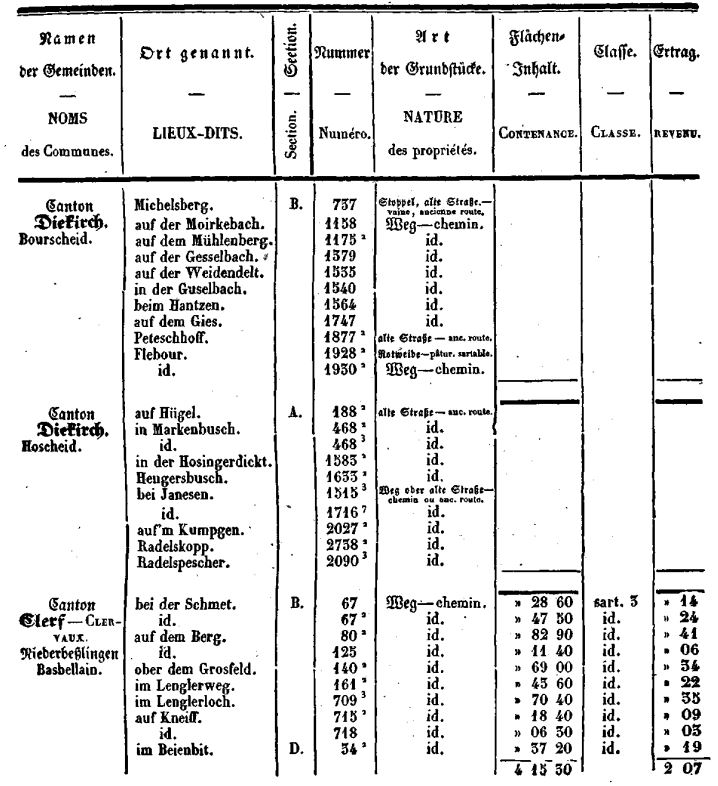
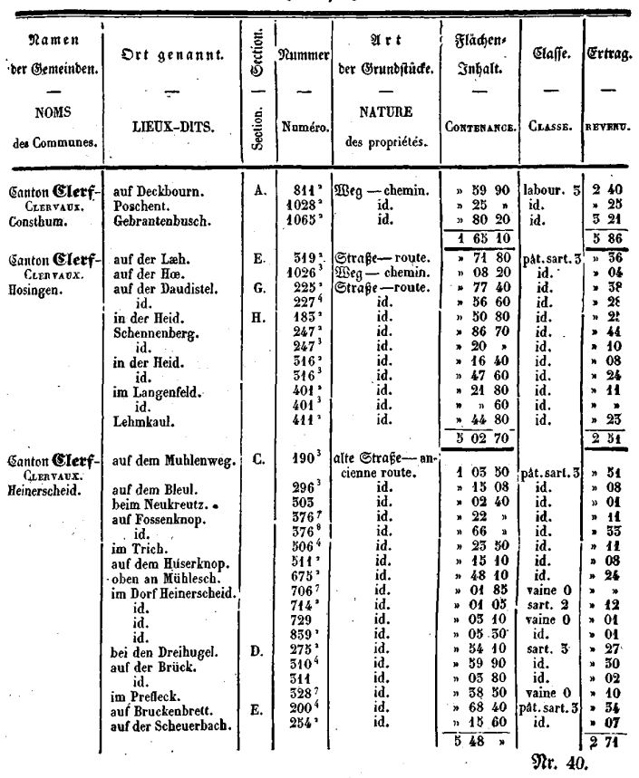
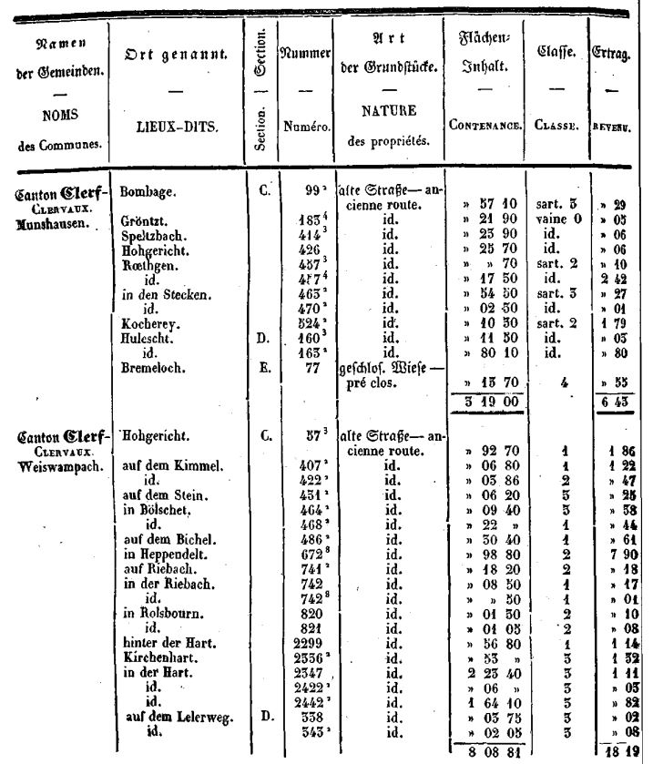

# Loi du 2 juillet 1846, N° 1367b , concernant l’aliénation de propriétés domaniales.

Nous GUILLAUME II, par la grâce de Dieu, ROI DES PAYS-BAS, PRINCE D’ORANGE-NASSAU, GRAND-DUC DE LUXEMBOURG; etc, etc., etc.

Vu le rapport du Conseil de Gouvernement de Notre Grand-Duché de Luxembourg, du 5 mai dernier, ainsi que le relevé y annexé de parcelles de terrains disponibles le long de certaines routes, et de quelques autres petits immeubles appartenant à l’Etat;

Attendu qu’il est dans l’intérêt général que ces propriétés soient rendues à l’agriculture et au libre commerce ;

Les États du Grand-Duché entendus ;

Avons ordonné et ordonnons ce qui suit :

## *Article unique.*

Le Conseil de Gouvernement de Notre Grand-Duché est autorisé à vendre au profit de la caisse de l’État, soit par adjudication publique, soit sur des soumissions présentées par des propriétaires riverains, aux clauses et conditions qu’il arrêtera, les propriétés domaniales désignées dans le relevé annexé à la présente loi.

Mandons et ordonnons que la présente loi soit insérée au Mémorial législatif et administratif du Grand-Duché de Luxembourg, pour être exécutée et observée par tous ceux que la chose concerne.

|  | La Haye, le 2 juillet 1846. (Signé) **GUILLAUME.** |
|---|---|
|  | Pour expédition conforme : *Le Chancelier d’État pour les affaires* *du Grand-Duché,* **DE BLOCHAUSEN.** |

RELEVÉ des propriétés domaniales à aliéner.

Enfin toutes les autres parcelles qui seraient encore découvertes comme appartenant à l’État et situées le long de la route d’Ettelbruck à la frontière du nord par Weiswampach.

Les terrains encore invendus laissés en dehors du tracé de la route de Feulen à Heiderscheid.

Une maison avec grange et écurie, située à Larochette, tenant par devant à la rue, par derrière à Michel Weber, d’un côté à Jean Christnach et de l’autre à Nicolas Charlé, d’une valeur approximative de 1200 francs.

Un jardin situé à Larochette, lieu dit Weyergarten, tenant d’un côté au chemin, de l’autre à Michel Weber, Jean Guinter et la veuve Medernach, d’un bout à la veuve Tschiederer, et de l’autre au notaire Mathieu, d’une valeur approximative de 300 francs.

Un jardin situé à Larochette, lieu dit Taufels, tenant d’un côté à la commune de Larochette, de l’autre au chemin, d’un bout à Michel Hansen, de l’autre à Jacques Leopold, valant approximativement 100 francs.

Un jardin situé à Larochette, lieu dit Feckeler, tenant d’un côté à Stenges, de l’autré à la veuve Tschiederer, et aboutissant sur des propriétés appartenant aujourd’hui à Sa Majesté le Roi Grand-Duc, d’une valeur approximative de 180 francs.

Deux parcelles de terrain , ne formant qu’un ensemble, provenant de l’ancienne chapelle de Schifflange, situées sur le ban dudit lieu , à l’endroit nommé Emmesch-Steltgen, entre Jean Schintgen et le chemin, donnant sur le chemin dit Weissenweg et le bois; ces deux parcelles peuvent être portées à une valeur de 75 florins environ.

Enfin une parcelle de terrain d’environ 15 ares, située sur la route de Luxembourg à Grevenmacher, tenant d’un côté à la route et des autres côtés aux terres du notaire Funck, de Luxembourg.

Appartient à la loi du 2 juillet 1846 — N° 1367b.

|  | *Le Chancelier d’Etat pour les affaires* *du Grand-Duché de Luxembourg,* DE BLOCHAUSEN. |
|---|---|
|  | ______________ |
|  | *Inséré au Mémorial législatif et administratif, le* *18 juillet 1846.* |
|  | *Le Secrétaire-général,* JURION. |
