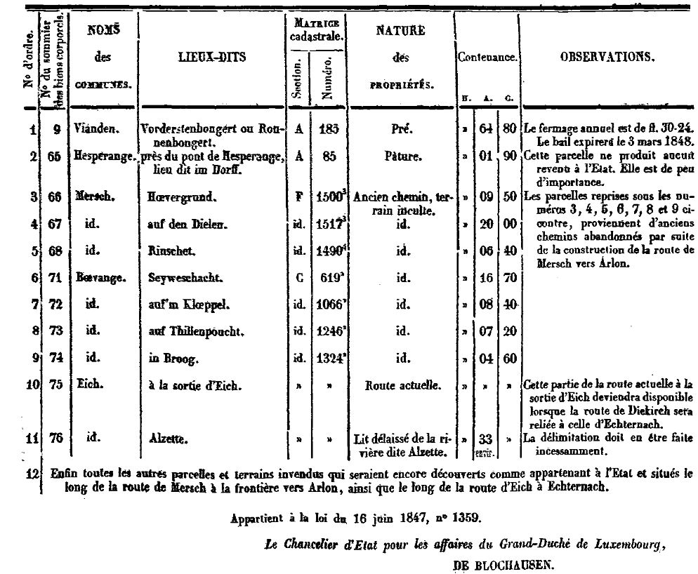

# Loi du 16 juin 1847, N° 1359, concernant l’aliénation de propriétés domaniales.

Nous GUILLAUME II, par la grâce de Dieu, Roi des Pays-Bas, Prince d’Orange-Nassau, Grand-Duc de Luxembourg, etc., etc., etc.,

Vu le relevé des parcelles de terrains disponibles le long de certaines routes, et d’autres petits immeubles appartenant à l’État ;

Attendu que dans l’intérêt général il convient de rendre ces propriétés à l’agriculture et au libre commerce ;

Les États du Grand-Duché entendus dans leur avis ;

Avons ordonné et ordonnons ce qui suit :

## Article unique.

Le Conseil de Gouvernement de Notre Grand-Duché est autorisé à vendre au profit de la caisse de l’État, soit par adjudication publique, soit par soumissions présentées par des propriétaires riverains, aux clauses et conditions qu’il arrêtera, les propriétés domaniales désignées dans le relevé annexé à la présente loi.

Mandons et ordonnons que la présente loi soit insérée au Mémorial législatif et administratif de Notre Grand-Duché de Luxembourg, pour être exécutée et observée par tous ceux que la chose concerne.

La Haye, le 16 juin 1847.   (*Signé* ) GUILLAUME.   Par le Roi Grand-Duc :   Le Chancelier d’Etat pour les affaires  du Grand-Duché de Luxembourg,   (Signé) DE BLOCHAUSEN.   Conforme à la minute,   Le Chancelier d’État,   DE BLOCHAUSEN.

\**RELEVÉ**

\*des propriétés domaniales à aliéner en 1847.*

