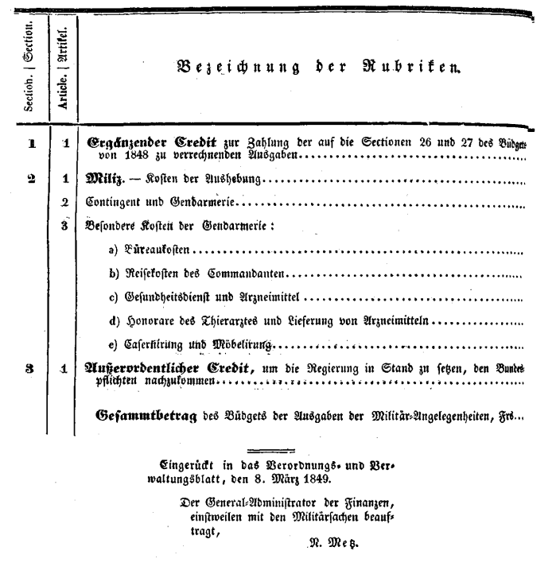
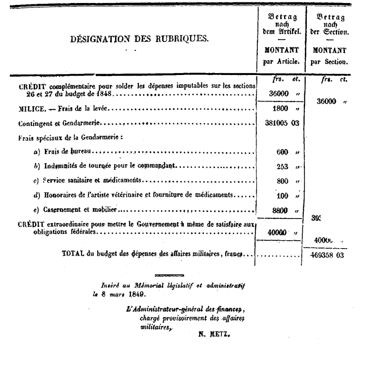
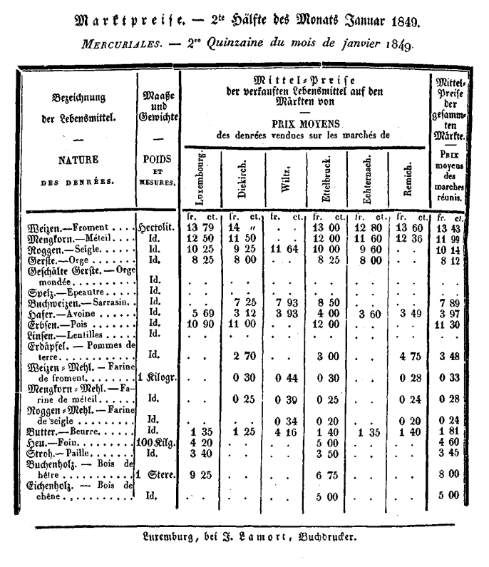

# Loi du 20 février 1849 concernant le budget des dépenses des affaires militaires pour 1849.

Nous GUILLAUME II, par la grâce de Dieu, Roi DES PAYS-BAS, PRINCE D'ORANGE-NASSAU, GRAND-DUC DE LUXEMBOURG, etc., etc., etc.,

De commun accord avec la Chambre des députés,

Avons ordonné et ordonnons :

Le budget des dépenses des affaires militaires pour l'année mil huit cent quarante-neuf, est fixé à la somme de quatre cent soixante-neuf mille trois cent cinquante-huit francs trois centimes, conformément au tableau ci-annexé.

Mandons et ordonnons que la présente loi soit insérée au Mémorial législatif et administratif de Notre Grand-Duché de Luxembourg, pour être exécutée et observée par tous ceux que la chose concerne.

La Haye, le 20 février 1849.

GUILLAUME.   Par le Roi Grand-Duc :   Le Secrétaire provisoire attaché au cabinet de S. M. le Roi Grand-Duc pour les affaires du Grand-Duché ,   J. PAQUET.   L'Administrateur-général des finances,  chargé prov. des affaires militaires,   N. METZ.

\**Budget der Ausgaben**

Der Militärangelegenheiten für 1849.

____________

\**BUDGET DES DÉPENSES**

DES AFFAIRES MILITAIRES POUR 1849.

