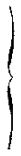
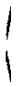
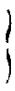

# Loi du 9 juin 1894, concernant l’approbation de la convention conclue le 5 novembre 1892 avec la Prusse au sujet de la réglementation de la pêche dans les eaux frontières.

Nous ADOLPHE, par la grâce de Dieu, Grand-Duc de Luxembourg, Duc de Nassau, etc., etc., etc. ;

Notre Conseil d’État entendu ;

De l’assentiment de la Chambre des députés ;

Vu la décision de la Chambre des députés du 27 avril 1894 et celle du Conseil d’État du 28 du même mois, portant qu’il n’y a pas lieu à second vote ;

Avons ordonne et ordonnons :

## Art. 1er.

Le Gouvernement est autorisé à ratifier la convention conclue avec la Prusse, à la date du 5 novembre 1892, pour l’accession du Grand-Duché au traité international du 30 juin 1885 sur la protection du saumon et de l’alose dans le bassin du Rhin, et pour la réglementation de la pêche dans les eaux mitoyennes entre le Luxembourg et la Prusse.

## Art. 2.

Notre Directeur général de l’intérieur est autorisé à arrêter, par un règlement d’administration publique, les mesures nécessaires pour l’exécution de la dite convention.

Il est pareillement autorisé à règler la pêche du saumon et de l’alose dans les eaux exclusivement luxembourgeoises, à modifier le régime de la pêche de la partie luxembourgeoise de l’Our, par dérogation à la [loi du 6 avril 1872](https://legilux.public.lu/eli/etat/leg/loi/1872/04/06/n1/jo), enfin à déterminer les pénalités pour les infractions, tant au traité qu’aux arrêtés d’exécution. Les peines ne dépasseront pas le taux déterminé par le § 21 de l’art. II du traité.

Mandons et ordonnons que la présente loi soit insérée au *Mémorial*, pour être exécutée et observée par tous ceux que la chose concerne.

Le Ministre d’Etat, Président  du Gouvernement,   EYSCHEN.   Le Directeur général  de l’intérieur,   H. KIRPACH.

Château de Walferdange, le 9 juin 1894.   ADOLPHE.

\*Vertrag zwischen Luxemburg und Preussen, vom 5. November 1892.*

Nachdem die Grossherzoglich Luxemburgische und die Königlich Preussische Staats-Regierung übereingekommen sind, zur Regelung der Fischerei-Verhältnisse in den Grenzgewässern — zugleich auch im Sinne des Artikels VI, Absatz 2 des Vertrages zwischen Deutschland, den Niederlanden und der Schweiz, betreffend die Regelung der Lachsfischerei im Stromgebiet des Rheins, vom 30. Juni 1885 — ein Abkommen abzuschliessen und zu diesem Behufe den Grossherzoglich Luxemburgischen Staatsrath und Präsidenten des Obergerichtshofes *Vannerus* zu Luxemburg und den Königlich Preussischen Regierungs-Präsidenten *von Heppe* zu Trier, zu ihren Bevollmächtigten ernannt haben, wurden unter Vorbehalt der Ratifikation die nachstehenden Bestimmungen vereinbart.

## Artikel I.

Das Grossherzogthum Luxemburg tritt dem Vertrage zwischen Deutschland, den Niederlanden und der Schweiz, betreffend die Regelung der Lachsfischerei im Stromgebiete des Rheins, vom 30. Juni 1885, mit der Massgabe bei, dass

1° der Vertrag auf die Sauer vom Wehr der Erpeldinger Mühle, auf die Alzette vom Wehr bei der Dagois-Mühle zu Ettelbrück, und auf die Wark von dem Linden’schen Wehr aufwärts, keine Anwendung findet ;

2° der Art. I des Vertrages durch folgende Bestimmung ersetzt wird :

> «Ständige Fischereivorrichtungen dürfen den Stromlauf nicht vollständig versperren. In der Mosel und Sauer muss neben diesen Vorrichtungen in dem Flussbett eine mindestens neun Meter freie Rinne, bei gewöhnlichem niederen Wasserstande in der kürzesten geraden Linie gemessen, für die Schifffahrt und den Zug der Wanderfische verbleiben » ;

3° die in Art. IV des Vertrages vorgesehene wöchentliche Schonzeit auf Freitag Abend sechs Uhr bis Samstag Abend sechs Uhr verlegt wird.

## Artikel II.

Hinsichtlich der unter gemeinschaftlicher Staatshoheit stehenden Gewässer wird zwischen dem Königreich Preussen und dem Grossherzogthum Luxemburg nachstehende Uebereinkunft geschlossen :

§ 1. — 1. Die Fischerei auf Fischlaich ist verboten.

2\. Fische der nachbenannten Arten dürfen nicht gefangen werden, wenn sie von der Kopfspitze bis zum Ende der Schwanzflosse gemessen, nicht mindestens folgende Länge haben :

<table>
<tr>
<td>Lachs (Salm, Salmo salar L.)</td>
<td></td>
<td>35</td>
<td>Cm.</td>
</tr>
<tr>
<td>Barbe (Bigge, Barbus fluviatilis Ag.)</td>
<td rowspan="7"></td>
<td rowspan="7">28</td>
<td rowspan="7">»</td>
</tr>
<tr>
<td>Blei (Brachsen, Brasse, Abramis brama L.)</td>
</tr>
<tr>
<td>Lachsforelle (Meerforelle, Silberlachs, Strandlachs, Trump, Salmo trutta L.)</td>
</tr>
<tr>
<td>Maifisch ( AIse, Clupea alosa L.)</td>
</tr>
<tr>
<td>Finte (Clupea finta Cos.)</td>
</tr>
<tr>
<td>Karpfen (Cyprinus carpio L.)</td>
</tr>
<tr>
<td>Hecht (esox lucius L )</td>
</tr>
<tr>
<td>Schlei (Schleihe, Liebe, Tinca vulgaris Cuv.)</td>
<td rowspan="6"></td>
<td rowspan="6">20</td>
<td rowspan="6">»</td>
</tr>
<tr>
<td>Dobel (Aitel, Dickkopf, Minne, Mohne, Leuciscus cephalus L.)</td>
</tr>
<tr>
<td>Lauben (Squalius leuciscus)</td>
</tr>
<tr>
<td>Forelle (Salmo fario L.)</td>
</tr>
<tr>
<td>Nase Mackrele, Redfisch, Mundfisch, Chondrostoma nasus L.)</td>
</tr>
<tr>
<td>Aesche (Thymallus vulgaris Nilsson)</td>
</tr>
<tr>
<td>Karausche (Carassius vulgaris Nordmann)</td>
<td rowspan="4"></td>
<td rowspan="4">15</td>
<td rowspan="4">»</td>
</tr>
<tr>
<td>Rothfeder (Leuciscus erythophtalmus L.)</td>
</tr>
<tr>
<td>Barsch (Perca fluviatilis L.)</td>
</tr>
<tr>
<td>Plotze (Rothauge, Leuciscus rutilus L.</td>
</tr>
<tr>
<td>Flusskrebs (Astacus fluviatilis).</td>
<td></td>
<td>10</td>
<td>»</td>
</tr>
<tr>
<td>Steinkrebs (Astacus fluviatilis Rondeler und astacus fluviatilis Var. nobilis Schrank.</td>
<td></td>
<td>6</td>
<td>»</td>
</tr>
</table>

Beide letzteren von der Kopfspitze bis zum Schwanzende gemessen.

Im Einverständnisse beider Regierungen kann das Mindestmass für Lachsforellen erhöht und auch für vorher nicht genannte Fischarten ein Mindestmass vorgeschrieben werden.

3\. Fischlaich, ingleichen Fische und Krebse der unter Ziffer 2 bezeichneten Arten, welche das daselbst vermerkte Mass nicht erreichen, sind sofort mit der zu ihrer Erhaltung erforderlichen Vorsicht wieder in das Wasser zu setzen.

4\. Auf die in den Fischzuchtanstalten vorhandene junge Fischbrut finden die Vorschriften dieses Paragraphen keine Anwendung. Auch kann von jeder Regierung im Interesse der Fischzucht, wissenschaftlicher Untersuchungen oder gemeinnütziger Versuche einzelnen Fischereiberechtigten das Fangen von Fischen und Krebsen unter dem in Ziffer 2 bestimmten Masse zeitweilig und widerruflich gestattet werden.

§ 2. — Den Fischereiberechtigten ist gestattet, Fischottern, Taucher, Eisvögel, Reiher, Kormorane und Fischaare ohne Anwendung von Schusswaffen zu tödten oder zu fangen und für sich zu behalten.

§ 3. — Für den Betrieb der Fischerei in der Mosel, Sauer und Our, soweit dieselben unter gemeinschaftlicher Staatshoheit stehen, treten folgende Bestimmungen ein :

1\. Für die Mosel, Sauer und Our unterhalb Gemünd findet vom 25. März bis zum 25. Juni einschliesslich eine Schonzeit statt (Frühjahrsschonzeit).

2\. Für die Our in ihrem oberen Laufe von Gemünd aufwärts findet eine Schonzeit vom 15. Oktober bis zum 1. April statt (Winterschonzeit).

Diejenige Stelle der Our, von welcher an aufwärts die Winterschonzeit beginnt, soll durch örtliche, auf gemeinschaftliche Kosten beider Regierungen festzustellende Merkmale kenntlich gemacht werden.

Die beiden Regierungen behalten sich vor, im Wege der Verständigung und, soweit nothwendig, durch Erlass von Polizeiverordnungen, den Fischereibetrieb für längere Zeit für einzelne Gewässer oder Gewässerstrecken gänzlich zu untersagen oder über das vorstehende Mass einzuschränken, sowie den Fang einzelner Fischarten oder den Gebrauch bestimmter Fangmittel zu verbieten.

§ 4. — Der Betrieb des Lachsfanges ist verboten :

1\. von Freitag Abend sechs Uhr bis Samstag Abend sechs Uhr (wöchentliche Schonzeit) ;

2\. vom 20. November bis zum 31. Dezember einschliesslich.

Jede Regierung ist jedoch ermächtigt, einzelnen zur Fischerei berechtigten Angehörigen ihres Staatsgebietes den Fang von Lachsen und Forellen zu gestatten, wenn die Benutzung der Fortpflanzungselemente (Rogen und Milch) der gefangenen laichreifen oder der Laichreife nahestehenden Fische zum Zwecke der künstlichen Fischzucht gesichert ist.

Vom 1. Oktober bis zum 19. November einschliesslich ist die Lachsfischerei in dem oberen Laufe der Our, von Gemünd aufwärts, gestattet, jedoch muss die wöchentliche Schonzeit eingehalten werden.

§ 5. — Jede der beiden Regierungen ist ermächtigt, ausnahmsweise den Fang der Maifische während der jährlichen Schonzeiten zu gestatten. Jedoch soll der Fang dieser Fische von Freitag Abend sechs Uhr bis Samstag Abend sechs Uhr verboten bleiben.

Im Interesse wissenschaftlicher Untersuchungen oder gemeinnütziger Versuche oder für Zwecke der künstlichen Fischzucht oder endlich zum Schutz der anderen Fische gegen Raubfische kann, soweit erforderlich unter geeigneten Kontrollmassregeln, jede Regierung den Fang einzelner oben nicht genannter Fischarten ausnahmsweise gestatten.

Bei jeder Gestattung des Fischfanges während der Schonzeiten ist indessen die Verwendung solcher an sich erlaubter Fangmittel auszuschliessen, welche vorzugsweise geeignet sind, die junge Fischbrut zu zerstören.

§ 6. — Während der Dauer der jährlichen Schonzeiten sowie während der Dauer des Verbotes des Lachsfanges müssen die ständigen Fischereivorrichtungen hinweggeräumt oder abgestellt sein.

Soweit die Rücksicht auf Erhaltung des Fischbestandes es zulässt, kann jedoch jede Regierung Ausnahmen von dieser Bestimmung, insbesondere auch dann zulassen, wenn die Genehmigung zum Betriebe der Lachsfischerei unter der Voraussetzung der Benutzung der Fortpflanzungselemente zur künstlichen Fischzucht ausnahmsweise erteilt worden ist.

§ 7. — Die Bestimmungen der §§ 3 und 4 finden auf den Krebsfang keine Anwendung.

In der Zeit vom 25. Oktober bis zum 25. Juni einschliesslich ist der Fang von Krebsen verboten.

Gelangen Krebse während der angeordneten Schonzeit in die Gewalt des Fischers, so sind dieselben mit der zu ihrer Erhaltung erforderlichen Vorsicht sofort wieder in’s Wasser zu setzen.

§ 8. — Beim Fischfange ist verboten :

1\. Die Anwendung schädlicher oder explodirender Stoffe (giftiger Köder oder Mittel zur Betäubung oder Vernichtung der Fische, Sprengpatronen oder anderer Sprengmittel u. s. w.).

2\. Die Anwendung von Mitteln zur Verwundung der Fische, als Fallen mit Schlagfedern, Gabeln, Aalharken, Speere, Stecheisen, Stangen, Schiesswaffen, u. s. w.

Der Gebrauch von Angeln ist gestattet.

3\. Das Zusammentreiben der Fische bei Nacht vermittelst Leuchten oder Fackeln.

4\. Der Lachsfang bleibt bei Nacht mit Fackeln jedoch ohne Anwendung von Speeren und Stecheisen noch für die Jahre 1892, 1893 und 1894 gestattet.

Alle bisher erlassenen auf Fanggeräthe und Fangweisen bezüglichen Bestimmungen, insbesondere diejenigen der Ordonnanz von 1669, treten für die bezüglichen Gewässer und für die Dauer des Vertrages ausser Kraft.

§ 9. — Die der Uebereinkunft unterworfenen Gewässer dürfen zum Zwecke des Fischfanges weder abgedämmt noch abgelassen oder ausgeschöpft werden.

§ 10. — Fischwehre, Fischzäune und damit verbundene sogenannte Selbstfänge für Lachs und Aal dürfen ausser dem Falle einer bestehenden Berechtigung nicht neu angelegt werden.

§11. — Soweit nicht die in den beiderseitigen Staatsgebieten bestehende Gesetzgebung die zur Zeit schon vorhandenen Ableitungen schützt, ist es verboten, in die Gewässer aus landwirthschaftlichen oder gewerblichen Betrieben Stoffe von solcher Beschaffenheit und in solcher Menge einzuwerfen, einzuleiten oder einfliessen zu lassen, dass dadurch dem Fischbestande Nachtheile erwachsen oder fremde Fischereirechte geschädigt werden können.

Bei überwiegendem Interesse der Landwirthschaft oder der Industrie kann im Einverständnisse beider Regierungen das Einwerfen oder Einleiten solcher Stoffe in die Gewässer gestattet werden, wobei dem Inhaber der Anlage die Austührung von Einrichtungen aufzugeben ist, welche geeignet sind, den Schaden für die Fischerei möglichst zu beschränken.

§ 12. — Das Röten von Flachs und Hanf in den dieser Uebereinkunft unterworfenen Gewässern ist verboten.

Ausnahmen von diesem Verbote können im Einverständnisse beider Regierungen, jedoch immer nur widerruflich, für solche Gemeindebezirke oder Gebietstheile zugelassen werden, wo die Oertlichkeit für die Anlage zweckdienlicher Rötegruben nicht geeignet ist und die Benutzung des Gewässers zur Flachs- und Hanfbereitung zur Zeit nicht entbehrt werden kann.

§ 13. — Nach Ablauf von zwei Jahren seit dem Inkrafttreten dieses Vertrages dürfen beim Fischfange, vorbehaltlich der nachfolgenden Ausnahmen, keine Fanggeräthe (Netze, Geflechte pp.) jeder Art und Benennung angewendet werden, deren Oeffnungen (Maschen) im nassen Zustande an jeder Seite (von der Mitte des einen Knotens bis zur Mitte des andern Knotens gemessen) nicht mindestens eine Weite von 3 Centimeter haben.

Diese Vorschrift erstreckt sich auf alle Theile und Abtheilungen der Fanggeräthe, insbesondere auch auf die an den ständigen Fischereivorrichtungen (den Thalfängen, der Fischwehre pp.) angebrachten Stäbe pp.

Die Weite der Maschen darf jedoch für das Senkgarn von 1 M. 25 ins Geviert und für das Sackgarn von 0 M. 25 Durchmesser am weiteren Ende bis auf 12 Millimeter ermässigt werden.

Ferner dürfen für den ausschliesslichen Fang des Aales die Stäbe an den Thalfängen in der Zeit vom 15. Juli bis zum 31. August auf 2 Centimeter gestellt werden.

Bei Fanggeräthen (aus Korbweiden), welche ausschliesslich zum Fange von Aal und Neunauge bestimmt und geeignet sind, wird von einer Kontrole der Weite der Oeffnungen zwischen den Stäben abgesehen.

Jede Regierung ist im Einverständniss der andern Regierung ermächtigt, Ausnahmen von der vorgeschriebenen Maschenweite im Falle des Bedürfnisses für bestimmte Fanggeräthe und den Fang bestimmter Fischarten zuzulassen.

Wenn dringende Rücksichten auf die Erhaltung des Fischbestandes oder einer werthvollen Fischart dies erfordern, kann im Wege zu vereinbarender gleichlautender Polizeiverordnungen für alle oder einzelne Gewässer oder Gewässerstrecken die Anwendung bestimmter schädlicher Fanggeräthe ganz ausgeschlossen oder in einer über die obigen Vorschriften hinausgehenden Art und Weise eingeschränkt werden.

§ 14. — Beim Fischfange dürfen fliessende Gewässer weder mittelst ständiger Vorrichtungen noch mittelst am Ufer oder im Flussbette befestigter oder verankerter Fischereivorrichtungen (Reusen, Sperrnetze) auf mehr als auf die halbe Breite bei gewöhnlichem niedrigen Wasserstande in der kürzesten geraden Linie von Ufer zu Ufer gemessen, versperrt werden.

Mehrere derartige Fischereivorrichtungen dürfen gleichzeitig auf derselben oder auf der entgegengesetzten Uferseite nur in einer Entfernung von einander ausgeworfen oder angebracht sein, welche mindestens das Dreifache der Längenausdehnung des grossten Netzes beträgt.

Auf die Fischwehre in der Sauer findet die Bestimmung in Absatz 1 keine Anwendung.

§ 15. — Der Betrieb der Fischerei darf die Schifffahrt nicht hindern oder stören.

Feste oder schwimmende Fischereivorrichtungen und alle sonstigen Fanggeräthe müssen so aufgestellt oder ausgelegt sein, dass die freie Fahrt der Schiffe und Fähren, sowie der Wasserabfluss in nachtheiliger Weise nicht behindert wird. Insbesondere muss auch bei den Fischwehren in der Sauer eine freie Rinne von mindestens 9 M. Breite, bei gewöhnlichem niederen Wasserstande gemessen, für die Schifffahrt frei bleiben.

§ 16. — Wer die Fischerei in den dem Vertrage unterworfenen Gewässern ausüben will, muss einen von der zuständigen Behörde ausgestellten Ausweis bei sich führen, welchen er auf Erfordern den kontrollirenden Beamten beider Staaten vorzuzeigen hat.

§ 17. — Das bei dem Fischen in Gegenwart des Fischereiberechtigten, des Fischereipachters oder des Inhabers eines Erlaubnissscheines beschäftigte Hülfspersonal bedarf keines Ausweises.

§ 18. — Jeder hat die Befugniss in der Mosel und in dem gemeinschaftlichen Theile der Sauer die Fischerei mit der Handangel zu betreiben. Ein Ausweis ist nicht erfordert.

§ 19. — Die ohne Beisein des Fischers zum Fischfange ausliegenden Fischerzeuge müssen mit einem Kennzeichen versehen sein, durch welches die Person des Fischers ermittelt werden kann. Ueber die Art der Kennzeichnung sind die nähern Vorschriften im Wege einer gleichlautenden Polizei-Verordnung zu erlassen.

§ 20. — Alle mit Fischfang beschäftigten Personen sind durch zwischen den beiderseitigen Regierungen zu vereinbarende gleichlautende Polizei-Verordnungen zu verpflichten, auf erste Aufforderung der mit Handhabung der Fischerei-Polizei beauftragten Beamten beider Staaten, welche als solche durch Uniform oder Abzeichen kenntlich gemacht sein müssen, mit ihren Kähnen anzulegen und dieselben untersuchen zu lassen, bezw. wenn sie sich am Ufer befinden, stehen zu bleiben und nicht eher von der Stelle zu weichen, als bis sie dazu ausdrücklich ermächtigt sind.

§ 21. — Die vertragschliessenden Regierungen verpflichten sich, die erforderlichen Massnahmen zur Ausführung dieses Vertrages und namentlich auch dazu zu treffen, dass Zuwiderhandlungen gegen die Bestimmungen des Vertrages, sowie der bezüglichen Polizerverordnungen unter Strafe gestellt werden.

Die Bussen dürfen die Summe von 125 Franken bezw. 100 Mark nicht überschreiten ; dieselben sollen in beiden Staaten möglichst in Einklang gebracht werden.

Für den Fall der Zahlungsunfähigkeit ist auf Haft zu erkennen.

§ 22. — Jedes Verurtheilungserkenntniss wird die Confiskation der Fischereigeräthe und Werkzeuge aussprechen. Es kann ausserdem die Vernichtung der unstatthaften Geräthe verordnen.

§ 23. — Die Strafverfolgung der Zuwiderhandlungen wider die Bestimmungen des gegenwärtigen Vertrages oder der bezüglichen Polizerverordnungen verjährt in drei Monaten vom Tage der Zuwiderhandlung an gerechnet.

§ 24. — Beide Regierungen verpflichten sich, das zur Handhabung der Vorschriften dieser Uebereinkunft, sowie der auf Grund derselben erlassenen Anordnungen erforderliche Aufsichtspersonal zu stellen.

§ 25. — Alle auf den Gegenstand dieses Vertrages bezüglichen, auf Gesetz oder Verordnung beruhenden Vorschriften treten für den Bereich der betreffenden Gewässer und für die Dauer des Vertrages, soweit sie den vereinbarten Vorschriften entgegenstehen, in dem Zeitpunkte ausser Kraft, in welchem die auf Grund dieses Vertrages zu erlassenden Strafvorschriften in beiden betheiligten Staaten in Geltung getreten sein werden.

§ 26. — Von jeder auf Grund der vorstehenden Bestimmungen von einer der beiden Regierungen ausnahmsweise ertheilten Ermächtigung oder Genehmigung ist die Regierung des andern Staates zu benachrichtigen.

§ 27. — Diese Uebereinkunft tritt sofort nach ihrer Ratifikation in Kraft, bleibt von diesem Tage an zehn Jahre lang in Wirksamkeit und, wenn sie nicht zwölf Monate vor diesem Zeitpunkte von einer der beiden vertragschliessenden Regierungen gekündigt worden ist, weiter von Jahr zu Jahr bis zum Ablauf eines Jahres von dem Tage an gerechnet, an welchem eine der beiden vertragschliessenden Regierungen die Kündigung erklärt hat.

Sollten sich die beiderseitigen Regierungen nicht über anderweitige Satzungen verständigen, so treten nach Ablauf des Vertrages die jetzt geltenden Bestimmungen wieder in Kraft.

Zur Beurkundung haben die beiderseitigen Bevollmächtigten die vorstehende Uebereinkunft, wie folgt, unterzeichnet.

<table>
<tr>
<td>Luxemburg,</td>
<td rowspan="2">den 3. November 1892.</td>
<td></td>
</tr>
<tr>
<td>Trier,</td>
<td></td>
</tr>
<tr>
<td colspan="2">(Gez.) VANNERUS,</td>
<td>(Gez.) VON HEPPE.</td>
</tr>
<tr>
<td colspan="2"><i>Grossh. Luxemburgischer Staatsrath,</i></td>
<td><i>Königl. Preussischer Regierungs-Präsident.</i></td>
</tr>
<tr>
<td colspan="2"><i>Präsident des Obergerichtshofes</i>.</td>
<td></td>
</tr>
<tr>
<td colspan="3">(Diese Uebereinkunft ist ratifizirt worden und der Austausch der Ratifikations-Urkunden hat am 20. Oktobe 1894 zu Luxemburg stattgefunden.)</td>
</tr>
</table>

\*Vertrag zwischen Deutschland, den Niederlanden und der Schweiz, vom 30. Juni 1885.*

## *Artikel l.*

— Im Rheinstrom vom Fall bei Schaffhausen an abwärts und allen Ausflüssen desselben, durch welche Wasser von dem bei Lobith ungetheilten Rhein in das Meer abfliessen kann, soll beim Fischfange weder mittels ständiger Vorrichtungen (Fischwehr, Fach, Zalmsteek), noch mittelst am Ufer oder im Flussbette befestigter oder verankerter Fischereivorrichtungen (Reusen, Sperrnetze) der Stromlauf auf mehr als auf die Hälfte seiner Breite bei gewöhnlichem niedrigen Wasserstande in der kürzesten geraden Linie von Ufer zu Ufer gemessen, für den Zug der Wanderfische versperrt werden dürfen.

Diese Vorschrift soll auch auf die Nebenflüsse des Rheins Anwendung finden ; jedoch auf diejenigen Strecken der Nebenflüsse, welche Grenzgewässer mit einem an der Uebereinkunft nicht betheiligten Staate bilden, nur soweit, als in dem Nachbarlande ein gleiches Vorgehen beobachtet wird.

Die an einzelnen Nebenflüssen bestehenden ständigen Fischereivorrichtungen sollen dieser Vorschrift nicht unterliegen, wenn mit denselben eine auf dieses besondere Fangmittel gerichtete Fischereiberechtigung verbunden ist.

## *Artikel II.*

— In dem Artikel I (Abs. I) bezeichneten Strecken des Rheinstroms und in den daselbst (Abs. 2) bezeichneten Nebenflüssen des Rheins, soweit sie den Durchzug der Lachse und Maifische zu den Laichplätzen vermitteln, dürfen Treibnetze beim Fischfange nur angewendet werden, wenn sie zwischen Ober- und Unter-Simm (Ober- und Unter-Leine) nicht über 2,5 m breit sind. Einwändige Netze, welche nur zum Fange von Stör bestimmt und geeignet sind, sollen dieser Beschränkung nicht unterworfen sein.

Mehrere Treibnetze dürfen nur in einer Entfernung von einander ausgeworfen werden, welche mindestens das Doppelte der Länge des grössten Netzes beträgt.

## *Artikel III.*

— Im Rheinstrom vom Fall bei Schaffhausen an abwärts, in allen Ausflüssen desselben, durch welche Wasser von dem bei Lobith ungetheilten Rhein in das Meer abfliessen kann, und in allen Nebenflüssen desselben soll jede Lachsfischerei mit Zegensbetrieb alljährlich auf die Dauer von zwei Monaten verboten sein.

Die Einstellung dieser Fischereibetriebe soll umfassen :

1\. auf Königlich niederländischem Gebiete die Zeit vom 16. August bis zum 15. Oktober einschliesslich ;

2\. auf der Strecke von der niederländisch-preussischen Grenze an aufwärts die Zeit vom 27. August bis zum 26. Oktober einschliesslich.

Die Regierungen der betheiligten Uferstaaten werden für ihr Gebiet feststellen, welche Fischereibetriebe dieser Vorschrift zu unterwerfen sind, und dabei Vorsorge treffen, dass nicht unter dem Vorwande der Fischerei auf andere Fischarten thatsächlich Lachsfischerei betrieben wird.

Ueber die getroffenen Anordnungen werden sich die Regierungen gegenseitig Mittheilung machen.

## *Artikel IV.*

— Von Basel an abwärts soll im Rheinstrom und in denjenigen Strecken seiner Nebenflüsse, welche den Durchzug der Lachse und Maifische zu den Laichstellen vermitteln, sowie in seinen im Artikel I bezeichneten Ausflüssen die Fischerei auf Lachse und Maifische mit Geräthen jeder Art auf die Dauer von 24 Stunden in jeder Woche von Samstag Abend 6 Uhr bis Sonntag Abend 6 Uhr eingestellt werden.

Der Königlich niederländischen Regierung bleibt vorbehalten, für die Lachsfischerei mit Reusen (Steekfischerei) im Fluthgebiete den Beginn dieser wöchentlichen Schonzeit auf die erste tiefste Ebbe (laag water) nach Samstag Abend 6 Uhr und die Dauer der Schonzeit auf 2 Tiden festzusetzen.

## *Artikel V.*

— In denjenigen Strecken der Nebenflüsse des Rheins, in welchen sich geeignete Laichstellen für den Lachs finden, und im oberen Stromlaufe des Rheins selbst von Mannheim-Ludwigshafen an aufwärts bis zum Fall von Schaffhausen soll die Lachsfischerei während der Dauer von mindestens 6 Wochen innerhalb der Zeit vom 15. Oktober bis 31. Dezember nur mit ausdrücklicher obrigkeitlicher Genehmigung betrieben und diese nur ertheilt werden dürfen, wenn die Benutzung der Fortpflanzungselemente (Rogen und Milch) der gefangenen laichreifen oder der Laichreife nahestehenden Lachse zum Zweck der künstlichen Fischzucht gesichert ist. Unter dieser Voraussetzung darf die Lachsfischerei auch während der wöchentlichen Schonzeit (Artikel IV) obrigkeitlich gestattet werden.

## *Artikel VI.*

— Die Vorschriften der Artikel I bis V dieser Uebereinkunft finden auf die Mosel von ihrem Austritt aus Elsass-Lothringen bis Trier und auf alle diejenigen linksseitigen Nebenflüsse der Mosel welche in ihrem Laufe preussisches und luxemburgisches Gebiet berühren, keine Anwendung.

Der Königlich preussischen Regierung bleibt vorbehalten, die Fischereiverhältnisse dieser Gewässer durch Verständigung mit der Grossherzoglich luxemburgischen Regierung im Sinne dieser Uebereinkunft zu regeln.

## *Artikel VII.*

— Zur Hebung des Lachsbestandes im Rheingebiete soll darauf Bedacht gedacht genommen werden, dass

1\. die natürlichen Laichplätze in den Nebenflüssen den aufsteigenden Lachsen wieder möglichst erschlossen und zugänglich gemacht werden ;

2\. Die Fortpflanzungselemente (Rogen und Milch) der gefangenen Lachse möglichst zu Zwecken der künstlichen Zucht verwendet werden.

## *Artikel VIII.*

— Die Regierungen der betheiligten Uferstaaten werden für ihr Gebiet ein Mindestmaas feststellen, unter welchem Lachse weder gefangen, noch in den Verkehr gebracht werden dürfen.

## *Artikel IX.*

— Die Regierungen der betheiligten Uferstaaten werden die zum Vollzuge dieser Uebereinkunft erforderlichen Vorschriften erlassen und deren Uebertretung mit angemessenen Strafen bedrohen, auch das sur Handhabung dieser Vorschriften erforderliche Aufsichtspersonal bestellen.

Durch gegenwärtige Uebereinkunft wird die Befugniss der einzelnen Staaten nicht ausgeschlossen, für ihre Gebiete strengere Bestimmungen zum Schutz der Fische zu treffen.

## *Artikel X.*

— Jede Regierung der betheiligten Uferstaaten wird für ihr Gebiet einen Bevollmächtigten stellen.

Diese Bevollmächtigten werden sich die von ihren Regierungen getroffenen Anordnungen über das Fischereiwesen im Rheingebiete gegenseitig mittheilen und von Zeit zu Zeit zusammenkommen, um über die zur Förderung der Lachsfischerei im Rheingebiete zu ergreifenden Massregeln zu berathen.

## *Artikel XI.*

— Diese Uebereinkunft tritt sofort nach ihrer Ratification in Kraft, bleibt von diesem Tage an zehn Jahre lang in Wirksamkeit und, wenn sie nicht zwölf Monate vor diesem Zeitpunkte von einer der vertragschliessenden Regierungen gekündigt worden ist, weiter von Jahr zu Jahr bis zum Ablauf eines Jahres von dem Tage an gerechnet, an welchem die eine oder andere der vertragschliessenden Regierungen die Kündigung erklärt hat.

## *Artikel XII.*

— Die gegenwärtige Uebereinkunft soll ratifizirt und die Auswechselung der Ratificationen soll binnen möglichst kurzer Frist in Berlin bewirkt werden.

Zu Urkund dessen haben die Bevollmächtigten die Uebereinkunft unterzeichnet und ihr Siegel beigedrückt.

So geschehen zu Berlin, am 30. Juni 1885.

\*(Folgen die Unterschriften.)*
