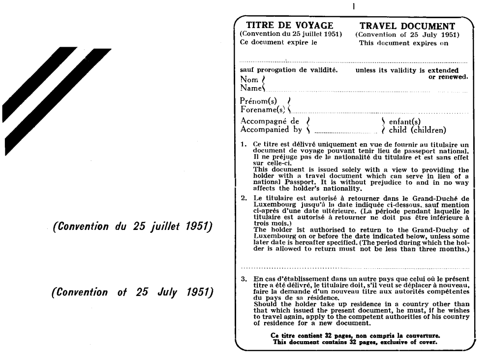
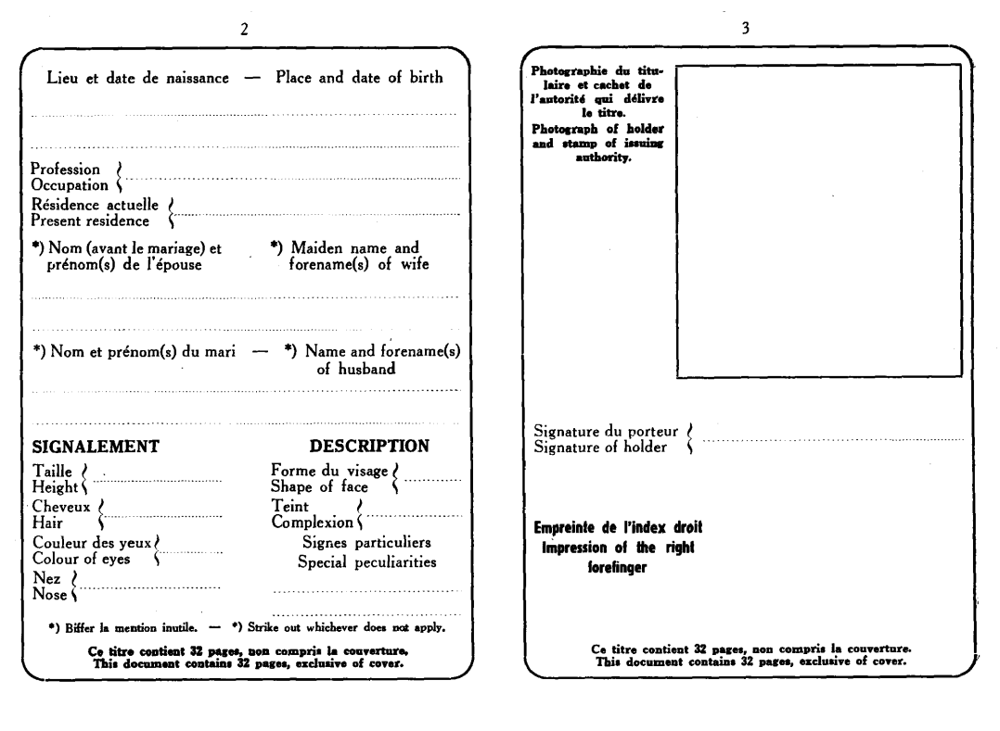
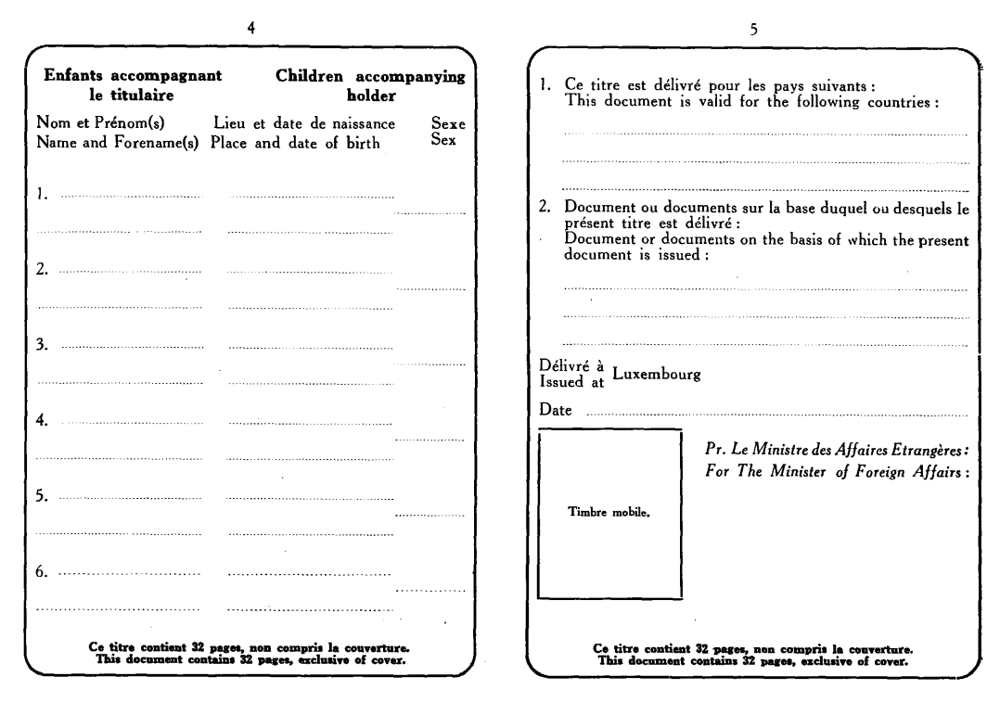
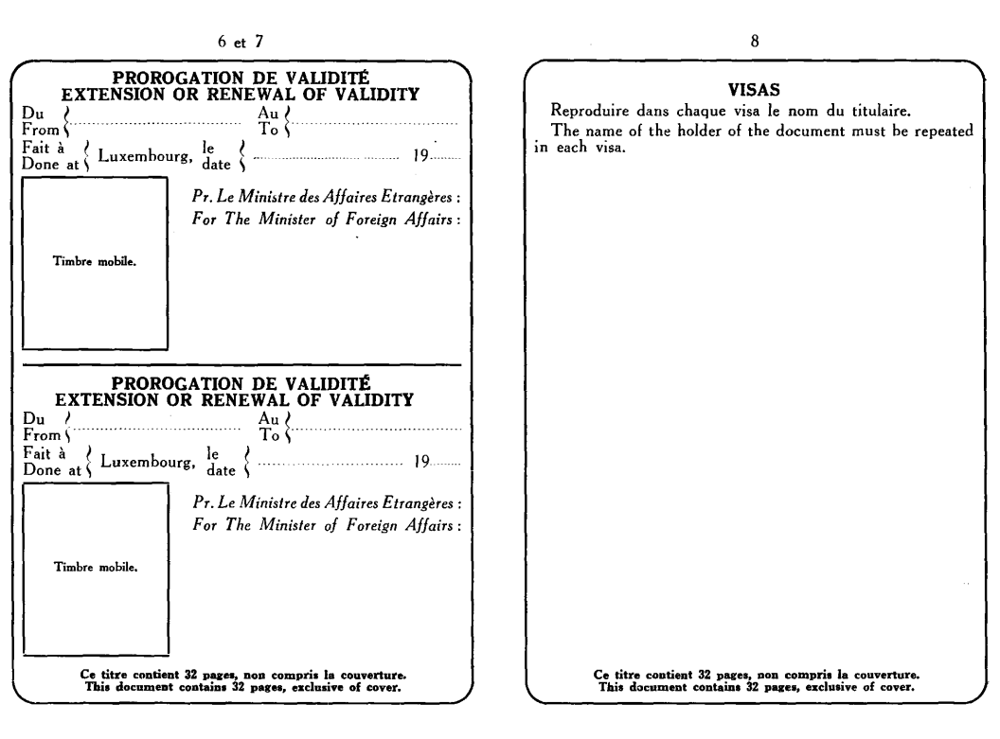

# Loi du 20 mai 1953 portant approbation de la Convention relative au statut des réfugiés, signée à Genève le 28 juillet 1951.

Nous CHARLOTTE, par la grâce de Dieu, Grande-Duchesse de Luxembourg, Duchesse de Nassau, etc., etc., etc. ;

Notre Conseil d´Etat entendu ;

De l´assentiment de la Chambre des Députés ;

Vu la décision de la Chambre des Députés du 28 avril 1953 et celle du Conseil d´Etat du 8 mai 1953 portant qu´il n´y a pas lieu à second vote ;

Avons ordonné et ordonnons

## Art. 1er.

Sont approuvés l´Acte final de la Conférence de plénipotentiaires des Nations Unies sur le statut des réfugiés et apatrides et la Convention relative au statut des réfugiés, signée à Genève le 28 juillet 1951, compte tenu de la réserve déclarée à la signature par le plénipotentiaire du Grand-Duché de Luxembourg.

## Art. 2.

Toutes mesures propres à donner effet aux recommandations contenues dans l´Acte final, notamment en ce qui concerne l´extension du bénéfice de la Convention, ou d´une partie de la Convention, à de nouvelles catégories de réfugiés, pourront être prises par règlement d´administration générale.

Mandons et ordonnons que la présente loi soit insérée au Mémorial pour être exécutée et observée par tous ceux que la chose concerne.

Palais de Luxembourg, le 20 mai 1953.

\**Charlotte..**

\*Le Ministre des Affaires Etrangères,*

\**Joseph Bech.**

\**ACTE FINAL ET CONVENTION RELATIVE AU STATUT DES RÉFUGIÉS.**

\**ACTE FINAL DE LA CONFÉRENCE DE PLÉNIPOTENTIAIRES DES NATIONS UNIES SUR LE STATUT DES RÉFUGIÉS ET DES APATRIDES.**

## I.

Par sa résolution 429 (V) du 14 décembre 1950, l´Assemblée générale des Nations Unies a décidé de réunir à Genève une Conférence de plénipotentiaires pour achever de rédiger et pour signer une Convention relative au statut des réfugiés et aussi un Protocole relatif au statut des apatrides.

La Conférence s´est réunie à l´Office européen des Nations Unies à Genève où elle a siégé du 2 au 25 juillet 1951.

Les Gouvernements des vingt-six Etats suivants avaient envoyé des représentants qui ont tous présenté des lettres de créance ou autres pouvoirs reconnus valables les habilitant à participer aux travaux de la Conférence :

| Australie Autriche Belgique Brésil Canada Colombie Danemark Egypte Etats-Unis d´Amérique France Grèce Irak Israel | Italie Luxembourg Monaco Norvège Pays-Bas République fédérale d´Allemagne Royaume-Uni de Grande-Bretagne et d´Irlande du Nord Saint-Siège Suède Suisse (la délégation suisse représentait aussi le Liechtenstein) Turquie Venezuela Yougoslavie |
|---|---|

Les Gouvernements des deux Etats suivants étaient représentés par des observateurs :

Cuba

Iran

Conformément à la demande de l´Assemblée générale, le Haut Commissaire des Nations Unies pour les Réfugiés a participé, sans droit de vote, aux travaux de la Conférence.

L´Organisation internationale du Travail et l´Organisation internationale pour les réfugiés étaient représentées à la Conférence, sans droit de vote.

La Conférence a invité le Conseil de l´Europe à se faire représenter, sans droit de vote.

Des représentants des organisations non gouvernementales suivantes, dotées du statut consultatif auprès du Conseil économique et social, étaient également présents en qualité d´observateurs :

\*Catégorie A*

Confédération internationale des syndicats libres

Fédération internationale des syndicats chrétiens

Union interparlementaire.

\*Catégorie B*

Alliance universelle des Unions chrétiennes de jeunes filles

Association internationale du droit pénal

Bureau international pour l´organisation du droit pénal

Caritas Internationalis

Comité des Eglises pour les affaires internationales

Comité consultatif mondial de la Société des amis

Comité de coordination d´organisations juives

Comité international de la Croix-Rouge

Congrès juif mondial

Conseil consultatif d´organisations juives

Conseil international des femmes

Fédération internationale des amis de la jeune fille

Ligue internationale des droits de l´homme

Ligue internationale des femmes pour la paix et la liberté

Organisation mondiale Agudas Israël

Pax Romana

Service social international

Union catholique internationale de service social

Union internationale des ligues féminines catholiques

Union internationale de protection de l´enfance

World Union for Progressive Judaism.

\*Registre*

Association mondiale des guides et des éclaireuses

Comité international d´aide aux intellectuels

Comité permanent des organisations bénévoles

Ligue des sociétés de la Croix-Rouge

World University Service.

Les représentants des organisations non gouvernementales auxquelles le Conseil économique et social a accordé le statut consultatif et les représentants des organisations inscrites pai le Secrétaire général sur le Registre et dont il est question au paragraphe 17 de la résolution 288 B (X) du Conseil économique et social, avaient, aux termes du Règlement intérieur adopté par la Conférence, le droit de présenter à celle-ci des déclarations écrites ou verbales.

La Conférence a élu Président M. Knud Larsen, représentant du Danemark, et Vice-Présidents M. A. Herment, représentant de la Belgique, et M. Talat Miras, représentant de la Turquie.

A sa seconde séance, la Conférence, sur la proposition du représentant de l´Egypte, a décidé à l´unanimité d´adresser une invitation au Saint-Siège, le priant de bien vouloir désigner un plénipotentiaire pour participer aux travaux de la Conférence. Le 10 juillet 1951 un représentant du Saint-Siège est venu prendre place parmi les membres de la Conférence.

La Conférence a adopté comme ordre du jour l´ordre du jour provisoire établi par le Secrétaire général (A/CONF.2/2/Rev.1). Elle a également adopté le Règlement intérieur provisoire rédigé par le Secrétaire général, en y ajoutant une disposition qui autorisait un représentant du Conseil de l´Europe à assister à la Conférence sans droit de vote, et à présenter des propositions (A/CONF.2/3/Rev.1).

Conformément au Règlement intérieur de la Conférence, le Président et les Vice-Présidents ont vérifié les pouvoirs des représentants et, le 17 juillet 1951, ils ont fait rapport à la Conférence sur les résultats de cette vérification. La,Conférence a adopté ce rapport.

La Conférence a pris pour base de travail le projet de Convention relatif au statut des réfugiés et le projet de Protocole relatif au statut des apatrides préparés par le Comité spécial pour les réfugiés et les apatrides lors de sa deuxième session, tenue à Genève du 14 au 25 août 1950, à l´exception du préambule et de l´article 1 (Définition du terme « réfugié») du projet de Convention. Le texte du préambule dont la Conférence était saisie était celui que le Conseil économique et social avait adopté le 11 août 1950 dans sa résolution 319 B II (XI), Le texte de l´article 1 soumis à la Conférence était celui que l´Assemblée générale avait recommandé le 14 décembre 1950, et qui figure à l´annexe de la résolution 429 (V). Ce texte reprenait, en le modifiant, celui qui avait été adopté par le Conseil économique et social dans sa résolution 319 B II (X I)

La Conférence a adopté en première et en deuxième lecture la Convention relative au statut des réfugiés. Avant la seconde lecture, elle avait constitué un comité de style composé du Président et des représentants de la Belgique, des Etats-Unis d´Amérique, de la France, d´Israël, de l´Italie et du Royaume-Uni de Grande-Bretagne et d´Irlande du Nord, ainsi que du Haut Commissaire pour les Réfugiés ; ce comité de style a élu Président M. G. Warren, représentant des Etats-Unis d´Amérique. Le comité de style a modifié le texte adopté par la Conférence en première lecture ; ces modifications ont porté en particulier sur des questions de langue et sur la concordance à assurer entre les textes anglais et français.

La Convention a été adoptée le 25 juillet par 24 voix contre zéro sans abstention. Elle sera ouverte à la signature à l´Office européen des Nations Unies du 28 juillet au 31 août 1951. Elle sera de nouveau ouverte à la signature au Siège permanent des Nations Unies à New-York du 17 septembre 1951 au 31 décembre 1952.

On trouvera, joints au présent Acte final, les textes anglais et français de la Convention, qui font également foi.

## II.

La Conférence a décidé, par 17 votes contre 3 et 3 abstentions, que les titres des chapitres et des articles de la Convention sont inclus aux fins d´information et ne constituent pas des éléments d´interprétation.

## III.

En ce qui concerne le projet de Protocole relatif au statut des apatrides, la Conférence a adopté la résolution suivante :

«*La Conférence,*

«*Ayant pris en considération* le projet de Protocole relatif au statut des apatrides,

«*Considérant* que ce sujet exige encore une étude plus approfondie,

«*Décide* de ne pas prendre de décision à ce sujet à cette Conférence et renvoie le projet de Protocole pour plus ample étude aux organes appropriés des Nations Unies*.*»

## IV.

La Conférence a adopté à l´unanimité les recommandations suivantes :

### A.

\*«La Conférence,*

«*Considérant* que la délivrance et la reconnaissance des titres de voyage sont nécessaires pour faciliter le mouvement des réfugiés et, en particulier, leur réinstallation,

«*Demande instamment* aux Gouvernements parties à l´Accord concernant la délivrance d´un titre de voyage à des réfugiés relevant de la compétence du Comité intergouvernemental pour les réfugiés, signé à Londres le 15 octobre 1946, ou qui reconnaissent la validité des titres de voyage délivrés conformément aux dispositions de cet Accord, de continuer à délivrer ou à reconnaître lesdits titres de voyage et de délivrer ces titres de voyage à tous les réfugiés répondant à la définition donnée de ce terme à l´article premier de la Convention relative au statut des réfugiés ou de reconnaître les titres de voyage ainsi délivrés à ces personnes, jusqu´à ce qu´ils aient assumé les obligations qui découlent de l´article 28 de ladite Convention.»

### B.

\*«La Conférence* *,*

«*Considérant* que l´unité de la famille, cet élément naturel et fondamental de la société, est un droit essentiel du réfugié, et que cette unité est constamment menacée, et

«*Constatant* avec satisfaction que, d´après le commentaire officiel du Comité spécial de l´apatridie et des problèmes connexes (E/1618, p. 38) les droits de réfugié sont étendus aux membres de sa famille,

«*Recommande aux Gouvernements* de prendre les mesures nécessaires pour la protection de la famille du réfugié et en particulier pour :

«1)  Assurer le maintien de l´unité de la famille du réfugié, notamment dans le cas où le chef de la famille a réuni les conditions voulues pour son admission dans un pays ;

«2)  Assurer la protection des réfugiés mineurs, notamment des enfants isolés et des jeunes filles, spécialement en ce qui concerne la tutelle et l´adoption.»

### C.

«*La Conférence* *,*

«*Considérant* que le réfugié a besoin, dans les divers domaines moraux, juridiques et matériels, du concours de services sociaux appropriés, notamment de celui des organisations non gouvernementales qualifiées,

«*Recommande* aux Gouvernements et aux organismes intergouvernementaux de faciliter, d´encourager et de soutenir les efforts des organisations dûment qualifiées pour leur tâche. »

### D.

«*La Conférence* *,*

«*Considérant* que nombre de personnes quittent encore leur pays d´origine pour des raisons de persécution et qu´elles ont droit à une protection spéciale à cause de leur condition particulière,

« *Recommande* aux Gouvernements de continuer à recevoir les réfugiés sur leur territoire et d´agir de concert dans un véritable esprit de solidarité internationale, afin que les réfugiés puissent trouver asile et possibilité de réétablissement.»

### E.

«*La Conférence*

«*Exprime* l´espoir que la Convention relative au statut des réfugiés aura valeur d´exemple, en plus de sa portée contractuelle, et qu´elle incitera tous les Etats à accorder dans toute la mesure du possible aux personnes se trouvant sur leur territoire en tant que réfugiés et qui ne seraient pas couvertes par les dispositions de la Convention, le traitement prévu par cette Convention.»

\*En foi de quoi,* le Président, les Vice-Présidents et le Secrétaire exécutif de la Conférence ont signé le présent Acte final.

\*Fait* à Genève, ce 28 juillet mil neuf cent cinquante et un en un seul exemplaire rédigé en langue anglaise et française, chacun des deux textes faisant également foi. Des traductions du présent Acte final en chinois, en espagnol et en russe seront faites par les soins du Secrétaire général des Nations Unies, qui enverra, sur demande, des exemplaires de ces traductions à chacun des Gouvernements invités à assister à la Conférence.

\*Le Président de la Conférence* : Knud Larsen.

\*Les Vice-Présidents de la Conférence* : Herment,

Talat Miras.

\*Le Secrétaire exécutif de la Conférence* : John P. Humphrey.

\**CONVENTION RELATIVE AU STATUT DES RÉFUGIÉS.**

\*Préambule.*

\*Les Hautes Parties Contractantes,*

\*Considérant* que la Charte des Nations Unies et la Déclaration universelle des droits de l´homme approuvée le 10 décembre 1948 par l´Assemblée générale ont affirmé ce principe que les êtres humains, sans distinction, doivent jouir des droits de l´homme et des libertés fondamentales,

\*Considérant* que l´Organisation des Nations Unies a, à plusieurs reprises, manifesté la profonde sollicitude qu´elle éprouve pour les réfugiés et qu´elle s´est préoccupée d´assurer à ceux-ci l´exercice le plus large possible des droits de l´homme et des libertés fondamentales,

\*Considérant* qu´il est désirable de reviser et de codifier les accords internationaux antérieurs relatifs au statut des réfugiés et d´étendre l´application de ces instruments et la protection qu´ils constituent pour les réfugiés au moyen d´un nouvel accord,

\*Considérant* qu´il peut résulter de l´octroi du droit d´asile des charges exceptionnellement lourdes pour certains pays et que la solution satisfaisante des problèmes dont l´Organisation des Nations Unies a reconnu la portée et le caractère internationaux, ne saurait, dans cette hypothèse, être obtenue sans une solidarité internationale,

\*Exprimant* le voeu que tous les Etats, reconnaissant le caractère social et humanitaire du problème des réfugiés, fassent tout ce qui est en leur pouvoir pour éviter que ce problème ne devienne une cause de tension entre Etats,

\*Prenant acte* de ce que le Haut Commissaire des Nations Unies pour les réfugiés a pour tâche de veiller à l´application des conventions internationales qui assurent la protection des réfugiés, et reconnaissant que la coordination effective des mesures prises pour résoudre ce problème dépendra de la coopération des Etats avec le Haut Commissaire,

\*Sont convenues* des dispositions ci-après :

## Chapitre I — Dispositions générales.

### Article 1er — *Définition du terme «réfugié».*

A. Aux fins de la présente Convention, le terme «réfugié» s´appliquera à toute personne :

1\) Qui a été considérée comme réfugiée en application des Arrangements du 12 mai 1926 et du 30 juin 1928, ou en application des Conventions du 28 octobre 1933 et du 10 février 1938 et du Protocole du 14 septembre 1939, ou encore en application de la Constitution de l´Organisation internationale pour les réfugiés ;

Les décisions de non-éligibilité prises par l´Organisation internationale pour les réfugiés pendant la durée de son mandat ne font pas obstacle à ce que la qualité de réfugié soit accordée à des personnes qui remplissent les conditions prévues au paragraphe 2 de la présente section ;

2\) Qui, par suite d´événements survenus avant le premier janvier 1951 et craignant avec raison d´être persécutée du fait de sa race, de sa religion, de sa nationalité, de son appartenance à un certain groupe social ou de ses opinions politiques, se trouve hors du pays dont elle a la nationalité et qui ne peut ou, du fait de cette crainte, ne veut se réclamer de la protection de ce pays ; ou qui, si elle n´a pas de nationalité et se trouve hors du pays dans lequel elle avait sa résidence habituelle à la suite de tels événements, ne peut ou, en raison de ladite crainte, ne veut y retourner.

Dans le cas d´une personne qui a plus d´une nationalité, l´expression « du pays dont elle a la nationalité» vise chacun des pays dont cette personne a la nationalité. Ne sera pas considérée comme privée de la protection du pays dont elle a la nationalité, toute personne qui, sans raison valable fondée sur une crainte justifiée, ne s´est pas réclamée de la protection de l´un des pays dont elle a la nationalité.

B. 1\) Aux fins de la présente Convention, les mots « événements survenus avant le premier janvier 1951 » figurant à l´article 1, section A, pourront être compris dans le sens de soit

a) « événements survenus avant le premier janvier 1951 en Europe » ; soit

b) « événements survenus avant le premier janvier 1951 en Europe ou ailleurs » ;

et chaque Etat Contractant fera, au moment de la signature, de la ratification ou de l´adhésion, une déclaration précisant la portée qu´il entend donner à cette expression au point de vue des obligations assumées par lui en vertu de la présente Convention.

2\) Tout Etat Contractant qui a adopté la formule *a)* pourra à tout moment étendre ses obligations en adoptant la formule *b)* par notification adressée au Secrétaire général des Nations Unies.

C. Cette Convention cessera, dans les cas ci-après, d´être applicable à toute personne visée par les dispositions de la section A ci-dessus:

1\) Si elle s´est volontairement réclamée à nouveau de la protection du pays dont elle a la nationalité ; ou

2\) Si, ayant perdu sa nationalité, elle l´a volontairement recouvrée ; ou

3\) Si elle a acquis une nouvelle nationalité et jouit de la protection du pays dont elle a acquis la nationalité; ou

4\) Si elle est retournée volontairement s´établir dans le pays qu´elle a quitté ou hors duquel elle est demeurée de crainte d´être persécutée ; ou

5\) Si, les circonstances à la suite desquelles elle a été reconnue comme réfugiée ayant cessé d´exister´ elle ne peut plus continuer à refuser de se réclamer de la protection du pays dont elle a la nationalité ;

Etant entendu, toutefois, que les dispositions du présent paragraphe ne s´appliqueront pas à tout réfugié visé au paragraphe 1 de la section A du présent article qui peut invoquer, pour refuser de se réclamer de la protection du pays dont il a la nationalité, des raisons impérieuses tenant à des persécutions antérieures ;

6\) S´agissant d´une personne qui n´a pas de nationalité, si, les circonstances à la suite desquelles elle a été reconnue comme réfugiée ayant cessé d´exister, elle est en mesure de retourner dans le pays dans lequel elle avait sa résidence habituelle ;

Etant entendu, toutefois, que les dispositions du présent paragraphe ne s´appliqueront pas à tout réfugié visé au paragraphe 1 de la section A du présent article qui peut invoquer, pour refuser de retourner dans le pays dans lequel il avait sa résidence habituelle, des raisons impérieuses tenant à des persécutions antérieures.

D. Cette Convention ne sera pas applicable aux personnes qui bénéficient actuellement d´une protection ou d´une assistance de la part d´un organisme ou d´une institution des Nations Unies autre que le Haut Commissaire des Nations Unies pour les réfugiés.

Lorsque cette protection ou cette assistance aura cessé pour une raison quelconque, sans que le sort de ces personnes ait été définitivement réglé, conformément aux résolutions y relatives adoptées par l´Assemblée générale des Nations Unies, ces personnes bénéficieront de plein droit du régime de cette Convention.

E. Cette Convention ne sera pas applicable à une personne considérée par les autorités compétentes du pays dans lequel cette personne a établi sa résidence comme ayant les droits et les obligations attachés à la possession de la nationalité de ce pays.

F. Les dispositions de cette Convention ne seront pas applicables aux personnes dont on aura des raisons sérieuses de penser :

a) qu´elles ont commis un crime contre la paix, un crime de guerre ou un crime contre l´humanité, au sens des instruments internationaux élaborés pour prévoir des dispositions relatives à ces crimes ;

b) qu´elles ont commis un crime grave de droit commun en dehors du pays d´accueil avant d´y être admises comme réfugiés ;

c) qu´elles se sont rendues coupables d´agissements contraires aux buts et aux principes des Nations Unies,

### Article 2 — *Obligations générales.*

Tout réfugié a, à l´égard du pays où il se trouve, des devoirs qui comportent notamment l´obligation de se conformer aux lois et règlements ainsi qu´aux mesures prises pour le maintien de l´ordre public.

### Article 3 — *Non-discrimination.*

Les Etats Contractants appliqueront les dispositions de cette Convention aux réfugiés sans discrimination quant à la race, la religion ou le pays d´origine.

### Article 4 — *Religion.*

Les Etats Contractants accorderont aux réfugiés sur leur territoire un traitement au moins aussi favorable que celui accordé aux nationaux en ce qui concerne la liberté de pratiquer leur religion et en ce qui concerne la liberté d´instruction religieuse de leurs enfants.

### Article 5 — *Droits accordés indépendamment de cette Convention .*

Aucune disposition de cette Convention ne porte atteinte aux autres droits et avantages accordés, indépendamment de cette Convention, aux réfugiés.

### Article 6 — *L´expression « dans les mêmes circonstances ».*

Aux fins de cette Convention, les termes « dans les mêmes circonstances » impliquent que toutes les conditions (et notamment celles qui ont trait à la durée et aux conditions de séjour ou de résidence) que l´intéressé devrait remplir, pour pouvoir exercer le droit en question, s´il n´était pas un réfugié, doivent être remplies par lui à l´exception des conditions qui, en raison de leur nature, ne peuvent être remplies par un réfugié.

### Article 7 — *Dispense de réciprocité.*

1\. Sous réserve des dispositions plus favorables prévues par cette Convention, tout Etat Contractant accordera aux réfugiés le régime qu´il accorde aux étrangers en général.

2\. Après un délai de résidence de trois ans, tous les réfugiés bénéficieront, sur le territoire des Etats Contractants, de la dispense de réciprocité législative.

3\. Tout Etat Contractant continuera à accorder aux réfugiés les droits et avantages auxquels ils pouvaient déjà prétendre, en l´absence de réciprocité, à la date d´entrée en vigueur de cette Convention pour ledit Etat.

4\. Les Etats Contractants envisageront avec bienveillance la possibilité d´accorder aux réfugiés, en l´absence de réciprocité, des droits et des avantages outre ceux auxquels ils peuvent prétendre en vertu des paragraphes 2 et 3 ainsi que la possibilité de faire bénéficier de la dispense de réciprocité des réfugiés qui ne remplissent pas les conditions visées aux paragraphes 2 et 3.

5\. Les dispositions des paragraphes 2 et 3 ci-dessus s´appliquent aussi bien aux droits et avantages visés aux articles 13, 18, 19, 21 et 22 de cette Convention qu´aux droits et avantages qui ne sont pas prévus par elle.

### Article 8 — *Dispense de mesures exceptionnelles.*

En ce qui concerne les mesures exceptionnelles qui peuvent être prises contre la personne, les biens ou les intérêts des ressortissants d´un Etat déterminé, les Etats Contractants n´appliqueront pas ces mesures à un réfugié ressortissant formellement dudit Etat uniquement en raison de sa nationalité. Les Etats Contractants qui, de par leur législation, ne peuvent appliquer le principe général consacré dans cet article accorderont dans des cas appropriés des dispenses en faveur de tels réfugiés.

### Article 9 — *Mesures provisoires.*

Aucune des dispositions de la présente Convention n´a pour effet d´empêcher un Etat Contractant, en temps de guerre ou dans d´autres circonstances graves et exceptionnelles, de prendre provisoirement, à l´égard d´une personne déterminée, les mesures que cet Etat estime indispensables à la sécurité nationale, en attendant qu´il soit établi par ledit Etat Contractant que cette personne est effectivement un réfugié et que le maintien desdites mesures est nécessaire à son égard dans l´intérêt de sa sécurité nationale.

### Article 10 — *Continuité de résidence.*

1\. Lorsqu´un réfugié a été déporté au cours de la deuxième guerre mondiale et transporté sur le territoire de l´un des Etats Contractants et y réside, la durée de ce séjour forcé comptera comme résidence régulière sur ce territoire.

2\. Lorsqu´un réfugié a été déporté du territoire d´un Etat Contractant au cours de la deuxième guerre mondiale et y est retourné avant l´entrée en vigueur de cette Convention pour y établir sa résidence, la période qui précède et celle qui suit cette déportation seront considérées, à toutes les fins pour lesquelles une résidence ininterrompue est nécessaire, comme ne constituant qu´une seule période ininterrompue.

### Article 11 — *Gens de mer réfugiés.*

Dans le cas de réfugiés régulièrement employés comme membres de l´équipage à bord d´un navire battant pavillon d´un Etat Contractant, cet Etat examinera avec bienveillance la possibilité d´autoriser lesdits réfugiés à s´établir sur son territoire et de leur délivrer des titres de voyage ou de les admettre à titre temporaire sur son territoire, afin, notamment, de faciliter leur établissement dans un autre pays.

## Chapitre II — Condition juridique.

### Article 12 — *Statut personnel.*

1\. Le statut personnel de tout réfugié sera régi par la loi du pays de son domicile ou, à défaut de domicile, par la loi du pays de sa résidence.

2\. Les droits, précédemment acquis par le réfugié et découlant du statut personnel, et notamment ceux qui résultent du mariage, seront respectés par tout Etat Contractant, sous réserve, le cas échéant, de l´accomplissement des formalités prévues par la législation dudit Etat, étant entendu, toutefois, que le droit en cause doit être de ceux qui auraient été reconnus par la législation dudit Etat si l´intéressé n´était devenu un réfugié.

### Article 13 — *Propriété mobilière et immobilière.*

Les Etats Contractants accorderont à tout réfugié un traitement aussi favorable que possible et de toute façon un traitement qui ne soit pas moins favorable que celui qui est accordé, dans les mêmes circonstances, aux étrangers en général en ce qui concerne l´acquisition de la propriété mobilière et immobilière et autres droits s´y rapportant, le louage et les autres contrats relatifs à la propriété mobilière et immobilière.

### Article 14 — *Propriété intellectuelle et industrielle.*

En matière de protection de la propriété industrielle, notamment d´inventions, dessins, modèles, marques de fabrique, nom commercial, et en matière de protection de la propriété littéraire, artistique et scientifique, tout réfugié bénéficiera dans le pays où il a sa résidence habituelle de la protection qui est accordée aux nationaux dudit pays. Dans le territoire de l´un quelconque des autres Etats Contractants, il bénéficiera de la protection qui est accordée dans ledit territoire aux nationaux du pays dans lequel il a sa résidence habituelle.

### Article 15 — *Droits d´association.*

Les Etats Contractants accorderont aux réfugiés qui résident régulièrement sur leur territoire, en ce qui concerne les associations à but non politique et non lucratif et les syndicats professionnels, le traitement le plus favorable accordé aux ressortissants d´un pays étranger, dans les mêmes circonstances.

### Article 16 — *Droit d´ester en justice.*

1\. Tout réfugié aura, sur le territoire des Etats Contractants, libre et facile accès devant les tribunaux.

2\. Dans l´Etat Contractant où il a sa résidence habituelle, tout réfugié jouira du même traitement qu´un ressortissant en ce qui concerne l´accès aux tribunaux, y compris l´assistance judiciaire et l´exemption de la caution *judicatum solvi*.

3\. Dans les Etats Contractants autres que celui où il a sa résidence habituelle, et en ce qui concerne les questions visées au paragraphe 2, tout réfugié jouira du même traitement qu´un national du pays dans lequel il a sa résidence habituelle.

## Chapitre III — Emplois lucratifs.

### Article 17 — *Professions salariées .*

1\. Les Etats Contractants accorderont à tout réfugié résidant régulièrement sui leur territoire le traitement le plus favorable accordé, dans les mêmes circonstances, aux ressortissants d´un pays étranger en ce qui concerne l´exercice d´une activité professionnelle salariée.

2\. En tout cas, les mesures restrictives imposées aux étrangers ou à l´emploi d´étrangers pour la protection du marché national du travail ne seront pas applicables aux réfugiés qui en étaient déjà dispensés à la date de l´entrée en vigueur de cette Convention par l´Etat Contractant intéressé, ou qui remplissent l´une des conditions suivantes :

a) compter trois ans de résidence dans le pays ;

b) avoir pour conjoint une personne possédant la nationalité du pays de résidence. Un réfugié ne pourrait invoquer le bénéfice de cette disposition au cas où il aurait abandonné son conjoint ;

c) avoir un ou plusieurs enfants possédant la nationalité du pays de résidence.

3\. Les Etats Contractants envisageront avec bienveillance l´adoption de mesures tendant à assimiler les droits de tous les réfugiés en ce qui concerne l´exercice des professions salariées à ceux de leurs nationaux et ce, notamment pour les réfugiés qui sont entrés sur leur territoire en application d´un programme de recrutement de la main-d´œuvre ou d´un plan d´immigration.

### Article 18 — *Professions non salariées.*

Les Etats Contractants accorderont aux réfugiés se trouvant régulièrement sur leur territoire le traitement aussi favorable que possible et en tout cas un traitement non moins favorable que celui accordé dans les mêmes circonstances aux étrangers en général, en ce qui concerne l´exercice d´une profession non salariée dans l´agriculture, l´industrie, l´artisanat et le commerce, ainsi que la création de sociétés commerciales et industrielles.

### Article 19 — *Professions libérales.*

1\. Tout Etat Contractant accordera aux réfugiés résidant régulièrement sur leur territoire, qui sont titulaires de diplômes reconnus par les autorités compétentes dudit Etat et qui sont désireux d´exercer une profession libérale, un traitement aussi favorable que possible et en tout cas un traitement non moins favorable que celui accordé, dans les mêmes circonstances, aux étrangers en général.

2\. Les Etats Contractants feront tout ce qui est en leur pouvoir, conformément à leurs lois et constitutions, pour assurer l´installation de tels réfugiés dans les territoires, autres que le territoire métropolitain, dont ils assument la responsabilité des relations internationales.

## Chapitre IV — Bien-être.

### Article 20 — *Rationnement .*

Dans le cas où il existe un système de rationnement auquel est soumise la population dans son ensemble et qui réglemente la répartition générale de produits dont il y a pénurie, les réfugiés seront traités comme les nationaux.

### Article 21 — *Logement.*

En ce qui concerne le logement, les Etats Contractants accorderont, dans la mesure où cette question tombe sous le coup des lois et règlements ou est soumise au contrôle des autorités publiques, aux réfugiés résidant régulièrement sur leur territoire un traitement aussi favorable que possible ; ce traitement ne saurait être, en tout cas, moins favorable que celui qui est accordé, dans les mêmes circonstances, aux étrangers en général.

### Article 22 — *Education publique.*

1\. Les Etats Contractants accorderont aux réfugiés le même traitement qu´aux nationaux en ce qui concerne l´enseignement primaire.

2\. Les Etats Contractants accorderont aux réfugiés un traitement aussi favorable que possible, et en tout cas non moins favorable que celui qui est accordé aux étrangers en général dans les mêmes circonstances quant aux catégories d´enseignement autre que l´enseignement primaire et notamment en ce qui concerne l´accès aux études, la reconnaissance de certificats d´études, de diplômes et de titres universitaires délivrés à l´étranger, la remise des droits et taxes et l´attribution de bourses d´études.

### Article 23 — *Assistance publique.*

Les Etats Contractants accorderont aux réfugiés résidant régulièrement sur leur territoire le même traitement en matière d´assistance et de secours publics qu´à leurs nationaux.

### Article 24 — *Législation du travail et sécurité sociale.*

1\. Les Etats Contractants accorderont aux réfugiés résidant régulièrement sur leur territoire le même traitement qu´aux nationaux en ce qui concerne les matières suivantes :

a) Dans la mesure où ces questions sont réglementées par la législation ou dépendent des autorités administratives : la rémunération, y compris les allocations familiales lorsque ces allocations font partie de la rémunération, la durée du travail, les heures supplémentaires, les congés payés, les restrictions au travail à domicile, l´âge d´admission à l´emploi, l´apprentissage et la formation professionnelle, le travail des femmes et des adolescents et la jouissance des avantages offerts par les conventions collectives :

b) La sécurité sociale (les dispositions légales relatives aux accidents du travail, aux maladies professionnelles, à la maternité, à la maladie, à l´invalidité, à la vieillesse et au décès, au chômage, aux charges de famille, ainsi qu´à tout autre risque qui, conformément à la législation nationale, est couvert par un système de sécurité sociale), sous réserve :

i) Des arrangements appropriés visant le maintien des droits acquis et des droits en cours d´acquisition ;

ii) Des dispositions particulières prescrites par la législation nationale du pays de résidence et visant les prestations ou fractions de prestations payables exclusivement sur les fonds publics, ainsi que les allocations versées aux personnes qui ne réunissent pas les conditions de cotisation exigées pour l´attribution d´une pension normale.

2\. Les droits à prestation ouverts par le décès d´un réfugié survenu du fait d´un accident du travail ou d´une maladie professionnelle ne seront pas affectés par le fait que l´ayant droit réside en dehors du territoire de l´Etat Contractant.

3\. Les Etats Contractants étendront aux réfugiés le bénéfice des accords qu´ils ont conclus ou viendront à conclure entre eux, concernant le maintien des droits acquis ou en cours d´acquisition en matière de sécui ité sociale, pour autant que les réfugiés réunissent les conditions prévues pour les nationaux des Pays signataires des accords en question.

4\. Les Etats Contractants examineront avec bienveillance la possibilité d´étendre, dans toute la mesure du possible, aux réfugiés, le bénéfice d´accords similaires qui sont ou seront en vigueur entre ces Etats Contractants et des Etats non contractants.

## Chapitre V — Mesures administratives.

### Article 25 — *Aide administrative.*

1\. Lorsque l´exercice d´un droit par un réfugié nécessiterait normalement le concours d´autorités étrangères auxquelles il ne peut recourir, les Etats Contractants sur le territoire desquels il réside veilleront à ce que ce concours lui soit fourni soit par leurs propres autorités, soit par une autorité internationale.

2\. La ou les autorités visées au paragraphe 1 délivreront ou feront délivrer, sous leur contrôle, aux réfugiés, les documents ou certificats qui normalement seraient délivrés à un étranger par ses autorités nationales ou par leur intermédiaire.

3\. Les documents ou certificats ainsi délivrés remplaceront les actes officiels déliviés à des étrangers par leurs autorités nationales ou par leur intermédiaire, et feront foi jusqu´à preuve du contraire.

4\. Sous réserve des exceptions qui pourraient être admises en faveur des indigents, les services mentionnés dans le présent article pourront être rétribués ; mais ces rétributions seront modérées et en rapport avec les perceptions opérées sur les nationaux à l´occasion de services analogues.

5\. Les dispositions de cet article n´affectent en rien les articles 27 et 28.

### Article 26 — *Liberté de circulation .*

Tout Etat Contractant accordera aux réfugiés se trouvant régulièrement sur son territoire le droit d´y choisir leur lieu de résidence et d´y circuler librement sous les réserves instituées par la réglementation applicable aux étiangers en général dans les mêmes circonstances.

### Article 27 — *Pièces d´identité.*

Les Etats Contractants délivreront des pièces d´identité à tout léfugié se trouvant sur leur territoire et qui ne possède pas un titre de voyage valable.

### Article 28 — *Titres de voyage.*

1\. Les Etats Contractants délivreront aux réfugiés résidant régulièrement sur leur territoire, des titres de voyage destinés à leur permettre de voyager hors de ce territoire à moins que des raisons impérieuses de sécuité nationale ou d´ordre public ne s´y opposent ; les dispositions de l´Annexe à cette Convention s´appliqueront à ces documents. Les Etats Contractants pourront délivrer un tel titre de voyage à tout autre réfugié se trouvant sur leur territoire ; ils accorderont une attention particulière aux cas de réfugiés se trouvant sur leur territoire et qui ne sont pas en mesure d´obtenir un titre de voyage du pays de leur résidence régulière.

2\. Les documents de voyage délivrés aux termes d´accords internationaux antérieurs par les Parties à ces accords seront reconnus par les Etats Contractants, et traités comme s´ils avaient été délivrés aux réfugiés en vertu du présent article.

### Article 29 — *Charges fiscales.*

1\. Les Etats Contractants n´assujettiront pas les réfugiés à des droits, taxes, impôts, sous quelque dénomination que ce soit, autres ou plus élevés que ceux qui sont ou qui seront perçus sur leurs nationaux dans des situations analogues.

2\. Les dispositions du paragraphe précédent ne s´opposent pas à l´application aux réfugiés des dispositions des lois et règlements concernant les taxes afférentes à la délivrance aux étrangers de documents administratifs, pièces d´identité y comprises.

### Article 30 — *Transfert des avoirs.*

1\. Tout Etat Contractant permettra aux réfugiés, conformément aux lois et règlements de leur pays, de transférer les avoirs qu´ils ont fait entrer sur son territoire, dans le territoire d´un autre pays où ils ont été admis afin de s´y réinstaller.

2\. Tout Etat Contractant accordera sa bienveillante attention aux demandes présentées par des réfugiés qui désirent obtenir l´autorisation de transférer tous autres avoirs nécessaires à leur réinstallation dans un autre pays où ils ont été admis afin de s´y réinstailer.

### Article 31 — *Réfugiés en situation irrégulière dans le pays d´accueil.*

1\. Les Etats Contractants n´appliqueront pas de sanctions pénales, du fait de leur entrée ou de leur séjour irréguliers, aux réfugiés qui, arrivant directement du territoire où leur vie ou leur liberté était menacée au sens prévu par l´article premier, entrent ou se trouvent sur leur territoire sans autorisation, sous la réserve qu´ils se présentent sans délai aux autorités et leur exposent des raisons reconnues valables de leur entrée ou présence irrégulières.

2\. Les Etats Contractants n´appliqueront aux déplacements de ces réfugiés d´autres restrictions que celles qui sont nécessaires ; ces restrictions seront appliquées seulement en attendant que le statut de ces réfugiés dans le pays d´accueil ait été régularisé ou qu´ils aient réussi à se faire admettre dans un autre pays. En vue de cette dernière admission les Etats Contractants accorderont à ces réfugiés un délai raisonnable ainsi que toutes facilités nécessaires.

### Article 32 — *Expulsion.*

1\. Les Etats Contractants n´expulseront un réfugié se trouvant régulièrement sur leur territoire que pour des raisons de sécurité nationale ou d´ordre public.

2\. L´expulsion de ce réfugié n´aura lieu qu´en exécution d´une décision rendue conformément à la procédure prévue par la loi. Le réfugié devra, sauf si des raisons impérieuses de sécurité nationale s´y opposent, être admis à fournir des preuves tendant à le disculper, à présenter un recours et à se faire représenter à cet effet devant une autorité compétente ou devant une ou plusieurs personnes spécialement désignées par l´autorité compétente.

3\. Les Etats Contractants accorderont à un tel réfugié un délai raisonnable pour lui permettre de chercher à se faire admettre régulièrement dans un autre pays. Les Etats Contractants peuvent appliquer, pendant ce délai, telle mesure d´ordre interne qu´ils jugeront opportune.

### Article 33 — *Défense d´expulsion et de refoulement.*

1\. Aucun des Etats Contractants n´expulsera ou ne refoulera, de quelque manière que ce soit, un réfugié sur les frontières des territoires où sa vie ou sa liberté serait menacée en raison de sa race, de sa religion, de sa nationalité, de son appartenance à un certain groupe social ou de ses opinions politiques.

2\. Le bénéfice de la présente disposition ne pourra toutefois être invoqué par un réfugié qu´il y aura des raisons sérieuses de considérer comme un danger pour la sécurité du pays où il se trouve ou qui, ayant été l´objet d´une condamnation définitive pour un crime ou délit particulièrement grave, constitue une menace pour la communauté dudit pays.

### Article 34 — *Naturalisation.*

Les Etats Contractants faciliteront, dans toute la mesure du possible, l´assimilation et la naturalisation des réfugiés. Ils s´efforceront notamment d´accélérer la procédure de naturalisation et de réduire, dans toute la mesure du possible, les taxes et les frais de cette procédure.

## Chapitre VI — Dispositions exécutoires et transitoires.

### Article 35 — *Coopération des autorités nationales avec les Nations Unies.*

1\. Les Etats Contractants s´engagent à coopérer avec le Haut Commissariat des Nations Unies pour les réfugiés, ou toute autre institution des Nations Unies qui lui succéderait, dans l´exercice de ses fonctions et en particulier à faciliter sa tâche de surveillance de l´application des dispositions de cette Convention.

2\. Afin de permettre au Haut Commissariat ou à toute autre institution des Nations Unies qui lui succéderait de présenter des rapports aux organes compétents des Nations Unies, les Etats Contractants s´engagent à leur fournir dans la forme appropriée les informations et les données statistiques demandées relatives :

a) au statut des réfugiés,

b) à la mise en oeuvre de cette Convention, et

c) aux lois, règlements et décrets, qui sont ou entreront en vigueur en ce qui concerne les réfugiés.

### Article 36 — *Renseignements portant sur les lois et règlements nationaux .*

Les Etats Contractants communiqueront au Secrétaire général des Nations Unies le texte des lois et des règlements qu´ils pourront promulguer pour assurer l´application de cette Convention.

### Article 37 — *Relations avec les conventions antérieures.*

Sans préjudice des dispositions du paragraphe 2 de l´article 28, cette Convention remplace, entre les Parties à la Convention, les accords des 5 juillet 1922, 31 mai 1924, 12 mai 1926, 30 juin 1928 et 30 juillet 1935, ainsi que les Conventions des 28 octobre 1933, 10 février 1938, le Protocole du 14 septembre 1939 et l´Accord du 15 octobre 1946.

## Chapitre VII — Clauses finales.

### Article 38 — *Règlement des différends .*

Tout différend entre les Parties à cette Convention relatif à son interprétation ou à son application, qui n´aura pu être réglé par d´autres moyens, sera soumis à la Cour internationale de Justice à la demande de l´une des Parties au différend.

### Article 39 — *Signature, ratification et adhésion.*

1\. Cette Convention sera ouverte à la signature à Genève le 28 juillet 1951 et, après cette date, déposée auprès du Secrétaire général des Nations Unies. Elle sera ouverte à la signature à l´Office européen des Nations Unies du 28 juillet au 31 août 1951,puis ouverte à nouveau à la signature au Siège de l´Organisation des Nations Unies du 17 septembre 1951 au 31 décembre 1952.

2\. Cette Convention sera ouverte à la signature de tous les Etats Membres de l´Organisation des Nations Unies ainsi que de tout autre Etat non membre invité à la Conférence de plénipotentiaires sur le statut des réfugiés et des apatrides ou de tout Etat auquel l´Assemblée générale aura adressé une invitation à signer. Elle devra être ratifiée et les instruments de ratification seront déposés auprès du Secrétaire général des Nations Unies,

3\. Les Etats visés au paragraphe 2 du présent article pourront adhérer à cette Convention à dater du 28 juillet 1951. L´adhésion se fera par le dépôt d´un instrument d´adhésion auprès du Secrétaire général des Nations Unies.

### Article 40 — *Clause d´application territoriale.*

1\. Tout Etat pourra, au moment de la signature, ratification ou adhésion, déclarer que cette Convention s´étendra à l´ensemble des territoires qu´il représente sur le plan international, ou à l´un ou plusieurs d´entre eux. Une telle déclaration produira ses effets au moment de l´entrée en vigueur de la Convention pour ledit Etat.

2\. A tout moment ultérieur cette extension se fera par notification adressée au Secrétaire général des Nations Unies et produira ses effets à partir du quatre-vingt-dixième jour qui suivra la date à laquelle le Secrétaire général des Nations Unies aura reçu la notification ou à la date d´entrée en vigueur de la Convention pour ledit Etat si cette dernière date est postérieure.

3\. En ce qui concerne les territoires auxquels cette Convention ne s´appliqueiait pas à la date de la signature, ratification ou adhésion, chaque Etat intéressé examinera la possibilité de prendre aussitôt que possible toutes mesures nécessaires afin d´aboutir à l´application de cette Convention auxdits territoires sous réserve, le cas échéant, de l´assentiment des gouvernements de ces territoires qui serait requis pour des raisons constitutionnelles.

### Article 41 — *Clause fédérale.*

Dans le cas d´un Etat fédératif ou non unitaire, les dispositions ci-après s´appliqueront :

a) En ce qui concerne les articles de cette Convention dont la mise en oeuvre relève de l´action législative du pouvoir législatif fédéral, les obligations du Gouvernement fédéral seront, dans cette mesure, les mêmes que celles des Parties qui ne sont pas des Etats fédératifs ;

b) En ce qui concerne les articles de cette Convention dont l´application relève de l´action législative de chacun des états, provinces ou cantons constituants, qui ne sont pas, en vertu du système constitutionnel de la fédération, tenus de prendre des mesures législatives, le Gouvernement fédéral portera le plus tôt possible, et avec son avis favorable, lesdits articles à la connaissance des autorités compétentes des états, provinces ou cantons.

c) Un Etat fédératif Partie à cette Convention communiquera, à la demande de tout autre Etat Contractant qui lui aura été transmise par le Secrétaire général des Nations Unies, un exposé de la législation et des pratiques en vigueur dans la Fédération et ses unités constituantes en ce qui concerne telle ou telle disposition de la Convention, indiquant la mesure dans laquelle effet a été donné, par une action législative ou autre, à ladite disposition.

### Article 42 — *Réserves.*

1\. Au moment de la signature, de la ratification ou de l´adhésion, tout Etat pourra formuler des réserves aux articles de la Convention autres que les articles 1, 3, 4, 16 (1), 33, 36 à 46 inclus.

2\. Tout Etat Contractant ayant formulé une réserve conformément au paragraphe 1 de cet article pourra à tout moment la retirer par une communication à cet effet adressée au Secrétaire général des Nations Unies.

### Article 43 — *Entrée en vigueur*

1\. Cette Convention entrera en vigueur le quatre-vingt-dixième jour qui suivra la date du dépôt du sixième instrument de ratification ou d´adhésion.

2\. Pour chacun des Etats qui ratifieront la Convention ou y adhéreront après le dépôt du sixième instrument de ratification ou d´adhésion, elle entrera en vigueur le quatre-vingt-dixième jour qui suivra la date du dépôt par cet Etat de son instrument de ratification ou d´adhésion.

### Article 44 — *Dénonciation.*

1\. Tout Etat Contractant pourra dénoncer la Convention à tout moment par notification adressée au Secrétaire général des Nations Unies.

2\. La dénonciation prendra effet pour l´Etat intéressé un an après la date à laquelle elle aura été reçue par le Secrétaire général des Nations Unies.

3\. Tout Etat qui a fait une déclaration ou une notification conformément à l´article 40 pourra notifier ultérieurement au Secrétaire général des Nations Unies que la Convention cessera de s´appliquer à tout territoire désigné dans la notification. La Convention cessera alors de s´appliquer au territoire en question un an après la date à laquelle le Secrétaire général aura reçu cette notification.

### Article 45 — *Revision.*

1\. Tout Etat Contractant pourra en tout temps, par voie de notification adressée au Secrétaire général des Nations Unies, demander la revision de cette Convention.

2\. L´Assemblée générale des Nations Unies recommandera les mesures à prendre, le cas échéant, au sujet de cette demande.

### Article 46 — *Notifications par le Secrétaire général des Nations Unies.*

Le Secrétaire général des Nations Unies notifiera à tous les Etats Membres des Nations Unies et aux Etats non membres visés à l´article 39 :

a) Les déclarations et les notifications visées à la section B de l´article prem ier ;

b) Les signatures, ratifications et adhésions visées à l´article 39 ;

c) Les déclarations et les notifications visées à l´article 40 ;

d) Les réserves formulées ou retirées visées à l´article 42 ;

e) La date à laquelle cette Convention entrera en vigueur,en application de l´article 43 ;

f) Les dénonciations et les notifications visées à l´article 44 ;

g) Les demandes de revision visées à l´article 45.

\*En foi de quoi,* les soussignés, dûment autorisés, ont signé, au nom de leurs Gouvernements respectifs, la présente Convention,

\*Fait* à Genève, le 28 juillet mil neuf cent cinquante et un, en un seul exemplaire dont les textes anglais et français font également foi et qui sera déposé dans les archives de l´Organisation des Nations Unies et dont les copies certifiées conformes seront remises à tous les Etats Membres des Nations Unies et aux Etats non membres visés à l´article 39.

(*Suivent les signatures.*)

Lors de la signature, les réserves suivantes ont été formulées :

| *Autriche :* | Sous les réserves qui suivent : *a)* les stipulations figurant aux articles, 6, 7 (2), 8, 17 (1 et 2), 23 et 25 ne sont reconnues que comme des recommandations et non comme des obligations qui s´imposent juridiquement ; *b)* les stipulations figurant à l´article 22 (1 et 2) ne sont acceptées que dans la mesure où elles s´appliquent à l´éducation publique ; *c)* les stipulations figurant à l´article 31 (1) ne sont acceptées qu´en ce qui concerne les réfugiés qui n´ont pas fait l´objet dans le passé d´une décision émanant d´une autorité juridictionnelle ou administrative compétente autrichienne d´interdiction de séjour ( *Aufenthaltverbot*) ou d´expulsion (*Ausweisung* ou *Abschaffung*) ; *d)* les stipulations figurant à l´article 32 ne sont acceptées qu´en ce qui concerne les réfugiés qui ne feraient pas l´objet d´une expulsion pour des raisons de sécurité nationale ou d´ordre public, comme conséquence d´une mesure trouvant son fondement dans le droit pénal, ou pour un autre motif d´intérêt public. Il est déclaré en outre qu´au point de vue des obligations assumées par la République d´Autriche en vertu de la Convention l´expression « événements survenus avant le premier janvier 1951» figurant à l´article 1, section A, sera comprise comme se référant aux événements survenus avant le premier janvier 1951 en Europe ou ailleurs. |
|---|---|
| *Belgique :* | Sous la réserve suivante : Dans tous les cas où la Convention confère aux réfugiés le traitement le plus favorable accordé aux ressortissants d´un pays étranger, cette clause ne sera pas interprétée par le Gouvernement belge comme devant comporter le régime accordé aux nationaux des pays avec lesquels la Belgique a conclu des accords régionaux, douaniers, économiques ou politiques. |
| *Colombie :* | En signant cette Convention, le Gouvernement de la Colombie déclare qu´au point de vue des obligations assumées par lui en vertu de la Convention, l´expression «événements survenus avant le premier janvier 1951 » figurant à l´article 1, section A, sera comprise comme se référant aux événements survenus avant le premier janvier 1951 en Europe. |
| *Danemark :* | En signant cette Convention, le Gouvernement du Danemark déclare qu´au point de vue des obligations assumées par lui en vertu de la Convention, l´expression « événements survenus avant le premier janvier 1951» figurant à l´article 1, section A, sera comprise comme se référant aux événements survenus avant le premier janvier 1951 en Europe ou ailleurs. |
| *Luxembourg :* | Sous la réserve suivante : Dans tous les cas où la Convention confère aux réfugiés le traitement le plus favorable accordé aux ressortissants d´un pays étranger, cette clause ne sera pas interprétée comme devant comporter le régime accordé aux nationaux des pays avec lesquels le Grand-Duché du Luxembourg a conclu des accords régionaux, douaniers, économiques ou politiques. |
| *Pays-Bas :* | En signant cette Convention, le Gouvernement des Pays-Bas déclare qu´au point de vue des obligations assumées par lui en vertu de la Convention, l´expression « événements survenus avant le premier janvier 1951 » figurant à l´article 1, section A, sera comprise comme se référant aux événements survenus avant le premier janvier 1951 en Europe ou ailleurs. Cette signature est faite sous la réserve que dans tous les cas où cette Convention confère aux réfugiés le traitement le plus favorable accordé aux ressortissants d´un pays étranger, cette clause ne sera pas interprétée comme comportant le régime accordé aux nationaux des pays avec lesquels les Pays-Bas ont conclu des accords régionaux, douaniers, économiques ou politiques. |
| *Norvège :* | Sous réserve de ratification. |
| *Royaume-Uni* | *de Grande-Bretagne et d´Irlande du Nord :* En signant cette Convention, le Gouvernement du Royaume-Uni de Grande-Bretagne et d´Irlande du Nord déclare qu´au point de vue des obligations assumées par lui en vertu de la Convention, l´expression « événements survenus avant le premier janvier 1951 » figurant à l´article 1, section A, sera comprise comme se référant aux événements survenus avant le premier janvier 1951 en Europe ou ailleurs. |
| *Yougoslavie :* | Le Gouvernement de la RPF de Yougoslavie se réserve le droit de formuler en ratifiant la Convention telles réserves qu´il jugera appropriées, conformément à l´article 42 de la Convention, |

\**ANNEXE.**

Paragraphe 1.

1\. Le titre de voyage visé par l´article 28 de cette Convention sera conforme au modèle joint en annexe.

2\. Ce titre sera rédigé en deux langues au moins : l´une des deux sera la langue anglaise ou la langue française.

Paragraphe 2.

Sous réserve des règlements du pays de délivrance, les enfants pourront être mentionnés dans le titre d´un parent, ou, dans des circonstances exceptionnelles, d´un autre réfugié adulte.

Paragraphe 3.

Les droits à percevoir pour la délivrance du titre ne dépasseront pas le tarif le plus bas appliqué aux passeports nationaux.

Paragraphe 4.

Sous réserve de cas spéciaux ou exceptionnels, le titre sera délivré pour le plus grand nombre possible de pays.

Paragraphe 5.

La durée de validité du titre sera d´une année ou de deux années, au choix de l´autorité qui le délivre.

Paragraphe 6.

1\. Le renouvellement ou la prolongation de validité du titre est du ressort de l´autorité qui l´a délivré, aussi longtemps que le titulaire ne s´est pas établi régulièrement dans un autre territoire et réside régulièrement sur le territoire de ladite autorité. L´établissement d´un nouveau titre est, dans les mêmes conditions, du ressort de l´autorité qui a délivré l´ancien titre.

2\. Les représentants diplomatiques ou consulaires, spécialement habilités à cet effet, auront qualité pour prolonger, pour une période qui ne dépassera pas six mois, la validité des titres de voyage délivrés par leurs gouvernements respectifs.

3\. Les Etats Contractants examineront avec bienveillance la possibilité de renouveler ou de prolonger la validité des titres de voyage ou d´en délivrer de nouveaux à des réfugiés qui ne sont plus des résidents réguliers dans leur territoire dans les cas où ces réfugiés ne sont pas en mesure d´obtenir un titre de voyage du pays de leur résidence régulière.

Paragraphe 7.

Les Etats Contractants reconnaîtront la validité des titres délivrés conformément aux dispositions de l´article 28 de cette Convention.

Paragraphe 8.

Les autorités compétentes du pays dans lequel le réfugié désire se rendre apposeront, si elles sont disposées à l´admettre, un visa sur le titre dont il est détenteur, si un tel visa est nécessaire.

Paragraphe 9.

1\. Les Etats Contractants s´engagent à délivrer des visas de transit aux réfugiés ayant obtenu le visa d´un territoire de destination finale.

2\. La délivrance de ce visa pourra être refusée pour les motifs pouvant justifier le refus de visa à tout étranger.

Paragraphe 10.

Les droits afférents à la délivrance de visas de sortie, d´admission ou de transit ne dépasseront pas le tarif le plus bas appliqué aux visas de passeports étrangers.

Paragraphe 11.

Dans le cas d´un réfugié changeant de résidence et s´établissant régulièrement dans le territoire d´un autre Etat Contractant, la responsabilité de délivrer un nouveau titre incombera désormais, aux termes et aux conditions de l´article 28, à l´autorité compétente dudit territoire, à laquelle le réfugié aura le droit de présenter sa demande.

Paragraphe 12.

L´autorité qui délivre un nouveau titre est tenue de retirer l´ancien titre et d´en faire retour au pays qui l´a délivré si l´ancien document spécifie qu´il doit être retourné au pays qui l´a délivré ; en cas contraire, l´autorité qui délivre le titre nouveau retirera et annulera l´ancien.

Paragraphe 13.

1\. Chacun des Etats Contractants s´engage à permettre au titulaire d´un titre de voyage qui lui aura été délivré par ledit Etat en application de l´article 28 de cette Convention, de revenir sur son territoire à n´importe quel moment pendant la période de validité de ce titre.

2\. Sous réserve des dispositions de l´alinéa précédent, un Etat Contractant peut exiger que le titulaire de ce titre se soumette à toutes les formalités qui peuvent être imposées à ceux qui sortent du pays ou à ceux qui y rentrent.

3\. Les Etats Contractants se réservent la faculté, dans des cas exceptionnels, ou dans les cas où le permis de séjour du réfugié est valable pour une période déterminée, de limiter, au moment de la délivrance dudit titre, la période pendant laquelle le réfugié pourra rentrer, cette période ne pouvant être inférieure à trois mois.

Paragraphe 14.

Sous la seule réserve des stipulations du paragraphe 13, les dispositions de la présente annexe n´affectent en rien les lois et règlements régissant, dans les territoires des Etats Contractants, les conditions d´admission, de transit, de séjour, d´établissement et de sortie.

Paragraphe 15.

La délivrance du titre, pas plus que les mentions y apposées, ne déterminent ni n´affectent le statut du détenteur, notamment en ce qui concerne la nationalité.

Paragraphe 16.

La délivrance du titre ne donne au détenteur aucun droit à la protection des représentants diplomatiques et consulaires du pays de délivrance, et ne confère pas à ces représentants un droit de protection.

\**A N N E X E.**

Le titre aura la forme d´un carnet (15 cm. x 10 cm. environ).

Il est recommandé qu´il soit imprimé de telle façon que les ratures ou altérations par des moyens chimiques ou autres puissent se remarquer facilement, et que les mots « Convention du 25 juillet 1951 » soient imprimés en répétition continue sur chacune des pages, dans la langue du pays qui délivre le titre.

Modèle du titre de voyage.

