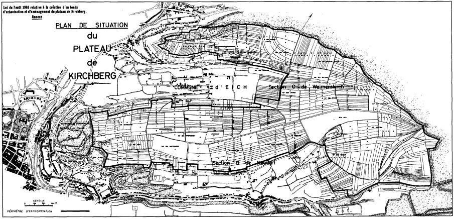
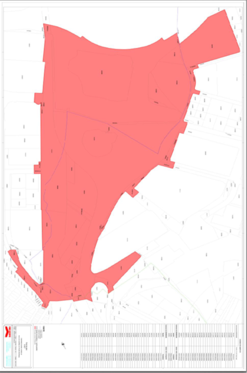

# Loi du 7 août 1961 relative à la création d'un fonds d'urbanisation et d'aménagement du plateau de Kirchberg.

## Art. 1er.

Sont reconnus d’utilité publique et autorisés:

la construction d’un pont au-dessus de la vallée de l’Alzette entre le Rond-point près de la Fondation Pescatore et le plateau de Kirchberg;

l’urbanisation et l’aménagement du plateau de Kirchberg;

l’établissement de la voirie d’accès et de desserte nécessaire ainsi que les accessoires éventuels;

l’acquisition des terrains du plateau de Kirchberg dans la mesure du plan des lieux figurant à l’annexe I[^2].

## Art. 2.

Il est créé sous la dénomination de «fonds d’urbanisation et d’aménagement du plateau de Kirchberg», ci-après « Fonds »[^3] un organe spécial constitué en personne juridique distincte de l’Etat, chargé de réaliser, pour compte de l’Etat, les projets visés à l’article premier.

Il a[^5] le caractère d’un établissement public.[^4]

## Art. 2*bis*.

Outre les projets visés à l’article 1er, le Fonds a pour missions :

1° le développement et l’aménagement du site « Midfield » situé entre le Ban de Gasperich et la zone d’activités de Howald tel que délimité par le plan cadastral figurant à l’annexe II ;

2° la réalisation, à la demande de tiers, pour le compte de ceux-ci et à leurs frais, des infrastructures sur ce site.[^6]

## Art. 3.

(1) S’agissant de sa mission décrite à l’article 1er, Ie Fonds supporte les dépenses y relatives et il peut avoir recours aux moyens financiers suivants.[^37]

Outre les recettes provenant d’activités du Fonds, notamment en relation avec l’urbanisation du plateau de Kirchberg, le Fonds est autorisé à se faire ouvrir sous la garantie de l’État auprès de la caisse d’épargne de l’État un crédit jusqu’à concurrence de 100 000 000 euros. Les conditions et modalités de l’ouverture de crédit sont soumises à l’approbation du ministre ayant les Finances dans ses attributions.[^38]

Le Fonds[^39] est autorisé à sa procurer des[^40] moyens financiers jusqu’à concurrence de 100 000 000 euros[^41] par la voie d’un emprunt aussi bien que par l’augmentation du crédit dont il dispose auprès de la caisse d’épargne de l’Etat. Ces opérations financières se font sous la garantie de l’Etat qui en assumera les charges d’amortissement et d’intérêts en ce qui concerne l’emprunt et les charges d’intérêts en ce qui concerne la totalité du crédit dont disposera le Fonds[^42] auprès de la caisse d’épargne de l’Etat.

Les modalités de l’emprunt, sa durée, sa date d’émission, les conditions de remboursement, le taux d’intérêt, la forme et la coupure des obligations à émettre, l’époque et le mode de la souscription et du paiement des coupons, ainsi que toutes les autres conditions de l’emprunt feront l’objet d’un règlement du Ministre du Trésor. Ce règlement pourra prévoir que les intérêts de l’emprunt seront exempts, en tout ou en partie, des impôts présents et futurs. Les conditions et modalités de l’ouverture du nouveau crédit auprès de la caisse d’épargne[^43] de l’Etat sont soumises à l’approbation du Ministre du Trésor et du Ministre du Budget.[^7]

(2) Dans le cadre de missions acceptées en application de l’article 2*bis*, le Fonds conclut avec l’État, ou le tiers qui l’a mandaté, une convention prévoyant les modalités, notamment financières, encadrant sa prestation.

Sous réserve de l’approbation du ministre de tutelle, le Fonds peut également mobiliser les moyens financiers décrits au paragraphe 1er du présent article dans le cadre de missions acceptées en application de l’article 2*bis*.[^44]

## Art. 4.

Les acquisitions des emprises feront l’objet d’actes administratifs à recevoir par l’Administration de l’enregistrement, des domaines et de la TVA.

Les parties sont dispensées de recourir à la vente publique dans les cas visés par la [loi du 12 juin 1816](https://legilux.public.lu/eli/etat/leg/loi/1816/06/12/n1/jo), qui détermine les formalités à observer à l’égard de la vente des immeubles appartenant à des mineurs, à des successions acceptées sous bénéfice d’inventaire etc., loi qui reste applicable pour le surplus.

Le Fonds poursuivra l’expropriation des emprises comprises dans le plan des lieux annexé à la présente loi d’après la procédure prévue ci-après.

## Art. 5.

Le Fonds convoquera les propriétaires individuellement, quinze jours au moins à l’avance, d’après la procédure réglée par l’article 7 de la [loi du 26 juin 1914](https://legilux.public.lu/eli/etat/leg/loi/1914/06/26/n1/jo) sur les significations judiciaires en matière civile et commerciale, aux jour, heure et lieu par lui déterminés, pour constater si la propriété à emprendre est située à l’intérieur du périmètre d’expropriation figurant au plan de situation annexé à la présente loi et pour discuter de l’indemnité d’expropriation.

Aux termes de la convocation, les propriétaires seront avertis qu’il sera procédé tant en leur absence qu’en leur présence.

Un procès-verbal des opérations sera dressé relatant l’accord intervenu ou les difficultés divisant les parties.

Le procès-verbal sera signé par les comparants. En cas de refus de signer le procès-verbal et en cas de non-comparution, le procès-verbal sera notifié aux propriétaires par exploit d’huissier.

## Art. 6.

A défaut d’accord écrit passé entre parties sur l’applicabilité à l’emprise de la présente loi et sur l’indemnité offerte, le litige sera déféré au tribunal d’arrondissement de Luxembourg.

L’ajournement sera donné à jour fixe et à un délai de quinzaine. En cas d’absolue nécessité, le délai d’ajournement pourra être abrégé par ordonnance du président rendue sur requête.

Les pièces invoquées de part et d’autre seront déposées au greffe avant l’audience.

## Art. 7.

La cause sera appelée à l’audience indiquée par l’ajournement. Si la partie assignée a constitué ou constitue avoué, il sera procédé, toutes affaires cessantes. S’il n’y a pas constitution d’avoué, le défaillant sera réassigné par un huissier commis au jour fixé par le tribunal, sans qu’il soit besoin de lever le jugement. Le délai pour la comparution ne pourra dépasser la quinzaine.

## Art. 8.

A l’audience indiquée, le tribunal examinera si les formalités prévues aux articles 5 et 6 ont été régulièrement remplies. Le propriétaire sera tenu de déclarer si et, le cas échéant, pour quel motif il conteste l’existence ou la régularité des formalités remplies et s’il accepte les offres d’indemnité faites par le Fonds. Aucune nullité pour vice de forme ne pourra être opposée que s’il est justifié que l’inobservation de la formalité même substantielle aura eu pour effet de porter atteinte aux intérêts de la partie qui l’invoque.

Si, sans contester la régularité de la procédure, le propriétaire n’accepte pas les offres d’indemnité faites par le Fonds, il sera tenu de faire connaître le montant de ses prétentions définitives. Le tribunal donnera acte de ces prétentions et statuera sur le tout par un seul jugement à l’une des prochaines audiences, qu’il indiquera.

## Art. 9.

Si le tribunal décide soit que l’action n’a pas été intentée régulièrement, soit que les formalités prévues aux articles 5 et 6 n’ont pas été dûment observées et que cette violation a eu pour effet de porter atteinte aux intérêts de la partie qui l’invoque, soit que la parcelle à entreprendre n’est pas située à l’intérieur du périmètre figurant au plan des lieux annexé à la présente loi, il déclarera qu’il n’y a pas lieu de procéder plus loin.

Toutefois, le tribunal pourra passer outre, si le propriétaire à exproprier consent à la cession et s’il n’y a désaccord que sur le prix. Le tribunal donnera acte du consentement du propriétaire.

## Art. 10.

Le jugement rendu en conformité de l’article précédent et celui qui aura décidé qu’il y a lieu de passer outre au règlement de l’indemnité ne sont susceptibles d’aucun recours.

## Art. 11.

Si le tribunal décide que les formalités prévues aux articles 5 et 6 ont été observées ou que la violation alléguée n’a pas porté atteinte aux intérêts de la partie qui l’invoque ou si, à la suite du consentement du propriétaire, il a été décidé de passer outre, il fixe par le même jugement le montant de l’indemnité, eu égard aux baux actuels, aux contrats de vente passés antérieurement et néanmoins aux époques les plus récentes, soit des mêmes fonds, soit de fonds voisins et de même qualité, et à tous autres documents qu’il pourra réunir.

S’il n’a pas été produit de documents propres à déterminer ce montant ou si une partie le demande, le tribunal déclarera par le même jugement qu’il sera procédé dans un délai fixe, qui ne pourra pas dépasser un mois, à la visite et à la juste évaluation des terrains ou édifices par trois experts, qui seront désignés de commun accord par les parties, sinon d’office.

Il commettra un juge pour faire rapport et pour se rendre sur les lieux avec les parties et les experts aux jour, heure et lieu qui seront indiqués par le même jugement.

Avant l’évaluation de l’indemnité, le tribunal ordonnera provisoirement, si la partie poursuivante le demande, la mise en possession de celle-ci, à charge par elle de consigner préalablement la somme que le tribunal fixera par le même jugement, qui sera exécutoire nonobstant appel ou opposition.

## Art. 12.

La prononciation du jugement prévue à l’article 11 vaudra signification tant à avoué qu’à partie. Dans les trois jours de cette prononciation, le greffier sera tenu de délivrer à la partie demanderesse un extrait du jugement, contenant les conclusions des parties, les motifs et le dispositif, sans qu’il soit besoin d’enregistrement préalable.

Dans les trois jours suivants, cet extrait sera signifié aux experts, avec sommation de se rendre sur les lieux aux jour, heure et lieu indiqués par le jugement.

## Art. 13.

Les experts prêteront serment sur les lieux contentieux, ès mains du juge délégué, qui remplacera ceux qui feraient défaut ou contre lesquels il admettrait des causes de récusation, par les personnes dont les parties conviennent entre elles ou qu’à leur défaut il désigne d’office.

Les parties lui remettront les documents qu’elles croiront utiles à l’appréciation de l’indemnité. Il pourra au surplus s’entourer de tous renseignements propres à éclairer les experts et même, soit d’office, soit à la demande de l’une ou de l’autre des parties, procéder à une information. Dans ce cas, les personnes qu’il trouvera convenable d’entendre seront interrogées en présence des experts et des parties.

Il sera dressé procès-verbal par le juge délégué. Il y sera fait mention du résultat des déclarations des personnes qui auront concouru à l’information, du délai dans lequel les experts seront tenus d’achever leur travail et de le transmettre au juge délégué et enfin du jour auquel le tout sera déposé au greffe du tribunal, où les parties pourront en prendre inspection sans frais.

## Art. 14.

Les formalités prescrites par le code de procédure civile pour le rapport des experts et les enquêtes ne sont pas applicables aux opérations et informations dont il s’agit à l’article qui précède.

Dans leurs appréciations, les experts se conformeront, le cas échéant, aux articles 16 à 19 ci-après. Ils motiveront leur avis.

Le rapport des experts ne liera pas le tribunal et ne vaudra que comme renseignement.

## Art. 15.

La cause sera appelée et plaidée à la première audience civile qui suivra le dépôt au greffe, sans qu’il y ait lieu à signification du procès-verbal et de l’avis des experts.

Il ne pourra être accordé qu’une seule remise.

Il sera fait rapport par le juge commis, les parties seront entendues et le jugement qui déterminera l’indemnité sera prononcé dans la quinzaine des plaidoiries.

## Art. 16.

Dans le cas où il y aurait des tiers intéressés à titre de bail, d’usage ou d’habitation, le propriétaire sera tenu de les appeler avant la fixation de l’indemnité, pour concourir, s’ils le trouvent bon, en ce qui les concerne, aux opérations des évaluations; sinon il restera seul chargé envers eux des indemnités qu’ils pourraient réclamer. Les indemnités des tiers intéressés, ainsi appelés ou intervenants, seront reglées en la même forme que celles dues aux propriétaires.

Dans le cas d’usufruit, une seule indemnité est fixée par le tribunal, eu égard à la valeur totale de l’immeuble. Le nu-propriétaire et l’usufruitier exercent leur droit sur le montant de l’indemnité au lieu de l’exercice sur la chose.

L’usufruitier sera tenu de donner caution. Les père et mère ayant l’usufruit légal des biens de leurs enfants en seront seuls dispensés.

## Art. 17.

Les bâtiments dont il est nécessaire d’acquérir une portion en exécution des dispositions de l’article premier seront achetés en entier, si les propriétaires l’ont requis avant le jugement qui ordonne qu’il sera procédé au règlement de l’indemnité.

Il en sera de même de toute parcelle de terrain qui, par suite du morcellement, se trouvera réduite au quart de la contenance totale, si toutefois le propriétaire ne possède aucun terrain immédiatement contigu, et si la parcelle ainsi réduite est inférieure à dix ares.

## Art. 18.

Si l’exécution des travaux doit procurer une augmentation de valeur immédiate et spéciale au restant de la propriété, cette augmentation peut être prise en considération dans l’évaluation du montant de l’indemnité.

L’indemnité ne tiendra pas compte de la plus-value pouvant découler des travaux entrepris en vue de l’urbanisation et de l’aménagement du plateau de Kirchberg, et notamment de la construction du pont Grande-Duchesse Charlotte ainsi que des travaux en vue desquels l’expropriation est poursuivie.

## Art. 19.

Les constructions, plantations, ouvertures de carrières et améliorations ne donneront lieu à aucune indemnité, lorsque, à raison de l’époque où elles auront été faites ou de toutes autres circonstances, le tribunal acquiert la conviction qu’elles ont été faites en vue d’obtenir une indemnit plus élevée.

## Art. 20.

En vertu du jugement qui adjuge l’indemnité, et sans qu’il soit besoin de le faire signifier au préalable, le montant de cette indemnité, déduction faite des dépens, s’il y a lieu, sera déposé dans la caisse des consignations à Luxembourg; et sur le vu de la signification faite à avoué ou à partie, du certificat du dépôt, la partie poursuivante sera envoyée en possession par ordonnance du président rendue sur requête. Cette ordonnance du président sera exécutoire provisoirement, nonobstant opposition ou appel et sans caution.

Les dispositions qui précèdent sont applicables au cas prévu au dernier alinéa de l’article 11 de la présente loi.

## Art. 21.

Si l’indemnité réglée par le tribunal ne dépasse pas l’offre du Fonds, les parties qui l’auront refusée seront condamnées aux dépens. Si l’indemnité est égale à la demande des parties, le Fonds sera condamné aux dépens. Si l’indemnité est à la fois supérieure à l’offre du Fonds et inférieure à la demande des intéressés, le tribunal arbitrera le partage des frais entre les parties.

Toute partie qui ne se trouvera pas dans le cas de l’article 29 sera condamnée aux dépens, quelle que soit l’estimation ultérieure du tribunal, si elle n’a pas indiqué le montant de ses prétentions avant le jugement rendu conformément aux articles 8, 9 et 11.

## Art. 22.

Les dépens seront taxés comme en matière sommaire. La taxe ne comprendra que les actes faits postérieurement à l’offre du Fonds. Les frais des actes antérieurs demeurent dans tous les cas à charge de ce dernier.

## Art. 23.

Les parties assignées, non domiciliées dans le lieu où siège le tribunal, seront tenues d’y faire élection de domicile; à défaut de cette élection, toutes significations, même celles du jugement définitif ainsi que d’offres réelles et d’appel seront valablement faites au greffe.

## Art. 24.

Les délais fixés par la présente loi pour les ajournements et autres actes de procédure sont applicables, quels que soient le domicile ou la résidence des intéressés.

## Art. 25.

Le jugement sera réputé contradictoire à l’égard des parties qui n’auraient pas constitué avoué sur les assignations dont il s’agit aux articles 6 et 7 ou qui, après avoir constitué avoué, ne se trouveraient pas représentées aux audiences ou actes de procédure ultérieurs.

## Art. 26.

Tout incident non prévu par les dispositions qui précèdent sera jugé sans désemparer, ou au plus tard à l’audience qui suivra les plaidoiries. Le tribunal peut aussi joindre l’incident au fond.

## Art. 27.

Les jugements qui interviendront dans l’instruction de la procédure, telle qu’elle est réglée par les articles précédents, ne sont rendus qu’après avoir entendu le ministère public; ils seront exécutoires provisoirement contre le défendeur, nonobstant opposition ou appel et sans caution.

La cour supérieure de justice ne pourra en aucun cas accorder des défenses tendant à arrêter directement ou indirectement l’exécution des jugements.

Elle statuera d’urgence dès la mise au rôle de l’affaire. Il ne pourra être accordé qu’une seule remise.

## Art. 28.

Si l’indemnité fixée par le jugement ou par l’arrêt est supérieure à la somme consignée par le Fonds, celui-ci sera tenu de consigner le supplément de l’indemnité dans la huitaine de la signification de la décision judiciaire; sinon le propriétaire pourra, en vertu de la même décision, faire suspendre les travaux.

## Art. 29.

Si des biens de mineurs, d’interdits, d’aliénés internés, de personnes présumées ou déclarées absentes sont compris dans le périmètre figurant au plan annexé à la présente loi, les représentants des incapables, les mineurs émancipés assistés de leurs curateurs, les notaires représentant des présumés absents et les envoyés en possession provisoire des biens d’un absent peuvent, après autorisation du tribunal donnée sur simple requête en la chambre du conseil, le ministère public entendu, consentir amiablement à l’aliénation desdits biens et accepter les montants offerts.

Le tribunal ordonne les mesures de conservation ou de remploi qu’il juge nécessaires.

Les collèges de bourgmestres et échevins ainsi que les administrateurs des établissements publics pourront de même consentir à l’aliénation amiable des biens communaux ou des biens des établissements publics, s’ils y sont autorisés par une délibération dûment approuvée du conseil communal ou de l’organe à ce compétent.

## Art. 30.

Le jugement par lequel il est décidé que les formalités des articles 5 et 6 ont été remplies sera immédiatement transcrit au bureau de la conservation des hypothèques. Un extrait contenant la date du jugement ou de la transcription, les noms des parties, la désignation de la nature et de la situation des biens dont l’expropriation est poursuivie, sera inséré dans un journal et restera affiché dans l’auditoire jusqu’au règlement de l’indemnité.

Dans la quinzaine de la date de l’affiche et de l’insertion au journal seront inscrits les privilèges indiqués à l’article 4 de la [loi du 18 avril 1910](https://legilux.public.lu/eli/etat/leg/loi/1910/04/18/n1/jo) sur le régime hypothécaire et les hypothèques occultes instituées par la [loi du 27 novembre 1933](https://legilux.public.lu/eli/etat/leg/loi/1933/11/27/n1/jo) sur le recouvrement des contributions directes, des droits d’accise sur l’eau-de-vie et des cotisations d’assurances sociales, telle qu’elle se trouve modifiée et étendue par les lois postérieures, antérieures au jugement.

L’immeuble sera affranchi de tous privilèges et hypothèques, de quelque nature qu’ils soient, non inscrits dans ce délai ou antérieurement, sans préjudice des recours contre les personnes qui auraient dû requérir les inscriptions.

## Art. 31.

Les actions en résolution, en revendication ou toutes autres actions réelles ne pourront arrêter l’expropriation ni en empêcher l’effet.

Le droit des réclamants sera transporté sur le prix et l’immeuble en demeurera affranchi.

Toute saisie-arrêt ou opposition à faire par les intéressés, ainsi que par tous créanciers, sera faite entre les mains du préposé à la caisse des consignations à Luxembourg.

## Art. 32.

Sur le vu du jugement et du certificat délivré après le délai fixé à l’article 30 constatant que l’immeuble exproprié est libre de privilèges et hypothèques, le préposé à la caisse des consignations sera tenu de remettre aux ayants droit, sans frais ni retenue, le montant de l’indemnité adjugée, s’il n’existe aucune saisie-arrêt ou opposition sur les deniers consignés.

A défaut par les ayants droit de produire ce certificat ou de rapporter mainlevée des saisies-arrêts ou oppositions, le préposé à la caisse des consignations ne pourra vider ses mains que sur ordonnance de justice.

Il en sera de même dans les cas où les droits respectifs du propriétaire et de l’usufruitier ne se trouveraient pas réglés par le jugement qui a ordonné la consignation.

Le créancier qui, par le résultat d’un ordre ouvert pour la distribution de l’indemnité, n’obtiendrait pas collocation utile pour la totalité de sa créance, ne pourra, pour cause du morcellement de son hypothèque ou de la division de son capital, exiger le remboursement du surplus de sa créance, si elle n’est d’ailleurs exigible en vertu de son titre ou pour tout autre motif.[^8]

## Art. 32*bis*.

Dans l’exercice de son pouvoir de gestion du domaine public, le conseil d’administration du Fonds peut prendre des règlements définissant les conditions auxquelles l’occupation privative du domaine public du Fonds est soumise. lls sont publiés au Journal officiel du Grand-Duché de Luxembourg après approbation du ministre de tutelle.

Ces règlements définissent le montant et les modalités de paiement de la redevance due par l’occupant du domaine public du Fonds en prenant en compte l’emplacement et l’affectation de l’occupation privative, les avantages retirés par cet occupant, ainsi que la gêne occasionnée aux usagers du domaine public.[^47]

## Art. 33.

Le Fonds est exempt de tous droits, taxes et impôts généralement quelconques au profit de l’Etat et des communes à l’exception de la taxe sur la valeur ajoutée.[^9] Cette exemption ne s’applique pas toutefois aux salaires des greffiers et conservateurs des hypothèques.[^10]

## Art. 34.

La revente ou l’octroi de droits réels sur des immeubles qui ne font pas partie du domaine public se fait par le Fonds par une procédure concurrentielle et transparente ou, avec l’autorisation spéciale du Gouvernement en conseil, par marché de gré à gré.[^11]

Le Fonds peut être autorisé par le Gouvernement en conseil à procéder à l’échange volontaire des immeubles non occupés prédits avec des immeubles même non compris dans les limites fixées par le plan figurant à l’annexe I[^12].

Le produit de la revente ou la soulte de l’échange seront portés au compte visé à l’article 3.

La revente ou l’octroi de droits réels[^13] ou l’échange prédits se feront par acte administratif par les soins de l’Administration de l’enregistrement, des domaines et de la TVA soit par acte notarié.

L’acquisition par le Fonds de droits réels sur des immeubles se fait par le Fonds sur autorisation spéciale du Gouvernement en conseil.

La revente des logements préemptés par le Fonds se fait conformément à la politique générale du Fonds visée à l’article 10, paragraphe 1er, sans qu’une autorisation spéciale du Gouvernement en conseil soit requise.

Le Fonds peut céder un bien immobilier relevant de son domaine public à l’État.[^14]

## Art. 35.

Les [lois du 17 décembre 1859](https://legilux.public.lu/eli/etat/leg/loi/1859/12/17/n5/jo) sur l’expropriation pour cause d’utilité publique et du [4 mars 1896](https://legilux.public.lu/eli/etat/leg/loi/1896/03/04/n1/jo) sur l’expropriation par zone pour cause d’utilité publique ne sont pas applicables en la présente matière.[^15]

## Art. 36.

Le Fonds[^16] est sous la tutelle[^17] du ministre ayant les travaux publics dans ses attributions.

## Art. 37.

(1) Le Fonds est géré par un conseil d’administration composé de neuf membres au plus, nommés par le Grand-Duc sur proposition du Gouvernement en conseil.

(2) Ne peuvent devenir membres du conseil d’administration le ou les fonctionnaires qui, en vertu de leurs fonctions, sont appelés à surveiller ou à contrôler le Fonds ou qui, en vertu des pouvoirs leur délégués, approuvent des actes administratifs du Fonds ou signent des ordonnances de paiement ou toute autre pièce administrative entraînant une dépense de l’Etat en faveur du Fonds.

(3) Le président du conseil d’administration est désigné parmi les membres du conseil d’administration par le Gouvernement en conseil sur proposition du ministre de tutelle. En cas d’absence du président, ce dernier est remplacé par le doyen d’âge du conseil d’administration.

## Art. 38.

(1) Les membres du conseil sont nommés pour une durée de cinq ans renouvelable à son terme.

(2) Le conseil d’administration peut à tout moment être révoqué par le Grand-Duc. Un membre peut être révoqué avant l’expiration de son mandat, le conseil d’administration entendu en son avis.

(3) En cas de démission, de décès ou de révocation avant terme du mandat d’un membre du conseil, il est pourvu à son remplacement par la nomination d’un nouveau membre qui achève le mandat de celui qu’il remplace.

(4) Le conseil d’administration se réunit sur convocation de son président aussi souvent que les intérêts du Fonds l’exigent. Il doit être convoqué au moins une fois tous les trois mois ou à la demande de deux de ses membres.

(5) Le conseil d’administration ne peut valablement délibérer que si la majorité de ses membres est présente et il décide à la majorité simple des voix des membres présents. En cas d’égalité des voix, le vote de celui qui assure la présidence est prépondérant.

(6) Le fonctionnement du conseil d’administration est réglé dans le règlement d’ordre intérieur du Fonds. Ce règlement est soumis à l’approbation du ministre de tutelle.

(7) Les indemnités et jetons de présence des membres et participants aux réunions du conseil d’administration sont fixés par le Gouvernement en conseil et sont à charge du Fonds.

## Art. 39.

(1) Le conseil d’administration décide sur les points suivants, sous réserve de l’approbation du ministre de tutelle pour les points sous a):

a) i) la politique générale du Fonds, notamment le concept global d’urbanisation et d’aménagement du plateau de Kirchberg,

ibis) i*bis*)

l' acceptation des missions visées par l’article 2*bis* ainsi que la conclusion des conventions prévues par l’article 3, paragraphe 2, organisant le financement de ces missions,[^48]

ii) la politique de vente ou d’octroi de droits réels sur[^20] des immeubles[^21] appartenant au Fonds,

iii) le budget d’exploitation ainsi que les comptes de fin d’exercice,

iv) les programmes d’investissements annuels et les programmes d’investissements pluriannuels,

v) les emprunts à contracter,

vi) l’organigramme, la grille des emplois et leur classification ainsi que les conditions et modalités de rémunération et le volume des tâches du personnel,

vii) l’engagement et le licenciement d’un directeur,[^18]

b) i) l’exécution et la mise en oeuvre de la politique générale,

bustom i*bis*)

l’exécution et la mise en œuvre des missions visées par l’article 2*bis*,[^23]

ii) les règles d’exécution du budget,

iii) le rapport général d’activités,

iv) les actions judiciaires à intenter et les transactions à conclure,

v) les conventions à conclure,

vi) l’engagement et le licenciement[^24] du personnel du Fonds.[^22]

(2) Le président du conseil d’administration ou celui qui le remplace représente le Fonds dans tous les actes publics et privés. Les actions judiciaires sont intentées et défendues au nom du Fonds par le président du conseil d’administration ou par son remplaçant.

Le président ou son remplaçant peut déléguer ce pouvoir de représentation et de signature conformément aux dispositions qui suivent :

1° la délégation de signature en matière financière ne peut concerner que la signature des contrats, commandes et paiements dont les montants n’excèdent pas la somme déterminée par règlement grand-ducal pris en exécution de l’article 20, paragraphe 1er, alinéa 3, lettre a), de la [loi modifiée du 8 avril 2018](https://legilux.public.lu/eli/etat/leg/loi/2018/04/08/a243/jo) sur les marchés publics et établissant le montant en deçà duquel les marchés publics de travaux, de fournitures et de services peuvent être passés soit par procédure restreinte sans publication d’avis, soit par procédure négociée ;

2° la délégation de signature en matière administrative ne peut concerner que les documents qui correspondent à la politique établie par le conseil d’administration et qui ne requièrent pas l’attention personnelle du président.

Les délégations sont écrites et formelles. Elles peuvent être conférées au directeur du Fonds, au secrétaire du conseil d’administration du Fonds ou au chef du service concerné par l’objet de la délégation, selon l’organigramme du personnel du Fonds décidé par le conseil d’administration et approuvé par le ministre de tutelle conformément au paragraphe 1er, lettre a), sous vi). Les délégations consenties ne peuvent pas faire l’objet d’une subdélégation.[^25]

(3) Les budgets d’investissement et d’exploitation de l’année à venir sont soumis au ministre de tutelle avant le 1er avril de l’année précédant l’exercice en question.

(4) Il est institué un Bureau chargé d’organiser, de suivre et de contrôler les travaux, de proposer l’ordre du jour pour les réunions du conseil d’administration et d’accompagner la gestion journalière des travaux du Fonds. Il peut être chargé par le conseil d’administration de toute autre mission, à charge de lui en rendre compte régulièrement.

Le Bureau est composé de quatre membres du conseil d’administration, y compris le président du conseil d’administration, désignés par le Gouvernement en conseil.

Le Bureau est présidé par le président du conseil d’administration et assisté par le directeur.

## Art. 39bis.

La gestion journalière du Fonds est assurée par un directeur dont les attributions sont définies dans le détail par le conseil d’administration.

Le directeur est chargé d’exécuter les décisions du conseil d’administration. Il répond de sa gestion devant le conseil d’administration.

Le directeur participe avec voix consultative aux délibérations du conseil d’administration. Il assiste le Bureau.

Le personnel du Fonds est placé sous ses ordres.

## Art. 40.

Le personnel du[^26] Fonds est assisté par du personnel[^27] engagé sur la base d’un contrat de louage de service de droit privé, sans préjudice des droits acquis des personnes engagées antérieurement.

## Art. 41.

(1) Dans la mesure de ses moyens, l’Etat met à la disposition du Fonds les services, l’équipement et les installations nécessaires. Le Fonds peut, sur autorisation préalable du ministre de tutelle[^28], s’assurer tous autres concours pour lui permettre d’exécuter sa mission.

(2) Tous les marchés pour services,[^29] travaux et fournitures au nom du Fonds sont soumis aux dispositions légales et règlementaires[^30] sur les marchés publics.

(3) Tous les contrats de concession au nom du Fonds sont soumis aux dispositions légales et règlementaires sur l’attribution des contrats de concessions.[^31]

## Art. 42.

(1) Les comptes du Fonds sont tenus selon les principes et les modalités de la comptabilité commerciale. L’exercice coïncide avec l’année civile. A la clôture de chaque exercice, le conseil d’administration arrête le bilan et le compte de profits et pertes.

(2) Un réviseur d’entreprises, désigné par le conseil d’administration avec l’approbation du[^32] le[^33] ministre de tutelle, est chargé de contrôler les comptes du Fonds et la régularité des opérations effectuées et des écritures comptables. Le réviseur d’entreprises doit remplir les conditions requises par la législation réglant la profession[^34] de réviseur d’entreprises. Son mandat est d’une durée de trois ans et il est renouvelable. Sa rémunération est à charge du Fonds. Il remet son rapport au conseil d’administration pour le 15 mars. Il peut être chargé par le conseil d’administration de procéder à des vérifications spécifiques.

(3) Pour le 1er mai au plus tard, le conseil d’administration présente au Gouvernement en conseil les comptes de fin d’exercice accompagnés d’un rapport circonstancié sur la situation et le fonctionnement du Fonds ainsi que du rapport du réviseur d’entreprises.

(4) La décharge du conseil d’administration est donnée par le Gouvernement en conseil et elle est acquise de plein droit si ce dernier n’a pas pris de décision dans le délai de deux mois.

(5) La gestion financière du Fonds est soumise au contrôle de la Cour des Comptes.

## Art. 43.

Le Fonds[^35] sera dissous par une loi[^36] ; son actif et son passif seront repris par l’Etat.[^1]

\**Annexe I : Plan de situation du plateau de Kirchberg**[^45]

\**Annexe II : Plan cadastral délimitant le site « Midfield »**

[^46]

---

[^2]: [Loi du 10 mars 2026 modifiant la loi modifiée du 7 août 1961 relative à la création d’un fonds d’urbanisation et d’aménagement du plateau de Kirchberg.](https://legilux.public.lu/eli/etat/leg/loi/2026/03/10/a205/jo)
[^3]: [Loi du 10 mars 2026 modifiant la loi modifiée du 7 août 1961 relative à la création d’un fonds d’urbanisation et d’aménagement du plateau de Kirchberg.](https://legilux.public.lu/eli/etat/leg/loi/2026/03/10/a205/jo)
[^5]: [Loi du 10 mars 2026 modifiant la loi modifiée du 7 août 1961 relative à la création d’un fonds d’urbanisation et d’aménagement du plateau de Kirchberg.](https://legilux.public.lu/eli/etat/leg/loi/2026/03/10/a205/jo)
[^4]: [Loi du 10 mars 2026 modifiant la loi modifiée du 7 août 1961 relative à la création d’un fonds d’urbanisation et d’aménagement du plateau de Kirchberg.](https://legilux.public.lu/eli/etat/leg/loi/2026/03/10/a205/jo)
[^6]: [Loi du 10 mars 2026 modifiant la loi modifiée du 7 août 1961 relative à la création d’un fonds d’urbanisation et d’aménagement du plateau de Kirchberg.](https://legilux.public.lu/eli/etat/leg/loi/2026/03/10/a205/jo)
[^37]: [Loi du 10 mars 2026 modifiant la loi modifiée du 7 août 1961 relative à la création d’un fonds d’urbanisation et d’aménagement du plateau de Kirchberg.](https://legilux.public.lu/eli/etat/leg/loi/2026/03/10/a205/jo)
[^38]: [Loi du 10 mars 2026 modifiant la loi modifiée du 7 août 1961 relative à la création d’un fonds d’urbanisation et d’aménagement du plateau de Kirchberg.](https://legilux.public.lu/eli/etat/leg/loi/2026/03/10/a205/jo)
[^39]: [Loi du 10 mars 2026 modifiant la loi modifiée du 7 août 1961 relative à la création d’un fonds d’urbanisation et d’aménagement du plateau de Kirchberg.](https://legilux.public.lu/eli/etat/leg/loi/2026/03/10/a205/jo)
[^40]: [Loi du 10 mars 2026 modifiant la loi modifiée du 7 août 1961 relative à la création d’un fonds d’urbanisation et d’aménagement du plateau de Kirchberg.](https://legilux.public.lu/eli/etat/leg/loi/2026/03/10/a205/jo)
[^41]: [Loi du 10 mars 2026 modifiant la loi modifiée du 7 août 1961 relative à la création d’un fonds d’urbanisation et d’aménagement du plateau de Kirchberg.](https://legilux.public.lu/eli/etat/leg/loi/2026/03/10/a205/jo)
[^42]: [Loi du 10 mars 2026 modifiant la loi modifiée du 7 août 1961 relative à la création d’un fonds d’urbanisation et d’aménagement du plateau de Kirchberg.](https://legilux.public.lu/eli/etat/leg/loi/2026/03/10/a205/jo)
[^43]: [Loi du 10 mars 2026 modifiant la loi modifiée du 7 août 1961 relative à la création d’un fonds d’urbanisation et d’aménagement du plateau de Kirchberg.](https://legilux.public.lu/eli/etat/leg/loi/2026/03/10/a205/jo)
[^7]: [Loi du 10 mars 2026 modifiant la loi modifiée du 7 août 1961 relative à la création d’un fonds d’urbanisation et d’aménagement du plateau de Kirchberg.](https://legilux.public.lu/eli/etat/leg/loi/2026/03/10/a205/jo)
[^44]: [Loi du 10 mars 2026 modifiant la loi modifiée du 7 août 1961 relative à la création d’un fonds d’urbanisation et d’aménagement du plateau de Kirchberg.](https://legilux.public.lu/eli/etat/leg/loi/2026/03/10/a205/jo)
[^8]: [Loi du 10 mars 2026 modifiant la loi modifiée du 7 août 1961 relative à la création d’un fonds d’urbanisation et d’aménagement du plateau de Kirchberg.](https://legilux.public.lu/eli/etat/leg/loi/2026/03/10/a205/jo)
[^47]: [Loi du 10 mars 2026 modifiant la loi modifiée du 7 août 1961 relative à la création d’un fonds d’urbanisation et d’aménagement du plateau de Kirchberg.](https://legilux.public.lu/eli/etat/leg/loi/2026/03/10/a205/jo)
[^9]: [Loi du 10 mars 2026 modifiant la loi modifiée du 7 août 1961 relative à la création d’un fonds d’urbanisation et d’aménagement du plateau de Kirchberg.](https://legilux.public.lu/eli/etat/leg/loi/2026/03/10/a205/jo)
[^10]: [Loi du 10 mars 2026 modifiant la loi modifiée du 7 août 1961 relative à la création d’un fonds d’urbanisation et d’aménagement du plateau de Kirchberg.](https://legilux.public.lu/eli/etat/leg/loi/2026/03/10/a205/jo)
[^11]: [Loi du 10 mars 2026 modifiant la loi modifiée du 7 août 1961 relative à la création d’un fonds d’urbanisation et d’aménagement du plateau de Kirchberg.](https://legilux.public.lu/eli/etat/leg/loi/2026/03/10/a205/jo)
[^12]: [Loi du 10 mars 2026 modifiant la loi modifiée du 7 août 1961 relative à la création d’un fonds d’urbanisation et d’aménagement du plateau de Kirchberg.](https://legilux.public.lu/eli/etat/leg/loi/2026/03/10/a205/jo)
[^13]: [Loi du 10 mars 2026 modifiant la loi modifiée du 7 août 1961 relative à la création d’un fonds d’urbanisation et d’aménagement du plateau de Kirchberg.](https://legilux.public.lu/eli/etat/leg/loi/2026/03/10/a205/jo)
[^14]: [Loi du 10 mars 2026 modifiant la loi modifiée du 7 août 1961 relative à la création d’un fonds d’urbanisation et d’aménagement du plateau de Kirchberg.](https://legilux.public.lu/eli/etat/leg/loi/2026/03/10/a205/jo)
[^15]: [Loi du 10 mars 2026 modifiant la loi modifiée du 7 août 1961 relative à la création d’un fonds d’urbanisation et d’aménagement du plateau de Kirchberg.](https://legilux.public.lu/eli/etat/leg/loi/2026/03/10/a205/jo)
[^16]: [Loi du 10 mars 2026 modifiant la loi modifiée du 7 août 1961 relative à la création d’un fonds d’urbanisation et d’aménagement du plateau de Kirchberg.](https://legilux.public.lu/eli/etat/leg/loi/2026/03/10/a205/jo)
[^17]: [Loi du 10 mars 2026 modifiant la loi modifiée du 7 août 1961 relative à la création d’un fonds d’urbanisation et d’aménagement du plateau de Kirchberg.](https://legilux.public.lu/eli/etat/leg/loi/2026/03/10/a205/jo)
[^48]: [Loi du 10 mars 2026 modifiant la loi modifiée du 7 août 1961 relative à la création d’un fonds d’urbanisation et d’aménagement du plateau de Kirchberg.](https://legilux.public.lu/eli/etat/leg/loi/2026/03/10/a205/jo)
[^20]: [Loi du 10 mars 2026 modifiant la loi modifiée du 7 août 1961 relative à la création d’un fonds d’urbanisation et d’aménagement du plateau de Kirchberg.](https://legilux.public.lu/eli/etat/leg/loi/2026/03/10/a205/jo)
[^21]: [Loi du 10 mars 2026 modifiant la loi modifiée du 7 août 1961 relative à la création d’un fonds d’urbanisation et d’aménagement du plateau de Kirchberg.](https://legilux.public.lu/eli/etat/leg/loi/2026/03/10/a205/jo)
[^18]: [Loi du 10 mars 2026 modifiant la loi modifiée du 7 août 1961 relative à la création d’un fonds d’urbanisation et d’aménagement du plateau de Kirchberg.](https://legilux.public.lu/eli/etat/leg/loi/2026/03/10/a205/jo)
[^23]: [Loi du 10 mars 2026 modifiant la loi modifiée du 7 août 1961 relative à la création d’un fonds d’urbanisation et d’aménagement du plateau de Kirchberg.](https://legilux.public.lu/eli/etat/leg/loi/2026/03/10/a205/jo)
[^24]: [Loi du 10 mars 2026 modifiant la loi modifiée du 7 août 1961 relative à la création d’un fonds d’urbanisation et d’aménagement du plateau de Kirchberg.](https://legilux.public.lu/eli/etat/leg/loi/2026/03/10/a205/jo)
[^22]: [Loi du 10 mars 2026 modifiant la loi modifiée du 7 août 1961 relative à la création d’un fonds d’urbanisation et d’aménagement du plateau de Kirchberg.](https://legilux.public.lu/eli/etat/leg/loi/2026/03/10/a205/jo)
[^25]: [Loi du 10 mars 2026 modifiant la loi modifiée du 7 août 1961 relative à la création d’un fonds d’urbanisation et d’aménagement du plateau de Kirchberg.](https://legilux.public.lu/eli/etat/leg/loi/2026/03/10/a205/jo)
[^26]: [Loi du 10 mars 2026 modifiant la loi modifiée du 7 août 1961 relative à la création d’un fonds d’urbanisation et d’aménagement du plateau de Kirchberg.](https://legilux.public.lu/eli/etat/leg/loi/2026/03/10/a205/jo)
[^27]: [Loi du 10 mars 2026 modifiant la loi modifiée du 7 août 1961 relative à la création d’un fonds d’urbanisation et d’aménagement du plateau de Kirchberg.](https://legilux.public.lu/eli/etat/leg/loi/2026/03/10/a205/jo)
[^28]: [Loi du 10 mars 2026 modifiant la loi modifiée du 7 août 1961 relative à la création d’un fonds d’urbanisation et d’aménagement du plateau de Kirchberg.](https://legilux.public.lu/eli/etat/leg/loi/2026/03/10/a205/jo)
[^29]: [Loi du 10 mars 2026 modifiant la loi modifiée du 7 août 1961 relative à la création d’un fonds d’urbanisation et d’aménagement du plateau de Kirchberg.](https://legilux.public.lu/eli/etat/leg/loi/2026/03/10/a205/jo)
[^30]: [Loi du 10 mars 2026 modifiant la loi modifiée du 7 août 1961 relative à la création d’un fonds d’urbanisation et d’aménagement du plateau de Kirchberg.](https://legilux.public.lu/eli/etat/leg/loi/2026/03/10/a205/jo)
[^31]: [Loi du 10 mars 2026 modifiant la loi modifiée du 7 août 1961 relative à la création d’un fonds d’urbanisation et d’aménagement du plateau de Kirchberg.](https://legilux.public.lu/eli/etat/leg/loi/2026/03/10/a205/jo)
[^32]: [Loi du 10 mars 2026 modifiant la loi modifiée du 7 août 1961 relative à la création d’un fonds d’urbanisation et d’aménagement du plateau de Kirchberg.](https://legilux.public.lu/eli/etat/leg/loi/2026/03/10/a205/jo)
[^33]: [Loi du 10 mars 2026 modifiant la loi modifiée du 7 août 1961 relative à la création d’un fonds d’urbanisation et d’aménagement du plateau de Kirchberg.](https://legilux.public.lu/eli/etat/leg/loi/2026/03/10/a205/jo)
[^34]: [Loi du 10 mars 2026 modifiant la loi modifiée du 7 août 1961 relative à la création d’un fonds d’urbanisation et d’aménagement du plateau de Kirchberg.](https://legilux.public.lu/eli/etat/leg/loi/2026/03/10/a205/jo)
[^35]: [Loi du 10 mars 2026 modifiant la loi modifiée du 7 août 1961 relative à la création d’un fonds d’urbanisation et d’aménagement du plateau de Kirchberg.](https://legilux.public.lu/eli/etat/leg/loi/2026/03/10/a205/jo)
[^36]: [Loi du 10 mars 2026 modifiant la loi modifiée du 7 août 1961 relative à la création d’un fonds d’urbanisation et d’aménagement du plateau de Kirchberg.](https://legilux.public.lu/eli/etat/leg/loi/2026/03/10/a205/jo)
[^1]: [Loi du 6 décembre 2019 modifiant la loi modifiée du 7 août 1961 relative à la création d’un fonds d’urbanisation et d’aménagement du plateau de Kirchberg.](https://legilux.public.lu/eli/etat/leg/loi/2019/12/06/a830/jo)
[^45]: [Loi du 10 mars 2026 modifiant la loi modifiée du 7 août 1961 relative à la création d’un fonds d’urbanisation et d’aménagement du plateau de Kirchberg.](https://legilux.public.lu/eli/etat/leg/loi/2026/03/10/a205/jo)
[^46]: [Loi du 10 mars 2026 modifiant la loi modifiée du 7 août 1961 relative à la création d’un fonds d’urbanisation et d’aménagement du plateau de Kirchberg.](https://legilux.public.lu/eli/etat/leg/loi/2026/03/10/a205/jo)
