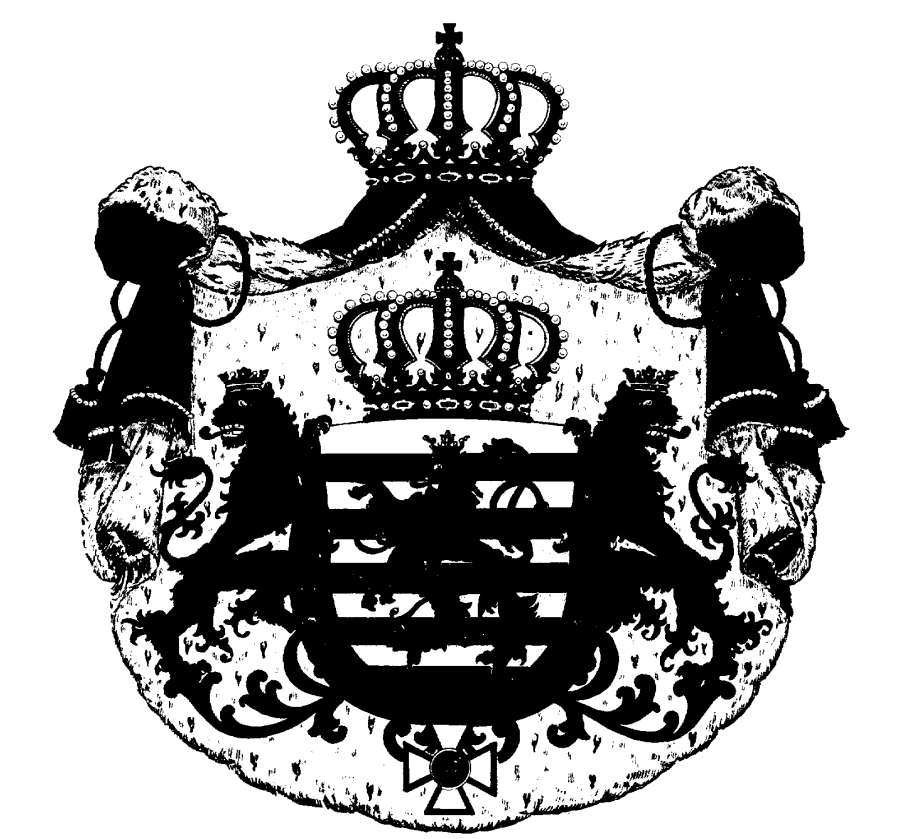
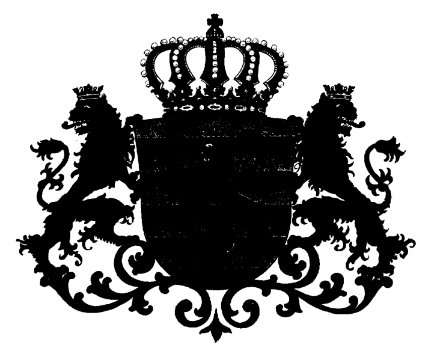
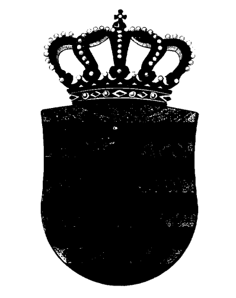
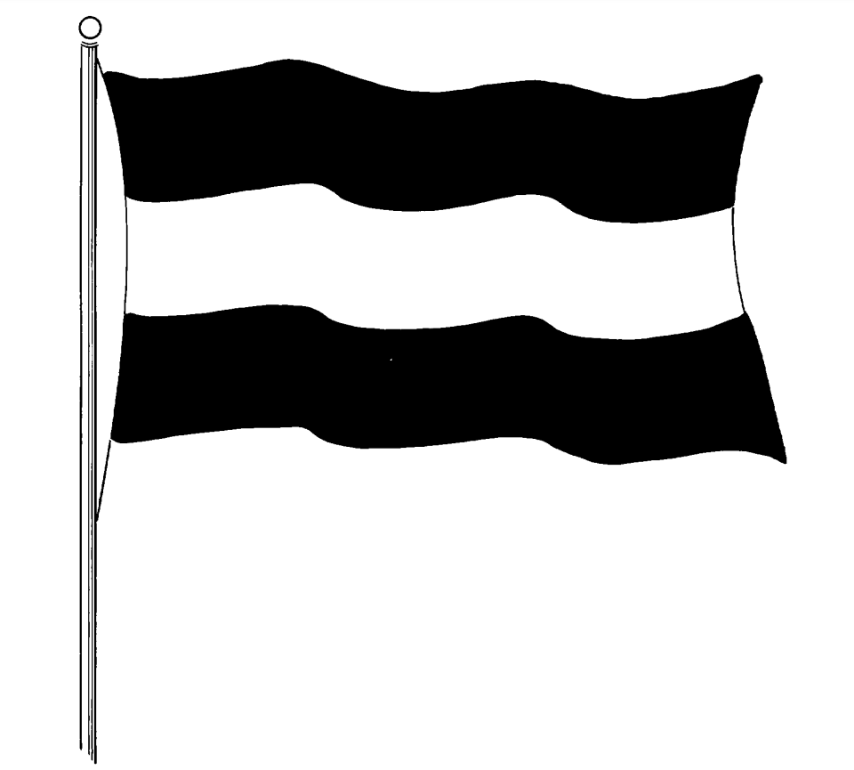
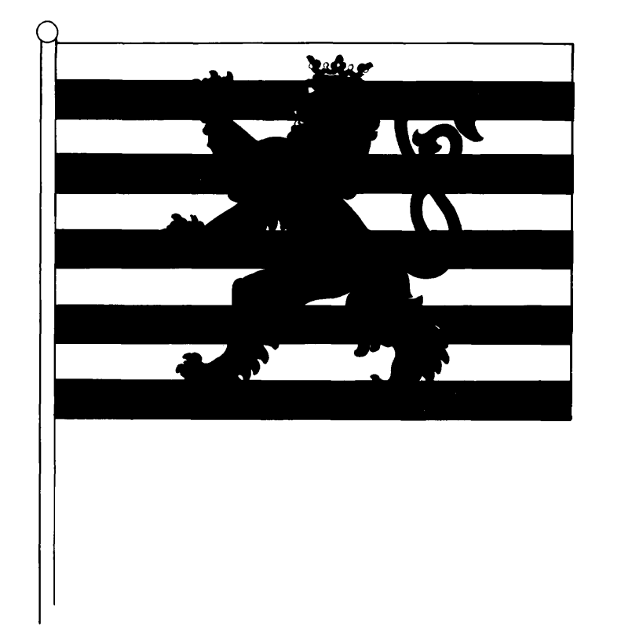
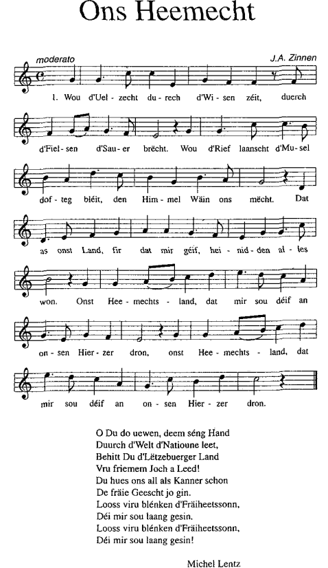

# Loi du 23 juin 1972 sur les emblèmes nationaux.

## Art. 1er.

Les armoiries du Grand-Duché de Luxembourg sont à trois échelons:

a) petites armoiries,

b) moyennes armoiries,

c) grandes armoiries.

## Art. 2.

Les armoiries désignées à l’article 1er ci-dessus se composent des éléments héraldiques suivants:

a) petites armoiries:

Burelé d’argent et d’azur de dix pièces au lion rampant de gueules, couronné, armé et lampassé d’or, la queue fourchue et passée en sautoir.

Timbre: La couronne grand-ducale non doublée.

b) moyennes armoiries:

Les petites armoiries augmentées des supports: Deux lions d’or et couronnés du même, la tête contournée (regardants), armés et lampassés de gueules, la queue fourchue et passée en sautoir.

c) grandes armoiries:

Les moyennes armoiries augmentées du ruban et de la croix de l’Ordre national de la couronne de chêne passés autour de l’écu; le tout posé sur un manteau: de gueules doublé d’hermine, bordé, frangé, cordonné et houppé d’or, sommé de la couronne grand-ducale non doublée.

## Art. 3.

Le drapeau national se compose d’une laize de tissus aux proportions de 5 à 3 ou de 2 à 1, comportant trois bandes égales de couleurs rouge, blanche, bleue disposées horizontalement.

## Art. 4.

Le pavillon de la batellerie et de l’aviation se compose d’une laize de tissus aux proportions de 7 à 5 comportant un burelé d’argent et d’azur de dix pièces au lion rampant de gueules, orienté vers la hampe, couronné, armé et lampassé d’or, la queue fourchue et passée en sautoir. La description du revers correspond à celle de l’avers.

## Art. 5.

Un arrêté grand-ducal précise la composition chromatique du drapeau national et du pavillon de la batellerie et de l’aviation définis aux articles 3 et 4 de la présente loi.

Les armoiries du Grand-Duché de Luxembourg, le drapeau national et le pavillon de la batellerie et de l’aviation sont reproduits en annexe à la présente loi, le texte seul faisant foi.

Les originaux des planches, ainsi que les modèles du drapeau national et du pavillon de la batellerie et de l’aviation, sont déposés aux Archives Nationales.[^1]

## Art. 6.

La première et la dernière strophes du chant «Ons Heemecht» (1859), texte de Michel Lentz, musique de Jean-Antoine Zinnen, tels qu’ils sont publiés en annexe à la présente loi, constituent l’hymne national du Grand-Duché de Luxembourg.[^2]

## Art. 7.

Le livre II, titre III, chapitre VI du [code pénal](https://legilux.public.lu/eli/etat/leg/code/penal) est complété par un article 232*bis* libellé comme suit: Art. 232bis. Seront punis d’un emprisonnement de huit jours à trois mois et d’une amende de deux mille cinq cent un à cinquante mille francs, ou d’une de ces peines seulement, ceux qui auront fait usage à des fins non autorisées des armoiries de la Maison grand-ducale, de celles de l’Etat et des communes, du drapeau national, du pavillon de la batellerie et de l’aviation et de l’hymne national, ainsi que de tous écussons, emblèmes et symboles utilisés par les autorités et par les établissements publics. Il y a usage non autorisé des armoiries, emblèmes et symboles visés notamment lorsqu’il est fait: à des fins frauduleuses à des fins commerciales, industrielles, professionnelles ou publicitaires, sauf dans les cas prévus par les lois et règlements, ou autorisés par le Gouvernement.[^3]

## Art. 8.

Les nouvelles armoiries à créer par des autorités publiques et la modification des armoiries existantes doivent être agréées au préalable par le Premier Ministre, Ministre d’Etat.[^4]

## Art. 9.

Il est institué une commission héraldique de l’Etat chargée de conseiller le Premier Ministre, Ministre d’Etat, en toutes matières concernant l’héraldique, ainsi que d’émettre son avis sur toutes les questions y relatives qui lui sont soumises par le Premier Ministre, Ministre d’Etat.

La commission peut également de sa propre initiative saisir le Premier Ministre, Ministre d’Etat, de toutes propositions et suggestions relatives à l’héraldique.

Un règlement grand-ducal détermine la composition et le fonctionnement de la commission.[^5]

Annexe à la loi du 23 juin 1972 sur les emblèmes nationaux

Grandes armoiries

Moyennes armoiries

Petites armoiries

Drapeau national

Pavillon de la batellerie et de l´aviation

\**HYMNE NATIONAL**

[^6]

---

[^1]: [Loi du 27 juillet 1993 modifiant et complétant la loi du 23 juin 1972 sur les emblèmes nationaux.](https://legilux.public.lu/eli/etat/leg/loi/1993/07/27/n7/jo)
[^2]: [Loi du 27 juillet 1993 modifiant et complétant la loi du 23 juin 1972 sur les emblèmes nationaux.](https://legilux.public.lu/eli/etat/leg/loi/1993/07/27/n7/jo)
[^3]: [Loi du 27 juillet 1993 modifiant et complétant la loi du 23 juin 1972 sur les emblèmes nationaux.](https://legilux.public.lu/eli/etat/leg/loi/1993/07/27/n7/jo)
[^4]: [Loi du 27 juillet 1993 modifiant et complétant la loi du 23 juin 1972 sur les emblèmes nationaux.](https://legilux.public.lu/eli/etat/leg/loi/1993/07/27/n7/jo)
[^5]: [Loi du 27 juillet 1993 modifiant et complétant la loi du 23 juin 1972 sur les emblèmes nationaux.](https://legilux.public.lu/eli/etat/leg/loi/1993/07/27/n7/jo)
[^6]: [Loi du 27 juillet 1993 modifiant et complétant la loi du 23 juin 1972 sur les emblèmes nationaux.](https://legilux.public.lu/eli/etat/leg/loi/1993/07/27/n7/jo)
