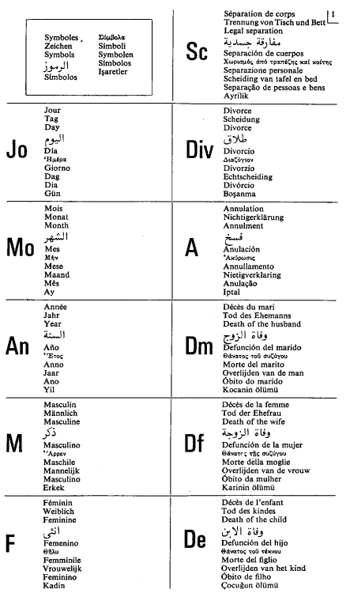
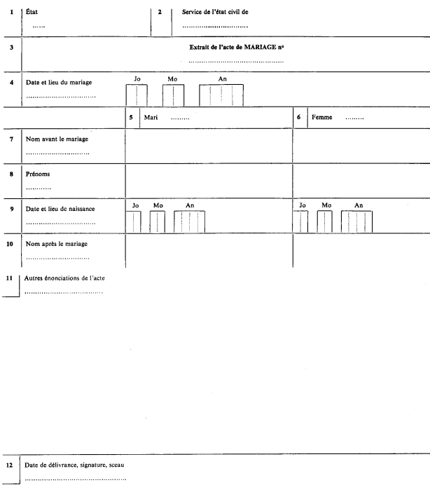
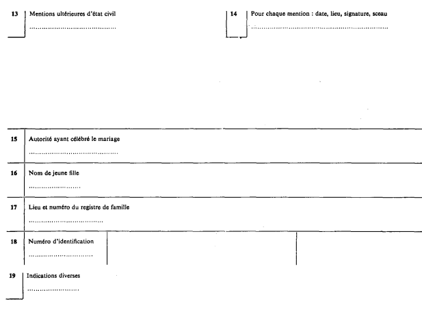
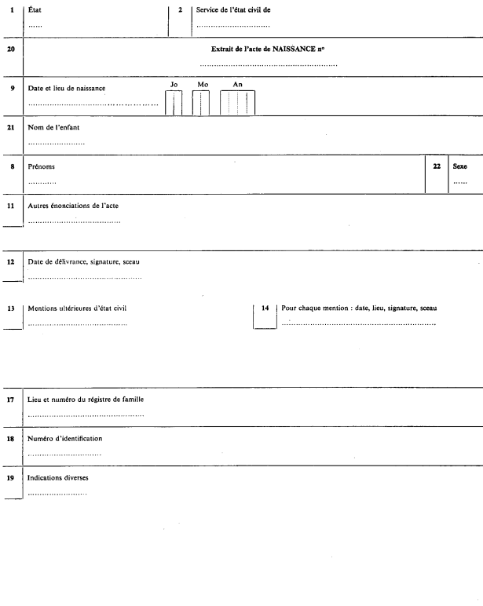
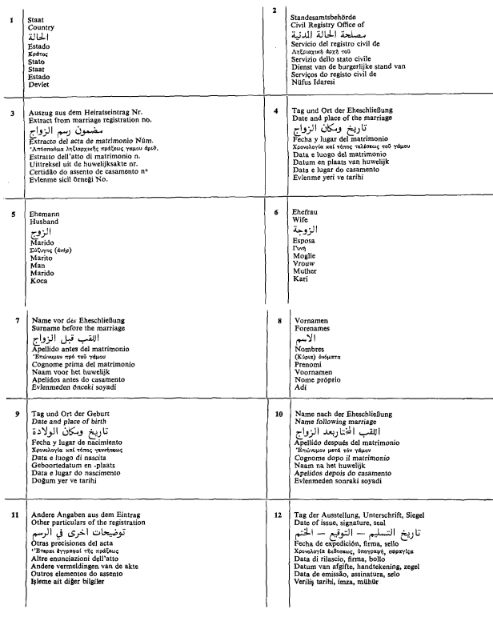
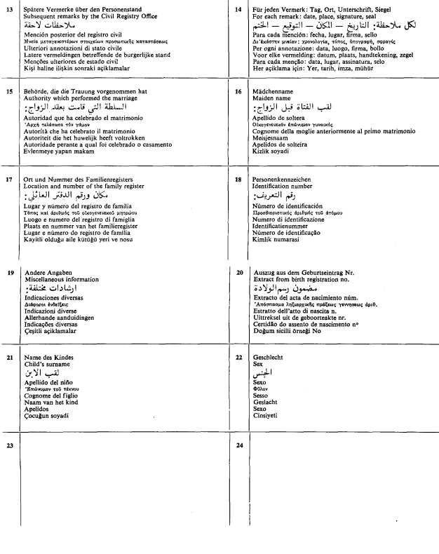

# Loi du 10 décembre 1975 portant approbation de la Convention créant un livret de famille international, signée à Paris, le 12 septembre 1974.

Nous JEAN, par la grâce de Dieu, Grand-Duc de Luxembourg, Duc de Nassau;

Notre Conseil d’Etat entendu;

De l’assentiment de la Chambre des Députés;

Vu la décision de la Chambre des Députés du 21 octobre 1975 et celle du Conseil d’Etat du 6 novembre 1975 portant qu’il n’y a pas lieu à second vote;

Avons ordonné et ordonnons:

## Article unique.

Est approuvée la Convention créant un livret de famille international, signée à Paris, le 12 septembre 1974.

Mandons et ordonnons que la présente loi soit insérée au Mémorial pour être exécutée et observée par tous ceux que la chose concerne.

Le Ministre des Affaires Etrangères  et du Commerce Extérieur a.i.,   Marcel Mart   Le Ministre de l’Intérieur,   Joseph Wohlfart   Le Ministre de la Justice,   Robert Krieps

Palais de Luxembourg, le 10 décembre 1975   Jean

CONVENTION  CREANT UN LIVRET DE FAMILLE INTERNATIONAL

Les Etats signataires de la présente Convention, membres de la Commission Internationale de l’Etat Civil, désireux d’instaurer un livret de famille international,

Sont convenus des dispositions suivantes:

## Article 1er

Lors du mariage, l’officier de l’état civil remet aux époux un livret de famille international conforme au modèle annexé à la présente Convention.

Aucun livret de famille d’un modèle différent ne peut être délivré.

## Article 2

Sont portées sur le livret de famille international les énonciations originaires et les mentions ultérieures des actes de l’état civil concernant le mariage des époux, la naissance de leurs enfants communs ainsi que le décès des époux et de ces enfants.

L’officier de l’état civil qui a dressé ou transcrit l’acte en porte les énonciations et mentions dans les cases correspondant aux formules imprimées du livret.

## Article 3

Des indications diverses, propres à chaque Etat contractant, peuvent en outre figurer dans la case prévue à cet effet dans le livret de famille international.

Elles y sont portées par les autorités compétentes ou les personnes habilitées dans cet Etat.

## Article 4

Si le livret de famille international n’a pas été délivré lors de la célébration du mariage, il peut l’être ultérieurement, soit par l’officier de l’état civil qui a célébré le mariage ou transcrit l’acte de mariage, soit par les autorités compétentes de l’Etat dont l’un au moins des époux est ressortissant.

Si certaines énonciations ou mentions d’état civil n’ont pas été portées sur le livret par l’officier de l’état civil désigné à l’article 2, elles peuvent l’être par les autorités compétentes de l’Etat dont l’un au moins des époux est ressortissant.

Chaque Etat contractant indiquera, lors de la signature, de la notification prévue à l’article 18 ou de l’adhésion, les autorités qui sont compétentes pour l’application des dispositions du présent article.

## Article 5

Les pages du livret de famille international sont numérotées sans discontinuité.

## Article 6

Toutes les inscriptions à porter sur le livret de famille international sont écrites en caractères latins d’imprimerie; elles peuvent en outre être écrites dans les caractères de la langue qui a été utilisée pour le rédaction de l’acte auquel elles se réfèrent.

Elles sont dactylographiées ou, à défaut, manuscrites.

## Article 7

Les dates sont inscrites en chiffres arabes indiquant successivement, sous les symboles Jo, Mo et An, le jour, le mois et l’année. Le jour et le mois sont indiqués par deux chiffres, l’année par quatre chiffres. Les neuf premiers jours du mois et les neuf premiers mois de l’année sont indiqués par des chiffres allant de 01 à 09.

Pour indiquer le sexe sont exclusivement utilisés les symboles suivants: F = féminin, M = masculin.

Pour indiquer la séparation de corps, le divorce, l’annulation du mariage, le décès du mari, le décès de la femme et le décès d’un enfant sont exclusivement utilisés les symboles suivants: Sc = séparation de corps; Div = divorce; A = annulation; Dm = décès du mari; Df = décès de la femme; De = décès de l’enfant. Ces symboles sont suivis de la date et du lieu de l’événement.

Le numéro d’identification de chacun des époux et des enfants est précédé du nom de l’Etat qui l’a attribué.

## Article 8

Les formules invariables du livret de famille international, à l’exclusion des symboles prévus à l’article 7 en ce qui concerne les dates, sont imprimées en deux langues au moins, dont la langue ou l’une des langues officielles de l’Etat où le livret est délivré et la langue française.

A la fin du livret les formules invariables doivent figurer au moins dans les langues des Etats membres de la Commission Internationale de l’Etat Civil ainsi que dans les langues anglaise, arabe et espagnole, pour autant que ces langues n’ont pas été utilisées pour l’impression de ces formules.

## Article 9

La signification des symboles utilisés dans le livret de famille international doit y être indiquée au moins dans les langues des Etats membres de la Commission Internationale de l’Etat Civil ainsi que dans les langues anglaise, arabe et espagnole.

## Article 10

Si les énonciations et mentions d’état civil ne permettent pas de remplir une case ou une partie de case d’un extrait d’acte, celle-ci est rendue inutilisable par des traits.

## Article 11

Les énonciations et mentions d’état civil portées sur le livret de famille international sont datées et revêtues de la signature et du sceau de l’autorité qui les a portées. Ces énonciations et mentions ont la même valeur que les extraits d’actes de l’état civil délivrés par ladite autorité.

Ce livret est accepté sans légalisation sur le territoire de chacun des Etats liés par la présente Convention.

## Article 12

Le livret de famille international doit être mis à jour dès qu’il ne correspond plus à la situation exacte.

L’officier de l’état civil qui dresse un acte dont il doit être fait mention dans le livret se fait remettre celui-ci en vue de sa mise à jour.

## Article 13

La délivrance du livret de famille international ne donne lieu à la perception d’aucun droit.

Il en est de même pour l’apposition des inscriptions dans le livret.

## Article 14

Chaque Etat contractant détermine le nombre de formules « Extrait de l’acte de naissance d’un enfant » que comportera le livret de famille international délivré sur son territoire.

## Article 15

Pour l’application de la présente Convention sont assimilés aux ressortissants d’un Etat les réfugiés et les apatrides dont le statut personnel est régi par la loi dudit Etat.

## Article 16

La présente Convention ne fait pas obstacle à l’insertion au début ou à la fin du livret de famille international de renseignements d’intérêt général ou local à l’intention des époux.

## Article 17

Chaque Etat contractant pourra, lors de la signature, de la notification prévue à l’article 18 ou de l’adhésion, déclarer:

aone *a)* que le livret de famille international sera seulement délivré si les intéressés le demandent après que leur attention ait été appelée par l’officier de l’état civil sur l’utilité de ce document, aucun autre livret de famille ne pouvant être délivré;

bone *b)* que pendant un délai ne pouvant excéder dix ans à compter de l’entrée en vigueur de la présente Convention en ce qui le concerne, le livret de famille international sera seulement délivré si les intéressés le demandent et le préfèrent au livret de famille national en usage, après que leur attention ait été appelée par l’officier de l’état civil sur l’utilité du document international;

cone *c)* que le livret de famille international ne sera délivré sur la totalité de son territoire qu’à l’expiration d’un délai ne pouvant excéder cinq ans à compter de l’entrée en vigueur de la présente Convention en ce qui le concerne et que pendant ce délai le livret de famille déjà en usage pourra encore être délivré;

done *d)* que les enfants adoptés ne seront pas mentionnés dans le livret de famille international;

eone *e)* qu’il n’appliquera pas l’article 13 ou l’une des dispositions de cet article.

## Article 18

Les Etats contractants notifieront au Conseil Fédéral Suisse l’accomplissement des procédures requises par leur Constitution pour rendre applicable sur leur territoire la présente Convention.

Le Conseil Fédéral Suisse avisera les Etats contractants et le Secrétaire Général de la Commission Internationale de l’Etat Civil de toute notification au sens de l’alinéa précédent.

## Article 19

La présente Convention entrera en vigueur à compter du trentième jour suivant la date de dépôt de la deuxième notification et prendra dès lors effet entre les deux Etats ayant accompli cette formalité.

Pour chaque Etat contractant, accomplissant postérieurement la formalité prévue à l’article précédent, la présente Convention prendra effet à compter du trentième jour suivant la date de sa notification.

Dès l’entrée en vigueur de la présente convention, le Gouvernement dépositaire en transmet le texte au secrétariat des Nations Unies en vue de son enregistrement et de sa publication, conformément à l’article 102 de la Charte des Nations Unies

## Article 20

Les réserves visées à l’article 17 peuvent être retirées totalement ou partiellement à tout moment.

Le retrait sera notifié au Conseil Fédéral Suisse.

Le Conseil Fédéral Suisse avisera les Etats contractants et le Secrétaire Général de la Commission Internationale de l’Etat Civil de toute notification au sens de l’alinéa précédent.

## Article 21

La présente Convention s’applique de plein droit sur toute l’étendue du territoire métropolitain de chaque Etat contractant.

Tout Etat pourra, lors de la signature, de la notification, de l’adhésion ou ultérieurement, déclarer par notification adressée au Conseil Fédéral Suisse que les dispositions de la présente Convention seront applicables à l’un ou plusieurs de ses territoires extra-métropolitains, des Etats ou des territoires dont il assume la responsabilité internationale. Le Conseil Fédéral Suisse avisera de cette dernière notification chacun des Etats contractants et le Secrétaire Général de la Commission Internationale de l’Etat Civil. Les dispositions de la présente Convention deviendront applicables dans le ou les territoires désignés dans la notification le soixantième jour suivant la date à laquelle le Conseil Fédéral Suisse aura reçu ladite notification.

Tout Etat qui a fait une déclaration conformément aux dispositions de l’alinéa 2 du présent article, pourra, par la suite déclarer à tout moment, par notification adressée au Conseil Fédéral Suisse, que la présente Convention cessera d’être applicable à l’un ou plusieurs des Etats ou territoires désignés dans la déclaration.

Le Conseil Fédéral Suisse avisera de la nouvelle notification chacun des Etats contractants et le Secrétaire Général de la Commission Internationale de l’Etat Civil.

La Convention cessera d’être applicable au territoire visé le soixantième jour suivant la date à laquelle le Conseil Fédéral Suisse aura reçu ladite notification.

## Article 22

Tout Etat pourra adhérer à la présente Convention après l’entrée en vigueur de celle-ci. L’acte d’adhésion sera déposé auprès du Conseil Fédéral Suisse. Celui-ci avisera chacun des Etats contractants et le Secrétaire Général de la Commission Internationale de l’Etat Civil de tout dépôt de l’acte d’adhésion. La Convention entrera en vigueur, pour l’Etat adhérent, le trentième jour suivant la date de dépôt de l’acte d’adhésion.

## Article 23

La présente Convention demeurera en vigueur sans limitation de durée. Chacun des Etats contractants aura toutefois la faculté de la dénoncer en tout temps au moyen d’une notification adressée par écrit au Conseil Fédéral Suisse, qui en informera les autres Etats contractants et le Secrétaire Général de la Commission Internationale de l’Etat Civil.

Cette faculté de dénonciation ne pourra être exercée avant l’expiration d’un délai d’un an à compter de la notification prévue à l’article 18 ou de l’adhésion.

La dénonciation produira effet à compter d’un délai de six mois après la date à laquelle le Conseil Fédéral Suisse aura reçu la notification prévue à l’alinéa premier du présent article.

EN FOI DE QUOI les représentants soussignés, dûment autorisés à cet effet, ont signé la présente Convention.

FAIT à Paris, le 12 septembre mil neuf cent soixante quatorze, en un seul exemplaire qui sera déposé dans les archives du Conseil Fédéral Suisse et dont une copie certifiée conforme sera remise par la voie diplomatique à chacun des Etats contractants et au Secrétaire Général de la Commission Internationale de l’Etat Civil.

Doc. parl. n° 1897; sess. ord. 1974-1975
