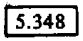
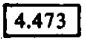
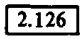
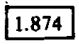
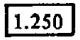
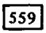
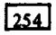
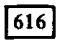
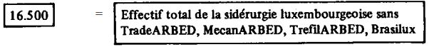

# Loi du 1er juillet 1981 concernant des mesures de nature à favoriser la restructuration et la modernisation de la sidérurgie.

Nous JEAN, par la grâce de Dieu, Grand-Duc de Luxembourg, Duc de Nassau;

Notre Conseil d’Etat entendu;

De l’assentiment de la Chambre des Députés;

Vu la décision de la Chambre des Députés du 26 juin 1981 et celle du Conseil d’Etat du 30 juin 1981 portant qu’il n’y a pas lieu à second vote;

Avons ordonné et ordonnons:

## **Chapitre 1** **er** — Dispositions générales

### Art. 1er.

(1) En vue de favoriser la restructuration et la modernisation de la sidérurgie, conformément aux finalités et modalités déterminées dans l’avenant du 22 janvier 1981 à l’accord de la conférence tripartite « sidérurgie » du 19 mars 1979 et dans ses annexes, le Gouvernement est autorisé, pour autant que de besoin, à mettre en oeuvre les moyens supplémentaires prévus à cet effet par le prédit avenant, qui est annexé à la présente loi.

(2) Dans la mesure où la mise en oeuvre des moyens dont question au paragraphe (1) ci-dessus requiert des autorisations légales spéciales, les dispositions ci-après sont applicables:

## Chapitre 2 — Aides à l’investissement

### Art. 2.

Pour l’octroi, au taux de quinze pour cent, de la subvention en capital, prévue par l’article 5 de la [loi du 28 juillet 1973](https://legilux.public.lu/eli/etat/leg/loi/1973/07/28/n2/jo) ayant entre autres pour objet de stimuler l’expansion économique, sur les investissements réalisés par les sociétés sidérurgiques pendant la période du 1er janvier 1980 au 31 décembre 1984, l’application des dispositions y relatives est prorogée jusqu’au 31 décembre 1984.

### Art. 3.

(1) Les investissements visés à l’article 2 peuvent bénéficier en outre d’une aide extraordinaire et temporaire, au taux de dix pour cent pendant les exercices 1980, 1981 et 1982. Cette aide peut être prorogée par règlement grand-ducal, en tout ou en partie, pour les exercices 1983 et 1984.

(2) L’aide prévue au paragraphe (1) devient remboursable en faveur de l’Etat, suivant des conditions et modalités à fixer par règlement grand-ducal, lorsque la société bénéficiaire de l’aide réalise un revenu imposable au sens de la [loi modifiée du 4 décembre 1967](https://legilux.public.lu/eli/etat/leg/loi/1967/12/04/n1/jo) concernant l’impôt sur le revenu.

## Chapitre 3 — Garantie de l’Etat sur les prêts CECA au profit de la sidérurgie

### Art. 4.

Le paragraphe (3) de l’article 4bis de la [loi du 24 décembre 1977](https://legilux.public.lu/eli/etat/leg/loi/1977/12/24/n1/jo) autorisant le Gouvernement à prendre les mesures destinées à stimuler la croissance économique et à maintenir le plein emploi, telle qu’elle a été complétée par la [loi du 8 juin 1979](https://legilux.public.lu/eli/etat/leg/loi/1979/06/08/n1/jo), est remplacé comme suit:

> « (3) Le montant total à concurrence duquel la garantie de l’Etat peut être accordée est fixé à treize milliards cinq cents millions de francs (13.500.000.000 fr.). Cette limite se réfère au montant initial des emprunts à garantir. »

### Art. 5.

Le paragraphe (4) de l’article 24 de la [loi précitée du 24 décembre 1977](https://legilux.public.lu/eli/etat/leg/loi/1977/12/24/n1/jo), tel que cet article a été complété par la [loi du 8 juin 1979](https://legilux.public.lu/eli/etat/leg/loi/1979/06/08/n1/jo), est modifié comme suit:

> « (4) Les dispositions de l’article 4bis demeurent en vigueur jusqu’au 31 décembre 1984. Les garanties accordées par l’Etat avant l’expiration définitive des prédites dispositions valent pendant toute la durée des prêts garantis, laquelle ne peut toutefois dépasser dix années. »

## Chapitre 4 — Intervention de la société nationale de crédit et d’investissement

### Art. 6.

L’article 11 (1) de la [loi du 2 août 1977](https://legilux.public.lu/eli/etat/leg/loi/1977/08/02/n1/jo) portant création d’une société nationale de crédit et d’investissement est remplacé comme suit:

> « (1) une dotation de l’Etat au montant de six cents millions de francs, pouvant être versée en une tranche de trois cents millions de francs et trois tranches de cent millions de francs. Cette dotation peut être constituée en partie moyennant la cession par l’Etat des titres qu’il a acquis par application de l’[arrêté grand-ducal du 1er août 1952](https://legilux.public.lu/eli/etat/leg/agd/1952/08/01/n1/jo) relatif à l’attribution à l’Etat de la contre-valeur des titres non déclarés et de la [loi du 12 juin 1975](https://legilux.public.lu/eli/etat/leg/loi/1975/06/12/n1/jo) portant dissolution de l’office des séquestres. Un règlement grand-ducal à prendre sur avis du Conseil d’Etat et de l’assentiment de la Commission de Travail de la Chambre des Députés peut porter cette dotation à un milliard cent millions de francs. »

## Chapitre 5 — Intervention du fonds de chômage

### Art. 7.

(1) Le premier alinéa du paragraphe (3) de l’article 2 de la [loi du 30 juin 1976](https://legilux.public.lu/eli/etat/leg/loi/1976/06/30/n1/jo) portant 1. création d’un fonds de chômage; 2. réglementation de l’octroi des indemnités de chômage complet, tel que cet article a été complété par la [loi du 8 juin 1979](https://legilux.public.lu/eli/etat/leg/loi/1979/06/08/n1/jo), est remplacé comme suit:

> « (3) Le fonds de chômage couvre les dépenses de rémunération résultant du maintien de la relation contractuelle des travailleurs de la sidérurgie, rendus disponibles en raison de la restructuration et de la modernisation de l’outil sidérurgique, et ce à concurrence, au maximum, des pourcentages suivants du coût salarial total par travailleur:
>
> – vingt pour cent pendant l’année 1980;
>
> – dix-huit pour cent pendant l’année 1981;
>
> – seize pour cent pendant l’année 1982;
>
> – quatorze pour cent pendant l’année 1983. »

(2) Par dérogation au paragraphe qui précède, les pourcentages y prévus pour les années 1981 et 1982 peuvent être portés de respectivement dix-huit pour cent et seize pour cent au maximum à quatre-vingts pour cent pendant la période du 1er juillet 1981 au 30 juin 1982, sans que pour autant la dépense supplémentaire qui en résulte pour le fonds de chômage puisse dépasser pour la prédite période le montant total de 600.000.000 francs.

### Art. 8.

Pour l’année 1982, les taux prévus aux articles 5 à 8 de la [loi modifiée du 30 juin 1976](https://legilux.public.lu/eli/etat/leg/loi/1976/06/30/n1/jo) portant 1. création d’un fonds de chômage; 2. réglementation de l’octroi des indemnités de chômage complet sont fixés comme suit:

a) Le taux prévu au paragraphe 1 er de l’article 5 est porté de 0,25% à 0,50%;

b) Le taux prévu au paragraphe 1 er de l’article 6 est porté de 102,5% à 105%;

c) Les taux prévus aux paragraphes 2 et 3 de l’article 6 sont portés de 2,5% à 5%;

d) Le taux prévu au paragraphe 1er de l’article 7 est porté de 101% à 102%;

e) Le taux prévu au paragraphe 2 de l’article 7 est porté de 1% à 2%;

f) Le taux prévu au paragraphe 2 de l’article 8 est porté de 2% à 4%.

## Chapitre 6 — Dispositions budgétaires

### Art. 9.

La [loi du 23 décembre 1980](https://legilux.public.lu/eli/etat/leg/loi/1980/12/23/n1/jo) concernant le budget des recettes et des dépenses de l’Etat pour l’exercice 1981 est modifiée comme suit:

(1) Il est ajouté à la section 31.2 « société nationale de crédit et d’investissement » un article 31.2.81.00 nouveau avec les libellé et crédit suivants:

> | 31.2.81.00 | { | 22.1 22.2 22.3 | Dotation de l’Etat | 100.000.000 |
> |---|---|---|---|---|
>
> Les numéros des articles 31.2.81.00 et 31.2.81.01 sont remplacés respectivement par les numéros 31.2.81.01 et 31.2.81.02.

(2) A la section 49.0 « Economie », l’article 49.0.51.01 est remplacé comme suit:

> | 49.0.51.01 |  | 22.1 | Mesures et interventions visant la création ou l’amélioration d’infrastructures industrielles, y compris la mise en valeur de terrains et bâtiments, en vue de promouvoir et de faciliter l’établissement, le développement et l’extension d’entreprises de production de biens et de services: dépenses et frais connexes; participation à des dépenses et subsides. (Crédit non limitatif et sans distinction d’exercice) | 110.000.000 |
> |---|---|---|---|---|

(3) Il est ajouté à la section 49.0 « Economie » un article 49.0.51.03 nouveau avec les libellé et crédit suivants:

> | 49.0.51.03 |  | 22.1 | Subventions extraordinaires et uniques à titre d’intervention de l’Etat dans la solution définitive du problème de certaines charges anciennes dues à la restructuration de l’industrie sidérurgique | 150.000.000 |
> |---|---|---|---|---|

### Art. 10.

En vue du paiement de l’aide prévue à l’article 3 de la présente loi, pour autant qu’elle se rapporte à l’exercice 1980, les délais fixés respectivement par les articles 7, 41 et 42 de la [loi modifiée du 27 juillet 1936](https://legilux.public.lu/eli/etat/leg/loi/1936/07/27/n2/jo) concernant la comptabilité de l’Etat et par les articles 22 et 49 de l’[arrêté grand-ducal modifié du 21 décembre 1936](https://legilux.public.lu/eli/etat/leg/agd/1936/12/21/n2/jo) portant règlement sur la comptabilité de l’Etat sont prorogés de deux mois en ce qui concerne le prédit exercice.

## Chapitre 7 — Disposition additionnelle

### Art. 11.

Le point 12° de l’article 2 de la [loi modifiée du 30 juin 1976](https://legilux.public.lu/eli/etat/leg/loi/1976/06/30/n1/jo) portant 1. création d’un fonds de chômage ;

2\. réglementation de l’octroi des indemnités de chômage complet est modifié comme suit:

> « 12° de l’octroi d’une indemnité temporaire de réemploi aux travailleurs licenciés, menacés de perdre leur emploi ou faisant, conformément à une convention collective, l’objet d’un transfert dans une autre entreprise qui se trouvent reclassés dans un emploi comportant un niveau de rémunération inférieur à leur rémunération antérieure. Un règlement grand-ducal déterminera les conditions et modalités d’application de cette disposition ainsi que son champ d’application sectoriel; les aides accordées éventuellement à ce titre par les Communautés Européennes sont portées directement en recette au fonds de chômage. »

Mandons et ordonnons que la présente loi soit insérée au Mémorial pour être exécutée et observée par tous ceux que la chose concerne.

Les Membres du Gouvernement,   Pierre Werner   Colette Flesch   Emile Krieps   Camille Ney   Josy Barthel   Jacques Santer   René Konen   Fernand Boden   Jean Spautz   Ernest Muhlen   Paul Helminger

Château de Berg, le 1er juillet 1981.   Jean

ANNEXE

\**AVENANT DU 22 JANVIER 1981**

\**à l’accord de la conférence tripartite "Sidérurgie" du 19 mars 1979**

\**sur la restructuration de la sidérurgie luxembourgeoise**

Considérant

que le but visé par l’accord de la conférence tripartite "Sidérurgie" du 19 mars 1979 sur la restructuration de la sidérurgie luxembourgeoise continue à constituer un objectif essentiel de la politique économique, sociale et financière du pays en ce qu’il se propose de consolider à long terme le site luxembourgeois pour une industrie sidérurgique compétitive, assurant une quote-part substantielle du PNB et l’emploi de 16.500 personnes après la réalisation du programme d’investissement ;

que toutefois l’exécution du programme d’investissement intégral prévu audit accord, et ce dans le délai voulu, est compromise par la remise en cause des perspectives de marché à court et à long terme ainsi que des conditions de financement par suite d’une nouvelle dégradation sérieuse de la situation économique mondiale, et plus particulièrement du marché sidérurgique ;

que, tout en maintenant les finalités et les actions de l’accord du 19 mars 1979, il importe dès lors d’adapter les modalités et les moyens de réalisation de ce programme, le tout dans le cadre de la politique sidérurgique communautaire ;

A cet effet, il est convenu de ce qui suit, sous réserve de l’approbation par la Commission des Communautés européennes pour les matières relevant de sa compétence :

1\. Tous les engagements pris aux termes de l’accord du 19 mars 1979 sont expressément confirmés, sous réserve des stipulations ci-après.

2\. Il est plus particulièrement souligné qu’après la modernisation de la phase liquide, avec une capacité de 6 millions de tonnes d’acier brut, il est vital d’en assurer la valorisation en produits finis aussi évolués que possible par une modernisation correspondante des installations de laminage et de transformation.

A cet égard, les pièces maîtresses du programme d’investissement prévu à l’accord du 19 mars 1979 le train à fil, le train Grey, le train moyen avec coulée continue et le laminoir pour tôles à froid _ continuent à être considérées comme étant essentielles pour la réalisation de cet objectif

3\. Toutefois, compte tenu des contraintes engendrées par l’aggravation de la crise sidérurgique européenne et de l’évolution de la technologie, il s’avère indispensable d’établir de nouvelles priorités en matière d’investissements pour la période 1980 - 1984.

4\. A cet effet, les listes formant les annexes A 1 et A 2 du présent avenant énumèrent les équipements prioritaires retenus et destinés à s’intégrer dans les réalisations antérieures. Il est référé par ailleurs à l’annexe B indiquant la consistance et les effectifs des usines luxembourgeoises dans la perspective 1984.

5\. Le rythme d’exécution de l’ensemble du programme d’investissement, dont notamment le train moyen avec coulée continue ou un équipement équivalent, fera l’objet d’un examen annuel, dans le cadre des réunions tripartites périodiques prévues à l’accord du 19 mars 1979.

6\. Les différents projets du programme d’investissement dont la mise en oeuvre est prévue après 1982 seront appréciés au regard des critères ayant présidé à l’établissement des priorités visées sous 4 _ conformité avec la stratégie générale de la sidérurgie luxembourgeoise dans le cadre de la politique sidérurgique communautaire, exigences de qualité, avenir du produit, besoins de capacités, rentabilité, viabilité à long terme _ ainsi qu’en fonction des disponibilités financières des sociétés, constituées notamment par leurs possibilités d’autofinancement et d’endettement, et des aides publiques éventuelles.

7\. En tout cas, l’ARBED s’engage à donner la priorité au site luxembourgeois pour l’implantation d’un nouveau train moyen au sein de son groupe.

8\. Dans l’intérêt de la consolidation à long terme du site sidérurgique luxembourgeois et afin d’en garantir la compétitivité et la diversification sur la base de programmes d’investissement pluriannuels, les parties se concerteront et le cas échéant, négocieront, à partir de 1983, dans le cadre des réunions tripartites périodiques, les programmes d’investissement consécutifs à réaliser après 1984, ceci sans préjudice des modalités de mise en oeuvre de ces programmes.

9\. Le facteur transport, notamment les tarifs ferroviaires, constituant un élément important du prix de revient et donc de la compétitivité de la sidérurgie luxembourgeoise ainsi que de la rentabilité de ses investissements, le Gouvernement marque son accord à ce que la proposition faite conjointement par les CFL et l’ARBED, concernant la tarification des transports en provenance et à destination des usines sidérurgiques luxembourgeoises, soit appliquée pour les années 1980 à 1984.

Pour l’importation et l’exportation de produits pondéreux _ minerais, combustibles solides et liquides, produits sidérurgiques, etc. _, quelle qu’en soit la provenance ou la destination, les sociétés sidérurgiques s’engagent de leur côté, pour la même période, à faire passer par les lignes des CFL leurs transports ferroviaires.

A l’expiration de la prédite période, l’Etat, les CFL et les sociétés sidérurgiques se concerteront sur la tarification et les itinéraires d’acheminement des transports susvisés.

10\. L’ARBED s’engage à ne pas déplacer à l’étranger le centre de décision de son groupe.

Dans ce cadre, elle confirme son engagement. pris aux termes de l’accord du 19 mars 1979 prévoyant que toute création de nouvelles liaisons techniques, commerciales et financières au sein du groupe et avec tout autre groupe, de nature à influencer l’avenir du site luxembourgeois, doit être préalablement notifiée au Gouvernement et examinée à la conférence tripartite "Sidérurgie".

Aux fins visées au premier alinéa ci-dessus, le Gouvernement introduira un projet de loi créant, pour l’impôt sur le revenu, un régime d’intégration fiscale des sociétés de capitaux résidentes pleinement imposables, liées économiquement et organiquement entre elles ; ce régime sera applicable aux cas où la société mère détient une participation de 99% au moins dans le capital social de sa filiale.

11\. Il sera proposé d’introduire un report illimité des pertes correspondant à la moitié des amortissements pour les entreprises appartenant à des branches économiques déclarées en crise structurelle et ce pour les amortissements pratiqués au cours d’une telle crise.

12\. Les investissements réalisés par les sociétés sidérurgiques pendant la période du 1er janvier 1980 au 31 décembre 1984 et évalués aux prix de 1980 à quelque 20 milliards de francs bénéficieront de la subvention en capital prévue dans la loi-cadre d’expansion économique du 28 juillet 1973, et ce au taux de 15% des montants portés à l’actif du bilan des exercices correspondants, étant entendu que les travaux d’investissement exécutés par les travailleurs de la DAC seront mis en compte au coût effectif pour l’entreprise, c’est-à-dire sous déduction de l’intervention du Fonds de chômage prévue sous 18 ci-dessous. Les avantages financiers prévus à l’accord tripartite du 3 août 1978 pour les travaux d’investissement sidérurgiques effectués par les travailleurs de la DAC prennent fin au 31 décembre 1979.

13\. A titre exceptionnel et compte tenu du fait que les sociétés sidérurgiques ne sont pas en état de bénéficier de l’aide fiscale temporaire à l’investissement, le Gouvernement proposera, dans le cadre des budgets annuels, les crédits nécessaires pour que les investissements définis sous 12 puissent bénéficier d’une aide extraordinaire et temporaire de 10% sur la même base de calcul pendant les exercices 1980, 1981 et 1982. Cette aide pourra être prorogée en tout ou en partie pour les exercices 1983 et 1984, après concertation au sein de la conférence tripartite "Sidérurgie", au vu de la situation financière des sociétés sidérurgiques, notamment de leurs possibilités d’auto financement et d’endettement, ainsi que des possibilités financières de l’Etat.

L’aide prévue au présent paragraphe est remboursable dans les conditions et suivant les modalités fixées à l’annexe C.

14\. L’ARBED ayant décidé d’implanter le nouveau laminoir à froid sur le site de Dudelange-Bettembourg, le Gouvernement se déclare prêt à intervenir dans le coût de l’infrastructure sur le site moyennant une contribution forfaitaire de 100 millions de francs, mais sans assumer d’autres frais d’investissement ou des frais d’exploitation découlant de ce choix de l’ARBED, étant entendu que le solde du prédit coût est éligible pour l’octroi des aides visées sous 12 et 13.

Les travaux d’infrastructure sur le site se feront, dans la mesure du possible, par le recours aux travaux extraordinaires d’intérêt général, ceci dans la limite de la contribution forfaitaire définie ci-dessus.

15\. Dans le cadre de la politique industrielle, le Gouvernement et l’ARBED s’engagent à vouer une attention toute particulière aux sites de Differdange et de Rodange.

L’ARBED mettra à disposition la partie du site HANEBOESCH non réservée à des activités sidérurgiques et l’Etat rachètera le site de la MMR - A non occupé par les installations restées en exploitation, en vue de l’implantation d’activités industrielles nouvelles.

16\. Les sociétés sidérurgiques ARBED et MMR - A bénéficieront auprès de la SNCI de deux tranches de prêts spéciaux à taux réduit de respectivement 500 millions et 14 millions de francs par an au titre des investissements des exercices 1980 et 1981.

17\. Il sera proposé de porter le plafond de la garantie de l’Etat pour les prêts CECA au profit de la sidérurgie luxembourgeoise de 10 à 13,5 milliards de francs.

18\. Les parties à la conférence tripartite "Sidérurgie" réaffirment leur volonté de réduire, dans toute la mesure du possible et dans le respect de la garantie de l’emploi, l’effectif de la division anticrise et de favoriser la mobilité volontaire du personnel de la sidérurgie, notamment vers les entreprises nouvelles à implanter dans le sud du pays, conformément aux objectifs définis dans l’accord du 19 mars 1979.

L’indemnité temporaire de réemploi des travailleurs de la sidérurgie sera améliorée au profit du personnel de manière que la garantie de salaire est fixée à

aone 100% pendant 6 mois,

bone 95% pendant les 6 mois suivants,

cone 90% pendant les 6 mois suivants,

done 85% pendant les 6 mois suivants.

Il sera proposé de fixer l’intervention maximale du Fonds de chômage dans le financement du coût salarial de la DAC à

aone 20% pour 1980,

bone 18% pour 1981,

cone 16% pour 1982,

done 14% pour 1983.

Les sociétés sidérurgiques s’engagent à fournir aux membres des délégations mixtes, instituées par l’accord spécial du 31 juillet 1975, préalablement aux réunions de consultation prévues à l’accord du 1er juin 1977, les explications nécessaires sur les mesures à discuter au sein desdites réunions.

Les partenaires sociaux retiennent le tableau figurant à l’annexe D comme partie intégrante de l’accord de réduction programmée de l’emploi.

19\. L’ARBED et l’Etat interviennent dans la solution définitive du problème des charges anciennes de la MMR - A, ceci dans le cadre d’une solution industrielle globale conforme au schéma figurant dans l’annexe E.

L’ARBED confirme son engagement de maintenir et de consolider l’usine de Rodange comme relamineur.

20\. Pour développer le secteur de la transformation de l’acier et contribuer ainsi à la création d’emplois nouveaux, l’ARBED s’engage à mettre en place à Luxembourg une société ayant pour objet principal de coordonner les activités de ses diverses entreprises de transformation de l’acier.

21\. Lors des analyses périodiques prévues dans les considérations finales de l’accord tripartite du 19 mars 1979, il sera procédé aussi à l’examen de la situation financière des sociétés sidérurgiques.

22\. Les parties s’engagent à promouvoir et à soutenir toute mesure susceptible de favoriser la réalisation des objectifs visés dans cet avenant et la mise en oeuvre des moyens nécessaires à cet effet.

En cas de changement fondamental de la situation par rapport aux hypothèses économiques et financières qui sont à la base du présent avenant, les parties se concerteront sur les aménagements à apporter à son exécution.

Luxembourg, le 22 janvier 1981.

Pour: le Gouvernement, ARBED, MMR-A, OGB-L, FEP, LCGB

(suivent les signatures)

ANNEXES A L’AVENANT DU 22 JANVIER 1981

A L’ACCORD DE LA CONFERENCE TRIPARTITE « SIDERURGIE »

DU 19 MARS 1979 SUR LA RESTRUCTURATION

DE LA SIDERURGIE LUXEMBOURGEOISE

| ARBED S.A. | ANNEXE A 1 |
|---|---|

\**DEPENSES D’INVESTISSEMENT PREVUES PAR LE PROGRAMME 1980 - 1984 DE RESTRUCTURATION DE LA SIDERURGIE LUXEMBOURGEOISE**

<table>
<tr>
<th><i>Projets d’investissement</i></th>
<th><i>Priorité</i> <i>suivant période</i> <i>de réalisation</i></th>
<th><i>Coût</i> <i>total</i></th>
<th><i>Dépenses antérieures</i> <i>au 1.1.1980</i></th>
<th><i>Dépenses postérieures</i> <i>au 1.1.1980</i></th>
<th><i>Esch-Belval</i></th>
<th><i>Differdange</i></th>
<th><i>Esch-Schifflange</i></th>
<th><i>Dudelange</i></th>
<th><i>Autres</i> <i>divisions</i> <i>(ADo. AMi. AR)</i></th>
</tr>
<tr>
<th></th>
<th><i>(19 . . - 19 . .)</i></th>
<th><i>(mio F)</i></th>
<th><i>(mio F)</i></th>
<th><i>(mio F)</i></th>
<th><i>(mio F)</i></th>
<th><i>(mio F)</i></th>
<th><i>(mio F)</i></th>
<th><i>(mio F)</i></th>
<th><i>(mio F)</i></th>
</tr>
<tr>
<td><b>PROJETS IMPORTANTS</b></td>
<td></td>
<td></td>
<td></td>
<td></td>
<td></td>
<td></td>
<td></td>
<td></td>
<td></td>
</tr>
<tr>
<td>Investissements nouveaux</td>
<td></td>
<td></td>
<td></td>
<td></td>
<td></td>
<td></td>
<td></td>
<td></td>
<td></td>
</tr>
<tr>
<td><i>Secteur fils et petits fer</i></td>
<td></td>
<td></td>
<td></td>
<td></td>
<td></td>
<td></td>
<td></td>
<td></td>
<td></td>
</tr>
<tr>
<td>2 machines de coulée continue</td>
<td>79 - 81</td>
<td>2 550</td>
<td>340</td>
<td>2 210</td>
<td></td>
<td></td>
<td>2 210</td>
<td></td>
<td></td>
</tr>
<tr>
<td>Modernisation du train 330</td>
<td>82 - 83</td>
<td>200</td>
<td></td>
<td>200</td>
<td></td>
<td></td>
<td>200</td>
<td></td>
<td></td>
</tr>
<tr>
<td>Modernisation du train à fil</td>
<td>81 - 83</td>
<td>1 510</td>
<td></td>
<td>1 510</td>
<td></td>
<td></td>
<td>1 510</td>
<td></td>
<td></td>
</tr>
<tr>
<td>Extension de l’aciérie LDAC</td>
<td>80 - 82</td>
<td>325</td>
<td></td>
<td>325</td>
<td></td>
<td></td>
<td>325</td>
<td></td>
<td></td>
</tr>
<tr>
<td><i>Secteur pourtrelles Grey</i></td>
<td></td>
<td></td>
<td></td>
<td></td>
<td></td>
<td></td>
<td></td>
<td></td>
<td></td>
</tr>
<tr>
<td>Aménagement des avals du train Grey</td>
<td>79 - 81</td>
<td>365</td>
<td>29</td>
<td>336</td>
<td></td>
<td>336</td>
<td></td>
<td></td>
<td></td>
</tr>
<tr>
<td><i>Secteur produits plats à chaud</i></td>
<td></td>
<td></td>
<td></td>
<td></td>
<td></td>
<td></td>
<td></td>
<td></td>
<td></td>
</tr>
<tr>
<td>Coulée continue pour brames</td>
<td>81 - 83</td>
<td>2 700</td>
<td></td>
<td>2 700</td>
<td>2 700</td>
<td></td>
<td></td>
<td></td>
<td></td>
</tr>
<tr>
<td>Mise en 2e chaude du Steckel</td>
<td>81 - 83</td>
<td>900</td>
<td></td>
<td>900</td>
<td></td>
<td></td>
<td></td>
<td>900</td>
<td></td>
</tr>
<tr>
<td>Modernisation du laminoir à chaud</td>
<td>81 - 83</td>
<td>511</td>
<td>11</td>
<td>500</td>
<td></td>
<td></td>
<td></td>
<td>500</td>
<td></td>
</tr>
<tr>
<td><i>Secteur produits plats à froid</i></td>
<td></td>
<td></td>
<td></td>
<td></td>
<td></td>
<td></td>
<td></td>
<td></td>
<td></td>
</tr>
<tr>
<td>Nouveau tandem à froid</td>
<td>81 - 84</td>
<td>3 500</td>
<td></td>
<td>3 500</td>
<td></td>
<td></td>
<td></td>
<td>3 500</td>
<td></td>
</tr>
<tr>
<td>Nouveau recuit avec skin pass</td>
<td>81 - 84</td>
<td>2 000</td>
<td></td>
<td>2 000</td>
<td></td>
<td></td>
<td></td>
<td>2 000</td>
<td></td>
</tr>
<tr>
<td><i>Secteur produits longs des trains II , III/IV</i></td>
<td></td>
<td></td>
<td></td>
<td></td>
<td></td>
<td></td>
<td></td>
<td></td>
<td></td>
</tr>
<tr>
<td>Modernisation des gros trains  (Blooming, Trains II, III/IV)</td>
<td>81 - 84</td>
<td>1 000</td>
<td></td>
<td>1 000</td>
<td>1 000</td>
<td></td>
<td></td>
<td></td>
<td></td>
</tr>
<tr>
<td><i>Nouveau train moyen avec coulée continue ou équipement équivalent</i>)*</td>
<td>fin 84 -</td>
<td>8 100</td>
<td></td>
<td>8 100</td>
<td>8 100</td>
<td></td>
<td></td>
<td></td>
<td></td>
</tr>
<tr>
<td>*) cf. par. 5 à 7 de l’avenant.</td>
<td></td>
<td></td>
<td></td>
<td></td>
<td></td>
<td></td>
<td></td>
<td></td>
<td></td>
</tr>
<tr>
<td><b>Reports de crédits</b></td>
<td></td>
<td></td>
<td></td>
<td></td>
<td></td>
<td></td>
<td></td>
<td></td>
<td></td>
</tr>
<tr>
<td>Nouveau haut fourneau C avec conduite à gaz AEB - ADi</td>
<td>77 - 80</td>
<td>6 198</td>
<td>5 513</td>
<td>685</td>
<td>685</td>
<td></td>
<td></td>
<td></td>
<td></td>
</tr>
<tr>
<td>Extension de l’aciérie LDAC</td>
<td>78 - 80</td>
<td>417</td>
<td>217</td>
<td>200</td>
<td></td>
<td>200</td>
<td></td>
<td></td>
<td></td>
</tr>
<tr>
<td>3 nouveaux fours Pits</td>
<td>78 - 80</td>
<td>191</td>
<td>171</td>
<td>20</td>
<td></td>
<td>20</td>
<td></td>
<td></td>
<td></td>
</tr>
<tr>
<td>Nouveau centre de décapage-refendage</td>
<td>78 - 80</td>
<td>1 299</td>
<td>1 244</td>
<td>55</td>
<td></td>
<td>55</td>
<td></td>
<td></td>
<td></td>
</tr>
<tr>
<td>Four à induction pour la tuberie</td>
<td>79 - 80</td>
<td>113</td>
<td>8</td>
<td>105</td>
<td></td>
<td>105</td>
<td></td>
<td></td>
<td></td>
</tr>
<tr>
<td>2e Creuset à l’aciérie LDAC</td>
<td>78 - 80</td>
<td>732</td>
<td>709</td>
<td>23</td>
<td></td>
<td></td>
<td>23</td>
<td></td>
<td></td>
</tr>
<tr>
<td><b>AUTRES PROJETS</b></td>
<td></td>
<td></td>
<td></td>
<td></td>
<td></td>
<td></td>
<td></td>
<td></td>
<td></td>
</tr>
<tr>
<td><b>Investissements courants</b></td>
<td></td>
<td></td>
<td></td>
<td></td>
<td></td>
<td></td>
<td></td>
<td></td>
<td></td>
</tr>
<tr>
<td>Restructuration et rationalisation*</td>
<td>79 - 84</td>
<td>1 766</td>
<td>549</td>
<td>1 217</td>
<td>626</td>
<td>376</td>
<td>85</td>
<td>73</td>
<td>57</td>
</tr>
<tr>
<td>Promotion des ventes, amélioration de la qualité des produits*</td>
<td>79 - 84</td>
<td>635</td>
<td>156</td>
<td>479</td>
<td>182</td>
<td>142</td>
<td>81</td>
<td>58</td>
<td>16</td>
</tr>
<tr>
<td>Economie d’énergies*</td>
<td>79 - 84</td>
<td>328</td>
<td>65</td>
<td>263</td>
<td>167</td>
<td>96</td>
<td></td>
<td></td>
<td></td>
</tr>
<tr>
<td>Amélioration des conditions de travail ou de l’environnement*</td>
<td>79 - 84</td>
<td>170</td>
<td>88</td>
<td>82</td>
<td>24</td>
<td>53</td>
<td>1</td>
<td>4</td>
<td></td>
</tr>
<tr>
<td>Diversification*</td>
<td>79 - 84</td>
<td>327</td>
<td>22</td>
<td>305</td>
<td>305</td>
<td></td>
<td></td>
<td></td>
<td></td>
</tr>
<tr>
<td>Conduite à Gaz Esch/Belval - Terre Rouge</td>
<td>81 - 84</td>
<td>200</td>
<td></td>
<td>200</td>
<td>200</td>
<td></td>
<td></td>
<td></td>
<td></td>
</tr>
<tr>
<td>Azoduc vers Esch-Dudelange</td>
<td>81 - 84</td>
<td>189</td>
<td></td>
<td>189</td>
<td>53</td>
<td>53</td>
<td>53</td>
<td>30</td>
<td></td>
</tr>
<tr>
<td>Divers*</td>
<td>79 - 84</td>
<td>1 227</td>
<td>528</td>
<td>699</td>
<td>284</td>
<td>210</td>
<td>27</td>
<td>48</td>
<td>130</td>
</tr>
<tr>
<td>Total :</td>
<td></td>
<td>37 453</td>
<td>9 650</td>
<td>27 803</td>
<td>14 326</td>
<td>1 646</td>
<td>4 515</td>
<td>7 113</td>
<td>203</td>
</tr>
<tr>
<td></td>
<td></td>
<td></td>
<td></td>
<td></td>
<td></td>
<td></td>
<td></td>
<td></td>
<td></td>
</tr>
<tr>
<td colspan="10">* La répartition par division de ces dépenses est connue pour 1980 et pour la période antérieure à 1980. Les dépenses prévues pour 1981, 82, 83 et 84, soit 2 200 Mio F, seront spécifiées année par année. Leur répartition par division a été opérée dans ce tableau suivent la clé des périodes connues (1980 et antérieure à 1980).</td>
</tr>
</table>

MMR - A

ANNEXE A 2

\**PROGRAMME D’INVESTISSEMENT DE LA MMR - A**

\**POUR LA PERIODE 1980 - 1984**

|  | *(mio F)* |
|---|---|
| **1. *Investissements au Train C*** |  |
| – Achat et adaptation du procédé Slit Rolling – Installation d’un bottelage automatique des ronds | 35 50 |
| **2. *Investissements au Train A*** |  |
| – Nouvelle dresseuse à galets avec installations périphériques amont et aval – Nouvelle installation de sciage-forage des rails – Remplacement des tables de transfert entre cages – Réaménagement de la halle du Train | 215 45 60 45 |
| **3. *Investissements divers*** |  |
| – 5 x 20 mio F | 100 |
| Total | 550 |
|  |  |

ANNEXE B

\**CONSISTANCE ET EFFECTIFS DES USINES LUXEMBOURGEOISES DANS LA PERSPECTIVE 1984**

<table>
<tr>
<th><i>Effectif</i> <i>occupés à :</i></th>
<th></th>
<th></th>
<th></th>
<th></th>
<th></th>
<th><i>Production</i> <i>prévisible 1984</i> <i>t/mois</i></th>
<th><i>Capacité </i> <i>t/mois</i></th>
<th colspan="2"><i>en service / en réserve</i></th>
</tr>
<tr>
<td><b>Belval</b></td>
<td></td>
<td colspan="4">1 Dwight Lloyd à 320 m2</td>
<td></td>
<td></td>
<td>"</td>
<td></td>
</tr>
<tr>
<td></td>
<td></td>
<td colspan="4">1 Dwight Lloyd à 400 m2</td>
<td></td>
<td></td>
<td>"</td>
<td></td>
</tr>
<tr>
<td></td>
<td></td>
<td colspan="4">Hauts fourneaux A, B, C</td>
<td></td>
<td></td>
<td>"</td>
<td></td>
</tr>
<tr>
<td></td>
<td></td>
<td colspan="4">2 creusets LDAC fixes à 180 t</td>
<td></td>
<td></td>
<td>"</td>
<td></td>
</tr>
<tr>
<td></td>
<td></td>
<td colspan="4">1 coulée continue de brames</td>
<td></td>
<td></td>
<td>"</td>
<td></td>
</tr>
<tr>
<td></td>
<td></td>
<td colspan="4">1 blooming</td>
<td></td>
<td></td>
<td>"</td>
<td></td>
</tr>
<tr>
<td></td>
<td></td>
<td colspan="4">1 blooming</td>
<td></td>
<td></td>
<td></td>
<td>"</td>
</tr>
<tr>
<td></td>
<td></td>
<td>train I :</td>
<td colspan="3">billettes pour <i>relaminage</i></td>
<td></td>
<td></td>
<td>"</td>
<td></td>
</tr>
<tr>
<td></td>
<td></td>
<td>train II :</td>
<td colspan="3">spécialisé sur palplanches</td>
<td>25.000</td>
<td>28.000</td>
<td>"</td>
<td></td>
</tr>
<tr>
<td></td>
<td></td>
<td colspan="4">trains III/IV et V :</td>
<td>12.000</td>
<td>26.000</td>
<td>"</td>
<td></td>
</tr>
<tr>
<td></td>
<td></td>
<td></td>
<td colspan="2">et billettes pour la vente*</td>
<td></td>
<td>+    4.200*</td>
<td>+  10.000*</td>
<td></td>
<td></td>
</tr>
<tr>
<td></td>
<td></td>
<td rowspan="2">train VIII : train LX :</td>
<td colspan="2" rowspan="2">feuillards étroits feuillards moyens</td>
<td rowspan="2">}</td>
<td rowspan="2">14.000</td>
<td rowspan="2">16.000</td>
<td>"</td>
<td></td>
</tr>
<tr>
<td></td>
<td></td>
<td>"</td>
<td></td>
</tr>
<tr>
<td><b>Differdange</b></td>
<td></td>
<td colspan="4">1 Dwight Lloyd à 196 m 2</td>
<td></td>
<td></td>
<td>"</td>
<td></td>
</tr>
<tr>
<td></td>
<td></td>
<td>Hauts fourneaux</td>
<td colspan="3">No 1</td>
<td></td>
<td></td>
<td>"</td>
<td></td>
</tr>
<tr>
<td></td>
<td></td>
<td></td>
<td colspan="3">No 2, 4, 7, 10</td>
<td></td>
<td></td>
<td></td>
<td>"</td>
</tr>
<tr>
<td></td>
<td></td>
<td colspan="4">1 creuset LDAC permutable à 180 t</td>
<td></td>
<td></td>
<td>"</td>
<td></td>
</tr>
<tr>
<td></td>
<td></td>
<td colspan="4">Blooming Grey</td>
<td></td>
<td></td>
<td>"</td>
<td></td>
</tr>
<tr>
<td></td>
<td></td>
<td colspan="4">Blooming III</td>
<td></td>
<td></td>
<td></td>
<td>"</td>
</tr>
<tr>
<td></td>
<td></td>
<td colspan="4">Blooming IV</td>
<td></td>
<td></td>
<td>"</td>
<td></td>
</tr>
<tr>
<td></td>
<td></td>
<td>Trio :</td>
<td colspan="3">train à billettes</td>
<td></td>
<td></td>
<td></td>
<td>"</td>
</tr>
<tr>
<td></td>
<td></td>
<td>Train Grey :</td>
<td colspan="3">poutrelles et palplanches-pourrelles</td>
<td>60.000</td>
<td>80.000</td>
<td>"</td>
<td></td>
</tr>
<tr>
<td></td>
<td></td>
<td>Train à feuillards :</td>
<td colspan="3">feuillards à chaud jusqu’à 600 mm de larg.</td>
<td>45.000</td>
<td>67.000</td>
<td>"</td>
<td></td>
</tr>
<tr>
<td></td>
<td></td>
<td>Transformation :</td>
<td colspan="3">décapage et refendage tuberie au départ de feuillards à chaud</td>
<td></td>
<td></td>
<td>"</td>
<td></td>
</tr>
<tr>
<td><b>Schifflange</b></td>
<td></td>
<td colspan="4">2 creusets LDAC permutables à 90 t</td>
<td></td>
<td></td>
<td>"</td>
<td></td>
</tr>
<tr>
<td></td>
<td></td>
<td colspan="4">1 coulée continue pour billettes</td>
<td></td>
<td></td>
<td>"</td>
<td></td>
</tr>
<tr>
<td></td>
<td></td>
<td colspan="4">1 coulée continue pour blooms</td>
<td></td>
<td></td>
<td>"</td>
<td></td>
</tr>
<tr>
<td></td>
<td></td>
<td colspan="4">1 blooming</td>
<td></td>
<td></td>
<td></td>
<td>"</td>
</tr>
<tr>
<td></td>
<td></td>
<td colspan="4">1 train à billettes</td>
<td></td>
<td></td>
<td>"</td>
<td></td>
</tr>
<tr>
<td></td>
<td></td>
<td colspan="4">Train "330" : ronds à béton et autres aciers marchands</td>
<td>39.000</td>
<td>44.000</td>
<td>"</td>
<td></td>
</tr>
<tr>
<td></td>
<td></td>
<td colspan="4">Train à fil : laminage de fil machine</td>
<td>45.000</td>
<td>50.000</td>
<td>"</td>
<td></td>
</tr>
<tr>
<td><b>Dudelange</b></td>
<td>3</td>
<td colspan="4">hauts fourneaux</td>
<td></td>
<td></td>
<td></td>
<td>"</td>
</tr>
<tr>
<td></td>
<td></td>
<td colspan="4">1 fonderie</td>
<td></td>
<td></td>
<td>"</td>
<td></td>
</tr>
<tr>
<td></td>
<td></td>
<td colspan="4">1 creuset LDAC permutable à 80 t</td>
<td></td>
<td></td>
<td></td>
<td>"</td>
</tr>
<tr>
<td></td>
<td></td>
<td colspan="4">Slabbing</td>
<td></td>
<td></td>
<td></td>
<td>"</td>
</tr>
<tr>
<td></td>
<td></td>
<td colspan="4">Train à chaud</td>
<td></td>
<td></td>
<td>"</td>
<td></td>
</tr>
<tr>
<td></td>
<td></td>
<td colspan="4">Production de tôles à chaud</td>
<td>33.000</td>
<td>38.000</td>
<td></td>
<td></td>
</tr>
<tr>
<td></td>
<td></td>
<td colspan="4">Production de feuillards à chaud</td>
<td>15.000</td>
<td>18.000</td>
<td></td>
<td></td>
</tr>
<tr>
<td></td>
<td></td>
<td colspan="4"><i>Laminoir pour larges bandes à froid</i></td>
<td></td>
<td></td>
<td>"</td>
<td></td>
</tr>
<tr>
<td></td>
<td></td>
<td colspan="4">production pour vente et transformation</td>
<td>45.000</td>
<td>54.000</td>
<td></td>
<td></td>
</tr>
<tr>
<td></td>
<td></td>
<td colspan="4"><i>Installations de finition pour laminés à froid</i></td>
<td></td>
<td></td>
<td>"</td>
<td></td>
</tr>
<tr>
<td></td>
<td></td>
<td>ligne de galvanisation actuelle</td>
<td rowspan="3">}</td>
<td colspan="2" rowspan="3">au départ de larges bandes à froid</td>
<td></td>
<td></td>
<td>"</td>
<td></td>
</tr>
<tr>
<td></td>
<td></td>
<td>ligne "Galvalange"</td>
<td></td>
<td></td>
<td>"</td>
<td></td>
</tr>
<tr>
<td></td>
<td></td>
<td>production de bandes refendues</td>
<td></td>
<td></td>
<td>"</td>
<td></td>
</tr>
<tr>
<td></td>
<td></td>
<td colspan="4">laminage de feuillards à froid au départ de feuillards à chaud décapés</td>
<td></td>
<td></td>
<td>"</td>
<td></td>
</tr>
<tr>
<td><b>Rodange</b></td>
<td></td>
<td colspan="4">Blooming (comme dégrossisseur du train A)</td>
<td></td>
<td></td>
<td>"</td>
<td></td>
</tr>
<tr>
<td></td>
<td></td>
<td colspan="4">Train B : billettes</td>
<td></td>
<td></td>
<td></td>
<td>"</td>
</tr>
<tr>
<td></td>
<td></td>
<td colspan="2">Train A : rails (10 à 12.000 t) :</td>
<td rowspan="2">profils spéciaux, profilés et comières</td>
<td rowspan="2">}</td>
<td>27.250</td>
<td>28.500</td>
<td>"</td>
<td></td>
</tr>
<tr>
<td></td>
<td></td>
<td colspan="2"></td>
<td></td>
<td></td>
<td></td>
<td></td>
</tr>
<tr>
<td></td>
<td></td>
<td colspan="4">Train C : ronds à béton et fers carrés</td>
<td>35.000</td>
<td>37.000</td>
<td>"</td>
<td></td>
</tr>
<tr>
<td><b>Dommeldange</b></td>
<td></td>
<td></td>
<td></td>
<td></td>
<td></td>
<td></td>
<td></td>
<td></td>
<td></td>
</tr>
<tr>
<td></td>
<td></td>
<td></td>
<td></td>
<td></td>
<td></td>
<td></td>
<td></td>
<td></td>
<td></td>
</tr>
<tr>
<td>Mines <b>luxbg.</b></td>
<td></td>
<td></td>
<td></td>
<td></td>
<td></td>
<td></td>
<td></td>
<td></td>
<td></td>
</tr>
<tr>
<td></td>
<td></td>
<td></td>
<td></td>
<td></td>
<td></td>
<td></td>
<td></td>
<td></td>
<td></td>
</tr>
<tr>
<td colspan="6"><b>Administration centrale</b> : y compris ARBED Recherches et service Palplanches/Poutrelles</td>
<td></td>
<td></td>
<td></td>
<td></td>
</tr>
<tr>
<td></td>
<td></td>
<td></td>
<td></td>
<td></td>
<td></td>
<td></td>
<td></td>
<td></td>
<td></td>
</tr>
</table>

<table>
<tr>
<td><b>Récapitulation</b></td>
<td></td>
<td></td>
<td></td>
<td></td>
<td></td>
<td></td>
<td></td>
<td></td>
<td></td>
<td></td>
<td></td>
</tr>
<tr>
<td colspan="4"></td>
<td colspan="3">Production</td>
<td></td>
<td colspan="3">Capacité</td>
<td></td>
</tr>
<tr>
<td></td>
<td></td>
<td></td>
<td></td>
<td>à chaud</td>
<td></td>
<td>à froid</td>
<td></td>
<td>à chaud</td>
<td></td>
<td>à froid</td>
<td></td>
</tr>
<tr>
<td></td>
<td></td>
<td colspan="2">produits finis à chaud et à froid (avant transformation)</td>
<td>350.250</td>
<td>+</td>
<td>45.000</td>
<td></td>
<td>422.500</td>
<td>+</td>
<td>54.000</td>
<td></td>
</tr>
<tr>
<td>en sus :</td>
<td></td>
<td colspan="2">billettes pour la vente du tain III/IV*</td>
<td>+     4.200*</td>
<td></td>
<td></td>
<td></td>
<td colspan="3">à voir en fonction</td>
<td></td>
</tr>
<tr>
<td></td>
<td></td>
<td colspan="2">blooms pour la vente de BE ou DI**</td>
<td>+    5.800**</td>
<td></td>
<td></td>
<td></td>
<td></td>
<td colspan="2">conjoncture</td>
<td></td>
</tr>
<tr>
<td></td>
<td></td>
<td></td>
<td></td>
<td colspan="2">_____________</td>
<td></td>
<td></td>
<td></td>
<td></td>
<td></td>
<td></td>
</tr>
<tr>
<td></td>
<td></td>
<td></td>
<td></td>
<td>360.250</td>
<td>+</td>
<td>45.000</td>
<td></td>
<td></td>
<td></td>
<td></td>
<td></td>
</tr>
<tr>
<td></td>
<td></td>
<td></td>
<td></td>
<td>=  405.250</td>
<td colspan="2">t/mois</td>
<td></td>
<td></td>
<td></td>
<td></td>
<td></td>
</tr>
<tr>
<td></td>
<td></td>
<td></td>
<td></td>
<td>=            4,9</td>
<td colspan="2">Mt/an</td>
<td></td>
<td></td>
<td></td>
<td></td>
<td></td>
</tr>
</table>

\* et ** : ventes jugées probables en conjoncture normale de demi-produits en qualités spéciales

Annexe C

\**Conditions et modalités de remboursement**

\**de l’aide extraordinaire et temporaire visée au paragraphe 13 de**

\**l’avenant à l’accord du 19 mars 1979**

1\. L’aide devient remboursable en faveur de l’Etat lorsque la société bénéficiaire réalise un résultat positif tel que défini par le paragraphe 2.

2\. La détermination des résultats annuels à prendre en considération se fait sur la base de l’assiette fiscale, compte tenu des effets résultant de la mise en oeuvre des mesures visées aux paragraphes 10 et 11 de l’avenant.

3\. Une part de 40% des résultats positifs annuels ci-dessus restera à la disposition de la société bénéficiaire.

4\. Le droit à remboursement de l’Etat naît au moment où les résultats positifs annuels sont constatés, c’est-à-dire à la date de clôture de l’exercice ; le montant échu porte intérêts à partir de cette date jusqu’au paiement effectif au taux de rendement à l’émission du plus récent emprunt de l’Etat.

5\. Nonobstant ce qui précède, l’aide (reçue) et non encore remboursée devient exigible lorsque la société bénéficiaire *aliène les investissements* en vue desquels l’aide a été accordée ou si elle ne les utilise pas ou cesse de les utiliser aux fins et conditions prévues.

\*

Annexe D

\**Estimation de la répartition de l’effectif de la sidérurgie luxembourgeoise**

\**sur les différentes divisions en 1984**

Le calcul ne considère que le personnel affecté aux usines sidérurgiques (ARBED + MMR - A), aux minières luxembourgeoises, à la division de Dommeldange et à l’Administration centrale. Cependant il ne tient compte ni des stagiaires ni des apprentis.

N’est pas pris en considération le personnel occupé au 31 décembre 1979 à TradeARBED, MecanARBED, TrefilARBED et Brasilux, sociétés juridiquement distinctes de l’ARBED.

<table>
<tr>
<td></td>
<td></td>
<td></td>
<td colspan="6"><i>31.12.1979</i> <i>y compris emprunts de personnel à la DAC</i></td>
<td><i>Décompte</i></td>
<td></td>
<td colspan="3"><i>31.12.1984</i></td>
</tr>
<tr>
<td></td>
<td></td>
<td></td>
<td><i>O</i></td>
<td><i>O de la DAC</i></td>
<td><i>E</i></td>
<td><i>E de la DAC</i></td>
<td></td>
<td><i>Total</i></td>
<td></td>
<td></td>
<td><i>O</i></td>
<td><i>E</i></td>
<td><i>Total</i></td>
</tr>
<tr>
<td></td>
<td>Esch-Belval</td>
<td></td>
<td>4.471 +</td>
<td>198 +</td>
<td>896 +</td>
<td>12</td>
<td>=</td>
<td>5.577</td>
<td>-   128</td>
<td colspan="2">4.534 +</td>
<td>915 =</td>
<td>5.449</td>
</tr>
<tr>
<td></td>
<td>Differdange</td>
<td></td>
<td>4.309 +</td>
<td>123 +</td>
<td>788 +</td>
<td>24</td>
<td>=</td>
<td>5.244</td>
<td>-   717</td>
<td colspan="2">3.829 +</td>
<td>698 =</td>
<td>4.527</td>
</tr>
<tr>
<td></td>
<td>Esch-Schifflange</td>
<td></td>
<td>1.735 +</td>
<td>74 +</td>
<td>442 +</td>
<td>8</td>
<td>=</td>
<td>2.259</td>
<td>-   133</td>
<td colspan="2">1.693 +</td>
<td>433 =</td>
<td>2.126</td>
</tr>
<tr>
<td></td>
<td>Dudelange y compris Noertzange</td>
<td></td>
<td>2.002 +</td>
<td>91 +</td>
<td>396 +</td>
<td>4</td>
<td>=</td>
<td>2.493</td>
<td>-   602</td>
<td colspan="2">1.587 +</td>
<td>304 =</td>
<td>1.891</td>
</tr>
<tr>
<td></td>
<td>Dommeldange</td>
<td></td>
<td>314 +</td>
<td>6 +</td>
<td>120 +</td>
<td>1</td>
<td>=</td>
<td>441</td>
<td>+   118</td>
<td colspan="2">428 +</td>
<td>131 =</td>
<td>559</td>
</tr>
<tr>
<td></td>
<td>Rodange</td>
<td></td>
<td>1.190 +</td>
<td>122 +</td>
<td>350 +</td>
<td>37</td>
<td>=</td>
<td>1.699</td>
<td>-   449</td>
<td colspan="2">940 +</td>
<td>310 =</td>
<td>1.250</td>
</tr>
<tr>
<td></td>
<td>Mines luxembourgeoises</td>
<td></td>
<td>245 +</td>
<td>4 +</td>
<td>51 +</td>
<td>0</td>
<td>=</td>
<td>300</td>
<td>-     46</td>
<td colspan="2">210 +</td>
<td>44 =</td>
<td>254</td>
</tr>
<tr>
<td></td>
<td>Adm. centrale + Recherches + Palpl. - Poutr.</td>
<td>}</td>
<td>92 +</td>
<td>16 +</td>
<td>507 +</td>
<td>17</td>
<td>=</td>
<td>632</td>
<td>-     16</td>
<td colspan="2">132 +</td>
<td>484 =</td>
<td>616</td>
</tr>
<tr>
<td></td>
<td>Sous-total</td>
<td></td>
<td>14.358 +</td>
<td>634 +</td>
<td>3.550 +</td>
<td>103</td>
<td>=</td>
<td>18.645</td>
<td>- 1.973</td>
<td colspan="2">13.353 +</td>
<td>3.319 =</td>
<td>16.672</td>
</tr>
<tr>
<td></td>
<td>Autres mesures de rationalisation</td>
<td></td>
<td></td>
<td></td>
<td></td>
<td></td>
<td></td>
<td></td>
<td>-    172</td>
<td colspan="2">138 +</td>
<td>34 =</td>
<td>172</td>
</tr>
<tr>
<td></td>
<td>TOTAL</td>
<td></td>
<td></td>
<td></td>
<td></td>
<td></td>
<td></td>
<td></td>
<td>- 2.145</td>
<td colspan="4">16.500</td>
</tr>
</table>

| *Remarque :* | La subdivision du personnel en ouvriers (O) et employés (E) pour 1984 n’est donnée qu’à titre indicatif. Ces dégagements se répartiront probablement sur les années 1981, 1982, 1983 et 1984. Ils se prêtent à être absorbés par des activités nouvelles. |
|---|---|

ANNEXE E

\**Arrangement par rapport aux charges anciennes de la MMR - A**

1\. Dans le cadre d’une solution industrielle globale du problème des charges anciennes de la MMR - A, permettant une annulation des contrats liant MMR - A à Oxylux, il est convenu que la MMR - A acquerra les canalisations Oxylux au prix de FLUX 218 millions et que l’ARBED se substituera à la MMR - A pour les enlèvements d’oxygène et participera aux frais de construction d’une nouvelle canalisation du réseau de L’Air Liquide, frais qui sont estimés à FLUX 189 millions et qui seront éligibles pour les aides à l’investissement prévues aux paragraphes 12 et 13 de l’avenant.

L’ARBED supportera en outre la moitié des amortissements de la valeur des canalisations restant à la charge de la MMR - A, et ce sous forme de loyer pendant une période de 15 ans.

2\. Afin d’être libérée des contrats Usinor-Chiers, la MMR - A prendra une participation de 25% dans l’installation d’agglomération d’Usinor-Chiers de Longwy moyennant paiement de FLUX 154 millions.

3\. L’Etat interviendra dans la solution définitive du problème des charges anciennes de la MMR - A de la manière suivante :

| – | Subvention canalisations Oxylux (un tiers du prix d’acquisition) | FLUX | 73 | millions |
|---|---|---|---|---|
| – | Subvention agglomération Longwy (moitié du prix de la participation) | FLUX | 77 | millions |
| – | Souscription de la SNCI à une augmentation du capital social de la MMR - A | FLUX | 100 | millions |
| – | Octroi par la SNCI à la MMR - A d’un prêt spécial sans intérêts, remboursable suivant des modalités à fixer à l’expiration de la cinquième année, avec l’accord du Gouvernement, en considération de la situation financière de la MMR - A | FLUX | 183 | millions |
| – | Achat par l’Etat, au prix de FLUX 1 million par ha, du terrain industriel de l’ancien site des hauts fourneaux de Rodange | FLUX | 80 | millions |

Doc. parl. N° 2497; sess. ord. 1980-1981.
