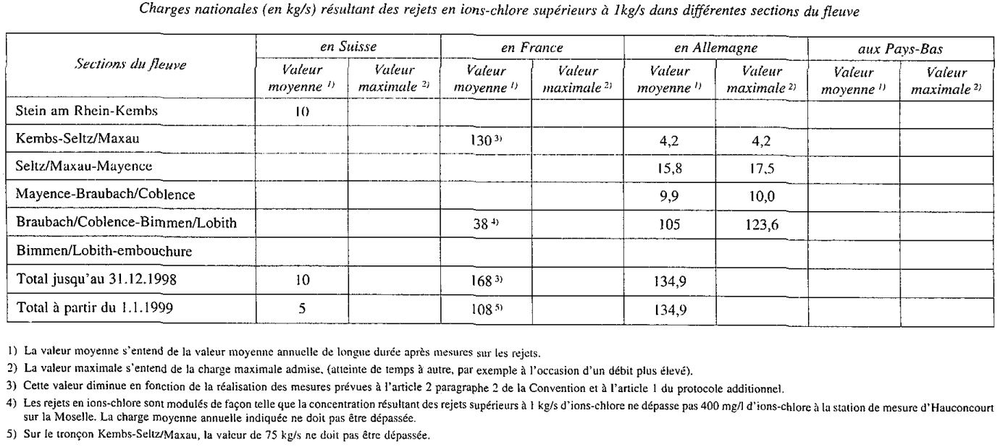

# Loi du 22 mars 1994 portant approbation du Protocole additionnel, fait à Bruxelles, le 25 septembre 1991, à la Convention relative à la protection du Rhin contre la pollution par les chlorures, signée à Bonn, le 3 décembre 1976 et de ses Annexes I, II, III et IV.

Nous JEAN, par la grâce de Dieu, Grand-Duc de Luxembourg, Duc de Nassau;

Notre Conseil d’Etat entendu;

De l’assentiment de la Chambre des Députés;

Vu la décision de la Chambre des Députés du 8 février 1994 et celle du Conseil d’Etat du 22 février 1994 portant qu’il n’y a pas lieu à second vote;

Avons ordonné et ordonnons:

## Article unique.

Est approuvée le Protocole additionnel, fait à Bruxelles, le 25 septembre 1991, à la Convention relative à la protection du Rhin contre la pollution par les chlorures, signée à Bonn, le 3 décembre 1976 et ses Annexes I, II, III et IV.

Mandons et ordonnons que la présente loi soit insérée au Mémorial pour être exécutée et observée par tous ceux que la chose concerne.

Le Ministre des Affaires Etrangères, l’Environnement  du Commerce Extérieur  et de la Coopération,   Jacques F. Poos   Le Ministre de l’Environnement,   Alex Bodry

Château de Berg, le 22 mars 1994.   Jean

\**PROTOCOLE ADDITIONNEL A LA CONVENTION RELATIVE A LA  PROTECTION DU RHIN CONTRE LA POLLUTION PAR LES CHLORURES  SIGNÉE A BONN LE 3 DÉCEMBRE 1976**

\*Le Gouvernement de la République fédérale d’Allemagne,*

\*le Gouvernement de la République Française,*

\*le Gouvernement du Grand-Duché de Luxembourg,*

\*le Gouvernement du Royaume des Pays-Bas et*

\*le Gouvernement de la Confédération Suisse,*

aash se référant aux résultats des conférences ministérielles sur la pollution du Rhin des 11 octobre 1988 à Bonn et 30 novembre 1989 à Bruxelles,

bash se référant à la Convention du 3 décembre 1976 relative à la protection du Rhin contre la pollution par les chlorures, aux échanges de lettres du 29 avril, des 4 et 14 mai 1983 et à la déclaration des chefs de délégation du 11 décembre 1986 (désignée ci-après par „la Convention”),

cash soucieux d’améliorer la qualité des eaux du Rhin de sorte que les dépassements de la teneur de 200 mg/1 d’ions-chlore à la frontière germano-néerlandaise soient limités. tant en ce qui concerne leur importance que leur durée,

dash résolus à faciliter l’approvisionnement en eau potable à partir du Rhin et de l’Usselmeer.

eash convaincus que, en dehors des réductions déjà obtenues et des mesures prévues par le présent protocole, d’autres mesures de réduction de la charge en chlorures sur l’ensemble du cours du Rhin ne sont ni nécessaires du point de vue écologique ni justifiées au regard de critères techniques et économiques,

fash et décidés à régler définitivement, à l’échelon international, le problème de la réduction de la charge en chlorures dans le Rhin,

\*sont convenus de ce qui suit:*

## *Article premier*

1\. Pendant les périodes durant lesquelles la concentration en chlorures dans le Rhin dépasse la valeur d’orientation de 200 mg/1 à la frontière germano-néerlandaise, le Gouvernement français procédera, en plus de la réduction de 20 kg/s d’ions-chlore réalisée depuis le â janvier 1987 conformément à l’article 2, paragraphe 2 de la Convention à une réduction modulée sur le territoire français conformément aux précisions et aux éléments techniques de l’annexe I. Les quantités de chlorures résultant de la réduction modulée seront provisoirement stockées à terre.

2\. Le Gouvernement français informera chaque année les autres Parties contractantes des quantités de chlorures stockées par suite de la réduction modulée et des coûts y afférents.

3\. La réduction modulée réalisée conformément au présent protocole additionnel constitue la mise en oeuvre des obligations prévues aux paragraphes 1, 3 et 4 de l’article 2 et au paragraphe 3 de l’article 7 de la Convention.

## *Article 2*

Les quantités de chlorures stockées en application de la réduction modulée conformément à l’article 1er du présent protocole additionnel pourront, après la réduction de la production des mines de potasse d’Alsace et selon des modalités à fixer ultérieurement par les Parties contractantes sur la base d’une proposition de la Commission Internationale, être déversées dans le Rhin de manière acceptable du point de vue écologique et en tenant compte des différentes utilisations de l’eau. Pendant cette période la valeur d’orientation de 200 mg/1 d’ions-chlore à la frontière germano-néerlandaise continuera à servir et la charge nationale en moyenne annuelle figurant au tableau annexe Il de la Convention dans la version modifiée par le présent protocole additionnel ne sera pas dépassée.

## *Article 3*

Le Gouvernement néerlandais prendra sur le territoire néerlandais des mesures pour limiter les charges en chlorures dans les eaux de l’I7sselmeer servant à l’approvisionnement en eau potable, et ce par le rejet dans la mer des Wadden des eaux salées du Wieringermeer déversées jsuqu’à présent dans l’Usselmeer. Les bases techniques de ces mesures sont exposées dans l’annexe II au présent protocole additionnel.

## *Article 4*

Les coûts des mesures prises sur le territoire français conformément aux articles 1 et 2 et s’élevant au maximum à 400 millions de francs français et ceux des mesures prises sur le territoire néerlandais conformément à l’article 3 et s’élevant au maximum à 32,37 millions de florins néerlandais sont répartis comme suit:

| République fédérale d’Allemagne | 30% |
|---|---|
| République française | 30% |
| Royaume des Pays-Sas | 34% |
| Confédération suisse | 6% |

Les modalités de paiement sont indiquées en annexe 111 au présent protocole additionnel.

La réduction permanente des charges en chlorures du Rhin en Suisse sera prise en compte dans le calcul du montant de la contribution suisse conformément aux dispositions de l’annexe 111.

Ce montant est fixé à 12 millions de francs français.

## *Article 5*

1\. Les Parties contractanctes prennent sur leur territoire les mesures nécessaires pour éviter une augmentation des quantités d’ions-chlore rejetées dans le bassin du Rhin. Les valeurs des charges nationales sont mentionnées en annexe IV en tenant compte des mesures prévues par le présent protocole additionnel.

2\. Les augmentations des quantités d’ions-chlore provenant de rejets isolés ne sont admissibles que dans la mesure où les Parties contractantes concernées procèdent sur leur territoire à une compensation de la charge ou si une compensation globale peut être trouvée dans le cadre de la Commission Internationale.

3\. Une Partie contractante peut exceptionnellement. pour des raisons impératives et après avoir demandé l’avis de la Commission Internationale. autoriser une augmentation sans qu’une compensation immédiate soit opérée.

4\. Les Pays-Bas ne compenseront ni totalement, ni partiellement la réduction de la charge en sel dans l’Usselmeer obtenue à la suite de la mesure prise conformément à l’article 3 du présent protocole par d’autres apports dans l’1lsselmeer ou dans le Rhin.

5\. Les Etats contractants contrôlent sur leur territoire tous les rejets d’ions-chlore supérieurs à I kg/s dans le bassin du Rhin, ainsi que dans l’Usselmeer.

6\. Chaque Partie contractante adresse une fois par an à la Commission Internationale un rapport qui fait ressortir l’évolution de la charge en ions-chlore des eaux du Rhin et de l’1Jsselmeer.

## *Article 6*

Les articles 3 et 6 de la Convention sont abrogés. L’annexe II de la Convention est remplacée par l’annexe IV du présent protocole additionnel.

## *Article 7*

1\. Les articles 13. 14, 16 et 17 de la Convention s’appliquent de la même manière au présent protocole additionnel.

2\. L’article 15 de la Convention s’applique compte tenu des dispositions suivantes:

La Convention et le présent protocole additionnel ne peuvent être dénoncés que conjointement; cette dénonciation peut avoir lieu à tout moment après l’entrée en vigueur du présent protocole additionnel.

## *Article 8*

Ce protocole additionnel à la Convention rédigé en un exemplaire original, en langues allemande, française et néerlandaise, les trois textes faisant également foi, sera déposé dans les archives du Gouvernement de la Confédération Suisse qui en remettra une copie certifiée conforme à chacune des Parties contractantes.

FAIT à Bruxelles le 25 septembre 1991

\*Pour le Gouvernement de la République fédérale d’Allemagne:*

(signatures)

\*Pour le Gouvernement de la République Française:*

(signature)

\*Pour le Gouvernement du Grand-Duché de Luxembourg:*

(signature)

\*Pour le Gouvernement du Royaume des Pays-bas:*

(signature)

\*Pour le Gouvernement de la Confédération Suisse:*

(signature)

ANNEXE I

\**Modalités techniques de la réduction supplémentaire des rejets de chlorures**

\**des Mines de Potasse d’Alsace (MDPA)**

La réduction modulée sur le territoire français est obtenue par un stockage provisoire à terre de sels résiduaires par les Mines de Potasse d’Alsace, jusqu’à la décroissance de leur activité prévue pour 1998, selon les modalités suivantes:

1\. Le stockage à terre est démarré dès que la concentration en chlorures dépasse sur une période de 24h consécutives la valeur d’orientation de 200 mg/l à la frontière germano-néerlandaise, (mesurée à la station internationale de Lobith) et si une évolution à la baisse des débits est prévue simultanément pour les quatre prochains jours, selon le modèle de prévision décrit par la Commission Internationale de l’Hydrologie du Bassin du Rhin (Rapport Nos 1-7, 1988 de la CHR).

2\. Le stockage est arrêté dès que la concentration en chlorures, sur une période de 24h consécutives, revient à une valeur inférieure ou égale à 200 mg/0 et si une évolution à la hausse des débits est prévue simultanément pour les quatre prochains jours, selon le même modèle de prévision.

3\. A-ehaque mise en route, la mise en oeuvre du stockage est opérée progressivement jusqu’à atteindre, en 5 jours ouvrés au plus sa pleine capacité.

4\. La quantité de sel à stocker est limitée par la production de sel résiduaire solide stocküble des fabriques. Les Mines de Potasse d’Alsace s’efforceront de stocker la plus grande quantité possible du sel disponible pendant les périodes de dépassement de la valeur de 200 mg/l à la frontière germano-néerlandaise; cette quantité est comprise entre 42 kg/s et 56 kg/s, selon la quantité de sel de déneigement produite, et pour une activité normale des fabriques.

5\. A compter du versement par toutes les parties contractantes de leurs contributions financières. les Mines de Potasse d’Alsace disposent d’un an pour la mise en oeuvre du stockage provisoire prévit au titre du présent protocole. Dans cette attente, les MDPA utiliseront au mieux les ëquipements déjà en place pour la première phase de stockage provisoire afin de limiter leurs rejets.

ANNEXE II

\**Bases techniques pour les mesures à prendre sur le territoire néerlandais**

\**prévues à l’article 3**

Les eaux saumâtres du polder du Wieringermeer ne seront plus évacuées dans l’IJsselmeer. Elles seront rejetées directement dans la mer des Wadden. A cet effet seront prises les mesures suivantes:

1\. La station de pompage méridionale, la station „Lely”, sera mise hors service, toutes les eaux excédentaires du polder étant désormais évacuées par la station de pompage septentrionale, la station „Leemans”. Pour ce faire, tout le système de drainage des quatre zones du polder sera modifié. Les eaux excédentaires de la zone II seront évacuées sur la zone III par les canaux existants. Celles de la zone IV seront également évacuées sur la zone III au moyen d’une nouvelle station de pompage d’une capacité de 2,5 m3/s. Quant à la zone III, elle sera drainée entièrement par la station „Leemans” grâce à l’aménagement d’un raccordement entre le Waterkaaptocht et le Hooge Kwelvaart. Dans la zone III, le Robbevaart sera élargi sur environ 2 km entre la jonction avec le Hooge Kwelvaart et la station „Leemans”, afin de pouvoir absorber le débit plus élevé. En cas de surcharge, la zone III sera partiellement drainée vers la zone I au moyen d’une nouvelle station de pompage d’une capacité de 6,8 m3/s.

2\. La station de pompage „Leemans”, qui évacuera les eaux excédentaires des zones I et III, sera adaptée pour un débit moyen plus élevé. Les moteurs diesel qui entraînent les pompes à rouet seront adaptés pour pouvoir fonctionner en continu, grâce à l’installation d’un système électronique de mesure et de régulation et d’un dispositif de sécurité. Les pompes à rouet seront adaptées en conséquence, de manière à pouvoir pomper l’eau à un niveau plus élevé.

3\. La station de pompage „Leemans” pompera les eaux excédentaires du polder vers le bassin d’attente des écluses „Stevin”, qui est en relation directe avec la mer des Wadden.

4\. Dans le cadre de ces travaux, des câbles, des conduites et des canalisations, des routes et des voies de raccordement, ainsi que d’autres ouvrages devront être aménagés ou reconstruits.

5\. Les coûts totaux des investissements sont évalués à 32,37 millions de florins néerlandais.

ANNEXE III

\**Modalités financières**

1\. Plafond de dépenses

1.1 Pays-Bas

1.1.1 Pour les travaux à réaliser aux Pays-Bas, le coût maximal retenu par les parties contractantes est fixé à un maximum de 32,37 millions de florins néerlandais,

1.2 France

1.2.1 Les travaux à réaliser en France sont limités à un montant maximal de dépenses de 400 millions de francs français courants, comprenant à la fois des dépenses d’investissements et de fonctionnement correspondant aux frais de stockage et de déstockage ultérieur. Ce montant constitue un plafond de dépenses au-delà duquel la France est libérée de ses obligations de stockage.

1.2.2 Le programme de la 2ème phase sera décomposé en trois périodes: (1991 à 1993 inclus; 1994 à 1996 inclus et 1997 à 1998). Chacune d’entre elles donnera lieu au versement annuel par les parties contractantes d’un préfinancement permettant à la France de faire face aux dépenses prévues pour chaque période par le paragraphe suivant.

1.2.3 Pour chacune des périodes les parties contractantes fixent comme suit les plafonds de dépenses devant être engagées par la France:

aash 155 MF courants pour la période initiale

bash 145 MF courants pour la seconde période

cash 100 MF courants pour la troisième période

1.2.4 Ces montants seront réduits à concurrence de la somme visée au point 2.1.4 de cette annexe.

1.2.5 Les dépenses de fonctionnement seront dans la pratique variables suivant l’hydraulïcité du Rhin.

1.2.6 A chaque année, la France est libérée de ses obligations de stockage dès lors que les dépenses effectuées au cours de l’année considérée atteignent le plafond de dépenses résultant du point 2 et du point 3.2.3. A cette fin, le calcul des dépenses de fonctionnement engagées par la France s’effectue en multipliant les quantités stockées par 61,5 francs français par tonne (francs français 1988 ajustés). Pour la première année, il convient d’ajouter les dépenses d’investissement (40 millions de francs français 1988 ajustés).

1.2.7 Si des conditions climatiques exceptionnelles risquent de conduire à atteindre le plafond annuel de dépenses résultant du point 2 et du point 3.2.3 avant la fin de l’année considérée et en conséquence à arrêter durablement les opérations de stockage jusqu’à l’année suivante, la France pourra, après consultation su sein de la CIPR et dans la limite du plafond de dépenses de l’année en cours, abaisser temporairement les quantités à stocker ou augmenter la valeur d’orientation, au plus tard jusqu’au début de l’année suivante.

2\. Les modalités de calcul des financements

2.1.1 Le règlement des dépenses de chaque période. exprimées en valeur de leur année d’engagement, s’effectuera conformément au tablau ci-dessous: *année* *millions de francs* *français* *total partiel* *total général* première période 1991 1992 1993 90 38 27 155 deuxième période 1994 1995 1996 73 36 36 145 troisième période 1997 1998 50 50 100 400

2.1.2 Les parties contractantes régleront leur contribution à ces coûts par versement annuel unique et préalable.

2.1.3 Les dépenses sont réparties entre les parties contractantes selon la clé de répartition prévue par l’article 4 du présent protocole.

2.1.4 Le montant de la contribution dont la Suisse s’est déjà acquittée en vue de la réduction durable des charges en chlorures du Rhin, s’élève après calcul à 12 millions de francs français comme mentionné à l’article 4. Ce montant sera pris en compte à partir de la deuxième période de paiement.

3\. Paiement des dépenses

3.1 Dépenses des Pays-Bas

3.1.1 Le financement des travaux aux Pays-Bas sera effectué par les parties prenantes au plus tard 3 mois après l’entrée en vigueur du protocole additionnel mais pas avant le 31 mars 1994.

3.1.2 Les dépenses seront réparties entre les parties contractantes selon la clé de répartition prévue par l’article 4 du présent protocole. Les versements seront effectués en florins néerlandais au compte No 60 0113 019 auprès de “Nederlandse Bank N.V” à Amsterdam au profit de “Ministerie van Verkeer en Waterstaat (RWS)” en indiquant la destination “Wieringermeerprojekt”.

3.2 Dépenses françaises

3.2.1 Le lancement des travaux en 1991 est subordonné au versement préalable de l’ensemble des contributions pour l’année concernée. Les contributions pour chacune des années postérieures seront réglées par chaque partie contractante par un versement annuel unique et préalable, au plus tard le 31 janvier de l’année en cause. En cas de non-paiement à cette date, après épuisement des fonds disponibles et après information des autres parties contractantes, la France est libérée pour l’année concernée de ces obligations de stockage modulé jusqu’au versement complet de l’ensemble des contributions.

3.2.2 Au terme de chaque année, une information sur les quantités stockées et les coûts y afférents calculés selon les modalités prévues au point 1.2.6 sera présentée par la partie française.

3.2.3 Dans l’hypothèse où le coût ainsi calculé des stockages effectivement réalisés serait inférieur au plafond initialement fixé pour l’année concernée (point 2.1.1), la somme correspondant à la différence entre ces deux termes (majorée des intérêts portés par cette somme sur les 11/12ème de l’année au taux d’intérêt annuel à long terme du crédit national) est reportée sur l’année suivante. Elle augmente ainsi à due concurrence le plafond des dépenses de l’année suivante.

4\. **Apurement des contributions**

4.1 Pays-Bas

4.1.1 Pour les dépenses en territoire néerlandais, les versements ne sont pas libératoires et un apurement définitif des comptes sera réalisé au plus tard le 31 décembre 1998 par comparaison des dépenses effectuées avec le plafond des dépenses prévues au 1.1 ci-dessus. Dans l’hypothèse où les dépenses effectuées par les Pays-Bas seraient inférieures à 32,37 millions de florins, les Pays-Bas s’engagent à restituer le trop-perçu majoré des intérêts portés sur un an au taux d’intérêt à long terme du crédit national.

4.2 France

4.2.1 Pour les dépenses en territoire français, les versements préalables ne sont pas libératoires et un apurement définitif des comptes sera réalisé au plus tard le 31 décembre 1998 par comparaison des dépenses engagées calculées selon les modalités prévues aux points 1.2.3, 1.2.4 et 1.2.6 ci-dessus et les plafonds de dépenses prévus au point 2 éventuellement augmentés des reports prévus au point 3.2.3 ci-dessus. Dans l’hypothèse où les dépenses effectuées par la France seraient inférieures au montant indiqué sous le point 1.2, la France s’engage à restituer le trop-perçu majoré des intérêts portés sur les 11/12ème d’une année au taux d’intérêt à long terme du crédit national. A cet égard, il convient de tenir compte aussi bien du taux de hausse des prix.

ANNEXE IV

Doc. parl. 3819; sess. ord. 1992-1993 et 1993-1994.
