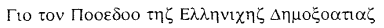
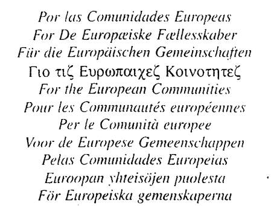

# Loi du 24 novembre 1997 portant approbation du Protocole à la quatrième Convention ACP-CE de Lomé à la suite de l'adhésion de la République d'Autriche, de la République de Finlande et du Royaume de Suède à l'Union Européenne, signé à Maurice, le 4 novembre 1995.

Nous JEAN, par la grâce de Dieu, Grand-Duc de Luxembourg, Duc de Nassau;

Notre Conseil d'Etat entendu;

De l'assentiment de la Chambre des Députés;

Vu la décision de la Chambre des Députés du 15 octobre 1997 et celle du Conseil d'Etat du 4 novembre 1997 portant qu'il n'y a pas lieu à second vote;

Avons ordonné et ordonnons:

## Article unique.

Est approuvé le Protocole à la quatrième Convention ACP-CE de Lomé à la suite de l'adhésion de la République d'Autriche, de la République de Finlande et du Royaume de Suède à l'Union Européenne, signé à Maurice, le 4 novembre 1995.

Mandons et ordonnons que la présente loi soit insérée au Mémorial pour être exécutée et observée par tous ceux que la chose concerne.

Le Ministre des Affaires Etrangères,  du Commerce Extérieur  et de la Coopération,   Jacques F. Poos

Château de Berg, le 24 novembre 1997.   Jean

\**PROTOCOLE A LA QUATRIEME CONVENTION ACP-CE DE LOME  A LA SUITE DE L’ADHESION DE LA REPUBLIQUE D’AUTRICHE, DE  LA REPUBLIQUE DE FINLANDE ET DU ROYAUME DE SUEDE A  L’UNION EUROPEENNE, SIGNE A MAURICE, LE 4 NOVEMBRE 1995**

Sa Majesté le Roi des Belges.

Sa Majesté la Reine de Danemark.

Le Président de la République fédérale d’Allemagne.

Le Président de la République hellénique.

Sa Majesté le Roi d’Espagne.

Le Président de la République francaise.

Le Président de l’Irlande.

Le Président de la République italienne,

Son Altesse Royale le Grand-Duc de Luxembourg.

Sa Majesté la Reine des Pays-Bas.

Le Président fédéral de la République d’Autriche.

Le Président de la République portugaise.

Le Président de la République de Finlande,

Le Gouvernement du Royaume de Suède,

Sa Majesté la Reine du Royaume-Uni de Grande-Bretagne  et d’Irlande du Nord

dont les Etats sont parties contractantes au traité instituant la Communauté européenne du charbon et de l’acier et au traité instituant la Communauté européenne, et

Le Conseil de l’Union Européenne et la Commission des Communautés Européennes.

d’une part. et

Les Chefs des Etats ACP.

dont les Etats sont ci-après dénommés ,,Etats ACP“,

d’autre part.

VU la quatrième convention ACP-CEE, signée à Lomé le 15 décembre 1989, ci-après dénommée ,,convention“, et notamment son article 358,

CONSIDERANT que la République d’Autriche. la République de Finlande et le Royaume de Suède ont adhéré à l’Union européenne le ler janvier 1995;

CONSIDERANT qu’il convient d’apporter les adaptations nécessaires à la convention et de fixer les mesures transitoires applicables aux échanges entre les nouveaux Etats adhérents et les Etats ACP;

CONSIDERANT qu’il est entendu que la portée de ces mesures est limitée à la durée de validité de la convention;

ONT DECIDE de conclure le présent protocole et ont désigné à cet effet comme plénipotentiaires:

Sa Majesté le Roi des Belges.

Sa Majesté la Reine de Danemark.

Le Président de la République fédérale d’Allemagne.

Le Président de la République hellénique.

Sa Majesté le Roi d’Espagne.

Le Président de la République francaise.

Le Président de l’Irlande.

Le Président de la République italienne.

Son Altesse Royale le Grand-Duc de Luxembourg.

Sa Majesté la Reine des Pays-Bas.

Le Président fédéral de la République d’Autriche.

Le Président de la République portugaise.

Le Président de la République de Finlande.

Le Gouvernement du Royaume de Suède.

Sa Majesté la Reine du Royaume-Uni de Grande-Bretagne  et d’Irlande du Nord

Le Conseil de l’Union Européenne et la Commission des Communautés Européennes.

Les Chefs des Etats ACP.

LESQUELS, après avoir échangé leurs pleins pouvoirs reconnus en bonne et due forme.

SONT CONVENUS DE CE QUI SUIT:

## *Article* *premier*

La République d’Autriche, la République de Finlande et le Royaume de Suède deviennent parties contractantes à la convention et aux déclarations annexées à l’acte final, signées à Lomé le 15 décembre 1989.

## *Article 2*

Les textes de la convention. y compris les protocoles et les annexes qui en font partie intégrante, les déclarations annexées à l’acte final et l’accord portant modification de la convention, rédigés en finnois et en suédois, font foi dans les mêmes conditions que les textes originaux.

## *Article 3*

Jusqu’au ler janvier 1996. la République d’Autriche maintient les droits de douane et le régime de licences qu’elle appliquait, à la date de son adhésion, aux boissons alcooliques et à l’alcool éthylique non dénaturé d’un titre alcoométrique volumique de moins de 80% vol. relevant de la position 2208 du système harmonisé (SH). Le régime de licences doit s’appliquer de manière non discriminatoire.

## *Article 4*

Les ressortissants et les sociétés ou les entreprises (au sens de l’article 274 paragraphe 2 de la convention) d’Autriche. de Finlande et de Suède et les fournitures originaires desdits Etats ne sont pas autorisés à participer aux appels d'offres et aux marchés lancés exclusivement par le Fonds européen de développement (FED) auquel les Etats dont ils sont les ressortissants ou les sociétés n’ont pas contribué.

## *Article 5*

Le présent protocole fait partie intégrante de la convention.

## *Article 6*

Le présent protocole est approuvé par les parties contractantes conformément à leurs propres procé dures. Il entre en vigueur le premier jour du deuxième mois suivant la date à laquelle tous les instruments de ratification ou de conclusion des parties contractantes ont été déposés au Secrétariat généra1 du Conseil de l’Union européenne.

## *Article 7*

Le présent protocole est rédigé en deux exemplaires en langues danoise, néerlandaise. anglaise. finnoise, française, allemande , textes faisant également foi.

En foi de quoi, les plénipotentiaires soussignés ont apposé leurs signatures au bas du présent protocole.

Fait à Maurice, le quatre novembre mil neuf cent quatre-vingt-quinze.

\*Pour sa Majesté le Roi des Belges*   *Voor Zijne Majesteit de Koning der Belgen*   *Für Seine Majestät den König der Belgier*  (signature)

Cette signature engage également la Communauté française, la Communauté flamande. la Communauté germanophone, la Région wallone, la Région flamande et la Région de Bruxelles-Capitale.

Deze handtekening verbindt eveneens de Vlaamse Gemeenschap, de Franse Gemeenschap, de Duitstalige Gemeenschap, het Vlaamse Gewest, het Waalse Gewest en het Brusselse Hoofdstedeiijk Gewest.

Diese Unterschrift verbindet zugleich die deutschsprachige Gemeinschaft, die flämische Gemeinschaft, die französische Gemeinschaft, die wallonische Region, die flämische Region und die Region Brüssel-Hauptstadt.

\*For Hendes Majestœt Danmarks Dronning*  (signature)

\*Für den Präsidenten der Bundesrepublik Deutschland*   (signature)

(signature)

\*Por Su Majestad el Rey de España*   (signature)

\*Pour le Président de la République française*   (signature)

T*har cean Uachtarán na hÉireann  For the President of Ireland*   (signature)

\*Per il Presidente della Repubblica italiana*   (signature)

\*Pour Son Altesse Royale le Grand-Duc de Luxembourg*   (signature)

\*Voor Hare Majesteit de Koningin der Nederlanden*   (signature)

\*Für den Bundespräsidenten der Republik Österreich*   (signature)

\*Pelo Presidente da Republica Portuguesa*   (signature)

\*Suomen trasavallam presidentin puolesta  För Republiken Finlands president*   (signature)

\*För Konungariket Sverige*   (signature)

\*For Her Majesty the Queen of the United Kingdom of Great Britain  and Northern Ireland*   (signature)

(signature)

\*Pour le Président de la République d‘Angola*   (signature)

\*For Her Majesty the Queen of Antigua and Barbuda*   (signature)

\*For the Head of State of the Commonwealth of the Bahamas*  (signature)

\*For the Head of State of Barbados*  (signature)

\*For Her Majesty the Queen of Belize*   (signature)

\*Pour le Président de la République du Bénin*   (signature)

\*For the President of the Republic of Botswana*   (signature)

\*Pour le Président du Burkina Faso*   (signature)

\*Pour le Président de la République du Burundi*   (signature)

\*Pour le Président de la République du Cameroun*   (signature)

\*Pour le Président de la République du Cap-Vert*   (signature)

\*Pour le Président de la République centrafricaine*   (signature)

\*Pour le Président de la République fédérale islamique des Comores*   (signature)

\*Pour le Président de la République du Congo*   (signature)

\*Pour le Président de la République de Côte d'Ivoire*   (signature)

\*Pour le Président de la République de Djibouti*   (signature)

\*For the Government of the Commonwealth of Dominica*   (signature)

\*For the President of the Dominican Republic*   (signature)

\*For the Presodemt of the State of Eritrea*   (signature)

\*For the President of the Federal Republic* *of Ethiopia*   (signature)

\*For the President of the Sovereign Democratic Republic* *of Fiji*   (signature)

\*Pour le Président de la République gabonaise*   (signature)

\*For the Chairman of the AFPRC and Head of State of the Republic of Gambia*   (signature)

\*For the President of the Republic* of *Ghana*   (signature)

\*For Her Makesty the Queen of Grenada*   (signature)

\*Pour le Président de la République de Guinée*   (signature)

\*Pour le Président de la République de Guinée-Bissau*   (signature)

\*Pour le Président de la République de Guinée équatoriale*   (signature)

\*For the President of the Cooperative Republic of Guyana*   (signature)

\*Pour le Président de la République d’Haïti*   (signature)

\*For the Head of State of Jamaica*   (signature)

\*For the President of the Republic of Kenya*   (signature)

\*For the President of the Republic of Kiribati*   (signature)

\*For His Majesty the King of the Kingdom of Lesotho*   (signature)

\*For the President of the Republic of Liberia*   (signature)

\*Pour le Président de la République de Madagascar * (signature)

F*or the President of the Republic of Malawi * (signature)

\*Pour le Président de la République du Mali * (signature)

\*Pour le Président de la République islamique de Mauritanie * (signature)

F*or the President of the Republic of Mauritius * (signature)

\*Pour le Président de la République du Mozambique * (signature)

F*or the President of the Republic of Namibia * (signature)

\*Pour le Président de la République du Niger * (signature)

\*For the Head of State of the Federal Republic of Nigeria*   (signature)

\*For Her Majesty the Queen of the Independant State of Papua New Giomea * (signature)

\*Pour le Président de la République Rwandaise * (signature)

\*For Her Majesty the Queen of Saint Kitts and Nevis * (signature)

\*For Her Majesty the Queen of Saint Lucia * (signature)

\*For Her Majesty the Queen of Saint Vincent and the Grenadines * (signature)

\*For the Head of State of the Independant State of Western Samoa*   (signature)

\*Pour le Président de la République démocratique de São Tomé et Prince * (signature)

\*Pour le Président de la République du Sénégal * (signature)

\*Pour le Président de la République des Seychelles * (signature)

\*For the Head of State of the Republique of Sierra Leone*   (signature)

\*For Her Majesty the Queen of Solomon Islands * (signature)

F*or the President of the Republic of the Sudan * (signature)

F*or the President of the Republic of Surinane * (signature)

\*For His Majesty the King of the Kingdom of Swaziland * (signature)

F*or the President of the United Republic of Tanzania * (signature)

\*Pour le Président de la République du Tchad * (signature)

\*Pour le Président de la République Togolaise * (signature)

\*For His Majesty King Taufa'ahau Tupon IV of Tonga * (signature)

F*or the President of the Republic of Trinidad and Tobago * (signature)

\*For Her Majesty the Queen of Tuvalu*   (signature)

F*or the President of the Republic of Uganda * (signature)

F*or the President of the Republic of Vanuatu * (signature)

\*Pour le Président de la République du Zaïre * (signature)

F*or the President of the Republic of Zambia * (signature)

F*or the President of the Republic of Zimbabwe * (signature)

Doc. parl. no 4272; sess. ord. 1996-1997 et 1997-1998.
