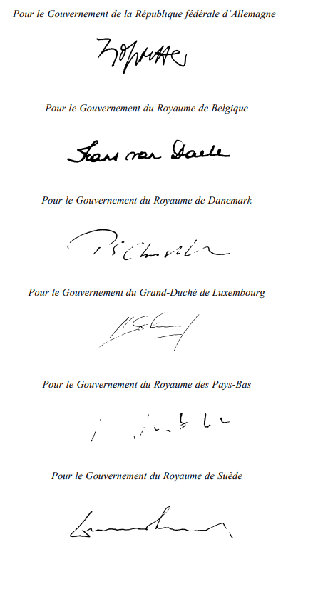
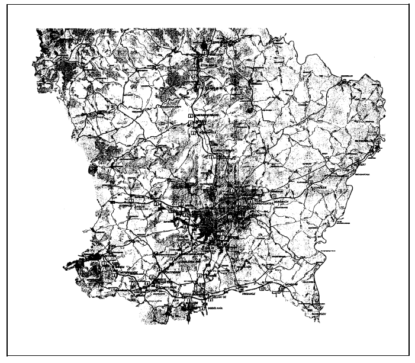

# Loi du 23 mars 2001\n 1) portant approbation du Protocole modifiant l'Accord du 9 février 1994 relatif à la perception d'un droit d'usage pour l'utilisation de certaines routes par des véhicules utilitaires lourds, vu la mise en vigueur de la Directive 1999/62/CE du Parlement européen et du Conseil de l'Union européenne du 17 juin 1999 relative à la taxation des poids lourds pour l'utilisation de certaines infrastructures, signé à Bruxelles, le 22 mars 2000;\n 2) portant modification de la loi modifiée du 24 février 1995 portant approbation et application de l'Accord relatif à la perception d'un droit d'usage pour l'utilisation de certaines routes par des véhicules utilitaires lourds, fait à Bruxelles, le 9 février 1994.

Nous Henri, Grand-Duc de Luxembourg, Duc de Nassau;

Notre Conseil d’Etat entendu;

De l'assentiment de la Chambre des Députés;

Vu la décision de la Chambre des Députés du 15 février 2001 et celle du Conseil d’Etat du 13 mars 2001 portant qu’il n’y a pas lieu à second vote;

Avons ordonné et ordonnons:

## Article I

Est approuvé le Protocole modifiant l’Accord du 9 février 1994 relatif à la perception d’un droit d’usage pour l’utilisation de certaines routes par des véhicules utilitaires lourds, vu la mise en vigueur de la [Directive 1999/62/CE](https://legilux.public.lu/eli/dir_ue/1999/62/jo) du Parlement européen et du Conseil de l’Union européenne du 17 juin 1999 relative à la taxation des poids lourds pour l’utilisation de certaines infrastructures, signé à Bruxelles, le 22 mars 2000.

## Article II

La [loi modifiée du 24 février 1995](https://legilux.public.lu/eli/etat/leg/loi/1995/02/24/n1/jo) portant approbation et application de l’Accord relatif à la perception d’un droit d’usage pour l’utilisation de certaines routes par des véhicules utilitaires lourds, fait à Bruxelles, le 9 février 1994, est modifiée comme suit:

1° L’article 2 est remplacé par le texte suivant:

> **«**Art. 2.****
>
> (1) L’utilisation par un véhicule d’une autoroute ou d’une route de caractère similaire sur le territoire du Grand-Duché de Luxembourg est soumise à la perception du droit d’usage défini aux articles 1er et 8 de l’Accord.
>
> (2) On entend par:
>
> aash «autoroute», les voies publiques qui répondent aux critères de la définition afférente de la Convention sur la circulation routière, signée à Vienne le 8 novembre 1968 et approuvée par la [loi du 27 mai 1975](https://legilux.public.lu/eli/etat/leg/loi/1975/05/27/n4/jo) et qui sont signalées comme telles;
>
> bash «route de caractère similaire à une autoroute», les voies publiques signalées par le signal E17 «routes pour automobiles» prévu par la Convention sur la signalisation routière, signée à Vienne le 8 novembre 1968 et approuvée par la [loi du 27 mai 1975](https://legilux.public.lu/eli/etat/leg/loi/1975/05/27/n4/jo);
>
> cash «véhicules», les véhicules à moteur et les ensembles de véhicules répondant aux critères de définition afférents de la Convention sur la circulation routière, signée à Vienne le 8 novembre 1968 et approuvée par la [loi du 27 mai 1975](https://legilux.public.lu/eli/etat/leg/loi/1975/05/27/n4/jo) qui sont exclusivement destinés au transport de marchandises et qui ont une masse maximale autorisée supérieure à 12.000 kg;
>
> dash «véhicule Euro I», tout véhicule présentant les caractéristiques définies dans le cadre de la [directive 88/77/CEE](https://legilux.public.lu/eli/dir_ue/1988/77/jo) modifiée du Conseil du 3 décembre 1987 concernant le rapprochement des législations des Etats membres relatives aux mesures à prendre contre les émissions de gaz polluants et de particules polluantes provenant des moteurs diesel destinés à la propulsion des véhicules;
>
> eash «véhicules Euro II», tout véhicule présentant les caractéristiques dans le cadre de la [directive 88/77/CEE](http://legilux.public.lu/eli/dir_ue/1988/77/jo) modifiée précitée;
>
> fash «véhicules non Euro», tout véhicule qui ne correspond par aux définitions des véhicules Euro I et Euro II ainsi que tout véhicule pour lequel un document certifiant la conformité minimale des caractéristiques Euro I ou Euro II fait défaut;
>
> gash «droit d’usage», le paiement d’une somme déterminée, fixée par l’article 8 de l’Accord donnant droit à l’utilisation par un véhicule pendant une durée déterminée, exprimée en termes d’une année, d’un mois, d’une semaine ou d’une journée, d’une autoroute, d’une route à caractère similaire.
>
> (3) Sont exonérées du droit d’usage les tronçons d’autoroutes et de routes à caractère similaire entre un point frontière avec un Etat qui ne perçoit pas de droit d’usage visé par l’Accord, et l’échangeur le plus proche donnant accès au réseau dont l’utilisation n’est pas subordonnée au paiement du droit d’usage. Un règlement grand-ducal énumérera ces tronçons d’autoroutes et de routes à caractère similaire.
>
> (4) Les véhicules qui effectuent un transport combiné sont partiellement exemptés du droit d’usage visé au paragraphe (1), sans que cette exemption ne puisse être inférieure à 3 euros par trajet, ni dépasser le droit d’usage payé. Les montants et les modalités de perception en question sont fixés par règlement grand-ducal.»

2° L’article 3 est remplacé par le texte suivant:

> **«**Art. 3.****
>
> (1) Sont exemptés du droit d’usage:
>
> a) les véhicules de l’armée, de la police grand-ducale, de l’administration des douanes et accises, de la protection civile, des services d’incendie, ainsi que l’ensemble des véhicules utilisés pour des missions d’intervention urgente et équipés comme tels;
>
> b) les véhicules qui sont utilisés exclusivement sur le territoire national par des personnes physiques ou morales dont l’activité principale n’est pas le transport de marchandises, dans la mesure où leur mise en circulation n’est pas susceptible d’avoir des répercussions économiques sur le marché des transports.
>
> (2) Les véhicules visés au paragraphe (1) sous b) doivent être munis d’un certificat attestant leur exemption du droit d’usage. Les modalités d’établissement de ce certificat sont arrêtées par règlement grand-ducal.»

3° L’article 4 est remplacé par le texte suivant:

> **«**Art. 4.****
>
> Un règlement grand-ducal fixe les montants et les modalités du droit d’usage en fonction des normes Euro prévues par la [directive 88/77/CEE](http://legilux.public.lu/eli/dir_ue/1988/77/jo) modifiée et le nombre d’essieux des véhicules. Ce règlement détermine également le montant du remboursement partiel du taux annuel en cas de restitution de l’attestation ainsi que les conditions et modalités du remboursement.»

4° L’article 7 est remplacé par le texte suivant:

> **«**Art. 7.****
>
> Les infractions aux dispositions de l’article 5 de la présente loi ainsi qu’aux dispositions des règlements grand-ducaux pris en exécution desdites prescriptions légales sont passibles d’une amende de 1.000 à 20.000 francs. Cette amende a le caractère d’une peine de police. En cas de récidive le maximum de l’amende est prononcé.
>
> Les officiers de la police judiciaire, les membres de la Police grand-ducale ainsi que les agents de I’Administration des douanes et accises sont chargés de contrôler l’exécution des dispositions de la présente loi et de ses règlements d’exécution et de dresser procès-verbal des infractions.»

## Article III

Le Grand-Duc est habilité à coordonner les dispositions législatives relatives à la [loi du 24 février 1995](https://legilux.public.lu/eli/etat/leg/loi/1995/02/24/n1/jo) modifiée portant approbation et application de l’Accord relative à la perception d’un droit d’usage pour l’utilisation de certaines routes par des véhicules utilitaires lourds, fait à Bruxelles, le 9 février 1994 ainsi que celles qui auraient expressément ou implicitement modifié celle-ci au moment où ces coordinations seront établies.

## Article IV

L’article II de la présente loi entre en vigueur le premier jour du mois qui suit sa publication au Mémorial.

Mandons et ordonnons que la présente loi soit insérée au Mémorial pour être exécutée et observée par tous ceux que la chose concerne.

Le Ministre des Affaires Etrangères  et du Commerce Extérieur,   Lydie Polfer   Le Ministre des Finances,   Jean-Claude Juncker

Palais de Luxembourg, le 23 mars 2001.   Henri

\**PROTOCOLE**

modifiant l’Accord du 9 février 1994 relatif à la perception d’un  droit d’usage pour l’utilisation de certaines routes par des  véhicules utilitaires lourds, vu la mise en vigueur de la  Directive1999/62/CE du Parlement européen et du Conseil de  l’Union européenne du 17 juin 1999 relative à la taxation des  poids lourds pour l’utilisation de certaines infrastructures

\*Les Gouvernements de la République fédérale d’Allemagne*

\*du Royaume de Belgique*

\*du Royaume de Danemark*

\*du Grand-Duché de Luxembourg*

\*du Royaume des Pays-Bas*

\*et*

\*du Royaume de Suède,*

PARTIES CONTRACTANTES à l’Accord du 9 février 1994 relatif à la perception d’un droit d’usage pour l’utilisation de certaines routes par des véhicules utilitaires lourds, tel que modifié par le Protocole du 18 septembre 1997 relatif à l’adhésion du Royaume de Suède à l’Accord précité, dénommé ci-après ,,l’Accord“,

\*Vu* l’adoption de la [Directive 1999/62/CE](https://legilux.public.lu/eli/dir_ue/1999/62/jo) du Parlement européen et du Conseil de l’Union européenne du 17 juin 1999 relative à la taxation des poids lourds pour l’utilisation de certaines infrastructures, dénommée ci-après ,,la Directive“;

Considérant la déclaration commune des Gouvernements de la Belgique, du Danemark, de l’Allemagne, du Luxembourg, des Pays-Bas et de la Suède de mettre tout en oeuvre afin d’aligner leur droit d’usage commun aux nouveaux taux maximaux prévus à l’article 7, paragraphe 7 et à l’annexe II de [la Directive](https://legilux.public.lu/eli/dir_ue/1999/62/jo), faite à la 2142ème session du Conseil de l’Union européenne des 30 novembre et 1er décembre 1998,

SONT CONVENUS de ce qui suit:

## *Article premier*

Le premier considérant du Préambule de l’Accord est *remplacé par:*

> ,,Vu la [Directive 1999/62/CE](https://legilux.public.lu/eli/dir_ue/1999/62/jo) du Parlement européen et du Conseil de l’Union européenne du 17 juin 1999 relative à la taxation des poids lourds pour l’utilisation de certaines infrastructures, remplaçant la [Directive 93/89/CEE](https://legilux.public.lu/eli/dir_ue/1993/89/jo) du Conseil des Communautés européennes du 25 octobre 1993,“.

Après le deuxième considérant un troisième considérant est *ajouté:*

> ,,Vu la déclaration commune des Gouvernements de la Belgique, du Danemark, de l’Allemagne, du Luxembourg, des Pays-Bas et de la Suède de mettre tout en oeuvre afin d’aligner leur droit d’usage commun aux nouveaux taux maximaux prévus à l’article 7, paragraphe 7 et à l’annexe II de [la Directive](https://legilux.public.lu/eli/dir_ue/1999/62/jo), faite à la 2142ème session du Conseil de l’Union européenne des 30 novembre et 1er décembre 1998,“.

## *Article 2*

L’article 2, paragraphe 1er, de l’Accord est r*emplacé par:*

> ,,Les définitions requises à l’article 2 de la [Directive 1999/62/CE](https://legilux.public.lu/eli/dir_ue/1999/62/jo) du Parlement européen et du Conseil de l’Union européenne du 17 juin 1999 relative à la taxation des poids lourds pour l’utilisation de certaines infrastructures s’appliquent au présent Accord.“

## *Article 3*

A l’article 3, paragraphe 1er, de l’Accord les mots ,,la procédure de l’article 9 de [la Directive](https://legilux.public.lu/eli/dir_ue/1999/62/jo)“ sont *remplacés par:*

,,la procédure de l’article 7, paragraphe 2, point b, ii, de [la Directive](https://legilux.public.lu/eli/dir_ue/1999/62/jo)“.

Au paragraphe 2 les mots ,,article 7, point d, de [la Directive](https://legilux.public.lu/eli/dir_ue/1999/62/jo)“ sont *remplacés par:*

,,article 7, paragraphe 2, point b, i, de [la Directive](https://legilux.public.lu/eli/dir_ue/1999/62/jo)“.

Au paragraphe 3 les mots ,,article 7, point e de [la Directive](https://legilux.public.lu/eli/dir_ue/1999/62/jo)“ sont *remplacés par:*

,,article 7, paragraphe 6, de [la Directive](https://legilux.public.lu/eli/dir_ue/1999/62/jo)“.

## *Article 4*

L’article 4, paragraphe 2, de l’Accord est *remplacé par:*

> ,,Sur leur territoire respectif, les Parties contractantes à l’Accord peuvent exempter les véhicules énumérés à l’article 6, paragraphe 2, point b, de [la Directive](https://legilux.public.lu/eli/dir_ue/1999/62/jo) du droit d’usage visé à l’article 3.“

## *Article 5*

L’article 8, paragraphe 1er, de l’Accord est *remplacé par:*

> ,,Le droit d’usage annuel, y compris les frais administratifs, s’élève pour les véhicules:
>
> 1\. jusqu’à trois essieux:
>
> | a. NON-EURO: | à 960 euros, |
> |---|---|
> | b. EURO I: | à 850 euros, |
> | c. EURO II et moins polluants: | à 750 euros. |
>
> 2\. à quatre essieux ou plus:
>
> | a. NON-EURO: | à 1.550 euros, |
> |---|---|
> | b. EURO I: | à 1.400 euros, |
> | c. EURO II et moins polluants: | à 1.250 euros.“ |

Le paragraphe *2* est *remplacé par:*

> ,,Le droit d’usage mensuel, y compris les frais administratifs, s’élève pour les véhicules:
>
> 1\. jusqu’à trois essieux:
>
> | a. NON-EURO: | à 96 euros, |
> |---|---|
> | b. EURO I: | à 85 euros, |
> | c. EURO II et moins polluants: | à 75 euros. |
>
> 2\. à quatre essieux ou plus:
>
> | a. NON-EURO: | à 155 euros, |
> |---|---|
> | b. EURO I: | à 140 euros, |
> | c. EURO II et moins polluants: | à 125 euros.“ |

Le paragraphe *3* est *remplacé par:*

> ,,Le droit d’usage hebdomadaire, y compris les frais administratifs, s’élève pour les véhicules:
>
> 1\. jusqu’à trois essieux:
>
> | a. NON-EURO: | à 26 euros, |
> |---|---|
> | b. EURO I: | à 23 euros, |
> | c. EURO II et moins polluants: | à 20 euros. |
>
> 2\. à quatre essieux ou plus:
>
> | a. NON-EURO: | à 41 euros, |
> |---|---|
> | b. EURO I: | à 37 euros, |
> | c. EURO II et moins polluants: | à 33 euros.“ |

Le paragraphe *4* est *remplacé par:*

> ,,Le droit d’usage journalier, y compris les frais administratifs, est, pour toutes les catégories de véhicules, fixé à 8 euros“.

Le paragraphe *5* est *remplacé par:*

> ,,Pour les véhicules immatriculés en Grèce, le droit d’usage mentionné aux paragraphes 1 à 4 est, pendant une période de deux ans après l’entrée en vigueur de [la Directive](https://legilux.public.lu/eli/dir_ue/1999/62/jo), réduit de la moitié. Les Parties contractantes au présent Accord peuvent décider d’étendre la période transitoire d’année en année sous la condition que la Commission européenne autorise une telle extension.“

Le paragraphe *7* est *remplacé par:*

> ,,Pour l’application du présent Accord, le taux de change de l’euro dans les différentes monnaies nationales est fixé conformément à l’article 10 de [la Directive](https://legilux.public.lu/eli/dir_ue/1999/62/jo).“

## *Article 6*

L’article 10, paragraphe 2, dernière phrase de l’Accord est *remplacé par:*

> ,,Des frais administratifs de 25 euros sont prélevés pour l’examen de la demande de remboursement.“

## *Article 7*

A l’article 13, paragraphe 2, de l’Accord la ligne

,,A = droit d’usage annuel de 1.250 ECUS“ est *remplacé par:*

,,A = droit d’usage annuel de 1.250 euros.“

## *Article 8*

Dans la version française de l’article 20 de l’Accord, la date ,,31 décembre 2010“ est *remplacée par:*

,,31 décembre 2019.“

## *Article 9*

1\. Le présent Protocole entre en vigueur le premier jour du mois suivant la dernière date à laquelle les Gouvernements respectifs ont notifié par écrit à la Commission européenne par voie diplomatique que les exigences constitutionnelles nécessaires à son entrée en vigueur dans leurs Etats respectifs sont remplies.

2\. Le Dépositaire transmet aux Gouvernements de toutes les Parties contractantes à l’Accord les notifications visées au paragraphe ler ainsi que la date d’entrée en vigueur du présent Protocole.

Fait à Bruxelles, le 22 mars 2000 en langue allemande, danoise, française, néerlandaise et suédoise, chaque texte faisant également foi, dans un original déposé dans les archives de la Commission européenne; celle-ci transmet à chaque Partie contractante une copie certifiée conforme.

Doc. par. n°[4742](https://www.legilux.public.lu/eli/etat/proj/pl/20000089); sess. ord. 2000-2001. [Dir. 88/77](https://legilux.public.lu/eli/dir_ue/1988/77/jo), [99/62](https://legilux.public.lu/eli/dir_ue/1999/62/jo).
