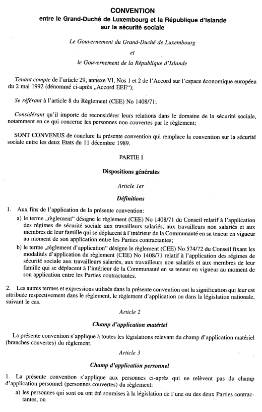
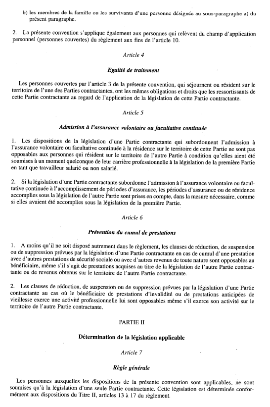
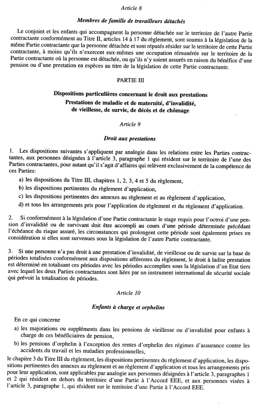
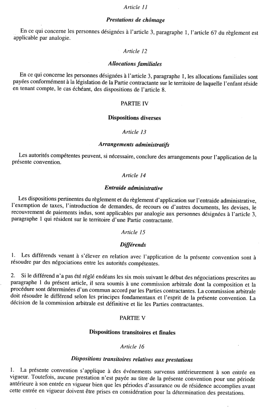
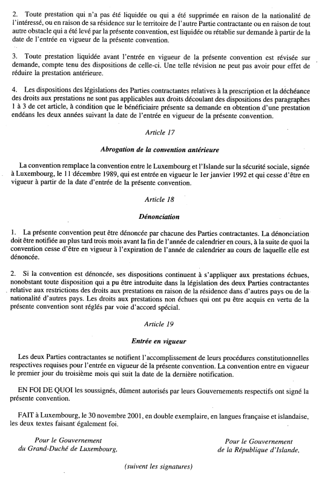

# Loi du 3 décembre 2002 portant approbation de la Convention entre le Grand-Duché de Luxembourg et la République d’Islande sur la sécurité sociale, signée à Luxembourg, le 30 novembre 2001.

Nous Henri, Grand-Duc de Luxembourg, Duc de Nassau,

Notre Conseil d’Etat entendu;

De l’assentiment de la Chambre des Députés;

Vu la décision de la Chambre des Députés du 17 octobre 2002 et celle du Conseil d’Etat du 5 novembre 2002 portant qu’il n’y a pas lieu à second vote;

Avons ordonné et ordonnons:

## Article unique.

Est approuvée la Convention entre le Grand-Duché de Luxembourg et la République d’Islande sur la sécurité sociale, signée à Luxembourg, le 30 novembre 2001.

Mandons et ordonnons que la présente loi soit insérée au Mémorial pour être exécutée et observée par tous ceux que la chose concerne.

Le Ministre des Affaires Etrangères et du Commerce Extérieur,   Lydie Polfer   Le Ministre de la Securité Sociale,   Carlo Wagner

Palais de Luxembourg, le 3 décembre 2002.   Henri

Doc. parl. [4935](https://legilux.public.lu/eli/etat/proj/pl/20020053); sess. ord. 2001-2002 et 2002-2003.
