# Loi du 27 mai 2004 portant approbation\n- d’une Déclaration solennelle, exprimant la volonté du Grand-Duché de Luxembourg et du Royaume de Belgique de renforcer leur coopération sur la base des liens de confiance qui se sont développés dans le passé,\n- du Protocole portant modification de la Convention coordonnée instituant l’Union économique belgo-luxembourgeoise, signé à Bruxelles, le 18 décembre 2002 et de la nouvelle Convention coordonnée instituant l’Union économique belgo-luxembourgeoise en résultant,\n- du Protocole, signé à Bruxelles, le 18 décembre 2002, portant abrogation de la Convention établissant entre le Grand-Duché de Luxembourg et la Belgique une communauté spéciale de recettes en ce qui concerne les droits d’accises perçus sur les alcools, du 23 mai 1935,\n- du Protocole, signé à Bruxelles, le 18 décembre 2002, portant abrogation du Protocole spécial entre le Grand-Duché de Luxembourg et la Belgique relatif à l’agriculture, du 29 janvier 1963,\n- du Protocole, signé à Bruxelles, le 18 décembre 2002, portant abrogation du Protocole entre le Grand-Duché de Luxembourg et le Royaume de Belgique relatif à l’association monétaire et de son Protocole d’exécution, du 9 mars 1981,\n- de l’Acte final, signé à Bruxelles, le 18 décembre 2002.

Nous Henri, Grand-Duc de Luxembourg, Duc de Nassau,

Notre Conseil d’Etat entendu;

De l’assentiment de la Chambre des Députés;

Vu la décision de la Chambre des Députés du 20 avril 2004 et celle du Conseil d’Etat du 27 avril 2004 portant qu’il n’y a pas lieu à second vote;

Avons ordonné et ordonnons:

## Article unique.–

Sont approuvés

– la Déclaration solennelle, exprimant la volonté du Grand-Duché de Luxembourg et du Royaume de Belgique de renforcer leur coopération sur la base des liens de confiance qui se sont développés dans le passé,

– le Protocole portant modification de la [Convention coordonnée instituant l’Union économique belgo-luxembougeoise](https://legilux.public.lu/eli/etat/leg/loi/1922/03/05/n1/jo), signé à Bruxelles, le 18 décembre 2002 et la nouvelle Convention coordonnée instituant l’Union économique belgo-luxembourgeoise en résultant,

– le Protocole, signé à Bruxelles, le 18 décembre 2002, portant abrogation de la [Convention établissant entre le Grand-Duché de Luxembourg et la Belgique une communauté spéciale de recettes en ce qui concerne les droits d’accises perçus sur les alcools](https://legilux.public.lu/eli/etat/leg/loi/1935/07/15/n4/jo), du 23 mai 1935,

– le Protocole, signé à Bruxelles, le 18 décembre 2002, portant abrogation du [Protocole spécial entre le Grand-Duché de Luxembourg et la Belgique relatif à l’agriculture](https://legilux.public.lu/eli/etat/leg/loi/1965/05/26/n1/jo), du 29 janvier 1963,

– le Protocole, signé à Bruxelles, le 18 décembre 2002, portant abrogation du [Protocole entre le Grand-Duché de Luxembourg et le Royaume de Belgique relatif à l’association monétaire](https://legilux.public.lu/eli/etat/leg/loi/1983/04/11/n3/jo) et de son Protocole d’exécution, du 9 mars 1981,

– l’Acte final, signé à Bruxelles, le 18 décembre 2002.

Mandons et ordonnons que la présente loi soit insérée au Mémorial pour être exécutée et observée par tous ceux que la chose concerne.

Les membres du Gouvernement,   Jean-Claude Juncker   Lydie Polfer   Fernand Boden   Marie-Josée Jacobs   Erna Hennicot-Schoepges   Michel Wolter   Luc Frieden   Anne Brasseur   Henri Grethen   Charles Goerens   Carlo Wagner   François Biltgen   Joseph Schaack   Eugène Berger

Palais de Luxembourg, le 27 mai 2004.   Henri

\**DECLARATION SOLENNELLE**

\*Se félicitant* des relations d’amitié et de confiance que la Convention instituant l’Union économique belgo-luxembourgeoise a permis d’instaurer entre le Grand-Duché de Luxembourg et le Royaume de Belgique, la Région wallonne, la Région flamande et la Région de Bruxelles-Capitale,

Se *félicitant* également de l’attachement dont leurs peuples ont fait preuve à l’égard de cette Union,

\*Reconnaissant* les effets bénéfiques que l’Union économique a eus sur la prospérité de leurs économies et le bien-être de leurs peuples,

\*Constatant* que les nombreux liens et la méthode de travail établis dans le cadre de la Convention ont permis de dépasser la coopération dans le seul domaine économique,

Constatant que leur coopération a joué un rôle pionnier dans le contexte de la construction européenne et que leurs actions conjointes ont pu avoir un impact sur la scène internationale,

\*Constatant* que leur action commune a contribué à la paix et à la stabilité sur le continent européen,

\*Soulignant* que la Convention a créé un cadre privilégié pour discuter des problèmes d’intérêt commun,

\*Résolus* à poursuivre leur contribution active au développement d’un système international basé sur le droit et les valeurs démocratiques,

\*Reconnaissant* qu’il convient d’adapter le fonctionnement et le champ d’application de la Convention à l’évolution de leurs structures institutionnelles,

\*Prenant* note des accords de coopération que le Grand-Duché de Luxembourg a conclus avec les Régions du Royaume de Belgique,

\*Confirmant* que l’application des dispositions de la présente Convention est sans préjudice de celle du Traité sur l’Union Européenne,

\*Déterminés* à approfondir leur partenariat en l’ouvrant à de nouvelles voies de coopération.

LES HAUTES PARTIES CONTRACTANTES conviennent:

– de reconduire la Convention en l’adaptant aux nouveaux cadres institutionnels ainsi qu’aux ambitions ainsi énoncées;

– d’intensifier leurs relations dans tous les domaines d’intérêt mutuel;

– de renforcer leur coopération au sein des organisations internationales;

– d’accorder une importance prioritaire aux échanges de vues et à la coopération dans les affaires européennes;

– de poursuivre un dialogue politique à tous les niveaux au sujet de thèmes qui retiennent l’attention internationale;

– d’intensifier leurs relations dans les domaines de l’aide humanitaire et de la coopération au développement;

– de renforcer leur coopération dans le domaine de la défense et du maintien de la paix en vue d’une optimisation des actions conjointes.

\**PROTOCOLE**

\**portant modification de la Convention coordonnée instituant** ** l’Union économique belgo-luxembourgeoise**

Le Grand-Duché de Luxembourg et Le Royaume de Belgique La Région wallonne, La Région flamande, La Région de Bruxelles-Capitale,

\*Considérant* que les Gouvernements des Hautes Parties Contractantes ont décidé de modifier la Convention coordonnée instituant l’Union économique belgo-luxembourgeoise et ont chargé leurs administrations d’examiner quels aménagements devaient être apportés au texte de ladite Convention,

\*Considérant* que les travaux entrepris ont abouti à diverses propositions de modification de la Convention acceptées par les Gouvernements concernés,

\*Ont désigné* à cet effet leurs plénipotentiaires, lesquels, après avoir communiqué leurs pleins pouvoirs trouvés en bonne et due forme, sont convenus des dispositions qui suivent:

## Article I

La [Convention instituant l’Union économique belgo-luxembourgeoise](https://legilux.public.lu/eli/etat/leg/loi/1922/03/05/n1/jo), signée à Bruxelles le 25 juillet 1921, telle que modifiée par la [Convention du 23 mai 1935](https://legilux.public.lu/eli/etat/leg/loi/1935/07/15/n4/jo) et les Protocoles du 29 janvier 1963, du 27 octobre 1971, du 19 octobre 1976, du 29 novembre 1978 et du 3 mars 1992, ci-après dénommée „la Convention“, est amendée selon les dispositions des articles suivants.

## *Article II*

L’article 1 (Chapitre 1 – Dispositions fondamentales) de la [Convention](https://legilux.public.lu/eli/etat/leg/loi/1922/03/05/n1/jo) est remplacé par les dispositions suivantes:

> ***„Article 1***
>
> \*Il est institué entre le Royaume de Belgique et le Grand-Duché de Luxembourg une Union économique fondée sur une union douanière et une union accisienne.“*

## *Article III*

L’article 2 de la [Convention](https://legilux.public.lu/eli/etat/leg/loi/1922/03/05/n1/jo) est remplacé par les dispositions suivantes:

> ***„Article 2***
>
> \*Les territoires des Hautes Parties Contractantes sont considérés comme ne formant qu’un seul territoire au point de vue de la douane, des accises communes et des taxes y assimilées (à l’exclusion des écotaxes) et des mesures communes destinées à régler les échanges économiques extérieurs.“*

## *Article IV*

L’article 3 de la [Convention](https://legilux.public.lu/eli/etat/leg/loi/1922/03/05/n1/jo) est abrogé. L’article 4 de la [Convention](https://legilux.public.lu/eli/etat/leg/loi/1922/03/05/n1/jo) devient l’article 3.

## *Article V*

L’article 5 de la [Convention](https://legilux.public.lu/eli/etat/leg/loi/1922/03/05/n1/jo) devient l’article 4 (Chapitre 2 – Dispositions relatives aux douanes et accises) ainsi rédigé:

> ***„Article 4***
>
> \*Les dispositions légales et réglementaires en matière de douanes et d’accises ou de taxes y assimilées (à l’exclusion des écotaxes) sont communes pour l’ensemble de l’Union.“*

## *Article VI*

L’article 6 de la [Convention](https://legilux.public.lu/eli/etat/leg/loi/1922/03/05/n1/jo) devient l’article 5 ainsi rédigé:

> ***„Article 5***
>
> \*Le Comité de Ministres délibère de l’institution, de la modification et de la suppression d’accises communes ou de taxes y assimilées (à l’exclusion des écotaxes).*
>
> \*Lorsqu’une accise ou une taxe y assimilée (à l’exclusion des écotaxes) est commune, elle fait l’objet de dispositions légales et réglementaires communes.“*

## *Article VII*

L’article 7 de la [Convention](https://legilux.public.lu/eli/etat/leg/loi/1922/03/05/n1/jo) devient l’article 6 ainsi rédigé:

> ***„Article 6***
>
> \*Sous réserve des attributions du Conseil des douanes, chacun des deux gouvernements assure sur son territoire l’administration et la perception en matière de douanes et d’accises, conformément aux lois et règlements de l’union douanière et de l’Union européenne.“*

## *Article VIII*

L’article 8 de la [Convention](https://legilux.public.lu/eli/etat/leg/loi/1922/03/05/n1/jo) devient l’article 7 ainsi rédigé:

> ***„Article 7***
>
> \*1.* *Est considéré comme recette commune, le produit:*
>
> a) *des droits à l’importation perçus pour le compte de l’Union européenne, mis à la disposition des Etats membres, en vertu d’une décision de cette union au titre de remboursement des frais de perception;*
>
> \*des rétributions perçues du chef de prestations spéciales ou des interventions effectuées par les agents des douanes et accises à l’occasion d’opérations douanières;*
>
> \*du remboursement, par les Communautés européennes, des frais de perception des droits à l’importation versés à ces Communautés au titre des ressources propres;*
>
> b) *des droits d’accises communs et des taxes y assimilées (à l’exclusion des écotaxes);*
>
> \*des rétributions perçues du chef de prestations spéciales ou des interventions effectuées par les agents des douanes et accises à l’occasion d’opérations en rapport avec les produits soumis à un droit d’accises commun et/ou des taxes y assimilées (à l’exclusion des écotaxes);*
>
> \*des intérêts perçus en raison du paiement tardif des droits d’accises communs et/ou des taxes y assimilées (à l’exclusion des écotaxes).*
>
> \*2.* *Cette recette commune, déduction faite des remboursements, est répartie entre les Hautes Parties Contractantes:*
>
> a) *en ce qui concerne les recettes visées au § 1, a), proportionnellement à la population de leurs territoires;*
>
> b) *en ce qui concerne les recettes visées au § 1, b), sur la base de la consommation ou de l’utilisation, dans chacun des territoires des Hautes Parties Contractantes, des produits soumis aux droits d’accises communs et aux taxes y assimilées (à l’exclusion des écotaxes).*
>
> \*A* *ux fins de la répartition de la recette commune selon les prescriptions du § 2, alinéa 1, a), un recensement de la population est effectué selon les mêmes principes sur tout le territoire de l’Union chaque année dont le millésime finit par 1, durant la période déterminée dans le cadre des Communautés européennes ou, à défaut, par concertation entre les deux pays.*
>
> \*La part revenant à chacune des Hautes Parties Contractantes selon les prescriptions du § 2, b) est fixée annuellement par le Comité de Ministres sur proposition du Conseil des Douanes.*
>
> \*3.* *Les frais communs d’administration et de perception sont mis à charge des Hautes Parties Contractantes proportionnellement à la part de la recette commune revenant à chacun des partenaires de l’Union.*
>
> \*4.* *Le Conseil des douanes établit, à la fin de chaque trimestre, un décompte provisoire de la recette commune et des frais communs d’administration et de perception et détermine:*
>
> a) *d’une part, d’après les modes de répartition visés aux §§ 2 et 3 ci-dessus, la part de la recette commune revenant à chacune des Hautes Parties Contractantes, déduction faite de la part des frais communs d’administration et de perception incombant à chacune d’Elles;*
>
> b) *d’autre part, le montant des recettes communes effectuées par chacune des Hautes Parties Contractantes, déduction faite des frais communs d’administration et de perception exposés par chacune d’Elles.*
>
> \*5.* *La Haute Partie Contractante dont les recettes nettes visées au § 4, b) dépassent la part nette visée au § 4, a) verse à l’autre Partie Contractante la différence entre ses recettes nettes et sa part nette.*
>
> \*6.* *Les dispositions prévues aux §§ 4 et 5 sont appliquées pour le décompte détaillé qui doit être établi immédiatement après la clôture définitive de chaque année ou lorsque les frais communs d’administration réels sont connus.“*

## *Article IX*

L’article 9 de la [Convention](https://legilux.public.lu/eli/etat/leg/loi/1922/03/05/n1/jo) devient l’article 8 ainsi rédigé:

> ***„Article 8***
>
> \*1.* *Pour l’application de l’article 7 § 3, sont considérés comme frais communs d’administration et de perception:*
>
> a) *les frais de fonctionnement du Conseil des douanes, ces frais étant avancés par le Gouvernement belge;*
>
> b) *les frais d’administration et de perception, y compris ceux des administrations centrales, afférents aux droits à l’importation et aux droits d’accises communs ou aux taxes y assimilées (à l’exclusion des écotaxes) sur les produits mis à la consommation.*
>
> \*2.* *Les dépenses visées au § 1, b) comprennent:*
>
> a) *les traitements, y compris les allocations et indemnités, du personnel de l’administration des douanes et accises belge et de l’administration luxembourgeoise des douanes et accises; au cas où le taux des traitements du personnel luxembourgeois serait supérieur à celui du personnel belge, ces frais ne peuvent être mis à charge de la communauté que jusqu’à concurrence de la moyenne annuelle de la dépense pour chaque catégorie d’employés de l’administration belge;*
>
> b) *une somme forfaitaire de 15 % des traitements du personnel désigné ci-dessus pour la charge résultant des pensions à payer à ce personnel par chacune des Hautes Parties Contractantes;*
>
> c) *une somme forfaitaire pour la location, l’entretien, l’ameublement, le chauffage et l’éclairage des immeubles ou parties d’immeubles affectés au service de l’administration, pour les fournitures de bureau, pour les frais d’affranchissement de la correspondance échangée entre les agents des douanes et des accises des deux pays pour toutes les affaires qui sont de leur compétence, ainsi que pour l’armement du personnel;*
>
> d) *les frais d’entretien et de mise en marche des véhicules et embarcations de l’administration des douanes et accises.“*

## *Article X*

L’article 41 de la [Convention](https://legilux.public.lu/eli/etat/leg/loi/1922/03/05/n1/jo) devient l’article 9 ainsi rédigé:

> ***„Article 9***
>
> \*Les dispositions légales et réglementaires communes actuellement en vigueur dans le domaine des douanes, des accises et des taxes y assimilées communes et du régime des échanges économiques extérieurs, ainsi que les modalités en usage pour la mise en vigueur de celles-ci, restent applicables jusqu’à disposition nouvelle du Comité de Ministres.“*

## *Article XI*

L’article 42 de la [Convention](https://legilux.public.lu/eli/etat/leg/loi/1922/03/05/n1/jo) devient l’article 10 ainsi rédigé:

> ***„Article 10***
>
> \*Les Hautes Parties Contractantes s’engagent à rechercher une position commune en vue de la fixation des taux d’accises harmonisés à l’intérieur de la Communauté européenne. Sans que leur taux ne puisse dépasser le taux minimal harmonisé au niveau de la Communauté européenne, le régime de communauté en matière d’accises est maintenu entre les Hautes Parties Contractantes en ce qui concerne les produits suivants, tant en ce qui concerne les produits fabriqués ou obtenus en Belgique ou au Luxembourg que pour les produits introduits d’un autre Etat membre de l’Union européenne ou pour les produits importés de pays tiers:*
>
> 1° *les bières telles que définies à l’article 4 de la loi belge du 7 janvier 1998 concernant la structure et les taux des droits d’accises sur l’alcool et les boissons alcoolisées;*
>
> 2° *les vins tels que définis à l’article 9 de la même loi;*
>
> 3° *les boissons fermentées autres que le vin ou la bière (autres boissons fermentées) telles que définies à l’article 11 de la même loi;*
>
> 4° *les produits intermédiaires tels que définis à l’article 14 de la même loi;*
>
> 5° *l’alcool éthylique et les boissons spiritueuses tels que définis à l’article 16 de la même loi;*
>
> 6° *l’essence avec plomb, l’essence sans plomb, le pétrole lampant utilisé comme carburant, le pétrole lampant utilisé pour des usages industriels et commerciaux, le gasoil utilisé comme carburant, le gasoil utilisé pour des usages industriels et commerciaux, le fuel domestique, le fuel lourd de toute espèce ainsi que les gaz de pétrole liquéfiés et le méthane destinés à des usages industriels et commerciaux, tels que définis à l’article 7 de la loi belge du 22 octobre 1997 relative à la structure et aux taux des droits d’accises sur les huiles minérales;*
>
> 7° *les tabacs manufacturés tels que définis aux articles 4 (cigares et cigarillos), 5 (cigarettes), 6 (tabac à fumer), 7 (tabac à fumer fine coupe destiné à rouler les cigarettes), 8 (cigares, cigarillos, cigarettes et tabacs à fumer assimilés) de la loi belge du 3 avril 1997 relative au régime fiscal des tabacs manufacturés.“*

## *Article XII*

L’article 10 de la [Convention](https://legilux.public.lu/eli/etat/leg/loi/1922/03/05/n1/jo) devient l’article 11.

## *Article XIII*

L’article 11 de la [Convention](https://legilux.public.lu/eli/etat/leg/loi/1922/03/05/n1/jo) devient l’article 12 ainsi rédigé.

> ***„Article 12***
>
> 1\. Chaque Etat de l’Union recrute exclusivement parmi ses ressortissants le personnel de l’administration des douanes et accises.
>
> 2\. Le personnel de l’administration luxembourgeoise des douanes et accises adopte l’uniforme, la cocarde exceptée, ainsi que l’équipement et les armes du personnel de l’administration des douanes et accises belge.“

## *Article XIV*

L’article 12 de la [Convention](https://legilux.public.lu/eli/etat/leg/loi/1922/03/05/n1/jo) devient l’article 13 ainsi rédigé:

> ***„Article 13***
>
> \*1.* *La classification hiérarchique des grades établis en Belgique pour l’administration des douanes et accises est adoptée pour l’administration luxembourgeoise des douanes et accises.*
>
> \*2.* *Le personnel luxembourgeois est rémunéré suivant les barèmes des traitements, allocations et indemnités, prévus en Belgique, sans que ces rémunérations puissent être inférieures à celles que toucheraient au Luxembourg les agents de même rang.“*

## *Article XV*

L’article 13 de la [Convention](https://legilux.public.lu/eli/etat/leg/loi/1922/03/05/n1/jo) devient l’article 14 ainsi rédigé:

> ***„Article 14***
>
> 1\. Le Comité de Ministres fixe, au regard de l’Union, le statut du directeur général des douanes et accises de Belgique et du directeur général des douanes et accises luxembourgeoises.
>
> 2\. Les agents des douanes et des accises des deux pays sont autorisés à correspondre directement entre eux pour toutes les affaires qui sont de leur compétence.“

## *Article XVI*

L’article 14 de la [Convention](https://legilux.public.lu/eli/etat/leg/loi/1922/03/05/n1/jo) devient l’article 15 ainsi rédigé:

> ***„Article 15***
>
> \*1.* *Le Conseil des douanes est composé de trois membres qui sont: le directeur général de l’administration belge des douanes et accises, président, le directeur général de l’administration luxembourgeoise des douanes et accises et un membre nommé par le Gouvernement belge parmi les fonctionnaires de l’administration belge des douanes et accises ayant le grade d’auditeur général des finances.*
>
> \*2.* *Le Conseil est assisté par deux experts en matière d’accises désignés par ledit Conseil parmi les fonctionnaires de l’administration belge des douanes et accises. Ces experts n’interviennent pas dans les décisions du Conseil.*
>
> \*3.* *Les délibérations du Conseil des douanes sont acquises à l’unanimité. En cas de désaccord entre les membres, la question est soumise au Comité de Ministres.“*

## *Article XVII*

L’article 15 de la [Convention](https://legilux.public.lu/eli/etat/leg/loi/1922/03/05/n1/jo) devient l’article 16 ainsi rédigé:

> ***„Article 16***
>
> \*1.* *Le Conseil des douanes a la mission d’assurer l’unité dans l’administration de l’Union en matière de douanes et d’accises communes ainsi que de taxes y assimilées (à l’exclusion des écotaxes) et de gérer la recette commune de l’Union.*
>
> \*2.* *Il exerce en outre les attributions suivantes:*
>
> a) *il prépare le projet des dispositions légales et réglementaires communes en matière de douanes et d’accises;*
>
> b) *il donne son avis motivé:*
>
> – *sur les changements à l’organisation et notamment sur toute proposition tendant, soit à augmenter ou à réduire le personnel, soit à créer, supprimer ou déplacer des bureaux de perception. Si l’avis est négatif, les dépenses occasionnées ne sont portées aux décomptes de la communauté qu’après accord du Comité de Ministres. Si cet accord n’est pas obtenu, la mesure peut être décrétée aux frais exclusifs du gouvernement qui l’ordonne;*
>
> – *sur les réductions, restitutions ou remises de droits communs, qui ne sont pas une application pure et simple d’une disposition légale;*
>
> – *sur toutes les questions en matière de douanes et d’accises que les gouvernements ou le Comité de Ministres lui soumettent;*
>
> c) *il examine les questions d’application et d’interprétation des lois, tarifs et règlements en matière de douanes et d’accises ou de taxes y assimilées (à l’exclusion des écotaxes) communes. Son avis motivé est transmis aux administrations respectives qui prennent les décisions opportunes;*
>
> d) *il a le droit de prendre tous les renseignements utiles à sa tâche et de se faire produire par les administrations des deux Hautes Parties Contractantes toutes les pièces qu’il juge nécessaires à l’accomplissement de ses fonctions;*
>
> e) *il peut autoriser des agents des administrations des deux Hautes Parties Contractantes à effectuer ensemble des tournées d’inspection dans le territoire de l’Union.“*

## *Article XVIII*

L’article 16 de la [Convention](https://legilux.public.lu/eli/etat/leg/loi/1922/03/05/n1/jo) devient l’article 17 (Chapitre 3 – Séjour, établissement et exercice des professions).

## *Article XIX*

L’article 17 de la [Convention](https://legilux.public.lu/eli/etat/leg/loi/1922/03/05/n1/jo) devient l’article 18 ainsi rédigé:

> ***„Article 18***
>
> \*Les ressortissants de chacune des Hautes Parties Contractantes bénéficient sur le territoire de l’autre Partie Contractante du traitement accordé aux nationaux en ce qui concerne la jouissance des droits civils ainsi que la protection légale et judiciaire de leur personne, de leurs droits et de leurs intérêts.“*

## *Article XX*

L’article 18 de la [Convention](https://legilux.public.lu/eli/etat/leg/loi/1922/03/05/n1/jo) devient l’article 19. L’article 19 de la [Convention](https://legilux.public.lu/eli/etat/leg/loi/1922/03/05/n1/jo) devient l’article 20 ainsi rédigé:

> ***„Article 20***
>
> \*1.* *Les dispositions des articles 18 et 19 sont applicables aux sociétés constituées en conformité de la législation d’une des Hautes Parties Contractantes et ayant leur principal établissement sur le territoire de celle-ci, qu’elles agissent soit directement, soit par l’intermédiaire de succursales ou d’agences.*
>
> \*2.* *Par sociétés, au sens du présent article, on entend les sociétés privées de droit civil ou commercial, y compris les sociétés coopératives. Toutefois, les personnes morales relevant du droit privé qui ne poursuivent pas de but lucratif ne sont considérées comme sociétés qu’en ce qui concerne leur activité dans le secteur des banques, des assurances, de la capitalisation et des prêts hypothécaires. Sont aussi considérées comme sociétés, les associations agricoles et viticoles luxembourgeoises.*
>
> \*3.* *Lorsque pour la jouissance et l’exercice des droits découlant de la présente Convention, un type de société d’une Haute Partie Contractante ne peut trouver son équivalent dans la législation de l’autre Partie Contractante, les gouvernements déterminent de commun accord à quel type il peut être assimilé.“*

## *Article XXI*

L’article 20 de la [Convention](https://legilux.public.lu/eli/etat/leg/loi/1922/03/05/n1/jo) devient l’article 21 ainsi rédigé:

> ***„Article 21***
>
> \*Le traitement dont bénéficient les agents commerciaux indépendants en vertu de l’article 19 est également accordé aux représentants de commerce salariés, belges ou luxembourgeois, lorsqu’ils représentent des nationaux ou des sociétés de l’une des Hautes Parties Contractantes exerçant une activité lucrative dans le territoire de ladite Partie Contractante.“*

## *Article XXII*

L’article 21 de la [Convention](https://legilux.public.lu/eli/etat/leg/loi/1922/03/05/n1/jo) devient l’article 22 ainsi rédigé:

> ***„Article 22***
>
> Pour la participation aux marchés de fournitures, de travaux et de services offerts par les administrations publiques ainsi que par les administrations et établissements contrôlés par les pouvoirs publics, les ressortissants de l’une des Hautes Parties Contractantes sont soumis par l’autre Partie Contractante aux mêmes conditions que les ressortissants de celle-ci; ils jouissent des mêmes droits, avantages et facilités, sans aucune différence de droit ou de fait.“

## *Article XXIII*

L’article 22 de la [Convention](https://legilux.public.lu/eli/etat/leg/loi/1922/03/05/n1/jo) devient l’article 23.

## *Article XXIV*

L’article 23 de la [Convention](https://legilux.public.lu/eli/etat/leg/loi/1922/03/05/n1/jo) devient l’article 24 (Chapitre 4 – Dispositions économiques) ainsi rédigé:

> ***„Article 24***
>
> \*1.* *En vue de favoriser le bon fonctionnement de l’Union instituée par la présente Convention, les*
>
> \*Hautes Parties Contractantes:*
>
> – *poursuivent, en étroite consultation mutuelle, une politique coordonnée en matière économique, financière et sociale et en matière de prix;*
>
> – *tendent au rapprochement des dispositions légales, réglementaires et administratives qui ont une incidence directe sur le fonctionnement de l’Union;*
>
> – *veillent en commun à ce qu’aucune disposition légale, réglementaire ou administrative n’entrave indûment les échanges commerciaux entre les deux pays;*
>
> – *s’efforcent d’éliminer les disparités entre les dispositions légales, réglementaires et administratives pouvant fausser les conditions de concurrence sur les marchés des deux pays;*
>
> – *se prêtent mutuellement un concours destiné à assurer l’efficacité des mesures de politique économique prises dans chacun des deux pays notamment relatives aux nouveaux domaines de développement économique tels que la politique de la concurrence, et la surveillance du marché en ce qui concerne le crédit à la consommation, la protection et la sécurité du consommateur, et la réglementation commerciale. Cette coopération implique une assistance mutuelle administrative;*
>
> – *poursuivent une politique coordonnée en matière de qualité des produits et des services sur le plan de l’accréditation et de la certification, ainsi que des mécanismes de contrôle et de conformité.*
>
> \*2.* *Les gouvernements des Hautes Parties Contractantes prennent au sein du Comité de Ministres les mesures nécessaires pour assurer* l’application des dispositions qui précèdent.“

## *Article XXV*

L’article 24 de la [Convention](https://legilux.public.lu/eli/etat/leg/loi/1922/03/05/n1/jo) devient l’article 25. L’article 25 de la [Convention](https://legilux.public.lu/eli/etat/leg/loi/1922/03/05/n1/jo) est abrogé. L’article 26 de la [Convention](https://legilux.public.lu/eli/etat/leg/loi/1922/03/05/n1/jo) est remplacé par les dispositions suivantes:

> ***„Article 26***
>
> \*Les gouvernements des Hautes Parties Contractantes prennent les mesures nécessaires pour éliminer, dans l’application des législations relatives à l’impôt sur le chiffre d’affaires, la taxe sur la valeur ajoutée ou des impôts analogues, les entraves à la libre circulation des marchandises et des services, les atteintes au jeu normal de la concurrence et les effets du cumul de taxes entre les deux pays.“*

## *Article XXVI*

A l’article 27 de la [Convention](https://legilux.public.lu/eli/etat/leg/loi/1922/03/05/n1/jo), le paragraphe 2 est supprimé.

## *Article XXVII*

L’article 28 de la [Convention](https://legilux.public.lu/eli/etat/leg/loi/1922/03/05/n1/jo) est remplacé par les dispositions suivantes:

> ***„Article 28***
>
> \*1.* *Les gouvernements des Hautes Parties Contractantes concertent, dans le cadre du Comité de Ministres, leur politique en matière de transport modal et intermodal, en vue de faciliter la circulation entre les deux pays et d’assurer dans le domaine des transports terrestres, aériens et maritimes, l’égalité de traitement aux ressortissants de chacune des Hautes Parties Contractantes, dans la mesure où cette égalité ne résulte pas, de plein droit, des dispositions de la présente Convention.*
>
> \*2.* *Les Hautes Parties Contractantes s’engagent à favoriser le développement harmonieux de leurs relations dans le domaine de la politique des transports, notamment en promouvant une consultation et une coopération actives entre les autorités respectivement compétentes.*
>
> \*3.* *Le Grand-Duché de Luxembourg est assuré de trouver, par les ports belges, un libre accès aux transports maritimes, dans les conditions applicables aux entreprises de transport et aux ressortissants belges.“*

## *Article XXVIII*

L’article 29 de la [Convention](https://legilux.public.lu/eli/etat/leg/loi/1922/03/05/n1/jo) est abrogé. L’article 30 de la [Convention](https://legilux.public.lu/eli/etat/leg/loi/1922/03/05/n1/jo) devient l’article 29 ainsi rédigé:

> ***„Article 29***
>
> \*1.* *Chacune des Hautes Parties Contractantes se réserve le droit de prononcer les prohibitions de circulation qui sont justifiées par des raisons de moralité publique, d’ordre public, de sécurité publique, de protection de la santé et de la vie des personnes et des animaux ou de préservation des végétaux, de protection des trésors nationaux ayant une valeur artistique, historique ou archéologique ou de protection de la propriété industrielle et commerciale. Toutefois, ces interdictions ou restrictions ne doivent constituer ni un moyen de discrimination arbitraire ni une restriction déguisée dans le commerce.*
>
> \*2.* *Les autorisations et permis de transport de matières dangereuses, telles que les explosifs, délivrés par les autorités compétentes de Belgique sont valables pour le Luxembourg et réciproquement.“*

## *Article XXIX*

L’article 31, paragraphe 4 de la [Convention](https://legilux.public.lu/eli/etat/leg/loi/1922/03/05/n1/jo) devient l’article 30 (Chapitre 5 – Relations économiques)

ainsi rédigé:

> ***„Article 30***
>
> \*Les Hautes Parties Contractantes se concertent pour la défense des intérêts de l’Union dans les relations avec les Etats tiers et au sein des organisations internationales à caractère économique dont Elles sont membres. A cette fin, Elles s’efforceront dans toute la mesure du possible d’arriver à une position commune.“*

## *Article XXX*

L’article 31, paragraphes 1 et 2 de la [Convention](https://legilux.public.lu/eli/etat/leg/loi/1922/03/05/n1/jo) devient l’article 31 ainsi rédigé:

> ***„Article 31***
>
> \*1.* *Les traités et accords afférents à la défense des intérêts économiques, notamment les accords concernant l’encouragement et la protection réciproque des investissements, les accords sur les produits de base et les accords maritimes, conclus entre l’Union et les Etats tiers et qui ne tombent pas dans le champ d’application des accords internationaux déjà conclus par les Hautes Parties Contractantes, sont communs.*
>
> \*2.* *Ils sont conclus par la Belgique au nom de l’Union, sous réserve de la faculté, pour le Luxembourg, de signer ces traités ou accords conjointement avec la Belgique. Aucun de ces traités et accords ne peut être conclu, modifié ou dénoncé sans que le Luxembourg n’ait été entendu.“*

## *Article XXXI*

L’article 39 de la [Convention](https://legilux.public.lu/eli/etat/leg/loi/1922/03/05/n1/jo) devient l’article 32 ainsi rédigé:

> ***„Article 32***
>
> \*1.* *Dans les circonscriptions où le Luxembourg ne possède pas de représentation diplomatique ou consulaire, la défense des intérêts luxembourgeois dans le domaine économique et commercial est confiée aux représentations diplomatiques et consulaires belges; les membres de ces représentations prêtent leur concours au Luxembourg dans les mêmes domaines.*
>
> 2\. *D’autres attributions consulaires seront assumées par les services consulaires belges, en vertu de la convention spéciale existant entre les Hautes Parties Contractantes.“*

## *Article XXXII*

L’article 31, paragraphes 3 et 5 de la [Convention](https://legilux.public.lu/eli/etat/leg/loi/1922/03/05/n1/jo) devient l’article 33 ainsi rédigé:

> ***„Article 33***
>
> \*1.* *Le Comité de Ministres arrêtera les modalités d’application pour ce qui est de la conclusion des accords prévue à l’article 31. Ces modalités s’appliqueront également à tous autres traités et accords bilatéraux ou multilatéraux qui sont connexes à l’Union ou dont certaines clauses seulement concernent les objets définis au § 1 de l’article 31. A défaut, les gouvernements des Hautes Parties Contractantes s’entendront selon les cas sur la procédure à suivre.*
>
> \*2.* *Les Hautes Parties Contractantes prennent les mesures nécessaires pour assurer l’application uniforme, sur le territoire des deux pays, de toutes dispositions de traités et accords visés par le présent article, relatives aux objets définis au § 1.“*

## *Article XXXIII*

L’article 32 de la [Convention](https://legilux.public.lu/eli/etat/leg/loi/1922/03/05/n1/jo) devient l’article 34 ainsi rédigé:

> ***„Article 34***
>
> \*1.* *Outre les réglementations européennes ayant trait aux licences d’importation, d’exportation et de transit, les autres réglementations s’appliquant aux licences sont communes aux deux pays de l’Union de même que les redevances d’administration éventuelles, tant pour ce qui concerne les dispositions légales et réglementaires que leurs modalités d’application.*
>
> \*2.* *Les mesures visées par le § 1, prises dans le cadre des dispositions générales des articles 41, 42 et 44, sont soumises à l’avis préalable de la Commission administrative.*
>
> \*Le Comité de Ministres fixe une procédure permettant de prendre dans l’intervalle de ses réunions et de celles de la Commission administrative, les mesures d’urgence qui pourraient s’imposer dans le domaine de la réglementation des importations, des exportations et du transit.“*

## *Article XXXIV*

L’article 33 de la [Convention](https://legilux.public.lu/eli/etat/leg/loi/1922/03/05/n1/jo) devient l’article 35 ainsi rédigé:

> ***„Article 35***
>
> \*1.* *La Commission administrative est investie de l’administration des régimes de licences institués pour l’Union.*
>
> \*Elle est seule investie du pouvoir de délivrer aux intéressés, aux mêmes conditions pour l’ensemble de l’Union, des licences d’importation, d’exportation et de transit. Elle perçoit les redevances prévues à l’article 34.*
>
> \*2.* *La Commission administrative peut, dans le cadre des principes fixés par le Comité de Ministres, déléguer ses attributions à des offices constitués par elle ou à des offices gouvernementaux. Elle peut, en outre, dans les mêmes conditions, déléguer certaines de ses attributions à des gouvernements tiers, ainsi qu’à des organismes ou personnes établis, soit sur le territoire, soit en dehors du territoire de l’Union.“*

## *Article XXXV*

Les paragraphes 1 et 2 de l’article 34 et l’article 35 de la [Convention](https://legilux.public.lu/eli/etat/leg/loi/1922/03/05/n1/jo) sont abrogés.

## *Article XXXVI*

Un nouveau chapitre 6 intitulé Agriculture est inséré ainsi que ses nouveaux articles ainsi rédigés:

> ***„Article 36***
>
> \*Le Comité de Ministres a le pouvoir de prendre toutes les mesures générales ou particulières destinées à réaliser ou à maintenir dans le domaine des échanges agricoles entre les deux pays un régime commun qui assure la sauvegarde des intérêts vitaux agricoles des deux pays, sous réserve des dispositions prises dans le cadre de l’Union économique Benelux ou, selon le cas, de la Communauté européenne.*
>
> ***Article 37***
>
> \*Dans tous les domaines concernant la politique agricole les Hautes Parties Contractantes, à la demande de l’une des parties, se concertent et, dans la mesure du possible, coordonnent leurs positions à défendre dans les instances de la Communauté européenne et des organisations internationales, ainsi que les mesures à appliquer dans leurs pays respectifs.*
>
> ***Article 38***
>
> \*Les Hautes Parties Contractantes se prêtent mutuellement assistance en matière de politique agricole au sein des organes, commissions, comités ou groupes de travail organisés au niveau des instances de la Communauté européenne et des organisations internationales. En cas de besoin et pour autant que les dispositions applicables le permettent, l’une des parties peut se faire représenter par l’autre, y compris dans les réunions où un vote par pays peut être demandé.*
>
> ***Article 39***
>
> \*Dans tous les cas où les marchés agricoles belgo-luxembourgeois ou la libre circulation des produits agricoles entre les deux pays risquent d’être perturbés, les Hautes Parties Contractantes se concertent d’urgence en vue de prendre les mesures visant à éviter cette perturbation dans le domaine agricole et agro-alimentaire.*
>
> ***Article 40***
>
> \*Dans la mesure du possible et en poursuivant l’objectif d’une plus grande efficacité dans l’application des dispositions de politique agricole, les Hautes Parties Contractantes coopèrent en vue de la mise en place de systèmes de gestion de la politique agricole qui favorisent la collaboration entre les deux pays.“*

## Article XXXVII

Le chapitre 6 de la [Convention](https://legilux.public.lu/eli/etat/leg/loi/1922/03/05/n1/jo) devient le chapitre 7 – Dispositions institutionnelles et générales.

## Article XXXVIII

L’article 36 de la [Convention](https://legilux.public.lu/eli/etat/leg/loi/1922/03/05/n1/jo) devient l’article 41 ainsi rédigé:

> ***„Article 41***
>
> \*1.* *Le Comité de Ministres est composé de membres des gouvernements des Hautes Parties Contractantes.*
>
> \*2.* *Le Comité de Ministres a pour mission de prendre les décisions nécessaires pour le bon fonctionnement de l’Union, de concerter les mesures légales et réglementaires communes, prévues par la présente convention, et de délibérer sur les questions concernant les relations économiques externes.*
>
> \*3.* *Le Comité de Ministres statue par accord mutuel des ministres belges et luxembourgeois présents.*
>
> \*4.* *Le Comité de Ministres arrête son règlement d’ordre intérieur.“*

## *Article XXXIX*

L’article 37 de la [Convention](https://legilux.public.lu/eli/etat/leg/loi/1922/03/05/n1/jo) devient l’article 42 ainsi rédigé:

> ***„Article 42***
>
> \*1.* *La Commission administrative est composée de délégués des gouvernements des Hautes Parties Contractantes.*
>
> \*2.* *La Commission administrative a pour mission de suivre l’application de la présente Convention et d’assurer, à cet effet, une liaison régulière entre les gouvernements des Hautes Parties Contractantes.*
>
> \*Elle établit des propositions qui sont soumises au Comité de Ministres. Elle peut être chargée par celui-ci de régler directement certaines questions ou certaines catégories de questions.*
>
> \*3.* *La Commission administrative statue par accord mutuel des deux délégations. En cas de désaccord, la question est soumise au Comité de Ministres.*
>
> \*4.* *Le règlement d’organisation et d’ordre intérieur de la Commission administrative est arrêté par le Comité de Ministres. Ce règlement peut prévoir l’exercice de certaines fonctions de la Commission par des formations restreintes de celle-ci.“*

## *Article XL*

Le paragraphe 3 de l’article 34 devient l’article 43 ainsi rédigé:

> ***„Article 43***
>
> Le Comité de Ministres prend les dispositions nécessaires pour assurer le financement des frais de fonctionnement de l’Union et le contrôle des comptes.“

## *Article XLI*

L’article 38 de la [Convention](https://legilux.public.lu/eli/etat/leg/loi/1922/03/05/n1/jo) devient l’article 44.

## *Article XLII*

L’article 40 de la [Convention](https://legilux.public.lu/eli/etat/leg/loi/1922/03/05/n1/jo) devient l’article 45 ainsi rédigé:

> ***„Article 45***
>
> \*Les litiges relatifs à l’application ou à l’interprétation de la présente Convention sont réglés par la voie diplomatique.“*

## *Article XLIII*

Le chapitre 7 de la [Convention](https://legilux.public.lu/eli/etat/leg/loi/1922/03/05/n1/jo) devient le chapitre 8 – Dispositions finales.

## *Article XLIV*

Il est inséré un nouvel article 46 dans la [Convention](https://legilux.public.lu/eli/etat/leg/loi/1922/03/05/n1/jo) ainsi rédigé:

> ***„Article 46***
>
> \*Aucune disposition de la présente Convention ne saurait porter atteinte aux dispositions de l’Union européenne.“*

## *Article XLV*

L’article 43 de la [Convention](https://legilux.public.lu/eli/etat/leg/loi/1922/03/05/n1/jo) devient l’article 47.

## *Article XLVI*

Le présent Protocole sera ratifié. Il entrera en vigueur le premier jour du deuxième mois qui suivra l’échange des instruments de ratification.

En foi de quoi, les plénipotentiaires, dûment autorisés à cet effet, ont signé le présent Protocole et l’ont revêtu de leur sceau.

Fait à Bruxelles, le 18 décembre 2002, en double exemplaire, en langues française et néerlandaise, les deux textes faisant également foi.

| *Pour le Gouvernement* *du Grand-Duché de Luxembourg,* 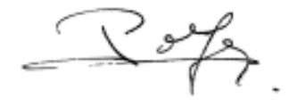 |  | *Pour le Gouvernement* *du Royaume de Belgique,* 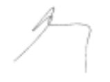 |
|---|---|---|
|  |  | *Pour le Gouvernement wallon,* 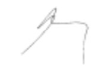 |
|  |  | *Pour le Gouvernement flamand,* 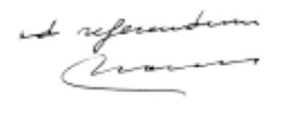 |
|  |  | *Pour le Gouvernement* *de la Région de Bruxelles-Capitale,*  |

\**CONVENTION**

\**instituant l’Union économique belgo-luxembourgeoise**

## Chapitre 1 — *Dispositions fondamentales*

### *Article 1*

Il est institué entre le Royaume de Belgique et le Grand-Duché de Luxembourg une Union économique fondée sur une union douanière et une union accisienne.

### *Article 2*

Les territoires des Hautes Parties Contractantes sont considérés comme ne formant qu’un seul territoire au point de vue de la douane, des accises communes et des taxes y assimilées (à l’exclusion des écotaxes) et des mesures communes destinées à régler les échanges économiques extérieurs.

### *Article 3*

L’application des dispositions de la présente Convention est assurée par les institutions suivantes, chacune d’entre elles agissant dans le cadre de ses attributions:

aot un Comité de Ministres,

bot une Commission administrative,

cot un Conseil des douanes.

## Chapitre 2 — *Dispositions relatives aux douanes et accises*

### *Article 4*

Les dispositions légales et réglementaires en matière de douanes et d’accises ou de taxes y assimilées (à l’exclusion des écotaxes) sont communes pour l’ensemble de l’Union.

### *Article 5*

Le Comité de Ministres délibère de l’institution, de la modification et de la suppression d’accises communes ou de taxes y assimilées (à l’exclusion des écotaxes).

Lorsqu’une accise ou une taxe y assimilée (à l’exclusion des écotaxes) est commune, elle fait l’objet de dispositions légales et réglementaires communes.

### *Article 6*

Sous réserve des attributions du Conseil des douanes, chacun des deux gouvernements assure sur son territoire l’administration et la perception en matière de douanes et d’accises, conformément aux lois et règlements de l’union douanière et de l’Union européenne.

### *Article 7*

1\. Est considéré comme recette commune, le produit:

a) des droits à l’importation perçus pour le compte de l’Union européenne, mis à la disposition des Etats membres, en vertu d’une décision de cette union au titre de remboursement des frais de perception;

des rétributions perçues du chef de prestations spéciales ou des interventions effectuées par les agents des douanes et accises à l’occasion d’opérations douanières;

du remboursement, par les Communautés européennes, des frais de perception des droits à l’importation versés à ces Communautés au titre des ressources propres;

b) des droits d’accises communs et des taxes y assimilées (à l’exclusion des écotaxes);

des rétributions perçues du chef de prestations spéciales ou des interventions effectuées par les agents des douanes et accises à l’occasion d’opérations en rapport avec les produits soumis à un droit d’accises commun et/ou des taxes y assimilées (à l’exclusion des écotaxes);

des intérêts perçus en raison du paiement tardif des droits d’accises communs et/ou des taxes y assimilées (à l’exclusion des écotaxes).

2\. Cette recette commune, déduction faite des remboursements, est répartie entre les Hautes Parties Contractantes:

a) en ce qui concerne les recettes visées au § 1er a), proportionnellement à la population de leurs territoires;

b) en ce qui concerne les recettes visées au § 1er b), sur la base de la consommation ou de l’utilisation, dans chacun des territoires des Hautes Parties Contractantes, des produits soumis aux droits d’accises communs et aux taxes y assimilées (à l’exclusion des écotaxes).

Aux fins de la répartition de la recette commune selon les prescriptions du § 2, alinéa 1, a), un recensement de la population est effectué selon les mêmes principes sur tout le territoire de l’Union chaque année dont le millésime finit par 1, durant la période déterminée dans le cadre des Communautés européennes ou, à défaut, par concertation entre les deux pays.

La part revenant à chacune des Hautes Parties Contractantes selon les prescriptions du § 2, b) est fixée annuellement par le Comité de Ministres sur proposition du Conseil des douanes.

3\. Les frais communs d’administration et de perception sont mis à charge des Hautes Parties Contractantes proportionnellement à la part de la recette commune revenant à chacun des partenaires de l’Union.

4\. Le Conseil des douanes établit, à la fin de chaque trimestre, un décompte provisoire de la recette commune et des frais communs d’administration et de perception et détermine:

a) d’une part, d’après les modes de répartition visés aux §§ 2 et 3 ci-dessus, la part de la recette commune revenant à chacune des Hautes Parties Contractantes, déduction faite de la part des frais communs d’administration et de perception incombant à chacune d’Elles;

b) d’autre part, le montant des recettes communes effectuées par chacune des Hautes Parties Contractantes, déduction faite des frais communs d’administration et de perception exposés par chacune d’Elles.

5\. La Haute Partie Contractante dont les recettes nettes visées au § 4, b) dépassent la part nette visée au § 4, a) verse à l’autre Partie Contractante la différence entre ses recettes nettes et sa part nette.

6\. Les dispositions prévues aux §§ 4 et 5 sont appliquées pour le décompte détaillé qui doit être établi immédiatement après la clôture définitive de chaque année ou lorsque les frais communs d’administration réels sont connus.

### *Article 8*

1\. Pour l’application de l’article 7 § 3, sont considérés comme frais communs d’administration et de perception:

a) les frais de fonctionnement du Conseil des douanes, ces frais étant avancés par le Gouvernement belge;

b) les frais d’administration et de perception, y compris ceux des administrations centrales, afférents aux droits à l’importation et aux droits d’accises communs ou aux taxes y assimilées (à l’exclusion des écotaxes) sur les produits mis à la consommation.

2\. Les dépenses visées au § 1, b) comprennent:

a) les traitements, y compris les allocations et indemnités, du personnel de l’administration des douanes et accises belge et de l’administration luxembourgeoise des douanes et accises; au cas où le taux des traitements du personnel luxembourgeois serait supérieur à celui du personnel belge, ces frais ne peuvent être mis à charge de la communauté que jusqu’ à concurrence de la moyenne annuelle de la dépense pour chaque catégorie d’employés de l’administration belge;

b) une somme forfaitaire de 15% des traitements du personnel désigné ci-dessus pour la charge résultant des pensions à payer à ce personnel par chacune des Hautes Parties Contractantes;

c) une somme forfaitaire pour la location, l’entretien, l’ameublement, le chauffage et l’éclairage des immeubles ou parties d’immeubles affectés au service de l’administration, pour les fournitures de bureau, pour les frais d’affranchissement de la correspondance échangée entre les agents des douanes et des accises des deux pays pour toutes les affaires qui sont de leur compétence, ainsi que pour l’armement du personnel;

d) les frais d’entretien et de mise en marche des véhicules et embarcations de l’administration des douanes et accises.

### *Article 9*

Les dispositions légales et réglementaires communes actuellement en vigueur dans le domaine des douanes, des accises et des taxes y assimilées communes et du régime des échanges économiques extérieurs, ainsi que les modalités en usage pour la mise en vigueur de celles-ci, restent applicables jusqu’à disposition nouvelle du Comité de Ministres.

### *Article 10*

Les Hautes Parties Contractantes s’engagent à rechercher une position commune en vue de la fixation des taux d’accises harmonisés à l’intérieur de la Communauté européenne. Sans que leur taux ne puisse dépasser le taux minimal harmonisé au niveau de la Communauté européenne, le régime de communauté en matière d’accises est maintenu entre les Hautes Parties Contractantes en ce qui concerne les produits suivants, tant en ce qui concerne les produits fabriqués ou obtenus en Belgique ou au Luxembourg que pour les produits introduits d’un autre Etat membre de l’Union européenne ou pour les produits importés de pays tiers:

1° les bières telles que définies à l’article 4 de la loi belge du 7 janvier 1998 concernant la structure et les taux des droits d’accises sur l’alcool et les boissons alcoolisées;

2° les vins tels que définis à l’article 9 de la même loi;

3° les boissons fermentées autres que le vin ou la bière (autres boissons fermentées) telles que définies à l’article 11 de la même loi;

4° les produits intermédiaires tels que définis à l’article 14 de la même loi;

5° l’alcool éthylique et les boissons spiritueuses tels que définis à l’article 16 de la même loi;

6° l’essence avec plomb, l’essence sans plomb, le pétrole lampant utilisé comme carburant, le pétrole lampant utilisé pour des usages industriels et commerciaux, le gasoil utilisé comme carburant, le gasoil utilisé pour des usages industriels et commerciaux, le fuel domestique, le fuel lourd de toute espèce ainsi que les gaz de pétrole liquéfiés et le méthane destinés à des usages industriels et commerciaux, tels que définis à l’article 7 de la loi belge du 22 octobre 1997 relative à la structure et aux taux des droits d’accises sur les huiles minérales;

7° les tabacs manufacturés tels que définis aux articles 4 (cigares et cigarillos), 5 (cigarettes), 6 (tabac à fumer), 7 (tabac à fumer fine coupe destiné à rouler les cigarettes), 8 (cigares, cigarillos, cigarettes et tabacs à fumer assimilés) de la loi belge du 3 avril 1997 relative au régime fiscal des tabacs manufacturés.

### *Article 11*

Chaque gouvernement de l’Union est responsable de toutes les sommes non perçues, égarées ou soustraites sur son territoire, même si la perte est due à un accident, une négligence ou un fait délictueux.

Exceptionnellement, le Conseil des douanes peut, pour des raisons d’équité, mettre ces pertes à charge de la communauté, s’il constate que toutes les mesures propres à les éviter avaient été décrétées et exécutées par le gouvernement responsable.

### *Article 12*

1\. Chaque Etat de l’Union recrute exclusivement parmi ses ressortissants le personnel de l’administration des douanes et accises.

2\. Le personnel de l’administration luxembourgeoise des douanes et accises adopte l’uniforme, la cocarde exceptée, ainsi que l’équipement et les armes du personnel de l’administration des douanes et accises belge.

### *Article 13*

1\. La classification hiérarchique des grades établis en Belgique pour l’administration des douanes et accises est adoptée pour l’administration luxembourgeoise des douanes et accises.

2\. Le personnel luxembourgeois est rémunéré suivant les barèmes des traitements, allocations et indemnités, prévus en Belgique, sans que ces rémunérations puissent être inférieures à celles que toucheraient au Luxembourg les agents de même rang.

### *Article 14*

1\. Le Comité de Ministres fixe, au regard de l’Union, le statut du directeur général des douanes et accises de Belgique et du directeur général des douanes et accises luxembourgeoises.

2\. Les agents des douanes et des accises des deux pays sont autorisés à correspondre directement entre eux pour toutes les affaires qui sont de leur compétence.

### *Article 15*

1\. Le Conseil des douanes est composé de trois membres qui sont: le directeur général de l’administration belge des douanes et accises, président, le directeur général de l’administration luxembourgeoise des douanes et accises et un membre nommé par le Gouvernement belge parmi les fonctionnaires de l’administration belge des douanes et accises ayant le grade d’auditeur général des finances.

2\. Le Conseil est assisté par deux experts en matière d’accises désignés par ledit Conseil parmi les fonctionnaires de l’administration belge des douanes et accises. Ces experts n’interviennent pas dans les décisions du Conseil.

3\. Les délibérations du Conseil des douanes sont acquises à l’unanimité. En cas de désaccord entre les membres, la question est soumise au Comité de Ministres.

### *Article 16*

1\. Le Conseil des douanes a la mission d’assurer l’unité dans l’administration de l’Union en matière de douanes et d’accises communes ainsi que de taxes y assimilées (à l’exclusion des écotaxes) et de gérer la recette commune de l’Union.

2\. Il exerce en outre les attributions suivantes:

a) il prépare le projet des dispositions légales et réglementaires communes en matière de douanes et d’accises;

b) il donne son avis motivé:

– sur les changements à l’organisation et notamment sur toute proposition tendant, soit à augmenter ou à réduire le personnel, soit à créer, supprimer ou déplacer des bureaux de perception. Si l’avis est négatif, les dépenses occasionnées ne sont portées aux décomptes de la communauté qu’après accord du Comité de Ministres. Si cet accord n’est pas obtenu, la mesure peut être décrétée aux frais exclusifs du gouvernement qui l’ordonne;

– sur les réductions, restitutions ou remises de droits communs, qui ne sont pas une application pure et simple d’une disposition légale;

– sur toutes les questions en matière de douanes et d’accises que les gouvernements ou le Comité de Ministres lui soumettent;

c) il examine les questions d’application et d’interprétation des lois, tarifs et règlements en matière de douanes et d’accises ou de taxes y assimilées (à l’exclusion des écotaxes) communes. Son avis motivé est transmis aux administrations respectives qui prennent les décisions opportunes;

d) il a le droit de prendre tous les renseignements utiles à sa tâche et de se faire produire par les administrations des deux Hautes Parties Contractantes toutes les pièces qu’il juge nécessaires à l’accomplissement de ses fonctions;

e) il peut autoriser des agents des administrations des deux Hautes Parties Contractantes à effectuer ensemble des tournées d’inspection dans le territoire de l’Union.

## Chapitre 3 — *Séjour, établissement et exercice des professions*

### *Article 17*

Les ressortissants de chacune des Hautes Parties Contractantes jouissent sur le territoire de l’autre Partie Contractante du traitement accordé aux nationaux en ce qui concerne la circulation et le séjour, sous réserve des restrictions déterminées par le Comité de Ministres dans l’intérêt de l’ordre public, de la sécurité, de la santé publique et des bonnes moeurs.

### *Article 18*

Les ressortissants de chacune des Hautes Parties Contractantes bénéficient sur le territoire de l’autre Partie Contractante du traitement accordé aux nationaux en ce qui concerne la jouissance des droits civils ainsi que la protection légale et judiciaire de leur personne, de leurs droits et de leurs intérêts.

### *Article 19*

1\. Les ressortissants de chacune des Hautes Parties Contractantes sont soumis sur le territoire de l’autre Partie Contractante au même traitement que les nationaux en ce qui concerne l’accès à des activités économiques indépendantes ou l’exercice de celles-ci.

2\. Afin d’assurer en fait l’égalité de traitement prévue au §1er, les gouvernements déterminent en cas de besoin et de commun accord, les conditions et formalités à remplir par les ressortissants de chacun des deux pays pour exercer dans l’autre pays une activité économique indépendante, pour autant que l’accès ou l’exercice y soit réglementé. ils fixent notamment les règles valables pour la reconnaissance des titres professionnels requis. Ces conditions et formalités peuvent déroger aux réglementations nationales.

3\. Les ressortissants de l’une des Hautes Parties Contractantes, établis sur le territoire de l’autre Partie Contractante, sont, s’ils le désirent, assimilés aux ressortissants de celle-ci pour l’application du § 2.

### *Article 20*

1\. Les dispositions des articles 18 et 19 sont applicables aux sociétés constituées en conformité de la législation d’une des Hautes Parties Contractantes et ayant leur principal établissement sur le territoire de celle-ci, qu’elles agissent soit directement, soit par l’intermédiaire de succursales ou d’agences.

2\. Par sociétés, au sens du présent article, on entend les sociétés privées de droit civil ou commercial, y compris les sociétés coopératives. Toutefois, les personnes morales relevant du droit privé qui ne poursuivent pas de but lucratif ne sont considérées comme sociétés qu’en ce qui concerne leur activité dans le secteur des banques, des assurances, de la capitalisation et des prêts hypothécaires. Sont aussi considérées comme sociétés, les associations agricoles et viticoles luxembourgeoises.

3\. Lorsque pour la jouissance et l’exercice des droits découlant de la présente Convention, un type de société d’une Haute Partie Contractante ne peut trouver son équivalent dans la législation de l’autre Partie Contractante, les gouvernements déterminent de commun accord à quel type il peut être assimilé.

### *Article 21*

Le traitement dont bénéficient les agents commerciaux indépendants en vertu de l’article 19 est également accordé aux représentants de commerce salariés, belges ou luxembourgeois, lorsqu’ils représentent des nationaux ou des sociétés de l’une des Hautes Parties Contractantes exerçant une activité lucrative dans le territoire de ladite Partie Contractante.

### *Article 22*

Pour la participation aux marchés de fournitures, de travaux et de services offerts par les administrations publiques ainsi que par les administrations et établissements contrôlés par les pouvoirs publics, les ressortissants de l’une des Hautes Parties Contractantes sont soumis par l’autre Partie Contractante aux mêmes conditions que les ressortissants de celle-ci; ils jouissent des mêmes droits, avantages et facilités, sans aucune différence de droit ou de fait.

### *Article 23*

Les ressortissants de l’une des Hautes Parties Contractantes qui s’établissent, résident temporairement dans le territoire de l’autre Partie Contractante ou empruntent le territoire de celle-ci, ses installations de transport par terre, par eau ou par air, ne peuvent y être soumis, soit en raison du produit de leur agriculture, de leur commerce, de leur industrie, de leurs capitaux ou de leur travail, soit à raison des opérations agricoles, commerciales, industrielles, financières, les occupations et professions qu’ils y exercent, soit à raison du transport de leurs marchandises, de leur personne et de leurs biens, à des modes de perception ou de circulation ni à des droits, taxes, tarifs, impôts ou patentes, sous quelque dénomination que ce soit, autres que ceux qui seront appliqués aux nationaux; les privilèges, immunités ou faveurs quelconques, dont jouiraient, en matière de commerce ou d’industrie, les ressortissants de l’une des Parties, sont communs à ceux de l’autre.

## Chapitre 4 — *Dispositions économiques*

### *Article 24*

1\. En vue de favoriser le bon fonctionnement de l’Union instituée par la présente Convention, les Hautes Parties Contractantes:

– poursuivent, en étroite consultation mutuelle, une politique coordonnée en matière économique, financière et sociale et en matière de prix;

– tendent au rapprochement des dispositions légales, réglementaires et administratives qui ont une incidence directe sur le fonctionnement de l’Union;

– veillent en commun à ce qu’aucune disposition légale, réglementaire ou administrative n’entrave indûment les échanges commerciaux entre les deux pays;

– s’efforcent d’éliminer les disparités entre les dispositions légales, réglementaires et administratives pouvant fausser les conditions de concurrence sur les marchés des deux pays;

– se prêtent mutuellement un concours destiné à assurer l’efficacité des mesures de politique économique prises dans chacun des deux pays notamment relatives aux nouveaux domaines de développement économique tels que la politique de la concurrence, et la surveillance du marché en ce qui concerne le crédit à la consommation, la protection et la sécurité du consommateur, et la réglementation commerciale. Cette coopération implique une assistance mutuelle administrative;

– poursuivent une politique coordonnée en matière de qualité des produits et des services sur le plan de l’accréditation et de la certification, ainsi que des mécanismes de contrôle et de conformité.

2\. Les gouvernements des Hautes Parties Contractantes prennent au sein du Comité de Ministres les mesures nécessaires pour assurer l’application des dispositions qui précèdent.

### *Article 25*

Pour l’approvisionnement en combustibles, en énergie et en matières premières, les deux pays doivent être placés sur le pied d’une parfaite égalité.

### *Article 26*

Les gouvernements des Hautes Parties Contractantes prennent les mesures nécessaires pour éliminer, dans l’application des législations relatives à l’impôt sur le chiffre d’affaires, la taxe sur la valeur ajoutée ou des impôts analogues, les entraves à la libre circulation des marchandises et des services, les atteintes au jeu normal de la concurrence et les effets du cumul de taxes entre les deux pays.

### *Article 27*

Les Hautes Parties Contractantes adopteront des dispositions légales uniformes en ce qui concerne le commerce des vins et la protection des appellations contrôlées.

En attendant la mise en vigueur de ces dispositions, les autorités des deux pays coopèrent en vue d’assurer une répression effective des infractions commises contre les législations existant en la matière.

### *Article 28*

1\. Les gouvernements des Hautes Parties Contractantes concertent, dans le cadre du Comité de Ministres, leur politique en matière de transport modal et intermodal, en vue de faciliter la circulation entre les deux pays et d’assurer dans le domaine des transports terrestres, aériens et maritimes, l’égalité de traitement aux ressortissants de chacune des Hautes Parties Contractantes, dans la mesure où cette égalité ne résulte pas, de plein droit, des dispositions de la présente Convention.

2\. Les Hautes Parties Contractantes s’engagent à favoriser le développement harmonieux de leurs relations dans le domaine de la politique des transports, notamment en promouvant une consultation et une coopération actives entre les autorités respectivement compétentes.

3\. Le Grand-Duché de Luxembourg est assuré de trouver, par les ports belges, un libre accès aux transports maritimes, dans les conditions applicables aux entreprises de transport et aux ressortissants belges.

### *Article 29*

1\. Chacune des Hautes Parties Contractantes se réserve le droit de prononcer les prohibitions de circulation qui sont justifiées par des raisons de moralité publique, d’ordre public, de sécurité publique, de protection de la santé et de la vie des personnes et des animaux ou de préservation des végétaux, de protection des trésors nationaux ayant une valeur artistique, historique ou archéologique ou de protection de la propriété industrielle et commerciale. Toutefois, ces interdictions ou restrictions ne doivent constituer ni un moyen de discrimination arbitraire ni une restriction déguisée dans le commerce.

2\. Les autorisations et permis de transport de matières dangereuses, telles que les explosifs, délivrés par les autorités compétentes de Belgique sont valables pour le Luxembourg et réciproquement.

## Chapitre 5 — *Relations économiques*

### *Article 30*

Les Hautes Parties Contractantes se concertent pour la défense des intérêts de l’Union dans les relations avec les Etats tiers et au sein des organisations internlearactère économique dont Elles sont membres. A cette fin, Elles s’efforceront dans toute la mesure du possible d’arriver à une position commune.

### *Article 31*

1\. Les traités et accords afférents à la défense des intérêts économiques, notamment les accords concernant l’encouragement et la protection réciproque des investissements, les accords sur les produits de base et tes accords maritimes, conclus entre l’Union et les Etats tiers et qui ne tombent pas dans le champ d’application des accords internationaux déjà conclus par les Hautes Parties Contractantes, sont communs.

2\. Ils sont conclus par la Belgique au nom de l’Union, sous réserve de la faculté, pour le Luxembourg,sces traités ou accords conjointement avec la Belgique. Aucun de ces traités et accords ne peut être conclu, modifié ou dénoncé sans que le Luxembourg n’ait été entendu.

### *Article 32*

1\. Dans les circonscriptions où le Luxembourg ne possède pas de représentation diplomatique ou consulaire, la défense des intérêts luxembourgeois dans le domaine économique et commercial est confiée aux représentations diplomatiques et consulaires belges; les membres de ces représentations prêtent leur concours au Luxembourg dans les mêmes domaines.

2\. D’autres attributions consulaires seront assumées par les services consulaires belges, en vertu de la convention spéciale existant entre les Hautes Parties Contractantes.

### *Article 33*

1\. Le Comité de Ministres arrêtera les modalités d’application pour ce qui est de la conclusion des accords prévue à l’article 31. Ces modalités s’appliqueront également à tous autres traités et accords bilatéraux où multilatéraux qui sont connexes à l’Union ou dont certaines clauses seulement concernent les objets définis à l’article 31 § 1. A défaut, les gouvernements des Hautes Parties Contractantes s’entendront selon les cas sur la procédure à suivre.

2\. Les Hautes Parties Contractantes prennent les mesures nécessaires pour assurer l’application uniforme, sur le territoire des deux pays, de toutes dispositions de traités et accords visés par le présent article, relatives aux objets définis au § 1.

### *Article 34*

1\. Outre les réglementations européennes ayant trait aux licences d’importation, d’exportation et de transit, les autres réglementations s’appliquant aux licences sont communes aux deux pays de l’Union de même que les redevances d’administration éventuelles, tant pour ce qui concerne les dispositions légales et réglementaires que leurs modalités d’application.

2\. Les mesures visées par le § 1, prises dans le cadre des dispositions générales des articles 41, 42 et 44, sont soumises à l’avis préalable de la Commission administrative.

Le Comité de Ministres fixe une procédure permettant de prendre dans l’intervalle de ses réunions et de celles de la Commission administrative, les mesures d’urgence qui pourraient s’imposer dans le domaine de la réglementation des importations, des exportations et du transit.

### *Article 35*

1\. La Commission administrative est investie de l’administration des régimes de licences institués pour l’Union.

Elle est seule investie du pouvoir de délivrer aux intéressés, aux mêmes conditions pour l’ensemble de l’Union, des licences d’importation, d’exportation et de transit. Elle perçoit les redevances prévues à l’article 34.

2\. La Commission administrative peut, dans le cadre des principes fixés par le Comité de Ministres, déléguer ses attributions à des offices constitués par elle ou à des offices gouvernementaux. Elle peut, en outre, dans les mêmes conditions, déléguer certaines de ses attributions à des gouvernements tiers, ainsi qu’à des organismes ou personnes établis, soit sur le territoire, soit en dehors du territoire de l’Union.

## Chapitre 6 — *Agriculture*

### *Article 36*

Le Comité de Ministres a le pouvoir de prendre toutes les mesures générales ou particulières destinées à réaliser ou à maintenir dans le domaine des échanges agricoles entre les deux pays un régime commun qui assure la sauvegarde des intérêts vitaux agricoles des deux pays, sous réserve des dispositions prises dans le cadre de l’Union économique Benelux ou, selon le cas, de la Communauté européenne.

### *Article 37*

Dans tous les domaines concernant la politique agricole les Hautes Parties Contractantes, à la demande de l’une des parties, se concertent et, dans la mesure du possible, coordonnent leurs positions à défendre dans les instances de la Communauté européenne et des organisations internationales, ainsi que les mesures à appliquer dans leurs pays respectifs.

### *Article 38*

Les Hautes Parties Contractantes se prêtent mutuellement assistance en matière de politique agricole au sein des organes, commissions, comités ou groupes de travail organisés au niveau des instances de la Communauté européenne et des organisations internationales. En cas de besoin et pour autant que les dispositions applicables le permettent, l’une des parties peut se faire représenter par l’autre, y compris dans les réunions où un vote par pays peut être demandé.

### *Article 39*

Dans tous les cas où les marchés agricoles belgo-luxembourgeois ou la libre circulation des produits agricoles entre les deux pays risquent d’être perturbés, les Hautes Parties Contractantes se concertent d’urgence en vue de prendre les mesures visant à éviter cette perturbation dans le domaine agricole et agro-alimentaire.

### *Article 40*

Dans la mesure du possible et en poursuivant l’objectif d’une plus grande efficacité dans l’application des dispositions de politique agricole, les Hautes Parties Contractantes coopèrent en vue de la mise en place de systèmes de gestion de la politique agricole qui favorisent la collaboration entre les deux pays.

## Chapitre 7 — *Dispositions institutionnelles et générales*

### *Article 41*

1\. Le Comité de Ministres est composé de membres des gouvernements des Hautes Parties Contractantes.

2\. Le Comité de Ministres a pour mission de prendre les décisions nécessaires pour le bon fonctionnement de l’Union, de concerter les mesures légales et réglementaires communes, prévues par la présente Convention, et de délibérer sur les questions concernant les relations économiques externes.

3\. Le Comité de Ministres statue par accord mutuel des ministres belges et luxembourgeois présents.

4\. Le Comité de Ministres arrête son règlement d’ordre intérieur.

### *Article 42*

1\. La Commission administrative est composée de délégués des gouvernements des Hautes Parties Contractantes.

2\. La Commission administrative a pour mission de suivre l’application de la présente Convention et d’assurer, à cet effet, une liaison régulière entre les gouvernements des Hautes Parties Contractantes.

Elle établit des propositions qui sont soumises au Comité de Ministres. Elle peut être chargée par celui-ci de régler directement certaines questions ou certaines catégories de questions.

3\. La Commission administrative statue par accord mutuel des deux délégations. En cas de désaccord, la question est soumise au Comité de Ministres.

4\. Le règlement d’organisation et d’ordre intérieur de la Commission administrative est arrêté par le Comité de Ministres. Ce règlement peut prévoir l’exercice de certaines fonctions de la Commission par des formations restreintes de celle-ci.

### *Article 43*

Le Comité de Ministres prend les dispositions nécessaires pour assurer le financement des frais de fonctionnement de l’Union et le contrôle des comptes.

### *Article 44*

Dans tous les domaines pour lesquels une communauté de législation ou de réglementation est prévue par la présente Convention, les Hautes Parties Contractantes sont tenues de prendre les mesures nécessaires pour assurer la mise en vigueur et l’application uniforme de ces dispositions conformément à ce qui est convenu au sein du Comité de Ministres:

– soit par l’adoption de mesures légales ou réglementaires nationales de contenu identique;

– soit par l’introduction, dans l’un des pays, de dispositions en vigueur dans l’autre pays;

– soit par la publication dans les deux pays de dispositions communes, directement valables pour l’ensemble de l’Union.

### *Article 45*

Les litiges relatifs à l’application ou à l’interprétation de la présente Convention sont réglés par la voie diplomatique.

## Chapitre 8 — *Dispositions finales*

### *Article 46*

Aucune disposition de la présente Convention ne saurait porter atteinte aux dispositions de l’Union européenne.

### *Article 47*

La présente Convention est conclue pour une durée de cinquante ans à partir du 6 mars 1922.

Elle restera en vigueur ensuite pour des périodes successives de dix années sous réserve de la faculté, pour chacune des Hautes Parties Contractantes, de la dénoncer par une notification adressée à l’autre Partie Contractante au plus tard un an avant l’expiration de la période fixée par l’alinéa 1er ou, selon le cas, de chacune des périodes décennales successives.

\**PROTOCOLE**

\**portant abrogation de la Convention établissant entre le**

\**Grand-Duché de Luxembourg et la Belgique une communauté**

\**spéciale de recettes en ce qui concerne les droits**

\**d’accise perçus sur les alcools, du 23 mai 1935**

\*Les Hautes Parties Contractantes* au Protocole portant modification de la Convention coordonnée instituant l’Union économique belgo-luxembourgeoise,

\*Considérant* que les dispositions encore applicables de la [Convention établissant entre le Grand-Duché de Luxembourg et la Belgique une communauté spéciale de recettes en ce qui concerne les droits d’accise perçus sur les alcools](https://legilux.public.lu/eli/etat/leg/loi/1935/07/15/n4/jo), du 23 mai 1935, ont été insérées dans la Convention coordonnée,

\*Sont convenues de ce qui suit:*

## *Article 1er*

La [Convention établissant entre le Grand-Duché de Luxembourg et la Belgique une communauté spéciale de recettes en ce qui concerne les droits d’accise perçus sur les alcools](https://legilux.public.lu/eli/etat/leg/loi/1935/07/15/n4/jo), du 23 mai 1935, est abrogée.

## *Article 2*

Le présent Protocole sera ratifié. Il entrera en vigueur le premier jour du deuxième mois qui suivra l’échange des instruments de ratification.

Fait à Bruxelles, le 18 décembre 2002, en double exemplaire, en langues française et néerlandaise, les deux textes faisant également foi.

| *Pour le Gouvernement* *du Grand-Duché de Luxembourg,* 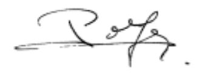 |  | *Pour le Gouvernement* *du Royaume de Belgique,* 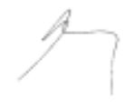 |
|---|---|---|

\**PROTOCOLE**

\**portant abrogation du Protocole spécial entre le Grand-Duché de Luxembourg**

\**et la Belgique relatif à l’agriculture, du 29 janvier 1963**

\*Les Hautes Parties Contractantes* au Protocole portant modification de la Convention coordonnée instituant l’Union économique belgo-luxembourgeoise,

\*Considérant* que des dispositions nouvelles relatives à leur partenariat dans le cadre de la politique agricole ont été insérées dans la Convention coordonnée,

\*Sont convenues de ce qui suit:*

## *Article 1er*

Le [Protocole spécial entre le Grand-Duché de Luxembourg et la Belgique relatif à l’agriculture](https://legilux.public.lu/eli/etat/leg/loi/1965/05/26/n1/jo), du 29 janvier 1963, est abrogé.

## *Article 2*

Le présent Protocole sera ratifié. Il entrera en vigueur le premier jour du deuxième mois qui suivra l’échange des instruments de ratification.

Fait à Bruxelles, le 18 décembre 2002, en double exemplaire, en langues française et néerlandaise, les deux textes faisant également foi.

| *Pour le Gouvernement* *du Grand-Duché de Luxembourg,* 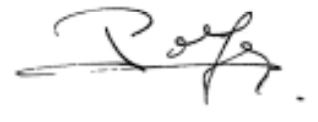 |  | *Pour le Gouvernement* *du Royaume de Belgique,* 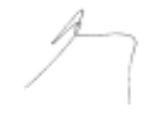 |
|---|---|---|
|  |  | *Pour le Gouvernement wallon,*  |
|  |  | *Pour le Gouvernement flamand,* 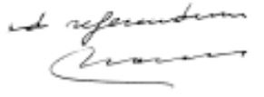 |
|  |  | *Pour le Gouvernement* *de la Région de Bruxelles-Capitale,*  |

\**PROTOCOLE**

\**portant abrogation du Protocole entre le Grand-Duché de Luxembourg**

\**et le Royaume de Belgique relatif à l’association monétaire**

\**et de son Protocole d’exécution, du 9 mars 1981**

\*Les Hautes Parties Contractantes* au Protocole portant modification de la Convention coordonnée instituant l’Union économique belgo-luxembourgeoise,

\*Considérant* que l’association monétaire entre le Grand-Duché de Luxembourg et le Royaume de Belgique a trouvé son aboutissement avec l’introduction de l’euro comme monnaie commune,

\*Sont convenues de ce qui suit:*

## *Article 1er*

Le [Protocole entre le Grand-Duché de Luxembourg et le Royaume de Belgique relatif à l’association monétaire](https://legilux.public.lu/eli/etat/leg/loi/1983/04/11/n3/jo) et son Protocole d’exécution, du 9 mars 1981, sont abrogés.

## *Article 2*

Le partage entre les deux Etats des sommes qu’encaisse l’Etat belge par suite de la démonétisation des billets belges libellés en francs et des charges que supporte l’Etat belge par suite du remboursement ultérieur aux porteurs de tels billets dont la contre-valeur lui a été versée, continuera à se faire suivant le rapport entre les populations respectives des deux Etats suivant des modalités et jusqu’à une date à convenir par les Ministres des deux Etats.

## *Article 3*

Le présent Protocole sera ratifié. Il entrera en vigueur le premier jour du deuxième mois qui suivra l’échange des instruments de ratification.

Fait à Bruxelles, le 18 décembre 2002, en double exemplaire, en langues française et néerlandaise, les deux textes faisant également foi.

| Pour le Gouvernement du Grand-Duché de Luxembourg,  |  | Pour le Gouvernement du Royaume de Belgique, 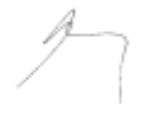 |
|---|---|---|

\**ACTE FINAL**

\*Les plénipotentiaires* du Grand-Duché de Luxembourg et du Royaume de Belgique, de la Région wallonne, de la Région flamande et de la Région de Bruxelles-Capitale,

\*réunis* à Bruxelles, le 18 décembre 2002, pour la signature du Protocole portant modification de la Convention coordonnée instituant l’Union économique belgo-luxembourgeoise, ont adopté les textes suivants:

aone une Déclaration solennelle, exprimant la volonté du Grand-Duché de Luxembourg et du Royaume de Belgique de renforcer leur coopération sur la base des liens de confiance qui se sont développés dans le passé,

bone le Protocole portant modification de la [Convention coordonnée instituant l’Union économique belgo-luxembourgeoise](https://legilux.public.lu/eli/etat/leg/loi/1922/03/05/n1/jo) et la nouvelle Convention coordonnée instituant l’Union économique belgo-luxembourgeoise en résultant,

et les protocoles suivants:

aone Protocole portant abrogation de la [Convention établissant entre le Grand-Duché de Luxembourg et la Belgique une communauté spéciale de recettes en ce qui concerne les droits d’accises perçus sur les alcools](https://legilux.public.lu/eli/etat/leg/loi/1935/07/15/n4/jo), du 23 mai 1935,

bone Protocole portant abrogation du [Protocole spécial entre le Grand-Duché de Luxembourg et la Belgique relatif à l’agriculture](https://legilux.public.lu/eli/etat/leg/loi/1965/05/26/n1/jo), du 29 janvier 1963,

cone Protocole portant abrogation du [Protocole entre le Grand-Duché de Luxembourg et le Royaume de Belgique relatif à l’association monétaire](https://legilux.public.lu/eli/etat/leg/loi/1983/04/11/n3/jo) et de son Protocole d’exécution, du 9 mars 1981.

Fait à Bruxelles, le 18 décembre 2002, en double exemplaire, en langues française et néerlandaise, les deux textes faisant également foi.

| *Pour le Gouvernement* *du Grand-Duché de Luxembourg,* 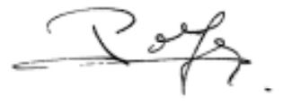 |  | *Pour le Gouvernement* *du Royaume de Belgique,*  |
|---|---|---|
|  |  | *Pour le Gouvernement wallon,* 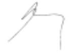 |
|  |  | *Pour le Gouvernement flamand*  |
|  |  | *Pour le Gouvernement* *de la Région de Bruxelles-Capitale,*  |

Doc. parl. [5290](https://legilux.public.lu/eli/etat/proj/pl/20040014); sess. ord. 2003-2004
