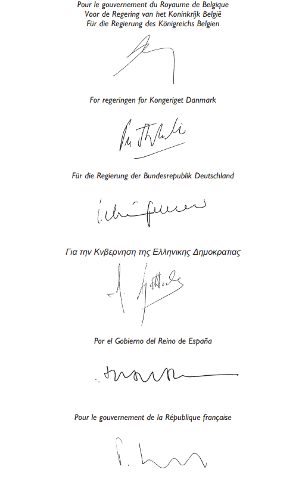
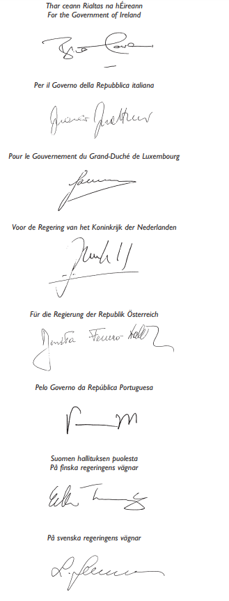
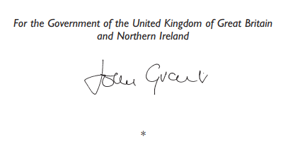

# Loi du 7 avril 2005 portant approbation de l’Accord entre les Etats membres de l’Union européenne relatif au statut du personnel militaire et civil détaché auprès des institutions de l’Union européenne, des quartiers généraux et des forces pouvant être mis à la disposition de l’Union européenne dans le cadre de la préparation et de l’exécution des missions visées à l’article 17, paragraphe 2, du Traité sur l’Union européenne, y compris lors d’exercices, et du personnel militaire et civil des Etats membres mis à la disposition de l’Union européenne pour agir dans ce cadre (SOFA UE), signé à Bruxelles, le 17 novembre 2003.

Nous Henri, Grand-Duc de Luxembourg, Duc de Nassau,

Notre Conseil d’Etat entendu;

De l’assentiment de la Chambre des Députés;

Vu la décision de la Chambre des Députés du 2 mars 2005 et celle du Conseil d’Etat du 22 mars 2005 portant qu’il n’y a pas lieu à second vote;

Avons ordonné et ordonnons:

## Article unique.

Est approuvé l’Accord entre les Etats membres de l’Union européenne relatif au statut du personnel militaire et civil détaché auprès des institutions de l’Union européenne, des quartiers généraux et des forces pouvant être mis à la disposition de l’Union européenne dans le cadre de la préparation et de l’exécution des missions visées à l’article 17, paragraphe 2, du [Traité sur l’Union européenne](https://legilux.public.lu/eli/etat/leg/loi/1992/07/27/n6/jo), y compris lors d’exercices, et du personnel militaire et civil des Etats membres mis à la disposition de l’Union européenne pour agir dans ce cadre (SOFA UE), signé à Bruxelles, le 17 novembre 2003.

Mandons et ordonnons que la présente loi soit insérée au Mémorial pour être exécutée et observée par tous ceux que la chose concerne.

Le Ministre des Affaires Etrangères et de l’Immigration,   Jean Asselborn

Palais de Luxembourg, le 7 avril 2005.   Henri

\**ACCORD**

entre les Etats membres de l’Union européenne relatif au statut du personnel militaire et civil détaché auprès des institutions de l’Union européenne, des quartiers généraux et des forces pouvant être mis à la disposition de l’Union européenne dans le cadre de la préparation et de l’exécution des missions visées à l’article 17, paragraphe 2, du Traité sur l’Union européenne, y compris lors d’exercices, et du personnel militaire et civil des Etats membres mis à la disposition de l’Union européenne pour agir dans ce cadre (SOFA UE)

\*Les représentants des Gouvernements des Etats membres de l’Union européenne,* réunis au sein du Conseil,

\*vu* le [traité sur l’Union européenne](https://legilux.public.lu/eli/etat/leg/loi/1992/07/27/n6/jo) (TUE), et notamment son titre V,

\*considérant* ce qui suit:

(1) Le Conseil européen a décidé, dans le cadre de la poursuite des objectifs de la politique étrangère et de sécurité commune, de doter l’UE des capacités nécessaires pour prendre et mettre en œuvre des décisions sur l’ensemble des missions de prévention des conflits et de gestion des crises définies dans le [TUE](https://legilux.public.lu/eli/etat/leg/loi/1992/07/27/n6/jo).

(2) Les décisions, prises au niveau national, d’envoyer des forces d’Etats membres de l’Union européenne (ci-après dénommés «Etats membres») sur le territoire d’autres Etats membres et d’accueillir ces forces d’Etats membres dans le contexte de la préparation et de l’exécution des missions visées à l’article 17, paragraphe 2, du [TUE](https://legilux.public.lu/eli/etat/leg/loi/1992/07/27/n6/jo), y compris lors d’exercices, interviendront conformément aux dispositions du titre V du [TUE](https://legilux.public.lu/eli/etat/leg/loi/1992/07/27/n6/jo), et notamment de son article 23, paragraphe 1, et feront l’objet d’arrangements séparés entre les Etats membres concernés.

(3) Des accords spécifiques devront être conclus avec les pays tiers concernés dans le cas d’exercices ou d’opérations se déroulant hors du territoire des Etats membres.

(4) Les dispositions du présent accord n’affectent pas les droits et obligations qui incombent aux parties en vertu d’accords internationaux et d’autres instruments internationaux instituant des tribunaux internationaux, dont le [Statut de Rome de la Cour pénale internationale](https://legilux.public.lu/eli/etat/leg/loi/2000/08/14/n1/jo),

\*sont convenus de ce qui suit:*

## PARTIE I — Dispositions communes à l’ensemble des militaires et du personnel civil

### *Article 1*

Aux fins du présent accord, on entend par:

1\) «personnel militaire»:

a) le personnel militaire détaché par les Etats membres auprès du Secrétariat général du Conseil en vue de constituer l’état-major de l’Union européenne (EMUE);

b) le personnel militaire autre que celui issu des institutions de l’UE, auquel l’EMUE peut faire appel dans les Etats membres en vue d’assurer un renfort temporaire qui serait demandé par le Comité militaire de l’Union européenne (CMUE) aux fins d’activités dans le cadre de la préparation et de l’exécution des missions visées à l’article 17, paragraphe 2, du [TUE](https://legilux.public.lu/eli/etat/leg/loi/1992/07/27/n6/jo), y compris lors d’exercices;

c) le personnel militaire des Etats membres détaché auprès des quartiers généraux et des forces pouvant être mis à la disposition de l’UE, ou le personnel de ces forces et quartiers généraux, dans le cadre de la préparation et de l’exécution des missions visées à l’article 17, paragraphe 2, du [TUE](https://legilux.public.lu/eli/etat/leg/loi/1992/07/27/n6/jo), y compris lors d’exercices;

2\) «personnel civil»: le personnel civil détaché par les Etats membres auprès des institutions de l’UE aux fins d’activités dans le cadre de la préparation et de l’exécution des missions visées à l’article 17, paragraphe 2, du [TUE](https://legilux.public.lu/eli/etat/leg/loi/1992/07/27/n6/jo), y compris lors d’exercices, ou le personnel civil, à l’exception du personnel recruté localement, travaillant pour les quartiers généraux ou les forces ou mis à tout autre titre à la disposition de l’UE par les Etats membres pour les mêmes activités;

3\) «personne à charge»: toute personne définie ou admise comme membre de la famille ou désignée comme membre du ménage ou du membre du personnel militaire ou civil par la législation de l’Etat d’origine. Toutefois, si cette législation ne considère comme membre de la famille ou du ménage qu’une personne vivant sous le même toit que le membre du personnel militaire ou civil, cette condition est réputée remplie lorsque la personne en cause est principalement à la charge dudit membre du personnel militaire ou civil;

4\) «force»: les personnes faisant partie du personnel militaire et civil ou les entités constituées de personnel militaire et civil, au sens des paragraphes 1 et 2, sous réserve que les Etats membres concernés puissent convenir que certaines personnes, unités, formations ou autres entités ne doivent pas être considérées comme constituant une force ou en faisant partie aux fins du présent accord;

5\) «quartier général»: un quartier général situé sur le territoire des Etats membres, établi par un ou plusieurs Etats membres ou par une organisation internationale et qui peut être mis à la disposition de l’UE dans le cadre de la préparation et de l’exécution des missions visées à l’article 17, paragraphe 2, du [TUE](https://legilux.public.lu/eli/etat/leg/loi/1992/07/27/n6/jo), y compris lors d’exercices;

6\) «Etat d’origine»: l’Etat membre dont relève le membre du personnel militaire ou civil ou la force;

7\) «Etat de séjour»: l’Etat membre sur le territoire duquel se trouve le membre du personnel militaire ou civil, la force ou le quartier général, qu’il soit stationné, en déploiement ou en transit, dans le cadre d’un ordre de mission collectif ou individuel ou d’une décision de détachement auprès des institutions de l’UE.

### *Article 2*

1\. Les Etats membres facilitent, au besoin, l’entrée, le séjour et le départ à des fins officielles du personnel visé à l’article 1 et des personnes à sa charge. Cependant, il pourra être exigé du personnel et des personnes à charge qu’ils fournissent la preuve qu’ils relèvent des catégories décrites à l’article 1.

2\. A cette fin, et sans préjudice des règles pertinentes applicables à la libre circulation des personnes en vertu du droit communautaire, un ordre de mission individuel ou collectif ou une décision de détachement auprès des institutions de l’UE suffisent.

### *Article 3*

Le personnel militaire et civil et les personnes à sa charge sont tenus de respecter les lois de l’Etat de séjour et de s’abstenir de toute activité incompatible avec l’esprit du présent accord.

### *Article 4*

Aux fins du présent accord:

1\) Les permis de conduire délivrés par les autorités militaires de l’Etat d’origine sont reconnus sur le territoire de l’Etat de séjour pour les véhicules militaires comparables.

2\) Le personnel habilité de tout Etat membre peut dispenser des soins médicaux et dentaires au personnel des forces et des quartiers généraux de tout autre Etat membre.

### *Article 5*

Le personnel militaire et tout le personnel civil concerné portent leur uniforme selon les règlements en vigueur dans l’Etat d’origine.

### *Article 6*

Les véhicules ayant une plaque d’immatriculation spécifique aux forces armées ou à l’administration de l’Etat d’origine portent, en plus de leur numéro d’immatriculation, une marque distincte de leur nationalité.

## PARTIE II — Dispositions applicables uniquement au personnel militaire ou civil détaché auprès des institutions de l’UE

### *Article 7*

Le personnel militaire ou civil détaché auprès des institutions de l’UE peut détenir et porter des armes conformément à l’article 13, lorsqu’il travaille pour des quartiers généraux ou des forces pouvant être mises à la disposition de l’UE dans le cadre de la préparation et de l’exécution des missions visées à l’article 17, paragraphe 2, du [TUE](https://legilux.public.lu/eli/etat/leg/loi/1992/07/27/n6/jo), y compris lors d’exercices, ou lorsqu’il participe à des opérations liées à ces missions.

### *Article 8*

1\. Le personnel militaire ou civil détaché auprès des institutions de l’UE jouit de l’immunité de toute juridiction pour les paroles prononcées ou écrites et pour les actes qu’il accomplit dans l’exercice de ses fonctions; il continue à bénéficier de cette immunité même après la fin de son détachement.

2\. L’immunité visée au présent article est accordée dans l’intérêt de l’UE et non dans l’intérêt du personnel concerné.

3\. L’autorité compétente de l’Etat d’origine et les institutions de l’UE concernées lèvent l’immunité dont bénéficie le personnel militaire ou civil détaché auprès des institutions de l’UE au cas où cette immunité entraverait l’action de la justice et où cette autorité compétente et l’institution de l’UE concernée peuvent le faire sans nuire aux intérêts de l’Union européenne.

4\. Les institutions de l’UE coopèrent à tout moment avec les autorités compétentes des Etats membres pour faciliter la bonne administration de la justice et veillent à empêcher tout abus des immunités accordées au titre du présent article.

5\. Si une autorité compétente ou une entité judiciaire d’un Etat membre estime qu’il y a eu abus d’une immunité accordée au titre du présent article, l’autorité compétente de l’Etat d’origine et l’institution concernée de l’UE consultent, sur demande, l’autorité compétente de l’Etat membre en question pour déterminer si cet abus a eu lieu.

6\. Si les consultations n’aboutissent pas à un résultat satisfaisant pour les deux parties, l’institution compétente de l’UE examine le différend en vue de parvenir à un règlement.

7\. Lorsqu’un tel différend ne peut pas être réglé, les modalités de son règlement sont arrêtées par l’institution compétente de l’UE. En ce qui concerne le Conseil, il adopte ces modalités en statuant à l’unanimité.

## PARTIE III — Dispositions applicables uniquement aux quartiers généraux et aux forces, ainsi qu’au personnel militaire et civil travaillant pour eux

### *Article 9*

Dans le cadre de la préparation et de l’exécution des missions visées à l’article 17, paragraphe 2, du [TUE](https://legilux.public.lu/eli/etat/leg/loi/1992/07/27/n6/jo), y compris lors d’exercices, les quartiers généraux et les forces ainsi que leur personnel visés à l’article 1, avec leur matériel, sont autorisés à transiter et à être déployés temporairement sur le territoire d’un Etat membre, sous réserve de l’accord des autorités compétentes de celui-ci.

### *Article 10*

Le personnel militaire et civil reçoit les soins médicaux et dentaires d’urgence, y compris en hospitalisation, dans les mêmes conditions que le personnel équivalent de l’Etat de séjour.

### *Article 11*

Sous réserve des accords et arrangements déjà en vigueur ou qui peuvent, après l’entrée en vigueur du présent accord, être conclus par les représentants habilités des Etats de séjour et d’origine, les autorités de l’Etat de séjour assument seules la responsabilité de prendre les mesures appropriées pour que soient mis à la disposition des unités, formations ou autres entités les immeubles et les terrains dont elles ont besoin, ainsi que les équipements et services y afférents. Ces accords et arrangements sont, dans la mesure du possible, conformes aux règlements régissant le logement et le cantonnement des unités, formations ou autres entités similaires de l’Etat de séjour.

A défaut d’arrangement spécifique stipulant le contraire, les droits et obligations naissant de l’occupation ou de l’utilisation des immeubles, terrains, équipements ou services sont régis par la législation de l’Etat de séjour.

### *Article 12*

1\. Les unités, formations ou entités régulièrement constituées par du personnel militaire ou civil ont le droit de police, en vertu d’un accord avec l’Etat de séjour, dans tous les camps, établissements, quartiers généraux ou autres installations occupés exclusivement par eux. La police de ces unités, formations ou entités peut prendre toutes les mesures utiles pour assurer le maintien de l’ordre et de la sécurité dans ces enceintes.

2\. L’emploi de la police visée au paragraphe 1 hors de ces enceintes est subordonné à un accord avec les autorités de l’Etat de séjour, se fait en liaison avec celles-ci et n’intervient que pour autant que cela est nécessaire pour maintenir l’ordre et la discipline parmi les membres des unités, formations ou entités.

### *Article 13*

1\. Le personnel militaire peut détenir et porter des armes de service à condition que ses ordres l’y autorisent et sous réserve d’arrangements avec les autorités de l’Etat de séjour.

2\. Le personnel civil peut détenir et porter des armes de service à condition d’y être autorisé par les règlements en vigueur dans l’Etat d’origine et sous réserve de l’accord des autorités de l’Etat de séjour.

### *Article 14*

Les quartiers généraux et les forces bénéficient des mêmes facilités en matière de poste, de télécommunications et de transport et des mêmes réductions de tarifs que les forces de l’Etat de séjour, conformément aux règles et réglementations de cet Etat.

### *Article 15*

1\. Les archives et autres documents officiels d’un quartier général conservés dans les locaux affectés à ce quartier général ou détenus par tout membre dûment autorisé de ce quartier général sont inviolables, sauf au cas où le quartier général aurait renoncé à cette immunité. A la demande de l’Etat de séjour et en présence d’un représentant de cet Etat, le quartier général vérifie la nature des documents afin de confirmer qu’ils sont couverts par l’immunité visée au présent article.

2\. Si une autorité compétente ou une instance judiciaire de l’Etat de séjour estime qu’un abus de l’inviolabilité conférée par le présent article s’est produit, le Conseil consulte, sur demande, les autorités compétentes de l’Etat de séjour pour déterminer s’il y a eu un tel abus.

3\. Si les consultations n’aboutissent pas à un résultat satisfaisant pour les deux parties concernées, le différend est examiné par le Conseil en vue de son règlement. Lorsqu’un tel différend n’a pu être réglé, les modalités de son règlement sont adoptées par le Conseil statuant à l’unanimité.

### *Article 16*

En vue d’éviter la double imposition, pour l’application des conventions de double imposition conclues entre les Etats membres et sans préjudice du droit de l’Etat de séjour d’imposer les membres du personnel militaire et civil qui sont ses ressortissants ou qui résident habituellement sur son territoire:

1\) Si, dans l’Etat de séjour, l’établissement d’un impôt quelconque est fonction de la résidence ou du domicile du redevable, les périodes au cours desquelles le personnel militaire ou civil est présent sur le territoire de cet Etat, en raison uniquement de sa qualité de personnel militaire ou civil, ne sont pas considérées, pour l’établissement dudit impôt, comme périodes de résidence ou comme entraînant un changement de résidence ou de domicile.

2\) Les membres du personnel militaire et civil sont exonérés dans l’Etat de séjour de tout impôt sur les traitements et émoluments qui leur sont payés en cette qualité par l’Etat d’origine, ainsi que sur tous biens meubles corporels leur appartenant et dont l’existence dans l’Etat de séjour est due uniquement à leur présence temporaire dans cet Etat.

3\) Les dispositions du présent article ne s’opposent en rien à la perception des impôts auxquels un membre du personnel militaire ou civil est assujetti pour ce qui est d’une activité lucrative, autre que son emploi en tant que membre de ce personnel, qu’il pourrait exercer dans l’Etat de séjour, et, sauf en ce qui concerne le traitement, les émoluments ainsi que les biens meubles corporels, visés au paragraphe 2, les dispositions du présent article ne s’opposent en rien à la perception des impôts auxquels ledit membre du personnel militaire ou civil est assujetti en vertu de la législation de l’Etat de séjour, même s’il est considéré comme ayant sa résidence ou son domicile hors du territoire de cet Etat.

4\) Les dispositions du présent article ne sont pas applicables aux droits. Par „droits“, on entend les droits de douanes et tous autres droits et taxes frappant, suivant le cas, l’importation ou l’exportation, à l’exception des droits et taxes qui constituent un remboursement de frais pour services rendus.

### *Article 17*

1\. Les autorités de l’Etat d’origine ont le droit d’exercer tous les pouvoirs de juridiction pénale et disciplinaire que leur confère la législation de l’Etat d’origine sur le personnel militaire, ainsi que sur le personnel civil lorsque celui-ci est soumis à la législation applicable à tout ou partie des forces armées de l’Etat d’origine en raison de son déploiement au côté de ces forces.

2\. Les autorités de l’Etat de séjour ont le droit d’exercer leur juridiction sur les membres du personnel militaire et civil, ainsi que sur les personnes à la charge des membres de ce personnel, en ce qui concerne les infractions commises sur le territoire de l’Etat de séjour et punies par la législation de cet Etat.

3\. Les autorités de l’Etat d’origine ont le droit d’exercer une juridiction exclusive sur le personnel militaire ainsi que sur le personnel civil lorsque celui-ci est soumis à la législation applicable à tout ou partie des forces armées de l’Etat d’origine en raison de son déploiement au côté de ces forces en ce qui concerne les infractions punies par la législation de l’Etat d’origine, y compris les infractions portant atteinte à la sûreté de cet Etat, mais ne tombant pas sous le coup de la législation de l’Etat de séjour.

4\. Les autorités de l’Etat de séjour ont le droit d’exercer une juridiction exclusive sur le personnel militaire et civil, ainsi que sur les personnes à leur charge, en ce qui concerne les infractions punies par les lois de l’Etat de séjour, y compris les infractions portant atteinte à la sûreté de cet Etat, mais ne tombant pas sous le coup de la législation de l’Etat d’origine.

5\. Aux fins des paragraphes 3, 4 et 6, sont considérées comme des infractions portant atteinte à la sûreté d’un Etat:

a) la trahison;

b) le sabotage, l’espionnage ou la violation de la législation relative aux secrets d’Etat ou de défense nationale dudit Etat.

6\. Dans les cas de juridiction concurrente, les règles suivantes sont applicables:

a) Les autorités compétentes de l’Etat d’origine ont le droit d’exercer par priorité leur juridiction sur le personnel militaire ainsi que sur le personnel civil lorsque celui-ci est soumis aux lois applicables à tout ou partie des forces armées de l’Etat d’origine, en raison de son déploiement au côté de ces forces, en ce qui concerne:

i) les infractions portant atteinte uniquement à la sûreté ou à la propriété de cet Etat ou les infractions portant atteinte uniquement à la personne ou à la propriété d’un membre du personnel militaire ou civil de cet Etat, ou d’une personne à charge;

ii) les infractions résultant de tout acte ou négligence commis dans l’exercice des fonctions.

b) Dans le cas de toute autre infraction, les autorités de l’Etat de séjour ont le droit d’exercer par priorité leur juridiction.

c) Si l’Etat qui a le droit d’exercer par priorité sa juridiction décide d’y renoncer, il le notifie aussitôt que possible aux autorités de l’autre Etat. Les autorités de l’Etat qui a le droit d’exercer par priorité sa juridiction examinent avec bienveillance les demandes de renonciation à ce droit, présentées par les autorités de l’autre Etat, lorsque celui-ci estime que cette renonciation revêt une importance particulière.

7\. Les dispositions du présent article ne comportent pour les autorités de l’Etat d’origine aucun droit d’exercer une juridiction sur des personnes qui sont des nationaux de l’Etat de séjour ou qui y ont leur résidence habituelle, à moins qu’elles ne soient membres des forces de l’Etat d’origine.

### *Article 18*

1\. Chaque Etat membre renonce à toute demande d’indemnité à l’encontre d’un autre Etat membre pour les dommages causés aux biens de l’Etat qui sont utilisés dans le cadre de la préparation et de l’exécution des missions visées à l’article 17, paragraphe 2, du [TUE](https://legilux.public.lu/eli/etat/leg/loi/1992/07/27/n6/jo), y compris lors d’exercices:

a) si le dommage est causé par un membre du personnel militaire ou civil de l’autre Etat membre, dans l’exercice de ses fonctions dans le cadre des missions précitées, ou

b) s’il est causé par un véhicule, un navire ou un aéronef de l’autre Etat membre utilisé par ses forces, à condition, soit que le véhicule, le navire ou l’aéronef cause du dommage ait été utilisé dans le cadre des missions précitées, soit que le dommage ait été causé à des biens utilisés dans les mêmes conditions.

Les demandes d’indemnités pour sauvetage maritime formulées par un Etat membre à l’encontre d’un autre Etat membre font l’objet d’une renonciation, sous réserve que le navire ou la cargaison sauvés soient la propriété d’un Etat membre et soient utilisés par ses forces armées dans le cadre des missions précitées.

2\. a) Dans le cas de dommages qui ont été causés ou qui surviennent comme prévu au paragraphe 1 à l’égard d’autres biens d’un Etat membre situés sur le territoire de celui-ci, la responsabilité de tout autre Etat membre et le montant du dommage sont déterminés par négociation entre ces Etats membres, pour autant que les Etats membres concernés ne se mettent pas d’accord d’une autre manière.

b) Toutefois, chaque Etat membre renonce à demander une indemnité si le montant du dommage est inférieur à un montant qui sera fixé par décision du Conseil statuant à l’unanimité.

Tout autre Etat membre dont les biens ont été endommagés dans le même incident renonce aussi à sa réclamation à concurrence du montant indiqué ci-dessus.

3\. Aux fins des paragraphes 1 et 2, les termes «propriété d’un Etat membre» dans le cas d’un navire s’appliquent à tout navire affrété en coque nue par cet Etat membre, ou réquisitionné par lui avec un contrat d’affrètement en coque nue, ou de bonne prise, sauf à ce que le risque de perte ou la responsabilité soient supportés par une autre entité que cet Etat membre.

4\. Chaque Etat membre renonce à demander une indemnité à un autre Etat membre dans le cas où un membre du personnel militaire ou civil de ses services a subi des blessures ou est mort dans l’exercice de ses fonctions.

5\. Les demandes d’indemnités (autres que celles résultant de l’application d’un contrat et que celles auxquelles les paragraphes 6 ou 7 sont applicables) du chef d’actes ou de négligences dont un membre du personnel militaire ou civil est responsable dans l’exercice de ses fonctions ou du chef de tout autre acte, négligence ou incident dont une force est légalement responsable et qui ont causé sur le territoire de l’Etat de séjour des dommages à un tiers autre que l’un des Etats membres, sont traitées par l’Etat de séjour conformément aux dispositions suivantes:

a) les demandes d’indemnités sont introduites, instruites et les décisions prises, conformément aux lois et règlements de l’Etat de séjour pour ce qui concerne les demandes d’indemnité découlant des activités de ses propres forces armées;

b) l’Etat de séjour peut statuer sur ces demandes; il procède au paiement du montant convenu ou fixé par une décision dans sa propre monnaie;

c) ce paiement, qu’il résulte du règlement direct de l’affaire ou d’une décision de la juridiction compétente de l’Etat de séjour, ou la décision définitive de la même juridiction déboutant le demandeur, lie définitivement les Etats membres concernés;

d) toute indemnité payée par l’Etat de séjour est portée à la connaissance des Etats d’origine intéressés qui reçoivent en même temps un rapport circonstancié et une proposition de répartition établie conformément au point e), sous i), ii) et iii). A défaut de réponse dans les deux mois, la proposition est considérée comme acceptée;

e) la charge des indemnités versées pour la réparation des dommages visés aux points a), b), c), et d) et au paragraphe 2, est répartie entre les Etats membres dans les conditions suivantes:

i) quand un seul Etat d’origine est responsable, le montant convenu ou fixé par une décision est réparti à concurrence de 25% pour l’Etat de séjour et 75% pour l’Etat d’origine;

ii) lorsque plus d’un Etat est responsable du dommage, le montant convenu ou fixé par une décision est réparti entre eux par parts égales; toutefois, si l’Etat de séjour n’est pas un des Etats responsables, sa part est la moitié de celle de chacun des Etats d’origine;

iii) si le dommage est causé par les services des Etats membres sans qu’il soit possible de l’attribuer d’une manière précise à l’un ou à plusieurs de ces services, le montant convenu ou fixé par une décision est réparti également entre les Etats membres concernés; toutefois, si l’Etat de séjour n’est pas un des Etats dont les services ont causé le dommage, sa part est la moitié de celle de chacun des Etats d’origine;

iv) semestriellement, un état des sommes payées par l’Etat de séjour au cours du semestre précédent pour les affaires pour lesquelles une répartition en pourcentage a été admise, est adressé aux Etats d’origine concernés accompagné d’une demande de remboursement. Le remboursement est fait dans les plus brefs délais, dans la monnaie de l’Etat de séjour;

f) si l’application des points b) et e) devait imposer à un Etat membre une charge qui l’affecterait trop lourdement, cet Etat membre peut demander que les autres Etats membres concernés règlent l’affaire par négociation entre eux sur une base différente;

g) aucune voie d’exécution ne peut être pratiquée sur un membre du personnel militaire ou civil lorsqu’un jugement a été prononcé contre lui dans l’Etat de séjour s’il s’agit d’une affaire résultant de l’exercice de ses fonctions;

h) excepté dans la mesure où le point e) s’applique aux demandes d’indemnité couvertes par le paragraphe 2, les dispositions du présent paragraphe ne s’appliquent pas à toute demande d’indemnité dans le cas de navigation ou d’exploitation d’un navire, de chargement ou de déchargement ou de transport d’une cargaison, sauf s’il y a eu mort ou blessure d’une personne et que le paragraphe 4 n’est pas applicable.

6\. Les demandes d’indemnité contre le personnel militaire ou civil fondées sur des actes dommageables ou des négligences qui n’ont pas été commis dans l’exercice des fonctions sont réglées de la façon suivante:

a) les autorités de l’Etat de séjour instruisent la demande d’indemnité et fixent d’une manière juste et équitable l’indemnité due au demandeur, en tenant compte de toutes les circonstances de la cause, y compris la conduite et le comportement de la personne lésée, et elles établissent un rapport sur l’affaire;

b) ce rapport est envoyé aux autorités de l’Etat d’origine, qui décident alors sans délai si elles procéderont à une indemnisation à titre gracieux, et dans ce cas, en fixent le montant;

c) si une offre d’indemnité à titre gracieux est faite et acceptée à titre de dédommagement intégral par le demandeur, les autorités de l’Etat d’origine effectuent elles-mêmes ce paiement et font connaître aux autorités de l’Etat de séjour leur décision et le montant de la somme versée;

d) les dispositions du présent paragraphe sont sans aucune incidence sur la compétence des juridictions de l’Etat de séjour pour statuer sur l’action qui pourrait être intentée contre un membre du personnel militaire ou civil, pour autant toutefois qu’un paiement entièrement satisfaisant n’ait pas encore été effectué.

7\. Les demandes d’indemnité fondées sur l’usage non autorisé de tout véhicule des services d’un Etat d’origine sont traitées conformément au paragraphe 6, sauf dans le cas où l’unité, la formation ou l’entité en cause est légalement responsable.

8\. S’il y a contestation sur le point de savoir si l’acte dommageable ou la négligence d’un membre du personnel militaire ou civil ont été commis dans l’exercice des fonctions, ou sur le point de savoir si l’utilisation d’un véhicule appartenant aux services d’un Etat d’origine n’avait pas été autorisée, l’affaire est réglée par négociation entre les Etats membres concernés.

9\. Sauf dans les conditions prévues au paragraphe 5, point g), l’Etat d’origine ne peut, en ce qui concerne la compétence civile des tribunaux de l’Etat de séjour, se prévaloir de l’immunité de juridiction des tribunaux de l’Etat de séjour en faveur du personnel militaire ou civil.

10\. Les autorités de l’Etat d’origine et de l’Etat de séjour se prêtent assistance pour la recherche des preuves nécessaires à un examen et à un règlement équitables en ce qui concerne les demandes d’indemnités qui intéressent les Etats membres.

11\. Les différends liés à des demandes d’indemnité qui ne peuvent être réglés par négociation entre les Etats membres concernés sont soumis à un arbitre choisi d’un commun accord par les Etats membres concernés parmi les ressortissants de l’Etat de séjour qui occupent ou ont occupé de hautes fonctions juridictionnelles. Si les Etats membres concernés ne parviennent pas à s’entendre sur le choix d’un arbitre dans un délai de deux mois, chaque Etat membre concerné peut demander au président de la Cour de justice des Communautés européennes de désigner une personne ayant les qualifications susmentionnées.

## PARTIE IV — Dispositions finales

### *Article 19*

1\. Le présent accord est soumis à l’approbation des Etats membres, conformément à leurs règles constitutionnelles respectives.

2\. Les Etats membres notifient au Secrétaire général du Conseil de l’Union européenne l’accomplissement des procédures constitutionnelles requises pour l’approbation du présent accord.

3\. Le présent accord entre en vigueur le premier jour du deuxième mois suivant la notification par le dernier Etat membre de l’accomplissement de ses procédures constitutionnelles.

4\. Le Secrétaire général du Conseil de l’Union européenne est dépositaire du présent accord. Le dépositaire publie le présent accord au Journal officiel de l’Union européenne, de même que les informations relatives à son entrée en vigueur après l’accomplissement des procédures constitutionnelles visées au paragraphe 2.

5\. a) Le présent accord est applicable uniquement sur le territoire métropolitain des Etats membres.

b) Tout Etat membre peut notifier au Secrétaire général du Conseil de l’Union européenne que le présent accord s’applique également à d’autres territoires dont les relations internationales sont placées sous sa responsabilité.

6\. a) Les dispositions des parties I et III du présent accord ne sont applicables qu’aux quartiers généraux et aux forces, ainsi qu’à leur personnel, qui peuvent être mis à la disposition de l’UE dans le cadre de la préparation et de l’exécution des missions visées à l’article 17, paragraphe 2, du [TUE](https://legilux.public.lu/eli/etat/leg/loi/1992/07/27/n6/jo), y compris lors d’exercices, dans la mesure où le statut de ces quartiers généraux ou forces, et celui de leur personnel, n’est pas régi par un autre accord.

b) Lorsque le statut de ces quartiers généraux et de ces forces, ainsi que de leur personnel, est régi par un autre accord et que ces quartiers généraux et forces, ainsi que leur personnel, agissent dans le cadre mentionné ci-dessus, des arrangements spécifiques peuvent être conclus entre l’UE et les Etats ou les organisations concernés afin de décider quel est l’accord applicable à l’opération ou à l’exercice concerné.

c) Lorsqu’il n’a pas été possible de conclure de tels arrangements spécifiques, l’autre accord reste applicable à l’opération ou à l’exercice concerné.

7\. Dans les cas où des pays tiers participent à des activités auxquelles le présent accord est applicable, les accords ou arrangements régissant cette participation peuvent comporter une disposition selon laquelle le présent accord est également applicable, dans le cadre de ces activités, à ces pays tiers.

8\. Les dispositions du présent accord peuvent être modifiées si les représentants des gouvernements des Etats membres de l’Union européenne, réunis au sein du Conseil, en conviennent par écrit à l’unanimité.

Fait à Bruxelles, le dix-sept novembre deux mille trois.

ANNEXE

\**DECLARATIONS**

\**Déclaration des Etats membres de l’UE**

Après la signature du présent accord, les Etats membres mettront tout en œuvre pour se conformer dans les meilleurs délais à leurs propres règles constitutionnelles afin de permettre l’entrée en vigueur rapide de l’accord.

\**Déclaration du Danemark**

Lors de la signature du présent accord, le Danemark a rappelé le protocole sur la position du Danemark, annexé au traité sur l’Union européenne et au traité instituant la Communauté européenne. L’approbation de l’accord par le Danemark se fera dans le respect dudit protocole et toute réserve ou déclaration que le Danemark peut être amené à faire à cet égard est limitée au champ d’application de la partie II dudit protocole et n’empêche en rien l’entrée en vigueur de l’accord et sa pleine mise en œuvre par les autres Etats membres.

\**Déclaration de la Suède**

Le gouvernement suédois déclare que l’article 17 du présent accord ne confère pas à l’Etat d’origine le droit d’exercer sa juridiction sur le territoire suédois. En particulier, ladite disposition ne confère pas à l’Etat d’origine le droit de créer des juridictions ou d’exécuter des peines sur le territoire suédois.

Cela n’affecte en rien la répartition des compétences entre l’Etat d’origine et l’Etat de séjour au titre de l’article 17. Cela n’affecte pas non plus le droit de l’Etat d’origine d’exercer cette juridiction sur son propre territoire après le retour dans l’Etat d’origine des personnes couvertes par l’article 17.

En outre, cela ne fait pas obstacle à ce que des mesures appropriées, immédiatement nécessaires pour assurer le maintien de l’ordre et la sécurité au sein de la force, soient prises par les autorités militaires de l’Etat d’origine sur le territoire suédois.

\**Déclaration de l’Irlande**

Rien dans cet accord, notamment ses articles 2, 9, 11, 12, 13 et 17, n’autorise ou n’exige une législation ou toute autre action de l’Irlande interdite par la Constitution de l’Irlande, et notamment son article 15, paragraphe 6, point 2.

\**Déclaration de la République d’Autriche concernant l’article 17 de l’Accord**

L’acceptation, par l’Autriche, de la juridiction des autorités militaires de l’Etat d’origine conformément à l’article 17 de l’«Accord entre les Etats membres de l’Union européenne relatif au statut du personnel militaire et civil détaché auprès de l’Etat-major de l’Union européenne, des quartiers généraux et des forces pouvant être mis à la disposition de l’Union européenne dans le cadre de la préparation et de l’exécution des missions visées à l’article 17, paragraphe 2, du traité sur l’Union européenne, y compris lors d’exercices, et du personnel militaire et civil des Etats membres mis à la disposition de l’Union européenne pour agir dans ce cadre (SOFA UE)» ne s’applique pas à l’exercice, sur le territoire autrichien, de la juridiction des tribunaux d’un Etat d’origine.

Doc. parl. [5392](https://legilux.public.lu/eli/etat/proj/pl/20040165); sess. ord. 2004-2005
