# Loi du 23 mai 2005 portant approbation :\n a) de la Convention établie sur la base de l'article K.3 du Traité sur l'Union européenne, relative à la lutte contre la corruption impliquant des fonctionnaires des Communautés européennes ou des fonctionnaires des Etats membres de l'Union européenne, signée à Bruxelles, le 26 mai 1997;\n b) du deuxième Protocole établi sur la base de l'article K.3 du Traité sur l'Union européenne, à la Convention relative à la protection des intérêts financiers des Communautés européennes, signé à Bruxelles, le 19 juin 1997;\n c) de la Convention pénale sur la corruption, signée à Strasbourg, le 27 janvier 1999;\n d) du Protocole additionnel à la Convention pénale sur la corruption, signé à Strasbourg, le 15 mai 2003;\n et modifiant et complétant certaines dispositions du Code pénal.

Nous Henri, Grand-Duc de Luxembourg, Duc de Nassau,

Notre Conseil d’Etat entendu;

De l’assentiment de la Chambre des Députés;

Vu la décision de la Chambre des Députés du 19 avril 2005 et celle du Conseil d’Etat du 3 mai 2005 portant qu’il n’y a pas lieu à second vote;

Avons ordonné et ordonnons:

## Art. 1er.

Sont approuvés:

a. la Convention établie sur la base de l’article K.3 du [Traité sur l’Union européenne](https://legilux.public.lu/eli/etat/leg/loi/1992/07/27/n6/jo), relative à la lutte contre la corruption impliquant des fonctionnaires des Communautés européennes ou des fonctionnaires des Etats membres de l’Union européenne, signée à Bruxelles, le 26 mai 1997;

b. le deuxième Protocole établi sur la base de l’article K.3 du [Traité sur l’Union européenne](https://legilux.public.lu/eli/etat/leg/loi/1992/07/27/n6/jo), à la Convention relative à la protection des intérêts financiers des Communautés européennes, signé à Bruxelles, le 19 juin 1997;

c. la Convention pénale sur la corruption, signée à Strasbourg, le 27 janvier 1999;

d. le Protocole additionnel à la Convention pénale sur la corruption, signé à Strasbourg, le 15 mai 2003.

## Art. 2.

Le paragraphe 1 de l’article 252 du [Code pénal](https://legilux.public.lu/eli/etat/leg/code/penal) est modifié comme suit:

> «1) Les dispositions des articles 246 à 251 du présent Code s’appliquent aussi aux infractions impliquant
>
> – des personnes, dépositaires ou agents de l’autorité ou de la force publiques, ou investies d’un mandat électif public ou chargées d’une mission de service public d’un autre Etat;
>
> – des personnes siégeant dans une formation juridictionnelle d’un autre Etat, même en tant que membre non professionnel d’un organe collégial chargé de se prononcer sur l’issue d’un litige, ou exerçant une fonction d’arbitre soumis à la réglementation sur l’arbitrage d’un autre Etat ou d’une organisation internationale publique;
>
> – des fonctionnaires communautaires et des membres de la Commission des Communautés européennes, du Parlement européen, de la Cour de justice et de la Cour des comptes des Communautés européennes, dans le plein respect des dispositions pertinentes des traités instituant les Communautés européennes, du protocole sur les privilèges et immunités des Communautés européennes, des statuts de la Cour de justice, ainsi que des textes pris pour leur application, en ce qui concerne la levée des immunités;
>
> – des fonctionnaires, agents d’une autre organisation internationale publique, des personnes membres d’une assemblée parlementaire d’une organisation internationale publique et des personnes qui exercent des fonctions judiciaires ou de greffe au sein d’une autre juridiction internationale dont la compétence est acceptée par le Grand-Duché de Luxembourg, dans le plein respect des dispositions pertinentes des statuts de ces organisations internationales publiques, assemblées parlementaires d’organisations internationales publiques ou juridictions internationales ainsi que des textes pris pour leur application, en ce qui concerne la levée des immunités.»

## Art. 3.

Il est inséré au [Code pénal](https://legilux.public.lu/eli/etat/leg/code/penal) un article 310 et un article 310-1, rédigés comme suit:

> **« **Art. 310.****
>
> Est puni d’un emprisonnement d’un mois à cinq ans et d’une amende de 251 euros à 30.000 euros, le fait par une personne qui a la qualité d’administrateur ou de gérant d’une personne morale, de mandataire ou de préposé d’une personne morale ou physique, de solliciter ou d’accepter, directement ou par interposition de personnes, une offre, une promesse ou un avantage de toute nature, pour elle-même ou pour un tiers, pour faire ou s’abstenir de faire un acte de sa fonction ou facilité par sa fonction, à l’insu et sans l’autorisation, selon le cas, du conseil d’administration ou de l’assemblée générale, du mandant ou de l’employeur.»
>
> **« **Art. 310-1.****
>
> Est puni des mêmes peines le fait, par quiconque, de proposer, directement ou par interposition de personnes, à une personne qui a la qualité d’administrateur ou de gérant d’une personne morale, de mandataire ou de préposé d’une personne morale ou physique, une offre, une promesse ou un avantage de toute nature, pour elle-même ou pour un tiers, pour faire ou s’abstenir de faire un acte de sa fonction ou facilité par sa fonction, à l’insu et sans l’autorisation, selon le cas, du conseil d’administration ou de l’assemblée générale, du mandant ou de l’employeur.»

## Art. 4.

«Le Gouvernement du Grand-Duché de Luxembourg déclare que le procureur général d’Etat est désigné pour exercer au Grand-Duché de Luxembourg la fonction d’autorité centrale au sens de l’article 29 de la Convention pénale sur la corruption, signée à Strasbourg, le 27 janvier 1999, sans préjudice des compétences attribuées par la loi à d’autres autorités. Le cas échéant, le procureur général d’Etat assurera la transmission de la demande à l’autorité compétente.»

## Art. 5.

I. Au moment de la notification visée à l’article 13, paragraphe 2. de la Convention établie sur la base de l’article K.3 du [Traité sur l’Union européenne](https://legilux.public.lu/eli/etat/leg/loi/1992/07/27/n6/jo), relative à la lutte contre la corruption impliquant des fonctionnaires des Communautés européennes ou des fonctionnaires des Etats membres de l’Union européenne, signée à Bruxelles, le 26 mai 1997, le Gouvernement est autorisé à faire les déclarations suivantes:

1\. «En application de l’article 7, paragraphe 2. de la Convention établie sur la base de l’article K.3 du [Traité sur l’Union européenne](https://legilux.public.lu/eli/etat/leg/loi/1992/07/27/n6/jo), relative à la lutte contre la corruption impliquant des fonctionnaires des Communautés européennes ou des fonctionnaires des Etats membres de l’Union européenne, signée à Bruxelles, le 26 mai 1997, le Gouvernement du Grand-Duché de Luxembourg déclare que, sauf les cas couverts par le point a) de l’article 7, paragraphe 1. de la même Convention, il n’appliquera les règles de compétence visées aux points b), c) et d) du même article 7, paragraphe 1. qu’à la condition que l’auteur de l’infraction ait la nationalité luxembourgeoise.»

2\. «En application de l’article 12, paragraphe 4. de la Convention établie sur la base de l’article K.3 du [Traité sur l’Union européenne](https://legilux.public.lu/eli/etat/leg/loi/1992/07/27/n6/jo), relative à la lutte contre la corruption impliquant des fonctionnaires des Communautés européennes ou des fonctionnaires des Etats membres de l’Union européenne, signée à Bruxelles, le 26 mai 1997, le Gouvernement du Grand-Duché de Luxembourg déclare qu’il accepte la compétence de la Cour de Justice des Communautés européennes selon les modalités prévues à l’article 12, paragraphe 3. de la même Convention.»

II. Au moment de la ratification de la Convention pénale sur la corruption, signée à Strasbourg, le 27 janvier 1999, le Gouvernement est autorisé à faire la déclaration suivante:

«En application de l’article 17, paragraphe 2 de la Convention pénale sur la corruption, signée à Strasbourg, le 27 janvier 1999, le Gouvernement du Grand-Duché de Luxembourg déclare que, sauf les cas couverts par le point a de l’article 17, paragraphe 1 de cette même Convention, il n’appliquera les règles de compétence visées aux points b et c du même article 17, paragraphe 1 qu’à la condition que l’auteur de l’infraction ait la nationalité luxembourgeoise.»

Mandons et ordonnons que la présente loi soit insérée au Mémorial pour être exécutée et observée par tous ceux que la chose concerne.

Le Ministre de la Justice,   Luc Frieden   Le Ministre des Affaires étrangères  et de l’Immigration,   Jean Asselborn

Palais de Luxembourg, le 23 mai 2005.   Henri

\**CONVENTION**

établie sur la base de l’article K.3 paragraphe 2, point c), du traité sur

l’Union européenne relative à la lutte contre la corruption impliquant

des fonctionnaires des Communautés européennes ou des fonctionnaires

des Etats membres de l’Union européenne

LES HAUTES PARTIES CONTRACTANTES à la présente convention, Etats membres de l’Union européenne,

\*Se référant* à l’acte du Conseil de l’Union européenne du 26 mai 1997,

\*Considérant* que les Etats membres estiment que le renforcement de la coopération judiciaire dans la lutte contre la corruption est une question d’intérêt commun qui relève de la coopération instituée par le titre VI du traité;

\*Considérant* que le Conseil a établi, par acte du 27 septembre 1996, un protocole visant notamment la lutte contre les actes de corruption dans lesquels des fonctionnaires, tant nationaux que communautaires, sont impliqués et qui portent atteinte ou sont susceptibles de porter atteinte aux intérêts financiers des Communautés européennes;

\*Considérant* que, aux fins du renforcement de la coopération judiciaire en matière pénale entre les Etats membres, il est nécessaire d’aller au-delà dudit protocole et d’établir une convention visant les actes de corruption dans lesquels sont impliqués des fonctionnaires des Communautés ou des fonctionnaires des Etats membres en général;

\*Soucieuses* d’assurer une application cohérente et effective de la présente convention sur tout le territoire de l’Union européenne,

SONT CONVENUES DES DISPOSITIONS QUI SUIVENT:

## Article premier — *Définitions*

Aux fins de la présente convention:

a) l’expression «fonctionnaire» désigne tout fonctionnaire tant communautaire que national, y compris tout fonctionnaire national d’un autre Etat membre;

b) l’expression «fonctionnaire communautaire» désigne:

– toute personne qui a la qualité de fonctionnaire ou d’agent engagé par contrat au sens du Statut des fonctionnaires des Communautés européennes ou du régime applicable aux autres agents des Communautés européennes;

– toute personne mise à la disposition des Communautés européennes par les Etats membres ou par tout organisme public ou privé, qui exerce des fonctions équivalentes à celles qu’exercent les fonctionnaires ou autres agents des Communautés européennes.

Les membres des organismes créés en application des traités instituant les Communautés européennes et le personnel de ces organismes sont assimilés aux fonctionnaires communautaires lorsque le Statut des fonctionnaires des Communautés européennes ou le régime applicable aux autres agents des Communautés européennes ne leur sont pas applicables.

c) l’expression «fonctionnaire national» est interprétée par référence à la définition de «fonctionnaire» ou d’«officier public» dans le droit national de l’Etat membre où la personne en question présente cette qualité aux fins de l’application du droit pénal de cet Etat membre.

Néanmoins, si des poursuites impliquant un fonctionnaire d’un Etat membre sont engagées par un autre Etat membre, ce dernier n’est tenu d’appliquer la définition de «fonctionnaire national» que dans la mesure où celle-ci est compatible avec son droit national.

## Article 2 — *Corruption passive*

1\. Aux fins de la présente convention, est constitutif de corruption passive le fait intentionnel, pour un fonctionnaire, directement ou par interposition de tiers, de solliciter ou de recevoir des avantages de quelque nature que ce soit, pour lui-même ou pour un tiers, ou d’en accepter la promesse, pour accomplir ou ne pas accomplir, de façon contraire à ses devoirs officiels, un acte de sa fonction ou un acte dans l’exercice de sa fonction.

2\. Chaque Etat membre prend les mesures nécessaires pour assurer que les comportements visés au paragraphe 1 sont érigés en infractions pénales.

## Article 3 — *Corruption active*

1\. Aux fins de la présente convention, est constitutif de corruption active le fait intentionnel, pour quiconque, de promettre ou de donner, directement ou par interposition de tiers, un avantage de quelque nature que ce soit, à un fonctionnaire, pour lui-même ou pour un tiers, pour qu’il accomplisse ou s’abstienne d’accomplir, de façon contraire à ses devoirs officiels, un acte de sa fonction ou un acte dans l’exercice de sa fonction.

2\. Chaque Etat membre prend les mesures nécessaires pour assurer que les comportements visés au paragraphe 1 sont érigés en infractions pénales.

## Article 4 — *Assimilation*

1\. Chaque Etat membre prend les mesures nécessaires pour assurer que, dans son droit pénal, les qualifications des infractions visées aux articles 2 et 3 commises par ou envers les ministres de son gouvernement, les élus de ses assemblées parlementaires, les membres de ses plus hautes juridictions ou les membres de sa Cour des comptes dans l’exercice de leurs fonctions sont applicables de la même façon aux cas dans lesquels les infractions sont commises par ou envers les membres de la Commission des Communautés européennes, du Parlement européen, de la Cour de justice et de la Cour des comptes des Communautés européennes, respectivement, dans l’exercice de leurs fonctions.

2\. Si un Etat membre a adopté des lois spéciales portant sur des actes ou omissions dont les ministres de son gouvernement doivent répondre en raison de la position politique particulière qu’ils occupent dans cet Etat, le paragraphe 1 peut ne pas s’appliquer à ces lois, à condition que l’Etat membre garantisse que les lois pénales qui mettent en oeuvre les articles 2 et 3 visent aussi les membres de la Commission des Communautés européennes.

3\. Les paragraphes 1 et 2 s’entendent sans préjudice des dispositions applicables dans chaque Etat membre en ce qui concerne la procédure pénale et la détermination des juridictions compétentes.

4\. La présente convention s’applique dans le plein respect des dispositions pertinentes des traités instituant les Communautés européennes, du protocole sur les privilèges et immunités des Communautés européennes, des statuts de la Cour de justice, ainsi que des textes pris pour leur application, en ce qui concerne la levée des immunités.

## Article 5 — *Sanctions*

1\. Chaque Etat membre prend les mesures nécessaires pour assurer que les comportements visés aux articles 2 et 3, ainsi que la complicité et l’instigation auxdits comportements, sont passibles de sanctions pénales effectives, proportionnées et dissuasives, incluant, au moins dans les cas graves, des peines privatives de liberté pouvant entraîner l’extradition.

2\. Le paragraphe 1 s’entend sans préjudice de l’exercice des pouvoirs disciplinaires par les autorités compétentes à l’encontre des fonctionnaires nationaux ou des fonctionnaires communautaires. Dans la détermination d’une sanction pénale à imposer, les juridictions nationales peuvent prendre en compte, selon les principes de leur droit national, toute sanction disciplinaire déjà imposée à la même personne pour le même comportement.

## Article 6 — *Responsabilité pénale des chefs d’entreprise*

1\. Chaque Etat membre prend les mesures nécessaires pour permettre que les chefs d’entreprise ou toute personne ayant le pouvoir de décision ou de contrôle au sein d’une entreprise puissent être déclarés pénalement responsables selon les principes définis par son droit interne, en cas d’actes de corruption tels que visés à l’article 3, commis par une personne soumise à leur autorité pour le compte de l’entreprise.

## Article 7 — *Compétence*

1\. Chaque Etat membre prend les mesures nécessaires pour établir sa compétence à l’égard des infractions qu’il a instituées conformément aux obligations découlant des articles 2, 3 et 4 dans les cas où:

a) l’infraction est commise, en tout ou en partie, sur son territoire;

b) l’auteur de l’infraction est un de ses ressortissants ou un de ses fonctionnaires;

c) l’infraction est commise à l’encontre des personnes visées à l’article 1er ou d’un des membres des institutions des Communautés européennes visées à l’article 4, paragraphe 1, qui est en même temps un de ses ressortissants;

d) l’auteur de l’infraction est un fonctionnaire communautaire au service d’une institution des Communautés européennes ou d’un organisme créé conformément aux traités instituant les Communautés européennes et ayant son siège dans l’Etat membre concerné.

2\. Tout Etat membre peut déclarer, lors de la notification prévue à l’article 13, paragraphe 2, qu’il n’applique pas, ou n’applique que dans des cas ou dans des conditions spécifiques, une ou plusieurs des règles de compétence énoncées au paragraphe 1, points b), c) et d).

## Article 8 — *Extradition et poursuites*

1\. Tout Etat membre qui, en vertu de sa législation, n’extrade pas ses propres ressortissants prend les mesures nécessaires pour établir sa compétence sur les infractions qu’il a instituées conformément aux obligations découlant des articles 2, 3 et 4 lorsqu’elles sont commises par ses propres ressortissants hors de son territoire.

2\. Chaque Etat membre doit, lorsqu’un de ses ressortissants est présumé avoir commis dans un autre Etat membre une infraction instituée en vertu des obligations découlant des articles 2, 3 ou 4 et qu’il n’extrade pas cette personne vers cet autre Etat membre uniquement en raison de sa nationalité, soumettre l’affaire à ses autorités compétentes aux fins de poursuites, s’il y a lieu. Afin de permettre l’exercice des poursuites, les dossiers, informations et objets relatifs à l’infraction seront adressés selon les modalités prévues à l’article 6 de la convention européenne d’extradition du 13 décembre 1957. L’Etat membre requérant sera informé des poursuites engagées et de leurs résultats.

3\. Aux fins du présent article, les termes «ressortissants» d’un Etat membre sont interprétés conformément à toute déclaration faite par cet Etat en vertu de l’article 6, paragraphe 1, point b), de la convention européenne d’extradition et au paragraphe 1, point c), de ce même article.

## Article 9 — *Coopération*

1\. Si une procédure relative à une infraction instituée conformément aux obligations découlant des articles 2, 3 et 4 concerne au moins deux Etats membres, ceux-ci coopèrent de façon effective à l’enquête, aux poursuites judiciaires et à l’exécution de la sanction prononcée au moyen, par exemple, de l’entraide judiciaire, de l’extradition, du transfert des poursuites ou de l’exécution des jugements prononcés dans un autre Etat membre.

2\. Lorsqu’une infraction relève de la compétence de plus d’un Etat membre et que n’importe lequel de ces Etats peut valablement engager des poursuites sur la base des mêmes faits, les Etats membres concernés coopèrent pour décider lequel d’entre eux poursuivra le ou les auteurs de l’infraction avec pour objectif de centraliser, si possible, les poursuites dans un seul Etat membre.

## Article 10 — *Ne bis in idem*

1\. Les Etats membres appliquent en droit pénal interne le principe «ne bis in idem» en vertu duquel une personne qui a été définitivement jugée dans un Etat membre ne peut être poursuivie pour les mêmes faits dans un autre Etat membre, à condition qu’en cas de condamnation, la sanction ait été exécutée, soit en cours d’exécution ou ne puisse plus être exécutée selon la loi de l’Etat de condamnation.

2\. Tout Etat membre peut déclarer, lors de la notification visée à l’article 13, paragraphe 2, qu’il n’est pas lié par le paragraphe 1 du présent article dans un ou plusieurs des cas suivants:

a) lorsque les faits visés par le jugement rendu à l’étranger ont eu lieu, en tout ou en partie, sur son territoire. Dans ce dernier cas, cette exception ne s’applique cependant pas si ces faits ont eu lieu en partie sur le territoire de l’Etat membre où le jugement a été rendu;

b) lorsque les faits visés par le jugement rendu à l’étranger constituent une infraction contre la sûreté ou d’autres intérêts également essentiels de cet Etat membre;

c) lorsque les faits visés par le jugement rendu à l’étranger ont été commis par un fonctionnaire de cet Etat membre en violation des obligations de sa charge.

3\. Si une nouvelle poursuite est intentée dans un Etat membre contre une personne qui a été définitivement jugée pour les mêmes faits dans un autre Etat membre, toute période de privation de liberté subie dans ce dernier Etat en raison de ces faits doit être déduite de la sanction qui sera éventuellement prononcée. Il sera également tenu compte, dans la mesure où les législations nationales le permettent, des sanctions autres que celles privatives de liberté qui ont déjà été subies.

4\. Les exceptions qui ont fait l’objet d’une déclaration au titre du paragraphe 2 ne s’appliquent pas lorsque l’Etat membre concerné a, pour les mêmes faits, demandé la poursuite à l’autre Etat membre ou accordé l’extradition de la personne concernée.

5\. Les accords bilatéraux ou multilatéraux conclus entre les Etats membres en la matière et les déclarations y relatives ne sont pas affectés par le présent article.

## Article 11 — *Dispositions internes*

Aucune disposition de la présente convention n’empêche les Etats membres d’adopter des dispositions de droit internes allant au-delà des obligations découlant de cette convention.

## Article 12 — *Cour de justice*

1\. Tout différend entre Etats membres relatif à l’interprétation ou à l’application de la présente convention qui n’a pu être résolu bilatéralement, doit, dans une première étape, être examiné au sein du Conseil selon la procédure prévue au titre VI du [traité sur l’Union européenne](https://legilux.public.lu/eli/etat/leg/loi/1992/07/27/n6/jo), en vue d’une solution. A l’expiration d’un délai de six mois, si une solution n’a pu être trouvée, la Cour de justice des Communautés européennes peut être saisie par une partie au différend.

2\. Tout différend relatif à l’article 1er, à l’exception du point c), et aux articles 2, 3 et 4 entre un ou plusieurs Etats membres et la Commission des Communautés européennes, dans la mesure où il concerne une question relevant du droit communautaire ou des intérêts financiers des Communautés, ou impliquant des membres ou des fonctionnaires de leurs institutions ou des organismes créés en application des traités instituant les Communautés européennes, qui n’a pu être réglé par la voie de négociation, peut être soumis à la Cour de justice par une partie au différend.

3\. Toute juridiction d’un Etat membre peut demander à la Cour de justice de statuer à titre préjudiciel sur une question concernant l’interprétation des articles 1er à 4 et 12 à 16, soulevée dans une affaire dont elle est saisie, impliquant des membres ou des fonctionnaires des institutions communautaires ou des organismes créés en application des traités instituant les Communautés européennes, agissant dans l’exercice de leurs fonctions, dès lors qu’elle estime qu’une décision sur ce point est nécessaire pour rendre son jugement.

4\. La compétence de la Cour de justice prévue au paragraphe 3 est subordonnée à son acceptation par l’Etat membre concerné sous la forme d’une déclaration en ce sens faite lors de la notification visée à l’article 13 paragraphe 2, ou à tout moment ultérieur.

5\. Un Etat membre qui fait une déclaration au titre du paragraphe 4 peut limiter la faculté de demander à la Cour de justice de statuer à titre préjudiciel à ses juridictions dont les décisions ne sont pas susceptibles d’un recours juridictionnel de droit interne.

6\. Le statut de la Cour de justice de la Communauté européenne et son règlement de procédure sont applicables. Conformément à ce statut, tout Etat membre, ainsi que la Commission, a le droit, qu’il ait ou non fait une déclaration au titre du paragraphe 4, de déposer devant la Cour de justice un mémoire ou des observations écrites dans les affaires dont elle est saisie en vertu du paragraphe 3.

## Article 13 — *Entrée en vigueur*

1\. La présente convention est soumise à l’adoption par les Etats membres selon leurs règles constitutionnelles respectives.

2\. Les Etats membres notifient au Secrétaire général du Conseil de l’Union européenne l’accomplissement des procédures requises par leurs règles constitutionnelles respectives pour l’adoption de la présente convention.

3\. La présente convention entre en vigueur quatre-vingt-dix jours après la notification visée au paragraphe 2 par l’Etat membre qui procède le dernier à cette formalité.

4\. Jusqu’à l’entrée en vigueur de la présente convention, chaque Etat membre peut, lors de la notification visée au paragraphe 2 ou à tout moment ultérieur, déclarer que la convention, à l’exception de son article 12, sera applicable à son égard, dans ses rapports avec les Etats membres qui auront fait la même déclaration. La présente convention devient applicable à l’égard de l’Etat membre ayant fait une telle déclaration le premier jour du mois qui suit l’expiration d’une période de quatre-vingt-dix jours suivant la date du dépôt de sa déclaration.

5\. Un Etat membre qui n’a fait aucune déclaration selon le paragraphe 4 peut appliquer la présente convention à l’égard des autres Etats membres contractants sur la base d’accords bilatéraux.

## Article 14 — *Adhésion de nouveaux Etats membres*

1\. La présente convention est ouverte à l’adhésion de tout Etat qui devient membre de l’Union européenne.

2\. Le texte de la présente convention dans la langue de l’Etat adhérent, établi par le Conseil de l’Union européenne, fait foi.

3\. Les instruments d’adhésion sont déposés auprès du dépositaire.

4\. La présente convention entre en vigueur à l’égard de tout Etat qui y adhère quatre-vingt-dix jours après la date de dépôt de son instrument d’adhésion ou à la date de l’entrée en vigueur de cette convention, si elle n’est pas encore entrée en vigueur au moment de l’expiration de ladite période de quatre-vingt-dix jours.

5\. Dans le cas où la présente convention n’est pas encore entrée en vigueur au moment du dépôt de l’instrument d’adhésion, l’article 13, paragraphe 4, est applicable aux Etats adhérents.

## Article 15 — *Réserves*

1\. Aucune réserve n’est admise, à l’exception de celles prévues à l’article 7, paragraphe 2, et à l’article 10, paragraphe 2.

2\. Tout Etat membre qui a formulé une réserve peut la retirer à tout moment, en tout ou en partie, en adressant une notification au dépositaire. Le retrait prend effet à la date de réception de la notification par le dépositaire.

## Article 16 — *Dépositaire*

1\. Le Secrétaire général du Conseil de l’Union européenne est dépositaire de la présente convention.

2\. Le dépositaire publie au *Journal officiel des Communautés européennes* l’état des adoptions et adhésions, les déclarations et les réserves, ainsi que toute autre notification relative à la présente convention.

EN FOI DE QUOI, les plénipotentiaires ont apposé leurs signatures au bas de la présente convention.

Fait à Bruxelles, le vingt-six mai mil neuf cent quatre-vingt-dix-sept, en un exemplaire unique, en langues allemande, anglaise, danoise, espagnole, finnoise, française, grecque, irlandaise, italienne, néerlandaise, portugaise et suédoise, tous ces textes faisant également foi, exemplaire qui est déposé dans les archives du Secrétariat général du Conseil de l’Union européenne.

\*Pour le gouvernement du Royaume de Belgique*

\*Voor de Regering van het Koninkrijk België*

\*Für die Regierung des Königreichs Belgien*

\*For regeringen for Kongeriget Danmark*

\*Für die Regierung der Bundesrepublik Deutschland*

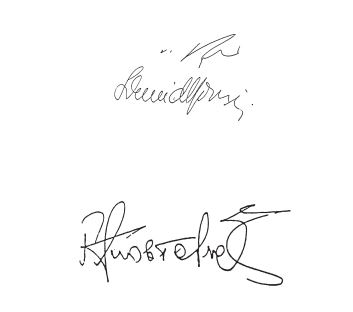

\*Por el Gobierno del Reino de España*

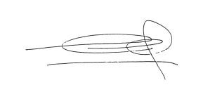

\*Pour le gouvernement de la République française*

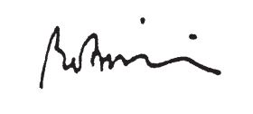

\*Thar ceann Rialtas na hÉireann*

\*For the Government of Ireland*

\*Per il Governo della Repubblica italiana*

\*Pour le gouvernement du Grand-Duché de Luxembourg*

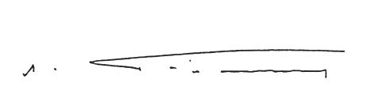

\*Voor de Regering van het Koninkrijk der Nederlanden*

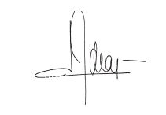

\*Für die Regierung der Republik Österreich*

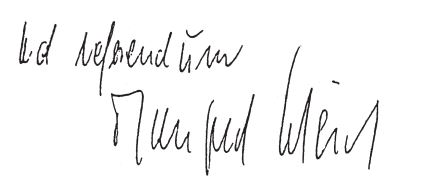

\*Pelo Governo da República Portuguesa*

\*Suomen hallituksen puolesta*

\*På finska regeringens vägnar*

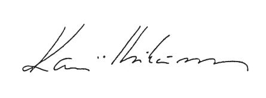

\*På svenska regeringens vägnar*

\*For the Government of the United Kingdom of Great Britain and Northern Ireland*

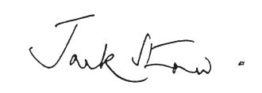

\*

\**DEUXIEME PROTOCOLE**

\**établi sur la base de l’article K.3 du traité**

\**sur l’Union européenne, à la convention relative à la protection**

\**des intérêts financiers des Communautés européennes**

LES HAUTES PARTIES CONTRACTANTES au présent protocole, Etats membres de l’Union européenne;

\*Se* *référant* à l’acte du Conseil de l’Union européenne du 19 juin 1997;

\*Désireuses* de faire en sorte que leurs législations pénales contribuent de manière efficace à la protection des intérêts financiers des Communautés européennes;

\*Reconnaissant* l’importance de la convention relative à la protection des intérêts financiers des Communautés européennes, du 26 juillet 1995, pour la lutte contre la fraude touchant les recettes et les dépenses communautaires;

\*Reconnaissant* l’importance du protocole du 27 septembre 1996 à ladite convention pour la lutte contre la corruption portant atteinte ou risquant de porter atteinte aux intérêts financiers des Communautés européennes;

\*Conscientes* du fait que les intérêts financiers des Communautés européennes peuvent être lésés ou menacés par des actes commis au nom de personnes morales et des actes visant au blanchiment de capitaux;

\*Convaincues* de la nécessité d’adapter, le cas échéant, les législations nationales, de telle sorte qu’elles prévoient que les personnes morales puissent être tenues pour responsables d’actes de fraude ou de corruption active et de blanchiment de capitaux commis pour leur compte, qui portent atteinte ou risquent de porter atteinte aux intérêts financiers des Communautés européennes;

\*Convaincues* de la nécessité d’adapter les législations nationales, le cas échéant, de manière à incriminer les actes visant au blanchiment du produit de la fraude ou de la corruption, qui portent atteinte ou risquent de porter atteinte aux intérêts financiers des Communautés européennes, et à rendre possible la confiscation du produit de cette fraude et de cette corruption;

\*Convaincues* de la nécessité d’adapter, le cas échéant, les législations nationales afin d’empêcher que l’entraide soit refusée uniquement parce que les infractions visées par le présent protocole concernent ou sont considérées comme des infractions en matière de taxes ou de droits de douane;

\*Constatant* que la coopération entre les Etats membres est déjà couverte par la convention relative à la protection des intérêts financiers des Communautés européennes, du 26 juillet 1995, mais qu’il est nécessaire, sans préjudice des obligations qui découlent du droit communautaire, de prévoir dans une disposition appropriée la coopération entre les Etats membres et la Commission dans le but de garantir une action efficace contre la fraude, la corruption active et passive, et le blanchiment de capitaux qui leur est lié, portant atteinte ou susceptibles de porter atteinte aux intérêts financiers des Communautés européennes, y compris les échanges d’informations entre les Etats membres et la Commission;

\*Considérant* qu’il est nécessaire, pour encourager et faciliter les échanges d’informations, de veiller à une protection adéquate des données à caractère personnel;

\*Considérant* que les échanges d’informations ne doivent pas entraver les investigations en cours et qu’il est donc nécessaire de prévoir la protection du secret de l’instruction;

\*Considérant* qu’il y a lieu d’établir des dispositions appropriées concernant la compétence de la Cour de justice des Communautés européennes;

\*Considérant* enfin qu’il convient de rendre les dispositions pertinentes de la convention relative à la protection des intérêts financiers des Communautés européennes, du 26 juillet 1995, applicables à certains actes visés par le présent protocole,

CONVIENNENT DES DISPOSITIONS QUI SUIVENT:

## Article premier — *Définitions*

Aux fins du présent protocole, on entend par:

a) «convention», la convention établie sur la base de l’article K.3 du [traité sur l’Union européenne](https://legilux.public.lu/eli/etat/leg/loi/1992/07/27/n6/jo), relative à la protection des intérêts financiers des Communautés européennes, du 26 juillet 1995;

b) «fraude», les comportements visés à l’article 1er de la convention;

c) – «corruption passive», les comportements visés à l’article 2 du protocole établi sur la base de l’article K.3 du [traité sur l’Union européenne](https://legilux.public.lu/eli/etat/leg/loi/1992/07/27/n6/jo), à la convention relative à la protection des intérêts financiers des Communautés européennes, du 27 septembre 1996,

– «corruption active», les comportements visés à l’article 3 du même protocole;

d) «personne morale», toute entité ayant ce statut en vertu du droit national applicable, exception faite des Etats ou des autres entités publiques dans l’exercice de leurs prérogatives de puissance publique et des organisations internationales publiques;

e) «blanchiment de capitaux», les comportements tels qu’ils sont définis à l’article 1ertroisième tiret de la [directive 91/308/CEE](https://legilux.public.lu/eli/dir_ue/1991/308/jo) du Conseil, du 10 juin 1991, relative à la prévention de l’utilisation du système financier aux fins du blanchiment de capitaux, liés au produit de la fraude, du moins dans les cas graves, et de la corruption active et passive.

## Article 2 — *Blanchiment de capitaux*

Chaque Etat membre prend les mesures nécessaires pour que le blanchiment de capitaux soit érigé en infraction pénale.

## Article 3 — *Responsabilité des personnes morales*

1\. Chaque Etat membre prend les mesures nécessaires pour assurer que les personnes morales puissent être tenues pour responsables d’un fait de fraude, de corruption active et de blanchiment de capitaux commis pour leur compte par toute personne, agissant soit individuellement, soit en tant que membre d’un organe de la personne morale, qui exerce un pouvoir de direction en son sein, sur les bases suivantes:

– un pouvoir de représentation de la personne morale

ou

– une autorité pour prendre des décisions au nom de la personne morale

ou

– une autorité pour exercer un contrôle au sein de la personne morale,

ainsi que de la participation à la commission de ce fait de fraude, de corruption active ou de blanchiment de capitaux en qualité de complice ou d’instigateur, ou de la tentative de commission de ce fait de fraude.

2\. Abstraction faite des cas déjà prévus au paragraphe 1, chaque Etat membre prend les mesures nécessaires pour assurer qu’une personne morale puisse être tenue pour responsable lorsque le défaut de surveillance ou de contrôle de la part d’une personne visée au paragraphe 1 a rendu possible la commission d’un fait de fraude, de corruption active ou de blanchiment de capitaux pour le compte de ladite personne morale par une personne soumise à son autorité.

3\. La responsabilité de la personne morale en vertu des paragraphes 1 et 2 n’exclut pas les poursuites pénales contre les personnes physiques auteurs, instigateurs ou complices du fait de fraude, de corruption active ou de blanchiment de capitaux.

## Article 4 — *Sanctions à l’encontre des personnes morales*

1\. Chaque Etat membre prend les mesures nécessaires pour assurer qu’une personne morale déclarée responsable au sens de l’article 3 paragraphe 1 soit passible de sanctions effectives, proportionnées et dissuasives, qui incluent des amendes pénales ou non pénales et éventuellement d’autres sanctions, notamment:

a) des mesures d’exclusion du bénéfice d’un avantage ou d’une aide publique;

b) des mesures d’interdiction temporaire ou permanente d’exercer une activité commerciale;

c) un placement sous surveillance judiciaire;

d) une mesure judiciaire de dissolution.

2\. Chaque Etat membre prend les mesures nécessaires pour assurer qu’une personne morale déclarée responsable au sens de l’article 3 paragraphe 2 soit passible de sanctions ou mesures effectives, proportionnées et dissuasives.

## Article 5 — *Confiscation*

Chaque Etat membre prend les mesures nécessaires pour permettre la saisie et, sans préjudice des droits des tiers de bonne foi, la confiscation ou le retrait des instruments et du produit de la fraude, de la corruption active et passive et du blanchiment de capitaux, ou des biens dont la valeur correspond à ce produit. Les instruments, produits ou biens saisis ou confisqués sont traités par l’Etat membre conformément à son droit national.

## Article 6 — *Infractions en matière de taxes et de droits de douane*

Un Etat membre ne peut refuser l’entraide judiciaire en cas de fraude, de corruption active et passive et de blanchiment de capitaux au seul motif qu’il s’agit d’une infraction en matière de taxes et de droits de douane ou de faits considérés comme tels.

## Article 7 — *Coopération avec la Commission des Communautés européennes*

1\. Les Etats membres collaborent mutuellement avec la Commission dans le domaine de la lutte contre la fraude, la corruption active et passive et le blanchiment de capitaux.

A cette fin, la Commission prête toute l’assistance technique et opérationnelle nécessaire afin de faciliter la coordination des investigations engagées par les autorités nationales compétentes.

2\. Les autorités compétentes des Etats membres peuvent échanger des éléments d’information avec la Commission aux fins de faciliter l’établissement des faits et d’assurer une action efficace contre la fraude, la corruption active et passive et le blanchiment de capitaux. La Commission et les autorités nationales compétentes tiennent compte, pour chaque cas spécifique, des exigences du secret de l’instruction et de la protection des données. A cette fin, lorsqu’un Etat membre fournit des informations à la Commission, il est en droit de fixer des conditions spécifiques régissant l’utilisation de ces informations par la Commission comme par tout autre Etat membre auquel ces informations pourraient être transmises.

## Article 8 — *Responsabilité de la Commission en matière de protection de données*

La Commission veille à assurer, dans le cadre de l’échange d’éléments d’information conformément à l’article 7 paragraphe 2, et pour ce qui est du traitement des données à caractère personnel, un niveau de protection équivalent au niveau de protection prévu par la [directive 95/46/CE](https://legilux.public.lu/eli/dir_ue/1995/46/jo) du Parlement européen et du Conseil, du 24 octobre 1995, relative à la protection des personnes physiques à l’égard du traitement des données à caractère personnel et à la libre circulation de ces données.

## Article 9 — *Publication des règles en matière de protection des données*

Les règles adoptées en vertu des obligations visées à l’article 8 sont publiées au *Journal officiel des Communautés européennes.*

## Article 10 — *Communication de données à d’autres Etats membres et à des pays tiers*

1\. Sous réserve de conditions prévues à l’article 7 paragraphe 2, la Commission peut communiquer à tout autre Etat membre des données à caractère personnel qu’elle a obtenues d’un Etat membre dans l’exercice de ses fonctions conformément à l’article 7. La Commission informe l’Etat membre qui a fourni ces informations de cette communication.

2\. La Commission peut, dans les mêmes conditions, communiquer à tout pays tiers des données à caractère personnel qu’elle a obtenues d’un Etat membre dans l’exercice de ses fonctions conformément à l’article 7, pour autant que l’Etat membre qui a fourni les informations ait autorisé cette communication.

## Article 11 — *Autorité de contrôle*

Toute autorité désignée ou créée aux fins d’exercer la fonction du contrôle indépendant de la protection des données à l’égard de données à caractère personnel détenues par la Commission, conformément à ses fonctions en vertu du traité instituant la Communauté européenne, est compétente pour exercer la même fonction à l’égard des données à caractère personnel détenues par la Commission en vertu du présent protocole.

## Article 12 — *Relation avec la convention*

1\. Les dispositions des articles 3, 5 et 6 de la convention s’appliquent aussi aux comportements visés à l’article 2 du présent protocole.

2\. Les dispositions de la convention visées ci-après s’appliquent aussi au présent protocole:

– l’article 4, étant entendu que, sauf indication contraire fournie lors de la notification prévue à l’article 16 paragraphe 2 du présent protocole, toute déclaration au sens de l’article 4 paragraphe 2 de la convention vaut également pour le présent protocole,

– l’article 7, étant entendu que le principe «ne bis in idem» s’applique également aux personnes morales et que, sauf indication contraire fournie lors de la notification prévue à l’article 16 paragraphe 2 du présent protocole, toute déclaration au sens de l’article 7 paragraphe 2 de la convention vaut également pour le présent protocole,

– l’article 9,

– l’article 10.

## Article 13 — *Cour de justice*

1\. Tout différend entre Etats membres relatif à l’interprétation ou à l’application du présent protocole doit, dans une première étape, être examiné au sein du Conseil selon la procédure prévue au titre VI du [traité sur l’Union européenne](https://legilux.public.lu/eli/etat/leg/loi/1992/07/27/n6/jo), en vue d’une solution.

A l’expiration d’un délai de six mois, si aucune solution n’a pu être trouvée, la Cour de justice peut être saisie par une partie au différend.

2\. Tout différend entre un ou plusieurs Etats membres et la Commission, relatif à l’application de l’article 2 en liaison avec l’article 1er point e), ainsi que des articles 7, 8 et 10 et de l’article 12 paragraphe 2 quatrième tiret du présent protocole, qui n’a pu être réglé par voie de négociation, peut être soumis à la Cour de justice à l’expiration d’une période de six mois à partir de la date à laquelle l’une des parties a notifié à l’autre l’existence d’un litige.

3\. Le protocole établi sur la base de l’article K.3 du [traité sur l’Union européenne](https://legilux.public.lu/eli/etat/leg/loi/1992/07/27/n6/jo), concernant l’interprétation, à titre préjudiciel, par la Cour de justice des Communautés européennes, de la convention relative à la protection des intérêts financiers des Communautés européennes, du 29 novembre 1996, s’applique au présent protocole, étant entendu qu’une déclaration faite par un Etat membre conformément à l’article 2 de ce protocole vaut aussi à l’égard du présent protocole sauf si l’Etat membre concerné fait une déclaration en sens contraire lors de la notification visée à l’article 16 paragraphe 2 du présent protocole.

## Article 14 — *Responsabilité non contractuelle*

Aux fins du présent protocole, la responsabilité non contractuelle de la Communauté est régie par l’article 215 deuxième alinéa du traité instituant la Communauté européenne. L’article 178 dudit traité est applicable.

## Article 15 — *Contrôle juridictionnel*

1\. La Cour de justice est compétente pour se prononcer sur les recours formés par toute personne physique ou morale contre une décision de la Commission qui lui est adressée ou qui la concerne directement et individuellement, pour violation de l’article 8 ou de toute règle adoptée en application dudit article, ou détournement de pouvoir.

2\. L’article 168 A paragraphes 1 et 2, l’article 173 cinquième alinéa, l’article 174 premier alinéa, l’article 176 premier et deuxième alinéas, les articles 185 et 186 du traité instituant la Communauté européenne, ainsi que le statut de la Cour de justice des Communautés européennes, sont applicables, *mutatis mutandis*.

## Article 16 — *Entrée en vigueur*

1\. Le présent protocole est soumis à l’adoption des Etats membres selon leurs règles constitutionnelles respectives.

2\. Les Etats membres notifient au secrétaire général du Conseil de l’Union européenne l’accomplissement des procédures requises par leurs règles constitutionnelles respectives pour l’adoption du présent protocole.

3\. Le présent protocole entre en vigueur quatre-vingt-dix jours après la notification prévue au paragraphe 2 par l’Etat, membre de l’Union européenne à la date de l’adoption par le Conseil de l’acte établissant le présent protocole, qui procède le dernier à cette formalité. Toutefois, si la convention n’est pas entrée en vigueur à cette date, le protocole entre en vigueur à la date d’entrée en vigueur de la convention.

4\. Cependant, l’application de l’article 7 paragraphe 2 est suspendue si, et aussi longtemps que, l’institution compétente des Communautés européennes ne remplit pas l’obligation de publier les règles relatives à la protection des données qui lui incombent en vertu de l’article 9, ou que les termes de l’article 11 concernant l’autorité de contrôle n’ont pas été respectés.

## Article 17 — *Adhésion de nouveaux Etats membres*

1\. Le présent protocole est ouvert à l’adhésion de tout Etat qui devient membre de l’Union européenne.

2\. Le texte du présent protocole dans la langue de l’Etat adhérent, établi par le Conseil de l’Union européenne, fait foi.

3\. Les instruments d’adhésion sont déposés auprès du dépositaire.

4\. Le présent protocole entre en vigueur à l’égard de tout Etat qui y adhère quatre-vingt-dix jours après le dépôt de son instrument d’adhésion ou à la date d’entrée en vigueur de ce protocole, si celui-ci n’est pas encore entré en vigueur au moment de l’expiration de ladite période de quatre-vingt-dix jours.

## Article 18 — *Réserves*

1\. Chaque Etat membre peut se réserver le droit d’ériger en infraction pénale le blanchiment de capitaux liés au produit de la corruption active et passive, uniquement dans les cas graves de corruption active et passive. Tout Etat membre qui fait usage de cette faculté en informe le dépositaire en précisant la portée de sa réserve, au moment où il procède à la notification visée à l’article 16 paragraphe 2. Cette réserve est valable pendant une période de cinq ans à compter de ladite notification. Elle peut être prorogée une seule fois pour une période de cinq ans.

2\. La république d’Autriche peut, lorsqu’elle procède à la notification prévue à l’article 16 paragraphe 2, déclarer qu’elle ne sera pas liée par les articles 3 et 4. Cette déclaration cessera d’avoir des effets cinq ans après la date d’adoption de l’acte établissant le présent protocole.

3\. Aucune autre réserve n’est admise, à l’exception de celles prévues à l’article 12 paragraphe 2 premier et deuxième tirets.

## Article 19 — *Dépositaire*

1\. Le secrétaire général du Conseil de l’Union européenne est dépositaire du présent protocole.

2\. Le dépositaire publie au *Journal officiel des Communautés européennes* l’état des adoptions et adhésions, les déclarations et les réserves, ainsi que toute autre notification relative au présent protocole.

EN FOI DE QUOI, les plénipotentiaires soussignés ont apposé leurs signatures au bas du présent protocole.

Fait à Bruxelles, le dix-neuf juin mil neuf cent quatre-vingt-dix-sept, en un exemplaire unique, en langues allemande, anglaise, danoise, espagnole, finnoise, française, grecque, irlandaise, italienne, néerlandaise, portugaise et suédoise, chacun de ces textes faisant également foi, exemplaire qui est déposé dans les archives du Secrétariat général du Conseil de l’Union européenne.

\*Pour le gouvernement du Royaume de Belgique*

\*Voor de regering van het Koninkrijk België*

\*Für die Regierung des Königreichs Belgien*

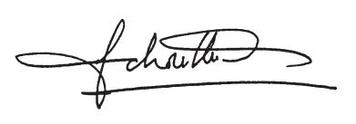

\*For regeringen for Kongeriget Danmark*

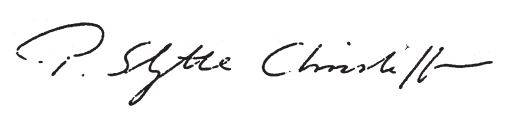

\*Für die Regierung der Bundesrepublik Deutschland*

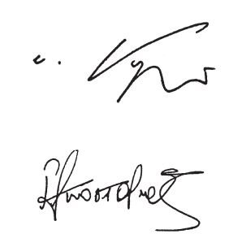

\*Por el Gobierno del Reino de España*

\*Pour le gouvernement de la République française*

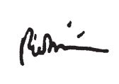

\*Thar ceann Rialtas na hÉireann*

\*For the Government of Ireland*

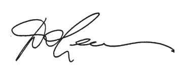

\*Per il governo della Repubblica italiana*

\*Pour le gouvernement du Grand-Duché de Luxembourg*

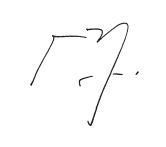

\*Voor de regering van het Koninkrijk der Nederlanden*

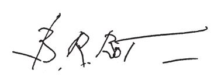

\*Für die Regierung der Republik Österreich*

\*Pelo Governo da República Portuguesa*

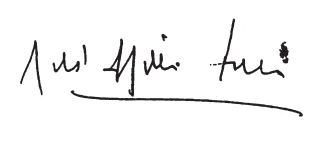

\*Suomen hallituksen puolesta*

\*På finska regeringens vägnar*

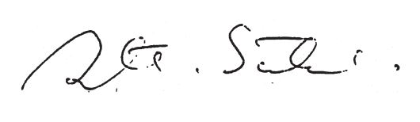

\*På svenska regeringens vägnar*

\*For the Government of the United Kingdom of Great Britain and Northern Ireland*

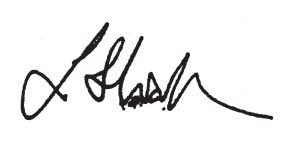

\*

\**CONVENTION PENALE SUR LA CORRUPTION**

\**(Strasbourg, 27.1.1999)**

\**Préambule**

LES ETATS MEMBRES DU CONSEIL DE L’EUROPE et les autres Etats signataires de la présente Convention,

\*Considérant* que le but du Conseil de l’Europe est de réaliser une union plus étroite entre ses membres;

\*Reconnaissant* l’importance de renforcer la coopération avec les autres Etats signataires de la présente Convention;

\*Convaincus* de la nécessité de poursuivre, en tant que priorité, une politique pénale commune tendant à la protection de la société contre la corruption, y compris par l’adoption d’une législation appropriée et des mesures préventives adéquates;

\*Soulignant* que la corruption constitue une menace pour la prééminence du droit, la démocratie et les droits de l’homme, sape les principes de bonne administration, d’équité et de justice sociale, fausse la concurrence, entrave le développement économique et met en danger la stabilité des institutions démocratiques et les fondements moraux de la société;

\*Convaincus* que l’efficacité de la lutte contre la corruption passe par une coopération internationale pénale intensifiée, rapide et adaptée en matière pénale;

\*Se félicitant* des développements récents qui contribuent à améliorer la prise de conscience et la coopération au niveau international dans la lutte contre la corruption, y compris des actions menées par les Nations Unies, la Banque mondiale, le Fonds monétaire international, l’Organisation mondiale du commerce, l’Organisation des Etats américains, l’OCDE et l’Union européenne;

\*Eu égard* au Programme d’action contre la corruption, adopté par le Comité des Ministres du Conseil de l’Europe en novembre 1996, à la suite des recommandations de la 19e Conférence des ministres européens de la Justice (La Valette, 1994);

\*Rappelant* dans ce contexte l’importance de la participation des Etats non membres aux activités du Conseil de l’Europe contre la corruption et se félicitant de leur contribution précieuse à la mise en oeuvre du Programme d’action contre la corruption;

\*Rappelant* en outre que la Résolution No 1 adoptée par les ministres européens de la Justice lors de leur 21e Conférence (Prague, 1997) appelle à la mise en oeuvre rapide du Programme d’action contre la corruption et recommande, en particulier, l’élaboration d’une convention pénale sur la corruption prévoyant l’incrimination coordonnée des infractions de corruption, une coopération renforcée dans la poursuite de telles infractions et un mécanisme de suivi efficace ouvert aux Etats membres et aux Etats non membres sur un pied d’égalité;

\*Gardant* à l’esprit que les chefs d’Etat et de gouvernement du Conseil de l’Europe ont décidé, lors de leur Deuxième Sommet qui s’est tenu à Strasbourg les 10 et 11 octobre 1997, de rechercher des réponses communes aux défis posés par l’extension de la corruption et ont adopté un Plan d’action qui, visant à promouvoir la coopération dans la lutte contre la corruption, y compris ses liens avec le crime organisé et le blanchiment de l’argent, charge le Comité des Ministres notamment de conclure rapidement les travaux d’élaboration d’instruments juridiques internationaux, conformément au Programme d’action contre la corruption;

\*Considérant* de surcroît que la Résolution (97) 24 portant les 20 principes directeurs pour la lutte contre la corruption, adoptée le 6 novembre 1997 par le Comité des Ministres à l’occasion de sa 101e Session, souligne la nécessité de conclure rapidement l’élaboration d’instruments juridiques internationaux, en exécution du Programme d’action contre la corruption;

\*Eu égard* à l’adoption lors de la 102e Session du Comité des Ministres, le 4 mai 1998, de la Résolution (98) 7 portant autorisation de créer l’Accord partiel élargi établissant le «Groupe d’Etats contre la Corruption – GRECO», institution qui a pour objet d’améliorer la capacité de ses membres à lutter contre la corruption en veillant à la mise en oeuvre de leurs engagements dans ce domaine,

SONT CONVENUS DE CE QUI SUIT:

## Chapitre I — *Terminologie*

### Article 1 — *Terminologie*

Aux fins de la présente Convention:

a l’expression «agent public» est interprétée par référence à la définition de «fonctionnaire», «officier public», «maire», «ministre» ou «juge» dans le droit national de l’Etat dans lequel la personne en question exerce cette fonction et telle qu’elle est appliquée dans son droit pénal;

b le terme «juge» qui figure à l’alinéa a ci-dessus comprend les membres du ministère public et les personnes exerçant des fonctions judiciaires;

c dans le cas de poursuites impliquant un agent public d’un autre Etat, l’Etat qui poursuit ne peut appliquer la définition d’agent public que dans la mesure où cette définition est compatible avec son droit national;

d «personne morale» s’entend de toute entité ayant ce statut en vertu du droit national applicable, exception faite des Etats ou des autres entités publiques dans l’exercice de leurs prérogatives de puissance publique et des organisations internationales publiques.

## Chapitre II — *Mesures à prendre au niveau national*

### Article 2 — *Corruption active d’agents publics nationaux*

Chaque Partie adopte les mesures législatives et autres qui se révèlent nécessaires pour ériger en infraction pénale, conformément à son droit interne, lorsque l’acte a été commis intentionnellement, le fait de proposer, d’offrir ou de donner, directement ou indirectement, tout avantage indu à l’un de ses agents publics, pour lui-même ou pour quelqu’un d’autre, afin qu’il accomplisse ou s’abstienne d’accomplir un acte dans l’exercice de ses fonctions.

### Article 3 — *Corruption passive d’agents publics nationaux*

Chaque Partie adopte les mesures législatives et autres qui se révèlent nécessaires pour ériger en infraction pénale, conformément à son droit interne, lorsque l’acte a été commis intentionnellement, le fait pour un de ses agents publics de solliciter ou de recevoir, directement ou indirectement, tout avantage indu pour lui-même ou quelqu’un d’autre ou d’en accepter l’offre ou la promesse afin d’accomplir ou de s’abstenir d’accomplir un acte dans l’exercice de ses fonctions.

### Article 4 — *Corruption de membres d’assemblées publiques nationales*

Chaque Partie adopte les mesures législatives et autres qui se révèlent nécessaires pour ériger en infraction pénale, conformément à son droit interne, les actes visés aux articles 2 et 3 lorsqu’ils impliquent toute personne membre d’une quelconque assemblée publique nationale exerçant des pouvoirs législatifs ou administratifs.

### Article 5 — *Corruption d’agents publics étrangers*

Chaque Partie adopte les mesures législatives et autres qui se révèlent nécessaires pour ériger en infraction pénale, conformément à son droit interne, les actes visés aux articles 2 et 3 lorsqu’ils impliquent un agent public de tout autre Etat.

### Article 6 — *Corruption de membres d’assemblées publiques étrangères*

Chaque Partie adopte les mesures législatives et autres qui se révèlent nécessaires pour ériger en infraction pénale, conformément à son droit interne, les actes visés aux articles 2 et 3 lorsqu’ils impliquent toute personne membre d’une quelconque assemblée publique exerçant des pouvoirs législatifs ou administratifs de tout autre Etat.

### Article 7 — *Corruption active dans le secteur privé*

Chaque Partie adopte les mesures législatives et autres qui se révèlent nécessaires pour ériger en infraction pénale, conformément à son droit interne, lorsque l’acte a été commis intentionnellement, dans le cadre d’une activité commerciale, le fait de promettre, d’offrir ou de donner, directement ou indirectement, tout avantage indu à toute personne qui dirige ou travaille pour une entité du secteur privé, pour elle-même ou pour quelqu’un d’autre, afin qu’elle accomplisse ou s’abstienne d’accomplir un acte en violation de ses devoirs.

### Article 8 — *Corruption passive dans le secteur privé*

Chaque Partie adopte les mesures législatives et autres qui se révèlent nécessaires pour ériger en infraction pénale, conformément à son droit interne, lorsque l’acte a été commis intentionnellement, dans le cadre d’une activité commerciale, le fait pour toute personne qui dirige ou travaille pour une entité du secteur privé de solliciter ou de recevoir, directement ou par l’intermédiaire de tiers, un avantage indu ou d’en accepter l’offre ou la promesse, pour elle-même ou pour quelqu’un d’autre, afin qu’elle accomplisse ou s’abstienne d’accomplir un acte en violation de ses devoirs.

### Article 9 — *Corruption de fonctionnaires internationaux*

Chaque Partie adopte les mesures législatives et autres qui se révèlent nécessaires pour ériger en infraction pénale, conformément à son droit interne, les actes mentionnés aux articles 2 et 3 lorsqu’ils impliquent toute personne qui a la qualité de fonctionnaire ou d’agent contractuel, au sens du statut des agents, de toute organisation publique internationale ou supranationale dont la Partie est membre, ainsi que toute personne, qu’elle soit détachée ou non auprès d’une telle organisation, qui exerce des fonctions correspondant à celles desdits fonctionnaires ou agents.

### Article 10 — *Corruption de membres d’assemblées parlementaires internationales*

Chaque Partie adopte les mesures législatives et autres qui se révèlent nécessaires pour ériger en infraction pénale, conformément à son droit interne, les actes visés à l’article 4 lorsqu’ils impliquent toute personne membre d’une assemblée parlementaire d’une organisation internationale ou supranationale dont la Partie est membre.

### Article 11 — *Corruption de juges et d’agents de cours internationales*

Chaque Partie adopte les mesures législatives et autres qui se révèlent nécessaires pour ériger en infraction pénale, conformément à son droit interne, les actes mentionnés aux articles 2 et 3 lorsqu’ils impliquent toute personne exerçant des fonctions judiciaires au sein d’une cour internationale dont la compétence est acceptée par la Partie ou tout fonctionnaire au greffe d’une telle cour.

### Article 12 — *Trafic d’influence*

Chaque Partie adopte les mesures législatives et autres qui se révèlent nécessaires pour ériger en infraction pénale, conformément à son droit interne, lorsque l’acte a été commis intentionnellement, le fait de proposer, d’offrir ou de donner, directement ou indirectement, tout avantage indu à titre de rémunération à quiconque affirme ou confirme être capable d’exercer une influence sur la prise de décision de toute personne visée aux articles 2, 4 à 6 et 9 à 11, que l’avantage indu soit pour lui-même ou pour quelqu’un d’autre, ainsi que le fait de solliciter, de recevoir ou d’en accepter l’offre ou la promesse à titre de rémunération pour ladite influence, que l’influence soit ou non exercée ou que l’influence supposée produise ou non le résultat recherché.

### Article 13 — *Blanchiment du produit des délits de la corruption*

Chaque Partie adopte les mesures législatives et autres qui se révèlent nécessaires pour ériger en infraction pénale, conformément à son droit interne, les actes mentionnés dans la Convention du Conseil de l’Europe relative au blanchiment, au dépistage, à la saisie et à la confiscation des produits du crime (STE No 141), à l’article 6, paragraphes 1 et 2, dans les conditions y prévues, lorsque l’infraction principale est constituée par l’une des infractions établies en vertu des articles 2 à 12 de la présente Convention, dans la mesure où la Partie n’a pas formulé de réserve ou de déclaration à l’égard de ces infractions ou ne considère pas ces infractions comme des infractions graves au regard de la législation relative au blanchiment de l’argent.

### Article 14 — Infractions comptables

Chaque Partie adopte les mesures législatives et autres qui se révèlent nécessaires pour ériger en infraction passible de sanctions pénales ou autres types de sanctions, conformément à son droit interne, lorsqu’ils sont commis intentionnellement, les actes ou omissions suivants, destinés à commettre, dissimuler ou déguiser des infractions visées par les articles 2 à 12, dans la mesure où la Partie n’a pas formulé de réserve ou de déclaration:

a établir ou utiliser une facture ou tout autre document ou écriture comptable qui contient des informations fausses ou incomplètes;

b omettre de manière illicite de comptabiliser un versement.

### Article 15 — *Actes de participation*

Chaque Partie adopte les mesures législatives et autres qui se révèlent nécessaires pour ériger en infraction pénale, conformément à son droit interne, tout acte de complicité d’une des infractions pénales établies en vertu de la présente Convention.

### Article 16 — Immunité

Les dispositions de la présente Convention ne portent pas atteinte aux dispositions de tout traité, protocole ou statut, ainsi que de leurs textes d’application, en ce qui concerne la levée de l’immunité.

### Article 17 — *Compétence*

1 Chaque Partie adopte les mesures législatives et autres qui se révèlent nécessaires pour établir sa compétence relativement à une infraction pénale établie en vertu des articles 2 à 14 de la présente Convention, lorsque:

a l’infraction est commise en tout ou en partie sur son territoire;

b l’auteur de l’infraction est un de ses ressortissants, un de ses agents publics ou un de ses membres d’assemblées publiques nationales;

c l’infraction implique l’un de ses agents publics ou membres de ses assemblées publiques nationales ou toute personne visée aux articles 9 à 11, qui est en même temps un de ses ressortissants.

2 Chaque Etat peut, au moment de la signature ou du dépôt de son instrument de ratification, d’acceptation, d’approbation ou d’adhésion, dans une déclaration adressée au Secrétaire Général du Conseil de l’Europe, préciser qu’il se réserve le droit de ne pas appliquer, ou de n’appliquer que dans des cas ou conditions spécifiques, les règles de compétence définies aux paragraphes 1 b et c du présent article ou une partie quelconque de ces paragraphes.

3 Lorsqu’une Partie a fait usage de la possibilité de réserve prévue au paragraphe 2 du présent article, elle adopte les mesures qui se révèlent nécessaires pour établir sa compétence relativement aux infractions pénales, établies en vertu de la présente Convention, lorsque l’auteur présumé de l’infraction est présent sur son territoire et ne peut être extradé vers une autre Partie au seul titre de sa nationalité, après une demande d’extradition.

4 La présente Convention n’exclut pas l’exercice par une Partie de toute compétence pénale établie conformément à son droit interne.

### Article 18 — *Responsabilité des personnes morales*

1 Chaque Partie adopte les mesures législatives et autres qui se révèlent nécessaires pour s’assurer que les personnes morales puissent être tenues pour responsables des infractions de corruption active, de trafic d’influence et de blanchiment de capitaux établies en vertu de la présente Convention, lorsqu’elles sont commises pour leur compte par toute personne physique, agissant soit individuellement, soit en tant que membre d’un organe de la personne morale, qui exerce un pouvoir de direction en son sein, sur les bases suivantes:

‒ un pouvoir de représentation de la personne morale; ou

‒ une autorité pour prendre des décisions au nom de la personne morale; ou

‒ une autorité pour exercer un contrôle au sein de la personne morale;

ainsi que de la participation d’une telle personne physique en qualité de complice ou d’instigatrice à la commission des infractions mentionnées ci-dessus.

2 Abstraction faite des cas déjà prévus au paragraphe 1, chaque Partie prend les mesures nécessaires pour s’assurer qu’une personne morale puisse être tenue pour responsable lorsque l’absence de surveillance ou de contrôle de la part d’une personne physique visée au paragraphe 1 a rendu possible la commission des infractions mentionnées au paragraphe 1 pour le compte de ladite personne morale par une personne physique soumise à son autorité.

3 La responsabilité de la personne morale en vertu des paragraphes 1 et 2 n’exclut pas les poursuites pénales contre les personnes physiques auteurs, instigatrices ou complices des infractions mentionnées au paragraphe 1.

### Article 19 — *Sanctions et mesures*

1 Compte tenu de la gravité des infractions pénales établies en vertu de la présente Convention, chaque Partie prévoit, à l’égard des infractions établies conformément aux articles 2 à 14, des sanctions et des mesures effectives, proportionnées et dissuasives incluant, lorsqu’elles sont commises par des personnes physiques, des sanctions privatives de liberté pouvant donner lieu à l’extradition.

2 Chaque Partie s’assure qu’en cas de responsabilité établie en vertu de l’article 18, paragraphes 1 et 2, les personnes morales soient passibles de sanctions efficaces, proportionnées et dissuasives de nature pénale ou non pénale, y compris des sanctions pécuniaires.

3 Chaque Partie adopte les mesures législatives et autres qui se révèlent nécessaires pour lui permettre de confisquer ou de priver autrement des instruments et des produits des infractions pénales établies en vertu de la présente Convention, ou des biens dont la valeur correspond à ces produits.

### Article 20 — *Autorités spécialisées*

Chaque Partie adopte les mesures qui se révèlent nécessaires pour que des personnes ou des entités soient spécialisées dans la lutte contre la corruption. Elles disposeront de l’indépendance nécessaire, dans le cadre des principes fondamentaux du système juridique de la Partie, pour pouvoir exercer leurs fonctions efficacement et libres de toute pression illicite. Les Parties veillent à ce que le personnel desdites entités dispose d’une formation et des ressources financières adaptées aux fonctions qu’elles exercent.

### Article 21 — *Coopération entre autorités nationales*

Chaque Partie adopte les mesures appropriées qui se révèlent nécessaires pour s’assurer que les autorités publiques, ainsi que tout agent public, coopèrent, en conformité avec le droit national, avec les autorités chargées des investigations et poursuites des infractions pénales:

a en informant les autorités en question, de leur propre initiative, lorsqu’il existe des motifs raisonnables de considérer que l’une des infractions pénales établies en vertu des articles 2 à 14 a été commise; ou

b en fournissant, sur demande, aux autorités en question toutes les informations nécessaires.

### Article 22 — *Protection des collaborateurs de justice et des témoins*

Chaque Partie adopte les mesures législatives et autres qui se révèlent nécessaires pour assurer

une protection effective et appropriée:

a aux personnes qui fournissent des informations concernant des infractions pénales établies en vertu des articles 2 à 14 ou qui collaborent d’une autre manière avec les autorités chargées des investigations ou des poursuites;

b aux témoins qui font une déposition concernant de telles infractions.

### Article 23 — *Mesures visant à faciliter la collecte de preuves et la confiscation des produits*

1 Chaque Partie adopte les mesures législatives et autres, y compris celles permettant l’utilisation de techniques d’investigation spéciales conformément à la législation nationale, qui se révèlent nécessaires pour faciliter la collecte de preuves relatives aux infractions pénales établies en vertu des articles 2 à 14 et pour lui permettre d’identifier, de rechercher, de geler et de saisir les instruments et les produits de la corruption ou des biens dont la valeur correspond à ces produits, susceptibles de faire l’objet de mesures aux termes du paragraphe 3 de l’article 19 de la présente Convention.

2 Chaque Partie adopte les mesures législatives et autres qui se révèlent nécessaires pour habiliter ses tribunaux ou ses autres autorités compétentes à ordonner la communication ou la saisie de dossiers bancaires, financiers ou commerciaux afin de mettre en oeuvre les mesures visées au paragraphe 1 du présent article.

3 Le secret bancaire ne constitue pas un obstacle aux mesures définies aux paragraphes 1 et 2 du présent article.

## Chapitre III — *Suivi de la mise en œuvre*

### Article 24 — *Suivi*

Le Groupe d’Etats contre la Corruption (GRECO) assure le suivi de la mise en oeuvre de la présente Convention par les Parties.

## Chapitre IV — Coopération internationale

### Article 25 — *Principes généraux et mesures s’appliquant à la coopération internationale*

1 Les Parties coopèrent, conformément aux dispositions des instruments internationaux pertinents sur la coopération internationale en matière pénale ou aux arrangements établis sur la base des législations uniformes ou réciproques et à leur droit national, dans la mesure la plus large possible les unes avec les autres, aux fins d’investigations et de procédures concernant les infractions pénales relevant du champ d’application de la présente Convention.

2 Lorsque aucun instrument international ou arrangement parmi ceux visés au paragraphe 1 ci-dessus n’est en vigueur entre les Parties, les articles 26 à 31 du présent chapitre s’appliquent.

3 Les articles 26 à 31 du présent chapitre s’appliquent également lorsqu’ils sont plus favorables que les dispositions contenues dans les instruments internationaux ou arrangements visés au paragraphe 1 ci-dessus.

### Article 26 — *Entraide*

1 Les Parties s’accordent l’entraide la plus large possible pour traiter sans délai des requêtes émanant des autorités qui sont habilitées, en vertu de leurs lois nationales, à enquêter sur ou à poursuivre les infractions pénales relevant du champ d’application de la présente Convention.

2 L’entraide au sens du paragraphe 1 du présent article peut être refusée si la Partie requise considère que le fait d’accéder à la demande serait de nature à porter atteinte à ses intérêts fondamentaux, à la souveraineté nationale, à la sécurité nationale ou à l’ordre public.

3 Les Parties ne sauraient invoquer le secret bancaire pour justifier leur refus de coopérer en vertu du présent chapitre. Lorsque son droit interne l’exige, une Partie peut exiger qu’une demande de coopération qui impliquerait la levée du secret bancaire soit autorisée, soit par un juge, soit par une autre autorité judiciaire, y compris le ministère public, ces autorités agissant en matière d’infractions pénales.

### Article 27 — *Extradition*

1 Les infractions pénales relevant du champ d’application de la présente Convention sont considérées comme incluses dans tout traité d’extradition en vigueur entre les Parties en tant qu’infractions donnant lieu à l’extradition. Les Parties s’engagent à inclure ces infractions dans tout traité d’extradition qu’elles concluront en tant qu’infractions donnant lieu à l’extradition.

2 Si une Partie qui subordonne l’extradition à l’existence d’un traité reçoit une demande d’extradition d’une Partie avec laquelle elle n’a pas conclu pareil traité, elle peut considérer la présente Convention comme base légale de l’extradition pour toutes les infractions établies conformément à la présente Convention.

3 Les Parties qui ne subordonnent pas l’extradition à l’existence d’un traité reconnaissent les infractions établies conformément à la présente Convention en tant qu’infractions donnant lieu à extradition.

4 L’extradition est subordonnée aux conditions prévues par le droit de la Partie requise ou par les traités d’extradition applicables, y compris les motifs pour lesquels la Partie requise peut refuser l’extradition.

5 Si l’extradition demandée en raison d’une infraction établie conformément à la présente Convention est refusée uniquement sur la base de la nationalité de la personne qui fait l’objet de la requête, ou parce que la Partie requise se considère compétente en l’espèce, la Partie requise soumet l’affaire à ses autorités compétentes aux fins de poursuites, sauf si d’autres dispositions ont été convenues avec la Partie requérante, et l’informe en temps opportun du résultat définitif.

### Article 28 — *Informations spontanées*

Sans préjudice de ses propres investigations ou procédures, une Partie peut, sans demande préalable, communiquer à une autre Partie des informations factuelles lorsqu’elle considère que la divulgation desdites informations est susceptible d’aider la Partie bénéficiaire à entamer ou à effectuer des investigations ou des poursuites concernant les infractions établies en vertu de la présente Convention ou est susceptible d’entraîner une requête de cette Partie au sens du présent chapitre.

### Article 29 — *Autorité centrale*

1 Les Parties désignent une autorité centrale ou, au besoin, plusieurs autorités centrales, chargée(s) d’envoyer les demandes formulées en vertu du présent chapitre, d’y répondre, de les exécuter ou de les transmettre aux autorités qui ont compétence pour les exécuter.

2 Chaque Partie communique au Secrétaire Général du Conseil de l’Europe, au moment de la signature ou au moment du dépôt de son instrument de ratification, d’acceptation, d’approbation ou d’adhésion, la dénomination et l’adresse des autorités désignées en application du paragraphe 1 du présent article.

### Article 30 — *Correspondance directe*

1 Les autorités centrales communiquent directement entre elles.

2 En cas d’urgence, les demandes d’entraide judiciaire ou communications y relatives peuvent être envoyées directement par les autorités judiciaires, y compris le ministère public, de la Partie requérante à de telles autorités de la Partie requise. En pareil cas, une copie doit être envoyée simultanément à l’autorité centrale de la Partie requise par l’intermédiaire de l’autorité centrale de la Partie requérante.

3 Toute demande ou communication formulée en application des paragraphes 1 et 2 du présent article peut être présentée par l’intermédiaire de l’Organisation internationale de police criminelle (Interpol).

4 Si une demande est présentée en vertu du paragraphe 2 du présent article et si l’autorité saisie n’est pas compétente pour y donner suite, elle la transmet à l’autorité compétente de son pays et en informe directement la Partie requérante.

5 Les demandes ou communications, présentées en vertu du paragraphe 2 du présent chapitre, qui n’impliquent pas de mesures coercitives, peuvent être transmises directement par l’autorité compétente de la Partie requérante à l’autorité compétente de la Partie requise.

6 Chaque Etat peut, au moment de la signature ou du dépôt de son instrument de ratification, d’acceptation, d’approbation ou d’adhésion, informer le Secrétaire Général du Conseil de l’Europe que, dans un souci d’efficacité, les demandes formulées en application de ce chapitre doivent être adressées à son autorité centrale.

### Article 31 — *Information*

La Partie requise informe sans délai la Partie requérante de la suite donnée aussitôt à une demande formulée en vertu du présent chapitre et du résultat définitif de la suite donnée à la demande. La Partie requise informe également sans délai la Partie requérante de toutes circonstances rendant impossible l’exécution des mesures sollicitées ou risquant de la retarder considérablement.

## Chapitre V — *Dispositions finales*

### Article 32 — *Signature et entrée en vigueur*

1 La présente Convention est ouverte à la signature des Etats membres du Conseil de l’Europe et des Etats non membres qui ont participé à son élaboration. Ces Etats peuvent exprimer leur consentement à être liés par:

a signature sans réserve de ratification, d’acceptation ou d’approbation; ou

b signature sous réserve de ratification, d’acceptation ou d’approbation, suivie de ratification, d’acceptation ou d’approbation.

2 Les instruments de ratification, d’acceptation ou d’approbation seront déposés près le Secrétaire Général du Conseil de l’Europe.

3 La présente Convention entrera en vigueur le premier jour du mois qui suit l’expiration d’une période de trois mois après la date à laquelle quatorze Etats auront exprimé leur consentement à être liés par la Convention, conformément aux dispositions du paragraphe 1. Un tel Etat qui n’est pas membre du Groupe d’Etats contre la Corruption (GRECO) au moment de la ratification le deviendra automatiquement le jour de l’entrée en vigueur de la présente Convention.

4 Pour tout Etat signataire qui exprimera ultérieurement son consentement à être lié par la Convention, celle-ci entrera en vigueur le premier jour du mois qui suit l’expiration d’une période de trois mois après la date de l’expression de son consentement à être lié par la Convention conformément aux dispositions du paragraphe 1. Un Etat signataire non membre du Groupe d’Etats contre la Corruption (GRECO) au moment de la ratification le deviendra automatiquement le jour de l’entrée en vigueur de la présente Convention à son égard.

### Article 33 — *Adhésion à la Convention*

1 Après l’entrée en vigueur de la présente Convention, le Comité des Ministres du Conseil de l’Europe pourra, après avoir consulté les Etats contractants à la Convention, inviter la Communauté européenne ainsi que tout Etat non membre du Conseil n’ayant pas participé à son élaboration à adhérer à la présente Convention par une décision prise à la majorité prévue à l’article 20.d du Statut du Conseil de l’Europe et à l’unanimité des représentants des Etats contractants ayant le droit de siéger au Comité des Ministres.

2 Pour la Communauté européenne et pour tout Etat adhérent, la Convention entrera en vigueur le premier jour du mois qui suit l’expiration d’une période de trois mois après la date de dépôt de l’instrument d’adhésion près le Secrétaire Général du Conseil de l’Europe. La Communauté européenne et tout Etat adhérent deviendront automatiquement membres du GRECO, s’ils ne le sont pas déjà au moment de l’adhésion, le jour de l’entrée en vigueur de la présente Convention à leur égard.

### Article 34 — Application territoriale

1 Tout Etat pourra, au moment de la signature ou au moment du dépôt de son instrument de ratification, d’acceptation, d’approbation ou d’adhésion, désigner le ou les territoires auxquels s’appliquera la présente Convention.

2 Toute Partie pourra, à tout autre moment par la suite, par une déclaration adressée au Secrétaire Général du Conseil de l’Europe, étendre l’application de la présente Convention à tout autre territoire désigné dans la déclaration. La Convention entrera en vigueur à l’égard de ce territoire le premier jour du mois qui suit l’expiration d’une période de trois mois après la date de réception de ladite déclaration par le Secrétaire Général.

3 Toute déclaration faite en vertu des deux paragraphes précédents pourra être retirée, en ce qui concerne tout territoire désigné dans cette déclaration, par notification adressée au Secrétaire Général du Conseil de l’Europe. Le retrait prendra effet le premier jour du mois qui suit l’expiration d’une période de trois mois après la date de réception de ladite notification par le Secrétaire Général.

### Article 35 — *Relations avec d’autres conventions et accords*

1 La présente Convention ne porte pas atteinte aux droits et obligations découlant de conventions internationales multilatérales concernant des questions particulières.

2 Les Parties à la Convention pourront conclure entre elles des accords bilatéraux ou multilatéraux relatifs aux questions réglées par la présente Convention, aux fins de compléter ou de renforcer les dispositions de celle-ci ou pour faciliter l’application des principes qu’elle consacre.

3 Lorsque deux ou plusieurs Parties ont déjà conclu un accord ou un traité sur un sujet couvert par la présente Convention, ou lorsqu’elles ont établi d’une autre manière leurs relations quant à ce sujet, elles auront la faculté d’appliquer ledit accord, traité ou arrangement au lieu de la présente Convention, dès lors qu’il facilite la coopération internationale.

### Article 36 — *Déclarations*

Tout Etat peut, au moment de la signature ou au moment du dépôt de son instrument de ratification, d’acceptation, d’approbation ou d’adhésion, déclarer qu’il érigera en infraction pénale la corruption active et passive d’agents publics étrangers au sens de l’article 5, de fonctionnaires internationaux au sens de l’article 9 ou de juges et d’agents de cours internationales au sens de l’article 11, uniquement dans la mesure où l’agent public ou le juge accomplit ou s’abstient d’accomplir un acte en violation de ses devoirs officiels.

### Article 37 — *Réserves*

1 Tout Etat peut, au moment de la signature ou au moment du dépôt de son instrument de ratification, d’acceptation, d’approbation ou d’adhésion, déclarer qu’il n’érigera pas en infractions pénales conformément à son droit interne, en tout ou en partie, les actes visés aux articles 4, 6 à 8, 10 et 12 ou les infractions de corruption passive visées à l’article 5.

2 Tout Etat peut, au moment de la signature ou au moment du dépôt de son instrument de ratification, d’acceptation, d’approbation ou d’adhésion, déclarer qu’il fait usage de la réserve figurant à l’article 17, paragraphe 2.

3 Tout Etat peut, au moment de la signature ou au moment du dépôt de son instrument de ratification, d’acceptation, d’approbation ou d’adhésion, déclarer qu’il peut refuser une demande d’entraide judiciaire en vertu de l’article 26, paragraphe 1, si la demande concerne une infraction que la Partie requise considère comme une infraction politique.

4 Un Etat ne peut pas, en application des paragraphes 1, 2 et 3 du présent article, faire des réserves à plus de cinq des dispositions mentionnées auxdits paragraphes. Aucune autre réserve n’est admise. Les réserves de même nature relatives aux articles 4, 6 et 10 seront considérées comme une seule réserve.

### Article 38 — *Validité et examen des déclarations et réserves*

1 Les déclarations prévues à l’article 36 et les réserves prévues à l’article 37 sont valables trois ans à compter du premier jour de l’entrée en vigueur de la Convention pour l’Etat concerné. Toutefois, ces réserves peuvent être renouvelées pour des périodes de la même durée.

2 Douze mois avant l’expiration de la déclaration ou réserve, le Secrétaire Général du Conseil de l’Europe informe l’Etat concerné de cette expiration. Trois mois avant la date d’expiration, l’Etat notifie au Secrétaire Général son intention de maintenir, de modifier ou de retirer la déclaration ou la réserve. Dans le cas contraire, le Secrétaire Général informe cet Etat que sa déclaration ou réserve est automatiquement prolongée pour une période de six mois. Si l’Etat concerné ne notifie pas sa décision de maintenir ou modifier ses réserves avant l’expiration de cette période, la ou les réserves tombent.

3 Lorsqu’une Partie formule une déclaration ou une réserve conformément aux articles 36 et 37, elle fournit, avant son renouvellement ou sur demande, des explications au GRECO quant aux motifs justifiant son maintien.

### Article 39 — *Amendements*

1 Des amendements à la présente Convention peuvent être proposés par chaque Partie et toute proposition sera communiquée par le Secrétaire Général du Conseil de l’Europe aux Etats membres du Conseil de l’Europe et à chaque Etat non membre qui a adhéré ou a été invité à adhérer à la présente Convention conformément aux dispositions de l’article 33.

2 Tout amendement proposé par une Partie est communiqué au Comité européen pour les problèmes criminels (CDPC) qui soumet au Comité des Ministres son avis sur l’amendement proposé.

3 Le Comité des Ministres examine l’amendement proposé et l’avis soumis par le CDPC et, après consultation des Etats non membres parties à la présente Convention, peut adopter l’amendement.

4 Le texte de tout amendement adopté par le Comité des Ministres conformément au paragraphe 3 du présent article est transmis aux Parties pour acceptation.

5 Tout amendement adopté conformément au paragraphe 3 du présent article entrera en vigueur le troisième jour après que toutes les Parties auront informé le Secrétaire Général qu’elles l’ont accepté.

### Article 40 — *Règlement des différends*

1 Le Comité européen pour les problèmes criminels du Conseil de l’Europe sera tenu informé de l’interprétation et de l’application de la présente Convention.

2 En cas de différend entre les Parties sur l’interprétation ou l’application de la présente Convention, les Parties s’efforceront de parvenir à un règlement du différend par la négociation ou tout autre moyen pacifique de leur choix, y compris la soumission du différend au Comité européen pour les problèmes criminels, à un tribunal arbitral qui prendra des décisions qui lieront les Parties au différend, ou à la Cour internationale de justice, selon un accord commun entre les Parties concernées.

### Article 41 — *Dénonciation*

1 Toute Partie peut, à tout moment, dénoncer la présente Convention en adressant une notification au Secrétaire Général du Conseil de l’Europe.

2 La dénonciation prendra effet le premier jour du mois qui suit l’expiration d’une période de trois mois après la date de réception de la notification par le Secrétaire Général.

### Article 42 — *Notifications*

Le Secrétaire Général du Conseil de l’Europe notifiera aux Etats membres du Conseil de l’Europe et à tout Etat ayant adhéré à la présente Convention:

a toute signature;

b le dépôt de tout instrument de ratification, d’acceptation, d’approbation ou d’adhésion;

c toute date d’entrée en vigueur de la présente Convention conformément à ses articles 32 et 33;

d toute déclaration ou réserve en vertu de l’article 36 ou de l’article 37;

e tout autre acte, notification ou communication ayant trait à la présente Convention.

EN FOI DE QUOI, les soussignés, dûment autorisés à cet effet, ont signé la présente Convention.

FAIT à Strasbourg, le 27 janvier 1999, en français et en anglais, les deux textes faisant également foi, en un seul exemplaire qui sera déposé dans les archives du Conseil de l’Europe. Le Secrétaire Général du Conseil de l’Europe en communiquera copie certifiée conforme à chacun des Etats membres du Conseil de l’Europe, à tout Etat non membre ayant participé à l’élaboration de la Convention et à tout Etat invité à y adhérer.

\*

\**PROTOCOLE ADDITIONNEL A LA CONVENTION PENALE**

\**SUR LA CORRUPTION**

\**(Strasbourg, 15.5.2003)**

LES ETATS MEMBRES DU CONSEIL DE L’EUROPE et les autres Etats signataires du présent Protocole,

\*Considérant* qu’il est opportun de compléter la Convention pénale sur la corruption (STE No 173, dénommée ci-après „la Convention“) afin de prévenir et de lutter contre la corruption;

\*Considérant* également que le présent Protocole permettra une mise en oeuvre plus large du Programme d’action contre la corruption de 1996,

SONT CONVENUS DE CE QUI SUIT:

## Chapitre I — *Terminologie*

### Article 1 — *Terminologie*

Aux fins du présent Protocole:

1 Le terme *«arbitre»* doit être considéré par référence au droit national de l’Etat partie au présent Protocole, mais, en tout état de cause, doit inclure une personne qui, en raison d’un accord d’arbitrage, est appelée à rendre une décision juridiquement contraignante sur un litige qui lui est soumis par les parties à ce même accord.

2 Le terme *«accord d’arbitrage»* désigne un accord reconnu par le droit national et par lequel les parties conviennent de soumettre un litige à un arbitre pour décision.

3 Le terme *«juré»* doit être considéré par référence au droit national de l’Etat partie au présent Protocole, mais en tout état de cause, doit inclure une personne agissant en tant que membre non professionnel d’un organe collégial chargé de se prononcer dans le cadre d’un procès pénal sur la culpabilité d’un accusé.

4 Dans le cas de poursuites impliquant un arbitre ou un juré étranger, l’Etat qui poursuit ne peut appliquer la définition d’arbitre ou de juré que dans la mesure où cette définition est compatible avec son droit national.

## Chapitre II — *Mesures à prendre au niveau national*

### Article 2 — *Corruption active d’arbitres nationaux*

Chaque Partie adopte les mesures législatives et autres qui se révèlent nécessaires pour ériger en infraction pénale, conformément à son droit interne, lorsque l’acte a été commis intentionnellement, le fait de proposer, d’offrir ou de donner, directement ou indirectement, tout avantage indu à un arbitre exerçant ses fonctions sous l’empire du droit national sur l’arbitrage de cette Partie, pour lui-même ou pour quelqu’un d’autre, afin d’accomplir ou de s’abstenir d’accomplir un acte dans l’exercice de ses fonctions.

### Article 3 — *Corruption passive d’arbitres nationaux*

Chaque Partie adopte les mesures législatives et autres qui se révèlent nécessaires pour ériger en infraction pénale, conformément à son droit interne, lorsque l’acte a été commis intentionnellement, le fait pour un arbitre exerçant ses fonctions sous l’empire du droit national sur l’arbitrage de cette Partie, de solliciter ou de recevoir, directement ou indirectement, tout avantage indu pour lui-même ou quelqu’un d’autre ou d’en accepter l’offre ou la promesse afin qu’il accomplisse ou s’abstienne d’accomplir un acte dans l’exercice de ses fonctions.

### Article 4 — *Corruption d’arbitres étrangers*

Chaque Partie adopte les mesures législatives et autres qui se révèlent nécessaires pour ériger en infraction pénale, conformément à son droit interne, les actes mentionnés aux articles 2 et 3 du présent Protocole, lorsqu’ils impliquent un arbitre exerçant ses fonctions sous l’empire du droit national sur l’arbitrage de tout autre Etat.

### Article 5 — *Corruption de jurés nationaux*

Chaque Partie adopte les mesures législatives et autres qui se révèlent nécessaires pour ériger en infraction pénale, conformément à son droit interne, les actes mentionnés aux articles 2 et 3 du présent Protocole, lorsqu’ils impliquent toute personne exerçant les fonctions de juré au sein de son système judiciaire.

### Article 6 — *Corruption de jurés étrangers*

Chaque Partie adopte les mesures législatives et autres qui se révèlent nécessaires pour ériger en infraction pénale, conformément à son droit interne, les actes mentionnés aux articles 2 et 3 du présent Protocole, lorsqu’ils impliquent toute personne exerçant les fonctions de juré au sein du système judiciaire de tout autre Etat.

## Chapitre III — *Suivi de la mise en œuvre et dispositions finales*

### Article 7 — *Suivi de la mise en œuvre*

Le Groupe d’Etats contre la corruption (GRECO) assure le suivi de la mise en œuvre du présent Protocole par les Parties.

### Article 8 — Relations avec la Convention

1 Les Etats parties considèrent les dispositions des articles 2 à 6 du présent Protocole comme des articles additionnels à la Convention.

2 Les dispositions de la Convention sont applicables dans la mesure où elles sont compatibles avec les dispositions du présent Protocole.

### Article 9 — *Déclarations et réserves*

1 Si une Partie a fait une déclaration sur la base de l’article 36 de la Convention, elle peut faire une déclaration similaire concernant les articles 4 et 6 du présent Protocole au moment de la signature ou au moment du dépôt de son instrument de ratification, d’acceptation, d’approbation ou d’adhésion.

2 Si une Partie a fait une réserve sur la base de l’article 37, paragraphe 1, de la Convention limitant l’application des infractions de corruption passive visées à l’article 5 de la Convention, elle peut faire une réserve similaire concernant les articles 4 et 6 du présent Protocole, au moment de la signature ou au moment du dépôt de son instrument de ratification, d’acceptation, d’approbation ou d’adhésion. Toute autre réserve faite par une Partie sur la base de l’article 37 de la Convention s’applique également au présent Protocole, à moins que cette Partie n’exprime l’intention contraire au moment de la signature ou au moment du dépôt de son instrument de ratification, d’acceptation, d’approbation ou d’adhésion.

3 Aucune autre réserve n’est admise.

### Article 10 — *Signature et entrée en vigueur*

1 Le présent Protocole est ouvert à la signature des Etats qui ont signé la Convention. Ces Etats peuvent exprimer leur consentement à être liés par:

a signature sans réserve de ratification, d’acceptation ou d’approbation; ou

b signature sous réserve de ratification, d’acceptation ou d’approbation, suivie de ratification, d’acceptation ou d’approbation.

2 Les instruments de ratification, d’acceptation ou d’approbation seront déposés près le Secrétaire Général du Conseil de l’Europe.

3 Le présent Protocole entrera en vigueur le premier jour du mois qui suit l’expiration d’une période de trois mois après la date à laquelle cinq Etats auront exprimé leur consentement à être liés par le Protocole, conformément aux dispositions des paragraphes 1 et 2 ci-dessus, et seulement après que la Convention elle-même soit entrée en vigueur.

4 Pour tout Etat signataire qui exprimera ultérieurement son consentement à être lié par le Protocole, celui-ci entrera en vigueur le premier jour du mois qui suit l’expiration d’un délai de trois mois après la date de l’expression de son consentement à être lié par le Protocole, conformément aux dispositions des paragraphes 1 et 2 ci-dessus.

5 Un Etat signataire ne pourra ratifier, accepter ou approuver le présent Protocole sans avoir simultanément ou préalablement exprimé son consentement à être lié par la Convention.

### Article 11 — *Adhésion au Protocole*

1 Tout Etat ou la Communauté européenne qui a adhéré à la Convention pourra adhérer au présent Protocole après que celui-ci soit entré en vigueur.

2 Pour tout Etat ou la Communauté européenne adhérent au présent Protocole, celui-ci entrera en vigueur le premier jour du mois qui suit l’expiration d’une période de trois mois après la date de dépôt d’un instrument d’adhésion près le Secrétaire Général du Conseil de l’Europe.

### Article 12 — *Application territoriale*

1 Tout Etat ou la Communauté européenne peut, au moment de la signature ou au moment du dépôt de son instrument de ratification, d’acceptation, d’approbation ou d’adhésion, désigner le ou les territoires auxquels s’appliquera le présent Protocole.

2 Toute Partie peut, à tout autre moment par la suite, étendre l’application du présent Protocole, par déclaration adressée au Secrétaire Général du Conseil de l’Europe, à tout autre territoire désigné dans la déclaration et dont il assure les relations internationales ou pour lequel il est habilité à stipuler. Le Protocole entrera en vigueur à l’égard de ce territoire le premier jour du mois qui suit l’expiration d’une période de trois mois après la date de réception de ladite déclaration par le Secrétaire Général.

3 Toute déclaration faite en vertu des deux paragraphes précédents pourra être retirée, en ce qui concerne tout territoire désigné dans cette déclaration, par notification adressée au Secrétaire Général du Conseil de l’Europe. Le retrait prendra effet le premier jour du mois qui suit l’expiration d’une période de trois mois après la date de réception de ladite notification par le Secrétaire Général.

### Article 13 — *Dénonciation*

1 Toute Partie peut, à tout moment, dénoncer le présent Protocole en adressant une notification au Secrétaire Général du Conseil de l’Europe.

2 La dénonciation prendra effet le premier jour du mois qui suit l’expiration d’une période de trois mois après la date de réception de ladite notification par le Secrétaire Général.

3 La dénonciation de la Convention entraînera automatiquement la dénonciation du présent Protocole.

### Article 14 — *Notification*

Le Secrétaire Général du Conseil de l’Europe notifiera aux Etats membres du Conseil de l’Europe et à tout Etat, ou à la Communauté européenne, ayant adhéré au présent Protocole:

a toute signature de ce Protocole;

b le dépôt de tout instrument de ratification, d’acceptation, d’approbation ou d’adhésion;

c toute date d’entrée en vigueur du présent Protocole conformément à ses articles 10, 11 et 12;

d toute déclaration ou réserve formulée en vertu des articles 9 et 12;

e tout autre acte, notification ou communication ayant trait au présent Protocole.

EN FOI DE QUOI, les soussignés, dûment autorisés à cet effet, ont signé le présent Protocole.

FAIT à Strasbourg, le 15 mai 2003, en français et en anglais, les deux textes faisant également foi, en un seul exemplaire qui sera déposé dans les archives du Conseil de l’Europe. Le Secrétaire Général du Conseil de l’Europe en communiquera copie certifiée conforme à chacune des Parties signataires et adhérentes.

\*

Doc. parl. [5262](https://legilux.public.lu/eli/etat/proj/pl/20030297), sess. ord. 2003-2004 et 2004-2005
