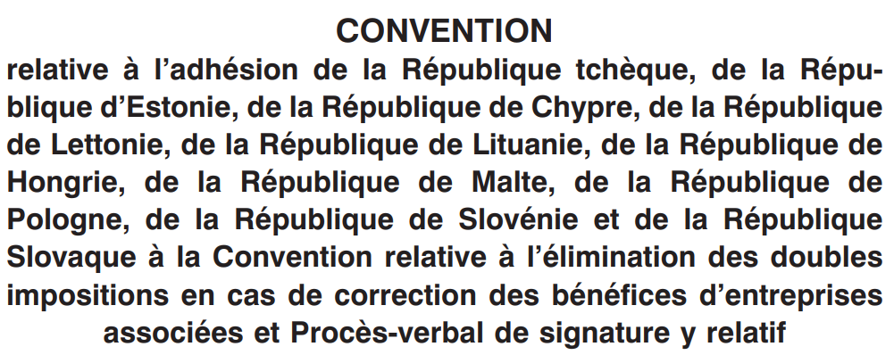
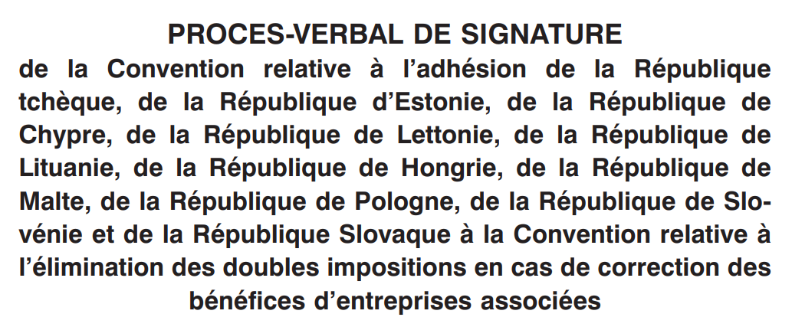

# Loi du 27 avril 2006 portant approbation de la Convention relative à l’adhésion de la République tchèque, de la République d’Estonie, de la République de Chypre, de la République de Lettonie, de la République de Lituanie, de la République de Hongrie, de la République de Malte, de la République de Pologne, de la République de Slovénie et de la République Slovaque à la Convention relative à l’élimination des doubles impositions en cas de correction des bénéfices d’entreprises associées et du Procès-verbal de signature y relatif, signés à Bruxelles, le 8 décembre 2004.

Nous Henri, Grand-Duc de Luxembourg, Duc de Nassau,

Notre Conseil d’Etat entendu;

De l’assentiment de la Chambre des Députés;

Vu la décision de la Chambre des Députés du 15 mars 2006 et celle du Conseil d’Etat du 4 avril 2006 portant qu’il n’y a pas lieu à second vote;

Avons ordonné et ordonnons:

## Article unique.

Sont approuvés la Convention relative à l’adhésion de la République tchèque, de la République d’Estonie, de la République de Chypre, de la République de Lettonie, de la République de Lituanie, de la République de Hongrie, de la République de Malte, de la République de Pologne, de la République de Slovénie et de la République Slovaque à la Convention relative à l’élimination des doubles impositions en cas de correction des bénéfices d’entreprises associées et le Procès-verbal de signature y relatif, signés à Bruxelles, le 8 décembre 2004.

Mandons et ordonnons que la présente loi soit insérée au Mémorial pour être exécutée et observée par tous ceux que la chose concerne.

Le Ministre des Affaires étrangères et de l’Immigration,   Jean Asselborn   Le Ministre des Finances,   Jean-Claude Juncker

Palais de Luxembourg, le 27 avril 2006.   Henri

LES HAUTES PARTIES CONTRACTANTES AU TRAITE INSTITUANT LA COMMUNAUTE EUROPEENNE,

\*Considérant* que la République tchèque, la République d’Estonie, la République de Chypre, la République de Lettonie, la République de Lituanie, la République de Hongrie, la République de Malte, la République de Pologne, la République de Slovénie et la République slovaque, en devenant membres de l’Union, se sont engagées à adhérer à la convention relative à l’élimination des doubles impositions en cas de correction des bénéfices d’entreprises associées (convention d’arbitrage), signée à Bruxelles le 23 juillet 1990, et au protocole à cette convention, signé à Bruxelles le 25 mai 1999,

\*Ont décidé* de conclure la présente convention et ont désigné à cet effet comme plénipotentiaires:

\*Sa Majesté le Roi des Belges,*

\*Le Président de la République tchèque,*

\*Sa Majesté la Reine du Danemark,*

\*Le Président de la République fédérale d’Allemagne,*

\*Le Président de la République d’Estonie,*

\*Le Président de la République hellénique,*

\*Sa Majesté le Roi d’Espagne,*

\*Le Président de la République française,*

\*Le Président d’Irlande,*

\*Le Président de la République italienne,*

\*Le Président de la République de Chypre,*

\*Le Cabinet des Ministres de la République de Lettonie,*

\*Le Président de la République de Lituanie,*

\*Son Altesse Royale le Grand-Duc de Luxembourg,*

\*Le Président de la République de Hongrie,*

\*Le Président de Malte,*

\*Sa Majesté la Reine des Pays-Bas,*

\*Le Président fédéral de la République d’Autriche,*

\*Le Président de la République de Pologne,*

\*Le Président de la République portugaise,*

\*Le Président de la République de Slovénie,*

\*Le Président de la République slovaque,*

\*Le Président de la République de Finlande,*

\*Le Gouvernement du Royaume de Suède,*

\*Sa Majesté la Reine du Royaume-Uni de Grande-Bretagne*

\*et d’Irlande du Nord*,

\*Lesquels*, réunis au sein du Comité des représentants permanents des Etats membres auprès de l’Union européenne et après avoir échangé leurs pleins pouvoirs reconnus en bonne et due forme,

SONT CONVENUS DES DISPOSITIONS QUI SUIVENT:

## *Article 1*

La République tchèque, la République d’Estonie, la République de Chypre, la République de Lettonie, la République de Lituanie, la République de Hongrie, la République de Malte, la République de Pologne, la République de Slovénie et la République slovaque adhèrent à la convention relative à l’élimination des doubles impositions en cas de correction des bénéfices d’entreprises associées, signée à Bruxelles, le 23 juillet 1990, telle qu’elle résulte de toutes les adaptations et modifications y apportées par la convention relative à l’adhésion de la République d’Autriche, de la République de Finlande et du Royaume de Suède à la convention relative à l’élimination des doubles impositions en cas de correction des bénéfices d’entreprises associées, signée à Bruxelles le 21 décembre 1995, et au protocole modifiant la convention relative à l’élimination des doubles impositions en cas de correction des bénéfices d’entreprises associées, signé à Bruxelles le 25 mai 1999.

## *Article 2*

La convention relative à l’élimination des doubles impositions en cas de correction des bénéfices d’entreprises associées est modifiée comme suit:

1\) A l’article 2, paragraphe 2:

a) le point ci-après est inséré après le point a):

> „b) en République tchèque:
>
> – daň z příjmů fyzických osob
>
> – daň z příjmů právnických osob“;

b) le point b) devient le point c) et il est remplacé par le texte suivant:

> „c) au Danemark:
>
> – indkomstskat til staten,
>
> – den kommunale indkomstskat,
>
> – den amtskommunale indkomstskat“;

c) le point c) devient le point d);

d) le point ci-après est inséré après le point d):

> „e) en Estonie:
>
> – tulumaks“;

e) le point d) devient le point f);

f) le point e) devient le point g) et est remplacé par le texte ci-après:

> „g) en Espagne:
>
> – Impuesto sobre la Renta de las Personas Físicas,
>
> – Impuesto sobre Sociedades,
>
> – Impuesto sobre la Renta de no Residentes.“;

g) le point f) devient le point h);

h) le point g) devient le point i);

i) le point h) devient le point j) et il est remplacé par le texte suivant:

> „j) en Italie:
>
> – imposta sul reddito delle persone fisiche,
>
> – imposta sul reddito delle società,
>
> – imposta regionale sulle attività produttive.“;

j) les points ci-après sont insérés après le point j):

> „k) à Chypre:
>
> – Φ*ορος* Ε*ισοδηµατος*
>
> – Ε*κτακτη* Ε*ισϕορα για την* Α*µυνα της* ∆*ηµοκρατιας*
>
> l) en Lettonie:
>
> – uzņēmumu ienākuma nodoklis
>
> – iedzīvotāju ienākuma nodoklis
>
> m) en Lituanie:
>
> – Gyventojų pajamų mokestis;
>
> – Pelno mokestis“;

k) le point i) devient le point n);

l) les points ci-après sont insérés après le point n):

> „o) en Hongrie:
>
> – személyi jövedelemadó
>
> – társasági adó
>
> – osztalékadó
>
> p) à Malte:
>
> – taxxa fuq l – income“;

m) le point j) devient le point q);

n) le point k) devient le point r);

o) le point ci-après est inséré après le point r):

> „s) en Pologne:
>
> – podatek dochodowy od osób fizycznych
>
> – podatek dochodowy od osób prawnych“;

p) le point l) devient le point t);

q) les points ci-après sont insérés après le point t):

> „u) en Slovénie:
>
> – dohodnina
>
> – davek od dobička pravnih oseb
>
> v) en Slovaquie:
>
> – daň z príjmov právnických osôb
>
> – daň z príjmov fyzických osôb“;

r) le point m) devient le point w);

s) le point n) devient le point x) et il est remplacé par le texte ci-après:

> „x) en Suède:
>
> – statlig inkomstskatt
>
> – kupongskatt
>
> – kommunal inkomstskatt“;

t) le point o) devient le point y).

2\) A l’article 3, paragraphe 1, les tirets suivants sont ajoutés:

> „– en République tchèque:
>
> – Ministr financí ou un représentant autorisé;
>
> – en République d’Estonie:
>
> – Rahandusminister ou un représentant autorisé;
>
> – en République de Chypre:
>
> – Ο Υ*πουργος* Ο*ικονοµικϖν* ou un représentant autorisé;
>
> – en République de Lettonie:
>
> – Valsts ieņēmumu dienests;
>
> – en République de Lituanie:
>
> – Finansu ministras ou un représentant autorisé;
>
> – en République de Hongrie:
>
> – a pénzügyminiszter ou un représentant autorisé;
>
> – en République de Malte:
>
> – il-Ministru responsabbli għall-finanzi ou un représentant autorisé;
>
> – en République de Pologne:
>
> – Minister Finansów ou un représentant autorisé;
>
> – en République de Slovénie:
>
> – Ministrstvo za finance ou un représentant autorisé;
>
> – en République slovaque:
>
> – Minister financií ou un représentant autorisé“.

3\) A l’article 3, paragraphe 1, le tiret:

> „–  en Italie:
>
> il Ministro delle Finanze ou un représentant autorisé“

est remplacé par le texte suivant:

> „–  en Italie:
>
> Il Capo del Dipartimento per le Politiche Fiscali ou un représentant autorisé“.

## *Article 3*

Le Secrétaire général du Conseil de l’Union européenne remet aux gouvernements de la République tchèque, de la République d’Estonie, de la République de Chypre, de la République de Lettonie, de la République de Lituanie, de la République de Hongrie, de la République de Malte, de la République de Pologne, de la République de Slovénie et de la République slovaque une copie certifiée conforme:

– de la convention relative à l’élimination des doubles impositions en cas de correction des bénéfices d’entreprises associées;

– de la convention relative à l’adhésion de la République d’Autriche, de la République de Finlande et du Royaume de Suède à la convention relative à l’élimination des doubles impositions en cas de correction des bénéfices d’entreprises associées; et

– du protocole modifiant la convention relative à l’élimination des doubles impositions en cas de correction des bénéfices d’entreprises associées,

en langues allemande, anglaise, danoise, espagnole, finnoise, française, grecque, irlandaise, italienne, néerlandaise, portugaise et suédoise.

Les textes de la convention relative à l’élimination des doubles impositions en cas de correction des bénéfices d’entreprises associées, de la convention relative à l’adhésion de la République d’Autriche, de la République de Finlande et du Royaume de Suède à la convention relative à l’élimination des doubles impositions en cas de correction des bénéfices d’entreprises associées, et du protocole modifiant la convention relative à l’élimination des doubles impositions en cas de correction des bénéfices d’entreprises associées établis en langues estonienne, hongroise, lettonne, lituanienne, maltaise, polonaise, slovaque, slovène et tchèque figurent aux annexes I à IX de la présente convention. Les textes établis en langues estonienne, hongroise, lettonne, lituanienne, maltaise, polonaise, slovaque, slovène et tchèque font foi dans les mêmes conditions que les autres textes de la convention relative à l’élimination des doubles impositions en cas de correction des bénéfices d’entreprises associées.

## *Article 4*

La présente convention est soumise à ratification, acceptation ou approbation des Etats signataires. Les instruments de ratification, d’acceptation ou d’approbation sont déposés auprès du Secrétaire général du Conseil de l’Union européenne.

## *Article 5*

La présente convention entre en vigueur entre les Etats contractants qui l’ont ratifiée, acceptée ou approuvée, le premier jour du troisième mois suivant le dépôt du dernier instrument de ratification, d’acceptation ou d’approbation par ces Etats.

## *Article 6*

Le Secrétaire général du Conseil de l’Union européenne notifie à tous les Etats signataires:

a) le dépôt de tout instrument de ratification, d’acceptation ou d’approbation;

b) les dates d’entrée en vigueur de la présente convention entre les Etats qui l’ont ratifiée, acceptée ou approuvée.

## *Article 7*

La présente convention, rédigée en un exemplaire unique en langues allemande, anglaise, danoise, espagnole, estonienne, finnoise, française, grecque, hongroise, irlandaise, italienne, lettonne, lituanienne, maltaise, néerlandaise, polonaise, portugaise, slovaque, slovène, suédoise et tchèque, les vingt et un textes faisant également foi, est déposée dans les archives du Secrétariat général du Conseil de l’Union européenne. Le Secrétaire général en remet une copie certifiée conforme à chacun des gouvernements des Etats signataires.

Fait à Bruxelles, le huit décembre deux mille quatre.

Les plénipotentiaires du Royaume de Belgique, de la République tchèque, du Royaume de Danemark, de la République fédérale d’Allemagne, de la République d’Estonie, de la République hellénique, du Royaume d’Espagne, de la République française, de l’Irlande, de la République italienne, de la République de Chypre, de la République de Lettonie, de la République de Lituanie, du Grand-Duché de Luxembourg, de la République de Hongrie, de la République de Malte, du Royaume des Pays-Bas, de la République d’Autriche, de la République de Pologne, de la République portugaise, de la République de Slovénie, de la République slovaque, de la République de Finlande, du Royaume de Suède et du Royaume-Uni de Grande-Bretagne et d’Irlande du Nord ont procédé le 8/12/2004, à Bruxelles, à la signature de la convention relative à l’adhésion de la République tchèque, de la République d’Estonie, de la République de Chypre, de la République de Lettonie, de la République de Lituanie, de la République de Hongrie, de la République de Malte, de la République de Pologne, de la République de Slovénie et de la République slovaque à la Convention relative à l’élimination des doubles impositions en cas de correction des bénéfices d’entreprises associées.

A cette occasion, ils ont pris acte des déclarations unilatérales ci-après:

I. Déclaration relative à l’article 7 de la convention relative à l’élimination des doubles impositions en cas de correction des bénéfices d’entreprises associées:

Déclaration de la Belgique, la République tchèque, la Lettonie, la Hongrie, la Pologne, le Portugal, la Slovaquie et la Slovénie relative à l’article 7, de la convention relative à l’élimination des doubles impositions en cas de correction des bénéfices d’entreprises associées.

La Belgique, la République tchèque, la Hongrie, la Lettonie, la Pologne, le Portugal, la Slovaquie et la Slovénie déclarent qu’ils appliqueront l’article 7, paragraphe 3.

II. Déclarations relatives à l’article 8 de la convention relative à l’élimination des doubles impositions en cas de correction des bénéfices d’entreprises associées:

1\. Déclaration de la République de Chypre:

Le terme „pénalité grave“ comprend les sanctions concernant:

a) le fait de faire ou de présenter frauduleusement ou délibérément une réponse, une déclaration ou tout autre document faux relatifs à des revenus ou à des demandes d’abattement ou de déduction;

b) le fait de présenter frauduleusement ou délibérément une fausse comptabilité;

c) le refus, le défaut ou l’omission de déclaration d’impôts;

d) le refus, le défaut ou l’omission de tenue de registres appropriés ou de présentation de documents et registres aux fins de contrôle;

e) le fait d’aider une personne à faire ou à présenter une déclaration, une demande, une comptabilité ou un document, ou à tenir ou à préparer une comptabilité ou des documents qui sont des faux quant au fond ou le fait de le lui conseiller, de l’y inciter ou de l’assister de toute autre manière.

Les dispositions législatives régissant les sanctions susmentionnées figurent dans les lois sur l’établissement et la perception des impôts.

2\. Déclaration de la République tchèque:

Constitue une infraction aux dispositions fiscales punissable d’une „pénalité grave“ toute infraction à la législation fiscale qui est sanctionnée par une peine privative de liberté, une peine pécuniaire ou une amende administrative. A cette fin, on entend par „infraction à la législation fiscale“:

a) le non-paiement des impôts, des cotisations sociales, des cotisations d’assurance maladie et des versements au titre de la politique de l’emploi;

b) la fraude fiscale ou similaire;

c) le non-respect de l’obligation de déclaration.

3\. Déclaration de la République d’Estonie:

Le terme „pénalité grave“ sera interprété comme signifiant sanctions pénales pour fraude fiscale au titre du droit national de l’Estonie (code pénal).

4\. Déclaration de la République hellénique:

La définition de la pénalité grave, fournie par la République hellénique en 1999, est remplacée par la suivante:

Les „pénalités graves“ comprennent les sanctions administratives pour infractions fiscales graves ainsi que les sanctions pénales pour délits commis en matière de législation fiscale conformément aux dispositions pertinentes du code des livres et des registres, du code de l’impôt sur le revenu, ainsi que de toutes les dispositions spécifiques qui définissent les sanctions administratives et pénales dans la législation fiscale.

5\. Déclaration de la République de Hongrie:

Par „pénalité grave“, on entend les sanctions pénales établies en relation avec des infractions fiscales pénales ou sanctions fiscales en relation avec des défauts de paiement des impôts dépassant 50 millions de forints.

6\. Déclaration de la République de Lettonie:

Par „pénalités graves“, on entend les sanctions administratives pour infractions fiscales graves ainsi que les sanctions pénales.

7\. Déclaration de la République de Lituanie:

Les „pénalités graves“ comprennent les sanctions pénales et les sanctions administratives telles que les sanctions pour mauvaise foi et pour opposition à contrôle fiscal.

8\. Déclaration de la République de Malte:

Par „pénalité grave“, on entend une sanction, administrative ou pénale, appliquée à une personne qui, aux fins de fraude fiscale ou d’aide à la fraude fiscale a délibérément:

a) omis d’une déclaration ou de tout autre document fait, préparé ou présenté aux fins de ou en application de la législation relative à l’impôt sur le revenu, tout revenu qui devrait y figurer; ou

b) fait une fausse déclaration ou une fausse inscription dans une déclaration ou tout autre document préparé ou présenté aux fins de ou en application de la législation relative à l’impôt sur le revenu; ou

c) donné une fausse réponse, verbalement ou par écrit, à une question ou à une demande d’information faite conformément aux dispositions de la législation relative à l’impôt sur le revenu; ou

d) préparé, tenu, ou autorisé la préparation ou la tenue, de faux registres comptables ou autres ou falsifié des registres comptables ou autres ou autorisé leur falsification; ou

e) eu recours à la fraude, à l’artifice ou à la manipulation ou autorisé un tel recours.

9\. Déclaration du Royaume des Pays-Bas:

La définition de la pénalité grave, fournie par le Royaume des Pays-Bas en 1999, est remplacée par la suivante:

Par „pénalité grave“, on entend une sanction appliquée par une juridiction suite à une infraction commise délibérément, figurant à l’article 68, paragraphe 2, ou à l’article 69, paragraphe 1 ou 2, de la loi générale sur les impôts.

10\. Déclaration de la République portugaise:

La définition de la pénalité grave, fournie par la République portugaise en 1999, est remplacée par la suivante:

Le terme „pénalités graves“ couvre les sanctions pénales et les pénalités administratives applicables aux infractions fiscales définies par la loi ou commises avec une intention frauduleuse.

11\. Déclaration de la République de Pologne:

Par „pénalité grave“, on entend une peine pécuniaire, une peine d’emprisonnement ou les deux appliquées conjointement ou une peine privative de liberté pour une infraction délibérée aux dispositions de la législation fiscale commise par un contribuable.

12\. Déclaration de la République de Slovénie:

Par „pénalité grave“, on entend toute sanction pour une infraction à la législation fiscale.

13\. Déclaration de la République slovaque:

Par „pénalité grave“, on entend une „amende“ pour manquement aux obligations fiscales au sens d’une amende appliquée conformément à la loi sur l’administration fiscale No 511/1992 du recueil, telle que modifiée, aux lois pertinentes en matière de fiscalité ou à la loi sur la comptabilité, et par „pénalité“, une sanction appliquée conformément au code pénal pour des infractions pénales dans le cadre d’une violation des lois visées ci-dessus.

Fait à Bruxelles, le huit décembre deux mille quatre.

Doc. parl. [5498](https://legilux.public.lu/eli/etat/proj/pl/20050126); sess. ord. 2004-2005 et 2005-2006
