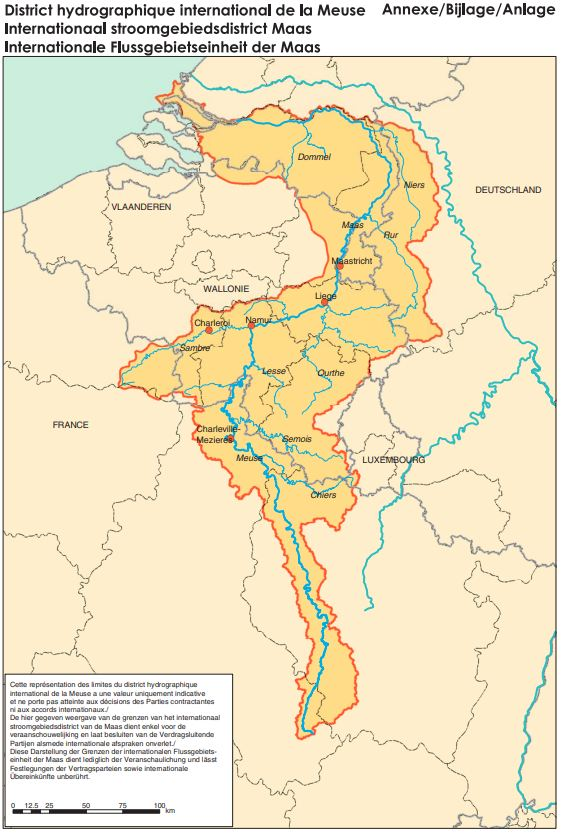

# Loi du 24 juillet 2006 portant approbation de l’Accord International sur la Meuse, signé à Gand, le 3 décembre 2002.

Nous Henri, Grand-Duc de Luxembourg, Duc de Nassau,

Notre Conseil d’Etat entendu;

De l’assentiment de la Chambre des Députés;

Vu la décision de la Chambre des Députés du 13 juillet 2006 et celle du Conseil d’Etat du 14 juillet 2006 portant qu’il n’y a pas lieu à second vote;

Avons ordonné et ordonnons:

## Article unique.

Est approuvé l’Accord International sur La Meuse, signé à Gand, le 3 décembre 2002.

Mandons et ordonnons que la présente loi soit insérée au Mémorial pour être exécutée et observée par tous ceux que la chose concerne.

Le Ministre de l’Intérieur  et de l’Aménagement du Territoire,   Jean-Marie Halsdorf

Cabasson, le 24 juillet 2006.   Henri

\**ACCORD INTERNATIONAL SUR LA MEUSE**

\**LES GOUVERNEMENTS**

– **DE LA REPUBLIQUE FEDERALE D’ALLEMAGNE,**

– **DU ROYAUME DE BELGIQUE,**

– **DE LA REGION DE BRUXELLES-CAPITALE DE BELGIQUE,**

– **DE LA REGION FLAMANDE DE BELGIQUE,**

– **DE LA REGION WALLONNE DE BELGIQUE,**

– **DE LA REPUBLIQUE FRANÇAISE,**

– **DU GRAND-DUCHE DE LUXEMBOURG,**

– **DU ROYAUME DES PAYS-BAS,**

\**CONSIDERANT** les travaux réalisés par les Parties Contractantes à l’Accord concernant la protection de la Meuse signé à Charleville-Mézières le 26 avril 1994 et désireux de renforcer la coopération existante entre les Etats et Régions concernés par la protection et l’utilisation des eaux du district hydrographique international de la Meuse,

\**SOUCIEUX** d’assurer le maintien et l’amélioration de la qualité de l’eau et des écosystèmes aquatiques du district hydrographique international de la Meuse, en tenant compte de la valeur de ses eaux, rives, zones rivulaires et eaux côtières,

\**ANIMES DE** la volonté commune de collaborer pour réaliser un développement durable et de la volonté de mettre en œuvre, chacun pour ce qui le concerne, les mesures appropriées d’une gestion intégrée du district hydrographique international de la Meuse afin de réaliser une gestion durable et intégrée de l’eau compte tenu en particulier de sa multifonctionnalité,

\**SOUCIEUX** d’assurer conjointement dans le district hydrographique international de la Meuse, la coordination qui est nécessaire en vertu de la [Directive 2000/60/CE](https://legilux.public.lu/eli/dir_ue/2000/60/jo) du Parlement européen et du Conseil du 23 octobre 2000 établissant un cadre pour une politique communautaire dans le domaine de l’eau,

\**CONSIDERANT QUE** la mise en œuvre du présent Accord et de la [Directive 2000/60/CE](https://legilux.public.lu/eli/dir_ue/2000/60/jo) du Parlement européen et du Conseil du 23 octobre 2000 établissant un cadre pour une politique communautaire dans le domaine de l’eau nécessite, au sein du district hydrographique international de la Meuse, selon les domaines géographiques et les thèmes à traiter, une coordination multilatérale, bilatérale ou nationale,

\**SE REFERANT** à la [Convention sur la protection et l’utilisation des cours d’eau transfrontières et des lacs internationaux signée à Helsinki le 17 mars 1992](https://treaties.un.org/doc/Treaties/1992/03/19920317%2005-46%20AM/Ch_XXVII_05p.pdf), ainsi qu’à la [Convention sur la protection de l’environnement marin de l’Atlantique du Nord-Est signée à Paris le 22 septembre 1992](https://www.ospar.org/site/assets/files/1169/convention_ospar.pdf),

\**SOUCIEUX** de réaliser, dans le cadre de leur coopération, les objectifs politiques des Déclarations ministérielles de Namur du 8 avril 1998 et de Liège du 30 novembre 2001 et, soucieux de contribuer, entre autres, à atténuer les effets des inondations et des sécheresses,

\**DESIREUX** d’assurer la coopération dans les domaines de la prévention et de la protection contre les inondations et dans ceux de la prévention et de la lutte contre les pollutions accidentelles de l’eau,

\**CONSCIENTS QUE** la protection de la Meuse est également indispensable afin de préserver et d’améliorer l’écosystème de la Mer du Nord,

\**CONSCIENTS QUE** la Meuse participe à diverses fonctions et utilisations écologiques, économiques et sociales essentielles,

\**ANIMES DE** la volonté de coopérer avec des organisations intergouvernementales et non gouvernementales pour poursuivre les objectifs du présent Accord et d’y associer le public au sens de la [Directive 2000/60/CE](https://legilux.public.lu/eli/dir_ue/2000/60/jo) du Parlement européen et du Conseil du 23 octobre 2000 établissant un cadre pour une politique communautaire dans le domaine de l’eau,

\**CONVAINCUS** de l’urgence de ces tâches et compétents, chacun pour ce qui le concerne, pour la mise en œuvre des actions décidées conjointement dans le cadre du présent Accord,

\**SONT CONVENUS CE QUI SUIT:**

## Article 1er — Définitions

Au sens du présent Accord, on entend par:

a) «Directive cadre sur l’eau»: la [Directive 2000/60/CE](https://legilux.public.lu/eli/dir_ue/2000/60/jo) du Parlement européen et du Conseil du 23 octobre 2000 établissant un cadre pour une politique communautaire dans le domaine de l’eau (Journal officiel des Communautés européennes [L 327/1 du 22 décembre 2000](https://eur-lex.europa.eu/legal-content/EN/TXT/?uri=oj:JOL_2000_327_R_TOC)) y compris d’éventuelles modifications;

b) «Meuse»: la Meuse à partir de sa source jusqu’à son embouchure dans la mer, y compris la Bergsche Maas, l’Amer, le Hollands Diep et le Haringvliet;

c) «bassin hydrographique de la Meuse»: territoire dont toutes les eaux de ruissellement s’écoulent à travers les affluents de la Meuse et la Meuse même vers la Mer du Nord;

d) «district hydrographique international de la Meuse»: la zone terrestre et maritime fixée par les Parties Contractantes en vertu de la Directive cadre sur l’eau, qui comporte le bassin hydrographique de la Meuse et les eaux souterraines et côtières qui lui sont associées.

Une carte annexée au présent Accord indique de façon générale et indicative les limites du district hydrographique international de la Meuse;

e) «Commission»: la Commission internationale de la Meuse;

f) «Accord de Charleville-Mézières»: l’Accord concernant la protection de la Meuse, signé à Charleville-Mézières le 26 avril 1994.

Complémentairement, les définitions de la Directive cadre sur l’eau sont applicables.

## Article 2 — Objectif de l’Accord

Les Parties Contractantes s’efforcent de réaliser une gestion de l’eau durable et intégrée pour le district hydrographique international de la Meuse, compte tenu en particulier de la multifonctionnalité de ses eaux.

Elles coopèrent plus particulièrement afin de:

a) coordonner la mise en œuvre des exigences définies dans la Directive cadre sur l’eau pour réaliser ses objectifs environnementaux et en particulier tous les programmes de mesures, pour le district hydrographique international de la Meuse;

b) produire un seul plan de gestion pour le district hydrographique international de la Meuse conformément à la Directive cadre sur l’eau;

c) se concerter puis coordonner les mesures pour une prévention et une protection contre les inondations compte tenu des aspects écologiques, de l’aménagement du territoire, de la gestion de la nature ainsi que d’autres domaines tels que l’agriculture, la sylviculture et l’urbanisation, et contribuer à atténuer les effets des inondations et des sécheresses y compris les mesures préventives;

d) coordonner les mesures de prévention et de lutte contre les pollutions accidentelles des eaux et assurer la transmission des informations nécessaires.

## Article 3 — Principes de la coopération

1\. Dans leur action, les Parties Contractantes sont guidées par les principes suivants:

a) le principe de précaution;

b) le principe de prévention;

c) le principe de lutte contre les atteintes à l’environnement de préférence à la source;

d) le principe du pollueur-payeur,

tels que définis et communément interprétés dans le droit européen de l’environnement.

2\. Afin de réaliser les objectifs mentionnés dans l’article 2 du présent Accord, les Parties Contractantes:

a) prennent les mesures nécessaires sur leur territoire, pour la mise en œuvre du présent Accord ainsi que des avis, recommandations ou décisions de la Commission et s’en informent mutuellement.

La Région de Bruxelles-Capitale, dont le territoire est entièrement situé en dehors du district hydrographique international de la Meuse, prend des mesures afin d’assurer que les activités entreprises par des personnes morales relevant de son pouvoir de contrôle, contribuent à la réalisation des objectifs du présent Accord tels qu’énoncés à l’article 2;

b) protègent et dans la mesure du possible améliorent, le cas échéant par des mesures d’aménagement et par l’orientation de l’utilisation du milieu, la qualité des écosystèmes aquatiques;

c) renforcent l’échange d’informations et d’opinions;

d) informent dans les meilleurs délais les Parties qui peuvent être affectées en cas de pollutions accidentelles dont les conséquences sont susceptibles de menacer de façon significative la qualité de l’eau;

e) informent dans les plus brefs délais les Parties qui peuvent être affectées en cas de crue imminente;

f) coordonnent en tant que de besoin leur politique relative à la gestion des sédiments et limitent dans la mesure du possible le déversement et le reversement de boues de dragage polluées dans les eaux, ainsi que leur déplacement vers l’aval.

3\. Les dispositions du présent Accord ne portent pas atteinte aux droits des Parties Contractantes d’adopter et d’appliquer, individuellement ou conjointement, des mesures plus rigoureuses que celles qui seront prises en application du présent Accord.

## Article 4 — Missions de la Commission

1\. Les Parties Contractantes instituent la Commission pour la mise en œuvre du présent Accord.

2\. La Commission émet des avis ou recommandations aux Parties Contractantes afin de mettre en œuvre le présent Accord.

Elle décide des mesures d’organisation interne et de l’organisation du travail qu’elle juge nécessaire. Elle adopte le budget annuel.

Ces avis ou recommandations sont émis et ces décisions sont prises conformément à la procédure visée à l’article 5.

3\. La coordination multilatérale de la mise en œuvre des exigences de la Directive cadre sur l’eau se déroule au sein de la Commission.

Il s’agit en particulier de la coordination:

a) de l’analyse des caractéristiques du district hydrographique international de la Meuse;

b) de l’étude des incidences de l’activité humaine sur l’état des eaux de surface et des eaux souterraines du district hydrographique international de la Meuse;

c) de l’analyse économique de l’utilisation de l’eau;

d) des programmes de surveillance;

e) des programmes de mesures;

f) de la production d’un seul plan de gestion pour le district hydrographique international de la Meuse ou tout au moins, si cela ne peut être réalisé, de coordonner les plans de gestion établis par les Parties Contractantes pour ce qui concerne les parties du district hydrographique situées sur leur territoire.

4\. En outre, la Commission a pour tâches:

a) d’élaborer des avis ou recommandations pour améliorer:

– la prévention et la protection contre les inondations en tenant compte des aspects écologiques, de l’aménagement du territoire, de la gestion de la nature, ainsi que d’autres domaines tels que l’agriculture, la sylviculture et l’urbanisation,

– la coordination des systèmes d’avertissement et d’alerte dans le domaine des crues,

– la qualité des informations opérationnelles et d’alerte concernant les inondations par le développement de modèles de prévision,

– l’échange d’informations entre les centres opérationnels;

b) d’élaborer des avis ou recommandations pour atténuer les effets des sécheresses, y compris les mesures préventives;

c) d’élaborer des avis ou recommandations pour améliorer la prévention et la lutte contre les pollutions accidentelles des eaux, en particulier en ce qui concerne la coordination des systèmes d’avertissement et d’alerte en vue de garantir une transmission avec des techniques appropriées d’informations sur les pollutions accidentelles des eaux, qui menacent d’avoir des effets transfrontaliers significatifs;

d) d’élaborer des avis ou recommandations pour améliorer la population et la circulation des poissons;

e) de coordonner les programmes de surveillance des Parties Contractantes relatifs à la qualité de l’eau afin d’aboutir à un réseau de mesures homogène et à son maintien;

f) de définir des priorités et d’établir un programme d’actions en vue de contribuer à la réalisation des objectifs mentionnés à l’article 2 du présent Accord, ainsi que d’effectuer son évaluation sur une base périodique.

Après la production du premier plan de gestion pour le district hydrographique international de la Meuse, éventuellement d’établir un programme d’actions qui lui est complémentaire;

g) de renforcer l’échange d’informations et d’opinions concernant:

– la politique de l’eau des Parties Contractantes,

– leur politique relative à la gestion des sédiments,

– les meilleures techniques disponibles et les meilleures pratiques environnementales,

– les projets qui sont soumis à une étude d’impact ou d’incidence et qui peuvent avoir un effet transfrontalier significatif, en tenant compte de la législation en vigueur sur le territoire des Parties Contractantes;

h) d’encourager la coopération et l’échange d’informations dans le cadre de programmes de recherche scientifique en rapport avec les objectifs du présent Accord;

i) d’établir un rapport d’activités annuel, qui sera rendu public et tout autre rapport qu’elle juge utile;

j) de coopérer, quand cela s’avère nécessaire, avec d’autres Commissions internationales ou organisations qui accomplissent des tâches comparables pour d’autres districts hydrographiques.

5\. La coordination pour les sous-bassins hydrographiques transfrontaliers situés dans le district hydrographique international de la Meuse peut se dérouler dans un cadre régional approprié.

6\. La Commission peut traiter toute autre affaire que les Parties Contractantes lui confient d’un commun accord dans les domaines couverts par le présent Accord.

## Article 5 — Composition et fonctionnement de la Commission

1\. La Commission est composée de délégations des Parties Contractantes. Chaque Partie Contractante désigne ses délégués, dont un chef de délégation.

2\. La présidence de la Commission est exercée à tour de rôle par chaque Partie Contractante pour une durée fixée par le Règlement intérieur et financier prévu au paragraphe 8 du présent article.

La Partie Contractante qui exerce la présidence désigne l’un des membres de sa délégation en qualité de Président de la Commission. Le Président n’intervient pas en tant que porte-parole de sa délégation au cours des séances de la Commission.

3\. La Commission se réunit une fois par an sur convocation de son Président. Elle se réunit, en outre, à la demande d’au moins deux délégations. La Commission peut tenir certaines de ses réunions au niveau ministériel.

4\. La Commission formule ses avis ou recommandations et prend ses décisions en présence de la majorité des délégations des Parties Contractantes et à l’unanimité. Le Règlement intérieur et financier ainsi que le budget de la Commission sont adoptés en présence de toutes les délégations. Chaque délégation dispose d’une voix. L’absence d’une délégation ayant le droit de vote vaut abstention. L’abstention d’une ou de plusieurs délégation(s) ne fait pas obstacle à l’unanimité.

Les délégations respectives du Royaume de Belgique et des Régions belges disposent du droit de vote pour les décisions concernant leurs compétences propres en vertu de la Constitution belge et de la législation belge.

La Région de Bruxelles-Capitale, dont le territoire est entièrement situé en dehors du district hydrographique international de la Meuse dispose du droit de vote en ce qui concerne les avis, recommandations ou décisions pouvant affecter ses intérêts légitimes en tant qu’utilisateur des eaux de la Meuse pour le prélèvement d’eau potabilisable ou ses obligations financières en vertu de l’article 7 du présent Accord.

5\. Les langues de travail de la Commission sont le français, le néerlandais et l’allemand.

6\. La Commission dispose d’un secrétariat permanent installé à Liège pour l’assister dans ses tâches. La Commission décide du recrutement et du licenciement du personnel du secrétariat.

A cette fin des règles seront fixées dans le Règlement intérieur et financier.

7\. Afin de s’acquitter des missions qui lui sont confiées en vertu du présent Accord, la Commission possède la personnalité juridique. Elle jouit, sur le territoire de chacune des Parties Contractantes, de la capacité juridique nécessaire à l’accomplissement de ses missions. La Commission est représentée par son Président.

8\. Pour organiser ses activités la Commission établit son Règlement intérieur et financier. Ce Règlement doit prévoir une procédure écrite pour la prise de décision, sans préjudice des principes énoncés au paragraphe 4 du présent article.

## Article 6 — Observateurs et coopération avec des tiers

1\. La Commission peut reconnaître en qualité d’observateur et à leur demande:

a) la Communauté Européenne;

b) des organisations intergouvernementales dont les activités sont liées au présent Accord;

c) des organisations non gouvernementales pour autant qu’il y ait des points communs avec leurs intérêts ou tâches;

d) tout Etat qui n’est pas Partie Contractante au présent Accord et qui marque un intérêt pour les travaux de la Commission.

2\. Les observateurs peuvent participer aux réunions de la Commission sans pour autant disposer d’un droit de vote et peuvent transmettre à la Commission toute information, tout rapport ou toute opinion relatifs à l’objet du présent Accord.

3\. La Commission échange des informations avec les observateurs. En particulier, elle entend les observateurs, s’il s’agit d’avis, recommandations ou décisions qu’elle estime importants pour ces derniers, et elle les informe des avis ou recommandations émis et des décisions prises.

4\. La Commission organise en son sein la collaboration avec les observateurs. Les modalités de cette collaboration ainsi que les conditions requises à l’admission et à la participation à cette collaboration sont fixées dans le Règlement intérieur et financier.

5\. La Commission peut décider de se faire assister par des experts et les inviter à ses réunions.

## Article 7 — Financement de la Commission

1\. Chaque Partie Contractante supporte les coûts de sa représentation dans la Commission.

2\. Les Parties Contractantes supportent les autres coûts afférents au fonctionnement de la Commission, y compris celui de son secrétariat, conformément à la clé de répartition suivante:

République Fédérale d’Allemagne: Royaume de Belgique: Région de Bruxelles-Capitale: Région Flamande: Région Wallonne: République Française: Grand-Duché de Luxembourg: Royaume des Pays-Bas: 14,5% 0,5% 4,5% 5% 30% 15% 0,5% 30%

La Commission peut, en cas d’adhésion ultérieure, de retrait d’une Partie Contractante ou d’activités jugées par elle spécifiques, arrêter une clé de répartition différente.

## Article 8 — Règlement des différends

En cas de différend entre les Parties Contractantes quant à l’interprétation ou à l’application du présent Accord, ces parties recherchent prioritairement une solution par voie de négociation ou par toute autre méthode de règlement des différends qu’elles jugent acceptable.

## Article 9 — Relations avec d’autres Accords

1\. Le présent Accord abroge et remplace, dès son entrée en vigueur, l’Accord de Charleville-Mézières.

2\. Sans préjudice des dispositions du premier paragraphe du présent article, les avis ou recommandations émises et les décisions prises en vertu de l’Accord de Charleville-Mézières continuent d’être applicables et conservent le même caractère juridique, dans la mesure où ils sont compatibles avec le présent Accord ou ne sont pas explicitement abrogés par celui-ci ou par tout autre avis, recommandation ou décision de la Commission.

3\. Les biens, droits et obligations, membres du personnel, archives ainsi que les dettes et les créances, présentes ou futures, découlant de contrats ou de procédures judiciaires en cours et à venir de la Commission instituée par l’Accord de Charleville-Mézières, sont intégralement repris par la Commission instituée par le présent Accord.

4\. Les dispositions du présent Accord ne portent pas préjudice aux droits et obligations des Parties Contractantes découlant d’autres accords internationaux antérieurs à l’entrée en vigueur du présent Accord et ayant un rapport avec son objet.

## Article 10 — Entrée en vigueur

1\. Chaque Partie Contractante notifie au Gouvernement du Royaume de Belgique, désigné comme dépositaire du présent Accord, l’exécution des procédures internes requises en ce qui concerne l’entrée en vigueur du présent Accord.

2\. Le dépositaire confirmera immédiatement la date de réception des notifications et en informera les autres Parties Contractantes.

3\. Le présent Accord entrera en vigueur le premier jour du deuxième mois suivant la dernière notification.

## Article 11 — Dénonciation

1\. A l’expiration d’un délai de trois ans après son entrée en vigueur, le présent Accord peut être dénoncé à tout moment, après accomplissement des procédures nationales, par chacune des Parties Contractantes, par une déclaration écrite adressée au dépositaire.

2\. La dénonciation prend effet à la fin de l’année suivant l’année de la dénonciation.

## Article 12 — Texte original et dépôt

Le présent Accord, qui a été établi en langues française, néerlandaise et allemande, les trois textes faisant également foi, est déposé dans les archives du dépositaire qui remet une copie certifiée conforme à chacune des Parties Contractantes.

Doc. parl. [5521](https://legilux.public.lu/eli/dl/pl/2005/152); sess. ord. 2005-2006
