# Loi du 1er août 2007 portant approbation de l’Accord de stabilisation et d’association entre les Communautés européennes et leurs Etats membres, d’une part, et la République d’Albanie, d’autre part, et de son Acte final, signés à Luxembourg, le 12 juin 2006.

Nous Henri, Grand-Duc de Luxembourg, Duc de Nassau,

Notre Conseil d’Etat entendu;

De l’assentiment de la Chambre des Députés;

Vu la décision de la Chambre des Députés du 3 juillet 2007 et celle du Conseil d’Etat du 13 juillet 2007 portant qu’il n’y a pas lieu à second vote;

Avons ordonné et ordonnons:

## Article unique.

Sont approuvés l’Accord de stabilisation et d’association entre les Communautés européennes et leurs Etats membres, d’une part, et la République d’Albanie, d’autre part, et son Acte final, signés à Luxembourg, le 12 juin 2006.

Mandons et ordonnons que la présente loi soit insérée au Mémorial pour être exécutée et observée par tous ceux que la chose concerne.

Le Ministre des Affaires étrangères et de l’Immigration,   Jean Asselborn

Cabasson, le 1er août 2007.   Henri

\**ACCORD DE STABILISATION ET D’ASSOCIATION**

\**entre les Communautés européennes et leurs Etats membres,**

\**d’une part, et la République d’Albanie, d’autre part**

\*Le Royaume de Belgique,*

\*La République tchèque,*

\*Le Royaume de Danemark,*

\*La République fédérale d’Allemagne,*

\*La République d’Estonie,*

\*La République hellénique,*

\*Le Royaume d’Espagne,*

\*La République française,*

\*L’Irlande,*

\*La République italienne,*

\*La République de Chypre,*

\*La République de Lettonie,*

\*La République de Lituanie,*

\*Le Grand-Duché de Luxembourg,*

\*La République de Hongrie,*

\*La République de Malte,*

\*Le Royaume des Pays-Bas,*

\*La République d’Autriche,*

\*La République de Pologne,*

\*La République portugaise,*

\*La République de Slovénie,*

\*La République slovaque,*

\*La République de Finlande,*

\*Le Royaume de Suède,*

\*Le Royaume-Uni de Grande-Bretagne et d’Irlande du Nord,*

parties contractantes au traité instituant la Communauté européenne, au traité instituant la Communauté européenne de l’énergie atomique, et au traité sur l’Union européenne,

ci-après dénommés «*Etats membres*»,

et

\*La Communauté européenne et la Communauté européenne de l’énergie atomique,*

ci-après dénommées «*Communauté*»,

d’une part, et

\*La République d’Albanie,*

ci-après dénommée «*Albanie*»,

d’autre part,

\*Considérant* les liens étroits qui existent entre les parties et les valeurs qu’elles partagent, ainsi que leur désir de renforcer ces liens et d’instaurer une relation étroite et durable fondée sur la réciprocité et l’intérêt mutuel devant permettre à l’Albanie de renforcer et d’élargir les relations avec la Communauté et ses Etats membres, déjà établies avec la Communauté par l’accord de 1992 concernant le commerce et la coopération commerciale et économique;

\*Considérant* l’importance du présent accord dans le contexte du processus de stabilisation et d’association engagé avec les pays de l’Europe du sud-est, dans le cadre de l’établissement et de la consolidation d’un ordre européen stable basé sur la coopération, dont l’Union européenne est un pilier, ainsi que dans le contexte du Pacte de stabilité;

\*Considérant* l’engagement des parties à contribuer par tous les moyens à la stabilisation politique, économique et institutionnelle en Albanie, ainsi que dans la région, par le développement de la société civile et la démocratisation, le renforcement des institutions et la réforme de l’administration publique, l’intégration commerciale régionale et le renforcement de la coopération économique, la coopération dans de nombreux domaines tels que, notamment, la justice et des affaires intérieures, ainsi que le renforcement de la sécurité nationale et régionale;

\*Considérant* l’engagement des parties à étendre les libertés politiques et économiques, qui constitue le fondement même du présent accord, ainsi que leur engagement à respecter les droits de l’homme et l’Etat de droit, y compris les droits des personnes appartenant aux minorités nationales, ainsi que les principes démocratiques, grâce au multipartisme et à des élections libres et régulières;

\*Considérant* l’engagement des parties en faveur de la mise en œuvre intégrale de tous les principes et de toutes les dispositions de la Charte des Nations unies, de l’OSCE, et notamment ceux de l’Acte final d’Helsinki, des conclusions des conférences de Madrid et de Vienne, de la Charte de Paris pour une nouvelle Europe et du Pacte de stabilité pour l’Europe du sud-est, de manière à contribuer à la stabilité régionale et à la coopération entre les pays de la région;

\*Considérant* l’engagement des parties en faveur des principes de l’économie de marché et la volonté de la Communauté de contribuer aux réformes économiques en Albanie;

\*Considérant* l’engagement des parties en faveur du libre-échange, conformément aux droits et obligations découlant de l’accord de l’OMC;

\*Considérant* la volonté des parties de développer le dialogue politique régulier sur les questions bilatérales et internationales d’intérêt mutuel, et notamment les aspects régionaux, en tenant compte de la politique étrangère et de sécurité commune de l’Union européenne;

\*Considérant* l’engagement des parties en faveur de la lutte contre la criminalité organisée et du renforcement de la coopération en vue de la lutte contre le terrorisme sur la base de la déclaration de la Conférence européenne du 20 octobre 2001;

\*Convaincues* que le présent accord permettra de créer un nouveau climat favorable à leurs relations économiques et, en particulier, au développement des échanges et des investissements, qui sont des facteurs essentiels à la restructuration économique et à la modernisation;

\*Compte tenu* de l’engagement de l’Albanie de rapprocher sa législation de celle de la Communauté dans les domaines concernés, et de veiller à sa mise en œuvre effective;

\*Compte tenu* du souhait de la Communauté de fournir un soutien décisif à la mise en œuvre des réformes et d’utiliser à cet effet tous les instruments disponibles en matière de coopération et d’assistance technique, financière et économique dans un cadre pluriannuel indicatif global;

\*Confirmant* que les dispositions du présent accord qui relèvent de la troisième partie, titre IV, du traité instituant la Communauté européenne lient le Royaume-Uni et l’Irlande en tant que parties contractantes distinctes et non en qualité d’Etats membres de la Communauté européenne jusqu’à ce que le Royaume-Uni ou l’Irlande (selon le cas) notifie à l’Albanie qu’il est désormais lié en tant que membre de la Communauté européenne, conformément au protocole sur la position du Royaume-Uni et de l’Irlande annexé au traité sur l’Union européenne et au traité instituant la Communauté européenne. Les mêmes dispositions s’appliquent au Danemark, conformément au protocole sur la position du Danemark annexé auxdits traités;

\*Rappelant* le sommet de Zagreb, qui a plaidé en faveur d’une consolidation des relations entre les pays du processus de stabilisation et d’association et l’Union européenne, ainsi que d’un renforcement de la coopération régionale;

\*Rappelant* que le sommet de Thessalonique a confirmé le processus de stabilisation et d’association comme cadre politique des relations entre l’Union européenne et les pays des Balkans occidentaux et a mis en lumière la perspective de leur intégration dans l’Union européenne, en fonction des progrès réalisés dans les réformes entreprises par chaque pays et de leurs mérites respectifs;

\*Rappelant* le protocole d’accord concernant la libéralisation et la facilitation des échanges, signé à Bruxelles le 27 juin 2001, par lequel l’Albanie et d’autres pays de la région se sont engagés à négocier un réseau d’accords bilatéraux de libre-échange pour accroître la capacité de la région à attirer les investissements et améliorer les perspectives d’intégration de celle-ci dans l’économie mondiale;

\*Rappelant* la volonté de l’Union européenne d’intégrer, dans la mesure la plus large possible, l’Albanie dans le courant politique et économique général de l’Europe et le statut de candidat potentiel à l’adhésion à l’Union européenne de ce pays, sur la base du traité sur l’Union européenne et du respect des critères définis par le Conseil européen de juin 1993, sous réserve de la bonne mise en œuvre du présent accord, notamment en ce qui concerne la coopération régionale,

SONT CONVENUS DES DISPOSITIONS SUIVANTES:

## *Article premier*

1\. Il est établi une association entre la Communauté et ses Etats membres, d’une part, et l’Albanie, d’autre part.

2\. Les objectifs de cette association sont les suivants:

– soutenir les efforts de l’Albanie en vue de renforcer la démocratie et l’Etat de droit;

– contribuer à la stabilité politique, économique et institutionnelle en Albanie, ainsi qu’à la stabilisation de la région;

– fournir un cadre approprié au dialogue politique, afin de permettre le développement de relations politiques étroites entre les parties;

– soutenir les efforts de l’Albanie en vue de développer sa coopération économique et internationale, notamment grâce au rapprochement de sa législation avec celle de la Communauté;

– soutenir les efforts de l’Albanie pour achever la transition vers une économie de marché qui fonctionne, promouvoir des relations économiques harmonieuses et élaborer progressivement une zone de libre-échange entre la Communauté et l’Albanie;

– encourager la coopération régionale dans tous les domaines couverts par le présent accord.

## TITRE I — Principes généraux

### *Article 2*

Le respect des principes démocratiques et des droits de l’homme, tels qu’ils sont proclamés dans la Déclaration universelle des droits de l’homme et tels qu’ils sont définis dans la Convention européenne des droits de l’homme, dans l’Acte final d’Helsinki et dans la Charte de Paris pour une nouvelle Europe, le respect des principes du droit international et de l’Etat de droit, ainsi que les principes de l’économie de marché, tels qu’ils sont exprimés dans le document de la conférence CSCE de Bonn sur la coopération économique, servent de base aux politiques intérieures et extérieures des parties et constituent les éléments essentiels du présent accord.

### *Article 3*

La paix et la stabilité aux niveaux international et régional, ainsi que le développement de relations de bon voisinage jouent un rôle essentiel dans le processus de stabilisation et d’association visé dans les conclusions du Conseil de l’Union européenne du 21 juin 1999. La conclusion et la mise en œuvre du présent accord s’inscrivent dans le cadre des conclusions du Conseil de l’Union européenne du 29 avril 1997, sur la base des mérites de l’Albanie.

### *Article 4*

L’Albanie s’engage à poursuivre et à encourager la coopération et les relations de bon voisinage avec les autres pays de la région, y compris la fixation d’un niveau approprié de concessions réciproques en ce qui concerne la circulation des personnes, des marchandises, des capitaux et des services, ainsi que l’élaboration de projets d’intérêt commun, notamment pour la lutte contre la criminalité organisée, la corruption, le blanchiment de capitaux, l’immigration clandestine et les trafics, et en particulier la traite d’êtres humains et le trafic de stupéfiants. Cet engagement constitue un facteur essentiel dans le développement des relations et de la coopération entre les parties et contribue, par conséquent, à la stabilité régionale.

### *Article 5*

Les parties réaffirment l’importance qu’elles attachent à la lutte contre le terrorisme et au respect des obligations internationales dans ce domaine.

### *Article 6*

L’association sera mise en œuvre progressivement et sera entièrement réalisée à l’issue d’une période de transition d’une durée maximale de dix ans, divisée en deux phases successives.

Ces deux phases ne s’appliquent pas au titre IV, qui comporte un calendrier spécifique.

Cette division en deux phases vise à permettre un examen détaillé de la mise en œuvre du présent accord à miparcours. Pour ce qui est du rapprochement des dispositions législatives et de l’application de la législation, les efforts de l’Albanie doivent se porter principalement, pendant la première phase, sur les éléments fondamentaux de l’acquis mentionnés au titre VI, en tenant compte de critères de référence spécifiques.

Le conseil de stabilisation et d’association institué en vertu de l’article 116 réexaminera régulièrement l’application du présent accord et la mise en œuvre par l’Albanie des réformes juridiques, administratives, institutionnelles et économiques, à la lumière des principes énoncés dans le préambule et des principes généraux figurant dans le présent accord.

La première phase commence à la date d’entrée en vigueur du présent accord. Au cours de la cinquième année suivant la date d’entrée en vigueur du présent accord, le conseil de stabilisation et d’association évaluera les progrès réalisés par l’Albanie et décidera s’ils sont suffisants pour permettre le passage à la seconde phase en vue de parachever l’association. Il décidera aussi des dispositions spécifiques susceptibles d’être nécessaires au cours de la seconde phase.

### *Article 7*

Le présent accord est totalement compatible et mis en œuvre de façon cohérente avec les dispositions applicables de l’OMC, et notamment l’article XXIV du GATT de 1994 et l’article V de l’AGCS.

## TITRE II — Dialogue politique

### *Article 8*

1\. Le dialogue politique entre les parties est développé dans le cadre du présent accord. Il accompagne et consolide le rapprochement entre l’Union européenne et l’Albanie et contribue à créer des liens de solidarité étroits et de nouvelles formes de coopération entre les parties.

2\. Le dialogue politique est destiné à promouvoir notamment:

– l’intégration pleine et entière de l’Albanie dans la communauté des nations démocratiques et son rapprochement progressif avec l’Union européenne;

– une convergence croissante des positions des parties sur les questions internationales, éventuellement par l’échange d’informations, et, en particulier, sur les questions susceptibles d’avoir des répercussions importantes sur l’une ou l’autre partie;

– une coopération régionale et le développement de relations de bon voisinage;

– une similitude de vues concernant la sécurité et la stabilité en Europe, y compris la coopération dans les domaines couverts par la politique étrangère et de sécurité commune de l’Union européenne.

3\. Les Parties estiment que la prolifération des armes de destruction massive et de leurs vecteurs, s’agissant d’acteurs tant étatiques que non étatiques, représente l’une des menaces les plus graves qui pèsent sur la stabilité et la sécurité internationales. Les parties conviennent en conséquence de coopérer et de contribuer à la lutte contre la prolifération des armes de destruction massive et de leurs vecteurs en veillant au respect intégral et à la mise en œuvre au niveau national des obligations qu’elles ont contractées dans le cadre des traités et accords internationaux de désarmement et de non-prolifération ainsi que de leurs autres obligations internationales en la matière. Les parties conviennent que la présente disposition constitue un élément essentiel du présent accord et fait partie du dialogue politique qui accompagne et consolide ces éléments.

Les parties conviennent en outre de coopérer et de contribuer à la lutte contre la prolifération des armes de destruction massive et de leurs vecteurs:

– en prenant des mesures en vue de signer ou de ratifier tous les autres instruments internationaux pertinents, ou d’y adhérer, selon le cas, et en vue de les mettre pleinement en œuvre;

– en mettant sur pied un système efficace de contrôles nationaux des exportations, consistant en un contrôle des exportations et du transit des marchandises liées aux armes de destruction massive et en un contrôle de l’utilisation finale des technologies à double usage, et comportant des sanctions efficaces en cas d’infraction au régime de contrôle des exportations.

Le dialogue politique portant sur cette question peut être régional.

### *Article 9*

1\. Le dialogue politique se déroule au sein du conseil de stabilisation et d’association. Celui-ci possède la compétence générale voulue pour toutes les questions que les parties souhaiteraient lui soumettre.

2\. A la demande des parties, le dialogue politique peut notamment prendre les formes suivantes:

– des réunions, si nécessaire, de hauts fonctionnaires représentant l’Albanie, d’une part, et de la Présidence du Conseil de l’Union européenne et de la Commission, d’autre part;

– la pleine utilisation de toutes les voies diplomatiques existant entre les parties, y compris les contacts appropriés dans des pays tiers et au sein des Nations unies, de l’OSCE, du Conseil de l’Europe et d’autres enceintes internationales;

– tous les autres moyens qui pourraient utilement contribuer à consolider, à développer et à intensifier ce dialogue.

### *Article 10*

Le dialogue politique au niveau parlementaire se déroule dans le cadre de la commission parlementaire de stabilisation et d’association instituée à l’article 122.

### *Article 11*

Le dialogue politique peut avoir lieu dans un cadre multilatéral et en tant que dialogue régional, avec d’autres pays de la région.

## TITRE III — Coopération régionale

### *Article 12*

Conformément à son engagement en faveur de la paix et de la stabilité dans le monde et sur le plan régional, ainsi que du développement de relations de bon voisinage, l’Albanie soutiendra activement la coopération régionale. La Communauté pourra soutenir, par l’intermédiaire de ses programmes d’assistance technique, des projets ayant une dimension régionale ou transfrontière.

A chaque fois que l’Albanie envisagera de renforcer sa coopération avec l’un des pays mentionnés aux articles 13, 14 et 15, elle en informera la Communauté et ses Etats membres et les consultera, conformément aux dispositions du titre X.

L’Albanie révisera les accords bilatéraux existant avec tous les pays concernés ou en conclura de nouveaux, pour garantir leur conformité aux principes du protocole d’accord sur la libéralisation et la facilitation des échanges signé à Bruxelles le 27 juin 2001.

### *Article 13* — *Coopération avec d’autres pays ayant signé un accord de stabilisation et d’association*

Après la signature du présent accord, l’Albanie entamera des négociations avec les pays ayant déjà signé un accord de stabilisation et d’association en vue de conclure des conventions bilatérales sur la coopération régionale, dont l’objectif sera de renforcer la portée de la coopération entre les pays concernés.

Les principaux éléments de ces conventions sont:

– le dialogue politique;

– l’établissement d’une zone de libre-échange entre les parties, conformément aux dispositions de l’OMC;

– des concessions mutuelles concernant la circulation des travailleurs, le droit d’établissement, les prestations de services, les paiements courants et la circulation des capitaux ainsi que d’autres politiques relatives à la circulation des personnes, à un niveau équivalent à celui du présent accord;

– des dispositions relatives à la coopération dans d’autres domaines couverts ou non par le présent accord, et notamment dans le domaine de la justice et des affaires intérieures.

Ces conventions contiennent des dispositions pour la création des mécanismes institutionnels nécessaires, le cas échéant.

Ces conventions seront conclues dans les deux ans suivant la date d’entrée en vigueur du présent accord. La volonté de l’Albanie de conclure de telles conventions constituera l’une des conditions du développement des relations entre ce pays et l’Union européenne.

L’Albanie entamera des négociations similaires avec les autres pays de la région lorsque ceux-ci auront signé un accord de stabilisation et d’association.

### *Article 14* — * Coopération avec d’autres pays concernés par le processus de stabilisation et d’association*

L’Albanie poursuivra sa coopération régionale avec les autres pays concernés par le processus de stabilisation et d’association dans une partie ou dans l’ensemble des domaines de coopération couverts par le présent accord, et notamment ceux qui présentent un intérêt commun. Cette coopération sera compatible avec les principes et objectifs du présent accord.

### *Article 15* — * Coopération avec des pays candidats à l’adhésion à l’Union européenne*

1\. L’Albanie pourra intensifier sa coopération et conclure une convention sur la coopération régionale avec tout pays candidat à l’adhésion à l’Union européenne dans tout domaine de coopération couvert par le présent accord. Cette convention devrait permettre d’aligner progressivement les relations bilatérales entre l’Albanie et ce pays sur la partie correspondante des relations entre la Communauté et ses Etats membres et ledit pays.

2\. L’Albanie entamera des négociations avec la Turquie en vue de conclure un accord, avantageux pour les deux parties, instaurant une zone de libre-échange entre celles-ci, conformément à l’article XXIV du GATT, et libéralisant le droit d’établissement et la prestation de services entre elles, à un niveau équivalent à celui du présent accord, conformément à l’article V de l’AGCS.

Ces négociations doivent être entamées dès que possible, en vue de conclure cet accord avant la fin de la période transitoire visée à l’article 16, paragraphe 1.

## TITRE IV — Libre circulation des marchandises

### *Article 16*

1\. La Communauté et l’Albanie établissent progressivement une zone de libre-échange pendant une période de dix ans au maximum à partir de la date d’entrée en vigueur du présent accord, conformément aux dispositions du présent accord et dans le respect des dispositions qui régissent le GATT de 1994 et l’OMC. Ce faisant, elles prendront en compte les exigences spécifiques prévues ci-après.

2\. La nomenclature combinée des marchandises est utilisée pour le classement des marchandises dans les échanges entre les deux parties.

3\. Pour chaque produit, le droit de base sur lequel les réductions successives prévues dans le présent accord doivent être opérées est constitué par le droit effectivement appliqué erga omnes le jour précédant la signature du présent accord.

4\. Les droits réduits devant être appliqués par l’Albanie, calculés conformément au présent accord, sont arrondis aux nombres entiers par l’application de principes arithmétiques communs. Aussi, tous les nombres dont la partie décimale est égale ou inférieure à 50 sont arrondis au nombre entier inférieur le plus proche, et tous les nombres dont la partie décimale est supérieure à 50 sont arrondis au nombre entier supérieur le plus proche.

5\. Si, après la signature du présent accord, une réduction tarifaire est appliquée erga omnes, en particulier une réduction résultant des négociations tarifaires de l’OMC, ce droit réduit remplace le droit de base visé au paragraphe 3, à compter de la date à laquelle cette réduction est appliquée.

6\. La Communauté et l’Albanie se communiquent leurs droits de base respectifs.

### Chapitre I — *Produits industriels*

#### *Article 17*

1\. Les dispositions du présent chapitre s’appliquent aux produits originaires de la Communauté ou d’Albanie, qui sont énumérés aux chapitres 25 à 97 de la nomenclature combinée, à l’exception des produits énumérés à l’annexe I, paragraphe I, point ii), de l’accord sur l’agriculture (GATT de 1994).

2\. Les échanges entre les parties des produits couverts par le traité instituant la Communauté européenne de l’énergie atomique sont effectués conformément aux dispositions de ce traité.

#### *Article 18*

1\. Les droits de douane à l’importation dans la Communauté de produits originaires d’Albanie sont supprimés dès la date d’entrée en vigueur du présent accord.

2\. Les restrictions quantitatives à l’importation dans la Communauté de produits originaires d’Albanie et les mesures d’effet équivalent sont supprimées dès l’entrée en vigueur du présent accord.

#### *Article 19*

1\. Les droits de douane à l’importation en Albanie de produits originaires de la Communauté, autres que ceux dont la liste figure à l’annexe I, sont supprimés dès la date d’entrée en vigueur du présent accord.

2\. Les droits de douane à l’importation en Albanie de produits originaires de la Communauté, dont la liste figure à l’annexe I, sont progressivement réduits selon le calendrier suivant:

– à la date d’entrée en vigueur du présent accord, les droits à l’importation sont ramenés à 80% des droits de base;

– au 1er janvier de la première année suivant la date d’entrée en vigueur du présent accord, les droits à l’importation sont ramenés à 60% des droits de base;

– au 1er janvier de la deuxième année suivant la date d’entrée en vigueur du présent accord, les droits à l’importation sont ramenés à 40% des droits de base;

– au 1er janvier de la troisième année suivant la date d’entrée en vigueur du présent accord, les droits à l’importation sont ramenés à 20% des droits de base;

– au 1er janvier de la quatrième année suivant la date d’entrée en vigueur du présent accord, les droits à l’importation sont ramenés à 10% des droits de base;

– au 1er janvier de la cinquième année suivant la date d’entrée en vigueur du présent accord, les droits à l’importation restants sont supprimés.

3\. Les restrictions quantitatives à l’importation en Albanie de produits originaires de la Communauté et les mesures d’effet équivalent sont supprimées dès l’entrée en vigueur du présent accord.

#### *Article 20*

La Communauté et l’Albanie suppriment dans leurs échanges toute taxe d’effet équivalent à des droits de douane à l’importation, dès la date d’entrée en vigueur du présent accord.

#### *Article 21*

1\. La Communauté et l’Albanie suppriment entre elles les droits de douane à l’exportation et les taxes d’effet équivalent, dès la date d’entrée en vigueur du présent accord.

2\. La Communauté et l’Albanie suppriment entre elles, dès la date d’entrée en vigueur du présent accord, toute restriction quantitative à l’exportation et toute mesure d’effet équivalent.

#### *Article 22*

L’Albanie se déclare disposée à réduire ses droits de douane à l’égard de la Communauté selon un rythme plus rapide que celui qui est prévu à l’article 19, si la situation économique générale et la situation du secteur économique intéressé le permettent.

Le conseil de stabilisation et d’association analyse la situation à cet égard et formule les recommandations qui s’imposent.

#### *Article 23*

Le protocole No 1 détermine le régime applicable aux produits sidérurgiques des chapitres 72 et 73 de la nomenclature combinée.

### Chapitre II — *Agriculture et pêche*

#### *Article 24* — * Définition*

1\. Les dispositions du présent chapitre s’appliquent au commerce des produits agricoles et des produits de la pêche originaires de la Communauté ou d’Albanie.

2\. Par «produits agricoles et produits de la pêche», on entend les produits énumérés aux chapitres 1 à 24 de la nomenclature combinée et les produits énumérés à l’annexe I, alinéa I, point ii), de l’accord sur l’agriculture (GATT de 1994).

3\. Cette définition inclut les poissons et produits de la pêche visés au chapitre 3, positions 1604 et 1605 et sous-positions 0511 91, 2301 20 00 et 1902 20 10.

#### *Article 25*

Le protocole No 2 détermine le régime des échanges applicable aux produits agricoles transformés qui y sont énumérés.

#### *Article 26*

1\. A la date d’entrée en vigueur du présent accord, la Communauté supprimera toutes les restrictions quantitatives et mesures d’effet équivalent auxquelles sont soumises les importations de produits agricoles et de produits de la pêche originaires d’Albanie.

2\. A la date d’entrée en vigueur du présent accord, l’Albanie supprimera toutes les restrictions quantitatives et mesures d’effet équivalent auxquelles sont soumises les importations de produits agricoles et de produits de la pêche originaires de la Communauté.

#### *Article 27* — * Produits agricoles*

1\. Dès la date d’entrée en vigueur du présent accord, la Communauté supprimera les droits de douane et taxes d’effet équivalent auxquelles sont soumises les importations de produits agricoles originaires d’Albanie, autres que ceux des positions 0102, 0201, 0202, 1701, 1702 et 2204 de la nomenclature combinée.

Pour les produits couverts par les chapitres 7 et 8 de la nomenclature combinée, pour lesquels le tarif douanier commun prévoit l’application de droits de douane ad valorem et un droit de douane spécifique, la suppression ne s’applique qu’à la partie ad valorem du droit.

2\. Dès la date d’entrée en vigueur du présent accord, la Communauté accordera un accès en franchise de droits aux importations dans la Communauté de produits originaires d’Albanie des positions 1701 et 1702 de la nomenclature combinée, dans les limites d’un contingent tarifaire annuel de 1.000 tonnes.

3\. A la date d’entrée en vigueur du présent accord, l’Albanie:

a) supprimera les droits de douane applicables aux importations de certains produits agricoles originaires de la Communauté, énumérés à l’annexe II a);

b) réduira progressivement les droits de douane applicables aux importations de certains produits agricoles originaires de la Communauté, énumérés à l’annexe II b), selon le calendrier indiqué pour chaque produit dans cette annexe;

c) supprimera les droits de douane applicables aux importations de certains produits agricoles originaires de la Communauté, énumérés à l’annexe II c), dans les limites des contingents tarifaires indiqués pour les produits concernés.

4\. Le protocole No 3 détermine le régime applicable aux vins et spiritueux qui y sont mentionnés.

#### *Article 28* — * Poissons et produits de la pêche*

1\. A la date d’entrée en vigueur du présent accord, la Communauté supprimera la totalité des droits de douane sur les poissons et produits de la pêche originaires d’Albanie, autres que ceux énumérés à l’annexe III. Les produits énumérés à l’annexe III seront soumis aux dispositions qui y sont prévues.

2\. Dès la date d’entrée en vigueur du présent accord, l’Albanie n’imposera aucun droit de douane, ni aucune taxe d’effet équivalent sur les poissons et produits de la pêche originaires de la Communauté.

#### *Article 29*

Compte tenu du volume des échanges de produits agricoles et de produits de la pêche entre les parties, de leurs sensibilités particulières, des règles des politiques communes de la Communauté et des règles des politiques albanaises en matière d’agriculture et de pêche, du rôle de l’agriculture et de la pêche dans l’économie de l’Albanie et des conséquences des négociations commerciales multilatérales dans le cadre de l’OMC, la Communauté et l’Albanie examinent au sein du conseil de stabilisation et d’association, au plus tard six ans après la date d’entrée en vigueur du présent accord, la possibilité de s’accorder de nouvelles concessions, produit par produit et de façon harmonieuse et réciproque, afin de libéraliser davantage le commerce des produits agricoles et des produits de la pêche.

#### *Article 30*

Les dispositions du présent chapitre n’affectent en rien l’application unilatérale de mesures plus favorables par l’une ou l’autre des parties.

#### *Article 31*

Sans préjudice des autres dispositions du présent accord, et notamment de ses articles 38 et 43, si, vu la sensibilité particulière des marchés de produits agricoles et de produits de la pêche, les importations de produits originaires de l’une des deux parties, qui font l’objet de concessions accordées en vertu des articles 25, 27 et 28, entraînent une perturbation grave des marchés ou des mécanismes de régulation de l’autre partie, les deux parties entament immédiatement des consultations, afin de trouver une solution appropriée. Dans l’attente d’une solution, la partie concernée est autorisée à prendre les mesures qu’elle juge nécessaires.

### Chapitre III — *Dispositions communes*

#### *Article 32*

Les dispositions du présent chapitre s’appliquent aux échanges entre les parties de tous les produits, sauf dispositions contraires prévues dans ce chapitre ou dans les protocoles Nos 1, 2 et 3.

#### *Article 33* — * Statu quo*

1\. Dès la date d’entrée en vigueur du présent accord, aucun nouveau droit de douane à l’importation ou à l’exportation, ni aucune taxe d’effet équivalent ne sont introduits dans les relations commerciales entre la Communauté et l’Albanie, et ceux qui sont déjà appliqués ne seront pas augmentés.

2\. Dès la date d’entrée en vigueur du présent accord, aucune nouvelle restriction quantitative à l’importation ou à l’exportation, ni aucune mesure d’effet équivalent ne sont introduites dans les relations commerciales entre la Communauté et l’Albanie, et celles qui existent déjà ne seront pas rendues plus restrictives.

3\. Sans préjudice des concessions accordées en vertu de l’article 26, les dispositions des paragraphes 1 et 2 du présent article ne restreignent en aucun cas la poursuite des politiques agricoles de l’Albanie et de la Communauté, ni l’adoption de mesures dans le cadre de ces politiques, pour autant que le régime à l’importation prévu dans les annexes VI et VII n’en soit pas affecté.

#### *Article 34* — * Interdiction de discrimination fiscale*

1\. Les parties s’abstiennent de toute mesure ou pratique de nature fiscale interne établissant directement ou indirectement une discrimination entre les produits de l’une des parties et les produits similaires originaires du territoire de l’autre partie, et suppriment de telles mesures ou pratiques si elles existent.

2\. Les produits exportés vers le territoire de l’une des parties ne peuvent bénéficier de ristournes d’imposition intérieure indirecte supérieures au montant des impositions indirectes dont ils ont été frappés.

#### *Article 35*

Les dispositions relatives à la suppression des droits de douane à l’importation s’appliquent également aux droits de douane à caractère fiscal.

#### *Article 36* — * Unions douanières, zones de libre-échange et régimes transfrontaliers*

1\. Le présent accord ne fait pas obstacle au maintien ou à l’établissement d’unions douanières, de zones de libre-échange ou de régimes de trafic frontalier, pour autant qu’ils n’aient pas pour effet de modifiér le régime d’échanges qu’il prévoit.

2\. Au cours des périodes transitoires spécifiées à l’article 19, le présent accord ne peut pas affecter la mise en œuvre des régimes préférentiels spécifiques régissant la circulation des marchandises qui ont été prévus par des accords frontaliers conclus antérieurement entre un ou plusieurs Etats membres et l’Albanie ou qui résultent des accords bilatéraux conclus par l’Albanie en vue de promouvoir le commerce régional et qui sont spécifiés au titre III.

3\. Les parties se consultent au sein du conseil de stabilisation et d’association en ce qui concerne les accords décrits aux paragraphes 1 et 2 et, le cas échéant, sur d’autres problèmes importants liés à leurs politiques commerciales respectives à l’égard des pays tiers. En particulier, dans l’éventualité de l’adhésion d’un pays tiers à la Communauté, de telles consultations ont lieu afin de s’assurer qu’il est tenu compte des intérêts mutuels de la Communauté et de l’Albanie mentionnés dans le présent accord.

#### *Article 37* — * Dumping et subventions*

1\. Aucune des dispositions du présent accord n’empêche l’une ou l’autre partie de prendre des mesures de défense commerciale conformément au paragraphe 2 du présent article et à l’article 38.

2\. Si l’une des parties estime que les échanges avec l’autre partie font l’objet de pratiques de dumping et/ou de subventions passibles de mesures compensatoires, elle peut prendre les mesures qui s’imposent à l’encontre de ces pratiques conformément à l’accord de l’OMC sur la mise en œuvre de l’article VI de l’Accord général sur les tarifs douaniers et le commerce de 1994 et à l’accord de l’OMC sur les subventions et les mesures compensatoires ou à sa législation propre y afférente.

#### *Article 38* — * Clause de sauvegarde générale*

1\. Les dispositions de l’article XIX du GATT de 1994 et l’accord de l’OMC sur les sauvegardes sont applicables entre les parties.

2\. Lorsqu’un produit d’une partie est importé sur le territoire de l’autre partie en quantités tellement accrues et à des conditions telles qu’il cause ou menace de causer:

– un dommage grave à la branche de production nationale de produits similaires ou directement concurrents sur le territoire de la partie importatrice; ou

– des perturbations sérieuses dans un secteur de l’économie ou des difficultés pouvant se traduire par l’altération grave de la situation économique d’une région de la partie importatrice,

cette dernière peut prendre les mesures appropriées dans les conditions et selon les procédures prévues au présent article.

3\. Les mesures de sauvegarde bilatérales visant les importations de l’autre partie n’excèdent pas la mesure nécessaire pour remédier aux difficultés engendrées et devraient normalement consister en une suspension de toute nouvelle réduction d’un taux de droit applicable prévu dans le présent accord pour le produit concerné ou en une augmentation du taux de droit applicable à ce produit jusqu’à un plafond correspondant au taux applicable au même produit pour la nation la plus favorisée (NPF). Ces mesures contiennent des dispositions claires prévoyant leur suppression progressive à la fin de la période fixée, au plus tard, et leur durée n’excède pas un an. Dans des circonstances très exceptionnelles, la durée de ces mesures peut être au maximum de trois ans au total. Aucune mesure de sauvegarde bilatérale n’est appliquée à l’importation d’un produit qui aura précédemment fait l’objet d’une telle mesure pour une période d’au moins trois ans à compter de la date d’expiration de la mesure.

4\. Dans les cas précisés au présent article, avant de prendre les mesures qui y sont prévues ou, dans les cas auxquels s’applique le paragraphe 5, point b), la Communauté ou l’Albanie, selon le cas, fournit le plus tôt possible au conseil de stabilisation et d’association toutes les informations pertinentes, en vue de rechercher une solution acceptable pour les deux parties.

5\. Pour la mise en œuvre des paragraphes ci-dessus, les dispositions suivantes s’appliquent:

a) Les difficultés provenant de la situation visée au présent article sont notifiées pour examen au conseil de stabilisation et d’association, qui peut prendre toute décision requise pour y mettre fin.

Si le conseil de stabilisation et d’association ou la partie exportatrice n’a pas pris de décision mettant fin aux difficultés ou s’il n’a pas été trouvé de solution satisfaisante dans les trente jours suivant la notification à ce conseil, la partie importatrice peut adopter les mesures appropriées pour résoudre le problème, conformément au présent article. Dans la sélection des mesures de sauvegarde, la priorité doit aller à celles qui perturbent le moins le fonctionnement des modalités définies dans le présent accord. Les mesures de sauvegarde appliquées conformément à l’article XIX du GATT et à l’accord de l’OMC sur les sauvegardes préservent le niveau/la marge de préférence accordé(e) en vertu du présent accord.

b) Lorsque des circonstances exceptionnelles et critiques imposant de prendre des mesures immédiates rendent impossible, selon le cas, l’information ou l’examen préalable, la partie concernée peut, dans les situations précisées au présent article, appliquer aussitôt les mesures provisoires nécessaires pour faire face à la situation et en informe immédiatement l’autre partie.

Les mesures de sauvegarde sont immédiatement notifiées au conseil de stabilisation et d’association et font l’objet, au sein de celui-ci, de consultations périodiques, notamment en vue de leur suppression, dès que les circonstances le permettent.

6\. Si la Communauté ou l’Albanie soumet les importations de produits susceptibles de provoquer des difficultés visées au présent article à une procédure administrative ayant pour objet de fournir rapidement des informations au sujet de l’évolution des courants commerciaux, elle en informe l’autre partie.

#### *Article 39* — * Clause de pénurie*

1\. Si le respect des dispositions du présent titre conduit:

a) à une situation ou à un risque de pénurie grave de produits alimentaires ou d’autres produits essentiels pour la partie exportatrice; ou

b) à la réexportation vers un pays tiers d’un produit qui fait l’objet dans la partie exportatrice de restrictions quantitatives ou de droits de douane à l’exportation ou de mesures ou taxes d’effet équivalent et lorsque les situations décrites ci-dessus provoquent ou risquent de provoquer des difficultés majeures pour la partie exportatrice,

cette dernière peut prendre les mesures appropriées, dans les conditions et selon les procédures prévues dans le présent article.

2\. Dans la sélection des mesures, la priorité doit être accordée à celles qui perturbent le moins le fonctionnement des modalités prévues dans le présent accord. Ces mesures ne sont pas appliquées de façon à constituer, soit un moyen de discrimination arbitraire ou injustifiable lorsque les mêmes conditions existent, soit une restriction déguisée au commerce et sont supprimées dès lors que les circonstances ne justifient plus leur maintien.

3\. Avant de prendre les mesures prévues au paragraphe 1 ou, le plus tôt possible pour les cas auxquels s’applique le paragraphe 4, la Communauté ou l’Albanie, selon le cas, communique au conseil de stabilisation et d’association toutes les informations utiles, en vue de rechercher une solution acceptable pour les parties. Les parties au sein du conseil de stabilisation et d’association peuvent s’accorder sur les moyens nécessaires pour mettre un terme aux difficultés. Si aucun accord n’a été trouvé dans les trente jours suivant la notification de l’affaire au conseil de stabilisation et d’association, la partie exportatrice est autorisée à prendre des mesures en vertu du présent article relativement à l’exportation du produit concerné.

4\. Lorsque des circonstances exceptionnelles et critiques imposant de prendre des mesures immédiates rendent impossible, selon le cas, l’information ou l’examen préalable, la Communauté ou l’Albanie, suivant la partie concernée, peut, dans les situations précisées au présent article, appliquer aussitôt les mesures de précaution nécessaires pour faire face à la situation et en informe immédiatement l’autre partie.

5\. Les mesures de sauvegarde prises en vertu du présent article sont immédiatement notifiées au conseil de stabilisation et d’association et font l’objet de consultations régulières au sein de cette instance, notamment en vue d’arrêter un calendrier pour leur suppression, dès que les circonstances le permettent.

#### *Article 40* — * Monopoles d’Etat*

L’Albanie ajuste progressivement tous les monopoles d’Etat à caractère commercial, de manière à garantir que, d’ici à la fin de la quatrième année suivant la date d’entrée en vigueur du présent accord, il ne subsiste plus de discrimination en ce qui concerne les conditions d’approvisionnement et de commercialisation des marchandises entre les ressortissants des Etats membres et ceux de l’Albanie. Le conseil de stabilisation et d’association est informé des mesures adoptées pour la mise en œuvre de cet objectif.

#### *Article 41*

Sauf disposition contraire du présent accord, le protocole No 4 détermine les règles d’origine destinées à l’application des dispositions dudit accord.

#### *Article 42* — * Restrictions autorisées*

Le présent accord ne fait pas obstacle aux interdictions ou restrictions d’importation, d’exportation ou de transit des marchandises, justifiées par des raisons de moralité publique, d’ordre public, de sécurité publique; de protection de la santé et de la vie des personnes et des animaux ou de préservation des végétaux; de protection des trésors nationaux ayant une valeur artistique, historique ou archéologique ou de protection de la propriété intellectuelle, industrielle ou commerciale, ni à celles imposées par les réglementations relatives à l’or et à l’argent. Ces interdictions ou restrictions ne doivent cependant pas constituer un moyen de discrimination arbitraire ou une restriction déguisée au commerce entre les parties.

#### *Article 43*

1\. Les parties conviennent de l’importance cruciale de la coopération administrative pour mettre en œuvre et contrôler le traitement préférentiel accordé en vertu du présent titre et réaffirment leur volonté de lutter contre les irrégularités et la fraude en matière de douane ou dans d’autres matières connexes.

2\. Lorsqu’une partie constate, sur la base d’informations objectives, une absence de coopération administrative et/ou des irrégularités ou une fraude au sens du présent titre, elle peut suspendre temporairement le traitement préférentiel du ou des produit(s) concerné(s) aux conditions du présent article.

3\. Aux fins de l’application du présent article, par absence de coopération administrative, on entend notamment:

a) le non-respect répété de l’obligation de vérifier le statut originaire du ou des produit(s) concerné(s);

b) le refus répété de procéder à la vérification ultérieure de la preuve de l’origine et/ou d’en communiquer les résultats, ou le retard injustifié avec lequel ces tâches sont accomplies;

c) le refus répété d’accorder l’autorisation d’accomplir les tâches de coopération administrative afin de vérifier l’authenticité de documents ou l’exactitude d’informations utiles pour l’octroi du traitement préférentiel en question, ou le retard injustifié avec lequel cette autorisation est accordée.

Aux fins de l’application du présent article, des irrégularités ou une fraude peuvent être constatées notamment lorsque des informations objectives font apparaître une augmentation rapide, sans explication satisfaisante, des importations de biens dépassant le niveau habituel de production et la capacité d’exportation de l’autre partie.

4\. L’application d’une suspension temporaire est soumise aux conditions suivantes:

a) La partie qui a constaté, sur la base d’informations objectives, une absence de coopération administrative et/ou des irrégularités ou une fraude notifie sans retard injustifié au comité d’association ses constatations ainsi que des informations objectives et procède à des consultations au sein dudit comité, sur la base de toutes les informations utiles et des constatations objectives, en vue de trouver une solution acceptable par les deux parties.

b) Lorsque les parties ont procédé à des consultations au sein du comité d’association et qu’elles n’ont pu convenir d’une solution acceptable dans un délai de trois mois à compter de la notification, la partie concernée peut suspendre temporairement le traitement préférentiel du ou des produit(s) concerné(s). Cette suspension temporaire est notifiée sans délai injustifié au comité de stabilisation et d’association.

c) Les suspensions temporaires prévues par le présent article ne peuvent aller au-delà de ce qui est nécessaire pour protéger les intérêts financiers de la partie concernée. Elles ne peuvent excéder une durée de six mois renouvelable. Les suspensions temporaires sont notifiées au comité de stabilisation et d’association immédiatement après leur adoption. Elles font l’objet de consultations périodiques au sein du comité de stabilisation et d’association, notamment en vue de leur suppression dès que les conditions de leur application cessent d’exister.

5\. Parallèlement à la notification au comité de stabilisation et d’association prévue au paragraphe 4, point a), la partie concernée publie dans son journal officiel une communication destinée aux importateurs. Cette communication indique pour le produit concerné qu’une absence de coopération administrative et/ou des irrégularités ou une fraude ont été constatées sur la base d’informations objectives.

#### *Article 44*

En cas d’erreur commise par les autorités compétentes dans la gestion du système préférentiel à l’exportation, et notamment dans l’application des dispositions du protocole No 4 relatif à la définition de la notion de «produits originaires» et aux méthodes de coopération administrative, lorsque cette erreur a des conséquences en ce qui concerne les droits à l’importation, la partie qui subit ces conséquences peut demander au conseil de stabilisation et d’association d’examiner la possibilité d’adopter toutes les mesures qui s’imposent pour remédier à la situation.

#### *Article 45*

L’application du présent accord ne porte pas atteinte à l’application des dispositions du droit communautaire aux îles Canaries.

## TITRE V — Circulation des travailleurs, droit d’établissement, prestation de services, paiements courants et circulation des capitaux

### Chapitre I — *Circulation des travailleurs*

#### *Article 46*

1\. Sous réserve des conditions et modalités applicables dans chaque Etat membre:

– le traitement des travailleurs ressortissants albanais légalement employés sur le territoire d’un Etat membre ne doit faire l’objet d’aucune discrimination fondée sur la nationalité, en ce qui concerne les conditions de travail, de rémunération ou de licenciement, par rapport aux ressortissants dudit Etat membre;

– le conjoint et les enfants d’un travailleur légalement employé sur le territoire d’un Etat membre, qui y résident légalement, à l’exception des travailleurs saisonniers ou des travailleurs arrivés sous le couvert d’accords bilatéraux au sens de l’article 47, sauf dispositions contraires desdits accords, ont accès au marché de l’emploi de cet Etat membre pendant la durée du séjour professionnel autorisé du travailleur.

2\. L’Albanie doit, sous réserve des conditions et modalités applicables dans ce pays, accorder le traitement visé au paragraphe 1 aux travailleurs ressortissants d’un Etat membre légalement employés sur son territoire ainsi qu’à leurs conjoint et enfants résidant légalement dans son pays.

#### *Article 47*

1\. Compte tenu de la situation du marché de l’emploi dans les Etats membres, sous réserve de l’application de leur législation et du respect des règles en vigueur dans lesdits Etats membres en matière de mobilité des travailleurs:

– les possibilités d’accès à l’emploi accordées par les Etats membres aux travailleurs albanais en vertu d’accords bilatéraux doivent être préservées et, si possible, améliorées;

– les autres Etats membres examinent la possibilité de conclure des accords similaires.

2\. Le conseil de stabilisation et d’association examine l’octroi d’autres améliorations, y compris les possibilités d’accès à la formation professionnelle, conformément aux règles et procédures en vigueur dans les Etats membres et compte tenu de la situation du marché de l’emploi dans les Etats membres et dans la Communauté.

#### *Article 48*

1\. Des règles seront établies pour la coordination des régimes de sécurité sociale des travailleurs possédant la nationalité albanaise, légalement employés sur le territoire d’un Etat membre, et des membres de leur famille y résidant légalement. A cet effet, les dispositions ci-après sont mises en place sur décision du conseil de stabilisation et d’association, cette décision ne devant pas affecter les droits et obligations résultant d’accords bilatéraux lorsque ces derniers accordent un traitement plus favorable:

– toutes les périodes d’assurance, d’emploi ou de résidence accomplies par lesdits travailleurs dans les différents Etats membres seront totalisées aux fins des pensions et rentes de retraite, d’invalidité et de survie, ainsi qu’aux fins de l’assurance maladie pour lesdits travailleurs et leur famille;

– toutes les pensions et rentes de retraite, de survie, d’accident de travail ou de maladie professionnelle ou d’invalidité en résultant, à l’exception des prestations non contributives, bénéficieront du libre transfert au taux applicable en vertu de la législation de l’Etat membre ou des Etats membres débiteur(s);

– les travailleurs en question recevront des allocations familiales pour les membres de leur famille, tel que précisé ci-dessus.

2\. L’Albanie accorde aux travailleurs ressortissants d’un Etat membre et légalement employés sur son territoire et aux membres de leur famille y séjournant légalement un traitement similaire à celui exposé aux deuxième et troisième tirets du paragraphe 1.

### Chapitre II — *Droit d’établissement*

#### *Article 49*

Aux fins du présent accord, on entend par:

a) «société de la Communauté» ou «société albanaise» respectivement: une société constituée en conformité avec la législation d’un Etat membre ou de l’Albanie respectivement et ayant son siège statutaire, son administration centrale ou son principal établissement sur le territoire de la Communauté ou de l’Albanie respectivement.

Toutefois, si la société, constituée en conformité avec la législation d’un Etat membre ou de l’Albanie, n’a que son siège statutaire dans la Communauté ou sur le territoire de l’Albanie, elle est considérée comme une société de la Communauté ou une société albanaise si son activité a un lien effectif et continu avec l’économie de l’un des Etats membres ou de l’Albanie, respectivement;

b) «filiale» d’une société: une société effectivement contrôlée par la première société;

c) «succursale» d’une société: un établissement qui n’a pas de personnalité juridique ayant l’apparence de la permanence, tel que l’extension d’une société mère, qui dispose d’une gestion propre et est équipée matériellement pour négocier des affaires avec des tiers de sorte que ces derniers, bien que sachant qu’il y aura, si nécessaire, un lien juridique avec la société mère dont le siège est à l’étranger, ne sont pas tenus de traiter directement avec celle-ci, mais peuvent effectuer des transactions commerciales au lieu de l’établissement constituant l’extension;

d) «droit d’établissement»:

i) en ce qui concerne les ressortissants, le droit d’exercer des activités économiques en tant qu’indépendants et de créer des entreprises, en particulier des sociétés qu’ils contrôlent effectivement. La qualité d’indépendant et de chef d’entreprise commerciale ne leur confère ni le droit de rechercher ou d’accepter un emploi sur le marché du travail, ni le droit d’accéder au marché du travail d’une autre partie. Le présent chapitre ne s’applique pas aux personnes qui n’exercent pas exclusivement une activité d’indépendant,

ii) en ce qui concerne les sociétés de la Communauté ou les sociétés albanaises, le droit d’exercer des activités économiques par la création de filiales et de succursales en Albanie ou dans la Communauté respectivement;

e) «exploitation»: le fait d’exercer une activité économique;

f) «activités économiques»: les activités à caractère industriel, commercial et artisanal ainsi que les professions libérales;

g) «ressortissant de la Communauté» et «ressortissant albanais»: une personne physique ressortissant respectivement d’un des Etats membres ou de l’Albanie;

h) en ce qui concerne le transport maritime international, y compris les opérations de transport multimodal comportant une partie maritime, les ressortissants des Etats membres ou de l’Albanie établis hors de la Communauté ou de l’Albanie respectivement, ainsi que les compagnies maritimes établies hors de la Communauté ou de l’Albanie et contrôlées par des ressortissants d’un Etat membre ou des ressortissants albanais respectivement, bénéficient également des dispositions du présent chapitre et du chapitre III, si leurs navires sont immatriculés dans cet Etat membre ou en Albanie conformément à leurs législations respectives;

i) «services financiers»: les activités définies à l’annexe IV. Le conseil de stabilisation et d’association peut étendre ou modifiér la portée de ladite annexe.

#### *Article 50*

1\. L’Albanie favorise sur son territoire l’installation de sociétés et de ressortissants de la Communauté. A cette fin, elle accorde, dès la date d’entrée en vigueur du présent accord:

i) en ce qui concerne l’établissement de sociétés de la Communauté, un traitement non moins favorable que celui accordé à ses propres sociétés ou aux sociétés de pays tiers, si ce dernier est plus avantageux;

ii) en ce qui concerne l’activité de filiales et de succursales de sociétés de la Communauté en Albanie, une fois établies sur son territoire, un traitement non moins favorable que celui réservé à ses propres sociétés ou succursales ou aux filiales et succursales des sociétés des pays tiers, si ce dernier est plus avantageux.

2\. Les parties n’adoptent aucune nouvelle réglementation ni mesure qui introduirait une discrimination en ce qui concerne l’établissement ou l’activité de sociétés de la Communauté ou de l’Albanie sur leur territoire, par comparaison à leurs propres sociétés.

3\. Dès la date d’entrée en vigueur du présent accord, la Communauté et ses Etats membres accordent:

i) en ce qui concerne l’établissement de sociétés albanaises, un traitement non moins favorable que celui accordé par les Etats membres à leurs propres sociétés ou aux sociétés des pays tiers, si ce dernier est plus avantageux;

ii) en ce qui concerne l’activité de filiales et de succursales de sociétés albanaises, établies sur leur territoire, un traitement non moins favorable que celui accordé par les Etats membres aux filiales et succursales de leurs propres sociétés ou aux filiales et succursales des sociétés des pays tiers établies sur leur territoire, si ce dernier est plus avantageux.

4\. Cinq ans après la date d’entrée en vigueur du présent accord, le conseil de stabilisation et d’association examinera s’il convient d’étendre les dispositions ci-dessus à l’établissement de ressortissants des deux parties, leur conférant le droit d’exercer des activités économiques en tant qu’indépendants.

5\. Nonobstant le présent article:

a) les filiales et les succursales de sociétés de la Communauté ont le droit, dès la date d’entrée en vigueur du présent accord, d’utiliser et de louer des biens immobiliers en Albanie;

b) les filiales et les succursales de sociétés de la Communauté ont également le droit d’acquérir et de posséder des biens immobiliers au même titre que les sociétés albanaises et, en ce qui concerne les biens publics et d’intérêt commun, les mêmes droits que les sociétés albanaises, lorsque ces droits sont nécessaires à l’exercice des activités économiques pour lesquelles elles sont établies, à l’exclusion des ressources naturelles, des terres agricoles et des zones forestières. Sept ans après la date d’entrée en vigueur du présent accord, le conseil de stabilisation et d’association examine les modalités permettant d’étendre les droits visés au présent paragraphe aux secteurs exclus.

#### *Article 51*

1\. Sous réserve des dispositions de l’article 50, à l’exception des services financiers définis à l’annexe IV, chacune des parties peut réglementer l’établissement et l’activité des sociétés et ressortissants sur son territoire, à condition que ces réglementations n’entraînent aucune discrimination à l’égard des sociétés et ressortissants de l’autre partie par rapport à ses propres sociétés et ressortissants.

2\. En ce qui concerne les services financiers, nonobstant toute autre disposition du présent accord, il n’est pas fait obstacle à l’adoption, par une partie, de mesures prudentielles, notamment pour garantir la protection des investisseurs, des déposants, des preneurs d’assurance ou des fiduciants, ou pour assurer l’intégrité et la stabilité du système financier. Ces mesures ne peuvent être utilisées pour échapper aux obligations qui incombent à l’une des parties en vertu du présent accord.

3\. Aucune disposition du présent accord ne doit être interprétée de manière à exiger d’une partie qu’elle divulgue des informations relatives aux affaires et aux comptes des clients individuels ou toute information confidentielle ou protégée détenue par des organismes publics.

#### *Article 52*

1\. Sans préjudice de l’accord multilatéral établissant un espace aérien commun européen (EACE), les dispositions du présent chapitre ne s’appliquent pas aux services de transport aérien, de navigation intérieure et de cabotage maritime.

2\. Le conseil de stabilisation et d’association peut faire des recommandations en vue d’améliorer l’établissement et l’exercice d’activités dans les secteurs couverts par le paragraphe 1.

#### *Article 53*

1\. Les articles 50 et 51 ne font pas obstacle à l’application, par une partie, de règles spécifiques concernant l’établissement et l’activité sur son territoire de succursales de sociétés d’une autre partie, non constituées sur le territoire de la première, qui sont justifiées par des différences juridiques ou techniques entre ces succursalés et celles des sociétés constituées sur son territoire ou, en ce qui concerne les services financiers, pour des raisons prudentielles.

2\. La différence de traitement ne doit pas aller au-delà de ce qui est strictement nécessaire du fait de l’existence de telles différences juridiques ou techniques ou, s’agissant de services financiers, pour des raisons prudentielles.

#### *Article 54*

Afin de faciliter aux ressortissants de la Communauté et aux ressortissants de l’Albanie l’accès aux activités professionnelles réglementées et leur exercice en Albanie et dans la Communauté, le conseil de stabilisation et d’association examine les dispositions qu’il est nécessaire de prendre pour une reconnaissance mutuelle des qualifications. Il peut prendre toutes les mesures nécessaires à cette fin.

#### *Article 55*

1\. Une société de la Communauté ou une société albanaise établie respectivement sur le territoire de l’Albanie ou de la Communauté, a le droit d’employer ou de faire employer par l’une de ses filiales ou succursales, conformément à la législation en vigueur dans le pays d’établissement d’accueil, sur le territoire de l’Albanie et de la Communauté respectivement, des ressortissants des Etats membres de la Communauté et de l’Albanie, à condition que ces personnes fassent partie du personnel de base défini au paragraphe 2 et qu’elles soient exclusivement employées par ces sociétés, par leurs filiales ou par leurs succursales. Les permis de séjour et de travail de ces personnes ne couvrent que la période d’emploi.

2\. Le personnel de base des sociétés mentionnées ci-dessus, ci-après dénommées «firmes», est composé de «personnes transférées entre entreprises» telles qu’elles sont définies au point c) et appartenant aux catégories suivantes, pour autant que la firme ait la personnalité juridique et que les personnes concernées aient été employées par cette firme ou aient été des partenaires de celle-ci (autres que des actionnaires majoritaires) pendant au moins un an avant ce transfert:

a) des cadres supérieurs d’une firme, dont la fonction principale consiste à gérer cette dernière, sous le contrôle ou la direction générale du conseil d’administration ou des actionnaires ou leur équivalent, leur fonction consistant notamment à:

– diriger l’établissement ou un service ou une section de l’établissement,

– surveiller et contrôler le travail des autres membres du personnel exerçant des fonctions techniques ou administratives,

– engager ou licencier ou recommander d’engager ou de licencier du personnel ou prendre d’autres mesures concernant le personnel en vertu des pouvoirs qui leur sont conférés;

b) des personnes employées par une firme, qui possèdent des compétences exceptionnelles essentielles au service, aux équipements de recherche, aux technologies ou à la gestion de l’établissement. L’évaluation de ces connaissances peut refléter, outre les connaissances spécifiques à la firme, un niveau élevé de compétences pour un type de travail ou d’activité nécessitant des connaissances techniques spécifiques, ainsi que l’appartenance à des professions autorisées;

c) une «personne transférée entre entreprises» est définie comme une personne physique travaillant pour une firme sur le territoire d’une partie et transférée temporairement dans le cadre de l’exercice d’activités économiques sur le territoire de l’autre partie; la partie concernée doit avoir son principal établissement sur le territoire d’une partie et le transfert doit s’effectuer vers un établissement (filiale ou succursalé) de cette firme, exerçant réellement des activités économiques similaires sur le territoire de l’autre partie.

3\. L’entrée et la présence temporaire de ressortissants albanais et de ressortissants communautaires sur le territoire respectivement de la Communauté et de l’Albanie sont autorisées lorsque ces représentants de sociétés sont des cadres, tels qu’ils sont définis au paragraphe 2, point a), et qu’ils sont chargés de créer une filiale ou une succursalé communautaire d’une société albanaise ou une filiale ou une succursalé albanaise d’une société de la Communauté dans un Etat membre ou en Albanie, respectivement, lorsque:

– ces représentants ne se livrent pas à des ventes directes ou ne fournissent pas eux-mêmes des services; et

– la société a son établissement principal en dehors de la Communauté ou de l’Albanie respectivement, et n’a pas d’autre représentant, bureau, filiale ou succursalé dans cet Etat membre ou en Albanie.

#### *Article 56*

Au cours des cinq premières années suivant la date d’entrée en vigueur du présent accord, l’Albanie peut, à titre transitoire, instaurer des mesures qui dérogent aux dispositions du présent chapitre pour ce qui est de l’établissement des sociétés et des ressortissants de la Communauté, si certaines industries:

– sont en cours de restructuration ou confrontées à de sérieuses difficultés, en particulier lorsque ces difficultés entraînent de graves problèmes sociaux en Albanie; ou

– sont exposées à la suppression ou à une réduction draconienne de la part de marché totale détenue par des sociétés ou des ressortissants albanais dans une industrie ou un secteur donné en Albanie; ou

– sont des industries nouvellement apparues en Albanie.

Ces mesures:

i) cessent d’être applicables au plus tard sept ans après la date d’entrée en vigueur du présent accord;

ii) sont raisonnables et nécessaires afin de remédier à la situation; et

iii) n’introduisent pas de discrimination à l’encontre des activités des sociétés ou des ressortissants de la Communauté déjà établis en Albanie au moment de l’adoption d’une mesure donnée, par rapport aux sociétés ou aux ressortissants albanais.

En élaborant et en appliquant ces mesures, l’Albanie accorde, chaque fois que cela est possible, un traitement préférentiel aux sociétés et aux ressortissants de la Communauté et ce traitement ne peut, en aucun cas, être moins favorable que celui accordé aux sociétés ou aux ressortissants d’un pays tiers. L’Albanie consulte le conseil de stabilisation et d’association avant l’adoption de ces mesures et elle ne les applique pas avant un délai d’un mois après la notification au conseil de stabilisation et d’association des mesures concrètes qu’elle adoptera, sauf si la menace de dommages irréparables nécessite de prendre des mesures d’urgence; dans ce cas, l’Albanie consulte le conseil de stabilisation et d’association immédiatement après leur adoption.

A l’expiration de la cinquième année suivant la date d’entrée en vigueur du présent accord, l’Albanie ne peut adopter ni maintenir ces mesures qu’avec l’autorisation du conseil de stabilisation et d’association et selon les conditions déterminées par ce dernier.

### Chapitre III — *Prestation de services*

#### *Article 57*

1\. Les parties s’engagent, conformément aux dispositions ci-après, à prendre les mesures nécessaires pour permettre progressivement la prestation de services par les sociétés ou les ressortissants de la Communauté ou de l’Albanie qui sont établis dans une partie autre que celle du destinataire des services.

2\. Parallèlement au processus de libéralisation visé au paragraphe 1, les parties autorisent la circulation temporaire des personnes physiques fournissant un service ou employées par un prestataire de services comme personnel de base au sens de l’article 55, paragraphe 2, y compris les personnes physiques qui représentent une société ou un ressortissant de la Communauté ou de l’Albanie et qui veulent entrer temporairement sur le territoire afin de négocier la vente de services ou de conclure des accords de vente de services pour un prestataire, sous réserve que ces représentants ne se livrent pas à des ventes directes au grand public ou ne fournissent pas eux-mêmes des services.

3\. Cinq ans après la date d’entrée en vigueur du présent accord, le conseil de stabilisation et d’association prend les mesures nécessaires à la mise en œuvre progressive du paragraphe 1. Il est tenu compte des progrès réalisés par les parties dans le rapprochement de leurs législations.

#### *Article 58*

1\. Les parties n’adoptent aucune mesure ni n’engagent aucune action susceptible de rendre les conditions de prestation de services par des ressortissants ou des sociétés de la Communauté ou de l’Albanie établis sur le territoire d’une partie autre que celle du destinataire des services nettement plus restrictives qu’elles ne l’étaient le jour précédant la date d’entrée en vigueur du présent accord.

2\. Si une partie estime que des mesures introduites par l’autre partie depuis la date d’entrée en vigueur du présent accord aboutissent à une situation nettement plus restrictive en ce qui concerne la prestation de services que celle prévalant à la date d’entrée en vigueur du présent accord, cette première partie peut demander à l’autre partie d’entamer des consultations.

#### *Article 59*

En ce qui concerne la prestation de services de transport entre la Communauté et l’Albanie, les dispositions suivantes s’appliquent:

1\. En ce qui concerne les transports terrestres, le protocole 5 fixe les règles applicables aux relations entre les parties afin d’assurer la liberté de transit au trafic routier dans toute l’Albanie et la Communauté, l’application effective du principe de la non-discrimination et l’alignement progressif de la législation albanaise dans le domaine des transports sur celle de la Communauté.

2\. Pour ce qui est du transport maritime international, les parties s’engagent à appliquer de manière effective le principe du libre accès au marché et au trafic sur une base commerciale, et à respecter les obligations internationales et européennes en matière de normes de sûreté, de sécurité et d’environnement.

Les parties affirment leur adhésion au principe de la libre concurrence comme élément essentiel du transport maritime international.

3\. En appliquant les principes visés au point 2),

a) les parties s’abstiennent d’introduire, dans les futurs accords bilatéraux avec les pays tiers, des clauses de partage de cargaisons;

b) les parties abolissent, dès la date d’entrée en vigueur du présent accord, toutes les mesures unilatérales, les entraves administratives, techniques et autres qui pourraient avoir des effets restrictifs ou discriminatoires sur la libre prestation de services dans le transport maritime international;

c) chaque partie accorde, entre autres, aux navires exploités par des particuliers ou des entreprises de l’autre partie un traitement qui n’est pas moins favorable que celui accordé à ses propres navires, en ce qui concerne l’accès aux ports ouverts au commerce international, l’utilisation des infrastructures et des services maritimes auxiliaires de ces ports, ainsi qu’en ce qui concerne les droits et taxes, les facilités douanières, la désignation des postes de mouillage et les installations de chargement et de déchargement.

4\. Afin d’assurer un développement coordonné et une libéralisation progressive des transports entre les parties, adaptés à leurs besoins commerciaux réciproques, les conditions d’accès réciproque au marché des transports aériens font l’objet d’accords spéciaux qui seront négociés entre les parties.

5\. Avant la conclusion des accords visés au point 4, les parties ne prennent aucune mesure ni n’engagent aucune action qui soit plus restrictive ou plus discriminatoire que celles prévalant avant la date d’entrée en vigueur du présent accord.

6\. L’Albanie adapte sa législation, y compris les règles administratives, techniques et autres, à la législation communautaire existant à tout moment dans le domaine des transports aériens, maritimes et terrestres, dans la mesure où cela contribue à la libéralisation et à l’accès réciproque aux marchés des parties et facilite la circulation des voyageurs et des marchandises.

7\. Au fur et à mesure que les parties progresseront dans la réalisation des objectifs du présent chapitre, le conseil de stabilisation et d’association examinera les moyens de créer les conditions nécessaires pour améliorer la libre prestation des services de transports aériens et terrestres.

### Chapitre IV — *Paiements courants et mouvements de capitaux*

#### *Article 60*

Les parties s’engagent à autoriser, dans une monnaie librement convertible, au sens de l’article VIII des statuts du Fonds monétaire international, tous paiements et transferts relevant de la balance des opérations courantes entre la Communauté et l’Albanie.

#### *Article 61*

1\. En ce qui concerne les transactions relevant du compte des opérations en capital et des opérations financières de la balance des paiements, les parties assurent, à partir de la date d’entrée en vigueur du présent accord, la libre circulation des capitaux concernant les investissements directs effectués dans des sociétés constituées conformément à la législation du pays d’accueil et les investissements effectués conformément aux dispositions du chapitre II du titre V, ainsi que la liquidation ou le rapatriement de ces investissements et de tout bénéfice en découlant.

2\. En ce qui concerne les transactions relevant du compte des opérations en capital et des opérations financières de la balance des paiements, les parties assurent, à partir de la date d’entrée en vigueur du présent accord, la libre circulation des capitaux concernant les crédits liés à des transactions commerciales ou la prestation de services à laquelle participe un résident de l’une des parties, ainsi que les prêts et crédits financiers d’une échéance supérieure à un an.

Dès la date d’entrée en vigueur du présent accord, l’Albanie autorise, par une utilisation optimale et appropriée de son cadre juridique et de ses procédures, l’acquisition de biens immobiliers en Albanie par les ressortissants des Etats membres de l’Union européenne, à l’exception des restrictions prévues par l’Albanie dans son calendrier d’engagements spécifiques au titre de l’Accord général sur le commerce des services (AGCS). Dans un délai de sept ans après la date d’entrée en vigueur du présent accord, l’Albanie adaptera progressivement sa législation en ce qui concerne l’acquisition de biens immobiliers en Albanie par les ressortissants des Etats membres de l’Union européenne afin de leur garantir un traitement qui ne soit pas moins favorable que celui des ressortissants albanais. Cinq ans après la date d’entrée en vigueur du présent accord, le conseil de stabilisation et d’association examinera les modalités de suppression progressive de ces restrictions.

Les parties assureront également, dès la cinquième année suivant la date d’entrée en vigueur du présent accord, la libre circulation des capitaux liés à des investissements de portefeuille, à des emprunts financiers et à des crédits d’une échéance inférieure à un an.

3\. Sans préjudice du paragraphe 1, les parties s’abstiennent d’introduire de nouvelles restrictions affectant la circulation des capitaux et les paiements courants entre les résidents de la Communauté et de l’Albanie et de rendre les arrangements existants plus restrictifs.

4\. Sans préjudice de l’article 60 et du présent article, lorsque, dans des circonstances exceptionnelles, des mouvements de capitaux entre la Communauté et l’Albanie causent, ou menacent de causer, de graves difficultés au niveau du fonctionnement de la politique des changes ou de la politique monétaire de la Communauté ou de l’Albanie, la Communauté et l’Albanie, respectivement, peuvent adopter des mesures de sauvegarde à l’encontre des mouvements de capitaux entre la Communauté et l’Albanie pendant une période ne dépassant pas un an, à condition que ces mesures soient strictement nécessaires.

5\. Aucune des dispositions susmentionnées ne doit porter atteinte aux droits des opérateurs économiques des parties de bénéficier d’un traitement plus favorable découlant éventuellement d’un accord bilatéral ou multilatéral existant impliquant les parties au présent accord.

6\. Les parties se consultent en vue de faciliter la circulation des capitaux entre la Communauté et l’Albanie, et de promouvoir ainsi les objectifs du présent accord.

#### *Article 62*

1\. Au cours des trois années suivant la date d’entrée en vigueur du présent accord, les parties prennent les mesures permettant de créer les conditions nécessaires à l’application progressive des règles communautaires relatives à la libre circulation des capitaux.

2\. A la fin de la troisième année suivant la date d’entrée en vigueur du présent accord, le conseil de stabilisation et d’association examinera les modalités d’une application intégrale de la réglementation communautaire relative à la circulation des capitaux.

### Chapitre V — *Dispositions générales*

#### *Article 63*

1\. Les dispositions du présent titre s’appliquent sous réserve des limitations justifiées par des raisons d’ordre public, de sécurité publique ou de santé publique.

2\. Elles ne s’appliquent pas aux activités qui, sur le territoire de l’une ou de l’autre partie, sont liées, même à titre occasionnel, à l’exercice de l’autorité publique.

#### *Article 64*

Aux fins du présent titre, aucune disposition du présent accord ne fait obstacle à l’application par les parties de leurs lois et réglementations concernant l’admission et le séjour, l’emploi, les conditions de travail, l’établissement des personnes physiques et la prestation de services, à condition que n’en soient pas réduits à néant ou compromis les avantages que retire l’une des parties d’une disposition spécifique du présent accord. La présente disposition ne porte pas préjudice à l’application de l’article 63.

#### *Article 65*

Les sociétés conjointement contrôlées ou détenues par des sociétés ou des ressortissants albanais et des sociétés ou des ressortissants de la Communauté sont également couvertes par le présent titre.

#### *Article 66*

1\. Le traitement NPF accordé conformément au présent titre ne s’applique pas aux avantages fiscaux que les parties accordent ou accorderont à l’avenir sur la base d’accords visant à éviter la double imposition ou d’autres arrangements fiscaux.

2\. Aucune disposition du présent titre n’est interprétée de manière à empêcher l’adoption ou l’application par les parties d’une mesure visant à éviter l’évasion fiscale en application des dispositions fiscales des accords visant à éviter une double imposition, d’autres arrangements fiscaux ou de la législation fiscale nationale.

3\. Aucune disposition du présent titre n’est interprétée de manière à empêcher les Etats membres ou l’Albanie d’établir une distinction, dans l’application des dispositions pertinentes de leur législation fiscale, entre les contribuables qui ne se trouvent pas dans des situations identiques, en particulier en ce qui concerne leur lieu de résidence.

#### *Article 67*

1\. Les parties évitent, dans la mesure du possible, d’adopter des mesures restrictives, et notamment des mesures relatives aux importations, pour résoudre les problèmes de balance des paiements. En cas d’adoption de telles mesures, la partie qui les a prises présente à l’autre partie, dans les meilleurs délais, un calendrier en vue de leur suppression.

2\. Lorsqu’un ou plusieurs Etats membres ou l’Albanie rencontrent ou risquent de façon imminente de rencontrer de graves difficultés en matière de balance des paiements, la Communauté ou l’Albanie, selon le cas, peut, conformément aux conditions fixées dans l’accord OMC, adopter pour une durée limitée des mesures restrictives, y compris des mesures relatives aux importations, qui ne peuvent excéder la portée strictement indispensable pour remédier à la situation de la balance des paiements. La Communauté ou l’Albanie, selon le cas, informe immédiatement l’autre partie.

3\. Aucune mesure restrictive ne s’applique aux transferts relatifs aux investissements et notamment au rapatriement des montants investis ou réinvestis ni à aucune sorte de revenus en provenant.

#### *Article 68*

Les dispositions du présent titre seront progressivement adaptées, notamment à la lumière des exigences posées par l’article V de l’Accord général sur le commerce des services (AGCS).

#### *Article 69*

Le présent accord ne fait pas obstacle à l’application, par l’une ou l’autre partie, des mesures nécessaires pour éviter que les mesures qu’elle a prises concernant l’accès des pays tiers à son marché ne soient détournées par le biais des dispositions du présent accord.

## TITRE VI — Rapprochement des dispositions législatives, application de la législation et règles de concurrence

### *Article 70*

1\. Les parties reconnaissent l’importance du rapprochement de la législation existante de l’Albanie avec celle de la Communauté et de sa mise en œuvre effective. L’Albanie veille à ce que sa législation actuelle et future soit rendue progressivement compatible avec l’acquis communautaire. L’Albanie veille à ce que la législation actuelle et future soit mise en œuvre et appliquée correctement.

2\. Ce rapprochement débute à la date de signature du présent accord et s’étend progressivement à tous les éléments de l’acquis communautaire visés dans le présent accord jusqu’à la fin de la période de transition définie à l’article 6.

3\. Pendant la première phase définie à l’article 6, le rapprochement se concentre sur les éléments fondamentaux de l’acquis dans le domaine du marché intérieur et sur d’autres domaines importants tels que la concurrence, les droits de propriété intellectuelle, industrielle et commerciale, les marchés publics, les normes et la certification, les services financiers, les transports terrestres et maritimes - en particulier les normes en matière de sécurité et d’environnement, ainsi que les aspects sociaux - le droit des sociétés, la comptabilité, la protection des consommateurs, la protection des données, la santé et la sécurité sur le lieu de travail, ainsi que l’égalité des chances. Pendant la seconde phase, l’Albanie se concentre sur les autres parties de l’acquis.

Le rapprochement sera effectué en vertu d’un programme à convenir entre la Commission des Communautés européennes et l’Albanie.

4\. L’Albanie définira également, en coopération avec la Commission des Communautés européennes, les modalités relatives au contrôle de la mise en œuvre du rapprochement de la législation et à l’adoption de mesures d’application de la loi.

### *Article 71* — Concurrence et autres dispositions économiques

1\. Sont incompatibles avec le bon fonctionnement du présent accord, dans la mesure où ils sont susceptibles d’affecter les échanges entre la Communauté et l’Albanie:

i) tous accords entre entreprises, toutes décisions d’associations d’entreprises et toutes pratiques concertées entre entreprises, qui ont pour objet ou pour effet d’empêcher, de restreindre ou de fausser le jeu de la concurrence;

ii) l’exploitation abusive par une ou plusieurs entreprises d’une position dominante sur l’ensemble du territoire de la Communauté ou de l’Albanie ou dans une partie substantielle de celui-ci;

iii) toute aide publique qui fausse ou menace de fausser la concurrence en favorisant certaines entreprises ou certaines productions.

2\. Toute pratique contraire au présent article est évaluée sur la base des critères découlant de l’application des règles de concurrence applicables dans la Communauté, dont les articles 81, 82, 86 et 87 du traité instituant la Communauté européenne et des instruments interprétatifs adoptés par les institutions communautaires.

3\. Les parties veillent à ce qu’un organisme public fonctionnellement indépendant soit doté des pouvoirs nécessaires à l’application intégrale du paragraphe 1, points i) et ii), en ce qui concerne les entreprises privées et publiques et les entreprises auxquelles des droits spéciaux ont été accordés.

4\. L’Albanie créera un organisme public indépendant du point de vue de son fonctionnement, doté des pouvoirs nécessaires à l’application intégrale du paragraphe 1, point iii), dans un délai de quatre ans à partir de la date de l’entrée en vigueur du présent accord. Cette autorité aura, notamment, le pouvoir d’autoriser des régimes d’aides publiques et des aides individuelles non remboursables conformément au paragraphe 2, et d’exiger la récupération des aides publiques illégalement attribuées.

5\. Chaque partie assure la transparence dans le domaine des aides publiques, entre autres en fournissant à l’autre partie un rapport annuel régulier, ou équivalent, selon la méthodologie et la présentation des rapports communautaires sur les aides d’Etat. A la demande d’une partie, l’autre partie fournit des informations sur certains cas particuliers d’aide publique.

6\. L’Albanie établira un inventaire complet des régimes d’aides en place avant la création de l’autorité visée au paragraphe 4 et alignera ces régimes sur les critères mentionnés au paragraphe 2 dans un délai maximal de quatre ans après la date d’entrée en vigueur du présent accord.

7\. Aux fins de l’application du paragraphe 1, point iii), les parties conviennent que, pendant les dix premières années suivant la date d’entrée en vigueur du présent accord, toute aide publique accordée par l’Albanie est évaluée en tenant compte du fait que ce pays est considéré comme une zone identique aux zones de la Communauté décrites à l’article 87, paragraphe 3, point a), du traité instituant la Communauté européenne.

Dans un délai de cinq ans à compter de la date d’entrée en vigueur du présent accord, l’Albanie communique à la Commission des Communautés européennes ses données PIB par habitant harmonisées au niveau NUTS II. L’organisme visé au paragraphe 4 et la Commission des Communautés européennes évaluent ensuite conjointement l’éligibilité des régions de l’Albanie, ainsi que le montant maximal des aides connexes afin de dresser la carte des aides régionales sur la base des orientations communautaires en la matière.

8\. En ce qui concerne les produits visés au chapitre II, titre IV:

– le paragraphe 1, point iii), ne s’applique pas;

– toute pratique contraire au paragraphe 1, point i), doit être évaluée conformément aux critères fixés par la Communauté sur la base des articles 36 et 37 du traité instituant la Communauté européenne et des instruments communautaires spécifiques adoptés sur cette base.

9\. Si l’une des parties estime qu’une pratique est incompatible avec le paragraphe 1, elle peut prendre des mesures appropriées après consultation du conseil de stabilisation et d’association ou trente jours ouvrables après que ce conseil a été saisi de la demande de consultation.

Aucune disposition du présent article ne préjuge ou n’affecte de quelque manière que ce soit l’adoption, par l’une ou l’autre des parties, de mesures antidumping ou compensatoires conformément aux articles correspondants de l’accord GATT de 1994 et de l’accord de l’OMC sur les subventions et les mesures compensatoires ou à sa législation interne correspondante.

### *Article 72* — * Entreprises publiques*

A la fin de la troisième année suivant la date d’entrée en vigueur du présent accord, l’Albanie applique aux entreprises publiques et aux entreprises auxquelles des droits spéciaux et exclusifs ont été accordés les principes énoncés dans le traité instituant la Communauté européenne, en particulier son article 86.

Pendant la période de transition, les entreprises publiques qui bénéficient de droits spéciaux n’ont pas la possibilité d’appliquer des restrictions quantitatives ou des mesures d’effet équivalent aux importations de la Communauté en Albanie.

### *Article 73* — * Propriété intellectuelle, industrielle et commerciale*

1\. Conformément au présent article et à l’annexe V, les parties confirment l’importance qu’elles attachent au respect des droits de la propriété intellectuelle, industrielle et commerciale ainsi qu’à leur protection suffisante et effective.

2\. L’Albanie prend toutes les mesures nécessaires pour garantir, dans les quatre ans suivant la date d’entrée en vigueur du présent accord, une protection des droits de propriété intellectuelle, industrielle et commerciale d’un niveau comparable au niveau atteint dans la Communauté, en l’assortissant de moyens réels pour les faire appliquer.

3\. L’Albanie s’engage à adhérer, dans un délai de quatre ans à compter de la date d’entrée en vigueur du présent accord, aux conventions multilatérales en matière de propriété intellectuelle, industrielle et commerciale visées à l’annexe V, paragraphe 1. Le conseil de stabilisation et d’association peut décider de contraindre l’Albanie à adhérer aux conventions multilatérales spécifiques en la matière.

4\. Au cas où se posent, dans le domaine de la propriété intellectuelle, industrielle ou commerciale, des problèmes qui affectent les conditions dans lesquelles s’opèrent les échanges, ceux-ci sont notifiés au conseil de stabilisation et d’association dans les plus brefs délais, à la demande de l’une ou l’autre partie, afin qu’il trouve des solutions mutuellement satisfaisantes.

### *Article 74* — * Marchés publics*

1\. Les parties estiment souhaitable d’ouvrir l’accès aux marchés publics sur une base de non-discrimination et de réciprocité, notamment dans le cadre de l’OMC.

2\. Les sociétés albanaises établies ou non dans la Communauté ont accès aux procédures de passation des marchés publics, conformément à la réglementation communautaire en la matière, en bénéficiant d’un traitement non moins favorable que celui accordé aux sociétés de la Communauté, à partir de la date d’entrée en vigueur du présent accord.

Les dispositions ci-dessus s’appliquent aux contrats dans le secteur des services publics dès que le gouvernement albanais aura adopté la législation y introduisant les règles communautaires. La Communauté vérifiera périodiquement si l’Albanie a effectivement introduit cette législation.

3\. Les sociétés de la Communauté non établies en Albanie ont accès aux procédures de passation des marchés publics en Albanie, conformément à la législation sur les marchés publics, en bénéficiant d’un traitement non moins favorable que celui qui est accordé aux sociétés albanaises, quatre ans, au plus tard, après la date d’entrée en vigueur du présent accord.

4\. Le conseil de stabilisation et d’association examine périodiquement si l’Albanie peut donner, à toutes les sociétés de la Communauté, accès aux procédures de passation des marchés publics dans ce pays.

Les sociétés de la Communauté établies en Albanie conformément au titre V, chapitre II, ont accès, à partir de la date d’entrée en vigueur du présent accord, aux procédures d’attribution des marchés publics, en bénéficiant d’un traitement non moins favorable que celui qui est accordé aux sociétés albanaises.

5\. Les articles 46 à 69 sont applicables à l’établissement, aux opérations, aux prestations de services entre la Communauté et l’Albanie ainsi qu’à l’emploi et à la circulation des travailleurs, liés à l’exécution des marchés publics.

### *Article 75* — * Normalisation, métrologie, accréditation et évaluation de la conformité*

1\. L’Albanie prend les mesures nécessaires pour s’aligner progressivement sur la réglementation technique communautaire et sur les procédures européennes de normalisation, de métrologie, d’accréditation et d’évaluation de la conformité.

2\. A cet effet, les parties commencent, à un stade précoce:

– à encourager l’utilisation des règlements techniques communautaires et des normes et procédures d’évaluation de la conformité européenne;

– à fournir une aide pour favoriser le développement d’infrastructures de qualité en matière de normalisation, de métrologie, d’accréditation et d’évaluation de la conformité;

– à encourager la participation de l’Albanie aux travaux d’organisations en matière de normalisation, d’évaluation de la conformité, de métrologie et dans des domaines similaires (en particulier CEN, CENELEC, ETSI, EA, WELMEC, EUROMET);

– à conclure, le cas échéant, des protocoles européens d’évaluation de la conformité dès que le cadre législatif et les procédures en vigueur en Albanie seront suffisamment alignés sur ceux de la Communauté et qu’un savoirfaire adéquat y sera disponible.

### *Article 76* — * Protection des consommateurs*

Les parties coopèrent en vue d’aligner le niveau de protection des consommateurs en Albanie sur celui de la Communauté. Une protection des consommateurs efficace est nécessaire afin d’assurer le bon fonctionnement de l’économie de marché. Cette protection dépendra de la mise en place d’une infrastructure administrative chargée d’assurer la surveillance du marché et l’application de la législation dans ce domaine.

A cette fin et eu égard à leurs intérêts communs, les parties encouragent et assurent:

– une politique active en matière de protection des consommateurs, conformément à la législation communautaire;

– l’harmonisation de la législation albanaise en matière de protection des consommateurs avec celle en vigueur dans la Communauté;

– une protection juridique efficace des consommateurs, afin d’améliorer la qualité des biens de consommation et d’assurer des normes de sécurité appropriées;

– un contrôle des règles par les autorités compétentes et la garantie de pouvoir saisir la justice en cas de différends.

### *Article 77* — * Conditions de travail et égalité des chances*

L’Albanie harmonisera progressivement sa législation en matière de conditions de travail avec celle de la Communauté, notamment en ce qui concerne la santé et la sécurité sur le lieu de travail et l’égalité des chances.

## TITRE VII — Justice, liberté et sécurité

### Chapitre I — *Introduction*

#### *Article 78* — * Renforcement des institutions et Etat de droit*

Dans leur coopération en matière de justice et d’affaires intérieures, les parties accorderont une importance particulière à la consolidation de l’Etat de droit et au renforcement des institutions à tous les niveaux, dans les domaines de l’administration, en général, et de la mise en application de la loi, ainsi que de l’administration de la justice, en particulier. La coopération visera notamment à renforcer l’indépendance du pouvoir judiciaire et à améliorer son efficacité, à améliorer le fonctionnement de la police et des autres instances chargées de faire appliquer la loi, à fournir une formation appropriée et à lutter contre la corruption et la criminalité organisée.

#### *Article 79* — * Protection des données personnelles*

Dès la date d’entrée en vigueur du présent accord, l’Albanie harmonisera sa législation relative à la protection des données personnelles avec la législation communautaire, ainsi que les autres dispositions législatives existant aux niveaux européen et international en matière de vie privée. L’Albanie mettra en place des organes de contrôle indépendants, dotés de ressources humaines et financières appropriées pour veiller à ce que la législation nationale en matière de protection des données personnelles soit correctement mise en œuvre. Les parties coopéreront pour réaliser cet objectif.

### Chapitre II — *Coopération dans le domaine de la circulation des personnes*

#### *Article 80* — * Visas, contrôle des frontières, droit d’asile et migration*

Les parties coopéreront en matière de visas, de contrôle des frontières, de droit d’asile et de migration et établiront un cadre de coopération dans ces domaines, y compris au niveau régional, en s’appuyant sur les autres initiatives existant dans ce domaine.

La coopération dans les domaines visés au premier alinéa sera fondée sur une consultation mutuelle et sur une coordination étroite entre les parties et comportera la fourniture d’une assistance technique et administrative pour:

– l’échange d’informations sur la législation et les pratiques;

– l’élaboration de la législation;

– le renforcement de l’efficacité des institutions;

– la formation du personnel;

– la sécurité des documents de voyage et la détection des documents falsifiés;

– la gestion des frontières.

Cette coopération sera axée en particulier sur les points suivants:

– en matière d’asile, sur une mise en œuvre de la législation nationale propre à répondre aux normes établies par la convention de Genève de 1951 et par le protocole de New York de 1967 et à garantir ainsi le respect du principe de non-refoulement et des autres droits accordés aux demandeurs d’asile et aux réfugiés;

– en ce qui concerne l’immigration légale, sur les règles d’admission, ainsi que sur les droits et le statut des personnes admises. En matière d’immigration, les parties conviennent d’accorder un traitement équitable aux ressortissants d’autres pays qui résident légalement sur leur territoire et de favoriser une politique de l’intégration visant à leur garantir des droits et obligations comparables à ceux de leurs propres citoyens.

#### *Article 81* — * Prévention et contrôle de l’immigration clandestine, et réadmission*

1\. Les parties coopéreront en vue de prévenir et de contrôler l’immigration clandestine. A cette fin, les parties acceptent que, sur demande et sans autre formalité, l’Albanie et les Etats membres:

– réadmettent tous leurs ressortissants illégalement présents sur leurs territoires;

– réadmettent les ressortissants de pays tiers et les apatrides illégalement présents sur leurs territoires et entrés sur le territoire albanais via ou à partir d’un Etat membre, ou entrés sur le territoire d’un Etat membre via ou à partir de l’Albanie.

2\. Les Etats membres de l’Union européenne et l’Albanie fournissent également à leurs ressortissants les documents d’identité appropriés et leur accordent les facilités administratives nécessaires à cet effet.

3\. Les procédures spécifiques relatives à la réadmission des ressortissants, des ressortissants de pays tiers et des apatrides sont définies par l’accord entre la Communauté européenne et l’Albanie concernant la réadmission des personnes en séjour irrégulier, signé le 14 avril 2005.

4\. L’Albanie convient de conclure des accords de réadmission avec les pays parties au processus de stabilisation et d’association et s’engage à prendre toutes les mesures nécessaires à la mise en œuvre rapide et souple de tous les accords de réadmission visés dans le présent article.

5\. Le Conseil de stabilisation et d’association entreprendra d’autres efforts pour prévenir et contrôler l’immigration clandestine, y compris la traite d’êtres humains et les réseaux d’immigration clandestine.

### Chapitre III — *Coopération dans le domaine de la lutte contre le blanchiment des capitaux, le financement du terrorisme, les drogues illicites et coopération dans le cadre de la lutte contre le terrorisme*

#### *Article 82* — * Blanchiment des capitaux et financement du terrorisme*

1\. Les parties coopéreront étroitement de manière à empêcher que leurs systèmes financiers ne soient utilisés pour blanchir les produits des activités criminelles, en général, et des délits liés aux stupéfiants, en particulier, ainsi que pour le financement du terrorisme.

2\. La coopération dans ce domaine peut notamment comporter une assistance administrative et technique destinée à faire progresser la mise en œuvre des règlements et le bon fonctionnement des normes et mécanismes appropriés de lutte contre le blanchiment des capitaux et le financement des activités terroristes, comparables à ceux adoptés en la matière par la Communauté et les instances internationales actives dans ce domaine, en particulier le Groupe d’action financière (GAFI).

#### *Article 83* — *Coopération dans le domaine des drogues illicites*

1\. Dans les limites de leurs compétences et de leurs pouvoirs respectifs, les parties coopéreront en vue d’élaborer une approche équilibrée et intégrée du problème des stupéfiants. Les politiques et les actions menées en matière de drogues visent à réduire l’offre, le trafic et la demande de drogues illicites et à contrôler plus efficacement les précurseurs.

2\. Les parties conviennent des méthodes de coopération nécessaires à la réalisation de ces objectifs. Les actions sont fondées sur des principes communs inspirés de la stratégie européenne de lutte contre la drogue.

#### *Article 84* — * Lutte contre le terrorisme*

Les parties conviennent, dans le respect des conventions internationales dont elles sont signataires et de leurs législations et réglementations respectives, de coopérer en vue de prévenir et de réprimer les actes de terrorisme et leur financement, en particulier pour ce qui est des actions transfrontalières:

– dans le cadre de la mise en œuvre intégrale de la résolution 1373 (2001) du Conseil de sécurité des Nations unies concernant les menaces à la paix et à la sécurité internationales résultant d’actes terroristes et des autres résolutions applicables des Nations unies, ainsi que des conventions et instruments internationaux;

– par un échange d’informations sur les groupes terroristes et les réseaux qui les soutiennent, conformément au droit international et national;

– par un échange d’expériences sur les moyens et méthodes pour lutter contre le terrorisme, ainsi que dans les domaines techniques et de la formation, et par un échange d’expériences concernant la prévention du terrorisme.

### Chapitre IV — *Coopération dans le domaine de la criminalité*

#### *Article 85* — * Prévention et lutte contre la criminalité organisée et les autres activités illégales*

Les parties coopèrent en matière de prévention et de lutte contre les activités criminelles et illégales, organisées ou non, telles que:

– la contrebande et la traite d’êtres humains;

– les activités illégales dans le domaine économique, en particulier la falsification des billets de banque et des pièces de monnaie, les transactions illégales concernant des produits comme les déchets industriels et les matières radioactives, ainsi que les transactions concernant des produits illicites ou des contrefaçons;

– la corruption, tant dans le secteur privé que public, notamment liée à des pratiques administratives opaques;

– la fraude fiscale;

– le trafic illicite de drogues et de substances psychotropes;

– la contrebande;

– le trafic illicite d’armes;

– la falsification de documents;

– le trafic illicite de véhicules;

– la criminalité informatique.

La coopération régionale et le respect des normes internationales reconnues en matière de lutte contre la criminalité organisée sont promus.

## TITRE VIII — Politiques de coopération

### *Article 86* — * Dispositions générales concernant les politiques de coopération*

1\. La Communauté et l’Albanie instaurent une coopération étroite visant à promouvoir le développement et la croissance de l’Albanie. Cette coopération a pour objet de renforcer les liens économiques existants sur les bases les plus larges possible, et ce dans l’intérêt des deux parties.

2\. Les politiques et autres mesures sont conçues pour aboutir au développement économique et social durable de l’Albanie. Ces politiques doivent inclure, dès l’origine, des considérations relatives à l’environnement et être adaptées aux besoins d’un développement social harmonieux.

3\. Les politiques de coopération s’inscriront dans un cadre régional de coopération. Une attention particulière est accordée aux mesures susceptibles d’encourager la coopération entre l’Albanie et les pays limitrophes, dont certains sont membres de l’Union européenne, afin de contribuer à la stabilité dans cette région. Le conseil de stabilisation et d’association peut définir des priorités entre les politiques de coopération décrites ci-après et au sein de celles-ci.

### *Article 87* — * Politique économique et commerciale*

1\. La Communauté et l’Albanie faciliteront le processus de réformes économiques grâce à une coopération visant à améliorer la compréhension des éléments fondamentaux de leurs économies respectives, ainsi que l’élaboration et la mise en œuvre de la politique économique dans une économie de marché.

2\. A la demande des autorités albanaises, la Communauté pourra fournir une assistance à l’Albanie, destinée à soutenir ses efforts de mise en place d’une économie de marché qui fonctionne bien et à l’aider à rapprocher progressivement ses politiques de celles de l’Union économique et monétaire orientées vers la stabilité.

3\. La coopération vise également à renforcer l’Etat de droit dans le secteur des affaires, par l’établissement d’un cadre juridique stable et non discriminatoire dans le domaine du commerce.

4\. La coopération dans ce domaine passe notamment par un échange informel d’informations sur les principes et le fonctionnement de l’Union économique et monétaire européenne.

### *Article 88* — * Coopération dans le domaine statistique*

La coopération entre les parties portera essentiellement sur les domaines prioritaires de l’acquis communautaire en matière de statistiques. Elle vise surtout à mettre en place un système statistique efficace et fiable en Albanie, afin de fournir les données comparables, fiables, objectives et précises, indispensables à la planification et au suivi du processus de transition et de réforme dans ce pays. Elle doit également permettre à l’Office statistique albanais de mieux satisfaire les besoins de ses clients nationaux et internationaux (organismes publics et secteur privé). Le système statistique doit respecter les principes fondamentaux de statistique édictés par les Nations unies, le code de bonnes pratiques de la statistique européenne et les dispositions du droit européen en matière de statistique, tout en se rapprochant de l’acquis communautaire.

### *Article 89* — * Services bancaires, assurances et autres services financiers*

La coopération entre les parties portera sur les domaines prioritaires de l’acquis communautaire en matière de services bancaires, d’assurances et d’autres services financiers. Les parties coopérent afin de créer et de développer un cadre approprié aux secteurs de la banque, des assurances et des autres services financiers en Albanie.

### *Article 90* — * Coopération en matière d’audit et de contrôle financier*

La coopération entre les parties portera sur les domaines prioritaires de l’acquis communautaire en matière de contrôle interne des finances publiques (CIFP) et d’audit externe. Les parties coopèrent notamment en vue de développer des systèmes efficaces de CIFP et d’audit externe en Albanie, conformément aux normes et aux méthodes internationalement reconnues, ainsi qu’aux bonnes pratiques en vigueur dans l’Union européenne.

### *Article 91* — Promotion et protection des investissements

La coopération entre les parties, dans les limites de leurs compétences respectives, dans le domaine de la promotion et de la protection des investissements visera à instaurer un climat favorable aux investissements privés, tant nationaux qu’étrangers, qui revêt une importance essentielle pour la reconstruction économique et industrielle de l’Albanie.

### *Article 92* — Coopération industrielle

1\. La coopération visera à promouvoir la modernisation et la restructuration de l’industrie albanaise et de secteurs individuels, ainsi que la coopération industrielle entre les opérateurs économiques, en vue de renforcer le secteur privé dans des conditions qui garantissent la protection de l’environnement.

2\. Les initiatives de coopération industrielle reflètent les priorités fixées par les deux parties. Elles prennent en considération les aspects régionaux du développement industriel, en favorisant les partenariats transnationaux, s’il y a lieu. Ces initiatives tentent en particulier de créer un cadre approprié pour les entreprises, mais aussi d’améliorer la gestion et le savoir-faire, tout en favorisant les marchés, leur transparence et l’environnement des entreprises.

3\. La coopération tiendra dûment compte de l’acquis communautaire en matière de politique industrielle.

### *Article 93* — * Petites et moyennes entreprises*

La coopération entre les parties vise à développer et à renforcer les petites et moyennes entreprises (PME) du secteur privé et tient dûment compte des domaines prioritaires de l’acquis communautaire dans le secteur des PME, ainsi que des principes inscrits dans la Charte européenne des petites entreprises.

### *Article 94* — * Tourisme*

1\. La coopération entre les parties dans le domaine du tourisme vise essentiellement à renforcer le flux d’information sur le tourisme (par le biais de réseaux internationaux, de banques de données, etc.) et à transférer le savoir-faire (par de la formation, des échanges, des séminaires). La coopération tient dûment compte de l’acquis communautaire dans ce domaine.

2\. Les politiques de coopération pourront s’inscrire dans un cadre de coopération régional.

### *Article 95* — * Agriculture et secteur agro-industriel*

La coopération entre les parties porte essentiellement sur les domaines prioritaires de l’acquis communautaire dans le secteur de l’agriculture. La coopération a surtout pour objectif de moderniser et de restructurer l’agriculture et le secteur agro-industriel et à soutenir le rapprochement progressif de la législation et des pratiques albanaises des règles et normes communautaires.

### *Article 96* — * Pêche*

Les parties examinent la possibilité de recenser des zones d’intérêt commun et présentant un caractère mutuellement bénéfique dans le secteur de la pêche. La coopération tient dûment compte des domaines prioritaires de l’acquis communautaire dans le secteur de la pêche, ainsi que du respect des obligations internationales en ce qui concerne les règles des organisations internationales et régionales de pêche relatives à la gestion et à la conservation des ressources halieutiques.

### *Article 97* — * Douane*

1\. Les parties établissent une coopération dans ce domaine, en vue de garantir le respect des dispositions à arrêter dans le domaine commercial et de rapprocher le régime douanier de l’Albanie de celui de la Communauté, contribuant ainsi à ouvrir la voie aux mesures de libéralisation prévues par le présent accord et à rapprocher progressivement la législation douanière albanaise de l’acquis.

2\. La coopération tient dûment compte des domaines prioritaires de l’acquis communautaire dans le domaine douanier.

3\. Le protocole No 6 fixe les règles de l’assistance administrative mutuelle entre les parties dans le domaine douanier.

### *Article 98* — Fiscalité

1\. Les parties coopéreront dans le domaine fiscal, au moyen, notamment, de mesures visant à poursuivre la réforme du système fiscal et à restructurer les services fiscaux, afin de garantir une perception efficace des impôts et à lutter contre la fraude fiscale.

2\. La coopération tient dûment compte des domaines prioritaires de l’acquis communautaire en matière de fiscalité et de lutte contre la concurrence fiscale dommageable. A cet égard, les parties reconnaissent l’importance de l’amélioration de la transparence et de l’échange d’informations entre les Etats membres de l’Union européenne et l’Albanie, en vue de faciliter l’application des mesures de lutte contre la fraude ou l’évasion fiscale. En outre, les parties se consultent, dès la date d’entrée en vigueur du présent accord, afin de supprimer la concurrence fiscale dommageable entre les Etats membres de l’Union européenne et l’Albanie, et d’assurer ainsi des conditions équitables dans le domaine de la fiscalité des entreprises.

### *Article 99* — * Coopération sociale*

1\. Les parties coopéreront de manière à faciliter la réforme de la politique albanaise de l’emploi, dans le contexte d’une réforme et d’une intégration économiques renforcées. La coopération vise également à soutenir l’adaptation du système de sécurité sociale albanais à l’évolution de la situation économique et sociale et porte sur l’ajustement de la législation albanaise en matière de conditions de travail et d’égalité des chances entre les femmes et les hommes et sur l’amélioration du niveau de protection de la santé et de la sécurité des travailleurs, en prenant pour référence le niveau de protection existant dans la Communauté.

2\. La coopération tiendra dûment compte des domaines prioritaires de l’acquis communautaire en la matière.

### *Article 100* — * Education et formation*

1\. Les parties coopéreront en vue de relever le niveau de l’enseignement général et technique en Albanie, ainsi que de l’enseignement et de la formation professionnelle et d’améliorer les politiques en faveur de la jeunesse et du travail des jeunes. La réalisation des objectifs de la déclaration de Bologne constitue une priorité pour les systèmes d’enseignement supérieur.

2\. Les parties coopéreront également en vue de garantir un accès libre à tous les niveaux d’enseignement et de formation en Albanie, sans distinction de sexe, de couleur, d’origine ethnique ou de religion.

3\. Les programmes et instruments communautaires existant dans ce domaine contribuent à l’amélioration des structures et activités se rapportant à l’éducation et à la formation en Albanie.

4\. La coopération tient dûment compte des domaines prioritaires de l’acquis communautaire en la matière.

### *Article 101* — * Coopération culturelle*

Les parties s’engagent à promouvoir la coopération culturelle. Cette coopération vise notamment à renforcer la compréhension mutuelle des particuliers, des communautés et des peuples, ainsi que l’estime qu’ils ont les uns pour les autres. Les parties s’engagent aussi à promouvoir la coopération culturelle, et notamment dans le cadre de la Convention de l’UNESCO sur la protection et la promotion de la diversité des expressions culturelles.

### *Article 102* — * Coopération dans le domaine audiovisuel*

1\. Les parties coopèrent afin de promouvoir l’industrie audiovisuelle en Europe et d’encourager la coproduction dans les domaines du cinéma et de la télévision.

2\. La coopération pourrait, entre autres, porter sur des programmes et des infrastructures pour la formation des journalistes et d’autres professionnels des médias et sur une assistance technique aux médias, tant publics que privés, de manière à renforcer leur indépendance, leur professionnalisme ainsi que leurs liens avec les médias européens.

3\. L’Albanie harmonise ses politiques avec celles de la Communauté en matière de réglementation du contenu des émissions transfrontalières et aligne sa législation sur l’acquis communautaire. L’Albanie accorde une attention particulière aux questions liées à l’acquisition de droits de propriété intellectuelle pour les programmes diffusés par satellite, par fréquences terrestres ou par câble.

### *Article 103* — * Société de l’information*

1\. La coopération porte essentiellement sur les domaines prioritaires de l’acquis communautaire dans le secteur de la société de l’information. Elle vise surtout à soutenir l’alignement progressif des politiques et de la législation albanaises dans ce secteur sur celles de la Communauté.

2\. Les parties coopéreront également en vue de développer la société de l’information en Albanie. Les objectifs généraux sont de préparer l’ensemble de la société à l’âge du numérique, d’attirer les investissements et de garantir l’interopérabilité des réseaux et des services.

### *Article 104* — * Réseaux et services de communication électronique*

1\. La coopération portera essentiellement sur les domaines prioritaires de l’acquis communautaire dans ce secteur.

2\. Les parties renforceront surtout leur coopération en ce qui concerne les communications électroniques et les services connexes, l’objectif ultime étant que l’Albanie adopte l’acquis dans ces secteurs un an après la date d’entrée en vigueur du présent accord.

### *Article 105* — * Information et communication*

La Communauté et l’Albanie prendront les mesures nécessaires pour favoriser l’échange mutuel d’informations. La priorité va aux programmes qui visent à fournir au grand public des informations de base sur la Communauté et aux milieux professionnels en Albanie, des informations plus spécialisées.

### *Article 106* — * Transports*

1\. La coopération entre les parties portera essentiellement sur les domaines prioritaires de l’acquis communautaire dans le secteur des transports.

2\. La coopération peut notamment viser à restructurer et moderniser les modes de transport albanais, à améliorer la libre circulation des voyageurs et des marchandises, ainsi que l’accès au marché des transports et à ses infrastructures, y compris les ports et les aéroports, à soutenir le développement des infrastructures multimodales en tenant compte des principaux réseaux transeuropéens, en vue notamment de renforcer les liens régionaux, à parvenir à des normes d’exploitation comparables à celles de la Communauté, à élaborer un système de transport compatible avec le système communautaire et aligné sur ce dernier et à améliorer la protection de l’environnement au niveau du transport.

### *Article 107* — * Energie*

La coopération portera sur les domaines prioritaires de l’acquis communautaire dans le secteur de l’énergie, notamment sur les aspects de la sécurité nucléaire, le cas échéant. Elle s’inscrit dans le droit fil des principes de l’économie de marché, est fondée sur le traité régional instituant la communauté de l’énergie et se développe dans une perspective d’intégration progressive de l’Albanie aux marchés européens de l’énergie.

### *Article 108* — * Environnement*

1\. Les parties développent et renforcent leur coopération dans la lutte capitale contre la dégradation de l’environnement, afin de promouvoir la viabilité écologique.

2\. La coopération porte essentiellement sur les domaines prioritaires de l’acquis communautaire en matière d’environnement.

### *Article 109* — * Coopération pour la recherche et le développement technologique*

1\. Les parties encourageront la coopération en matière de recherche scientifique civile et de développement technologique, sur la base de l’intérêt mutuel et en tenant compte de la disponibilité des ressources, de l’accès adéquat à leurs programmes respectifs, sous réserve d’atteindre des niveaux appropriés de protection effective des droits de propriété intellectuelle, industrielle et commerciale.

2\. La coopération tient dûment compte des domaines prioritaires de l’acquis communautaire en matière de recherche et de développement technologique.

3\. La coopération est mise en œuvre conformément à des modalités spécifiques négociées et conclues selon les procédures adoptées par chaque partie.

### *Article 110* — * Développement régional et local*

1\. Les parties s’attachent à renforcer leur coopération en matière de développement régional et local, en vue de contribuer au développement économique et de réduire les déséquilibres régionaux. Une attention particulière est accordée aux coopérations transfrontalières, transnationales et interrégionales.

2\. La coopération tient dûment compte des domaines prioritaires de l’acquis communautaire en matière de développement régional.

### *Article 111* — * Administration publique*

1\. La coopération visera à assurer la mise en place, en Albanie, d’une administration publique qui soit efficace et responsable, notamment pour veiller au respect de l’Etat de droit, au bon fonctionnement des institutions publiques au profit de l’ensemble de la population albanaise et au développement harmonieux des relations entre l’Union européenne et l’Albanie.

2\. La coopération en la matière porte essentiellement sur le renforcement des institutions, notamment l’élaboration et la mise en œuvre de procédures de recrutement transparentes et impartiales, la gestion des ressources humaines, l’évolution des carrières au sein du service public, la formation continue, la promotion de l’éthique dans l’administration publique et l’administration en ligne. Cette coopération concerne les administrations tant centrales que locales.

## TITRE IX — Coopération financière

### *Article 112*

Afin de réaliser les objectifs du présent accord et conformément aux articles 3, 113 et 115, l’Albanie peut recevoir une aide financière de la Communauté sous la forme d’aides non remboursables et de prêts, notamment de prêts de la Banque européenne d’investissement. L’aide de la Communauté reste subordonnée au respect des principes et des conditions énoncés dans les conclusions du Conseil «Affaires générales» du 29 avril 1997 compte tenu des résultats de l’examen annuel des pays du processus de stabilisation et d’association, des partenariats européens, et des autres conclusions du Conseil, concernant en particulier le respect du programme d’ajustement. L’aide accordée à l’Albanie est adaptée en fonction des besoins constatés, des priorités fixées, de sa capacité d’utilisation et de remboursement ainsi que des mesures prises pour réformer et restructurer l’économie.

### *Article 113*

L’aide financière, sous forme d’aides non remboursables, est couverte par les mesures d’exécution prévues dans le règlement pertinent du Conseil, sur une base pluriannuelle indicative établie par la Communauté à l’issue de consultations avec l’Albanie.

L’aide financière peut s’étendre à l’ensemble des secteurs de coopération, et plus particulièrement la justice, la liberté et la sécurité, le rapprochement de la législation et le développement économique.

### *Article 114*

A la demande de l’Albanie et en cas de besoin particulier, la Communauté peut examiner, en coordination avec les institutions financières internationales, la possibilité d’accorder, à titre exceptionnel, une aide financière macroéconomique soumise à certaines conditions, en tenant compte de toutes les ressources financières disponibles. L’octroi de cette aide serait subordonné au respect de conditions à définir, dans le cadre d’un programme arrêté entre l’Albanie et le FMI.

### *Article 115*

Afin d’assurer une utilisation optimale des ressources disponibles, les parties veillent à ce qu’il y ait une coordination étroite entre les contributions de la Communauté et celles d’autres intervenants, tels que les Etats membres, les pays tiers et les institutions financières internationales.

A cet effet, des informations sur toutes les sources d’assistance sont régulièrement échangées entre les parties.

## TITRE X — Dispositions institutionnelles, générales et finales

### *Article 116*

Il est institué un conseil de stabilisation et d’association. Il a pour mission de superviser l’application et la mise en œuvre du présent accord. Il se réunit régulièrement au niveau approprié, de même que lorsque les circonstances exigent un examen des problèmes importants qui se posent dans le cadre du présent accord ainsi que de toutes autres questions bilatérales ou internationales d’intérêt commun.

### *Article 117*

1\. Le conseil de stabilisation et d’association est composé, d’une part, de membres du Conseil de l’Union européenne et de membres de la Commission des Communautés européennes et, d’autre part, de membres du gouvernement albanais.

2\. Le conseil de stabilisation et d’association arrête son règlement intérieur.

3\. Les membres du conseil de stabilisation et d’association peuvent se faire représenter selon les conditions à prévoir dans son règlement intérieur.

4\. La présidence du conseil de stabilisation et d’association est exercée à tour de rôle par un représentant de la Communauté et un représentant de l’Albanie, selon les modalités à prévoir dans son règlement intérieur.

5\. Pour les questions relevant de sa compétence, la Banque européenne d’investissement participe, à titre d’observateur, aux travaux du conseil de stabilisation et d’association.

### *Article 118*

Pour la réalisation des objectifs fixés par le présent accord, et dans les cas prévus par celui-ci, le conseil de stabilisation et d’association dispose d’un pouvoir de décision dans le cadre du présent accord. Les décisions prises sont obligatoires pour les parties qui sont tenues de prendre les mesures que nécessite leur exécution. Le conseil de stabilisation et d’association peut également formuler des recommandations appropriées. Il arrête ses décisions et formule ses recommandations d’un commun accord entre les parties.

### *Article 119*

Chaque partie saisit le conseil de stabilisation et d’association de tout différend relatif à l’application et à l’interprétation du présent accord. Le conseil de stabilisation et d’association peut régler le différend par voie de décision contraignante.

### *Article 120*

1\. Le conseil de stabilisation et d’association est assisté dans l’accomplissement de sa mission par un comité de stabilisation et d’association composé de représentants du Conseil de l’Union européenne et de représentants de la Commission des Communautés européennes, d’une part, et de représentants de l’Albanie, d’autre part.

2\. Le conseil de stabilisation et d’association détermine dans son règlement intérieur les tâches du comité de stabilisation et d’association, qui consistent notamment à préparer les réunions du conseil de stabilisation et d’association, et il fixe le mode de fonctionnement de ce comité.

3\. Le conseil de stabilisation et d’association peut déléguer tout pouvoir au comité de stabilisation et d’association. En pareil cas, le comité de stabilisation et d’association arrête ses décisions selon les conditions fixées à l’article 118.

4\. Le Conseil de stabilisation et d’association peut décider de constituer tout autre comité ou organe spécial propre à l’assister dans l’accomplissement de ses tâches. Le conseil de stabilisation et d’association détermine dans son règlement intérieur la composition, la mission et le fonctionnement de ces comités et organes.

### *Article 121*

Le comité de stabilisation et d’association peut créer des sous-comités.

Avant la fin de la première année suivant la date d’entrée en vigueur du présent accord, le comité de stabilisation et d’association crée les sous-comités nécessaires à la mise en œuvre adéquate dudit accord. Pour décider de la mise en place de sous-comités et définir leur mandat, le comité de stabilisation et d’association tient dûment compte de l’importance de traiter de manière adéquate les questions relatives aux migrations, notamment en ce qui concerne la mise en œuvre des dispositions des articles 80 et 81 du présent accord et la surveillance du plan d’action de l’Union européenne pour l’Albanie et les régions limitrophes.

### *Article 122*

Il est institué une commission parlementaire de stabilisation et d’association. Elle constitue une enceinte de rencontre et de dialogue entre les membres du Parlement albanais et ceux du Parlement européen. Cette commission se réunit selon une périodicité qu’elle détermine.

La commission parlementaire de stabilisation et d’association est composée, d’une part, de membres du Parlement européen et, d’autre part, de membres du Parlement albanais.

La commission parlementaire de stabilisation et d’association arrête son règlement intérieur.

La présidence de la commission parlementaire de stabilisation et d’association est exercée à tour de rôle par le Parlement européen et le Parlement albanais, selon les modalités à prévoir dans le règlement intérieur.

### *Article 123*

Dans le cadre du présent accord, chaque partie s’engage à assurer que les personnes physiques et morales de l’autre partie ont accès, sans discrimination aucune par rapport à ses propres ressortissants, aux tribunaux et instances administratives compétents des deux parties, afin d’y faire valoir leurs droits individuels et réels.

### *Article 124*

Aucune disposition du présent accord n’empêche une partie contractante de prendre toutes les mesures:

a) qu’elle estime nécessaires en vue de prévenir la divulgation d’informations contraires aux intérêts essentiels de sa sécurité;

b) relatives à la production ou au commerce d’armes, de munitions ou de matériel de guerre ou à la recherche, au développement ou à la production indispensables pour assurer sa défense, à condition que ces mesures n’altèrent pas les conditions de concurrence pour les produits non destinés à des fins spécifiquement militaires;

c) qu’elle estime essentielles pour assurer sa propre sécurité en cas de troubles internes graves portant atteinte au maintien de l’ordre public, en cas de guerre ou de grave tension internationale menaçant de déboucher sur un conflit armé, ou afin de satisfaire à des obligations qu’elle a acceptées en vue d’assurer le maintien de la paix et de la sécurité internationale.

### *Article 125*

1\. Dans les domaines couverts par le présent accord et sans préjudice de toute disposition particulière qui y figure:

– le régime appliqué par l’Albanie à l’égard de la Communauté ne peut donner lieu à aucune discrimination entre les Etats membres, leurs ressortissants ou leurs sociétés;

– le régime appliqué par la Communauté à l’égard de l’Albanie ne peut donner lieu à aucune discrimination entre les ressortissants albanais ou leurs sociétés.

2\. Le paragraphe 1 ne fait pas obstacle au droit des parties d’appliquer les dispositions pertinentes de leur législation fiscale aux contribuables ne se trouvant pas dans une situation identique en ce qui concerne leur lieu de résidence.

### *Article 126*

1\. Les parties prennent toute mesure générale ou particulière nécessaire à l’accomplissement de leurs obligations en vertu du présent accord. Elles veillent à ce que les objectifs définis par l’accord soient atteints.

2\. Si une partie considère que l’autre partie n’a pas rempli une des obligations que lui impose le présent accord, elle peut prendre des mesures appropriées. Auparavant, elle doit, sauf en cas d’urgence spéciale, fournir au conseil de stabilisation et d’association toutes les informations pertinentes nécessaires à un examen approfondi de la situation en vue de rechercher une solution acceptable par les parties.

3\. Le choix doit porter en priorité sur les mesures qui perturbent le moins le fonctionnement du présent accord. Ces mesures sont notifiées immédiatement au conseil de stabilisation et d’association et font l’objet de consultations au sein de celui-ci, à la demande de l’autre partie.

### *Article 127*

Les parties conviennent de se consulter rapidement par les voies appropriées à la demande de l’une des parties pour examiner toute question concernant l’interprétation ou la mise en œuvre du présent accord et d’autres aspects pertinents des relations entre les parties.

Les dispositions du présent article n’affectent en aucun cas les articles 31, 37, 38, 39 et 43 et ne préjugent en rien de ces mêmes articles.

### *Article 128*

Le présent accord ne porte pas atteinte, avant que des droits équivalents n’aient été accordés aux personnes et aux agents économiques en vertu de l’accord, aux droits qui leur sont garantis par les accords existants liant un ou plusieurs Etats membres, d’une part, et l’Albanie, d’autre part.

### *Article 129*

Les annexes I à V ainsi que les protocoles Nos 1, 2, 3, 4, 5 et 6 font partie intégrante du présent accord.

L’accord-cadre entre la Communauté européenne et la République d’Albanie établissant les principes généraux de la participation de la République d’Albanie aux programmes communautaires, signé le 22 novembre 2004, et ses annexes font partie intégrante du présent accord. Le conseil de stabilisation et d’association procédera à la révision prévue à l’article 8 de l’accord-cadre, et sera habilité à modifiér cet accord-cadre si nécessaire.

### *Article 130*

Le présent accord est conclu pour une période indéterminée.

Chacune des parties peut dénoncer l’accord en notifiant son intention à l’autre partie. Le présent accord cesse d’être applicable six mois après cette notification.

### *Article 131*

Aux fins du présent accord, le terme «parties» désigne, d’une part, l’Albanie et, d’autre part, la Communauté ou ses Etats membres, ou la Communauté et ses Etats membres, conformément à leurs pouvoirs respectifs.

### *Article 132*

Le présent accord s’applique, d’une part, aux territoires où les traités instituant la Communauté européenne et la Communauté européenne de l’énergie atomique sont d’application et dans les conditions prévues par lesdits traités et, d’autre part, au territoire de l’Albanie.

### *Article 133*

Le Secrétaire général du Conseil de l’Union européenne est le dépositaire du présent accord.

### *Article 134*

Le présent accord est rédigé en double exemplaire dans chacune des langues officielles des parties, chacun de ces textes faisant également foi.

### *Article 135*

Les parties ratifient ou approuvent le présent accord selon les procédures qui leur sont propres.

Les instruments de ratification ou d’approbation sont déposés auprès du Secrétariat général du Conseil de l’Union européenne. Le présent accord entre en vigueur le premier jour du deuxième mois suivant le dépôt du dernier instrument de ratification ou d’approbation.

### *Article 136* — * Accord intérimaire*

Si, en attendant l’accomplissement des procédures nécessaires à l’entrée en vigueur du présent accord, les dispositions de certaines parties de l’accord, notamment celles relatives à la libre circulation des marchandises et les dispositions pertinentes concernant les transports, sont mises en application par un accord intérimaire entre la Communauté et l’Albanie, les parties conviennent que, dans ces circonstances et aux fins du titre IV, articles 40, 71, 72, 73 et 74, du présent accord, des protocoles Nos 1, 2, 3, 4 et 6, et des dispositions pertinentes du protocole No 5, on entend par «date d’entrée en vigueur du présent accord» la date d’entrée en vigueur de l’accord intérimaire pour ce qui est des obligations contenues dans les dispositions susmentionnées.

### *Article 137*

Dès la date de son entrée en vigueur, le présent accord remplace l’Accord entre la Communauté économique européenne et la République d’Albanie concernant le commerce et la coopération commerciale et économique, signé à Bruxelles le 11 mai 1992. Cela ne modifié en rien les droits, obligations ou situations juridiques des parties nés de l’exécution de cet accord.

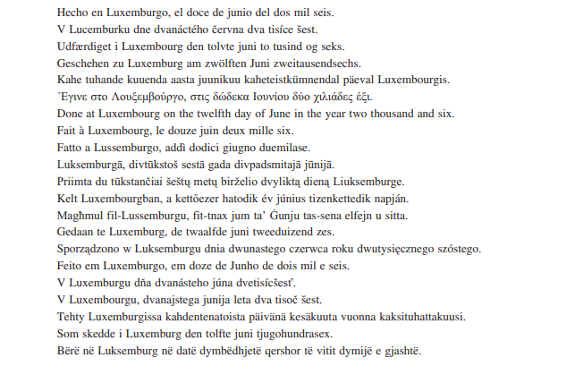

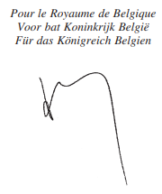

Cette signature engage également la Communauté française, la Communauté flamande, la Communauté germanophone, la Région wallonne, la Région flamande et la Région de Bruxelles-Capitale.

Deze handtekening verbindt eveneens de Vlaamse Gemeenschap, de Franse Gemeenschap, de Duitstalige Gemeenschap, het Vlaamse Gewest, het Waalse Gewest en het Brussels Hoofdstedelijk Gewest.

Diese Unterschrift bindet zugleich die Deutschsprachige Gemeinschaft, die Flämische Gemeinschaft, die Französische Gemeinschaft, die Wallonische Region, die Flämische Region und die Region Brüssel-Hauptstadt.

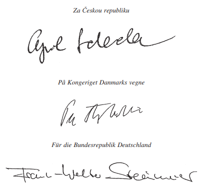

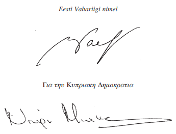

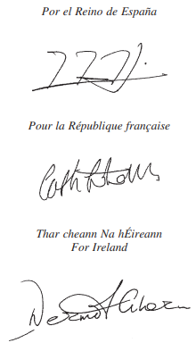

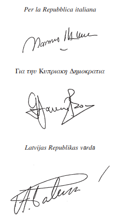

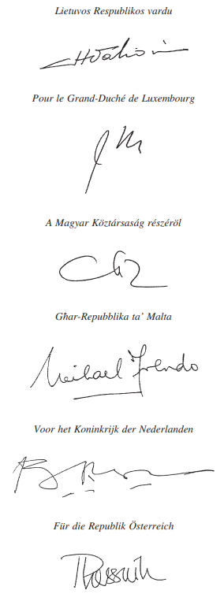

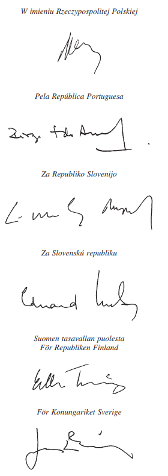

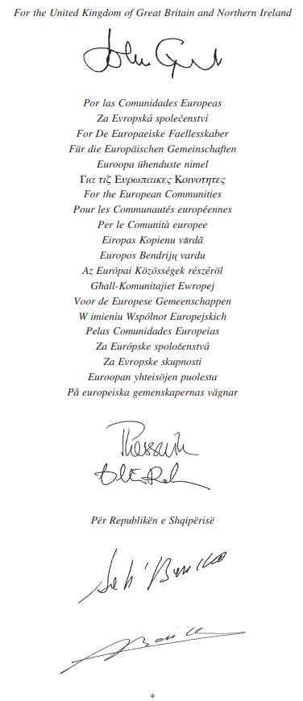

\**ACTE FINAL**

Les plénipotentiaires:

\*Le Royaume de Belgique,*

\*La République tchèque,*

\*Le Royaume de Danemark,*

\*La République fédérale d’Allemagne,*

\*La République d’Estonie,*

\*La République hellénique,*

\*Le Royaume d’Espagne,*

\*La République française,*

\*L’Irlande,*

\*La République italienne,*

\*La République de Chypre,*

\*La République de Lettonie,*

\*La République de Lituanie,*

\*Le Grand-Duché de Luxembourg,*

\*La République de Hongrie,*

\*La République de Malte,*

\*Le Royaume des Pays-Bas,*

\*La République d’Autriche,*

\*La République de Pologne,*

\*La République portugaise,*

\*La République de Slovénie,*

\*La République slovaque,*

\*La République de Finlande,*

\*Le Royaume de Suède,*

\*Le Royaume-Uni de Grande-Bretagne et d’Irlande du Nord,*

parties contractantes au traité instituant la Communauté européenne, au traité instituant la Communauté européenne de l’énergie atomique, et au traité sur l’Union européenne,

ci-après dénommés «Etats membres», et

\*La Communauté européenne et la Communauté européenne de l’énergie atomique,*

ci-après dénommées «*la Communauté*»,

d’une part, et

\*les plénipotentiaires de la République d’Albanie,*

d’autre part,

réunis à Luxembourg le douze juin deux mille six pour la signature de l’accord de stabilisation et d’association entre les Communautés européennes et leurs Etats membres, d’une part, et la République d’Albanie, d’autre part, ci-après dénommé «l’accord», ont adopté les textes suivants:

<table>
<tr>
<td colspan="3">l’accord et ses annexes I à V, à savoir:</td>
</tr>
<tr>
<td>Annexe I</td>
<td>–</td>
<td>Concessions tarifaires albanaises pour des produits industriels communautaires</td>
</tr>
<tr>
<td>Annexe II a)</td>
<td>–</td>
<td>Concessions tarifaires albanaises en faveur des produits agricoles primaires originaires de la Communauté (visés à l’article 27, paragraphe 3, point a))</td>
</tr>
<tr>
<td>Annexe II b)</td>
<td>–</td>
<td>Concessions tarifaires albanaises en faveur des produits agricoles primaires originaires de la Communauté (visés à l’article 27, paragraphe 3, point b))</td>
</tr>
<tr>
<td>Annexe II c)</td>
<td>–</td>
<td>Concessions tarifaires de l’Albanie pour des produits agricoles primaires originaires de la Communauté (visés à l’article 27, paragraphe 3, point c))</td>
</tr>
<tr>
<td>Annexe III</td>
<td>–</td>
<td>Concessions communautaires pour des produits de la pêche albanais</td>
</tr>
<tr>
<td>Annexe IV</td>
<td>–</td>
<td>Etablissement: services financiers</td>
</tr>
<tr>
<td>Annexe V</td>
<td>–</td>
<td>Droits de propriété intellectuelle, industrielle et commerciale</td>
</tr>
</table>

et les protocoles suivants:

Protocole No 1 relatif aux produits sidérurgiques

Protocole No 2 relatif au commerce entre l’Albanie et la Communauté dans le secteur des produits agricoles transformés

Protocole No 3 concernant l’établissement de concessions préférentielles réciproques pour certains vins, la reconnaissance, la protection et le contrôle réciproques des dénominations de vins, de spiritueux et de vins aromatisés

Protocole No 4 relatif à la définition de la notion de «produits originaires» et aux méthodes de coopération administrative

Protocole No 5 relatif aux transports terrestres

Protocole No 6 relatif à l’assistance administrative mutuelle en matière douanière

Les plénipotentiaires des Etats membres et de la Communauté et les plénipotentiaires de la République d’Albanie ont adopté les déclarations communes suivantes, jointes au présent acte final:

ont adopté les déclarations communes suivantes, jointes au présent acte final:

Déclaration commune relative aux articles 22 et 29 de l’accord

Déclaration commune relative à l’article 41 de l’accord

Déclaration commune relative à l’article 46 de l’accord

Déclaration commune relative à l’article 48 de l’accord

Déclaration commune relative à l’article 61 de l’accord

Déclaration commune relative à l’article 73 de l’accord

Déclaration commune relative à l’article 80 de l’accord

Déclaration commune relative à l’article 126 de l’accord

Déclaration commune relative à l’immigration légale, à la libre circulation et aux droits des travailleurs

Déclaration commune relative à la Principauté d’Andorre concernant le protocole No 4 de l’accord

Déclaration commune relative à la République de Saint-Marin concernant le protocole No 4 de l’accord

Déclaration commune relative au protocole No 5 de l’accord

Les plénipotentiaires de la République d’Albanie ont pris acte de la déclaration suivante de la Communauté, jointe au présent acte final:

Déclaration de la Communauté relative aux mesures commerciales exceptionnelles accordées par la Communauté sur la base du [règlement (CE) No 2007/2000](https://legilux.public.lu/eli/reg_ue/2000/2007/jo).

Cette signature engage également la Communauté française, la Communauté flamande, la Communauté germanophone, la Région wallonne, la Région flamande et la Région de Bruxelles-Capitale.

Deze handtekening verbindt eveneens de Vlaamse Gemeenschap, de Franse Gemeenschap, de Duitstalige Gemeenschap, het Vlaamse Gewest, het Waalse Gewest en het Brussels Hoofdstedelijk Gewest.

Diese Unterschrift bindet zugleich die Deutschsprachige Gemeinschaft, die Flämische Gemeinschaft, die Französische Gemeinschaft, die Wallonische Region, die Flämische Region und die Region Brüssel-Hauptstadt.

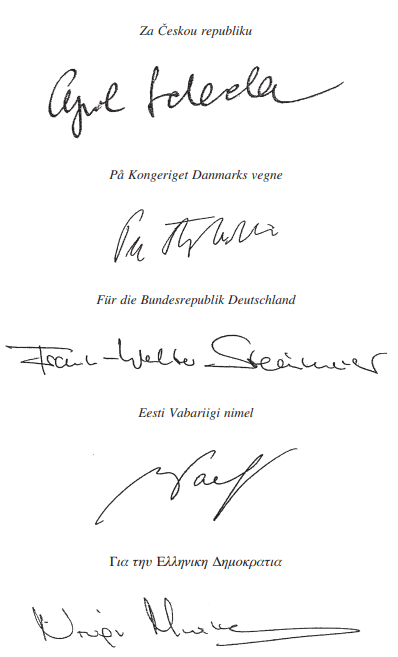

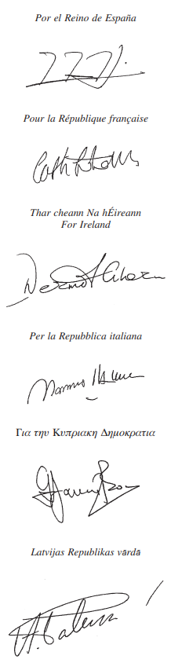

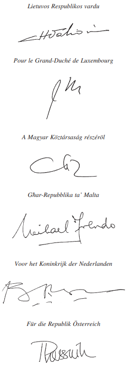

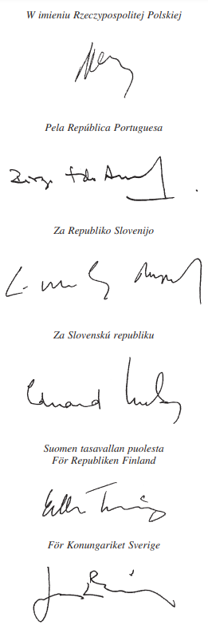

\**DECLARATIONS COMMUNES**

\**Déclaration commune relative aux articles 22 et 29 de l’accord**

Les parties déclarent que dans la mise en œuvre des articles 22 et 29, elles examineront, au sein du conseil de stabilisation et d’association, l’incidence de tout accord préférentiel négocié par l’Albanie avec des pays tiers (à l’exclusion des pays couverts par le processus communautaire de stabilisation et d’association et d’autres pays limitrophes qui ne sont pas membres de l’Union européenne). Cet examen permettra un ajustement des concessions albanaises vis-à-vis de la Communauté s’il s’avère que l’Albanie offre des concessions sensiblement plus avantageuses à ces pays.

\**Déclaration commune relative à l’article 41 de l’accord**

1\. La Communauté se déclare prête à examiner, au sein du conseil de stabilisation et d’association, la question de la participation de l’Albanie au cumul diagonal des règles d’origine aussitôt que les conditions économiques, commerciales et autres conditions relatives à l’octroi du cumul diagonal auront été établies.

2\. A cet effet, l’Albanie se déclare prête à créer des zones de libre-échange avec, notamment, les autres pays couverts par le processus de stabilisation et d’association de l’Union européenne.

\**Déclaration commune relative à l’article 46 de l’accord**

Il est entendu que le terme «enfants» est défini selon la législation nationale du pays d’accueil concerné.

\**Déclaration commune relative à l’article 48 de l’accord**

Il est entendu que les termes «membres de leur famille» sont définis selon la législation nationale du pays d’accueil concerné.

\**Déclaration commune relative à l’article 61 de l’accord**

Les parties conviennent que les dispositions prévues à l’article 61 ne sont pas conçues de manière à empêcher des restrictions équitables et non discriminatoires à l’acquisition de biens immobiliers reposant sur l’intérêt général, pas plus qu’elles n’affectent autrement les règles des parties régissant la possession de biens immobiliers, sauf dans les cas expressément spécifiés.

Il est entendu que l’acquisition de biens immobiiers par les ressortissants albanais est autorisée dans les Etats membres de l’Union européenne conformément à la législation communautaire en vigueur, sous réserve d’exceptions spécifiques autorisées par cette législation, et est mise en œuvre dans le respect de la législation nationale applicable dans les Etats membres de l’Union européenne.

\**Déclaration commune relative à l’article 73 de l’accord**

Les parties conviennent que, aux fins de l’accord, les termes «propriété intellectuelle, industrielle et commerciale» comprennent, en particulier, la protection des droits d’auteur, y compris de logiciels, et des droits voisins, des droits relatifs aux bases de données, brevets, dessins et modèles, marques de commerce et de service, topographies de circuits intégrés et indications géographiques, y compris des appellations d’origine, ainsi que la protection contre la concurrence déloyale visée à l’article 10bis de la convention de Paris pour la protection de la propriété industrielle et la protection des informations non divulguées en matière de savoir-faire.

\**Déclaration commune relative à l’article 80 de l’accord**

Les parties mesurent l’importance que la population et le gouvernement albanais attachent à la perspective d’un assouplissement du régime des visas. Cependant, l’évolution de la situation dépend de la mise en œuvre par l’Albanie de réformes majeures dans des domaines tels que la consolidation de l’Etat de droit, la lutte contre la criminalité organisée, la corruption et l’immigration clandestine, ainsi que le renforcement de ses capacités administratives pour les contrôles aux frontières et la sécurité des documents.

\**Déclaration commune relative à l’article 126 de l’accord**

1\. Les parties conviennent que, en vue de l’interprétation correcte et de l’application pratique de l’accord, par les termes «cas d’urgence spéciale» figurant à l’article 126 de l’accord, on entend un cas de violation substantielle de l’accord par l’une des parties. Une violation substantielle de l’accord consiste:

– dans le rejet de l’accord non sanctionné par les règles générales du droit international et

– en une violation des éléments essentiels de l’accord, notamment de son article 2.

2\. Les parties conviennent que les «mesures appropriées» mentionnées à l’article 126 constituent des mesures prises conformément au droit international. Si, en vertu de l’article 126, une partie adopte une mesure dans un cas d’urgence spéciale, l’autre partie peut faire usage de la procédure de règlement des différends.

\**Déclaration commune relative à l’immigration légale, à la libre circulation et aux droits des travailleurs**

L’octroi, le renouvellement ou le refus du permis de séjour est régi par la législation de chaque Etat membre ainsi que par les accords et conventions bilatéraux en vigueur entre l’Albanie et l’Etat membre concerné.

\**Déclaration commune relative à la Principauté d’Andorre concernant le protocole No 4 de l’accord**

1\. Les produits originaires de la Principauté d’Andorre et relevant des chapitres 25 à 97 du système harmonisé sont acceptés par l’Albanie comme produits originaires de la Communauté au sens de l’accord.

2\. Le protocole No 4 s’applique mutatis mutandis pour la définition du caractère originaire des produits mentionnés ci-dessus.

\**Déclaration commune relative à la République de Saint-Marin  concernant le protocole No 4 de l’accord**

1\. Les produits originaires de la République de Saint-Marin sont acceptés par l’Albanie comme produits originaires de la Communauté au sens de l’accord.

2\. Le protocole No 4 s’applique mutatis mutandis pour la définition du caractère originaire des produits mentionnés ci-dessus.

\**Déclaration commune relative au protocole No 5 de l’accord**

1\. La Communauté et l’Albanie notent que les niveaux d’émission de gaz et de bruit communément admis par la Communauté aux fins de la réception par type des poids lourds à compter du 1.1.2001 sont les suivants:

\*Valeurs limites mesurées en fonction de l’essai européen en modes stabilisés (ESC)  et de l’essai européen de prises en charges dynamiques (ELR)*

|  |  | *Masse de monoxyde de carbone* | *Masse des hydrocar bures* | *Masse des oxydes d’azote* | *Masse des particules* | *Fumées* |
|---|---|---|---|---|---|---|
|  |  | (CO) g/kWh | (HC) g/kWh | (NOx) g/kWh | (PT) g/kWh | m-1 |
| Ligne A | Euro III | 2.1 | 0.66 | 5.0 | 0.13(a) 0.10 | 0.8 |

(a) Pour des moteurs dont la cylindrée unitaire est inférieure à 0,75 dm3 et le régime nominal est supérieur à 3.000 tr/min-1.

\*Valeurs limites mesurées en fonction de l’essai européen en cycle transitoire (ETC):*

|  |  | *Masse de monoxyde de carbone* | *Masse des hydrocar bures* *non méthaniques* | *Masse de méthane* | *Masse des oxydes d’azote* | M*asse des particules* |
|---|---|---|---|---|---|---|
|  |  | (CO) g/kWh | (HCNM) | (CH4)(b) g/kWh | (NOx) g/kWh | (PT)(c) g/kWh |
| Ligne A | Euro III | 5.45 | 0.78 | 1.6 | 5.0 | 0.16 0.21(a) |

(a) Pour des moteurs dont la cylindrée unitaire est inférieure à 0,75 dm3 et le régime nominal est supérieur à 3.000 tr/min-1.

(b) Pour des moteurs fonctionnant au gaz naturel uniquement.

(c) Sans objet pour des mesures effectuées sur des moteurs fonctionnant au gaz.

2\. La Communauté et l’Albanie s’efforceront, à l’avenir, de réduire les émissions des véhicules à moteur en utilisant des dispositifs antipollution dernier cri et des carburants de meilleure qualité.

\**DECLARATION DE LA COMMUNAUTE**

\**Déclaration de la Communauté relative aux mesures commerciales exceptionnelles accordées par la Communauté européenne sur la base du règlement (CE) No 2007/2000**

Etant donné que des mesures commerciales exceptionnelles sont accordées par la Communauté aux pays participant ou liés au processus de stabilisation et d’association de l’Union européenne, et notamment l’Albanie, sur la base du règlement (CE) No 2007/2000 du Conseil du 18 septembre 2000 introduisant des mesures commerciales exceptionnelles en faveur des pays et territoires participants et liés au processus de stabilisation et d’association mis en œuvre par l’Union européenne, la Communauté déclare:

– qu’en application de l’article 30 de l’accord, les mesures commerciales autonomes unilatérales les plus favorables s’appliqueront en plus des concessions commerciales contractuelles offertes par la Communauté dans l’accord, dès lors que le [règlement (CE) No 2007/2000](https://legilux.public.lu/eli/reg_ue/2000/2007/jo) du Conseil, tel que modifié, s’applique;

– que, notamment, pour les produits couverts par les chapitres 7 et 8 de la nomenclature combinée, pour lesquels le tarif douanier commun prévoit l’application de droits de douane ad valorem et un droit de douane spécifique, la réduction s’appliquera également au droit de douane spécifique, par dérogation à la disposition correspondante de l’article 27, paragraphe 1, de l’accord.

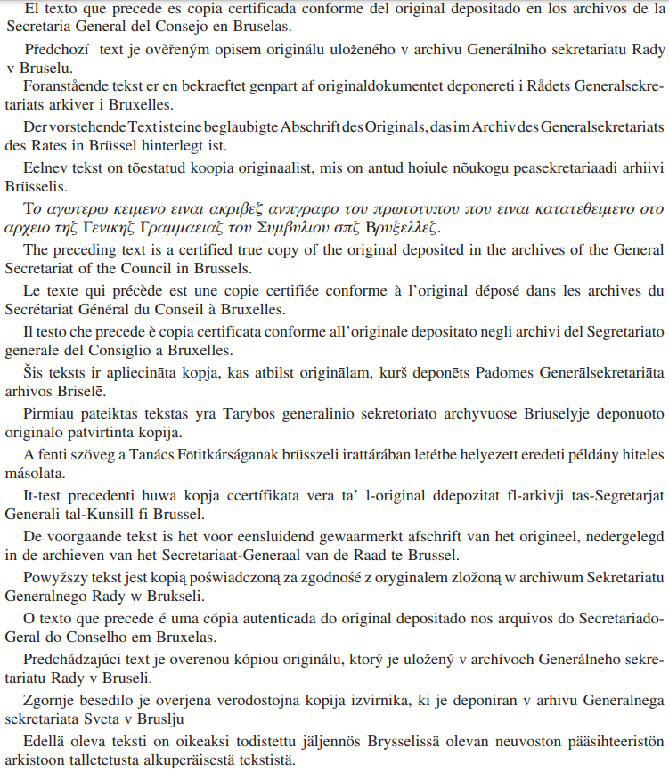

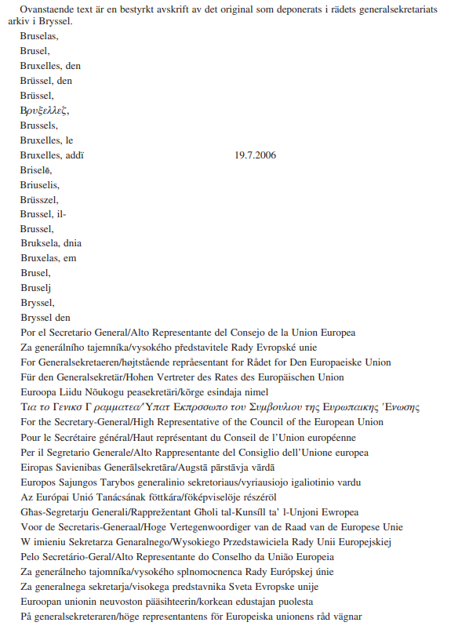

R. Cooper   Directeur général

\**LISTE DES ANNEXES**

| Annexe I | – | Concessions tarifaires albanaises pour des produits industriels communautaires |
|---|---|---|
| Annexe II a) | – | Concessions tarifaires albanaises en faveur des produits agricoles primaires originaires de la Communauté (visés à l’article 27, paragraphe 3, point a)) |
| Annexe II b) | – | Concessions tarifaires albanaises en faveur des produits agricoles primaires originaires de la Communauté (visés à l’article 27, paragraphe 3, point b)) |
| Annexe II c) | – | Concessions tarifaires de l’Albanie pour des produits agricoles primaires originaires de la Communauté (visés à l’article 27, paragraphe 3, point c)) |
| Annexe III | – | Concessions communautaires pour des produits de la pêche albanais |
| Annexe IV | – | Etablissement: services financiers |
| Annexe V | – | Droits de propriété intellectuelle, industrielle et commerciale |

ANNEXE I

\**Concessions tarifaires albanaises pour des produits industriels communautaires  (visés à l’article 19)**

Les taux de droit sont réduits comme suit:

– à la date d’entrée en vigueur de l’accord, le droit à l’importation sera ramené à 80% du droit de base;

– au 1er janvier de la première année suivant la date d’entrée en vigueur de l’accord, le droit à l’importation sera ramené à 60% du droit de base;

– au 1er janvier de la deuxième année suivant la date d’entrée en vigueur de l’accord, le droit à l’importation sera ramené à 40% du droit de base;

– au 1er janvier de la troisième année suivant la date d’entrée en vigueur de l’accord, le droit à l’importation sera ramené à 20% du droit de base;

– au 1er janvier de la quatrième année suivant la date d’entrée en vigueur de l’accord, le droit à l’importation sera ramené à 10% du droit de base;

– au 1er janvier de la cinquième année suivant la date d’entrée en vigueur de l’accord, les droits à l’importation restants seront éliminés.

| *SH 8+* | *Description des produits* |
|---|---|
| 2501 00 91 | - - - - Sel propre à l’alimentation humaine |
| 2523 | Ciments hydrauliques (y compris les ciments non pulvérisés dits „clinkers“), même colorés |
| 2710 11 25 | - - - - - autres essences spéciales |
| 2710 11 41 | - - - - - - - Essences pour moteur, d’une teneur en plomb n’excédant pas 0,013 g/l, avec un indice d’octane (IOR) de moins de 95 |
| 2710 11 70 | - - - - Carburéacteurs, type essence |
|  | - - - - Pétrole lampant |
| 2710 19 21 | - - - - - Carburéacteurs |
| 2710 19 25 | - - - - - autres |
| 2710 19 29 | - - - - autres huiles moyennes |
|  | - - - - Gazole |
| 2710 19 31 | - - - - Gazole destiné à subir un traitement défini |
| 2710 19 35 | - - - - Gazole destiné à subir une transformation chimique par un traitement autre que ceux définis pour la sous-position 2710 19 31 |
|  | - - - - destiné à d’autres usages: |
| 2710 19 41 | - - - - - d’une teneur en poids de soufre n’excédant pas 0,05% |
| 2710 19 45 | - - - - - d’une teneur en poids de soufre excédant 0,05% mais n’excédant pas 0,2% |
| 2710 19 49 | - - - - - Gazole destiné à d’autres usages d’une teneur en poids de soufre excédant 0,2% |
| 2710 19 69 | - - - - - Fuel oils destinés à d’autres usages d’une teneur en poids de soufre excédant 2,8% |
| 2713 12 00 | - Coke de pétrole, calciné |
| 2713 20 00 | - autres résidus des huiles de pétrole ou de minéraux bitumineux: |
| 2713 90 10 | - - destinés à la fabrication des produits du No 2803 |
| 2713 90 90 | - - autres |
| 3103 10 10 | - - d’une teneur en pentaoxyde de diphosphore supérieure à 35% en poids |
| 3103 10 90 | - - autres |
| 3304 91 00 | - - Poudres, y compris les poudres compactes |
| 3304 99 00 | - - autres |
| 3305 10 00 | - Shampooings |
| 3305 30 00 | - Laques pour cheveux |
| 3305 90 10 | - - Lotions capillaires |
| 3305 90 90 | - - autres |
| 3306 10 00 | - Dentifrices |
| 3307 10 00 | - Préparations pour le prérasage, le rasage ou l’après-rasage |
| 3307 20 00 | - Désodorisants corporels et antisudoraux |
| 3401 11 00 | - - Savons de toilette (y compris ceux à usages médicaux) |
| 3401 19 00 | - - autres |
| 3401 20 10 | - - Savons en flocons, paillettes, granulés ou poudres |
| 3401 20 90 | - - autres |
| 3402 20 20 | - - Préparations tensioactives |
| 3402 20 90 | - - Préparations pour lessives et préparations de nettoyage |
| 3402 90 10 | - - Préparations tensioactives |
| 3405 20 00 | - Encaustiques et préparations similaires pour l’entretien des meubles en bois, des parquets ou d’autres boiseries |
| 3405 30 00 | - Brillants et préparations similaires pour carrosseries, autres que les brillants pour métaux |
| 3405 90 90 | - - autres |
| 3923 10 00 | - Boîtes, caisses, casiers et articles similaires |
|  | - Sacs, sachets, pochettes et cornets: |
| 3923 21 00 | - - en polymères de l’éthylène |
| 3923 29 | - - en autres matières plastiques: |
| 3923 29 10 | - - - en polychlorure de vinyle |
| 3923 29 90 | - - - autres |
| 3924 | Vaisselle, autres articles de ménage ou d’économie domestique et articles d’hygiène ou de toilette, en matières plastiques: |
| 3924 10 00 | - Articles pour le service de la table ou de la cuisine |
| 3924 90 | - autres: |
|  | - - en cellulose régénérée: |
| 3924 90 11 | - - - Eponges |
| 3924 90 19 | - - - autres |
| 3924 90 90 | - - autres |
| 3925 10 00 | - Réservoirs, foudres, cuves et récipients analogues, d’une contenance excédant 300 l |
| 3926 | Autres ouvrages en matières plastiques et ouvrages en autres matières des Nos 3901 à 3914 |
|  | - Pneumatiques rechapés |
| 4012 11 00 | - - des types utilisés pour les voitures de tourisme (y compris les voitures du type „break“ et les voitures de course) |
| 4012 12 00 | - - des types utilisés pour les autobus et les camions |
| 4012 13 90 | - - - autres |
| 4012 20 90 | - - autres |
| 4012 90 20 | - - Bandages pleins ou creux (mi-pleins) |
| 6401 10 | - Chaussures comportant, à l’avant, une coquille de protection en métal: |
| 6401 10 10 | - - à dessus en caoutchouc |
| 6401 10 90 | - - à dessus en matière plastique |
|  | - autres chaussures: |
| 6401 91 | - - couvrant le genou: |
| 6401 91 10 | - - - autres chaussures couvrant le genou à dessus en caoutchouc |
| 6401 91 90 | - - - autres chaussures couvrant le genou à dessus en matière plastique |
| 6401 92 | - - couvrant la cheville mais ne couvrant pas le genou: |
| 6401 92 10 | - - - autres chaussures couvrant la cheville mais ne couvrant pas le genou à dessus en matière plastique |
| 6401 99 | - - autres: |
| 6401 99 10 | - - - autres chaussures à dessus en caoutchouc |
| 6401 99 90 | - - - autres chaussures à dessus en matière plastique |
| 6402 99 50 | - - - - Pantoufles et autres chaussures d’intérieur |
| 6404 19 90 | - - - autres |
| 6404 20 | - Chaussures à semelles extérieures en cuir naturel ou reconstitué |
| 6404 20 10 | - - Pantoufles et autres chaussures d’intérieur |
| 6404 20 90 | - - autres |
| 6405 | autres chaussures: |
| 6405 10 | - à dessus en cuir naturel ou reconstitué: |
| 6405 10 10 | - - autres chaussures à dessus en cuir naturel ou reconstitué, à semelles extérieures en bois ou en liège |
| 6405 10 90 | - - autres chaussures à dessus en cuir naturel ou reconstitué, à semelles extérieures en d’autres matières |
| 6405 20 | - à dessus en matières textiles: |
| 6405 20 10 | - - à semelles extérieures en bois ou en liège |
|  | - - à semelles extérieures en autres matières: |
| 6405 20 91 | - - - Pantoufles et autres chaussures d’intérieur |
| 6405 20 99 | - - - autres |
| 6405 90 | - autres |
| 6405 90 10 | - - à semelles extérieures en caoutchouc, en matière plastique, en cuir naturel ou reconstitué |
| 6405 90 90 | - - à semelles extérieures en autres matières |
| 6406 | Parties de chaussures (y compris les dessus même fixés à des semelles autres que les semelles extérieures); semelles intérieures amovibles, talonnettes et articles similaires amovibles; guêtres, jambières et articles similaires, et leurs parties: |
| 6406 10 | - Dessus de chaussures et leurs parties, à l’exclusion des contreforts et bouts durs: |
|  | - - en cuir naturel: |
| 6406 10 11 | - - - Dessus |
| 6406 10 19 | - - - Parties de dessus |
| 6406 10 90 | - - en autres matières |
| 6904 | Briques de construction, hourdis, cache-poutrelles et articles similaires, en céramique: |
| 6904 10 00 | - Briques de construction en céramique |
| 6904 90 00 | - autres |
| 6905 | Tuiles, éléments de cheminée, conduits de fumée, ornements architectoniques, en céramique, et autres poteries de bâtiment: |
| 6905 10 00 | - Tuiles |
| 6905 90 00 | - autres |
| 6907 | Carreaux et dalles de pavement ou de revêtement, non vernissés ni émaillés, en céramique; cubes, dés et articles similaires pour mosaïques, non vernissés ni émaillés, en céramique, même sur support: |
| 6908 | Carreaux et dalles de pavement ou de revêtement, vernissés ou émaillés, en céramique; cubes, dés et articles similaires pour mosaïques, vernissés ou émaillés, en céramique, même sur support: |
| 7213 10 00 | - comportant des indentations, bourrelets, creux ou reliefs obtenus au cours du laminage (CECA) |
| 7213 91 10 | - - - du type utilisé pour armature pour béton |
| 7213 91 20 | - - - du type utilisé pour le renforcement des pneumatiques |
|  | - - - autres |
| 7213 91 41 | - - - - contenant en poids 0,06% ou moins de carbone |
| 7213 91 49 | - - - - contenant en poids plus de 0,06% mais moins de 0,25% de carbone |
| 7213 91 70 | - - - - contenant en poids 0,25% ou plus mais pas plus de 0,75% de carbone |
| 7213 91 90 | - - - - contenant en poids plus de 0,75% de carbone |
| 7213 99 | - - autres: |
| 7213 99 10 | - - - contenant en poids moins de 0,25% de carbone |
| 7214 10 00 | - forgées |
| 7214 20 00 | - comportant des indentations, bourrelets, creux ou reliefs obtenus au cours du laminage ou ayant subi une torsion après laminage |
| 7214 91 10 | - - - contenant en poids moins de 0,25% de carbone |
| 7214 91 90 | - - - contenant en poids 0,25% ou plus de carbone (CECA) |
| 7214 99 | - - autres: |
|  | - - - contenant en poids moins de 0,25% de carbone: |
| 7214 99 10 | - - - du type utilisé pour armature pour béton |
|  | - - - - autres, de section circulaire d’un diamètre: |
| 7214 99 31 | - - - - de 80 mm ou plus |
| 7214 99 39 | - - - - inférieure à 80 mm |
| 7214 99 50 | - - - - autres |
|  | - - - contenant en poids 0,25% ou plus mais moins de 0,6% de carbone: |
|  | - - - - de section circulaire d’un diamètre: |
| 7214 99 61 | - - - - de 80 mm ou plus |
| 7214 99 69 | - - - - inférieure à 80 mm |
| 7214 99 80 | - - - - autres |
| 7214 99 90 | - - - contenant en poids 0,6% ou plus de carbone |
| 7306 60 31 | - - - - n’excédant pas 2 mm |
| 7306 60 39 | - - - - excédant 2 mm |
| 7306 60 90 | - - - d’autres sections |
| 7306 90 00 | - autres |
| 7326 90 97 00 | - - - autres |
| 7408 11 00 | - - dont la plus grande dimension de la section transversalé excède 6 mm |
| 7408 19 | - - autres: |
| 7408 19 10 | - - - dont la plus grande dimension de la section transversalé excède 0,5 mm |
| 7408 19 90 | - - - dont la plus grande dimension de la section transversalé n’excède pas 0,5 mm |
| 7413 00 91 | - - en cuivre affiné |
| 8544 | Fils, câbles (y compris les câbles coaxiaux) et autres conducteurs isolés pour l’électricité (même laqués ou oxydés anodiquement), munis ou non de pièces de connexion; câbles de fibres optiques, constitués de fibres gainées individuellement, même comportant des conducteurs électriques ou munis de pièces de connexion |
|  | - Fils pour bobinages: |
| 8544 11 | - - en cuivre: |
| 8544 11 10 | - - - émaillés ou laqués |
| 8544 11 90 | - - - autres |
| 8544 19 | - - autres: |
| 8544 19 10 | - - - émaillés ou laqués |
| 8544 19 90 | - - - autres |
| 8544 20 00 | - Câbles coaxiaux et autres conducteurs électriques coaxiaux |
| 8544 59 10 | - - - Fils et câbles, d’un diamètre de brin excédant 0,51 mm |
|  | - - - autres |
| 8544 59 20 | - - - - pour une tension de 1.000 V |
| 8544 59 80 | - - - - pour tensions excédant 80 V mais inférieures à 1.000 V |
| 8544 60 | - autres conducteurs électriques, pour tensions excédant 1.000 V: |
| 8544 60 10 | - - avec conducteur en cuivre |
| 8544 60 90 | - - avec autres conducteurs |
| 9403 30 | - Meubles en bois des types utilisés dans les bureaux: |
|  | - - d’une hauteur n’excédant pas 80 cm: |
| 9403 30 11 | - - - Bureaux |
| 9403 30 19 | - - - autres |
|  | - - d’une hauteur excédant 80 cm: |
| 9403 30 91 | - - - Armoires à portes, à volets ou à clapets; armoires à tiroirs, classeurs et fichiers |
| 9403 30 99 | - - - autres |
| 9403 40 | - Meubles en bois des types utilisés dans les cuisines: |
| 9403 40 10 | - - Eléments de cuisines |
| 9403 40 90 | - - autres |
| 9403 60 30 | - - Meubles en bois des types utilisés dans les magasins |

ANNEXE II a)

\**Concessions tarifaires albanaises en faveur des produits agricoles primaires originaires de la Communauté**

\**(visés à l’article 27, paragraphe 3, point a))**

\*Franchise de droits pour des quantités illimitées à la date d’entrée en vigueur de l’accord*

| *Code SH* | *Description* |
|---|---|
| 0101.10.10 | Chevaux reproducteurs de race pure |
| 0101.10.90 | Anes reproducteurs de race pure |
| 0102.10.10 | Génisses (bovins femelles qui n’ont jamais vêlé), destinées à la reproduction, animaux reproducteurs de race pure |
| 0102.10.30 | Vaches (à l’exclusion des génisses), bovins femelles destinées à la reproduction, animaux reproducteurs de race pure |
| 0102.10.90 | Bovins (à l’exclusion des génisses et des vaches), reproducteurs de race pure |
| 0102.90.29 | Bovins vivants d’espèce domestique d’un poids > 80 kg mais < = 160 kg (à l’exclusion des animaux destinés à la boucherie et des reproducteurs de race pure) |
| 0103.10.00 | Porcins reproducteurs de race pure |
| 0103.91.10 | Porcins d’espèce domestique, d’un poids < 50 kg (à l’exclusion des reproducteurs de race pure) |
| 0103.91.90 | Porcins vivants d’espèce non domestique, d’un poids < 50 kg |
| 0103.92.11 | Truies vivantes, ayant mis bas au moins une fois et d’un poids > = 160 kg (à l’exclusion des reproducteurs de race pure) |
| 0103.92.19 | Truies vivantes d’espèce domestique, d’un poids > = 50 kg (à l’exclusion des truies ayant mis bas au moins une fois et d’un poids supérieur ou égal à 160 kg et des reproducteurs de race pure) |
| 0103.92.90 | Porcins vivants d’espèce non domestique, d’un poids > = 50 kg |
| 0104.10.10 | Ovins reproducteurs de race pure |
| 0104.10.30 | Agneaux jusqu’à l’âge d’un an (à l’exclusion des reproducteurs de race pure) |
| 0104.10.80 | Ovins vivants (à l’exclusion des agneaux et des reproducteurs de race pure) |
| 0104.20.10 | Caprins reproducteurs de race pure |
| 0104.20.90 | Caprins vivants (à l’exclusion des reproducteurs de race pure) |
| 0105.11.11 | Poussins femelles de sélection et de multiplication, de poules de race de ponte, d’un poids < = 185 g |
| 0105.11.19 | Poussins femelles de sélection et de multiplication, d’un poids < = 185 g (à l’exclusion des races de ponte) |
| 0105.11.91 | Coq, poules, de race de ponte, d’un poids < = 185 g (à l’exclusion des poussins femelles de sélection et de multiplication) |
| 0105.11.99 | Poules vivantes, d’un poids < = 185 g (à l’exclusion des dindes et dindons, pintades, poussins femelles de sélection et de multiplication et de races de ponte) |
| 0105.12.00 | Dindes et dindons domestiques vivants, d’un poids < = 185 g |
| 0105.19.20 | Oies domestiques vivantes, d’un poids < = 185 g |
| 0105.19.90 | Canards et pintades domestiques vivants, d’un poids < = 185 g |
| 0105.92.00 | Coqs et poules d’un poids supérieur à 185 g mais < = 2 kg |
| 0106.11.00 | Primates vivants |
| 0106.19.10 | Lapins domestiques vivants |
| 0106.19.90 | Animaux vivants (à l’exclusion des primates, baleines, dauphins et marsouins (mammifères de l’ordre des cétacés),; lamantins et dugongs (mammifères de l’ordre des siréniens)); chevaux, ânes, mulets et bardots, bovins, porcins, ovins, caprins et lapins domestiques |
| 0106.20.00 | Reptiles vivants, c’est-à-dire serpents, tortues de mer, alligators, caïmans, iguanes, gavials et lézards |
| 0106.31.00 | Oiseaux de proie vivants |
| 0106.32.00 | Psittaciformes vivants, y compris les perroquets, perruches, aras et cacatoes |
| 0106.39.10 | Pigeons vivants |
| 0106.39.90 | Oiseaux vivants (à l’exclusion des oiseaux de proie, psittaciformes vivants, y compris les perroquets, perruches, aras et cacatoes et les pigeons) |
| 0106.90.00 | Animaux vivants (à l’exclusion des mammifères, reptiles, oiseaux, des poissons, crustacés, mollusques et autres invertébrés aquatiques ainsi que des cultures de micro-organismes et des produits similaires) |
| 0205.00.11 | Viandes de cheval, fraîches ou congelées |
| 0205.00.19 | Viandes de cheval, congelées |
| 0205.00.20 | Viandes fraîches ou réfrigérées |
| 0205.00.80 | Viandes de cheval, congelées |
| 0205.00.90 | Viandes d’ânes, de mulets et bardots, fraîches, réfrigérées ou congelées |
| 0206.10.10 | Abats comestibles de bovins, destinés à la fabrication de produits pharmaceutiques, frais ou réfrigérés |
| 0206.29.10 | Abats comestibles de bovins, destinés à la fabrication de produits pharmaceutiques, congelés (à l’exclusion des langues et foies) |
| 0206.30.00 | Morceaux frais ou réfrigérés |
| 0206.41.00 | Foies comestibles congelés |
| 0206.80.10 | Abats comestibles d’ovins, caprins, chevaux, ânes, mulets et bardots, destinés à la fabrication de produits pharmaceutiques |
| 0206.90.10 | Abats comestibles d’ovins, caprins, chevaux, ânes, mulets et bardots, destinés à la fabrication de produits pharmaceutiques, congelés |
| 0404.10.02 | Lactosérum, modifié ou non, en poudre, en granulés ou sous d’autres formes solides, sans addition de sucre ou d’autres édulcorants, d’une teneur en poids de protéines [teneur en azote x 6,38] < = 15% et d’une teneur en poids de matières grasses < = 1,5% |
| 0404.10.04 | Lactosérum, modifié ou non, en poudre, en granulés ou sous d’autres formes solides, sans addition de sucre ou d’autres édulcorants, d’une teneur en poids de protéines [teneur en azote x 6,38] < = 15% et d’une teneur en poids de matières grasses > 1,5 mais < = 27% |
| 0404.10.06 | Lactosérum, modifié ou non, en poudre, en granulés ou sous d’autres formes solides, sans addition de sucre ou d’autres édulcorants, d’une teneur en poids de protéines [teneur en azote x 6,38] < = 15% et d’une teneur en poids de matières grasses > 27% |
| 0404.10.12 | Lactosérum, modifié ou non, en poudre, en granulés ou sous d’autres formes solides, sans addition de sucre ou d’autres édulcorants, d’une teneur en poids de protéines [teneur en azote x 6,38] > 15% et d’une teneur en poids de matières grasses < = 1,5% |
| 0404.10.14 | Lactosérum, modifié ou non, en poudre, en granulés ou sous d’autres formes solides, sans addition de sucre ou d’autres édulcorants, d’une teneur en poids de protéines [teneur en azote x 6,38] > 15% et d’une teneur en poids de matières grasses > 1,5 mais < = 27% |
| 0404.10.16 | Lactosérum, modifié ou non, en poudre, en granulés ou sous d’autres formes solides, sans addition de sucre ou d’autres édulcorants, d’une teneur en poids de protéines [teneur en azote x 6,38] > 15% et d’une teneur en poids de matières grasses > 27% |
| 0407.00.11 | Oeufs de dindes ou d’oies, à couver |
| 0407.00.19 | Oeufs de volailles de basse-cour, à couver (à l’exclusion des oeufs de dindes ou d’oies) |
| 0410.00.00 | Oeufs de tortues, nids de salanganes et autres produits comestibles d’origine animale, n.d.a. |
| 0504.00.00 | Boyaux, vessies et estomacs d’animaux (autres que ceux de poissons), entiers ou en morceaux |
| 0601.10.10 | Bulbes de jacinthes, en repos végétatif |
| 0601.10.20 | Bulbes de narcisses, en repos végétatif |
| 0601.10.30 | Bulbes de tulipes, en repos végétatif |
| 0601.10.40 | Bulbes de glaïeuls, en repos végétatif |
| 0601.10.90 | Bulbes, oignons, tubercules, racines tubéreuses, griffes et rhizomes, en repos végétatif (à l’exclusion des produits servant à l’alimentation humaine, des bulbes de jacinthes, de narcisses, de tulipes et de glaïeuls ainsi que des plants, plantes et racines de chicorée) |
| 0601.20.10 | Plants, plantes et racines de chicorée (à l’excl. des racines de chicorée de la variété „cichorium intybus sativum“) |
| 0601.20.30 | Orchidées, jacinthes, narcisses et tulipes, en végétation ou en fleur |
| 0601.20.90 | Bulbes, oignons, tubercules, racines tubéreuses, griffes et rhizomes, en végétation ou en fleur (à l’excl. des produits servant à l’alimentation humaine, des orchidées, des jacinthes, des narcisses, des tulipes ainsi que des plants, plantes et racines de chicorée) |
| 0602.10.90 | Boutures non racinées et greffons (autres que de vigne) |
| 0602.20.90 | Arbres, arbustes, arbrisseaux et buissons, à fruits comestibles, greffes ou non (à l’exclusion des plants de vigne) |
| 0602.30.00 | Rhododendrons et azalées, greffés ou non |
| 0602.40.10 | Rosiers, greffés ou non |
| 0602.40.90 | Rosiers greffés |
| 0602.90.10 | Blanc de champignons: |
| 0602.90.20 | Plants d’ananas |
| 0602.90.30 | Plants de légumes et plants de fraisiers |
| 0602.90.41 | Arbres, arbustes et arbrisseaux forestiers |
| 0602.90.45 | Boutures racinées et jeunes plants, d’arbres, arbustes et arbrisseaux de plein air (à l’exclusion des arbres, arbustes et arbrisseaux fruitiers et forestiers) |
| 0602.90.49 | Arbres, arbustes et arbrisseaux de plein air, y.c. leurs racines (à l’exclusion des boutures, greffons et jeunes plants ainsi que des arbres, arbustes et arbrisseaux fruitiers et forestiers) |
| 0602.90.51 | Plantes de plein air, vivaces |
| 0602.90.59 | Plantes de plein air, vivantes, y compris leurs racines, non dénommées ailleurs |
| 0602.90.70 | Boutures racinées et jeunes plants de plantes d’intérieur (à l’exclusion des cactées) |
| 0602.90.91 | Plantes d’intérieur à fleurs, en boutons ou en fleur (à l’exclusion des cactées) |
| 0602.90.99 | Plantes d’intérieur, vivantes (à l’exclusion des boutures et jeunes plants ainsi que des plantes à fleurs, en boutons ou en fleur) |
| 0701.10.00 | Pommes de terre de semence |
| 0703.20.00 | Ail, à l’état frais ou réfrigéré |
| 0705.21.00 | Witloofs „cichorium intybus var. Foliosum“, à l’état frais ou réfrigéré |
| 0706.90.30 | Raifort (cochlearia armoracia), à l’état frais ou réfrigéré |
| 0709.51.00 | Champignons du genre agaricus, à l’état frais ou réfrigéré |
| 0709.59.10 | Chanterelles, à l’état frais ou réfrigéré |
| 0709.59.30 | Cèpes, à l’état frais ou réfrigéré |
| 0709.59.90 | Champignons comestibles, à l’état frais ou réfrigéré (à l’exclusion des chanterelles, des cèpes, des champignons du genre agaricus et des truffes) |
| 0711.51.00 | Champignons du genre agaricus, conservés provisoirement (par exemple au moyen de gaz sulfureux ou dans de l’eau salée, soufrée ou additionnée d’autres substances servant à assurer provisoirement leur conservation), mais impropres à l’alimentation en l’état |
| 0711.90.10 | Piments du genre capsicum ou du genre pimenta, conservés provisoirement, mais impropres à l’alimentation en l’état (à l’exclusion des piments doux et des poivrons) |
| 0711.90.50 | Oignons, conservés provisoirement (par exemple au moyen de gaz sulfureux ou dans de l’eau salée, soufrée ou additionnée d’autres substances servant à assurer provisoirement leur conservation), mais impropres à l’alimentation en l’état |
| 0711.90.80 | Légumes conservés provisoirement (au moyen de gaz sulfureux ou dans de l’eau salée, soufrée ou additionnée d’autres substances servant à assurer provisoirement leur conservation, par exemple), mais impropres à l’alimentation en l’état à l’exclusion des olives, câpres, concombres, cornichons, champignons, truffes |
| 0712.31.00 | Champignons du genre agaricus, sèches, même coupés en morceaux ou en tranches ou bien broyés ou pulvérisés, mais non autrement préparés |
| 0712.32.00 | Oreilles-de-judas (auricularia spp.), séchées, même coupées en morceaux ou en tranches ou bien broyées ou pulvérisées, mais non autrement préparées |
| 0712.33.00 | Trémelles (tremella spp.), séchées, même coupées en morceaux ou en tranches ou bien broyées ou pulvérisées, mais non autrement préparées |
| 0712.39.00 | Champignons et truffes, sèches, même coupés en morceaux ou en tranches ou bien broyés ou pulvérises, mais non autrement préparés [à l’excl. des champignons du genre agaricus, des oreilles-de-judas (auricularia spp.) et des trémelles (tremella spp.)] |
| 0713.10.10 | „Pisum sativum“, secs, écossés, destinés à l’ensemencement |
| 0713.33.10 | Haricots communs „phaseolus vulgaris“, secs, écosses, destinés à l’ensemencement |
| 0713.40.00 | Lentilles, séchées, écossées, même décortiquées ou cassées |
| 0713.50.00 | Fèves (vicia faba var. Major) et féveroles (vicia faba var. Equina et vicia faba var. Minor), séchées, écossées, même décortiquées ou cassées |
| 0713.90.00 | Légumes à cosse secs, écossés |
| 0713.90.10 | Légumes à cosse secs, écossés, à ensemencer (à l’exclusion, des pois, des pois chiches, des haricots, des lentilles, des fèves et des féveroles) |
| 0713.90.90 | Légumes à cosse secs, écosses, même décortiqués ou cassés (à l’exclusion des graines destinées à l’ensemencement et des pois, des pois chiches, des haricots, des lentilles, des fèves et des féveroles) |
| 0714.10.10 | Pellets obtenus à partir de farines et semoules de racines de manioc |
| 0714.10.91 | Racines de manioc des types utilisés pour la consommation humaine, en emballages immédiats d’un contenu net < = 28 kg, soit fraîches et entières, soit congelées sans peau, même coupées en morceaux |
| 0714.10.99 | Racines de manioc, fraîches ou séchées, même débitées en morceaux (à l’exclusion des positions 0714.10.10 et 0714.10.91) |
| 0714.20.10 | Patates douces, fraîches, entières, destinées à la consommation humaine |
| 0714.20.90 | Patates douces, séchées |
| 0714.90.11 | Racines d’arrow-root et de salép et racines et tubercules similaires (à l’exclusion du manioc et des patates douces) à haute teneur en fécule, des types utilisés pour la consommation humaine, en emballages immédiats d’un contenu net < = 28 kg, soit fraîches et entières, soit congelées sans peau, même coupées en morceaux |
| 0714.90.19 | Racines d’arrow-root et de salép et racines et tubercules similaires (à l’exclusion du manioc et des patates douces) à haute teneur en fécule (à l’exclusion de la position 0714.90.11) |
| 0714.90.90 | Racines et tubercules à haute teneur en fécule (à l’exclusion des positions 0714.10.10 à 0714.90.10) |
| 0801.22.00 | Noix du Brésil, fraîches ou sèches, sans coques |
| 0802.11.10 | Amandes amères, fraîches ou sèches, en coques |
| 0802.11.90 | Amandes (à l’exclusion des amandes amères) fraîches ou sèches, en coques |
| 0802.12.10 | Amandes amères, fraîches ou sèches, sans coques |
| 0802.12.90 | Amandes (à l’exclusion des amandes amères) fraîches ou sèches, en coques |
| 0802.90.20 | Noix d’arec (ou de bétel), noix de kola et noix de pécan, fraîches ou sèches, même sans leurs coques ou décortiquées |
| 0802.90.50 | Graines de pignons doux, fraîches ou sèches, même sans leurs coques ou décortiquées |
| 0802.90.60 | Noix macadamia, fraîches ou sèches, même sans leurs coques ou décortiquées |
| 0803.00.90 | Bananes, y compris les plantains, sèches |
| 0804.40.00 | Avocats, frais ou secs |
| 0805.40.00 | Pamplemousses et pomelos, frais ou secs |
| 0805.90.00 | Agrumes, frais ou secs (à l’exclusion des oranges, citrons (citrus limon, citrus limonum) et limes (citrus aurantifolia,citrus latifolia), pamplemousses et pomelos, mandarines y compris les tangerines et satsumas, clémentines, wilkings et hybrides similaires d’agrumes |
| 0806.20.11 | Raisins de corinthe, en emballages immédiats d’un contenu net < = 2 kg |
| 0806.20.12 | Sultanines, en emballages immédiats d’un contenu net < = 2 kg |
| 0806.20.18 | Raisins secs, en emballages immédiats d’un contenu net < = 2 kg (à l’excl. des raisins de corinthe et des sultanines) |
| 0806.20.91 | Raisins de corinthe, en emballages immédiats d’un contenu net > 2 kg |
| 0806.20.92 | Sultanines, en emballages immédiats d’un contenu net > 2 kg |
| 0806.20.98 | Raisins secs, en emballages immédiats d’un contenu net > 2 kg (à l’excl. des raisins de corinthe et des sultanines) |
| 0810.30.30 | Groseilles à grappes rouges, fraîches |
| 0810.40.10 | Airelles, fraîches |
| 0810.60.00 | Durians, frais |
| 0811.20.11 | Framboises, mûres de ronce ou de mûrier, mûres-framboises et groseilles à grappes ou à maquereau, non cuites ou cuites à l’eau ou à la vapeur, congelées, additionnées de sucre ou d’autres édulcorants, d’une teneur en sucres > 13% en poids |
| 0811.20.19 | Framboises, mûres de ronce ou de mûrier, mûres-framboises et groseilles à grappes ou à maquereau, non cuites ou cuites à l’eau ou à la vapeur, congelées, additionnées de sucre ou d’autres édulcorants, d’une teneur en sucres = < 13% en poids |
| 0811.20.39 | Groseilles à grappes noires (cassis), non cuites ou cuites à l’eau ou à la vapeur, congelées, sans addition de sucre ou d’autres édulcorants |
| 0811.90.11 | Goyaves, mangues, mangoustans, papayes, tamarins, pommes de cajou, litchis, fruits du jaquier (pain des singes), sapotilles, fruits de la passion, caramboles et pitahayas, noix de coco, de cajou, du Brésil, d’arec (ou de bétel), de kola et noix macadamia, cuits ou non |
| 0811.90.31 | Goyaves, mangues, mangoustans, papayes, tamarins, pommes de cajou, litchis, fruits du jaquier (pain des singes), sapotilles, fruits de la passion, caramboles et pitahayas, noix de coco, de cajou, du Brésil, d’arec (ou de bétel), de kola et noix macadamia, cuits ou non |
| 0812.90.10 | Abricots, conservés provisoirement, mais impropres à l’alimentation en l’état |
| 0812.90.30 | Papayes, conservées provisoirement, mais impropres à l’alimentation en l’état |
| 0812.90.40 | Myrtilles (fruits du vaccinium myrtillus), conservées provisoirement, mais impropres à l’alimentation en l’état |
| 0812.90.50 | Groseilles à grappes noires (cassis), conservées provisoirement, mais impropres à l’alimentation en l’état |
| 0812.90.60 | Framboises, conservées provisoirement, mais impropres à l’alimentation en l’état |
| 0812.90.70 | Goyaves, mangues, mangoustans, tamarins, pommes de cajou, litchis, fruits du jaquier (pain des singes), sapotilles, fruits de la passion, caramboles et pitahayas, noix de coco, de cajou, du Brésil, d’arec (ou de bétel), de kola et noix macadamia, impropres à l’alimentation en l’état |
| 0813.50.19 | Mélanges constitués d’abricots sèches, de pommes séchées, de pêches – y.c. les brugnons et nectarines – séchées, de poires séchées, de papayes séchées ou d’autres fruits comestibles sèches et comprenant des pruneaux (à l’exclusion des mélanges de fruits à coques) |
| 0813.50.31 | Mélanges constitués exclusivement de noix de coco, de cajou, du Brésil, d’arec (ou de bétel), de kola et noix macadamia |
| 0813.50.39 | Mélanges constitués exclusivement de noix comestibles des positions 0801 et 0802 (à l’exclusion des noix de coco, de cajou, du Brésil, d’arec (ou de bétel), de kola et noix macadamia) |
| 0813.50.91 | Mélanges de fruits séchés, non dénommés ailleurs (à l’exclusion des pruneaux et figues) |
| 0814.00.00 | Ecorces d’agrumes ou de melons – y compris de pastèques –, fraîches, congelées, présentées dans l’eau salée, soufrée ou additionnée d’autres substances servant à assurer provisoirement leur conservation ou bien séchées |
| 0901.90.10 | Coques et pellicules de café |
| 0908.10.00 | Noix muscades |
| 0908.20.00 | Macis |
| 0908.30.00 | Amomes et cardamomes |
| 1001.90.10 | Epeautre, destiné à l’ensemencement |
| 1006.10.10 | Riz en paille [riz paddy], destiné à l’ensemencement |
| 1006.10.21 | Riz en paille [riz paddy], étuvé, à grains ronds |
| 1006.10.23 | Riz en paille [riz paddy], étuvé, à grains moyens |
| 1006.10.25 | Riz en paille [riz paddy], étuvé, à grains longs, présentant un rapport longueur/largeur > 2 mais < 3 |
| 1006.10.27 | Riz en paille [riz paddy], étuvé, à grains longs, présentant un rapport longueur/largeur > = 3 |
| 1006.10.92 | Riz en paille [riz paddy], à grains ronds (à l’exclusion du riz étuvé et du riz de semence) |
| 1006.10.94 | Riz en paille [riz paddy], à grains moyens (à l’exclusion du riz étuvé et du riz de semence) |
| 1006.10.96 | Riz en paille [riz paddy], à grains longs, présentant un rapport longueur/largeur > 2 mais < 3 (à l’exclusion du riz étuvé et du riz de semence) |
| 1006.10.98 | Riz en paille [riz paddy], à grains longs, présentant un rapport longueur/largeur > = 3 (à l’excl. du riz étuvé et du riz de semence) |
| 1006.20.11 | Riz décortiqué [riz cargo ou riz brun], à grains ronds, étuvé |
| 1006.20.13 | Riz décortiqué [riz cargo ou riz brun], à grains moyens, étuvé |
| 1006.20.15 | Riz décortiqué [riz cargo ou riz brun], à grains longs, dont le rapport longueur/largeur est > 2 mais < 3, étuvé |
| 1006.20.17 | Riz décortiqué [riz cargo ou riz brun], à grains longs, dont le rapport longueur/largeur est > = 3, étuvé |
| 1006.20.92 | Riz décortiqué [riz cargo ou riz brun], à grains ronds, à l’exclusion du riz étuvé |
| 1006.20.94 | Riz décortiqué [riz cargo ou riz brun], à grains moyens, à l’exclusion du riz étuvé |
| 1006.20.96 | Riz décortiqué [riz cargo ou riz brun], à grains longs, dont le rapport longueur/largeur est > 2 mais < 3, à l’exclusion du riz étuvé |
| 1006.20.98 | Riz décortiqué [riz cargo ou riz brun], à grains longs, dont le rapport longueur/largeur est > = 3, à l’exclusion du riz étuvé |
| 1006.30.21 | Riz semi-blanchi, à grains ronds, étuvé |
| 1006.30.23 | Riz semi-blanchi, à grains moyens, étuvé |
| 1006.30.25 | Riz semi-blanchi, à grains longs, dont le rapport longueur/largeur est > 2 mais < 3, étuvé |
| 1006.30.27 | Riz semi-blanchi, à grains longs, dont le rapport longueur/largeur est > = 3, étuvé |
| 1006.30.42 | Riz semi-blanchi, à grains ronds, à l’exclusion du riz étuvé |
| 1006.30.44 | Riz semi-blanchi, à grains moyens, à l’exclusion du riz étuvé |
| 1006.30.46 | Riz semi-blanchi, à grains longs, dont le rapport longueur/largeur est > 2 mais < 3, à l’exclusion du riz étuvé |
| 1006.30.48 | Riz semi-blanchi, à grains longs, dont le rapport longueur/largeur est > 3, à l’exclusion du riz étuvé |
| 1006.30.61 | Riz blanchi, à grains ronds, étuvé |
| 1006.30.63 | Riz blanchi, à grains moyens, étuvé |
| 1006.30.65 | Riz blanchi, à grains longs, présentant un rapport longueur/largeur > 2 mais < 3, étuvé |
| 1006.30.67 | Riz blanchi, à grains longs, présentant un rapport longueur/largeur > = 3, étuvé |
| 1006.30.92 | Riz blanchi, à grains ronds, à l’exclusion du riz étuvé |
| 1006.30.94 | Riz blanchi, à grains moyens, à l’exclusion du riz étuvé |
| 1006.30.96 | Riz blanchi, à grains longs, présentant un rapport longueur/largeur > 2 mais < 3, à l’exclusion du riz étuvé |
| 1006.30.98 | Riz blanchi, à grains longs, présentant un rapport longueur/largeur > = 3, à l’exclusion du riz étuvé |
| 1006.40.00 | Riz en brisures |
| 1007.00.10 | Sorgho à grains hybride, destiné à l’ensemencement |
| 1007.00.90 | Sorgho à grains, à l’exclusion du sorgho hybride destiné à l’ensemencement |
| 1008.10.00 | Sarrasin |
| 1008.20.00 | Millet, à l’exclusion du sorgho à grains |
| 1008.30.00 | Alpiste |
| 1008.90.10 | Triticale |
| 1008.90.90 | Céréales (à l’exclusion du froment [blé], du méteil, du seigle, de l’orge, de l’avoine, du maïs, du riz, du sorgho à grains, du sarrasin, du millet et de l’alpiste) |
| 1102.90.30 | Farine d’avoine |
| 1103.19.10 | Gruaux et semoules de seigle |
| 1103.19.30 | Gruaux et semoules d’orge |
| 1103.19.40 | Gruaux et semoules d’avoine |
| 1103.19.50 | Gruaux et semoules de riz |
| 1103.20.10 | Agglomérés sous forme de pellets, de seigle |
| 1103.20.20 | Agglomérés sous forme de pellets, d’orge |
| 1103.20.30 | Agglomérés sous forme de pellets, d’avoine |
| 1103.20.40 | Agglomérés sous forme de pellets, de maïs |
| 1103.20.50 | Agglomérés sous forme de pellets, de riz |
| 1103.20.60 | Agglomérés sous forme de pellets, de froment [blé] |
| 1103.20.90 | Agglomérés sous forme de pellets, de céréales (à l’exclusion des pellets de seigle, d’orge, d’avoine, de maïs, de riz et de froment [blé]) |
| 1104.12.10 | Grains d’avoine, aplatis |
| 1104.19.30 | Grains de seigle, aplatis ou en flocons |
| 1104.19.61 | Grains d’orge, aplatis |
| 1104.19.69 | Flocons d’orge |
| 1104.19.91 | Flocons de riz |
| 1104.22.20 | Grains d’avoine, mondés [décortiqués ou pelés] (sauf épointés) |
| 1104.22.30 | Grains d’avoine, mondés et tranchés ou concassés |
| 1104.22.50 | Grains d’avoine, perlés |
| 1104.22.90 | Grains d’avoine, seulement concassés |
| 1104.22.98 | Grains d’avoine (sauf épointés, mondés [décortiqués ou pelés], mondés [décortiques ou pelés] et tranchés ou concassés, perlés ainsi que seulement concassés) |
| 1104.23.30 | Grains de maïs, perlés |
| 1104.23.90 | Grains de maïs, seulement concassés |
| 1104.29.01 | Grains d’orge, mondés [décortiques ou pelés] |
| 1104.29.03 | Grains d’orge, mondés et tranchés ou concassés, dits „Grütze“ ou „Grutten“ |
| 1104.29.05 | Grains d’orge, perlés |
| 1104.29.07 | Grains d’orge, seulement concassés |
| 1104.29.09 | Grains d’orge (à l’exclusion des grains mondés [décortiqués ou pelés], des grains mondés et tranchés ou concassés [dits Grütze ou Grutten], des grains perlés et des grains seulement concassés) |
| 1104.29.11 | Grains d’orge, mondés [décortiques ou pelés] |
| 1104.29.15 | Grains de seigle, mondés [décortiques ou pelés] |
| 1104.29.19 | Grains de céréales, mondés [décortiques ou pelés] (à l’exclusion des grains d’orge, d’avoine, de maïs, de riz, de froment [blé] ou de seigle) |
| 1104.29.31 | Grains de froment [blé], perlés |
| 1104.29.35 | Grains de seigle, perlés |
| 1104.29.51 | Grains de froment [blé], seulement concassés |
| 1104.29.55 | Grains de seigle, seulement concassés |
| 1104.29.59 | Grains de céréales, seulement concassés (à l’exclusion des grains d’orge, d’avoine, de maïs, de froment [blé] et de seigle) |
| 1104.29.81 | Grains de froment [blé] (à l’exclusion des grains mondés et tranchés ou concassés, des grains perlés et des grains seulement concassés) |
| 1104.29.85 | Grains de seigle (à l’exclusion des grains mondés et tranchés ou concassés, des grains perlés et des grains seulement concassés) |
| 1104.30.10 | Germes de céréales, entiers, aplatis, en flocons ou moulus |
| 1105.10.00 | Farine et semoule de pommes de terre |
| 1105.20.00 | Flocons, granulés et agglomérés sous forme de pellets, de pommes de terre |
| 1106.10.00 | Farines et semoules de légumes à cosse secs du No 0713 |
| 1106.20.10 | Farines et semoules de sagou et de racines de manioc, d’arrow-root et de salép, de topinambours, de patates douces et de racines et tubercules simil. à haute teneur en fécule ou en inuline, rendus impropres à l’alimentation humaine |
| 1106.20.90 | Farines et semoules de sagou et de racines de manioc, d’arrow-root et de salép, de topinambours, de patates douces et de racines et tubercules simil. à haute teneur en fécule ou en inuline, à l’exclusion des produits rendus impropres à l’alimentation humaine |
| 1106.30.10 | Farines, semoules et poudres de bananes |
| 1106.30.90 | Farines, semoules et poudres des produits du chapitre 8 „fruits comestibles“ (sauf bananes) |
| 1107.10.11 | Malt de froment [blé], non torréfié, présenté sous forme de farine |
| 1107.10.19 | Malt de froment [blé] (à l’exclusion du malt présenté sous forme de farine et du malt torréfié) |
| 1107.10.91 | Malt présenté sous forme de farine (à l’exclusion du malt torréfié et du malt de froment [blé]) |
| 1107.10.99 | Malt (à l’exclusion du malt terrifié, du malt de froment [blé, du malt présenté sous forme de farine) |
| 1107.20.00 | Malt torréfié |
| 1108.19.10 | Amidon de riz |
| 1108.20.00 | Inuline |
| 1109.00.00 | Gluten de froment (blé), même à l’état sec |
| 1201.00.10 | Fèves de soja, destinées à l’ensemencement |
| 1201.00.90 | Fèves de soja (à l’exclusion des fèves destinées à l’ensemencement) |
| 1202.10.10 | Arachides en coques, destinées à l’ensemencement |
| 1203.00.00 | Coprah |
| 1204.00.10 | Graines de lin, destinées à l’ensemencement |
| 1204.00.90 | Graines de lin (à l’exclusion des graines destinées à l’ensemencement) |
| 1205.10.10 | Graines de navette ou de colza à faible teneur en acide érucique „fournissant une huile fixe dont la teneur en acide érucique est < 2% et un composant solide qui contient < 30 micromoles/g de glucosinolates“, destinées à l’ensemencement |
| 1205.10.90 | Graines de navette ou de colza à faible teneur en acide érucique „fournissant une huile fixe dont la teneur en acide érucique est < 2% et un composant solide qui contient < 30 micromoles/g de glucosinolates“, même concassées (à l’exclusion des graines destinées à l’ensemencement) |
| 1205.90.00 | Graines de navette ou de colza d’une teneur élevée en acide érucique „fournissant une huile fixe dont la teneur en acide érucique est > = 2% et un composant solide qui contient > = 30 micromoles/g de glucosinolates“, même concassées |
| 1206.00.10 | Graines de tournesol, destinées à l’ensemencement |
| 1206.00.91 | Graines de tournesol décortiquées et graines de tournesol en coques striées gris et blanc (à l’exclusion des graines destinées à l’ensemencement) |
| 1206.00.99 | Graines de tournesol, même concassées (à l’exclusion des graines destinées à l’ensemencement, des graines décortiquées et des graines en coques striées gris et blanc) |
| 1207.10.10 | Noix et amandes de palmistes, destinées à l’ensemencement |
| 1207.10.90 | Noix et amandes de palmistes (sauf pour ensemencement) |
| 1207.20.10 | Graines de coton, destinées à l’ensemencement |
| 1207.20.90 | Graines de coton (sauf pour ensemencement) |
| 1207.30.10 | Graines de ricin, destinées à l’ensemencement |
| 1207.30.90 | Graines de ricin (sauf pour ensemencement) |
| 1207.40.10 | Graines de sésame, destinées à l’ensemencement |
| 1207.40.90 | Graines de sésame (sauf pour ensemencement) |
| 1207.50.10 | Graines de moutarde, destinées à l’ensemencement |
| 1207.50.90 | Graines de moutarde (sauf pour ensemencement) |
| 1207.60.10 | Graines de carthame, destinées à l’ensemencement |
| 1207.60.90 | Graines de carthame (sauf pour ensemencement) |
| 1207.91.10 | Graines d’oeillette ou de pavot, destinées à l’ensemencement |
| 1207.91.90 | Graines d’oeillette ou de pavot (sauf pour ensemencement) |
| 1207.99.20 | Graines et fruits oléagineux, destinés à l’ensemencement (à l’excl. des fruits à coque comestibles, des olives, des fèves de soja, des arachides, du coprah, des noix et amandes de palmistes et des graines de lin, de navette, de colza, de tournesol, de coton, de ricin, de sésame, de moutarde, de carthame) |
| 1207.99.91 | Graines de chanvre (sauf pour ensemencement) |
| 1207.99.98 | Graines et fruits oléagineux, même concassés (à l’exclusion des graines destinées à l’ensemencement ainsi que des fruits à coque comestibles, des olives, des fèves de soja, des arachides, du coprah, des noix et amandes de palmistes et des graines de lin, de navette, de colza, de tournesol, de coton, de ricin, de sésame, de moutarde, de carthame) |
| 1208.10.00 | Farine de fèves de soja |
| 1208.90.00 | Farines de graines ou de fruits oléagineux (à l’excl. des farines de moutarde et de fèves de soja) |
| 1209.10.00 | Graines de betteraves à sucre, à ensemencer |
| 1209.21.00 | Graines de luzerne, à ensemencer |
| 1209.22.10 | Graines de trèfle violet [trifolium pratense l.], à ensemencer |
| 1209.22.80 | Graines de trèfle [trifolium spp.], à ensemencer (à l’excl. des graines de trèfle violet [trifolium pratense l.]) |
| 1209.23.11 | Graines de fétuque des prés, à ensemencer |
| 1209.23.15 | Graines de fétuque rouge, à ensemencer |
| 1209.23.80 | Graines de fétuque, à ensemencer [à l’exclusion des graines de fétuque des prés (festuca pratensis huds.) ou de fétuque rouge (festuca rubra l.)] |
| 1209.24.00 | Graines de paturin des près du Kentucky, à ensemencer |
| 1209.25.10 | Graines de ray-grass d’Italie (lolium multiflorum lam.), à ensemencer |
| 1209.25.90 | Graines de ray-grass anglais (lolium perenne l.), à ensemencer |
| 1209.26.00 | Graines de fléole des prés, à ensemencer |
| 1209.29.10 | Vesces, graines des espèces „poa palustris l.“ et „poa trivialis l.“, dactyle [dactylis glomerata l.] et agrostide [agrostides], à ensemencer |
| 1209.29.50 | Graines de lupin, à ensemencer |
| 1209.29.60 | Graines de betterave, à ensemencer (à l’exclusion des graines de betteraves à sucre) |
| 1209.29.80 | Graines fourragères, a ensemencer (à l’exclusion du froment, des graines de froment, de luzerne, de trèfle [trifolium spp.], de fétuque, de paturin des prés du Kentucky [poa pratensis l.], de ray-grass [lolium multiflorum lam., lolium perrenne l.], de fléole des prés) |
| 1209.30.00 | Graines de plantes herbacées utilisées principalement pour leurs fleurs, à ensemencer |
| 1209.91.10 | Graines de choux-raves, à ensemencer |
| 1209.91.30 | Graines de betteraves à salade ou „betteraves rouges“ |
| 1209.91.90 | Graines de légumes, à ensemencer (à l’exclusion des graines de choux-raves) |
| 1209.99.10 | Graines forestières, à ensemencer |
| 1209.99.91 | Graines de plantes utilisées principalement pour leurs fleurs, à ensemencer (à l’exclusion des graines de plantes herbacées) |
| 1209.99.99 | Graines, fruits et spores à ensemencer (à l’exclusion des légumes à cosse, du maïs doux, café, thé, maté, des épices, céréales, graines et fruits oléagineux, betteraves, plantes fourragères, graines de légumes, graines forestières) |
| 1210.10.00 | Cônes de houblon, frais ou secs (sauf broyés, moulus ou sous forme de pellets) |
| 1210.20.10 | Cônes de houblon, broyés, moulus ou sous forme de pellets, enrichis en lupuline; lupuline |
| 1210.20.90 | Cônes de houblon, broyés, moulus ou sous forme de pellets, (à l’exclusion de produits enrichis en lupuline) |
| 1211.90.97 | Plantes et parties de plantes |
| 1212.10.10 | Caroubes, fraîches ou séchées, même pulvérisées |
| 1212.10.91 | Graines de caroubes, fraîches ou séchés, non décortiquées, ni concassées, ni moulues |
| 1212.10.99 | Graines de caroubes, fraîches ou séchés, décortiquées, même concassées ou moulues |
| 1212.30.00 | Noyaux et amandes d’abricots, de pêches ou de prunes |
| 1212.91.20 | Betteraves à sucre, séchées, même pulvérisées |
| 1212.91.80 | Betteraves à sucre, fraîches, réfrigérées ou congelées |
| 1212.99.20 | Cannes à sucre, fraîches, réfrigérées, congelées, séchées ou en poudre |
| 1212.99.80 | Noyaux et amandes de fruits et autres produits végétaux – y.c. Les racines de chicorée non torréfiées de la variete „cichorium intybus sativum“ –, servant principalement à l’alimentation humaine, n.d.a. |
| 1213.00.00 | Pailles et balles de céréales brutes, même hachées, moulues, pressées ou agglomérées sous forme de pellets |
| 1214.10.00 | Farine et agglomérés sous forme de pellets, de Luzerne |
| 1214.90.10 | Rutabagas, betteraves fourragères, racines fourragères |
| 1214.90.90 | Foin, luzerne, trèfle, sainfoin |
| 1214.90.91 | Foin, trèfle, sainfoin, choux fourragers, lupin, vesces et produits fourragers similaires, agglomérés sous forme de pellets (à l’exclusion des betteraves fourragères, des rutabagas, des racines fourragères) |
| 1214.90.99 | Foin, luzerne, trèfle, sainfoin, choux fourragers, lupin, vesces et produits fourragers similaires (à l’exclusion des betteraves fourragères, des rutabagas, des racines fourragères,, agglomérés sous forme de pellets et de la farine de luzerne) |
| 1301.10.00 | Gomme laque |
| 1301.20.00 | Gomme arabique |
| 1301.90.10 | „Mastic de chio“ (résine mastic de l’arbre de l’espèce pistacia lentiscus) |
| 1301.90.90 | Gommes, résines, gommes-résines et baumes naturels (à l’exclusion de la gomme arabique ainsi que du „mastic de chio“ [résine mastic de l’arbre de l’espèce „pistacia lentiscus“]) |
| 1302.11.00 | Opium |
| 1302.19.05 | Oléorésine de vanille |
| 1302.19.98 | Sucs et extraits végétaux (à l’exclusion des sucs et extraits de réglisse, de houblon, de pyrèthre, de racines de plantes à roténone, de quassia amara, d’opium, d’aloès, de manne, des extraits végétaux mélangés entre eux pour la fabrication de boissons ou de préparations alimentaires ainsi que des sucs et extraits végétaux médicinaux) |
| 1302.32.90 | Mucilages et épaississants de graines de guarée, même modifiés |
| 1302.39.00 | Mucilages et épaississants dérivés des végétaux, même modifiés (à l’exclusion de l’agar-agar et des mucilages et épaississants de caroubes, de graines de caroubes ou de graines de guarée) |
| 1501.00.11 | Saindoux et graisses de porc, fondus ou autrement extraits ou obtenus à l’aide de solvents, destinés à des usages industriels (autres que pour la fabrication de denrées alimentaires) |
| 1501.00.90 | Graisses de volailles, fondues ou autrement extraites ou obtenues à l’aide de solvents |
| 1502.00.10 | Graisses des animaux des espèces bovine, ovine ou caprine, brutes ou fondues ou autrement extraites ou obtenues à l’aide de solvents, destinées à des usages industriels (autres que pour la fabrication de denrées alimentaires) |
| 1502.00.90 | Graisses des animaux des espèces bovine, ovine ou caprine, brutes ou fondues ou autrement extraites ou obtenues à l’aide de solvents, (autres que les graisses destinées à des usages industriels) |
| 1503.00.11 | Stéarine solaire et oléostéarine, non emulsionnées, ni mélangées ni autrement préparées, destinées à des usages industriels |
| 1503.00.19 | Stéarine solaire et oléostéarine, non emulsionnées, ni mélangées ni autrement préparées (à l’exclusion des produits destinés à des usages industriels) |
| 1503.00.30 | Huile de suif, non émulsionnée, ni mélangée ni autrement préparée, destinée à des usages industriels (autres que la fabrication de produits pour l’alimentation humaine) |
| 1503.00.90 | Huile de saindoux, oléomargarine et huile de suif, non émulsionnées, ni mélangées ni autrement préparées (à l’excl. de l’huile de suif destinée à des usages industriels) |
| 1504.10.10 | Huiles de foies de poissons et leurs fractions, même raffinées, mais non chimiquement modifiées, d’une teneur en vitamine A < = 2.500 unités internationales par gramme |
| 1504.10.91 | Huiles de foies de flétans et leurs fractions, même raffinées, mais non chimiquement modifiées (à l’excl. des huiles d’une teneur en vitamines A < = 2.500 unités internationales par gramme) |
| 1504.10.99 | Huiles de foies de poissons et leurs fractions, même raffinées mais non chimiquement modifiées (à l’exclusion des huiles de foies de flétans et des huiles d’une teneur en vitamines A < = 2.500 unités internationales par gramme) |
| 1504.20.10 | Fractions solides des graisses et huiles de poissons, même raffinées, mais non chimiquement modifiées (à l’exclusion des fractions solides des huiles de foies) |
| 1504.20.90 | Graisses et huiles de poissons et leurs fractions fluides, même raffinées, mais non chimiquement modifiées (à l’exclusion des huiles de foies) |
| 1504.30.10 | Fractions solides des graisses et huiles de mammifères marins, même raffinées, mais non chimiquement modifiées |
| 1504.30.90 | Graisses et huiles de mammifères marins et leurs fractions fluides, même raffinées, mais non chimiquement modifiées |
| 1507.10.10 | Huile de soja, brute, même dégommée, destinée à des usages techniques ou industriels (autres que la fabrication de produits pour l’alimentation humaine) |
| 1507.10.90 | Huile de soja, brute, même dégommée (à l’exclusion de l’huile de soja destinée à des usages techniques ou industriels) |
| 1507.90.10 | Huile de soja et ses fractions, même raffinées, mais non chimiquement modifiées, destinées à des usages techniques ou industriels (à l’exclusion de l’huile de soja brute et de l’huile de soja destinée à la fabrication de produits pour l’alimentation humaine) |
| 1507.90.90 | Huile d’arachide et ses fractions, même raffinées, mais non chimiquement modifiées (à l’exclusion de l’huile d’arachide destinée à des usages techniques ou industriels et de l’huile brute) |
| 1508.10.10 | Huile d’arachide, brute, destinée à des usages techniques ou industriels (autres que la fabrication de produits pour l’alimentation humaine) |
| 1508.90.10 | Huile d’arachide et ses fractions, même raffinées, mais non chimiquement modifiées, destinées à des usages techniques ou industriels (à l’exclusion de l’huile de soja brute et de l’huile de soja destinée à la fabrication de produits pour l’alimentation humaine) |
| 1511.10.10 | Huile de coco (huile de coprah), brute, destinée à des usages industriels (autres que la fabrication de produits pour l’alimentation humaine) |
| 1511.10.90 | Huile de palme, brute (à l’exclusion de l’huile destinée à des usages industriels) |
| 1511.90.11 | Fractions solides de l’huile de palme, même raffinées, mais non chimiquement modifiées, présentées en emballages immédiats d’un contenu net < = 1 kg |
| 1511.90.19 | Fractions solides de l’huile de palme, même raffinées, mais non chimiquement modifiées, présentées en emballages immédiats d’un contenu net > 1 kg |
| 1511.90.91 | Huile de palme et ses fractions fluides, même raffinées, mais non chimiquement modifiées, destinées à des usages techniques ou industriels (à l’exclusion de l’huile de palme brute et de l’huile destinée à la fabrication de produits pour l’alimentation humaine) |
| 1511.90.99 | Huile de palme et ses fractions fluides, même raffinées, mais non chimiquement modifiées (à l’exclusion de l’huile de palme brute et de l’huile destinée à des usages techniques ou industriels) |
| 1512.11.10 | Huiles de tournesol ou de carthame, brutes, destinées à des usages techniques ou industriels (autres que la fabrication de produits pour l’alimentation humaine) |
| 1512.11.91 | Huile de tournesol, brute (à l’exclusion de l’huile destinée à des usages techniques ou industriels) |
| 1512.11.99 | Huile de carthame, brute (à l’exclusion de l’huile destinée à des usages techniques ou industriels) |
| 1512.19.10 | Huiles de tournesol ou de carthame et leurs fractions, même raffinées, mais non chimiquement modifiées, destinées à des usages techniques ou industriels (à l’exclusion des huiles brutes et des huiles destinées à la fabrication de produits pour l’alimentation humaine) |
| 1512.19.90 | Huiles de tournesol ou de carthame |
| 1512.19.91 | Huile de tournesol et ses fractions, même raffinées, mais non chimiquement modifiées (à l’exclusion de l’huile brute et de l’huile destinée à des usages techniques ou industriels) |
| 1512.19.99 | Huile de carthame et ses fractions, même raffinées, mais non chimiquement modifiées (à l’exclusion de l’huile brute et de l’huile destinée à des usages techniques ou industriels) |
| 1512.21.10 | Huile de coton, brute, destinée à des usages techniques ou industriels (autres que la fabrication de produits pour l’alimentation humaine) |
| 1512.21.90 | Huile de coton, brute (à l’exclusion de l’huile destinée à des usages industriels) |
| 1512.29.10 | Huile de coton et ses fractions, même raffinées, mais non chimiquement modifiées, destinées à des usages techniques ou industriels (à l’exclusion des huiles brutes et des huiles destinées à la fabrication de produits pour l’alimentation humaine) |
| 1512.29.90 | Huile de coton et ses fractions, même raffinées, mais non chimiquement modifiées (à l’exclusion de l’huile brute et de l’huile destinée à des usages techniques ou industriels) |
| 1513.11.10 | Huile de coco (huile de coprah), brute, destinée à des usages industriels (autres que la fabrication de produits pour l’alimentation humaine) |
| 1513.11.91 | Huile de coco [coprah], brute, présentée en emballages immédiats d’un contenu net < = 1 kg (à l’exclusion de l’huile destinée à des usages techniques ou industriels) |
| 1513.11.99 | Huile de coco [coprah], brute, présentée en emballages immédiats d’un contenu net > 1 kg (à l’exclusion de l’huile destinée à des usages techniques ou industriels) |
| 1513.19.11 | Fractions solides de l’huile de coco [coprah], même raffinées, mais non chimiquement modifiées, présentées en emballages immédiats d’un contenu net < = 1 kg |
| 1513.19.19 | Fractions solides de l’huile de coco [coprah], même raffinées, mais non chimiquement modifiées, présentées en emballages immédiats d’un contenu net < = 1 kg |
| 1513.19.30 | Huile de coco [coprah] et ses fractions fluides, même raffinées, mais non chimiquement modifiées, destinées à des usages techniques ou industriels (à l’exclusion de l’huile destinée à la fabrication de produits pour l’alimentation humaine) |
| 1513.19.91 | Huile de coco [coprah] et ses fractions fluides, même raffinées, mais non chimiquement modifiées, présentées en emballages immédiats d’un contenu net < = 1 kg (à l’exclusion de l’huile de coco brute et de l’huile destinée à des usages techniques ou industriels) |
| 1513.19.99 | Huile de coco [coprah] et ses fractions fluides, même raffinées, mais non chimiquement modifiées, présentées en emballages immédiats d’un contenu net > 1 kg (à l’exclusion de l’huile de coco brute et de l’huile destinée à des usages techniques ou industriels) |
| 1513.21.10 | Huile de palmiste, brute |
| 1513.21.11 | Huiles de palmiste ou de babassu, brutes, présentées en emballages immédiats d’un contenu net < = 1 kg (à l’exclusion des huiles destinées à la fabrication de produits pour l’alimentation humaine) |
| 1513.21.19 | Huile de babassu, brute, destinée à des usages industriels (autres que la fabrication de produits pour l’alimentation humaine) |
| 1513.21.30 | Huiles de palmiste ou de babassu, brutes, présentées en emballages immédiats d’un contenu net < = 1 kg (à l’exclusion des huiles destinées à la fabrication de produits pour l’alimentation humaine) |
| 1513.21.90 | Huiles de palmiste ou de babassu, brutes, présentées en emballages immédiats d’un contenu net > 1 kg (à l’exclusion des huiles destinées à des usages techniques ou industriels) |
| 1513.29.11 | Fractions solides des huiles de palmiste ou de babassu, même raffinées, mais non chimiquement modifiées, présentées en emballages immédiats d’un contenu net < = 1 kg |
| 1513.29.19 | Fractions solides des huiles de palmiste ou de babassu, même raffinées, mais non chimiquement modifiées, présentées en emballages immédiats d’un contenu net > 1 kg |
| 1513.29.30 | Huiles de palmiste ou de babassu et leurs fractions fluides, même raffinées, mais non chimiquement modifiées, destinées à des usages techniques ou industriels (à l’exclusion des huiles brutes et des huiles destinées à la fabrication de produits pour l’alimentation humaine) |
| 1513.29.50 | Huiles de palmiste ou de babassu et leurs fractions fluides, même raffinées, mais non chimiquement modifiées, présentées en emballages immédiats d’un contenu net < = 1 kg (à l’exclusion des huiles brutes et des huiles destinées à des usages techniques ou industriels) |
| 1513.29.90 | Huile de palmiste, brute |
| 1513.29.91 | Huile de palmiste et ses fractions fluides, même raffinées, mais non chimiquement modifiées, présentées en emballages immédiats d’un contenu net > 1 kg (à l’exclusion de l’huile brute et de l’huile destinée à des usages techniques ou industriels) |
| 1513.29.99 | Huile de babassu et ses fractions fluides, même raffinées, mais non chimiquement modifiées, présentées en emballages immédiats d’un contenu net > 1 kg (à l’exclusion de l’huile brute et de l’huile destinée à des usages techniques ou industriels) |
| 1514.11.10 | Huiles de navette ou de colza à faible teneur en acide érucique „huiles fixes dont la teneur en acide érucique est < 2%“, brutes, destinées à des usages techniques ou industriels (autres que la fabrication de produits pour l’alimentation humaine) |
| 1514.11.90 | Huiles de navette ou de colza à faible teneur en acide érucique „huiles fixes dont la teneur en acide érucique est < 2%“, brutes, (à l’exclusion des huiles destinées à des usages techniques ou industriels) |
| 1514.19.10 | Huiles de navette ou de colza à faible teneur en acide érucique „huiles fixes dont la teneur en acide érucique est < 2%“, et leurs fractions, même raffinées mais non chimiquement modifiées, destinées à des usages techniques ou industriels (autres que la fabrication de produits pour l’alimentation humaine) |
| 1514.19.90 | Huiles de navette ou de colza à faible teneur en acide érucique „huiles fixes dont la teneur en acide érucique est < 2%“, et leurs fractions, même raffinées mais non chimiquement modifiées (à l’exclusion des huiles destinées à des usages techniques ou industriels autres que la fabrication de produits pour l’alimentation humaine et des huiles brutes) |
| 1514.91.10 | Huiles de navette ou de colza d’une teneur élevée en acide érucique „huiles fixes dont la teneur en acide érucique est > = 2%“ et huiles de moutarde, brutes, destinées à des usages techniques ou industriels (autres que la fabrication de produits pour l’alimentation humaine) |
| 1514.91.90 | Huiles de navette ou de colza d’une teneur élevée en acide érucique „huiles fixes dont la teneur en acide érucique est > = 2%“ et huiles de moutarde, brutes (à l’exclusion des huiles destinées à des usages techniques ou industriels) |
| 1514.99.10 | Huiles de navette ou de colza d’une teneur élevée en acide érucique „huiles fixes dont la teneur en acide érucique est > = 2%“ et huiles de moutarde, et leurs fractions, même raffinées mais non chimiquement modifiées, destinées à des usages techniques ou industriels (autres que la fabrication de produits pour l’alimentation humaine) |
| 1514.99.90 | Huiles de navette ou de colza d’une teneur élevée en acide érucique „huiles fixes dont la teneur en acide érucique est > = 2%“ et huiles de moutarde, et leurs fractions, même raffinées mais non chimiquement modifiées (à l’exclusion des huiles brutes et des huiles destinées à des usages techniques ou industriels) |
| 1515.11.00 | Huile de lin, brute |
| 1515.19.10 | Huile de lin et ses fractions, même raffinées, mais non chimiquement modifiées, destinées à des usages techniques ou industriels (à l’exclusion des huiles brutes et des huiles destinées à la fabrication de produits pour l’alimentation humaine) |
| 1515.19.90 | Huile de lin et ses fractions, même raffinées, mais non chimiquement modifiées (à l’exclusion de l’huile brute et de l’huile destinée à des usages techniques ou industriels) |
| 1515.21.10 | Huile de maïs, brute, destinée à des usages industriels (autres que la fabrication de produits pour l’alimentation humaine) |
| 1515.21.90 | Huile de maïs, brute (à l’exclusion de l’huile destinée à des usages industriels) |
| 1515.29.10 | Huile de maïs et ses fractions, même raffinées, mais non chimiquement modifiées, destinées à des usages techniques ou industriels (à l’exclusion des huiles brutes et des huiles destinées à la fabrication de produits pour l’alimentation humaine) |
| 1515.29.90 | Huile de maïs et ses fractions, même raffinées, mais non chimiquement modifiées (à l’exclusion de l’huile brute et de l’huile destinée à des usages techniques ou industriels) |
| 1515.30.10 | Huile de ricin et ses fractions, même raffinées, mais non chimiquement modifiées, destinées à la production de l’acide amino-undecanoïque pour la fabrication soit de fibres synthétiques, soit de matières plastiques |
| 1515.30.90 | Huile de ricin et ses fractions, même raffinées, mais non chimiquement modifiées (à l’exclusion de l’huile destinée à la production de l’acide amino-undecanoïque pour la fabrication soit de fibres synthétiques, soit de matières plastiques) |
| 1515.40.00 | Huile de tung [abrasin] et ses fractions, même raffinées, mais non chimiquement modifiées |
| 1515.50.11 | Huile de sésame, brute, destinée à des usages industriels (autres que la fabrication de produits pour l’alimentation humaine) |
| 1515.50.19 | Huile de sésame, brute (à l’exclusion de l’huile destinée à des usages techniques ou industriels) |
| 1515.50.91 | Huile de sésame et ses fractions, même raffinées, mais non chimiquement modifiées, destinée à des usages techniques ou industriels (à l’exclusion de l’huile brute) |
| 1515.50.99 | Huile de sésame et ses fractions, même raffinées, mais non chimiquement modifiées (à l’exclusion de l’huile brute et de l’huile destinée à des usages techniques ou industriels) |
| 1515.90.21 | Huile de graines de tabac, brute, destinée à des usages industriels (autres que la fabrication de produits pour l’alimentation humaine) |
| 1515.90.29 | Huile de graines de tabac, brute (à l’exclusion de l’huile destinée à des usages techniques ou industriels) |
| 1515.90.31 | Huile de graines de tabac et ses fractions, même raffinées, mais non chimiquement modifiées, destinées à des usages techniques ou industriels (à l’exclusion des huiles brutes et des huiles destinées à la fabrication de produits pour l’alimentation humaine) |
| 1515.90.39 | Huile de graines de tabac et ses fractions, même raffinées, mais non chimiquement modifiées (à l’exclusion de l’huile brute et de l’huile destinée à des usages techniques ou industriels) |
| 1515.90.40 | Graisses et huiles végétales fixes, brutes et leurs fractions, destinées à des usages techniques ou industriels (autres que la fabrication de produits pour l’alimentation humaine, huile de soja, d’arachide, d’olive, de palme, de tournesol, de carthame, de coton, de coco, de palmiste, de babassu, de navette, de colza et de moutarde) |
| 1515.90.51 | Graisses et huiles végétales fixes, brutes, concrètes, présentées en emballages immédiats d’un contenu net < = 1 kg (à l’exclusion des graisses et huiles destinées à des usages techniques ou industriels, de huile de soja, d’arachide, d’olive, de palme, de tournesol, de carthame, de coton, de coco, de palmiste, de babassu, de colza et de moutarde, de lin) |
| 1515.90.59 | Graisses et huiles végétales fixes, brutes, présentées en emballages immédiats d’un contenu net < = 1 kg ou graisses et huiles végétales fixes, brutes, fluides (sauf produits destinés à usages techniques ou industriels, huile de soja, d’arachide, d’olive, de palme, de tournesol, de carthame, de coton, de coco, de palmiste, de babassu, de navette) |
| 1515.90.60 | Graisses et huiles végétales et leurs fractions, même raffinées, mais non chimiquement modifiées, destinées à des usages techniques ou industriels (sauf produits destinés à la fabrication de produits pour l’alimentation humaine; graisses et huiles brutes; huiles de soja, d’olive, de palme, de tournesol, de carthame) |
| 1515.90.91 | Graisses et huiles végétales fixes et leurs fractions, même raffinées, mais non chimiquement modifiées, présentées en emballages immédiats d’un contenu net < = 1 kg (à l’exclusion des produits à des usages techniques ou industriels et les graisses et huiles bruts) |
| 1515.90.99 | Graisses et huiles végétales fixes et leurs fractions, même raffinées, mais non chimiquement modifiées, présentées en emballages immédiats d’un contenu net > 1 kg (à l’exclusion des produits à des usages techniques ou industriels et les graisses et huiles bruts) |
| 1516.10.10 | Graisses et huiles animales et leurs fractions, partiellement ou totalement hydrogénées, interestérifiées, réestérifées ou élaïdinisées, même raffinées, mais non autrement préparées, présentées en emballages immédiats d’un contenu = < 1 kg |
| 1516.10.90 | Graisses et huiles animales et leurs fractions, partiellement ou totalement hydrogénées, interestérifiées, réestérifées ou élaïdinisées, même raffinées, mais non autrement préparées, présentées en emballages immédiats d’un contenu > 1 kg |
| 1516.20.91 | Graisses et huiles animales et leurs fractions, partiellement ou totalement hydrogénées, interestérifiées, réestérifées ou élaïdinisées, même raffinées, présentées en emballages immédiats d’un contenu net = < 1 kg (à l’exclusion des huiles de ricin hydrogénées, dites „opalwax“ et des huiles autrement préparées) |
| 1516.20.95 | Huiles de navette, de colza, de lin, de tournesol, d’illipe, de karite, de makore, de touloucouna ou de tabassu, partiellement ou totalement hydrogénées, interestérifiées, réestérifées ou élaïdinisées, même raffinées, destinées à des usages techniques ou industriels autres que la fabrication de produits pour l’alimentation humaine présentées en emballages immédiats |
| 1516.20.96 | Huiles d’arachide, de coton, de soja ou de tournesol (à l’exclusion des produits du No 1516.20.95); autres huiles d’une teneur en acides gras libres de moins de 50%, présentées en emballages immédiats d’un contenu > 1 kg ou sous une autre forme (à l’exclusion des huiles de palmiste, d’illipe, de coco, de colza) |
| 1516.20.98 | Graisses et huiles animales et leurs fractions, partiellement ou totalement hydrogénées, interestérifiées, réestérifées ou élaïdinisées, même raffinées, présentées en emballages immédiats d’un contenu > 1 kg ou sous une autre forme (à l’exclusion des graisses et huiles et leurs fractions) |
| 1517.10.90 | Margarine d’une teneur en poids de matières grasses provenant du lait < = 10% (à l’exclusion de la margarine liquide) |
| 1517.90.91 | Mélanges alimentaires d’huiles végétales fixes, fluides, d’une teneur en poids de matières grasses provenant du lait = < 10% (à l’exclusion des huiles partiellement ou totalement hydrogénées, interestérifiées, réestérifées ou élaïdinisées, même raffinées, mais non autrement préparées et les mélanges d’huiles d’olive) |
| 1517.90.99 | Mélanges ou préparations alimentaires de graisses ou d’huiles animales ou végétales ou de fractions comestibles de différentes graisses ou huiles, d’une teneur en poids de matières grasses provenant du lait < = 10% (à l’exclusion des mélanges d’huiles végétales fixes, fluides, des mélanges ou préparations utilisés pour le démoulage) |
| 1518.00.31 | Mélanges non alimentaires d’huiles végétales fixes, fluides, brutes, n.d.a., destinés à des usages techniques ou industriels (autres que la fabrication de produits pour l’alimentation humaine) |
| 1518.00.39 | Huiles végétales fixes, fluides, simplement mélangées, non dénommées ailleurs, destinées à des usages techniques ou industriels (à l’exclusion des huiles brutes, ainsi que des huiles destinées à la fabrication de produits pour l’alimentation humaine) |
| 1522.00.31 | Pâtes de neutralisation [„soap-stocks“] contenant de l’huile ayant les caractères de l’huile d’olive |
| 1602.49.11 | Préparations et conserves de longes et de morceaux de longes des animaux de l’espèce porcine domestique, y compris les mélanges de longes et jambons (à l’exclusion des échines) |
| 1602.49.15 | Préparations et conserves de mélanges contenant jambons, épaules, longes ou échines et leurs morceaux, des animaux de l’espèce porcine domestique (à l’exclusion des mélanges constitués uniquement de longes et de jambons ou d’échines et d’épaules) |
| 1602.49.50 | Préparations et conserves de viande ou d’abats d’animaux domestiques de l’espèce porcine, y.c. les mélanges, contenant en poids < 40% de viande ou d’abats, de toutes espèces (à l’exclusion des saucisses, saucissons et produits similaires, des préparations homogénéisées de la position 1602 10 00, des préparations à base de foie ainsi que des extraits de viande) |
| 1602.50.10 | Préparations et conserves de viande ou d’abats des animaux de l’espèce bovine, non cuits, y.c. les mélanges de viande ou d’abats cuits et de viande ou d’abats non cuits (à l’exclusion des saucisses, saucissons et produits similaires ainsi que des préparations de foies) |
| 1602.90.10 | Préparations de sang de tous animaux (à l’exclusion des saucisses, saucissons et produits similaires) |
| 1603.00.10 | Extraits et jus de viande, de poissons ou de crustacés, de mollusques ou d’autres invertébrés aquatiques, en emballages immédiats d’un contenu < = 1 kg |
| 1603.00.80 | Extraits et jus de viande, de poissons ou de crustacés, de mollusques ou d’autres invertébrés aquatiques, en emballages immédiats d’un contenu > 1 kg ou autrement présentés |
| 1701.11.10 | Sucres de canne, bruts, sans addition d’aromatisants ou de colorants, destinés à être raffinés |
| 1701.11.90 | Sucres de canne, bruts, sans addition d’aromatisants ou de colorants (à l’exclusion des sucres destinés à être raffinés) |
| 1701.12.10 | Sucres de betterave, bruts, sans addition d’aromatisants ou de colorants, destinés à être raffinés |
| 1701.12.90 | Sucres de betterave, bruts, sans addition d’aromatisants ou de colorants (à l’exclusion des sucres destinés à être raffinés) |
| 1702.20.10 | Sucre d’érable, à l’état solide, additionné d’aromatisants ou de colorants |
| 1702.30.10 | Isoglucose, à l’état solide, ne contenant pas de fructose ou contenant en poids à l’état sec < 20% de fructose |
| 1702.30.51 | Glucose en poudre cristalline blanche, même agglomérée, ne contenant pas de fructose ou contenant en poids à l’état solide < 20% de fructose et > = 99% de glucose (à l’exclusion de l’isoglucose) |
| 1702.30.59 | Glucose, à l’état solide, et sirop de glucose, sans addition d’aromatisants ou de colorants, ne contenant pas de fructose ou contenant en poids à l’état sec < 20% de fructose et > = 99% de glucose |
| 1702.30.91 | Glucose en poudre cristalline blanche, même agglomérée, ne contenant pas de fructose ou contenant en poids à l’état solide < 20% de fructose et < 99% de glucose (à l’exclusion de l’isoglucose) |
| 1702.30.99 | Glucose, à l’état solide, et sirop de glucose, sans addition d’aromatisants ou de colorants, ne contenant pas de fructose ou contenant en poids à l’état sec < 20% de fructose et < 99% de glucose (à l’exclusion de l’isoglucose) |
| 1702.40.10 | Isoglucose, à l’état solide, contenant en poids à l’état sec > = 20% maïs < 50% de fructose |
| 1702.40.90 | Glucose, à l’état solide, et sirop de glucose, sans addition d’aromatisants ou de colorants, contenant en poids à l’état sec > = 20% maïs < 50% de fructose (à l’exclusion de l’isoglucose) |
| 1702.60.10 | Isoglucose, à l’état solide, contenant en poids à l’état sec > 50% de fructose (à l’exclusion du fructose chimiquement pur) |
| 1702.60.80 | Sirop d’inuline, obtenu immédiatement après l’hydrolyse d’inuline ou d’oligofructoses et contenant > 50% en poids à l’état sec de fructose sous forme libre ou sous forme de saccharose |
| 1702.60.95 | Fructose, à l’état solide, et sirop de fructose, sans addition d’aromatisants ou de colorants, contenant en poids à l’état sec > 50% de fructose (à l’exclusion de l’isoglucose, du sirop d’inuline, du fructose chimiquement pur) |
| 1702.90.30 | Isoglucose, à l’état solide, contenant en poids à l’état sec 50% de fructose, obtenu à partir de polymères du glucose |
| 1702.90.50 | Maltodextrine, à l’état solide, et sirop de maltodextrine, sans addition d’aromatisants ou de colorants |
| 1702.90.80 | Sirop d’inuline, obtenu immédiatement après l’hydrolyse d’inuline ou d’oligofructoses et contenant > = 10% maïs < = 50% en poids à l’état sec de fructose sous forme libre ou sous forme de saccharose |
| 1702.90.99 | Sucre, y compris le sucre inverti, le sucre à l’état solide, et les sucres et sirops sans addition d’aromatisants ou de colorants (à l’exclusion des sucres de canne ou de betterave, du saccharose et du maltose chimiquement purs, du lactose, du sucre d’érable, du glucose, du fructose, de la maltodextrine et de leurs sirops |
| 1703.10.00 | Mélasses de canne, résultant de l’extraction ou du raffinage du sucre de canne |
| 1703.90.00 | Mélasses de betterave, résultant de l’extraction ou du raffinage du sucre de betterave |
| 1802.00.00 | Coques, pellicules [pelures] et autres déchets de cacao |
| 1902.20.30 | Pâtes alimentaires, farcies de viande ou d’autres substances, même cuites ou autrement préparées, contenant en poids > 20% de saucisses, saucissons et simil., de viandes et d’abats de toutes espèces, y.c. les graisses de toute nature ou origine |
| 2001.90.85 | Choux rouges, préparés ou conservés au vinaigre ou à l’acide acétique |
| 2001.90.99 | Légumes, fruits |
| 2003.10.20 | Champignons du genre agaricus, conservés provisoirement autrement qu’au vinaigre ou à l’acide acétique, cuits à cœur |
| 2003.10.30 | Champignons du genre agaricus, préparés ou conservés autrement qu’au vinaigre ou à l’acide acétique (à l’exclusion des champignons conservés provisoirement et cuits à cœur) |
| 2003.20.00 | Truffes, préparées ou conservées autrement qu’au vinaigre ou à l’acide acétique |
| 2003.90.00 | Champignons, préparés ou conservés autrement qu’au vinaigre ou à l’acide acétique (à l’exclusion des champignons du genre agaricus) |
| 2006.00.10 | Gingembre, confit au sucre [égoutté, glacé ou cristallisé] |
| 2008.19.51 | Noix de coco, de cajou, du Brésil, d’arec [ou de bétel], de kola et noix macadamia, grillées, en emballages immédiats d’un contenu net < = 1 kg |
| 2008.19.91 | Noix de coco, de cajou, du Brésil, d’arec [ou de bétel], de kola et noix macadamia, grillées, en emballages immédiats d’un contenu net < = 1 kg |
| 2008.20.11 | Ananas, préparés ou conservés, avec addition d’alcool, d’une teneur en sucres > 17% en poids, en emballages d’un contenu > 1 kg |
| 2008.20.31 | Ananas, préparés ou conservés, avec addition d’alcool, d’une teneur en sucres > 19% en poids, en emballages d’un contenu = < 1 kg |
| 2008.20.39 | Ananas, préparés ou conservés, avec addition d’alcool, en emballages d’un contenu net < = 1 kg (à l’exclusion des ananas ayant une teneur en sucres > 19% en poids) |
| 2008.20.59 | Ananas, préparés ou conservés, sans addition d’alcool, mais avec addition de sucre, d’une teneur en sucre < = 17% en poids, en emballages d’un contenu > 1 kg |
| 2008.20.79 | Ananas, préparés ou conservés, sans addition d’alcool, mais avec addition de sucre, d’une teneur en sucre < = 19% en poids, en emballages d’un contenu > 1 kg |
| 2008.20.90 | Ananas, préparés ou conservés, en emballages d’un contenu > = 4.5 kg (à l’exclusion des ananas contenant des sucres ou de l’alcool d’addition) |
| 2008.20.91 | Ananas, préparés ou conservés, en emballages d’un contenu > = 4.5 kg (à l’exclusion des ananas contenant des sucres ou de l’alcool d’addition) |
| 2008.40.90 | Poires, préparées ou conservées |
| 2008.70.98 | Pêches, y compris les brugnons et nectarines |
| 2008.80.90 | Fraises, préparées |
| 2008.92.16 | Mélanges de goyaves, mangues, mangoustans, papayes, tamarins, pommes de cajou, litchis, fruits du jaquier [pain des singes], sapotilles, fruits de la passion, caramboles et pitahayas, y compris les mélanges contenant en poids > = 50% de ces fruits et noix tropicaux |
| 2008.92.32 | Mélanges de goyaves, mangues, mangoustans, papayes, tamarins, pommes de cajou, litchis, fruits du jaquier [pain des singes], sapotilles, fruits de la passion, caramboles et pitahayas, y compris les mélanges contenant en poids > = 50% de ces fruits et noix tropicaux |
| 2008.92.34 | Mélanges de fruits ou d’autres parties comestibles de plantes, préparés ou conservés, avec addition d’alcool, d’un titre alcoométrique massique acquis < = 11,85% mas (à l’exclusion des fruits d’une teneur en sucres > 9% en poids, des mélanges de fruits et noix tropicaux) |
| 2008.92.36 | Mélanges de goyaves, mangues, mangoustans, papayes, tamarins, pommes de cajou, litchis, fruits du jaquier [pain des singes], sapotilles, fruits de la passion, caramboles et pitahayas, y compris les mélanges contenant en poids > = 50% de ces fruits et noix tropicaux |
| 2008.92.51 | Mélanges de goyaves, mangues, mangoustans, papayes, tamarins, pommes de cajou, litchis, fruits du jaquier [pain des singes], sapotilles, fruits de la passion, caramboles et pitahayas, y compris les mélanges contenant en poids > = 50% de ces fruits et noix tropicaux |
| 2008.92.72 | Mélanges de fruits tropicaux tels que définis dans la note complémentaire 7 du chapitre 20, y compris les mélanges contenant en poids 50% ou plus de fruits tropicaux et de fruits à coques tropicaux tels que définis dans les notes complémentaires 7 et 8 du chapitre 20, préparés ou conservés |
| 2008.92.76 | Mélanges de fruits tropicaux tels que définis dans la note complémentaire 7 du chapitre 20, y compris les mélanges contenant en poids 50% ou plus de fruits tropicaux et de fruits à coques tropicaux tels que définis dans les notes complémentaires 7 et 8 du chapitre 20, préparés ou conservés |
| 2008.92.78 | Mélanges de fruits ou d’autres parties comestibles de plantes, préparés ou conservés, sans addition d’alcool, mais avec addition de sucre, en emballages immédiats d’un contenu n’excédant pas 1 kg (à l’exclusion des mélanges de fruits tropicaux et de fruits à coques tropicaux) |
| 2008.92.92 | Mélanges de goyaves, mangues, mangoustans, papayes, tamarins, pommes de cajou, litchis, fruits du jaquier [pain des singes], sapotilles, fruits de la passion, caramboles et pitahayas, y compris les mélanges contenant en poids > = 50% de ces fruits et noix tropicaux |
| 2008.92.93 | Mélanges de fruits ou d’autres parties comestibles de plantes, préparés ou conservés, sans addition d’alcool, mais avec addition de sucre, en emballages immédiats d’un contenu d’au moins 5 kg (à l’exclusion des mélanges de fruits tropicaux et de fruits à coques tropicaux et autres) |
| 2008.92.94 | Mélanges de goyaves, mangues, mangoustans, papayes, tamarins, pommes de cajou, litchis, fruits du jaquier [pain des singes], sapotilles, fruits de la passion, caramboles et pitahayas, y compris les mélanges contenant en poids > = 50% de ces fruits et noix tropicaux |
| 2008.92.96 | Mélanges de fruits ou d’autres parties comestibles de plantes, préparés ou conservés, sans addition d’alcool, mais avec addition de sucre, en emballages immédiats d’un contenu n’excédant pas 5 kg mais d’au moins 4,5 kg (à l’exclusion des mélanges de fruits tropicaux et de fruits à coques tropicaux) |
| 2008.92.97 | Mélanges de goyaves, mangues, mangoustans, papayes, tamarins, pommes de cajou, litchis, fruits du jaquier [pain des singes], sapotilles, fruits de la passion, caramboles et pitahayas, y compris les mélanges contenant en poids > = 50% de ces fruits et noix tropicaux |
| 2008.99.11 | Gingembre, préparé ou conservé, avec addition d’alcool, ayant un titre alcoométrique massique acquis < = 11,85% mas |
| 2008.99.26 | Mangues, mangoustans, papayes, tamarins, pommes de cajou, litchis, fruits du jaquier [pain des singes], sapotilles, caramboles et pitahayas, préparés ou conservés, avec addition d’alcool, d’une teneur en sucres > 9% en poids et d’un titre alcoométrique massique acquis < = 11,85% mas |
| 2008.99.32 | Fruits de la passion et goyaves, d’une teneur en sucre > 9%, d’un titre alcoolimétrique massique acquis > 11.85% (autrement préparés ou conservés que 20.06 et 20.07) |
| 2008.99.33 | Mangues, mangoustans, papayes, tamarins, pommes de cajou, litchis, fruits du jaquier [pain des singes], sapotilles, caramboles et pitahayas, préparés ou conservés, avec addition d’alcool, d’une teneur en sucres > 9% en poids |
| 2008.99.34 | Fruits de la passion et goyaves, d’une teneur en sucre > 9%, d’un titre alcoolimétrique massique acquis > 11.85% (à l’exclusion de 2008.11.10 à 2008.99.32) (autrement préparés ou conservés que 20.06 et 20.07) |
| 2008.99.37 | Mélanges de fruits ou d’autres parties comestibles de plantes, préparés ou conservés, avec addition d’alcool, d’un titre alcoométrique massique acquis < = 11,85% mas, n.d.a. (à l’exclusion des mélanges d’une teneur en sucres > 9% en poids) |
| 2008.99.38 | Mangues, mangoustans, papayes, tamarins, pommes de cajou, litchis, fruits du jaquier [pain des singes], sapotilles, caramboles et pitahayas, préparés ou conservés, avec addition d’alcool, d’un titre alcoométrique massique acquis excédant 11,85% mas |
| 2008.99.40 | Mélanges de fruits ou d’autres parties comestibles de plantes, préparés ou conservés, avec addition d’alcool, d’un titre alcoométrique massique acquis < = 11,85% mas (à l’exclusion des mélanges d’une teneur en sucres > 9% en poids) |
| 2008.99.41 | Gingembre, préparé ou conservé, sans addition d’alcool mais avec addition de sucre, en emballages d’un contenu > 1 kg |
| 2008.99.46 | Fruits de la passion, goyaves et tamarins, avec addition de sucre, en emballages d’un contenu > 1 kg (à l’exclusion des fruits avec addition d’alcool) ( (autrement préparés ou conservés que 20.06 et 20.07) |
| 2008.99.47 | Mangues, mangoustans, papayes, pommes de cajou, litchis, fruits de jacquier (pain des singes), sapotilles, caramboles et pitahayas, préparés ou conservés, sans addition d’alcool, mais avec addition de sucre, en emballages immédiats d’un contenu net excédant 1 kg |
| 2008.99.51 | Gingembre, préparé ou conservé, sans addition d’alcool mais avec addition de sucre, en emballages d’un contenu = <1 kg |
| 2008.99.61 | Fruits de la passion, goyaves et tamarins, avec addition de sucre, en emballages d’un contenu = < 1 kg (à l’exclusion des fruits avec addition d’alcool) (autrement préparés ou conservés que 20.06 et 20.07) |
| 2008.99.62 | Mangues, mangoustans, papayes, pommes de cajou, litchis, fruits de jacquier (pain des singes), sapotilles, caramboles et pitahayas, préparés ou conservés, sans addition d’alcool, mais avec addition de sucre, en emballages immédiats |
| 2008.99.67 | Mélanges de fruits ou d’autres parties comestibles |
| 2009.29.91 | Jus de pamplemousse ou de pomélo, non fermentés, sans addition d’alcool, d’une valeur brix > 20 mais < = 67 à 20°C, d’une valeur < = 30 € par 100 kg et d’une teneur en sucres d’addition > 30% en poids |
| 2009.31.11 | Jus d’agrumes, non fermentés, sans addition d’alcool, d’une valeur brix < = 20 à 20°C et d’une valeur > 30 € par 100 kg, avec sucres d’addition (à l’exclusion des mélanges ainsi que des jus d’orange, de pamplemousse ou de pomélo) |
| 2009.39.11 | Jus d’agrumes, non fermentés, sans addition d’alcool, d’une valeur brix > 67 à 20°C et d’une valeur < =30 € par 100 kg, avec ou sans sucres d’addition (à l’exclusion des mélanges ainsi que des jus d’orange, de pamplemousse ou de pomélo) |
| 2009.39.31 | Jus d’agrumes, non fermentés, sans addition d’alcool, d’une valeur brix > 20 mais < = 67 à 20°C et d’une valeur > 30 € par 100 kg, contenant des sucres d’addition (à l’exclusion des mélanges ainsi que des jus d’orange, de pamplemousse ou de pomélo) |
| 2009.39.39 | Jus d’agrumes, non fermentés, sans addition d’alcool, d’une valeur brix > 20 mais < = 67 à 20°C et d’une valeur > 30 € par 100 kg, (à l’exclusion des jus contenant des sucres d’addition, des mélanges ainsi que des jus d’orange, de pamplemousse ou de pomélo) |
| 2009.39.51 | Jus de citron, non fermentés, d’une valeur brix > 20 mais < = 67 à 20°C, d’une valeur < = 30 € par 100 kg et d’une teneur en sucres d’addition > 30% en poids (à l’exclusion des jus avec addition d’alcool) |
| 2009.39.55 | Jus de citron, non fermentés, d’une valeur brix > 20 mais < = 67 à 20°C, d’une valeur < = 30 € par 100 kg et d’une teneur en sucres d’addition < = 30% en poids (à l’exclusion des jus avec addition d’alcool) |
| 2009.39.59 | Jus de citron, non fermentés, d’une valeur brix > 20 mais < = 67 à 20°C, d’une valeur < = 30 € par 100 kg (sans alcool ni sucres d’addition) |
| 2009.39.91 | Jus de citron, non fermentés, sans addition d’alcool, d’une valeur brix > 20 mais < = 67 à 20°C, d’une valeur < = 30 € par 100 kg et d’une teneur en sucres d’addition > 30% en poids (à l’exclusion des mélanges ainsi que des jus de citron, d’orange, de pamplemousse ou de pomélo) |
| 2009.39.95 | Jus de citron, non fermentés, sans addition d’alcool, d’une valeur brix > 20 mais < = 67 à 20°C, d’une valeur < = 30 € par 100 kg et d’une teneur en sucres d’addition < = 30% en poids (à l’exclusion des mélanges ainsi que des jus de citron, d’orange, de pamplemousse ou de pomélo) |
| 2009.41.10 | Jus d’ananas, non fermentés, sans addition d’alcool, d’une valeur brix < = 20 à 20°C, d’une valeur > 30 € par 100 kg, contenant des sucres d’addition |
| 2009.41.91 | Jus d’ananas, non fermentés, sans addition d’alcool, d’une valeur brix < = 20 à 20°C, d’une valeur < = 30 € par 100 kg, contenant des sucres d’addition |
| 2009.49.11 | Jus d’ananas, non fermentés, sans addition d’alcool, d’une valeur brix > 67 à 20°C, d’une valeur < = 30 € par 100 kg, avec ou sans sucres d’addition ou d’autres édulcorants |
| 2009.49.30 | Jus d’ananas, non fermentés, d’une valeur brix > 20 mais < = 67 à 20°C, d’une valeur > 30 € par 100 kg, contenant des sucres d’addition (à l’exclusion des jus avec addition d’alcool) |
| 2009.49.91 | Jus d’ananas, non fermentés, d’une valeur brix > 20 mais < = 67 à 20°C, d’une valeur < = 30 € par 100 kg et d’une teneur en sucres d’addition > 30% en poids (à l’exclusion des jus avec addition d’alcool) |
| 2009.49.93 | Jus d’ananas, non fermentés, d’une valeur brix > 20 mais < = 67 à 20°C, d’une valeur < = 30 € par 100 kg et d’une teneur en sucres d’addition < = 30% en poids (à l’exclusion des jus avec addition d’alcool) |
| 2106.90.30 | Sirop d’isoglucose, aromatisé ou additionné de colorants |
| 2106.90.51 | Sirop de lactose, aromatisé ou additionné de colorants |
| 2106.90.55 | Sirops de glucose ou de maltodextrine, aromatisés ou additionnés de colorants |
| 2106.90.59 | Sirops de sucre, aromatisés ou additionnés de colorants (à l’exclusion des sirops d’isoglucose, de lactose, de glucose ou de maltodextrine) |
| 2206.00.10 | Piquette |
| 2206.00.31 | Cidre et poire, mousseux |
| 2206.00.51 | Cidre et poire, non mousseux, présentés en récipients d’une contenance < = 2 l |
| 2301.10.00 | Farines, poudres et agglomérés sous forme de pellets, de viandes, d’abats, impropres à l’alimentation humaine cretons |
| 2302.10.10 | Sons, remoulages et autres résidus de maïs, même agglomérés sous forme de pellets, du criblage, de la mouture ou d’autres traitements de maïs d’une teneur en amidon < = 35% en poids |
| 2302.10.90 | Sons, remoulages et autres résidus de maïs, même agglomérés sous forme de pellets, du criblage, de la mouture ou d’autres traitements de maïs d’une teneur en amidon > 35% en poids |
| 2302.20.10 | Sons, remoulages et autres résidus de riz, même agglomérés sous forme de pellets, du criblage, de la mouture ou d’autres traitements de riz d’une teneur en amidon > 35% en poids |
| 2302.20.90 | Sons, remoulages et autres résidus de riz, même agglomérés sous forme de pellets, du criblage, de la mouture ou d’autres traitements de riz d’une teneur en amidon > 35% en poids |
| 2302.30.10 | Sons, remoulages et autres résidus, même agglomérés sous forme de pellets, du criblage, de la mouture ou d’autres traitements de froments d’une teneur en amidon < = 28% en poids |
| 2302.30.90 | Sons, remoulages et autres résidus de froments, même agglomérés sous forme de pellets, du criblage, de la mouture ou d’autres traitements de froments (sauf ceux d’une teneur en amidon < = 28% en poids et dont la proportion de produit passant à travers un tamis d’une largeur de mailles de 0,2 mm est < = 10% en poids) |
| 2302.40.10 | Sons, remoulages et autres résidus, même agglomérés sous forme de pellets, du criblage, de la mouture ou d’autres traitements de céréales, d’une teneur en amidon < = 28% en poids et dont la proportion de produit passant à travers un tamis d’une largeur de mailles de 0,2 mm est < = 10% en poids |
| 2302.40.90 | Sons, remoulages et autres résidus de céréales, même agglomérés sous forme de pellets, du criblage, de la mouture ou d’autres traitements de froments (sauf ceux d’une teneur en amidon < = 28% en poids et dont la proportion de produit passant à travers un tamis d’une largeur de mailles de 0,2 mm est < = 10% en poids |
| 2302.50.00 | Sons, remoulages et autres résidus, même agglomérés sous forme de pellets, du criblage, de la mouture ou d’autres traitements des légumineuses |
| 2303.10.11 | Résidus de l’amidonnerie du maïs, d’une teneur en protéines, calculée sur la matière sèche, > 40% en poids (à l’exclusion des eaux de trempe concentrées) |
| 2303.10.19 | Résidus de l’amidonnerie du maïs, d’une teneur en protéines, calculée sur la matière sèche, < = 40% en poids (à l’exclusion des eaux de trempe concentrées) |
| 2303.10.90 | Résidus de l’amidonnerie et résidus similaires (à l’exclusion des résidus de l’amidonnerie du maïs) |
| 2303.20.11 | Pulpes de betteraves, d’une teneur en poids en matière sèche > = 87% |
| 2303.20.18 | Pulpes de betteraves, d’une teneur en poids en matière sèche < 87% |
| 2303.20.90 | Bagasses de cannes à sucre et autres déchets de sucrerie (à l’exclusion des pulpes de betteraves) |
| 2303.30.00 | Drêches et déchets de brasserie ou de distillerie |
| 2304.00.00 | Tourteaux et autres résidus solides, même broyés ou agglomérés sous forme de pellets, de l’extraction de l’huile de soja |
| 2306.10.00 | Tourteaux et autres résidus solides, même broyés ou agglomérés sous forme de pellets, de l’extraction des graisses ou huiles de coton |
| 2306.20.00 | Tourteaux et autres résidus solides, même broyés ou agglomérés sous forme de pellets, de l’extraction des graisses ou huiles de lin |
| 2306.30.00 | Tourteaux et autres résidus solides, même broyés ou agglomérés sous forme de pellets, de l’extraction des graisses ou huiles de tournesol |
| 2306.41.00 | Tourteaux et autres résidus solides, même broyés ou agglomérés sous forme de pellets, de l’extraction des graisses ou huiles de navette ou de colza à faible teneur en acide érucique fournissant une huile fixe dont la teneur en acide érucique est < 2% |
| 2306.49.00 | Tourteaux et autres résidus solides, même broyés ou agglomérés sous forme de pellets, de l’extraction des graisses ou huiles de navette ou de colza à faible teneur en acide érucique fournissant une huile fixe dont la teneur en acide érucique est > = 2% |
| 2306.50.00 | Tourteaux et autres résidus solides, même broyés ou agglomérés sous forme de pellets, de l’extraction des graisses ou huiles de noix de coco |
| 2306.60.00 | Tourteaux et autres résidus solides, même broyés ou agglomérés sous forme de pellets, de l’extraction des graisses ou huiles de noix ou d’amandes de palmiste |
| 2306.70.00 | Tourteaux et autres résidus solides, même broyés ou agglomérés sous forme de pellets, de l’extraction des graisses ou huiles de germes de maïs |
| 2306.90.11 | Grignons d’olives et autres résidus, même broyés ou agglomérés sous forme de pellets, de l’extraction de l’huile d’olive, ayant une teneur en poids d’huile d’olive < = 3% |
| 2306.90.19 | Grignons d’olives et autres résidus, même broyés ou agglomérés sous forme de pellets, de l’extraction de l’huile d’olive, ayant une teneur en poids d’huile d’olive > 3% |
| 2306.90.90 | Tourteaux et autres résidus solides, mêmes broyés ou agglomérés sous forme de pellets, de l’extraction de graisses ou huiles végétales (à l’exclusion des tourteaux et autres résidus solides de l’extraction des graisses ou huiles de coton, de lin, de tournesol, de navette ou de colza, de noix de coco ou de coprah, de noix ou d’amandes de palmiste) |
| 2308.00.40 | Glands de chêne et marrons d’Inde ainsi que marcs de fruits, même agglomérés sous forme de pellets, des types utilisés pour l’alimentation des animaux (à l’exclusion des marcs de raisins) |
| 2309.10.13 | Aliments pour chiens ou chats, conditionnés pour la vente au détail, contenant du glucose ou du sirop de glucose, de la maltodextrine ou du sirop de maltodextrine, mais ne contenant ni amidon ni fécule ou contenant en poids < = 10%, contenant des produits laitiers de > = 10% mais < 50% |
| 2309.10.19 | Aliments pour chiens ou chats, conditionnés pour la vente au détail, contenant du glucose ou du sirop de glucose, de la maltodextrine ou du sirop de maltodextrine, mais ne contenant ni amidon ni fécule ou contenant en poids < = 10%, contenant des produits laitiers de > = 75% |
| 2309.10.33 | Aliments pour chiens ou chats, conditionnés pour la vente au détail, contenant du glucose ou du sirop de glucose, de la maltodextrine ou du sirop de maltodextrine, contenant en poids > 10% mais = < 30% d’amidon ou fécule, contenant des produits laitiers de > = 10% mais < 50% |
| 2309.10.39 | Aliments pour chiens ou chats, conditionnés pour la vente au détail, contenant du glucose ou du sirop de glucose, de la maltodextrine ou du sirop de maltodextrine, contenant en poids > 10% mais = < 30% d’amidon ou fécule, contenant des produits laitiers de > = 50% |
| 2309.10.53 | Aliments pour chiens ou chats, conditionnés pour la vente au détail, contenant du glucose ou du sirop de glucose, de la maltodextrine ou du sirop de maltodextrine, contenant en poids > 30% d’amidon ou fécule, contenant des produits laitiers de > = 10% mais < 50% |
| 2309.10.70 | Aliments pour chiens ou chats, conditionnés pour la vente au détail, sans amidon ni fécule, ni glucose, maltodextrine ou sirop de maltodextrine mais contenant des produits laitiers |
| 2309.90.10 | Produits dits „solubles“ de poissons ou de mammifères marins, destinés à compléter les aliments produits à la ferme |
| 2309.90.20 | Résidus de l’amidonnerie de maïs visés à la note complémentaire 5 du présent chapitre, des types utilisés pour l’alimentation des animaux (à l’exclusion des aliments pour chiens ou chats conditionnés pour la vente au détail) |
| 2309.90.31 | Préparations, des types utilisés pour l’alimentation des animaux, contenant du glucose ou du sirop de glucose, de la maltodextrine ou du sirop de maltodextrine, mais ne contenant ni amidon ni fécule ni produits laitiers ou contenant en poids < = 10% d’amidon ou de fécule et < 10% de produits laitiers (à l’exclusion des aliments pour chiens ou chats conditionnés pour la vente au détail) |
| 2309.90.33 | Préparations, y.c. les prémélanges, des types utilisés pour l’alimentation des animaux, contenant du glucose ou du sirop de glucose, de la maltodextrine ou du sirop de maltodextrine, mais ne contenant ni amidon ou fécule ou en contenant < = 10% en poids, d’une teneur en poids de produits laitiers > = 10%, mais < 50% (à l’exclusion des aliments pour chiens ou chats conditionnés pour la vente au détail) |
| 2309.90.43 | Préparations, y.c. les prémélanges, des types utilisés pour l’alimentation des animaux, contenant du glucose ou du sirop de glucose, de la maltodextrine ou du sirop de maltodextrine, d’une teneur en poids d’amidon ou de fécule > 10%, mais < = 30%, et d’une teneur en poids de produits laitiers > = 10%, mais < 50% (à l’exclusion des aliments pour chiens ou chats conditionnés pour la vente au détail) |
| 2309.90.49 | Préparations, y.c. les prémélanges, des types utilisés pour l’alimentation des animaux, contenant du glucose ou du sirop de glucose, de la maltodextrine ou du sirop de maltodextrine, d’une teneur en poids d’amidon ou de fécule > 10%, mais < = 30%, et d’une teneur en poids de produits laitiers > = 50% (à l’exclusion des aliments pour chiens ou chats conditionnés pour la vente au détail) |
| 2309.90.99 | Préparations des types |
| 2401.10.10 | Tabacs flue cured du type virginia, non écotés |
| 2401.10.20 | Tabacs light air cured du type burley, y compris les hybrides de burley, non écotés |
| 2401.10.30 | Tabacs light air cured du type maryland, non écotés |
| 2401.10.41 | Tabacs flue cured du type kentucky, non écotés |
| 2401.10.49 | Tabacs flue cured (à l’exclusion du type kentucky), non écotés |
| 2401.10.50 | Tabacs flue cured (à l’exclusion des types burley et maryland), non écotés |
| 2401.10.70 | Tabacs dark air cured, non écotés |
| 2401.10.80 | Tabacs flue cured (à l’exclusion du type virginia), non écotés |
| 2401.10.90 | Tabacs, non écotés (à l’exclusion des types flue cured, light air cured, fire cured, dark air cured et sun cured oriental) |
| 2401.20.10 | Tabacs flue cured du type virginia, partiellement ou totalement écotés, mais non autrement travaillés |
| 2401.20.20 | Tabacs light air cured du type burley, y compris les hybrides de burley, partiellement ou totalement écotés, mais non autrement travaillés |
| 2401.20.30 | Tabacs light air cured du type maryland, partiellement ou totalement écotés, mais non autrement travaillés |
| 2401.20.41 | Tabacs flue cured du type kentucky, partiellement ou totalement écotés, mais non autrement travaillés |
| 2401.20.49 | Tabacs fire cured, partiellement ou totalement écotés, mais non autrement travaillés (à l’exclusion des tabacs du type kentucky) |
| 2401.20.50 | Tabacs light air cured, partiellement ou totalement écotés, mais non autrement travaillés (à l’exclusion des tabacs du type burley ou maryland) |
| 2401.20.70 | Tabacs dark air cured, partiellement ou totalement écotés, mais non autrement travaillés |
| 2401.20.80 | Tabacs flue cured, partiellement ou totalement écotés, mais non autrement travaillés (à l’exclusion des tabacs du type virginia) |
| 2401.20.90 | Tabacs, partiellement ou totalement écotés, mais non autrement travaillés (à l’exclusion des types flue cured, light air cured, fire cured, dark air cured et sun cured oriental) |
| 2401.30.00 | Déchêts de tabac |
| 3301.11.10 | Huiles essentielles de bergamote, non déterpenées, y compris celles dites „concrètes“ ou „absolues“ |
| 3301.11.90 | Huiles essentielles de bergamote, déterpenées, y compris celles dites „concrètes“ ou „absolues“ |
| 3301.12.10 | Huiles essentielles d’orange, non déterpenées, y compris celles dites „concrètes“ ou „absolues“ (à l’exclusion des essences de fleurs d’oranger) |
| 3301.12.90 | Huiles essentielles d’orange, déterpenées, y compris celles dites „concrètes“ ou „absolues“ (à l’exclusion des essences de fleurs d’oranger) |
| 3301.13.10 | Huiles essentielles de citron, non déterpenées, y compris celles dites „concrètes“ ou „absolues“ |
| 3301.13.90 | Huiles essentielles de citron, déterpenées, y compris celles dites „concrètes“ ou „absolues“ |
| 3301.14.10 | Huiles essentielles de lime ou de limette, non déterpenées, y compris celles dites „concrètes“ ou „absolues“ |
| 3301.14.90 | Huiles essentielles de lime ou de limette, déterpenées, y compris celles dites „concrètes“ ou „absolues“ |
| 3301.19.10 | Huiles essentielles d’agrumes, non déterpenées, y compris celles dites „concrètes“ ou „absolues“ (à l’exclusion des huiles essentielles de bergamote, d’orange, de citron, de lime ou de limette) |
| 3301.19.90 | Huiles essentielles d’agrumes, déterpenées, y compris celles dites „concrètes“ ou „absolues“ (à l’exclusion des huiles essentielles de bergamote, d’orange, de citron, de lime ou de limette) |
| 3301.21.10 | Huiles essentielles de géranium, non déterpenées, y compris celles dites „concrètes“ ou „absolues“ |
| 3301.21.90 | Huiles essentielles de géranium, déterpenées, y compris celles dites „concrètes“ ou „absolues“ |
| 3301.22.10 | Huiles essentielles de jasmin, non déterpenées, y compris celles dites „concrètes“ ou „absolues“ |
| 3301.22.90 | Huiles essentielles de jasmin, déterpenées, y compris celles dites „concrètes“ ou „absolues“ |
| 3301.23.10 | Huiles essentielles de lavande ou de lavandin, déterpenées, y compris celles dites „concrètes“ ou „absolues“ |
| 3301.23.90 | Huiles essentielles de lavande ou de lavandin, non déterpenées, y compris celles dites „concrètes“ ou „absolues“ |
| 3301.24.10 | Huiles essentielles de menthe poivrée „mentha piperita“, non déterpenées, y compris celles dites „concrètes“ ou „absolues“ |
| 3301.24.90 | Huiles essentielles de menthe poivrée „mentha piperita“, déterpenées, y compris celles dites „concrètes“ ou „absolues“ |
| 3301.25.10 | Huiles essentielles de menthes, non déterpenées, y compris celles dites „concrètes“ ou „absolues“ (à l’exclusion des huiles de menthe poivrée „mentha piperita“) |
| 3301.25.90 | Huiles essentielles de menthes, déterpenées, y compris celles dites „concrètes“ ou „absolues“ (à l’exclusion des huiles de menthe poivrée „mentha piperita“) |
| 3301.26.10 | Huiles essentielles de vetiver, non déterpenées, y compris celles dites „concrètes“ ou „absolues“ |
| 3301.26.90 | Huiles essentielles de vetiver, déterpenées, y compris celles dites „concrètes“ ou „absolues“ |
| 3301.29.11 | Huiles essentielles de girofle, de niaouli ou d’ylang-ylang, non déterpenées, y compris celles dites „concrètes“ ou „absolues“ |
| 3301.29.31 | Huiles essentielles de girofle, de niaouli ou d’ylang-ylang, déterpenées, y compris celles dites „concrètes“ ou „absolues“ |
| 3301.29.61 | Huiles essentielles, non déterpenées, y compris, celles dites „concrètes“ ou „absolues“ (à l’excl. des huiles essentielles d’agrumes, de geranium, de jasmin, de lavande, de lavandin, de menthes, de vetiver, de girofle, de niaouli ou d’ylang-ylang) |
| 3301.29.91 | Huiles essentielles, déterpenées, y compris celles dites „concrètes“ ou „absolues“ (à l’exclusion des positions 3301.11.10 à 3301.29.59) |
| 3301.30.00 | Résinoïdes |
| 3302.10.40 | Mélanges de substances odoriférantes et mélanges, y compris les solutions alcooliques, à base d’une ou de plusieurs de ces substances, des types utilisés comme matières de base pour les industries des boissons ainsi que préparations à base de substances odoriférantes |
| 3302.10.90 | Mélanges de substances odoriférantes et mélanges, y compris les solutions alcooliques, à base d’une ou de plusieurs de ces substances, des types utilisés comme matières de base pour les industries alimentaires |
| 3501.90.10 | Colles de caséine (à l’exclusion des produits conditionnés pour la vente au détail comme colles et d’un poids net = < 1 kg) |
| 3502.11.10 | Ovalbumine séchée [en feuilles, écailles, cristaux, poudres, etc.], impropre ou rendue impropre à l’alimentation humaine |
| 3502.11.90 | Ovalbumine, propre à l’alimentation humaine, séchée [en feuilles, écailles, cristaux, poudres, etc.] |
| 3502.19.10 | Ovalbumine, impropre ou rendue impropre à l’alimentation humaine (à l’excl. de l’ovalbumine séchée [en feuilles, écailles, cristaux, poudres, etc.]) |
| 3502.19.90 | Ovalbumine, propre à l’alimentation humaine (à l’exclusion de l’ovalbumine séchée [en feuilles, écailles, cristaux, poudres, etc.]) |
| 3502.20.10 | Lactalbumine, y compris les concentrés de deux ou plusieurs protéines de lactosérum contenant, en poids calculé sur matière sèche, > 80% de protéines de lactosérum, impropre ou rendue impropre à l’alimentation humaine |
| 3502.20.91 | Lactalbumine, y compris les concentrés de deux ou plusieurs protéines de lactosérum contenant, en poids calculé sur matière sèche, > 80% de protéines de lactosérum, propre à l’alimentation humaine, séchée [en feuilles, écailles, cristaux, poudres, etc.] |
| 3502.20.99 | Lactalbumine, y compris les concentrés de deux ou plusieurs protéines de lactosérum contenant, en poids calculé sur matière sèche, > 80% de protéines de lactosérum, propre à l’alimentation humaine (à l’excl. de la lactalbumine séchée [en feuilles, écailles, cristaux, poudres, etc.]) |
| 3502.90.20 | Albumines, impropres ou rendues impropres à l’alimentation humaine (à l’exclusion de l’ovalbumine et de la lactalbumine ainsi que des concentrés de deux ou plusieurs pro-téines de lactosérum contenant, en poids calculé sur matière sèche, > 80% de protéines de lactosérum) |
| 3502.90.70 | Albumines, propres à l’alimentation humaine (à l’exclusion de l’ovalbumine et de la lactalbumine) |
| 3502.90.90 | Albuminates et autres dérivés des albumines |
| 3503.00.10 | Gélatines, y compris celles présentées en feuilles de forme carrée ou rectangulaire, même ouvrées en surface ou colorées, et leurs dérivés (à l’exclusion des gélatines impures) |
| 3503.00.80 | Ichtyocolle; autres colles d’origine animale, à l’exclusion des colles de caséine du No 3501 |
| 3504.00.00 | Tanins et leurs dérivés; autres matières protéiques et leurs dérivés, n.d.a. poudre de peau, traitée ou non au chrome |
| 3505.10.50 | Amidons et fécules estérifiés ou éthérifiés (à l’exclusion de la dextrine) |
| 4101.20.10 | Cuirs et peaux bruts entiers de bovins [y compris les buffles] ou d’équidés, même épilés ou refendus, d’un poids unitaire < = 16 kg, frais |
| 4101.20.30 | Cuirs et peaux bruts entiers de bovins [y compris les buffles] ou d’équidés, même épilés ou refendus, d’un poids unitaire < = 16 kg, salés verts |
| 4101.20.50 | Cuirs et peaux bruts entiers de bovins [y compris les buffles] ou d’équidés, même épilés ou refendus, d’un poids unitaire < = 8 kg, lorsqu’ils sont secs ou < = 10 kg lorsqu’ils sont salés secs |
| 4101.20.90 | Cuirs et peaux bruts entiers de bovins [y compris les buffles] ou d’équidés, même épilés ou refendus, d’un poids unitaire < = 16 kg, chaulés, picklés ou autrement conservés (à l’excl. des cuirs et peaux frais ou salés verts, secs ou salés secs, des peaux tannées ou parcheminées) |
| 4101.50.10 | Cuirs et peaux bruts entiers de bovins [y compris les buffles] ou d’équidés, même épilés ou refendus, d’un poids unitaire > 16 kg, frais |
| 4101.50.30 | Cuirs et peaux bruts entiers de bovins [y compris les buffles] ou d’équidés, même épilés ou refendus, d’un poids unitaire > 16 kg, salés verts |
| 4101.50.50 | Cuirs et peaux bruts entiers de bovins [y compris les buffles] ou d’équidés, même épilés ou refendus, d’un poids unitaire > 16 kg, salés verts |
| 4101.50.90 | Cuirs et peaux bruts entiers de bovins [y compris les buffles] ou d’équidés, même épilés ou refendus, d’un poids unitaire > 16 kg, chaulés, picklés ou autrement conservés (à l’exclusion des cuirs et peaux frais ou salés verts, secs ou salés secs, des peaux tannées ou parcheminées) |
| 4101.90.00 | Croupons, demi-croupons, flancs et cuirs et peaux refendus, bruts, de bovins [y compris les buffles] ou d’équidés, même épilés, frais, ou salés, séchés, chaulés, picklés ou autrement conservés ainsi que cuirs et peaux entiers d’un poids unitaire > 8 kg mais |
| 4102.10.10 | Peaux brutes, lainées, d’agneaux, fraîches, ou salées, séchées, chaulées, picklées ou autrement conservées (à l’exclusion des peaux d’agneaux dits „astrakan“, „breitschwanz“, „caracul“, „persianer“ ou similaires ainsi que d’agneaux |
| 4102.10.90 | Peaux brutes, lainées, d’ovins (autres que les agneaux), fraîches, ou salées, séchées, chaulées, picklées ou autrement conservées |
| 4102.21.00 | Peaux brutes, épilées ou sans laine, d’ovins, picklées, même refendues |
| 4102.29.00 | Peaux brutes, épilées ou sans laine, d’ovins (autres que les agneaux), fraîches, ou salées, séchées, chaulées, ou autrement conservées, même refendues (à l’exclusion des peaux picklées ou parcheminées) |
| 4103.10.20 | Cuirs et peaux bruts de caprins, frais, même épilés ou refendus (à l’exclusion des cuirs et peaux bruts non épilés de chèvres, de chevrettes ou de chevreaux du Yémen, de Mongolie ou du Tibet) |
| 4103.10.50 | Cuirs et peaux bruts de caprins, salés ou séchés, même épilés ou refendus (à l’exclusion des cuirs et peaux bruts non épilés de chèvres, de chevrettes ou de chevreaux du Yémen, de Mongolie ou du Tibet) |
| 4103.10.90 | Cuirs et peaux bruts de caprins, chaulés, picklés ou autrement conservés, même épilés ou refendus (à l’exclusion des cuirs et peaux frais, salés, séchés ou parcheminés ainsi que des cuirs et peaux bruts non épilés de chèvres, de chevrettes ou de chevreau) |
| 4103.20.00 | Cuirs et peaux bruts de reptiles, frais, ou salés, séchés, chaulés, picklés ou autrement conservés, même refendus (à l’exclusion des cuirs et peaux parcheminés) |
| 4103.30.00 | Cuirs et peaux bruts de porcins, frais, ou salés, séchés, chaulés, picklés ou autrement conservés, même épilés ou refendus (à l’excl. des cuirs et peaux parcheminés) |
| 4103.90.00 | Cuirs et peaux bruts, frais, ou salés, séchés, chaulés, picklés ou autrement conservés, même épilés ou refendus, y compris les cuirs et peaux et parties de peaux d’oiseaux revêtues de leurs plumes ou de leur duvet (à l’exclusion des cuirs et peaux parcheminés) |
| 4301.10.00 | Pelleteries brutes de visons, entières, même sans les têtes, queues ou pattes |
| 4301.30.00 | Pelleteries brutes d’agneaux dits „astrakan“, „breitschwanz“, „caracul“, „persianer“ ou simil. d’agneaux des Indes, de Chine, de Mongolie ou du Tibet, entières, même sans les têtes, queues ou pattes |
| 4301.60.00 | Pelleteries brutes de renards, entières, même sans les têtes, queues ou pattes |
| 4301.70.10 | Pelleteries brutes de bébés phoques harpes [„à manteau blanc“] ou de bébés phoques à capuchon [„à dos bleu“], entières, même sans les têtes, queues ou pattes |
| 4301.70.90 | Pelleteries brutes de phoques ou d’otaries, entières, même sans les têtes, queues ou pattes (à l’excl. des pelleteries brutes de bébés phoques harpes [„à manteau blanc“] ou de bébés phoques à capuchon [„à dos bleu“]) |
| 4301.80.10 | Pelleteries brutes de loutres de mer, entières, même sans les têtes, queues ou pattes |
| 4301.80.30 | Pelleteries brutes de murmels, entières, même sans les têtes, queues ou pattes |
| 4301.80.50 | Pelleteries brutes de chats sauvages, de toutes les sortes, même sans les têtes, queues ou pattes |
| 4301.80.80 | Pelleteries brutes, entières, même sans les têtes, queues ou pattes (à l’exclusion des pelleteries brutes de visons, d’agneaux „astrakan“, „breitschwanz“, „caracul“, „persianer“ ou similaire ainsi que d’agneaux des Indes, de Chine, de Mongolie ou du Tibet, …, de renards, de phoques, d’otaries, de loutres de mer, de nutries [ragondins], de murmels, de félidés sauvages) |
| 4301.80.95 | Pelleteries brutes, entières, même sans les têtes, queues ou pattes (à l’exclusion des pelleteries brutes de visons, d’agneaux „astrakan“, „breitschwanz“, „caracul“, „persianer“ ou similaire ainsi que d’agneaux des Indes, de Chine, de Mongolie ou du Tibet, …, de renards, de phoques, d’otaries, de loutres de mer, de nutries [ragondins], de murmels, de félidés sauvages) |
| 4301.90.00 | Têtes, queues, pattes et autres morceaux utilisables en pelleterie |
| 5001.00.00 | Cocons de vers à soie propres au dévidage |
| 5002.00.00 | Soie grège [non moulinée] |
| 5003.10.00 | Déchêts de soie, y compris les cocons non dévidables, les déchets de fils et les effiloches, non cardés ni peignés |
| 5003.90.00 | Déchêts de soie, y compris les cocons non dévidables, les déchets de fils et les effiloches, cardés ou peignés |
| 5101.11.00 | Laines de tonte en suint, y compris les laines lavées à dos, non cardées ni peignées |
| 5101.19.00 | Laines en suint, y compris les laines lavées à dos, non cardées ni peignées (à l’exclusion des laines de tonte) |
| 5101.21.00 | Laines de tonte, dégraissées, non carbonisées ni cardées ni peignées |
| 5101.29.00 | Laines dégraissées, non carbonisées ni cardées ni peignées (à l’exclusion des laines de tonte) |
| 5101.30.00 | Laines carbonisées, non cardées ni peignées |
| 5102.11.00 | Poils fins, non cardés ni peignés, de chèvres du Cachemire |
| 5102.19.10 | Poils fins, non cardés ni peignés, de lapin angora |
| 5102.19.30 | Poils fins, non cardés ni peignés, d’alpaga, de lama ou de vigogne |
| 5102.19.40 | Poils fins, non cardés ni peignés, de chameau, de yack, de chèvre mohair, de chèvre du Tibet et de chèvres similaires |
| 5102.19.90 | Poils fins, non cardés ni peignés, d’autres lapins que le lapin angora, de lièvre, de castor, de ragondin et de rat musqué |
| 5102.20.00 | Poils grossiers, non cardés ni peignés (à l’exclusion des poils et soies de brosserie ainsi que des crins [poils de la crinière ou de la queue]) |
| 5103.10.10 | Blousses de laine ou de poils fins, non carbonisées (à l’exclusion des effiloches) |
| 5103.10.90 | Blousses de laine ou de poils fins, carbonisées (à l’exclusion des effiloches) |
| 5103.20.10 | Déchêts de fils de laine ou de poils fins |
| 5103.20.91 | Déchêts de laine ou de poils fins, non carbonisés (à l’exclusion des blousses, des effiloches et des déchets de fils) |
| 5103.20.99 | Déchêts de laine ou de poils fins, carbonisés (à l’exclusion des blousses, des effiloches et des déchets de fils) |
| 5103.30.00 | Déchêts de poils grossiers, y compris les déchets de fils (à l’exclusion des effiloches, des déchets de poils et soies de brosserie ainsi que des déchets de crins [poils de la crinière ou de la queue]) |
| 5201.00.10 | Coton hydrophile ou blanchi, non cardé ni peigné |
| 5201.00.90 | Coton, non cardé ni peigné (à l’exclusion du coton hydrophile ou blanchi) |
| 5202.10.00 | Déchêts de fils de coton |
| 5202.91.00 | Effiloches de coton |
| 5202.99.00 | Déchêts de coton (à l’exclusion des déchets de fils et des effiloches): |
| 5203.00.00 | Coton, cardé ou peigné |
| 5301.10.00 | Lin brut ou roui |
| 5301.21.00 | Lin brisé ou teillé |
| 5301.29.00 | Lin peigné ou autrement travaillé, mais non filé (à l’exclusion du lin brisé, teillé ou roui) |
| 5301.30.10 | Etoupes de lin |
| 5301.30.90 | Déchèts de lin (à l’exclusion des déchets de fils et des effiloches): |
| 5302.10.00 | Chanvre „cannabis sativa l.“, brut ou roui |
| 5302.90.00 | Chanvre „cannabis sativa l.“, travaillé mais non filé (à l’excl. du chanvre roui); étoupes et déchets de chanvre, y compris les déchets de fils et les effiloches |

ANNEXE II b)

\**Concessions tarifaires albanaises en faveur des produits agricoles primaires originaires de la Communauté**

\**(visés à l’article 27, paragraphe 3, point b))**

Les droits de douane relatifs aux marchandises énumérées dans la présente annexe seront réduits et supprimés selon le calendrier suivant:

– à la date d’entrée en vigueur de l’accord, le droit à l’importation sera ramené à 90% du droit de base;

– au 1er janvier de la première année suivant la date d’entrée en vigueur de l’accord, le droit à l’importation sera ramené à 80% du droit de base;

– au 1er janvier de la deuxième année suivant la date d’entrée en vigueur de l’accord, le droit à l’importation sera ramené à 60% du droit de base;

– au 1er janvier de la troisième année suivant la date d’entrée en vigueur de l’accord, le droit à l’importation sera ramené à 40% du droit de base;

– au 1er janvier de la quatrième année suivant la date d’entrée en vigueur de l’accord, le droit à l’importation sera ramené à 0% du droit de base.

| *Code SH* | *Désignation des marchandises* |
|---|---|
| 0101.90.11 | Chevaux destinés à la boucherie |
| 0101.90.19 | Chevaux vivants (à l’excl. des animaux reproducteurs de race pure ainsi que des animaux destinés à la boucherie) |
| 0101.90.30 | Anes, vivants |
| 0101.90.90 | Mulets et bardots, vivants |
| 0206.10.91 | Foies de bovins, comestibles, frais ou réfrigérés (à l’excl. de ceux destinés à la fabrication de produits pharmaceutiques) |
| 0206.10.95 | Abats comestibles de bovins, frais ou réfrigérés (à l’excl. de ceux destinés à la fabrication de produits pharmaceutiques ainsi que des foies, onglets et hampes) |
| 0206.21.00 | Langues de bovins, comestibles, congelées |
| 0206.22.00 | Foies de bovins, comestibles, congelés |
| 0206.29.91 | Onglets et hampes de bovins, comestibles, congelés (à l’excl. de ceux destinés à la fabrication de produits pharmaceutiques) |
| 0206.29.99 | Abats comestibles de bovins, congelés (à l’excl. de ceux destinés à la fabrication de produits pharmaceutiques ainsi que des langues, foies, onglets et hampes) |
| 0206.30.20 | Foies de porcins domestiques, comestibles, frais ou réfrigérés |
| 0206.30.30 | Abats comestibles de porcins domestiques, frais ou réfrigérés (à l’excl. des foies) |
| 0206.30.80 | Abats comestibles de porcins non domestiques, frais ou réfrigérés |
| 0206.41.20 | Foies de porcins domestiques, comestibles, congelés |
| 0206.41.80 | Foies de porcins non domestiques, comestibles, congelés |
| 0206.49.20 | Abats comestibles de porcins domestiques, congelés (à l’excl. des foies) |
| 0206.49.80 | Abats comestibles de porcins non domestiques, congelés (à l’excl. des foies) |
| 0206.80.91 | Abats comestibles des animaux des espèces chevaline, asine ou mulassière, frais ou réfrigérés (à l’excl. de ceux destinés à la fabrication de produits pharmaceutiques) |
| 0206.80.99 | Abats comestibles d’ovins ou de caprins, frais ou réfrigérés (à l’excl. de ceux destinés à la fabrication de produits pharmaceutiques) |
| 0206.90.91 | Abats comestibles des animaux des espèces chevaline, asine ou mulassière, congelés (à l’excl. de ceux destinés à la fabrication de produits pharmaceutiques) |
| 0206.90.99 | Abats comestibles d’ovins ou de caprins, congelés (à l’excl. de ceux destinés à la fabrication de produits pharmaceutiques) |
| 0208.10.11 | Viandes et abats comestibles de lapins domestiques, frais ou réfrigérés |
| 0208.10.19 | Viandes et abats comestibles de lapins domestiques, congelés |
| 0208.10.90 | Viandes et abats comestibles de lapins des espèces non domestiques ou de lièvres, frais, réfrigérés ou congelés |
| 0208.20.00 | Cuisses de grenouilles, fraîches, réfrigérées ou congelées |
| 0208.40.10 | Viandes de baleines, fraîches, réfrigérées ou congelées |
| 0208.90.10 | Viandes et abats comestibles de pigeons [des espèces domestiques], frais, réfrigérés ou congelés |
| 0208.90.20 | Viandes et abats comestibles de cailles, frais, réfrigérés ou congelés |
| 0208.90.40 | Viandes et abats comestibles de gibier, frais, réfrigérés ou congelés (à l’excl. des viandes et abats de cailles, de lapins, de lièvres ou de sanglier) |
| 0208.90.55 | Viandes de phoques, fraîches, réfrigérées ou congelées |
| 0208.90.60 | Viandes et abats comestibles de rennes, frais, réfrigérés ou congelés |
| 0208.90.95 | Viandes et abats comestibles, frais, réfrigérés ou congelés (à l’excl. des viandes et abats d’animaux des espèces bovine, porcine, ovine, caprine, chevaline, asine ou mulassière, des viandes et abats de coq, de poule, de canard, d’oie, de dindon, de dinde et de pintade [des espèces domestiques], des viandes et abats de lapin, de lièvre, de primate, de baleine) |
| 0209.00.11 | Lard (sans parties maigres), frais, réfrigéré, congelé, salé ou en saumure |
| 0209.00.19 | Lard (sans parties maigres), séché ou fumé |
| 0209.00.30 | Graisse de porc, non fondue |
| 0209.00.90 | Graisse de volailles, non fondue |
| 0403.90.11 | Babeurre, lait et crème caillés, képhir et autres laits et crèmes fermentés ou acidifiés, non aromatisés ni additionnés de fruits ou de cacao, en poudre, en granulés ou sous d’autres formes solides, sans addition de sucre ou d’autres édulcorants, d’une teneur en poids de matières grasses < = 1,5% (à l’excl. des yoghourts) |
| 0403.90.13 | Babeurre, lait et crèmes caillés, képhir et autres laits et crèmes fermentés ou acidifiés, non aromatisés ni additionnés de fruits ou de cacao, en poudre, en granulés ou sous d’autres formes solides, sans addition de sucre ou d’autres édulcorants, d’une teneur en poids de matières grasses > 1,5% mais < = 27% (à l’excl. des yoghourts) |
| 0403.90.19 | Babeurre, lait et crème caillés, képhir et autres laits et crèmes fermentés ou acidifiés, non aromatisés ni additionnés de fruits ou de cacao, en poudre, en granulés ou sous d’autres formes solides, sans addition de sucre ou d’autres édulcorants, d’une teneur en poids de matières grasses > 27% (à l’excl. des yoghourts) |
| 0403.90.31 | Babeurre, lait et crème caillés, képhir et autres laits et crèmes fermentés ou acidifiés, non aromatisés ni additionnés de fruits ou de cacao, en poudre, en granulés ou sous d’autres formes solides, avec addition de sucre ou d’autres édulcorants, d’une teneur en poids de matières grasses < = 1,5% (à l’excl. des yoghourts) |
| 0403.90.33 | Babeurre, lait et crème caillés, képhir et autres laits et crèmes fermentés ou acidifiés, non aromatisés ni additionnés de fruits ou de cacao, en poudre, en granulés ou sous d’autres formes solides, avec addition de sucre ou d’autres édulcorants, d’une teneur en poids de matières grasses > 1,5% mais < = 27% (à l’excl. des yoghourts) |
| 0403.90.39 | Babeurre, lait et crème caillés, képhir et autres laits et crèmes fermentés ou acidifiés, non aromatisés ni additionnés de fruits ou de cacao, en poudre, en granulés ou sous d’autres formes solides, avec addition de sucre ou d’autres édulcorants, d’une teneur en poids de matières grasses > 27% (à l’excl. des yoghourts) |
| 0403.90.51 | Babeurre, lait et crème caillés, képhir et autres laits et crèmes fermentés ou acidifiés, même concentrés, non aromatisés ni additionnés de fruits ou de cacao, sans addition de sucre ou d’autres édulcorants, d’une teneur en poids de matières grasses < = 3% (à l’excl. des produits en poudre, en granulés ou sous d’autres formes solides ainsi que des yoghourts) |
| 0403.90.53 | Babeurre, lait et crème caillés, képhir et autres laits et crèmes fermentés ou acidifiés, même concentrés, non aromatisés ni additionnés de fruits ou de cacao, sans addition de sucre ou d’autres édulcorants, d’une teneur en poids de matières grasses > 3% mais < = 6% (à l’excl. des produits en poudre, en granulés ou sous d’autres formes solides ainsi que des yoghourts) |
| 0403.90.59 | Babeurre, lait et crème caillés, képhir et autres laits et crèmes fermentés ou acidifiés, même concentrés, non aromatisés ni additionnés de fruits ou de cacao, sans addition de sucre ou d’autres édulcorants, d’une teneur en poids de matières grasses > 6% (à l’excl. des produits en poudre, en granulés ou sous d’autres formes solides ainsi que des yoghourts) |
| 0403.90.61 | Babeurre, lait et crème caillés, képhir et autres laits et crèmes fermentés ou acidifiés, même concentrés, non aromatisés ni additionnés de fruits ou de cacao, avec addition de sucre ou d’autres édulcorants, d’une teneur en poids de matières grasses < = 3% (à l’excl. des produits en poudre, en granulés ou sous d’autres formes solides ainsi que des yoghourts) |
| 0403.90.63 | Babeurre, lait et crème caillés, képhir et autres laits et crèmes fermentés ou acidifiés, même concentrés, non aromatisés ni additionnés de fruits, avec addition de sucre ou d’autres édulcorants, d’une teneur en poids de matières grasses > 3% mais < = 6% (à l’excl. des produits en poudre, en granulés ou sous d’autres formes solides ainsi que des yoghourts) |
| 0403.90.69 | Babeurre, lait et crème caillés, képhir et autres laits et crèmes fermentés ou acidifiés, même concentrés, non aromatisés ni additionnés de fruits ou de cacao, avec addition de sucre ou d’autres édulcorants, d’une teneur en poids de matières grasses > 6% (à l’excl. des produits en poudre, en granulés ou sous d’autres formes solides ainsi que des yoghourts) |
| 0404.10.26 | Lactosérum, modifié ou non, en poudre, en granulés ou sous d’autres formes solides, additionné de sucre ou d’autres édulcorants, d’une teneur en poids de protéines [teneur en azote x 6,38] < = 15% et d’une teneur en poids de matières grasses < = 1,5% |
| 0404.10.28 | Lactosérum, modifié ou non, en poudre, en granulés ou sous d’autres formes solides, additionné de sucre ou d’autres édulcorants, d’une teneur en poids de protéines [teneur en azote x 6,38] < = 15% et d’une teneur en poids de matières grasses > 1,5% mais < = 27% |
| 0404.10.32 | Lactosérum, modifié ou non, en poudre, en granulés ou sous d’autres formes solides, additionné de sucre ou d’autres édulcorants, d’une teneur en poids de protéines [teneur en azote x 6,38] < = 15% et d’une teneur en poids de matières grasses > 27% |
| 0404.10.34 | Lactosérum, modifié ou non, en poudre, en granulés ou sous d’autres formes solides, additionné de sucre ou d’autres édulcorants, d’une teneur en poids de protéines [teneur en azote x 6,38] > 15% et d’une teneur en poids de matières grasses < = 1,5% |
| 0404.10.36 | Lactosérum, modifié ou non, en poudre, en granulés ou sous d’autres formes solides, additionné de sucre ou d’autres édulcorants, d’une teneur en poids de protéines [teneur en azote x 6,38] > 15% et d’une teneur en poids de matières grasses > 1,5% mais < = 27% |
| 0404.10.38 | Lactosérum, modifié ou non, en poudre, en granulés ou sous d’autres formes solides, additionné de sucre ou d’autres édulcorants, d’une teneur en poids de protéines [teneur en azote x 6,38] > 15% et d’une teneur en poids de matières grasses > 27% |
| 0404.10.48 | Lactosérum, modifié ou non, même concentré, sans addition de sucre ou d’autres édulcorants, d’une teneur en poids de protéines [teneur en azote x 6,38] < = 15% et d’une teneur en poids de matières grasses < = 1,5% (à l’excl. des produits en poudre, en granulés ou sous d’autres formes solides) |
| 0404.10.52 | Lactosérum, modifié ou non, même concentré, sans addition de sucre ou d’autres édulcorants, d’une teneur en poids de protéines [teneur en azote x 6,38] < = 15% et d’une teneur en poids de matières grasses > 1,5% mais < = 27% (à l’excl. des produits en poudre, en granulés ou sous d’autres formes solides) |
| 0404.10.54 | Lactosérum, modifié ou non, même concentré, sans addition de sucre ou d’autres édulcorants, d’une teneur en poids de protéines [teneur en azote x 6,38] < = 15% et d’une teneur en poids de matières grasses > 27% (à l’excl. des produits en poudre, en granulés ou sous d’autres formes solides) |
| 0404.10.56 | Lactosérum, modifié ou non, même concentré, sans addition de sucre ou d’autres édulcorants, d’une teneur en poids de protéines [teneur en azote x 6,38] > 15% et d’une teneur en poids de matières grasses < = 1,5% (à l’excl. des produits en poudre, en granulés ou sous d’autres formes solides) |
| 0404.10.58 | Lactosérum, modifié ou non, même concentré, sans addition de sucre ou d’autres édulcorants, d’une teneur en poids de protéines [teneur en azote x 6,38] > 15% et d’une teneur en poids de matières grasses > 1,5% mais < = 27% (à l’excl. des produits en poudre, en granulés ou sous d’autres formes solides) |
| 0404.10.62 | Lactosérum, modifié ou non, même concentré, sans addition de sucre ou d’autres édulcorants, d’une teneur en poids de protéines [teneur en azote x 6,38] > 15% et d’une teneur en poids de matières grasses > 27% (à l’excl. des produits en poudre, en granulés ou sous d’autres formes solides) |
| 0404.10.72 | Lactosérum, modifié ou non, même concentré, additionné de sucre ou d’autres édulcorants, d’une teneur en poids de protéines [teneur en azote x 6,38] < = 15% et d’une teneur en poids de matières grasses < = 1,5% (à l’excl. des produits en poudre, en granulés ou sous d’autres formes solides) |
| 0404.10.74 | Lactosérum, modifié ou non, même concentré, additionné de sucre ou d’autres édulcorants, d’une teneur en poids de protéines [teneur en azote x 6,38] < = 15% et d’une teneur en poids de matières grasses > 1,5% mais < = 27% (à l’excl. des produits en poudre, en granulés ou sous d’autres formes solides) |
| 0404.10.76 | Lactosérum, modifié ou non, même concentré, additionné de sucre ou d’autres édulcorants, d’une teneur en poids de protéines [teneur en azote x 6,38] < = 15% et d’une teneur en poids de matières grasses > 27% (à l’excl. des produits en poudre, en granulés ou sous d’autres formes solides) |
| 0404.10.78 | Lactosérum, modifié ou non, même concentré, additionné de sucre ou d’autres édulcorants, d’une teneur en poids de protéines [teneur en azote x 6,38] > 15% et d’une teneur en poids de matières grasses < = 1,5% (à l’excl. des produits en poudre, en granulés ou sous d’autres formes solides) |
| 0404.10.82 | Lactosérum, modifié ou non, même concentré, additionné de sucre ou d’autres édulcorants, d’une teneur en poids de protéines [teneur en azote x 6,38] > 15% et d’une teneur en poids de matières grasses > 1,5% mais < = 27% (à l’excl. des produits en poudre, en granulés ou sous d’autres formes solides) |
| 0404.10.84 | Lactosérum, modifié ou non, même concentré, additionné de sucre ou d’autres édulcorants, d’une teneur en poids de protéines [teneur en azote x 6,38] > 15% et d’une teneur en poids de matières grasses > 27% (à l’excl. des produits en poudre, en granulés ou sous d’autres formes solides) |
| 0404.90.21 | Produits consistant en composants naturels du lait, sans addition de sucre ou d’autres édulcorants, d’une teneur en poids de matières grasses < = 1,5%, n.d.a. |
| 0404.90.23 | Produits consistant en composants naturels du lait, sans addition de sucre ou d’autres édulcorants, d’une teneur en poids de matières grasses > 1,5% mais < = 27%, n.d.a. |
| 0404.90.29 | Produits consistant en composants naturels du lait, sans addition de sucre ou d’autres édulcorants, d’une teneur en poids de matières grasses > 27%, n.d.a. |
| 0404.90.81 | Produits consistant en composants naturels du lait, additionnés de sucre ou d’autres édulcorants, d’une teneur en poids de matières grasses < = 1,5%, n.d.a. |
| 0404.90.83 | Produits consistant en composants naturels du lait, additionnés de sucre ou d’autres édulcorants, d’une teneur en poids de matières grasses > 1,5% mais < = 27%, n.d.a. |
| 0404.90.89 | Produits consistant en composants naturels du lait, additionnés de sucre ou d’autres édulcorants, d’une teneur en poids de matières grasses > 27%, n.d.a. |
| 0405.20.90 | Pâtes à tartiner laitières d’une teneur en poids de matières grasses > 75% mais < 80% |
| 0405.90.10 | Matières grasses provenant du lait, d’une teneur en poids de matières grasses > = 99,3% et d’une teneur en poids d’eau < = 0,5% |
| 0405.90.90 | Matières grasses provenant du lait ainsi que beurre déshydraté et ghee (sauf d’une teneur en poids de matières grasses > = 99,3% et d’une teneur en poids d’eau < = 0,5% et à l’excl. du beurre naturel, du beurre recombiné et du beurre de lactosérum) |
| 0406.10.20 | Fromages frais [non affinés], y.c. le fromage de lactosérum, et caillebote, d’une teneur en poids de matières grasses < = 40% |
| 0406.10.80 | Fromages frais [non affinés], y.c. le fromage de lactosérum, et caillebote, d’une teneur en poids de matières grasses < = 40% |
| 0406.20.10 | Fromages de Glaris aux herbes, dits „Schabziger“, fabriqués à base de lait écrémé et additionnés d’herbes finement moulues, râpés ou en poudre |
| 0406.20.90 | Fromages râpés ou en poudre, de tous types (à l’excl. des fromages de Glaris aux herbes) |
| 0406.30.10 | Fromages fondus, autres que râpés ou en poudre, dans la fabrication desquels ne sont pas entrés d’autres fromages que l’emmental, le gruyère et l’appenzell et, éventuellement, à titre additionnel, du fromage de Glaris aux herbes [dit „Schabziger“], conditionnés pour la vente au détail, d’une teneur en matières grasses en poids de la matière sèche < = 56% |
| 0406.30.31 | Fromages fondus, autres que râpés ou en poudre, d’une teneur en poids de matières grasses < = 36% et d’une teneur en matières grasses en poids de la matière sèche < = 48% (à l’excl. des fromages dans la fabrication desquels ne sont pas entrés d’autres fromages que l’emmental, le gruyère et l’appenzell et, éventuellement, à titre additionnel, du fromage de Glaris aux herbes, conditionnés pour la vente au détail) |
| 0406.30.39 | Fromages fondus, autres que râpés ou en poudre, d’une teneur en poids de matières grasses < = 36% et en matières grasses en poids de la matière sèche > 48% (à l’excl. des fromages dans la fabrication desquels ne sont pas entrés d’autres fromages que l’emmental, le gruyère et l’appenzell ou du fromage de Glaris aux herbes, conditionnés pour la vente au détail, d’une teneur en matières grasses en poids de la matière sèche < = 56%) |
| 0406.30.90 | Fromages fondus, autres que râpés ou en poudre, d’une teneur en poids de matières grasses > 36% (à l’excl. des fromages dans la fabrication desquels ne sont pas entrés d’autres fromages que l’emmental, le gruyère et l’appenzell et, éventuellement, à titre additionnel, du fromage de Glaris aux herbes, conditionnés pour la vente au détail, d’une teneur en matières grasses en poids de la matière sèche < = 56%) |
| 0406.40.10 | Roquefort |
| 0406.40.50 | Gorgonzola |
| 0406.40.90 | Fromages à pâte persillée (à l’excl. du roquefort et du gorgonzola) |
| 0406.90.01 | Fromages destinés à la transformation (à l’excl. des fromages frais y.c. le fromage de lactosérum , de la caillebotte, des fromages fondus, des fromages à pâte persillée ainsi que des fromages râpés ou en poudre): |
| 0406.90.02 | Emmental, gruyère, sbrinz, bergkäse et appenzell, d’une teneur en matières grasses > = 45% en poids de la matière sèche, d’une maturation > = 3 mois, en meules standard telles que définies à la note complémentaire 2 du présent chapitre et d’une valeur franco frontière, par 100 kg poids net, > 401,85 _, mais < = 430,62 |
| 0406.90.03 | Emmental, gruyère, sbrinz, bergkäse et appenzell, d’une teneur en matières grasses > = 45% en poids de la matière sèche, d’une maturation > = 3 mois, en meules standard telles que définies à la note complémentaire 2 du présent chapitre et d’une valeur franco frontière, par 100 kg poids net, > |
| 0406.90.04 | Emmental, gruyère, sbrinz, bergkäse et appenzell, d’une teneur en matières grasses > = 45% en poids de la matière sèche, d’une maturation > = 3 mois, en morceaux conditionnés sous vide ou gaz inerte, portant la croûte sur un côté au moins, d’un poids net > = 1 kg mais < 5 kg et d’une valeur franco frontière, par 100 kg poids net, > 430,62 _ mais < = 459,39 |
| 0406.90.05 | Emmental, gruyère, sbrinz, bergkäse et appenzell, d’une teneur en matières grasses > = 45% en poids de la matière sèche, d’une maturation > = 3 mois, en morceaux conditionnés sous vide ou gaz inerte, portant la croûte sur un côté au moins, d’un poids net > =1 kg et d’une valeur franco frontière, par 100 kg poids net, > 459,39 |
| 0406.90.06 | Emmental, gruyère, sbrinz, bergkäse et appenzell, d’une teneur en matières grasses > = 45% en poids de la matière sèche, d’une maturation > = 3 mois, en morceaux, sans croûte, d’un poids net < 450 g et d’une valeur franco frontière, par 100 kg poids net, > 499,67 _, conditionnés sous vide ou gaz inerte, portant sur l’emballage la dénomination du fromage, la teneur en matières grasses, le nom de l’emballeur responsable et le pays de fabrication |
| 0406.90.13 | Emmental (à l’excl. des fromages râpés ou en poudre et des fromages destinés à la transformation) |
| 0406.90.15 | Gruyère et sbrinz (sauf râpés ou en poudre, ceux destinés à la transformation ainsi que du No 0406.90.02 à 0406.90.06) |
| 0406.90.17 | bergkäse et appenzell (sauf râpés ou en poudre, ceux destinés à la transformation ainsi que du No 0406.90.02 à 0406.90.06) |
| 0406.90.18 | Fromage fribourgeois, vacherin mont d’or et tête de moine (à l’excl. des fromages râpés ou en poudre et des fromages destinés à la transformation) |
| 0406.90.19 | Fromages de Glaris aux herbes, dits „Schabziger“, fabriqués à base de lait écrémé et additionnés d’herbes finement moulues (à l’excl. des fromages râpés ou en poudre et des fromages destinés à la transformation) |
| 0406.90.21 | Cheddar (à l’excl. des fromages râpés ou en poudre et des fromages destinés à la transformation) |
| 0406.90.23 | Edam (à l’excl. des fromages râpés ou en poudre et des fromages destinés à la transformation) |
| 0406.90.25 | Tilsit (à l’excl. des fromages râpés ou en poudre et des fromages destinés à la transformation) |
| 0406.90.27 | Butterkäse (à l’excl. des fromages râpés ou en poudre et des fromages destinés à la transformation) |
| 0406.90.29 | Kashkaval (à l’excl. des fromages râpés ou en poudre et des fromages destinés à la transformation) |
| 0406.90.35 | Kefalotyri (à l’excl. des fromages râpés ou en poudre et des fromages destinés à la transformation) |
| 0406.90.37 | Finlandia (à l’excl. des fromages râpés ou en poudre et des fromages destinés à la transformation) |
| 0406.90.39 | Jarlsberg (à l’excl. des fromages râpés ou en poudre et des fromages destinés à la transformation) |
| 0406.90.50 | Fromages de brebis ou de bufflonne, en récipients contenant de la saumure ou en outres en peau de brebis ou de chèvre (à l’excl. de la feta) |
| 0406.90.61 | Grana padano, parmigiano reggiano, d’une teneur en poids de matières grasses < = 40% et d’une teneur en poids d’eau dans la matière non grasse < = 47% (à l’excl. des fromages râpés ou en poudre et des fromages destinés à la transformation) |
| 0406.90.69 | Fromages d’une teneur en poids de matières grasses < = 40% et d’une teneur en poids d’eau dans la matière non grasse < = 47%, n.d.a. |
| 0406.90.73 | Provolone, d’une teneur en poids de matières grasses < = 40% et d’une teneur en poids d’eau dans la matière non grasse > 47% mais < = 72% (à l’excl. des fromages râpés ou en poudre et des fromages destinés à la transformation) |
| 0406.90.75 | Asiago, caciocavallo, montasio, ragusano, d’une teneur en poids de matières grasses < = 40% et d’une teneur en poids d’eau dans la matière non grasse > 47% mais < = 72% (à l’excl. des fromages râpés ou en poudre et des fromages destinés à la transformation) |
| 0406.90.76 | Danbo, fontal, fontina, fynbo, havarti, maribo et sams, d’une teneur en poids de matières grasses < = 40% et d’une teneur en poids d’eau dans la matière non grasse > 47% mais < = 72% (à l’excl. des fromages râpés ou en poudre et des fromages destinés à la transformation) |
| 0406.90.78 | Gouda, d’une teneur en poids de matières grasses < = 40% et d’une teneur en poids d’eau dans la matière non grasse > 47% mais < = 72% (à l’excl. des fromages râpés ou en poudre et des fromages destinés à la transformation) |
| 0406.90.79 | Esrom, italico, kernhem, saint-nectaire, saint-paulin, taleggio, d’une teneur en poids de matières grasses < = 40% et d’une teneur en poids d’eau dans la matière non grasse > 47% mais < = 72% (à l’excl. des fromages râpés ou en poudre et des fromages destinés à la transformation) |
| 0406.90.81 | Cantal, cheshire, wensleydale, lancashire, double gloucester, blarney, colby, monterey, d’une teneur en poids de matières grasses < = 40% et d’une teneur en poids d’eau dans la matière non grasse > 47% mais < = 72% (à l’excl. des fromages râpés ou en poudre et des fromages destinés à la transformation) |
| 0406.90.82 | Camembert, d’une teneur en poids de matières grasses < = 40% et d’une teneur en poids d’eau dans la matière non grasse > 47% mais < = 72% (à l’excl. des fromages râpés ou en poudre et des fromages destinés à la transformation) |
| 0406.90.84 | Brie, d’une teneur en poids de matières grasses < = 40% et d’une teneur en poids d’eau dans la matière non grasse > 47% mais < = 72% (à l’excl. des fromages râpés ou en poudre et des fromages destinés à la transformation) |
| 0406.90.85 | Kefalograviera, kasseri (à l’excl. des fromages râpés ou en poudre et des fromages destinés à la transformation) |
| 0406.90.86 | Fromages d’une teneur en poids de matières grasses < = 40% et d’une teneur en poids d’eau dans la matière non grasse > 47% mais < = 52%, n.d.a. |
| 0406.90.87 | Fromages d’une teneur en poids de matières grasses < = 40% et d’une teneur en poids d’eau dans la matière non grasse > 52% mais < = 62%, n.d.a. |
| 0406.90.88 | Fromages d’une teneur en poids de matières grasses < = 40% et d’une teneur en poids d’eau dans la matière non grasse > 62% mais < = 72%, n.d.a. |
| 0406.90.93 | Fromages d’une teneur en poids de matières grasses < = 40% et d’une teneur en poids d’eau dans la matière non grasse > 72%, n.d.a. |
| 0406.90.99 | Fromages d’une teneur en poids de matières grasses > 40%, n.d.a. |
| 0408.11.20 | Jaunes d’oeufs, séchés, même additionnés de sucre ou d’autres édulcorants, impropres à des usages alimentaires |
| 0408.11.80 | Jaunes d’oeufs, séchés, même additionnés de sucre ou d’autres édulcorants, propres à des usages alimentaires |
| 0408.19.20 | Jaunes d’oeufs, frais, cuits à l’eau ou à la vapeur, moulés, congelés ou autrement conservés, même additionnés de sucre ou d’autres édulcorants, impropres à des usages alimentaires (à l’excl. des jaunes d’oeufs séchés) |
| 0408.19.81 | Jaunes d’oeufs, liquides, même additionnés de sucre ou d’autres édulcorants, propres à des usages alimentaires |
| 0408.19.89 | Jaunes d’oeufs (autres que liquides), congelés ou autrement conservés, même additionnés de sucre ou d’autres édulcorants, propres à des usages alimentaires (excl. séchés) |
| 0408.91.20 | Oeufs d’oiseaux, dépourvus de leurs coquilles, séchés, même additionnés de sucre ou d’autres édulcorants, impropres à des usages alimentaires (à l’excl. des jaunes d’oeufs) |
| 0408.91.80 | Oeufs d’oiseaux, dépourvus de leurs coquilles, séchés, même additionnés de sucre ou d’autres édulcorants, propres à des usages alimentaires (à l’excl. des jaunes d’oeufs) |
| 0408.99.20 | Oeufs d’oiseaux, dépourvus de leurs coquilles, frais, cuits à l’eau ou à la vapeur, moulés, congelés ou autrement conservés, même additionnés de sucre ou d’autres édulcorants, impropres à des usages alimentaires (à l’excl. des oeufs séchés et des jaunes d’oeufs) |
| 0408.99.80 | Oeufs d’oiseaux, dépourvus de leurs coquilles, frais, cuits à l’eau ou à la vapeur, moulés, congelés ou autrement conservés, même additionnés de sucre ou d’autres édulcorants, propres à des usages alimentaires (à l’excl. des oeufs séchés et des jaunes d’oeufs) |
| 0511.10.00 | Sperme de taureaux |
| 0511.99.10 | Tendons et nerfs d’animaux et rognures et autres déchets simil. de peaux brutes |
| 0511.99.90 | Produits d’origine animale, n.d.a.; animaux morts, impropres à l’alimentation humaine (à l’excl. des poissons, des crustacés, des mollusques ou autres invertébrés aquatiques) |
| 0603.10.10 | Roses et leurs boutons, frais, coupés, pour bouquets ou pour ornements |
| 0603.10.20 | Oeillets et leurs boutons, frais, coupés, pour bouquets ou pour ornements |
| 0603.10.30 | Orchidées et leurs boutons, frais, coupés, pour bouquets ou pour ornements |
| 0603.10.40 | Glaïeuls et leurs boutons, frais, coupés, pour bouquets ou pour ornements |
| 0603.10.50 | Chrysanthèmes et leurs boutons, frais, coupés, pour bouquets ou pour ornements |
| 0603.10.80 | Fleurs et boutons de fleurs, frais, coupés, pour bouquets ou pour ornements (à l’excl. des roses, des oeillets, des orchidées, des glaïeuls et des chrysanthèmes) |
| 0603.90.00 | Fleurs et boutons de fleurs, coupés, pour bouquets ou pour ornements, séchés, blanchis, teints, imprégnés ou autrement préparés |
| 0604.10.10 | Lichens des rennes, pour bouquets ou pour ornements, frais, séchés, blanchis, teints, imprégnés ou autrement préparés |
| 0604.91.41 | Rameaux de sapins de nordmann [abies nordmanniana „stev.“ spach] et de sapins nobles [abies procera rehd.], pour bouquets ou pour ornements, frais |
| 0701.90.10 | Pommes de terre, à l’état frais ou réfrigéré, destinées à la fabrication de la fécule |
| 0701.90.90 | Pommes de terre, à l’état frais ou réfrigéré (à l’excl. des pommes de terre de primeurs, des pommes de terre de semence et des pommes de terre destinées à la fabrication de la fécule) |
| 0703.10.90 | Echalotes, à l’état frais ou réfrigéré |
| 0703.90.00 | Poireaux et autres légumes alliacés, à l’état frais ou réfrigéré (à l’excl. des oignons, des échalotes et des aulx) |
| 0705.11.00 | Laitues pommées, à l’état frais ou réfrigéré |
| 0705.19.00 | 0705.19.00 |
| 0705.29.00 | Chicorées „cichorium spp.“, à l’état frais ou réfrigéré (à l’excl. des witloofs „cichorium intybus var. foliosum“) |
| 0706.90.10 | Céleris-raves, à l’état frais ou réfrigéré |
| 0706.90.90 | Betteraves à salade, salsifis, radis et racines comestibles simil., à l’état frais ou réfrigéré (à l’excl. des carottes, des navets, des céleris-raves et du raifort) |
| 0707.00.90 | Cornichons, à l’état frais ou réfrigéré |
| 0708.10.00 | Pois „pisum sativum“, écossés ou non, à l’état frais ou réfrigéré |
| 0708.90.00 | Légumes à cosse, écossés ou non, à l’état frais ou réfrigéré (à l’excl. des pois „pisum sativum“ et des haricots „vigna spp., phaseolus spp.“) |
| 0709.10.00 | Artichauts, à l’état frais ou réfrigéré |
| 0709.20.00 | Asperges, à l’état frais ou réfrigéré |
| 0709.30.00 | Aubergines, à l’état frais ou réfrigéré |
| 0709.40.00 | Céleris, à l’état frais ou réfrigéré (à l’excl. des céleris-raves) |
| 0709.52.00 | Truffes, à l’état frais ou réfrigéré |
| 0709.60.10 | Piments doux ou poivrons, à l’état frais ou réfrigéré |
| 0709.60.91 | Piments du genre „capsicum“, à l’état frais ou réfrigéré, destinés à la fabrication de la capsicine ou de teintures d’oléorésines de „capsicum“ |
| 0709.60.95 | Piments du genre „capsicum“ ou du genre „pimenta“, à l’état frais ou réfrigéré, destinés à la fabrication industrielle d’huiles essentielles ou de résinoïdes |
| 0709.60.99 | Piments du genre „capsicum“ ou du genre „pimenta“, à l’état frais ou réfrigéré (à l’excl. des piments doux ou poivrons ainsi que des piments destinés à la fabrication de la capsicine, de teintures d’oléorésines de „capsicum“, d’huiles essentielles ou de résinoïdes) |
| 0709.70.00 | Epinards, tétragones [épinards de Nouvelle-Zélande] et arroches [épinards géants], à l’état frais ou réfrigéré |
| 0709.90.10 | Salades, à l’état frais ou réfrigéré (à l’excl. des laitues „lactuca sativa“ et des chicorées „cichorium spp.“) |
| 0709.90.20 | Cardes et cardons, à l’état frais ou réfrigéré |
| 0709.90.31 | Olives, à l’état frais ou réfrigéré (à l’excl. des olives pour la production de l’huile) |
| 0709.90.39 | Olives, à l’état frais ou réfrigéré, pour la production de l’huile |
| 0709.90.40 | Câpres, à l’état frais ou réfrigéré |
| 0709.90.50 | Fenouil, à l’état frais ou réfrigéré |
| 0709.90.60 | Maïs doux, à l’état frais ou réfrigéré |
| 0709.90.70 | Courgettes, à l’état frais ou réfrigéré |
| 0709.90.90 | Légumes, à l’état frais ou réfrigéré (sauf pommes de terre, tomates, légumes alliacés, choux du genre brassica, laitues [lactuca sativa], chicorées [cichorium spp.] et autres salades, carottes, navets, betteraves à salade, salsifis, céleris, radis et racines comestibles simil., concombres et cornichons, légumes à cosse, artichauts, asperges, aubergines, champignons et truffes, piments du genre capsicum ou du genre pimenta, épinards, tétragones [épinards de Nouvelle-Zélande], arroches [épinards géants], laitues, cardes et cardons, olives, câpres, fenouil, maïs doux et courgettes) |
| 0710.10.00 | Pommes de terre, non cuites ou cuites à l’eau ou à la vapeur, congelées |
| 0710.21.00 | Pois „pisum sativum“, écossés ou non, non cuits ou cuits à l’eau ou à la vapeur, congelés |
| 0710.22.00 | Haricots „vigna spp., phaseolus spp.“, écossés ou non, non cuits ou cuits à l’eau ou à la vapeur, congelés |
| 0710.29.00 | Légumes à cosse, écossés ou non, non cuits ou cuits à l’eau ou à la vapeur, congelés (à l’excl. des pois „pisum sativum“ et des haricots „vigna spp., phaseolus spp.“) |
| 0710.30.00 | Epinards, tétragones [épinards de Nouvelle-Zélande] et arroches [épinards géants], non cuits ou cuits à l’eau ou à la vapeur, congelés |
| 0710.80.10 | Olives, non cuites ou cuites à l’eau ou à la vapeur, congelées |
| 0710.80.51 | Piments doux ou poivrons, non cuits ou cuits à l’eau ou à la vapeur, congelés |
| 0710.80.59 | Piments du genre „capsicum“ ou du genre „pimenta“, non cuits ou cuits à l’eau ou à la vapeur, congelés (à l’excl. des piments doux et des poivrons) |
| 0710.80.61 | Champignons du genre „agaricus“, non cuits ou cuits à l’eau ou à la vapeur, congelés |
| 0710.80.69 | Champignons, non cuits ou cuits à l’eau ou à la vapeur, congelés (à l’excl. des champignons du genre „agaricus“) |
| 0710.80.70 | Tomates, non cuites ou cuites à l’eau ou à la vapeur, congelées |
| 0710.80.80 | Artichauts, non cuits ou cuits à l’eau ou à la vapeur, congelés |
| 0710.80.85 | Asperges, non cuites ou cuites à l’eau ou à la vapeur, congelées |
| 0710.80.95 | Légumes, non cuits ou cuits à l’eau ou à la vapeur, congelés (à l’excl. des pommes de terre, des légumes à cosse, des épinards, des tétragones [épinards de Nouvelle-Zélande], des arroches [épinards géants], du maïs doux, des olives, des piments du genre „capsicum“ ou du genre „pimenta“, des champignons, des tomates, des artichauts et des asperges) |
| 0710.90.00 | Mélanges de légumes, non cuits ou cuits à l’eau ou à la vapeur, congelés |
| 0711.20.10 | Olives (autres que pour la production de l’huile), conservées provisoirement [p.ex. au moyen de gaz sulfureux ou dans de l’eau salée, soufrée ou additionnée d’autres substances servant à assurer provisoirement leur conservation], mais impropres à l’alimentation en l’état |
| 0711.20.90 | Olives destinées à la production de l’huile, conservées provisoirement [p.ex. au moyen de gaz sulfureux ou dans de l’eau salée, soufrée ou additionnée d’autres substances servant à assurer provisoirement leur conservation], mais impropres à l’alimentation en l’état |
| 0711.30.00 | Câpres, conservées provisoirement [p.ex. au moyen de gaz sulfureux ou dans de l’eau salée, soufrée ou additionnée d’autres substances servant à assurer provisoirement leur conservation], mais impropres à l’alimentation en l’état |
| 0711.40.00 | Concombres et cornichons, conservés provisoirement [p.ex. au moyen de gaz sulfureux ou dans de l’eau salée, soufrée ou additionnée d’autres substances servant à assurer provisoirement leur conservation], mais impropres à l’alimentation en l’état |
| 0711.59.00 | Champignons et truffes, conservés provisoirement [p.ex. au moyen de gaz sulfureux ou dans de l’eau salée, soufrée ou additionnée d’autres substances servant à assurer provisoirement leur conservation], mais impropres à l’alimentation en l’état (à l’excl. des champignons du genre „agaricus“) |
| 0711.90.90 | Mélanges de légumes, conservés provisoirement [p.ex. au moyen de gaz sulfureux ou dans de l’eau salée, soufrée ou additionnée d’autres substances servant à assurer provisoirement leur conservation], mais impropres à l’alimentation en l’état |
| 0712.20.00 | Oignons, séchés, même coupés en morceaux ou en tranches ou bien broyés ou pulvérisés, mais non autrement préparés |
| 0712.90.05 | Pommes de terre, séchées, même coupées en morceaux ou en tranches, mais non autrement préparées |
| 0712.90.11 | Maïs doux „zea mays var. saccharata“, hybride, séché, destiné à l’ensemencement |
| 0712.90.19 | Maïs doux „zea mays var. saccharata“, séché, même coupé en morceaux ou en tranches, mais non autrement préparé (à l’excl. du maïs doux hybride destiné à l’ensemencement) |
| 0712.90.30 | Tomates, séchées, même coupées en morceaux ou en tranches ou bien broyées ou pulvérisées, mais non autrement préparées |
| 0712.90.50 | Carottes, séchées, même coupées en morceaux ou en tranches ou bien broyées ou pulvérisées, mais non autrement préparées |
| 0712.90.90 | Légumes et mélanges de légumes, séchés, même coupés en morceaux ou en tranchés ou bien broyés ou pulvérisés, mais non autrement préparés (à l’excl. des pommes de terre, des oignons, des champignons, des truffes, du maïs doux, des tomates et des carottes) |
| 0713.10.90 | Pois „pisum sativum“, secs, écossés, même décortiqués ou cassés (à l’excl. des pois destinés à l’ensemencement) |
| 0713.20.00 | Pois chiches, secs, écossés, même décortiqués ou cassés |
| 0713.31.00 | Haricots des espèces „vigna mungo l. Hepper ou vigna radiata l. Wilczek“, secs, écossés, même décortiqués ou cassés |
| 0713.32.00 | Haricots „petits rouges“ [haricots adzuki] „phaseolus ou vigna angularis“, secs, écossés, même décortiqués ou cassés |
| 0713.33.90 | Haricots communs „phaseolus vulgaris“, secs, écossés, même décortiqués ou cassés (à l’excl. des haricots destinés à l’ensemencement) |
| 0713.39.00 | Haricots „vigna spp., phaseolus spp.“, secs, écossés, même décortiqués ou cassés (à l’excl. des haricots des espèces „vigna mungo l. Hepper ou vigna radiata l. Wilczek“, des haricots „petits rouges“ [haricots adzuki] et des haricots communs) |
| 0801.11.00 | Noix de coco, desséchées |
| 0801.19.00 | Noix de coco, fraîches, même sans leur coques ou décortiquées |
| 0801.21.00 | Noix du Brésil, fraîches ou sèches, en coques |
| 0801.31.00 | Noix de cajou, fraîches ou sèches, en coques |
| 0801.32.00 | Noix de cajou, fraîches ou sèches, sans coques |
| 0802.21.00 | Noisettes „corylus spp.“, fraîches ou sèches, en coques |
| 0802.22.00 | Noisettes „corylus spp.“, fraîches ou sèches, sans coques, même décortiquées |
| 0802.31.00 | Noix communes, fraîches ou sèches, en coques |
| 0802.32.00 | Noix communes, fraîches ou sèches, sans coques, même décortiquées |
| 0802.40.00 | Châtaignes et marrons „castanea spp.“, frais ou secs, même sans leurs coques ou décortiqués |
| 0802.50.00 | Pistaches, fraîches ou sèches, même sans leurs coques ou décortiquées |
| 0802.90.85 | Fruits à coques, frais ou secs, même sans leurs coques ou décortiqués (à l’excl. des noix de coco, du Brésil, de cajou, de pécan, d’arec [bétel] ou de kola ainsi que des amandes, des noisettes, des noix communes, des châtaignes, des marrons, des pistaches, des graines de pignons doux et des noix macadamia) |
| 0803.00.11 | Plantains, frais |
| 0803.00.19 | Bananes, fraîches (à l’excl. des plantains) |
| 0804.20.10 | Figues, fraîches |
| 0804.30.00 | Ananas, frais ou secs |
| 0804.50.00 | Goyaves, mangues et mangoustans, frais ou secs |
| 0805.10.10 | Oranges sanguines et demi-sanguines, fraîches |
| 0805.10.30 | Oranges navels, navelines, navelates, salustianas, vernas, valencia lates, maltaises, shamoutis, ovalis, trovita et hamlins, fraîches |
| 0805.10.50 | Oranges douces, fraîches (à l’excl. des oranges sanguines et demi-sanguines ainsi que des oranges navels, navelines, navelates, salustianas, vernas, valencia lates, maltaises, shamoutis, ovalis, trovita et hamlins) |
| 0805.10.80 | Oranges, fraîches ou sèches (à l’excl. des oranges douces fraîches) |
| 0805.20.10 | Clémentines, fraîches ou sèches |
| 0805.20.30 | Monreales et satsumas, fraîches ou sèches |
| 0805.20.50 | Mandarines et wilkings, fraîches ou sèches |
| 0805.20.70 | Tangerines, fraîches ou sèches |
| 0805.20.90 | Tangelos, ortaniques, malaquinas et hybrides simil. d’agrumes, frais ou secs (à l’excl. des clémentines, des monreales, des satsumas, des mandarines, des wilkings et des tangerines) |
| 0805.50.10 | Citrons „citrus limon, citrus limonum“, frais ou secs |
| 0805.50.90 | Limes „citrus aurantifolia, citrus latifolia“, fraîches ou sèches |
| 0806.10.10 | Raisins de table, frais |
| 0807.20.00 | Papayes, fraîches |
| 0808.10.10 | Pommes à cidre, fraîches, présentées en vrac, du 16 septembre au 15 décembre |
| 0808.10.20 | Pommes de la variété golden delicious, fraîches |
| 0808.10.50 | Pommes de la variété granny smith, fraîches |
| 0808.10.90 | Pommes, fraîches (à l’excl. des pommes des variétés golden delicious et granny smith ainsi que des pommes à cidre, présentées en vrac, du 16 septembre au 15 décembre) |
| 0808.20.10 | Poires à poiré, fraîches, présentées en vrac, du 1er août au 31 décembre |
| 0808.20.50 | Poires, fraîches (à l’excl. des poires à poiré présentées en vrac, du 1er août au 31 décembre) |
| 0808.20.90 | Coings, frais |
| 0809.10.00 | Abricots, frais |
| 0809.20.05 | Cerises acides [prunus cerasus], fraîches |
| 0809.20.95 | Cerises, fraîches (à l’excl. des cerises acides [prunus cerasus]) |
| 0809.30.10 | Brugnons et nectarines, frais |
| 0809.30.90 | Pêches, fraîches (à l’excl. des brugnons et des nectarines) |
| 0809.40.05 | Prunes et prunelles, fraîches |
| 0809.40.90 | Prunelles, fraîches |
| 0810.20.10 | Framboises, fraîches |
| 0810.20.90 | Mûres de ronce ou de mûrier et mûres-framboises, fraîches |
| 0810.30.10 | Groseilles à grappes noires [cassis], fraîches |
| 0810.30.90 | Groseilles à grappes (autres que noires ou rouges) et groseilles à maquereau, fraîches |
| 0810.40.30 | Myrtilles [fruits du „vaccinium myrtillus“], fraîches |
| 0810.40.50 | Fruits du „vaccinium macrocarpon“ et du „vaccinium corymbosum“, frais |
| 0810.40.90 | Fruits du genre „vaccinium“, frais (à l’excl. des fruits du „vaccinium vitis-idaea“, du „vaccinium macrocarpon“ et du „vaccinium corymbosum“) |
| 0810.50.00 | Kiwis, frais |
| 0810.90.30 | Tamarins, pommes de cajou, fruits du jacquier [pain des singes], litchis et sapotilles, frais |
| 0810.90.40 | Fruits de la passion, caramboles et pitahayas, frais |
| 0810.90.95 | Fruits, comestibles, frais (sauf fruits à coque, bananes, dattes, figues, ananas, avocats, goyaves, mangues, mangoustans, papayes, tamarins, pommes de cajou, fruits du jaquier [pain des singes], litchis, sapotilles, fruits de la passion, caramboles, pitahayas, agrumes, raisins, melons, pommes, poires, coings, abricots, cerises, pêches, prunes, prunelles, fraises, framboises, mûres de ronce, mûres de murier, mûres-framboises, groseilles à grappes noires [cassis], blanches ou rouges, groseilles à maquereau, airelles, fruits de l’espèce vaccinium, kiwis ainsi que durians) |
| 0811.10.11 | Fraises, non cuites ou cuites à l’eau ou à la vapeur, congelées, additionnées de sucre ou d’autres édulcorants, d’une teneur en sucres > 13% en poids |
| 0811.10.19 | Fraises, non cuites ou cuites à l’eau ou à la vapeur, congelées, additionnées de sucre ou d’autres édulcorants, d’une teneur en sucres < = 13% en poids |
| 0811.10.90 | Fraises, non cuites ou cuites à l’eau ou à la vapeur, congelées, sans addition de sucre ou d’autres édulcorants |
| 0811.20.31 | Framboises, non cuites ou cuites à l’eau ou à la vapeur, congelées, sans addition de sucre ou d’autres édulcorants |
| 0811.20.51 | Groseilles à grappes rouges, non cuites ou cuites à l’eau ou à la vapeur, congelées, sans addition de sucre ou d’autres édulcorants |
| 0811.20.59 | Mûres de ronce ou de mûrier et mûres-framboises, non cuites ou cuites à l’eau ou à la vapeur, congelées, sans addition de sucre ou d’autres édulcorants |
| 0811.20.90 | Groseilles à grappes (autres que noires ou rouges) et groseilles à maquereau, non cuites ou cuites à l’eau ou à la vapeur, congelées, sans addition de sucre ou d’autres édulcorants |
| 0811.90.19 | Fruits comestibles, non cuits ou cuits à l’eau ou à la vapeur, congelés, additionnés de sucre ou d’autres édulcorants, d’une teneur en sucre > 13% en poids (à l’excl. des fraises, des framboises, des mûres de ronce ou de mûrier, des mûres-framboises, des groseilles à grappes ou à maquereau, des goyaves, des mangues, des mangoustans, des papayes, des tamarins, des pommes de cajou, des litchis, des fruits du jaquier [pain des singes], des sapotilles, des fruits de la passion, des caramboles, des pitahayas, des noix de coco, des noix de cajou, des noix du Brésil, des noix d’arec [ou de bétel], des noix de kola et des noix macadamia) |
| 0811.90.39 | Fruits comestibles, non cuits ou cuits à l’eau ou à la vapeur, congelés, additionnés de sucre ou d’autres édulcorants, d’une teneur en sucre < = 13% en poids (à l’excl. des fraises, des framboises, des mûres de ronce ou de mûrier, des mûres-framboises, des groseilles à grappes ou à maquereau, des goyaves, des mangues, des mangoustans, des papayes, des tamarins, des pommes de cajou, des litchis, des fruits du jaquier [pain des singes], des sapotilles, des fruits de la passion, des caramboles, des pitahayas, des noix de coco, des noix de cajou, des noix du Brésil, des noix d’arec [ou de bétel], des noix de kola et des noix macadamia) |
| 0811.90.50 | Myrtilles [fruits du „vaccinium myrtillus“], non cuites ou cuites à l’eau ou à la vapeur, congelées, sans addition de sucre ou d’autres édulcorants |
| 0811.90.70 | Myrtilles des espèces „vaccinium myrtilloides“ et „vaccinium angustifolium“, non cuites ou cuites à l’eau ou à la vapeur, congelées, sans addition de sucre ou d’autres édulcorants |
| 0811.90.75 | Cerises acides „prunus cerasus“, non cuites ou cuites à l’eau ou à la vapeur, congelées, sans addition de sucre ou d’autres édulcorants |
| 0811.90.80 | Cerises, non cuites ou cuites à l’eau ou à la vapeur, congelées, sans addition de sucre ou d’autres édulcorants (à l’excl. des cerises acides „prunus cerasus“) |
| 0811.90.85 | Goyaves, mangues, mangoustans, papayes, tamarins, pommes de cajou, fruits du jaquier [pain des singes], litchis, sapotilles, fruits de la passion, caramboles, pitahayas, noix de coco, de cajou, du Brésil, d’arec ou de bétel, de kola et noix macadamia, non cuits ou cuits à l’eau ou à la vapeur, congelés, sans addition de sucre ou d’autres édulcorants |
| 0811.90.95 | Fruits, comestibles, non cuits ou cuits à l’eau ou à la vapeur, congelés, sans addition de sucre ou d’autres édulcorants (à l’excl. des fraises, des cerises, des framboises, des mûres de ronce ou de mûrier, des mûres-framboises, des groseilles à grappes ou à maquereau, des myrtilles des espèces „vaccinium myrtillus“, „vaccinium myrtilloides“ et „vaccinium angustifolium“, des goyaves, des mangues, des mangoustans, des papayes, des tamarins, des pommes de cajou, des litchis, des fruits du jaquier [pain des singes], des sapotilles, des fruits de la passion, des caramboles, des pitahayas, des noix de coco, des noix de cajou, des noix du Brésil, des noix d’arec [ou de bétel], des noix de kola et des noix macadamia) |
| 0812.10.00 | Cerises, conservées provisoirement [p.ex. au moyen de gaz sulfureux ou dans l’eau salée, soufrée ou additionnée d’autres substances servant à assurer provisoirement leur conservation], mais impropres à l’alimentation en l’état |
| 0812.90.20 | Oranges, conservées provisoirement [p.ex. au moyen de gaz sulfureux ou dans l’eau salée, soufrée ou additionnée d’autres substances servant à assurer provisoirement leur conservation], mais impropres à l’alimentation en l’état |
| 0812.90.99 | Fruits conservés provisoirement [p.ex. au moyen de gaz sulfureux ou dans l’eau salée, soufrée ou additionnée d’autres substances servant à assurer provisoirement leur conservation], mais impropres à l’alimentation en l’état (à l’excl. des cerises, des abricots, des oranges, des papayes, des myrtilles de l’espèce „vaccinium myrtillus“, des groseilles à grappes noires [cassis], des framboises, des goyaves, des mangues, des mangoustans, des tamarins, des pommes de cajou, des litchis, des fruits du jaquier [pain des singes], des sapotilles, des fruits de la passion, des caramboles, des pitahayas, des noix de coco, des noix de cajou, des noix du Brésil, des noix d’arec [ou de bétel], des noix de kola et des noix macadamia) |
| 0813.10.00 | Abricots, séchés |
| 0813.20.00 | Pruneaux, séchés |
| 0813.30.00 | Pommes, séchées |
| 0813.40.10 | Pêches – y.c. les brugnons et nectarines –, séchées |
| 0813.40.30 | Poires, séchées |
| 0813.40.50 | Papayes, séchées |
| 0813.40.60 | Tamarins, séchés |
| 0813.40.70 | Pommes de cajou, litchis, fruits du jaquier [pain des singes], sapotilles, fruits de la passion, caramboles et pitahayas, séchés |
| 0813.40.95 | Fruits, comestibles, séchés (sauf fruits à coque, bananes, dattes, figues, ananas, avocats, goyaves, mangues, mangoustans, papayes, tamarins, pommes de cajou, litchis, fruits du jaquier [pain des singes], sapotilles, fruits de la passion, caramboles, pitahayas, agrumes, raisins, abricots, prunes, pommes, poires et pêches, non mélangés) |
| 0813.50.12 | Macédoines constituées de papayes, de tamarins, de pommes de cajou, de litchis, de fruits du jaquier [pain des singes], de sapotilles, de fruits de la passion, de caramboles et de pitahayas, séchés, sans pruneaux |
| 0813.50.15 | Mélanges de fruits séchés, sans pruneaux (à l’excl. des mélanges de fruits à coque, bananes, dattes, figues, ananas, avocats, goyaves, mangues, mangoustans, papayes, tamarins, pommes de cajou, litchis, fruits du jaquier [pain des singes], sapotilles, fruits de la passion, caramboles et pitahayas) |
| 0813.50.99 | Mélanges de fruits à coque comestibles et séchés, de bananes, de dattes, de figues, d’ananas, d’avocats, de goyaves, de mangues, de mangoustans, d’agrumes et de raisins, comprenant des pruneaux ou des figues |
| 0901.11.00 | Café, non torréfié, non décaféiné |
| 0901.12.00 | Café, non torréfié, décaféiné |
| 0901.21.00 | Café, torréfié, non décaféiné |
| 0901.22.00 | Café, torréfié, décaféiné |
| 0901.90.90 | Succédanés du café contenant du café |
| 0904.20.30 | Piments du genre „capsicum“ ou du genre „pimenta“, séchés, mais non broyés ni pulvérisés (à l’excl. des piments doux ou poivrons) |
| 0909.10.00 | Graines d’anis ou de badiane |
| 0909.20.00 | Graines de coriandre |
| 0909.30.00 | Graines de cumin |
| 0909.40.00 | Graines de carvi |
| 0909.50.00 | Graines de fenouil; baies de genièvre |
| 0910.10.00 | Gingembre |
| 0910.20.10 | Safran, non broyé ni pulvérisé |
| 0910.20.90 | Safran, broyé ou pulvérisé |
| 0910.30.00 | Curcuma |
| 0910.40.11 | Serpolet „èymus serpyllum“, non broyé ni pulvérisé |
| 0910.40.13 | Èym, non broyé ni pulvérisé (à l’excl. du serpolet) |
| 0910.40.19 | Èym, broyé ou pulvérisé |
| 0910.40.90 | Feuilles de laurier |
| 0910.50.00 | Curry |
| 0910.91.10 | Mélanges d’épices non broyées ni pulvérisées |
| 0910.91.90 | Mélanges d’épices broyées ou pulvérisées |
| 0910.99.10 | Graines de fenugrec |
| 0910.99.91 | Epices, non broyées ni pulvérisées (sauf poivre [du genre piper], piments du genre capsicum ou du genre pimenta, vanille, cannelle et fleurs de cannelier, girofles [antofles, clous et griffes], noix de muscade, macis, amomes et cardamomes, graines d’anis, de badiane, de fenouil, de coriandre, de cumin et de carvi, baies de genièvre, gingembre, safran, curcuma, èym, feuilles de laurier, curry, graines de fenugrec et épices en mélanges) |
| 0910.99.99 | Epices, broyées ou pulvérisées (sauf poivre [du genre piper], piments du genre capsicum ou du genre pimenta, vanille, cannelle et fleurs de cannelier, girofles [antofles, clous et griffes], noix de muscade, macis, amomes et cardamomes, graines d’anis, de badiane, de fenouil, de coriandre, de cumin et de carvi, baies de genièvre, gingembre, safran, curcuma, èym, feuilles de laurier, curry, graines de fenugrec et épices en mélanges) |
| 1102.10.00 | Farine de seigle |
| 1102.20.10 | Farine de maïs, d’une teneur en matières grasses < = 1,5% en poids |
| 1102.20.90 | Farine de maïs, d’une teneur en matières grasses > 1,5% en poids |
| 1102.30.00 | Farine de riz |
| 1102.90.10 | Farine d’orge |
| 1102.90.90 | Farines de céréales (à l’excl. des farines de froment [blé], de méteil, de seigle, de maïs, de riz, d’orge et d’avoine) |
| 1103.11.10 | Gruaux et semoules de froment [blé] dur |
| 1103.11.90 | Gruaux et semoules de froment [blé] tendre et d’épeautre |
| 1103.13.10 | Gruaux et semoules de maïs, d’une teneur en matières grasses < = 1,5% en poids |
| 1103.13.90 | Gruaux et semoules de maïs, d’une teneur en matières grasses > 1,5% en poids |
| 1103.19.90 | Gruaux et semoules de céréales (à l’excl. des gruaux et semoules de froment [blé], d’avoine, de maïs, de riz, de seigle et d’orge) |
| 1104.12.90 | Flocons d’avoine |
| 1104.19.10 | Grains de froment [blé], aplatis ou en flocons |
| 1104.19.50 | Grains de maïs, aplatis ou en flocons |
| 1104.19.99 | Grains de céréales, aplatis ou en flocons (à l’excl. des grains d’avoine, de froment [blé], de seigle, de maïs et d’orge ainsi que des flocons de riz) |
| 1104.23.10 | Grains de maïs, mondés [décortiqués ou pelés], même tranchés ou concassés |
| 1104.23.99 | Grains de maïs (à l’excl. des grains mondés [décortiqués ou pelés], même tranchés ou concassés, des grains perlés et des grains seulement concassés) |
| 1104.29.39 | Grains de céréales, perlés (à l’excl. des grains d’orge, d’avoine, de maïs, de riz, de froment [blé] ou de seigle) |
| 1104.29.89 | Grains de céréales (à l’excl. des grains d’orge, d’avoine, de maïs, de froment [blé] et de seigle ainsi que des grains mondés, même tranchés ou concassés, des grains perlés et des grains seulement concassés) |
| 1104.30.90 | Germes de céréales, entiers, aplatis, en flocons ou moulus (à l’excl. des germes de froment [blé]) |
| 1108.11.00 | Amidon de froment [blé] |
| 1108.12.00 | Amidon de maïs |
| 1108.13.00 | Fécule de pommes de terre |
| 1108.14.00 | Fécule de manioc [cassave] |
| 1108.19.90 | Amidons et fécules (à l’excl. des amidons et fécules de froment [blé], de maïs, de pommes de terre, de manioc et de riz) |
| 1202.10.90 | Arachides, en coques, non grillées ni autrement cuites (à l’excl. des arachides destinées à l’ensemencement) |
| 1202.20.00 | Arachides, décortiquées, même concassées, non grillées ni autrement cuites |
| 1211.10.00 | Racines de réglisse, fraîches ou séchées, même coupées, concassées ou pulvérisées |
| 1211.20.00 | Racines de ginseng, fraîches ou séchées, même coupées, concassées ou pulvérisées |
| 1211.30.00 | Feuilles de coca, fraîches ou séchées, même coupées, concassées ou pulvérisées |
| 1211.40.00 | Paille de pavot, fraîche ou séchée, même coupée, concassée ou pulvérisée |
| 1211.90.30 | Fèves de tonka, fraîches ou séchées, même coupées, concassées ou pulvérisées |
| 1211.90.70 | Marjolaine vulgaire ou origan [origanum vulgare] [rameaux, tiges et feuilles], frais ou secs, même coupés, concassés ou pulvérisés |
| 1211.90.75 | Sauge [Salvia officinalis] [fleurs et feuilles], fraîche ou sèche, même coupée, concassée ou pulvérisée |
| 1211.90.98 | Plantes, parties de plantes, graines et fruits des espèces utilisées principalement en parfumerie, en médecine ou à usages insecticides, parasiticides ou simil., frais ou secs, mêmes coupés, concassés ou pulvérisés (à l’excl. des racines de réglisse et de ginseng, des feuilles de coca et de la paille de pavot, des fèves de tonka, de la marjolaine vulgaire ou origan [origanum vulgare] [rameaux, tiges et feuilles] et de la sauge [fleurs et feuilles]) |
| 1501.00.19 | Graisses de porc, y.c. le saindoux, fondues ou autrement extraites (autres que destinées à des usages industriels et à l’excl. de la stéarine solaire et de l’huile de saindoux) |
| 1508.10.90 | Huile d’arachide, brute (à l’excl. de l’huile d’arachide destinée à des usages techniques ou industriels) |
| 1508.90.90 | Huile d’arachide et ses fractions, même raffinées, mais non chimiquement modifiées (à l’excl. de l’huile d’arachide destinée à des usages techniques ou industriels) |
| 1510.00.10 | Huiles brutes – obtenues exclusivement à partir d’olives et par des procédés autres que ceux mentionnés au No 1509 –, et mélanges de ces huiles avec des huiles du No 1509 |
| 1510.00.90 | Huiles et leurs fractions – obtenues exclusivement à partir d’olives et par des procédés autres que ceux mentionnés au No 1509 –, même raffinées, mais non chimiquement modifiées et mélanges de ces huiles ou fractions avec des huiles ou fractions du No 1509 (à l’excl. des huiles brutes) |
| 1522.00.39 | Résidus provenant du traitement des corps gras, contenant de l’huile ayant les caractères de l’huile d’olive (à l’excl. des pâtes de neutralisation [„soap-stocks“]) |
| 1522.00.91 | Lies ou fèces d’huiles, pâtes de neutralisation [„soap-stocks“] (à l’excl. des produits contenant de l’huile ayant les caractères de l’huile d’olive) |
| 1522.00.99 | Résidus provenant du traitement des corps gras ou des cires animales ou végétales (à l’excl. des résidus contenant de l’huile ayant les caractères de l’huile d’olive ainsi que des lies ou fèces d’huiles et des pâtes de neutralisation [„soap-stocks“]) |
| 1602.10.00 | Préparations finement homogénéisées, de viande, d’abats ou de sang, conditionnées pour la vente au détail comme aliments pour enfants ou pour usages diététiques, en récipients d’un contenu < = 250 g |
| 1602.31.11 | Préparations et conserves de viande de dindes [des espèces domestiques], contenant en poids > = 57% de viande ou d’abats et contenant exclusivement de la viande de dinde non cuite (à l’excl. des saucisses, saucissons et produits simil.) |
| 1602.31.19 | Préparations et conserves de viande ou d’abats de dinde [des espèces domestiques], contenant en poids > = 57% de viande ou d’abats (à l’excl. des préparations ou conserves contenant exclusivement de la viande de dinde non cuite, des saucisses, saucissons et produits simil., des préparations finement homogénéisées, conditionnées pour la vente au détail comme aliments pour enfants ou pour usages diététiques, en récipients d’un contenu < = 250 g, des préparations à base de foie et des extraits de viande) |
| 1602.31.90 | Préparations et conserves de viande ou d’abats de dinde des espèces domestiques (à l’excl. des préparations et conserves contenant en poids > = 25% de viande ou d’abats, des saucisses, saucissons et produits simil., des préparations finement homogénéisées, conditionnées pour la vente au détail comme aliments pour enfants ou pour usages diététiques, en récipients d’un contenu < = 250 g, des préparations à base de foie et des extraits et jus de viande) |
| 1602.32.11 | Préparations et conserves de viande ou d’abats de coqs et de poules [des espèces domestiques], contenant en poids > = 57% de viande ou d’abats, non cuits (à l’excl. des saucisses, saucissons et produits simil. ainsi que des préparations de foies) |
| 1602.32.19 | Préparations et conserves de viande ou d’abats de coqs et de poules [des espèces domestiques], contenant en poids > = 57% de viande ou d’abats, cuits (à l’excl. des saucisses, saucissons et produits simil., des préparations finement homogénéisées, conditionnées pour la vente au détail comme aliments pour enfants ou pour usages diététiques, en récipients d’un contenu < = 250 g, des préparations à base de foie et des extraits de viande) |
| 1602.32.90 | Préparations et conserves de viande ou d’abats de coqs et de poules [des espèces domestiques] (à l’excl. des préparations et conserves contenant en poids > = 25% de viande ou d’abats, des saucisses, saucissons et produits simil., des préparations finement homogénéisées, conditionnées pour la vente au détail comme aliments pour enfants ou pour usages diététiques, en récipients d’un contenu < = 250 g, des préparations à base de foie et des extraits et jus de viande) |
| 1602.39.21 | Préparations et conserves de viande ou d’abats de canards, d’oies et de pintades [des espèces domestiques], contenant en poids > = 57% de viande ou d’abats, non cuits (à l’excl. des saucisses, saucissons et produits simil. ainsi que des préparations de foies) |
| 1602.39.29 | Préparations et conserves de viande ou d’abats de canard, d’oie et de pintade [des espèces domestiques], contenant en poids > = 57% de viande ou d’abats, cuits (à l’excl. des saucisses, saucissons et produits simil., des préparations finement homogénéisées, conditionnées pour la vente au détail comme aliments pour enfants ou pour usages diététiques, en récipients d’un contenu < = 250 g, des préparations à base de foie et des extraits de viande) |
| 1602.39.80 | Préparations et conserves de viande ou d’abats de canard, d’oie et de pintade [des espèces domestiques] (à l’excl. des préparations et conserves contenant en poids > = 25% de viande ou d’abats, des saucisses, saucissons et produits simil., des préparations finement homogénéisées, conditionnées pour la vente au détail comme aliments pour enfants ou pour usages diététiques, en récipients d’un contenu < = 250 g, des préparations à base de foie ainsi que des extraits et jus de viande) |
| 1602.41.10 | Préparations et conserves de jambon et de morceaux de jambon des animaux de l’espèce porcine domestique |
| 1602.41.90 | Préparations et conserves de jambon et de morceaux de jambon d’animaux de l’espèce porcine (sauf porcins domestiques) |
| 1602.42.10 | Préparations et conserves d’épaules et de morceaux d’épaules des animaux de l’espèce porcine domestique |
| 1602.42.90 | Préparations et conserves d’épaule et de morceaux d’épaule d’animaux de l’espèce porcine (sauf porcins domestiques) |
| 1602.49.13 | Préparations et conserves d’échines et de morceaux d’échines des animaux de l’espèce porcine domestique, y.c. les mélanges d’échines et épaules |
| 1602.49.19 | Préparations et conserves de viande ou d’abats d’animaux domestiques de l’espèce porcine, y.c. les mélanges, contenant en poids > = 80% de viande ou d’abats, de toutes espèces, y.c. le lard et les graisses de toute nature ou origine (sauf jambon, épaule, longe, échine et leurs morceaux; saucisses, saucissons et produits simil.; préparations à base de foie; préparations finement homogénéisées, conditionnées pour la vente au détail comme aliments pour enfants ou pour usages diététiques, en récipients d’un contenu < = 250 g, des préparations à base de foie ainsi que des extraits de viande) |
| 1602.49.90 | Préparations et conserves de viande ou d’abats d’animaux de l’espèce porcine, y.c. les mélanges (à l’excl. des préparations et conserves de viande et d’abats de porcins domestiques, des préparations et conserves de jambon, d’épaule et de morceaux de jambon ou d’épaule, des saucisses, saucissons et produits simil., des préparations finement homogénéisées, conditionnées pour la vente au détail comme aliments pour enfants ou pour usages diététiques, en récipients d’un contenu < = 250 g, des préparations à base de foie ainsi que des extraits et jus de viande) |
| 1602.50.31 | „Corned beef“, en récipients hermétiquement clos |
| 1602.50.39 | Préparations et conserves de viande ou d’abats d’animaux de l’espèce bovine, cuits, en récipients hermétiquement clos (à l’excl. du „corned beef“, des saucisses, saucissons et produits simil. ainsi que des préparations finement homogénéisées, conditionnées pour la vente au détail comme aliments pour enfants ou pour usages diététiques, en récipients d’un contenu < = 250 g, des préparations à base de foie ainsi que des extraits et jus de viande) |
| 1602.50.80 | Préparations et conserves de viande ou d’abats d’animaux de l’espèce bovine, cuits (à l’excl. des produits en récipients hermétiquement clos, des saucisses, saucissons et produits simil., des préparations finement homogénéisées, conditionnées pour la vente au détail comme aliments pour enfants ou pour usages diététiques, en récipients d’un contenu < = 250 g ainsi que des préparations à base de foie et des extraits et jus de viande) |
| 1602.90.31 | Préparations et conserves de viande ou d’abats de gibier ou de lapin (à l’excl. des préparations et conserves de viande ou d’abats de porcins des espèces non domestiques, des saucisses, saucissons et produits simil., des préparations finement homogénéisées, conditionnées pour la vente au détail comme aliments pour enfants ou pour usages diététiques, en récipients d’un contenu < = 250 g, des préparations à base de foie ainsi que des extraits et jus de viande) |
| 1602.90.41 | Préparations et conserves de viande ou d’abats de renne (à l’excl. des saucisses, saucissons et produits simil., des préparations finement homogénéisées, conditionnées pour la vente au détail comme aliments pour enfants ou pour usages diététiques, en récipients d’un contenu < = 250 g, des préparations à base de foie ainsi que des extraits et jus de viande) |
| 1602.90.51 | Préparations et conserves de viande ou d’abats contenant de la viande ou des abats d’animaux de l’espèce porcine domestique (à l’excl. des préparations et conserves de viande ou d’abats de volailles [des espèces domestiques], de bovins, de renne, de gibier ou de lapin, des saucisses, saucissons et produits simil., des préparations finement homogénéisées, conditionnées pour la vente au détail comme aliments pour enfants ou pour usages diététiques, en récipients d’un contenu < = 250 g, des préparations à base de de foie ainsi que des extraits de viande) |
| 1602.90.61 | Préparations et conserves de viande ou d’abats, non cuits, contenant de la viande ou des abats d’animaux de l’espèce bovine, y.c. les mélanges de viande ou d’abats cuits et non cuits (à l’excl. des préparations et conserves de viande ou d’abats de volailles [des espèces domestiques], de porcins [des espèces domestiques], de renne, de gibier ou de lapin, des saucisses, saucissons et produits simil., des préparations finement homogénéisées, conditionnées pour la vente au détail comme aliments pour enfants ou pour usages diététiques, en récipients d’un contenu < = 250 g ainsi que des préparations à base de foie) |
| 1602.90.72 | Préparations et conserves de viande ou d’abats d’ovins, non cuits, y.c. les mélanges de viande ou d’abats cuits et de viande ou d’abats non cuits (à l’excl. des saucisses, saucissons et produits simil. ainsi que des préparations de foies) |
| 1602.90.74 | Préparations et conserves de viande ou d’abats de caprins, non cuits, y.c. les mélanges de viande ou d’abats cuits et de viande ou d’abats non cuits (à l’excl. des saucisses, saucissons et produits simil. ainsi que des préparations de foies) |
| 1602.90.76 | Préparations et conserves de viande ou d’abats d’ovins, cuits (à l’excl. des saucisses, saucissons et produits simil., des préparations finement homogénéisées, conditionnées pour la vente au détail comme aliments pour enfants ou pour usages diététiques, en récipients d’un contenu < = 250 g, des préparations à base de foie ainsi que des extraits et jus de viande) |
| 1602.90.78 | Préparations et conserves de viande ou d’abats de caprins, cuits (à l’excl. des saucisses, saucissons et produits simil., des préparations finement homogénéisées, conditionnées pour la vente au détail comme aliments pour enfants ou pour usages diététiques, en récipients d’un contenu < = 250 g, des préparations à base de foie ainsi que des extraits et jus de viande) |
| 1701.91.00 | Sucres de canne ou de betterave, à l’état solide, additionnés d’aromatisants ou de colorants |
| 1701.99.10 | Sucres blancs, sans addition d’aromatisants ou de colorants, contenant, à l’état sec, en poids déterminé selon la méthode polarimétrique, 99,5% ou plus de saccharose |
| 1701.99.90 | Sucres de canne ou de betterave et saccharose chimiquement pur, à l’état solide (à l’excl. des sucres bruts, des sucres de canne ou de betterave additionnés d’aromatisants ou de colorants ainsi que des sucres blancs) |
| 1702.11.00 | Lactose, à l’état solide, et sirop de lactose, sans addition d’aromatisants ou de colorants, contenant en poids > = 99% de lactose, exprimé en lactose anhydre calculé sur matière sèche |
| 1702.19.00 | Lactose, à l’état solide, et sirop de lactose, sans addition d’aromatisants ou de colorants, contenant en poids < 99% de lactose, exprimé en lactose anhydre calculé sur matière sèche |
| 1702.20.90 | Sucre d’érable, à l’état solide, et sirop d’érable, sans addition d’aromatisants ou de colorants |
| 1702.90.60 | Succédanés du miel, même mélangés de miel naturel |
| 1702.90.71 | Sucres et mélasses, caramélisés, contenant en poids à l’état sec > = 50% de saccharose |
| 1702.90.75 | Sucres et mélasses, caramélisés, contenant en poids à l’état sec < 50% de saccharose, en poudre, même agglomérée |
| 1702.90.79 | Sucres et mélasses, caramélisés, contenant en poids à l’état sec < 50% de saccharose (à l’excl. des sucres et mélasses en poudre, même agglomérée) |
| 1801.00.00 | Cacao en fèves et brisures de fèves, bruts ou torréfiés |
| 2002.10.10 | Tomates pelées, entières ou en morceaux, préparées ou conservées autrement qu’au vinaigre ou à l’acide acétique |
| 2002.10.90 | Tomates, entières ou en morceaux, préparées ou conservées autrement qu’au vinaigre ou à l’acide acétique (à l’excl. des tomates pelées) |
| 2002.90.11 | Tomates, préparées ou conservées autrement qu’au vinaigre ou à l’acide acétique, d’une teneur en poids de matière sèche < 12%, en emballages immédiats d’un contenu net > 1 kg (à l’excl. des tomates entières ou en morceaux) |
| 2002.90.19 | Tomates, préparées ou conservées autrement qu’au vinaigre ou à l’acide acétique, d’une teneur en poids de matière sèche < 12%, en emballages immédiats d’un contenu net < = 1 kg (à l’excl. des tomates entières ou en morceaux) |
| 2002.90.31 | Tomates, préparées ou conservées autrement qu’au vinaigre ou à l’acide acétique, d’une teneur en poids de matière sèche > = 12% mais < = 30%, en emballages immédiats d’un contenu net > 1 kg (à l’excl. des tomates entières ou en morceaux) |
| 2002.90.39 | Tomates, préparées ou conservées autrement qu’au vinaigre ou à l’acide acétique, d’une teneur en poids de matière sèche > = 12% mais < = 30%, en emballages immédiats d’un contenu net < = 1 kg (à l’excl. des tomates entières ou en morceaux) |
| 2002.90.91 | Tomates, préparées ou conservées autrement qu’au vinaigre ou à l’acide acétique, d’une teneur en poids de matière sèche > 30%, en emballages immédiats d’un contenu net > 1 kg (à l’excl. des tomates entières ou en morceaux) |
| 2002.90.99 | Tomates, préparées ou conservées autrement qu’au vinaigre ou à l’acide acétique, d’une teneur en poids de matière sèche > 30%, en emballages immédiats d’un contenu net < = 1 kg (à l’excl. des tomates entières ou en morceaux) |
| 2004.10.10 | Pommes de terre, simplement cuites, congelées |
| 2004.10.99 | Pommes de terre, préparées ou conservées autrement qu’au vinaigre ou à l’acide acétique, congelées (à l’excl. des pommes de terre simplement cuites ou des pommes de terre sous forme de farines, semoules ou flocons) |
| 2005.20.20 | Pommes de terre, en fines tranches, frites, même salées ou aromatisées, en emballages hermétiquement clos, propres à la consommation en l’état, non congelées |
| 2005.20.80 | Pommes de terre, préparées ou conservées autrement qu’au vinaigre ou à l’acide acétique, non congelées (à l’excl. des produits sous forme de farines, semoules ou flocons ainsi que des pommes de terre en fines tranches, frites, même salées ou aromatisées, en emballages hermétiquement clos, propres à la consommation en l’état) |
| 2008.11.92 | Arachides, grillées, en emballages immédiats d’un contenu net > 1 kg |
| 2008.11.94 | Arachides, préparées ou conservées, en emballages immédiats d’un contenu net > 1 kg (à l’excl. des arachides grillées, confites au sucre ainsi que du beurre d’arachide) |
| 2008.11.96 | Arachides, grillées, en emballages immédiats d’un contenu net 1 kg |
| 2008.11.98 | Arachides, préparées ou conservées, en emballages immédiats d’un contenu net < = 1 kg (à l’excl. des arachides grillées, confites au sucre ainsi que du beurre d’arachide) |
| 2008.19.11 | Noix de coco, de cajou, du Brésil, d’arec [ou de bétel], de kola et noix macadamia, y.c. les mélanges contenant en poids > = 50% de goyaves, de mangues, de mangoustans, de papayes, de tamarins, de pommes de cajou, de litchis, de fruits du jaquier [pain des singes], de sapotilles, de fruits de la passion, de caramboles, de pitahayas, de noix de coco, de noix de cajou, de noix du Brésil, de noix d’arec [ou de bétel], de noix de kola ou de noix macadamia, préparées ou conservées, en emballages immédiats d’un contenu net > 1 kg (sauf confites au sucre) |
| 2008.19.13 | Amandes et pistaches, grillées, en emballages immédiats d’un contenu net > 1 kg |
| 2008.19.19 | Fruits à coque et autres graines, y.c. les mélanges, préparés ou conservés, en emballages immédiats d’un contenu net > 1 kg (sauf préparés ou conservés au vinaigre ou à l’acide acétique, confits au sucre mais non conservés dans du sirop et à l’excl. des confitures, gelées de fruits, marmelades, purées et pâtes de fruits obtenues par cuisson, ainsi que des arachides, amandes et pistaches grillées, des noix de coco, des noix de cajou, des noix du Brésil, des noix d’arec [ou de bétel], des noix de kola et des noix macadamia et leurs mélanges d’un contenu en poids en fruits tropicaux > 50%) |
| 2008.19.59 | Noix de coco, noix de cajou, noix du Brésil, noix d’arec [ou de bétel], noix de kola et noix macadamia, y.c. les mélanges contenant en poids > = 50% de goyaves, de mangues, de mangoustans, de papayes, de tamarins, de pommes de cajou, de litchis, de fruits du jaquier [pain des singes], de sapotilles, de fruits de la passion, de caramboles, de pitahayas, de noix de coco, de noix de cajou, de noix du Brésil, de noix d’arec [ou de bétel], de noix de kola ou de noix macadamia, préparées ou conservées, en emballages immédiats d’un contenu net < = 1 kg, n.d.a. (à l’excl. des noix de coco, des noix de cajou, des noix du Brésil, des noix d’arec [ou de bétel], des noix de kola et des noix macadamia grillées) |
| 2008.19.93 | Amandes et pistaches grillées, en emballages immédiats d’un contenu net 1 kg |
| 2008.19.95 | Fruits à coques, grillés, en emballages immédiats d’un contenu net 1 kg (à l’excl. des arachides, des amandes, des pistaches et des fruits à coques tropicaux [noix de coco, de cajou, du Brésil, d’arec ou de bétel , de kola et noix macadamia]) |
| 2008.19.99 | Fruits à coque et autres graines, y.c. les mélanges, préparés ou conservés, en emballages immédiats d’un contenu net < = 1 kg (sauf préparés ou conservés au vinaigre ou à l’acide acétique, confits au sucre mais non conservés dans du sirop et à l’excl. des confitures, gelées de fruits, marmelades, purées et pâtes de fruits obtenues par cuisson ainsi que des arachides, des fruits secs grillés, des noix de coco, des noix de cajou, des noix du Brésil, des noix d’arec [ou de bétel], des noix de kola et des noix macadamia et de leurs mélanges d’un contenu en poids de ces fruits tropicaux > = 50%) |
| 2008.20.19 | Ananas, préparés ou conservés, avec addition d’alcool, en emballages immédiats d’un contenu net > 1 kg (à l’excl. des ananas ayant une teneur en sucres > 17% en poids) |
| 2008.20.51 | Ananas, préparés ou conservés, sans addition d’alcool, mais avec addition de sucre, d’une teneur en sucres > 17% en poids, en emballages immédiats d’un contenu net > 1 kg |
| 2008.20.71 | Ananas, préparés ou conservés, sans addition d’alcool, mais avec addition de sucre, d’une teneur en sucres > 19% en poids, en emballages immédiats d’un contenu net < = 1 kg |
| 2008.20.99 | Ananas, préparés ou conservés, sans addition d’alcool ou de sucre, en emballages immédiats d’un contenu net < 4,5 kg |
| 2008.30.11 | Agrumes, préparés ou conservés, avec addition d’alcool, d’une teneur en sucres > 9% en poids et d’un titre alcoométrique massique acquis < = 11,85% mas |
| 2008.30.51 | Segments de pamplemousses et de pomélos, préparés ou conservés, sans addition d’alcool, mais avec addition de sucre, en emballages immédiats d’un contenu net > 1 kg |
| 2008.30.71 | Segments de pamplemousses et de pomélos, préparés ou conservés, sans addition d’alcool, mais avec addition de sucre, en emballages immédiats d’un contenu net < = 1 kg |
| 2008.30.75 | Mandarines – y.c. les tangerines et les satsumas –, clémentines, wilkings et autres hybrides simil. d’agrumes, préparés ou conservés, sans addition d’alcool, mais avec addition de sucre, en emballages immédiats d’un contenu net < = 1 kg |
| 2008.30.90 | Agrumes, préparés ou conservés, sans addition d’alcool ou de sucre |
| 2008.40.11 | Poires, préparées ou conservées, avec addition d’alcool, d’une teneur en sucres > 13% en poids et d’un titre alcoométrique massique acquis < = 11,85% mas, en emballages immédiats d’un contenu net > 1 kg |
| 2008.40.21 | Poires, préparées ou conservées, avec addition d’alcool, d’un titre alcoométrique massique acquis < = 11,85% mas, en emballages immédiats d’un contenu net > 1 kg (à l’excl. des poires ayant une teneur en sucres > 13% en poids) |
| 2008.40.31 | Poires, préparées ou conservées, avec addition d’alcool, d’une teneur en sucres > 15% en poids, en emballages immédiats d’un contenu net < = 1 kg |
| 2008.40.51 | Poires, préparées ou conservées, sans addition d’alcool, mais avec addition de sucre, d’une teneur en sucres > 13% en poids, en emballages immédiats d’un contenu net > 1 kg |
| 2008.40.71 | Poires, préparées ou conservées, sans addition d’alcool, mais avec addition de sucre, d’une teneur en sucres > 15% en poids, en emballages immédiats d’un contenu net < = 1 kg |
| 2008.40.79 | Poires, préparées ou conservées, sans addition d’alcool, mais avec addition de sucre, d’une teneur en sucres < = 15% en poids, en emballages immédiats d’un contenu net < = 1 kg |
| 2008.50.11 | Abricots, préparés ou conservés, avec addition d’alcool, d’une teneur en sucres > 13% en poids et d’un titre alcoométrique massique acquis < = 11,85% mas, en emballages immédiats d’un contenu net > 1 kg |
| 2008.50.31 | Abricots, préparés ou conservés, avec addition d’alcool, ayant un titre alcoométrique massique acquis < = 11,85% mas, en emballages immédiats d’un contenu net > 1 kg (à l’excl. des abricots ayant une teneur en sucres > 13% en poids) |
| 2008.50.39 | Abricots, préparés ou conservés, avec addition d’alcool, ayant un titre alcoométrique massique acquis > 11,85% mas, en emballages immédiats d’un contenu net > 1 kg (à l’excl. des abricots ayant une teneur en sucres > 13% en poids) |
| 2008.50.69 | Abricots, préparés ou conservés, sans addition d’alcool, mais avec addition de sucre, d’une teneur en sucre > 9% et < = 13% en poids, en emballages immédiats d’un contenu net > 1 kg |
| 2008.50.94 | Abricots, préparés ou conservés, sans addition d’alcool ou de sucre, en emballages immédiats d’un contenu net 4,5 kg mais < 5 kg |
| 2008.50.99 | Abricots, préparés ou conservés, sans addition d’alcool ou de sucre, en emballages immédiats d’un contenu net < 4,5 kg |
| 2008.60.31 | Cerises, préparées ou conservées, avec addition d’alcool, ayant un titre alcoométrique massique acquis < = 11,85% mas (à l’excl. des cerises ayant une teneur en sucres > 9% en poids) |
| 2008.60.51 | Cerises acides „prunus cerasus“, préparées ou conservées, sans addition d’alcool, mais avec addition de sucre, en emballages immédiats d’un contenu net > 1 kg |
| 2008.60.59 | Cerises, préparées ou conservées, sans addition d’alcool, mais avec addition de sucre, en emballages immédiats d’un contenu net > 1 kg (à l’excl. des cerises acides „prunus cerasus“) |
| 2008.60.71 | Cerises acides „prunus cerasus“, préparées ou conservées, sans addition d’alcool ou de sucre, en emballages immédiats d’un contenu net > = 4,5 kg |
| 2008.60.79 | Cerises, préparées ou conservées, sans addition d’alcool ou de sucre, en emballages immédiats d’un contenu net > = 4,5 kg (à l’excl. des cerises acides „prunus cerasus“) |
| 2008.60.91 | Cerises acides „prunus cerasus“, préparées ou conservées, sans addition d’alcool ou de sucre, en emballages immédiats d’un contenu net < 4,5 kg |
| 2008.70.94 | Pêches – y.c. les brugnons et nectarines –, préparées ou conservées, sans addition d’alcool ou de sucre, en emballages immédiats d’un contenu net 4,5 kg mais < 5 kg |
| 2008.80.11 | Fraises, préparées ou conservées, avec addition d’alcool, d’une teneur en sucres > 9% en poids et d’un titre alcoométrique massique acquis < = 11,85% mas |
| 2008.80.19 | 2008.80.19 |
| 2008.80.31 | Fraises, préparées ou conservées, avec addition d’alcool, ayant un titre alcoométrique massique acquis < = 11,85% mas (à l’excl. des fraises ayant une teneur en sucres > 9% en poids) |
| 2008.80.50 | Fraises, préparées ou conservées, sans addition d’alcool, mais avec addition de sucre, en emballages immédiats d’un contenu net > 1 kg |
| 2008.99.45 | Prunes, préparées ou conservées, sans addition d’alcool, mais avec addition de sucre, en emballages immédiats d’un contenu net > 1 kg |
| 2008.99.55 | Prunes, préparées ou conservées, sans addition d’alcool, mais avec addition de sucre, en emballages immédiats d’un contenu net < = 1 kg |
| 2008.99.72 | Prunes, préparées ou conservées, sans addition d’alcool ou de sucre, en emballages immédiats d’un contenu net 5 kg |
| 2008.99.78 | Prunes, préparées ou conservées, sans addition d’alcool ou de sucre, en emballages immédiats d’un contenu net < 5 kg |
| 2009.11.11 | Jus d’orange, non fermentés, sans addition d’alcool, avec ou sans addition de sucre ou d’autres édulcorants, congelés, d’une valeur brix > 67 à 20°C et d’une valeur < = 30 _ par 100 kg poids net |
| 2009.11.19 | Jus d’orange, non fermentés, sans addition d’alcool, avec ou sans addition de sucre ou d’autres édulcorants, congelés, d’une valeur brix > 67 à 20°C et d’une valeur > 30 _ par 100 kg poids net |
| 2009.11.91 | Jus d’orange, non fermentés, sans addition d’alcool, congelés, d’une valeur brix < = 67 à 20°C, d’une valeur < = 30 _ par 100 kg poids net et d’une teneur en sucres d’addition > 30% en poids |
| 2009.11.99 | Jus d’orange, non fermentés, sans addition d’alcool, avec ou sans addition de sucre ou d’autres édulcorants, congelés, d’une valeur brix < = 67 à 20°C (à l’excl. des produits d’une valeur < = 30 _ par 100 kg poids net et d’une teneur en sucres d’addition > 30% en poids) |
| 2009.19.98 | Jus d’orange, non fermentés, sans addition d’alcool, avec ou sans addition de sucre ou d’autres édulcorants, d’une valeur brix > 20 mais < = 67 à 20°C (à l’excl. des jus congelés ainsi que des produits d’une valeur < = 30 _ par 100 kg poids net et d’une teneur en sucres d’addition > 30% en poids) |
| 2009.69.11 | Jus de raisin – y.c. les moûts de raisin –, non fermentés, sans addition d’alcool, avec ou sans addition de sucre ou d’autres édulcorants, d’une valeur brix > 67 à 20°C et d’une valeur < = 22 _ par 100 kg poids net |
| 2009.69.51 | Jus de raisin – y.c. les moûts de raisin –, non fermentés, sans addition d’alcool, avec ou sans addition de sucre ou d’autres édulcorants, d’une valeur brix > 30 mais < = 67 à 20°C et d’une valeur > 18 _ par 100 kg poids net, concentrés |
| 2009.69.71 | Jus de raisin – y.c. les moûts de raisin –, non fermentés, sans addition d’alcool, d’une valeur brix > 30 mais < = 67 à 20°C, d’une valeur < = 18 _ par 100 kg poids net et d’une teneur en sucres d’addition > 30% en poids, concentrés |
| 2009.69.79 | Jus de raisin – y.c. les moûts de raisin –, non fermentés, sans addition d’alcool, d’une valeur brix > 30 mais < = 67 à 20°C, d’une valeur < = 18 _ par 100 kg poids net et d’une teneur en sucres d’addition > 30% en poids (à l’excl. des jus concentrés) |
| 2009.79.11 | Jus de pomme, non fermentés, sans addition d’alcool, avec ou sans addition de sucre ou d’autres édulcorants, d’une valeur brix > 67 à 20°C et d’une valeur < = 22 _ par 100 kg poids net |
| 2009.79.91 | Jus de pomme, non fermentés, sans addition d’alcool, d’une valeur brix > 20 mais < = 67 à 20°C, d’une valeur < = 18 _ par 100 kg poids net et d’une teneur en sucres d’addition > 30% en poids |
| 2009.79.99 | Jus de pomme, non fermentés, sans addition d’alcool, d’une valeur brix > 20 mais < = 67 à 20°C (à l’excl. des jus contenant des sucres d’addition) |
| 2009.90.11 | Mélanges de jus de pomme et de jus de poire, non fermentés, sans addition d’alcool, avec ou sans addition de sucre ou d’autres édulcorants, d’une valeur brix > 67 à 20°C et d’une valeur < = 22 _ par 100 kg poids net |
| 2009.90.13 | Mélanges de jus de pomme et de jus de poire |
| 2009.90.31 | Mélanges de jus de pomme et de jus de poire, non fermentés, sans addition d’alcool, d’une valeur brix < = 67 à 20°C, d’une valeur < = 18 _ par 100 kg poids net et d’une teneur en sucres d’addition > 30% en poids |
| 2009.90.41 | Mélanges de jus d’agrumes et de jus d’ananas, non fermentés, sans addition d’alcool, d’une valeur brix < = 67 à 20°C et d’une valeur > 30 _ par 100 kg poids net, contenant des sucres d’addition |
| 2009.90.79 | Mélanges de jus d’agrumes et de jus d’ananas, non fermentés, sans addition d’alcool, d’une valeur brix < = 67 à 20°C et d’une valeur < = 30 _ par 100 kg poids net (à l’excl. des mélanges contenant des sucres d’addition) |
| 2305.00.00 | Tourteaux et autres résidus solides, même broyés ou agglomérés sous forme de pellets, de l’extraction de l’huile d’arachide |
| 2307.00.11 | Lies de vin, d’un titre alcoométrique total < = 7,9% mas et d’une teneur en matière sèche > = 25% en poids |
| 2307.00.19 | Lies de vin (à l’excl. des produits d’un titre alcoométrique total < = 7,9% mas et d’une teneur en matière sèche > = 25% en poids) |
| 2307.00.90 | Tartre brut |
| 2308.00.11 | Marcs de raisins, même agglomérés sous forme de pellets, des types utilisés pour l’alimentation des animaux, ayant un titre alcoométrique total < = 4,3% mas et une teneur en matière sèche > = 40% en poids |
| 2308.00.19 | Marcs de raisins, même agglomérés sous forme de pellets, des types utilisés pour l’alimentation des animaux (à l’excl. des produits ayant un titre alcoométrique total < = 4,3% mas et une teneur en matière sèche > = 40% en poids) |
| 2308.00.90 | Tiges de maïs, feuilles de maïs, pelures de fruits et autres matières, déchets, résidus et sousproduits végétaux, même agglomérés sous forme de pellets, des types utilisés pour l’alimentation des animaux, n.d.a. (à l’excl. des glands de chêne, des marrons d’Inde et des marcs de fruits) |
| 2309.90.35 | Préparations des types utilisés pour l’alimentation des animaux, contenant du glucose ou du sirop de glucose, de la maltodextrine ou du sirop de maltodextrine, mais ne contenant ni amidon ou fécule ou en contenant < = 10% en poids, d’une teneur en poids de produits laitiers > = 50%, mais < 75% (à l’excl. des aliments pour chiens ou chats conditionnés pour la vente au détail) |
| 2309.90.39 | Préparations des types utilisés pour l’alimentation des animaux, contenant du glucose ou du sirop de glucose, de la maltodextrine ou du sirop de maltodextrine, mais ne contenant ni amidon ou fécule ou en contenant < = 10% en poids, d’une teneur en poids de produits laitiers > = 75% (à l’excl. des aliments pour chiens ou chats conditionnés pour la vente au détail) |
| 2309.90.41 | Préparations des types utilisés pour l’alimentation des animaux, contenant du glucose ou du sirop de glucose, de la maltodextrine ou du sirop de maltodextrine, d’une teneur en poids d’amidon ou de fécule > 10%, mais < = 30%, ne contenant pas de produits laitiers ou en contenant < 10% en poids (à l’excl. des aliments pour chiens ou chats conditionnés pour la vente au détail) |
| 2309.90.51 | Préparations des types utilisés pour l’alimentation des animaux, contenant du glucose ou du sirop de glucose, de la maltodextrine ou du sirop de maltodextrine, d’une teneur en poids d’amidon ou de fécule > 30%, ne contenant pas de produits laitiers ou en contenant < 10% en poids (à l’excl. des aliments pour chiens ou chats conditionnés pour la vente au détail) |
| 2309.90.53 | Préparations des types utilisés pour l’alimentation des animaux, contenant du glucose ou du sirop de glucose, de la maltodextrine ou du sirop de maltodextrine, d’une teneur en poids d’amidon ou de fécule > 30% et d’une teneur en poids de produits laitiers > = 10%, mais < 50% (à l’excl. des aliments pour chiens ou chats conditionnés pour la vente au détail) |
| 2309.90.59 | Préparations des types utilisés pour l’alimentation des animaux, contenant du glucose ou du sirop de glucose, de la maltodextrine ou du sirop de maltodextrine, d’une teneur en poids d’amidon ou de fécule > 30% et d’une teneur en poids de produits laitiers > = 50% (à l’excl. des aliments pour chiens ou chats conditionnés pour la vente au détail) |
| 2309.90.70 | 23099070 1988 2500 Préparations des types utilisés pour l’alimentation des animaux, ne contenant ni amidon ou fécule, ni clucose ou sirop de glucose, ni maltodextrine ou sirop de maltodextrine, mais contenant des produits laitiers (à l’excl. des aliments pour chiens ou chats conditionnés pour la vente au détail) |
| 2309.90.91 | Pulpes de betteraves mélassées |
| 2309.90.93 | Prémélanges des types utilisés pour l’alimentation des animaux, ne contenant ni amidon ou fécule, ni glucose ou sirop de glucose, ni maltodextrine ou sirop de maltodextrine, ni produits laitiers |
| 2309.90.95 | Préparations des types utilisés pour l’alimentation des animaux, d’une teneur en poids de chlorure de choline > = 49%, sur support organique ou inorganique |
| 2309.90.97 | Préparations des types utilisés pour l’alimentation des animaux, ne contenant ni amidon ou fécule, ni glucose ou sirop de glucose, ni maltodextrine ou sirop de maltodextrine, ni produits laitiers (à l’excl. des aliments pour chiens ou chats conditionnés pour la vente au detail, des produits dits „solubles“ de poissons ou de mammifères marins, des résidus de l’amidonnerie de maïs visés à la note complémentaire 5 du présent chapitre, des pulpes de betteraves melassées, des prémélanges et des préparations d’une teneur en poids de chlorure de choline > = 49%, sur support organique ou inorganique) |

ANNEXE II c)

\**Concessions tarifaires albanaises en faveur des produits agricoles primaires originaires de la Communauté**

\**[visés à l’article 27, paragraphe 3, point c)]**

<table>
<tr>
<td colspan="3"><i>Exemption de droits dans les limites d’un contingent à partir de la date d’entrée en vigueur de l’accord</i></td>
</tr>
<tr>
<td><i>Code SH</i></td>
<td><i>Désignation</i></td>
<td><i>Contingent (en tonnes)</i></td>
</tr>
<tr>
<td>1001.90.91</td>
<td>Froment (blé) tendre et méteil, de semence</td>
<td rowspan="2">20 000</td>
</tr>
<tr>
<td>1001.90.99</td>
<td>Epeautre, froment (blé) tendre et méteil (à l’excl. des produits destinés à l’ensemencement)</td>
</tr>
</table>

ANNEXE III

\**Concessions communautaires pour des poissons et produits de la pêche albanais**

Les importations dans la Communauté européenne des produits suivants, originaires d’Albanie, feront l’objet des concessions suivantes:

| *Code NC* | *Désignation* | *Date d’entrée en vigueur de l’accord (montant total première année)* | *1er janvier de la première année suivant la date d’entrée en vigueur de l’accord* | *1er janvier de la deuxième année suivant la date d’entrée en vigueur de l’accord et années suivantes* |
|---|---|---|---|---|
| 0301 91 10 0301 91 90 0302 11 10 0302 11 20 0302 11 80 0303 21 10 0303 21 20 0303 21 80 0304 10 15 0304 10 17 ex 0304 10 19 ex 0304 10 91 0304 20 15 0304 20 17 ex 0304 20 19 ex 0304 90 10 ex 0305 10 00 ex 0305 30 90 0305 49 45 ex 0305 59 80 ex 0305 69 80 | Truites (*Salmo trutta, Oncorhynchus mykiss, Oncorhynchus clarki, Oncorhynchus aguabonita, Oncorhynchus gilae, Oncorhynchus apache et Oncorhynchus chrysogaster*): vivantes; fraîches ou réfrigérées; congelées; séchées, salées ou en saumure, fumées; filets et autre chair de poisson; farines, poudres et agglomérés sous forme de pellets, propres à l’alimentation humaine | CT: 50 t à 0%. Au-delà du CT: 90% du droit NPF | CT: 50 t à 0%. Au-delà du CT: 80% du droit NPF | CT: 50 t à 0%. Au-delà du CT: 70% du droit NPF |
| 0301 93 00 0302 69 11 0303 79 11 ex 0304 10 19 ex 0304 10 91 ex 0304 20 19 ex 0304 90 10 ex 0305 10 00 ex 0305 30 90 ex 0305 49 80 ex 0305 59 80 ex 0305 69 80 | Carpes: vivantes; fraîches ou réfrigérées; congelées; séchées, salées ou en saumure, fumées; filets et autre chair de poisson; farines, poudres et agglomérés sous forme de pellets, propres à l’alimentation humaine | CT: 20 t à 0%. Au-delà du CT: 90% du droit NPF | CT: 20 t à 0%. Au-delà du CT: 80% du droit NPF | CT: 20 t à 0%. Au-delà du CT: 70% du droit NPF |
| ex 0301 99 90 0302 69 61 0303 79 71 ex 0304 10 38 ex 0304 10 98 ex 0304 20 94 ex 0304 90 97 ex 0305 10 00 ex 0305 30 90 ex 0305 49 80 ex 0305 59 80 ex 0305 69 80 | Dorades de mer *(Dentex dentex et Pagellus* spp.) vivantes; fraîches ou réfrigérées; congelées; séchées, salées ou en saumure, fumées; filets et autre chair de poisson; farines, poudres et agglomérés sous forme de pellets, propres à l’alimentation humaine | CT: 20 t à 0%. Au-delà du CT: 80% du droit NPF | CT: 20 t à 0%. Au-delà du CT: 55% du droit NPF | CT: 20 t à 0%. Au-delà du CT: 30% du droit NPF |
| ex 0301 99 90 0302 69 94 ex 0303 77 00 ex 0304 10 38 ex 0304 10 98 ex 0304 20 94 ex 0304 90 97 ex 0305 10 00 ex 0305 30 90 ex 0305 49 80 ex 0305 59 80 ex 0305 69 80 | Bars *(Dicentrarchus labrax)* vivants; frais ou réfrigérés; congelés; séchés, salés ou en saumure, fumés; filets et autre chair de poisson; farines, poudres et agglomérés sous forme de pellets, propres à l’alimentation humaine | CT: 20 t à 0%. Au-delà du CT: 80% du droit NPF | CT: 20 t à 0%. Au-delà du CT: 55% du droit NPF | CT: 20 t à 0%. Au-delà du CT: 30% du droit NPF |

| Code NC | *Désignation* | *Volume contingentaire initial* | *Taux de droit* |
|---|---|---|---|
| 1604 13 11 1604 13 19 ex 1604 20 50 | Préparations et conserves de sardines | 100 tonnes | 6% |
| 1604 16 00 1604 20 40 | Préparations et conserves d’anchois | 1.000 tonnes | 0% |

Le taux de droit applicable à tous les produits de la position 1604 du SH à l’exception des préparations et conserves de sardines et d’anchois est réduit comme suit:

| *Année* | *Date d’entrée en vigueur de l’accord (taux de droit)* | *1er janvier de la première année suivant la date d’entrée en vigueur de l’accord* | *1er janvier de la deuxième année suivant la date d’entrée en vigueur de l’accord et années suivantes* |
|---|---|---|---|
| Droit | 80% du droit NPF | 65% du droit NPF | 50% du droit NPF |

ANNEXE IV

\**Etablissement: services financiers  (visés au titre V, chapitre II)**

\*Services financiers: définitions*

La notion de «services financiers» vise tout service à caractère financier proposé par les prestataires d’une des parties assurant de tels services.

I. Elle recouvre les activités suivantes:

A. Tous les services d’assurance et services connexes:

1\. l’assurance directe (y compris la coassurance):

i) vie;

ii) non-vie;

2\. la réassurance et la rétrocession;

3\. l’intermédiation en assurance, par exemple les activités de courtage et d’agence;

4\. les services auxiliaires de l’assurance, tels que les services de conseil, d’actuariat, d’évaluation de risque et de règlement de sinistres.

B. Les services bancaires et autres services financiers (à l’exclusion de l’assurance):

1\. l’acceptation de dépôts et d’autres fonds remboursables du public;

2\. les prêts de toute nature, à savoir, entre autres, le crédit à la consommation, le crédit hypothécaire, l’affacturage et le financement d’opérations commerciales;

3\. le crédit-bail financier;

4\. tous les services de règlement et de transfert monétaire, notamment les cartes de crédit, de paiement et similaires, les chèques de voyage et les traites;

5\. les garanties et engagements;

6\. les opérations pour compte propre ou pour compte de clients, que ce soit dans une bourse, sur un marché hors cote ou autre, sur:

a) instruments du marché monétaire (chèques, traites, certificats de dépôts, etc.);

b) devises;

c) produits dérivés, à savoir, entre autres, les contrats à terme et les options;

d) taux de change et taux d’intérêt, dont les produits tels que swaps, contrats de garantie de taux, etc.;

e) valeurs mobilières transférables;

f) autres instruments et actifs financiers négociables, y compris le métal;

7\. la participation à des émissions de titres de toute nature, notamment la souscription, les placements (privés ou publics) en qualité d’agent et la prestation des services se rapportant à ces émissions;

8\. le courtage monétaire;

9\. la gestion d’actifs, par exemple la gestion de trésorerie ou de portefeuille, toutes les formes de gestion de placements collectifs, la gestion de fonds de pension, les services de garde, les services de dépositaire et les services fiduciaires;

10\. les services de règlement et de compensation afférents à des actifs financiers, tels que valeurs mobilières, produits dérivés et autres instruments négociables;

11\. la communication et le transfert d’informations financières, les activités de traitement de données financières et la fourniture de logiciels spécialisés par les prestataires d’autres services financiers;

12\. les services de conseil et autres services financiers auxiliaires se rapportant aux différentes activités énumérées aux points 1 à 11, notamment les informations et évaluations sur dossiers de crédit, les investigations et renseignements pour placements et constitution de portefeuilles, les conseils relatifs aux prises de participation, les restructurations et stratégies de sociétés.

II. Sont exclues de la définition des services financiers les activités suivantes:

a) les activités exercées par les banques centrales ou d’autres institutions publiques dans le cadre de politiques s’appliquant à la monnaie et aux taux de change;

b) les activités assurées par les banques centrales, les organismes, administrations ou institutions publics pour le compte ou sous la caution de l’Etat, sauf dans les cas où ces activités peuvent être exercées par des prestataires de services financiers concurrents de ces collectivités publiques;

c) les activités s’inscrivant dans un système officiel de sécurité sociale ou de pension de vieillesse, sauf dans les cas où ces activités peuvent être exercées par des prestataires de services financiers concurrents de collectivités publiques ou d’institutions privées.

\**ANNEXE V**

\**Droits de propriété intellectuelle, industrielle et commerciale (visés à l’article 73)**

1\. L’article 73, paragraphe 3, concerne les conventions multilatérales ci-après auxquelles les Etats membres sont parties ou qui sont appliquées de facto par les Etats membres:

– le [Traité de l’OMPI sur le droit d’auteur](https://eur-lex.europa.eu/legal-content/FR/ALL/?uri=CELEX%3A22000A0411%2801%29) (Genève, 1996);

– la Convention pour la protection des producteurs de phonogrammes contre la reproduction non autorisée de leurs phonogrammes (Genève, 1971);

– la Convention internationale pour la protection des obtentions végétales (UPOV - Acte de Genève, 1991).

Le conseil de stabilisation et d’association peut décider que l’article 73, paragraphe 3, s’applique à d’autres conventions multilatérales.

2\. Les parties confirment leur attachement au respect des obligations découlant des conventions multilatérales suivantes:

– la Convention internationale sur la protection des artistes interprètes ou exécutants, des producteurs de phonogrammes et des organismes de radiodiffusion (Rome, 1961);

– la Convention de Paris pour la protection de la propriété industrielle (Acte de Stockholm, 1967, modifié en 1979);

– la Convention de Berne pour la protection des œuvres littéraires et artistiques (Acte de Paris, 1971);

– le Traité de l’OMPI sur les interprétations et exécutions et les phonogrammes (Genève, 1996);

– l’Arrangement de Madrid concernant l’enregistrement international des marques (Acte de Stockholm, 1967, modifié en 1979);

– le Traité de Budapest sur la reconnaissance internationale du dépôt des micro-organismes aux fins de la procédure en matière de brevets (1977, modifié en 1980);

– le Protocole relatif à l’arrangement de Madrid concernant l’enregistrement international des marques (Madrid, 1989);

– le Traité de coopération en matière de brevets (Washington 1970, amendé et modifié en 1979 et 1984);

– l’Arrangement de Nice concernant la classification internationale des produits et des services aux fins de l’enregistrement des marques (Genève, 1977, amendé en 1979);

– la Convention sur le brevet européen;

– le Traité sur le droit des brevets (PLT) (OMPI);

– les aspects des droits de propriété intellectuelle qui touchent au commerce (ADPIC).

3\. Dès la date d’entrée en vigueur du présent accord, l’Albanie accordera, sur le plan de la reconnaissance et de la protection de la propriété intellectuelle, industrielle et commerciale, aux sociétés et aux ressortissants de la Communauté un traitement non moins favorable que celui qu’elle réserve à un quelconque pays tiers dans le cadre d’un accord bilatéral.

Doc. parl. [5706](https://legilux.public.lu/eli/etat/proj/pl/20070041); sess. ord. 2006-2007
