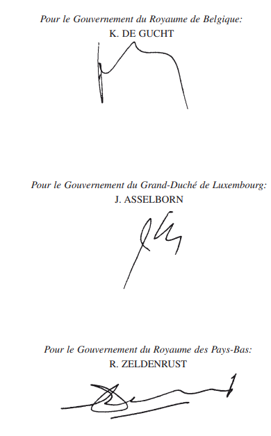
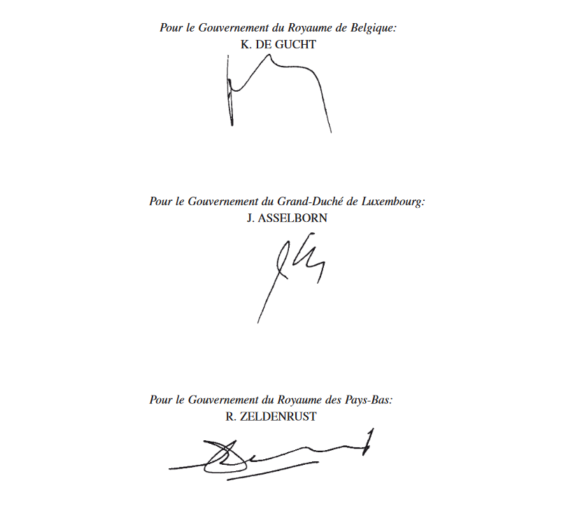

# Loi du 30 mai 2008 portant approbation du Protocole, modifiant le Protocole additionnel relatif aux impôts annexé à la Convention concernant la coopération administrative et judiciaire dans le domaine des réglementations se rapportant à la réalisation des objectifs de l'Union économique Benelux, signé à La Haye, le 29 avril 1969 et de la Déclaration des trois Gouvernements, signés à Bruxelles, le 17 avril 2007.

Nous Henri, Grand-Duc de Luxembourg, Duc de Nassau,

Notre Conseil d’Etat entendu;

De l’assentiment de la Chambre des Députés;

Vu la décision de la Chambre des Députés du 24 avril 2008 et celle du Conseil d’Etat du 6 mai 2008 portant qu’il n’y a pas lieu à second vote;

Avons ordonné et ordonnons:

## Article unique.

Sont approuvés le Protocole, modifiant le Protocole additionnel relatif aux impôts annexé à la [Convention concernant la coopération administrative et judiciaire dans le domaine des réglementations se rapportant à la réalisation des objectifs de l’Union économique Benelux](https://legilux.public.lu/eli/etat/leg/loi/1971/01/28/n3/jo), signé à La Haye, le 29 avril 1969 et la Déclaration des trois Gouvernements, signés à Bruxelles, le 17 avril 2007.

Mandons et ordonnons que la présente loi soit insérée au Mémorial pour être exécutée et observée par tous ceux que la chose concerne.

Le Ministre des Affaires étrangères  et de l’Immigration,   Jean Asselborn   Le Ministre des Finances,   Jean-Claude Juncker

Palais de   Luxembourg, le 30 mai 2008.   Henri

\**PROTOCOLE  modifiant le Protocole additionnel relatif aux impôts annexé à la Convention concernant la coopération administrative et judiciaire dans le domaine des réglementations se rapportant à la réalisation des objectifs de l’Union économique Benelux, signé à La Haye le 29 avril 1969**

Le Gouvernement du Royaume de Belgique, Le Gouvernement du Royaume des Pays-Bas, Le Gouvernement du Grand-Duché de Luxembourg,

\*Considérant* que les trois pays doivent disposer d’instruments juridiques communs adéquats afin de lutter efficacement contre la fraude fiscale transfrontalière et, en particulier, contre la fraude carrousel dans laquelle peuvent être impliquées des personnes établies ou résidant dans différents pays,

\*Considérant* que la responsabilité solidaire de toutes les parties à une opération soumise à la taxe sur la valeur ajoutée (TVA) constitue un de ces instruments mais que le contenu et l’étendue de cette notion de responsabilité solidaire n’est pas identique dans les trois pays,

\*Considérant* qu’il y a lieu de prévoir la reconnaissance par les deux autres pays du régime de responsabilité solidaire en vigueur dans le pays où la TVA est due afin de mettre à la disposition des administrations des trois pays les moyens adéquats en vue du recouvrement de cette taxe,

SONT CONVENUS de ce qui suit:

## *Article 1er*

L’article 8 du Protocole «Impôts» annexé à la Convention concernant la coopération administrative et judiciaire dans le domaine des réglementations se rapportant à la réalisation des objectifs de l’Union économique Benelux signé à La Haye le 29 avril 1969 est remplacé par la disposition suivante:

> \*Celui qui est domicilié ou établi dans un autre pays que le pays où la taxe sur la valeur ajoutée est due pour une livraison de biens, une prestation de service, une acquisition intracommunautaire ou une importation de biens est solidairement responsable de cette taxe lorsque les règles juridiques en vigueur dans le pays où la taxe est due prévoient cette responsabilité solidaire.*

## *Article 2*

1\. Le présent Protocole sera ratifié. Les instruments de ratification seront déposés auprès du Secrétaire général de l’Union économique Benelux qui informera les parties contractantes du dépôt de ces instruments.

2\. Le présent Protocole entrera en vigueur le premier jour du mois qui suivra la date du dépôt du troisième instrument de ratification.

EN FOI DE QUOI les soussignés, dûment autorisés à cet effet, ont signé le présent Protocole.

FAIT à Bruxelles, le 17 avril 2007, en triple exemplaire, en langues française et néerlandaise, les deux textes faisant également foi.

\**DECLARATION DES TROIS GOUVERNEMENT****S**

Les Etats membres signataires conviennent de mettre en œuvre le régime transfrontalier de la responsabilité solidaire, sous réserve des principes généraux du droit communautaire, tels que le principe de proportionnalité et le principe de sécurité juridique.

Doc. parl. [5751](https://legilux.public.lu/eli/etat/proj/pl/20070138); sess. ord. 2007-2008
