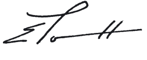

# Loi du 16 décembre 2008 portant approbation de l’Accord entre le Gouvernement du Grand-Duché de Luxembourg et le Gouvernement de la République française concernant l’échange et la protection réciproque des Informations classifiées, signé à Luxembourg, le 24 février 2006.

Nous Henri, Grand-Duc de Luxembourg, Duc de Nassau,

Notre Conseil d’Etat entendu;

De l’assentiment de la Chambre des Députés;

Vu la décision de la Chambre des Députés du 19 novembre 2008 et celle du Conseil d’Etat du 9 décembre 2008 portant qu’il n’y a pas lieu à second vote;

Avons ordonné et ordonnons:

## Article unique.

Est approuvé l’Accord entre le Gouvernement du Grand-Duché de Luxembourg et le Gouvernement de la République française concernant l’échange et la protection réciproque des Informations classifiées, signé à Luxembourg, le 24 février 2006.

Mandons et ordonnons que la présente loi soit insérée au Mémorial pour être exécutée et observée par tous ceux que la chose concerne.

Le Premier Ministre, Ministre d’Etat,   Jean-Claude Juncker   Le Ministre des Affaires étrangères et de l’Immigration,   Jean Asselborn

Palais de Luxembourg, le 16 décembre 2008.   Henri

\**ACCORD entre le Gouvernement du Grand-Duché de Luxembourg et le Gouvernement de la République française concernant l’échange et la protection ** **réciproque des Informations classifiées**

Le Gouvernement du Grand-Duché de Luxembourg, Le Gouvernement de la République française,

Ci-après dénommés les Parties,

\*Souhaitant* garantir la protection des Informations et des matériels classifiés échangés ou produits entre les deux Etats ou entre des organismes publics ou privés soumis à leurs lois et réglementations nationales respectives;

SONT CONVENUS des dispositions suivantes,

## *Article 1* — *Définitions*

Aux fins du présent Accord:

1.1 *«Informations classifiées»* fait référence aux informations, documents et matériels, quels qu’en soient la forme, la nature ou le mode de transmission, qu’ils soient élaborés ou en cours d’élaboration, auquel un degré de classification ou de protection a été attribué et qui, dans l’intérêt de la sécurité nationale et conformément aux lois et réglementations nationales des Parties, nécessitent une protection contre toute violation, destruction, détournement, divulgation, perte, accès par une personne non autorisée ou tout autre type de compromission.

1.2 *«Contrat classé»* signifie un contrat, un contrat de sous-traitance ou un projet dont l’élaboration et l’exécution nécessitent l’accès à des Informations classifiées ou l’utilisation d’Informations classifiées.

1.3 *«Contractant»* signifie tout individu ou personne morale ayant la capacité juridique de négocier et conclure des contrats classés.

1.4 *«Autorité Nationale de Sécurité (ANS)»* fait référence à l’autorité nationale responsable du contrôle général et de la mise en application du présent Accord pour chacune des Parties.

1.5 *«Autorités de Sécurité Compétentes»* fait référence à toute Autorité de Sécurité Désignée ou toute autre entité compétente autorisée conformément aux lois et réglementations nationales des Parties et qui sont responsables de la mise en application du présent Accord selon les domaines concernés.

1.6 *«Partie d’origine»* fait référence à la Partie, y compris tout organisme public ou privé soumis à ses lois et réglementations nationales, qui délivre ou transmet une Information classifiée à l’autre Partie.

1.7 *«Partie destinataire»* fait référence à la Partie, y compris tout organisme public ou privé soumis à ses lois et réglementations nationales, à qui les Informations classifiées sont transmises.

1.8 *«Partie hôte»* fait référence à la Partie sur le territoire de laquelle une visite a lieu.

1.9 *«Besoin d’en connaître»* fait référence à la nécessité d’avoir accès à des Informations classifiées dans le cadre d’une fonction officielle déterminée et pour l’exécution d’une mission spécifique.

## *Article 2* — *Champ d’application*

Le présent Accord constitue la réglementation de sécurité commune applicable à tout échange d’Information classifiée entre les Parties et leurs organismes publics ou privés soumis à leurs lois et réglementations nationales.

## *Article 3* — *Autorités Nationales de Sécurité*

L’Autorité Nationale de Sécurité de chacune des Parties est:

\*Pour le Grand-Duché de Luxembourg:*

Service de Renseignement

Autorité Nationale de Sécurité

Boîte postale 2379

L-1023 Luxembourg

\*Pour la République française:*

Secrétariat général de la défense nationale (S.G.D.N.)

51, bd de Latour-Maubourg

F-75700 PARIS 07 SP

Les Parties se tiennent mutuellement informées de tout changement éventuel affectant leur Autorité Nationale de Sécurité ainsi que de leurs Autorités de Sécurité Compétentes par note diplomatique.

## *Article 4* — *Principes de sécurité*

4.1 Conformément à leurs lois et réglementations nationales respectives, les Parties prennent les mesures appropriées afin de protéger les Informations classifiées qui sont transmises, reçues ou créées selon les termes du présent Accord et apportent auxdites Informations un niveau de protection équivalent à celui qui est accordé à leurs propres Informations classifiées nationales, tel que défini à l’Article 5.1.

4.2 Dès réception des Informations classifiées en provenance de la Partie d’origine, la Partie destinataire leur appose sa propre classification nationale conformément aux équivalences définies à l’Article 5.1.

4.3 L’accès aux Informations classifiées est strictement réservé aux ressortissants des Parties qui ont obtenu une habilitation de niveau approprié et dont les fonctions rendent l’accès auxdites Informations essentiel sur la base du Besoin d’en connaître.

4.4 La Partie destinataire ne déclasse ni ne déclassifie une information classifiée transmise sans l’accord écrit préalable de la Partie d’origine.

4.5 Les Parties se tiennent rapidement informées de tout changement qui affecterait la protection des Informations classifiées échangées ou produites en vertu du présent Accord.

4.6 Les Informations classifiées transmises ne peuvent être utilisées à des fins autres que celles pour lesquelles elles sont transmises, prévues par les accords ou instruments contractuels conclus entre les Parties.

4.7 Les Parties veillent à ce que toute exigence résultant de leurs lois et réglementations de sécurité nationales couvrant la sécurité des agences, bureaux et installations sous leur juridiction soit satisfaite, notamment par le biais de visites d’inspection et de contrôles.

## *Article 5* — *Classifications de sécurité et équivalences*

5.1 Les Parties s’engagent à assurer la protection des Informations classifiées échangées et adoptent l’équivalence des niveaux de classification de sécurité définis dans le tableau ci-dessous:

| *France* | *Luxembourg* |
|---|---|
| TRES SECRET DEFENSE | TRES SECRET |
| SECRET DEFENSE | SECRET |
| CONFIDENTIEL DEFENSE | CONFIDENTIEL |
| (voir paragraphes 5.3 et 5.4 ci-dessous) | RESTREINT |

5.2 Toute Information classifiée transmise par le Luxembourg portant la mention additionnelle «LUX» juxtaposée à la classification de sécurité doit également être protégée selon le tableau d’équivalences présenté à l’article 5.1 ci-dessus.

5.3 La République française traite et protège les Informations portant la mention «RESTREINT» transmises par le Luxembourg selon ses lois et réglementations nationales en vigueur relatives aux informations protégées mais non classifiées de défense, telles que «DIFFUSION RESTREINTE».

5.4 Le Grand-Duché de Luxembourg traite et protège les informations non classifiées mais revêtues d’une mention de protection telles que «DIFFUSION RESTREINTE» transmises par la France selon ses lois et réglementations nationales en vigueur relatives à la protection des Informations «RESTREINT».

5.5 Afin de maintenir des normes de sécurité comparables et à la demande de l’une ou l’autre des Parties, chaque Partie fournit toutes les informations nécessaires concernant les lois, réglementations et procédures de sécurité nationales appliquées pour assurer la sécurité des Informations classifiées. Chaque Partie consent à faciliter les contacts entre leur ANS et leurs Autorités de Sécurité Compétentes.

## *Article 6* — *Procédure d’habilitation de sécurité*

6.1 Pour l’accès aux Informations classifiées CONFIDENTIEL DEFENSE/CONFIDENTIEL ou de niveau supérieur, chaque Partie, conformément aux lois et réglementations nationales, mène une procédure d’habilitation de sécurité.

6.2 S’agissant de l’habilitation de sécurité d’un ressortissant d’une des Parties qui a séjourné ou qui séjourne encore sur le territoire de l’autre, les Autorités Nationales de Sécurité des Parties se prêtent assistance conformément à leurs lois et réglementations nationales.

6.3 Les Parties reconnaissent mutuellement les habilitations de sécurité délivrées à leurs ressortissants dans le cadre de l’accès aux Informations classifiées.

6.4 Si l’ANS ou les Autorités de Sécurité Compétentes de l’une des Parties considère qu’une société enregistrée sur son territoire national est la propriété ou est sous l’influence d’un Etat tiers dont les objectifs ne sont pas compatibles avec ses intérêts, cette société ne se verra pas délivrer de certificat d’habilitation. L’ANS ou les Autorités de Sécurité Compétentes de la Partie ayant formulé la demande sera avisée en conséquence dans les meilleurs délais.

6.5 Les ANS ou Autorités de Sécurité Compétentes se tiennent mutuellement informées des changements concernant les habilitations de sécurité de leurs ressortissants dans le cadre du présent Accord, en particulier en cas de retrait d’habilitation ou d’abaissement de son niveau.

## *Article 7* — *Utilisation d’Informations classifiées*

7.1 La Partie destinataire ne divulgue des Informations classifiées échangées ou élaborées dans le cadre du présent Accord à aucun Etat tiers, organisation internationale ou entité ou ressortissant d’un Etat tiers quel qu’il soit, sans le consentement écrit préalable de l’ANS ou des Autorités de Sécurité Compétentes de la Partie d’origine.

7.2 Les Informations classifiées élaborées conjointement par les Parties au titre d’accords, de contrats ou de toute autre activité commune ne peuvent être déclassées, déclassifiées ou transmises à un Etat tiers, à une personne physique ou morale ayant la nationalité d’un Etat tiers, ou à une organisation internationale sans l’accord écrit préalable de l’autre Partie.

7.3 Avant la transmission aux Contractants de toute Information classifiée reçue de la Partie d’origine, les Autorités de Sécurité Compétentes de la Partie destinataire:

a) s’assurent que les Contractants et leurs installations sont capables de fournir une protection appropriée aux Informations classifiées;

b) attribuent le niveau requis d’habilitation aux installations du Contractant concerné;

c) attribuent le niveau d’habilitation requis aux personnes ayant le besoin d’en connaître;

d) s’assurent que toutes les personnes qui ont accès aux Informations classifiées sont informées de leurs responsabilités qui découlent des lois et réglementations nationales en vigueur;

e) effectuent des contrôles de sécurité dans les installations concernées.

## *Article 8* — *Traduction, Reproduction et Destruction*

8.1 Les Informations classifiées TRES SECRET DEFENSE/TRES SECRET ne sont ni reproduites, ni traduites. Des exemplaires originaux supplémentaires peuvent être fournis sur demande écrite auprès de la Partie d’origine.

8.2 Les Informations classifiées TRES SECRET DEFENSE/TRES SECRET ne doivent pas être détruites sauf en cas d’autorisation expresse de la Partie d’origine. Elles sont restituées à la Partie d’origine conformément aux paragraphes 9.1 ou 9.2 ci-dessous, après avoir été reconnues comme n’étant plus nécessaires ou à l’expiration de leur validité.

8.3 La traduction et la reproduction des Informations classifiées SECRET DEFENSE/SECRET sont autorisées uniquement avec le consentement écrit de l’ANS ou des Autorités de Sécurité Compétentes de la Partie d’origine.

8.4 Les Informations classifiées sont détruites de telle manière que leur reconstruction totale ou partielle soit impossible.

8.5 La Partie destinataire assure le marquage des reproductions et des traductions produites comme les originaux et leur assure la même protection.

## *Article 9* — *Transmission entre les Parties*

9.1 Les Informations classifiées sont transmises d’une Partie à l’autre par la voie diplomatique conformément aux lois et réglementations nationales de la Partie d’origine.

9.2 Les ANS ou Autorités de Sécurité Compétentes peuvent, d’un commun accord, convenir de ce que les Informations classifiées peuvent être transmises par un autre moyen que la voie diplomatique, dans la mesure où ce mode de transmission s’avérerait inadapté ou difficile.

9.3 Les transmissions répondent aux exigences suivantes:

a) le convoyeur a une habilitation de sécurité appropriée;

b) la Partie d’origine tient un registre des Informations classifiées qui sont transférées et un extrait de ce registre est fourni à la Partie destinataire sur demande;

c) les Informations classifiées sont dûment emballées et scellées conformément aux lois et réglementations nationales de la Partie d’origine;

d) la réception des Informations classifiées est confirmée par écrit dans les meilleurs délais.

9.4 La transmission d’une importante quantité d’Informations classifiées est organisée entre les ANS ou Autorités de Sécurité Compétentes respectives au cas par cas.

9.5 La transmission électronique d’Informations classifiées est effectuée uniquement sous forme cryptée, en utilisant des méthodes et dispositifs cryptographiques mutuellement acceptés entre les ANS ou Autorités de Sécurité Compétentes respectives.

## *Article 10* — *Contrats Classés*

10.1 L’ANS ou les Autorités de Sécurité Compétentes de la Partie d’origine notifient à l’ANS ou aux Autorités de Sécurité Compétentes de la Partie destinataire tout Contrat classé avant tout échange d’Informations classifiées. Cette notification doit indiquer le plus haut niveau de classification des Informations impliquées dans le Contrat.

10.2 Pour tout instrument contractuel comportant des Informations classifiées, il est établi une annexe de sécurité. Dans cette annexe, l’ANS ou les Autorités de Sécurité Compétentes de la Partie d’origine précise ce qui doit être protégé par la Partie destinataire ainsi que le niveau de classification applicable correspondant. Seule la Partie d’origine peut modifier le niveau de classification d’une Information définie dans une annexe de sécurité.

10.3 Tout Contrat classé contient des dispositions relatives aux instructions de sécurité ainsi qu’un guide de classification. Ces instructions sont cohérentes avec celles dispensées par l’ANS ou par les Autorités de Sécurité Compétentes de la Partie d’origine.

10.4 L’ANS ou les Autorités de Sécurité Compétentes de la Partie d’origine transmet une copie de l’annexe de sécurité à l’ANS ou aux Autorités de Sécurité Compétentes de l’autre Partie.

10.5 Avant de conclure un Contrat classé avec un Contractant placé sous la juridiction de l’autre Partie ou d’autoriser l’un de ses propres Contractants à conclure un Contrat classé sur le territoire de l’autre Partie, une Partie reçoit au préalable l’assurance écrite de l’ANS ou des Autorités de Sécurité Compétentes de l’autre Partie que le Contractant proposé a reçu une habilitation de niveau approprié et qu’il a pris toutes les mesures de sécurité appropriées nécessaires à la protection des Informations classifiées.

10.6 L’ANS ou les Autorités de Sécurité Compétentes de la Partie sur le territoire de laquelle le travail doit être exécuté sont tenues de veiller à ce que, dans le cadre de l’exécution de contrats classés, soit appliqué et maintenu un niveau de sécurité équivalent à celui requis pour la protection de leurs propres contrats classés.

10.7 Avant de passer un Contrat classé avec un sous-contractant, le Contractant reçoit l’autorisation de son ANS ou de ses Autorités de Sécurité Compétentes. Les sous-contractants se conforment aux mêmes conditions de sécurité que celles établies pour le Contractant.

## *Article 11* — *Visites*

11.1 Les visites aux installations de l’une des Parties où un représentant de l’autre Partie a accès à des Informations classifiées ou à des sites où l’accès à de telles Informations est directement possible, font l’objet d’une autorisation préalable par écrit de l’ANS ou des Autorités de Sécurité Compétentes de la Partie hôte.

11.2 Les visites aux installations de l’une des Parties par des ressortissants d’un Etat tiers impliquant l’accès à des Informations classifiées échangées ou produites entre les Parties ou à des sites où l’accès à de telles Informations est directement possible, requièrent l’autorisation préalable écrite de l’ANS ou des Autorités de Sécurité Compétentes des Parties.

11.3 Les visites visées aux paragraphes 11.1 et 11.2 ci-dessus impliquent que tout visiteur ait une habilitation de sécurité appropriée ainsi que le besoin d’en connaître.

11.4 Les demandes de visites, lorsque l’accès à des Informations classifiées de niveau TRES SECRET DEFENSE/TRES SECRET est nécessaire, sont adressées par la voie diplomatique à l’ANS de la Partie hôte. Les demandes de visites, lorsque l’accès à des Informations classifiées de niveau inférieur est nécessaire, sont traitées directement entre les ANS ou Autorités de Sécurité Compétentes respectives. Toute demande est adressée au moins trois (3) semaines avant la date requise pour la visite. Les demandes de visite contiennent les renseignements mentionnés dans l’Annexe du présent Accord.

11.5 Chaque Partie peut demander une autorisation de visite pour une période maximale de douze (12) mois. Si une visite en particulier est susceptible de ne pas être conclue dans le délai prévu par l’autorisation de visite, ou si un prolongement de la période prévue par l’autorisation de visite est nécessaire, la Partie requérante peut demander une nouvelle autorisation de visite sous réserve qu’elle soit effectuée au moins trois (3) semaines avant que l’autorisation en cours n’arrive à expiration.

11.6 Tous les visiteurs respectent les réglementations et instructions de sécurité de la Partie hôte.

## *Article 12* — *Visites multiples*

12.1 Les Parties peuvent dresser une liste des personnels autorisés à effectuer plusieurs visites en relation avec tout projet, programme ou contrat particulier, conformément aux conditions générales convenues par les ANS ou Autorités de Sécurité Compétentes des Parties. Initialement, ces listes sont valables pour une durée de douze (12) mois et, par accord entre les ANS ou Autorités de Sécurité Compétentes des Parties, cette durée de validité peut être prolongée pour d’autres périodes ne dépassant pas douze (12) mois.

12.2 Les listes mentionnées au paragraphe 12.1 ci-dessus sont établies conformément aux lois et réglementations nationales de la Partie hôte. Une fois que ces listes ont été approuvées, les conditions générales de toutes les visites particulières peuvent être réglées directement par les établissements que les personnes mentionnées sur ces listes vont visiter.

## *Article 13* — *Violation des lois et réglementations relatives à la protection des Informations classifiées*

13.1 Dans l’hypothèse où une violation de la réglementation nationale relative à la protection des Informations classifiées transmises dans le cadre du présent Accord ne peut être écartée, ou lorsqu’elle est présumée ou découverte, notamment en cas de perte ou tout autre type de compromission avérée ou suspectée, l’ANS ou les Autorités de Sécurité Compétentes de l’autre Partie en sont immédiatement informées par écrit.

13.2 La notification doit être suffisamment détaillée pour que la Partie d’origine puisse procéder à une évaluation complète des conséquences.

13.3 La Partie ayant découvert ou suspectant les faits mène immédiatement une enquête (avec, si nécessaire, l’aide de l’autre Partie) conformément aux lois et réglementations nationales en vigueur dans l’Etat concerné. La Partie menant l’enquête informe dans les meilleurs délais l’ANS ou les Autorités de Sécurité Compétentes de l’autre Partie des circonstances, du résultat de l’enquête, des mesures adoptées et des actions correctrices engagées.

## *Article 14* — *Les frais*

14.1 L’exécution du présent Accord ne génère en principe aucun frais spécifique.

14.2 Tout frais éventuel encouru par une Partie du fait de l’application du présent Accord est supporté par cette seule Partie dans la limite de ses disponibilités budgétaires.

## *Article 15* — *Résolution des litiges*

15.1 Tout litige quant à l’interprétation ou l’application du présent Accord est exclusivement résolu dans le cadre de consultations entre les Parties, sans faire appel à aucune tierce partie ou tribunal international.

15.2 Pendant la durée du différend, les Parties continuent à respecter les obligations qui découlent du présent Accord.

## *Article 16* — *Dispositions finales*

16.1 Le présent Accord est conclu pour une durée indéterminée. Chacune des Parties notifie à l’autre l’accomplissement des procédures internes requises en ce qui la concerne pour l’entrée en vigueur du présent Accord qui prend effet le premier jour du second mois suivant la réception de la dernière des notifications.

16.2 En tant que de besoin, les ANS ou Autorités de Sécurité Compétentes des Parties se consultent au sujet des aspects techniques spécifiques concernant l’application du présent Accord et peuvent conclure, au cas par cas, tout instrument juridique approprié ou protocole de sécurité spécifique visant à compléter le présent Accord.

16.3 Chaque Partie communique rapidement à l’autre toute modification de ses lois et réglementations nationales susceptible d’avoir un effet sur la protection d’Informations classifiées en vertu du présent Accord. Dans ce cas, les Parties se concertent afin d’examiner d’éventuelles modifications au présent Accord. Dans l’intervalle, les Informations classifiées restent protégées conformément aux présentes dispositions.

16.4 Les dispositions du présent Accord peuvent être modifiées d’un commun accord par écrit entre les Parties. Ces modifications prennent effet selon les modalités prévues au paragraphe 16.1.

16.5 Le présent Accord peut être dénoncé d’un commun accord ou unilatéralement, la dénonciation prenant effet six (6) mois après réception de la notification écrite. La dénonciation ne remet pas en cause les droits et obligations des Parties liés aux Informations échangées dans le cadre du présent Accord.

EN FOI DE QUOI, les représentants des deux Parties, dûment autorisés à cet effet, ont signé le présent Accord et y ont apposé leur sceau.

FAIT à Luxembourg le 24 février 2006 en double exemplaire, en langue française.

Pour le Gouvernement du Grand-Duché de Luxembourg,

Pour le Gouvernement  de la République française,

|  |  |
|---|---|

ANNEXE

La demande de visite mentionnée aux articles 11 et 12 doit contenir les informations suivantes:

a) Le nom et le prénom du visiteur, la date et le lieu de naissance, la nationalité et le numéro du passeport ou de la carte d’identité;

b) L’emploi et la fonction du visiteur, le nom de l’établissement ou de l’organisme qui l’emploie;

c) Le niveau d’habilitation de sécurité du visiteur, authentifié par un certificat de sécurité à fournir par l’autorité compétente de la Partie requérante;

d) La date proposée de la visite et la durée prévue;

e) L’objet de la visite et toutes les indications nécessaires précisant les sujets à traiter impliquant des Informations classifiées et leurs niveaux de classification;

f) Le nom des établissements, des installations et des locaux, objets de la visite;

g) Les noms et prénoms des personnes qui doivent recevoir le visiteur;

h) La date, la signature et l’apposition du timbre officiel de l’autorité compétente de la Partie requérante.

Doc. parl. [5752](https://legilux.public.lu/eli/etat/proj/pl/20070139); sess. ord. 2006-2007 et 2008-2009
