# Loi du 20 avril 2009 portant approbation de l'Accord relatif à la participation de la République de Bulgarie et de la Roumanie à l'Espace économique européen ainsi que de l'Acte final, signés à Bruxelles, le 25 juillet 2007.

Nous Henri, Grand-Duc de Luxembourg, Duc de Nassau,

Notre Conseil d’Etat entendu;

De l’assentiment de la Chambre des Députés;

Vu la décision de la Chambre des Députés du 12 mars 2009 et celle du Conseil d’Etat du 31 mars 2009 portant qu’il n’y a pas lieu à second vote;

Avons ordonné et ordonnons:

## Article unique.

Sont approuvés l’Accord relatif à la participation de la République de Bulgarie et de la Roumanie à l’Espace économique européen ainsi que l’Acte final, signés à Bruxelles, le 25 juillet 2007.

Mandons et ordonnons que la présente loi soit insérée au Mémorial pour être exécutée et observée par tous ceux que la chose concerne.

Le Ministre des Affaires étrangères et de l’Immigration,   Jean Asselborn

Château de Berg, le 20 avril 2009.   Henri

\**ACCORD RELATIF A LA PARTICIPATION DE LA REPUBLIQUE DE BULGARIE ET DE LA ROUMANIE A L’ESPACE ECONOMIQUE EUROPEEN**

\*La Communauté européenne,*

\*Le Royaume de Belgique,*

\*La République tchèque,*

\*Le Royaume de Danemark,*

\*La République fédérale d’Allemagne,*

\*La République d’Estonie,*

\*L’Irlande,*

\*La République hellénique,*

\*Le Royaume d’Espagne,*

\*La République française,*

\*La République italienne,*

\*La République de Chypre,*

\*La République de Lettonie,*

\*La République de Lituanie,*

\*Le Grand-Duché de Luxembourg,*

\*La République de Hongrie,*

\*Malte,*

\*Le Royaume des Pays-Bas,*

\*La République d’Autriche,*

\*La République de Pologne,*

\*La République portugaise,*

\*La République de Slovénie,*

\*La République slovaque,*

\*La République de Finlande,*

\*Le Royaume de Suède,*

\*Le Royaume-Uni de Grande-Bretagne et d’Irlande du Nord,*

ci-après dénommés «Etats membres de la CE»,

\*L’Islande,*

\*La Principauté de Liechtenstein,*

\*Le Royaume de Norvège,*

ci-après dénommés «Etats de l’AELE»,

ci-après conjointement dénommés «parties contractantes actuelles»,

et

\*La République de Bulgarie,*

\*La Roumanie,*

\*Considérant* que le traité relatif à l’adhésion de la République de Bulgarie et de la Roumanie à l’Union européenne (ci-après dénommé «traité d’adhésion») a été signé à Luxembourg le 25 avril 2005;

\*Considérant* que, conformément à l’article 128 de l’accord sur l’Espace économique européen, signé à Porto le 2 mai 1992, tout Etat européen demande, s’il devient membre de la Communauté, à devenir partie audit accord (ci-après dénommé «accord EEE»);

\*Considérant* que la République de Bulgarie et la Roumanie ont demandé à devenir parties contractantes à l’accord EEE;

\*Considérant* que les conditions et modalités de cette participation doivent faire l’objet d’un accord entre les parties contractantes actuelles et les Etats requérants,

ONT DECIDE de conclure l’accord suivant:

\*Article 1*

1\. La République de Bulgarie et la Roumanie deviennent parties contractantes à l’accord EEE et sont ci-après dénommées «nouvelles parties contractantes».

2\. A compter de l’entrée en vigueur du présent accord, les dispositions de l’accord EEE, modifiées par les décisions du Comité mixte de l’EEE adoptées avant le 1er octobre 2004, sont contraignantes pour les nouvelles parties contractantes de la même manière que pour les parties contractantes actuelles et suivant les conditions et modalités fixées par le présent accord.

3\. Les annexes du présent accord font partie intégrante de celui-ci.

\*Article 2*

1\. Adaptations à apporter au texte de l’Accord EEE

a) Préambule

La liste des parties contractantes est remplacée par le texte suivant:

> aone «La Communauté européenne,
>
> bone Le Royaume de Belgique,
>
> cone La République de Bulgarie,
>
> done La République tchèque,
>
> eone Le Royaume de Danemark,
>
> fone La République fédérale d’Allemagne,
>
> gone La République d’Estonie,
>
> hone L’Irlande,
>
> ione La République hellénique,
>
> jone Le Royaume d’Espagne,
>
> kone La République française,
>
> lone La République italienne,
>
> mone La République de Chypre,
>
> none La République de Lettonie,
>
> oone La République de Lituanie,
>
> pone Le Grand-Duché de Luxembourg,
>
> qone La République de Hongrie,
>
> rone Malte,
>
> sone Le Royaume des Pays-Bas,
>
> tone La République d’Autriche,
>
> uone La République de Pologne,
>
> vone La République portugaise,
>
> wone La Roumanie,
>
> xone La République de Slovénie,
>
> yone La République slovaque,
>
> zone La République de Finlande,
>
> aaone Le Royaume de Suède,
>
> abone Le Royaume-Uni de Grande-Bretagne et d’Irlande du Nord,
>
> acone et
>
> adone L’Islande,
>
> aeone La Principauté de Liechtenstein,
>
> afone Le Royaume de Norvège»;

b) Article 2

i) Au point b), les termes la République d’ sont supprimés;

ii) Le texte suivant est ajouté après le point d):

> «e) «Acte d’adhésion du 25 avril 2005», l’acte relatif aux conditions d’adhésion à l’Union européenne de la République de Bulgarie et de la Roumanie et aux adaptations des traités sur lesquels est fondée l’Union européenne, adopté à Luxembourg le 25 avril 2005;
>
> f) «Protocole d’adhésion du 25 avril 2005», le protocole relatif aux conditions et modalités d’admission à l’Union européenne de la République de Bulgarie et de la Roumanie, adopté à Luxembourg le 25 avril 2005.»;

c) Article 117

L’article 117 est remplacé par le texte suivant:

> «*Article 117*
>
> Les dispositions régissant les mécanismes financiers sont définies dans les protocoles 38 et 38*bis* et dans l’addendum au protocole 38*bis*.»;

d) Article 126

Au paragraphe 1, les termes la République d’ sont supprimés;

e) Article 129

i) Au paragraphe 1, le deuxième alinéa est remplacé par le texte suivant:

> «A la suite de l’élargissement de l’Espace économique européen, les versions du présent accord en langues bulgare, estonienne, hongroise, lettone, lituanienne, maltaise, polonaise, roumaine, slovaque, slovène et tchèque font également foi.»;

ii) Au paragraphe 1, le troisième alinéa est remplacé par le texte suivant:

> «Les textes des actes auxquels il est fait référence dans les annexes font également foi en langues allemande, anglaise, bulgare, danoise, espagnole, estonienne, finnoise, française, grecque, hongroise, italienne, lettonne, lituanienne, maltaise, néerlandaise, polonaise, portugaise, roumaine, slovaque, slovène, suédoise et tchèque tels qu’ils sont publiés au Journal officiel de l’Union européenne, et ces actes sont rédigés, pour leur authentification, en langues islandaise et norvégienne et publiés dans le supplément EEE du Journal officiel de l’Union européenne.».

2\. Adaptations à apporter aux protocoles de l’Accord EEE

a) Le protocole 4 relatif aux règles d’origine est modifié comme suit:

i) A l’article 3, paragraphe 1, la référence aux nouvelles parties contractantes est supprimée.

ii) L’annexe IVa (texte de la déclaration sur facture) est modifiée comme suit:

aa) Le texte suivant est inséré avant la version espagnole du texte de la déclaration sur facture:

> «*Version bulgare*
>
> 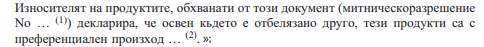

bb) Le texte suivant est inséré avant la version slovène du texte de la déclaration sur facture:

> «*Version roumaine*
>
> 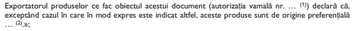

iii) L’annexe IVb (texte de la déclaration sur facture EUR-MED) est modifiée comme suit:

aa) Le texte suivant est inséré avant la version espagnole du texte de la déclaration sur facture EUR-MED:

> «*Version bulgare*
>
> 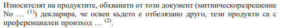
>
> aash cumulation applied with … (nom du pays/des pays)
>
> bash no cumulation applied(3)»;

bb) Le texte suivant est inséré avant la version slovène du texte de la déclaration sur facture EUR-MED:

> «*Version roumaine*
>
> 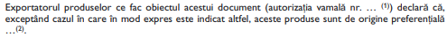
>
> aash cumulation applied with … (nom du pays/des pays)
>
> bash no cumulation applied(3)»;

b) Le protocole 38*bis* est modifié comme suit:

A l’article 4, paragraphe 3, le terme examine est remplacé par le terme peut examiner.

c) Le texte suivant est ajouté au protocole 38*bis*:

> «ADDENDUM AU PROTOCOLE 38*bis*
>
> \**concernant le mécanisme financier applicable à la République de Bulgarie et à la Roumanie**
>
> \*Article 1*
>
> 1\. Le protocole 38*bis* s’applique, mutatis mutandis, à la République de Bulgarie et à la Roumanie.
>
> 2\. Nonobstant le paragraphe 1, l’article 6 du protocole 38*bis* ne s’applique pas. Aucune réaffectation vers un autre Etat bénéficiaire ne s’applique dans le cas de crédits non engagés de la part de la Bulgarie et de la Roumanie.
>
> 3\. Nonobstant le paragraphe 1, l’article 7 du protocole 38*bis* ne s’applique pas.
>
> 4\. Nonobstant le paragraphe 1, les contributions versées à des organisations non gouvernementales et aux partenaires sociaux peuvent représenter jusqu’à 90% du coût des projets.
>
> \*Article 2*
>
> Les montants supplémentaires de la contribution financière en faveur de la République de Bulgarie et de la Roumanie s’élèvent à 21,5 millions EUR pour la République de Bulgarie et à 50,5 millions EUR pour la Roumanie au cours de la période comprise entre le 1er janvier 2007 et le 30 avril 2009 inclus. Ils sont mis à disposition à compter de la date d’entrée en vigueur de l’accord relatif à la participation de la République de Bulgarie et de la Roumanie à l’Espace économique européen ou d’un accord visant à appliquer cet accord à titre provisoire, et sont accordés en une seule tranche en 2007 à des fins d’engagement.»

d) Le texte du protocole 44 est remplacé par le texte suivant:

> \**«concernant les mécanismes de sauvegarde prévus pour les élargissements de l’espace économique européen**
>
> 1\. Application de l’article 112 de l’accord à la clause de sauvegarde économique générale et aux mécanismes de sauvegarde contenus dans certaines dispositions provisoires applicables dans le domaine de la libre circulation des personnes et du transport routier.
>
> L’article 112 de l’accord s’applique également aux situations spécifiées ou visées par:
>
> a) les dispositions de l’article 37 de l’acte d’adhésion du 16 avril 2003 et de l’article 36 de l’acte d’adhésion du 25 avril 2005 ou, le cas échéant, du protocole d’adhésion du 25 avril 2005, et
>
> b) les mécanismes de sauvegarde contenus dans les dispositions provisoires sous les titres «Période de transition» de l’annexe V (Libre circulation des travailleurs) et de l’annexe VIII (Droit d’établissement), le point 30 ([directive 96/71/CE](https://legilux.public.lu/eli/dir_ue/1996/71/jo) du Parlement européen et du Conseil) de l’annexe XVIII (Santé et sécurité au travail, droit du travail et égalité de traitement des hommes et des femmes) et le point 26c ([règlement (CEE) N° 3118/93](https://legilux.public.lu/eli/reg_ue/1993/3118/jo) du Conseil) de l’annexe XIII (Transport), pour les mêmes durées, les mêmes champs d’application et avec les mêmes effets que ceux énoncés dans ces dispositions.
>
> 2\. Clause de sauvegarde concernant le marché intérieur
>
> La procédure générale de prise de décision prévue par l’accord s’applique également aux décisions prises par la Commission des Communautés européennes en application de l’article 38 de l’acte d’adhésion du 16 avril 2003 et de l’article 37 de l’acte d’adhésion du 25 avril 2005 ou, le cas échéant, du protocole d’adhésion du 25 avril 2005.».

\*Article 3*

1\. Toutes les modifications apportées aux actes adoptés par les institutions communautaires intégrés dans l’accord EEE qui découlent de l’acte relatif aux conditions d’adhésion à l’Union européenne de la République de Bulgarie et de la Roumanie et aux adaptations des traités sur lesquels est fondée l’Union européenne ou, le cas échéant, du protocole relatif aux conditions et modalités d’admission à l’Union européenne de la République de Bulgarie et de la Roumanie, sont intégrées dans l’accord EEE et en font partie intégrante.

2\. A cet effet, le tiret suivant est inséré aux points des annexes et protocoles de l’accord EEE contenant les références aux actes adoptés par les institutions communautaires concernées:

> «- 1 2005 SA: acte relatif aux conditions d’adhésion à l’Union européenne de la République de Bulgarie et de la Roumanie et aux adaptations des traités sur lesquels est fondée l’Union européenne, adopté le 25 avril 2005 (JO L 157 du 21.6.2005, p. 203).».

3\. En cas d’adoption du traité établissant une Constitution pour l’Europe, le tiret suivant remplace le tiret visé au paragraphe 2 dès l’entrée en vigueur dudit traité:

> «- 1 2005 SP: protocole relatif aux conditions et modalités d’admission de la République de Bulgarie et de la Roumanie à l’Union européenne, adopté le 25 avril 2005 (JO L 157 du 21.6.2005, p. 29).».

4\. Si le tiret visé au paragraphe 2 ou 3 est le premier tiret du point en question, il est précédé des mots , modifié par: ou , modifiée par:, selon le cas.

5\. L’annexe A du présent accord énumère les points des annexes et protocoles de l’accord EEE dans lesquels le texte visé aux paragraphes 2, 3 et 4 est inséré.

6\. Lorsqu’en raison de la participation des nouvelles parties contractantes, des actes intégrés à l’accord EEE avant la date d’entrée en vigueur du présent accord nécessitent des adaptations qui ne sont pas prévues par le présent accord, celles-ci sont apportées conformément aux procédures arrêtées dans l’accord EEE.

\*Article 4*

1\. Les dispositions contenues dans l’acte relatif aux conditions d’adhésion à l’Union européenne de la République de Bulgarie et de la Roumanie et aux adaptations des traités sur lesquels est fondée l’Union européenne visées à l’annexe B du présent accord sont intégrées dans l’accord EEE et en font partie intégrante.

2\. En cas d’adoption du traité établissant une Constitution pour l’Europe, les dispositions visées à l’annexe B s’entendent comme découlant du protocole relatif aux conditions et modalités d’admission de la République de Bulgarie et de la Roumanie à l’Union européenne dès l’entrée en vigueur dudit traité.

3\. Toute disposition présentant un intérêt pour l’accord EEE visée dans l’acte relatif aux conditions d’adhésion à l’Union européenne de la République de Bulgarie et de la Roumanie et aux adaptations des traités sur lesquels est fondée l’Union européenne ou adoptée sur la base de cet acte, ou, le cas échéant, dans le protocole relatif aux conditions et modalités d’admission de la République de Bulgarie et de la Roumanie à l’Union européenne ou adoptée sur la base de ce protocole mais non mentionnée dans l’annexe B du présent accord, est soumise aux procédures arrêtées dans l’accord EEE.

\*Article 5*

Toute partie au présent accord peut soumettre au Comité mixte de l’EEE toute question relative à l’interprétation ou à l’application de l’accord. Le comité l’examine en vue de trouver une solution acceptable permettant de préserver le bon fonctionnement de l’accord EEE.

\*Article 6*

1\. Le présent accord est ratifié ou approuvé par les parties contractantes actuelles et les nouvelles parties contractantes conformément à leurs propres procédures. Les instruments de ratification ou d’approbation sont déposés auprès du Secrétariat général du Conseil de l’Union européenne.

2\. Il entre en vigueur le jour suivant le dépôt du dernier instrument de ratification ou d’approbation d’une partie contractante actuelle ou d’une nouvelle partie contractante, sous réserve que les accords et protocoles connexes suivants entrent en vigueur le même jour:

a) accord sous forme d’échange de lettres entre la Communauté européenne et le Royaume de Norvège relatif à un programme de coopération pour la croissance économique et le développement durable en Bulgarie;

b) accord sous forme d’échange de lettres entre la Communauté européenne et le Royaume de Norvège relatif à un programme de coopération pour la croissance économique et le développement durable en Roumanie;

c) protocole additionnel à l’accord entre la Communauté économique européenne et l’Islande consécutif à l’adhésion de la République de Bulgarie et de la Roumanie à l’Union européenne; et

d) protocole additionnel à l’accord entre la Communauté économique européenne et le Royaume de Norvège consécutif à l’adhésion de la République de Bulgarie et de la Roumanie à l’Union européenne.

\*Article 7*

Le présent accord, rédigé en un exemplaire unique, en langues allemande, anglaise, bulgare, danoise, espagnole, estonienne, finnoise, française, grecque, hongroise, italienne, lettonne, lituanienne, maltaise, néerlandaise, polonaise, portugaise, roumaine, slovaque, slovène, suédoise, tchèque, islandaise et norvégienne, chacun de ces textes faisant également foi, est déposé auprès du secrétariat général du Conseil de l’Union européenne, qui en remet une copie certifiée conforme au gouvernement de chacune des parties au présent accord.

Fait à Bruxelles, le vingt-cinq juillet deux mille sept.

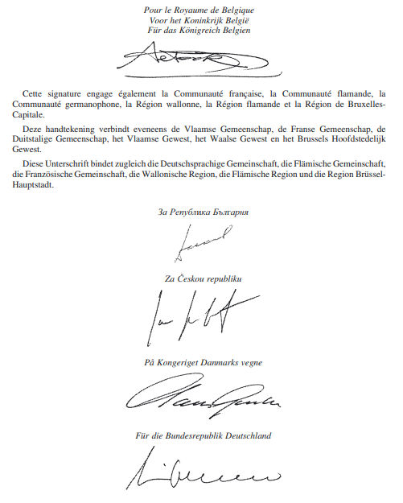

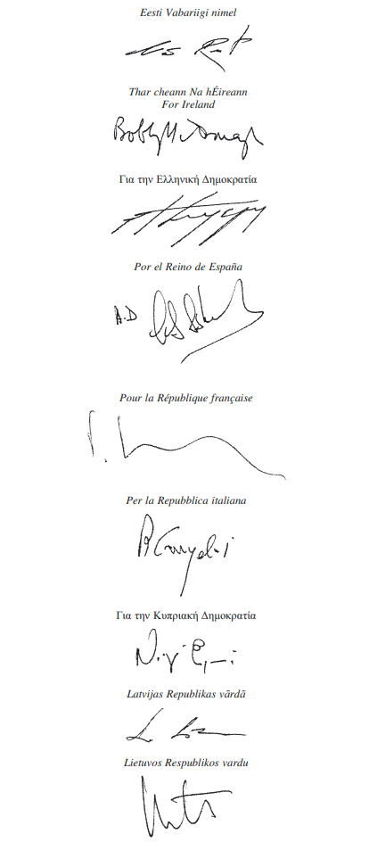

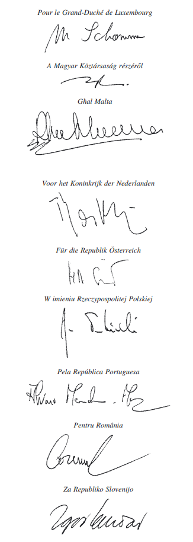

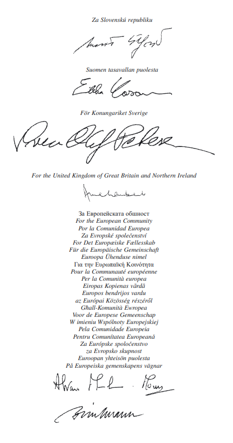

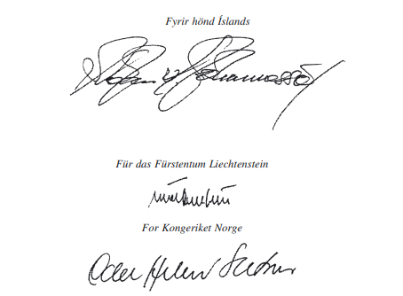

\*

ANNEXE A

\**LISTE VISEE A L’ARTICLE 3 DE L’ACCORD**

PARTIE I

\**Actes visés dans l’Accord EEE modifié par l’acte relatif aux conditions d’adhésion à l’Union européenne de la République de Bulgarie et de la Roumanie et aux adaptations des traités sur lesquels est fondée l’Union européenne et, le cas échéant, par le protocole relatif aux conditions et modalités de la République de Bulgarie et de la Roumanie à l’Union européenne**

Les tirets visés à l’article 3, paragraphes 2 et 3, sont insérés à l’endroit suivant dans les annexes et protocoles de l’accord EEE:

A l’annexe II (Réglementations techniques, normes, essais et certification), chapitre XXVII (Boissons spiritueuses):

aash Point 1 ([Règlement (CEE) N° 1576/89](https://legilux.public.lu/eli/reg_ue/1989/1576/jo) du Conseil);

bash Point 3 ([Règlement (CEE) N° 1601/91](https://legilux.public.lu/eli/reg_ue/1991/1601/jo) du Conseil).

A l’annexe XIII (Transports):

aash Point 19 ([Directive 96/26/CE](https://legilux.public.lu/eli/dir_ue/1996/26/jo) du Conseil).

A l’annexe XVII (Propriété intellectuelle):

aash Point 6 ([Règlement (CEE) N° 1768/92](https://legilux.public.lu/eli/reg_ue/1992/1768/jo) du Conseil);

bash Point 6a ([Règlement (CE) N° 1610/96](https://legilux.public.lu/eli/reg_ue/1996/1610/jo) du Parlement européen et du Conseil).

PARTIE II

\**Autres modifications aux annexes de l’Accord EEE**

Les modifications suivantes sont apportées aux annexes de l’accord EEE:

Annexe V (Libre circulation des travailleurs):

1\) Au point 3 ([directive 68/360/CEE](https://legilux.public.lu/eli/dir_ue/1968/360/jo) du Conseil), l’adaptation e) ii) est remplacée par le texte suivant:

> «ii) la note en bas de page est remplacée par le texte suivant:
>
> «Allemand(s), autrichien(s), belge(s), britannique(s), bulgare(s), chypriote(s), danois, espagnol(s), estonien(s), finlandais, français, grec(s), hongrois, irlandais, islandais, italien(s), letton(s), liechtensteinois, lituanien(s), luxembourgeois, maltais, néerlandais, norvégien(s), polonais, portugais, roumain(s), slovaque(s), slovène(s), suédois et tchèque(s), selon le pays qui délivre la carte.».»

\*

ANNEXE B

\**LISTE VISEE A L’ARTICLE 4 DE L’ACCORD**

Les annexes de l’accord EEE sont modifiées comme suit:

Annexe II (Réglementations techniques, normes, essais et certification):

1\) Au chapitre XV, point 12a, le texte suivant est inséré après le texte relatif aux dispositions provisoires ([directive 91/414/CEE](https://legilux.public.lu/eli/dir_ue/1991/414/jo) du Conseil):

> «Les dispositions provisoires énoncées dans les annexes de l’acte d’adhésion du 25 avril 2005 ou, le cas échéant, du protocole d’adhésion du 25 avril 2005 en ce qui concerne la Roumanie (annexe VII, chapitre 5, section B, partie II) sont applicables.»;

2\) Au chapitre XVII, point 7, le texte suivant est inséré entre le texte relatif aux dispositions provisoires et le texte de l’adaptation ([directive 94/62/CE](https://legilux.public.lu/eli/dir_ue/1994/62/jo) du Parlement européen et du Conseil):

> «Les dispositions provisoires énoncées dans les annexes de l’acte d’adhésion du 25 avril 2005 ou, le cas échéant, du protocole d’adhésion du 25 avril 2005 en ce qui concerne la Bulgarie (annexe VI, chapitre 10, section B, point 2) et la Roumanie (annexe VII, chapitre 9, section B, point 2) sont applicables.»;

3\) Au chapitre XVII, point 8 ([directive 94/63/CE](https://legilux.public.lu/eli/dir_ue/1994/63/jo) du Parlement européen et du Conseil), le texte suivant est inséré entre le texte relatif aux dispositions provisoires et le texte de l’adaptation:

> «Les dispositions provisoires énoncées dans les annexes de l’acte d’adhésion du 25 avril 2005 ou, le cas échéant, du protocole d’adhésion du 25 avril 2005 en ce qui concerne la Bulgarie (annexe VI, chapitre 10, section A, point 1) et la Roumanie (annexe VII, chapitre 9, section A) sont applicables.»;

4\) Au chapitre XXV, point 3 ([directive 2001/37/CE](https://legilux.public.lu/eli/dir_ue/2001/37/jo) du Parlement européen et du Conseil), le texte suivant est inséré avant le texte de l’adaptation:

> «Les dispositions provisoires énoncées dans les annexes de l’acte d’adhésion du 25 avril 2005 ou, le cas échéant, du protocole d’adhésion du 25 avril 2005 en ce qui concerne la Bulgarie (annexe VI, chapitre 7) sont applicables.».

Annexe V (Libre circulation des travailleurs):

Sous l’intitulé «*Période de transition*», le deuxième alinéa est remplacé par le texte suivant:

> «Les dispositions provisoires énoncées dans les annexes de l’acte d’adhésion du 25 avril 2005 ou, le cas échéant, du protocole d’adhésion du 25 avril 2005 en ce qui concerne la Bulgarie (annexe VI, chapitre 1) et la Roumanie (annexe VII, chapitre 1) sont applicables.
>
> En ce qui concerne les mécanismes de sauvegarde mentionnés dans les dispositions provisoires visées aux paragraphes précédents, à l’exception des dispositions relatives à Malte, *le Protocole 44 concernant les mécanismes de sauvegarde prévus pour les élargissements de l’Espace économique européen* est applicable.»

Annexe VIII (Droit d’établissement):

Sous l’intitulé «*Période de transition*», le deuxième alinéa est remplacé par le texte suivant:

> «Les dispositions provisoires énoncées dans les annexes de l’acte d’adhésion du 25 avril 2005 ou, le cas échéant, du protocole d’adhésion du 25 avril 2005 en ce qui concerne la Bulgarie (annexe VI, chapitre 1) et la Roumanie (annexe VII, chapitre 1) sont applicables.
>
> En ce qui concerne les mécanismes de sauvegarde mentionnés dans les dispositions provisoires visées aux paragraphes précédents, à l’exception des dispositions relatives à Malte, *le Protocole 44 concernant les mécanismes de sauvegarde prévus pour les élargissements de l’Espace économique européen* est applicable.»

Annexe IX (Services financiers):

Au point 30c ([directive 97/9/CE](https://legilux.public.lu/eli/dir_ue/1997/9/jo) du Parlement européen et du Conseil), le texte suivant est ajouté:

> «Les dispositions provisoires énoncées dans les annexes de l’acte d’adhésion du 25 avril 2005 ou, le cas échéant, du protocole d’adhésion du 25 avril 2005 en ce qui concerne la Bulgarie (annexe VI, chapitre 2) et la Roumanie (annexe VII, chapitre 2) sont applicables.».

Annexe XI (Services de télécommunication):

Au point 5cm ([directive 2002/22/CE](https://legilux.public.lu/eli/dir_ue/2002/22/jo) du Parlement européen et du Conseil), l’alinéa suivant est inséré avant le texte de l’adaptation:

> «Les dispositions provisoires énoncées dans les annexes de l’acte d’adhésion du 25 avril 2005 ou, le cas échéant, du protocole d’adhésion du 25 avril 2005 en ce qui concerne la Bulgarie (annexe VI, chapitre 9) sont applicables.».

Annexe XII (Libre circulation des capitaux):

L’alinéa suivant est inséré après le texte figurant sous l’intitulé «*Période de transition*»:

> «Les dispositions provisoires énoncées dans les annexes de l’acte d’adhésion du 25 avril 2005 ou, le cas échéant, du protocole d’adhésion du 25 avril 2005 en ce qui concerne la Bulgarie (annexe VI, chapitre 3) et la Roumanie (annexe VII, chapitre 3) sont applicables.».

Annexe XIII (Transports):

1\) Au point 15a ([directive 96/53/CE](https://legilux.public.lu/eli/dir_ue/1996/53/jo) du Conseil), le texte suivant est ajouté:

> «Les dispositions provisoires énoncées dans les annexes de l’acte d’adhésion du 25 avril 2005 ou, le cas échéant, du protocole d’adhésion du 25 avril 2005 en ce qui concerne la Bulgarie (annexe VI, chapitre 5, point 3) et la Roumanie (annexe VII, chapitre 6, point 2) sont applicables.»;

2\) Au point 18a ([directive 1999/62/CE](https://legilux.public.lu/eli/dir_ue/1999/62/jo) du Parlement européen et du Conseil), le texte suivant est inséré entre le texte relatif aux dispositions provisoires et le texte de l’adaptation:

> «Les dispositions provisoires énoncées dans les annexes de l’acte d’adhésion du 25 avril 2005 ou, le cas échéant, du protocole d’adhésion du 25 avril 2005 en ce qui concerne la Roumanie (annexe VII, chapitre 6, point 3) sont applicables.»;

3\) Au point 19 ([directive 96/26/CE](https://legilux.public.lu/eli/dir_ue/1996/26/jo) du Conseil), l’alinéa suivant est inséré entre le texte relatif aux dispositions provisoires et le texte de l’adaptation:

> «Les dispositions provisoires énoncées dans les annexes de l’acte d’adhésion du 25 avril 2005 ou, le cas échéant, du protocole d’adhésion du 25 avril 2005 en ce qui concerne la Bulgarie (annexe VI, chapitre 5, point 2) sont applicables.»;

4\) Au point 26c ([règlement (CEE) N° 3118/93](https://legilux.public.lu/eli/reg_ue/1993/3118/jo) du Conseil), le deuxième alinéa, concernant les dispositions provisoires, est remplacé par le texte suivant:

> «Les dispositions provisoires énoncées dans les annexes de l’acte d’adhésion du 25 avril 2005 ou, le cas échéant, du protocole d’adhésion du 25 avril 2005 en ce qui concerne la Bulgarie (annexe VI, chapitre 5, point 1) et la Roumanie (annexe VII, chapitre 6, point 1) sont applicables.
>
> En ce qui concerne les mécanismes de sauvegarde mentionnés dans les dispositions provisoires visées aux paragraphes précédents, *le Protocole 44 concernant les mécanismes de sauvegarde prévus pour les élargissements de l’Espace économique européen* est applicable.».

Annexe XV (Aides d’Etat):

1\) L’alinéa suivant est ajouté à la fin des «*Adaptations sectorielles*»:

> «Les dispositions relatives aux régimes actuels d’aide, énoncées au chapitre 2 (politique de concurrence) de l’annexe V de l’acte d’adhésion du 25 avril 2005 ou, le cas échéant, du protocole d’adhésion du 25 avril 2005, s’appliquent entre les parties contractantes.»;

2\) L’alinéa suivant est inséré avant l’intitulé «*Actes auxquels il est fait référence*»:

> «*Période de transition*
>
> Les dispositions provisoires énoncées dans les annexes de l’acte d’adhésion du 25 avril 2005 ou, le cas échéant, du protocole d’adhésion du 25 avril 2005 en ce qui concerne la Roumanie (annexe VII, chapitre 4) sont applicables.».

Annexe XVII (Propriété intellectuelle):

Le texte suivant est ajouté sous l’intitulé «*Adaptations sectorielles*»:

> «Le mécanisme spécifique prévu au chapitre 1 (droit des sociétés) de l’annexe V de l’acte d’adhésion du 25 avril 2005 ou, le cas échéant, du protocole d’adhésion du 25 avril 2005 s’applique entre les parties contractantes.».

Annexe XVIII (Santé et sécurité au travail, droit du travail et égalité de traitement des hommes et des femmes):

Au point 30 ([directive 96/71/CE](https://legilux.public.lu/eli/dir_ue/1996/71/jo) du Parlement européen et du Conseil), le deuxième alinéa, concernant les dispositions provisoires, est remplacé par le texte suivant:

> «Les dispositions provisoires énoncées dans les annexes de l’acte d’adhésion du 25 avril 2005 ou, le cas échéant, du protocole d’adhésion du 25 avril 2005 en ce qui concerne la Bulgarie (annexe VI, chapitre 1) et la Roumanie (annexe VII, chapitre 1) sont applicables.
>
> En ce qui concerne les mécanismes de sauvegarde mentionnés dans les dispositions provisoires visées aux paragraphes précédents, *le Protocole 44 concernant les mécanismes de sauvegarde prévus pour les élargissements de l’Espace économique européen* est applicable.».

Annexe XX (Environnement):

1\) Au point 1f ([directive 96/61/CE](https://legilux.public.lu/eli/dir_ue/1996/61/jo) du Conseil), l’alinéa suivant est ajouté:

> «Les dispositions provisoires énoncées dans les annexes de l’acte d’adhésion du 25 avril 2005 ou, le cas échéant, du protocole d’adhésion du 25 avril 2005 en ce qui concerne la Bulgarie (annexe VI, chapitre 10, section D, point 1) et la Roumanie (annexe VII, chapitre 9, section D, point 1) sont applicables.»;

2\) Au point 7a ([directive 98/83/CE](https://legilux.public.lu/eli/dir_ue/1998/89/jo) du Conseil), l’alinéa suivant est ajouté:

> «Les dispositions provisoires énoncées dans les annexes de l’acte d’adhésion du 25 avril 2005 ou, le cas échéant, du protocole d’adhésion du 25 avril 2005 en ce qui concerne la Roumanie (annexe VII, chapitre 9, section C, point 5) sont applicables.»;

3\) Au point 9 ([directive 83/513/CEE](https://legilux.public.lu/eli/dir_ue/1983/513/jo) du Conseil), l’alinéa suivant est inséré entre le texte relatif aux dispositions provisoires et le texte de l’adaptation:

> «Les dispositions provisoires énoncées dans les annexes de l’acte d’adhésion du 25 avril 2005 ou, le cas échéant, du protocole d’adhésion du 25 avril 2005 en ce qui concerne la Roumanie (annexe VII, chapitre 9, section C, point 1) sont applicables.»;

4\) Au point 10 ([directive 84/156/CEE](https://legilux.public.lu/eli/dir_ue/1984/156/jo) du Conseil), l’alinéa suivant est inséré entre le texte relatif aux dispositions provisoires et le texte de l’adaptation:

> «Les dispositions provisoires énoncées dans les annexes de l’acte d’adhésion du 25 avril 2005 ou, le cas échéant, du protocole d’adhésion du 25 avril 2005 en ce qui concerne la Roumanie (annexe VII, chapitre 9, section C, point 1) sont applicables.»;

5\) Au point 11 ([directive 84/491/CEE](https://legilux.public.lu/eli/dir_ue/1984/491/jo) du Conseil), l’alinéa suivant est inséré avant le texte de l’adaptation:

> «Les dispositions provisoires énoncées dans les annexes de l’acte d’adhésion du 25 avril 2005 ou, le cas échéant, du protocole d’adhésion du 25 avril 2005 en ce qui concerne la Roumanie (annexe VII, chapitre 9, section C, point 2) sont applicables.»;

6\) Au point 12 ([directive 86/280/CEE](https://legilux.public.lu/eli/dir_ue/1986/280/jo) du Conseil), l’alinéa suivant est inséré entre le texte relatif aux dispositions provisoires et le texte de l’adaptation:

> «Les dispositions provisoires énoncées dans les annexes de l’acte d’adhésion du 25 avril 2005 ou, le cas échéant, du protocole d’adhésion du 25 avril 2005 en ce qui concerne la Roumanie (annexe VII, chapitre 9, section C, point 3) sont applicables.»;

7\) Au point 13 ([directive 91/271/CEE](https://legilux.public.lu/eli/dir_ue/1991/271/jo) du Conseil), l’alinéa suivant est inséré entre le texte relatif aux dispositions provisoires et le texte de l’adaptation:

> «Les dispositions provisoires énoncées dans les annexes de l’acte d’adhésion du 25 avril 2005 ou, le cas échéant, du protocole d’adhésion du 25 avril 2005 en ce qui concerne la Bulgarie (annexe VI, chapitre 10, section C) et la Roumanie (annexe VII, chapitre 9, section C, point 4) sont applicables.»;

8\) Au point 19a ([directive 2001/80/CEE](https://legilux.public.lu/eli/dir_ue/2001/80/jo) du Parlement européen et du Conseil), l’alinéa suivant est inséré entre le texte relatif aux dispositions provisoires et le texte de l’adaptation:

> «Les dispositions provisoires énoncées dans les annexes de l’acte d’adhésion du 25 avril 2005 ou, le cas échéant, du protocole d’adhésion du 25 avril 2005 en ce qui concerne la Bulgarie (annexe VI, chapitre 10, section D, point 2) et la Roumanie (annexe VII, chapitre 9, section D, point 3) sont applicables.»;

9\) Au point 21ad ([directive 1999/32/CE](https://legilux.public.lu/eli/dir_ue/1999/32/jo) du Conseil), l’alinéa suivant est inséré entre le texte relatif aux dispositions provisoires et le texte de l’adaptation:

> «Les dispositions provisoires énoncées dans les annexes de l’acte d’adhésion du 25 avril 2005 ou, le cas échéant, du protocole d’adhésion du 25 avril 2005 en ce qui concerne la Bulgarie (annexe VI, chapitre 10, section A, point 2) sont applicables.»;

10\) Au point 32c ([règlement (CEE) N° 259/93](https://legilux.public.lu/eli/reg_ue/1993/259/jo) du Conseil), l’alinéa suivant est inséré entre le texte relatif aux dispositions provisoires et le texte de l’adaptation:

> «Les dispositions provisoires énoncées dans les annexes de l’acte d’adhésion du 25 avril 2005 ou, le cas échéant, du protocole d’adhésion du 25 avril 2005 en ce qui concerne la Bulgarie (annexe VI, chapitre 10, section B, point 1) et la Roumanie (annexe VII, chapitre 9, section B, point 1) sont applicables.»;

11\) Au point 32d ([directive 1999/31/CE](https://legilux.public.lu/eli/dir_ue/1999/31/jo) du Conseil), l’alinéa suivant est ajouté:

> «Les dispositions provisoires énoncées dans les annexes de l’acte d’adhésion du 25 avril 2005 ou, le cas échéant, du protocole d’adhésion du 25 avril 2005 en ce qui concerne la Bulgarie (annexe VI, chapitre 10, section B, point 3) et la Roumanie (annexe VII, chapitre 9, section B, point 3) sont applicables.»;

12\) Au point 32f ([directive 2000/76/CE](https://legilux.public.lu/eli/dir_ue/2000/76/jo) du Parlement européen et du Conseil), l’alinéa suivant est inséré avant le texte de l’adaptation:

> «Les dispositions provisoires énoncées dans les annexes de l’acte d’adhésion du 25 avril 2005 ou, le cas échéant, du protocole d’adhésion du 25 avril 2005 en ce qui concerne la Roumanie (annexe VII, chapitre 9, section D, point 2) sont applicables.»;

13\) Au point 32fa ([directive 2002/96/CE](https://legilux.public.lu/eli/dir_ue/2002/96/jo) du Parlement européen et du Conseil), l’alinéa suivant est inséré entre le texte relatif aux dispositions provisoires et le texte de l’adaptation:

> «Les dispositions provisoires énoncées dans les annexes de l’acte d’adhésion du 25 avril 2005 ou, le cas échéant, du protocole d’adhésion du 25 avril 2005 en ce qui concerne la Bulgarie (annexe VI, chapitre 10, section B, point 4) et la Roumanie (annexe VII, chapitre 9, section B, point 4) sont applicables.».

\*

\**ACTE FINAL**

Les plénipotentiaires

\*de la Communauté européenne,* ci-après dénommée «la Communauté»,

et

\*du Royaume de Belgique,*

\*de la République tchèque,*

\*du Royaume de Danemark,*

\*de la République fédérale d’Allemagne,*

\*de la République d’Estonie,*

\*d’Irlande,*

\*de la République hellénique,*

\*du Royaume d’Espagne,*

\*de la République française,*

\*de la République italienne,*

\*de la République de Chypre,*

\*de la République de Lettonie,*

\*de la République de Lituanie,*

\*du Grand-Duché de Luxembourg,*

\*de la République de Hongrie,*

\*de Malte,*

\*du Royaume des Pays-Bas,*

\*de la République d’Autriche,*

\*de la République de Pologne,*

\*de la République portugaise,*

\*de la République de Slovénie,*

\*de la République slovaque,*

\*de la République de Finlande,*

\*du Royaume de Suède,*

\*du Royaume-Uni de Grande-Bretagne et d’Irlande du Nord,*

parties contractantes au traité instituant la *Communauté européenne*, ci-après dénommées «les Etats membres de la Communauté», et

les plénipotentiaires

\*d’Islande,*

\*de la Principauté de Liechtenstein,*

\*du Royaume de Norvège,*

ci-après dénommés «les Etats de l’AELE»,

tous parties contractantes à l’accord sur l’Espace économique européen conclu à Porto le 2 mai 1992, ci-après dénommé «l’accord EEE», ci-après dénommées conjointement «les parties contractantes actuelles», et

les plénipotentiaires

\*de la République de Bulgarie,*

\*de la Roumanie,*

ci-après dénommées «les nouvelles parties contractantes»,

réunis à Bruxelles, le vingt-cinq juillet deux mille sept, pour la signature de l’accord sur la participation de la République de Bulgarie et de la Roumanie à l’Espace économique européen, ont arrêté les textes suivants:

I. Accord sur la participation de la République de Bulgarie et de la Roumanie à l’Espace économique européen (ci-après dénommé «l’accord»).

II. Les textes énumérés ci-après, qui sont annexés à l’accord:

| Annexe A: | Liste visée à l’article 3 de l’accord; |
|---|---|
| Annexe B: | Liste visée à l’article 4 de l’accord. |

Les plénipotentiaires des parties contractantes actuelles et ceux des nouvelles parties contractantes ont adopté les déclarations communes énumérées ci-après et annexées au présent acte final:

1\. Déclaration commune relative à la ratification rapide de l’accord sur la participation de la République de Bulgarie et de la Roumanie à l’Espace économique européen;

2\. Déclaration commune relative à la date d’expiration des dispositions provisoires;

3\. Déclaration commune concernant l’application des règles d’origine après l’entrée en vigueur de l’accord sur la participation de la République de Bulgarie et de la Roumanie à l’Espace économique européen;

4\. Déclaration commune sur les échanges de produits agricoles et de produits agricoles transformés;

5\. Déclaration commune sur l’adaptation sectorielle du Liechtenstein dans le domaine de la libre circulation des personnes;

6\. Déclaration commune sur les secteurs prioritaires mentionnés dans le protocole 38*bis*;

7\. Déclaration commune sur les contributions financières.

Les plénipotentiaires des parties contractantes actuelles et ceux des nouvelles parties contractantes ont pris note des déclarations énumérées ci-après et annexées au présent acte final:

1\. Déclaration commune générale des Etats de l’AELE;

2\. Déclaration commune des Etats de l’AELE sur la libre circulation des travailleurs;

3\. Déclaration unilatérale du gouvernement du Liechtenstein relative à l’addendum au protocole 38*bis*.

Ils sont, en outre, convenus que, au plus tard à l’entrée en vigueur de l’accord, l’accord EEE, modifié par le protocole portant adaptation de l’accord EEE et l’intégralité des textes de chacune des décisions du Comité mixte de l’EEE doivent être établis et authentifiés par les représentants des parties contractantes actuelles et ceux des nouvelles parties contractantes en langues bulgare et roumaine.

Ils prennent note de l’accord sous forme d’échange de lettres entre la Communauté européenne et le Royaume de Norvège relatif à un programme de coopération pour la croissance économique et le développement durable en Bulgarie, qui est annexé au présent acte final.

Ils prennent également note de l’accord sous forme d’échange de lettres entre la Communauté européenne et le Royaume de Norvège relatif à un programme de coopération pour la croissance économique et le développement durable en Roumanie, qui est annexé au présent acte final.

Ils prennent, par ailleurs, note du protocole additionnel à l’accord entre la Communauté économique européenne et l’Islande, à la suite de l’adhésion de la République de Bulgarie et de la Roumanie à l’Union européenne, qui est annexé au présent acte final.

Ils prennent, en outre, note du protocole additionnel à l’accord entre la Communauté économique européenne et le Royaume de Norvège, à la suite de l’adhésion de la République de Bulgarie et de la Roumanie à l’Union européenne, qui est également annexé au présent acte final.

Ils soulignent que les accords et les protocoles susmentionnés ont été convenus en partant de l’hypothèse que la participation à l’Espace économique européen reste inchangée.

Fait à Bruxelles, le vingt-cinq juillet deux mille sept.

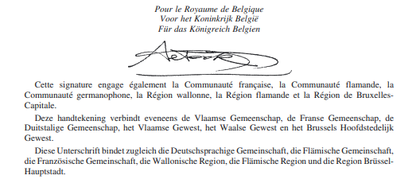

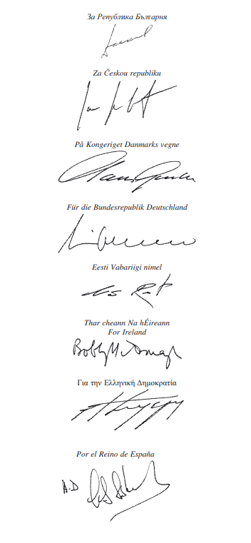

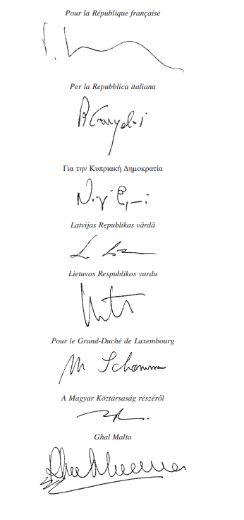

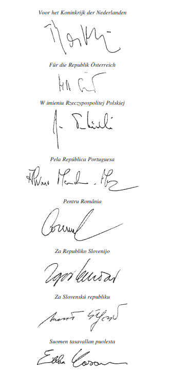

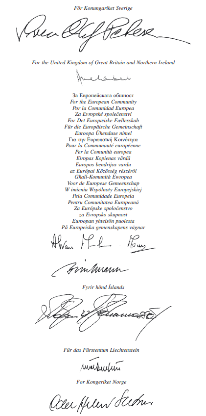

\*

\**DECLARATIONS COMMUNES DES PARTIES CONTRACTANTES  ACTUELLES ET DES NOUVELLES PARTIES CONTRACTANTES  A L’ACCORD**

\**DECLARATION COMMUNE**

\**relative à la ratification rapide de l’Accord sur la participation de la République de Bulgarie  et de la Roumanie à l’espace économique européen**

Les parties contractantes actuelles et les nouvelles parties contractantes soulignent l’importance d’une ratification ou d’une approbation rapides de l’accord sur la participation de la République de Bulgarie et de la Roumanie à l’Espace économique européen par les parties contractantes actuelles et les nouvelles parties contractantes conformément à leurs règles constitutionnelles respectives pour assurer le bon fonctionnement de l’Espace économique européen.

\*

\**DECLARATION COMMUNE**

\**relative à la date d’expiration des dispositions provisoires**

Les dispositions provisoires du traité d’adhésion sont reprises dans l’accord EEE et prennent fin à la date à laquelle elles seraient venues à expiration si l’élargissement de l’Union européenne et celui de l’EEE avaient eu lieu simultanément le 1er janvier 2007.

\*

\**DECLARATION COMMUNE**

\**concernant l’application des règles d’origine après l’entrée en vigueur de l’accord sur la participation de la République de Bulgarie et de la Roumanie à l’espace économique européen**

1\. La preuve de l’origine régulièrement délivrée par un Etat de l’AELE ou une nouvelle partie contractante dans le cadre d’un accord préférentiel conclu entre les Etats de l’AELE et la nouvelle partie contractante ou de dispositions nationales unilatérales en vigueur dans un Etat de l’AELE ou une nouvelle partie contractante est considérée comme étant la preuve de l’origine préférentielle de l’EEE, à condition que:

a) ) la preuve de l’origine et les documents de transport aient été émis au plus tard le jour précédant la date d’adhésion de la nouvelle partie contractante à l’Union européenne;

b) la preuve de l’origine soit produite aux autorités douanières au plus tard quatre mois après l’entrée en vigueur de l’accord.

Lorsque des marchandises ont été déclarées pour l’importation, à partir d’un Etat de l’AELE ou d’une nouvelle partie contractante, dans une nouvelle partie contractante ou un Etat de l’AELE avant la date d’adhésion de la nouvelle partie contractante à l’Union européenne, dans le cadre d’accords préférentiels en vigueur entre un Etat de l’AELE et une nouvelle partie contractante, la preuve de l’origine délivrée rétroactivement dans le cadre de ces dispositions peut également être acceptée dans les Etats de l’AELE ou les nouvelles parties contractantes à condition qu’elle soit présentée aux autorités douanières au plus tard quatre mois après l’entrée en vigueur de l’accord.

2\. Les Etats de l’AELE, d’une part, et la République de Bulgarie et la Roumanie, d’autre part, sont autorisés à maintenir les autorisations par lesquelles le statut d’«exportateur agréé» a été octroyé dans le cadre d’accords conclus entre les Etats de l’AELE, d’une part, et la République de Bulgarie ou la Roumanie, d’autre part, à condition que les exportateurs agréés appliquent les règles d’origine de l’EEE.

Les Etats de l’AELE et la République de Bulgarie et la Roumanie sont tenus de remplacer ces autorisations par de nouvelles autorisations délivrées aux conditions fixées dans le protocole 4 de l’accord sur l’Espace économique européen, au plus tard un an après la date d’entrée en vigueur de l’accord.

3\. Les demandes de contrôle a posteriori des preuves de l’origine délivrées dans le cadre des accords préférentiels et des dispositions visés aux paragraphes 1 et 2 ci-dessus sont acceptées par les autorités compétentes des Etats de l’AELE et des nouvelles parties contractantes pendant une période de trois ans après la délivrance de la preuve de l’origine concernée et peuvent être présentées par ces autorités pendant une période de trois ans après l’acceptation de la preuve de l’origine.

\*

\**DECLARATION COMMUNE**

\**sur les échanges de produits agricoles et de produits agricoles transformés**

1\. Dans le cadre des négociations sur l’élargissement de l’EEE, des consultations ont eu lieu entre les parties contractantes actuelles et les nouvelles parties contractantes pour examiner la nécessité d’adapter les concessions commerciales bilatérales sur les produits agricoles et les produits agricoles transformés dans les parties concernées de l’accord EEE ou les accords bilatéraux concernés entre la Communauté européenne et l’Islande, le Liechtenstein et la Norvège, respectivement, à la lumière de l’élargissement de l’Union européenne.

2\. Les parties contractantes actuelles et les nouvelles parties contractantes ont examiné produit par produit les conditions d’accès au marché et sont convenues qu’aucune concession commerciale supplémentaire concernant les produits agricoles ou les produits agricoles transformés ne sera ajoutée aux accords existants dans le cadre de l’élargissement.

3\. Les parties contractantes actuelles et les nouvelles parties contractantes sont convenues que l’Islande, le Liechtenstein et la Norvège s’engagent à ne revendiquer, demander ou renvoyer, ni modifier ou retirer aucune concession en vertu des articles XXIV.6 et XXVIII du GATT de 1994 concernant les produits agricoles, en liaison avec cet élargissement de l’Union européenne.

\*

\**DECLARATION COMMUNE**

\**sur l’adaptation sectorielle du Liechtenstein dans le domaine de la libre circulation des personnes**

Les parties contractantes actuelles et les nouvelles parties contractantes:

aash se référant aux adaptations sectorielles pour le Liechtenstein dans le domaine de la libre circulation des personnes introduites par la décision du Comité mixte de l’EEE N° 191/1999 et modifiées par l’accord sur la participation de la République tchèque, de la République d’Estonie, de la République de Chypre, de la République de Lettonie, de la République de Lituanie, de la République de Hongrie, de la République de Malte, de la République de Pologne, de la République de Slovénie et de la République slovaque à l’Espace économique européen du 14 octobre 2003,

bash observant la forte demande actuelle émanant de ressortissants des Etats membres de la CE et des Etats de l’AELE visant à obtenir le droit de séjour au Liechtenstein, qui dépasse le taux d’immigration net défini dans le régime susmentionné,

cash considérant que la participation de la Bulgarie et de la Roumanie à l’EEE entraîne pour un nombre plus important de ressortissants le droit d’invoquer la libre circulation des personnes telle qu’elle figure dans l’accord EEE,

conviennent de tenir dûment compte de cette situation de fait ainsi que de la capacité d’absorption inchangée du Liechtenstein lors de l’examen des adaptations sectorielles prévues aux annexes V et VIII de l’accord EEE.

\*

\**DECLARATION COMMUNE**

\**sur les secteurs prioritaires mentionnés dans le protocole 38*bis***

Les parties contractantes actuelles et les nouvelles parties contractantes rappellent que tous les secteurs prioritaires tels qu’il sont définis à l’article 3 du protocole 38*bis* ne doivent pas être couverts dans chaque Etat bénéficiaire.

\*

\**DECLARATION COMMUNE**

\**sur les contributions financières**

Les parties contractantes actuelles et les nouvelles parties contractantes conviennent que les différentes modalités de contribution financière convenues dans le cadre de l’élargissement de l’EEE ne constituent pas un précédent pour la période suivant leur expiration le 30 avril 2009.

\*

\**AUTRES DECLARATIONS D’UNE OU DE PLUSIEURS PARTIES  CONTRACTANTES A L’ACCORD**

\**DECLARATION COMMUNE GENERALE  des Etats de l’AELE**

Les Etats de l’AELE prennent note des déclarations, qui présentent de l’intérêt pour l’accord EEE, jointes à l’acte final du traité entre le Royaume de Belgique, la République tchèque, le Royaume de Danemark, la République fédérale d’Allemagne, la République d’Estonie, la République hellénique, le Royaume d’Espagne, la République française, l’Irlande, la République italienne, la République de Chypre, la République de Lettonie, la République de Lituanie, le Grand-Duché de Luxembourg, la République de Hongrie, la République de Malte, le Royaume des Pays-Bas, la République d’Autriche, la République de Pologne, la République portugaise, la République de Slovénie, la République slovaque, la République de Finlande, le Royaume de Suède et le Royaume-Uni de Grande-Bretagne et d’Irlande du Nord (Etats membres de l’Union européenne) et la République de Bulgarie et la Roumanie relatif à l’adhésion de la République de Bulgarie et de la Roumanie à l’Union européenne.

Les Etats de l’AELE soulignent que les déclarations, qui présentent de l’intérêt pour l’accord EEE, jointes à l’acte final du traité visé à l’alinéa précédent ne peuvent être interprétées ou appliquées d’une manière contraire aux obligations des parties contractantes actuelles et des nouvelles parties contractantes découlant du présent accord ou de l’accord EEE.

\*

\**DECLARATION COMMUNE  des Etats de l’AELE sur la libre circulation des travailleurs**

Les Etats de l’AELE soulignent les importants éléments de différenciation et de souplesse que présentent les dispositions relatives à la libre circulation des travailleurs. Ils s’efforcent, dans le cadre de leur droit national, d’accorder un plus large accès à leur marché du travail aux ressortissants de la République de Bulgarie et de la Roumanie en vue d’accélérer l’alignement sur l’acquis. Par conséquent, les possibilités d’emploi dans les Etats de l’AELE pour les ressortissants de la République de Bulgarie et de la Roumanie devraient s’améliorer sensiblement dès l’adhésion de ces Etats. En outre, les Etats de l’AELE feront le meilleur usage des dispositions proposées pour appliquer pleinement dans les plus brefs délais l’acquis dans le domaine de la libre circulation des travailleurs. Dans le cas du Liechtenstein, il sera tenu compte à cet effet des dispositions spécifiques prévues dans les adaptations sectorielles des annexes V (Libre circulation des travailleurs) et VIII (Droit d’établissement) de l’accord EEE.

\*

\**DECLARATION UNILATERALE  du gouvernement du Liechtenstein relative à l’Addendum au protocole 38bis**

Le gouvernement du Liechtenstein:

aash se référant à l’addendum au protocole 38bis,

bash rappelant l’arrangement selon lequel la Bulgarie et la Roumanie doivent bénéficier des contributions des Etats de l’AELE pour réduire les disparités économiques et sociales au sein de l’Espace économique européen dans la même mesure que les Etats bénéficiaires mentionnés à l’article 5 du protocole 38bis et compte tenu de la clé de répartition prévue dans cet article,

cash constatant que les Etats de l’AELE ont réalisé un effort extraordinaire au sein du mécanisme financier de l’EEE pour augmenter les financements en faveur de la Bulgarie et de la Roumanie,

tient pour acquis que, lors du réexamen prévu à l’article 9 du protocole 38*bis*, tout arrangement financier éventuellement convenu tiendra compte des réductions des disparités économiques et sociales déjà réalisées afin de réduire proportionnellement les contributions des trois Etats de l’AELE, si un ou plusieurs des Etats bénéficiaires actuels ne se qualifient plus pour un financement au titre d’un tel arrangement.

\*

\**ACCORD SOUS FORME D’ECHANGE DE LETTRES  ENTRE LA COMMUNAUTE EUROPEENNE ET LE ROYAUME DE NORVEGE**

\**relatif à un programme de coopération pour la croissance économique  et le développement durable en Bulgarie**

A. *Lettre de la Communauté européenne*

Monsieur,

J’ai l’honneur de me référer aux négociations qui ont eu lieu entre la Communauté européenne et le Royaume de Norvège («la Norvège») dans le cadre de la demande de la Bulgarie pour devenir partie contractante à l’accord EEE et de la mise en place d’un programme de coopération visant à promouvoir la croissance économique et le développement durable en Bulgarie.

Ces négociations ont abouti aux résultats suivants:

1\) un programme de coopération visant à promouvoir le développement social et économique en Bulgarie par l’intermédiaire de projets bilatéraux est établi entre la Norvège et la Bulgarie, conformément à un accord bilatéral entre ces deux Etats. Le texte de l’accord bilatéral est annexé au présent échange de lettres, dont il fait partie intégrante;

2\) aux fins du présent programme, la Norvège attribue un montant total de 20 millions EUR, à engager en une seule tranche en 2007. Ce montant sera disponible à partir de la date d’entrée en vigueur de l’accord sur la participation de la République de Bulgarie et de la Roumanie à l’Espace économique européen ou d’un accord visant à appliquer cet accord à titre provisoire, jusqu’au 30 avril 2009;

3\) le présent échange de lettres:

a) est ratifié ou approuvé par la Communauté européenne et la Norvège selon les procédures qui leur sont propres. Les instruments de ratification ou d’approbation sont déposés auprès du secrétariat général du Conseil de l’Union européenne;

b) il entre en vigueur le jour suivant le dépôt du dernier instrument de ratification ou d’approbation, sous réserve que les instruments de ratification ou d’approbation des accords connexes ci-après aient été déposés également:

i) accord sur la participation de la République de Bulgarie et de la Roumanie à l’Espace économique européen;

ii) accord sous forme d’échange de lettres entre la Communauté européenne et le Royaume de Norvège relatif à un programme de coopération pour la croissance économique et le développement durable en Roumanie;

iii) protocole additionnel à l’accord entre la Communauté économique européenne et l’Islande, à la suite de l’adhésion de la République de Bulgarie et de la Roumanie à l’Union européenne; et

iv) protocole additionnel à l’accord entre la Communauté économique européenne et le Royaume de Norvège, à la suite de l’adhésion de la République de Bulgarie et de la Roumanie à l’Union européenne.

Je vous saurais gré de bien vouloir me confirmer votre accord sur le contenu de cette lettre.

Veuillez agréer, Monsieur, l’assurance de ma très haute considération.

\*Annexe:* 1

Fait à Bruxelles, le 25.7.2007.

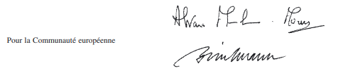

\*

ANNEXE

\**ACCORD SUR UN PROGRAMME DE COOPERATION NORVEGIEN  pour la croissance économique et le développement durable en Bulgarie**

entre

\*Le Royaume de Norvège*

et

\*La République de Bulgarie*

ci-après dénommés «les parties»

\*Article 1*

\***Objectif***

Un programme de coopération norvégien est établi pour promouvoir le développement social et économique en Bulgarie grâce à des projets de coopération bilatérale entre les parties dans le cadre des secteurs visés à l’article 4.

\*Article 2*

\**Portée financière**

Aux fins du programme de coopération norvégien pour la République de Bulgarie, le Royaume de Norvège attribue un montant total de 20 millions EUR, à engager en une seule tranche en 2007.

\*Article 3*

\***Durée***

Le montant visé à l’article 2 est disponible à partir de la date d’entrée en vigueur de l’accord sur la participation de la République de Bulgarie et de la Roumanie à l’Espace économique européen ou à partir de la date d’entrée en vigueur d’un accord visant à appliquer l’accord à titre provisoire, jusqu’au 30 avril 2009.

\*Article 4*

\***Secteurs prioritaires***

Le programme de coopération norvégien pour la Bulgarie soutient des projets de coopération bilatérale entre les candidats éligibles des parties en vue de promouvoir le développement social et économique en République de Bulgarie dans les secteurs prioritaires suivants:

aash réduction des émissions des gaz à effet de serre, y compris des projets d’exécution communs au titre du Protocole de Kyoto, et d’autres émissions dans l’air et dans l’eau;

bash efficacité énergétique et énergies renouvelables;

cash facilitation d’une production durable, y compris la certification et la vérification;

dash mise en oeuvre de l’acquis de Schengen, soutien des plans nationaux d’action Schengen et renforcement de l’appareil judiciaire.

Parmi les actions possibles, on citera notamment l’innovation, le développement des ressources humaines, l’établissement de réseaux, le renforcement des capacités, les transferts de technologie, et la recherche et le développement.

\*Article 5*

\***Plafonds du cofinancement***

La contribution norvégienne sous forme de subventions n’excède pas 60% du coût du projet, sauf dans le cas de projets par ailleurs financés au moyen de dotations budgétaires accordées par des autorités publiques de niveau national, régional ou local, auquel cas elle ne peut être supérieure à 85% du coût du projet. Les plafonds communautaires pour le cofinancement ne sont en aucun cas dépassés. Les contributions aux organisations non gouvernementales et aux partenaires sociaux peuvent atteindre jusqu’à 90% des coûts du projet.

\*Article 6*

\***Gestion***

Le programme de coopération norvégien pour la Bulgarie est géré par le gouvernement norvégien ou par une entité désignée par lui. L’entité chargée de la gestion consulte le point de contact désigné par le gouvernement de la République de Bulgarie. La Commission peut examiner les projets.

D’autres dispositions concernant la mise en oeuvre du présent accord sont introduites par le gouvernement norvégien si nécessaire.

Les frais de gestion du programme de coopération norvégien sont couverts par le montant visé à l’article 2.

\*Article 7*

\***Entrée en vigueur***

Le présent accord est ratifié par le Royaume de Norvège et par la République de Bulgarie selon leurs procédures nationales. Il entre en vigueur le trentième jour qui suit le dépôt par la dernière partie de son instrument de ratification au ministère norvégien des affaires étrangères, mais cette date ne peut être antérieure à la date d’entrée en vigueur de l’accord sur la participation de la République de Bulgarie et de la Roumanie à l’Espace économique européen, ou à partir de la date d’entrée en vigueur d’un accord visant appliquer ce dernier accord à titre provisoire.

FAIT à Bruxelles, le … 2007.

| *Pour le Royaume de Norvège,* | *Pour la République de Bulgarie,* |
|---|---|

\*

B. *Lettre du Royaume de Norvège*

Monsieur,

J’ai l’honneur d’accuser réception de votre lettre de ce jour libellée comme suit:

«J’ai l’honneur de me référer aux négociations qui ont eu lieu entre la Communauté européenne et le Royaume de Norvège («la Norvège») dans le cadre de la demande de la Bulgarie pour devenir partie contractante à l’accord EEE et de la mise en place d’un programme de coopération visant à promouvoir la croissance économique et le développement durable en Bulgarie.

Ces négociations ont abouti aux résultats suivants:

1\) un programme de coopération visant à promouvoir le développement social et économique en Bulgarie par l’intermédiaire de projets bilatéraux est établi entre la Norvège et la Bulgarie, conformément à un accord bilatéral entre ces deux Etats. Le texte de l’accord bilatéral est annexé au présent échange de lettres, dont il fait partie intégrante;

2\) aux fins du présent programme, la Norvège attribue un montant total de 20 millions EUR, à engager en une seule tranche en 2007. Ce montant sera disponible à partir de la date d’entrée en vigueur de l’accord sur la participation de la République de Bulgarie et de la Roumanie à l’Espace économique européen ou d’un accord visant à appliquer cet accord à titre provisoire, jusqu’au 30 avril 2009;

3\) le présent échange de lettres:

a) est ratifié ou approuvé par la Communauté européenne et la Norvège selon les procédures qui leur sont propres. Les instruments de ratification ou d’approbation sont déposés auprès du secrétariat général du Conseil de l’Union européenne;

b) il entre en vigueur le jour suivant le dépôt du dernier instrument de ratification ou d’approbation, sous réserve que les instruments de ratification ou d’approbation des accords connexes ci-après aient été déposés également:

i) accord sur la participation de la République de Bulgarie et de la Roumanie à l’Espace économique européen;

ii) accord sous forme d’échange de lettres entre la Communauté européenne et le Royaume de Norvège relatif à un programme de coopération pour la croissance économique et le développement durable en Roumanie;

iii) protocole additionnel à l’accord entre la Communauté économique européenne et l’Islande, à la suite de l’adhésion de la République de Bulgarie et de la Roumanie à l’Union européenne; et

iv) protocole additionnel à l’accord entre la Communauté économique européenne et le Royaume de Norvège, à la suite de l’adhésion de la République de Bulgarie et de la Roumanie à l’Union européenne.»

J’ai l’honneur de vous confirmer l’accord sur le contenu de votre lettre.

Je vous prie d’agréer, Monsieur, l’assurance de ma très haute considération.

Fait à Bruxelles, le 25.7.2007.

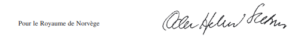

\**ACCORD SOUS FORME D’ECHANGE  DE LETTRES ENTRE LA COMMUNAUTE EUROPEENNE ET LE ROYAUME DE NORVEGE**

\**relatif à un programme de coopération pour la croissance économique  et le développement durable en Roumanie**

A. *Lettre de la Communauté européenne*

Monsieur

J’ai l’honneur de me référer aux négociations qui ont eu lieu entre la Communauté européenne et le Royaume de Norvège («la Norvège») dans le cadre de la demande de la Roumanie pour devenir partie contractante à l’accord EEE et de la mise en place d’un programme de coopération visant à promouvoir la croissance économique et le développement durable en Roumanie.

Ces négociations ont abouti aux résultats suivants:

1\) un programme de coopération visant à promouvoir la croissance économique et le développement durable en Roumanie par l’intermédiaire de projets bilatéraux est établi entre la Norvège et la Roumanie, conformément à un accord bilatéral entre ces deux Etats. Le texte de l’accord bilatéral est annexé au présent échange de lettres, dont il fait partie intégrante;

2\) aux fins du présent programme, la Norvège attribue un montant total de 48 millions EUR, à engager en une seule tranche en 2007. Ce montant sera disponible à partir de la date d’entrée en vigueur de l’accord sur la participation de la République de Bulgarie et de la Roumanie à l’Espace économique européen ou d’un accord visant à appliquer cet accord à titre provisoire, jusqu’au 30 avril 2009;

3\) le présent échange de lettres:

a) est ratifié ou approuvé par la Communauté européenne et la Norvège selon les procédures qui leur sont propres. Les instruments de ratification ou d’approbation sont déposés auprès du secrétariat général du Conseil de l’Union européenne.

b) Il entre en vigueur le jour suivant le dépôt du dernier instrument de ratification ou d’approbation sous réserve que les instruments de ratification ou d’approbation des accords connexes ci-après aient été déposés également:

i) accord sur la participation de la République de Bulgarie et de la Roumanie à l’Espace économique européen;

ii) accord sous forme d’échange de lettres entre la Communauté européenne et le Royaume de Norvège relatif à un programme de coopération pour la croissance économique et le développement durable en Bulgarie;

iii) protocole additionnel à l’accord entre la Communauté économique européenne et l’Islande, à la suite de l’adhésion de la République de Bulgarie et de la Roumanie à l’Union européenne; et

iv) Protocole additionnel à l’accord entre la Communauté économique européenne et le Royaume de Norvège, à la suite de l’adhésion de la République de Bulgarie et de la Roumanie à l’Union européenne.

Je vous saurais gré de bien vouloir me confirmer votre accord sur le contenu de cette lettre.

Veuillez agréer, Monsieur, l’assurance de ma très haute considération.

\*Annexe:* 1

Fait à Bruxelles, le 25.7.2007.

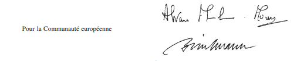

\*

ANNEXE

\**ACCORD SUR UN PROGRAMME DE COOPERATION NORVEGIEN**

\**pour la croissance économique et le développement durable en Roumanie**

entre

\*Le Royaume de Norvège*

et

\*La Roumanie*

ci-après dénommés «les parties»

\*Article 1*

\***Objectif***

Un programme de coopération norvégien est établi pour promouvoir le développement social et économique en Roumanie grâce à des projets de coopération bilatérale entre les parties dans le cadre des secteurs visés à l’article 4.

\*Article 2*

\***Portée financière***

Aux fins du programme de coopération norvégien pour la Roumanie, le Royaume de Norvège attribue un montant total de 48 millions EUR, à engager en une seule tranche en 2007.

\*Article 3*

\***Durée***

Le montant visé à l’article 2 est disponible à partir de la date d’entrée en vigueur de l’accord sur la participation de la République de Bulgarie et de la Roumanie à l’Espace économique européen ou à partir de la date d’entrée en vigueur d’un accord visant à appliquer cet accord à titre provisoire, jusqu’au 30 avril 2009.

\*Article 4*

\***Secteurs prioritaires***

Le programme de coopération norvégien pour la Roumanie soutient des projets de coopération bilatérale entre les candidats éligibles des parties en vue de promouvoir le développement social et économique en Roumanie dans les secteurs prioritaires suivants:

aash réduction des émissions des gaz à effet de serre, y compris des projets d’exécution communs au titre du Protocole de Kyoto, et d’autres émissions dans l’air et dans l’eau;

bash efficacité énergétique et énergies renouvelables;

cash facilitation d’une production durable, y compris la certification et la vérification;

dash santé.

Parmi les actions possibles, on citera notamment l’innovation, le développement des ressources humaines, l’établissement de réseaux, le renforcement des capacités, les transferts de technologie, et la recherche et le développement.

\*Article 5*

\***Plafonds du cofinancement***

La contribution norvégienne sous forme de subventions n’excède pas 60% du coût du projet, sauf dans le cas de projets par ailleurs financés au moyen de dotations budgétaires accordées par des autorités publiques de niveau national, régional ou local, auquel cas elle ne peut être supérieure à 85% du coût du projet. Les plafonds communautaires pour le cofinancement ne sont en aucun cas dépassés. Les contributions aux organisations non gouvernementales et aux partenaires sociaux peuvent atteindre jusqu’à 90% des coûts du projet.

\*Article 6*

\***Gestion***

Le programme de coopération norvégien pour la Roumanie est géré par le gouvernement norvégien ou par une entité désignée par lui. L’entité chargée de la gestion consulte le point de contact désigné par le gouvernement de la Roumanie. La Commission européenne peut examiner les projets.

D’autres dispositions concernant la mise en oeuvre du présent accord sont introduites par le gouvernement norvégien si nécessaire.

Les frais de gestion du programme de coopération norvégien sont couverts par le montant visé à l’article 2.

\*Article 7*

\***Entrée en vigueur***

Le présent accord est ratifié par le Royaume de Norvège et par la Roumanie selon leurs procédures nationales. Il entre en vigueur le trentième jour qui suit le dépôt par la dernière partie de son instrument de ratification au ministère norvégien des affaires étrangères, mais cette date ne peut être antérieure à la date d’entrée en vigueur de l’accord sur la participation de la République de Bulgarie et de la Roumanie à l’Espace économique européen, ou à partir de la date d’entrée en vigueur d’un accord visant appliquer ce dernier accord à titre provisoire.

FAIT à Bruxelles, le … 2007.

| *Pour le Royaume de Norvège,* | *Pour la Roumanie,* |
|---|---|

\*

B. *Lettre du Royaume de Norvège*

Monsieur,

J’ai l’honneur d’accuser réception de votre lettre de ce jour libellée comme suit:

«J’ai l’honneur de me référer aux négociations qui ont eu lieu entre la Communauté européenne et le Royaume de Norvège («la Norvège») dans le cadre de la demande de la Roumanie pour devenir partie contractante à l’accord EEE et de la mise en place d’un programme de coopération visant à promouvoir la croissance économique et le développement durable en Roumanie.

Ces négociations ont abouti aux résultats suivants:

1\) un programme de coopération visant à promouvoir la croissance économique et le développement durable en Roumanie par l’intermédiaire de projets bilatéraux est établi entre la Norvège et la Roumanie, conformément à un accord bilatéral entre ces deux Etats. Le texte de l’accord bilatéral est annexé au présent échange de lettres, dont il fait partie intégrante;

2\) aux fins du présent programme, la Norvège attribue un montant total de 48 millions EUR, à engager en une seule tranche en 2007. Ce montant sera disponible à partir de la date d’entrée en vigueur de l’accord sur la participation de la République de Bulgarie et de la Roumanie à l’Espace économique européen ou d’un accord visant à appliquer cet accord à titre provisoire, jusqu’au 30 avril 2009;

3\) le présent échange de lettres:

a) est ratifié ou approuvé par la Communauté européenne et la Norvège selon les procédures qui leur sont propres. Les instruments de ratification ou d’approbation sont déposés auprès du secrétariat général du Conseil de l’Union européenne.

b) Il entre en vigueur le jour suivant le dépôt du dernier instrument de ratification ou d’approbation sous réserve que les instruments de ratification ou d’approbation des accords connexes ci-après aient été déposés également:

i) accord sur la participation de la République de Bulgarie et de la Roumanie à l’Espace économique européen;

ii) accord sous forme d’échange de lettres entre la Communauté européenne et le Royaume de Norvège relatif à un programme de coopération pour la croissance économique et le développement durable en Bulgarie;

iii) protocole additionnel à l’accord entre la Communauté économique européenne et l’Islande, à la suite de l’adhésion de la République de Bulgarie et de la Roumanie à l’Union européenne; et

iv) Protocole additionnel à l’accord entre la Communauté économique européenne et le Royaume de Norvège, à la suite de l’adhésion de la République de Bulgarie et de la Roumanie à l’Union européenne.»

J’ai l’honneur de vous confirmer l’accord sur le contenu de votre lettre.

Je vous prie d’agréer, Monsieur, l’assurance de ma très haute considération.

Fait à Bruxelles, le 25.7.2007.

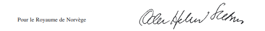

\*

\**PROTOCOLE ADDITIONNEL A L’ACCORD ENTRE LA COMMUNAUTE ECONOMIQUE EUROPEENNE ET L’ISLANDE,**

\**à la suite de l’adhésion de la République de Bulgarie et de la Roumanie à l’Union Européenne**

\*La Communaute Européenne*

et

\*L’Islande,*

Vu l’accord entre la Communauté économique européenne et l’Islande, signé à Bruxelles, le 2 juillet 1972, ci-après dénommé l’«accord», et le régime actuellement applicable au commerce du poisson et des produits de la pêche entre l’Islande et la Communauté,

Vu l’adhésion de la République de Bulgarie et de la Roumanie à l’Union européenne,

Vu l’accord sur la participation de la République de Bulgarie et de la Roumanie à l’Espace économique européen,

Vu le régime en vigueur pour le commerce du poisson et des produits de la pêche entre l’Islande et la République de Bulgarie et la Roumanie,

ONT DECIDE de déterminer de commun accord les ajustements à apporter à l’accord à la suite de l’adhésion de la République de Bulgarie et de la Roumanie à l’Union européenne,

ET DE CONCLURE LE PRESENT PROTOCOLE:

\*Article 1*

Les textes de l’accord, des annexes et protocoles, qui en font partie intégrante, ainsi que de l’acte final et des déclarations qui y sont annexées, sont établis en langues bulgare et roumaine, ces textes faisant foi au même titre que les textes originaux. Le comité mixte approuve les textes bulgares et roumains.

\*Article 2*

Les dispositions particulières applicables aux importations dans la Communauté de certains poissons et produits de la pêche originaires d’Islande figurent à l’annexe du présent protocole et de ses annexes.

Les contingents annuels à droit nul prévus à l’annexe du présent protocole sont appliqués du 1er janvier 2007 au 30 avril 2009. Leurs niveaux font l’objet d’un réexamen à la fin de cette période compte tenu de tous les intérêts en jeu. Les niveaux de contingents pour 2007 ne sont pas réellement réduits, parce que l’élargissement de l’Espace économique européen n’a pas eu lieu le 1er janvier 2007. Les volumes des contingents tarifaires pour 2009 sont réduits en fonction de leur application jusqu’au 30 avril 2009.

\*Article 3*

Le présent protocole est ratifié ou approuvé par les parties contractantes selon les procédures qui leur sont propres. Les instruments de ratification ou d’approbation sont déposés auprès du secrétariat général du Conseil de l’Union européenne.

Il entre en vigueur le jour suivant le dépôt du dernier instrument de ratification ou d’approbation sous réserve que les instruments de ratification ou d’approbation des accords connexes ci-après aient été déposés également:

i) accord sur la participation de la République de Bulgarie et de la Roumanie à l’Espace économique européen;

ii) accord sous forme d’échange de lettres entre la Communauté européenne et le Royaume de Norvège relatif à un programme de coopération pour la croissance économique et le développement durable en Bulgarie;

iii) accord sous forme d’échange de lettres entre la Communauté européenne et le Royaume de Norvège relatif à un programme de coopération pour la croissance économique et le développement durable en Roumanie; et

iv) protocole additionnel à l’accord entre la Communauté économique européenne et le Royaume de Norvège, à la suite de l’adhésion de la République de Bulgarie et de la Roumanie à l’Union européenne.

\*Article 4*

Le présent protocole est établi en double exemplaire en langues allemande, anglaise, bulgare, danoise, espagnole, estonienne, finnoise, française, grecque, hongroise, italienne, lettone, lituanienne, maltaise, néerlandaise, polonaise, portugaise, roumaine, slovène, slovaque, suédoise, tchèque et islandaise, chacun de ces textes faisant également foi.

Fait à Bruxelles, le vingt-cinq juillet deux mille sept.

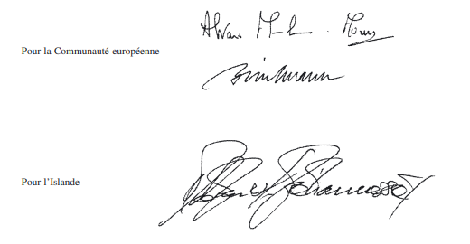

\*

ANNEXE

\**DISPOSITIONS PARTICULIERES VISEES A L’ARTICLE 2**

La Communauté ouvre les nouveaux contingents tarifaires annuels à droit nul suivants pour les produits originaires d’Islande:

| *Code NC* | *Description des produits* | *Volume contingentaire annuel* |
|---|---|---|
| 0306 19 30 | Langoustines congelées (Nephrops norvegicus) | 520 tonnes |
| 0304 19 35 | Filets de rascasses du Nord ou sébastes (Sebastes spp.), frais ou réfrigérés | 750 tonnes |

\*

\**PROTOCOLE ADDITIONNEL A L’ACCORD ENTRE  LA COMMUNAUTE ECONOMIQUE EUROPEENNE ET LE ROYAUME DE NORVEGE,**

\**à la suite de l’adhésion de la République de Bulgarie et de la Roumanie à l’Union européenne**

\*La Communaute européenne*

et

\*Le Royaume de Norvège,*

Vu l’accord entre la Communauté économique européenne et le Royaume de Norvège, signé le 14 mai 1973, ci-après dénommé l’«accord», et le régime actuellement applicable au commerce du poisson et des produits de la pêche entre la Norvège et la Communauté,

Vu l’adhésion de la République de Bulgarie et de la Roumanie à l’Union européenne,

Vu l’accord sur la participation de la République de Bulgarie et de la Roumanie à l’Espace économique européen,

Vu le régime en vigueur pour le commerce du poisson et des produits de la pêche entre la Norvège et la République de Bulgarie et la Roumanie,

ONT DECIDE de déterminer de commun accord les ajustements à apporter à l’accord par suite de l’adhésion de la République de Bulgarie et de la Roumanie à l’Union européenne,

ET DE CONCLURE LE PRESENT PROTOCOLE:

\*Article 1*

Les textes de l’accord, des annexes et protocoles, qui en font partie intégrante, ainsi que de l’acte final et des déclarations qui y sont annexées, sont établis en langues bulgare et roumaine, ces textes faisant foi au même titre que les textes originaux. Le comité mixte approuve les textes bulgares et roumains.

\*Article 2*

Les dispositions particulières applicables aux importations dans la Communauté de certains poissons et produits de la pêche originaires de Norvège figurent dans le présent protocole.

Les contingents tarifaires prévus à l’article 3 du présent protocole sont appliqués du 1er janvier 2007 au 30 avril 2009. Leurs niveaux visés à l’article 3 font l’objet d’un réexamen à la fin de cette période compte tenu de tous les intérêts en jeu. Les niveaux de contingents pour 2007 ne sont pas réellement réduits, parce que l’élargissement de l’Espace économique européen n’a pas eu lieu le 1er janvier 2007. Les volumes des contingents tarifaires pour 2009 sont réduits en fonction de leur application jusqu’au 30 avril 2009.

Les règles d’origine applicables aux contingents tarifaires sont celles qui figurent dans le protocole N° 3 de l’accord.

\*Article 3*

La Communauté ouvre les nouveaux contingents tarifaires annuels complémentaires à droit nul suivants:

aash maquereaux des espèces Scomber scombrus ou Scomber japonicus, congelés (code NC 0303 74 30): 9.300 tonnes

bash harengs (Clupea harengus, Clupea pallasii), congelés (code NC 0303 51 00): 1.800 tonnes

cash filets et flancs de harengs (Clupea harengus, Clupea pallasii), congelés (Codes NC 0304 29 75 et 0304 99 23): 600 tonnes

dash autres poissons, congelés (code NC 0303 79 98): 2.200 tonnes

eash autres salmonidés, congelés (code NC 0303 29 00): 2.000 tonnes

fash crevettes, décortiquées et congelées (Codes NC ex 1605 20 10, ex 1605 20 91 et ex 1605 20 99): 2.000 tonnes

\*Article 4*

La Communauté lève la condition «destinés à la fabrication industrielle», et donc l’exigence relative à l’utilisateur final, pour les contingents tarifaires ouverts en 2004 pour les maquereaux congelés (numéros d’ordre 09.0760, 09.0763 et 09.0778), les harengs congelés (numéro d’ordre 09.0752) et les flancs de harengs congelés (numéro d’ordre 09.0756). De même, l’exigence relative à la consommation humaine des produits relevant des mêmes contingents tarifaires est supprimée.

Les contingents tarifaires annuels à droit nul actuellement appliqués aux crevettes décortiquées congelées portant le numéro d’ordre 09.0758 sont disponibles pour les codes NC ex 1605 20 10, ex 1605 20 91 et ex 1605 20 99.

Pour la période allant du 1er janvier 2008 au 31 décembre 2008, la Communauté fusionne les deux contingents tarifaires à droit nul actuellement appliqués aux crevettes décortiquées congelées (numéros d’ordre 09.0745 et 09.0758) et le nouveau contingent tarifaire annuel complémentaire à droit nul de 2.000 tonnes prévu à l’article 3, et elle met le contingent tarifaire fusionné à la disposition des codes NC ex 1605 20 10, ex 1605 20 91 et ex 1605 20 99.

A partir du 1er janvier 2009, les deux contingents tarifaires actuellement appliqués aux crevettes décortiquées congelées portant le numéro d’ordre 09.0758 (2.500 tonnes) et le numéro d’ordre 09.0745 (5.500 tonnes) ainsi que le nouveau contingent tarifaire annuel complémentaire à droit nul de 2.000 tonnes sont appliqués en tant que trois contingents tarifaires distincts et sont disponibles au titre des codes NC ex 1605 20 10, ex 1605 20 91 et ex 1605 20 99.

A partir du 15 juin 2008, la Communauté fusionne les sous-périodes relatives aux trois contingents tarifaires actuellement appliqués aux maquereaux (numéros d’ordre 09.0760, 09.0763 et 09.0778) en une seule période allant du 15 juin au 14 février.

\*Article 5*

Les représentants de la Communauté européenne et de la Norvège se réunissent avant la fin de 2007 pour examiner la possibilité d’appliquer les règles d’origine définies dans le protocole N° 3 de l’accord également aux produits couverts par l’échange de lettres concernant le commerce du poisson du 16 avril 1973.

\*Article 6*

Le présent protocole est ratifié ou approuvé par la Communauté européenne et la Norvège conformément aux procédures qui leur sont propres. Les instruments de ratification ou d’approbation sont déposés auprès du secrétariat général du Conseil de l’Union européenne.

Il entre en vigueur le jour suivant le dépôt du dernier instrument de ratification ou d’approbation sous réserve que les instruments de ratification ou d’approbation des accords connexes ci-après aient été déposés également:

i) accord sur la participation de la République de Bulgarie et de la Roumanie à l’Espace économique européen;

ii) accord sous forme d’échange de lettres entre la Communauté européenne et le Royaume de Norvège relatif à un programme de coopération pour la croissance économique et le développement durable en Bulgarie;

iii) accord sous forme d’échange de lettres entre la Communauté européenne et le Royaume de Norvège relatif à un programme de coopération pour la croissance économique et le développement durable en Roumanie; et

iv) protocole additionnel à l’accord entre la Communauté économique européenne et la République d’Islande, à la suite de l’adhésion de la République de Bulgarie et de la Roumanie à l’Union européenne.

\*Article 7*

Le présent protocole est établi en double exemplaire en langues allemande, anglaise, bulgare, danoise, espagnole, estonienne, finnoise, française, grecque, hongroise, italienne, lettone, lituanienne, maltaise, néerlandaise, polonaise, portugaise, roumaine, slovène, slovaque, suédoise, tchèque et norvégienne, chacun de ces textes faisant également foi.

Fait à Bruxelles, le vingt-cinq juillet deux mille sept.

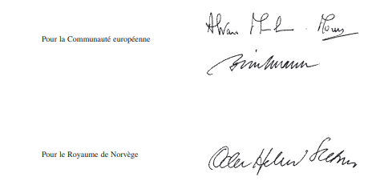

Doc. parl. [5964](https://legilux.public.lu/eli/etat/proj/pl/20080231); sess. ord. 2008-2009
