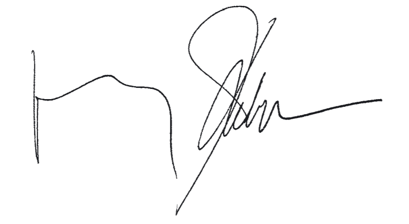
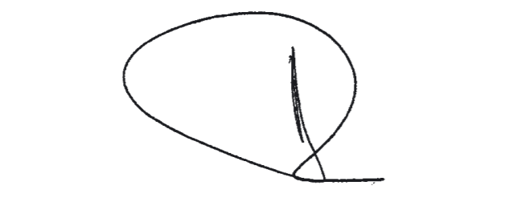
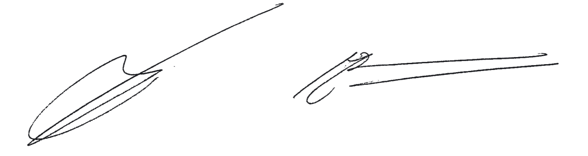

# Loi du 4 juin 2009 portant approbation\n- du Traité portant révision du Traité instituant l'Union économique Benelux, signé le 3 février 1958\n- du Protocole relatif aux privilèges et immunités de l'Union Benelux\n- de la Déclaration \nsignés à La Haye, le 17 juin 2008.

Nous Henri, Grand-Duc de Luxembourg, Duc de Nassau,

Notre Conseil d’Etat entendu;

De l’assentiment de la Chambre des Députés;

Vu la décision de la Chambre des Députés du 7 mai 2009 et celle du Conseil d’Etat du 19 mai 2009 portant qu’il n’y a pas lieu à second vote;

Avons ordonné et ordonnons:

## Article unique.

Sont approuvés

aash le Traité portant révision du [Traité instituant l’Union économique Benelux](https://legilux.public.lu/eli/etat/leg/loi/1960/08/05/n1/jo), signé le 3 février 1958

bash le Protocole relatif aux privilèges et immunités de l’Union Benelux

cash la Déclaration

signés à La Haye, le 17 juin 2008.

Mandons et ordonnons que la présente loi soit insérée au Mémorial pour être exécutée et observée par tous ceux que la chose concerne.

Le Ministre des Affaires étrangères et de l’Immigration,   Jean Asselborn

Palais de Luxembourg, le 4 juin 2009.   Henri

\**TRAITE PORTANT REVISION DU TRAITE** **INSTITUANT L’UNION ECONOMIQUE BENELUX** **signé le 3 février 1958**

\**Préambule**

\*Le Royaume de Belgique,*

Représenté par:

le Gouvernement fédéral,

le Gouvernement flamand,

le Gouvernement de la Communauté française,

le Gouvernement wallon,

le Gouvernement de la Région de Bruxelles-Capitale,

le Gouvernement de la Communauté germanophone

\*Le Grand-Duché de Luxembourg,*

\*Le Royaume des Pays-Bas,*

\*Considérant* qu’ils ont conclu le 3 février 1958 le [Traité instituant l’Union économique Benelux](https://legilux.public.lu/eli/etat/leg/loi/1960/08/05/n1/jo) dans le prolongement de la [Convention douanière Belgo-Luxembourgeoise-Néerlandaise](https://legilux.public.lu/eli/etat/leg/loi/1947/07/23/n2/jo) signée à Londres le 5 septembre 1944;

\*Considérant* que le [traité du 3 février 1958](https://legilux.public.lu/eli/etat/leg/loi/1960/08/05/n1/jo) a été [modifié le 16 mars 1971](https://legilux.public.lu/eli/etat/leg/loi/1972/03/06/n1/jo), [le 26 janvier 1976](https://legilux.public.lu/eli/etat/leg/loi/1978/03/14/n6/jo) et [le 16 février 1990](https://legilux.public.lu/eli/etat/leg/loi/1991/03/19/n2/jo);

\*Considérant* que le Comité de Ministres Benelux a, le 20 novembre 1995, redéfini les missions de l’Union économique Benelux en se basant sur le rapport d’un comité des sages;

\*Considérant* également que l’article 99, premier alinéa, du [Traité du 3 février 1958](https://legilux.public.lu/eli/etat/leg/loi/1960/08/05/n1/jo) prévoit que ledit traité est conclu pour une période de cinquante ans, cette période prenant fin le 31 octobre 2010;

\*Se référant* à la [Convention du 5 novembre 1955](https://legilux.public.lu/eli/etat/leg/loi/1956/06/16/n3/jo) instituant un Conseil interparlementaire consultatif de Benelux et au [Protocole additionnel à ladite convention](https://legilux.public.lu/eli/etat/leg/loi/1958/12/29/n1/jo) signé le 3 février 1958, ainsi qu’au [Traité du 31 mars 1965](https://legilux.public.lu/eli/etat/leg/loi/1973/07/10/n1/jo) relatif à l’institution et au statut d’une Cour de Justice Benelux et aux protocoles portant modification et exécution de ce Traité;

\*Constatant* que, dans le cadre de l’Union économique Benelux, ils ont su, sur la base du [Traité du 3 février 1958](https://legilux.public.lu/eli/etat/leg/loi/1960/08/05/n1/jo) et dans la pratique, concrétiser leur coopération de manière dynamique dans un contexte international en pleine évolution et face notamment à l’intégration croissante au sein de l’Union européenne;

\*Constatant* que, en s’appuyant sur leur coopération, ils ont su mener à bien des initiatives qui ont eu un impact favorable sur les évolutions internationales et, en particulier, au sein de l’Union européenne;

\*Constatant* que, conformément à l’article 306 du [Traité instituant la Communauté européenne](https://eur-lex.europa.eu/eli/treaty/teu/sign) et à l’article 202 du [Traité instituant la Communauté européenne de l’énergie atomique](https://eur-lex.europa.eu/eli/treaty/euratom/sign), les dispositions desdits traités ne font pas obstacle à l’existence et à l’accomplissement d’une union régionale entre la Belgique, le Luxembourg et les Pays-Bas, dans la mesure où les objectifs de cette union ne sont pas atteints en application desdits traités;

\*Fermement résolus* à approfondir et à renforcer leur coopération dans les régions frontalières dans de nombreux domaines;

\*Constatant* que le Royaume de Belgique a adopté une structure étatique fédérale;

\*Désireux* de poursuivre et d’étendre leur coopération et de créer à cet effet une base conventionnelle qui puisse se concrétiser de manière proactive;

\*Désireux*, après la coopération au sein de l’Union douanière et dans le prolongement de l’Union économique Benelux, de poursuivre leur coopération dans le contexte plus large de l’Union Benelux,

SONT CONVENUS de revoir comme suit le [Traité instituant l’Union économique Benelux du 3 février 1958](https://legilux.public.lu/eli/etat/leg/loi/1960/08/05/n1/jo):

## PARTIE 1 — Principes et objectifs

### *Article 1er*

Les Hautes Parties Contractantes instituent une Union Benelux afin de défendre leurs intérêts communs et de promouvoir le bien-être de leurs populations.

### *Article 2*

1\. L’Union Benelux a pour but l’approfondissement et l’élargissement de la coopération entre les Hautes Parties Contractantes afin que celle-ci puisse poursuivre son rôle de précurseur au sein de l’Union européenne et renforcer et améliorer la coopération transfrontalière à tous les niveaux.

2\. L’Union Benelux vise en particulier:

a) au maintien et au développement d’une union économique comportant la libre circulation des personnes, des biens, des capitaux et des services, et portant sur une politique économique, financière et sociale concertée, y compris la poursuite d’une politique commune dans les relations économiques avec les pays tiers;

b) au développement durable conciliant croissance économique équilibrée, protection sociale et protection de l’environnement;

c) à la coopération dans les domaines de la justice et des affaires intérieures.

### *Article 3*

1\. Afin de réaliser les objectifs énoncés à l’article 2, l’Union Benelux établit périodiquement un programme de travail commun pluriannuel définissant les priorités de la coopération.

2\. Le programme de travail commun concerne entre autres:

a) l’achèvement du marché intérieur Benelux et la réalisation de l’Union économique Benelux, incluant la poursuite de l’harmonisation de la politique sociale, de la politique en matière d’énergie et de climat, ainsi que de la coopération en matière de transport et de communication;

b) la coopération en matière d’environnement, de nature, d’agriculture et d’espaces naturels;

c) la politique en matière de visas et, d’immigration, la coopération policière, la coopération en matière de gestion des crises et de lutte contre les catastrophes ainsi qu’en matière de lutte contre le terrorisme et contre la fraude, notamment fiscale;

d) la coopération dans d’autres domaines, si celle-ci s’avère nécessaire pour réaliser les objectifs de l’article 2.

### *Article 4*

Les droits et obligations découlant des Parties 1 et 3 du [Traité de 1958](https://legilux.public.lu/eli/etat/leg/loi/1960/08/05/n1/jo) s’appliquent sans restriction, sauf s’il en est disposé autrement dans le présent Traité.

## PARTIE 2 — Institutions

### *Article 5*

Les institutions de l’Union Benelux sont:

a) le Comité de Ministres Benelux;

b) le Conseil Benelux;

c) le Conseil interparlementaire consultatif de Benelux;

d) la Cour de Justice Benelux;

e) le Secrétariat général Benelux.

### Chapitre 1 — Le Comité de Ministres Benelux

#### *Article 6*

1\. Le Comité de Ministres veille à l’application du présent Traité et assure la réalisation des objectifs fixés par celui-ci. Il détermine les orientations et les priorités de la coopération dans l’Union Benelux.

2\. A cette fin, le Comité de Ministres a pour mission:

a) de déterminer les modalités d’exécution des dispositions du présent Traité dans les conditions prévues par celles-ci. Ces décisions du Comité engagent les Hautes Parties Contractantes;

b) d’arrêter le programme de travail commun visé à l’article 3 sur la base d’une proposition coordonnée du Secrétariat général;

c) d’arrêter le budget de l’Union Benelux conformément aux procédures établies à l’article 22;

d) d’arrêter le plan annuel de l’Union Benelux;

e) d’arrêter le rapport annuel de l’Union Benelux;

f) d’établir des conventions qui sont soumises aux Hautes Parties Contractantes en vue de leur mise en vigueur conformément aux règles constitutionnelles de chacune des Hautes Parties Contractantes;

g) de formuler des recommandations intéressant le fonctionnement de l’Union Benelux. Ces recommandations ne lient pas les Hautes Parties Contractantes;

h) de donner des directives au Conseil et au Secrétariat général.

#### *Article 7*

Le Comité de Ministres compte au moins un représentant au niveau ministériel de chaque Haute Partie Contractante. La composition du Comité de Ministres peut varier en fonction de l’ordre du jour et de la répartition des compétences au sein de chaque Haute Partie Contractante.

#### *Article 8*

Les décisions du Comité sont acquises à l’unanimité. Chacune des Hautes Parties Contractantes dispose d’une voix. L’abstention d’une Haute Partie Contractante ne constitue pas un obstacle à ce qu’une décision soit acquise.

#### *Article 9*

1\. Le Comité de Ministres se réunit au moins une fois par présidence. En cas d’urgence, le Comité se réunit à la demande de l’une des Hautes Parties Contractantes.

2\. Les réunions du Comité de Ministres sont présidées à tour de rôle par un membre belge, luxembourgeois et néerlandais pour la durée d’une année civile, quel que soit le lieu de la réunion.

#### *Article 10*

Le Comité de Ministres peut instituer des groupes de travail ministériels auxquels il peut déléguer certains de ses pouvoirs. Ces groupes sont composés de membres du Comité ou d’autres membres des Gouvernements dans chacune des Hautes Parties Contractantes.

#### *Article 11*

Le Comité de Ministres arrête son règlement d’ordre intérieur.

### Chapitre 2 — Le Conseil Benelux

#### *Article 12*

Le Conseil Benelux a pour mission:

a) de préparer les réunions et les délibérations du Comité de Ministres et des groupes de travail ministériels;

b) d’instituer et de révoquer des groupes de travail de l’administration et des commissions d’experts indépendants. Le Conseil donne à ces groupes de travail et commissions les directives nécessaires à leurs activités. Le Conseil transmet, si nécessaire, au Comité de Ministres les propositions des groupes de travail et des commissions, accompagnées, le cas échéant, de son avis;

c) d’assurer, en ce qui le concerne, l’exécution des délibérations du Comité de Ministres;

d) de faire au Comité de Ministres les propositions qu’il juge utiles au fonctionnement de l’Union Benelux.

#### *Article 13*

1\. Le Conseil est formé par au moins un représentant de chaque Haute Partie Contractante. La composition du Conseil peut varier en fonction de l’ordre du jour et de la répartition des compétences au sein de chaque Haute Partie Contractante.

2\. La Présidence du Conseil est assumée par la Haute Partie Contractante qui assure la Présidence du Comité de Ministres.

#### *Article 14*

Le Conseil arrête son règlement d’ordre intérieur.

### Chapitre 3 — Le Conseil interparlementaire consultatif de Benelux

#### *Article 15*

La [Convention du 5 novembre 1955](https://legilux.public.lu/eli/etat/leg/loi/1956/06/16/n3/jo) instituant un Conseil interparlementaire consultatif de Benelux règle la composition, la compétence et la méthode de travail du Conseil interparlementaire consultatif.

#### *Article 16*

Pour les questions qui intéressent directement le fonctionnement de l’Union Benelux, le Conseil interparlementaire consultatif de Benelux entretient des relations avec le Comité de Ministres.

### Chapitre 4 — *La Cour de Justice Benelux*

#### *Article 17*

Le [Traité du 31 mars 1965](https://legilux.public.lu/eli/etat/leg/loi/1973/07/10/n1/jo) relatif à l’institution et au statut d’une Cour de Justice Benelux règle la composition, la compétence et le fonctionnement de la Cour de Justice Benelux.

### Chapitre 5 — *Le Secrétariat général Benelux*

#### *Article 18*

Le siège du Secrétariat général Benelux est établi à Bruxelles.

#### *Article 19*

1\. Le Collège des Secrétaires généraux est composé d’un Secrétaire général et de deux Secrétaires généraux adjoints. Les membres du Collège sont des ressortissants des Hautes Parties Contractantes. Les trois nationalités sont représentées au sein du Collège. Le Collège est chargé de la direction du Secrétariat général.

2\. Le Collège des Secrétaires généraux se répartit les tâches, la responsabilité finale du fonctionnement du Secrétariat général étant assumée par le Secrétaire général.

3\. Le Secrétaire général et les Secrétaires généraux adjoints sont nommés pour un mandat de cinq ans renouvelable une seule fois.

4\. Le Comité de Ministres nomme et révoque le Secrétaire général et les Secrétaires généraux adjoints. Il fixe, après avis du Conseil, les barèmes de leurs traitement, pension et indemnités, ainsi que toutes les conditions dans lesquelles ils doivent accomplir leurs fonctions.

#### *Article 20*

1\. Le Secrétaire général nomme et révoque les membres du personnel du Secrétariat général, conformément au statut prévu à l’alinéa 2 du présent article.

2\. Le statut du personnel, le cadre organique, les barèmes des traitements, pensions et indemnités, ainsi que toutes conditions dans lesquelles les membres du personnel doivent accomplir leurs fonctions sont fixés par le Comité de Ministres sur proposition du Secrétaire général et après avis du Conseil.

#### *Article 21*

1\. Le Secrétariat général a pour mission:

a) de faire une proposition coordonnée pour le programme de travail commun;

b) d’assurer le secrétariat du Comité de Ministres, des groupes de travail ministériels, du Conseil, des groupes de travail de l’administration et des commissions d’experts indépendants;

c) de coordonner dans le domaine administratif les activités du Comité de Ministres, des groupes de travail ministériels, du Conseil, des groupes de travail de l’administration et des commissions d’experts indépendants;

d) d’établir le plan annuel de l’Union Benelux;

e) de faire toutes les suggestions utiles pour l’exécution du présent Traité en tenant compte des compétences des autres institutions de l’Union Benelux.

2\. Le Comité de Ministres peut assigner d’autres tâches au Secrétariat général.

#### *Article 22*

1\. Le Secrétaire général élabore le projet de budget annuel des institutions de l’Union Benelux et le soumet au Comité de Ministres, avec l’avis du Conseil.

2\. Par convention, les Hautes Parties Contractantes règlent:

a) le contrôle de l’exécution des budgets;

b) l’arrêt des comptes;

c) l’octroi des avances nécessaires;

d) la répartition entre les Hautes Parties Contractantes de l’excédent des dépenses sur les recettes.

3\. Les dispositions du présent article ne sont applicables ni au Conseil interparlementaire consultatif de Benelux ni à la Cour de Justice Benelux.

#### *Article 23*

Le Secrétaire général assure la publication au Bulletin Benelux des décisions, du programme de travail commun, du plan annuel, du rapport annuel et des recommandations visés à l’article 6, alinéa 2, sous (a), (b), (d), (e) et (g).

## PARTIE 3 — Relations extérieures

### *Article 24*

Le Comité de Ministres détermine les principes de la coopération de l’Union Benelux avec d’autres Etats et entités fédérées, et en particulier avec des Etats membres de l’Union européenne et des structures de coopération régionale de ces Etats, si cette démarche favorise la réalisation des objectifs du présent Traité et en particulier l’accomplissement du rôle de précurseur dans le cadre plus large de l’Union européenne.

### *Article 25*

Le Comité de Ministres peut, dans le cadre de l’établissement ou de la mise en œuvre du programme de travail commun, décider de mettre en place une coopération entre l’Union Benelux, d’une part, et les Etats, entités fédérées et entités administratives limitrophes du territoire des Hautes Parties contractantes, d’autre part.

### *Article 26*

Lorsque l’application des articles 24 ou 25 implique la conclusion d’un traité par les Hautes Parties Contractantes avec un Etat tiers ou une entité fédérée, l’article 6, deuxième alinéa, sous (f), s’applique.

### *Article 27*

Dans le cadre des objectifs du présent Traité et en concertation avec le Conseil, le Secrétariat général de l’Union Benelux entretient des relations appropriées avec les Etats, entités fédérées et autres entités administratives, ainsi qu’avec les organisations internationales et autres institutions internationales.

## PARTIE 4 — Personnalité juridique internationale, privilèges et immunités

### *Article 28*

L’Union Benelux bénéficie de la personnalité juridique internationale aux fins de l’octroi de privilèges et immunités.

### *Article 29*

1\. Les privilèges et immunités nécessaires à l’exercice de la mission et à la réalisation des objectifs de l’Union Benelux sont fixés par le protocole annexé au présent Traité.

2\. Le Secrétaire général est autorisé à conclure des accords complémentaires au nom de l’Union Benelux avec l’Etat où l’Union Benelux a son siège ou avec un Etat où est établie une entité qui a été instituée par l’Union Benelux et qui est reconnue comme telle par cet Etat. De tels accords complémentaires visent à l’exécution des dispositions du Protocole visé à l’alinéa premier et d’autres arrangements en vue d’assurer le bon fonctionnement de l’Union Benelux et la sauvegarde de ses intérêts dans les Etats concernés.

3\. Le Secrétaire général soumet de tels accords complémentaires, avant leur signature et accompagnés d’un avis du Conseil, au Comité de Ministres.

## PARTIE 5 — Services communs Benelux

### *Article 30*

Le Comité de Ministres peut instituer les Services communs utiles au fonctionnement de l’Union Benelux; il détermine les attributions, les conditions d’organisation et le fonctionnement de ces Services.

## PARTIE 6 — L’Organisation Benelux de la Propriété Intellectuelle

### *Article 31*

L’Organisation Benelux de la Propriété Intellectuelle est régie par la [Convention Benelux en matière de propriété intellectuelle](https://legilux.public.lu/eli/etat/leg/loi/2006/05/16/n1/jo) (marques et dessins ou modèles), signée à La Haye, le 25 février 2005.

## PARTIE 7 — Dispositions transitoires

### *Article 32*

1\. Le Comité de Ministres décide sur base d’un inventaire dressé par le Secrétariat général Benelux et après avis du Conseil, quelles décisions, recommandations et directives visées à l’article 6, deuxième alinéa, sous (a), (g) et (h), sont caduques, parce qu’elles ne sont plus appliquées.

2\. Les commissions et commissions spéciales instituées dans et sur base du [Traité de 1958](https://legilux.public.lu/eli/etat/leg/loi/1960/08/05/n1/jo) sont habilitées à poursuivre leurs activités. Le Conseil décide le plus rapidement possible, sur base d’un inventaire du Secrétariat général Benelux comment l’article 12, sous (b), s’applique à ces commissions et commissions spéciales.

### *Article 33*

1\. Tant qu’ils n’ont pas été prévus par un accord complémentaire entre l’Union Benelux et l’Etat où l’Union Benelux a son siège, visé à l’article 29, deuxième alinéa, le Secrétaire général et les Secrétaires généraux adjoints jouissent dans cet Etat des privilèges et immunités accordés respectivement à un chef de mission diplomatique accrédité dans cet Etat et aux membres du personnel diplomatique en vertu de la [Convention de Vienne du 18 avril 1961](https://legilux.public.lu/eli/etat/leg/loi/1966/06/17/n2/jo) sur les relations diplomatiques.

2\. L’immunité de juridiction peut, le cas échéant, être levée par le Comité de Ministres.

### *Article 34*

A l’entrée en vigueur du présent Traité, l’article 19, troisième alinéa, s’applique sans restriction au Secrétaire général en fonction au moment de la signature.

## PARTIE 8 — Dispositions finales

### *Article 35*

L’intitulé du Traité instituant l’Union économique Benelux est remplacé par Traité instituant l’Union Benelux .

### *Article 36*

1\. L’application du présent Traité est limitée au territoire de la Belgique, du Luxembourg et des Pays-Bas.

2\. Le Royaume des Pays-Bas se réserve le droit d’insérer dans les traités visés aux articles 6, deuxième alinéa, sous (f), et 26 des clauses intéressant les autres parties constitutives du Royaume des Pays-Bas.

### *Article 37*

Les dispositions du présent Traité ne font obstacle ni à l’existence, ni au développement éventuel de l’Union économique existant entre le Royaume de Belgique et le Grand-Duché de Luxembourg dans la mesure où les objectifs de cette Union ne sont pas atteints en application du présent Traité.

### *Article 38*

Le français et le néerlandais sont les langues officielles des institutions de l’Union Benelux.

### *Article 39*

1\. Le présent Traité est conclu pour une durée indéterminée.

2\. Chaque Haute Partie Contractante pourra dénoncer le Traité avec un délai de trois années prenant cours le jour de la réception au Secrétariat général de la notification de la dénonciation.

3\. Le Secrétaire général informe les autres Hautes Parties Contractantes de cette dénonciation en mentionnant la date de prise d’effet de la dénonciation.

4\. Les Hautes Parties Contractantes procèdent à une concertation sur l’expédition des affaires courantes.

5\. Le deuxième alinéa ne s’applique pas pendant une période de dix ans à compter de la date d’entrée en vigueur du Traité.

### *Article 40*

1\. Le présent Traité sera ratifié et les instruments de ratification seront déposés auprès du Secrétaire général qui informera les autres Hautes Parties Contractantes de la réception des instruments de ratification.

2\. Le présent Traité entrera en vigueur le premier jour du deuxième mois qui suivra le dépôt du troisième instrument de ratification. Le Secrétaire général communiquera aux Hautes Parties Contractantes la date de l’entrée en vigueur du présent Traité.

EN FOI DE QUOI les Plénipotentiaires ont signé le présent Traité et l’ont revêtu de leur sceau.

FAIT à La Haye, le 17 juin 2008 en trois exemplaires, en langues française et néerlandaise, les deux textes faisant également foi.

\*Pour le Royaume de Belgique*

Représenté par:

le Gouvernement fédéral,

le Gouvernement flamand,

le Gouvernement de la Communauté française,

le Gouvernement wallon,

le Gouvernement de la Région de Bruxelles-Capitale,

le Gouvernement de la Communauté germanophone,

\*Pour le Grand-Duché de Luxembourg*

\*Pour le Royaume des Pays-Bas*

\**PROTOCOLE RELATIF AUX PRIVILEGES ET IMMUNITES**  **DE L’UNION BENELUX**

Se référant à l’article 29 du [Traité instituant l’Union Benelux](https://legilux.public.lu/eli/etat/leg/loi/2009/06/04/n1/jo) (ci-après: le [Traité](https://legilux.public.lu/eli/etat/leg/loi/2009/06/04/n1/jo)), les Hautes Parties Contractantes sont convenues des dispositions suivantes:

## *Article 1er*

Au sens du présent Protocole:

a) les «locaux de l’Union Benelux» sont le terrain et les bâtiments utilisés par l’Union Benelux pour l’exercice de ses activités officielles;

b) les «archives» sont tous les dossiers, documents, manuscrits, documents électroniques, photos, films, et enregistrements audio et vidéo appartenant à ou détenus par l’Union Benelux ou son personnel dans l’exercice de leurs activités officielles;

c) le «pays hôte» est l’Etat où l’Union Benelux a son siège ou un Etat où est établie une entité, qui a été instituée par l’Union Benelux et qui est reconnue comme telle par cet Etat;

d) les «activités officielles» sont les activités de l’Union Benelux qui sont strictement nécessaires à l’accomplissement de sa mission telle que définie dans la Partie 1 du [Traité](https://legilux.public.lu/eli/etat/leg/loi/2009/06/04/n1/jo).

## *Article 2*

1\. Les locaux de l’Union Benelux ainsi que ses archives et tout document lui appartenant ou détenu par elle sont inviolables.

2\. Les autorités des Hautes Parties Contractantes sur le territoire desquelles l’Union Benelux a ses locaux ne peuvent pénétrer dans ces locaux qu’avec le consentement du Secrétaire général. Ce consentement est présumé acquis en cas d’incendie ou autre sinistre exigeant des mesures de protection immédiates.

3\. La remise dans les locaux de l’Union Benelux de tous actes de procédure nécessités par une instance en justice concernant l’Union Benelux ne constitue pas une infraction à l’inviolabilité.

## *Article 3*

1\. Dans le cadre de ses activités officielles, l’Union Benelux bénéficie de l’immunité de juridiction et d’exécution sauf

a) dans la mesure où l’Union Benelux aurait expressément renoncé à une telle immunité dans un cas particulier;

b) en cas d’action civile intentée par un tiers concernant des personnes et/ou des biens, pour autant que cette action civile n’ait pas de lien direct avec le fonctionnement officiel de l’Union Benelux;

c) en cas d’action civile intentée par un tiers pour les dommages résultant d’un accident causé par un véhicule automoteur appartenant à l’Union Benelux ou circulant pour son compte ou en cas d’infraction à la réglementation de la circulation automobile intéressant le véhicule précité.

2\. Les biens, fonds et avoirs de l’Union Benelux, quel que soit le lieu où ils se trouvent sur le territoire des Hautes Parties Contractantes, bénéficient de l’immunité à l’égard de toute forme de réquisition, confiscation, expropriation et séquestre.

3\. Les biens, fonds et avoirs de l’Union Benelux bénéficient également de l’immunité à l’égard de toute forme de contrainte administrative ou judiciaire, sauf dans la mesure ou le nécessitent temporairement la prévention des accidents mettant en cause des véhicules automoteurs appartenant à l’Union Benelux ou circulant pour le compte de celle-ci et les enquêtes auxquelles peuvent donner lieu lesdits accidents.

## *Article 4*

1\. Pour ses communications officielles et le transfert de tous ses documents, l’Union Benelux bénéficie, dans chaque Haute Partie Contractante, du traitement le plus favorable accordé à toute autre organisation internationale par cette Haute Partie Contractante.

2\. Aucune censure ne peut être exercée à l’égard des communications officielles de l’Union Benelux, quelle que soit la voie de communication utilisée.

## *Article 5*

1\. Dans le cadre de ses activités officielles, l’Union Benelux, ses biens, avoirs et revenus affectés à son usage officiel sont exonérés d’impôts directs.

2\. Lorsque des achats importants de biens ou de services sont faits par l’Union Benelux pour l’exercice de ses activités officielles et que le prix de ces biens et services comprend des impôts, des dispositions appropriées sont prises par les Hautes Parties Contractantes, chaque fois qu’il est possible, et sans préjudice de l’application de la réglementation européenne, en vue du remboursement à l’Union Benelux du montant de ces impôts ou de l’octroi de l’exonération préalable.

3\. Aucune exonération n’est accordée en ce qui concerne les impôts et redevances qui ne constituent que la simple rémunération de services d’utilité publique.

4\. Les biens ou les services qui ont bénéficié d’une exonération d’impôts visée aux premier et deuxième paragraphes ne peuvent être affectés à un autre usage que celui pour lequel l’exonération a été accordée que conformément aux conditions fixées par le pays hôte qui a accordé l’exonération.

## *Article 6*

1\. Dans la mesure reconnue aux personnes civiles nationales, l’Union Benelux jouit, sur le territoire de chacune des Hautes Parties Contractantes, de la capacité juridique nécessaire pour exercer ses fonctions et atteindre ses buts; elle peut notamment acquérir et aliéner des biens immobiliers et mobiliers et ester en justice. L’Union Benelux est représentée à cet effet par le Secrétaire général.

2\. En cas de conflit de compétence entre les juridictions des Hautes Parties Contractantes à propos d’un litige auquel l’Union Benelux est partie, la juridiction de l’Etat où l’Union Benelux a son siège est seule compétente.

## *Article 7*

Les représentants des Hautes Parties Contractantes, leurs suppléants, leurs conseillers ou experts jouissent, lors des réunions des institutions de l’Union Benelux, des Services communs et des groupes de travail de l’administration ainsi qu’au cours de leurs voyages à destination ou en provenance du lieu de la réunion des privilèges et immunités suivants:

a) immunité d’arrestation et de détention, ainsi que de saisie de leurs bagages personnels, sauf en cas de flagrant délit;

b) immunité de juridiction, même après la fin de leur mission, pour les actes, y compris leurs écrits et leurs paroles, accomplis dans l’exercice de leurs fonctions; cette immunité ne joue cependant pas dans le cas d’une infraction à la réglementation de la circulation des véhicules automoteurs, commise par une des personnes visées ci-dessus, ou dans le cas de dommages causés par un véhicule automoteur lui appartenant ou conduit par elle;

c) inviolabilité pour tous leurs papiers et documents officiels;

d) droit de faire usage de codes et de recevoir des documents ou de la correspondance par courrier spécial ou par valises scellées.

## *Article 8*

Le Secrétaire général, les Secrétaires généraux adjoints et les agents de l’Union Benelux:

a) jouissent, même lorsqu’ils ont cessé d’exercer leurs fonctions, de l’immunité de juridiction pour les actes, y compris les paroles et écrits, accomplis dans l’exercice de leurs fonctions; cette immunité ne joue cependant pas dans le cas d’infraction à la réglementation de la circulation des véhicules automoteurs commise par eux ou dans le cas de dommage causé par un véhicule automoteur leur appartenant ou qu’ils conduisent;

b) sont exemptés de toute obligation relative au service militaire;

c) jouissent de l’inviolabilité pour tous leurs papiers et documents officiels;

d) jouissent, pour eux-mêmes et pour leurs conjoints légaux ou reconnus et leurs enfants à charge vivant à leur foyer, des mêmes exceptions aux dispositions limitant l’immigration et réglant l’enregistrement des étrangers, que celles généralement reconnues aux membres du personnel des organisations internationales;

e) jouissent, en période de crise internationale, ainsi que leurs conjoints légaux ou reconnus et leurs enfants à charge vivant à leur foyer, des mêmes facilités de rapatriement que les agents diplomatiques.

## *Article 9*

1\. En plus des privilèges et immunités visés à l’article 8, le Secrétaire général et les Secrétaires généraux adjoints jouissent respectivement des privilèges et immunités accordés à un chef de mission diplomatique, aux agents diplomatiques en vertu de la [Convention de Vienne](https://legilux.public.lu/eli/etat/leg/loi/1966/06/17/n2/jo) du 18 avril 1961 sur les relations diplomatiques.

2\. L’immunité de juridiction ne joue pas dans le cas d’actions civiles découlant des dommages causés par le Secrétaire général et les Secrétaires généraux adjoints dans la vie privée ou de contrats qu’ils auront conclus à titre privé.

3\. Nonobstant le paragraphe premier, l’application de l’impôt sur les revenus et sur la fortune, aux revenus et éléments du patrimoine du Secrétaire général et des Secrétaires généraux adjoints sera réglée dans des accords complémentaires au sens de l’article 29 du [Traité](https://legilux.public.lu/eli/etat/leg/loi/2009/06/04/n1/jo).

## *Article 10*

Les experts exerçant des fonctions au nom de et pour le compte de l’Union Benelux jouissent des privilèges et immunités ci-après dans la mesure ou ils leur sont nécessaires pour l’exercice de leurs fonctions, y compris durant les voyages effectués dans l’exercice de leurs fonctions ou au cours de ces missions:

a) immunité de juridiction pour les actes accomplis dans l’exercice de leurs fonctions, y compris les paroles et écrits, sauf dans le cas d’infraction à la réglementation de la circulation des véhicules automoteurs commise par un expert ou de dommage causé par un véhicule automoteur lui appartenant ou qu’il conduit; les experts continueront à bénéficier de cette immunité après la cessation de leurs fonctions décrites au début du présent article auprès de l’Union Benelux;

b) inviolabilité pour tous leurs papiers et documents officiels.

## *Article 11*

1\. Sans préjudice des obligations qui découlent pour les Hautes Parties Contractantes des traités relatifs à l’Union européenne, les Hautes Parties Contractantes prendront les mesures nécessaires pour faciliter l’entrée dans leurs pays des personnes visées à l’article 10. Tout visa requis pour ces personnes sera délivré le plus vite possible.

2\. Le Secrétaire général de l’Union Benelux communiquera le nom des personnes visées au paragraphe 1er au préalable aux autorités compétentes.

## *Article 12*

1\. Les Hautes Parties Contractantes ne sont pas tenues d’accorder les privilèges et immunités visés aux articles 7, 8 (b) et 9, paragraphe premier:

a) à leurs propres ressortissants;

b) aux personnes qui ont leur résidence permanente sur leur territoire au moment où elles prennent leurs fonctions auprès de l’Union Benelux.

2\. Pour l’application du présent article, on entend par résidence permanente une résidence antérieure sur le territoire de l’une des Hautes Parties contractantes d’une durée minimale au sens des dispositions en vigueur au sein de cette Haute Partie contractante, à l’exception des années passées au service d’une organisation internationale ou d’une mission étrangère.

## *Article 13*

1\. Le Secrétaire général a le devoir de lever l’immunité des agents visés à l’article 8 ainsi que des experts visés à l’article 10 lorsqu’il estime que cette immunité entrave le cours de la justice et qu’il est possible d’y renoncer sans porter atteinte aux intérêts de l’Union Benelux.

2\. Le Comité de Ministres peut, pour les mêmes raisons, lever les immunités accordées au Secrétaire général et aux Secrétaires généraux adjoints, visées aux articles 8 et 9.

3\. Chacune des Hautes Parties contractantes a le devoir de lever l’immunité de ses représentants, ainsi que de ses suppléants, conseillers ou experts visés à l’article 7, dans tous les cas où, à son avis, l’immunité entraverait l’action de la justice et où elle peut être levée sans compromettre les fins pour lesquelles elle a été accordée.

## *Article 14*

1\. L’Union Benelux coopère en tout temps avec les autorités compétentes des Hautes Parties Contractantes en vue de faciliter une bonne administration de la justice, d’assurer l’observation des règlements de police et de ceux concernant la santé publique et l’inspection du travail ou d’autres lois nationales et empêcher tout abus des privilèges, immunités et facilités prévus par le présent Protocole.

2\. Les privilèges et immunités accordés par ce Protocole aux personnes visées aux articles 7, 8 et 10 ne sont pas établis en vue d’accorder des avantages personnels aux intéressés. Ils ont pour seul but d’assurer, en toutes circonstances, le bon fonctionnement de l’Union Benelux et l’entière indépendance des intéressés.

3\. L’Union Benelux et les personnes visées aux articles 7, 8 et 10 sont tenues de respecter la législation et la réglementation des Hautes Parties Contractantes.

## *Article 15*

Chacune des Hautes Parties Contractantes se réserve le droit de prendre toutes les précautions utiles dans l’intérêt de sa sécurité.

## *Article 16*

Les Hautes Parties Contractantes n’encourent du fait de l’activité de l’Union Benelux aucune responsabilité internationale quelconque pour les actes ou omissions de l’Union Benelux ou de ses agents agissant ou s’abstenant dans le cadre de leurs fonctions.

## *Article 17*

Le présent Protocole n’est pas d’application au Conseil interparlementaire consultatif de Benelux et à la Cour de Justice Benelux.

## *Article 18*

1\. Tout différend entre deux ou plusieurs Hautes Parties Contractantes ou entre l’Union Benelux et une ou plusieurs Hautes Parties Contractantes portant sur l’interprétation et l’application du présent Protocole, est réglé par voie de consultation, de négociation ou par tout autre moyen convenu.

2\. Si le différend n’est pas réglé conformément au paragraphe 1er du présent article dans les trois mois qui suivent la demande écrite faite à cet effet par l’une des parties au différend, il est porté, à la demande de l’une des parties, devant un tribunal arbitral, conformément à la procédure énoncée aux paragraphes 3 à 7 du présent article.

3\. Le tribunal arbitral se compose d’un nombre impair de membres. Chaque partie au différend désigne un membre. Si le tribunal arbitral se compose d’un nombre impair de membres, ces membres désignent en leur sein un membre qui préside le tribunal. Si un nombre pair de membres est désigné, ces membres choisissent un membre additionnel qui préside le tribunal.

4\. Si l’une des parties au différend n’a pas désigné son membre du tribunal dans les trois mois qui suivent la date de la demande écrite visée au paragraphe 2 l’autre partie ou l’une des autres parties peut demander au Président de la Cour internationale de Justice de procéder à cette désignation. A défaut d’accord entre les premiers membres sur le choix du président du tribunal arbitral dans le mois qui suit la désignation des autres membres, l’autre partie ou l’une des autres parties peut demander au Président de la Cour internationale de Justice de désigner le président.

5\. Sauf aux parties au différend d’en décider autrement, le tribunal arbitral définit sa propre procédure. Les frais sont supportés par les parties au différend, de la manière déterminée par le tribunal arbitral.

6\. Le tribunal arbitral, qui statue à la majorité, se prononce sur le différend en se fondant sur les dispositions du présent Protocole et sur les règles de droit international applicables. Sa décision est définitive et s’impose aux parties au différend.

7\. La décision du tribunal arbitral est communiquée aux parties au différend et au Secrétaire général de l’Union Benelux.

EN FOI DE QUOI les Plénipotentiaires ont signé le présent Protocole et l’ont revêtu de leur sceau.

FAIT à La Haye, le 17 juin 2008 en trois exemplaires, en langues française et néerlandaise, les deux textes faisant également foi.

\*Pour le Royaume de Belgique*

Représenté par:

le Gouvernement fédéral,

le Gouvernement flamand,

le Gouvernement de la Communauté française,

le Gouvernement wallon,

le Gouvernement de la Région de Bruxelles-Capitale,

le Gouvernement de la Communauté germanophone,

\*Pour le Grand-Duché de Luxembourg*

\*Pour le Royaume des Pays-Bas*

\**DECLARATION**

Au moment de la signature du [Traité portant révision du Traité instituant l’Union économique Benelux du 3 février 1958](https://legilux.public.lu/eli/etat/leg/loi/2009/06/04/n1/jo) (ci-après: le [Traité](https://legilux.public.lu/eli/etat/leg/loi/2009/06/04/n1/jo)), les plénipotentiaires des Hautes Parties Contractantes ont adopté la déclaration suivante:

\*Concernant le programme de travail commun*

Le programme de travail commun, visé à l’article 3, alinéa 1er, du [Traité](https://legilux.public.lu/eli/etat/leg/loi/2009/06/04/n1/jo), est établi pour une période de quatre années. Le Comité de Ministres examine tous les deux ans la nécessité d’adapter le programme de travail commun selon la procédure prévue à l’article 6, alinéa 2, sous (b), du [Traité](https://legilux.public.lu/eli/etat/leg/loi/2009/06/04/n1/jo). Le plan annuel visé à l’article 6, alinéa 2, sous (d), du [Traité](https://legilux.public.lu/eli/etat/leg/loi/2009/06/04/n1/jo) assure la mise en œuvre du programme de travail commun.

Des éléments d’un programme de travail commun, qui prendra cours à compter de la date d’entrée en vigueur du présent [Traité](https://legilux.public.lu/eli/etat/leg/loi/2009/06/04/n1/jo) sont annexés à la présente Déclaration.

Ce programme de travail commun initial doit assurer la continuité entre l’actuel [Traité instituant l’Union économique Benelux](https://legilux.public.lu/eli/etat/leg/loi/1960/08/05/n1/jo) et le [Traité révisé instituant l’Union Benelux](https://legilux.public.lu/eli/etat/leg/loi/2009/06/04/n1/jo). Il doit permettre également la transition graduelle vers l’approfondissement et l’élargissement des tâches du Benelux afin de pouvoir dynamiser la coopération mutuelle dans un contexte international modifié.

La réalisation de ce programme de travail nécessite un pilotage au niveau politique et des hauts fonctionnaires. Les Hautes Parties Contractantes veilleront à ce qu’il en soit effectivement ainsi et si nécessaire au niveau ministériel.

Le Secrétariat général met en œuvre les éléments du programme de travail commun. Il évalue périodiquement toutes les activités de coopération et initie les actions appropriées subséquentes. Il soutient la coopération au niveau diplomatique, logistique et administratif et fait rapport sur les résultats atteints.

\*Concernant la présidence du Comité de Ministres Benelux*

Au moment de l’entrée en vigueur du [Traité](https://legilux.public.lu/eli/etat/leg/loi/2009/06/04/n1/jo), l’article 9, alinéa 2, du [Traité](https://legilux.public.lu/eli/etat/leg/loi/2009/06/04/n1/jo) sera appliqué de la manière suivante:

a) Si le [Traité](https://legilux.public.lu/eli/etat/leg/loi/2009/06/04/n1/jo) entre en vigueur avant le 1er octobre d’une année donnée, la présidence du Comité de Ministres est assurée, pour la période restante de l’année civile à compter de la date d’entrée en vigueur, par la Haute Partie Contractante qui exerce la présidence à la date d’entrée en vigueur en vertu de l’article 20, alinéa 2, du [Traité instituant l’Union économique Benelux du 3 février 1958](https://legilux.public.lu/eli/etat/leg/loi/1960/08/05/n1/jo).

b) Si le [Traité](https://legilux.public.lu/eli/etat/leg/loi/2009/06/04/n1/jo) entre en vigueur le 1er octobre d’une année donnée ou après cette date, la présidence du Comité de Ministres est assurée, pour la période restante de l’année civile à compter de la date d’entrée en vigueur, par la Haute Partie Contractante qui exercerait la présidence au 1er janvier de l’année suivant l’année de l’entrée en vigueur en vertu de l’article 20, alinéa 2, du [Traité instituant l’Union économique Benelux du 3 février 1958](https://legilux.public.lu/eli/etat/leg/loi/1960/08/05/n1/jo).

\*Concernant la représentation au Conseil Benelux*

Le ou les représentants de chacune des Hautes Parties Contractantes, visés à l’article 13, alinéa 1er, du [Traité](https://legilux.public.lu/eli/etat/leg/loi/2009/06/04/n1/jo), exercent au sein des services publics dans les Hautes Parties Contractantes les fonctions de secrétaire général, directeur général ou une fonction dirigeante à un niveau comparable.

\*Concernant les contacts entre les Hautes Parties Contractantes et l’Union Benelux*

Chaque Haute Partie Contractante désigne un point de contact qui agira en tant que coordinateur dans les relations entre la Haute Partie Contractante concernée et l’Union Benelux.

\*Concernant l’article 29, alinéa 3*

Les négociations relatives à la conclusion d’un accord complémentaire entre le Royaume de Belgique et l’Union Benelux s’ouvriront le plus rapidement possible après la signature afin de les clôturer à court terme. Cet accord a entre autres pour but d’arriver à terme à une composition plus équilibrée du Secrétariat général.

\*Concernant le budget*

1\. La [Convention du 14 janvier 1964](https://legilux.public.lu/eli/etat/leg/loi/1965/09/25/n1/jo) entre le Royaume des Pays-Bas, le Royaume de Belgique et le Grand-Duché de Luxembourg conclue en exécution de l’article 37, alinéa 2, du [Traité instituant l’Union économique Benelux](https://legilux.public.lu/eli/etat/leg/loi/1960/08/05/n1/jo) est réputée avoir été conclue en exécution de l’article 22, alinéa 2, du [Traité](https://legilux.public.lu/eli/etat/leg/loi/2009/06/04/n1/jo).

2\. Dans les trois mois suivant l’entrée en vigueur du [Traité](https://legilux.public.lu/eli/etat/leg/loi/2009/06/04/n1/jo), le Comité de Ministres détermine par décision visée à l’article 6, alinéa 2, sous (a), du [Traité](https://legilux.public.lu/eli/etat/leg/loi/2009/06/04/n1/jo) quel représentant de quelle Haute Partie Contractante au Conseil agit en tant que personne visée à l’article 26, alinéa 2, du [Traité instituant l’Union économique Benelux](https://legilux.public.lu/eli/etat/leg/loi/1960/08/05/n1/jo).

\*Pour le Royaume de Belgique*

Représenté par:

le Gouvernement fédéral,

le Gouvernement flamand,

le Gouvernement de la Communauté française,

le Gouvernement wallon,

le Gouvernement de la Région de Bruxelles-Capitale,

le Gouvernement de la Communauté germanophone,

\*Pour le Grand-Duché de Luxembourg*

\*Pour le Royaume des Pays-Bas*

Doc. parl. [5970](https://legilux.public.lu/eli/etat/proj/pl/20080232); sess. ord. 2008-2009.
