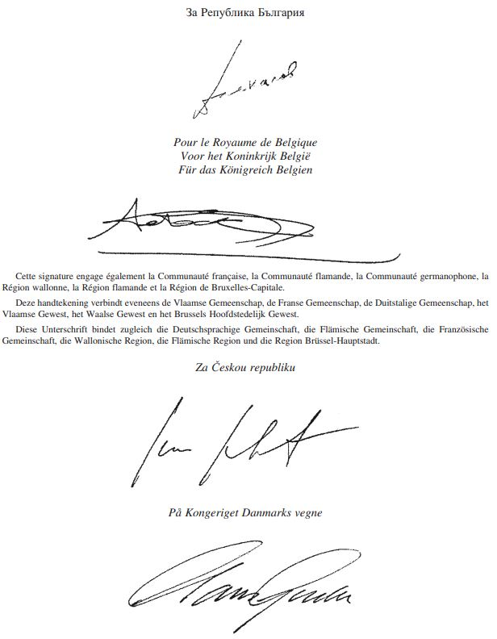
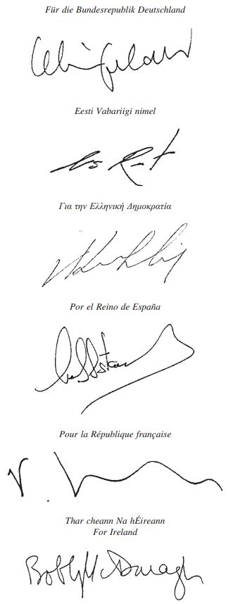
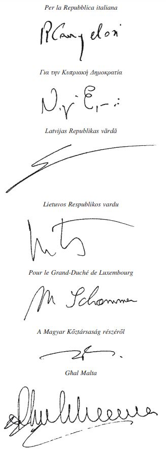
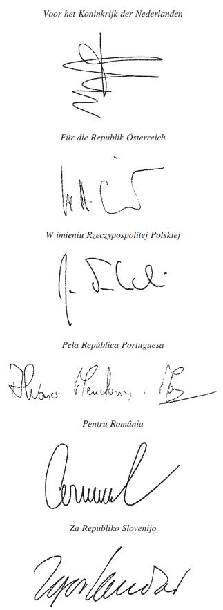
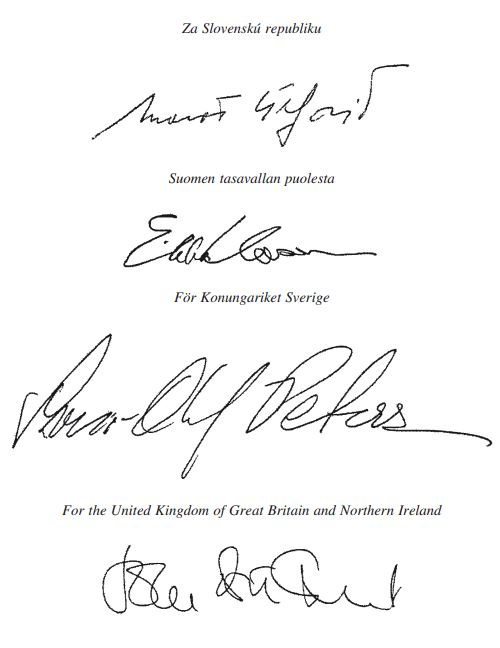
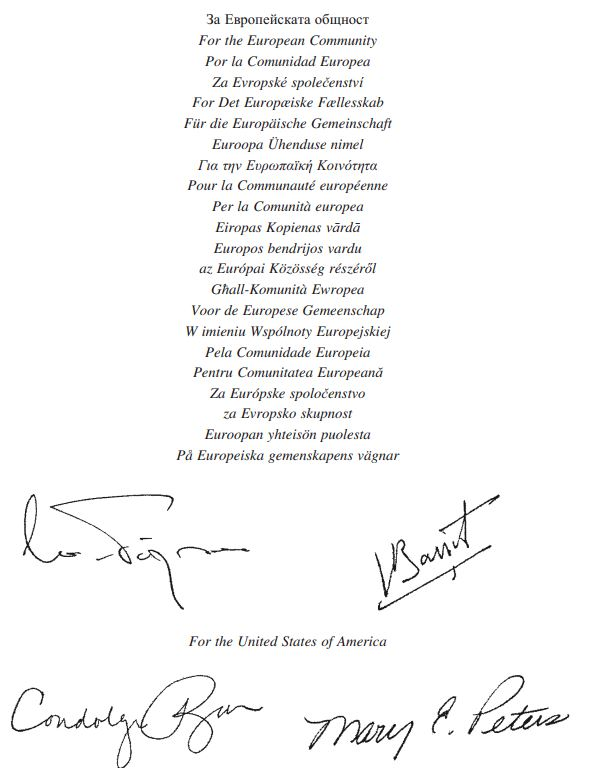

# Loi du 28 novembre 2009 portant approbation de l’Accord sur le transport aérien entre la Communauté européenne et ses Etats membres, d’une part, et les Etats-Unis d’Amérique, d’autre part, signé à Bruxelles, le 25 avril 2007 et à Washington, le 30 avril 2007.

Nous Henri, Grand-Duc de Luxembourg, Duc de Nassau,

Notre Conseil d’Etat entendu;

De l’assentiment de la Chambre des Députés;

Vu la décision de la Chambre des Députés du 29 octobre 2009 et celle du Conseil d’Etat du 10 novembre 2009 portant qu’il n’y a pas lieu à second vote;

Avons ordonné et ordonnons:

## Article unique.

Est approuvé l’Accord sur le transport aérien entre la Communauté européenne et ses Etats membres, d’une part, et les Etats-Unis d’Amérique, d’autre part, signé à Bruxelles, le 25 avril 2007 et à Washington, le 30 avril 2007.

Mandons et ordonnons que la présente loi soit insérée au Mémorial pour être exécutée et observée par tous ceux que la chose concerne.

Le Ministre des Affaires étrangères,   Jean Asselborn   Le Ministre du Développement durable et des Infrastructures,   Claude Wiseler

Château de Berg, le 28 novembre 2009.   Henri

\**ACCORD DE TRANSPORT AERIEN**

\*Les Etats-Unis d’Amérique*

(ci-après dénommés «les Etats-Unis»),

d’une part, et

\*La République d’Autriche,*

\*Le Royaume de Belgique,*

\*La République de Bulgarie,*

\*La République de Chypre,*

\*La République tchèque,*

\*Le Royaume de Danemark,*

\*La République d’Estonie,*

\*La République de Finlande,*

\*La République française,*

\*La République fédérale d’Allemagne,*

\*La République hellénique,*

\*La République de Hongrie,*

\*L’Irlande,*

\*La République italienne,*

\*La République de Lettonie,*

\*La République de Lituanie,*

\*Le Grand-Duché de Luxembourg,*

\*Malte,*

\*Le Royaume des Pays-Bas,*

\*La République de Pologne,*

\*La République portugaise,*

\*La Roumanie,*

\*La République slovaque,*

\*La République de Slovénie,*

\*Le Royaume d’Espagne,*

\*Le Royaume de Suède,*

\*Le Royaume-Uni de Grande-Bretagne et d’Irlande du Nord,*

parties au [traité instituant la Communauté européenne](https://legilux.public.lu/eli/etat/leg/loi/1957/11/30/n1/jo) et Etats membres de l’Union européenne (ci-après dénommés «les Etats membres»),

\*et la Communauté européenne,*

d’autre part,

\*Désireux* de promouvoir un système de transport aérien international fondé sur la concurrence entre transporteurs aériens, sur un marché soumis à un minimum d’intervention et de régulation étatiques;

\*Désireux* de favoriser l’essor du transport aérien international, notamment par le développement de réseaux de services aériens répondant aux besoins des passagers et des expéditeurs de services satisfaisants;

\*Désireux* de permettre aux transporteurs aériens d’offrir aux passagers et aux expéditeurs des tarifs et des services compétitifs sur des marchés ouverts;

\*Désireux* de faire profiter l’ensemble du secteur du transport aérien, y compris le personnel des transporteurs aériens, des avantages d’un accord de libéralisation;

\*Désireux* de garantir le plus haut niveau de sécurité et de sûreté dans le transport aérien international, et réaffirmant leur profonde préoccupation face aux actes et menaces dirigés contre la sûreté des aéronefs, qui mettent en danger la sécurité des personnes et des biens, nuisent au bon fonctionnement des services aériens et minent la confiance du public dans la sécurité de l’aviation civile;

\*Prenant acte* de la [Convention relative à l’aviation civile internationale](https://legilux.public.lu/eli/etat/leg/loi/1948/03/25/n2/jo), ouverte à la signature à Chicago le 7 décembre 1944;

\*Reconnaissant* que les aides d’Etat peuvent fausser la concurrence entre transporteurs aériens et compromettre la réalisation des objectifs fondamentaux du présent accord;

\*Soulignant* qu’il importe de protéger l’environnement dans le cadre de l’élaboration et de la mise en œuvre de la politique aéronautique internationale;

\*Soulignant* qu’il importe de protéger les consommateurs, au sens notamment de la [Convention pour l’unification de certaines règles relatives au transport aérien international](https://legilux.public.lu/eli/etat/leg/loi/2003/08/12/n12/jo), signée à Montréal le 28 mai 1999;

\*Ayant l’intention* de s’appuyer sur les accords existants pour ouvrir les marchés et maximiser les avantages pour les consommateurs, les transporteurs aériens, le personnel et les populations des deux côtés de l’Atlantique;

\*Reconnaissant* l’importance d’améliorer l’accès de leurs transporteurs aériens aux marchés mondiaux de capitaux afin de renforcer la concurrence et de promouvoir les objectifs du présent accord;

\*Ayant l’intention* de créer un précédent de portée mondiale pour exploiter pleinement les avantages de la libéralisation dans ce secteur économique essentiel;

SONT CONVENUS DE CE QUI SUIT:

## *Article 1er*

\***Définitions***

Aux fins du présent accord, sauf dispositions contraires, on entend par:

1\. Le terme «accord»: le présent accord et ses annexes et appendice, y compris leurs modifications éventuelles;

2\. L’expression «service aérien»: le transport par aéronef de passagers, de bagages, de marchandises et de courrier, séparément ou conjointement, proposé au public à titre onéreux;

3\. Le terme «Convention»: la [Convention relative à l’aviation civile internationale](https://legilux.public.lu/eli/etat/leg/loi/1948/03/25/n2/jo), ouverte à la signature à Chicago le 7 décembre 1944, et qui comprend:

a) tout amendement applicable en l’espèce entré en vigueur conformément à l’article 94, point a), de la Convention, et ratifié par les Etats-Unis, d’une part, et l’Etat membre ou les Etats membres concerné(s), d’autre part, et

b) toute annexe, ou tout amendement à une annexe applicable en l’espèce, adopté(e) en vertu de l’article 90 de la Convention, dans la mesure où ladite annexe ou ledit amendement s’applique à tout moment à la fois aux Etats-Unis et à l’Etat membre ou aux Etats membres concerné(s);

4\. L’expression «coût de revient complet»: les coûts liés à la fourniture du service, majorés d’un montant raisonnable pour les frais généraux administratifs;

5\. L’expression «service aérien international»: un service aérien qui traverse l’espace aérien situé au-dessus du territoire de plus d’un Etat;

6\. Le terme «partie»: soit les Etats-Unis, soit la Communauté européenne et ses Etats membres;

7\. Le terme «tarifs»: les tarifs, prix ou redevances appliqués par les transporteurs aériens ou leurs agents pour le transport par aéronefs de passagers, de bagages et/ou de marchandises (à l’exclusion du courrier), y compris, le cas échéant, le transport de surface lié au service aérien international, ainsi que les conditions régissant la disponibilité desdits tarifs, prix ou redevances;

8\. L’expression «escale non commerciale»: un atterrissage effectué à une fin autre que l’embarquement ou le débarquement de passagers, de bagages, de marchandises et/ou de courrier en transport aérien;

9\. Le terme «territoire»: dans le cas des Etats-Unis, les régions terrestres (continent et îles), ainsi que les eaux intérieures et les eaux territoriales qui se trouvent sous leur souveraineté ou leur juridiction, et, dans le cas de la Communauté européenne et de ses Etats membres, les régions terrestres (continent et îles), ainsi que les eaux intérieures et les eaux territoriales couvertes par le [traité instituant la Communauté européenne](https://legilux.public.lu/eli/etat/leg/loi/1957/11/30/n1/jo), conformément aux dispositions prévues par ce dernier et tout accord qui lui succède; l’application du présent accord à l’aéroport de Gibraltar s’entend sans préjudice des positions juridiques respectives du Royaume d’Espagne et du Royaume-Uni au sujet de leur différend relatif à la souveraineté sur le territoire où l’aéroport est situé, et du maintien de la suspension de l’application à l’aéroport de Gibraltar des mesures de libéralisation du transport aérien en vigueur au 18 septembre 2006 entre les Etats membres, conformément à la déclaration ministérielle concernant l’aéroport de Gibraltar adoptée à Cordoue le 18 septembre 2006; et

10\. L’expression «redevance d’usage»: une redevance imposée aux transporteurs aériens pour l’utilisation d’installations et services aéroportuaires, d’environnement liés aux aéroports, de navigation aérienne ou de sûreté de l’aviation, y compris les services et installations connexes.

## *Article 2*

\***Possibilité de concurrence loyale et équitable***

Chaque partie offre aux transporteurs aériens des deux parties la possibilité de se livrer à une concurrence loyale et équitable pour la fourniture des services aériens internationaux régis par le présent accord.

## *Article 3*

\***Octroi de droits***

1\. Chaque partie accorde à l’autre partie les droits ci-après, pour l’exploitation de services aériens internationaux par les transporteurs aériens de l’autre partie:

a) le droit de survoler son territoire sans y atterrir;

b) le droit d’effectuer sur son territoire des escales à des fins non commerciales;

c) le droit d’exploiter des services aériens internationaux entre des points situés sur les routes suivantes:

i) dans le cas des transporteurs des Etats-Unis (ci-après dénommés «transporteurs des Etats-Unis»): à partir de points en deçà des Etats-Unis, via les Etats-Unis et des points intermédiaires, vers tout point ou tous points d’un ou plusieurs Etats membres et au-delà; pour les services tout-cargo, entre tout Etat membre et tout point ou tous points (y compris dans tout autre Etat membre);

ii) dans le cas des transporteurs de la Communauté européenne et de ses Etats membres (ci-après dénommés «transporteurs communautaires»): à partir de points en deçà des Etats membres, via les Etats membres et des points intermédiaires, vers tout point ou tous points des Etats-Unis et au-delà; pour les services tout-cargo, entre les Etats-Unis et tout point ou tous points; pour les services mixtes, entre tout point ou tous points des Etats-Unis et tout point ou tous points de tout membre de l’Espace aérien commun européen (ci-après dénommé «l’EACE») à la date de la signature du présent accord; et

d) les autres droits spécifiés dans le présent accord.

2\. Chaque transporteur aérien peut, sur l’un quelconque ou l’ensemble de ses vols et à sa convenance:

a) exploiter des vols dans l’un ou l’autre sens ou dans les deux sens;

b) combiner des numéros de vols différents sur un même aéronef;

c) desservir les points en deçà, les points intermédiaires et au-delà, et les points situés sur le territoire des parties, dans toute combinaison et n’importe quel ordre;

d) omettre des escales en un ou plusieurs points;

e) transférer du trafic de l’un quelconque de ses aéronefs vers l’un quelconque de ses autres aéronefs, en tout point;

f) desservir des points en deçà de tout point de son territoire avec ou sans changement d’aéronef ou de numéro de vol, et proposer ces services au public en tant que services directs;

g) faire des arrêts en cours de route en tout point situé sur le territoire de l’une des parties ou en dehors de celui-ci;

h) faire transiter du trafic par le territoire de l’autre partie; et

i) combiner, à bord du même aéronef, du trafic indépendamment de la provenance de celui-ci;

sans limitation de direction ou d’ordre géographique et sans perte d’aucun droit de transporter du trafic autorisé par ailleurs en vertu du présent accord.

3\. Les dispositions du paragraphe 1 du présent article s’appliquent sous réserve que:

a) dans le cas des transporteurs des Etats-Unis, à l’exception des services tout-cargo, le transport fasse partie d’un service desservant les Etats-Unis, et

b) dans le cas des transporteurs communautaires, à l’exception i) des services tout-cargo et ii) des services mixtes entre les Etats-Unis et tout membre de l’EACE à la date de la signature du présent accord, le transport fasse partie d’un service desservant un Etat membre.

4\. Chaque partie autorise chaque transporteur aérien à définir la fréquence et la capacité du service aérien international qu’il souhaite offrir sur la base de considérations commerciales relatives au marché. En vertu de ce droit, aucune des deux parties ne limite unilatéralement le volume du trafic, la fréquence ou la régularité des services, le ou les types d’aéronefs exploités par les transporteurs aériens de l’autre partie ni n’exige de leur part le dépôt de leurs programmes de vols réguliers ou affrétés ou de plans d’exploitation, sauf pour des motifs douaniers, techniques, d’exploitation ou d’environnement (en application de l’article 15), et ceci dans des conditions uniformes conformes aux dispositions de l’article 15 de la Convention.

5\. Tout transporteur aérien assurant un service aérien international est libre de changer, en tout point, le type ou le nombre d’aéronefs qu’il utilise, à condition que, a) dans le cas des transporteurs des Etats-Unis, à l’exception des services tout-cargo, le transport fasse partie d’un service desservant les Etats-Unis, et b) dans le cas des transporteurs communautaires, à l’exception i) des services tout-cargo et ii) des services mixtes entre les Etats-Unis et un membre de l’EACE à la date de la signature du présent accord, le transport fasse partie d’un service desservant un Etat membre.

6\. Aucune disposition du présent accord ne peut être interprétée comme conférant:

a) aux transporteurs des Etats-Unis, le droit d’embarquer, sur le territoire d’un Etat membre, à titre onéreux, des passagers, des bagages, des marchandises ou du courrier à destination d’un autre point du territoire dudit Etat membre;

b) aux transporteurs communautaires, le droit d’embarquer, sur le territoire des Etats-Unis, à titre onéreux, des passagers, des bagages, des marchandises ou du courrier à destination d’un autre point du territoire des Etats-Unis.

7\. L’accès des transporteurs communautaires aux services de transport achetés par les pouvoirs publics des Etats-Unis est régi par l’annexe 3.

## *Article 4*

\***Autorisation***

Dès réception des demandes introduites par un transporteur aérien de l’une des parties, dans les formes prescrites pour les autorisations d’exploitation et les agréments techniques, l’autre partie accorde dans les délais les plus brefs les autorisations et agréments appropriés, à condition que:

a) dans le cas d’un transporteur aérien des Etats-Unis, une part substantielle de la propriété et le contrôle effectif de ce transporteur aérien soient entre les mains des Etats-Unis, de ressortissants des Etats-Unis, ou des deux à la fois, et que le transporteur soit titulaire d’une licence de transporteur aérien des Etats-Unis et ait son principal établissement sur le territoire des Etats-Unis;

b) dans le cas d’un transporteur communautaire, une part substantielle de la propriété et le contrôle effectif de ce transporteur aérien soient entre les mains d’un ou plusieurs Etats membres, de ressortissants de ce ou ces Etats membres, ou des deux à la fois, et que le transporteur soit titulaire d’une licence de transporteur aérien communautaire et ait son principal établissement sur le territoire de la Communauté européenne;

c) le transporteur aérien soit en mesure de répondre aux conditions prévues par les dispositions législatives et réglementaires normalement appliquées en matière d’exploitation de services aériens internationaux par la partie qui examine la ou les demandes; et

d) les dispositions de l’article 8 (Sécurité) et de l’article 9 (Sûreté) soient maintenues en vigueur et appliquées.

## *Article 5*

\***Révocation d’une autorisation d’exploitation***

1\. Chacune des parties se réserve le droit de révoquer, suspendre ou limiter les autorisations d’exploitation ou agréments techniques, ou de suspendre ou limiter d’une autre manière les activités d’un transporteur aérien de l’autre partie, lorsque:

a) dans le cas d’un transporteur des Etats-Unis, une part substantielle de la propriété et le contrôle effectif de ce transporteur aérien ne sont pas entre les mains des Etats-Unis, de ressortissants des Etats-Unis, ou des deux à la fois, ou lorsque le transporteur n’est pas titulaire d’une licence de transporteur aérien des Etats-Unis ou n’a pas son principal établissement sur le territoire des Etats-Unis;

b) dans le cas d’un transporteur communautaire, une part substantielle de la propriété et le contrôle effectif de ce transporteur aérien ne sont pas entre les mains d’un ou plusieurs Etats membres, de ressortissants de ce ou ces Etats membres, ou des deux à la fois, ou lorsque le transporteur n’est pas titulaire d’une licence de transporteur aérien communautaire ou n’a pas son principal établissement sur le territoire de la Communauté européenne; ou

c) ce transporteur aérien a enfreint les dispositions législatives et réglementaires visées à l’article 7 (Respect des dispositions législatives et réglementaires) du présent accord.

2\. A moins qu’il ne soit indispensable de prendre des mesures immédiates pour éviter de nouvelles infractions aux dispositions du paragraphe 1, point c), du présent article, les droits établis par le présent article ne sont exercés qu’après consultation avec l’autre partie.

3\. Le présent article ne restreint pas les droits de chaque partie de refuser, révoquer, limiter ou soumettre à des conditions l’autorisation d’exploitation ou l’agrément technique d’un ou de plusieurs transporteurs aériens de l’autre partie conformément aux dispositions de l’article 8 (Sécurité) ou de l’article 9 (Sûreté).

## *Article 6*

\***Questions complémentaires en rapport avec la propriété,*** ***les investissements et le contrôle***

Nonobstant toute autre disposition du présent accord, les parties mettent en œuvre les dispositions prévues à l’annexe 4 lorsqu’ils arrêtent des décisions en vertu de leurs lois et règlements respectifs concernant la propriété, les investissements et le contrôle.

## *Article 7*

\***Respect des dispositions législatives et réglementaires***

1\. Les dispositions législatives et réglementaires d’une partie régissant sur son territoire l’entrée et la sortie des aéronefs assurant la navigation aérienne internationale, ou régissant l’exploitation et la navigation desdits aéronefs lorsqu’ils se trouvent sur son territoire, s’appliquent aux aéronefs utilisés par les transporteurs aériens de l’autre partie et sont observées par lesdits aéronefs lorsqu’ils entrent sur le territoire de la première partie, lorsqu’ils y séjournent ou lorsqu’ils le quittent.

2\. Lors de l’entrée et du séjour sur le territoire de l’une des parties, ainsi que de la sortie de celui-ci, les dispositions législatives et réglementaires régissant sur ce territoire l’entrée et la sortie des passagers, des membres d’équipage ou du fret (y compris celles régissant les formalités d’entrée, les congés, l’immigration, les passeports, les douanes et la quarantaine ou, dans le cas du courrier, les règlements postaux) sont respectées par les passagers, membres d’équipage ou le fret des transporteurs aériens de l’autre partie ou par quiconque agissant en leur nom.

## *Article 8*

\***Sécurité***

1\. Les autorités compétentes des parties reconnaissent, aux fins de l’exploitation des services aériens couverts par le présent accord, la validité des certificats de navigabilité, des brevets d’aptitude et des licences délivrés ou validés par l’autre partie et demeurant en vigueur, sous réserve que les conditions d’obtention de ces certificats, brevets et licences soient égales ou supérieures aux normes minimales qui peuvent être établies en application de la Convention. Toutefois, les autorités compétentes peuvent refuser de reconnaître la validité, aux fins du survol de leur propre territoire, des brevets d’aptitude et des licences délivrés ou validés pour leurs propres ressortissants par les autorités de l’autre partie.

2\. Les autorités compétentes d’une partie peuvent demander des consultations avec les autorités compétentes de l’autre partie au sujet des normes de sécurité appliquées par ces dernières concernant les installations aéronautiques, les équipages, les aéronefs et l’exploitation des transporteurs aériens surveillés par lesdites autorités. Ces consultations se déroulent dans un délai de 45 jours à compter de la date à laquelle elles ont été demandées, sauf accord contraire des parties. Si, à la suite de ces consultations, les autorités compétentes qui les ont demandées estiment que les autorités de l’autre partie ne maintiennent ou n’appliquent pas effectivement des normes et des exigences de sécurité au moins égales aux normes minimales qui peuvent être établies dans ces domaines en application de la Convention, elles informent les autorités de l’autre partie de ces constatations et des mesures jugées nécessaires pour se conformer à ces normes minimales, et les autorités de l’autre partie adoptent les mesures correctives qui s’imposent. Les autorités compétentes qui ont fait la demande de consultations se réservent le droit de refuser, de révoquer ou de limiter l’autorisation d’exploitation ou l’agrément technique d’un ou de plusieurs transporteurs aériens dont les autorités de l’autre partie assurent le contrôle en matière de sécurité, au cas où lesdites autorités n’adoptent pas les mesures correctives demandées dans un délai raisonnable, et de prendre des mesures immédiates à l’encontre du ou des transporteurs aériens concernés si ces mesures sont indispensables pour empêcher de nouvelles infractions à l’obligation de maintenir en vigueur et d’appliquer les normes et exigences précitées, qui engendreraient une menace directe pour la sécurité des vols.

3\. Toutes les demandes et notifications faites en vertu du présent article sont à communiquer simultanément à la Commission européenne.

4\. Aucune disposition du présent article n’empêche les autorités compétentes des parties de tenir des débats sur la sécurité, y compris en ce qui concerne l’application courante des normes et exigences de sécurité ou les situations d’urgence qui peuvent survenir de temps à autre.

## *Article 9*

\***Sûreté***

1\. Conformément aux droits et obligations que leur confère le droit international, les parties réaffirment que leur obligation mutuelle de protéger la sûreté de l’aviation civile contre des actes d’intervention illicite fait partie intégrante du présent accord. Sans limiter la généralité des droits et obligations que leur confère le droit international, les parties agissent en particulier conformément aux accords suivants: la [Convention relative aux infractions et à certains autres actes survenant à bord des aéronefs](https://legilux.public.lu/eli/etat/leg/loi/1972/06/02/n1/jo), signée à Tokyo le 14 septembre 1963, la [Convention pour la répression de la capture illicite d’aéronefs](https://legilux.public.lu/eli/etat/leg/loi/1978/03/22/n1/jo), signée à La Haye le 16 décembre 1970, la [Convention pour la répression des actes illicites dirigés contre la sécurité de l’aviation civile](https://legilux.public.lu/eli/etat/leg/loi/1982/02/15/n1/jo), signée à Montréal le 23 septembre 1971, et le [Protocole pour la répression des actes illicites de violence dans les aéroports servant à l’aviation civile internationale](https://legilux.public.lu/eli/etat/leg/loi/2003/08/22/n1/jo), signé à Montréal le 24 février 1988.

2\. Les parties s’accordent mutuellement, sur demande, toute l’assistance nécessaire pour faire face à toute menace pour la sûreté de l’aviation civile, et notamment pour prévenir les actes de capture illicite d’aéronefs et autres actes illicites dirigés contre la sécurité de ces aéronefs, de leurs passagers et de leurs équipages, des aéroports et des installations et services de navigation aérienne.

3\. Les parties agissent, dans leurs rapports mutuels, conformément aux dispositions relatives à la sûreté de l’aviation et aux pratiques recommandées appropriées qui ont été établies par l’Organisation de l’aviation civile internationale et qui sont désignées comme annexes à la Convention; elles exigent des exploitants d’aéronefs immatriculés sur leur territoire, des exploitants d’aéronefs qui ont leur établissement principal ou leur résidence permanente sur leur territoire et des exploitants d’aéroports situés sur leur territoire qu’ils agissent conformément à ces dispositions relatives à la sûreté de l’aviation.

4\. Chaque partie veille à ce que des mesures adéquates soient effectivement appliquées sur son territoire pour assurer la protection des aéronefs, pour inspecter les passagers, les équipages, leurs bagages de soute et leurs bagages à main, ainsi que le fret et les provisions de bord, avant et pendant l’embarquement ou le chargement, et ce proportionnellement à l’augmentation de la menace. Chaque partie convient que les dispositions relatives à la sûreté requises par l’autre partie pour le départ et durant le séjour sur son territoire doivent être observées. Chaque partie examine avec bienveillance toute demande émanant de l’autre partie en vue d’instituer des mesures spéciales de sûreté pour faire face à une menace particulière.

5\. Tout en prenant pleinement en considération et en respectant la souveraineté de l’autre partie, une partie peut adopter des mesures de sûreté concernant l’entrée sur son territoire. Dans la mesure du possible, cette partie tient compte des mesures de sûreté déjà appliquées par l’autre partie et du point de vue exprimé par celle-ci. Toutefois, chaque partie reconnaît qu’aucune disposition du présent article ne limite la possibilité, pour une partie, de refuser l’accès à son territoire de tout vol qu’elle considère comme présentant une menace pour sa sûreté.

6\. Une partie peut prendre des mesures d’urgence, y compris la modification des mesures en vigueur, pour faire face à une menace spécifique pour la sûreté. De telles mesures sont notifiées immédiatement aux autorités compétentes de l’autre partie.

7\. Les parties soulignent l’importance de collaborer en vue de l’adoption de pratiques et de normes compatibles afin de renforcer la sûreté du transport aérien et de réduire les divergences entre les réglementations. A cette fin, les parties exploitent pleinement et développent les canaux existants pour discuter des mesures de sûreté actuelles et proposées. Les parties s’attendent à ce que les discussions portent, entre autres, sur les nouvelles mesures en matière de sûreté proposées ou envisagées par l’autre partie, y compris la révision des mesures de sûreté occasionnée par un changement de circonstance, sur les mesures proposées par l’une des parties pour satisfaire aux exigences de l’autre partie en matière de sûreté, sur les possibilités d’adapter plus rapidement les normes relatives aux mesures de sûreté de l’aviation, et, enfin, sur la compatibilité des exigences d’une des parties avec les obligations législatives de l’autre partie. Ces discussions devraient servir à favoriser la communication précoce et la discussion préalable des nouvelles initiatives et exigences en matière de sûreté.

8\. Sans préjudice de la nécessité de prendre des mesures immédiates afin d’assurer la sûreté du transport aérien, les parties affirment que, lors de l’examen de mesures envisagées en matière de sûreté, chaque partie en évalue les effets négatifs possibles sur les services aériens internationaux et, à moins d’y être obligée par la loi, prend en compte ces facteurs pour déterminer quelles mesures sont nécessaires et appropriées en vue de répondre aux préoccupations liées à la sûreté.

9\. En cas de capture ou de menace de capture illicite d’aéronefs ou d’autres actes illicites dirigés contre la sécurité des passagers, des équipages, des aéronefs, des aéroports ou des installations et services de navigation aérienne, les parties se prêtent mutuellement assistance en facilitant les communications et en prenant d’autres mesures appropriées destinées à mettre fin rapidement et en toute sécurité à cet incident ou à cette menace d’incident.

10\. Si l’une des parties a des motifs raisonnables d’estimer que l’autre partie a dérogé aux dispositions du présent article en matière de sûreté de l’aviation, les autorités compétentes de la première partie peuvent demander aux autorités compétentes de l’autre partie des consultations immédiates. L’impossibilité de parvenir à un accord satisfaisant dans un délai de quinze jours à compter de la date de cette demande constitue un motif pour refuser, révoquer, limiter ou soumettre à des conditions l’autorisation d’exploitation et les agréments techniques d’un ou plusieurs transporteurs aériens de cette partie. En cas d’urgence, une partie peut prendre des mesures provisoires avant l’expiration du délai de quinze jours.

11\. Indépendamment des inspections d’aéroports entreprises pour déterminer la conformité avec les normes et les pratiques en matière de sûreté de l’aviation visées au paragraphe 3, une partie peut demander la coopération de l’autre partie afin de vérifier si des mesures spécifiques prises par cette dernière en matière de sûreté répondent aux exigences de la partie requérante. Les autorités compétentes des parties se coordonnent pour établir à l’avance la liste des aéroports à inspecter et les dates des inspections, et établissent une procédure pour l’exploitation des résultats de ces inspections. Sur la base des résultats des inspections réalisées, la partie requérante peut décider que les mesures de sûreté appliquées sur le territoire de l’autre partie sont d’un niveau équivalent à celles qu’elle applique sur son propre territoire, de sorte que les passagers, les bagages et/ou le fret en correspondance peuvent être exemptés d’une nouvelle inspection sur le territoire de la partie requérante. Cette décision est communiquée à l’autre partie.

## *Article 10*

\***Activités commerciales***

1\. Les transporteurs aériens de chaque partie ont le droit d’établir des bureaux sur le territoire de l’autre partie aux fins de la promotion et de la vente de services aériens et d’activités connexes.

2\. Les transporteurs aériens de chaque partie sont autorisés, conformément aux dispositions législatives et réglementaires de l’autre partie en matière d’entrée, de séjour et d’emploi, à faire entrer et séjourner sur le territoire de l’autre partie du personnel commercial, technique, de gestion et d’exploitation, ou tout autre personnel spécialisé nécessaire pour assurer des services aériens.

3\. a) Sans préjudice du point b) ci-après, chaque transporteur aérien a le droit, sur le territoire de l’autre partie:

i) d’assurer ses propres services d’assistance en escale («auto-assistance») ou, à sa convenance,

ii) de choisir parmi les prestataires concurrents qui fournissent des services d’assistance en escale en totalité ou en partie, lorsque les dispositions législatives et réglementaires de chaque partie permettent l’accès au marché à ces prestataires et lorsque de tels prestataires sont présents sur le marché.

b) Les droits établis au point a), i) et ii) ci-dessus sont soumis uniquement aux contraintes spécifiques d’espace ou de capacité résultant de la nécessité d’assurer l’exploitation en toute sécurité de l’aéroport. Lorsque de telles contraintes entravent l’auto-assistance, et en l’absence de concurrence effective entre prestataires de services d’assistance en escale, l’ensemble de ces services est mis à la disposition de tous les transporteurs aériens dans des conditions égales et appropriées; le prix desdits services ne dépasse pas leur coût de revient complet compte tenu d’un taux de retour raisonnable sur actifs, après amortissement.

4\. Tout transporteur aérien de chaque partie est autorisé à procéder à la vente de services aériens sur le territoire de l’autre partie, directement et/ou, à sa convenance, par l’intermédiaire de ses agents ou de tout autre intermédiaire de son choix. Chaque transporteur aérien a le droit de vendre ce service, et toute personne est libre de l’acheter, dans la monnaie du territoire concerné ou dans toute monnaie librement convertible.

5\. Tout transporteur aérien a le droit, s’il en fait la demande, de convertir et de transférer les recettes locales excédant les dépenses effectuées sur place à partir du territoire de l’autre partie et à destination de son territoire national ou, sauf dispositions contraires aux dispositions législatives et réglementaires applicables, du ou des pays de son choix. La conversion et le transfert des recettes sont autorisés promptement, sans restrictions ni impositions, au taux de change courant à la date à laquelle le transporteur présente sa demande initiale de transfert.

6\. Les transporteurs aériens de chaque partie sont autorisés à régler en monnaie locale les dépenses engagées sur le territoire de l’autre partie (notamment pour l’achat de carburant). Ils peuvent, à leur discrétion, régler ces dépenses dans une monnaie librement convertible, conformément à la réglementation nationale des changes.

7\. Tout transporteur aérien d’une partie peut, dans le cadre de l’exploitation ou de la prestation de services aériens en vertu du présent accord, conclure des accords de coopération commerciale, tels que des accords de réservation de capacité ou de partage de code, avec:

a) tout transporteur aérien des parties;

b) tout transporteur aérien d’un pays tiers; et

c) un transporteur de surface (terrestre ou maritime) de n’importe quel pays;

à condition i) que tous les participants à de tels accords disposent des autorisations appropriées et ii) que ces accords satisfassent aux conditions prescrites par les dispositions législatives et réglementaires normalement appliquées par les parties à l’exploitation ou à la prestation de services aériens internationaux.

8\. Les transporteurs aériens de chaque partie ont le droit de conclure des accords de franchisage ou de marque avec des compagnies, y compris des transporteurs aériens, de l’une des parties ou de pays tiers, à condition que les transporteurs aériens disposent des autorisations appropriées et satisfassent aux conditions prescrites par les dispositions législatives et réglementaires normalement appliquées par les parties à de tels accords. L’annexe 5 s’applique à ces accords.

9\. Les transporteurs aériens de chaque partie peuvent conclure des accords pour la fourniture d’aéronefs avec équipage destinés à des services aériens internationaux avec:

a) tout transporteur aérien des parties; et

b) tout transporteur aérien d’un pays tiers;

à condition que tous les participants à de tels accords disposent des autorisations appropriées et satisfassent aux conditions prescrites par les dispositions législatives et réglementaires normalement appliquées par les parties à de tels accords. Aucune des deux parties n’exige d’un transporteur aérien de l’une des parties qui fournit des aéronefs qu’il dispose de droits de trafic en vertu du présent accord pour les routes sur lesquelles les aéronefs seront exploités.

10\. Nonobstant toute autre disposition du présent accord, les transporteurs aériens et les fournisseurs indirects de services de fret des parties sont autorisés, sans restriction, à utiliser dans le cadre des services aériens internationaux, tout transport de surface pour le fret à destination ou en provenance de tout point situé sur le territoire des parties ou de pays tiers, y compris le transport à destination ou en provenance de tout aéroport disposant d’installations douanières, et disposent du droit, le cas échéant, de transporter du fret sous douane, conformément aux dispositions législatives et réglementaires applicables. Ce fret, qu’il soit transporté par voie de surface ou par voie aérienne, a accès aux opérations d’enregistrement et aux installations douanières des aéroports. Les transporteurs peuvent choisir d’effectuer eux-mêmes leurs opérations de transport de surface, ou de les confier à d’autres transporteurs de surface, y compris à d’autres transporteurs aériens ou à des fournisseurs indirects de services de fret aérien. Ces services de fret intermodaux peuvent être proposés à un tarif forfaitaire unique couvrant le transport combiné par air et en surface, à condition que les expéditeurs ne soient pas induits en erreur quant à la nature et aux modalités de ces transports.

## *Article 11*

\***Droits de douane et taxes***

1\. A leur arrivée sur le territoire de l’autre partie, les aéronefs utilisés par les transporteurs aériens d’une partie pour assurer des services aériens internationaux, de même que leurs équipements normaux, l’équipement au sol, les carburants, les lubrifiants, les fournitures techniques consommables, les pièces détachées (y compris les moteurs), les provisions de bord (incluant, mais de manière non limitative, la nourriture, les boissons et alcools, les tabacs et d’autres produits destinés à la vente aux passagers ou à la consommation en quantités limitées pendant le vol) et autres articles prévus pour l’exploitation ou l’entretien des aéronefs assurant un service aérien international ou utilisés uniquement à ces fins sont exemptés, sur une base de réciprocité, de toutes restrictions à l’importation, taxes sur la propriété, de tout prélèvement sur le capital, de tous droits de douane et d’accises, et de toutes taxes ou redevances qui sont a) imposées par les autorités nationales ou la Communauté européenne, et b) ne sont pas calculées en fonction du coût des prestations fournies, à condition que ces équipements et fournitures restent à bord des aéronefs.

2\. Sont également exemptés, sur une base de réciprocité, des impôts, droits, taxes et redevances visés au paragraphe 1 du présent article, à l’exception des redevances calculées en fonction des prestations fournies:

a) les provisions de bord introduites ou fournies sur le territoire d’une partie et embarquées, en quantités raisonnables, à bord d’un aéronef en partance appartenant à un transporteur de l’autre partie assurant des services aériens internationaux, même si ces articles sont destinés à être consommés sur la partie du vol effectuée au-dessus dudit territoire;

b) l’équipement au sol et les pièces détachées (y compris les moteurs) introduits sur le territoire d’une partie aux fins d’entretien, de maintenance ou de réparation des aéronefs d’un transporteur aérien de l’autre partie assurant des services aériens internationaux;

c) le carburant, les lubrifiants et les fournitures techniques consommables introduits ou fournis sur le territoire d’une partie pour être utilisés à bord d’un aéronef appartenant à un transporteur aérien de l’autre partie assurant des services aériens internationaux, même si ces fournitures sont destinées à être utilisées sur la partie du vol effectuée au-dessus dudit territoire; et

d) les imprimés, conformément à la législation douanière de chaque partie, introduits ou fournis sur le territoire d’une partie et embarqués à bord d’un aéronef en partance appartenant à un transporteur aérien de l’autre partie assurant des services aériens internationaux, même si ces articles sont destinés à être utilisés sur la partie du vol effectuée au-dessus du territoire de la partie dans laquelle ils ont été embarqués à bord.

3\. Il peut être exigé que les équipements et fournitures visés aux paragraphes 1 et 2 du présent article soient placés sous la surveillance ou le contrôle des autorités compétentes.

4\. Les exonérations prévues au présent article sont également accordées lorsque les transporteurs aériens d’une partie ont passé contrat avec un autre transporteur aérien, bénéficiant des mêmes exonérations de la part de l’autre partie, en vue du prêt ou du transfert sur le territoire de l’autre partie des articles mentionnés aux paragraphes 1 et 2 du présent article.

5\. Aucune des dispositions du présent accord n’interdit à une partie d’appliquer des impôts, droits, taxes ou redevances sur la vente d’articles non destinés à être consommés à bord d’un aéronef sur une partie du service aérien entre deux points situés sur son territoire où l’embarquement et le débarquement sont autorisés.

6\. Lorsque deux Etats membres ou plus envisagent de supprimer l’exonération prévue à l’article 14, paragraphe 1, point b), de la [directive 2003/96/CE](https://legilux.public.lu/eli/dir_ue/2003/96/jo) du Conseil du 27 octobre 2003 pour le carburant fourni sur leur territoire aux aéronefs des transporteurs des Etats-Unis, pour les vols entre lesdits Etats membres, le comité mixte examine cette question conformément à l’article 18, paragraphe 4, point e).

7\. Une partie peut demander l’aide de l’autre partie, au nom de son ou ses transporteurs aériens, afin d’obtenir une exonération des impôts, taxes, droits et redevances perçus par toutes autorités ou collectivités fédérées, régionales, ou locales de niveau infra-étatique sur les biens mentionnés aux paragraphes 1 et 2 du présent article, ainsi qu’une exonération des redevances de distribution de carburant, dans les conditions énoncées au présent article, sauf dans la mesure où ces redevances sont basées sur le coût du service fourni. En réponse à une telle demande, l’autre partie fait part aux autorités compétentes des remarques de la partie requérante et leur recommande qu’il en soit dûment tenu compte.

## *Article 12*

\***Redevances d’usage***

1\. Les redevances d’usage qui peuvent être imposées par les autorités ou organismes compétents d’une partie aux transporteurs aériens de l’autre partie sont justes, raisonnables, non injustement discriminatoires et équitablement réparties entre les catégories d’utilisateurs. Dans tous les cas, ces redevances d’usage ne peuvent être imposées aux transporteurs aériens de l’autre partie à des conditions moins favorables que les conditions les plus favorables accordées à un autre transporteur aérien au moment de leur imposition.

2\. Les redevances d’usage imposées aux transporteurs aériens de l’autre partie peuvent refléter, sans l’excéder, le coût de revient complet assumé par les autorités ou organismes compétents pour la fourniture des installations et services aéroportuaires appropriés, d’environnement liés aux aéroports, de navigation aérienne et de sûreté de l’aviation, sur un aéroport ou au sein d’un système aéroportuaire. Ces redevances d’usage peuvent inclure un retour raisonnable sur actifs après amortissement. Les installations et services qui font l’objet de ces redevances sont fournis sur une base efficace et économique.

3\. Chaque partie encourage les consultations entre les autorités ou organismes compétents sur son territoire et les transporteurs aériens utilisant les services et installations, et invite les autorités ou organismes compétents et les transporteurs aériens à échanger les informations nécessaires pour permettre un examen précis du caractère raisonnable des redevances d’usage, conformément aux principes énoncés aux paragraphes 1 et 2 du présent article. Chaque partie encourage les autorités compétentes à informer les utilisateurs, dans un délai raisonnable, de tout projet de modification des redevances d’usage, afin de leur permettre d’exprimer leur avis avant la mise en œuvre de ces modifications.

4\. Dans le cadre des procédures de règlement des différends prévues à l’article 19, aucune partie n’est considérée comme étant en infraction avec une disposition du présent article, sauf si a) elle n’examine pas, dans un délai raisonnable, une redevance ou une pratique qui fait l’objet d’une plainte de la part de l’autre partie, ou si b) à la suite d’un tel examen, elle ne prend pas toutes les mesures en son pouvoir pour modifier une redevance ou une pratique incompatible avec le présent article.

## *Article 13*

\***Tarifs***

1\. Les tarifs des services aériens exploités en vertu du présent accord sont établis librement et ne sont pas soumis à approbation. Leur dépôt ne peut être imposé.

2\. Nonobstant les dispositions du paragraphe 1:

a) l’introduction ou le maintien du tarif qu’un transporteur aérien des Etats-Unis a l’intention d’appliquer ou applique pour un service aérien international entre un point situé dans un Etat membre et un point situé dans un autre Etat membre doit être compatible avec les dispositions de l’article 1er, paragraphe 3, du [règlement (CEE) N° 2409/92](https://legilux.public.lu/eli/reg_ue/1992/2409/jo) du Conseil du 23 juillet 1992, ou d’un règlement ultérieur qui ne serait pas plus restrictif;

b) en vertu du présent paragraphe, les transporteurs aériens des parties permettent aux autorités compétentes des parties qui en font la demande d’avoir accès immédiatement aux informations concernant les tarifs pratiqués dans le passé, les tarifs en vigueur et les tarifs dont l’introduction est proposée, et ce selon des modalités et sous une forme acceptables pour lesdites autorités.

## *Article 14*

\***Subventions et aides d’Etat***

1\. Les parties reconnaissent que les subventions et aides d’Etat peuvent fausser la concurrence loyale et équitable entre les transporteurs aériens pour la fourniture des services aériens internationaux régis par le présent accord.

2\. Si l’une des parties estime qu’une subvention ou une aide d’Etat que l’autre partie envisage d’accorder ou accorde aux transporteurs aériens de cette dernière fausserait ou fausse la concurrence loyale et équitable au détriment des transporteurs aériens de la première partie, elle peut présenter des observations à cette partie. Elle peut en outre demander une réunion du comité mixte, conformément à l’article 18, afin d’examiner la question et d’apporter les réponses appropriées aux préoccupations jugées légitimes.

3\. Chaque partie peut s’adresser aux pouvoirs publics compétents sur le territoire de l’autre partie, y compris à toutes entités fédérées, régionales ou locales de niveau infra-étatique, si elle estime qu’une subvention ou une aide envisagée ou accordée par ces entités aura sur la concurrence les effets négatifs visés au paragraphe 2. Si une partie décide d’établir ces contacts directs, elle en informe sans délai l’autre partie par la voie diplomatique. Elle peut aussi demander une réunion du comité mixte.

4\. Les questions soulevées au titre du présent article peuvent inclure, par exemple, des injections de capitaux, des subventions croisées, des dons, des garanties, la propriété, des réductions ou exonérations d’impôts, de la part de toute entité publique.

## *Article 15*

\***Environnement***

1\. Les parties reconnaissent l’importance de protéger l’environnement dans le cadre de l’élaboration et de la mise en œuvre de la politique aéronautique internationale. Elles reconnaissent que les coûts et les avantages des mesures destinées à protéger l’environnement doivent être soigneusement pesés dans le cadre de l’élaboration de la politique aéronautique internationale.

2\. Lorsqu’une partie examine des projets de mesures de protection de l’environnement, il convient qu’elle en évalue les effets négatifs possibles sur l’exercice des droits prévus dans le présent accord et, si ces mesures sont adoptées, il convient qu’elle prenne les dispositions appropriées pour en atténuer les effets négatifs éventuels.

3\. Lorsque des mesures de protection de l’environnement sont adoptées, les normes sur la protection de l’environnement adoptées par l’Organisation de l’aviation civile internationale dans les annexes à la convention sont respectées, sauf dans les cas où des différences par rapport à ces normes ont été notifiées. Les parties appliquent toute mesure de protection de l’environnement ayant une incidence sur les services aériens régis par le présent accord conformément à l’article 2 et à l’article 3, paragraphe 4, du présent accord.

4\. Si une partie estime qu’une question liée à la protection de l’environnement dans le contexte de l’aviation soulève des préoccupations quant à l’application ou à la mise en œuvre du présent accord, elle peut demander une réunion du comité mixte, conformément à l’article 18, afin d’examiner la question et d’apporter les réponses appropriées aux préoccupations jugées légitimes.

## *Article 16*

\***Protection des consommateurs***

Les parties affirment l’importance de la protection des consommateurs; chaque partie peut demander une réunion du comité mixte afin de discuter de questions liées à la protection des consommateurs qu’elle considère comme importantes.

## *Article 17*

\***Systèmes informatisés de réservation***

1\. Les fournisseurs de systèmes informatisés de réservation (SIR) en activité sur le territoire d’une des parties ont le droit d’installer leurs SIR, de les entretenir et de les mettre à la libre disposition des agences de voyage ou des voyagistes dont l’activité principale consiste à distribuer des produits liés aux voyages sur le territoire de l’autre partie, à condition que ces SIR soient conformes aux exigences réglementaires en vigueur de l’autre partie.

2\. Aucune des parties n’impose ou n’autorise l’imposition, sur son territoire, de règles plus strictes aux fournisseurs de SIR de l’autre partie que celles imposées à ses propres fournisseurs de SIR, en ce qui concerne les affichages des SIR (y compris les paramètres de modification et d’affichage), les activités, les pratiques, les ventes ou la propriété.

3\. Les propriétaires ou exploitants de SIR d’une partie qui se conforment aux exigences réglementaires applicables de l’autre partie ont les mêmes possibilités de posséder des SIR sur le territoire de l’autre partie que les propriétaires ou exploitants de cette dernière.

## *Article 18*

\***Comité mixte***

1\. Un comité mixte composé de représentants des parties se réunit au moins une fois par an afin de procéder à des consultations concernant le présent accord et d’en examiner la mise en œuvre.

2\. Chaque partie peut également demander la convocation d’une réunion du comité mixte pour tenter de résoudre des questions portant sur l’interprétation ou l’application du présent accord. Toutefois, en ce qui concerne les questions visées à l’article 20 ou à l’annexe 2, le comité mixte peut examiner uniquement les questions ayant trait au refus de l’un des participants de mettre en œuvre les engagements souscrits et à l’incidence des décisions en matière de concurrence sur l’application du présent accord. Cette réunion se tient dans les plus brefs délais, et au plus tard 60 jours après la date de réception de la demande, sauf accord contraire des parties.

3\. Le comité mixte examine, au plus tard lors de sa première réunion annuelle et selon les besoins par la suite, la mise en œuvre globale de l’accord, et notamment les effets éventuels des contraintes liées aux infrastructures aéroportuaires sur l’exercice des droits prévus à l’article 3, les effets des mesures de sûreté prises en vertu de l’article 9, les effets sur les conditions de concurrence, notamment dans le domaine des systèmes informatisés de réservation, ainsi que les effets sociaux éventuels de la mise en œuvre de l’accord.

4\. Le comité mixte développe également la coopération:

a) en promouvant des échanges entre experts sur les nouvelles initiatives et les nouveaux développements législatifs et réglementaires, en matière notamment de sûreté, de sécurité, d’environnement, d’infrastructures aéroportuaires (y compris les créneaux horaires) et de protection des consommateurs;

b) en examinant les conséquences sociales de l’accord tel qu’il est appliqué, et en apportant les réponses appropriées aux préoccupations jugées légitimes;

c) en envisageant les domaines susceptibles d’être inclus dans l’accord, voire en recommandant d’éventuels amendements à ce dernier;

d) en tenant un inventaire des questions relatives aux subventions ou aides publiques soulevées par l’une ou l’autre des parties au sein du comité mixte;

e) en prenant des décisions par consensus concernant toute question relative à l’application de l’article 11, paragraphe 6;

f) en mettant au point, dans un délai d’un an à compter de l’application provisoire, des lignes de conduite concernant les décisions réglementaires en matière de citoyenneté et de conformité des transporteurs aériens, afin d’obtenir la reconnaissance réciproque de ces décisions;

g) en élaborant une conception commune des critères utilisés par les parties pour prendre leurs décisions respectives dans les cas concernant le contrôle des transporteurs aériens, dans une mesure qui soit compatible avec les exigences de confidentialité;

h) en encourageant la consultation, le cas échéant, sur les questions liées au transport aérien traitées au sein des organisations internationales et dans les relations avec les pays tiers, notamment en vue d’examiner l’opportunité d’adopter une approche commune;

i) en prenant par consensus les décisions visées à l’article 1er, paragraphe 3, et à l’article 2, paragraphe 3, de l’annexe 4.

5\. Les parties partagent l’objectif consistant à maximiser les avantages pour les consommateurs, les transporteurs aériens, les travailleurs et les populations des deux côtés de l’Atlantique en étendant le présent accord aux pays tiers. A cette fin, le comité mixte s’emploie à élaborer une proposition concernant les conditions et les procédures requises, y compris toute modification nécessaire du présent accord, pour l’adhésion de pays tiers au présent accord.

6\. Le comité mixte fonctionne sur la base du consensus.

## *Article 19*

\***Arbitrage***

1\. Tout différend relatif à l’application ou à l’interprétation du présent accord, sauf s’il porte sur les questions visées à l’article 20 ou à l’annexe 2, et qui n’est pas résolu par une réunion du comité mixte, peut être soumis à une personne ou à un organisme en vue d’une décision par accord des parties. En l’absence d’accord des parties, le différend est soumis, à la demande d’une des parties, à un arbitrage selon la procédure exposée ci-après.

2\. A moins que les parties n’en conviennent autrement, l’arbitrage est rendu par un tribunal composé de trois arbitres et constitué comme suit:

a) dans les vingt jours suivant la réception d’une demande d’arbitrage, chaque partie désigne un arbitre. Dans les 45 jours suivant la désignation de ces deux arbitres, ceux-ci désignent d’un commun accord un troisième arbitre, qui exerce les fonctions de président du tribunal;

b) si l’une des parties ne désigne pas d’arbitre ou si le troisième arbitre n’est pas désigné conformément au point a) du présent paragraphe, l’une ou l’autre des parties peut demander au président du conseil de l’Organisation de l’aviation civile internationale de procéder à la désignation ou aux désignations nécessaires dans un délai de 30 jours à compter de la réception de cette demande. Si le président du conseil de l’Organisation de l’aviation civile internationale est ressortissant des Etats-Unis ou d’un Etat membre, le vice-président le plus gradé de ce conseil à qui ce motif de disqualification ne s’applique pas procède à cette désignation.

3\. Sauf accord contraire des parties, le tribunal définit l’étendue de sa juridiction conformément au présent accord et fixe ses règles de procédure. A la demande d’une partie, le tribunal peut, après avoir été constitué, demander à l’autre partie d’appliquer des mesures correctives provisoires dans l’attente de sa décision définitive. A l’initiative du tribunal ou à la demande de l’une des parties, une conférence a lieu dans un délai maximal de quinze jours suivant la constitution complète du tribunal afin que celui-ci détermine les questions précises qui doivent faire l’objet de l’arbitrage et les procédures spécifiques à suivre.

4\. Sauf accord contraire des parties ou autre décision du tribunal:

a) le mémoire en demande est présenté dans les 30 jours qui suivent la constitution complète du tribunal, et le mémoire en défense est présenté 40 jours après. Toute réponse de la partie demanderesse est soumise dans les quinze jours qui suivent la présentation du mémoire en défense. Toute réponse de la partie défenderesse est soumise dans les quinze jours qui suivent.

b) Le tribunal tient une audience, à la demande d’une des parties ou de sa propre initiative, dans un délai de quinze jours à compter du dépôt de la dernière réponse.

5\. Le tribunal s’efforce de rendre une décision par écrit dans un délai de 30 jours à compter de la fin de l’audience ou, si aucune audience n’a été organisée, dans les 30 jours qui suivent la soumission de la dernière réponse. Le tribunal rend ses décisions à la majorité de ses membres.

6\. Les parties peuvent déposer des demandes d’explication de la décision dans un délai de dix jours suivant son prononcé; toute explication est donnée dans un délai de quinze jours suivant cette demande.

7\. Si le tribunal estime qu’il y a eu violation du présent accord et que la partie responsable de cette violation n’y remédie pas ou ne parvient pas, dans les 40 jours suivant la notification de la décision du tribunal, à un accord mutuellement acceptable avec l’autre partie, cette dernière peut suspendre l’application d’avantages comparables découlant du présent accord, jusqu’à ce que les parties parviennent à régler le différend. Aucune des dispositions du présent paragraphe ne saurait être interprétée comme restreignant le droit de l’une ou l’autre des parties de prendre des mesures proportionnelles conformément au droit international.

8\. Les frais du tribunal, y compris les rémunérations et frais des arbitres, sont partagés à égalité entre les parties. Toute dépense engagée par le président du conseil de l’Organisation de l’aviation civile internationale, ou par un vice-président dudit conseil, du fait des procédures mentionnées au paragraphe 2, point b), du présent article est réputée faire partie des frais du tribunal.

## *Article 20*

\***Concurrence***

1\. Les parties reconnaissent que la concurrence entre les transporteurs aériens sur le marché transatlantique est importante pour promouvoir les objectifs du présent accord, et confirment qu’elles appliqueront leurs régimes de concurrence respectifs afin de protéger et de renforcer la concurrence globale et non des concurrents spécifiques.

2\. Les parties reconnaissent que des différences affectant le marché transatlantique peuvent survenir en ce qui concerne l’application de leurs régimes de concurrence respectifs au transport aérien international et que la concurrence entre les transporteurs aériens sur ce marché pourrait être stimulée par une réduction de ces différences.

3\. Les parties reconnaissent que la coopération entre leurs autorités de la concurrence respectives contribue à stimuler la concurrence sur les marchés et est susceptible de favoriser la compatibilité des résultats de la régulation et de limiter au maximum les différences d’approche dans les examens, sur le plan de la concurrence, des accords inter-transporteurs. C’est pourquoi les parties approfondissent cette coopération dans la mesure du possible, en tenant compte des différences existant entre les responsabilités, les compétences et les procédures de leurs autorités, conformément à l’annexe 2.

4\. Le comité mixte est informé chaque année des résultats de la coopération menée dans le cadre de l’annexe 2.

## *Article 21*

\***Négociations en vue d’une seconde étape***

1\. Les parties partagent l’objectif consistant à poursuivre l’ouverture de l’accès aux marchés et à maximiser les avantages pour les consommateurs, les transporteurs aériens, le personnel et les populations des deux côtés de l’Atlantique, notamment en facilitant les investissements afin de mieux refléter les réalités de l’industrie aéronautique mondiale, en renforçant le système de transport aérien transatlantique et en établissant un cadre qui encouragera les autres pays à ouvrir leurs propres marchés des services aériens. Les parties entament des négociations au plus tard 60 jours après la date d’application provisoire du présent accord, en vue de la préparation rapide de l’étape suivante.

2\. A cette fin, le calendrier des négociations en vue d’une seconde étape comprend les points ci-après, qui présentent un intérêt prioritaire pour l’une ou l’autre des parties:

a) poursuite de la libéralisation des droits de trafic;

b) opportunités d’investissements étrangers supplémentaires;

c) effet des mesures environnementales et des contraintes liées aux infrastructures sur l’exercice des droits de trafic;

d) meilleur accès au transport aérien financé par les pouvoirs publics; et

e) fourniture d’aéronefs avec équipage.

3\. Les parties examinent les progrès qu’elles ont accomplis dans la conclusion d’un accord de seconde étape au plus tard dix-huit mois à compter de la date à laquelle les négociations doivent commencer conformément au paragraphe 1. Si aucun accord de seconde étape n’est atteint par les parties dans les douze mois qui suivent le début de cet examen, chaque partie se réserve le droit de suspendre des droits prévus dans le présent accord. Une telle suspension ne prend pas effet avant le début de la saison IATA (Association internationale du transport aérien) qui commence au plus tôt douze mois après la date à laquelle la notification de la suspension est donnée.

## *Article 22*

\***Relations avec d’autres accords***

1\. Au cours de la période d’application provisoire prévue à l’article 25 du présent accord, les accords bilatéraux énumérés à la section 1 de l’annexe 1 sont suspendus, sauf dans la mesure prévue à la section 2 de l’annexe 1.

2\. Lors de l’entrée en vigueur du présent accord en application de son article 26, celui-ci remplace les accords bilatéraux énumérés à la section 1 de l’annexe 1, sauf dans la mesure prévue à la section 2 de l’annexe 1.

3\. Si les parties deviennent parties à un accord multilatéral ou appliquent une décision de l’Organisation de l’aviation civile internationale ou de toute autre organisation internationale qui traite d’aspects couverts par le présent accord, elles se consultent au sein du comité mixte pour déterminer s’il y a lieu de réviser le présent accord à la lumière de cette situation.

## *Article 23*

\***Dénonciation***

Chaque partie peut à tout moment notifier par écrit à l’autre partie, par la voie diplomatique, sa décision de mettre fin au présent accord. Cette notification est communiquée simultanément à l’Organisation de l’aviation civile internationale. Le présent accord prend fin à minuit GMT à la fin de la saison IATA (Association internationale du transport aérien) en cours un an après la date de notification écrite de la dénonciation de l’accord, sauf si cette notification est retirée par accord entre les parties avant l’expiration de ce délai.

## *Article 24*

\***Enregistrement auprès de l’Organisation de l’aviation civile internationale***

Le présent accord et tous ses amendements sont enregistrés auprès de l’Organisation de l’aviation civile internationale.

## *Article 25*

\***Application provisoire***

Dans l’attente de l’entrée en vigueur en application de l’article 26:

1\. les parties conviennent d’appliquer le présent accord à partir du 30 mars 2008.

2\. Chaque partie peut à tout moment notifier par écrit à l’autre partie, par la voie diplomatique, sa décision de ne plus appliquer le présent accord. Dans ce cas, cette application prend fin à minuit GMT à la fin de la saison IATA (Association internationale du transport aérien) en cours un an après la date de notification écrite, sauf si cette notification est retirée par accord entre les parties avant l’expiration de ce délai.

## *Article 26*

\***Entrée en vigueur***

Le présent accord entre en vigueur un mois après la date de la dernière note transmise dans le cadre d’un échange de notes diplomatiques entre les parties pour confirmer que toutes les procédures nécessaires à l’entrée en vigueur de l’accord ont été menées à bien. Aux fins de cet échange de notes, les Etats-Unis remettent à la Communauté européenne la note diplomatique destinée à la Communauté européenne et à ses Etats membres, et la Communauté européenne remet aux Etats-Unis la ou les notes diplomatiques de la Communauté européenne et de ses Etats membres. La ou les notes diplomatiques de la Communauté européenne et de ses Etats membres contiennent des communications de chaque Etat membre confirmant que les procédures nécessaires à l’entrée en vigueur du présent accord ont été menées à bien.

EN FOI DE QUOI les soussignés, dûment autorisés à cet effet, ont signé le présent accord.

FAIT à Bruxelles, le vingt-cinq avril 2007, et à Washington, le trente avril 2007, en double exemplaire.

\*

\**ANNEXE 1**

## *Section 1*

Conformément aux dispositions de l’article 22 du présent accord, les accords bilatéraux suivants signés entre les Etats-Unis et les Etats membres sont suspendus ou remplacés par le présent accord:

a) République d’Autriche: accord sur les services aériens, signé à Vienne le 16 mars 1989; modifié le 14 juin 1995.

b) Royaume de Belgique: accord de transport aérien, conclu par échange de notes à Washington, le 23 octobre 1980; modifié le 22 septembre et le 12 novembre 1986; modifié le 5 novembre 1993 et le 12 janvier 1994.

(modification conclue le 5 septembre 1995 (appliquée provisoirement).)

c) République de Bulgarie: accord sur la sûreté de l’aviation civile, signé à Sofia le 24 avril 1991.

d) République tchèque: accord de transport aérien, signé à Prague le 10 septembre 1996; modifié le 14 juin 2001 et le 14 février 2002.

e) Royaume de Danemark: accord en matière de transports aériens, conclu par échange de notes à Washington le 16 décembre 1944; modifié le 6 août 1954; modifié le 16 juin 1995.

f) République de Finlande: accord de transport aérien, signé à Helsinki le 29 mars 1949; protocole y afférent signé le 12 mai 1980; accord modifiant l’accord de 1949 et le protocole de 1980 conclu le 9 juin 1995.

g) République française: accord de transport aérien, signé à Washington le 18 juin 1998; modifié le 10 octobre 2000; modifié le 22 janvier 2002.

h) République fédérale d’Allemagne: accord de transport aérien avec échange de notes, signé à Washington le 7 juillet 1955; modifié le 25 avril 1989.

(protocole y afférent conclu le 1er novembre 1978; accord connexe conclu le 24 mai 1994; protocole modifiant l’accord de 1955 conclu le 23 mai 1996; accord modifiant le protocole de 1996 conclu le 10 octobre 2000 (tous appliqués à titre provisoire).)

i) République hellénique: accord de transport aérien, signé à Athènes le 31 juillet 1991; prorogé jusqu’au 31 juillet 2007 par échange de notes du 22 et du 28 juin 2006.

j) République de Hongrie: accord de transport aérien avec protocole d’entente, signé à Budapest le 12 juillet 1989; prorogé jusqu’au 12 juillet 2007 par échange de notes du 11 et du 20 juillet 2006.

k) Irlande: accord en matière de transports aériens, réalisé par échange de notes à Washington le 3 février 1945; modifié le 25 janvier 1988 et le 29 septembre 1989; modifié le 25 juillet et le 6 septembre 1990.

(protocole d’entente sur les consultations, signé à Washington le 28 octobre 1993 (appliqué à titre provisoire).)

l) République italienne: accord de transport aérien, avec protocole et échange de notes, signé à Rome le 22 juin 1970; modifié le 25 octobre 1988; protocole d’accord y afférent signé le 27 septembre 1990; modifications de l’accord de 1970 et du protocole d’accord de 1990 conclues le 22 novembre et le 23 décembre 1991; modifications de l’accord de 1970 et du protocole de 1990 conclues le 30 mai et le 21 octobre 1997; accord complétant l’accord de 1970 conclu le 30 décembre 1998 et le 2 février 1999.

(protocole modifiant l’accord de 1970 conclu le 6 décembre 1999 (appliqué à titre provisoire).)

m) Grand-Duché de Luxembourg: accord de transport aérien, signé à Luxembourg le 19 août 1986; modifié le 6 juin 1995; modifié le 13 et le 21 juillet 1998.

n) Malte: accord de transport aérien, signé à Washington le 12 octobre 2000.

o) Royaume des Pays-Bas: accord de transport aérien, signé à Washington le 3 avril 1957; protocole modifiant l’accord de 1957, conclu le 31 mars 1978; modification du protocole de 1978, conclue le 11 juin 1986; modification de l’accord de 1957, conclue le 13 octobre et le 22 décembre 1987; modification de l’accord de 1957, conclue le 29 janvier et le 13 mars 1992; modification de l’accord de 1957 et du protocole 1978, conclue le 14 octobre 1992.

p) République de Pologne: accord de transport aérien, signé à Varsovie le 16 juin 2001.

q) République portugaise: accord de transport aérien, signé à Lisbonne le 30 mai 2000.

r) Roumanie: accord de transport aérien, signé à Washington le 15 juillet 1998.

s) République slovaque: accord de transport aérien, signé à Bratislava le 22 janvier 2001.

t) Royaume d’Espagne: accord de transport aérien, signé à Madrid le 20 février 1973; accord connexe du 20 février, du 31 mars et du 7 avril 1987; modification de l’accord de 1973, conclue le 31 mai 1989; modification de l’accord de 1973, conclue le 27 novembre 1991.

u) Royaume de Suède: accord en matière de transports aériens, conclu par échange de notes à Washington le 16 décembre 1944; modifié le 6 août 1954; modifié le 16 juin 1995.

v) Royaume-Uni de Grande-Bretagne et d’Irlande du Nord: accord sur les services aériens avec échange de lettres, signé aux Bermudes le 23 juillet 1977; accord relatif aux tarifs aériens sur l’Atlantique Nord, conclu le 17 mars 1978; accord modifiant l’accord de 1977, conclu le 25 avril 1978; accord modifiant et prorogeant l’accord de 1978 relatif aux tarifs aériens sur l’Atlantique Nord, conclu le 2 et le 9 novembre 1978; accord modifiant l’accord de 1977, conclu le 4 décembre 1980; accord modifiant l’accord de 1977, conclu le 20 février 1985; accord modifiant l’article 7, l’annexe 2 et l’annexe 5 de l’accord de 1977, conclu le 25 mai 1989; accord concernant les modifications de l’accord de 1977, fin de l’arbitrage entre les Etats-Unis et le Royaume-Uni concernant les redevances d’usage de l’aéroport d’Heathrow et la demande d’arbitrage introduite par le Royaume-Uni dans sa note d’ambassade No 87 du 13 octobre 1993 et règlement des questions ayant conduit à ces procédures, conclu le 11 mars 1994; accord modifiant l’accord de 1977, conclu le 27 mars 1997.

(arrangements, appliqués à titre provisoire, contenus dans le protocole d’entente sur les consultations daté du 11 septembre 1986; arrangements contenus dans l’échange de lettres datées du 27 juillet 1990; arrangements contenus dans le protocole d’entente sur les consultations du 11 mars 1991; arrangements contenus dans l’échange de lettres datées du 6 octobre 1994; arrangements contenus dans le protocole d’entente sur les consultations du 5 juin 1995; arrangements contenus dans l’échange de lettres datées du 31 mars et du 3 avril 2000 (tous appliqués à titre provisoire).)

## *Section 2*

Nonobstant la section 1 de la présente annexe, en ce qui concerne les zones qui ne sont pas comprises dans la définition du «territoire» à l’article 1er du présent accord, les accords cités aux points e) (Danemark–Etats-Unis), g) (France-Etats-Unis), et v) (Royaume-Uni-Etats-Unis) de ladite section restent applicables conformément à leurs dispositions.

## *Section 3*

Nonobstant l’article 3 du présent accord, les transporteurs des Etats-Unis n’ont pas le droit de fournir des services tout-cargo qui ne font pas partie d’un service desservant les Etats-Unis à destination ou à partir de points situés dans les Etats membres, sauf à destination ou à partir de points situés dans la République tchèque, la République française, la République fédérale d’Allemagne, le Grand-Duché de Luxembourg, Malte, la République de Pologne, la République portugaise et la République slovaque.

## *Section 4*

Nonobstant toute autre disposition du présent accord, la présente section s’applique au transport aérien mixte, par vols réguliers et affrétés, entre l’Irlande et les Etats-Unis, avec effet à partir du début de la saison d’hiver IATA 2006/2007 jusqu’à la fin de la saison d’hiver IATA 2007/2008.

a) i) Chaque transporteur des Etats-Unis ou communautaire peut exploiter trois vols sans escale entre les Etats-Unis et Dublin pour chaque vol sans escale qu’il exploite entre les Etats-Unis et Shannon. Ce droit à des vols sans escale à destination/au départ de Dublin repose sur la moyenne des vols effectués au cours de toute la période de transition qui s’étale sur trois saisons. Un vol est considéré comme un vol sans escale à destination/au départ de Dublin, ou comme un vol sans escale à destination/au départ de Shannon si l’aéroport correspondant constitue le premier point d’entrée en Irlande ou le dernier point de sortie de l’Irlande.

ii) L’exigence de desservir Shannon prévue au point a) i) de la présente section prend fin si un transporteur aérien quelconque inaugure un service mixte par vols réguliers ou affrétés entre Dublin et les Etats-Unis, dans l’un ou l’autre sens, sans exploiter au moins un vol sans escale à destination de Shannon pour trois vols sans escale à destination de Dublin, en moyenne au cours de la période de transition.

b) En ce qui concerne les services entre les Etats-Unis et l’Irlande, les transporteurs aériens communautaires ne peuvent desservir, aux Etats-Unis, que les villes de Boston, New York, Chicago, Los Angeles et trois points supplémentaires à notifier aux Etats-Unis lors de leur choix ou de leur modification. Ces services peuvent comprendre des points intermédiaires dans d’autres Etats membres ou des pays tiers.

c) Le partage de code entre l’Irlande et les Etats-Unis est autorisé uniquement via d’autres points situés dans la Communauté européenne. Les autres arrangements de partage de code seront examinés sur une base de courtoisie et de réciprocité.

\*

\**ANNEXE 2**

\**concernant la coopération sur les questions de concurrence** **dans le secteur des transports aériens**

## *Article 1er*

La coopération exposée dans la présente annexe est mise en œuvre par le ministère des transports des Etats-Unis d’Amérique et par la Commission des Communautés européennes (ci-après dénommés «les participants»), dans le cadre de leurs fonctions respectives, en relation avec le traitement des problèmes de concurrence dans le secteur des transports aériens impliquant les Etats-Unis et la Communauté européenne.

## *Article 2*

\***Objet***

Cette coopération a pour objet:

1\) de renforcer la compréhension mutuelle de l’application, par les participants, des lois, procédures et pratiques dans le cadre de leurs régimes de concurrence respectifs afin d’encourager la concurrence dans le secteur des transports aériens;

2\) de faciliter la compréhension, entre les participants, de l’incidence des évolutions qui caractérisent le secteur des transports aériens sur la concurrence dans le cadre du marché du transport aérien international;

3\) de réduire les possibilités de conflits dans l’application, par les participants, de leurs régimes de concurrence respectifs aux accords et autres arrangements de coopération qui ont une incidence sur le marché transatlantique; et

4\) de promouvoir une régulation selon des approches compatibles à l’égard des accords et autres arrangements de coopération, grâce à une meilleure compréhension des méthodes et des techniques d’analyse, y compris la définition des marchés concernés et l’analyse des conséquences pour la concurrence et les corrections que les participants appliquent dans le cadre de leurs examens indépendants respectifs en matière de concurrence.

## *Article 3*

\***Définitions***

Aux fins de la présente annexe, le terme «régime de concurrence» englobe les lois, procédures et pratiques qui régissent l’exercice, par les participants, de leurs fonctions respectives concernant l’examen des accords et autres arrangements de coopération entre transporteurs aériens sur le marché international. Pour la Communauté européenne, le régime de concurrence inclut, sans que cette liste soit exhaustive, les articles 81, 82 et 85 du [traité instituant la Communauté européenne](https://legilux.public.lu/eli/etat/leg/loi/1957/11/30/n1/jo) et leurs règlements d’exécution en application dudit traité, ainsi que leurs modifications éventuelles. En ce qui concerne le ministère des transports, le régime de concurrence inclut, sans que cette liste soit exhaustive, les sections 41308, 41309, et 41720 du titre 49 du «United States Code», et ses règlements d’exécution et la jurisprudence y afférente.

## *Article 4*

\***Domaines de coopération***

Sous réserve des dispositions prévues au point 1), a) et b) de l’article 5, la coopération entre les participants prend les formes suivantes:

1\) des réunions entre les représentants des participants, y compris des experts de la concurrence, en principe sur une base semestrielle, afin de discuter des évolutions dans le secteur des transports aériens, de questions d’intérêt commun relatives à la politique de la concurrence et de méthodes d’analyse pour l’application du droit de la concurrence au transport aérien international, notamment sur le marché transatlantique. Ces discussions peuvent conduire à une meilleure connaissance des approches respectives des participants à l’égard des questions de concurrence, y compris des points communs existants, et à une compatibilité accrue de ces approches, notamment en ce qui concerne les accords inter-transporteurs;

2\) des consultations entre les participants, organisées à n’importe quel moment par accord mutuel ou à la demande de l’un des participants, afin de discuter de toute question en rapport avec la présente annexe, y compris de cas spécifiques;

3\) chaque participant peut, à sa discrétion, inviter des représentants d’autres autorités gouvernementales à participer, le cas échéant, à toute réunion ou consultation tenue en application des points 1) ou 2) ci-dessus;

4\) la notification en temps utile des procédures ou événements ci-après qui, selon le participant qui fait cette notification, peuvent avoir des implications importantes pour les intérêts de l’autre participant en matière de concurrence:

a) de la part du ministère des transports, i) les procédures d’examen des demandes d’approbation d’accords et d’autres arrangements de coopération entre transporteurs aériens dans le domaine des services aériens internationaux, notamment les demandes d’exemption des dispositions antitrust impliquant des transporteurs aériens constitués conformément à la législation des Etats-Unis et de la Communauté européenne, et ii) la réception, par le ministère des transports, d’un accord d’entreprise commune en application de la section 41720 du titre 49 du «United States Code»; et

b) de la part de la Commission des Communautés européennes, i) les procédures d’examen des accords et autres arrangements de coopération entre transporteurs aériens dans le domaine des services aériens internationaux, notamment les alliances et autres accords de coopération impliquant des transporteurs aériens constitués conformément à la législation des Etats-Unis et de la Communauté européenne et ii) l’examen des exemptions, individuelles ou par catégorie, des dispositions du droit de la concurrence de l’Union européenne;

5\) la notification de la disponibilité (et des conditions éventuelles régissant cette disponibilité) d’informations et de données déposées auprès d’un participant, sous forme électronique ou autre, qui, selon ce participant, peuvent avoir des implications importantes pour les intérêts de l’autre participant en matière de concurrence; et

6\) la notification d’autres activités relatives à la politique de la concurrence dans le domaine du transport aérien, et qu’un participant juge utile de communiquer.

## *Article 5*

\***Utilisation et divulgation d’informations***

1\. Nonobstant toute autre disposition de la présente annexe, aucun participant n’est censé fournir des informations à l’autre participant si la divulgation de ces informations au participant qui les demande:

a) est interdite par les lois, règlements ou pratiques du participant qui détient les informations; ou

b) serait incompatible avec des intérêts importants du participant qui détient les informations.

2\. Dans la mesure du possible, chaque participant préserve la confidentialité de toute information qui lui est transmise confidentiellement par l’autre participant au titre de la présente annexe et refuse toute demande de divulgation de ces informations à un tiers sans l’autorisation du participant qui les a fournies. Les participants s’avertissent mutuellement lorsqu’une information qu’il est proposé d’échanger lors de discussions ou d’une quelconque autre manière risque de devoir être divulguée dans le cadre d’une procédure publique.

3\. Lorsqu’un participant fournit à l’autre participant, en application de la présente annexe, des informations à titre confidentiel aux fins spécifiées à l’article 2, ces informations devraient être utilisées uniquement à ces fins par le participant qui les reçoit.

## *Article 6*

\***Mise en œuvre***

1\. Chaque participant désigne un représentant comme responsable de la coordination des activités établies dans le cadre de la présente annexe.

2\. La présente annexe et toutes les activités entreprises par un participant en application de celle-ci:

a) sont destinées à être mises en œuvre uniquement dans la mesure où elles sont compatibles avec toutes les lois, les règlements et les pratiques applicables au participant concerné; et

b) sont destinées à être mises en œuvre sans préjudice de l’accord entre les Communautés européennes et le gouvernement des Etats-Unis d’Amérique concernant l’application de leurs règles de concurrence.

\*

\**ANNEXE 3**

\**concernant les services de transport achetés par les pouvoirs** **publics des Etats-Unis**

Les transporteurs aériens de la Communauté ont le droit de transporter des passagers et du fret sur des vols réguliers ou affrétés pour lesquels un service, une agence ou un organe civil officiel des Etats-Unis (1) obtient le service de transport pour lui-même ou dans le cadre d’un accord prévoyant que le paiement est effectué par les pouvoirs publics ou à partir de fonds mis à disposition des pouvoirs publics, ou (2) fournit le service de transport à destination ou pour le compte d’un pays tiers ou d’une organisation internationale ou autre sans remboursement, pour autant que le transport soit effectué (a) entre un point situé aux Etats-Unis et un point situé dans un Etat membre, sauf – en ce qui concerne les passagers uniquement - entre les points pour lesquels il existe un tarif contractuel «paire de villes», ou (b) entre deux points situés à l’extérieur des Etats-Unis. Le présent paragraphe ne s’applique pas aux services de transport obtenus ou financés par le secrétaire à la défense ou par le secrétaire d’un département militaire.

\*

\**ANNEXE 4**

\**concernant des questions complémentaires en rapport avec la propriété,** **les investissements et le contrôle**

## *Article 1er*

\***Propriété des transporteurs aériens d’une partie***

1\. Les ressortissants d’un ou des Etats membres sont autorisés à détenir des actions d’un transporteur aérien des Etats-Unis, sous réserve de deux limitations. En premier lieu, la totalité des ressortissants étrangers ne peuvent détenir plus de 25% des actions avec droit de vote d’une société. En second lieu, les ressortissants étrangers ne sont pas non plus autorisés à avoir le contrôle réel d’un transporteur aérien des Etats-Unis. Sous réserve de la limitation globale de 25% appliquée à la détention, par des étrangers, d’actions avec droit de vote:

a) la détention par des ressortissants d’un ou de plusieurs Etats membres:

1\) de 25% des actions avec droit de vote; et/ou

2\) de 49,9% du capital total;

d’un transporteur aérien des Etats-Unis n’est pas considérée en soi comme constitutive d’un contrôle dudit transporteur;

et

b) la détention par des ressortissants d’un ou de plusieurs Etats membres de 50% ou plus du capital total d’un transporteur aérien des Etats-Unis n’est pas présumée constituer un contrôle dudit transporteur. Cette détention est examinée au cas par cas.

2\. Les ressortissants des Etats-Unis sont autorisés à être propriétaires d’un transporteur aérien de la Communauté, sous réserve de deux limitations. En premier lieu, des Etats membres et/ou des ressortissants des Etats membres doivent être propriétaires majoritaires dudit transporteur. En second lieu, le transporteur aérien doit être sous le contrôle effectif de ces Etats et/ou de ces ressortissants.

3\. Aux fins de l’article 4, point b), et de l’article 5, paragraphe 1, point b), du présent accord, un membre de l’EACE à la date de la signature du présent accord et les citoyens dudit membre sont traités respectivement comme un Etat membre et comme des ressortissants d’un Etat membre. Le comité mixte peut décider que cette disposition s’applique aux nouveaux membres de l’EACE et à leurs citoyens.

4\. Nonobstant les dispositions du paragraphe 2, la Communauté européenne et ses Etats membres se réservent le droit de limiter, en ce qui concerne les transporteurs aériens de la Communauté, les investissements en actions avec droit de vote réalisés par des ressortissants des Etats-Unis après la signature du présent accord à un niveau équivalent à celui autorisé par les Etats-Unis pour les ressortissants étrangers en ce qui concerne les transporteurs aériens des Etats-Unis, pour autant que l’exercice de ce droit soit compatible avec le droit international.

## *Article 2*

\***Propriété et contrôle des transporteurs aériens d’un Etat tiers***

1\. Aucune des parties n’exerce les droits pouvant découler d’accords conclus avec un pays tiers en matière de services aériens pour refuser, révoquer, suspendre ou limiter des autorisations ou des agréments d’un transporteur aérien dudit pays tiers au motif qu’une part substantielle de la propriété de ce transporteur aérien est entre les mains de l’autre partie, de ses ressortissants, ou des deux à la fois.

2\. Les Etats-Unis n’exercent pas les droits pouvant découler d’accords dans le domaine des services aériens pour refuser, révoquer, suspendre ou limiter des autorisations ou des agréments d’un transporteur aérien de la Principauté de Liechtenstein, de la Confédération suisse ou d’un membre de l’EACE à la date de la signature du présent accord, ou d’un pays africain qui met en œuvre un accord «Ciel ouvert» conclu avec les Etats-Unis dans le domaine des services aériens à la date de la signature du présent accord, au motif que le contrôle effectif dudit transporteur est entre les mains d’un ou de plusieurs Etats membres, de ressortissants dudit ou desdits Etats membres, ou des deux à la fois.

3\. Le comité mixte peut décider qu’aucune des parties n’exerce les droits visés dans le présent article, paragraphe 2, à l’égard des transporteurs aériens d’un ou de plusieurs pays déterminés.

## *Article 3*

\***Contrôle des transporteurs aériens***

1\. Les règles applicables dans la Communauté européenne à la propriété et au contrôle des transporteurs aériens de la Communauté sont énoncées à l’article 4 du [règlement (CEE) N° 2407/92](https://legilux.public.lu/eli/reg_ue/1992/2407/jo) du Conseil du 23 juillet 1992 concernant les licences des transporteurs aériens. En vertu de ce règlement, la délivrance d’une licence d’exploitation à un transporteur aérien de la Communauté incombe aux Etats membres. Les Etats membres appliquent le [règlement N° 2407/92](https://legilux.public.lu/eli/reg_ue/1992/2407/jo) dans le respect de leurs réglementations et procédures nationales.

2\. Les règles applicables aux Etats-Unis sont énoncées dans le code des Etats-Unis (U.S.C.), titre 49, sections 40102(a)(2), 41102 et 41103, qui impose que les licences délivrées par le ministère des transports, qu’il s’agisse d’un certificat, d’une dérogation ou d’une licence de transport de troisième niveau, à un transporteur aérien pour fournir des «services aériens» en qualité de transporteur public, soient détenues uniquement par des citoyens américains selon la définition du code des Etats-Unis, titre 49, section 40102(a)(15). Aux termes de cette section, le président et les deux tiers du conseil d’administration et des autres membres de la direction d’une société soit citoyens américains, au moins 75% des actions avec droit de vote soit la propriété de citoyens américains et la société est sous le contrôle réel de citoyens américains. Cette condition doit être remplie à l’origine par le demandeur, et il incombe au transporteur américain titulaire d’une licence de continuer à la respecter.

3\. Les modalités suivies par chaque partie pour appliquer ses dispositions législatives et réglementaires sont précisées à l’appendice de la présente annexe.

\*

APPENDICE DE L’ANNEXE IV

1\. Aux Etats-Unis, la citoyenneté des transporteurs aériens déposant une demande de certificat, de dérogation ou de licence de transport de troisième niveau doit être déterminée. Une première demande de licence est consignée dans un registre public officiel et traitée avec les déclarations enregistrées par le demandeur et toute autre partie concernée. Le ministère des transports rend une décision définitive moyennant un arrêté fondé sur les données publiques officielles du dossier, y compris les documents ayant bénéficié d’un traitement confidentiel. Un dossier évaluant la conformité continue aux obligations peut être géré de manière informelle par le ministère ou peut servir dans le cadre de procédures consignées similaires à celles utilisées pour les demandes initiales.

2\. Les décisions du ministère se fondent sur une série de précédents qui reflètent notamment la nature fluctuante des marchés financiers et des structures d’investissement, ainsi que la volonté du ministère des transports de prendre en considération de nouvelles approches des investissements étrangers qui sont conformes à la législation des Etats-Unis. Le ministère des transports collabore avec les demandeurs afin de réfléchir aux modalités d’investissement proposées et de les aider à élaborer des transactions qui respectent en tous points la législation américaine sur la citoyenneté, et les demandeurs consultent régulièrement le ministère des transports avant d’établir la version définitive de leurs demandes. A tout moment avant qu’une procédure officielle ne soit engagée, le ministère des transports peut examiner les questions en rapport avec la citoyenneté ou d’autres aspects de la transaction proposée et suggérer le cas échéant des solutions qui permettraient que le projet de transaction réponde aux obligations de la législation américaine en matière de citoyenneté.

3\. Pour prendre une décision initiale comme pour s’assurer continûment du respect des obligations en matière de citoyenneté et de conformité, le ministère des transports prend en considération la situation complète du transporteur aérien des Etats-Unis, et les précédents du ministère ont permis de prendre en compte la nature de la relation établie dans le domaine aérien entre les Etats-Unis et le ou les pays d’origine des investisseurs étrangers. Dans le cadre du présent accord, le ministère des transports considérera les investissements des ressortissants de l’UE au moins aussi favorablement que les investissements des ressortissants de pays partenaires dans le cadre d’un accord «Ciel ouvert» bilatéral ou multilatéral.

4\. En ce qui concerne l’Union européenne, l’article 4, paragraphe 5, du [règlement N° 2407/92](https://legilux.public.lu/eli/reg_ue/1992/2407/jo) stipule que la Commission européenne, agissant à la demande d’un Etat membre, vérifie le respect des conditions prévues à l’article 4 et arrête, le cas échéant, une décision. En arrêtant de telles décisions, la Commission doit veiller au respect des droits procéduraux reconnus comme principes généraux du droit communautaire par la Cour de justice des Communautés européennes, y compris le droit des parties intéressées à être entendues en temps voulu.

5\. Lorsqu’elle applique ses lois et réglementations, chaque partie veille à ce que les transactions dans le cadre desquelles des ressortissants de l’autre partie investissent dans un de ses transporteurs aériens bénéficient d’une procédure équitable et rapide.

\*

\**ANNEXE 5**

concernant le franchisage et la marque

1\. Les transporteurs aériens de chaque partie ont le droit de conclure des accords de franchisage ou de marque, y compris en ce qui concerne les modalités de protection de la marque ou les questions opérationnelles, pour autant qu’ils se conforment en particulier aux dispositions législatives et réglementaires applicables au contrôle, que la capacité du transporteur aérien à exister en dehors de la franchise ne soit pas mise en danger, que l’accord n’ait pas pour effet que le transporteur étranger entreprenne des opérations de cabotage et que les dispositions réglementaires applicables, telles que celles relatives à la protection des consommateurs, notamment en ce qui concerne la communication de l’identité du transporteur aérien exploitant le service, soient respectées. Dans la mesure où ces exigences sont respectées, les transporteurs aériens de chaque partie et des entreprises étrangères sont autorisés à nouer des relations commerciales étroites et à conclure des accords de coopération. Au nombre des éléments constitutifs d’un accord de franchise ou de marque, les éléments figurant ci-après, entre autres, ne devraient pas en tant que tels, sauf circonstances exceptionnelles, soulever de questions relatives au contrôle:

a) utiliser et afficher une marque ou une appellation propre au franchiseur, y compris les stipulations sur la zone géographique dans laquelle la marque ou l’appellation peut être utilisée;

b) afficher sur l’aéronef du franchisé les couleurs et le logo de la marque du franchiseur, y compris l’affichage, de façon bien visible, d’une telle marque ou appellation ou d’un tel logo ou signe d’identification analogue sur ses aéronefs ou sur les uniformes de son personnel;

c) utiliser et afficher la marque, l’appellation ou le logo sur les installations et équipements aéroportuaires du franchisé ou dans le cadre de ces installations et équipements;

d) appliquer des normes de service à la clientèle conçues à des fins de commercialisation;

e) appliquer des normes de service à la clientèle conçues pour protéger l’intégrité de la marque de la franchise;

f) prévoir des frais de licence en fonction de conditions commerciales standard;

g) prévoir la participation à des programmes de fidélisation pour grands voyageurs, y compris l’accumulation des bénéfices; et

h) prévoir dans l’accord de franchise ou de marque le droit du franchiseur ou du franchisé de dénoncer l’accord et de retirer la marque, à condition que des ressortissants des Etats-Unis ou des Etats membres conservent le contrôle du transporteur aérien des Etats-Unis ou de la Communauté respectivement.

2\. Les accords de franchise et de marque, tout en pouvant coexister avec un accord de partage de code, sont indépendants d’un tel accord, qui suppose que les deux transporteurs aériens disposent des autorisations adéquates des parties, comme le prévoit l’article 10, paragraphe 7, du présent accord.

\*

\**DECLARATION COMMUNE**

Les représentants des Etats-Unis et de la Communauté européenne et de ses Etats membres ont confirmé que l’accord de transport aérien, paraphé à Bruxelles le 2 mars 2007 et dont la signature est prévue pour le 30 avril 2007, doit être authentifié dans d’autres langues, selon les modalités prévues, soit par échange de lettres avant sa signature, soit par décision du comité mixte après cette signature.

La présente déclaration commune fait partie intégrante de l’accord de transport aérien.

| *Pour les Etats-Unis:* | *Pour la Communauté européenne* *et ses Etats membres,*  *ad referendum:* |
|---|---|
| [signé: John Byerly] | [signé: Daniel Calleja] |
| Date: 18 avril 2007 | Date: 18 avril 2007 |

Doc. parl. [5988](https://legilux.public.lu/eli/etat/proj/pl/20090021); sess. ord. 2008-2009 et 2009-2010.
