# Loi du 14 avril 2010 portant approbation de l’Accord multilatéral entre la Communauté européenne et ses Etats membres, la République d’Albanie, l’ancienne République yougoslave de Macédoine, la Bosnie-Herzégovine, la République de Bulgarie, la République de Croatie, la République d’Islande, la République du Monténégro, le Royaume de Norvège, la Roumanie, la République de Serbie, et la Mission d’administration intérimaire des Nations Unies au Kosovo sur la création d’un espace aérien commun européen (EACE), signé à Luxembourg, le 9 juin 2006.

Nous Henri, Grand-Duc de Luxembourg, Duc de Nassau,

Notre Conseil d’État entendu;

De l’assentiment de la Chambre des Députés exprimé de la manière prévue par l’article 114, alinéa 2 de la [Constitution](https://legilux.public.lu/eli/etat/leg/constitution/1868/10/17/n1/jo);

Vu la décision de la Chambre des Députés du 16 mars 2010 et celle du Conseil d’Etat du 23 mars 2010 portant qu’il n’y a pas lieu à second vote;

Avons ordonné et ordonnons:

## Article unique.

Est approuvé l’Accord multilatéral entre la Communauté européenne et ses Etats membres, la République d’Albanie, l’ancienne République yougoslave de Macédoine, la Bosnie-Herzégovine, la République de Bulgarie, la République de Croatie, la République d’Islande, la République du Monténégro, le Royaume de Norvège, la Roumanie, la République de Serbie, et la Mission d’administration intérimaire des Nations Unies au Kosovo sur la création d’un espace aérien commun européen (EACE), signé à Luxembourg, le 9 juin 2009.

Mandons et ordonnons que la présente loi soit insérée au Mémorial pour être exécutée et observée par tous ceux que la chose concerne.

Le Ministre des Affaires étrangères,   Jean Asselborn   Le Ministre du Développement durable et des Infrasctrutures,   Claude Wiseler

Palais de Luxembourg, le 14 avril 2010.   Henri

\**ACCORD MULTILATERAL**

\**entre la Communauté européenne et ses Etats membres, la**

\**République d’Albanie, l’ancienne République yougoslave de**

\**Macédoine, la Bosnie-Herzégovine, la République de Bulgarie,**

\**la République de Croatie, la République d’Islande, la République**

\**du Monténégro, le Royaume de Norvège, la Roumanie, la République**

\**de Serbie, et la Mission d’administration intérimaire des**

\**Nations Unies au Kosovo** **sur la création d’un espace**

\**aérien commun européen**

\*Le Royaume de Belgique,*

\*La République tchèque,*

\*Le Royaume de Danemark,*

\*La République fédérale d’Allemagne,*

\*La République d’Estonie,*

\*La République hellénique,*

\*Le Royaume d’Espagne,*

\*La République française,*

\*L’Irlande,*

\*La République italienne,*

\*La République de Chypre,*

\*La République de Lettonie,*

\*La République de Lituanie,*

\*Le Grand-Duché de Luxembourg,*

\*La République de Hongrie,*

\*Malte,*

\*Le Royaume des Pays-Bas,*

\*La République d’Autriche,*

\*La République de Pologne,*

\*La République portugaise,*

\*La République de Slovénie,*

\*La République slovaque,*

\*La République de Finlande,*

\*Le Royaume de Suède,*

\*Le Royaume-Uni de Grande-Bretagne et d’Irlande du Nord,*

ci-après dénommés «Etats membres de la CE», et

\*La Communauté européenne,*

ci-après dénommée «Communauté» ou «Communauté européenne», et

\*La République d’Albanie,*

\*L’ancienne République yougoslave de Macédoine,*

\*La Bosnie-Herzégovine,*

\*La République de Bulgarie,*

\*La République de Croatie,*

\*La République d’Islande,*

\*La République du Monténégro,*

\*Le Royaume de Norvège,*

\*La Roumanie,*

\*La République de Serbie, et*

\*La Mission d’administration intérimaire des Nations Unies au Kosovo,*

l’ensemble des pays et institutions ci-dessus étant dénommés «parties contractantes»,

\*Reconnaissant* le caractère intégré de l’aviation civile internationale et désireuses de créer un Espace aérien commun européen (EACE) fondé sur l’accès mutuel aux marchés des transports aériens des parties contractantes, la liberté d’établissement, des conditions de concurrence équitables et le respect des mêmes règles – notamment dans les domaines de la sécurité, de la sûreté, de la gestion du trafic aérien, de l’harmonisation sociale et de l’environnement;

\*Considérant* que les règles relatives à l’EACE doivent s’appliquer sur une base multilatérale au sein de l’EACE et qu’il n’y a pas lieu, par conséquent, de prévoir de règles spécifiques à cet égard;

\*Convenant* de l’opportunité de fonder les règles gouvernant l’EACE sur la législation pertinente en vigueur dans la Communauté européenne visée à l’annexe I du présent accord, sans préjudice de celles figurant dans le traité instituant la Communauté européenne;

\*Reconnaissant* que la conformité totale aux règles de l’EACE autorise les parties contractantes à profiter des avantages de l’EACE, notamment en matière d’accès au marché;

\*Conscientes* que le respect des règles de l’EACE, notamment en matière de liberté totale d’accès au marché, ne peut pas être réalisé en une étape, mais nécessitera une transition facilitée par des dispositions spécifiques de durée limitée;

\*Soulignant* que, sous réserve, le cas échéant, de dispositions transitoires, les règles concernant l’accès des transporteurs aériens au marché doivent exclure toute limitation en matière de fréquences, de capacité, de liaisons aériennes, de type d’aéronef ou autre restriction résultant de dispositions ou d’accords bilatéraux en matière de services aériens, et que l’accès au marché des transporteurs aériens ne doit pas être subordonné à la conclusion d’accords commerciaux ou d’arrangements similaires;

\*Soulignant* que les transporteurs aériens doivent bénéficier d’un traitement non discriminatoire en matière d’accès aux infrastructures de transport aérien, en particulier lorsque ces infrastructures sont limitées;

\*Conscientes* que les accords d’association entre les Communautés européennes et leurs Etats membres et certaines autres parties contractantes prévoient en principe que, en vue de garantir un développement coordonné et une libéralisation progressive des transports entre les parties à de tels accords, suivant les besoins commerciaux réciproques, les conditions d’accès mutuel au marché des transports aérien devraient faire l’objet d’accords spéciaux;

\*Conscientes* du souhait de chacune des parties associées de rendre sa législation relative aux transports aériens et aux questions connexes compatible avec celle de la Communauté européenne, y compris eu égard aux développements législatifs futurs au sein de la Communauté;

\*Reconnaissant* l’importance que revêt l’assistance technique dans cette perspective;

\*Reconnaissant* que les relations entre la Communauté et ses Etats membres et la Norvège et l’Islande doivent rester régies par l’Accord sur l’Espace économique européen;

\*Désireuses* de permettre un élargissement ultérieur de l’Espace aérien commun européen;

\*Rappelant* les négociations entre la Communauté européenne et les parties associées visant à la conclusion d’accords sur certains aspects des services aériens qui aligneront les accords bilatéraux de services aériens passés entre les Etats membres de la Communauté européenne et les parties associées sur la législation communautaire,

SONT CONVENUES des dispositions suivantes:

## Objectifs et principes

### *Article 1*

1\. Le présent accord a pour objet la création d’un Espace aérien commun européen, ci-après dénommé «EACE». L’EACE est fondé sur le libre accès au marché, la liberté d’établissement, des conditions de concurrence équitables et des règles communes, notamment dans les domaines de la sécurité, de la sûreté, de la gestion du trafic aérien, de l’environnement et en matière sociale. A cette fin, le présent accord définit les règles applicables entre les parties contractantes dans les conditions indiquées ci-après. Ces règles comprennent les dispositions des actes visés à l’annexe I.

2\. Les dispositions du présent accord s’appliquent pour autant qu’elles concernent le transport aérien ou une question connexe mentionnée à l’annexe I.

3\. Le présent accord se compose d’articles définissant le fonctionnement général de l’EACE (ci-après dénommés «accord de base»), d’annexes, l’annexe I précisant la législation communautaire applicable entre les parties contractantes dans le cadre de l’accord de base, et de protocoles, dont un au moins par partie associée définit les dispositions transitoires qui lui sont applicables.

### *Article 2*

1\. Aux fins du présent accord, on entend par:

a) «accord», le texte de l’accord de base, ses annexes, les actes visés à l’annexe I, ainsi que ses protocoles;

b) «partie associée», la République d’Albanie, la Bosnie-Herzégovine, la République de Bulgarie, la République de Croatie, l’ancienne République yougoslave de Macédoine, la République du Monténégro, la Roumanie, la République de Serbie ou tout autre Etat ou entité partie au présent accord conformément à l’article 32;

c) une «partie associée additionnelle» ou «MINUK» (Mission d’administration intérimaire des Nations unies au Kosovo) conformément à la résolution 1244 du Conseil de sécurité des Nations unies du 10 juin 1999;

d) «partie contractante», pour ce qui concerne la Communauté et ses Etats membres, la Communauté et les Etats membres de la CE, ou la Communauté, ou les Etats membres de la CE. La signification attribuée à chaque occurrence de ce terme est à déduire des dispositions pertinentes du présent accord et des compétences respectives de la Communauté et des Etats membres de la CE telles que consacrées par le traité CE;

e) «partenaire EACE», une partie associée, la Norvège ou l’Islande;

f) «traité CE», le traité instituant la Communauté européenne;

g) «Accord EEE», l’accord sur l’Espace économique européen et ses protocoles et annexes, signés le 2 mai 1992, auxquels sont parties la Communauté européenne, ses Etats membres, l’Islande, le Liechtenstein et la Norvège;

h) «accord d’association», chacun des accords établissant une association entre la Communauté européenne, ou entre la Communauté européenne et ses Etats membres, d’une part, et la partie associée concernée, d’autre part;

i) «transporteur aérien de l’EACE», un transporteur aérien titulaire d’une licence au sens du présent accord, conformément aux dispositions des actes pertinents visés à l’annexe I;

j) «autorité compétente en matière d’aviation civile», une agence ou un organisme public juridiquement habilité à évaluer la conformité des produits, services ou licences, ainsi qu’à en certifier et à en contrôler l’utilisation ou la vente sur le territoire relevant de la juridiction d’une partie contractante, ainsi qu’à prendre des mesures coercitives pour faire en sorte que les produits ou services commercialisés sur le territoire relevant de sa juridiction soient conformes aux exigences légales;

k) «convention», la convention relative à l’aviation civile internationale, ouverte à la signature à Chicago le 7 décembre 1944, ainsi que ses modifications et ses annexes;

l) «SESAR», le programme de mise en œuvre technique du Ciel unique européen qui permettra de coordonner et de synchroniser la recherche, l’élaboration et le déploiement des nouvelles générations de systèmes de contrôle du trafic aérien;

m) «plan directeur en matière de gestion du trafic aérien (ATM – Air traffic Management)», la base du projet SESAR;

n) «Etat membre de la CE», tout Etat membre de la Communauté européenne.

2\. L’utilisation des termes «pays», «ressortissant», «ressortissants» et «territoire» est sans préjudice du statut de chaque partie contractante au regard du droit international.

### *Article 3*

Les dispositions applicables des actes visés ou figurant soit à l’annexe I, adaptées en fonction de l’annexe II, soit dans les décisions du comité mixte sont obligatoires pour les parties contractantes et font partie de leur ordre juridique interne, ou y sont intégrés, de la manière suivante:

a) un acte correspondant à un règlement de la Communauté européenne est intégré dans l’ordre juridique interne des parties contractantes;

b) un acte correspondant à une directive de la Communauté européenne laisse aux autorités des parties contractantes le choix quant à la forme et aux moyens de sa mise en œuvre.

### *Article 4*

Les parties contractantes prennent toutes les mesures générales ou particulières propres à assurer l’exécution des obligations découlant du présent accord et s’abstiennent de prendre toute mesure susceptible de mettre en péril la réalisation de ses objectifs.

### *Article 5*

Les dispositions du présent accord n’affectent pas les relations entre les parties contractantes de l’accord EEE.

## Non-discrimination

### *Article 6*

Dans le cadre du présent accord, et sans préjudice des dispositions particulières qu’il prévoit, toute discrimination exercée en raison de la nationalité est interdite.

## Droit d’établissement

### *Article 7*

Dans le cadre et selon les conditions du présent accord et sans préjudice des actes connexes visés à l’annexe I, les restrictions à la liberté d’établissement des ressortissants d’un Etat membre de la CE ou d’un partenaire EACE sur le territoire de l’un d’entre eux sont interdites. La liberté d’établissement comporte l’accès aux activités indépendantes non salariées et leur exercice, ainsi que la constitution et la gestion d’entreprises, notamment de sociétés, dans les conditions définies par la législation du pays d’établissement pour ses propres ressortissants. La présente disposition s’applique également à la création d’agences, de succursales ou de filiales par les ressortissants d’un Etat membre de la CE ou d’un partenaire EACE établis sur le territoire de l’un d’entre eux.

### *Article 8*

1\. Dans le cadre du présent accord et sans préjudice des actes connexes visés à l’annexe I, les sociétés constituées ou organisées en conformité avec la législation d’un Etat membre de la CE ou d’un partenaire EACE et ayant leur principal établissement sur le territoire de l’EACE sont assimilées aux personnes physiques ressortissantes des Etats membres de la CE ou des partenaires EACE.

2\. Par «sociétés», on entend les sociétés de droit civil ou commercial, y compris les sociétés coopératives, et les autres personnes morales relevant du droit public ou privé, à l’exception des sociétés qui ne poursuivent pas de but lucratif.

### *Article 9*

1\. Ne sont pas soumises à l’application des dispositions des articles 7 et 8 les activités participant, sur le territoire de toute partie contractante, même à titre occasionnel, à l’exercice de l’autorité publique.

2\. Les dispositions des articles 7 et 8 et les mesures prises en vertu de celles-ci ne préjugent pas l’applicabilité des dispositions législatives, réglementaires et administratives des Parties contractantes en matière d’entrée, de séjour et de travail ou prévoyant un régime spécial pour les ressortissants étrangers et justifiées par des raisons d’ordre public, de sécurité publique ou de santé publique.

### *Article 10*

1\. Sans préjudice des dispositions plus favorables prévues par les accords existants et dans le cadre du présent accord, les parties contractantes suppriment les restrictions quantitatives et les mesures d’effet équivalent applicables aux transferts d’équipement, de fournitures, de pièces détachées et autre matériel dans la mesure où ces transferts sont nécessaires pour permettre à un transporteur aérien de l’EACE de continuer d’assurer la prestation de services de transport aérien dans les conditions prévues par le présent accord.

2\. L’obligation visée au paragraphe 1 n’empêche pas les parties contractantes d’appliquer des interdictions ou d’imposer des restrictions à ces transferts pour des raisons d’ordre public ou de sécurité publique, de protection de la santé et de la vie des personnes et des animaux ou de préservation des végétaux, ou de protection de la propriété intellectuelle, industrielle et commerciale. Toutefois, ces interdictions ou restrictions ne doivent pas constituer un moyen de discrimination arbitraire, ni une restriction déguisée dans le commerce entre les parties contractantes.

## Sécurité aérienne

### *Article 11*

1\. Les parties contractantes mettent en place tous les moyens appropriés pour garantir que les aéronefs immatriculés dans une partie contractante, lorsqu’ils atterrissent dans un aéroport situé sur le territoire d’une autre partie contractante, respectent les normes de sécurité internationales établies en vertu de la Convention et soient inspectés, tant à l’intérieur qu’à l’extérieur, sur l’aire de trafic, par les mandataires autorisés de l’autre partie afin de s’assurer de la validité des documents des aéronefs et de leur équipage, ainsi que de l’état apparent des aéronefs et de leurs équipements.

2\. Une partie contractante peut à tout moment demander des consultations concernant les normes de sécurité appliquées par une autre partie contractante dans des domaines autres que ceux couverts par les actes mentionnés à l’annexe I.

3\. Aucune des dispositions du présent accord ne doit être interprétée comme restreignant le droit de l’autorité compétente en matière d’aviation civile de prendre immédiatement toutes les mesures appropriées lorsqu’elle constate qu’un produit ou un service pourrait:

i) ne pas satisfaire aux normes minimales éventuelles établies en vertu de la Convention, ou

ii) susciter de graves doutes – sur la base d’une inspection du type visé au paragraphe 1 – quant à la conformité d’un aéronef ou de l’exploitation d’un aéronef aux normes minimales établies en vertu de la Convention, ou

iii) susciter de graves doutes quant au respect et à l’application effectifs des normes minimales établies en vertu de la Convention.

4\. Lorsqu’une autorité compétente en matière d’aviation civile prend des mesures au titre du paragraphe 3, elle en informe sans délai les autorités compétentes en matière d’aviation civile des autres parties, en justifiant sa décision.

5\. Si des mesures prises en vertu du paragraphe 3 ne sont pas levées alors qu’elles ne sont plus justifiées, toute partie contractante a la possibilité de saisir le comité mixte.

6\. Toute modification de la législation nationale concernant le statut de l’autorité compétente en matière d’aviation civile est notifiée par la partie contractante concernée aux autres parties contractantes.

## Sûreté aérienne

### *Article 12*

1\. Afin de protéger l’aviation civile contre les actes d’intervention illicite, les parties contractantes veillent à ce que les normes de base communes et les mécanismes de contrôle de l’application des dispositions en matière de sûreté aérienne visés à l’annexe I soient mis en œuvre dans tous les aéroports situés sur leur territoire, conformément aux dispositions pertinentes visées dans cette annexe.

2\. Les parties contractantes s’accordent mutuellement, sur demande, toute l’assistance nécessaire pour prévenir les actes de capture illicite d’aéronefs civils et autres actes illicites dirigés contre la sûreté de ces aéronefs, de leurs passagers et de leurs équipages, des aéroports et des installations et services de navigation aérienne, ainsi que toute autre menace pour la sûreté de l’aviation civile.

3\. En cas de capture illicite ou de menace de capture illicite d’aéronefs civils ou d’autres actes illicites dirigés contre la sûreté de ces aéronefs, de leurs passagers et de leurs équipages, des aéroports ou des installations et services de navigation aérienne, les parties contractantes s’entraident en facilitant les communications et autres mesures appropriées destinées à mettre fin, avec rapidité et en toute sécurité, à cet incident ou menace d’incident.

4\. Une partie associée peut être soumise à une inspection par la Commission européenne conformément à la législation communautaire visée à l’annexe I, et peut être appelée à participer à des inspections effectuées par la Commission européenne dans d’autres parties contractantes.

## Gestion du trafic aérien

### *Article 13*

1\. Les parties contractantes coopèrent dans le domaine de la gestion du trafic aérien en vue d’élargir le Ciel unique européen à l’EACE, et de renforcer ainsi les normes de sécurité actuelles et l’efficacité globale des normes régissant le trafic aérien général en Europe, d’optimaliser la capacité et de réduire au minimum les retards.

2\. En vue de faciliter l’application de la législation relative au Ciel unique européen sur leur territoire:

aash les parties associées, dans les limites de leurs compétences respectives, prennent dès que possible les mesures nécessaires pour aligner leurs structures institutionnelles en matière de trafic aérien sur le Ciel unique européen, notamment par la désignation ou la création d’organismes de contrôle nationaux indépendants, au moins sur le plan fonctionnel, des prestataires de services de navigation aérienne;

bash la Communauté européenne associe les parties associées aux initiatives opérationnelles dans les domaines des services de navigation aérienne, de l’espace aérien et de l’interopérabilité liées au ciel unique européen, notamment en tenant compte le plus tôt possible de l’action engagée par les parties contractantes concernées pour mettre en place des blocs d’espace aérien fonctionnels.

3\. La Communauté européenne veille à ce que les parties associées soient pleinement associées à l’élaboration d’un plan directeur ATM dans le cadre du programme SESAR de la Commission.

## Concurrence

### *Article 14*

1\. Les dispositions de l’annexe III s’appliquent dans le cadre du présent accord. Lorsque d’autres accords conclus entre deux ou plusieurs parties contractantes, tels que les accords d’association, contiennent des règles en matière de concurrence et d’aides d’Etat, ces règles s’appliquent entre les parties concernées.

2\. Les articles 15, 16 et 17 ne s’appliquent pas en ce qui concerne les dispositions de l’annexe III.

## Application

### *Article 15*

1\. Sans préjudice des paragraphes 2 et 3, chaque partie contractante veille à ce que les droits qui découlent du présent accord, et notamment des actes visés à l’annexe I, puissent être invoqués devant les juridictions nationales.

2\. Dans les cas susceptibles de concerner les services aériens effectifs ou éventuels devant être autorisés aux termes du présent accord, les institutions de la Communauté européenne jouissent des pouvoirs qui leur sont expressément conférés en vertu des dispositions des actes visés ou figurant à l’annexe I.

3\. Toutes les questions concernant la légalité des décisions des institutions de la Communauté européenne prises sur la base du présent accord, et notamment des actes visés à l’annexe I, relèvent de la compétence exclusive de la Cour de justice des Communautés européennes, ci-après dénommée «Cour de justice».

## Interprétation

### *Article 16*

1\. Les dispositions du présent accord et celles des actes visés à l’annexe I, dans la mesure où elles sont identiques en substance aux règles correspondantes du traité CE et aux actes adoptés en vertu de ce traité, sont, aux fins de leur mise en œuvre et de leur application, interprétées conformément aux arrêts et décisions de la Cour de justice et de la Commission européenne antérieurs à la date de signature du présent accord. Les décisions et arrêts rendus après la date de signature du présent accord sont communiqués aux autres parties contractantes. A la demande d’une des parties contractantes, les conséquences de ces décisions et arrêts ultérieurs sont déterminées par le comité mixte en vue d’assurer le bon fonctionnement du présent accord. Les interprétations existantes sont communiquées aux partenaires EACE avant la date de signature du présent accord. Les décisions prises par le comité mixte dans le cadre de cette procédure sont conformes à la jurisprudence de la Cour de justice.

2\. Lorsqu’une question ayant trait à l’interprétation du présent accord, des dispositions des actes énumérés à l’annexe I ou des actes arrêtés sur la base de ces dispositions, identiques en substance aux règles correspondantes du traité CE et des actes arrêtés en vertu de ce traité, est soulevée dans une affaire pendante devant une juridiction d’un partenaire EACE, cette juridiction, si elle estime qu’une décision sur ce point est nécessaire pour rendre son jugement et conformément à l’annexe IV, demande à la Cour de justice de statuer sur cette question. Un partenaire EACE peut arrêter, par décision et conformément à l’annexe IV, la portée et les modalités d’application de la présente disposition pour ses juridictions. Cette décision est notifiée au dépositaire de l’accord et à la Cour de justice. Le dépositaire informe les autres parties contractantes.

3\. Lorsque, conformément au paragraphe 2, une juridiction d’une partie contractante dont les décisions ne sont pas susceptibles d’un recours juridictionnel de droit interne n’est pas en mesure de saisir la Cour de justice, ladite partie contractante transmet tout jugement prononcé par cette juridiction au comité mixte, qui prend position de manière à assurer l’interprétation homogène du présent accord. Si, dans les deux mois qui suivent la date à laquelle une différence entre la jurisprudence de la Cour de justice et un jugement prononcé par une juridiction de cette partie contractante a été portée à la connaissance du comité mixte, celui-ci n’est pas parvenu à assurer l’interprétation homogène du présent accord, les procédures prévues à l’article 20 peuvent être appliquées.

## Nouvelle législation

### *Article 17*

1\. Le présent accord ne porte pas atteinte au droit de chaque partie contractante, sous réserve du respect du principe de non-discrimination et des dispositions du présent article et de l’article 18, paragraphe 4, d’adopter unilatéralement de nouvelles dispositions législatives ou de modifier unilatéralement sa législation concernant les transports aériens ou un domaine connexe mentionné à l’annexe I. Les parties associées n’adoptent de telles dispositions législatives que si elles sont conformes au présent accord.

2\. Dès qu’une partie contractante a adopté de nouvelles dispositions législatives ou une modification de sa législation, elle en informe les autres parties contractantes par l’intermédiaire du comité mixte au plus tard un mois après leur adoption. A la demande de l’une des parties contractantes, le comité mixte procède, dans un délai de deux mois, à un échange de vues sur les conséquences de cette adoption ou modification pour le bon fonctionnement du présent accord.

3\. Le comité mixte peut:

a) soit adopter une décision portant révision de l’annexe I afin d’y intégrer, au besoin sur une base de réciprocité, les nouvelles dispositions législatives ou les modifications concernées;

b) soit adopter une décision aux termes de laquelle les nouvelles dispositions législatives ou la modification concernées sont réputées conformes au présent accord;

c) soit arrêter toute autre mesure visant à sauvegarder le bon fonctionnement du présent accord.

4\. En ce qui concerne la législation adoptée entre la signature du présent accord et son entrée en vigueur, dont les autres parties contractantes ont été informées, la date de saisine est la date de réception de l’information. Le comité mixte ne prend une décision qu’au terme d’une période de soixante jours au minimum après la date d’entrée en vigueur du présent accord.

## Le Comité mixte

### *Article 18*

1\. Il est créé un comité mixte chargé de l’administration du présent accord et de son application correcte, sans préjudice de l’article 15, paragraphes 2 et 3, et des articles 21 et 22. A cette fin, le comité mixte émet des recommandations et prend des décisions dans les cas prévus par le présent accord. Les décisions du comité mixte sont mises en œuvre par les parties contractantes conformément à leurs propres règles.

2\. Le comité mixte est composé de représentants des parties contractantes.

3\. Le comité mixte statue à l’unanimité. Il peut toutefois décider d’établir une procédure de vote à la majorité pour certains points précis.

4\. Aux fins de la bonne exécution du présent accord, les parties contractantes procèdent à des échanges d’informations, notamment sur les nouvelles dispositions législatives ou les décisions adoptées dans la mesure où elles ont un rapport avec le présent accord, et, à la demande de l’une d’entre elles, se consultent au sein du comité mixte, y compris sur les questions sociales.

5\. Le comité mixte arrête son règlement intérieur.

6\. La présidence du comité mixte est exercée à tour de rôle par un partenaire EACE et par la Communauté européenne et ses Etats membres, selon des modalités à prévoir dans son règlement intérieur.

7\. Le comité mixte se réunit au moins une fois par an à l’initiative de son président, en vue de procéder à un examen du fonctionnement global du présent accord, et se réunit en outre à chaque fois que des circonstances particulières le requièrent, à la demande de l’une des parties contractantes. Le comité mixte suit en permanence l’évolution de la jurisprudence de la Cour de justice. A cette fin, la Communauté européenne communique aux partenaires EACE tous les arrêts de la Cour de justice en rapport avec le fonctionnement du présent accord. Le comité mixte statue dans les trois mois de manière à assurer l’interprétation homogène du présent accord.

8\. Le comité mixte peut décider de créer tout groupe de travail pour l’assister dans l’exécution de ses missions.

### *Article 19*

1\. Les décisions du comité mixte sont contraignantes pour les parties contractantes. Lorsqu’une décision prise par le comité mixte impose à une partie contractante de prendre des mesures, ladite partie prend les dispositions requises et en informe le comité mixte.

2\. Les décisions du comité mixte sont publiées aux journaux officiels de l’Union européenne et des partenaires EACE. Chaque décision indique la date de sa mise en œuvre par les parties contractantes ainsi que toute autre information susceptible d’intéresser les opérateurs économiques.

## Règlement des différends

### *Article 20*

1\. La Communauté, agissant avec ses Etats membres, ou un partenaire EACE peut soumettre au comité mixte tout différend relatif à l’application ou à l’interprétation du présent accord, sauf dans les cas où le présent accord prévoit des procédures particulières.

2\. Lorsque le comité mixte est saisi d’un différend en vertu du paragraphe 1, des consultations sont immédiatement engagées entre les parties au différend. Dans les cas où la Communauté européenne n’est pas partie au différend, l’une des parties au différend peut inviter un représentant de la Communauté à assister aux consultations. Les parties au différend peuvent établir une proposition de solution qui sera immédiatement soumise au comité mixte. Les décisions prises par le comité mixte dans le cadre de cette procédure respectent la jurisprudence de la Cour de justice.

3\. Si le comité mixte n’est pas parvenu à prendre une décision apportant une solution au différend dans un délai de quatre mois à compter de la date à laquelle il en a été saisi, les parties au différend peuvent se pourvoir devant la Cour de justice, dont la décision est exécutoire et sans appel. Les modalités de saisine de la Cour de justice en pareille circonstance sont définies à l’annexe IV.

4\. Si le comité mixte ne se prononce pas dans les quatre mois sur une question dont il a été saisi, les parties contractantes peuvent prendre des mesures de sauvegarde appropriées en application des articles 21 et 22, pour une période ne dépassant pas six mois. Passé ce délai, chaque partie contractante peut dénoncer l’accord avec effet immédiat. Une partie contractante ne prend pas de mesures de sauvegarde sur une question qui a été soumise à la Cour de justice en application du présent accord, sauf dans les cas visés à l’article 11, paragraphe 3, ou conformément aux mécanismes prévus dans les actes particuliers visés à l’annexe I.

## Mesures de sauvegarde

### *Article 21*

Sans préjudice de l’article 11, paragraphe 3, et des évaluations de sécurité et de sûreté mentionnées dans les protocoles au présent accord, les mesures de sauvegarde sont limitées, dans leur champ d’application et leur durée, à ce qui est strictement nécessaire pour remédier à la situation. La priorité est donnée aux mesures qui perturbent le moins le fonctionnement du présent accord.

### *Article 22*

1\. Lorsqu’une partie contractante envisage de prendre des mesures de sauvegarde, elle en avise les autres parties contractantes par l’intermédiaire du comité mixte et fournit toutes les informations utiles.

2\. Les parties contractantes se consultent immédiatement au sein du comité mixte en vue de trouver une solution mutuellement acceptable.

3\. Sans préjudice de l’article 11, paragraphe 3, la partie contractante concernée ne peut prendre de mesures de sauvegarde avant l’expiration d’un délai d’un mois à compter de la date de la notification prévue au paragraphe 1, à moins que la procédure de consultation visée au paragraphe 2 n’ait été achevée avant l’expiration du délai précité.

4\. La partie contractante concernée notifie sans délai les mesures qu’elle a prises au comité mixte et lui fournit toutes les informations utiles.

## Divulgation de renseignements

### *Article 23*

En tant qu’ils agissent dans le cadre du présent accord, les représentants, délégués et experts des parties contractantes ainsi que les fonctionnaires et autres agents sont tenus, même après la cessation de leurs fonctions, de ne pas divulguer les informations qui, par leur nature, sont couvertes par le secret professionnel, et notamment les renseignements relatifs aux entreprises et concernant leurs relations commerciales ou les éléments de leur prix de revient.

## Pays tiers et organisations internationales

### *Article 24*

1\. Les parties contractantes se consultent dans le cadre du comité mixte à la demande de l’une d’elles, conformément aux procédures définies aux articles 25 et 26:

a) sur les questions de transport aérien traitées par les organisations internationales et

b) sur les divers aspects de l’évolution possible des relations entre les parties contractantes et les pays tiers dans le domaine du transport aérien, et sur le fonctionnement des éléments pertinents des accords bilatéraux ou multilatéraux conclus dans ce domaine.

2\. Les consultations prévues au paragraphe 1 interviennent dans le mois qui suit la demande, et le plus tôt possible dans les cas urgents.

### *Article 25*

1\. Les principaux objectifs des consultations prévues à l’article 24, paragraphe 1, point a), sont les suivants:

a) déterminer conjointement si les questions soulèvent des problèmes d’intérêt commun et

b) en fonction de la nature des problèmes en cause:

aash examiner conjointement s’il convient de coordonner l’action des parties contractantes au sein des organisations internationales concernées, ou

bash examiner conjointement toute autre approche qui pourrait être appropriée.

2\. Les parties contractantes échangent aussi rapidement que possible toute information en rapport avec les objectifs prévus au paragraphe 1.

### *Article 26*

Les principaux objectifs des consultations prévues à l’article 24, paragraphe 1, point b), sont d’examiner les questions pertinentes et d’envisager toute approche appropriée.

## Dispositions transitoires

### *Article 27*

1\. Les protocoles I à VIII arrêtent les dispositions et périodes transitoires applicables entre la Communauté européenne et ses Etats membres, d’une part, et la partie associée concernée, d’autre part. Les relations entre la Norvège ou l’Islande et une partie associée sont soumises aux mêmes conditions que les relations entre la Communauté européenne et ses Etats membres, d’une part, et cette partie associée, d’autre part.

2\. Durant les périodes transitoires visées au paragraphe 1, les éléments pertinents du régime en matière de transport aérien applicable entre deux parties associées sont déterminés sur la base du plus restrictif des deux protocoles mentionnant les parties associées en question.

3\. Le passage progressif de chaque partie associée à la pleine application de l’EACE fait l’objet d’évaluations. Les évaluations sont effectuées par la Communauté européenne en coopération avec la partie associée concernée. Lorsqu’une partie associée est convaincue que les conditions nécessaires à l’achèvement d’une période transitoire définies dans le protocole correspondant sont réunies, elle informe la Communauté européenne de la nécessité de procéder à une évaluation.

4\. Si la Communauté européenne estime que les conditions sont réunies, elle en informe le comité mixte et prend ensuite la décision d’admettre la partie associée, selon le cas, à passer à la période transitoire suivante ou à faire partie intégrante de l’Espace aérien commun européen.

5\. Si la Communauté européenne estime que les conditions ne sont pas réunies, elle en avise le comité mixte. La Communauté recommande des améliorations précises à la partie associée concernée et fixe un délai raisonnable pour la mise en œuvre de ces améliorations. Avant l’expiration du délai de mise en œuvre, une deuxième évaluation, voire plus s’il y a lieu, est réalisée pour déterminer si les améliorations recommandées ont été mises en œuvre de manière effective et satisfaisante.

## Relation avec les accords et arrangements bilatéraux en matière de transport aérien

### *Article 28*

1\. Les dispositions du présent accord prévalent sur celles des accords et/ou arrangements bilatéraux existants en matière de transport aérien conclus entre les parties associées, d’une part, et les Etats membres de la Communauté européenne, la Norvège ou l’Islande, d’autre part, ainsi qu’entre les parties associées.

2\. Par dérogation au paragraphe 1, durant les périodes transitoires visées à l’article 27, les dispositions en matière de propriété, de droits de trafic, de capacité, de fréquences, de type ou de changement d’aéronef, de partage de codes et de tarification qui figurent dans un accord et/ou un arrangement bilatéral en vigueur entre une partie associée et la Communauté européenne, un Etat membre de la CE, la Norvège ou l’Islande, ou entre deux parties associées s’appliquent entre les parties audit accord ou arrangement bilatéral si ce dernier est plus souple, sur le plan de la liberté accordée aux transporteurs aériens concernés, que les dispositions du protocole applicable à la partie associée concernée.

3\. Si un différend oppose une partie associée à une autre partie contractante sur le point de savoir si, en considération de la pleine application de l’accord, les dispositions les plus souples sont celles du protocole relatif à la partie associée concernée ou celles des accords et/ou arrangements bilatéraux, ce différend fait l’objet du mécanisme de règlement des différends prévu à l’article 20. Les différends portant sur la relation à établir entre des protocoles non concordants sont réglés selon les mêmes modalités.

## Entrée en vigueur, réexamen, dénonciation et autres dispositions

### *Article 29* — Entrée en vigueur

1\. Le présent accord est soumis à ratification ou approbation par les signataires conformément à leurs procédures respectives. Les instruments de ratification ou d’approbation sont déposés auprès du secrétariat général du Conseil de l’Union européenne (dépositaire), qui adresse une notification à chacun des autres signataires, ainsi qu’à l’Organisation de l’aviation civile internationale.

2\. Le présent accord entre en vigueur le premier jour du deuxième mois suivant la date de dépôt des instruments de ratification ou d’approbation par la Communauté européenne et ses Etats membres et au moins une partie associée. Par la suite, il entre en vigueur pour chacun des signataires ratifiant ou approuvant le présent accord le premier jour du deuxième mois suivant le dépôt par ledit signataire de son instrument de ratification ou d’approbation.

3\. Par dérogation aux paragraphes 1 et 2, la Communauté européenne et ses Etats membres et au moins une partie associée peuvent décider d’appliquer le présent accord à titre provisoire entre eux à compter de la date de signature, en conformité avec la législation interne, en informant le dépositaire, qui informe les autres parties contractantes.

### *Article 30 * — Réexamen

A la demande de l’une des parties contractantes, et en tout état de cause cinq ans après son entrée en vigueur, le présent accord doit faire l’objet d’un réexamen.

### *Article 31 * — *Dénonciation*

1\. Chaque partie contractante peut dénoncer l’accord par notification au dépositaire, lequel en informera les autres parties contractantes, ainsi que l’Organisation de l’aviation civile internationale. Si le présent accord est dénoncé par la Communauté européenne et ses Etats membres, il cesse de produire ses effets un an après la date de notification. Si le présent accord est dénoncé par une partie contractante au présent accord, il cesse de produire ses effets à l’égard de cette seule partie contractante un an après la date de notification. Néanmoins, les services aériens fonctionnant à la date d’expiration du présent accord peuvent continuer jusqu’à la fin de la saison aéronautique de l’Association internationale du transport aérien (IATA) en cours à cette date.

2\. Lorsqu’une partie associée adhère à l’Union européenne, cette partie cesse automatiquement d’être une partie associée en vertu du présent accord et devient un Etat membre de la CE.

3\. Le présent accord cesse de produire ses effets ou est suspendu à l’égard d’une partie associée si l’accord d’association correspondant cesse de produire ses effets ou est suspendu.

### *Article 32 * — Elargissement de l’EACE

La Communauté européenne peut demander à tout Etat ou à toute entité disposé(e) à rendre sa législation dans le domaine du transport aérien et dans les domaines connexes compatible avec celle de la Communauté et avec lequel ou laquelle la Communauté a établi ou a entrepris d’établir un cadre de coopération économique étroite, comme un accord d’association, à participer à l’EACE. A cette fin, les parties contractantes doivent modifier le présent accord en conséquence.

### *Article 33 * — Aéroport de Gibraltar

1\. L’application du présent accord à l’aéroport de Gibraltar s’entend sans préjudice des positions juridiques respectives du Royaume d’Espagne et du Royaume-Uni concernant le conflit relatif à la souveraineté sur le territoire sur lequel l’aéroport est situé.

2\. L’application du présent accord à l’aéroport de Gibraltar est différée jusqu’à la mise en application des arrangements convenus dans la déclaration commune des ministres des affaires étrangères du Royaume d’Espagne et du Royaume-Uni du 2 décembre 1987.

### *Article 34 * — Langues

Le présent accord est établi en un seul exemplaire dans les langues officielles des institutions de l’Union européenne et des parties contractantes autres que la Communauté européenne et ses Etats membres, chacun de ces textes faisant également foi.

EN FOI DE QUOI, les plénipotentiaires soussignés, dûment autorisés, ont apposé leur signature au bas du présent accord.

Fait à Luxembourg, le neuf juin deux mille six.

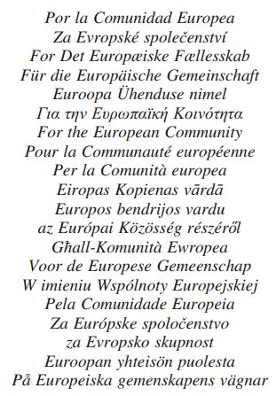

\*Pour le Royaume de Belgique*

\*Voor het Koninkrijk België*

\*Für das Königreich Belgien*

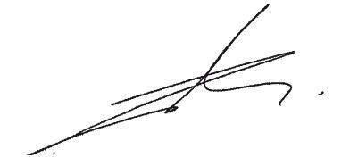

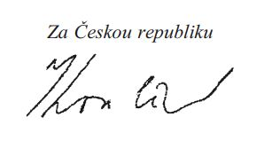

\*På Kongeriget Danmarks vegne*

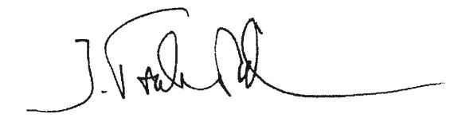

\*Für die Bundesrepublik Deutschland*

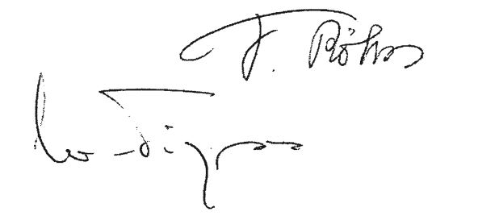

\*Eesti Vabariigi nimel*

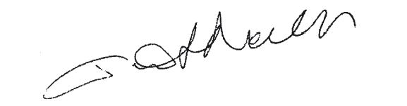

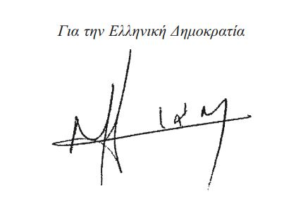

\*Por el Reino de España*

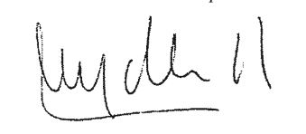

\*Pour la République française*

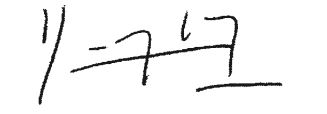

\*Thar cheann Na hÉireann*

\*For Ireland*

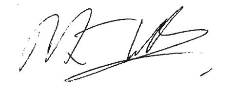

\*Per la Repubblica italiana*

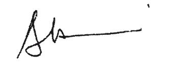

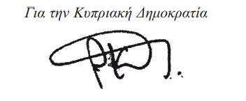

\*Latvijas Republikas vārdā*

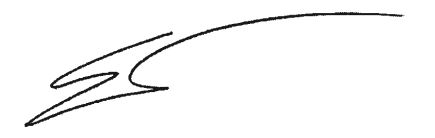

22.6.2006

\*Lietuvos Respublikos vardu*

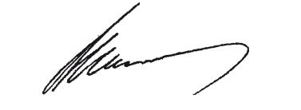

\*Pour le Grand-Duché de Luxembourg*

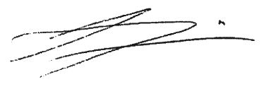

\*A Magyar Köztársaság részéröl*

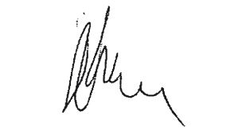

\*Ghar-Repubblika ta’ Malta*

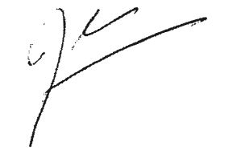

\*Voor het Koninkrijk der Nederlanden*

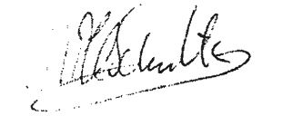

\*Für die Republik Österreich*

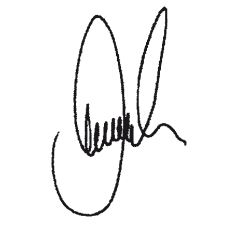

\*W imieniu Rzeczypospolitej Polskiej*

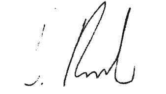

\*Pela República Portuguesa*

\*Za Republiko Slovenijo*

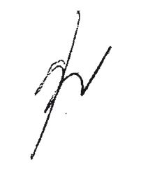

\*Za Slovenskú republiku*

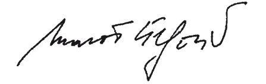

13.6.2006

\*Suomen tasavallan puolesta*

\*För Republiken Finland*

\*För Konungariket Sverige*

\*For the United Kingdom of Great Britain and Northern Ireland*

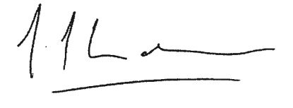

\*Për Republikën e Shqipërisë*

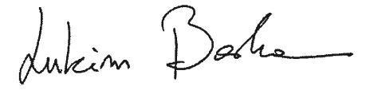

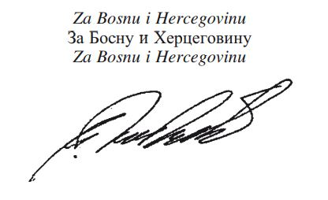

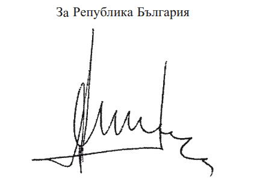

\*Za Republiku Hrvatsku*

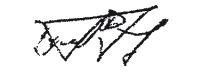

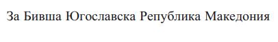

\*Fyrir hönd Lyðveldisins Íslands*

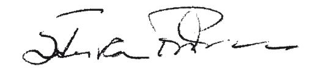

\*Za Republiku Crnu Goru*

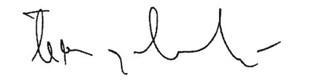

5.7.2006

\*For Kongeriket Norge*

\*Pentru România*

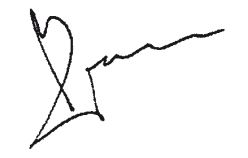

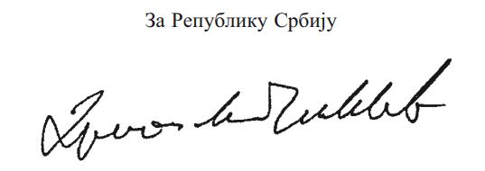

29.6.2006

\*For the United Nations Interim Administration in Kosovo*

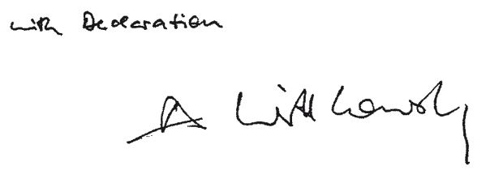

\**REPUBLIC OF MACEDONIA**

\**Ministry of Transport and Communications**

Luxembourg, 9 June 2006

Dear Sirs,

Hereby I declare that the final text from 22 May 2006 of the Multilateral ECAA Agreement is acceptable for the Government of the Republic of Macedonia.

With this letter, the Government of the Republic of Macedonia considers itself as signatory of the Multilateral Agreement between the Republic of Albania, Bosnia and Herzegovina, the Republic of Bulgaria, the Republic of Croatia, the European Community and its Member States, the Republic of lceland, the Republic of Macedonia, the Kingdom of Norway, Serbia and Montenegro, Romania and United Nations Interim Administration Mission in Kosovo on the Establishment of a European Common Aviation Area.

However, I declare that the Republic of Macedonia dœs not accept the denomination used for my country in the above-mentioned Agreement, having in view that the constitutional name of my country is Republic of Macedonia.

Please accept, Sirs, the assurances of my highest consideration.

|  |  | *Minister of Transport* *and Communications* Xhemali MEHAZI |
|---|---|---|
|  |  | 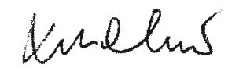 |
| *The European Community* *and its Member States* Brussels |  |  |

\**THE COUNCIL OF THE EUROPEAN UNION**

\**AND THE EUROPEAN COMMISSION**

|  | Luxembourg, 9 June 2006 Mr. Xhemali MEHAZI, Minister of Transport and Communications of the former Yugoslav Republic of Macedonia |
|---|---|

Sir,

The European Community and its Member States take note of your letter of today’s date and confirm that your letter and this reply shall together take the place of the signature of the Multilateral Agreement between the Republic of Albania, Bosnia and Herzegovina, the Republic of Bulgaria, the Republic of Croatia, the European Community and its Member States, the Republic of Iceland, the former Yugoslav Republic of Macedonia, the Kingdom of Norway, Serbia and Montenegro, Romania and the United Nations Interim Administration Mission in Kosovo on the Establishment of a European Common Aviation Area (ECAA). However, this cannot be construed as acceptance or recognition by the European Community and its Member States, in whatever form or content of a denomination other than the «former Yugoslav Republic of Macedonia».

Please accept, Sir, the assurance of our highest consideration.

|  | *On behalf of the European Community* *and its Member States* |
|---|---|
|  | 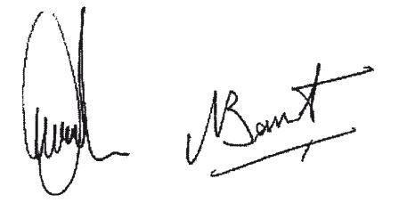 |

ANNEXE I

\**Règles applicables à l’aviation civile**

Les «dispositions applicables» des actes suivants de la Communauté européenne s’appliquent en conformité avec l’accord de base et l’annexe II concernant les adaptations horizontales, sauf disposition contraire dans la présente annexe ou dans les protocoles I à IX ci-après. Les adaptations éventuelles propres à chacun de ces actes sont indiquées à la suite de l’acte concerné.

\**A. *Accès au marché et questions connexes***

No 2407/92

[Règlement (CEE) n° 2407/92](https://legilux.public.lu/eli/reg_ue/1992/2407/jo) du Conseil, du 23 juillet 1992, concernant les licences des transporteurs aériens

Dispositions applicables: les articles 1er à 18 et l’annexe, à l’exception de la référence à l’article 226 (ex article 169) du traité CE figurant à l’article 13, paragraphe 3

No 2408/92

[Règlement (CEE) n° 2408/92](https://legilux.public.lu/eli/reg_ue/1992/2408/jo) du Conseil, du 23 juillet 1992, concernant l’accès des transporteurs aériens communautaires aux liaisons aériennes intracommunautaires

tel que modifié ou adapté par:

aot l’article 29 de l’acte relatif aux conditions d’adhésion de la République d’Autriche, de la République de Finlande et du Royaume de Suède

bot la décision du comité mixte de l’EEE no 7/94 du 21 mars 1994 modifiant le protocole 47 et certaines annexes de l’Accord EEE

cot l’article 20 de l’acte relatif aux conditions d’adhésion à l’Union européenne de la République tchèque, de la République d’Estonie, de la République de Chypre, de la République de Lettonie, de la République de Lituanie, de la République de Hongrie, de la République de Malte, de la République de Pologne, de la République de Slovénie et de la République slovaque, et aux adaptations des traités sur lesquels est fondée l’Union européenne (ci-après dénommé «acte d’adhésion de 2003»)

Dispositions applicables: les articles 1er à 15 et les annexes I, II et III

No 2409/92

[Règlement (CEE) n° 2409/92](https://legilux.public.lu/eli/reg_ue/1992/2409/jo) du Conseil, du 23 juillet 1992, sur les tarifs des passagers et de fret des services aériens

Dispositions applicables: les articles 1er à 10

No 95/93

[Règlement (CEE) n° 95/93](https://legilux.public.lu/eli/reg_ue/1993/95/jo) du Conseil, du 18 janvier 1993, fixant des règles communes en ce qui concerne l’attribution des créneaux horaires dans les aéroports de la Communauté

tel que modifié par:

aot le [règlement (CE) n° 894/2002](https://legilux.public.lu/eli/reg_ue/2002/894/jo) du Parlement européen et du Conseil du 27 mai 2002 modifiant le [règlement (CEE) n° 95/93](https://legilux.public.lu/eli/reg_ue/1993/95/jo)

bot le [règlement (CE) n° 1554/2003](https://legilux.public.lu/eli/reg_ue/2003/1554/jo) du Parlement européen et du Conseil du 22 juillet 2003 modifiant le [règlement (CEE) n° 95/93](https://legilux.public.lu/eli/reg_ue/1993/95/jo)

cot le [règlement (CE) n° 793/2004](https://legilux.public.lu/eli/reg_ue/2004/793/jo) du Parlement européen et du Conseil du 21 avril 2004 modifiant le [règlement (CEE) n° 95/93](https://legilux.public.lu/eli/reg_ue/1993/95/jo)

Dispositions applicables: les articles 1er à 12 et l’article 14bis, paragraphe 2

Aux fins de l’application de l’article 12, paragraphe 2, «la Commission» doit se lire «le comité mixte».

No 96/67

[Directive 96/67/CE](https://legilux.public.lu/eli/dir_ue/1996/67/jo) du Conseil du 15 octobre 1996 relative à l’accès au marché de l’assistance en escale dans les aéroports de la Communauté

Dispositions applicables: les articles 1er à 25 et l’annexe

Aux fins de l’application de l’article 10, «Etats membres» doit se lire «Etats membres de la CE».

Aux fins de l’application de l’article 20, paragraphe 2, «la Commission» doit se lire «le comité mixte».

No 785/2004

[Règlement (CE) n° 785/2004](https://legilux.public.lu/eli/reg_ue/2004/785/jo) du Parlement européen et du Conseil du 21 avril 2004 relatif aux exigences en matière d’assurance applicables aux transporteurs aériens et aux exploitants d’aéronefs

Dispositions applicables: les articles 1er à 8 et l’article 10, paragraphe 2

\**B. *Gestion du trafic aérien***

No 549/2004

[Règlement (CE) n° 549/2004](https://legilux.public.lu/eli/reg_ue/2004/549/jo) du Parlement européen et du Conseil du 10 mars 2004 fixant le cadre pour la réalisation du ciel unique européen («règlement-cadre»)

Dispositions applicables: les articles 1er à 4, l’article 6 et les articles 9 à 14

No 550/2004

[Règlement (CE) n° 550/2004](https://legilux.public.lu/eli/reg_ue/2004/550/jo) du Parlement européen et du Conseil du 10 mars 2004 relatif à la fourniture de services de navigation aérienne dans le ciel unique européen («règlement sur la fourniture de services»)

Dispositions applicables: les articles 1er à 19 et les annexes I et II

No 551/2004

[Règlement (CE) n° 551/2004](https://legilux.public.lu/eli/reg_ue/2004/551/jo) du Parlement européen et du Conseil du 10 mars 2004 relatif à l’organisation et à l’utilisation de l’espace aérien dans le ciel unique européen («règlement sur l’espace aérien»)

Dispositions applicables: les articles 1er à 11

No 552/2004

[Règlement (CE) n° 552/2004](https://legilux.public.lu/eli/reg_ue/2004/552/jo) du Parlement européen et du Conseil du 10 mars 2004 concernant l’interopérabilité du réseau européen de gestion du trafic aérien («règlement sur l’interopérabilité»)

Dispositions applicables: les articles 1erà 12 et les annexes I à V

No 2096/2005

[Règlement (CE) n° 2096/2005](https://legilux.public.lu/eli/reg_ue/2005/2096/jo) de la Commission du 20 décembre 2005 établissant les exigences communes pour la fourniture de services de navigation aérienne

Dispositions applicables: les articles 1er à 9 et les annexes I à V

No2150/2005

[Règlement (CE) n° 2150/2005](https://legilux.public.lu/eli/reg_ue/2005/2150/jo) de la Commission du 23 décembre 2005 établissant des règles communes pour la gestion souple de l’espace aérien

Dispositions applicables: les articles 1er à 9 et l’annexe

\**C. *Sécurité aérienne***

No 3922/91

[Règlement (CEE) n° 3922/91](https://legilux.public.lu/eli/reg_ue/1991/3922/jo) du Conseil, du 16 décembre 1991, relatif à l’harmonisation de règles techniques et de procédures administratives dans le domaine de l’aviation civile

modifié par:

aot le [règlement (CE) n° 2176/96](https://legilux.public.lu/eli/reg_ue/1996/2176/jo) de la Commission du 13 novembre 1996 portant adaptation au progrès scientifique et technique du [règlement (CEE) n° 3922/91](https://legilux.public.lu/eli/reg_ue/1991/3922/jo) du Conseil

bot le [règlement (CE) n° 1069/1999](https://legilux.public.lu/eli/reg_ue/1999/1069/jo) de la Commission, du 25 mai 1999, portant adaptation au progrès scientifique et technique du [règlement (CEE) n° 3922/91](https://legilux.public.lu/eli/reg_ue/1991/3922/jo) du Conseil

cot le [règlement (CE) n° 2871/2000](https://legilux.public.lu/eli/reg_ue/2000/2871/jo) de la Commission du 28 décembre 2000 portant adaptation au progrès scientifique et technique du [règlement (CEE) n° 3922/91](https://legilux.public.lu/eli/reg_ue/1991/3922/jo) du Conseil relatif à l’harmonisation de règles techniques et de procédures administratives dans le domaine de l’aviation civile

dot le [règlement (CE) n° 1592/2002](https://legilux.public.lu/eli/reg_ue/2002/1592/jo) du Parlement européen et du Conseil du 15 juillet 2002 concernant des règles communes dans le domaine de l’aviation civile et instituant une Agence européenne de la sécurité aérienne

Dispositions applicables: les articles 1er à 10, les articles 12 et 13, à l’exception de l’article 4, paragraphe 1, et de l’article 8, paragraphe 2, deuxième phrase, les annexes I à III

Aux fins de l’application de l’article 12, «Etats membres» doit se lire «Etats membres de la CE».

No 94/56

[Directive 94/56/CE](https://legilux.public.lu/eli/dir_ue/1994/56/jo) du Conseil, du 21 novembre 1994, établissant les principes fondamentaux régissant les enquêtes sur les accidents et les incidents dans l’aviation civile

Dispositions applicables: les articles 1er à 12

Aux fins de l’application des articles 9 et 12, «la Commission» doit se lire «toutes les autres parties contractantes à l’EACE».

No 1592/2002

[Règlement (CE) n° 1592/2002](https://legilux.public.lu/eli/reg_ue/2002/1592/jo) du Parlement européen et du Conseil du 15 juillet 2002 concernant des règles communes dans le domaine de l’aviation civile et instituant une Agence européenne de la sécurité aérienne

modifié par:

aot le [règlement (CE) n° 1643/2003](https://legilux.public.lu/eli/reg_ue/2003/1643/jo) du Parlement européen et du Conseil du 22 juillet 2003 modifiant le [règlement (CE) n° 1592/2002](https://legilux.public.lu/eli/reg_ue/2002/1592/jo)

bot le [règlement (CE) n° 1701/2003](https://legilux.public.lu/eli/reg_ue/2003/1701/jo) de la Commission du 24 septembre 2003 adaptant l’article 6 du [règlement (CE) n° 1592/2002](https://legilux.public.lu/eli/reg_ue/2002/1592/jo)

Dispositions applicables: les articles 1er à 57 et les annexes I et II

No 2003/42

[Directive 2003/42/CE](https://legilux.public.lu/eli/dir_ue/2003/42/jo) du Parlement européen et du Conseil du 13 juin 2003 concernant les comptes rendus d’événements dans l’aviation civile

Dispositions applicables: les articles 1er à 11 et les annexes I et II

No 1702/2003

[Règlement (CE) n° 1702/2003](https://legilux.public.lu/eli/reg_ue/2003/1702/jo) de la Commission du 24 septembre 2003 établissant des règles d’application pour la certification de navigabilité et environnementale des aéronefs et produits, pièces et équipements associés, ainsi que pour la certification des organismes de conception et de production

modifié par:

aot le [règlement (CE) n° 381/2005](https://legilux.public.lu/eli/reg_ue/2005/381/jo) de la Commission du 7 mars 2005 modifiant le [règlement (CE) n° 1702/2003](https://legilux.public.lu/eli/reg_ue/2003/1702/jo)

Dispositions applicables: les articles 1er à 4 et l’annexe. Les périodes transitoires prévues dans ce règlement sont définies par le comité mixte.

No 2042/2003

[Règlement (CE) n° 2042/2003](https://legilux.public.lu/eli/reg_ue/2003/2042/jo) de la Commission du 20 novembre 2003 relatif au maintien de la navigabilité des aéronefs et des produits, pièces et équipements aéronautiques, et relatif à l’agrément des organismes et des personnels participant à ces tâches

Dispositions applicables: les articles 1er à 6 et les annexes I à IV

No 104/2004

[Règlement (CE) n° 104/2004](https://legilux.public.lu/eli/reg_ue/2004/104/jo) de la Commission du 22 janvier 2004 fixant les règles relatives à l’organisation et à la composition de la chambre de recours de l’Agence européenne de la sécurité aérienne

Dispositions applicables: les articles 1er à 7 et l’annexe

No 488/2005

[Règlement (CE) n° 488/2005](https://legilux.public.lu/eli/reg_ue/2005/488/jo) de la Commission du 21 mars 2005 relatif aux honoraires et redevances perçus par l’Agence européenne de la sécurité aérienne

No 2111/2005

[Règlement (CE) n° 2111/2005](https://legilux.public.lu/eli/reg_ue/2005/2111/jo) du Parlement européen et du Conseil du 14 décembre 2005 concernant l’établissement d’une liste communautaire des transporteurs aériens qui font l’objet d’une interdiction d’exploitation dans la Communauté et l’information des passagers du transport aérien sur l’identité du transporteur aérien effectif, et abrogeant l’article 9 de la [directive 2004/36/CE](https://legilux.public.lu/eli/dir_ue/2004/36/jo)

Dispositions applicables: les articles 1er à 13 et l’annexe

\**D. *Sûreté aérienne***

No 2320/2002

[Règlement (CE) n° 2320/2002](https://legilux.public.lu/eli/reg_ue/2002/2320/jo) du Parlement européen et du Conseil du 16 décembre 2002 relatif à l’instauration de règles communes dans le domaine de la sûreté de l’aviation civile

modifié par:

aot le [règlement (CE) n° 849/2004](https://legilux.public.lu/eli/reg_ue/2004/849/jo) du Parlement européen et du Conseil du 29 avril 2004 modifiant le [règlement (CE) n° 2320/2002](https://legilux.public.lu/eli/reg_ue/2002/2320/jo)

Dispositions applicables: les articles 1er à 12 et l’annexe

No 622/2003

[Règlement (CE) n° 622/2003](https://legilux.public.lu/eli/reg_ue/2003/622/jo) de la Commission du 4 avril 2003 fixant des mesures pour la mise en œuvre des règles communes dans le domaine de la sûreté aérienne

modifié par:

aot le [règlement (CE) n° 68/2004](https://legilux.public.lu/eli/reg_ue/2004/68/jo) de la Commission du 15 janvier 2004 modifiant le [règlement (CE) n° 622/2003](https://legilux.public.lu/eli/reg_ue/2003/622/jo)

bot le [règlement (CE) n° 781/2005](https://legilux.public.lu/eli/reg_ue/2005/781/jo) de la Commission du 24 mai 2005 modifiant le [règlement (CE) n° 622/2003](https://legilux.public.lu/eli/reg_ue/2003/622/jo)

cot le [règlement (CE) n° 857/2005](https://legilux.public.lu/eli/reg_ue/2005/857/jo) de la Commission du 6 juin 2005 modifiant le [règlement (CE) n° 622/2003](https://legilux.public.lu/eli/reg_ue/2003/622/jo)

Dispositions applicables: les articles 1er à 5 et l’annexe

No 1217/2003

[Règlement (CE) n° 1217/2003](https://legilux.public.lu/eli/reg_ue/2003/1217/jo) de la Commission du 4 juillet 2003 arrêtant les spécifications communes des programmes nationaux de contrôle de la qualité en matière de sûreté de l’aviation civile

Dispositions applicables: les articles 1er à 11 et les annexes I et II

No 1486/2003

[Règlement (CE) n° 1486/2003](https://legilux.public.lu/eli/reg_ue/2003/1486/jo) de la Commission du 22 août 2003 définissant les modalités des inspections effectuées par la Commission dans le domaine de la sûreté de l’aviation civile

Dispositions applicables: les articles 1er à 16

No 1138/2004

[Règlement (CE) n° 1138/2004](https://legilux.public.lu/eli/reg_ue/2004/1138/jo) de la Commission du 21 juin 2004 établissant une définition commune des parties critiques des zones de sûreté à accès réglementé dans les aéroports

Dispositions applicables: les articles 1er à 8

\**E. *Environnement***

No 89/629

[Directive 89/629/CEE](https://legilux.public.lu/eli/dir_ue/1989/629/jo) du Conseil, du 4 décembre 1989, relative à la limitation des émissions sonores des avions à réaction subsoniques civils

Dispositions applicables: les articles 1erà 8

No 92/14

[Directive 92/14/CEE](https://legilux.public.lu/eli/dir_ue/1992/14/jo) du Conseil, du 2 mars 1992, relative à la limitation de l’exploitation des avions relevant de l’annexe 16 de la convention relative à l’aviation civile internationale, volume 1, deuxième partie, chapitre 2, deuxième édition (1988)

modifiée par:

aot la [directive 98/20/CE](https://legilux.public.lu/eli/dir_ue/1998/20/jo) du Conseil du 30 mars 1998 modifiant la [directive 92/14/CEE](https://legilux.public.lu/eli/dir_ue/1992/14/jo)

bot la [directive 1999/28/CE](https://legilux.public.lu/eli/dir_ue/1999/28/jo) de la Commission du 21 avril 1999 portant modification de l’annexe de la [directive 92/14/CEE](https://legilux.public.lu/eli/dir_ue/1992/14/jo)

cot le [règlement (CE) n° 991/2001](https://legilux.public.lu/eli/reg_ue/2001/991/jo) de la Commission du 21 mai 2001 modifiant l’annexe de la [directive 92/14/CEE](https://legilux.public.lu/eli/dir_ue/1992/14/jo)

Dispositions applicables: les articles 1er à 11 et l’annexe

No 2002/30

[Directive 2002/30/CE](https://legilux.public.lu/eli/dir_ue/2002/30/jo) du Parlement européen et du Conseil du 26 mars 2002 relative à l’établissement de règles et procédures concernant l’introduction de restrictions d’exploitation liées au bruit dans les aéroports de la Communauté tel que modifiée ou adaptée par l’article 20 de l’acte d’adhésion de 2003

Dispositions applicables: les articles 1er à 15 et les annexes I et II

No 2002/49

[Directive 2002/49/CE](https://legilux.public.lu/eli/dir_ue/2002/49/jo) du Parlement européen et du Conseil du 25 juin 2002 relative à l’évaluation et à la gestion du bruit dans l’environnement

Dispositions applicables: les articles 1er à 16 et les annexes I à VI

\**F. *Aspects sociaux***

No 1989/391

[Directive 89/391/CEE](https://legilux.public.lu/eli/dir_ue/1989/391/jo) du Conseil, du 12 juin 1989, concernant la mise en œuvre de mesures visant à promouvoir l’amélioration de la sécurité et de la santé des travailleurs au travail

Dispositions applicables: les articles 1er à 16 et les articles 18 et 19

No 2003/88

[Directive 2003/88/CE](https://legilux.public.lu/eli/dir_ue/2003/88/jo) du Parlement européen et du Conseil du 4 novembre 2003 concernant certains aspects de l’aménagement du temps de travail

Dispositions applicables: les articles 1er à 19, 21 à 24 et 26 à 29

No 2000/79

[Directive 2000/79/CE](https://legilux.public.lu/eli/dir_ue/2000/79/jo) du Conseil du 27 novembre 2000 concernant la mise en œuvre de l’accord européen relatif à l’aménagement du temps de travail du personnel mobile dans l’aviation civile, conclu par l’Association des compagnies européennes de navigation aérienne (AEA), la Fédération européenne des travailleurs des transports (ETF), l’Association européenne des personnels navigants techniques (ECA), l’Association européenne des compagnies d’aviation des régions d’Europe (ERA) et l’Association internationale des charters aériens (AICA)

Dispositions applicables: les articles 1er à 5

\**G. *Protection des consommateurs***

No 90/314

[Directive 90/314/CEE](https://legilux.public.lu/eli/dir_ue/1990/314/jo) du Conseil, du 13 juin 1990, concernant les voyages, vacances et circuits à forfait

Dispositions applicables: les articles 1er à 10

No 92/59

[Directive 92/59/CEE](https://legilux.public.lu/eli/dir_ue/1992/59/jo) du Conseil, du 29 juin 1992, relative à la sécurité générale des produits

Dispositions applicables: les articles 1er à 19

No 93/13

[Directive 93/13/CEE](https://legilux.public.lu/eli/dir_ue/1993/13/jo) du Conseil, du 5 avril 1993, concernant les clauses abusives dans les contrats conclus avec les consommateurs

Dispositions applicables: les articles 1er à 10 et l’annexe

Aux fins de l’application de l’article 10, «la Commission» doit se lire «toutes les autres parties contractantes à l’EACE».

No 95/46

[Directive 95/46/CE](https://legilux.public.lu/eli/dir_ue/1995/46/jo) du Parlement européen et du Conseil, du 24 octobre 1995, relative à la protection des personnes physiques à l’égard du traitement des données à caractère personnel et à la libre circulation de ces données

Dispositions applicables: les articles 1er à 34

No 2027/97

[Règlement (CE) n° 2027/97](https://legilux.public.lu/eli/reg_ue/1997/2027/jo) du Conseil du 9 octobre 1997 relatif à la responsabilité des transporteurs aériens en cas d’accident

modifié par:

aot le [règlement (CE) n° 889/2002](https://legilux.public.lu/eli/reg_ue/2002/889/jo) du Parlement européen et du Conseil du 13 mai 2002 modifiant le [règlement (CE) n° 2027/97](https://legilux.public.lu/eli/reg_ue/1997/2027/jo)

Dispositions applicables: les articles 1er à 8

No 261/2004

[Règlement (CE) n° 261/2004](https://legilux.public.lu/eli/reg_ue/2004/261/jo) du Parlement européen et du Conseil du 11 février 2004 établissant des règles communes en matière d’indemnisation et d’assistance des passagers en cas de refus d’embarquement et d’annulation ou de retard important d’un vol, et abrogeant le [règlement (CEE) n° 295/91](https://legilux.public.lu/eli/reg_ue/1991/295/jo)

Dispositions applicables: les articles 1er à 17

\**H. *Autre législation***

No 2299/1989

[Règlement (CEE) n° 2299/1989](https://legilux.public.lu/eli/reg_ue/1989/2299/jo) du Conseil, du 24 juillet 1989, instaurant un code de conduite pour l’utilisation de systèmes informatisés de réservation

modifié par:

aot le [règlement (CEE) n° 3089/93](https://legilux.public.lu/eli/reg_ue/1993/3089/jo) du Conseil du 29 octobre 1993 modifiant le [règlement (CEE) n° 2299/89](https://legilux.public.lu/eli/reg_ue/1989/2299/jo)

bot le [règlement (CE) n° 323/1999](https://legilux.public.lu/eli/reg_ue/1999/323/jo) du Conseil du 8 février 1999 modifiant le [règlement (CEE) n° 2299/89](https://legilux.public.lu/eli/reg_ue/1989/2299/jo)

Dispositions applicables: les articles 1er à 22 et l’annexe

No 91/670

[Directive 91/670/CEE](https://legilux.public.lu/eli/dir_ue/1991/670/jo) du Conseil, du 16 décembre 1991, sur l’acceptation mutuelle des licences du personnel pour exercer des fonctions dans l’aviation civile

Dispositions applicables: les articles 1er à 8 et l’annexe

No3925/91

[Règlement (CEE) n° 3925/91](https://legilux.public.lu/eli/reg_ue/1991/3925/jo) du Conseil, du 19 décembre 1991, relatif à la suppression des contrôles et formalités applicables aux bagages à main et aux bagages de soute des personnes effectuant un vol intracommunautaire ainsi qu’aux bagages des personnes effectuant une traversée maritime intracommunautaire

Dispositions applicables: les articles 1er à 5

No437/2003

[Règlement (CE) n° 437/2003](https://legilux.public.lu/eli/reg_ue/2003/437/jo) du Parlement européen et du Conseil du 27 février 2003 sur les données statistiques relatives au transport de passagers, de fret et de courrier par voie aérienne

modifié par:

aot le [règlement (CE) n° 1358/2003](https://legilux.public.lu/eli/reg_ue/2003/1358/jo) de la Commission du 31 juillet 2003 concernant la mise en œuvre du [règlement (CE) n° 437/2003](https://legilux.public.lu/eli/reg_ue/2003/437/jo) du Parlement européen et du Conseil et modifiant ledit règlement.

Dispositions applicables: les articles 1er à 11 et les annexes I et II

No1358/2003

[Règlement (CE) n° 1358/2003](https://legilux.public.lu/eli/reg_ue/2003/1358/jo) de la Commission du 31 juillet 2003 concernant la mise en œuvre du [règlement (CE) n° 437/2003](https://legilux.public.lu/eli/reg_ue/2003/437/jo) du Parlement européen et du Conseil sur les données statistiques relatives au transport de passagers, de fret et de courrier par voie aérienne et modifiant ledit règlement

Dispositions applicables: les articles 1er à 4 et les annexes I à III

N° 2003/96

[Directive 2003/96/CE](https://legilux.public.lu/eli/dir_ue/2003/96/jo) du Conseil du 27 octobre 2003 restructurant le cadre communautaire de taxation des produits énergétiques et de l’électricité

Dispositions applicables: l’article 14, paragraphe 1, point b), et paragraphe 2

ANNEXE II

\**Adaptations horizontales et règles de procédure**

Les dispositions des actes auxquels il est fait référence à l’annexe I s’appliquent conformément à l’accord et aux points 1 à 4 de la présente annexe, sauf disposition contraire à l’annexe I. Les adaptations particulières nécessaires pour certains actes sont prévues à l’annexe I.

Le présent accord s’applique en conformité avec les règles de procédure énoncées aux points 5 et 6 de la présente annexe.

\**1. *Parties introductives des actes***

Les préambules des actes auxquels il est fait référence ne sont pas adaptés aux fins du présent accord. Ils sont pris en considération dans la mesure nécessaire pour l’interprétation et l’application exactes, dans le cadre du présent accord, des dispositions contenues dans lesdits actes.

\**2. *Terminologie particulière des actes***

Les termes ci-après, utilisés dans les actes visés à l’annexe I, doivent se lire de la manière suivante:

a) le terme «Communauté» doit se lire «Espace aérien commun européen»;

b) les termes «droit communautaire», «législation communautaire», «instruments communautaires» et «traité CE» doivent se lire «accord EACE»;

c) les termes «aéroport de la Communauté» doivent se lire «aéroports situés dans l’Espace aérien commun européen»;

d) les termes «Journal officiel des Communautés européennes» ou «Journal officiel de l’Union européenne» doivent se lire «Journal officiel des parties contractantes»;

e) le terme «transporteur aérien communautaire» doit se lire «transporteur aérien de l’EACE».

\**3. *Mentions relatives aux Etats membres***

Sans préjudice du point 4 de la présente annexe, dans tous les cas où les actes indiqués à l’annexe I font référence aux «Etat(s) membre(s)», ces mentions sont réputées renvoyer non seulement aux Etats membres de la Communauté européenne, mais également aux partenaires EACE.

\**4. *Dispositions relatives aux comités de la Communauté européenne***  ***et à la consultation des parties associées***

La Commission européenne consulte les experts des parties associées et leur donne la possibilité de soumettre leur avis à chaque fois que les actes visés à l’annexe I prévoient que la Commission européenne consulte les comités de la Communauté européenne et que ces derniers ont la possibilité d’émettre leur avis.

Chaque consultation comprend une réunion présidée par la Commission européenne et se déroule dans le cadre du comité mixte, à l’invitation de la Commission européenne et préalablement à la consultation du comité de la Communauté européenne concerné. La Commission européenne fournit à chaque partie associée toutes les informations nécessaires, au plus tard deux semaines avant la date de la réunion, sauf si des circonstances particulières imposent un délai plus court.

Les parties associées sont invitées à soumettre leurs observations à la Commission européenne. La Commission européenne prend dûment en compte l’avis émis par les parties associées.

Les dispositions qui précèdent ne valent pas pour l’application des règles de concurrence énoncées dans le présent accord, qui sont régies par les procédures de consultation particulières prévues à l’annexe III.

\**5. *Coopération et échange d’informations***

Pour faciliter l’exercice des pouvoirs dévolus en la matière aux autorités compétentes des parties contractantes, ces autorités s’échangent mutuellement, si demande leur en est faite, toutes les informations nécessaires au bon fonctionnement du présent accord.

\**6. *Mentions relatives aux langues***

Dans les procédures mises en place dans le cadre du présent accord et sans préjudice de l’annexe IV, les parties contractantes ont le droit de faire usage de n’importe quelle langue officielle des institutions de l’Union européenne ou d’une autre partie contractante. Les parties contractantes sont toutefois conscientes que l’utilisation de l’anglais facilite ces procédures. Si une langue qui n’est pas une langue officielle de l’Union européenne est utilisée dans un document officiel, une traduction est fournie simultanément dans une langue officielle des institutions de l’Union européenne, compte tenu de la disposition contenue dans la phrase précédente. Si une partie contractante a l’intention d’utiliser, dans une procédure orale, une langue qui n’est pas une langue officielle des institutions de l’Union européenne, elle assure l’interprétation simultanée en anglais.

ANNEXE III

\**Règles en matière de concurrence et d’aides d’Etat  visées à l’article 14 de l’accord principal**

## *Article premier* — *Monopoles d’Etat*

Chaque partie associée aménage progressivement les monopoles d’Etat à caractère commercial, de telle façon qu’à l’expiration de la deuxième période visée dans le protocole au présent accord contenant les mesures transitoires relatives à la partie associée concernée, il n’existe aucune discrimination entre les parties contractantes en ce qui concerne les conditions d’approvisionnement et de débouchés. Le comité mixte est informé des mesures adoptées pour atteindre cet objectif.

## *Article 2* — *Rapprochement des dispositions législatives en matière d’aides d’Etat et de concurrence*

1\. Les parties contractantes reconnaissent l’importance que revêt le rapprochement des dispositions législatives existantes en matière d’aides d’Etat et de concurrence avec celles de la Communauté européenne. Chaque partie associée s’efforce de faire en sorte que sa législation existante et future en matière d’aides d’Etat et de concurrence soit rendue progressivement compatible avec l’acquis communautaire.

2\. Cet alignement est entamé à l’entrée en vigueur du présent accord et est progressivement étendu à tous les éléments des dispositions communautaires en matière d’aides d’Etat et de concurrence visées à la présente annexe, pour la fin de la deuxième période définie dans le protocole au présent accord contenant les mesures transitoires applicables à la partie associée concernée. La partie associée définit également, en accord avec la Commission européenne, les modalités relatives au contrôle de la mise en œuvre du rapprochement de la législation et aux mesures d’exécution devant être adoptées.

## *Article 3 * — Règles en matière de concurrence et autres dispositions économiques

1\. Les pratiques suivantes sont incompatibles avec le bon fonctionnement du présent accord, dans la mesure où elles peuvent affecter le commerce entre deux ou plusieurs parties contractantes:

i) tous les accords entre entreprises, toutes les décisions d’association d’entreprises et toutes les pratiques concertées entre entreprises, qui ont pour objet ou pour effet d’empêcher, de restreindre ou de fausser le jeu de la concurrence;

ii) l’exploitation abusive par une ou plusieurs entreprises d’une position dominante sur l’ensemble des territoires des parties contractantes ou dans une partie substantielle de ceux-ci;

iii) toute aide d’Etat qui fausse ou menace de fausser la concurrence en favorisant certaines entreprises ou certains produits.

2\. Toute pratique contraire au présent article est évaluée sur la base des critères découlant de l’application des règles en matière de concurrence applicables dans la Communauté européenne, en particulier celles des articles 81, 82, 86 et 87 du traité CE et des instruments interprétatifs adoptés par les institutions communautaires.

3\. Chaque partie associée veille à ce qu’un organisme public fonctionnellement indépendant soit doté des pouvoirs nécessaires à l’application intégrale du paragraphe 1, points i) et ii), en ce qui concerne les entreprises privées et publiques et les entreprises auxquelles des droits spéciaux ont été accordés.

4\. Chaque partie associée désigne ou met en place une autorité fonctionnellement indépendante, dotée des pouvoirs nécessaires à la pleine application du paragraphe 1, point iii). Cette autorité a, notamment, le pouvoir d’autoriser des régimes d’aides d’Etat et des aides individuelles conformément au paragraphe 2, et d’exiger le recouvrement des aides d’Etat illégalement octroyées.

5\. Chaque partie contractante assure la transparence dans le domaine des aides d’Etat, notamment en fournissant aux autres parties un rapport annuel régulier, ou un document équivalent, selon la méthodologie et la présentation des rapports communautaires sur les aides d’Etat. A la demande d’une partie contractante, une autre partie contractante fournit des informations sur certains cas particuliers d’aide publique.

6\. Chaque partie associée établit un inventaire complet des régimes d’aide en place avant la création de l’autorité visée au paragraphe 4 et aligne ces régimes sur les critères mentionnés au paragraphe 2.

7\. a) Aux fins de l’application du paragraphe 1, point iii), les parties contractantes conviennent que, pendant les périodes visées dans le protocole dans le présent accord contenant les mesures transitoires applicables à une partie associée, toute aide publique accordée par ladite partie associée est évaluée en tenant compte du fait que la partie associée concernée est considérée comme une région identique aux régions de la Communauté décrites à l’article 87, paragraphe 3, point a), du traité instituant la Communauté européenne.

b) Au plus tard à l’expiration de la première période visée dans le protocole au présent accord contenant les mesures transitoires applicables à une partie associée, cette partie soumet à la Commission européenne les données concernant le PIB par habitant harmonisées au niveau NUTS II. L’autorité visée au paragraphe 4 et la Commission européenne évaluent ensuite conjointement l’éligibilité des régions de la partie associée concernée, ainsi que l’intensité maximale des aides correspondantes, afin de dresser la carte des aides régionales sur la base des orientations communautaires en la matière.

8\. Si l’une des parties contractantes estime qu’une pratique est incompatible avec les dispositions du paragraphe 1, elle peut prendre des mesures appropriées après consultation du comité mixte ou trente jours ouvrables après que cette instance a été saisie de la demande de consultation.

9\. Les parties contractantes échangent des informations en tenant compte des restrictions imposées par les exigences de secret professionnel et commercial.

ANNEXE IV

\**Recours devant la Cour de justice des Communautés européennes**

\**1. *Principes généraux relatifs à l’article 16 de l’accord***

1\. Les procédures définies par la Cour de justice des Communautés européennes (ci-après dénommée «Cour de justice») en matière de renvoi préjudiciel au sein de la Communauté européenne s’appliquent, le cas échéant. Lorsque la décision préjudicielle est prononcée, la juridiction de la partie contractante applique l’interprétation arrêtée par la Cour de justice.

2\. Les parties contractantes ont le droit, dans le cadre du présent accord, de présenter des observations à la Cour de justice au même titre que les Etats membres de la CE.

\**2. *Portée et modalités de la procédure prévue à l’article 16, paragraphe 2, de l’accord***

1\. Lorsque, en vertu de l’article 16, paragraphe 2, deuxième phrase, une partie contractante adopte une décision sur la portée et les modalités de saisine de la Cour de justice, cette décision indique:

a) soit que toute juridiction de la partie contractante dont les décisions ne sont pas susceptibles d’un recours juridictionnel de droit interne demande à la Cour de justice de statuer à titre préjudiciel sur une question soulevée dans une affaire pendante devant elle et portant sur la validité ou l’interprétation d’un acte visé à l’article 16, paragraphe 2, lorsqu’elle estime qu’une décision sur ce point est nécessaire pour rendre son jugement,

b) soit que toute juridiction de cette partie contractante a la faculté de demander à la Cour de justice de statuer à titre préjudiciel sur une question soulevée dans une affaire pendante devant elle et portant sur la validité ou l’interprétation d’un acte visé à l’article 16, paragraphe 2, lorsqu’elle estime qu’une décision sur ce point est nécessaire pour rendre son jugement.

2\. Les modalités d’application de l’article 16, paragraphe 2, sont fondées sur les principes inscrits dans les dispositions juridiques qui régissent le fonctionnement de la Cour de justice, notamment les dispositions y afférentes du traité CE, le statut et le règlement de procédure de la Cour de justice, ainsi que la jurisprudence de cette dernière. Dans l’hypothèse où elle prend une décision sur les modalités d’application de la présente disposition, la partie contractante prend également en compte les indications pratiques diffusées par la Cour de justice dans la Note informative sur l’introduction de procédures préjudicielles par les juridictions nationales.

\**3. *Saisine conformément à l’article 20, paragraphe 3, de l’accord***

Les différends soumis à la Cour de justice conformément à l’article 20, paragraphe 3, de l’accord sont traités de la même manière que les différends dont elle est saisie en vertu de l’article 239 du traité CE.

\**4. *Usage des langues aux fins de la saisine de la Cour de justice***

Les parties contractantes ont le droit d’utiliser, dans les procédures devant la Cour de justice définies dans le cadre de l’accord, n’importe quelle langue officielle des institutions de l’Union européenne ou de toute autre partie contractante. Tout document officiel rédigé dans une langue qui n’est pas une langue officielle des institutions de l’Union européenne est accompagné d’une traduction française présentée simultanément. Si une partie contractante a l’intention d’utiliser, dans une procédure orale, une langue qui n’est pas une langue officielle des institutions de l’Union européenne, elle assure l’interprétation simultanée en français.

ANNEXE V

## PROTOCOLE I — **D****ispositions transitoires entre la Communauté européenne et ses Etats membres, d’une part, et la République d’Albanie, d’autre part**

### *Article premier * — *Périodes transitoires*

1\. La première période transitoire débute à l’entrée en vigueur du présent accord pour s’achever une fois qu’il a été vérifié, sur la base d’une évaluation effectuée par la Communauté européenne, que la République d’Albanie, ci-après dénommée «l’Albanie», a rempli toutes les conditions prévues à l’article 2, paragraphe 1, du présent protocole.

2\. La deuxième période transitoire débute à la fin de la première période transitoire pour s’achever une fois qu’il a été vérifié, sur la base d’une évaluation effectuée par la Communauté européenne, que l’Albanie a rempli toutes les conditions prévues à l’article 2, paragraphe 2, du présent protocole.

### *Article 2* — Conditions applicables en ce qui concerne la transition

1\. Au terme de la première période transitoire, l’Albanie

i) est membre à part entière des Autorités conjointes de l’aviation (JAA) et s’efforce de mettre en œuvre toute la législation en matière de sécurité aérienne mentionnée à l’annexe I;

ii) applique le document 30 de la CEAC et s’efforce de mettre en œuvre toute la législation en matière de sûreté aérienne mentionnée à l’annexe I;

iii) applique le [règlement (CEE) n° 3925/91](https://legilux.public.lu/eli/reg_ue/1991/3925/jo) (relatif à la suppression des contrôles et formalités applicables aux bagages à main et aux bagages de soute), le [règlement (CEE) n° 2409/92](https://legilux.public.lu/eli/reg_ue/1992/2409/jo) (sur les tarifs des passagers et de fret des services aériens), la [directive 94/56/CE](https://legilux.public.lu/eli/dir_ue/1994/56/jo) (concernant les enquêtes sur les accidents et les incidents), le [règlement (CE) n° 2027/97](https://legilux.public.lu/eli/reg_ue/1997/2027/jo) (relatif à la responsabilité des transporteurs aériens en cas d’accident), la [directive 2003/42/CE](https://legilux.public.lu/eli/dir_ue/2003/42/jo) (concernant les comptes rendus d’événements), le [règlement (CE) n° 261/2004](https://legilux.public.lu/eli/reg_ue/2004/261/jo) (relatif aux refus d’embarquement), la [directive 2000/79/CE](https://legilux.public.lu/eli/dir_ue/2000/79/jo) (relative à l’aménagement du temps de travail dans l’aviation civile) et la [directive 2003/88/CE](https://legilux.public.lu/eli/dir_ue/2003/88/jo) (concernant le temps de travail), conformément à l’annexe I;

iv) sépare le prestataire de services de gestion du trafic aérien de l’organisme de régulation national, crée un organisme national de surveillance des services de trafic aérien, entreprend l’organisation de son espace aérien en bloc(s) fonctionnel(s) et applique une gestion souple de son espace aérien;

v) ratifie la Convention pour l’unification de certaines règles relatives au transport aérien international (convention de Montréal);

vi) a progressé suffisamment dans la mise en œuvre des règles en matière d’aides d’Etat et de concurrence prévues dans un accord visé à l’article 14, paragraphe 1, de l’accord principal ou à l’annexe III, selon le cas.

2\. Au terme de la deuxième période transitoire, l’Albanie applique le présent accord, y compris l’ensemble de la législation mentionnée dans l’annexe I. Au terme de la deuxième période transitoire, l’Albanie applique le présent accord, y compris l’ensemble de la législation mentionnée dans l’annexe I.

### *Article 3* — *Dispositions transitoires*

1\. Nonobstant l’article 1er, paragraphe 1, de l’accord principal,

a) durant la première période transitoire:

i) les transporteurs aériens communautaires et les transporteurs aériens titulaires d’une licence délivrée par l’Albanie sont autorisés à exercer des droits de trafic illimités entre tout point en Albanie et tout point dans un Etat membre de la CE;

ii) les transporteurs aériens communautaires ne peuvent être détenus majoritairement ni effectivement contrôlés par l’Albanie ou par ses ressortissants, et les transporteurs aériens titulaires d’une licence délivrée par l’Albanie ne peuvent être détenus majoritairement ou effectivement contrôlés par des Etats membres de la CE ou leurs ressortissants;

b) durant la deuxième période transitoire:

i) les transporteurs aériens communautaires et les transporteurs aériens titulaires d’une licence délivrée par l’Albanie sont autorisés à exercer les droits de trafic prévus au paragraphe 1, point a), sous i);

ii) les transporteurs aériens communautaires sont autorisés à exercer des droits de trafic illimités entre des points en Albanie et d’autres parties associées, et sont autorisés à changer en tout point d’aéronef, pour autant que le vol s’inscrive dans le cadre d’un service desservant un point dans un Etat membre de la CE;

iii) les transporteurs aériens titulaires d’une licence délivrée par l’Albanie sont autorisés à exercer des droits de trafic illimités entre des points situés dans différents Etats membres de la CE et sont autorisés à changer à tout moment d’aéronef, pour autant que le vol s’inscrive dans le cadre d’un service desservant un point en Albanie.

2\. Aux fins du présent article, on entend par «transporteur aérien communautaire» un transporteur aérien titulaire d’une licence délivrée par un Etat membre de la CE, la Norvège ou l’Islande.

3\. Les articles 7 et 8 de l’accord principal ne s’appliquent pas avant la fin de la deuxième période transitoire, sans préjudice de l’obligation de l’Albanie et de la Communauté, respectivement, d’octroyer, à compter de la fin de la première période transitoire, des licences d’exploitation conformément aux actes mentionnés à l’annexe I, aux transporteurs détenus majoritairement ou effectivement contrôlés par les Etats membres de la CE ou leurs ressortissants et aux transporteurs détenus majoritairement ou effectivement contrôlés par l’Albanie ou ses ressortissants.

### *Article 4 * — *Sécurité aérienne*

1\. Au début de la première période transitoire, l’Albanie participe en tant qu’observateur aux travaux de l’Agence européenne de la sécurité aérienne.

2\. Au terme de la deuxième période transitoire, le comité mixte créé en vertu de l’article 18 de l’accord principal détermine le statut exact et les conditions de participation de l’Albanie au sein de l’Agence européenne de la sécurité aérienne.

3\. Jusqu’à la fin de la deuxième période transitoire, la Communauté européenne peut, si elle constate des insuffisances sur le plan de la sécurité, exiger que l’autorisation accordée à un transporteur aérien titulaire d’une licence délivrée par l’Albanie d’exploiter des liaisons aériennes à destination, au départ ou à l’intérieur de la Communauté soit subordonnée à un contrôle de sécurité spécifique. Ce contrôle de sécurité est effectué par la Communauté européenne à bref délai de manière à éviter tout retard excessif dans l’exercice des droits de trafic.

### *Article 5* — *Sûreté aérienne*

1\. Au début de la deuxième période transitoire, la partie confidentielle de la législation en matière de sûreté visée à l’annexe I est mise à la disposition de l’autorité compétente de l’Albanie.

2\. Jusqu’à la fin de la deuxième période transitoire, la Communauté européenne peut, si elle constate des insuffisances sur le plan de la sûreté, exiger que l’autorisation accordée à un transporteur aérien titulaire d’une licence délivrée par l’Albanie d’exploiter des liaisons aériennes à destination, au départ ou à l’intérieur de la Communauté soit subordonnée à un contrôle de sûreté spécifique. Ce contrôle de sûreté est effectué par la Communauté européenne à bref délai de manière à éviter tout retard excessif dans l’exercice des droits de trafic.

## PROTOCOLE II — Dispositions transitoires entre la Communauté européenne et ses Etats membres, d’une part, et la Bosnie-Herzégovine, d’autre part

### *Article premier* — Périodes transitoires

1\. La première période transitoire débute à l’entrée en vigueur du présent accord pour s’achever une fois qu’il a été vérifié, sur la base d’une évaluation effectuée par la Communauté européenne, que la Bosnie-Herzégovine a rempli toutes les conditions prévues à l’article 2, paragraphe 1, du présent protocole.

2\. La deuxième période transitoire débute à la fin de la première période transitoire pour s’achever une fois qu’il a été vérifié, sur la base d’une évaluation effectuée par la Communauté européenne, que la Bosnie-Herzégovine a rempli toutes les conditions prévues à l’article 2, paragraphe 2, du présent protocole.

### *Article 2* — Conditions applicables en ce qui concerne la transition

1\. Au terme de la première période transitoire, la Bosnie-Herzégovine

i) est membre à part entière des Autorités conjointes de l’aviation (JAA) et s’efforce de mettre en œuvre toute la législation en matière de sécurité aérienne mentionnée à l’annexe I;

ii) applique le document 30 de la CEAC et s’efforce de mettre en œuvre toute la législation en matière de sûreté aérienne mentionnée à l’annexe I;

iii) applique le [règlement (CEE) n° 3925/91](https://legilux.public.lu/eli/reg_ue/1991/3925/jo) (relatif à la suppression des contrôles et formalités applicables aux bagages à main et aux bagages de soute), le [règlement (CEE) n° 2409/92](https://legilux.public.lu/eli/reg_ue/1992/2409/jo) (sur les tarifs de passagers et de fret des services aériens), la [directive 94/56/CE](https://legilux.public.lu/eli/dir_ue/1994/56/jo) (concernant les enquêtes sur les accidents et les incidents), la [directive 96/67/CE](https://legilux.public.lu/eli/dir_ue/1996/67/jo) (relative à l’assistance en escale), le [règlement (CE) n° 2027/97](https://legilux.public.lu/eli/reg_ue/1997/2027/jo) (relatif à la responsabilité des transporteurs aériens en cas d’accident), la [directive 2003/42/CE](https://legilux.public.lu/eli/dir_ue/2003/42/jo) (concernant les comptes rendus d’événements), le [règlement (CE) n° 261/2004](https://legilux.public.lu/eli/reg_ue/2004/261/jo) (relatif aux refus d’embarquement), la [directive 2000/79/CE](https://legilux.public.lu/eli/dir_ue/2000/79/jo) (relative à l’aménagement du temps de travail dans l’aviation civile) et la [directive 2003/88/CE](https://legilux.public.lu/eli/dir_ue/2003/88/jo) (concernant le temps de travail), conformément à l’annexe I du présent accord;

iv) ratifie la Convention pour l’unification de certaines règles relatives au transport aérien international (convention de Montréal);

v) a progressé suffisamment dans la mise en œuvre des règles en matière d’aides d’Etat et de concurrence prévues dans un accord visé à l’article 14, paragraphe 1, de l’accord principal ou à l’annexe III du présent accord, selon le cas.

2\. Au terme de la deuxième période transitoire, la Bosnie-Herzégovine

i) sépare le prestataire de services de gestion du trafic aérien de l’organisme de régulation national, crée un organisme national de surveillance des services de trafic aérien, entreprend l’organisation de son espace aérien en bloc(s) fonctionnel(s) et applique une gestion souple de son espace aérien;

ii) applique le présent accord, y compris l’ensemble de la législation mentionnée dans l’annexe I.

### *Article 3* — * Dispositions transitoires*

1\. Nonobstant l’article 1er, paragraphe 1, de l’accord principal,

a) durant la première période transitoire:

i) les transporteurs aériens communautaires et les transporteurs aériens titulaires d’une licence délivrée par la Bosnie-Herzégovine sont autorisés à exercer des droits de trafic illimités entre tout point en Bosnie-Herzégovine et tout point dans un Etat membre de la CE;

ii) les transporteurs aériens communautaires ne peuvent être détenus majoritairement ni effectivement contrôlés par la Bosnie-Herzégovine ou par ses ressortissants, et les transporteurs aériens titulaires d’une licence délivrée par la Bosnie-Herzégovine ne peuvent être détenus majoritairement ou effectivement contrôlés par des Etats membres de la CE ou leurs ressortissants;

b) durant la deuxième période transitoire:

i) les transporteurs aériens communautaires et les transporteurs aériens titulaires d’une licence délivrée par la Bosnie-Herzégovine sont autorisés à exercer les droits de trafic prévus au paragraphe 1, point a), sous i);

ii) les transporteurs aériens communautaires sont autorisés à exercer des droits de trafic illimités entre des points en Bosnie-Herzégovine et d’autres parties associées et sont autorisés à changer en tout point d’aéronef, pour autant que le vol s’inscrive dans le cadre d’un service desservant un point dans un Etat membre de la CE;

iii) les transporteurs aériens titulaires d’une licence délivrée par la Bosnie-Herzégovine sont autorisés à exercer des droits de trafic illimités entre des points situés dans différents Etats membres de la CE et sont autorisés à changer en tout point d’aéronef, pour autant que le vol s’inscrive dans le cadre d’un service desservant un point en Bosnie-Herzégovine.

2\. Aux fins du présent article, on entend par «transporteur aérien communautaire» un transporteur aérien titulaire d’une licence délivrée par un Etat membre de la CE, la Norvège ou l’Islande.

3\. Les articles 7 et 8 de l’accord principal ne s’appliquent pas avant la fin de la deuxième période transitoire, sans préjudice de l’obligation de la Bosnie-Herzégovine et de la Communauté, respectivement, d’octroyer, à compter de la fin de la première période transitoire, des licences d’exploitation conformément aux actes mentionnés à l’annexe I, aux transporteurs détenus majoritairement ou effectivement contrôlés par les Etats membres de la CE ou leurs ressortissants et aux transporteurs détenus majoritairement ou effectivement contrôlés par la Bosnie-Herzégovine ou ses ressortissants.

### *Article 4* — *Sécurité aérienne*

1\. Au début de la première période transitoire, la Bosnie-Herzégovine participe en tant qu’observateur aux travaux de l’Agence européenne de la sécurité aérienne.

2\. Au terme de la deuxième période transitoire, le comité mixte créé en vertu de l’article 18 de l’accord principal détermine le statut exact et les conditions de participation de la Bosnie-Herzégovine au sein de l’Agence européenne de la sécurité aérienne.

3\. Jusqu’à la fin de la deuxième période transitoire, la Communauté européenne peut, si elle constate des insuffisances sur le plan de la sécurité, exiger que l’autorisation accordée à un transporteur aérien titulaire d’une licence délivrée par la Bosnie-Herzégovine d’exploiter des liaisons aériennes à destination, au départ ou à l’intérieur de la Communauté soit subordonnée à un contrôle de sécurité spécifique. Ce contrôle de sécurité est effectué par la Communauté européenne à bref délai de manière à éviter tout retard excessif dans l’exercice des droits de trafic.

### *Article 5* — *Sûreté aérienne*

1\. Au début de la deuxième période transitoire, la partie confidentielle de la législation en matière de sûreté visée à l’annexe I est mise à la disposition de l’autorité compétente de la Bosnie-Herzégovine.

2\. Jusqu’à la fin de la deuxième période transitoire, la Communauté européenne peut, si elle constate des insuffisances sur le plan de la sûreté, exiger que l’autorisation accordée à un transporteur aérien titulaire d’une licence délivrée par la Bosnie-Herzégovine d’exploiter des liaisons aériennes à destination, au départ ou à l’intérieur de la Communauté soit subordonnée à un contrôle de sûreté spécifique. Ce contrôle de sûreté est effectué par la Communauté européenne à bref délai de manière à éviter tout retard excessif dans l’exercice des droits de trafic.

## PROTOCOLE III — Dispositions transitoires entre la Communauté européenne et ses Etats membres, d’une part, et la République de Bulgarie, d’autre part

### *Article premier* — *Période transitoire*

1\. La période transitoire débute à l’entrée en vigueur du présent accord pour s’achever une fois qu’il a été vérifié, sur la base d’une évaluation effectuée par la Communauté européenne, que la République de Bulgarie, ci-après dénommée «la Bulgarie», a rempli toutes les conditions prévues à l’article 2 du présent protocole, et au plus tard, à la date de l’adhésion de la Bulgarie à l’Union européenne.

2\. Dans le cas de la Bulgarie, les références à la «deuxième période transitoire» figurant dans le présent accord ou ses annexes désignent la période transitoire visée au paragraphe 1.

### *Article 2* — Conditions applicables en ce qui concerne la transition

Au terme de la période transitoire, la Bulgarie applique le présent accord, y compris l’ensemble de la législation mentionnée dans l’annexe I, conformément à l’article 3 de l’accord principal.

### *Article 3* — * Dispositions transitoires*

1\. Nonobstant l’article 1er, paragraphe 1, de l’accord principal, durant la période transitoire:

i) les transporteurs aériens communautaires et les transporteurs aériens titulaires d’une licence délivrée par la Bulgarie sont autorisés à exercer des droits de trafic illimités entre tout point en Bulgarie et tout point dans un Etat membre de la CE;

ii) les transporteurs aériens communautaires sont autorisés à exercer des droits de trafic illimités entre des points en Bulgarie et d’autres parties associées et sont autorisés à changer en tout point d’aéronef, pour autant que le vol s’inscrive dans le cadre d’un service desservant un point dans un Etat membre de la CE;

iii) les transporteurs aériens titulaires d’une licence délivrée par la Bulgarie sont autorisés à exercer des droits de trafic illimités entre des points situés dans différents Etats membres de la CE et sont autorisés à changer en tout point d’aéronef, pour autant que le vol s’inscrive dans le cadre d’un service desservant un point en Bulgarie.

2\. Aux fins du présent article, on entend par «transporteur aérien communautaire» un transporteur aérien titulaire d’une licence délivrée par un Etat membre de la CE, la Norvège ou l’Islande.

3\. Les articles 7 et 8 de l’accord principal ne s’appliquent pas avant la fin de la période transitoire, sans préjudice de l’obligation de la Bulgarie et de la Communauté, respectivement, d’octroyer, à compter du début de la période transitoire, des licences d’exploitation conformément aux actes mentionnés à l’annexe I, aux transporteurs détenus majoritairement ou effectivement contrôlés par les Etats membres de la CE ou leurs ressortissants et aux transporteurs détenus majoritairement ou effectivement contrôlés par la Bulgarie ou ses ressortissants.

### *Article 4* — *Sécurité aérienne*

1\. Au terme de la période transitoire, le comité mixte créé en vertu de l’article 18 de l’accord principal détermine le statut exact et les conditions de participation de la Bulgarie au sein de l’Agence européenne pour la sécurité aérienne.

2\. Jusqu’à la fin de la période transitoire, la Communauté européenne peut, si elle constate des insuffisances sur le plan de la sécurité, exiger que l’autorisation accordée à un transporteur aérien titulaire d’une licence délivrée par la Bulgarie d’exploiter des liaisons aériennes à destination, au départ ou à l’intérieur de la Communauté soit subordonnée à un contrôle de sécurité spécifique. Ce contrôle de sécurité est effectué par la Communauté européenne à bref délai de manière à éviter tout retard excessif dans l’exercice des droits de trafic.

### *Article 5* — *Sûreté aérienne*

Jusqu’à la fin de la période transitoire, la Communauté européenne peut, si elle constate des insuffisances sur le plan de la sûreté, exiger que l’autorisation accordée à un transporteur aérien titulaire d’une licence délivrée par la Bulgarie d’exploiter des liaisons aériennes à destination, au départ ou à l’intérieur de la Communauté soit subordonnée à un contrôle de sûreté spécifique. Ce contrôle de sûreté est effectué par la Communauté européenne à bref délai de manière à éviter tout retard excessif dans l’exercice des droits de trafic.

## PROTOCOLE IV — **Dispositions transitoires entre la Communauté européenne** **et ses Etats membres, d’une part, et la République de Croatie, d’autre part**

### *Article premier* — *Périodes transitoires*

1\. La première période transitoire débute à l’entrée en vigueur du présent accord pour s’achever une fois qu’il a été vérifié, sur la base d’une évaluation effectuée par la Communauté européenne, que la République de Croatie, ci-après dénommée «la Croatie», a rempli toutes les conditions prévues à l’article 2, paragraphe 1, du présent protocole.

2\. La deuxième période transitoire débute à la fin de la première période transitoire pour s’achever une fois qu’il a été vérifié, sur la base d’une évaluation effectuée par la Communauté européenne, que la Croatie a rempli toutes les conditions prévues à l’article 2, paragraphe 2, du présent protocole.

### *Article 2* — *Conditions applicables en ce qui concerne la transition*

1\. Au terme de la première période transitoire, la Croatie

i) est membre à part entière des Autorités conjointes de l’aviation (JAA) et s’efforce de mettre en œuvre toute la législation en matière de sécurité aérienne mentionnée à l’annexe I;

ii) applique le document 30 de la CEAC et s’efforce de mettre en œuvre toute la législation en matière de sûreté aérienne mentionnée à l’annexe I;

iii) applique le [règlement (CEE) n° 3925/91](https://legilux.public.lu/eli/reg_ue/1991/3925/jo) (relatif à la suppression des contrôles et formalités applicables aux bagages à main et aux bagages de soute), le [règlement (CEE) n° 2409/92](https://legilux.public.lu/eli/reg_ue/1992/2409/jo) (sur les tarifs de passagers et de fret des services aériens), la [directive 94/56/CE](https://legilux.public.lu/eli/dir_ue/1994/56/jo) (concernant les enquêtes sur les accidents et les incidents), la [directive 96/67/CE](https://legilux.public.lu/eli/dir_ue/1996/67/jo) (relative à l’assistance en escale), le [règlement (CE) n° 2027/97](https://legilux.public.lu/eli/reg_ue/1997/2027/jo) (relatif à la responsabilité des transporteurs aériens en cas d’accident), la [directive 2003/42/CE](https://legilux.public.lu/eli/dir_ue/2003/42/jo) (concernant les comptes rendus d’événements), le [règlement (CE) n° 261/2004](https://legilux.public.lu/eli/reg_ue/2004/261/jo) (relatif aux refus d’embarquement), la [directive 2000/79/CE](https://legilux.public.lu/eli/dir_ue/2000/79/jo) (relative à l’aménagement du temps de travail dans l’aviation civile) et la [directive 2003/88/CE](https://legilux.public.lu/eli/dir_ue/2003/88/jo) (concernant le temps de travail), conformément à l’annexe I;

iv) sépare le prestataire de services de gestion du trafic aérien de l’organisme de régulation national, crée un organisme national de surveillance des services de trafic aérien, entreprend l’organisation de son espace aérien en bloc(s) fonctionnel(s) et applique une gestion souple de son espace aérien;

v) ratifie la Convention pour l’unification de certaines règles relatives au transport aérien international (convention de Montréal);

vi) a progressé suffisamment dans la mise en œuvre des règles en matière d’aides d’Etat et de concurrence prévues dans un accord visé à l’article 14, paragraphe 1, de l’accord principal ou à l’annexe III du présent accord, selon le cas.

2\. Au terme de la deuxième période transitoire, la Croatie applique le présent accord, y compris l’ensemble de la législation mentionnée dans l’annexe I.

### *Article 3* — Dispositions transitoires

1\. Nonobstant l’article 1er, paragraphe 1, de l’accord principal,

a) durant les première et deuxième périodes transitoires, les transporteurs aériens communautaires et les transporteurs aériens titulaires d’une licence délivrée par la Croatie sont autorisés à exercer des droits de trafic illimités entre tout point en Croatie et tout point dans un Etat membre de la CE;

b) durant la deuxième période transitoire:

i) les transporteurs aériens communautaires et les transporteurs aériens titulaires d’une licence délivrée par la Croatie sont autorisés à exercer les droits de trafic prévus au paragraphe 1, point a);

ii) les transporteurs aériens communautaires sont autorisés à exercer des droits de trafic illimités entre des points en Croatie et d’autres parties associées et sont autorisés à changer en tout point d’aéronef, pour autant que le vol s’inscrive dans le cadre d’un service desservant un point dans un Etat membre de la CE;

iii) les transporteurs aériens titulaires d’une licence délivrée par la Croatie sont autorisés à exercer des droits de trafic illimités entre des points situés dans différents Etats membres de la CE et sont autorisés à changer en tout point d’aéronef, pour autant que le vol s’inscrive dans le cadre d’un service desservant un point en Croatie.

c) Jusqu’à la fin de la deuxième période transitoire, les transporteurs aériens communautaires ne peuvent être détenus majoritairement ni effectivement contrôlés par la Croatie ou par ses ressortissants, et les transporteurs aériens titulaires d’une licence délivrée par la Croatie ne peuvent être détenus majoritairement ou effectivement contrôlés par des Etats membres de la CE ou leurs ressortissants.

2\. Aux fins du présent article, on entend par «transporteur aérien communautaire» un transporteur aérien titulaire d’une licence délivrée par un Etat membre de la CE, la Norvège ou l’Islande.

3\. Les articles 7 et 8 de l’accord principal ne s’appliquent pas avant la fin de la deuxième période transitoire, sans préjudice de l’obligation de la Croatie et de la Communauté, respectivement, d’octroyer, à compter de la fin de la première période transitoire, des licences d’exploitation conformément aux actes mentionnés à l’annexe I, aux transporteurs détenus majoritairement ou effectivement contrôlés par les Etats membres de la CE ou leurs ressortissants et aux transporteurs détenus majoritairement ou effectivement contrôlés par la Croatie ou ses ressortissants.

### *Article 4* — *Sécurité aérienne*

1\. Au début de la première période transitoire, la Croatie participe en tant qu’observateur aux travaux de l’Agence européenne de la sécurité aérienne.

2\. Au terme de la deuxième période transitoire, le comité mixte créé en vertu de l’article 18 de l’accord principal détermine le statut exact et les conditions de participation de la Croatie au sein de l’Agence européenne de la sécurité aérienne.

3\. Jusqu’à la fin de la deuxième période transitoire, la Communauté européenne peut, si elle constate des insuffisances sur le plan de la sécurité, exiger que l’autorisation accordée à un transporteur aérien titulaire d’une licence délivrée par la Croatie d’exploiter des liaisons aériennes à destination, au départ ou à l’intérieur de la Communauté soit subordonnée à un contrôle de sécurité spécifique. Ce contrôle de sécurité est effectué par la Communauté européenne à bref délai de manière à éviter tout retard excessif dans l’exercice des droits de trafic.

### *Article 5 * — *Sûreté aérienne*

1\. Au début de la deuxième période transitoire, la partie confidentielle de la législation en matière de sûreté visée à l’annexe I est mise à la disposition de l’autorité compétente de la Croatie.

2\. Jusqu’à la fin de la deuxième période transitoire, la Communauté européenne peut, si elle constate des insuffisances sur le plan de la sûreté, exiger que l’autorisation accordée à un transporteur aérien titulaire d’une licence délivrée par la Croatie d’exploiter des liaisons aériennes à destination, au départ ou à l’intérieur de la Communauté soit subordonnée à un contrôle de sûreté spécifique. Ce contrôle de sûreté est effectué par la Communauté européenne à bref délai de manière à éviter tout retard excessif dans l’exercice des droits de trafic.

## PROTOCOLE V — **Dispositions transitoires entre la Communauté européenne et** **ses Etats membres, d’une part, et l’ancienne République** **yougoslave de Macédoine, d’autre part**

### *Article premier* * **Périodes transitoires***

1\. La première période transitoire débute à l’entrée en vigueur du présent accord pour s’achever une fois qu’il a été vérifié, sur la base d’une évaluation effectuée par la Communauté européenne, que l’ancienne République yougoslave de Macédoine a rempli toutes les conditions prévues à l’article 2, paragraphe 1, du présent protocole.

2\. La deuxième période transitoire débute à la fin de la première période transitoire pour s’achever une fois qu’il a été vérifié, sur la base d’une évaluation effectuée par la Communauté européenne, que l’ancienne République yougoslave de Macédoine a rempli toutes les conditions prévues à l’article 2, paragraphe 2, du présent protocole.

### *Article 2* — Conditions applicables en ce qui concerne la transition

1\. Au terme de la première période transitoire, l’ancienne République yougoslave de Macédoine

i) est membre à part entière des Autorités conjointes de l’aviation (JAA) et s’efforce de mettre en œuvre toute la législation en matière de sécurité aérienne mentionnée à l’annexe I;

ii) applique le document 30 de la CEAC et s’efforce de mettre en œuvre toute la législation en matière de sûreté aérienne mentionnée à l’annexe I;

iii) applique le [règlement (CEE) n° 3925/91](https://legilux.public.lu/eli/reg_ue/1991/3925/jo) (relatif à la suppression des contrôles et formalités applicables aux bagages à main et aux bagages de soute), le [règlement (CEE) n° 2409/92](https://legilux.public.lu/eli/reg_ue/1992/2409/jo) (sur les tarifs des passagers et de fret des services aériens), la [directive 94/56/CE](https://legilux.public.lu/eli/dir_ue/1994/56/jo) (concernant les enquêtes sur les accidents et les incidents), la [directive 96/67/CE](https://legilux.public.lu/eli/dir_ue/1996/67/jo) (relative à l’assistance en escale), la [directive 2003/42/CE](https://legilux.public.lu/eli/dir_ue/2003/42/jo) (concernant les comptes rendus d’événements), la [directive 2000/79/CE](https://legilux.public.lu/eli/dir_ue/2000/79/jo) (relative à l’aménagement du temps de travail dans l’aviation civile) et la [directive 2003/88/CE](https://legilux.public.lu/eli/dir_ue/2003/88/jo) (concernant le temps de travail), conformément à l’annexe I;

iv) sépare le prestataire de services de gestion du trafic aérien de l’organisme de régulation national, crée un organisme national de surveillance des services de trafic aérien, entreprend l’organisation de son espace aérien en bloc(s) fonctionnel(s) et applique une gestion souple de son espace aérien;

v) ratifie la Convention pour l’unification de certaines règles relatives au transport aérien international (convention de Montréal);

vi) a progressé suffisamment dans la mise en œuvre des règles en matière d’aides d’Etat et de concurrence prévues dans un accord visé à l’article 14, paragraphe 1, de l’accord principal ou à l’annexe III du présent accord, selon le cas.

2\. Au terme de la deuxième période transitoire, l’ancienne République yougoslave de Macédoine applique le présent accord, y compris l’ensemble de la législation visée dans l’annexe I.

### *Article 3* — Dispositions transitoires

1\. Nonobstant l’article 1er, paragraphe 1, de l’accord principal,

a) durant la première période transitoire:

i) les transporteurs aériens communautaires et les transporteurs aériens titulaires d’une licence délivrée par l’ancienne République yougoslave de Macédoine seront autorisés à exercer des droits de trafic illimités entre tout point dans l’ancienne République yougoslave de Macédoine et tout point dans un Etat membre de la CE;

ii) les transporteurs aériens communautaires ne peuvent être détenus majoritairement ni effectivement contrôlés par l’ancienne République yougoslave de Macédoine ou par ses ressortissants, et les transporteurs aériens titulaires d’une licence délivrée par l’ancienne République yougoslave de Macédoine ne peuvent être détenus majoritairement ou effectivement contrôlés par des Etats membres de la CE ou leurs ressortissants;

b) durant la deuxième période transitoire:

i) les transporteurs aériens communautaires et les transporteurs aériens titulaires d’une licence délivrée par l’ancienne République yougoslave de Macédoine sont autorisés à exercer les droits de trafic prévus au paragraphe 1, point a), sous i);

ii) les transporteurs aériens communautaires sont autorisés à exercer des droits de trafic illimités entre des points dans l’ancienne République yougoslave de Macédoine et d’autres parties associées et sont autorisés à changer en tout point d’aéronef, pour autant que le vol s’inscrive dans le cadre d’un service desservant un point dans un Etat membre de la CE;

iii) les transporteurs aériens titulaires d’une licence délivrée par l’ancienne République yougoslave de Macédoine sont autorisés à exercer des droits de trafic illimités entre des points situés dans différents Etats membres de la CE et sont autorisés à changer en tout point d’aéronef, pour autant que le vol s’inscrive dans le cadre d’un service desservant un point dans l’ancienne République yougoslave de Macédoine.

1\. Aux fins du présent article, on entend par «transporteur aérien communautaire» un transporteur aérien titulaire d’une licence délivrée par un Etat membre de la CE, la Norvège ou l’Islande.

2\. Les articles 7 et 8 de l’accord principal ne s’appliquent pas avant la fin de la deuxième période transitoire, sans préjudice de l’obligation de l’ancienne République yougoslave de Macédoine et de la Communauté, respectivement, d’octroyer, à compter de la fin de la première période transitoire, des licences d’exploitation conformément aux actes mentionnés à l’annexe I, aux transporteurs détenus majoritairement ou effectivement contrôlés par les Etats membres de la CE ou leurs ressortissants et aux transporteurs détenus majoritairement ou effectivement contrôlés par l’ancienne République yougoslave de Macédoine ou ses ressortissants.

### *Article 4* ***Application de certaines dispositions législatives par l’ancienne République yougoslave de Macédoine***

Nonobstant l’article 2 du présent protocole, à l’entrée en vigueur du présent accord, l’ancienne République yougoslave de Macédoine

i) applique dans la pratique la Convention pour l’unification de certaines règles relatives au transport aérien international (convention de Montréal);

ii) oblige les transporteurs aériens titulaires d’une licence délivrée par l’ancienne République yougoslave de Macédoine à se conformer au [règlement (CE) n° 261/2004](https://legilux.public.lu/eli/reg_ue/2004/261/jo);

iii) dénonce ou aligne sur la législation communautaire le contrat passé entre le gouvernement de l’ancienne République yougoslave de Macédoine et Macedonian Airlines (MAT).

### *Article 5* — *Sécurité aérienne*

1\. Au début de la première période transitoire, l’ancienne République yougoslave de Macédoine participe en tant qu’observateur aux travaux de l’Agence européenne de la sécurité aérienne.

2\. Au terme de la deuxième période transitoire, le comité mixte créé en vertu de l’article 18 de l’accord principal détermine le statut exact et les conditions de participation de l’ancienne République yougoslave de Macédoine au sein de l’Agence européenne de la sécurité aérienne.

3\. Jusqu’à la fin de la deuxième période transitoire, la Communauté européenne peut, si elle constate des insuffisances sur le plan de la sécurité, exiger que l’autorisation accordée à un transporteur aérien titulaire d’une licence délivrée par l’ancienne République yougoslave de Macédoine d’exploiter des liaisons aériennes à destination, au départ ou à l’intérieur de la Communauté soit subordonnée à un contrôle de sécurité spécifique. Ce contrôle de sécurité est effectué par la Communauté européenne à bref délai de manière à éviter tout retard excessif dans l’exercice des droits de trafic.

### *Article 6* — *Sûreté aérienne*

1\. Au début de la deuxième période transitoire, la partie confidentielle de la législation en matière de sûreté visée à l’annexe I est mise à la disposition de l’autorité compétente de l’ancienne République yougoslave de Macédoine.

2\. Jusqu’à la fin de la deuxième période transitoire, la Communauté européenne peut, si elle constate des insuffisances sur le plan de la sûreté, exiger que l’autorisation accordée à un transporteur aérien titulaire d’une licence délivrée par l’ancienne République yougoslave de Macédoine d’exploiter des liaisons aériennes à destination, au départ ou à l’intérieur de la Communauté soit subordonnée à un contrôle de sûreté spécifique. Ce contrôle de sûreté est effectué par la Communauté européenne à bref délai de manière à éviter tout retard excessif dans l’exercice des droits de trafic.

## PROTOCOLE VI — Dispositions transitoires entre la Communauté européenne et ses Etats membres, d’une part, et la République de Serbie, d’autre part

### *Article premier* — *Périodes transitoires*

1\. La première période transitoire débute à l’entrée en vigueur du présent accord pour s’achever une fois qu’il a été vérifié, sur la base d’une évaluation effectuée par la Communauté européenne, que la République de Serbie a rempli toutes les conditions prévues à l’article 2, paragraphe 1, du présent protocole.

2\. La deuxième période transitoire débute à la fin de la première période transitoire pour s’achever une fois qu’il a été vérifié, sur la base d’une évaluation effectuée par la Communauté européenne, que la République de Serbie a rempli toutes les conditions prévues à l’article 2, paragraphe 2, du présent protocole.

### *Article 2* — *Conditions applicables en ce qui concerne la transition*

1\. Au terme de la première période transitoire, la République de Serbie

i) est membre à part entière des Autorités conjointes de l’aviation (JAA) et s’efforce de mettre en œuvre toute la législation en matière de sécurité aérienne mentionnée à l’annexe I;

ii) applique le document 30 de la CEAC et s’efforce de mettre en œuvre toute la législation en matière de sûreté aérienne mentionnée à l’annexe I;

iii) applique le [règlement (CEE) n° 3925/91](https://legilux.public.lu/eli/reg_ue/1991/3925/jo) (relatif à la suppression des contrôles et formalités applicables aux bagages à main et aux bagages de soute), le [règlement (CEE) n° 2409/92](https://legilux.public.lu/eli/reg_ue/1992/2409/jo) (sur les tarifs de passagers et de fret des services aériens), la [directive 94/56/CE](https://legilux.public.lu/eli/dir_ue/1994/56/jo) (concernant les enquêtes sur les accidents et les incidents), la [directive 96/67/CE](https://legilux.public.lu/eli/dir_ue/1996/67/jo) (relative à l’assistance en escale), le [règlement (CE) n° 2027/97](https://legilux.public.lu/eli/reg_ue/1997/2027/jo) (relatif à la responsabilité des transporteurs aériens en cas d’accident), la [directive 2003/42/CE](https://legilux.public.lu/eli/dir_ue/2003/42/jo) (concernant les comptes rendus d’événements), le [règlement (CE) n° 261/2004](https://legilux.public.lu/eli/reg_ue/2004/261/jo) (relatif aux refus d’embarquement), la [directive 2000/79/CE](https://legilux.public.lu/eli/dir_ue/2000/79/jo) (relative à l’aménagement du temps de travail dans l’aviation civile) et la [directive 2003/88/CE](https://legilux.public.lu/eli/dir_ue/2003/88/jo) (concernant le temps de travail), conformément à l’annexe I;

iv) sépare le prestataire de services de gestion du trafic aérien de l’organisme de régulation de la République de Serbie, crée un organisme de surveillance des services de trafic aérien pour la République de Serbie, entreprend l’organisation de son espace aérien en bloc(s) fonctionnel(s) et applique une gestion souple de son espace aérien;

v) ratifie la Convention pour l’unification de certaines règles relatives au transport aérien international (convention de Montréal);

vi) a progressé suffisamment dans la mise en œuvre des règles en matière d’aides d’Etat et de concurrence prévues dans un accord visé à l’article 14, paragraphe 1, de l’accord principal ou à l’annexe III du présent accord, selon le cas.

2\. Au terme de la deuxième période transitoire, la République de Serbie applique le présent accord, y compris l’ensemble de la législation mentionnée dans l’annexe I.

### *Article 3* — *Dispositions transitoires*

1\. Nonobstant l’article 1er, paragraphe 1, de l’accord principal,

a) durant la première période transitoire:

i) les transporteurs aériens communautaires et les transporteurs aériens titulaires d’une licence délivrée par la République de Serbie sont autorisés à exercer des droits de trafic illimités entre tout point en République de Serbie et tout point dans un Etat membre de la CE;

ii) les transporteurs aériens communautaires ne peuvent être détenus majoritairement ni effectivement contrôlés par la République de Serbie ou par ses ressortissants, et les transporteurs aériens titulaires d’une licence délivrée par la République de Serbie ne peuvent être détenus majoritairement ou effectivement contrôlés par des Etats membres de la CE ou leurs ressortissants;

b) durant la deuxième période transitoire:

i) les transporteurs aériens communautaires et les transporteurs aériens titulaires d’une licence délivrée par la République de Serbie sont autorisés à exercer les droits de trafic prévus au paragraphe 1, point a), sous i);

ii) les transporteurs aériens communautaires sont autorisés à exercer des droits de trafic illimités entre des points en République de Serbie et d’autres parties associées et sont autorisés à changer en tout point d’aéronef, pour autant que le vol s’inscrive dans le cadre d’un service desservant un point dans un Etat membre de la CE;

iii) les transporteurs aériens titulaires d’une licence délivrée par la République de Serbie sont autorisés à exercer des droits de trafic illimités entre des points situés dans différents Etats membres de la CE et sont autorisés à changer en tout point d’aéronef, pour autant que le vol s’inscrive dans le cadre d’un service desservant un point en République de Serbie.

2\. Aux fins du présent article, on entend par «transporteur aérien communautaire» un transporteur aérien titulaire d’une licence délivrée par un Etat membre de la CE, la Norvège ou l’Islande.

3\. Les articles 7 et 8 de l’accord principal ne s’appliquent pas avant la fin de la deuxième période transitoire, sans préjudice de l’obligation de la République de Serbie et de la Communauté, respectivement, d’octroyer, à compter de la fin de la première période transitoire, des licences d’exploitation conformément aux actes mentionnés à l’annexe I, aux transporteurs détenus majoritairement ou effectivement contrôlés par les Etats membres de la CE ou leurs ressortissants et aux transporteurs détenus majoritairement ou effectivement contrôlés par la République de Serbie ou ses ressortissants.

### *Article 4* — *Sécurité aérienne*

1\. Au début de la première période transitoire, la République de Serbie participe en tant qu’observateur aux travaux de l’Agence européenne de la sécurité aérienne.

2\. Au terme de la deuxième période transitoire, le comité mixte créé en vertu de l’article 18 de l’accord principal détermine le statut exact et les conditions de participation de la République de Serbie au sein de l’Agence européenne de la sécurité aérienne.

3\. Jusqu’à la fin de la deuxième période transitoire, la Communauté européenne peut, si elle constate des insuffisances sur le plan de la sécurité, exiger que l’autorisation accordée à un transporteur aérien titulaire d’une licence délivrée par la République de Serbie d’exploiter des liaisons aériennes à destination, au départ ou à l’intérieur de la Communauté soit subordonnée à un contrôle de sécurité spécifique. Ce contrôle de sécurité est effectué par la Communauté européenne à bref délai de manière à éviter tout retard excessif dans l’exercice des droits de trafic.

### *Article 5* — *Sûreté aérienne*

1\. Au début de la deuxième période transitoire, la partie confidentielle de la législation en matière de sûreté visée à l’annexe I est mise à la disposition de l’autorité compétente de la République de Serbie.

2\. Jusqu’à la fin de la deuxième période transitoire, la Communauté européenne peut, si elle constate des insuffisances sur le plan de la sûreté, exiger que l’autorisation accordée à un transporteur aérien titulaire d’une licence délivrée par la République de Serbie d’exploiter des liaisons aériennes à destination, au départ ou à l’intérieur de la Communauté soit subordonnée à un contrôle de sûreté spécifique. Ce contrôle de sûreté est effectué par la Communauté européenne à bref délai de manière à éviter tout retard excessif dans l’exercice des droits de trafic.

## PROTOCOLE VII — **Dispositions transitoires entre la Communauté européenne** **et ses Etats membres, d’une part, et la République** **du Monténégro, d’autre part**

### *Article premier* — *Périodes transitoires*

1\. La première période transitoire débute à l’entrée en vigueur du présent accord pour s’achever une fois qu’il a été vérifié, sur la base d’une évaluation effectuée par la Communauté européenne, que la République du Monténégro a rempli toutes les conditions prévues à l’article 2, paragraphe 1, du présent protocole.

2\. La deuxième période transitoire débute à la fin de la première période transitoire pour s’achever une fois qu’il a été vérifié, sur la base d’une évaluation effectuée par la Communauté européenne, que la République du Monténégro a rempli toutes les conditions prévues à l’article 2, paragraphe 2, du présent protocole.

### *Article 2* — *Conditions applicables en ce qui concerne la transition*

1\. Au terme de la première période transitoire, la République du Monténégro

i) est membre à part entière des Autorités conjointes de l’aviation (JAA) et s’efforce de mettre en œuvre toute la législation en matière de sécurité aérienne mentionnée à l’annexe I;

ii) applique le document 30 de la CEAC et s’efforce de mettre en œuvre toute la législation en matière de sûreté aérienne mentionnée à l’annexe I;

iii) applique le [règlement (CEE) n° 3925/91](https://legilux.public.lu/eli/reg_ue/1991/3925/jo) (relatif à la suppression des contrôles et formalités applicables aux bagages à main et aux bagages de soute), le [règlement (CEE) n° 2409/92](https://legilux.public.lu/eli/reg_ue/1992/2409/jo) (sur les tarifs de passagers et de fret des services aériens), la [directive 94/56/CE](https://legilux.public.lu/eli/dir_ue/1994/56/jo) (concernant les enquêtes sur les accidents et les incidents), la [directive 96/67/CE](https://legilux.public.lu/eli/dir_ue/1996/67/jo) (relative à l’assistance en escale), le [règlement (CE) n° 2027/97](https://legilux.public.lu/eli/reg_ue/1997/2027/jo) (relatif à la responsabilité des transporteurs aériens en cas d’accident), la [directive 2003/42/CE](https://legilux.public.lu/eli/dir_ue/2003/42/jo) (concernant les comptes rendus d’événements), le [règlement (CE) n° 261/2004](https://legilux.public.lu/eli/reg_ue/2004/261/jo) (relatif aux refus d’embarquement), la [directive 2000/79/CE](https://legilux.public.lu/eli/dir_ue/2000/79/jo) (relative à l’aménagement du temps de travail dans l’aviation civile) et la [directive 2003/88/CE](https://legilux.public.lu/eli/dir_ue/2003/88/jo) (concernant le temps de travail), conformément à l’annexe I;

iv) sépare le prestataire de services de gestion du trafic aérien de l’organisme de régulation de la République du Monténégro, crée un organisme de surveillance des services de trafic aérien pour la République du Monténégro, entreprend l’organisation de son espace aérien en bloc(s) fonctionnel(s) et applique une gestion souple de son espace aérien;

v) ratifie la Convention pour l’unification de certaines règles relatives au transport aérien international (convention de Montréal);

vi) a progressé suffisamment dans la mise en œuvre des règles en matière d’aides d’Etat et de concurrence prévues dans un accord visé à l’article 14, paragraphe 1, de l’accord principal ou à l’annexe III du présent accord, selon le cas.

2\. Au terme de la deuxième période transitoire, la République du Monténégro applique le présent accord, y compris l’ensemble de la législation mentionnée dans l’annexe I.

### *Article 3* — *Dispositions transitoires*

1\. Nonobstant l’article 1er, paragraphe 1, de l’accord principal,

a) durant la première période transitoire:

i) les transporteurs aériens communautaires et les transporteurs aériens titulaires d’une licence délivrée par la République du Monténégro sont autorisés à exercer des droits de trafic illimités entre tout point en République du Monténégro et tout point dans un Etat membre de la CE;

ii) les transporteurs aériens communautaires ne peuvent être détenus majoritairement ni effectivement contrôlés par la République du Monténégro ou par ses ressortissants, et les transporteurs aériens titulaires d’une licence délivrée par la République du Monténégro ne peuvent être détenus majoritairement ou effectivement contrôlés par des Etats membres de la CE ou leurs ressortissants;

b) durant la deuxième période transitoire:

i) les transporteurs aériens communautaires et les transporteurs aériens titulaires d’une licence délivrée par la République du Monténégro sont autorisés à exercer les droits de trafic prévus au paragraphe 1, point a), sous i);

ii) les transporteurs aériens communautaires sont autorisés à exercer des droits de trafic illimités entre des points en République du Monténégro et d’autres parties associées et sont autorisés à changer en tout point d’aéronef, pour autant que le vol s’inscrive dans le cadre d’un service desservant un point dans un Etat membre de la CE;

iii) les transporteurs aériens titulaires d’une licence délivrée par la République du Monténégro sont autorisés à exercer des droits de trafic illimités entre des points situés dans différents Etats membres de la CE et sont autorisés à changer en tout point d’aéronef, pour autant que le vol s’inscrive dans le cadre d’un service desservant un point en République du Monténégro.

2\. Aux fins du présent article, on entend par «transporteur aérien communautaire» un transporteur aérien titulaire d’une licence délivrée par un Etat membre de la CE, la Norvège ou l’Islande.

3\. Les articles 7 et 8 de l’accord principal ne s’appliquent pas avant la fin de la deuxième période transitoire, sans préjudice de l’obligation de la République du Monténégro et de la Communauté, respectivement, d’octroyer, à compter de la fin de la première période transitoire, des licences d’exploitation conformément aux actes mentionnés à l’annexe I, aux transporteurs détenus majoritairement ou effectivement contrôlés par les Etats membres de la CE ou leurs ressortissants et aux transporteurs détenus majoritairement ou effectivement contrôlés par la République du Monténégro ou ses ressortissants.

### *Article 4* — *Sécurité aérienne*

1\. Au début de la première période transitoire, la République du Monténégro participe en tant qu’observateur aux travaux de l’Agence européenne de la sécurité aérienne.

2\. Au terme de la deuxième période transitoire, le comité mixte créé en vertu de l’article 18 de l’accord principal détermine le statut exact et les conditions de participation de la République du Monténégro au sein de l’Agence européenne de la sécurité aérienne.

3\. Jusqu’à la fin de la deuxième période transitoire, la Communauté européenne peut, si elle constate des insuffisances sur le plan de la sécurité, exiger que l’autorisation accordée à un transporteur aérien titulaire d’une licence délivrée par la République du Monténégro d’exploiter des liaisons aériennes à destination, au départ ou à l’intérieur de la Communauté soit subordonnée à un contrôle de sécurité spécifique. Ce contrôle de sécurité est effectué par la Communauté européenne à bref délai de manière à éviter tout retard excessif dans l’exercice des droits de trafic.

### *Article 5* — *Sûreté aérienne*

1\. Au début de la deuxième période transitoire, la partie confidentielle de la législation en matière de sûreté visée à l’annexe I est mise à la disposition de l’autorité compétente de la République du Monténégro.

2\. Jusqu’à la fin de la deuxième période transitoire, la Communauté européenne peut, si elle constate des insuffisances sur le plan de la sûreté, exiger que l’autorisation accordée à un transporteur aérien titulaire d’une licence délivrée par la République du Monténégro d’exploiter des liaisons aériennes à destination, au départ ou à l’intérieur de la Communauté soit subordonnée à un contrôle de sûreté spécifique. Ce contrôle de sûreté est effectué par la Communauté européenne à bref délai de manière à éviter tout retard excessif dans l’exercice des droits de trafic.

## PROTOCOLE VIII — Dispositions transitoires entre la Communauté européenne et ses Etats membres, d’une part, et la Roumanie, d’autre part

### *Article premier* — *Période transitoire*

1\. La période transitoire débute à l’entrée en vigueur du présent accord pour s’achever une fois qu’il a été vérifié, sur la base d’une évaluation effectuée par la Communauté européenne, que la Roumanie a rempli toutes les conditions visées à l’article 2 du présent protocole.

2\. Dans le cas de la Roumanie, les références à la «deuxième période transitoire» figurant dans le présent accord ou ses annexes désignent la période transitoire visée au paragraphe 1.

### *Article 2* — *Conditions applicables en ce qui concerne la transition*

Au terme de la période transitoire, la Roumanie applique le présent accord, y compris l’ensemble de la législation mentionnée dans l’annexe I.

### *Article 3* — *Dispositions transitoires*

1\. Nonobstant l’article 1er, paragraphe 1, du présent accord, durant la période transitoire:

i) les transporteurs aériens communautaires et les transporteurs aériens titulaires d’une licence délivrée par la Roumanie sont autorisés à exercer des droits de trafic illimités entre tout point en Roumanie et tout point dans un Etat membre de la CE;

ii) les transporteurs aériens communautaires sont autorisés à exercer des droits de trafic illimités entre des points en Roumanie et d’autres parties associées et sont autorisés à changer en tout point d’aéronef, pour autant que le vol s’inscrive dans le cadre d’un service desservant un point dans un Etat membre de la CE;

iii) les transporteurs aériens titulaires d’une licence délivrée par la Roumanie sont autorisés à exercer des droits de trafic illimités entre des points situés dans différents Etats membres de la CE et sont autorisés à changer en tout point d’aéronef, pour autant que le vol s’inscrive dans le cadre d’un service desservant un point en Roumanie.

2\. Aux fins du présent article, on entend par «transporteur aérien communautaire» un transporteur aérien titulaire d’une licence délivrée par un Etat membre de la CE, la Norvège ou l’Islande.

3\. Les articles 7 et 8 de l’accord principal ne s’appliquent pas avant la fin de la période transitoire, sans préjudice de l’obligation de la Roumanie et de la Communauté, respectivement, d’octroyer, à compter du début de la période transitoire, des licences d’exploitation conformément aux actes mentionnés à l’annexe I, aux transporteurs détenus majoritairement ou effectivement contrôlés par les Etats membres de la CE ou leurs ressortissants et aux transporteurs détenus en majorité ou effectivement contrôlés par la Roumanie ou ses ressortissants.

### *Article 4 * — Sécurité  aérienne

1\. Au terme de la période transitoire, le comité mixte créé en vertu de l’article 18 de l’accord principal détermine le statut exact et les conditions de participation de la Roumanie au sein de l’Agence européenne de la sécurité aérienne.

2\. Jusqu’à la fin de la deuxième période transitoire, la Communauté européenne peut, si elle constate des insuffisances sur le plan de la sécurité, exiger que l’autorisation accordée à un transporteur aérien titulaire d’une licence délivrée par la Roumanie d’exploiter des liaisons aériennes à destination, au départ ou à l’intérieur de la Communauté soit subordonnée à un contrôle de sécurité spécifique. Ce contrôle de sécurité est effectué par la Communauté européenne à bref délai de manière à éviter tout retard excessif dans l’exercice des droits de trafic.

### *Article 5* — *Sûreté aérienne*

Jusqu’à la fin de la période transitoire, la Communauté européenne peut, si elle constate des insuffisances sur le plan de la sûreté, exiger que l’autorisation accordée à un transporteur aérien titulaire d’une licence délivrée par la Roumanie d’exploiter des liaisons aériennes à destination, au départ ou à l’intérieur de la Communauté soit subordonnée à un contrôle de sûreté spécifique. Ce contrôle de sûreté est effectué par la Communauté européenne à bref délai de manière à éviter tout retard excessif dans l’exercice des droits de trafic.

## PROTOCOLE IX — Dispositions transitoires entre la Communauté européenne et ses Etats membres, d’une part, et la Mission d’administration intérimaire des Nations unies au Kosovo, d’autre part

### *Article premier* — *Compétences de la MINUK*

Les dispositions du présent protocole sont sans préjudice des compétences de la Mission d’administration intérimaire des Nations unies au Kosovo, ci-après dénommée «la MINUK», conformément à la résolution 1244 du Conseil de sécurité des Nations unies du 10 juin 1999.

### *Article 2* — *Périodes transitoires*

1\. La première période transitoire débute à l’entrée en vigueur du présent accord pour s’achever une fois qu’il a été vérifié, sur la base d’une évaluation effectuée par la Communauté européenne, que la MINUK a rempli toutes les conditions visées à l’article 3, paragraphe 1, du présent protocole.

2\. La deuxième période transitoire débute à la fin de la première période transitoire pour s’achever une fois qu’il a été vérifié, sur la base d’une évaluation effectuée par la Communauté européenne, que la MINUK a rempli toutes les conditions visées à l’article 3, paragraphe 2, du présent protocole.

### *Article 3* — *Conditions applicables en ce qui concerne la transition*

1\. Au terme de la première période transitoire, la MINUK

i) met en œuvre, sans préjudice de son statut spécial en vertu du droit international, les codes communs de l’aviation (JAR) («joint aviation requirements») promulgués par les autorités conjointes de l’aviation (JAA) et s’efforce d’appliquer l’ensemble de la législation en matière de sécurité aérienne mentionnée à l’annexe I;

ii) applique le document 30 de la CEAC et s’efforce de mettre en œuvre toute la législation en matière de sûreté aérienne mentionnée à l’annexe I;

iii) applique le [règlement (CEE) n° 3925/91](https://legilux.public.lu/eli/reg_ue/1991/3925/jo) (relatif à la suppression des contrôles et formalités applicables aux bagages à main et aux bagages de soute), le [règlement (CEE) n° 2409/92](https://legilux.public.lu/eli/reg_ue/1992/2409/jo) (sur les tarifs de passagers et de fret des services aériens), la [directive 94/56/CE](https://legilux.public.lu/eli/dir_ue/1994/56/jo) (concernant les enquêtes sur les accidents et les incidents), le [règlement (CE) n° 2027/97](https://legilux.public.lu/eli/reg_ue/1997/2027/jo) (relatif à la responsabilité des transporteurs aériens en cas d’accident), la [directive 2003/42/CE](https://legilux.public.lu/eli/dir_ue/2003/42/jo) (concernant les comptes rendus d’événements), le [règlement (CE) n° 261/2004](https://legilux.public.lu/eli/reg_ue/2004/261/jo) (relatif aux refus d’embarquement), la [directive 2000/79/CE](https://legilux.public.lu/eli/dir_ue/2000/79/jo) (relative à l’aménagement du temps de travail dans l’aviation civile) et la [directive 2003/88/CE](https://legilux.public.lu/eli/dir_ue/2003/88/jo) (concernant le temps de travail), conformément à l’annexe I;

iv) sépare le prestataire de services de trafic aérien et l’organisme de régulation et crée ou désigne un organisme de surveillance des services de trafic aérien;

v) applique dans la pratique la Convention pour l’unification de certaines règles relatives au transport aérien international (convention de Montréal);

vi) a progressé suffisamment dans la mise en œuvre des règles en matière d’aides d’Etat et de concurrence prévues dans un accord visé à l’article 14, paragraphe 1, de l’accord principal ou à l’annexe III, selon le cas.

2\. Au terme de la deuxième période transitoire, la MINUK applique le présent accord, y compris l’ensemble de la législation mentionnée dans l’annexe I.

### *Article 4* — *Dispositions transitoires*

1\. Nonobstant l’article 1er, paragraphe 1, de l’accord principal,

a) durant la première période transitoire:

i) les transporteurs aériens communautaires et les transporteurs aériens titulaires d’une licence délivrée par la MINUK sont autorisés à exercer des droits de trafic illimités entre tout point au Kosovo et tout point dans un Etat membre de la CE;

ii) les transporteurs aériens communautaires ne peuvent être détenus majoritairement ni effectivement contrôlés par la MINUK ou par des résidents du Kosovo et les transporteurs aériens titulaires d’une licence délivrée par la MINUK ne peuvent être détenus majoritairement ou effectivement contrôlés par des Etats membres de la CE ou leurs ressortissants;

b) durant la deuxième période transitoire:

i) les transporteurs aériens communautaires et les transporteurs aériens titulaires d’une licence délivrée par la MINUK sont autorisés à exercer les droits de trafic prévus au paragraphe 1, point a), sous i);

ii) les transporteurs aériens communautaires sont autorisés à exercer des droits de trafic illimités entre des points au Kosovo et d’autres parties associées et sont autorisés à changer en tout point d’aéronef, pour autant que le vol s’inscrive dans le cadre d’un service desservant un point dans un Etat membre de la CE;

iii) les transporteurs aériens titulaires d’une licence délivrée par la MINUK sont autorisés à exercer des droits de trafic illimités entre des points situés dans différents Etats membres de la CE et sont autorisés à changer en tout point d’aéronef, pour autant que le vol s’inscrive dans le cadre d’un service desservant un point au Kosovo.

2\. Aux fins du présent article, on entend par «transporteur aérien communautaire» un transporteur aérien titulaire d’une licence délivrée par un Etat membre de la CE, la Norvège ou l’Islande.

3\. Les articles 7 et 8 de l’accord principal ne s’appliquent pas avant la fin de la deuxième période transitoire, sans préjudice de l’obligation de la MINUK et de la Communauté, respectivement, d’octroyer, à compter de la fin de la première période transitoire, des licences d’exploitation conformément aux actes mentionnés à l’annexe I, aux transporteurs détenus majoritairement ou effectivement contrôlés par les Etats membres de la CE ou leurs ressortissants et aux transporteurs détenus en majorité ou effectivement contrôlés par la MINUK ou des résidents du Kosovo.

### *Article 5* — *Conventions et accords internationaux*

Lorsque la législation mentionnée à l’annexe I prévoit l’obligation de devenir partie à des conventions ou accords internationaux, il est tenu compte du statut spécial de la MINUK en vertu du droit international.

### *Article 6* — *Sécurité aérienne*

1\. Au début de la première période transitoire, la MINUK participe en tant qu’observateur aux travaux de l’Agence européenne de la sécurité aérienne.

2\. Au terme de la deuxième période transitoire, le comité mixte créé en vertu de l’article 18 de l’accord principal détermine le statut exact et les conditions de participation de la MINUK au sein de l’Agence européenne de la sécurité aérienne.

3\. Jusqu’à la fin de la deuxième période transitoire, la Communauté européenne peut, si elle constate des insuffisances sur le plan de la sécurité, exiger que l’autorisation accordée à un transporteur aérien titulaire d’une licence délivrée par la MINUK d’exploiter des liaisons aériennes à destination, au départ ou à l’intérieur de la Communauté soit subordonnée à un contrôle de sécurité spécifique. Ce contrôle de sécurité est effectué par la Communauté européenne à bref délai de manière à éviter tout retard excessif dans l’exercice des droits de trafic.

### *Article 7* — *Sûreté aérienne*

1\. Au début de la deuxième période transitoire, la partie confidentielle de la législation en matière de sûreté visée à l’annexe I est mise à la disposition de l’autorité compétente de la MINUK.

2\. Jusqu’à la fin de la deuxième période transitoire, la Communauté européenne peut, si elle constate des insuffisances sur le plan de la sûreté, exiger que l’autorisation accordée à un transporteur aérien titulaire d’une licence délivrée par la MINUK d’exploiter des liaisons aériennes à destination, au départ ou à l’intérieur de la Communauté soit subordonnée à un contrôle de sûreté spécifique. Ce contrôle de sûreté est effectué par la Communauté européenne à bref délai de manière à éviter tout retard excessif dans l’exercice des droits de trafic.

Doc. parl. [5798](https://legilux.public.lu/eli/etat/proj/pl/20070215); sess. ord. 2007-2008 et 2009-2010.
