# Loi du 16 août 2010 portant approbation de l'Accord euro-méditerranéen relatif aux services aériens entre la Communauté européenne et ses Etats membres, d'une part et le Royaume du Maroc, d'autre part, signé à Bruxelles, le 12 décembre 2006 et de ses Annexes.

Nous Henri, Grand-Duc de Luxembourg, Duc de Nassau,

Notre Conseil d’État entendu;

De l’assentiment de la Chambre des Députés;

Vu la décision de la Chambre des Députés du 6 juillet 2010 et celle du Conseil d’Etat du 16 juillet 2010 portant qu’il n’y a pas lieu à second vote;

Avons ordonné et ordonnons :

## Article unique.

Sont approuvés l’Accord euro-méditerranéen relatif aux services aériens entre la Communauté européenne et ses Etats membres, d’une part et le Royaume du Maroc, d’autre part, signé à Bruxelles, le 12 décembre 2006 et ses Annexes.

Mandons et ordonnons que la présente loi soit insérée Mémorial pour être exécutée et observée par tous ceux que la chose concerne.

Le Ministre des Affaires étrangères,   Jean Asselborn   Le Ministre du Développement durable et des Infrastructures,   Claude Wiseler

Palais de Luxembourg, le 16 août 2010.   Henri

\**ACCORD EURO-MÉDITERRANÉEN**

\**relatif aux services aériens entre la Communauté européenne**

\**et ses Etats membres, d’une part**

\**et le Royaume du Maroc, d’autre part**

\*Le Royaume de Belgique,*

\*La République tchèque,*

\*Le Royaume de Danemark,*

\*La République fédérale d’Allemagne,*

\*La République d’Estonie,*

\*La République hellénique,*

\*Le Royaume d’Espagne,*

\*La République française,*

\*L’Irlande,*

\*La République italienne,*

\*La République de Chypre,*

\*La République de Lettonie,*

\*La République de Lituanie,*

\*Le Grand-Duché de Luxembourg,*

\*La République de Hongrie,*

\*Malte,*

\*Le Royaume des Pays-Bas,*

\*La République d’Autriche,*

\*La République de Pologne,*

\*La République portugaise,*

\*La République de Slovénie,*

\*La République slovaque,*

\*La République de Finlande,*

\*Le Royaume de Suède,*

\*Le Royaume-Uni de Grande-Bretagne et d’Irlande du Nord*,

parties contractantes au traité instituant la Communauté européenne, ci-après dénommées les «Etats membres», et

\*La Communauté européenne, ci-après dénommée la «Communauté»,*

d’une part, et

\*Le Royaume du Maroc, ci-après dénommé «Maroc»,*

d’autre part,

\*Désireux* de promouvoir un système de transport aérien international fondé sur la concurrence loyale entre transporteurs aériens, sur un marché soumis à un minimum d’intervention et de régulation étatiques;

\*Désireux* de favoriser l’essor du transport aérien international, notamment par la mise en place de réseaux de transport aérien offrant des services aériens répondant aux besoins des passagers et des expéditeurs;

\*Désireux* de permettre aux transporteurs aériens d’offrir aux passagers et aux expéditeurs des prix et des services compétitifs sur des marchés ouverts;

\*Désireux* de faire profiter l’ensemble du secteur des transports aériens, y compris le personnel des transporteurs aériens, des avantages d’un accord de libéralisation;

\*Désireux* de garantir le plus haut niveau de sécurité et de sûreté dans le transport aérien international, et réaffirmant leur profonde préoccupation face aux actes et menaces dirigés contre la sûreté des appareils, qui mettent en danger la sécurité des personnes et des biens, nuisent au bon fonctionnement du transport aérien et minent la confiance du public dans la sécurité de l’aviation civile;

\*Prenant acte* de la Convention relative à l’aviation civile internationale, ouverte à la signature à Chicago le 7 décembre 1944;

\*Désireux* d’assurer des conditions de concurrence équitables aux transporteurs aériens;

\*Reconnaissant* que les aides d’Etat peuvent fausser la concurrence entre transporteurs aériens et compromettre la réalisation des objectifs fondamentaux du présent accord;

\*Soulignant* qu’il importe de protéger l’environnement dans le cadre de l’élaboration et de la mise en œuvre de la politique aéronautique internationale et reconnaissant le droit des Etats souverains de prendre des mesures à cet égard;

\*Soulignant* qu’il importe de protéger les consommateurs, au sens notamment de la Convention pour l’unification de certaines règles relatives au transport aérien international, signée à Montréal le 28 mai 1999, pour autant que les parties contractantes soient toutes les deux parties à cette convention;

\*Ayant l’intention* de s’appuyer sur les accords aériens existants pour ouvrir les marchés et maximaliser les avantages pour les consommateurs, les transporteurs, le personnel et les populations des deux parties contractantes;

\*Considérant* qu’un accord entre la Communauté européenne et ses Etats membres d’une part, et le Maroc de l’autre part peut constituer une référence dans les relations aéronautiques euro-méditerranéennes afin d’exploiter pleinement les avantages de la libéralisation dans ce secteur économique essentiel;

\*Considérant* qu’un tel accord a vocation à être appliqué de façon progressive mais intégrale, et qu’un mécanisme approprié peut assurer le rapprochement toujours plus étroit avec la législation communautaire,

SONT CONVENUS DE CE QUI SUIT:

## *Article 1er* — *Définitions*

Aux fins du présent accord, sauf dispositions contraires, on entend par:

1\) «service agréé» et «route spécifiée»: respectivement, le service aérien international en vertu de l’article 2 du présent accord et la route spécifiée à l’annexe I du présent accord;

2\) «accord»: le présent accord et ses annexes, y compris leurs modifications éventuelles;

3\) «service aérien»: le transport par aéronef de passagers, de bagages, de marchandises et de courrier, séparément ou conjointement, proposé au public à titre onéreux, et comprenant, pour lever toute ambiguïté, les services aériens réguliers et non réguliers (charters), ainsi que les services de transport tout cargo;

4\) «accord d’association»: l’accord euro-méditerranéen établissant une association entre les Communautés européennes et leurs Etats membres, d’une part, et le Royaume du Maroc, d’autre part, signé à Bruxelles, le 26 février 1996;

5\) «licence d’exploitation communautaire»: la licence d’exploitation délivrée aux transporteurs aériens établis dans la Communauté européenne, et maintenue en vigueur conformément au règlement (CEE) No 2407/92 du Conseil, du 23 juillet 1992, concernant les licences des transporteurs aériens;

6\) «Convention»: la Convention relative à l’aviation civile internationale, ouverte à la signature à Chicago le 7 décembre 1944, et qui comprend:

a) tout amendement applicable en l’espèce entré en vigueur conformément à l’article 94, point a), de la convention, et ratifié par le Maroc, d’une part, et l’Etat membre ou les Etats membres de la Communauté européenne, d’autre part, et

b) toute annexe, ou tout amendement à une annexe applicable en l’espèce, adopté(e) en vertu de l’article 90 de la convention, dans la mesure où ladite annexe ou ledit amendement s’applique à tout moment à la fois au Maroc et à l’Etat membre ou aux Etats membres de la Communauté européenne;

7\) «coût de revient complet»: les coûts liés à la fourniture du service, majorés d’un montant raisonnable pour les frais généraux administratifs, et, en l’occurrence, tout montant destiné à refléter les coûts environnementaux et perçu sans discrimination sur la base de la nationalité;

8\) «parties contractantes»: d’une part, la Communauté ou ses Etats membres, ou la Communauté et ses Etats membres, selon leur compétences respectives, et d’autre part, le Maroc;

9\) «ressortissant»: toute personne physique ou morale ayant la nationalité marocaine pour la partie marocaine, ou la nationalité d’un Etat membre pour la partie européenne, pour autant que, dans le cas d’une personne morale, elle soit à tout moment sous le contrôle effectif, soit directement, soit par participation majoritaire, de personnes physiques ou morales ayant la nationalité marocaine pour la partie marocaine, ou de personnes physiques ou morales ayant la nationalité d’un Etat membre ou de l’un des pays tiers figurant à l’Annexe V pour la partie européenne;

10\) «subventions»: toute contribution financière accordée par les pouvoirs publics, un organisme régional ou un autre organisme public, c’est-à-dire lorsque:

a) une pratique des pouvoirs publics, d’un organisme régional ou d’un autre organisme public comporte un transfert direct de fonds, par exemple sous forme de dons, de prêts ou de participations au capital social, ou des transferts directs potentiels de fonds en faveur de l’entreprise ou la reprise de son passif, par exemple sous forme de garanties de prêt;

b) des recettes des pouvoirs publics, d’un organisme régional ou d’un autre organisme public normalement exigibles sont abandonnées ou ne sont pas perçues;

c) les pouvoirs publics, un organisme régional ou un autre organisme public fournissent des biens ou des services autres qu’une infrastructure générale ou achètent des biens ou des services;

d) es pouvoirs publics, un organisme régional ou un autre organisme public font des versements à un mécanisme de financement ou chargent un organisme privé d’exécuter une ou plusieurs fonctions des types visés aux points a), b) et c), qui sont normalement du ressort des pouvoirs publics, ou lui ordonnent de le faire, la pratique suivie ne différant pas véritablement de la pratique normale des pouvoirs publics;

et un avantage est ainsi conféré;

11\) «service aérien international»: un service aérien qui traverse l’espace aérien situé au-dessus du territoire de deux Etats au moins;

12\) «tarifs»: les tarifs appliqués par les transporteurs aériens ou leurs agents pour le transport par aéronef de passagers, de bagages et/ou de marchandises (à l’exclusion du courrier), y compris, le cas échéant, le transport de surface lié au service aérien international, ainsi que les conditions auxquelles est soumise leur application;

13\) «redevance d’usage»: une redevance imposée aux transporteurs aériens pour l’utilisation des installations et services d’aéroport, d’environnement, de navigation aérienne ou de sûreté de l’aviation, y compris les services et installations connexes;

14\) «SESAR»: le programme de mise en œuvre technique du Ciel unique européen, qui permettra de coordonner et de synchroniser la recherche, la mise au point et la mise en place des nouvelles générations de systèmes de contrôle du trafic aérien;

15\) «territoire»: dans le cas du Maroc, les régions terrestres (continent et îles), ainsi que les eaux intérieures et les eaux territoriales qui se trouvent sous sa souveraineté ou sa juridiction, et, dans le cas de la Communauté européenne, les régions terrestres (continent et îles), ainsi que les eaux intérieures et les eaux territoriales couvertes par le traité instituant la Communauté européenne, conformément aux dispositions prévues par ce dernier et tout accord qui lui succédera; l’application du présent accord à l’aéroport de Gibraltar s’entend sans préjudice des positions juridiques respectives du Royaume d’Espagne et du Royaume-Uni au sujet de leur différend relatif à la souveraineté sur le territoire où cet aéroport est situé; et du maintien de la suspension de l’application à l’aéroport de Gibraltar des mesures de libéralisation du transport aérien en vigueur au 18 septembre 2006 entre les Etats membres, conformément aux termes de la déclaration ministérielle concernant l’aéroport de Gibraltar adoptée à Cordoue le 18 septembre 2006; et

16\) «autorités compétentes»: les agences ou organismes publics visés à l’annexe III. Toute modification de la législation nationale relative au statut des autorités compétentes doit être notifiée par la partie contractante concernée à l’autre partie contractante.

## TITRE Ier — Dispositions économiques

### *Article 2* — Octroi de droits

1\. Sauf si l’annexe I en dispose autrement, chaque partie contractante accorde à l’autre partie contractante les droits ci-après, pour l’exploitation de services aériens internationaux par les transporteurs aériens:

a) le droit de survoler son territoire sans y atterrir;

b) le droit d’effectuer sur son territoire des escales à des fins non commerciales, c’est-à-dire dans un but autre que l’embarquement ou le débarquement de passagers, de bagages, de marchandises et/ou de courrier par voie aérienne;

c) lors de l’exploitation d’un service agréé sur une route spécifiée, le droit d’effectuer des escales afin d’embarquer ou de débarquer des passagers, des marchandises et/ou du courrier en trafic international, de façon séparée ou combinée; et

d) les autres droits spécifiés dans le présent accord.

2\. Aucune des dispositions du présent accord ne peut être interprétée comme conférant le droit aux transporteurs aériens:

a) du Maroc d’embarquer, sur le territoire d’un Etat membre, à titre onéreux, des passagers, des bagages, des marchandises et/ou du courrier à destination d’un autre point du territoire dudit Etat membre;

b) de la Communauté européenne d’embarquer, sur le territoire marocain, à titre onéreux, des passagers, des bagages, des marchandises et/ou du courrier à destination d’un autre point du territoire marocain.

### *Article 3* — *Autorisation*

Dès réception des demandes d’autorisation d’exploitation introduites par un transporteur aérien de l’une des parties contractantes, les autorités compétentes de l’autre partie accordent dans les délais les plus brefs les autorisations appropriées, à condition que:

a) dans le cas d’un transporteur aérien du Maroc:

aash le transporteur aérien ait son principal établissement et, le cas échéant, son siège au Maroc, et qu’il soit titulaire d’une licence d’exploitation ou de tout autre document équivalent valide conforme à la législation du Royaume du Maroc;

bash le Royaume du Maroc exerce et maintienne un contrôle réglementaire effectif à l’égard du transporteur; et que

cash le transporteur aérien soit détenu et continue a être détenu, soit directement soit par une participation majoritaire, par le Maroc et/ou des ressortissants du Maroc et qu’il soit à tout moment effectivement contrôlé par le Maroc et/ou des ressortissants du Maroc, ou soit détenu et continue à être détenu, soit directement soit par une participation majoritaire par des Etats membres et/ou des ressortissants des Etats membres, ou qu’il soit à tout moment effectivement contrôlé par des Etats membres et/ou des ressortissants des Etats membres;

b) dans le cas d’un transporteur aérien de la Communauté européenne:

aash le transporteur aérien ait son principal établissement et, le cas échéant, son siège sur le territoire d’un Etat membre en vertu du traité instituant la Communauté européenne, et qu’il soit titulaire d’une licence d’exploitation conforme au droit communautaire;

bash l’Etat membre responsable de la délivrance de son certificat de transporteur aérien exerce et maintienne un contrôle réglementaire effectif à l’égard du transporteur, et que l’autorité aéronautique compétente soit clairement identifiée; et

cash le transporteur aérien soit détenu et continue à être détenu, soit directement soit par une participation majoritaire, par des Etats membres et/ou des ressortissants des Etats membres, ou par d’autres Etats énumérés à l’annexe V et/ou des ressortissants de ces autres Etats;

c) le transporteur aérien réponde aux conditions prévues par les dispositions législatives ou réglementaires normalement appliquées par l’autorité compétente en matière d’exploitation de services aériens internationaux; et

d) les dispositions des articles 14 (Sécurité aérienne) et 15 (Sûreté aérienne) soient maintenues en vigueur et appliquées.

### *Article 4* — *Révocation d’une autorisation d’exploitation*

1\. Les autorités compétentes de l’une ou l’autre partie contractante se réservent le droit de révoquer, suspendre ou limiter les autorisations d’exploitation, ou de suspendre ou limiter les activités d’un transporteur aérien de l’autre partie contractante, lorsque:

a) dans le cas d’un transporteur aérien du Maroc:

aash le transporteur n’a pas son principal établissement ou, le cas échéant, son siège au Maroc, ou n’est pas titulaire d’une licence d’exploitation ou de tout autre document équivalent conforme à la législation du Maroc;

bash le Maroc n’exerce pas et ne maintient pas un contrôle réglementaire effectif à l’égard du transporteur; ou

cash le transporteur aérien n’est pas détenu et effectivement contrôlé, soit directement soit par une participation majoritaire, par le Maroc et/ou des ressortissants du Maroc, ou par des Etats membres et/ou des ressortissants des Etats membres;

b) dans le cas d’un transporteur aérien de la Communauté européenne:

aash le transporteur n’a pas son principal établissement ou, le cas échéant, son siège sur le territoire d’un Etat membre en vertu du traité instituant la Communauté européenne, ou n’est pas titulaire d’une licence d’exploitation conforme au droit communautaire;

bash l’Etat membre responsable de la délivrance de son certificat de transporteur aérien n’exerce pas et ne maintient pas un contrôle réglementaire effectif à l’égard du transporteur ou l’autorité aéronautique compétente n’est pas clairement identifiée; ou

cash le transporteur aérien n’est pas détenu et effectivement contrôlé, soit directement soit par une participation majoritaire, par des Etats membres et/ou des ressortissants des Etats membres, ou par d’autres Etats énumérés à l’annexe V et/ou des ressortissants de ces autres Etats;

c) le transporteur a enfreint les dispositions législatives et réglementaires visées à l’article 6 (Respect des dispositions législatives et réglementaires) du présent accord; ou

d) les dispositions des articles 14 (Sécurité aérienne) et 15 (Sûreté aérienne) ne sont pas maintenues en vigueur ou appliquées.

2\. A moins qu’il ne soit indispensable de prendre des mesures immédiates pour éviter de nouvelles infractions aux dispositions du paragraphe 1, points c) et d), les droits établis par le présent article ne sont exercés qu’après consultation avec les autorités compétentes de l’autre partie contractante.

### *Article 5* — *Investissement*

La détention majoritaire ou le contrôle effectif soit d’un transporteur aérien du Maroc par des Etats membres ou leurs ressortissants, ou d’un transporteur de la Communauté européenne par le Maroc ou ses ressortissants, fait l’objet d’une décision préalable du comité mixte institué par le présent accord.

Cette décision précise les conditions associées à l’exploitation des services agréés en vertu du présent accord et des services entre des pays tiers et les parties contractantes. Les dispositions de l’article 22, paragraphe 9 du présent accord ne s’appliquent pas à ce type de décision.

### *Article 6* — *Respect des dispositions législatives et réglementaires*

1\. Les dispositions législatives et réglementaires régissant sur le territoire de l’une des parties contractantes, l’entrée et la sortie des aéronefs assurant des services aériens internationaux ou régissant l’exploitation ou la navigation desdits aéronefs sont observées par les transporteurs aériens de l’autre partie contractante à l’arrivée, au départ et durant leur présence sur ledit territoire.

2\. Lors de l’entrée et du séjour sur le territoire de l’une des parties contractantes, ainsi que de la sortie de celui-ci, les dispositions législatives et réglementaires régissant sur ce territoire l’entrée et la sortie des passagers, des membres d’équipage ou du fret (y compris celles régissant les formalités d’entrée, les congés, l’immigration, les passeports, les douanes et la quarantaine ou, dans le cas du courrier, les règlements postaux) sont respectées par lesdits passagers et membres d’équipage ou par quiconque agissant en leur nom, et en ce qui concerne le fret, par l’expéditeur de l’autre partie.

### *Article 7* — *Concurrence*

Dans le cadre du présent accord, les dispositions du chapitre II («Concurrence et autres dispositions économiques») du titre IV de l’accord d’association s’appliquent, en l’absence de règles plus spécifiques dans le présent accord.

### *Article 8* — *Subventions*

1\. Les parties contractantes reconnaissent que les subventions accordées aux transporteurs aériens faussent ou sont susceptibles de fausser le jeu de la concurrence en favorisant certaines entreprises pour la fourniture de services aériens, qu’elles compromettent les objectifs fondamentaux du présent accord et sont incompatibles avec le principe d’un espace aérien ouvert.

2\. Si une partie contractante juge indispensable l’octroi de subventions à un transporteur aérien agissant dans le cadre du présent accord pour la réalisation d’un objectif légitime, elle doit veiller à ce que lesdites subventions soient transparentes et proportionnées à l’objectif visé, et conçues de telle sorte que leurs effets néfastes sur les transporteurs aériens de l’autre partie contractante soient réduits au maximum dans la mesure du possible. La partie contractante qui a l’intention d’accorder ce type de subventions est tenue d’en aviser l’autre partie contractante, et de s’assurer que ces subventions répondent aux critères définis dans le présent accord.

3\. Si une partie contractante estime qu’une subvention accordée par l’autre partie contractante, ou, éventuellement, par un organisme public ou gouvernemental d’un Etat autre que les parties contractantes, ne répond pas aux critères définis au paragraphe 2, elle peut demander une réunion du comité mixte, conformément à l’article 22, afin d’examiner la question et d’apporter les réponses appropriées aux préoccupations jugées légitimes.

4\. Si le comité mixte ne parvient pas à régler le différend, les parties contractantes ont la possibilité d’appliquer leurs mesures compensatoires respectives.

5\. Les dispositions du présent article s’appliquent sans préjudice des dispositions législatives et réglementaires des parties contractantes en matière de services aériens essentiels et d’obligations de service public sur le territoire des parties contractantes.

### *Article 9* — Activités commerciales

1\. Les transporteurs aériens de chaque partie contractante ont le droit d’établir des bureaux sur le territoire de l’autre partie contractante aux fins de promotion ou de vente de services de transport aérien et d’activités connexes.

2\. Les transporteurs aériens de chaque partie contractante sont autorisés, conformément aux dispositions législatives et réglementaires de l’autre partie contractante en matière d’entrée, de séjour et d’emploi, à faire entrer et séjourner sur le territoire de l’autre partie contractante du personnel commercial, technique, de gestion et d’exploitation, ou tout autre personnel spécialisé, nécessaire pour assurer les transports aériens.

3\. a) Sans préjudice du point b) ci-après, chaque transporteur aérien a le droit, sur le territoire de l’autre partie contractante:

i) d’assurer ses propres services d’assistance en escale («auto-assistance») ou, à sa convenance;

ii) de choisir parmi les prestataires concurrents qui fournissent des services d’assistance en escale en totalité ou en partie, lorsque les dispositions législatives et réglementaires de chaque partie contractante garantissent l’accès au marché à ces prestataires et lorsque de tels prestataires sont présents sur le marché.

b) Pour les catégories d’assistance en escale suivantes: l’assistance «bagages», l’assistance «opérations en piste», l’assistance «carburant et huile», l’assistance «fret et courrier» en ce qui concerne le traitement physique du fret et du courrier entre l’aérogare et l’avion, les droits établis au point a), alinéas i) et ii) sont soumis uniquement à des contraintes spécifiques conformément aux dispositions législatives et réglementaires en vigueur sur le territoire de l’autre partie. Lorsque de telles contraintes entravent l’assistance en escale, et en l’absence de concurrence effective entre prestataires de services d’assistance en escale, l’ensemble de ces services doit être mis à la disposition de tous les transporteurs aériens dans des conditions équitables et appropriées. Le prix desdits services ne doit pas dépasser leur coût de revient complet compte tenu d’un taux de retour raisonnable sur actifs, après amortissement.

4\. Tout transporteur aérien de chaque partie contractante est autorisé à procéder à la vente de billets de transport aérien sur le territoire de l’autre partie contractante, directement et/ou, à sa convenance, par l’intermédiaire de ses agents ou de tout autre intermédiaire de son choix. Chaque transporteur aérien a le droit de vendre ce transport, et toute personne est libre de l’acheter, dans la monnaie du territoire concerné ou dans toute monnaie librement convertible.

5\. Tout transporteur aérien a le droit, s’il en fait la demande, de convertir et de transférer toutes les recettes locales à partir du territoire de l’autre partie contractante et à destination de son territoire national ou, sauf dispositions contraires des dispositions législatives et réglementaires applicables, du ou des pays de son choix. La conversion et le transfert des recettes sont autorisés promptement, sans restrictions ni imposition, au taux de change courant à la date à laquelle le transporteur présente sa demande initiale de transfert.

6\. Les transporteurs aériens de chaque partie contractante sont autorisés à régler en monnaie locale les dépenses engagées sur le territoire de l’autre partie contractante (notamment pour l’achat de carburant). Ils peuvent, à leur discrétion, régler ces dépenses dans une monnaie librement convertible, conformément à la réglementation nationale des changes.

7\. Tout transporteur aérien d’une partie contractante peut, dans le cadre de l’exploitation ou de la prestation de services aériens en vertu du présent accord, conclure des accords de coopération commerciale, tels que des accords de réservation de capacité ou de partage de code avec:

a) tout transporteur aérien des parties contractantes; et

b) tout transporteur aérien d’un pays tiers;

c) tout transporteur de surface (terrestre ou maritime);

pour autant que i) toutes les parties auxdits accords disposent des autorisations appropriées et que ii) ces accords répondent aux exigences de sécurité et de concurrence auxquelles les accords de ce type sont généralement soumis. Dans le cas d’un transport de passagers sur un vol en partage de code, l’acheteur doit être informé, lors de la vente du billet d’avion ou en tout cas avant l’embarquement, de l’identité du prestataire qui assurera chaque secteur du service.

8\. a) S’agissant du transport de passagers, les transporteurs de surface ne sont pas soumis aux dispositions législatives et réglementaires régissant le transport aérien au seul motif que le transport de surface est assuré par un transporteur aérien sous sa propre enseigne. Les transporteurs de surface sont libres de conclure des accords de coopération. Le choix par les transporteurs de surface d’un accord particulier peut être notamment dicté par les intérêts des consommateurs ainsi que par des contraintes techniques, économiques, d’espace et de capacité.

b) De plus, et nonobstant toute autre disposition du présent accord, les transporteurs aériens et les fournisseurs indirects de services de fret des parties contractantes sont autorisés, sans restriction, à utiliser dans le cadre des services aériens internationaux, tout transport de surface pour le fret à destination ou en provenance de tout point situé sur le territoire du Maroc et de la Communauté européenne ou de pays tiers, y compris le transport à destination ou en provenance de tout aéroport disposant d’installations douanières, et disposent du droit, le cas échéant, de transporter du fret sous douane, conformément aux dispositions législatives et réglementaires applicables. Ce fret, qu’il soit transporté par voie de surface ou par voie aérienne, a accès aux opérations d’enregistrement et aux installations douanières des aéroports. Les transporteurs peuvent choisir d’effectuer eux-mêmes leurs opérations de transport de surface, ou de les confier à d’autres transporteurs de surface, y compris à d’autres transporteurs aériens ou à des fournisseurs indirects de services de fret aérien. Ces services de fret intermodaux peuvent être proposés à un tarif forfaitaire unique couvrant le transport combiné par air et en surface, à condition que les expéditeurs ne soient pas induits en erreur quant à la nature et aux modalités de ces transports.

### *Article 10* — *Droits de douane et taxes*

1\. A leur arrivée sur le territoire de l’autre partie contractante, les aéronefs utilisés par les transporteurs aériens d’une partie contractante pour assurer des services aériens internationaux, de même que leurs équipements normaux, les carburants, les lubrifiants, les fournitures techniques consommables, l’équipement au sol et les pièces détachées (y compris les moteurs), les provisions de bord (y compris, mais de manière non limitative, la nourriture, les boissons et alcools, les tabacs et d’autres produits destinés à la vente aux passagers ou à leur consommation en quantités limitées pendant le vol), et d’autres articles prévus pour l’exploitation ou l’entretien des aéronefs assurant un service aérien international ou utilisés uniquement à ces fins sont exemptés, sur une base de réciprocité, de toutes restrictions à l’importation, taxes sur la propriété, de tout prélèvement sur le capital, de tous droits de douane et d’accises, et de toutes taxes ou redevances qui sont a) imposées par les autorités nationales ou locales, ou la Communauté européenne, et b) ne sont pas calculées en fonction du coût des prestations fournies, à condition que ces équipements et fournitures restent à bord des aéronefs.

2\. Sont également exemptés, sur une base de réciprocité, des impôts, droits, taxes et redevances visés au paragraphe 1 du présent article, à l’exception des redevances calculées en fonction des prestations fournies:

a) les provisions de bord introduites ou fournies sur le territoire d’une partie contractante et embarquées, en quantités raisonnables, à bord d’un aéronef en partance appartenant à un transporteur aérien de l’autre partie contractante assurant des services aériens internationaux, même si ces articles sont destinés à être consommés sur la partie du vol effectuée au-dessus dudit territoire;

b) l’équipement au sol et les pièces détachées (y compris les moteurs) introduits sur le territoire d’une partie contractante aux fins d’entretien, de maintenance ou de réparation des aéronefs d’un transporteur aérien de l’autre partie contractante assurant des services aériens internationaux;

c) les lubrifiants et les fournitures techniques consommables introduits ou fournis sur le territoire d’une partie contractante pour être utilisés à bord d’un aéronef appartenant à un transporteur aérien de l’autre partie contractante assurant des services aériens internationaux, même si ces fournitures sont destinées à être utilisées sur la partie du vol effectuée au-dessus dudit territoire;

d) les imprimés, conformément à la législation douanière de chaque partie contractante, introduits ou fournis sur le territoire d’une partie contractante et embarqués à bord d’un aéronef en partance appartenant à un transporteur aérien de l’autre partie contractante assurant des services aériens internationaux, même si ces articles sont destinés à être utilisés sur la partie du vol effectuée au-dessus dudit territoire; et

e) les équipements de sûreté et de sécurité utilisés dans les aéroports ou terminaux de fret.

3\. Le présent accord n’exempte pas des impôts, droits, taxes et redevances comparables à ceux visés au paragraphe 1 le carburant fourni aux transporteurs aériens par une partie contractante sur son territoire. A l’arrivée, au départ et pendant le séjour des aéronefs des transporteurs aériens d’une partie contractante sur le territoire de l’autre partie contractante, les dispositions législatives et réglementaires de cette dernière en matière de vente, de fourniture et d’utilisation de carburant-aviation doivent être observées par lesdits transporteurs.

4\. Il peut être exigé que les équipements et fournitures visés aux paragraphes 1 et 2 du présent article soient placés sous la surveillance ou le contrôle des autorités compétentes.

5\. Les exonérations prévues au présent article sont également accordées lorsque les transporteurs aériens d’une partie contractante ont passé contrat avec un autre transporteur aérien, bénéficiant des mêmes exonérations de la part de l’autre partie contractante, en vue du prêt ou du transfert sur le territoire de l’autre partie contractante des articles mentionnés aux paragraphes 1 et 2.

6\. Aucune des dispositions du présent accord n’interdit à une partie contractante d’appliquer des impôts, droits, taxes et redevances sur la vente d’articles non destinés à être consommés à bord d’un aéronef sur une partie du service aérien entre deux points situés sur son territoire où l’embarquement et le débarquement sont autorisés.

### *Article 11* — *Redevances d’usage*

1\. Chaque partie contractante s’engage à ne pas imposer ou autoriser que les transporteurs aériens de l’autre partie contractante se voient imposer des redevances d’usage supérieures à celles qui sont imposées à leurs propres transporteurs aériens exploitant des services aériens internationaux analogues.

2\. L’augmentation du coût ou la création de nouvelles redevances d’usage ne sera possible qu’après consultations entre les autorités compétentes et les transporteurs aériens de chaque partie contractante. Les usagers devront être informés avec un préavis raisonnable de toute proposition de modification des redevances d’usage afin de leur permettre d’exprimer leur avis avant la mise en œuvre de ces modifications. Chaque partie contractante veille par ailleurs à favoriser l’échange des informations de nature à permettre une analyse précise du bien-fondé, de la justification et de la répartition des charges au regard des principes exprimés ci-dessus.

### *Article 12* — *Tarifs*

Les tarifs des services aériens exploités en vertu du présent accord sont établis librement et ne sont pas soumis à approbation. Leur communication peut toutefois être imposée, à titre purement informatif. Les tarifs pratiqués pour les transports entièrement effectués dans la Communauté européenne sont soumis à la législation de la Communauté européenne.

### *Article 13* — *Statistiques*

Les autorités compétentes de chaque partie contractante fournissent sur demande des autorités compétentes de l’autre partie contractante les informations et les statistiques relatives au volume de trafic transporté par leurs transporteurs désignés sur les services agréés à destination et en provenance du territoire de l’autre partie contractante, telles qu’elles sont préparées et soumises par les transporteurs à leurs autorités compétentes nationales. Toute donnée statistique supplémentaire sur le volume de trafic que les autorités compétentes d’une partie contractante pourraient demander aux autorités compétentes de l’autre partie contractante sera examinée, sur demande de l’une des parties contractantes, au sein du comité mixte.

## TITRE II — Coopération réglementaire

### *Article 14* — *Sécurité de l’aviation*

1\. Les parties contractantes se conforment aux dispositions de la législation communautaire sur la sécurité aérienne visée à l’annexe VI. A dans les conditions indiquées ci-après.

2\. Les parties contractantes veillent à ce que les aéronefs d’une partie contractante soupçonnés de ne pas respecter les normes internationales de sécurité aérienne établies conformément à la convention et atterrissant sur un aéroport ouvert au trafic aérien international situé sur le territoire de l’autre partie contractante soient inspectés par les autorités compétentes de l’autre partie, à bord et autour de l’aéronef, afin de vérifier la validité des documents de l’aéronef et de son équipage, ainsi que l’état apparent de l’aéronef et de son équipement.

3\. Les parties contractantes peuvent demander à tout moment des consultations au sujet des normes de sécurité appliquées par l’autre partie contractante.

4\. Aucune des dispositions du présent accord ne doit être interprétée comme restreignant le droit des autorités compétentes d’une partie contractante de prendre immédiatement toutes les mesures appropriées lorsqu’elles constatent qu’un aéronef, un produit ou l’exploitation d’un aéronef pourrait:

a) ne pas satisfaire aux normes minimales établies en vertu de la convention ou de la législation visée à l’annexe VI. A, selon le cas,

b) sur la base d’une inspection visée au paragraphe 2, susciter de graves inquiétudes quant au respect des normes minimales établies en vertu de la convention ou de la législation visée à l’annexe VI. A, selon le cas, ou

c) donner à craindre, selon le cas, que les normes minimales établies en vertu de la convention ou de la législation visée à l’annexe VI. A applicables aux aéronefs, aux produits et à l’exploitation d’un aéronef, ne sont pas maintenues en vigueur ou correctement appliquées.

5\. Lorsque les autorités compétentes d’une partie contractante décident de prendre des mesures au titre des dispositions du paragraphe 4, elles en informent sans délai les autorités compétentes de l’autre partie, en justifiant leur décision

6\. Si des mesures prises en application du paragraphe 4 ne sont pas abandonnées alors qu’elles ne sont plus justifiées, les parties contractantes ont la possibilité de saisir le comité mixte.

### *Article 15* — Sûreté de l’aviation

1\. La garantie de la sécurité des aéronefs, de leurs passagers et de leurs équipages étant une condition préalable fondamentale de l’exploitation de services aériens internationaux, les parties contractantes réaffirment leur obligation mutuelle de protéger la sûreté de l’aviation civile contre les actes de piraterie (et en particulier les obligations découlant des dispositions de la Convention de Chicago, de la Convention relative aux infractions et à certains autres actes survenant à bord des aéronefs, signée à Tokyo le 14 septembre 1963, de la Convention pour la répression de la capture illicite d’aéronefs, signée à La Haye le 16 décembre 1970, de la Convention pour la répression d’actes illicites dirigés contre la sécurité de l’aviation civile, signée à Montréal le 23 septembre 1971, du Protocole pour la répression des actes illicites de violence dans les aéroports servant à l’aviation civile internationale, signé à Montréal le 24 février 1988, et de la Convention sur le marquage des explosifs plastiques et en feuilles aux fins de détection, signée à Montréal le 1er mars 1991, pour autant que les parties contractantes soient toutes deux parties à ces conventions ainsi que toutes autres conventions et protocoles relatifs à la sûreté de l’aviation civile auxquels les deux parties adhèrent).

2\. Les parties contractantes s’accordent mutuellement, sur demande, toute l’assistance nécessaire pour prévenir les actes de capture illicite d’aéronefs civils et autres actes illicites dirigés contre la sécurité de ces aéronefs, de leurs passagers et de leurs équipages, des aéroports et des installations et services de navigation aérienne, ainsi que de toute autre menace pour la sûreté de l’aviation civile.

3\. Les parties contractantes agissent, dans leurs rapports mutuels, conformément aux dispositions relatives à la sûreté de l’aviation qui ont été établies par l’Organisation de l’Aviation civile internationale et qui sont désignées comme annexes à la Convention relative à l’aviation civile internationale, dans la mesure où de telles dispositions leur sont applicables; elles exigent des exploitants d’aéronefs immatriculés par elles, ou des exploitants d’aéronefs qui ont le siège principal de leur exploitation ou leur résidence permanente sur leur territoire, et des exploitants d’aéroports situés sur leur territoire, qu’ils agissent conformément à ces dispositions en matière de la sûreté de l’aviation.

4\. Chaque partie contractante veille à ce que des mesures adéquates soient effectivement appliquées sur son territoire pour assurer la protection des aéronefs, pour inspecter les passagers et leurs bagages à main et procéder aux contrôles de sécurité appropriés des équipages, du fret (y compris des bagages) et des provisions de bord, avant et pendant l’embarquement ou le chargement, et ce proportionnellement à l’augmentation de la menace. Chaque partie contractante convient que ses exploitants d’aéronefs peuvent être tenus d’observer les dispositions relatives à la sûreté de l’aviation visées au paragraphe 3 ci-dessus et que l’autre partie contractante prescrit pour l’entrée sur le territoire, la sortie du territoire ou le séjour sur le territoire de cette autre partie contractante. Chaque partie contractante examine avec bienveillance toute demande émanant de l’autre partie contractante en vue d’instituer des mesures spéciales de sûreté raisonnables pour faire face à une menace particulière.

5\. En cas d’accident ou de menace d’incident de capture illicite d’un aéronef civil ou d’autres actes illicites dirigés contre la sécurité de cet aéronef, de ses passagers et de son équipage, des aéroports ou des installations et services de navigation aérienne, les parties contractantes se prêtent mutuellement assistance en facilitant les communications et en prenant d’autres mesures appropriées destinées à mettre fin, rapidement et en toute sécurité, à cet incident ou à cette menace d’incident.

6\. Si une partie contractante a des motifs raisonnables d’estimer que l’autre partie contractante a dérogé aux dispositions du présent article, elle peut demander des consultations immédiates avec les autorités aéronautiques de l’autre partie contractante.

7\. Sans préjudice des dispositions de l’article 4 (Révocation d’une autorisation d’exploitation) du présent accord, l’impossibilité de parvenir à un accord satisfaisant dans un délai de quinze (15) jours à compter de la date de cette demande constitue un motif pour refuser, révoquer, limiter ou soumettre à des conditions l’autorisation d’exploitation d’une ou plusieurs entreprises de transport aérien de cette autre partie contractante.

8\. Lorsque cela est justifié par un cas d’urgence, une partie contractante peut prendre des mesures provisoires avant l’expiration de ces quinze (15) jours.

9\. Toute mesure prise en vertu du paragraphe 7 ci-dessus est suspendue dès que l’autre partie contractante s’est conformée aux dispositions du présent article.

### *Article 16* — Gestion du trafic aérien

1\. Les parties contractantes se conforment aux dispositions de la législation visée à l’annexe VI. B dans les conditions indiquées ci-après.

2\. Les parties contractantes s’engagent à assurer le degré le plus élevé de coopération dans le domaine de la gestion du trafic aérien en vue d’élargir le ciel unique européen au Maroc, et de renforcer ainsi les normes de sécurité actuelles et l’efficacité globale des normes régissant le trafic aérien général en Europe, d’optimiser les capacités et de réduire au minimum les retards.

3\. En vue de faciliter l’application de la législation relative au ciel unique européen sur leurs territoires:

a) le Maroc prendra les mesures nécessaires à l’adaptation au ciel unique européen de ses structures institutionnelles de gestion du trafic aérien, notamment par la création d’organismes de contrôle nationaux indépendants, au moins sur le plan fonctionnel, des prestataires de services de navigation aérienne; et

b) la Communauté européenne associera le Maroc aux initiatives opérationnelles pertinentes prises dans les domaines des services de navigation aérienne, de l’espace aérien et de l’interopérabilité liés au ciel unique européen, notamment en impliquant le plus tôt possible le Maroc dans la mise en place de blocs d’espace aérien fonctionnels, ou par le biais d’une coopération appropriée sur le programme SESAR.

### *Article 17* — *Protection de l’environnement*

1\. Les parties contractantes se conforment aux dispositions de la législation communautaire relative au transport aérien visée à l’annexe VI. C dans les conditions indiquées ci-après.

2\. Rien dans le présent accord n’empêche les autorités compétentes des parties contractantes de prendre toutes les mesures nécessaires pour prévenir ou résoudre l’impact environnemental découlant des services aériens internationaux fournis au titre du présent accord, à condition que ces mesures soient appliquées sans distinction de nationalité.

### *Article 18* — Protection des consommateurs

Les parties contractantes se conforment aux dispositions de la législation communautaire relative au transport aérien indiquée à l’annexe VI. D.

### *Article 19* — *Systèmes informatisés de réservation*

Les parties contractantes se conforment aux dispositions de la législation communautaire relative aux transports aériens visée à l’annexe VI. E.

### *Article 20* ***Aspects sociaux***

Les parties contractantes se conforment aux dispositions de la législation communautaire relative au transport aérien visée à l’annexe VI. F.

## TITRE III — Dispositions institutionnelles

### *Article 21* — Interprétation et mise en œuvre

1\. Les parties contractantes prennent toutes les mesures, générales ou particulières, propres à assurer le respect des obligations résultant du présent accord, et s’abstiennent de toute mesure susceptible de compromettre la réalisation de ses objectifs.

2\. Chaque partie contractante est responsable sur son territoire de la mise en œuvre correcte du présent accord et, en particulier, des dispositions des règlements et directives relatives au transport aérien énumérés à l’annexe VI.

3\. Chaque partie contractante fournit à l’autre partie contractante toutes les informations et l’assistance nécessaires pour les enquêtes concernant d’éventuelles infractions que l’autre partie mène dans le cadre des compétences que lui reconnaît le présent accord.

4\. Lorsque les parties contractantes agissent en vertu des pouvoirs que leur confère le présent accord dans des domaines présentant de l’intérêt pour l’autre partie contractante et qui concernent les autorités ou des entreprises de cette autre partie, les autorités compétentes de cette autre partie sont pleinement informées et ont la possibilité de formuler des observations avant qu’une décision définitive soit prise.

### *Article 22* — *Comité mixte*

1\. Il est institué un comité composé de représentants des parties contractantes, (ci-après dénommé «comité mixte»), responsable de la gestion du présent accord et de son application correcte. A cette fin, il formule des recommandations et prend des décisions dans les cas prévus par le présent accord.

2\. Les décisions du comité mixte sont prises d’un commun accord et sont contraignantes pour les parties contractantes. Elles sont mises en œuvre par celles-ci conformément à leurs propres règles.

3\. Le comité mixte se réunit en fonction des besoins et au moins une fois par an. Chaque partie contractante peut demander la convocation d’une réunion.

4\. Chaque partie contractante peut également demander la convocation d’une réunion du comité mixte pour tenter de résoudre toute question portant sur l’interprétation ou l’application du présent accord. Cette réunion doit se tenir dans les plus brefs délais, et au plus tard deux mois après la date de réception de la demande, sauf accord contraire des parties contractantes.

5\. Aux fins de la bonne exécution de l’accord, les parties contractantes procèdent à des échanges d’informations et, à la demande de l’une d’entre elles, se consultent au sein du comité mixte.

6\. Le comité mixte adopte par décision son règlement intérieur.

7\. Si l’une des parties contractantes considère qu’une décision du comité mixte n’est pas correctement mise en œuvre par l’autre partie contractante, elle peut demander que la question soit examinée par le comité mixte. Si le comité mixte ne parvient pas à une solution dans un délai de deux mois après la saisine, la partie contractante requérante peut prendre des mesures de sauvegarde temporaires appropriées en application de l’article 24 du présent accord.

8\. Les décisions prises par le comité mixte doivent mentionner la date de leur mise en œuvre par les parties contractantes, ainsi que toute autre information susceptible d’intéresser les opérateurs économiques.

9\. Sans préjudice du paragraphe 2, si le comité mixte ne se prononce pas dans les six mois sur une question qui lui a été soumise, les parties contractantes peuvent prendre des mesures de sauvegarde appropriées en application de l’article 24 du présent accord.

10\. Le comité mixte examine les questions relatives aux investissements bilatéraux majoritaires ou aux changements dans le contrôle effectif des transporteurs aériens des parties contractantes.

11\. Le comité mixte développe également la coopération en:

a) promouvant des échanges entre experts sur les nouvelles initiatives et les nouveaux développements législatifs et réglementaires, notamment en matière de sûreté, de sécurité, d’environnement, d’infrastructures aéroportuaires (y compris les créneaux horaires) et de protection des consommateurs;

b) examinant régulièrement les conséquences sociales de l’accord tel qu’il est appliqué, notamment en matière d’emploi, et en apportant les réponses appropriées aux interrogations légitimes;

c) envisageant les domaines susceptibles d’être inclus dans l’accord, voire en recommandant d’éventuels amendements à ce dernier.

### *Article 23* **Règlement des différends et arbitrage**

1\. Chaque partie contractante peut saisir le comité mixte pour tout différend portant sur l’application ou l’interprétation du présent accord n’ayant pas été réglé conformément à l’article 22. Aux fins du présent article, le conseil d’association institué au titre de l’accord d’association agit en tant que comité mixte.

2\. Le comité mixte peut régler le différend par voie de décision.

3\. Les parties contractantes arrêtent les mesures nécessaires à la mise en œuvre des décisions visées au paragraphe 2.

4\. Si les parties contractantes ne parviennent pas à régler le différend conformément aux dispositions du paragraphe 2, le différend peut, sur demande de l’une des parties contractantes, être soumis à un tribunal d’arbitrage composé de trois arbitres au titre de la procédure énoncée ci-après:

a) chacune des parties contractantes désigne un arbitre dans un délai de soixante (60) jours à compter de la date de réception de l’avis de demande d’arbitrage par le tribunal arbitral adressé par l’autre partie contractante par la voie diplomatique; le tiers arbitre doit être désigné dans un délai supplémentaire de soixante (60) jours. Si l’une des parties contractantes n’a pas désigné d’arbitre dans le délai fixé, ou si le tiers arbitre n’est pas désigné dans le délai fixé, chaque partie contractante peut demander au Président du Conseil de l’Organisation de l’Aviation Civile Internationale de désigner un arbitre ou des arbitres selon le cas;

b) le tiers arbitre désigné en vertu du paragraphe a) est ressortissant d’un Etat tiers et agit en tant que président du tribunal arbitral;

c) le tribunal arbitral fixe son règlement intérieur;

d) sous réserve de la décision définitive du tribunal arbitral, les parties contractantes supportent à parts égales les frais initiaux de l’arbitrage.

5\. Les parties contractantes se conforment à toute décision provisoire ou à la décision définitive du tribunal arbitral.

6\. Si l’une des parties contractantes ne se conforme pas à une décision du tribunal arbitral rendue en application du présent article dans un délai de trente (30) jours à partir de la date de notification de ladite décision, l’autre partie contractante peut, aussi longtemps que durera ce manquement, limiter, suspendre ou révoquer l’exercice des droits ou privilèges octroyés en vertu du présent accord à la partie contractante en défaut.

### *Article 24* — *Mesures de sauvegarde*

1\. Les parties contractantes prennent toute mesure générale ou particulière nécessaire à l’accomplissement de leurs obligations en vertu du présent accord. Elles veillent à ce que les objectifs fixés par le présent accord soient atteints.

2\. Si une partie contractante considère que l’autre partie n’a pas rempli l’une des obligations que lui impose le présent accord, elle peut prendre des mesures appropriées. Les mesures de sauvegarde se limitent, pour ce qui est de leur champ d’application et de leur durée, à ce qui est strictement nécessaire pour remédier à la situation ou rétablir l’équilibre du présent accord. Priorité est accordée aux mesures qui perturberont le moins le fonctionnement du présent accord.

3\. Lorsqu’une partie contractante envisage de prendre des mesures de sauvegarde, elle en avise l’autre partie contractante par l’intermédiaire du comité mixte, et fournit toutes les informations utiles.

4\. Les parties contractantes se consultent immédiatement au sein du comité mixte en vue de trouver une solution mutuellement acceptable.

5\. Sans préjudice de l’article 3, paragraphe d), de l’article 4, paragraphe d), de l’article 14 et de l’article 15, la partie contractante concernée ne peut prendre de mesures de sauvegarde avant l’expiration d’un délai d’un mois à compter de la date de la notification prévue au paragraphe 3, à moins que la procédure de consultation visée au paragraphe 4 n’ait été achevée avant l’expiration du délai précité.

6\. La partie contractante concernée notifie sans délai les mesures qu’elle a prises au comité mixte et lui fournit toutes les informations utiles.

7\. Toute mesure prise en vertu du présent article sera suspendue dès que la partie contractante en défaut se sera conformée aux dispositions du présent accord.

### *Article 25* — *Couverture géographique de l’accord*

Bien qu’elles reconnaissent le caractère bilatéral du présent accord, les parties contractantes constatent qu’il s’inscrit dans le cadre du partenariat euro-méditerranéen tel que prévu dans la déclaration de Barcelone du 28 novembre 1995. Les parties contractantes s’engagent à mener un dialogue continu tendant à assurer la cohérence du présent accord avec le processus de Barcelone, et notamment en ce qui concerne la possibilité de décider ensemble de le modifier pour tenir compte d’autres accords aériens similaires.

### *Article 26* — *Relations avec d’autres accords*

1\. Les dispositions du présent accord remplacent celles d’accords de même nature conclus bilatéralement entre le Maroc et les Etats membres. Toutefois, les droits de trafic existants qui découlent de ces accords bilatéraux et qui n’entrent pas dans le champ du présent accord peuvent continuer à être exercés, pour autant qu’il n’y ait pas de discrimination entre les Etats membres de la CE ou leurs ressortissants.

2\. Si les parties contractantes deviennent parties à un accord multilatéral ou appliquent une décision de l’Organisation de l’aviation civile internationale ou d’une autre organisation internationale qui traite d’aspects couverts par le présent accord, elles se consultent au sein du comité mixte pour déterminer s’il y a lieu de réviser l’accord pour tenir compte de cette situation.

3\. Le présent accord est sans préjudice des décisions que pourraient prendre les deux parties contractantes concernant l’application d’éventuelles recommandations futures de l’Organisation de l’aviation civile internationale. Les parties contractantes ne peuvent invoquer le présent accord, ni une partie de celui-ci, pour s’opposer à l’examen au sein de l’Organisation de l’aviation civile internationale de nouvelles politiques ayant trait à des aspects couverts par le présent accord.

### *Article 27* — *Amendements*

1\. Si une partie contractante désire une révision des dispositions du présent accord, elle en informe le comité mixte. Les amendements convenus au présent accord prendront effet après l’accomplissement des procédures internes respectives.

2\. Le comité mixte peut, sur proposition d’une partie contractante et conformément au présent article, décider de modifier les annexes du présent accord.

3\. Le présent accord ne porte pas atteinte au droit de chaque partie contractante d’adopter unilatéralement de nouvelles lois ou de modifier sa législation actuelle relative au transport aérien ou à un domaine connexe mentionné à l’annexe VI, dans le respect du principe de non-discrimination et en conformité avec les dispositions du présent accord.

4\. Dès qu’une nouvelle disposition législative est élaborée par l’une des parties contractantes, celle-ci informe et consulte l’autre partie contractante de manière aussi approfondie que possible. A la demande d’une partie contractante, le comité mixte peut procéder à un échange de vues préliminaire.

5\. Dès qu’une partie contractante adopte de nouvelles lois ou modifie sa législation relative au transport aérien ou à un domaine connexe mentionné à l’annexe VI, elle en informe l’autre partie contractante au plus tard trente jours après l’adoption ou la modification. A la demande de l’une ou l’autre des parties, le comité mixte procède, dans un délai de soixante jours, à un échange de vues sur les conséquences de cette adoption ou modification pour le bon fonctionnement du présent accord.

6\. Le comité mixte:

a) adopte une décision portant révision de l’annexe VI du présent accord afin d’y intégrer, si nécessaire sur une base de réciprocité, les modifications intervenues dans la législation concernée;

b) adopte une décision aux termes de laquelle la nouvelle législation ou la modification concernée est réputée conforme au présent accord; ou

c) arrête toute autre mesure à adopter dans un délai raisonnable visant à sauvegarder le bon fonctionnement du présent accord.

### *Article 28* — *Dénonciation*

1\. Le présent accord est conclu pour une durée illimitée.

2\. Chaque partie contractante peut à tout moment notifier par écrit à l’autre partie contractante, par la voie diplomatique, sa décision de mettre fin au présent accord. Cette notification est communiquée simultanément à l’Organisation de l’aviation civile internationale. L’accord prendra fin douze mois après la date de réception de la notification par l’autre partie contractante, sauf si ladite notification est retirée avant l’expiration de cette période.

3\. Le présent accord cesse de produire ses effets ou est suspendu si l’accord d’association cesse de produire ses effets ou s’il est suspendu, respectivement.

### *Article 29* — *Enregistrement auprès de l’Organisation de l’aviation civile internationale et le Secrétariat des Nations Unies*

Le présent accord et tous ses amendements doivent être enregistrés auprès de l’Organisation de l’aviation civile internationale et le Secrétariat des Nations Unies.

### *Article 30* — *Entrée en vigueur*

1\. Le présent accord sera appliqué, à titre provisoire, conformément au droit interne des parties contractantes, à la date de sa signature.

2\. Le présent accord entre en vigueur un mois après la date de la dernière note transmise dans le cadre d’un échange de notes diplomatiques entre les parties pour confirmer que toutes les procédures nécessaires à l’entrée en vigueur de l’accord ont été menées à bien. Aux fins de cet échange de notes, le Royaume du Maroc remet au Secrétariat général du Conseil de l’Union européenne sa note diplomatique destinée à la Communauté européenne et à ses Etats membres, et le Secrétariat général du Conseil de l’Union européenne remet au Royaume du Maroc la note diplomatique de la Communauté européenne et de ses Etats membres. La note diplomatique de la Communauté européenne et de ses Etats membres contient des communications de chaque Etat membre confirmant, pour ce qui le concerne, que les procédures nécessaires à l’entrée en vigueur du présent accord ont été menées à bien.

EN FOI DE QUOI, les soussignés, dûment mandatés, ont signé le présent accord.

FAIT à Bruxelles, le douze décembre deux mille six, en deux exemplaires, en langues allemande, anglaise, danoise, espagnole, estonienne, finnoise, française, grecque, hongroise, italienne, lettonne, lituanienne, maltaise, néerlandaise, polonaise, portugaise, slovaque, slovène, suédoise, tchèque et arabe, chaque texte faisant également foi.

\*Pour le Royaume de Belgique*

\*Voor het Koninkrijk België*

\*Für das Königreich Belgien*

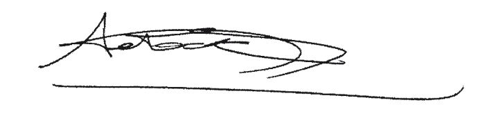

\*Za ýeskou republiku*

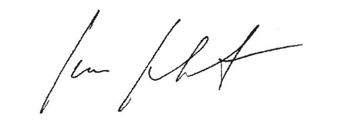

\*På Kongeriget Danmarks vegne*

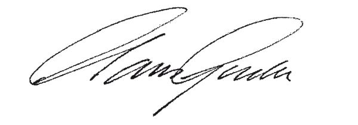

\*Für die Bundesrepublik Deutschland*

\*Eesti Vabariigi nimel*

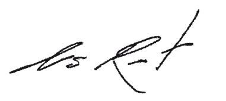

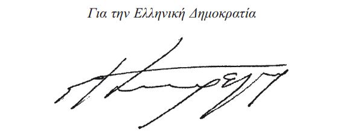

\*Por el Reino de España*

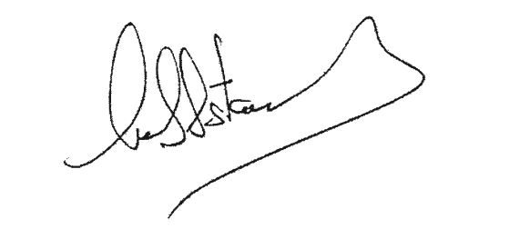

\*Pour la République française*

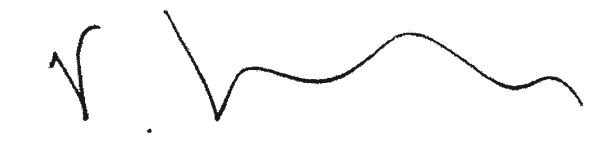

\*Thar cheann Na hEireann*

\*For Ireland*

\*Per la Repubblica italiana*

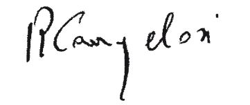

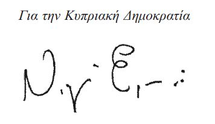

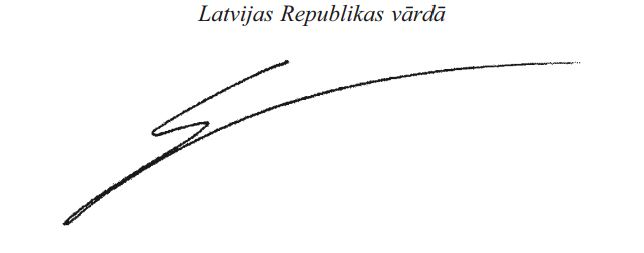

\*Lietuvos Respublikos vardu*

\*Pour le Grand-Duché de Luxembourg*

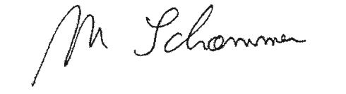

\*A Magyar Köztársaság részéröl*

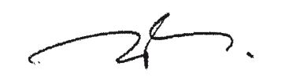

\*Ghar-Repubblika ta’ Malta*

\*Voor het Koninkrijk der Nederlanden*

\*Für die Republik Österreich*

\*W imieniu Rzeczypospolitej Polskiej*

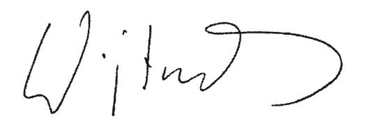

\*Pela República Portuguesa*

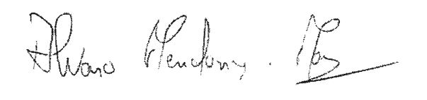

\*Za Republiko Slovenijo*

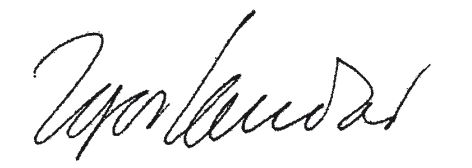

\*Za Slovenskú republiku*

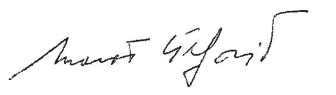

\*Suomen tasavallan puolesta*

\*För Republiken Finland*

\*För Konungariket Sverige*

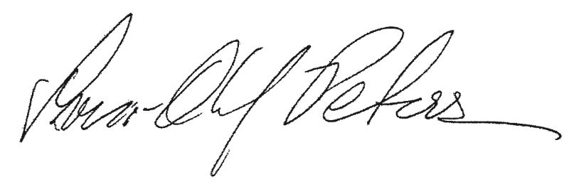

\*For the United Kingdom of Great Britain and Northern Ireland*

ANNEXE I

\**Services agréés et routes spécifiées**

1\. La présente annexe est soumise aux dispositions transitoires prévues à l’annexe IV du présent accord.

2\. Chaque partie contractante accorde aux transporteurs aériens de l’autre partie contractante le droit d’exploiter des services aériens sur les routes spécifiées ci-dessous:

a) pour les transporteurs de la Communauté européenne:

Points situés dans la Communauté européenne – un ou plusieurs points au Maroc – points situés au-delà,

b) pour les transporteurs marocains:

Points situés au Maroc – un ou plusieurs points dans la Communauté européenne.

3\. Les transporteurs du Maroc sont autorisés à exploiter les droits visés à l’article 2 du présent accord entre plusieurs points situés sur le territoire de la Communauté à condition que ces vols aient le territoire du Maroc pour point de départ ou d’arrivée.

Les transporteurs de la Communauté sont autorisés à exploiter les droits visés à l’article 2 du présent accord entre le Maroc et des points situés au-delà, à condition que ces vols aient le territoire de la Communauté pour point de départ ou d’arrivée et que, s’agissant de services destinés aux passagers, ces points soient situés dans les pays auxquels s’applique la politique européenne de voisinage.

Les transporteurs de la Communauté européenne sont autorisés, pour les services au départ et à destination du Maroc, à desservir plus d’un point sur le même service (coterminalisation) et à exercer des droits d’escale entre ces points.

Les pays concernés par la politique européenne de voisinage sont: l’Algérie, l’Arménie, l’Autorité Palestinienne, l’Azerbaïdjan, le Belarus, l’Egypte, la Géorgie, Israël, la Jordanie, le Liban, la Libye, la Moldavie, le Maroc, la Syrie, la Tunisie et l’Ukraine. Les points situés dans ces pays peuvent également être utilisés comme points intermédiaires.

4\. Les routes spécifiées peuvent être exploitées dans les deux sens. Chaque point – qu’il s’agisse d’un point intermédiaire ou d’un point situé au-delà des routes spécifiées – peut, à la discrétion de chaque entreprise de transport aérien, être omis sur l’un quelconque ou sur l’ensemble des vols, à condition que ces vols aient le territoire du Maroc comme point de départ ou d’arrivée dans le cas des transporteurs marocains, ou le territoire d’un Etat membre de la Communauté européenne dans celui des transporteurs communautaires.

5\. Chaque partie contractante autorise chaque transporteur aérien à définir la fréquence et la capacité du service aérien international qu’il souhaite offrir sur la base de considérations commerciales relatives au marché. En vertu de ce droit, aucune des deux parties contractantes n’impose unilatéralement de restrictions sur le volume du trafic, la fréquence ou la régularité du service, ou sur le ou les types d’aéronefs exploités par les transporteurs de l’autre partie contractante, sauf pour des motifs douaniers, techniques, d’exploitation, d’environnement ou de protection de la santé.

6\. Tout transporteur aérien assurant un service aérien international est libre de changer, en tout point des routes spécifiées, le type d’aéronefs qu’il utilise.

7\. L’affrètement avec équipage, par un transporteur aérien marocain, de l’aéronef d’une compagnie aérienne d’un pays tiers aux parties, ou, par un transporteur de la Communauté européenne, de l’aéronef d’une compagnie aérienne d’un pays tiers autre que ceux mentionnés à l’annexe V, pour exploiter les droits prévus au présent accord, doit rester exceptionnel ou répondre à des besoins temporaires. Il est soumis à l’approbation préalable de l’autorité ayant délivré la licence de ce transporteur, et de l’autorité compétente de l’autre partie contractante.

ANNEXE II

\**Accords bilatéraux entre le Maroc et les Etats membres  de la Communauté Européenne**

Le présent accord, conformément aux dispositions de son article 25, prévaut sur les accords bilatéraux suivants en matière de transport aérien signés entre le Maroc et les Etats membres:

aash Accord entre le Gouvernement du Royaume de Belgique et le gouvernement de Sa Majesté le Roi du Maroc relatif au transport aérien fait à Rabat le 20 janvier 1958;

Complété par l’échange de notes du 20 janvier 1958;

Modifié en dernier lieu par le Mémorandum d’entente fait à Rabat le 11 juin 2002;

bash Accord entre la République Socialiste Tchécoslovaque et le Maroc relatif au transport aérien fait à Rabat le 8 mai 1961, au sujet duquel la République Tchèque a fait une déclaration de succession;

cash Accord entre le gouvernement du Royaume du Danemark et le gouvernement du Royaume du Maroc relatif aux services aériens fait à Rabat le 14 novembre 1977;

Complété par l’échange de notes du 14 novembre 1977;

dash Accord entre la République Fédérale d’Allemagne et le Royaume du Maroc relatif aux transports aériens fait à Bonn le 12 octobre 1961;

eash Accord entre le gouvernement de la République Hellène et le gouvernement du Royaume du Maroc relatif au transport aérien fait à Rabat le 10 mai 1999;

A lire conjointement avec le Mémorandum d’entente fait à Athènes le 6 octobre 1998;

fash Accord entre le gouvernement de l’Espagne et le gouvernement du Royaume du Maroc relatif au transport aérien fait à Madrid le 7 juillet 1970;

Complété en dernier lieu par l’échange de lettres du 12 août 2003 et du 25 août 2003;

gash Accord entre le gouvernement de la République Française et le gouvernement de Sa Majesté le Roi du Maroc relatif au transport aérien fait à Rabat le 25 octobre 1957;

Modifié par

aash l’échange de lettres du 22 mars 1961;

bash le procès-verbal des 2 et 5 décembre 1968;

cash le procès-verbal des consultations aéronautiques maroco-françaises des 17 et 18 mai 1976;

dash le procès-verbal des consultations aéronautiques maroco-françaises du 15 mars 1977;

Modifié en dernier lieu par le procès-verbal des consultations aéronautiques maroco-françaises des 22 et 23 mars 1984 et l’échange de lettres du 14 mars 1984;

hash Accord entre le gouvernement de la République d’Italie et le gouvernement de Sa Majesté le Roi du Maroc relatif au transport aérien fait à Rome le 8 juillet 1967;

Modifié par le Mémorandum d’entente fait à Rome le 13 juillet 2000;

Modifié en dernier lieu par l’échange de notes du 17 octobre 2001 et du 3 janvier 2002;

iash Accord entre le gouvernement de la République de Lettonie et le gouvernement du Royaume du Maroc relatif au transport aérien fait à Varsovie le 19 mai 1999;

jash Accord entre le gouvernement du Grand-Duché de Luxembourg et le gouvernement de Sa Majesté le Roi du Maroc relatif au transport aérien fait à Bonn le 5 juillet 1961;

kash Accord entre la République Populaire Hongroise et le Royaume du Maroc relatif aux transports aériens fait à Rabat le 21 mars 1967;

lash Accord entre le gouvernement de la République de Malte et le gouvernement de Sa Majesté le Roi du Maroc relatif au transport aérien fait à Rabat le 26 mai 1983;

mash Accord entre le gouvernement de Sa Majesté la Reine des Pays-Bas et le gouvernement de Sa Majesté le Roi du Maroc relatif au transport aérien fait à Rabat le 20 mai 1959;

nash Accord entre le Gouvernement Fédéral de l’Autriche et le gouvernement du Royaume du Maroc relatif au transport aérien fait à Rabat le 27 février 2002;

oash Accord entre le Gouvernement de la République Populaire de Pologne et le Gouvernement du Royaume du Maroc relatif aux transports aériens fait à Rabat le 29 novembre 1969;

pash Accord entre le Portugal et le gouvernement du Royaume du Maroc relatif au transport aérien fait à Rabat le 3 avril 1958;

Complété par le procès-verbal fait à Lisbonne le 19 décembre 1975;

Complété en dernier lieu par le procès-verbal fait à Lisbonne le 17 novembre 2003;

qash Accord entre le gouvernement du Royaume de la Suède et le gouvernement du Royaume du Maroc relatif au transport aérien fait à Rabat le 14 novembre 1977;

rash Complété par l’échange de notes du 14 novembre 1977;

sash Accord entre le gouvernement du Royaume-Uni de la Grande-Bretagne et de l’Irlande du Nord et le gouvernement du Royaume du Maroc relatif aux services aériens fait à Londres le 22 octobre 1965;

Modifié par l’échange des notes des 10 et 14 octobre 1968;

Modifié par le procès-verbal fait à Londres le 14 mars 1997;

Modifié par le procès-verbal fait à Rabat le 17 octobre 1997;

tash Accords relatifs aux services aériens et autres arrangements paraphés ou signés entre le Royaume du Maroc et des Etats membres de la Communauté européenne qui, à la date de la signature du présent accord, ne sont pas encore entrés en vigueur et ne font pas l’objet d’une application provisoire;

uash Accord entre le gouvernement du Royaume des Pays-Bas et le gouvernement du Royaume du Maroc relatif aux services aériens tel que joint, sous la forme d’une annexe 1, au Mémorandum d’entente fait à La Haye le 20 juin 2001.

ANNEXE III

\**Autorisations d’exploitation et permis techniques: autorités compétentes**

\**1. *La Communauté européenne***

\*Allemagne:*

Luftfahrt-Bundesamt

Ministère fédéral des transports, de la construction et des affaires urbaines

\*Autriche:*

Administration de l’aviation civile

Ministère fédéral des transports, de l’innovation et de la technologie

\*Belgique:*

Direction générale transport aérien

Service public fédéral mobilité et transports

\*Chypre:*

Direction de l’aviation civile

Ministère des communications et des travaux publics

\*Danemark:*

Administration de l’aviation civile

\*Espagne:*

Direction générale de l’aviation civile

Ministère des travaux publics

\*Estonie:*

Administration de l’aviation civile

\*Finlande:*

Autorité de l’aviation civile

\*France:*

Direction générale de l’aviation civile (DGAC)

\*Grèce:*

Direction de l’aviation civile hellénique

Ministère des transports et des communications

\*Hongrie:*

Direction générale de l’aviation civile

Ministère de l’économie et des transports

\*Irlande:*

Direction générale de l’aviation civile

Ministère des transports

\*Italie:*

Autorité de l’aviation civile italienne (ENAC)

\*Lettonie:*

Administration de l’aviation civile

Ministère des transports

\*Lituanie:*

Administration de l’aviation civile

\*Luxembourg:*

Direction de l’aviation civile

\*Malte:*

Département de l’aviation civile

\*Pays-Bas:*

Ministère des transports, des travaux publics et de la gestion des eaux:

Direction générale du transport et de l’aviation

Inspection générale des transports et de la gestion des eaux

\*Pologne:*

Bureau de l’aviation civile

\*Portugal:*

Institut national de l’aviation civile (INAC)

Ministère de l’équipement, de la planification et de l’administration du territoire

\*République tchèque:*

Département de l’aviation civile

Ministère des transports

Direction générale de l’aviation civile

\*Royaume-Uni:*

Direction générale de l’aviation civile

Ministère des transports

\*République slovaque:*

Direction générale de l’aviation civile

Ministère des transports, des postes et des télécommunications

\*Slovénie:*

Office de l’aviation civile

Ministère des transports

\*Suède:*

Direction générale de l’aviation civile

\**2. *Royaume du Maroc***

Direction de l’Aéronautique civile

Ministère de l’équipement et du transport

ANNEXE IV

\**Dispositions transitoires**

1\. La mise en œuvre et l’application par la partie marocaine de toutes les dispositions de la législation communautaire relatives au transport aérien indiquées à l’annexe VI feront l’objet d’une évaluation réalisée sous la responsabilité de la Communauté européenne qui devra être validée par le comité mixte. Cette décision du comité mixte devra être adoptée au plus tard dans un délai maximum de deux ans à partir de l’entrée en vigueur de l’accord.

2\. Jusqu’à l’adoption de cette décision, les services agrées et les routes spécifiées à l’annexe I n’incluront pas le droit pour les transporteurs aériens de la Communauté européenne d’embarquer des passagers ou du fret sur le territoire du Maroc à destination d’un point situé au-delà et vice-versa, ni le droit pour les transporteurs marocains d’embarquer des passagers ou du fret en un point de la Communauté européenne à destination d’un autre point de la Communauté européenne et vice-versa. Cependant, tout droit de cinquième liberté octroyé par le biais de l’un des accords bilatéraux entre le Maroc et les Etats membres de la Communauté européenne énumérés à l’annexe II pourra continuer à être exercé dans la mesure où il n’y a pas de discrimination fondée sur la nationalité.

ANNEXE V

\**Etats mentionnés aux articles 3 et 4 de l’accord**

1\. La République d’Islande (dans le cadre de l’accord sur l’Espace économique européen)

2\. La Principauté du Liechtenstein (dans le cadre de l’accord sur l’Espace économique européen)

3\. Le Royaume de Norvège (dans le cadre de l’accord sur l’Espace économique européen)

4\. La Confédération suisse (dans le cadre de l’accord entre la Communauté européenne et la Confédération suisse sur le transport aérien)

ANNEXE VI

\**Règles applicables à l’aviation civile**

Les «dispositions applicables» des actes suivants s’appliquent conformément à l’accord, sauf disposition contraire de la présente annexe ou de l’annexe IV relative aux dispositions transitoires. Les adaptations éventuelles propres à chacun de ces actes sont, le cas échéant, indiquées ci-après:

\**A. *Sécurité aérienne***

Remarque: les modalités précises de la participation du Maroc, en qualité d’observateur, à l’AESA seront examinées ultérieurement.

No 3922/91

[Règlement (CEE) no 3922/91](https://legilux.public.lu/eli/reg_ue/1991/3922/jo) du Conseil, du 16 décembre 1991, relatif à l’harmonisation de règles techniques et de procédures administratives dans le domaine de l’aviation civile modifié par:

aash le [règlement (CE) no 2176/96](https://legilux.public.lu/eli/reg_ue/1996/2176/jo) de la Commission du 13 novembre 1996 portant adaptation au progrès scientifique et technique du [règlement (CEE) no 3922/91](https://legilux.public.lu/eli/reg_ue/1991/3922/jo) du Conseil;

bash le [règlement (CE) no 1069/1999](https://legilux.public.lu/eli/reg_ue/1999/1069/jo) de la Commission, du 25 mai 1999, portant adaptation au progrès scientifique et technique du [règlement (CEE) no3922/91](https://legilux.public.lu/eli/reg_ue/1991/3922/jo) du Conseil;

cash le [règlement (CE) no 2871/2000](https://legilux.public.lu/eli/reg_ue/2000/2871/jo) de la Commission du 28 décembre 2000 portant adaptation au progrès scientifique et technique du [règlement (CEE) no 3922/91](https://legilux.public.lu/eli/reg_ue/1991/3922/jo) du Conseil;

dash le [règlement (CE) no 1592/2002](https://legilux.public.lu/eli/reg_ue/2002/1592/jo) du Parlement européen et du Conseil du 15 juillet 2002 concernant des règles communes dans le domaine de l’aviation civile et instituant une Agence européenne de la sécurité aérienne.

Dispositions applicables: articles 1er à 10 et 12 à 13 à l’exception de l’article 4, paragraphe 1, et de l’article 8, paragraphe 2, 2ème phrase, annexes I, II et III.

Aux fins de l’application de l’article 12, l’expression Etats membres est remplacée par l’expression Etats membres de la CE.

No 94/56/CE

[Directive 94/56/CE](https://legilux.public.lu/eli/dir_ue/1994/56/jo) du Conseil, du 21 novembre 1994, établissant les principes fondamentaux régissant les enquêtes sur les accidents et les incidents dans l’aviation civile

Dispositions applicables: articles 1er à 12

No 1592/2002

[Règlement (CE) no 1592/2002](https://legilux.public.lu/eli/reg_ue/2002/1592/jo) du Parlement européen et du Conseil du 15 juillet 2002 concernant des règles communes dans le domaine de l’aviation civile et instituant une Agence européenne de la sécurité aérienne modifié par:

aash le [règlement (CE) no 1643/2003](https://legilux.public.lu/eli/reg_ue/2003/1643/jo) du Parlement européen et du Conseil du 22 juillet 2003 modifiant le [règlement (CE) no 1592/2002](https://legilux.public.lu/eli/reg_ue/2002/1592/jo)

bash le [règlement (CE) no 1701/2003](https://legilux.public.lu/eli/reg_ue/2003/1701/jo) de la Commission du 24 septembre 2003 adaptant l’article 6 du [règlement (CE) no 1592/2002](https://legilux.public.lu/eli/reg_ue/2002/1592/jo)

Dispositions applicables: articles 1er à 57, annexes I et II

No 2003/42

[Directive 2003/42/CE](https://legilux.public.lu/eli/dir_ue/2003/42/jo) du Parlement européen et du Conseil du 13 juin 2003 concernant les comptes rendus d’événements dans l’aviation civile

Dispositions applicables: articles 1er à 11, annexes I et II

No 1702/2003

[Règlement (CE) no 1702/2003](https://legilux.public.lu/eli/reg_ue/2003/1702/jo) de la Commission du 24 septembre 2003 établissant des règles d’application pour la certification de navigabilité et environnementale des aéronefs et produits, pièces et équipements associés, ainsi que pour la certification des organismes de conception et de production

Dispositions applicables: articles 1er à 4, annexe

No 2042/2003

[Règlement (CE) no 2042/2003](https://legilux.public.lu/eli/reg_ue/2003/2042/jo) de la Commission du 20 novembre 2003 relatif au maintien de la navigabilité des aéronefs et des produits, pièces et équipements aéronautiques, et relatif à l’agrément des organismes et des personnels participant à ces tâches

Dispositions applicables: articles 1er à 6, annexes I à IV

No 104/2004

[Règlement (CE) no 104/2004](https://legilux.public.lu/eli/reg_ue/2004/104/jo) de la Commission du 22 janvier 2004 fixant les règles relatives à l’organisation et à la composition de la chambre de recours de l’Agence européenne de la sécurité aérienne

Dispositions applicables: articles 1er à 7, annexe

\**B. *Gestion du trafic aérien***

No 93/65

[Directive 93/65/CEE](https://legilux.public.lu/eli/dir_ue/1993/65/jo) du Conseil, du 19 juillet 1993, relative à la définition et à l’utilisation de spécifications techniques compatibles pour l’acquisition d’équipements et de systèmes pour la gestion du trafic aérien modifiée par:

aash la [directive 97/15/CE](https://legilux.public.lu/eli/dir_ue/1997/15/jo) de la Commission du 25 mars 1997 portant adoption de normes Eurocontrol et modification de la [directive 93/65/CEE](https://legilux.public.lu/eli/dir_ue/1993/65/jo) du Conseil relative à la définition et à l’utilisation de spécifications techniques compatibles pour l’acquisition d’équipements et de systèmes pour la gestion du trafic aérien, modifiée par le [règlement (CE) no 2082/2000](https://legilux.public.lu/eli/reg_ue/2000/2082/jo) de la Commission du 6 septembre 2000 portant adoption de normes Eurocontrol et modification de la [directive 97/15/CE](https://legilux.public.lu/eli/dir_ue/1997/15/jo) portant adoption de normes Eurocontrol et modification de la [directive 93/65/CEE](https://legilux.public.lu/eli/dir_ue/1993/65/jo), modifiée par le [règlement (CE) no 980/2002](https://legilux.public.lu/eli/reg_ue/2002/980/jo) de la Commission du 4 juin 2002 modifiant le [règlement (CE) no 2082/2000](https://legilux.public.lu/eli/reg_ue/2000/2082/jo) portant adoption des normes Eurocontrol

Dispositions applicables: articles 1er à 9, annexes I et II

La référence à la [directive 93/65/EEC](https://legilux.public.lu/eli/dir_ue/1993/65/jo) du Conseil doit être supprimée le 20 octobre 2005.

No2082/2000

[Règlement (CE) no 2082/2000](https://legilux.public.lu/eli/reg_ue/2000/2082/jo) de la Commission du 6 septembre 2000 portant adoption de normes Eurocontrol et modification de la [directive 97/15/CE](https://legilux.public.lu/eli/dir_ue/1997/15/jo) portant adoption de normes Eurocontrol et modification de la [directive 93/65/CEE](https://legilux.public.lu/eli/dir_ue/1993/65/jo) modifié par:

aash le [règlement (CE) no980/2002](https://legilux.public.lu/eli/reg_ue/2002/980/jo) de la Commission du 4 juin 2002 modifiant le [règlement (CE) no 2082/2000](https://legilux.public.lu/eli/reg_ue/2000/2082/jo) portant adoption des normes Eurocontrol

Dispositions applicables: articles 1er à 3, annexes I à III

No 549/2004

[Règlement (CE) no 549/2004](https://legilux.public.lu/eli/reg_ue/2004/549/jo) du Parlement européen et du Conseil du 10 mars 2004 fixant le cadre pour la réalisation du ciel unique européen («règlement-cadre»)

Dispositions applicables: articles 1er à 4, article 6, et articles 9 à 14.

No 550/2004

[Règlement (CE) no550/2004](https://legilux.public.lu/eli/reg_ue/2004/550/jo) du Parlement européen et du Conseil du 10 mars 2004 relatif à la fourniture de services de navigation aérienne dans le ciel unique européen («règlement sur la fourniture de services»)

Dispositions applicables: articles 1er à 19

No551/2004

[Règlement (CE) no 551/2004](https://legilux.public.lu/eli/reg_ue/2004/551/jo) du Parlement européen et du Conseil du 10 mars 2004 relatif à l’organisation et à l’utilisation de l’espace aérien dans le ciel unique européen («règlement sur l’espace aérien»)

Dispositions applicables: articles 1er à 11

No 552/2004

[Règlement (CE) no 552/2004](https://legilux.public.lu/eli/reg_ue/2004/552/jo) du Parlement européen et du Conseil du 10 mars 2004 concernant l’interopérabilité du réseau européen de gestion du trafic aérien («règlement sur l’interopérabilité»)

Dispositions applicables: articles 1er à 12

\**C. *Protection de l’environnement***

No89/629

[Directive 89/629/CEE](https://legilux.public.lu/eli/dir_ue/1989/629/jo) du Conseil, du 4 décembre 1989, relative à la limitation des émissions sonores des avions à réaction subsoniques civils.

Dispositions applicables: articles 1er à 8

No 92/14

[Directive 92/14/CEE](https://legilux.public.lu/eli/dir_ue/1992/14/jo) du Conseil du 2 mars 1992 relative à la limitation de l’exploitation des avions relevant de l’annexe 16 de la convention relative à l’aviation civile internationale, volume 1 deuxième partie chapitre 2, deuxième édition (1988) modifiée par:

aash la [directive 98/20/CE](https://legilux.public.lu/eli/dir_ue/1998/20/jo) du Conseil du 30 mars 1998 modifiant la [directive 92/14/CEE](https://legilux.public.lu/eli/dir_ue/1992/14/jo)

bash la [directive 1999/28/CE](https://legilux.public.lu/eli/dir_ue/1999/28/jo) de la Commission du 21 avril 1999 portant modification de l’annexe de la [directive 92/14/CEE](https://legilux.public.lu/eli/dir_ue/1992/14/jo) du Conseil

cash le [règlement (CE) no 991/2001](https://legilux.public.lu/eli/reg_ue/2001/991/jo) de la Commission du 21 mai 2001 modifiant l’annexe de la [directive 92/14/CEE](https://legilux.public.lu/eli/dir_ue/1992/14/jo) du Conseil

Dispositions applicables: articles 1er à 11, annexe

No 2002/30

[Directive 2002/30/CE](https://legilux.public.lu/eli/dir_ue/2002/30/jo) du Parlement européen et du Conseil du 26 mars 2002 relative à l’établissement de règles et procédures concernant l’introduction de restrictions d’exploitation liées au bruit dans les aéroports de la Communauté

Dispositions applicables: articles 1er à 15, annexes I et II

No 2002/49

[Directive 2002/49/CE](https://legilux.public.lu/eli/dir_ue/2002/49/jo) du Parlement européen et du Conseil du 25 juin 2002 relative à l’évaluation et à la gestion du bruit dans l’environnement

Dispositions applicables: articles 1er à 16, annexes I à IV

\**D. *Protection des consommateurs***

No 90/314

[Directive 90/314/CEE](https://legilux.public.lu/eli/dir_ue/1990/314/jo) du Conseil, du 13 juin 1990, concernant les voyages, vacances et circuits à forfait

Dispositions applicables: articles 1er à 10

No 92/59

[Directive 92/59/CEE](https://legilux.public.lu/eli/dir_ue/1992/59/jo) du Conseil, du 29 juin 1992, relative à la sécurité générale des produits

Dispositions applicables: articles 1er à 19

No 93/13

[Directive 93/13/CEE](https://legilux.public.lu/eli/dir_ue/1993/13/jo) du Conseil, du 5 avril 1993, concernant les clauses abusives dans les contrats conclus avec les consommateurs

Dispositions applicables: articles 1er à 10, annexe

No 95/46

[Directive 95/46/CE](https://legilux.public.lu/eli/dir_ue/1995/46/jo) du Parlement européen et du Conseil, du 24 octobre 1995, relative à la protection des personnes physiques à l’égard du traitement des données à caractère personnel et à la libre circulation de ces données

Dispositions applicables: articles 1er à 34

No 2027/97

[Règlement (CE) No2027/97](https://legilux.public.lu/eli/reg_ue/1997/2027/jo) du Conseil du 9 octobre 1997 relatif à la responsabilité des transporteurs aériens en cas d’accident modifié par:

aash le [règlement (CE) no 889/2002](https://legilux.public.lu/eli/reg_ue/2002/889/jo) du Parlement européen et du Conseil du 13 mai 2002 modifiant le [règlement (CE) no 2027/97](https://legilux.public.lu/eli/reg_ue/1997/2027/jo)

Dispositions applicables: articles 1er à 8

No 261/2004

[Règlement (CE) no 261/2004](https://legilux.public.lu/eli/reg_ue/2004/261/jo) du Parlement européen et du Conseil du 11 février 2004 établissant des règles communes en matière d’indemnisation et d’assistance des passagers en cas de refus d’embarquement et d’annulation ou de retard important d’un vol, et abrogeant le [règlement (CEE) no 295/91](https://legilux.public.lu/eli/reg_ue/1991/295/jo)

Dispositions applicables: articles 1er à 17

\**E.** **Systèmes informatisés de réservation**

No 2299/1989

[Règlement (CEE) no2299/1989](https://legilux.public.lu/eli/reg_ue/1989/2299/jo) du Conseil, du 24 juillet 1989, instaurant un code de conduite pour l’utilisation de systèmes informatisés de réservation modifié par:

aash le [règlement (CEE) no 3089/93](https://legilux.public.lu/eli/reg_ue/1993/3089/jo) du Conseil du 29 octobre 1993 modifiant le [règlement (CEE) no 2299/89](https://legilux.public.lu/eli/reg_ue/1989/2299/jo)

bash le [règlement (CE) no 323/1999](https://legilux.public.lu/eli/reg_ue/1999/323/jo) du Conseil du 8 février 1999 modifiant le [règlement (CEE) no 2299/89](https://legilux.public.lu/eli/reg_ue/1989/2299/jo)

Dispositions applicables: articles 1er à 22, annexe

\**F. *Aspects sociaux***

No 1989/391

[Directive 89/391/CEE](https://legilux.public.lu/eli/dir_ue/1989/391/jo) du Conseil, du 12 juin 1989, concernant la mise en œuvre de mesures visant à promouvoir l’amélioration de la sécurité et de la santé des travailleurs au travail

Dispositions applicables: articles 1er à 16, et 18-19

No 2003/88

[Directive 2003/88/CE](https://legilux.public.lu/eli/dir_ue/2003/88/jo) du Parlement européen et du Conseil du 4 novembre 2003 concernant certains aspects de l’aménagement du temps de travail

Dispositions applicables: articles 1er à 19, 21 à 24 et 26 à 29

No 2000/79

[Directive 2000/79](https://legilux.public.lu/eli/dir_ue/2000/79/jo) du Conseil du 27 novembre 2000 concernant la mise en œuvre de l’accord européen relatif à l’aménagement du temps de travail du personnel mobile dans l’aviation civile, conclu par l’Association des compagnies européennes de navigation aérienne (AEA), la Fédération européenne des transports (ETF), l’Association européenne des personnels navigants techniques (ECA), l’Association européenne des compagnies d’aviation des régions d’Europe (ERA) et l’Association internationale des charters aériens (AICA)

Dispositions applicables: articles 1er à 5

\**G. *Autres textes législatifs***

No 91/670

[Directive 91/670/CEE](https://legilux.public.lu/eli/dir_ue/1991/670/jo) du Conseil, du 16 décembre 1991, sur l’acceptation mutuelle des licences du personnel pour exercer des fonctions dans l’aviation civile

Dispositions applicables: articles 1er à 8, annexe

Doc. parl. [6095](https://legilux.public.lu/eli/etat/proj/pl/20090211); sess. ord. 2009-2010.
