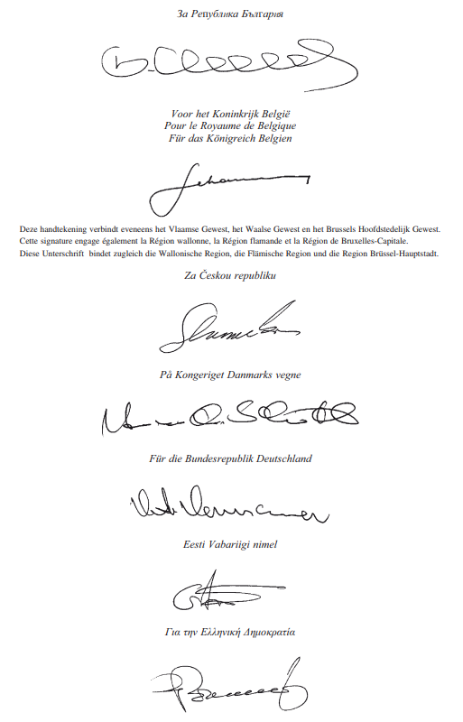
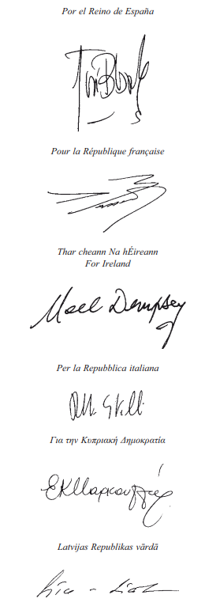
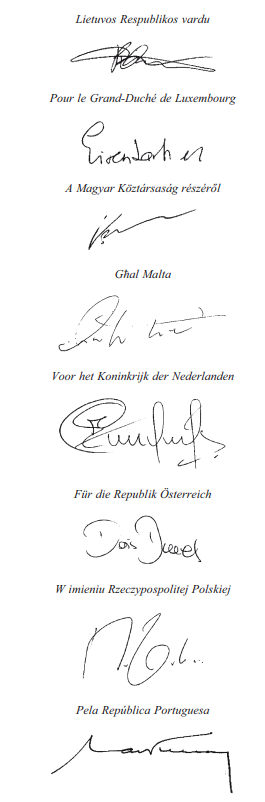
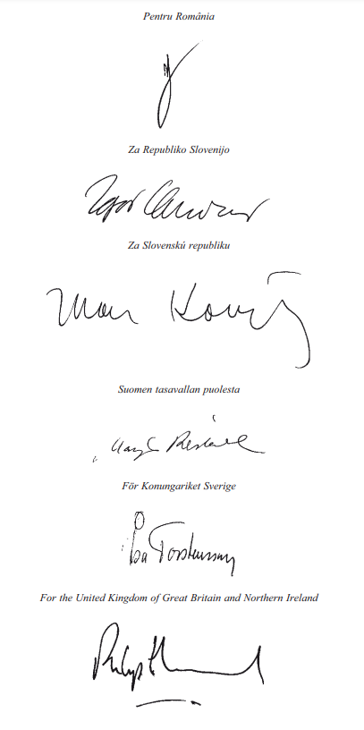
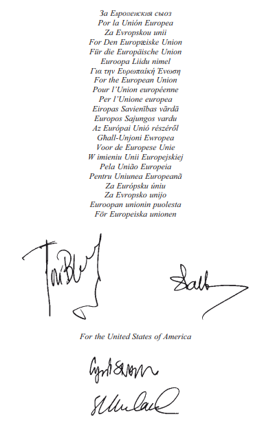

# Loi du 12 mars 2011 portant approbation du Protocole, signé à Luxembourg, le 24 juin 2010, modifiant l’Accord de transport aérien entre les Etats-Unis d’Amérique, d’une part, et la Communauté européenne et ses Etats membres, d’autre part, signé les 25 et 30 avril 2007.

Nous Henri, Grand-Duc de Luxembourg, Duc de Nassau,

Notre Conseil d’Etat entendu;

De l’assentiment de la Chambre des Députés exprimé de la manière prévue par l’article 114, alinéa 2 de la [Constitution](https://legilux.public.lu/eli/etat/leg/constitution/1868/10/17/n1);

Vu la décision de la Chambre des Députés du 10 février 2011 et celle du Conseil d’Etat du 15 février 2011 portant qu’il n’y a pas lieu à second vote;

Avons ordonné et ordonnons:

## Article unique.

Est approuvé le Protocole, signé à Luxembourg, le 24 juin 2010, modifiant l’[Accord de transport aérien entre les Etats-Unis d’Amérique, d’une part, et la Communauté européenne de ses Etats membres, d’autre part](https://legilux.public.lu/eli/etat/leg/loi/2009/11/28/n3/jo), signé les 25 et 30 avril 2007.

Mandons et ordonnons que la présente loi soit insérée au Mémorial pour être exécutée et observée par tous ceux que la chose concerne.

Le Ministre des Affaires étrangères,   Jean Asselborn   Le Ministre du Développement durable et  des Infrastructures,   Claude Wiseler

Zurich, le 12 mars 2011.   Henri

\**PROTOCOLE**

modifiant l’Accord de transport aérien entre les Etats-Unis d’Amérique, d’une part, et la Communauté européenne et ses Etats membres, d’autre part, signé les 25 et 30 avril 2007

\*Les Etats-Unis d’Amérique*

(ci-après dénommés «les Etats-Unis»),

d’une part, et

\*Le Royaume de Belgique,*

\*La République de Bulgarie,*

\*La République tchèque,*

\*Le Royaume de Danemark,*

\*La République fédérale d’Allemagne,*

\*La République d’Estonie,*

\*L’Irlande,*

\*La République hellénique,*

\*Le Royaume d’Espagne,*

\*La République française,*

\*La République italienne,*

\*La République de Chypre,*

\*La République de Lettonie,*

\*La République de Lituanie,*

\*Le Grand-Duché de Luxembourg,*

\*La République de Hongrie,*

\*Malte,*

\*Le Royaume des Pays-Bas,*

\*La République d’Autriche,*

\*La République de Pologne,*

\*La République portugaise,*

\*La Roumanie,*

\*La République de Slovénie,*

\*La République slovaque,*

\*La République de Finlande,*

\*Le Royaume de Suède,*

\*Le Royaume-Uni de Grande-Bretagne et d’Irlande du Nord,*

parties au [traité sur l’Union européenne](http://data.europa.eu/eli/treaty/teu_2012/oj) et au [traité sur le fonctionnement de l’Union européenne](http://data.europa.eu/eli/treaty/tfeu_2012/oj) et Etats membres de l’Union européenne (ci-après dénommés «les Etats membres»),

\*et l’Union européenne,*

d’autre part,

\*Ayant l’intention* de s’appuyer sur le cadre établi par l’accord de transport aérien entre les Etats-Unis d’Amérique, d’une part, et la Communauté européenne et ses Etats membres, d’autre part, signé les 25 et 30 avril 2007 (ci-après dénommé «l’accord») pour ouvrir les marchés et maximiser les avantages pour les consommateurs, les transporteurs aériens, les travailleurs et les populations des deux côtés de l’Atlantique;

\*Accomplissant* le mandat octroyé par l’article 21 de l’accord pour négocier rapidement la deuxième étape en vue de la réalisation de cet objectif;

\*Reconnaissant* que l’Union européenne s’est substituée et a succédé à la Communauté européenne, à la suite de l’entrée en vigueur, le 1er décembre 2009, du [traité de Lisbonne](http://data.europa.eu/eli/treaty/lis/sign) modifiant le [traité sur l’Union européenne](http://data.europa.eu/eli/treaty/teu_2012/oj) et le [traité instituant la Communauté européenne](http://data.europa.eu/eli/treaty/tec_2002/oj) et qu’à partir de cette date, tous les droits et obligations de la Communauté européenne et toutes les références à celle-ci figurant dans l’accord s’appliquent à l’Union européenne,

SONT CONVENUS de modifier l’accord comme suit:

## *Article 1* — *Définitions*

L’article 1 de l’accord est modifié comme suit:

1\. La nouvelle définition qui suit est insérée après le paragraphe 2:

> 2*bis* l’expression «décision réglementaire relative à la citoyenneté», le constat qu’un transporteur aérien proposant d’exploiter des services dans le cadre du présent accord satisfait aux exigences de l’article 4 concernant sa propriété, son contrôle effectif et son établissement principal;

2\. La nouvelle définition qui suit est insérée après le paragraphe 3:

> 3*bis* l’expression «décision réglementaire relative à la conformité», le constat qu’un transporteur aérien proposant d’exploiter des services dans le cadre du présent accord possède une capacité financière satisfaisante et des compétences appropriées en matière de gestion pour exploiter de tels services et est disposé à se conformer aux dispositions législatives et réglementaires et aux exigences qui régissent l’exploitation de tels services;

## *Article 2* — **Reconnaissance mutuelle des décisions réglementaires relatives** * **à la conformité et à la citoyenneté des transporteurs aériens***

Un nouvel article 6*bis* est inséré après l’article 6, comme suit:

> ***Article 6bis * — **Reconnaissance mutuelle des décisions réglementaires relatives ** **à la conformité et à la citoyenneté des transporteurs aériens****
>
> 1\. Lorsqu’elles sont saisies d’une demande d’autorisation d’exploitation au titre de l’article 4 de la part d’un transporteur aérien de l’une des parties, les autorités aéronautiques de l’autre partie reconnaissent toute décision réglementaire relative à la conformité et/ou à la citoyenneté faite par les autorités aéronautiques de la première partie concernant ledit transporteur aérien comme si cette décision réglementaire avait été faite par elles-mêmes et ne font pas de vérifications supplémentaires sur ces questions, sous réserve des dispositions du point a) ci-dessous:
>
> a) Si, après avoir été saisies d’une demande d’autorisation d’exploitation de la part d’un transporteur aérien, ou après avoir délivré ladite autorisation, les autorités aéronautiques de la partie ayant reçu la demande ont une raison spécifique d’estimer que, malgré la décision réglementaire prise par les autorités aéronautiques de l’autre partie, les conditions prévues à l’article 4 du présent accord pour la délivrance d’autorisations ou d’agréments appropriés ne sont pas satisfaites, elles en avertissent sans retard ces autorités, en justifiant dûment leurs préoccupations. Dans ces circonstances, l’une ou l’autre des parties peut solliciter des consultations, auxquelles doivent participer des représentants des autorités aéronautiques concernées, et/ou demander des informations complémentaires concernant le sujet de préoccupation; il doit être satisfait à ces demandes dans les meilleurs délais. Si la question soulevée reste non résolue, l’une ou l’autre des parties peut en saisir le comité mixte;
>
> b) Le présent article ne s’applique pas aux décisions réglementaires concernant les certificats de sécurité ou les licences, les dispositions en matière de sûreté ou la couverture d’assurance.
>
> 2\. Chaque partie informe l’autre, si possible à l’avance ou, à défaut, dès que possible, par l’intermédiaire du comité mixte, de toute modification importante des critères qu’elle applique pour l’élaboration des décisions réglementaires visées au paragraphe 1 ci-dessus. Si la partie informée demande la tenue de consultations sur ces modifications, lesdites consultations sont organisées au sein du comité mixte dans les 30 jours suivant la demande, à moins que les parties n’en conviennent autrement. Si, à la suite de ces consultations, la partie informée estime que les critères modifiés par l’autre partie ne satisfont pas à la reconnaissance réciproque des décisions réglementaires, elle peut informer l’autre partie de la suspension du paragraphe 1. La partie informée peut lever cette suspension à tout moment. Le comité mixte en est informé.

## *Article 3* * * — Environnement

L’article 15 de l’accord est supprimé et remplacé par l’article suivant:

> ***Article 15 * — Environnement**
>
> 1\. Les parties reconnaissent l’importance de protéger l’environnement dans le cadre de l’élaboration et de la mise en œuvre de la politique aéronautique internationale, les coûts et les avantages de mesures destinées à protéger l’environnement devant être soigneusement pesés, tout en favorisant conjointement, le cas échéant, des solutions globales efficaces. En conséquence, les parties entendent collaborer pour limiter ou réduire, de façon économiquement raisonnable, les incidences de l’aviation internationale sur l’environnement.
>
> 2\. Lorsqu’une partie examine des projets de mesures de protection de l’environnement à l’échelon régional, national ou local, il convient qu’elle en évalue les effets négatifs possibles sur l’exercice des droits prévus dans le présent accord et, si ces mesures sont adoptées, il convient qu’elle prenne les dispositions appropriées pour en atténuer les effets négatifs éventuels. A la demande d’une des parties, l’autre partie fournit une description de cette évaluation et des dispositions d’atténuation.
>
> 3\. Lorsque des mesures de protection de l’environnement sont adoptées, les normes sur la protection de l’environnement adoptées par l’Organisation de l’aviation civile internationale dans les annexes à la convention sont respectées, sauf dans les cas où des différences par rapport à ces normes ont été notifiées. Les parties appliquent toute mesure de protection de l’environnement ayant une incidence sur les services aériens régis par le présent accord conformément à l’article 2 et à l’article 3, paragraphe 4, du présent accord.
>
> 4\. Les parties réitèrent l’engagement des Etats membres et des Etats-Unis à appliquer le principe de l’approche équilibrée.
>
> 5\. Les dispositions suivantes s’appliquent à l’imposition de nouvelles restrictions d’exploitation obligatoires fondées sur le bruit dans les aéroports comptant plus de 50.000 mouvements d’avions à réaction subsoniques civils par année calendaire:
>
> a) Les autorités responsables des parties permettent la prise en compte de l’avis des parties intéressées dans le processus décisionnel.
>
> b) L’introduction de toute nouvelle restriction d’exploitation est communiquée à l’autre partie au minimum 150 jours avant son entrée en vigueur. A sa demande, l’autre partie a le droit d’obtenir sans délai un rapport écrit expliquant les raisons de l’introduction de la restriction, l’objectif environnemental assigné à l’aéroport et les mesures qui ont été envisagées pour atteindre cet objectif. Ce rapport contient l’évaluation des coûts et avantages probables des différentes mesures envisagées.
>
> c) Les restrictions d’exploitation sont i) non discriminatoires, ii) pas plus restrictives que nécessaire pour atteindre l’objectif environnemental assigné à l’aéroport concerné et iii) non arbitraires.
>
> 6\. Les parties avalisent et encouragent l’échange d’informations et le dialogue régulier entre experts, notamment par les canaux de communication existants, afin d’approfondir la coopération, conformément aux dispositions législatives et réglementaires en vigueur, pour traiter de l’impact de l’aviation internationale sur l’environnement et des mesures d’atténuation, à savoir notamment:
>
> a) la recherche et le développement de technologies aéronautiques respectueuses de l’environnement;
>
> b) l’amélioration de la connaissance scientifique des effets des émissions du transport aérien afin de mieux informer les décideurs politiques;
>
> c) l’innovation dans la gestion du trafic aérien en vue de réduire l’impact environnemental de l’aviation;
>
> d) la recherche et le développement de carburants alternatifs durables pour l’aviation; et
>
> e) l’échange de vues sur des questions et des options dans les forums internationaux consacrés aux incidences environnementales de l’aviation, ainsi que, le cas échéant, la coordination des points de vue.
>
> 7\. A la demande des parties, le comité mixte, assisté d’experts, veille à élaborer des recommandations sur les questions de chevauchements éventuels et de cohérence entre les mesures fondées sur le marché qu’appliquent les parties concernant les émissions du transport aérien, afin d’éviter l’inutile multiplication des mesures et des coûts et de réduire dans toute la mesure du possible la charge administrative qui pèse sur les compagnies aériennes. La mise en œuvre de ces recommandations est soumise à une ratification ou approbation interne, selon la demande de chaque partie.
>
> 8\. Si une partie estime qu’une question liée à la protection de l’environnement dans le contexte de l’aviation, et notamment les nouvelles mesures proposées, soulève des préoccupations quant à l’application ou à la mise en œuvre du présent accord, elle peut demander une réunion du comité mixte, conformément à l’article 18, afin d’examiner la question et d’apporter les réponses appropriées aux préoccupations jugées légitimes.

## *Article 4* * * — Dimension sociale

Un nouvel article 17*bis* est inséré après l’article 17, comme suit:

> ***Article 17bis * — Dimension sociale**
>
> 1\. Les parties reconnaissent l’importance de la dimension sociale de l’accord et les avantages qui découlent de l’application de normes du travail élevées à des marchés ouverts. Les opportunités créées par l’accord ne sont pas destinées à affaiblir les normes du travail ni les droits et principes sociaux contenus dans les législations respectives des parties.
>
> 2\. Les principes énoncés au paragraphe 1 doivent guider les parties lorsqu’elles mettent en œuvre l’accord, notamment par la prise en compte régulière, par le comité mixte, conformément à l’article 18, des conséquences sociales de l’accord, et par l’élaboration de réponses appropriées aux préoccupations légitimes.

## *Article 5* * * — Comité mixte

Les paragraphes 3, 4 et 5 de l’article 18 de l’accord sont supprimés et remplacés par les paragraphes suivants:

> 3\. Le comité mixte examine, le cas échéant, la mise en œuvre globale de l’accord, et notamment les effets éventuels des contraintes liées aux infrastructures aéroportuaires sur l’exercice des droits prévus à l’article 3, les effets des mesures de sûreté prises en vertu de l’article 9, les effets sur les conditions de concurrence, notamment dans le domaine des systèmes informatisés de réservation, ainsi que les effets sociaux éventuels de la mise en œuvre de l’accord. Le comité mixte prend également en compte, en permanence, les questions ou les propositions isolées dont l’une ou l’autre partie estime qu’elles affectent ou peuvent affecter l’exploitation dans le cadre de l’accord, telles que des exigences réglementaires contradictoires.
>
> 4\. Le comité mixte développe également la coopération:
>
> a) en envisageant les domaines susceptibles d’être inclus dans l’accord, voire en recommandant d’éventuelles modifications de ce dernier;
>
> b) en examinant les conséquences sociales de l’accord tel qu’il est appliqué et en apportant les réponses appropriées aux préoccupations jugées légitimes;
>
> c) en tenant un inventaire des questions relatives aux subventions ou aux aides publiques soulevées par l’une ou l’autre des parties au sein du comité mixte;
>
> d) en prenant des décisions par consensus concernant toute question relative à l’application de l’article 11, paragraphe 6;
>
> e) en élaborant, à la demande des parties, des dispositions pour la reconnaissance réciproque des décisions réglementaires;
>
> f) en encourageant la coopération entre les autorités respectives des parties dans leurs démarches visant à développer leurs systèmes respectifs de gestion du trafic aérien en vue d’optimiser leur interopérabilité et leur compatibilité, à en réduire les coûts et à en améliorer leur sécurité, leur capacité et leurs performances en termes d’environnement;
>
> g) en encourageant l’élaboration de propositions de projets et initiatives communs dans le domaine de la sécurité aérienne, notamment avec des pays tiers;
>
> h) en encourageant une coopération étroite et continue entre les autorités compétentes de sûreté aérienne des parties, et notamment les initiatives de développement de procédures de sûreté qui facilitent le flux des passagers et des marchandises sans compromettre la sûreté;
>
> i) en examinant si les dispositions législatives et réglementaires et les pratiques respectives des parties dans les domaines couverts par l’annexe 9 (Facilitation) de la convention peuvent affecter l’exercice des droits prévus par le présent accord;
>
> j) en promouvant des échanges entre experts sur les nouvelles initiatives et les nouveaux développements législatifs et réglementaires, en matière notamment de sûreté, de sécurité, d’environnement, d’infrastructures aéroportuaires (y compris les créneaux horaires) et de protection des consommateurs;
>
> k) en encourageant la consultation, le cas échéant, sur les questions liées au transport aérien traitées au sein des organisations internationales et dans les relations avec les pays tiers, notamment en vue d’examiner l’opportunité d’adopter une approche commune; et
>
> l) en prenant par consensus les décisions visées à l’article 1, paragraphe 3, et à l’article 2, paragraphe 3, de l’annexe 4.
>
> 5\. Les parties partagent l’objectif consistant à maximiser les avantages pour les consommateurs, les transporteurs aériens, les travailleurs et les populations des deux côtés de l’Atlantique en étendant le présent accord aux pays tiers. A cette fin, le comité mixte envisage, le cas échéant, les conditions et les procédures requises, y compris toute modification nécessaire du présent accord, pour l’adhésion de nouveaux pays tiers au présent accord.

## *Article 6* * * — Extension des possibilités

L’article 21 de l’accord est supprimé et remplacé par l’article suivant:

> ***Article 2* *1 * — Extension des possibilités**
>
> 1\. Les parties s’engagent à poursuivre l’objectif commun consistant à continuer de lever les obstacles à l’accès aux marchés afin de maximiser les avantages pour les consommateurs, les transporteurs aériens, les travailleurs et les populations des deux côtés de l’Atlantique, notamment en facilitant l’accès de leurs transporteurs aériens aux marchés mondiaux de capitaux afin de mieux refléter les réalités de l’industrie aéronautique mondiale, en renforçant le système de transport aérien transatlantique et en établissant un cadre qui encouragera les autres pays à ouvrir leurs propres marchés des services aériens.
>
> 2\. Conformément à l’objectif commun visé au paragraphe 1 et au mandat qui lui est conféré par l’article 18, consistant à surveiller la mise en œuvre du présent accord, le comité mixte examine chaque année l’évolution de la situation, notamment en ce qui concerne les modifications législatives visées au présent article. Le comité mixte élabore des modalités de coopération dans ce domaine et fait des recommandations aux parties. L’Union européenne et ses Etats membres autorisent la détention d’une participation majoritaire dans leurs transporteurs aériens et le contrôle effectif de ceux-ci par les Etats-Unis ou leurs ressortissants, sur une base de réciprocité, pour autant que le comité mixte confirme que les dispositions législatives et réglementaires des Etats-Unis autorisent la détention d’une participation majoritaire dans leurs transporteurs aériens et le contrôle effectif de ceux-ci par les Etats membres ou leurs ressortissants.
>
> 3\. Dès que le comité mixte confirme par écrit, conformément à l’article 18, paragraphe 6, que les dispositions législatives et réglementaires de chaque partie autorisent la détention d’une participation majoritaire dans ses transporteurs aériens et le contrôle effectif de ceux-ci par l’autre partie ou ses ressortissants:
>
> a) la section 3 de l’annexe 1 de l’accord cesse de s’appliquer;
>
> b) les transporteurs aériens des Etats-Unis ont le droit d’exploiter des services mixtes réguliers entre des points de l’Union européenne et ses Etats membres et de cinq pays, sans desservir de point sur le territoire des Etats-Unis. Le comité mixte dresse la liste de ces pays au plus tard un an après la signature du présent protocole. Le comité mixte peut modifier cette liste ou y ajouter des pays; et
>
> c) les dispositions de l’article 2 de l’annexe 4 de l’accord («Propriété et contrôle des transporteurs aériens d’un Etat tiers») cessent de s’appliquer et les dispositions de l’annexe 6 de l’accord prennent effet en ce qui concerne les transporteurs aériens de pays tiers détenus et contrôlés par les Etats-Unis ou leurs ressortissants.
>
> 4\. Dès que le comité mixte confirme par écrit, conformément à l’article 18, paragraphe 6, que les dispositions législatives et réglementaires de l’Union européenne et de ses Etats membres concernant l’imposition de restrictions d’exploitation fondées sur le bruit dans les aéroports comptant plus de 50.000 mouvements annuels d’avions à réaction subsoniques civils octroient à la Commission européenne le pouvoir d’évaluer le processus avant l’imposition de ces mesures et d’engager l’action judiciaire appropriée à l’encontre des mesures en question avant leur imposition, si les procédures appropriées n’ont pas été respectées conformément aux obligations applicables:
>
> a) les transporteurs aériens de l’Union européenne ont le droit d’exploiter des services mixtes réguliers entre des points des Etats-Unis et de cinq autres pays, sans desservir de point sur le territoire de l’Union européenne et de ses Etats membres. Le comité mixte dresse la liste de ces pays au plus tard un an après la signature du présent protocole. Le comité mixte peut modifier cette liste ou y ajouter des pays; et
>
> b) les dispositions de l’article 2 de l’annexe 4 de l’accord («Propriété et contrôle des transporteurs aériens d’un Etat tiers») cessent de s’appliquer et les dispositions de l’annexe 6 de l’accord prennent effet en ce qui concerne les transporteurs aériens de pays tiers détenus et contrôlés par les Etats membres ou leurs ressortissants.
>
> 5\. Dès que le comité mixte confirme par écrit qu’une des parties a rempli les conditions visées aux paragraphes 3 et 4 applicables à cette partie, celle-ci peut demander la tenue de consultations à haut niveau concernant la mise en œuvre du présent article. Ces consultations commencent au plus tard 60 jours après la signification de la demande, sauf si les parties en décident autrement. Les parties mettent tout en œuvre pour régler les problèmes faisant l’objet de la consultation. Si la partie ayant demandé les consultations n’est pas satisfaite du résultat de celles-ci, elle peut notifier par écrit, par la voie diplomatique, sa décision de ne pas autoriser de transporteur aérien de l’autre partie à exploiter de nouvelles fréquences ou à entrer sur de nouveaux marchés dans le cadre du présent accord. Toute décision de cette nature prend effet 60 jours après sa notification. Pendant cette période, l’autre partie peut décider de ne pas autoriser de transporteur aérien de la première partie à exploiter de nouvelles fréquences ou à entrer sur de nouveaux marchés dans le cadre de l’accord. Cette décision prend effet le même jour que la décision de la première partie. Toute décision de cette nature peut être levée moyennant l’accord des parties, confirmé par écrit par le comité mixte.

## *Article 7* * * — Services de transport achetés par le gouvernement des Etats-Unis

L’annexe 3 de l’accord est supprimée et remplacée par le texte suivant:

> ANNEXE 3
>
> \**Concernant les services de transport achetés par le gouvernement des Etats-Unis**
>
> Les transporteurs aériens de l’Union européenne ont le droit de transporter des passagers et des marchandises sur des vols réguliers et affrétés pour lesquels un service, une agence ou un organe civil officiel du gouvernement des Etats-Unis:
>
> 1\) obtient le service de transport pour lui-même ou dans le cadre d’un accord prévoyant que le paiement est effectué par le gouvernement ou à partir de fonds mis à disposition du gouvernement; ou
>
> 2\) fournit le service de transport à destination ou pour le compte d’un pays tiers ou d’une organisation internationale ou autre sans remboursement,
>
> si le transport est effectué:
>
> a) entre un point situé aux Etats-Unis et un point situé en dehors des Etats-Unis, pour autant que ce transport soit autorisé par l’article 3, paragraphe 1, point c), sauf – en ce qui concerne les passagers pouvant bénéficier d’un tarif contractuel «paire de villes» – entre les points pour lesquels il existe un tarif contractuel «paire de villes»;
>
> ou
>
> b) entre deux points situés en dehors des Etats-Unis.
>
> La présente annexe ne s’applique pas aux services de transport obtenus ou financés par le secrétaire à la défense ou par le secrétaire d’un département militaire.

## *Article 8* * * — Annexes

Le texte de l’appendice au présent protocole constitue l’annexe 6 de l’accord.

## *Article 9* * * — Application provisoire

1\. Dans l’attente de son entrée en vigueur, les parties conviennent d’appliquer provisoirement le présent protocole, dans la mesure permise par la législation nationale applicable, à partir de la date de signature.

2\. Chaque partie peut à tout moment notifier à l’autre partie, par écrit et par la voie diplomatique, sa décision de ne plus appliquer le présent protocole. Dans ce cas, l’application du présent protocole prend fin à minuit (temps universel) à la fin de la saison IATA (Association internationale des transporteurs aériens) en cours un an après la date de notification écrite, sauf si cette notification est retirée par accord entre les parties avant l’expiration de cette période. Si l’application provisoire de l’accord cesse conformément à l’article 25, paragraphe 2, de l’accord, l’application provisoire du présent protocole cesse simultanément.

## *Article 10* * * — *Entrée en vigueur*

Le présent protocole entre en vigueur à la plus tardive des deux dates suivantes:

1\. la date d’entrée en vigueur de l’accord,

2\. un mois après la date de la dernière note transmise dans le cadre d’un échange de notes diplomatiques entre les parties pour confirmer que toutes les procédures nécessaires à l’entrée en vigueur du présent protocole ont été menées à bien.

Aux fins de cet échange de notes diplomatiques, les notes diplomatiques communiquées à ou par l’Union européenne et ses Etats membres sont remises, selon le cas, à ou par l’Union européenne. La ou les notes diplomatiques de l’Union européenne et de ses Etats membres contiennent des communications de chaque Etat membre confirmant que les procédures nécessaires à l’entrée en vigueur du présent protocole ont été menées à bien.

EN FOI DE QUOI, les soussignés, dûment mandatés, ont signé le présent accord.

Fait à Luxembourg, le vingt-quatre juin deux mille dix.

Appendice au Protocole

ANNEXE 6

\**Propriété et contrôle des transporteurs aériens d’un Etat tiers**

1\. Aucune des parties n’exerce les droits pouvant découler d’accords conclus avec un pays tiers en matière de services aériens pour refuser, révoquer, suspendre ou limiter des autorisations ou des agréments d’un transporteur aérien dudit pays tiers au motif qu’une part substantielle de la propriété de ce transporteur aérien est entre les mains de l’autre partie, de ses ressortissants, ou des deux à la fois.

2\. Les Etats-Unis n’exercent pas les droits pouvant découler d’accords dans le domaine des services aériens pour refuser, révoquer, suspendre ou limiter des autorisations ou des agréments d’un transporteur aérien de la Principauté de Liechtenstein, de la Confédération suisse ou d’un membre de l’EACE à la date de la signature du présent accord, ou d’un pays africain qui met en œuvre un accord «Ciel ouvert» conclu avec les Etats-Unis dans le domaine des services aériens à la date de la signature du présent accord, au motif que le contrôle effectif dudit transporteur est entre les mains d’un ou de plusieurs Etats membres, de ressortissants dudit ou desdits Etats membres, ou des deux à la fois.

3\. Aucune des parties n’exerce les droits pouvant découler d’accords conclus avec un pays tiers en matière de services aériens pour refuser, révoquer, suspendre ou limiter des autorisations ou des agréments d’un transporteur aérien dudit pays tiers au motif que le contrôle effectif de ce transporteur aérien est entre les mains de l’autre partie, de ses ressortissants, ou des deux à la fois, pour autant que le pays tiers en question entretienne de bonnes relations de coopération en matière de services aériens avec les deux parties.

4\. Le comité mixte tient l’inventaire des pays tiers considérés par les deux parties comme entretenant de bonnes relations de coopération en matière de services aériens.

\**Déclaration commune**

Les représentants des Etats-Unis et de l’Union européenne et de ses Etats membres ont confirmé que le protocole modifiant l’accord de transport aérien entre les Etats-Unis d’Amérique et la Communauté européenne et ses Etats membres, paraphé à Bruxelles le 25 mars 2010, doit être authentifié dans d’autres langues, selon les modalités prévues, soit par échange de lettres avant sa signature, soit par décision du comité mixte après cette signature.

La présente déclaration commune fait partie intégrante du protocole.

\*Pour les Etats-Unis:*   John BYERLY   *(signé)*

Le 25 mars 2010

\*Pour l’Union européenne et ses Etats membres:*   Daniel CALLEJA   *(signé)*

\**PROTOCOLE D’ENTENTE SUR LES CONSULTATIONS**

1\. Les délégations représentant l’Union européenne et ses Etats membres, d’une part, et les Etats-Unis d’Amérique, d’autre part, se sont rencontrées à Bruxelles, du 23 au 25 mars 2010, pour achever les négociations relatives à un accord de transport aérien de seconde étape. La liste des membres des délégations figure en pièce jointe A.

2\. Les délégations ont approuvé ad referendum et paraphé le texte d’un protocole modifiant l’accord de transport aérien entre les Etats-Unis d’Amérique, d’une part, et la Communauté européenne et ses Etats membres, d’autre part, signé les 25 et 30 avril 2007 («le protocole», figurant en pièce jointe B). Elles comptent soumettre le projet de protocole à l’approbation de leurs autorités respectives, en vue de son entrée en vigueur dans un proche avenir.

3\. Les références à l’accord et à ses articles, paragraphes et annexes contenues dans le présent protocole d’entente s’entendent comme des références à l’accord, tel qu’il serait modifié par le protocole.

4\. La délégation de l’UE a confirmé qu’en raison de l’entrée en vigueur le 1er décembre 2009 du [traité de Lisbonne](http://data.europa.eu/eli/treaty/lis/sign) modifiant le [traité sur l’Union européenne](http://data.europa.eu/eli/treaty/teu_2012/oj) et le [traité instituant la Communauté européenne](http://data.europa.eu/eli/treaty/tec_2002/oj), l’Union européenne a remplacé et a succédé à la Communauté européenne et qu’à compter de cette date, tous les droits et obligations, et toutes les références à la Communauté européenne contenus dans l’accord se rapportent à l’Union européenne.

5\. Les délégations ont affirmé que les procédures de reconnaissance réciproque des décisions réglementaires en matière de conformité des transporteurs aériens et de citoyenneté (nouvel article 6*bis*) ne visent pas à modifier les conditions prévues par les dispositions législatives et réglementaires normalement appliquées par les parties en matière d’exploitation de services aériens internationaux (article 4 de l’accord).

6\. Concernant l’article 9, les délégations ont exprimé le souhait de poursuivre la coopération entre l’UE et les Etats-Unis dans le domaine de la sûreté de l’aviation afin de pouvoir se fier, dans toute la mesure du possible, aux mesures de sûreté appliquées par l’autre partie, lorsqu’elles sont compatibles avec les législations et réglementations applicables, pour éviter toute redondance inutile.

7\. Les délégations ont indiqué que la coopération en matière de sûreté doit passer par des consultations régulières sur les modifications d’exigences existantes, si possible avant leur mise en œuvre; sur une coordination étroite des activités d’inspection des aéroports et, le cas échéant et si possible, des inspections de compagnies aériennes; et sur l’échange d’informations concernant les nouvelles technologies et procédures de sûreté.

8\. En vue de favoriser une utilisation efficace des ressources disponibles, d’accroître la sûreté et de promouvoir la facilitation, les délégations ont souligné l’intérêt de répondre rapidement et, si possible, de manière coordonnée, aux nouvelles menaces.

9\. Les deux délégations ont indiqué que le présent protocole ne modifie pas les dispositions des conventions respectives en vigueur entre un Etat membre et les Etats-Unis pour éviter la double imposition sur le revenu et sur la fortune.

10\. La délégation de l’UE a indiqué que tous les travaux afférents à l’article 15, paragraphe 7, devraient porter, entre autres, sur les performances environnementales et l’intégrité technique des mesures respectives, sur la nécessité d’éviter les distorsions de concurrence et les fuites de carbone et, le cas échéant, sur l’opportunité et la manière de lier ou d’intégrer ces mesures les unes avec les autres. La délégation des Etats-Unis a souhaité que les recommandations soient préparées en mettant l’accent, entre autres, sur la cohérence avec la [Convention de Chicago](https://legilux.public.lu/eli/etat/leg/loi/1948/03/25/n2/jo) et sur la promotion des objectifs de l’accord.

11\. Les deux délégations ont souligné qu’aucun élément de l’accord ne modifiait de quelque manière que ce soit leurs positions juridiques et politiques respectives sur diverses questions environnementales liées à l’aviation.

12\. Reconnaissant que l’UE et les Etats-Unis ont des objectifs environnementaux communs, les délégations ont établi une déclaration commune sur la coopération dans le domaine de l’environnement, qui figure en pièce jointe C du présent protocole d’entente sur les consultations.

13\. La délégation de l’UE a réaffirmé l’intention de l’UE de continuer les travaux entrepris dans le cadre de la [Convention-cadre des Nations unies sur les changements climatiques](https://legilux.public.lu/eli/etat/leg/loi/1948/03/25/n2/jo) pour fixer des objectifs globaux de réduction des émissions de l’aviation internationale.

14\. Les délégations des Etats-Unis et de l’UE ont réaffirmé les intentions des Etats-Unis et de l’UE de travailler au sein de l’Organisation de l’aviation civile internationale (OACI) pour limiter les émissions de gaz à effet de serre de l’aviation internationale. Les deux délégations ont également souligné les contributions du secteur de l’aviation en faveur de ce processus.

15\. Les deux délégations ont indiqué que la mention d’approche équilibrée à l’article 15, paragraphe 4, fait référence à la résolution A35-5 adoptée à l’unanimité lors de la 35e assemblée de l’OACI. Les délégations ont souligné que tous les aspects du principe d’approche équilibrée établis dans ladite résolution sont pertinents et importants, notamment la reconnaissance du fait que «les Etats ont des obligations juridiques, des accords existants, des lois en vigueur et des politiques établies pertinents qui peuvent exercer une influence sur leur application de l’«approche équilibrée» de l’OACI».

16\. Les deux délégations se sont exprimées en faveur de l’application des «Orientations relatives à l’approche équilibrée de la gestion du bruit des aéronefs» de l’OACI, actuellement publiées dans le document 9829, 2e édition, de l’OACI.

17\. Concernant l’article 15, paragraphe 5, point a), la délégation de l’UE a indiqué que les «parties intéressées» s’entendent, au sens de l’article 2, paragraphe f), de la [directive 2002/30/CE](https://legilux.public.lu/eli/dir_ue/2002/30/jo), comme «des personnes physiques ou morales concernées ou susceptibles d’être concernées par l’introduction de mesures de réduction du bruit, y compris de restriction d’exploitation, ou ayant un intérêt légitime à l’application de telles mesures». La délégation de l’UE a également souligné qu’en vertu de l’article 10 de [ladite directive](https://legilux.public.lu/eli/dir_ue/2002/30/jo), les Etats membres veillent à ce que les procédures de consultation des parties intéressées pour l’application des articles 5 et 6 de la même directive soient établies conformément au droit national applicable.

18\. Reconnaissant les difficultés liées à la mobilité internationale croissante des travailleurs et à la structure des entreprises, la délégation de l’UE a indiqué que la Commission européenne suit de près la situation et envisage de nouvelles initiatives en vue d’améliorer la mise en œuvre, l’application et le contrôle de l’application dans ce domaine. La délégation de l’UE a également mentionné les travaux entrepris par la Commission européenne concernant les accords entre entreprises transnationales et a fait part de sa volonté d’en informer le comité mixte, ainsi que des initiatives y afférentes, le cas échéant.

19\. La délégation des Etats-Unis a indiqué qu’aux Etats-Unis, le principe autorisant le choix d’un seul représentant pour une classe ou une catégorie donnée de travailleurs auprès d’une compagnie aérienne a contribué à promouvoir les droits des travailleurs des compagnies aériennes, qu’il s’agisse de personnel de bord ou de personnel au sol, pour s’organiser, négocier et faire exécuter les conventions collectives.

20\. Les deux délégations ont noté que dans l’hypothèse où l’une des parties prendrait des mesures contraires à l’accord, notamment à l’article 21, l’autre partie pourrait prendre toute mesure appropriée et proportionnelle, conformément au droit international, notamment à l’accord.

21\. En lien avec l’article 21, paragraphe 4, la délégation de l’UE a indiqué que l’examen visé dans ce paragraphe sera effectué par la Commission européenne d’office ou *ex parte*.

22\. Les délégations ont indiqué que les droits de trafic visés l’article 21, paragraphe 4, point a), s’ajouteraient à ceux accordés à l’Union européenne et à ses Etats membres à l’article 3 de l’accord.

23\. Les délégations se sont montrées satisfaites de la coopération entre le ministère des transports des Etats-Unis et la Commission européenne, comme le prévoit l’accord, dans l’objectif commun d’améliorer la compréhension mutuelle des lois, procédures et pratiques des régimes de concurrence respectifs et de l’incidence que l’évolution du secteur du transport aérien a eu, ou peut avoir, sur la concurrence dans ce secteur.

24\. Les délégations ont affirmé l’engagement de leurs autorités de la concurrence respectives en faveur du dialogue, de la coopération et du principe de transparence, conformément aux exigences légales, notamment la protection des informations commerciales confidentielles. Elles ont réaffirmé la volonté de leurs autorités de la concurrence respectives de fournir des orientations concernant les exigences procédurales, le cas échéant.

25\. Les délégations ont noté que toute communication adressée au comité mixte ou dans un autre contexte concernant la coopération au titre de l’annexe 2 doit respecter les règles régissant la divulgation d’informations confidentielles ou sensibles pour le marché.

26\. Aux fins de l’annexe 6, paragraphe 4, les délégations ont indiqué qu’elles souhaitaient que le comité mixte établisse, dans l’année suivant la signature du protocole, des critères appropriés pour déterminer si les pays ont fait preuve de coopération dans les relations en matière de services aériens.

27\. Les délégations ont salué la participation de représentants de l’Islande et de la Norvège en qualité d’observateurs de la délégation de l’UE et elles ont indiqué que les travaux se poursuivraient au sein du comité mixte pour préparer des propositions concernant les conditions et les procédures qui permettraient à l’Islande et à la Norvège d’adhérer à l’accord, tel que modifié par le protocole.

28\. Les deux délégations ont fait part de leur souhait de voir leurs autorités aéronautiques respectives permettre des opérations conformes aux conditions de l’accord, tel que modifié par le protocole, sur la base de la courtoise et de la réciprocité, ou sur une base administrative, à compter de la date de signature du protocole.

\*Pour la délégation de l’Union européenne *   et ses Etats membres:   Daniel CALLEJA

\*Pour la délégation  des Etats-Unis d’Amérique:*   John BYERLY

APPENDICE C

\**Déclaration commune en matière de coopération environnementale**

Les délégations des Etats-Unis et de l’Union européenne et ses Etats membres ont réaffirmé qu’il est primordial de limiter les incidences environnementales de l’aviation internationale. Elles ont fait part de leur engagement commun en faveur des objectifs environnementaux établis lors de la 35ème assemblée de l’Organisation de l’aviation civile internationale (OACI), notamment de s’efforcer de:

a) limiter ou réduire le nombre de personnes touchées par des nuisances sonores aériennes notables;

b) limiter ou réduire les incidences des émissions de l’aviation sur la qualité de l’air au niveau local;

et

c) limiter ou réduire les incidences des émissions de gaz à effet de serre émis par l’aviation sur le climat à l’échelle planétaire.

Les délégations ont reconnu les résultats de la 15e Conférence des parties à la [Convention-cadre des Nations unies sur les changements climatiques](https://legilux.public.lu/eli/etat/leg/loi/1994/03/04/n2/jo) et l’accord de Copenhague, y compris la reconnaissance commune du point de vue scientifique selon lequel l’augmentation de la température au niveau mondial devrait rester inférieure à deux degrés Celsius.

Les délégations ont confirmé le vif souhait et la ferme volonté des parties de collaborer pour exploiter les progrès enregistrés par la réunion à haut niveau de l’OACI sur l’aviation internationale et le changement climatique en s’efforçant d’engager, avec les partenaires internationaux, un effort collectif dans le cadre de l’OACI pour mettre en place un programme d’action plus ambitieux, impliquant des objectifs solides, un cadre pour l’adoption de mesures fondées sur le marché et la prise en compte des besoins spécifiques des pays en développement.

Les deux parties ont pris acte de leur engagement à coopérer avec le comité de la protection de l’environnement en aviation de l’OACI (CAEP) pour garantir la présentation rapide et efficace de son programme de travail, y compris l’adoption d’une norme mondiale sur les émissions de CO2 des aéronefs et d’autres mesures relatives au changement climatique, au bruit et à la qualité de l’air.

Les délégations ont souligné qu’il est important de réduire les incidences environnementales de l’aviation:

aash en poursuivant la coopération sur les programmes de modernisation de la gestion du trafic aérien NextGen et SESAR, y compris l’Initiative transatlantique d’interopérabilité pour la réduction des émissions (AIRE);

bash en stimulant et en accélérant, en tant que de besoin, la conception et la mise en œuvre de nouvelles technologies appliquées aux aéronefs et de carburants de remplacement durables, notamment à travers l’initiative technologique conjointe Clean Sky, le programme CLEEN (Continuous Low Energy, Emissions and Noise), l’initiative CAAFI (Commercial Aviation Alternative Fuels Initiative) et l’étude SWAFEA (Sustainable Way for Alternative Fuel and Energy in Aviation); et

cash en collaborant avec la communauté scientifique, notamment par l’intermédiaire de l’«Impacts and Science Group» du CAEP, pour mieux comprendre et quantifier les incidences environnementales de l’aviation telles que ses effets sur la santé et ses effets climatiques non liés au CO2.

Doc. parl. [6219](http://legilux.public.lu/eli/etat/proj/pl/20100261); sess. ord. 2010-2011.
