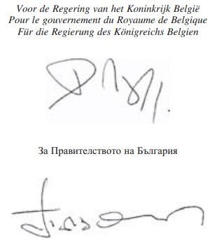
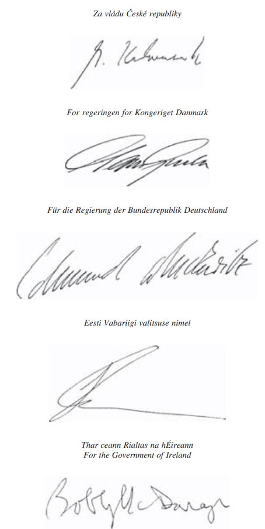
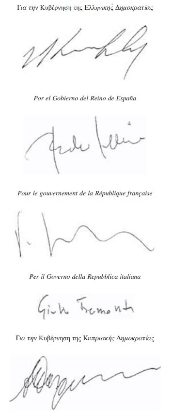
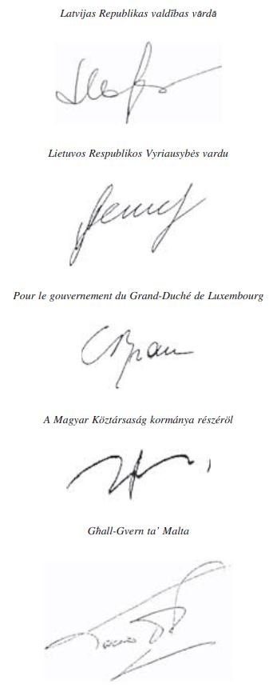
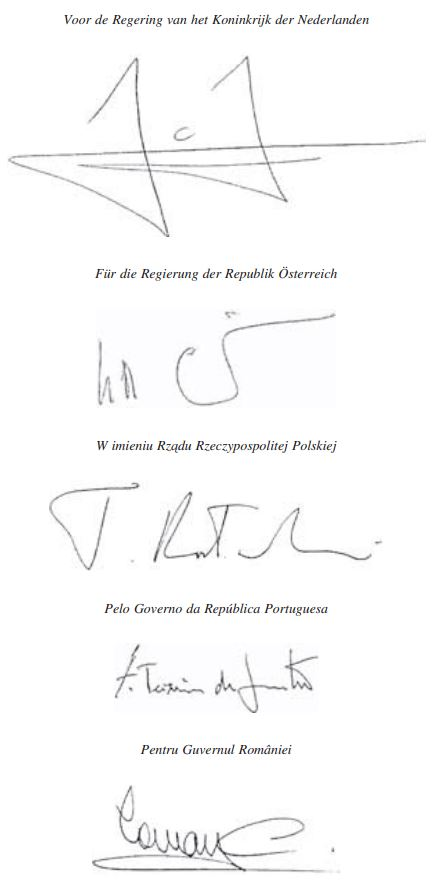
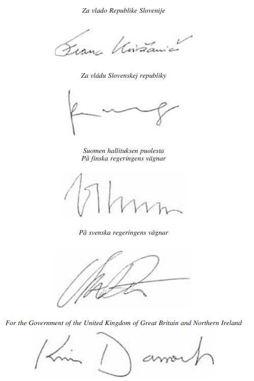

# Loi du 10 juin 2011 portant approbation de la Convention relative au dédouanement centralisé, concernant l’attribution des frais de perception nationaux qui sont conservés lorsque les ressources propres traditionnelles sont mises à la disposition du budget de l’UE, signée à Bruxelles, le 10 mars 2009.

Nous Henri, Grand-Duc de Luxembourg, Duc de Nassau,

Notre Conseil d’Etat entendu;

De l’assentiment de la Chambre des Députés;

Vu la décision de la Chambre des Députés du 12 mai 2011 et celle du Conseil d’Etat du 17 mai 2011 portant qu’il n’y a pas lieu à second vote;

Avons ordonné et ordonnons:

## Article unique.

Est approuvée la Convention relative au dédouanement centralisé, concernant l’attribution des frais de perception nationaux qui sont conservés lorsque les ressources propres traditionnelles sont mises à la disposition du budget de l’UE, signée à Bruxelles, le 10 mars 2009.

Mandons et ordonnons que la présente loi soit insérée au Mémorial pour être exécutée et observée par tous ceux que la chose concerne.

Le Ministre des Affaires étrangères,   Jean Asselborn   Le Ministre des Finances,   Luc Frieden

Palais de Luxembourg, le 10 juin 2011.   Henri

CONVENTION

relative au dédouanement centralisé, concernant l’attribution des frais de perception nationaux qui sont conservés lorsque les ressources propres traditionnelles sont mises à la disposition du budget de l’UE

LES PARTIES CONTRACTANTES, Etats membres de l’Union européenne,

\*Vu* la [décision 2007/436/CE](http://data.europa.eu/eli/dec/2007/436/oj), Euratom du Conseil du 7 juin 2007 relative au système des ressources propres des Communautés européennes (ci-après dénommée «décision»);

\*Considérant* le [règlement (CE, Euratom) No 1150/2000](https://legilux.public.lu/eli/reg_ue/2000/1150/jo) du Conseil du 22 mai 2000 portant application de la décision susvisée relative aux ressources propres (ci-après dénommé «règlement»);

\*Considérant* que le dédouanement centralisé et les autres simplifications des formalités douanières prévus par le [règlement (CE) No 450/2008](https://legilux.public.lu/eli/reg_ue/2008/450/jo) du Parlement européen et du Conseil du 23 avril 2008 établissant le code des douanes communautaire (ci-après dénommé «code des douanes modernisé») peuvent contribuer à la création de conditions favorables au commerce;

\*Considérant* que l’autorisation unique définie à l’article 1er, point 13), du [règlement (CEE) No 2454/93](https://legilux.public.lu/eli/reg_ue/1993/2454/jo) de la Commission prévoit les mêmes avantages pour la période qui précède la mise en application du code des douanes modernisé;

\*Considérant* la déclaration du Conseil du 25 juin 2007 concernant la répartition des frais d’assiette et de perception, la TVA et les statistiques dans le cadre du dédouanement centralisé et la déclaration commune du Conseil et de la Commission du 25 juin 2007 concernant l’évaluation du fonctionnement du système de dédouanement centralisé;

\*Compte tenu* des articles 17 et 120 du [code des douanes modernisé](https://legilux.public.lu/eli/reg_ue/2008/450/jo) qui prévoient respectivement la reconnaissance de la validité des décisions prises par les autorités douanières dans toute la Communauté et la force probante du résultat des vérifications sur tout le territoire de la Communauté,

\*Considérant* ce qui suit:

(1) La gestion du dédouanement centralisé, éventuellement accompagnée de simplifications des formalités douanières, implique, lorsque des marchandises sont déclarées pour la mise en libre pratique dans un Etat membre tout en étant présentées en douane dans un autre Etat membre, des dépenses administratives dans les deux Etats membres. Cela justifie une redistribution partielle des frais de perception qui sont conservés lorsque les ressources propres traditionnelles sont mises à la disposition du budget communautaire conformément au règlement.

(2) Cette redistribution effectuée par la partie contractante où la déclaration en douane est déposée au bénéfice de la partie contractante où les marchandises sont présentées correspond à un total de 50% des frais de perception conservés.

(3) Une bonne mise en œuvre de la redistribution des frais de perception nécessite l’adoption de procédures spécifiques sous la forme d’une convention entre les parties contractantes.

(4) La présente convention doit être appliquée par les parties contractantes conformément à leurs lois et procédures nationales respectives,

Sont convenues de ce qui suit:

## Chapitre Ier — *Champ d’application et définitions*

### *Article 1er*

1\. La présente convention définit les procédures relatives à la redistribution des frais de perception lorsque des ressources propres sont mises à la disposition du budget de l’UE, qui sont suivies par les parties contractantes en cas de dédouanement centralisé au sens de l’article 106 du [code des douanes modernisé](https://legilux.public.lu/eli/reg_ue/2008/450/jo), pour des marchandises déclarées pour la mise en libre pratique dans un Etat membre mais présentées en douane dans un autre Etat membre.

2\. Les procédures visées au paragraphe 1 s’appliquent aussi lorsque le concept de dédouanement centralisé s’accompagne de simplifications mises en place dans le cadre du code des douanes modernisé.

3\. Les procédures visées au paragraphe 1 s’appliquent aussi à l’autorisation unique au sens de l’article 1er, point 13), du [règlement (CEE) No 2454/93](https://legilux.public.lu/eli/reg_ue/1993/2454/jo) de la Commission, en ce qui concerne la mise en libre pratique.

### *Article 2*

Aux fins de la présente convention, on entend par:

a) «autorisation»: toute autorisation délivrée par les autorités douanières qui permet la mise en libre pratique de marchandises au bureau de douane compétent pour le lieu où est établi le titulaire de l’autorisation, indépendamment du bureau de douane où les marchandises sont présentées;

b) «autorités douanières habilitées à délivrer les autorisations»: les autorités douanières de l’Etat membre participant qui permettent la mise en libre pratique de marchandises au bureau de douane compétent pour le lieu où est établi le titulaire de l’autorisation, indépendamment du bureau de douane où les marchandises sont présentées;

c) «autorités douanières chargées de l’assistance»: les autorités douanières de l’Etat membre participant qui assistent les autorités douanières habilitées à délivrer les autorisations dans la supervision de la procédure et la mainlevée des marchandises;

d) «droits à l’importation»: les droits de douane exigibles à l’importation des marchandises;

e) «frais de perception»: les montants que les Etats membres sont habilités à conserver conformément à l’article 2, paragraphe 3, de la [décision](http://data.europa.eu/eli/dec/2007/436/oj) ou à une disposition similaire de toute autre décision ultérieure qui la remplacerait.

## Chapitre II — *Détermination et redistribution des frais de perception*

### *Article 3*

1\. L’Etat membre des autorités douanières habilitées à délivrer les autorisations notifie à l’Etat membre des autorités douanières chargées de l’assistance, par voie électronique ou, à défaut, par tout autre moyen approprié, les données pertinentes concernant le montant des frais de perception à redistribuer.

2\. Les autorités douanières chargées de l’assistance communiquent aux autorités douanières habilitées à délivrer les autorisations:

a) le nom et l’adresse de l’autorité compétente pour recevoir les données visées au paragraphe 1;

b) les références du compte bancaire à utiliser pour le versement du montant des frais de perception à redistribuer.

3\. Les données pertinentes visées au paragraphe 1 sont les suivantes:

a) l’identifiant de l’autorisation;

b) la date à laquelle le montant des ressources propres constaté est crédité conformément aux articles 9 et 10 du [règlement](https://legilux.public.lu/eli/reg_ue/2000/1150/jo);

c) le montant des ressources propres mises à disposition, en tenant compte du remboursement ou du recouvrement a posteriori éventuel des droits à l’importation;

d) le montant des frais de perception conservés.

### *Article 4*

Le montant des frais de perception que l’Etat membre des autorités douanières habilitées à délivrer les autorisations doit redistribuer à l’Etat membre des autorités douanières chargées de l’assistance est égal à cinquante pour cent (50%) du montant des frais de perception conservés.

### *Article 5*

1\. Le paiement du montant visé à l’article 4 est effectué dans le mois au cours duquel le montant des ressources propres constaté est crédité conformément aux articles 9 et 10 du [règlement](https://legilux.public.lu/eli/reg_ue/2000/1150/jo).

2\. Un intérêt de retard est perçu en plus du montant visé au paragraphe 1 pour la période comprise entre l’expiration du délai fixé et la date de paiement.

Le taux d’intérêt de retard est le taux appliqué par la Banque centrale européenne à sa principale opération de refinancement la plus récente effectuée avant le premier jour de calendrier du semestre en question («taux directeur»), majoré de deux points de pourcentage.

Pour un Etat membre des autorités douanières habilitées à délivrer des autorisations qui ne participe pas à la troisième phase de l’union économique et monétaire, le taux directeur visé précédemment est le taux directeur équivalent fixé par sa banque centrale. Dans ce cas, le taux directeur en vigueur le premier jour de calendrier du semestre en question s’applique pendant les six mois suivants.

## Chapitre III — *Règlement des litiges*

### *Article 6*

Tout litige surgissant entre les parties contractantes en rapport avec l’interprétation ou le fonctionnement de la présente convention est, dans la mesure du possible, résolu par la négociation. Si aucune solution n’est trouvée dans un délai de trois mois, les parties contractantes concernées peuvent choisir, d’un commun accord, un médiateur pour résoudre ledit litige.

## Chapitre IV — *Mise en œuvre et dispositions finales*

### *Article 7*

1\. Le secrétaire général du Conseil de l’Union européenne agit en qualité de dépositaire de la présente convention.

2\. Les Etats membres de l’Union européenne peuvent devenir parties contractantes à la présente convention en déposant auprès du secrétaire général du Conseil de l’Union européenne un instrument de ratification, d’acceptation, d’approbation ou d’adhésion, une fois accomplies les procédures internes requises pour l’adoption de la présente convention.

3\. La présente convention entre en vigueur quatre-vingt-dix jours après que le dernier Etat membre signataire a déclaré avoir accompli toutes les procédures internes nécessaires à son adoption. Jusqu’à cette entrée en vigueur, tout Etat membre ayant mené à bien ces procédures peut cependant déclarer qu’il appliquera la présente convention dans ses rapports avec les Etats membres qui auront fait la même déclaration pour les dispositions concernées par ladite convention.

4\. Tous les arrangements administratifs conclus entre Etats membres concernant la redistribution de montants des frais de perception dans des situations relevant du champ d’application de la présente convention sont remplacés par les dispositions de la présente convention à partir de sa date d’application entre les Etats membres concernés.

### *Article 8*

1\. Toute partie contractante peut proposer une ou plusieurs modifications de la présente convention, en particulier lorsqu’une partie contractante doit faire face à de sérieuses pertes budgétaires consécutives à l’application de la présente convention. Toute proposition de modification est transmise au dépositaire visé à l’article 7, qui la communique aux parties contractantes.

2\. Les modifications sont arrêtées d’un commun accord par les parties contractantes.

3\. Les modifications arrêtées conformément au paragraphe 2 entrent en vigueur conformément à l’article 7.

### *Article 9*

La présente convention est réexaminée par les parties contractantes au plus tard trois ans après la date de mise en application du code des douanes modernisé et peut, le cas échéant, être modifiée sur la base de ce réexamen conformément à l’article 8.

### *Article 10*

1\. Chaque partie contractante peut dénoncer la présente convention par notification adressée au secrétaire général du Conseil de l’Union européenne.

2\. La dénonciation prend effet quatre-vingt-dix jours après la date à laquelle le secrétaire général en a reçu notification.

EN FOI DE QUOI, les plénipotentiaires soussignés ont apposé leurs signatures au bas de la présente convention.

FAIT à Bruxelles, le dix mars deux mille neuf, en un exemplaire unique, en langues allemande, anglaise, bulgare, danoise, espagnole, estonienne, finnoise, française, grecque, hongroise, irlandaise, italienne, lettone, lituanienne, maltaise, néerlandaise, polonaise, portugaise, roumaine, slovaque, slovène, suédoise et tchèque, tous les textes faisant également foi, exemplaire qui est déposé dans les archives du secrétariat général du Conseil de l’Union européenne.

Doc. parl. [6212](https://legilux.public.lu/eli/etat/proj/pl/20100245); sess. ord. 2010-2011.
