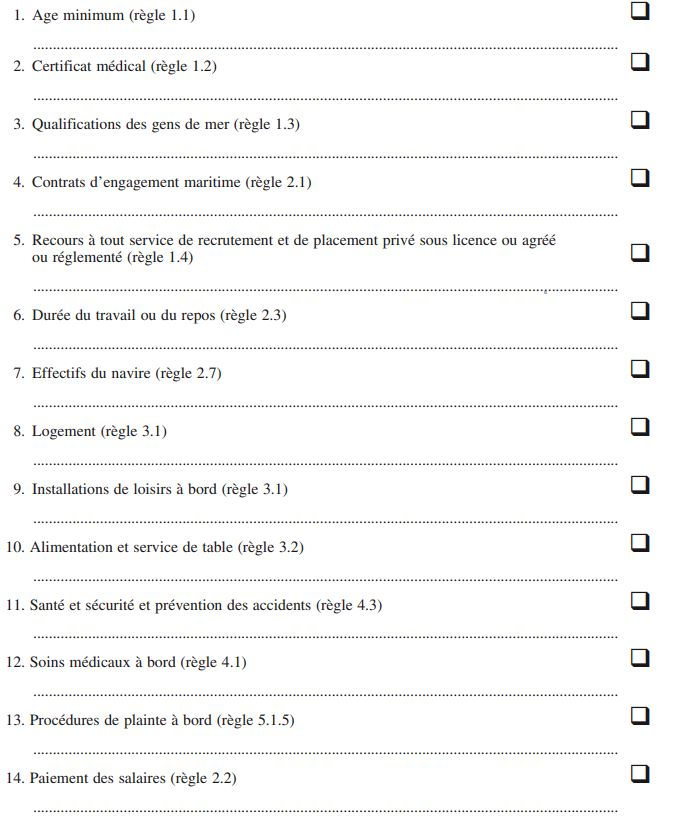

# Loi du 10 juillet 2011 portant approbation\n– de la Convention 185 révisant la Convention sur les pièces d’identité des gens de mer, 1958, adoptée par la Conférence générale de l’Organisation internationale du Travail dans sa quatre-vingt-onzième session, qui s’est tenue à Genève et qui a été déclarée close, le 19 juin 2003, et\n– de la Convention du travail maritime, adoptée par la Conférence internationale du Travail (maritime) à sa quatre-vingt-quatorzième session, qui s’est tenue à Genève le 7 février 2006.

Nous Henri, Grand-Duc de Luxembourg, Duc de Nassau,

Notre Conseil d’Etat entendu;

De l’assentiment de la Chambre des Députés;

Vu la décision de la Chambre des Députés du 7 juin 2011 et celle du Conseil d’Etat du 21 juin 2011 portant qu’il n’y a pas lieu à second vote;

Avons ordonné et ordonnons:

## Art. 1er.

Est approuvée la Convention 185 révisant la [Convention sur les pièces d’identité des gens de mer](https://legilux.public.lu/eli/etat/leg/loi/1990/11/09/n2/jo), 1958, adoptée par la Conférence générale de l’Organisation internationale du Travail dans sa quatre-vingt-onzième session, qui s’est tenue à Genève et qui a été déclarée close le 19 juin 2003.

## Art. 2.

Est approuvée la Convention du travail maritime, adoptée par la Conférence internationale du Travail (maritime) à sa quatre-vingt-quatorzième session, qui s’est tenue à Genève le 7 février 2006.

Mandons et ordonnons que la présente loi soit insérée au Mémorial pour être exécutée et observée par tous ceux que la chose concerne.

Le Ministre des Affaires étrangères,   Jean Asselborn   Le Ministre de l’Economie et  du Commerce exterieur,   Jeannot Krecké

Château de Berg, le 10 juillet 2011.   Henri

\**CONVENTION**   **révisant la Convention sur les pièces d’identité des gens de mer, 1958**

La Conférence générale de l’Organisation internationale du Travail,

\*Convoquée* à Genève par le Conseil d’administration du Bureau international du Travail, et s’y étant réunie le 3 juin 2003, en sa quatre-vingt-onzième session;

\*Consciente* de la menace persistante pour la sécurité des passagers et des équipages et pour la sûreté des navires, pour l’intérêt national des Etats et pour les personnes;

\*Consciente* également du mandat fondamental de l’Organisation, qui est de promouvoir des conditions de travail décentes;

\*Considérant* que, compte tenu du caractère mondial de l’industrie maritime, les gens de mer ont besoin d’une protection spéciale;

\*Reconnaissant* les principes consacrés dans la [convention sur les pièces d’identité des gens de mer](https://legilux.public.lu/eli/etat/leg/loi/1990/11/09/n2/jo), 1958, concernant la facilitation de l’entrée des gens de mer sur le territoire des Membres aux fins d’une permission à terre, d’un transit, d’un embarquement sur un autre navire ou d’un rapatriement;

\*Notant* la [Convention de l’Organisation maritime internationale visant à faciliter le trafic maritime international](https://legilux.public.lu/eli/etat/leg/loi/1990/11/09/n2/jo), 1965, telle qu’amendée, en particulier les normes 3.44 et 3.45;

\*Notant* *en outre* que la résolution de l’Assemblée générale des Nations Unies A/RES/57/219 relative à la protection des droits de l’homme et des libertés fondamentales dans la lutte antiterroriste affirme que les Etats doivent faire en sorte que toute mesure prise pour combattre le terrorisme soit conforme à leurs obligations en droit international, respectant en particulier les normes internationales relatives aux droits de l’homme et aux droits des réfugiés, et le droit international humanitaire;

\*Consciente* que les gens de mer travaillent et vivent sur des navires se livrant au commerce international et que l’accès aux facilités à terre et la permission à terre sont des éléments essentiels au bien-être général des gens de mer et, partant, à la réalisation d’une navigation plus sûre et d’océans plus propres;

\*Consciente* aussi que descendre à terre est essentiel pour embarquer sur un navire ou le quitter après la période de service convenue;

\*Notant* les amendements à la [Convention internationale de 1974](https://legilux.public.lu/eli/etat/leg/loi/1990/11/09/n2/jo) pour la sauvegarde de la vie en mer, telle que modifiée, concernant les mesures spéciales tendant à améliorer la sûreté et la sécurité maritimes, qui ont été adoptés par la Conférence diplomatique de l’Organisation maritime internationale le 12 décembre 2002;

\*Après avoir décidé* d’adopter diverses propositions relatives à un système plus sûr d’identification des gens de mer, question qui constitue le septième point à l’ordre du jour de la session;

\*Après avoir décidé* que ces propositions prendraient la forme d’une convention internationale révisant la [convention sur les pièces d’identité des gens de mer](https://legilux.public.lu/eli/etat/leg/loi/1990/11/09/n2/jo), 1958;

ADOPTE, ce dix-neuvième jour de juin deux mille trois, la convention ci-après, qui sera dénommée Convention sur les pièces d’identité des gens de mer (révisée), 2003.

## *Article 1er* — *Champ d’application*

1\. Aux fins de la présente convention, le terme «marin» ou «gens de mer» désigne toute personne qui est employée ou engagée ou qui travaille, à quelque titre que ce soit, à bord de tout navire, autre qu’un navire de guerre, normalement affecté à la navigation maritime.

2\. En cas de doute quant à la question de savoir si certaines catégories de personnes doivent être considérées comme gens de mer aux fins de la présente convention, cette question sera tranchée, après consultation des organisations d’armateurs et de gens de mer intéressées, conformément aux dispositions de la présente convention par l’autorité compétente de l’Etat dont ces personnes sont ressortissantes ou résidentes permanentes.

3\. Après consultation des organisations représentatives d’armateurs à la pêche et de pêcheurs, l’autorité compétente peut appliquer les dispositions de la présente convention à la pêche maritime commerciale.

## *Article 2 * — *Délivrance de pièces d’identité des gens de mer*

1\. Tout Membre pour lequel la présente convention est en vigueur doit délivrer à chacun de ses ressortissants exerçant la profession de marin qui en fait la demande une pièce d’identité des gens de mer conforme aux dispositions de l’article 3 de la convention.

2\. A moins qu’il n’en soit autrement décidé par la présente convention, la délivrance de pièces d’identité des gens de mer peut être soumise aux mêmes conditions que celles prévues par la législation nationale pour la délivrance de titres de voyage.

3\. Tout Membre peut également délivrer les pièces d’identité mentionnées au paragraphe 1 aux gens de mer qui bénéficient du statut de résident permanent sur son territoire. Les résidents permanents devront toujours voyager en se conformant aux dispositions du paragraphe 7 de l’article 6.

4\. Chaque Membre doit s’assurer que les pièces d’identité des gens de mer sont délivrées sans retard injustifié.

5\. Les gens de mer ont le droit d’exercer un recours administratif en cas de rejet de leur demande.

6\. La présente convention ne portera pas atteinte aux obligations de chaque Membre en vertu des dispositions internationales relatives aux réfugiés et aux apatrides.

## *Article 3* — *Teneur et forme*

1\. La pièce d’identité des gens de mer relevant de la présente convention devra être conforme dans sa teneur au modèle présenté à l’annexe I de ladite convention. La forme de cette pièce d’identité et les matières dont elle est faite devront correspondre aux normes générales indiquées dans le modèle qui est fondé sur les critères établis ci-après. Sous réserve que tout amendement apporté corresponde aux paragraphes suivants, l’annexe I pourra être modifiée selon les besoins, notamment pour tenir compte de l’évolution technologique, conformément à l’article 8 ci-après. La décision d’adopter un amendement devra indiquer la date à laquelle il entrera en vigueur, en tenant compte de la nécessité de laisser aux Membres un temps suffisant pour effectuer toute révision nécessaire de leurs pièces d’identité et procédures nationales relatives aux gens de mer.

2\. La pièce d’identité des gens de mer sera d’un modèle simple, sera établie dans une matière résistante, compte tenu en particulier des conditions qui peuvent régner en mer, et sera lisible par machine. Les matériels utilisés devront:

a) empêcher autant que possible les altérations ou les falsifications et permettre de discerner aisément les modifications;

b) être facilement accessibles à tout gouvernement, au coût le plus bas compatible avec la fiabilité requise pour atteindre l’objectif énoncé à l’alinéa a) ci-dessus.

3\. Les Membres devront tenir compte de toute directive élaborée par l’Organisation internationale du Travail sur les normes techniques à utiliser pour faciliter l’application d’une norme internationale commune.

4\. La pièce d’identité des gens de mer ne devra pas être plus grande qu’un passeport ordinaire.

5\. La pièce d’identité des gens de mer devra comprendre le nom de l’autorité qui la délivre, ainsi que des indications permettant de prendre contact rapidement avec cette autorité, la date et le lieu de la délivrance du document et les mentions suivantes:

a) le présent document constitue une pièce d’identité des gens de mer aux fins de la convention sur les pièces d’identité des gens de mer (révisée), 2003, de l’Organisation internationale du Travail;

b) le présent document est un document autonome et n’est pas un passeport.

6\. La durée maximale de validité d’une pièce d’identité des gens de mer sera établie conformément à la législation nationale de l’Etat qui la délivre et n’excédera en aucun cas dix années sous réserve d’un renouvellement après les cinq premières années.

7\. Les données concernant le titulaire de la pièce d’identité des gens de mer se limiteront aux points suivants:

a) nom en entier (nom de famille et prénoms, s’il y a lieu);

b) sexe;

c) date et lieu de naissance;

d) nationalité;

e) tout signe physique particulier susceptible de faciliter l’identification;

f) photographie numérique ou originale; et

g) signature.

8\. Nonobstant le paragraphe 7 ci-dessus, un modèle ou d’autres représentations de la biométrie du titulaire qui répondent à la spécification de l’annexe I seront également exigés en vue de leur inclusion dans les pièces d’identité des gens de mer, pourvu que les conditions préalables suivantes soient remplies:

a) les données biométriques peuvent être recueillies sans aucune intrusion dans la vie privée des intéressés, sans désagrément pour eux, sans risque pour leur santé et sans atteinte à leur dignité;

b) les données biométriques sont visibles sur la pièce d’identité et ne peuvent être reproduites à partir du modèle ou d’autres représentations;

c) le matériel nécessaire au recueil et à la vérification des données biométriques est facile à utiliser et est généralement accessible aux gouvernements à faible coût;

d) le matériel nécessaire à la vérification des données biométriques peut être utilisé de manière commode et fiable dans les ports et dans les autres lieux, y compris les navires, où les autorités compétentes effectuent normalement le contrôle de l’identité;

e) le système, y compris les matériels, les technologies et les procédures, dans lequel les données biométriques sont utilisées permet d’obtenir des résultats uniformes et fiables en matière d’authentification d’identité.

9\. Toutes les données concernant le marin enregistrées sur la pièce d’identité sont visibles. Les gens de mer disposeront d’un accès facile à des équipements leur permettant d’examiner toute donnée les concernant qui ne peut faire l’objet d’un examen visuel. Cet accès sera donné par l’autorité qui délivre la pièce d’identité ou en son nom.

10\. La teneur et la forme de la pièce d’identité des gens de mer doivent tenir compte des normes internationales pertinentes mentionnées à l’annexe I.

## *Article 4* — *Base de données électronique nationale*

1\. Chaque Membre fera en sorte qu’un enregistrement de chaque pièce d’identité des gens de mer, délivrée, suspendue ou retirée par lui, soit conservé dans une base de données électronique. Les mesures nécessaires sont prises pour protéger cette base de données contre toute intervention et tout accès non autorisé.

2\. Les informations contenues dans l’enregistrement se limitent aux indications essentielles aux fins de la vérification de la pièce d’identité des gens de mer ou du statut d’un marin, tout en respectant le droit à la vie privée des gens de mer et en satisfaisant à toutes les dispositions applicables en matière de protection des données. Ces indications sont énumérées à l’annexe II à la présente convention, qui peut être modifiée selon les modalités énoncées à l’article 8 ci-après, en tenant compte de la nécessité de laisser aux Membres suffisamment de temps pour effectuer toute révision nécessaire de leurs systèmes nationaux de bases de données.

3\. Chaque Membre mettra en place des procédures permettant à tout marin auquel il a délivré une pièce d’identité des gens de mer d’examiner et de vérifier gratuitement la validité des données le concernant qui figurent dans la base de données ou qui y sont archivées et d’apporter les corrections nécessaires, le cas échéant.

4\. Chaque Membre désignera un centre permanent pour répondre aux demandes en provenance des services de l’immigration ou autres autorités compétentes de tous les Membres de l’Organisation et concernant l’authenticité et la validité de la pièce d’identité délivrée par son autorité. Les renseignements relatifs au centre permanent doivent être communiqués au Bureau international du Travail qui tient à jour une liste communiquée à tous les Membres de l’Organisation.

5\. Les indications mentionnées au paragraphe 2 ci-dessus sont accessibles immédiatement et en permanence aux services de l’immigration ou autres autorités compétentes des Membres de l’Organisation, soit électroniquement, soit par l’intermédiaire du centre permanent mentionné au paragraphe 4 ci-dessus.

6\. Aux fins de la présente convention, des restrictions appropriées sont établies afin d’assurer que des données, en particulier photographiques, ne puissent être échangées à moins qu’un mécanisme soit mis en place pour assurer que les normes applicables de protection des données et de la vie privée soient respectées.

7\. Les Membres doivent faire en sorte que les données personnelles saisies dans la base de données électronique ne soient pas utilisées à d’autres fins que celles de vérifier les pièces d’identité des gens de mer.

## *Article 5* — *Contrôle de qualité et évaluations*

1\. Les prescriptions minimales concernant les procédés et procédures relatifs à la délivrance des pièces d’identité des gens de mer, y compris les procédures de contrôle de la qualité, sont exposées à l’annexe III à la présente convention. Les prescriptions minimales prévoient les résultats obligatoires que chaque Membre doit obtenir dans le cadre de la gestion de son système de délivrance de ces pièces.

2\. Des procédés et procédures doivent être mis en place pour garantir la sécurité nécessaire:

a) à la production et à la délivrance des pièces d’identité vierges;

b) à la garde et à la manipulation des pièces d’identité vierges et remplies, et à la responsabilité pour ces pièces;

c) au traitement des demandes, à la transformation de pièces d’identité vierges en pièces d’identité personnalisées par l’autorité et le service responsables de leur établissement et à leur remise au marin;

d) à l’exploitation et à l’actualisation de la base de données;

e) au contrôle de la qualité des procédures et aux évaluations périodiques.

3\. Sous réserve du paragraphe 2 ci-dessus, l’annexe III peut être modifiée conformément aux dispositions de l’article 8, compte tenu de la nécessité de donner aux Membres suffisamment de temps pour apporter toute révision nécessaire aux procédés et procédures.

4\. Chaque Membre doit effectuer au moins tous les cinq ans une évaluation indépendante du fonctionnement de son système de délivrance des pièces d’identité des gens de mer, y compris des procédures de contrôle de qualité. Les rapports de ces évaluations, sous réserve de la suppression de tout élément confidentiel, doivent être communiqués au Directeur général du Bureau international du Travail, et une copie doit être adressée aux organisations représentatives des armateurs et des gens de mer dans l’Etat Membre concerné. Ces prescriptions en matière d’établissement des rapports ne doivent pas porter préjudice aux obligations incombant aux Membres aux termes de l’article 22 de la Constitution de l’Organisation internationale du Travail.

5\. Le Bureau international du Travail doit mettre ces rapports d’évaluation à la disposition des Membres. Toute divulgation, autre que celles autorisées par la présente convention, exige le consentement du Membre qui a établi le rapport.

6\. Le Conseil d’administration du Bureau international du Travail, agissant sur la base de toutes les informations pertinentes conformément aux dispositions qu’il a prises, doit approuver la liste des Membres qui satisfont pleinement aux prescriptions minimales dont il est question au paragraphe 1 ci-dessus.

7\. La liste doit être mise à tout moment à la disposition des Membres de l’Organisation et actualisée à mesure que des informations appropriées sont reçues. En particulier, les Membres doivent être avisés rapidement lorsque l’ajout sur la liste de tout autre Membre est contesté pour des motifs sérieux au titre des procédures mentionnées au paragraphe 8.

8\. Conformément aux procédures établies par le Conseil d’administration, des dispositions doivent être prises pour que les Membres qui ont été exclus de la liste ou pourraient l’être et les gouvernements concernés des Membres ayant ratifié la convention ainsi que les organisations représentatives des armateurs et des gens de mer fassent connaître leur point de vue au Conseil d’administration, conformément aux dispositions mentionnées ci-dessus et pour que tout différend soit réglé en temps utile de manière équitable et impartiale.

9\. La reconnaissance des pièces d’identité des gens de mer délivrées par un Membre dépend du respect par celui-ci des prescriptions minimales mentionnées au paragraphe 1 ci-dessus.

## *Article 6* — *Facilitation de la permission de descendre à terre, du transit et du transfert des gens de mer*

1\. Tout marin titulaire d’une pièce d’identité des gens de mer valable délivrée conformément aux dispositions de la présente convention par un Membre pour lequel la convention est en vigueur doit être reconnu comme un marin au sens de la convention, à moins qu’il n’existe des raisons manifestes de mettre en doute l’authenticité de la pièce d’identité du marin.

2\. La vérification et toutes enquêtes et formalités connexes nécessaires pour s’assurer que le marin pour lequel l’entrée est sollicitée en vertu des paragraphes 3 à 6 ou des paragraphes 7 à 9 ci-dessous est le titulaire d’une pièce d’identité des gens de mer délivrée conformément aux prescriptions de la présente convention ne devront rien coûter aux gens de mer ou aux armateurs.

\*Permission de descendre à terre*

3\. La vérification et toutes enquêtes et formalités connexes mentionnées au paragraphe 2 ci-dessus doivent être effectuées aussi rapidement que possible sous réserve que l’avis de l’arrivée du titulaire ait été reçu préalablement dans un délai raisonnable par les autorités compétentes. L’avis de l’arrivée du titulaire doit comporter les indications mentionnées à la section 1 de l’annexe II.

4\. Tout Membre pour lequel la présente convention est en vigueur doit autoriser, aussi rapidement que possible et à moins qu’il existe des raisons manifestes de douter de l’authenticité de la pièce d’identité des gens de mer, l’entrée sur son territoire à tout marin en possession d’une pièce d’identité des gens de mer valable, lorsque l’entrée est sollicitée pour une permission à terre de durée temporaire pendant l’escale du navire.

5\. Cette entrée est autorisée sous réserve que les formalités à l’arrivée du navire aient été remplies et que les autorités compétentes n’aient aucune raison de refuser la permission de descendre à terre pour des motifs de santé, de sécurité ou d’ordre publics, ou de sûreté nationale.

6\. Les gens de mer ne sont pas tenus d’être en possession d’un visa pour être autorisés à descendre à terre. Tout Membre qui n’est pas en mesure de respecter pleinement cette prescription doit veiller à ce que la législation ou la pratique applicable prévoie des dispositions dans l’ensemble équivalentes.

\*Transit et transfert*

7\. Tout Membre pour lequel la présente convention est en vigueur doit également autoriser, aussi rapidement que possible, l’entrée sur son territoire à tout marin en possession d’une pièce d’identité des gens de mer valable, assortie d’un passeport, lorsque cette entrée est sollicitée pour:

a) embarquer à bord de son navire ou être transféré sur un autre navire;

b) passer en transit afin de rejoindre son navire dans un autre pays ou afin d’être rapatrié ou pour toute autre fin approuvée par les autorités du Membre intéressé.

8\. Cette entrée est autorisée à moins qu’il n’existe des raisons manifestes de mettre en doute l’authenticité de la pièce d’identité des gens de mer, sous réserve que les autorités compétentes n’aient aucune raison de refuser cette entrée pour des motifs de santé, de sécurité ou d’ordre publics, ou de sûreté nationale.

9\. Avant d’autoriser l’entrée sur son territoire pour l’un des motifs énumérés au paragraphe 7 ci-dessus, tout Membre pourra exiger une preuve satisfaisante, y compris une preuve écrite de l’intention du marin et de sa capacité à la réaliser. Le Membre pourra également limiter le séjour du marin à une durée considérée comme raisonnable eu égard à l’objectif ci-dessus.

## *Article 7* — *Possession continue et retrait*

1\. La pièce d’identité des gens de mer reste en possession du marin en permanence, sauf lorsqu’elle est sous la garde du capitaine du navire intéressé, avec l’accord écrit du marin.

2\. La pièce d’identité des gens de mer est rapidement retirée par l’Etat qui l’a délivrée s’il est avéré que le marin ne répond plus aux conditions de délivrance fixées par la présente convention. Les procédures de suspension ou de retrait des documents d’identité des gens de mer doivent être élaborées en consultation avec des organisations représentatives d’armateurs et de gens de mer et comprendre des voies de recours administratif.

## *Article 8* — *Amendement aux annexes*

1\. Sous réserve des dispositions pertinentes de la présente convention, la Conférence internationale du Travail, agissant conformément aux avis d’un organe maritime tripartite de l’Organisation internationale du Travail dûment constitué, peut amender les annexes de la convention. Une majorité des deux tiers des voix des délégués présents à la Conférence est requise comprenant au moins la moitié des Membres de l’Organisation ayant ratifié cette convention.

2\. Chaque Membre qui a ratifié la convention peut adresser au Directeur général, dans un délai de six mois suivant l’adoption de l’amendement, une notification précisant que cet amendement n’entrera pas en vigueur à son égard ou n’entrera en vigueur qu’ultérieurement, à la suite d’une nouvelle notification.

## *Article 9* — *Disposition transitoire*

Tout Membre partie à la [convention sur les pièces d’identité des gens de mer](https://legilux.public.lu/eli/etat/leg/loi/1990/11/09/n2/jo), 1958, qui prend des mesures, conformément à l’article 19 de la Constitution de l’Organisation internationale du Travail, en vue de ratifier la présente convention, peut notifier au Directeur général son intention d’appliquer ladite convention à titre provisoire. Une pièce d’identité des gens de mer délivrée par ce Membre sera traitée, aux fins de la présente convention, comme une pièce d’identité des gens de mer délivrée conformément à cette convention, à condition que les dispositions des articles 2 à 5 de la présente convention soient respectées et que le Membre intéressé accepte les pièces d’identité des gens de mer délivrées conformément à ladite convention.

## Partie .

\***Dispositions finales***

### *Article 10*

La présente convention révise la [convention sur les pièces d’identité des gens de mer](https://legilux.public.lu/eli/etat/leg/loi/1990/11/09/n2/jo), 1958.

### *Article 11*

Les ratifications formelles de la présente convention seront communiquées au Directeur général du Bureau international du Travail et par lui enregistrées.

### *Article 12*

1\. La présente convention ne liera que les Membres de l’Organisation internationale du Travail dont la ratification aura été enregistrée par le Directeur général.

2\. Elle entrera en vigueur six mois après que les ratifications de deux Membres auront été enregistrées par le Directeur général.

3\. Par la suite, cette convention entrera en vigueur pour chaque Membre six mois après la date où sa ratification aura été enregistrée.

### *Article 13*

1\. Tout Membre ayant ratifié la présente convention peut la dénoncer à l’expiration d’une période de dix années après la date de la mise en vigueur initiale de la convention, par un acte communiqué au Directeur général et par lui enregistré. La dénonciation prendra effet douze mois après avoir été enregistrée.

2\. Tout Membre ayant ratifié la présente convention qui, dans le délai d’une année après l’expiration de la période de dix années mentionnée au paragraphe précédent, ne fera pas usage de la faculté de dénonciation prévue par le présent article sera lié pour une nouvelle période de dix années et, par la suite, pourra dénoncer la présente convention à l’expiration de chaque période de dix années dans les conditions prévues au présent article.

### *Article 14*

1\. Le Directeur général notifiera à tous les Membres l’enregistrement de toutes les ratifications, déclarations et de tous actes de dénonciation qui lui seront communiqués par les Membres.

2\. En notifiant aux Membres l’enregistrement de la deuxième ratification de la présente convention, le Directeur général appellera l’attention des Membres sur la date à laquelle la convention entrera en vigueur.

3\. Le Directeur général notifiera à tous les Membres l’enregistrement de tout amendement aux annexes adopté conformément à l’article 8 ainsi que des notifications s’y rapportant.

### *Article 15*

Le Directeur général du Bureau international du Travail communiquera au Secrétaire général des Nations Unies, aux fins d’enregistrement conformément à l’article 102 de la [Charte des Nations Unies](https://legilux.public.lu/eli/etat/leg/agd/1945/08/10/n1/jo), des renseignements complets au sujet de toutes ratifications, déclarations et de tous actes de dénonciation qu’il aura enregistrés conformément aux articles précédents.

### *Article 16*

Chaque fois qu’il le jugera nécessaire, le Conseil d’administration du Bureau international du Travail présentera à la Conférence générale un rapport sur l’application de la présente convention et examinera s’il y a lieu d’inscrire à l’ordre du jour de la Conférence la question de sa révision totale ou partielle, prenant également en considération les dispositions de l’article 8.

### *Article 17*

1\. Au cas où la Conférence adopterait une nouvelle convention portant révision totale ou partielle de la présente convention, et à moins que la nouvelle convention ne dispose autrement:

a) la ratification par un Membre de la nouvelle convention portant révision entraînerait de plein droit, nonobstant l’article 13, dénonciation immédiate de la présente convention, sous réserve que la nouvelle convention portant révision soit entrée en vigueur;

b) à partir de la date de l’entrée en vigueur de la nouvelle convention portant révision, la présente convention cesserait d’être ouverte à la ratification des Membres.

2\. La présente convention demeurerait en tout cas en vigueur dans sa forme et teneur pour les Membres qui l’auraient ratifiée et qui ne ratifieraient pas la convention portant révision.

### *Article 18*

Les versions française et anglaise du texte de la présente convention font également foi.

ANNEXE I

\**Modèle pour la pièce d’identité des gens de mer**

La pièce d’identité des gens de mer, dont la forme et la teneur sont exposées ci-après, sera faite de matières de bonne qualité qui, si cela est possible, en tenant compte de considérations telles que le coût, ne sont pas facilement accessibles au public. Le document ne doit pas comprendre plus d’espace que nécessaire pour contenir les renseignements prévus par la convention.

Il doit contenir le nom de l’Etat qui délivre la pièce d’identité et la déclaration suivante:

«Le présent document est une pièce d’identité des gens de mer aux fins de la convention sur les pièces d’identité des gens de mer (révisée), 2003, de l’Organisation internationale du Travail. Le présent document est un document autonome et n’est pas un passeport.»

Les pages de renseignements indiqués en **caractères gras** ci-après seront protégées par un laminat ou une couche de laque, ou par l’application d’une technologie d’image ou d’un support matériel qui garantit une résistance équivalente à la substitution du portrait ou d’autres données biographiques.

Les matières utilisées, les dimensions et l’emplacement des données répondront aux spécifications de l’Organisation de l’aviation civile internationale (OACI) précisées dans la partie 3 du document 9303 (deuxième édition, 2002) ou dans la partie 1 du document 9303 (cinquième édition, 2003).

\*Les autres caractéristiques relatives à la sécurité doivent inclure au moins une des caractéristiques suivantes:*

Filigranes, marques de sécurité sensibles à la lumière ultraviolette, encres spéciales, motifs spéciaux en couleur, images perforées, hologrammes, gravure au laser, micro-impression et plastification à chaud.

\*Les données inscrites sur les pages de renseignements de la pièce d’identité des gens de mer se limiteront à:*

I. **Autorité qui a délivré la pièce d’identité:**

II. **Numéro(s) de téléphone, adresse électronique et site Internet de l’autorité:**

III. **Date et lieu de** **délivrance:**

| **Photographie numérique ou originale du marin** |
|---|

a) **Nom en entier du marin:**

b) **Sexe:**

c) **Date et lieu de naissance:**

d) **Nationalité:**

e) **Tout signe physique particulier susceptible de faciliter l’identification:**

f) **Signature du porteur:**

g) **Date d’expiration:**

h) **Type et désignation du document:**

i) **Numéro unique du document:**

j) **Numéro d’identification personnel (facultatif):**

k) **Modèle biométrique correspondant à une empreinte digitale traduite sous forme de chiffres dans un code-barres répondant à une norme à déterminer:**

l) **Zone lisible à la machine conforme aux spécifications de l’OACI contenues dans le document 9303 cité ci-dessus.**

IV. **Sceau ou timbre officiel de l’autorité qui a délivré la pièce d’identité.**

\*Explication des données*

Les rubriques ci-dessus peuvent être traduites dans la ou les langues de l’Etat qui délivre la pièce d’identité des gens de mer. Si la langue nationale est autre que l’anglais, le français ou l’espagnol, les rubriques doivent figurer également dans une de ces langues.

Les caractères latins doivent être utilisés pour toute inscription dans ce document.

\*Les renseignements mentionnés ci-dessus auront les caractéristiques suivantes:*

I. Autorité qui a délivré la pièce d’identité: code ISO pour l’Etat qui a délivré la pièce d’identité des gens de mer, nom et adresse complète de l’administration émettrice ainsi que nom et titre de la personne autorisant la délivrance.

II. Le numéro de téléphone, l’adresse électronique et le site Internet doivent correspondre aux liens avec le centre permanent auquel fait référence la convention.

III. Date et lieu de délivrance - la date sera écrite en deux chiffres arabes dans l’ordre suivant: jour/mois/année (par exemple 31/12/03); le lieu sera inscrit de la même manière que sur le passeport national.

| **Taille de la photographie répondant aux spécifications du  document 9303 de l’OACI** |
|---|

a) Nom en entier du marin: s’il y a lieu, le nom de famille sera inscrit en premier, suivi des autres noms du marin;

b) sexe: préciser «M» pour masculin et «F» pour féminin;

c) date et lieu de naissance: la date sera inscrite en deux chiffres arabes dans l’ordre indiqué (jour/mois/année); le lieu sera inscrit de la même manière que sur le passeport national;

d) déclaration de la nationalité: indiquer la nationalité;

e) signes physiques particuliers: toute caractéristique physique apparente facilitant l’identification;

f) signature du porteur;

g) date d’expiration: en deux chiffres arabes dans l’ordre indiqué - jour/mois/année;

h) type ou désignation du document: un code composé des lettres majuscules écrites en caractères latins (S);

i) numéro unique du document: code du pays (voir I ci-dessus), suivi pour chaque livret d’un numéro d’inventaire alphanumérique de neuf caractères au maximum;

j) numéro d’identification personnel: numéro d’identification facultatif du marin, comportant 14 caractères alphanumériques au plus;

k) modèle biométrique: une spécification précise sera mise au point;

l) zone lisible à la machine selon les spécifications contenues dans le document 9303 de l’OACI cité ci-dessus.

ANNEXE II

\**Base de données électronique**

Les renseignements à fournir pour chaque enregistrement dans la base de données électronique que tout Membre doit tenir à jour conformément aux paragraphes 1, 2, 6 et 7 de l’article 4 de la présente convention doivent se limiter aux éléments suivants:

\*Section 1*

1\. Autorité de délivrance indiquée sur la pièce d’identité.

2\. Nom en entier du marin tel qu’inscrit sur la pièce d’identité.

3\. Numéro unique du document.

4\. Date d’expiration, de suspension ou de retrait de la pièce d’identité.

\*Section 2*

5\. Modèle biométrique figurant sur la pièce d’identité.

6\. Photographie.

7\. Précisions sur toutes les demandes de renseignements effectuées sur les pièces d’identité des gens de mer.

ANNEXE III

\**Prescriptions et procédures et pratiques recommandées concernant la délivrance des pièces d’identité des gens de mer**

La présente annexe expose les prescriptions minimales concernant les procédures qui doivent être adoptées par chaque Membre, conformément à l’article 5 de la présente convention, pour la délivrance de pièces d’identité des gens de mer (ci-après appelées «PIM»), y compris les procédures de contrôle de qualité.

La Partie A donne la liste des résultats obligatoires que chaque Membre doit obtenir au minimum après la mise en place d’un système de délivrance des PIM.

La Partie B recommande les procédures et les pratiques permettant d’atteindre ces résultats. Les Membres doivent en tenir pleinement compte, mais elle n’est pas obligatoire.

## PARTIE A — Résultats obligatoires

1\. *Fabrication et livraison des PIM vierges*

\*Des procédés et des procédures sont mis en place pour garantir la sécurité nécessaire à la fabrication et à la livraison de PIM vierges, notamment les éléments suivants:*

a) *toutes les PIM vierges sont de qualité uniforme et satisfont aux spécifications du point de vue de la teneur et de la forme précisées dans l’annexe I;*

b) *les matières utilisées pour la fabrication des pièces sont protégées et contrôlées;*

c) *les PIM vierges sont protégées, contrôlées, identifiées et leur statut est suivi tout au long des processus de fabrication et de livraison;*

d) *les fabricants disposent des moyens de remplir correctement leurs obligations en rapport avec la fabrication et la livraison des PIM vierges;*

e) *le transport des PIM vierges du fabricant à l’autorité chargée de délivrer les pièces est sécurisé.*

2\. *Garde et manipulation des PIM vierges ou remplies, et responsabilité de ces pièces*

\*Des procédés et des procédures sont mis en place pour garantir la sécurité nécessaire à la garde et à la manipulation des PIM vierges ou remplies ainsi qu’à la responsabilité de ces pièces, notamment les éléments suivants:*

a) *la garde et la manipulation des PIM vierges ou remplies sont contrôlées par l’autorité chargée de les délivrer;*

b) *les PIM vierges, remplies ou annulées, notamment celles qui servent de spécimens, sont protégées, contrôlées, identifiées et leur statut est suivi;*

c) *le personnel associé à ce procédé remplit les critères de fiabilité, d’honnêteté et de loyauté qu’exige leur emploi et il reçoit une formation appropriée;*

d) *la répartition des responsabilités entre les fonctionnaires habilités a pour objet d’empêcher la délivrance de PIM non autorisées.*

3\. *Traitement des demandes; suspension ou retrait des PIM; procédures de recours*

\*Des procédés et des procédures sont mis en place pour garantir la sécurité nécessaire au traitement des demandes, à l’établissement à partir de PIM vierges de PIM personnalisées par l’autorité et l’unité en charge de les établir, et à leur remise, notamment:*

a) *des procédés de vérification et d’approbation garantissant que, lors de la première demande ou du renouvellement, les pièces sont délivrées uniquement sur la base des éléments suivants:*

i) *demandes contenant toutes les informations requises à l’annexe I;*

ii) *preuve d’identité du requérant conformément aux lois et pratiques de l’Etat qui délivre la pièce;*

iii) *preuve de la nationalité ou de la résidence permanente;*

iv) *preuve que le requérant est un marin au sens de l’article 1;*

v) *garantie qu’une seule PIM est délivrée aux requérants, en particulier à ceux qui ont plusieurs nationalités ou un statut de résident permanent;*

vi) *vérification que le requérant ne constitue pas une menace pour la sûreté, en respectant dûment les droits et les libertés fondamentaux énoncés dans les instruments internationaux;*

b) *le procédé assure que:*

i) *les renseignements correspondant à chaque point de l’annexe II sont saisis dans la base de données au moment où est délivrée la PIM;*

ii) *les données, la photographie, la signature et les caractéristiques biométriques du requérant correspondent à celui-ci;*

iii) *les données, la photographie, la signature et les caractéristiques biométriques du requérant se rapportent à la demande de pièce tout au long du traitement, de la délivrance et de la remise de la PIM;*

c) *lorsqu’une PIM est suspendue ou retirée, des mesures doivent être prises rapidement pour actualiser la base de données;*

d) *un système de prolongation ou de renouvellement est mis en place pour répondre aux situations où le marin a besoin d’une prolongation ou d’un renouvellement de sa PIM ou aux situations de perte de PIM;*

e) *les circonstances dans lesquelles une PIM peut être suspendue ou retirée sont déterminées en consultation avec les organisations d’armateurs et de gens de mer;*

f) *des procédures de recours efficaces et transparentes sont mises en place.*

4\. *Exploitation, sécurisation et actualisation de la base de données*

\*Des procédés et des procédures sont mis en place pour garantir la sécurité nécessaire à l’exploitation et à l’actualisation de la base de données, notamment les éléments suivants:*

a) *la base de données est à l’abri de toute altération et de tout accès non autorisé;*

b) *les données sont à jour, protégées contre toute perte d’informations, et peuvent être consultées à tout moment par l’intermédiaire du centre permanent;*

c) *les bases de données ne sont pas ajoutées à d’autres bases de données, ni copiées, reliées ou encore reproduites; les renseignements contenus dans la base de données ne sont pas utilisés à des fins autres que l’authentification de l’identité du marin;*

d) *les droits de la personne sont respectés, notamment:*

i) *le droit au respect de la vie privée lors de la collecte, du stockage, de la manipulation et de la communication des données;*

ii) *le droit d’accès aux données la concernant et à faire corriger en temps utile toute erreur.*

5\. *Contrôle de la qualité des procédures et évaluations périodiques*

a) *Des procédés et des procédures sont mis en place pour garantir la sécurité nécessaire à travers le contrôle de la qualité des procédures et des évaluations périodiques, notamment la surveillance des procédés pour garantir que les normes de performance sont satisfaites en ce qui concerne:*

i) *la fabrication et la livraison des PIM vierges;*

ii) *la garde et la manipulation des PIM vierges, annulées et personnalisées et la responsabilité de ces pièces;*

iii) *le traitement des demandes, l’établissement à partir de PIM vierges de PIM personnalisées par l’autorité et l’unité en charge de les établir et de les remettre;*

iv) *l’exploitation, la sécurisation et l’actualisation de la base de données;*

b) *des contrôles sont effectués périodiquement pour vérifier la fiabilité du système de délivrance et des procédures, ainsi que leur conformité aux prescriptions de la présente convention;*

c) *des procédures sont mises en place pour protéger la confidentialité des données figurant dans les rapports d’évaluation périodique envoyés par d’autres Membres ayant ratifié la présente convention.*

## PARTIE B — Procédures et pratiques recommandées

1\. Fabrication et livraison de PIM vierges

1.1. Par souci de la sécurité et de l’uniformité des PIM, l’autorité compétente devrait choisir une source efficace pour la fabrication des pièces vierges qui seront délivrées par le Membre concerné.

1.2. Si les pièces vierges sont fabriquées dans les locaux de l’autorité chargée de délivrer les PIM, les dispositions de la section 2.2. ci-après s’appliquent.

1.3. Si une entreprise extérieure est choisie, l’autorité compétente devrait:

1.3.1. vérifier que cette entreprise présente toutes les garanties d’intégrité, de stabilité financière et de fiabilité;

1.3.2. exiger de l’entreprise de désigner tous les salariés qui participeront à la production des pièces vierges;

1.3.3. exiger de l’entreprise de lui fournir la preuve de l’existence dans ses locaux de systèmes adéquats garantissant la fiabilité, l’honnêteté et la loyauté des salariés désignés, et de l’assurer qu’elle offre à chacun d’entre eux des moyens de subsistance adéquats ainsi qu’une sécurité d’emploi appropriée;

1.3.4. conclure un contrat écrit avec l’entreprise qui, sans préjudice des responsabilités propres à l’autorité en ce qui concerne les PIM, devrait en particulier établir les spécifications et instructions mentionnées à la section 1.5 ci-dessous et exiger de l’entreprise:

1.3.4.1. de veiller à ce que seuls les salariés désignés, tenus à une stricte obligation de confidentialité, participent à la fabrication des pièces vierges;

1.3.4.2. de prendre toutes mesures de sécurité nécessaires pour le transport des pièces vierges, depuis ses locaux jusqu’aux locaux de l’autorité qui délivre les PIM. Cette autorité ne peut être dégagée de sa responsabilité au motif qu’elle n’a pas été négligente dans ce domaine;

1.3.4.3. d’accompagner chaque envoi d’un relevé précis de son contenu; ce relevé devrait spécifier en particulier les numéros de référence des PIM de chaque lot;

1.3.5. veiller à ce que le contrat comporte une clause prévoyant de poursuivre son exécution au cas où l’entrepreneur retenu ne pourrait la mener à bien;

1.3.6. vérifier, avant la signature du contrat, que l’entreprise a les moyens d’honorer comme il convient toutes les obligations ci-dessus.

1.4. Si les pièces vierges sont fournies par une autorité ou une entreprise située hors du territoire de l’Etat Membre, l’autorité compétente de celui-ci peut mandater une autorité appropriée du pays étranger pour qu’elle s’assure que les prescriptions recommandées dans la présente section soient respectées.

1.5. L’autorité compétente devrait notamment:

1.5.1. établir des spécifications détaillées pour toutes les matières à utiliser pour la fabrication des pièces vierges; ces matières devraient être conformes aux spécifications générales indiquées à l’annexe I de la convention;

1.5.2. établir des spécifications précises concernant la forme et le contenu des pièces vierges, tel qu’indiqué à l’annexe I;

1.5.3. veiller à ce que les spécifications assurent l’uniformité de l’impression des pièces vierges si différentes imprimantes sont utilisées par la suite pour l’impression;

1.5.4. donner des instructions claires pour la production d’un numéro unique de document à imprimer sur chaque pièce vierge de manière séquentielle, conformément à l’annexe I;

1.5.5. établir des spécifications précises régissant la garde de toutes les matières durant le processus de fabrication.

2\. Garde et manipulation des PIM vierges ou remplies, et responsabilité à l’égard de ces pièces

2.1. Toutes les opérations relatives au processus de délivrance (notamment la garde des pièces vierges, des pièces annulées ou des pièces remplies, des matières et matériels utilisés pour les remplir, le traitement des demandes, la délivrance des PIM, le maintien et la sécurité des bases de données) devraient être effectuées sous le contrôle direct de l’autorité qui délivre les PIM.

2.2. L’autorité qui délivre les PIM devrait procéder à une évaluation de tous les fonctionnaires participant au processus de délivrance en établissant, pour chacun d’entre eux, un dossier relatif à leur fiabilité, à leur honnêteté et à leur loyauté.

2.3. L’autorité qui délivre les PIM devrait veiller à ce que les fonctionnaires participant au processus de délivrance ne soient pas membres de la même famille proche.

2.4. Les responsabilités individuelles des fonctionnaires participant au processus de délivrance devraient être définies comme il convient par l’autorité qui délivre les PIM.

2.5. Aucun fonctionnaire ne devrait être seul chargé de toutes les opérations requises pour le traitement d’une demande de PIM et la préparation correspondante. Le fonctionnaire qui transmet les demandes au fonctionnaire chargé de délivrer les PIM ne devrait pas participer au processus de délivrance. Il faudrait qu’il y ait une rotation parmi les fonctionnaires assignés aux différentes tâches que comportent le traitement des demandes et la délivrance des PIM.

2.6. L’autorité qui délivre les PIM devrait établir des règles internes assurant que:

2.6.1. les pièces vierges sont conservées en lieu sûr et fournies uniquement pour répondre aux besoins quotidiens prévus et seulement aux fonctionnaires chargés de les personnaliser ou à tout autre fonctionnaire spécialement autorisé, et que les pièces vierges excédentaires sont retournées à la fin de chaque journée. Il devrait être entendu que les mesures visant à conserver les PIM en lieu sûr comportent des mécanismes permettant d’empêcher un accès non autorisé et de détecter les intrus;

2.6.2. toute pièce vierge utilisée comme spécimen doit être neutralisée et porter la mention correspondante;

2.6.3. un registre faisant le point sur le statut des PIM vierges et des PIM personnalisées qui n’ont pas été délivrées, et identifiant également les PIM mises à l’abri ou en possession de tel ou tel fonctionnaire, est quotidiennement mis à jour et conservé en lieu sûr; ce registre devrait être tenu par un fonctionnaire qui ne participe pas à la manipulation des pièces vierges ni de celles qui n’ont pas encore été délivrées;

2.6.4. personne ne devrait avoir accès aux pièces vierges ni aux matières et matériels utilisés pour les personnaliser, en dehors des fonctionnaires chargés de remplir les pièces vierges ou de tout autre fonctionnaire spécialement autorisé;

2.6.5. chaque PIM personnalisée est gardée en lieu sûr et n’est remise qu’au fonctionnaire chargé de la délivrer ou à tout autre fonctionnaire spécialement autorisé.

2.6.5.1. Les fonctionnaires spécialement autorisés ne devraient être que:

a) des personnes ayant une autorisation écrite du directeur de l’autorité ou de toute autre personne représentant officiellement le directeur;

b) le contrôleur mentionné à la section 5 ci-après et les personnes désignées pour effectuer une vérification ou tout autre contrôle.

2.6.6. Il est strictement interdit aux fonctionnaires de participer au processus de délivrance d’une PIM demandée par un membre de leur famille ou par un ami proche.

2.6.7. Tout vol ou tentative de vol de pièces, de matières ou de matériels utilisés pour les personnaliser devrait être signalé sans retard à la police pour qu’elle fasse une enquête.

2.7. En cas d’erreur dans le processus de délivrance, la PIM concernée ne pourra être ni corrigée ni délivrée et sera donc invalidée.

3\. Traitement des demandes; suspension ou retrait des PIM; procédures de recours

3.1. L’autorité qui délivre les PIM devrait s’assurer que tous les fonctionnaires ayant une responsabilité dans l’examen des demandes de PIM ont reçu la formation adéquate pour détecter les fraudes ainsi que pour utiliser l’informatique.

3.2. L’autorité qui délivre les PIM devrait établir des règles garantissant qu’elles ne sont délivrées que sur la base d’une demande remplie et signée par le marin concerné, d’une preuve de son identité, de sa nationalité ou de sa résidence permanente, ainsi que de sa qualité de marin.

3.3. La demande devrait contenir toutes les informations obligatoires d’après l’annexe I de la présente convention. Le formulaire de demande devrait prier les requérants de noter qu’ils seront passibles de poursuites et de sanctions pénales s’ils font sciemment de fausses déclarations.

3.4. Quand une PIM est demandée pour la première fois et chaque fois que cela est jugé nécessaire par la suite à l’occasion d’un renouvellement:

3.4.1. la demande, remplie mais non signée, devrait être présentée par le requérant en personne à un fonctionnaire désigné par l’autorité chargée de délivrer les PIM;

3.4.2. une photographie numérique ou originale et les données biométriques du requérant devraient être prises sous le contrôle du fonctionnaire désigné;

3.4.3. la demande devrait être signée en présence du fonctionnaire désigné;

3.4.4. la demande devrait ensuite être transmise par le fonctionnaire désigné directement à l’autorité chargée de délivrer les PIM pour traitement.

3.5. L’autorité chargée de délivrer les PIM devrait adopter des mesures appropriées pour garantir la sécurité et la confidentialité de la photographie numérique ou originale et des données biométriques.

3.6. La preuve de l’identité fournie par le requérant devrait être conforme à la législation et à la pratique en vigueur dans l’Etat Membre qui délivre la PIM. Cette preuve pourrait prendre la forme d’une photographie récente du requérant, certifiée ressemblante par l’armateur ou le capitaine du navire ou un autre de ses employeurs, ou encore par le directeur de son établissement de formation.

3.7. Le passeport du requérant ou un certificat d’admission en tant que résident permanent servira normalement de preuve de sa nationalité ou de sa résidence permanente.

3.8. Les requérants devraient être invités à déclarer toute autre nationalité qu’ils possèdent et à affirmer qu’ils n’ont pas reçu ou demandé de PIM à un quelconque autre Membre.

3.9. Le requérant ne devrait pas recevoir de PIM s’il en possède déjà une.

3.9.1. Un système de renouvellement prématuré devrait s’appliquer lorsqu’un marin sait à l’avance que, compte tenu de la période de son service, il ne sera pas en mesure de présenter sa demande de renouvellement à la date d’expiration.

3.9.2. Un système de prolongation devrait s’appliquer lorsqu’une prolongation d’une PIM devient nécessaire en raison d’une prolongation imprévue de la période de service.

3.9.3. Un système de remplacement devrait s’appliquer dans les cas de perte de PIM. Un document temporaire approprié peut être délivré.

3.10. Pour prouver qu’il est un marin au sens de l’article 1 de la présente convention, le requérant devrait au moins présenter:

3.10.1. une ancienne PIM ou un livret maritime;

3.10.2. un certificat de capacité, un brevet d’aptitude ou une preuve de toute autre formation appropriée;

3.10.3. des preuves tout aussi convaincantes.

3.11. Il faudrait trouver des preuves supplémentaires lorsque cela est souhaitable.

3.12. Toutes les demandes devraient faire l’objet au minimum des vérifications suivantes par un fonctionnaire compétent de l’autorité qui délivre les PIM:

3.12.1. vérification que la demande est complète et ne fait apparaître aucune incohérence pouvant susciter des doutes quant à la véracité des déclarations;

3.12.2. vérification que les renseignements et la signature correspondent à ceux qui figurent sur le passeport du requérant ou sur tout autre document fiable;

3.12.3. vérification, auprès des autorités qui ont délivré le passeport ou auprès d’autres autorités compétentes, de l’authenticité du passeport ou des autres documents produits. S’il y a des raisons de douter de l’authenticité du passeport, l’original devrait être envoyé à l’autorité concernée. Dans les autres cas, une copie des pages pertinentes peut être envoyée;

3.12.4. comparaison, le cas échéant, de la photographie fournie avec la photographie numérique mentionnée à la section 3.4.2 ci-dessus;

3.12.5. vérification de l’authenticité apparente de la certification mentionnée à la section 3.6 ci-dessus;

3.12.6. vérification que les preuves mentionnées ci-dessus à la section 3.10 confirment que le requérant est bien un marin;

3.12.7. vérification, dans la base de données mentionnée à l’article 4 de la convention, en vue de s’assurer qu’une PIM n’a pas déjà été délivrée à une personne correspondant au requérant; si le requérant possède une ou éventuellement plusieurs nationalités ou un lieu de résidence permanente en dehors du pays dont il est ressortissant, les renseignements nécessaires devraient également être demandés aux autorités compétentes de l’un et l’autre des pays concernés;

3.12.8. vérification, dans toute base de données nationale ou internationale pertinente à laquelle l’autorité qui délivre les PIM a accès, qu’une personne correspondant au requérant ne constitue pas un risque éventuel pour la sûreté.

3.13. Le fonctionnaire auquel se réfère la section 3.12 ci-dessus devrait établir une note succincte pour le dossier indiquant les résultats de chacune de ces vérifications et appelant l’attention sur les faits qui conduisent à conclure que le requérant est un marin.

3.14. Une fois pleinement vérifiée, la demande, accompagnée par les pièces justificatives produites et par la note versée au dossier, devrait être transmise au fonctionnaire chargé d’établir la PIM qui sera délivrée au requérant.

3.15. La PIM complétée, accompagnée du dossier correspondant, devrait ensuite être transmise pour approbation à un fonctionnaire supérieur de l’autorité qui délivre les PIM.

3.16. Le fonctionnaire supérieur ne devrait donner cette approbation que si, après au moins l’examen de la note figurant dans le dossier, il est convaincu que les procédures ont été correctement appliquées et que la délivrance de la PIM au requérant est justifiée.

3.17. Cette approbation devrait être donnée par écrit et s’accompagner d’explications concernant tout aspect de la demande qui mérite une attention particulière.

3.18. La PIM, accompagnée du passeport ou de tout autre document analogue, devrait être directement remise au requérant contre reçu ou lui être envoyée, ou encore, s’il en a exprimé le souhait, être adressée au capitaine du navire sur lequel il est engagé ou à son employeur, dans les deux cas par des moyens postaux fiables avec accusé de réception.

3.19. Lorsqu’une PIM est remise au requérant, les renseignements mentionnés à l’annexe II de la convention devraient être entrés dans la base de données dont il est question à l’article 4 de la convention.

3.20. Les règles de l’autorité qui délivre les PIM devraient préciser un délai maximal de réception après envoi. Si l’avis de réception n’est pas reçu dans ce délai et après notification du marin, une mention appropriée devrait être introduite dans la base de données, la PIM devrait être officiellement signalée comme perdue et le marin informé.

3.21. Toutes les annotations, notamment les notes (mentionnées à la section 3.13 ci-dessus) et les explications mentionnées à la section 3.17, devraient être conservées en lieu sûr pendant la période de validité de la PIM et pendant trois ans après son expiration. Ces annotations et explications mentionnées à la section 3.17 devraient être enregistrées dans une base de données interne distincte et rendues accessibles:

a) aux personnes en charge de la surveillance des opérations;

b) aux fonctionnaires en charge de l’examen des demandes de PIM; et

c) pour les besoins de la formation.

3.22. Lorsque des informations laissent entendre qu’une PIM a été délivrée incorrectement ou que les conditions de sa délivrance ne sont plus remplies, ceci devrait être rapidement notifié à l’autorité qui délivre les pièces afin que la pièce soit retirée dans les plus brefs délais.

3.23. Lorsque la PIM est suspendue ou retirée, l’autorité devrait actualiser immédiatement sa base de données pour signaler que cette PIM n’est plus reconnue.

3.24. Si une demande de PIM est refusée ou qu’une décision de la suspendre ou de la retirer est prise, le requérant devrait être informé par voie officielle de son droit de recours et être tenu pleinement au courant des raisons de cette décision.

3.25. Les procédures de recours devraient être aussi rapides que possible et compatibles avec la nécessité d’un examen équitable et complet.

4\. Exploitation, sécurisation et actualisation de la base de données

4.1. L’autorité qui délivre les PIM devrait adopter des mesures appropriées et des règles nécessaires pour appliquer l’article 4 de la présente convention et notamment pour garantir:

4.1.1. la mise à disposition 24 heures sur 24, sept jours sur sept, d’un centre permanent ou d’un accès électronique, conformément aux paragraphes 4, 5 et 6 de l’article 4 de la présente convention;

4.1.2. la sécurité de la base de données;

4.1.3. le respect des droits de la personne lors du stockage, du traitement et de la communication des données;

4.1.4. le respect du droit du marin à vérifier l’exactitude des données le concernant et de les faire corriger, en temps utile, si elles contiennent des erreurs.

4.2. L’autorité qui délivre les PIM devrait établir des procédures appropriées pour protéger la base de données, notamment:

4.2.1. obligation de faire régulièrement des copies de la base, qui seront conservées sur des supports tenus en lieu sûr, hors des locaux de l’autorité qui délivre les PIM;

4.2.2. permission aux seuls fonctionnaires spécialement autorisés d’avoir accès à une entrée saisie dans la base de données ou d’y apporter un changement une fois que cette entrée a été confirmée par le fonctionnaire qui l’a saisie.

5\. Contrôle de la qualité des procédures et évaluations périodiques

5.1. L’autorité qui délivre les PIM devrait désigner comme contrôleur un fonctionnaire supérieur dont l’intégrité, la loyauté et la fiabilité sont reconnues et qui ne participe pas à la garde ou à la manipulation des PIM, pour:

5.1.1. contrôler en permanence la mise en œuvre de ces prescriptions minimales;

5.1.2. appeler immédiatement l’attention sur tout manquement s’y rapportant;

5.1.3. donner au directeur et aux fonctionnaires concernés des avis sur les améliorations de la procédure de délivrance des PIM;

5.1.4. soumettre à la direction un rapport concernant les contrôles de qualité effectués sur les points ci-dessus. Le contrôleur devrait être si possible familiarisé avec les opérations à contrôler.

5.2. Le contrôleur devrait faire directement rapport au directeur de l’autorité qui délivre les PIM.

5.3. Tous les fonctionnaires attachés à l’autorité qui délivre les PIM, notamment le directeur, ont l’obligation de fournir au contrôleur tous les documents ou renseignements que celui-ci juge utiles pour l’accomplissement de sa tâche.

5.4. L’autorité qui délivre les PIM devrait prendre les dispositions appropriées pour que les fonctionnaires puissent librement parler au contrôleur sans crainte de subir des conséquences.

5.5. Le mandat du contrôleur devrait accorder une attention particulière aux tâches suivantes:

5.5.1. vérifier que les ressources, les locaux, le matériel et le personnel sont suffisants pour une exécution efficace des fonctions de l’autorité qui délivre les PIM;

5.5.2. veiller à ce que les mesures prises pour la garde en lieu sûr des pièces vierges ou remplies soient appropriées;

5.5.3. veiller à ce que les règles, mesures ou procédures exigées par les sections 2.6, 3.2, 4 et 5.4 ci-dessus aient été adoptées;

5.5.4. veiller à ce que ces règles et procédures ainsi que les mesures soient bien connues et comprises des fonctionnaires concernés;

5.5.5. contrôler dans le détail et de façon aléatoire chaque activité effectuée pour le traitement des cas particuliers, y compris les annotations et dossiers s’y rapportant, depuis la réception de la demande jusqu’au terme de la procédure pour la délivrance de la PIM;

5.5.6. vérifier l’efficacité des mesures de sécurité prises pour la garde des pièces vierges, des matières et des matériels;

5.5.7. vérifier, si nécessaire avec l’aide d’un expert de confiance, la sécurité et la véracité des informations conservées sur un support électronique et veiller à ce que la règle de l’accès 24 heures sur 24, sept jours sur sept, soit bien respectée;

5.5.8. enquêter sur tout rapport fiable faisant état de la possibilité de la délivrance illicite d’une PIM, d’une falsification ou encore de l’obtention frauduleuse d’une telle pièce, afin d’identifier toute mauvaise pratique interne ou défaut des systèmes ayant pu entraîner ou faciliter une délivrance illicite, une falsification ou une fraude;

5.5.9. enquêter sur les plaintes alléguant un accès inadéquat aux renseignements contenus dans la base de données, compte tenu des exigences des paragraphes 2, 3 et 5 de l’article 4 de la convention, ou des erreurs dans ces indications;

5.5.10. s’assurer que le directeur de l’autorité qui délivre les PIM prenne des mesures rapides et efficaces pour donner suite aux rapports identifiant les améliorations à apporter aux procédures de délivrance et les points faibles;

5.5.11. conserver l’enregistrement des contrôles de qualité qui ont été effectués;

5.5.12. veiller à ce que les évaluations par la direction des contrôles de qualité aient été effectuées et que l’enregistrement de ces évaluations soit conservé.

5.6. Le directeur de l’autorité qui délivre les PIM devrait procéder à une évaluation périodique de la fiabilité du système et des procédures de délivrance ainsi que de leur conformité avec les prescriptions de la convention. Cette évaluation devrait tenir compte de ce qui suit:

5.6.1. résultats de tout contrôle du système et des procédures de délivrance;

5.6.2. rapports et résultats d’enquêtes et autres indications concernant l’efficacité des mesures correctives prises à la suite des carences ou des manquements constatés en matière de sûreté;

5.6.3. informations enregistrées sur les PIM délivrées, perdues, annulées ou abîmées;

5.6.4. informations enregistrées concernant le fonctionnement du contrôle de qualité;

5.6.5. informations enregistrées concernant les problèmes de fiabilité ou de sécurité de la base de données électronique, y compris les demandes de renseignements adressées à la base;

5.6.6. effets des changements apportés au système et aux procédures de délivrance des PIM à la suite d’améliorations ou d’innovations technologiques concernant les procédures de délivrance;

5.6.7. conclusions des contrôles effectués par la direction;

5.6.8. contrôle des procédures en vue de garantir qu’elles soient appliquées conformément aux droits et aux principes fondamentaux au travail énoncés dans les instruments pertinents de l’OIT.

5.7. Des procédés et procédures devraient être mis en place en vue d’empêcher toute divulgation non autorisée des rapports remis par d’autres Membres.

5.8. L’ensemble des procédés et des procédures de contrôle devraient garantir que les techniques de fabrication et les pratiques en matière de sûreté, notamment les procédures d’inventaire, sont suffisantes pour répondre aux prescriptions de la présente annexe.

Le texte qui précède est le texte authentique de la convention dûment adoptée par la Conférence générale de l’Organisation internationale du Travail dans sa quatre-vingt-onzième session qui s’est tenue à Genève et qui a été déclarée close le dix-neuf juin 2003.

EN FOI DE QUOI ont apposé leurs signatures, ce vingtième jour de juin 2003:

|  | *The President of the Conference,*   *Le Président de la Conférence,* MICHAEL WAMALWA |  |
|---|---|---|
|  | *The Director-General of the International Labour Office,*   *Le Directeur général du Bureau international du Travail*, JUAN SOMAVIA |  |

\**CONVENTION DU TRAVAIL MARITIME, 2006**   **adoptée par la Conférence à sa quatre-vingt-quatorzième session,**   **Genève, février 2006**

\**CONVENTION DU TRAVAIL MARITIME, 2006**

\***Préambule***

La Conférence générale de l’Organisation internationale du Travail,

\*Convoquée* à Genève par le Conseil d’administration du Bureau international du Travail, et s’y étant réunie le 7 février 2006 en sa quatre-vingt-quatorzième session;

\*Désireuse* de créer un instrument unique et cohérent qui intègre autant que possible toutes les normes à jour contenues dans les actuelles conventions et recommandations internationales du travail maritime ainsi que les principes fondamentaux énoncés dans d’autres conventions internationales du travail, notamment:

– la convention (No 29) sur le travail forcé, 1930;

– la convention (No 87) sur la liberté syndicale et la protection du droit syndical, 1948;

– la convention (No 98) sur le droit d’organisation et de négociation collective, 1949;

– la convention (No 100) sur l’égalité de rémunération, 1951;

– la convention (No 105) sur l’abolition du travail forcé, 1957;

– la convention (No 111) concernant la discrimination (emploi et profession), 1958;

– la convention (No 138) sur l’âge minimum, 1973;

– la convention (No 182) sur les pires formes de travail des enfants, 1999;

\*Consciente* que l’Organisation a pour mandat fondamental de promouvoir des conditions de travail décentes;

\*Rappelant* la Déclaration de l’OIT relative aux principes et droits fondamentaux au travail, 1998;

\*Consciente également* que les gens de mer peuvent se prévaloir des dispositions d’autres instruments de l’OIT et doivent jouir des libertés et droits fondamentaux reconnus à toutes les personnes;

\*Considérant* que les activités du secteur maritime se déploient dans le monde entier et que les gens de mer doivent par conséquent bénéficier d’une protection particulière;

\*Tenant compte* également des normes internationales sur la sécurité des navires, la sécurité et la sûreté des personnes et la qualité de la gestion des navires édictées dans la [Convention internationale de 1974 pour la sauvegarde de la vie humaine en mer](https://legilux.public.lu/eli/etat/leg/loi/1990/11/09/n2/jo), telle que modifiée, et dans la [Convention de 1972 sur le règlement international pour prévenir les abordages en mer](https://legilux.public.lu/eli/etat/leg/loi/1990/11/09/n2/jo), telle que modifiée, ainsi que des prescriptions relatives à la formation et aux compétences requises des gens de mer qui figurent dans la [Convention internationale de 1978 sur les normes de formation des gens de mer](https://legilux.public.lu/eli/etat/leg/loi/1990/11/09/n2/jo), de délivrance des brevets et de veille, telle que modifiée;

\*Rappelant* que la [Convention des Nations Unies de 1982 sur le droit de la mer](https://legilux.public.lu/eli/etat/leg/loi/2000/07/28/n7/jo) établit un cadre juridique général régissant l’ensemble des activités sur les mers et les océans, qu’elle revêt une importance stratégique comme base de l’action et de la coopération nationales, régionales et mondiales dans le secteur maritime et que son intégrité doit être préservée;

\*Rappelant* l’article 94 de la [Convention des Nations Unies de 1982 sur le droit de la mer](https://legilux.public.lu/eli/etat/leg/loi/2000/07/28/n7/jo) qui définit les devoirs et les obligations incombant à l’Etat du pavillon notamment en ce qui concerne les conditions de travail, les effectifs et les questions sociales à bord des navires qui battent son pavillon;

\*Rappelant* le paragraphe 8 de l’article 19 de la Constitution de l’Organisation internationale du Travail qui dispose que l’adoption d’une convention ou d’une recommandation par la Conférence ou la ratification d’une convention par un Membre ne devront en aucun cas être considérées comme affectant toute loi, toute sentence, toute coutume ou tout accord qui assurent des conditions plus favorables aux travailleurs intéressés que celles prévues par la convention ou la recommandation;

\*Déterminée* à faire en sorte que ce nouvel instrument soit conçu de manière à recueillir la plus large acceptation possible par les gouvernements, les armateurs et les gens de mer attachés aux principes du travail décent, qu’il soit facile à mettre à jour et qu’il puisse être appliqué et respecté de manière effective;

\*Après avoir décidé* d’adopter diverses propositions relatives à l’élaboration d’un tel instrument, question qui constitue le seul point à l’ordre du jour de la session;

\*Après avoir décidé* que ces propositions prendraient la forme d’une convention internationale,

ADOPTE, ce vingt-troisième jour de février deux mille six, la convention ci-après, qui sera dénommée Convention du travail maritime, 2006.

## Obligations générales

### *Article I*

1\. Tout Membre qui ratifie la présente convention s’engage à donner plein effet à ses dispositions conformément aux prescriptions de l’article VI afin de garantir le droit de tous les gens de mer à un emploi décent.

2\. Les Membres coopèrent entre eux pour assurer l’application effective et le plein respect de la présente convention.

## Définitions et champ d’application

### *Article II*

1\. Aux fins de la présente convention, et sauf stipulation contraire dans une disposition particulière, l’expression:

a) *autorité compétente* désigne le ministre, le service gouvernemental ou toute autre autorité habilitée à édicter des règlements, des arrêtés ou autres instructions ayant force obligatoire dans le domaine visé par la disposition en question et à les faire appliquer;

b) *déclaration de conformité du travail maritime* désigne la déclaration visée dans la règle 5.1.3;

c) *jauge brute* désigne la jauge brute d’un navire mesurée conformément aux dispositions pertinentes de l’annexe I à la [Convention internationale de 1969](https://legilux.public.lu/eli/etat/leg/loi/1990/11/09/n2/jo) sur le jaugeage des navires ou de toute autre convention l’ayant remplacée. Pour les navires visés par les dispositions transitoires de jaugeage adoptées par l’Organisation maritime internationale, la jauge brute est celle qui est indiquée dans la rubrique OBSERVATIONS du Certificat international de jaugeage des navires (1969);

d) *certificat de travail maritime* désigne le certificat visé dans la règle 5.1.3;

e) *prescriptions de la présente convention* renvoie aux prescriptions des articles, des règles et de la partie A du code qui font partie de la présente convention;

f) *gens de mer ou marin* désigne les personnes employées ou engagées ou travaillant à quelque titre que ce soit à bord d’un navire auquel la présente convention s’applique;

g) *contrat d’engagement maritime* renvoie à la fois au contrat de travail du marin et au rôle d’équipage;

h) *service de recrutement et de placement des gens de mer* désigne toute personne, société, institution, agence ou autre organisation du secteur public ou du secteur privé s’occupant du recrutement de gens de mer pour le compte d’armateurs ou de leur placement auprès d’armateurs;

i) *navire* désigne tout bâtiment ne naviguant pas exclusivement dans les eaux intérieures ou dans des eaux situées à l’intérieur ou au proche voisinage d’eaux abritées ou de zones où s’applique une réglementation portuaire;

j) *armateur* désigne le propriétaire du navire ou toute autre entité ou personne, telle que le gérant, l’agent ou l’affréteur coque nue, à laquelle le propriétaire a confié la responsabilité de l’exploitation du navire et qui, en assumant cette responsabilité, a accepté de se charger des tâches et obligations incombant aux armateurs aux termes de la présente convention, indépendamment du fait que d’autres entités ou personnes s’acquittent en son nom de certaines de ces tâches ou responsabilités.

2\. Sauf disposition contraire expresse, la présente convention s’applique à tous les gens de mer.

3\. Si, aux fins de la présente convention, l’appartenance d’une catégorie de personnes aux gens de mer soulève un doute, la question est tranchée par l’autorité compétente de chacun des Membres après consultation des organisations d’armateurs et de gens de mer intéressées.

4\. Sauf disposition contraire expresse, la présente convention s’applique à tous les navires appartenant à des entités publiques ou privées normalement affectés à des activités commerciales, à l’exception des navires affectés à la pêche ou à une activité analogue et des navires de construction traditionnelle tels que les boutres et les jonques. La présente convention ne s’applique ni aux navires de guerre ni aux navires de guerre auxiliaires.

5\. En cas de doute sur l’applicabilité de la présente convention à un navire ou à une catégorie de navires, la question est tranchée par l’autorité compétente de chacun des Membres après consultation des organisations d’armateurs et de gens de mer intéressées.

6\. Lorsque l’autorité compétente décide qu’il ne serait pas raisonnable ou possible au moment présent d’appliquer certains éléments particuliers du code visé à l’article VI, paragraphe 1, à un navire ou à certaines catégories de navires battant le pavillon du Membre, les dispositions pertinentes dudit code ne s’appliqueront pas, dès lors que la question visée est régie différemment par la législation nationale, des conventions collectives ou d’autres mesures. L’autorité compétente ne pourra en décider ainsi qu’en consultation avec les organisations d’armateurs et de gens de mer intéressées, et seulement pour des navires d’une jauge brute inférieure à 200 qui n’effectuent pas de voyages internationaux.

7\. Toute décision prise par un Membre en application des paragraphes 3, 5 ou 6 doit être communiquée au Directeur général du Bureau international du Travail qui en informera les Membres de l’Organisation.

8\. Sauf disposition contraire expresse, toute référence à la «onvention» vise également les règles et le code.

## Droits et principes fondamentaux

### *Article III*

Tout Membre vérifie que les dispositions de sa législation respectent, dans le contexte de la présente convention, les droits fondamentaux suivants:

a) la liberté d’association et la reconnaissance effective du droit de négociation collective;

b) l’élimination de toute forme de travail forcé ou obligatoire;

c) l’abolition effective du travail des enfants;

d) l’élimination de la discrimination en matière d’emploi et de profession.

## Droits en matière d’emploi et droits sociaux des gens de mer

### *Article IV*

1\. Tous les gens de mer ont droit à un lieu de travail sûr et sans danger où les normes de sécurité sont respectées.

2\. Tous les gens de mer ont droit à des conditions d’emploi équitables.

3\. Tous les gens de mer ont droit à des conditions de travail et de vie décentes à bord des navires.

4\. Tous les gens de mer ont droit à la protection de la santé, aux soins médicaux, à des mesures de bien-être et aux autres formes de protection sociale.

5\. Tout Membre veille, dans les limites de sa juridiction, à ce que les droits en matière d’emploi et les droits sociaux des gens de mer, tels qu’énoncés dans les paragraphes qui précèdent, soient pleinement respectés conformément aux prescriptions de la présente convention. Sauf disposition contraire de celle-ci, le respect de ces droits peut être assuré par la législation nationale, les conventions collectives applicables, la pratique ou d’autres mesures.

## Responsabilité d’appliquer et de faire respecter les dispositions

### *Article V*

1\. Tout Membre applique et fait respecter la législation ou les autres mesures qu’il a adoptées afin de s’acquitter des obligations contractées aux termes de la présente convention en ce qui concerne les navires et les gens de mer relevant de sa juridiction.

2\. Tout Membre exerce effectivement sa juridiction et son contrôle sur les navires battant son pavillon en se dotant d’un système propre à assurer le respect des prescriptions de la présente convention, notamment par des inspections régulières, des rapports, des mesures de suivi et l’engagement de poursuites conformément à la législation applicable.

3\. Tout Membre veille à ce que les navires battant son pavillon soient en possession d’un certificat de travail maritime et d’une déclaration de conformité du travail maritime, comme le prescrit la présente convention.

4\. Tout navire auquel la présente convention s’applique peut, conformément au droit international, faire l’objet de la part d’un Membre autre que l’Etat du pavillon, lorsqu’il se trouve dans l’un de ses ports, d’une inspection visant à vérifier que ce navire respecte les prescriptions de la présente convention.

5\. Tout Membre exerce effectivement sa juridiction et son contrôle sur les services de recrutement et de placement des gens de mer éventuellement établis sur son territoire.

6\. Tout Membre interdit les violations des prescriptions de la présente convention et doit, conformément au droit international, établir des sanctions ou exiger l’adoption de mesures correctives en vertu de sa législation, de manière à décourager toute violation.

7\. Tout Membre s’acquitte des responsabilités contractées aux termes de la présente convention en faisant en sorte que les navires battant le pavillon de tout Etat ne l’ayant pas ratifiée ne bénéficient pas d’un traitement plus favorable que ceux battant le pavillon de tout Etat l’ayant ratifiée.

## Règles et parties A et B du code

### *Article VI*

1\. Les règles et les dispositions de la partie A du code ont force obligatoire. Les dispositions de la partie B du code n’ont pas force obligatoire.

2\. Tout Membre s’engage à respecter les droits et principes énoncés dans les règles et à appliquer chacune d’entre elles de la manière indiquée dans les dispositions correspondantes de la partie A du code. En outre, il doit dûment envisager de s’acquitter de ses obligations de la manière prescrite dans la partie B du code.

3\. Un Membre qui n’est pas en mesure de mettre en œuvre les droits et principes de la manière indiquée dans la partie A du code peut, sauf disposition contraire expresse de la présente convention, en appliquer les prescriptions par la voie de dispositions législatives, réglementaires ou autres qui sont équivalentes dans l’ensemble aux dispositions de la partie A.

4\. Aux seules fins des dispositions du paragraphe 3 du présent article, une loi, un règlement, une convention collective ou toute autre mesure d’application est considéré comme équivalent dans l’ensemble dans le contexte de la présente convention si le Membre vérifie que:

a) il favorise la pleine réalisation de l’objectif et du but général de la disposition ou des dispositions concernées de la partie A du code;

b) il donne effet à la disposition ou aux dispositions concernées de la partie A du code.

## Consultations avec les organisations d’armateurs et de gens de mer

### *Article VII*

Les dérogations, exemptions et autres applications souples de la présente convention nécessitant, aux termes de celle-ci, la consultation des organisations d’armateurs et de gens de mer ne peuvent être décidées par un Membre, en l’absence de telles organisations représentatives sur son territoire, qu’après consultation avec la commission visée à l’article XIII.

## Entrée en vigueur

### *Article VIII*

1\. Les ratifications formelles de la présente convention sont communiquées au Directeur général du Bureau international du Travail aux fins d’enregistrement.

2\. La présente convention ne lie que les Membres de l’Organisation internationale du Travail dont la ratification a été enregistrée par le Directeur général.

3\. La convention entrera en vigueur douze mois après que la ratification d’au moins 30 Membres représentant au total au moins 33 pour cent de la jauge brute de la flotte marchande mondiale aura été enregistrée.

4\. Par la suite, cette convention entrera en vigueur pour chaque Membre douze mois après la date de l’enregistrement de sa ratification.

## Dénonciation

### *Article IX*

1\. Un Membre ayant ratifié la présente convention peut la dénoncer à l’expiration d’une période de dix ans à compter de la date de la mise en vigueur initiale de la convention, par un acte communiqué au Directeur général du Bureau international du Travail aux fins d’enregistrement. La dénonciation ne prend effet qu’une année après avoir été enregistrée.

2\. Tout Membre qui, dans l’année après la période de dix années mentionnée au paragraphe 1 du présent article, ne se prévaut pas de la faculté de dénonciation prévue sera lié pour une nouvelle période de dix ans et pourra, par la suite, dénoncer la présente convention à l’expiration de chaque nouvelle période de dix années dans les conditions prévues au présent article.

## Effet de l’entrée en vigueur

### *Article X*

La présente convention porte révision des conventions suivantes:

aone Convention (No 7) sur l’âge minimum (travail maritime), 1920

bone Convention (No 8) sur les indemnités de chômage (naufrage), 1920

cone Convention (No 9) sur le placement des marins, 1920

done Convention (No 16) sur l’examen médical des jeunes gens (travail maritime), 1921

eone Convention (No 22) sur le contrat d’engagement des marins, 1926

fone Convention (No 23) sur le rapatriement des marins, 1926

gone Convention (No 53) sur les brevets de capacité des officiers, 1936

hone Convention (No 54) des congés payés des marins, 1936

ione Convention (No 55) sur les obligations de l’armateur en cas de maladie ou d’accident des gens de mer, 1936

jone Convention (No 56) sur l’assurance-maladie des gens de mer, 1936

kone Convention (No 57) sur la durée du travail à bord et les effectifs, 1936

lone Convention (No 58) (révisée) sur l’âge minimum (travail maritime), 1936

mone Convention (No 68) sur l’alimentation et le service de table (équipage des navires), 1946

none Convention (No 69) sur le diplôme de capacité des cuisiniers de navire, 1946

oone Convention (No 70) sur la sécurité sociale des gens de mer, 1946

pone Convention (No 72) des congés payés des marins, 1946

qone Convention (No 73) sur l’examen médical des gens de mer, 1946

rone Convention (No 74) sur les certificats de capacité de matelot qualifié, 1946

sone Convention (No 75) sur le logement des équipages, 1946

tone Convention (No 76) sur les salaires, la durée du travail à bord et les effectifs, 1946

uone Convention (No 91) sur les congés payés des marins (révisée), 1949

vone Convention (No 92) sur le logement des équipages (révisée), 1949

wone Convention (No 93) sur les salaires, la durée du travail à bord et les effectifs (révisée), 1949

xone Convention (No 109) sur les salaires, la durée du travail à bord et les effectifs (révisée), 1958

yone Convention (No 133) sur le logement des équipages (dispositions complémentaires), 1970

zone Convention (No 134) sur la prévention des accidents (gens de mer), 1970

aaone Convention (No 145) sur la continuité de l’emploi (gens de mer), 1976

abone Convention (No 146) sur les congés payés annuels (gens de mer), 1976

acone Convention (No 147) sur la marine marchande (normes minima), 1976

adone Protocole de 1996 relatif à la convention (No 147) sur la marine marchande (normes minima), 1976

aeone Convention (No 163) sur le bien-être des gens de mer, 1987

afone Convention (No 164) sur la protection de la santé et les soins médicaux (gens de mer), 1987

agone Convention (No 165) sur la sécurité sociale des gens de mer (révisée), 1987

ahone Convention (No 166) sur le rapatriement des marins (révisée), 1987

aione Convention (No 178) sur l’inspection du travail (gens de mer), 1996

ajone Convention (No 179) sur le recrutement et le placement des gens de mer, 1996

akone Convention (No 180) sur la durée du travail des gens de mer et les effectifs des navires, 1996.

## Fonctions de dépositaire

### *Article XI*

1\. Le Directeur général du Bureau international du Travail notifiera à tous les Membres de l’Organisation internationale du Travail l’enregistrement de toute ratification, acceptation et dénonciation qui lui seront communiquées en vertu de la présente convention.

2\. Quand les conditions énoncées au paragraphe 3 de l’article VIII auront été remplies, le Directeur général appellera l’attention des Membres de l’Organisation sur la date à laquelle la présente convention entrera en vigueur.

### *Article XII*

Le Directeur général du Bureau international du Travail communiquera au Secrétaire général de l’Organisation des Nations Unies, aux fins d’enregistrement conformément à l’article 102 de la [Charte des Nations Unies](https://legilux.public.lu/eli/etat/leg/agd/1945/08/10/n1/jo), des renseignements complets sur toute ratification, acceptation et dénonciation enregistrée en vertu de la présente convention

## Commission tripartite spéciale

### *Article XIII*

1\. Le Conseil d’administration du Bureau international du Travail suit en permanence l’application de la présente convention par le truchement d’une commission créée par lui et dotée d’une compétence spéciale dans le domaine des normes du travail maritime.

2\. Pour traiter des questions relevant de la présente convention, cette commission est composée de deux représentants désignés par le gouvernement de chacun des Membres ayant ratifié la présente convention et des représentants des armateurs et des gens de mer désignés par le Conseil d’administration après consultation de la Commission paritaire maritime.

3\. Les représentants gouvernementaux des Membres n’ayant pas encore ratifié la présente convention peuvent participer aux travaux de la commission mais sans droit de vote sur les questions relevant de la convention. Le Conseil d’administration peut inviter d’autres organisations ou entités à se faire représenter à la commission par des observateurs.

4\. Les droits de vote des représentants des armateurs et des représentants des gens de mer à la commission sont pondérés de façon à garantir que chacun de ces deux groupes possède la moitié des droits de vote dont dispose l’ensemble des gouvernements représentés à la réunion et autorisés à voter.

## Amendement à la présente convention

### *Article XIV*

1\. La Conférence générale de l’Organisation internationale du Travail peut adopter des amendements à toute disposition de la présente convention dans le cadre de l’article 19 de la Constitution de l’Organisation internationale du Travail et des règles et procédures de l’Organisation relatives à l’adoption des conventions. Des amendements au code peuvent également être adoptés conformément aux procédures prescrites à l’article XV.

2\. Le texte desdits amendements est communiqué pour ratification aux Membres dont les instruments de ratification de la présente convention ont été enregistrés avant leur adoption.

3\. Le texte de la convention modifiée est communiqué aux autres Membres de l’Organisation pour ratification conformément à l’article 19 de la Constitution.

4\. Un amendement est réputé avoir été accepté à la date à laquelle ont été enregistrés les instruments de ratification de cet amendement ou, selon le cas, les instruments de ratification de la convention modifiée d’au moins 30 Membres représentant au total au moins 33 pour cent de la jauge brute de la flotte marchande mondiale.

5\. Un amendement adopté dans le cadre de l’article 19 de la Constitution n’a force obligatoire que pour les Membres de l’Organisation dont la ratification a été enregistrée par le Directeur général du Bureau international du Travail.

6\. Pour les Membres visés au paragraphe 2 du présent article, un amendement entre en vigueur douze mois après la date d’acceptation visée au paragraphe 4 du présent article, ou douze mois après la date d’enregistrement de leur instrument de ratification, si cette date est postérieure.

7\. Sous réserve des dispositions du paragraphe 9, pour les Membres visés au paragraphe 3 du présent article, la convention modifiée entre en vigueur douze mois après la date d’acceptation visée au paragraphe 4 du présent article, ou douze mois après la date d’enregistrement de leur instrument de ratification, si cette date est postérieure.

8\. Pour les Membres dont la ratification de la convention a été enregistrée avant l’adoption d’un amendement mais qui n’ont pas ratifié celui-ci, la présente convention demeure en vigueur sans l’amendement en question.

9\. Tout Membre dont l’instrument de ratification de la présente convention est enregistré après l’adoption de l’amendement mais avant la date visée au paragraphe 4 du présent article peut préciser, dans une déclaration jointe audit instrument, qu’il ratifie la convention mais non l’amendement. Si l’instrument de ratification est accompagné d’une telle déclaration, la convention entre en vigueur pour le Membre concerné douze mois après la date d’enregistrement de l’instrument de ratification. Si celui-ci n’est pas accompagné d’une déclaration ou s’il est enregistré à la date ou après la date visée au paragraphe 4, la convention entre en vigueur pour le Membre concerné douze mois après cette date; dès l’entrée en vigueur de la convention modifiée conformément au paragraphe 7 du présent article, l’amendement a force obligatoire pour le Membre concerné, sauf disposition contraire dudit amendement.

## Amendements au code

### *Article XV*

1\. Le code peut être amendé soit selon la procédure énoncée à l’article XIV, soit, sauf disposition contraire expresse, selon la procédure décrite dans le présent article.

2\. Un amendement au code peut être proposé au Directeur général du Bureau international du Travail par le gouvernement d’un Membre de l’Organisation, par le groupe des représentants des armateurs ou par le groupe des représentants des gens de mer nommés à la commission visée à l’article XIII. Un amendement proposé par un gouvernement doit avoir été proposé ou être appuyé par au moins cinq gouvernements de Membres ayant ratifié la convention ou par le groupe des représentants des armateurs ou des gens de mer susvisés.

3\. Après avoir vérifié que la proposition d’amendement remplit les conditions établies au paragraphe 2 du présent article, le Directeur général la communique sans tarder, avec toute observation ou suggestion jugée opportune, à l’ensemble des Membres de l’Organisation en les invitant à lui faire connaître leurs observations ou suggestions sur cette proposition dans un délai de six mois ou dans le délai, compris entre trois et neuf mois, fixé par le Conseil d’administration.

4\. A l’expiration du délai visé au paragraphe 3 du présent article, la proposition, accompagnée d’un résumé des observations ou suggestions faites selon le même paragraphe, est transmise à la commission pour examen dans le cadre d’une réunion. Un amendement est réputé adopté:

a) si la moitié au moins des gouvernements des Membres ayant ratifié la présente convention sont représentés à la réunion au cours de laquelle la proposition est examinée;

b) si une majorité d’au moins deux tiers des membres de la commission votent en faveur de l’amendement; et

c) si cette majorité rassemble au moins la moitié des voix des membres gouvernementaux, la moitié des voix des représentants des armateurs et la moitié des voix des représentants des gens de mer inscrits à la réunion lorsque la proposition est mise aux voix.

5\. Un amendement adopté conformément aux dispositions du paragraphe 4 du présent article est présenté à la session suivante de la Conférence pour approbation. Pour être approuvé, il doit recueillir la majorité des deux tiers des voix des délégués présents. Si cette majorité n’est pas atteinte, l’amendement est renvoyé devant la commission pour que celle-ci le réexamine, si elle le souhaite.

6\. Le Directeur général notifie les amendements approuvés par la Conférence à chacun des Membres dont l’instrument de ratification de la présente convention a été enregistré avant la date de cette approbation. Ces Membres sont désignés ci-après comme les «Membres ayant déjà ratifié la convention». La notification qu’ils reçoivent fait référence au présent article et un délai leur est imparti pour exprimer formellement leur désaccord. Ce délai est de deux ans à compter de la date de notification sauf si, lorsqu’elle approuve l’amendement, la Conférence fixe un délai différent qui doit être au minimum d’une année. Une copie de la notification est communiquée pour information aux autres Membres de l’Organisation.

7\. Un amendement approuvé par la Conférence est réputé avoir été accepté sauf si, avant la fin du délai prescrit, plus de 40 pour cent des Membres ayant ratifié la convention et représentant 40 pour cent au moins de la jauge brute de la flotte marchande mondiale des Membres ayant ratifié la convention expriment formellement leur désaccord auprès du Directeur général.

8\. Un amendement réputé avoir été accepté entre en vigueur six mois après la fin du délai fixé pour tous les Membres ayant déjà ratifié la convention, sauf ceux ayant exprimé formellement leur désaccord conformément aux dispositions du paragraphe 7 du présent article et n’ayant pas retiré ce désaccord conformément aux dispositions du paragraphe 11. Toutefois:

a) avant la fin du délai fixé, tout Membre ayant déjà ratifié la convention peut informer le Directeur général qu’il ne sera lié par l’amendement que lorsqu’il aura notifié expressément son acceptation;

b) avant la date d’entrée en vigueur de l’amendement, tout Membre ayant déjà ratifié la convention peut informer le Directeur général qu’il n’appliquera pas cet amendement pendant une période déterminée.

9\. Un amendement faisant l’objet de la notification mentionnée au paragraphe 8 a) du présent article entre en vigueur pour le Membre ayant notifié son acceptation six mois après la date à laquelle il a informé le Directeur général qu’il accepte l’amendement ou à la date à laquelle l’amendement entre en vigueur pour la première fois, si celle-ci est postérieure.

10\. La période visée au paragraphe 8 b) du présent article ne devra pas dépasser une année à compter de la date d’entrée en vigueur de l’amendement ou se prolonger au-delà de la période plus longue prescrite par la Conférence au moment où elle a approuvé l’amendement.

11\. Un Membre ayant exprimé formellement son désaccord sur un amendement donné peut le retirer à tout moment. Si la notification de ce retrait parvient au Directeur général après l’entrée en vigueur dudit amendement, celui-ci entre en vigueur pour le Membre six mois après la date à laquelle ladite notification a été enregistrée.

12\. Une fois qu’un amendement est entré en vigueur, la convention ne peut être ratifiée que sous sa forme modifiée.

13\. Dans la mesure où un certificat de travail maritime porte sur des questions couvertes par un amendement à la convention qui est entré en vigueur:

a) un Membre ayant accepté cet amendement n’est pas tenu d’étendre le bénéfice de la convention en ce qui concerne les certificats de travail maritime délivrés à des navires battant le pavillon d’un autre Membre qui:

i) a exprimé formellement, selon le paragraphe 7 du présent article, un désaccord avec l’amendement et ne l’a pas retiré; ou

ii) a notifié, selon le paragraphe 8 a) du présent article, que son acceptation est subordonnée à une notification ultérieure expresse de sa part et n’a pas accepté l’amendement;

b) un Membre ayant accepté l’amendement étend le bénéfice de la convention en ce qui concerne les certificats délivrés à des navires battant le pavillon d’un autre Membre qui a notifié, selon le paragraphe 8 b) du présent article, qu’il n’appliquera pas l’amendement pendant une période déterminée conformément au paragraphe 10 du présent article.

## Textes faisant foi

### *Article XVI*

Les versions française et anglaise du texte de la présente convention font également foi.

## Note explicative sur les règles et le code de la convention du travail maritime

1\. La présente note ne fait pas partie de la convention du travail maritime. Elle vise seulement à en faciliter la lecture.

2\. La convention se compose de trois parties distinctes mais reliées entre elles, à savoir les articles, les règles et le code.

3\. Les articles et les règles énoncent les droits et principes fondamentaux ainsi que les obligations fondamentales des Membres ayant ratifié la convention. Ils ne peuvent être modifiés que par la Conférence sur le fondement de l’article 19 de la Constitution de l’Organisation internationale du Travail (voir article XIV de la convention).

4\. Le code indique comment les règles doivent être appliquées. Il se compose d’une partie A (normes obligatoires) et d’une partie B (principes directeurs non obligatoires). Le code peut être modifié suivant la procédure simplifiée décrite à l’article XV de la convention. Etant donné qu’il contient des indications détaillées sur la manière dont les dispositions doivent être appliquées, les modifications qui lui seront éventuellement apportées ne devront pas réduire la portée générale des articles et des règles.

5\. Les dispositions des règles et du code sont regroupées sous les cinq titres suivants:

\*Titre 1:* Conditions minimales requises pour le travail des gens de mer à bord des navires

\*Titre 2:* Conditions d’emploi

\*Titre 3:* Logement, loisirs, alimentation et service de table

\*Titre 4:* Protection de la santé, soins médicaux, bien-être et protection en matière de sécurité sociale

\*Titre 5:* Conformité et mise en application des dispositions

6\. Chaque titre contient des groupes de dispositions ayant trait à un droit ou à un principe (ou à une mesure de mise en application pour le titre 5), avec une numérotation correspondante. Ainsi, le premier groupe du titre 1 comprend la règle 1.1, la norme A1.1 et le principe directeur B1.1 (concernant l’âge minimum).

7\. La convention a trois objectifs sous-jacents:

a) établir (dans les articles et règles) un ensemble solide de droits et de principes;

b) laisser aux Membres (grâce aux dispositions du code) une grande souplesse dans la manière dont ils mettent en oeuvre ces principes et droits;

c) veiller (via le titre 5) à ce que les principes et les droits soient correctement respectés et mis en application.

8\. La souplesse d’application résulte essentiellement de deux éléments: le premier est la faculté donnée à chaque Membre, si nécessaire (article VI, paragr. 3), de donner effet aux prescriptions détaillées de la partie A du code en mettant en oeuvre des mesures équivalentes dans l’ensemble (telles que définies à l’article VI, paragr. 4).

9\. Le second élément de souplesse réside dans les prescriptions obligatoires d’un grand nombre des dispositions de la partie A qui sont énoncées d’une façon plus générale, ce qui laisse une plus grande latitude quant aux mesures précises devant être prises au niveau national. Dans ces cas-là, des orientations pour la mise enœuvre sont données dans la partie B, non obligatoire, du code. Ainsi, les Membres ayant ratifié la convention peuvent vérifier le type de mesures qui peuvent être attendues d’eux en vertu de l’obligation générale énoncée dans la partie A, ainsi que les mesures qui ne seraient pas nécessairement exigées. Par exemple, la norme A 4.1 prescrit que tous les navires doivent permettre un accès rapide aux médicaments nécessaires pour les soins médicaux à bord des navires (paragr. 1 b)) et que «tout navire dispose d’une pharmacie de bord» (paragr. 4 a)). Pour s’acquitter en toute bonne foi de cette obligation, il ne suffit manifestement pas d’avoir une pharmacie à bord de chaque navire. Une indication plus précise de ce qui est nécessaire pour garantir que le contenu de la pharmacie sera correctement stocké, utilisé et entretenu figure dans le principe directeur B 4.1.1 (paragr. 4).

10\. Les Membres ayant ratifié la convention ne sont pas liés par les principes directeurs indiqués et, comme il est précisé dans le titre 5 à propos du contrôle par l’Etat du port, les inspections ne viseront que les prescriptions pertinentes (articles, règles et normes de la partie A). Toutefois, les Membres sont tenus, aux termes du paragraphe 2 de l’article VI, de dûment envisager de s’acquitter des obligations qui leur incombent au titre de la partie A du code de la manière indiquée dans la partie B. Après avoir dûment étudié les principes directeurs correspondants, ils peuvent décider de prendre des dispositions différentes pour le stockage, l’utilisation et l’entretien du contenu de la pharmacie, pour prendre l’exemple déjà cité. Ceci est acceptable. Toutefois, s’ils suivent les principes directeurs de la partie B, les Membres concernés, de même que les organes du BIT chargés de contrôler l’application des conventions internationales du travail, peuvent s’assurer sans plus ample examen que les dispositions prises par les Membres montrent qu’ils se sont acquittés de manière adéquate des obligations énoncées dans la partie A.

\**LES REGLES ET LE CODE**

## TITRE 1 — Conditions minimales requises pour le travail des gens de mer à bord d’un navire

### Règle 1.1 — Age minimum

\*Objet: assurer qu’aucune personne n’ayant pas l’âge minimum ne travaille à bord d’un navire*

1\. Aucune personne d’un âge inférieur à l’âge minimum ne peut être employée ou engagée ou travailler à bord d’un navire.

2\. L’âge minimum au moment de l’entrée en vigueur initiale de la présente convention est de 16 ans.

3\. Un âge minimum supérieur est exigé dans les cas spécifiés dans le code.

\*Norme A1.1 - Age minimum*

1\. L’emploi ou l’engagement ou le travail à bord d’un navire de toute personne de moins de 16 ans est interdit.

2\. Le travail de nuit par un marin de moins de 18 ans est interdit. Aux fins de la présente norme, le terme «nuit» est défini conformément à la législation et à la pratique nationales. Il couvre une période de neuf heures consécutives au moins, commençant au plus tard à minuit et se terminant au plus tôt à 5 heures du matin.

3\. Une dérogation à la stricte observation de la restriction concernant le travail de nuit peut être décidée par l’autorité compétente quand:

a) la formation effective des gens de mer concernés dans le cadre de programmes et plans d’études établis pourrait en être compromise; ou

b) la nature particulière de la tâche ou un programme de formation agréé exige que les gens de mer visés par la dérogation travaillent la nuit et l’autorité décide, après consultation des organisations d’armateurs et de gens de mer intéressées, que ce travail ne portera pas préjudice à leur santé ou à leur bien-être.

4\. L’emploi ou l’engagement ou le travail des gens de mer de moins de 18 ans est interdit lorsque le travail est susceptible de compromettre leur santé ou leur sécurité. Les types de travail en question seront déterminés par la législation nationale ou par l’autorité compétente, après consultation des organisations d’armateurs et de gens de mer intéressées, conformément aux normes internationales applicables.

Principe directeur B1.1 - Age minimum

1\. Lorsqu’ils établissent des règlements relatifs aux conditions de travail et de vie, les Membres devraient accorder une attention particulière aux besoins des jeunes de moins de 18 ans.

### Règle 1.2 — Certificat médical

\*Objet: assurer que tous les gens de mer sont médicalement aptes à exercer leurs fonctions en mer*

1\. Aucun marin ne peut travailler à bord d’un navire s’il ne produit pas un certificat médical attestant qu’il est médicalement apte à exercer ses fonctions.

2\. Des exceptions ne sont possibles que dans les cas spécifiés dans le code.

\*Norme A1.2 - Certificat médical*

1\. L’autorité compétente exige qu’avant de commencer à servir à bord d’un navire les gens de mer soient en possession d’un certificat médical valide attestant qu’ils sont médicalement aptes aux fonctions qu’ils accompliront en mer.

2\. Pour que les certificats médicaux rendent compte fidèlement de l’état de santé des gens de mer eu égard aux fonctions qu’ils ont à exercer, l’autorité compétente détermine, après consultation des organisations d’armateurs et de gens de mer intéressées, et compte dûment tenu des directives internationales applicables mentionnées dans la partie B du code, la nature de l’examen médical et du certificat correspondant.

3\. La présente norme s’applique sans préjudice de la [Convention internationale de 1978 sur les normes de formation des gens de mer](https://legilux.public.lu/eli/etat/leg/loi/1990/11/09/n2/jo), de délivrance des brevets et de veille, telle que modifiée (STCW). Un certificat médical délivré conformément aux prescriptions de la STCW est accepté par l’autorité compétente aux fins de la règle 1.2. Un certificat médical conforme en substance à ces prescriptions, dans le cas des gens de mer qui ne sont pas couverts par la STCW, est également accepté.

4\. Le certificat médical est délivré par un médecin dûment qualifié ou, dans le cas d’un certificat concernant uniquement la vue, par une personne reconnue par l’autorité compétente comme étant qualifiée pour délivrer de tels certificats. Les médecins doivent disposer d’une entière indépendance professionnelle en ce qui concerne les procédures d’examen médical.

5\. En cas de refus de délivrance d’un certificat ou de limitation imposée à l’aptitude au travail en termes notamment de durée, de domaine d’activité ou de zone géographique, les gens de mer peuvent se faire examiner à nouveau par un autre médecin ou par un arbitre médical indépendants.

6\. Le certificat médical indique notamment que:

a) l’ouïe et la vue de l’intéressé, ainsi que la perception des couleurs s’il s’agit d’une personne devant être employée à des tâches pour lesquelles l’aptitude au travail risque d’être diminuée par le daltonisme, sont toutes satisfaisantes;

b) l’intéressé n’est atteint d’aucun problème médical qui risque d’être aggravé par le service en mer, de le rendre inapte à ce service ou de mettre en danger la santé d’autres personnes à bord.

7\. A moins qu’une période plus courte ne soit prescrite en raison de la nature des fonctions que l’intéressé aura à exécuter ou en vertu de la STCW:

a) un certificat médical reste valide pendant deux ans au maximum à moins que le marin n’ait moins de 18 ans, auquel cas la durée maximale de validité sera d’un an;

b) un certificat se rapportant à la perception des couleurs reste valide pendant six ans au maximum.

8\. Dans les cas d’urgence, l’autorité compétente peut autoriser un marin à travailler sans certificat médical valide jusqu’au prochain port d’escale où il pourra se faire délivrer un certificat médical par un médecin qualifié, à condition que:

a) la durée de validité de cette autorisation ne dépasse pas trois mois;

b) l’intéressé soit en possession d’un certificat médical d’une date récente périmé.

9\. Si la période de validité d’un certificat expire au cours d’un voyage, le certificat reste valide jusqu’au prochain port d’escale où le marin pourra se faire délivrer un certificat médical par un médecin qualifié, à condition que cette période n’excède pas trois mois.

10\. Les certificats médicaux des gens de mer travaillant à bord des navires effectuant normalement des voyages internationaux doivent au minimum être fournis en anglais.

Principe directeur B1.2 - Certificat médical

\*Principe directeur B1.2.1 - Directives internationales*

1\. L’autorité compétente, les médecins, les examinateurs, les armateurs, les représentants des gens de mer et toutes les autres personnes intéressées par la conduite des visites médicales destinées à déterminer l’aptitude physique des futurs gens de mer et des gens de mer en activité devraient suivre les *Directives relatives à la conduite des examens médicaux d’aptitude précédant l’embarquement et des examens médicaux périodiques des gens de mer* BIT/OMS, y compris toute version ultérieure, et toutes autres directives internationales applicables publiées par l’Organisation internationale du Travail, l’Organisation maritime internationale ou l’Organisation mondiale de la santé.

### Règle 1.3 — Formation et qualifications

\*Objet: assurer que les gens de mer sont formés ou qualifiés pour exercer leurs fonctions à bord des navires*

1\. Pour travailler à bord d’un navire, un marin doit avoir suivi une formation, être titulaire d’un certificat de capacité ou être qualifié à un autre titre pour exercer ses fonctions.

2\. Les gens de mer ne doivent être autorisés à travailler à bord d’un navire que s’ils ont suivi avec succès une formation à la sécurité individuelle à bord des navires.

3\. Les formations et brevets conformes aux instruments ayant force obligatoire adoptés par l’Organisation maritime internationale sont considérés comme répondant aux prescriptions des paragraphes 1 et 2 de la présente règle.

4\. Tout Membre qui, au moment où il ratifie la présente convention, est lié par les dispositions de la convention (N° 74) sur les certificats de capacité de matelot qualifié, 1946, doit continuer à s’acquitter des obligations découlant de cet instrument, sauf si des dispositions à caractère contraignant portant sur la question ont été adoptées par l’Organisation maritime internationale et sont entrés en vigueur, ou jusqu’à ce que tel soit le cas, ou jusqu’à ce que cinq ans se soient écoulés depuis l’entrée en vigueur de la présente convention conformément au paragraphe 3 de l’article VIII, la date la plus rapprochée étant retenue.

### Règle 1.4 — Recrutement et placement

| *Objet:* | *assurer que les gens de mer ont accès à un système efficient et bien réglementé de recrutement et de placement des gens de mer* |
|---|---|

1\. Tous les gens de mer doivent pouvoir avoir accès à un système efficient, adéquat et transparent pour trouver sans frais un emploi à bord d’un navire.

2\. Les services de recrutement et de placement des gens de mer opérant sur le territoire d’un Membre doivent se conformer aux normes énoncées dans le code.

3\. Tout Membre exige, en ce qui concerne les gens de mer qui travaillent à bord de navires battant son pavillon, que les armateurs qui utilisent des services de recrutement et de placement des gens de mer établis dans des pays ou territoires auxquels la présente convention ne s’applique pas s’assurent que ces services se conforment aux prescriptions énoncées dans le code.

\*Norme A1.4 - Recrutement et placement*

1\. Tout Membre qui a mis en place un service public de recrutement et de placement des gens de mer veille à ce que ce service soit géré dans les règles de façon à protéger et promouvoir les droits des gens de mer en matière d’emploi tels qu’ils sont énoncés dans la présente convention.

2\. Lorsque des services privés de recrutement et de placement des gens de mer dont l’objet principal est le recrutement et le placement des gens de mer ou qui recrutent et placent un nombre non négligeable de gens de mer opèrent sur le territoire d’un Membre, ils ne peuvent exercer leur activité qu’en vertu d’un système normalisé de licence ou d’agrément ou d’une autre forme de réglementation. Un tel système ne peut être établi, modifié ou remplacé qu’après consultation des organisations d’armateurs et de gens de mer intéressées. En cas de doute sur la question de savoir si la présente convention s’applique à un service privé de recrutement et de placement donné, la question doit être tranchée par l’autorité compétente de chaque Membre après consultation des organisations d’armateurs et de gens de mer intéressées. Il convient de ne pas encourager une prolifération excessive de ces services privés de recrutement et de placement.

3\. Les dispositions du paragraphe 2 de la présente norme s’appliquent aussi, dans la mesure où l’autorité compétente, en consultation avec les organisations d’armateurs et de gens de mer intéressées, estime qu’elles sont adaptées, dans le cas des services de recrutement et de placement assurés par une organisation de gens de mer sur le territoire d’un Membre pour fournir des gens de mer qui sont ressortissants du Membre à des navires qui battent son pavillon. Les services visés par ce paragraphe sont ceux qui remplissent les conditions suivantes:

a) le service de recrutement et de placement est géré conformément à une convention collective conclue entre cette organisation et un armateur;

b) tant l’organisation des gens de mer que l’armateur sont établis sur le territoire du Membre;

c) le Membre dispose d’une législation nationale ou d’une procédure pour autoriser ou enregistrer la convention collective qui permet l’exploitation du service de recrutement et de placement;

d) le service de recrutement et de placement est géré dans les règles et des mesures comparables à celles prévues au paragraphe 5 de la présente norme existent pour protéger et promouvoir les droits des gens de mer en matière d’emploi.

4\. Rien dans la présente norme ou dans la règle 1.4 n’a pour effet:

a) d’empêcher un Membre d’assurer un service public gratuit de recrutement et de placement des gens de mer dans le cadre d’une politique visant à répondre aux besoins des gens de mer et des armateurs, que ce service fasse partie du service public de l’emploi ouvert à l’ensemble des travailleurs et des employeurs ou qu’il agisse en coordination avec ce dernier;

b) d’imposer à un Membre l’obligation d’établir sur son territoire un système de gestion des services privés de recrutement et de placement des gens de mer.

5\. Tout Membre adoptant le système mentionné au paragraphe 2 de la présente norme doit au minimum, par voie de législation ou par d’autres mesures:

a) interdire aux services de recrutement et de placement des gens de mer d’avoir recours à des moyens, mécanismes ou listes pour empêcher ou dissuader les gens de mer d’obtenir un emploi pour lequel ils possèdent les qualifications requises;

b) interdire que des honoraires ou autres frais soient facturés aux gens de mer, directement ou indirectement, en tout ou en partie, pour le recrutement, le placement ou l’obtention d’un emploi, en dehors du coût que les gens de mer doivent assumer pour obtenir un certificat médical national obligatoire, le livret professionnel national et un passeport ou autre document personnel de voyage similaire, sauf le coût des visas qui doit être à la charge de l’armateur;

c) s’assurer que les services de recrutement et de placement des gens de mer opérant sur son territoire:

i) tiennent à disposition, aux fins d’inspection par l’autorité compétente, un registre à jour de tous les gens de mer recrutés ou placés par leur intermédiaire;

ii) s’assurent que, préalablement à l’engagement ou au cours du processus d’engagement, les gens de mer sont informés des droits et obligations énoncés dans leur contrat d’engagement et que les dispositions nécessaires sont prises pour que les gens de mer puissent examiner leur contrat d’engagement avant et après leur signature et pour qu’un exemplaire du contrat leur soit remis;

iii) vérifient que les gens de mer recrutés ou placés par leur intermédiaire possèdent les qualifications requises et détiennent les documents nécessaires pour l’emploi considéré, et que les contrats d’engagement maritime sont conformes à la législation et à toute convention collective incluse dans le contrat;

iv) s’assurent, dans la mesure où cela est réalisable, que l’armateur a les moyens d’éviter que les gens de mer ne soient abandonnés dans un port étranger;

v) examinent toute plainte concernant leurs activités et y répondent et avisent l’autorité compétente des plaintes pour lesquelles aucune solution n’a été trouvée;

vi) mettent en place un système de protection, sous la forme d’une assurance ou d’une mesure équivalente appropriée, pour indemniser les gens de mer ayant subi des pertes pécuniaires du fait que le service de recrutement et de placement ou l’armateur en vertu du contrat d’engagement maritime n’a pas rempli ses obligations à leur égard.

6\. L’autorité compétente supervise et contrôle étroitement tous les services de recrutement et de placement des gens de mer opérant sur le territoire du Membre concerné. Les licences ou agréments ou autres autorisations permettant de gérer un service privé sur le territoire sont accordés ou renouvelés seulement après vérification que le service de recrutement et de placement concerné remplit les conditions prévues par la législation nationale.

7\. L’autorité compétente s’assure que des mécanismes et procédures appropriés existent en vue d’enquêter, si nécessaire, au sujet des plaintes relatives aux activités des services de recrutement et de placement des gens de mer, avec le concours, lorsqu’il y a lieu, des représentants des armateurs et des gens de mer.

8\. Tout Membre doit, dans la mesure du possible, informer ses ressortissants des problèmes qui peuvent résulter d’un engagement sur un navire battant le pavillon d’un Etat qui n’a pas ratifié la présente convention, tant qu’il n’est pas établi que des normes équivalentes à celles fixées par cette convention sont appliquées. Les mesures prises à cet effet par le Membre qui a ratifié la convention ne devront pas être en contradiction avec le principe de la libre circulation des travailleurs stipulé par les traités auxquels les deux Etats concernés peuvent être parties.

9\. Tout Membre doit exiger que les armateurs de navires battant son pavillon qui utilisent des services de recrutement et de placement des gens de mer établis dans des pays ou territoires auxquels la présente convention ne s’applique pas s’assurent, dans la mesure du possible, que ces services respectent les prescriptions de la présente norme.

10\. Rien dans la présente norme n’a pour effet de réduire les obligations et responsabilités des armateurs ou d’un Membre en ce qui concerne les navires battant son pavillon.

Principe directeur B1.4 - Recrutement et placement

\*Principe directeur B1.4.1 - Directives organisationnelles et opérationnelles*

1\. En exécutant ses obligations en vertu du paragraphe 1 de la norme A1.4, l’autorité compétente devrait envisager de:

a) prendre les mesures nécessaires pour promouvoir une coopération efficace entre les services de recrutement et de placement des gens de mer, qu’ils soient publics ou privés;

b) prendre en compte, avec la participation des armateurs, des gens de mer et des établissements de formation concernés, les besoins du secteur maritime, aux niveaux national et international, lors de l’élaboration des programmes de formation des gens de mer qui, à bord, ont des responsabilités dans la sécurité de la navigation et la prévention de la pollution;

c) prendre des dispositions appropriées en vue de la coopération des organisations représentatives des armateurs et des gens de mer à l’organisation et au fonctionnement des services publics de recrutement et de placement des gens de mer, là où ils existent;

d) déterminer, compte dûment tenu du respect de la vie privée et de la nécessité de protéger la confidentialité, les conditions dans lesquelles les données personnelles sur les gens de mer peuvent être traitées par les services de recrutement et de placement des gens de mer, y compris la collecte, la conservation, le recoupement et la communication de ces données à des tiers;

e) disposer d’un mécanisme de collecte et d’analyse des informations pertinentes sur le marché du travail maritime, notamment sur l’offre actuelle et prévisible de gens de mer embarqués, classés par âge, sexe, grade et qualifications, ainsi que sur les besoins du secteur, la collecte de données sur l’âge ou le sexe n’étant admissible qu’à des fins statistiques ou si elles sont utilisées dans le cadre d’un programme visant à prévenir toute discrimination fondée sur l’âge ou le sexe;

f) veiller à ce que le personnel responsable de la supervision des services publics et privés de recrutement et de placement des gens de mer qui, à bord, ont des responsabilités dans la sécurité de la navigation et la prévention de la pollution soit convenablement formé, en ayant acquis notamment une expérience reconnue du service en mer, et à ce qu’il possède une connaissance appropriée du secteur maritime, y compris les instruments internationaux maritimes sur la formation, les certificats de capacité et les normes du travail;

g) prescrire des normes opérationnelles et adopter des codes de conduite et des pratiques éthiques pour les services de recrutement et de placement des gens de mer;

h) exercer un contrôle du système de licence ou d’agrément dans le cadre d’un système de normes de qualité.

2\. Lors de la mise en place du système mentionné au paragraphe 2 de la norme A1.4, tout Membre devrait envisager d’exiger des services de recrutement et de placement des gens de mer établis sur son territoire qu’ils mettent au point et qu’ils maintiennent des pratiques de fonctionnement vérifiables. Ces pratiques de fonctionnement pour les services privés de recrutement et de placement des gens de mer et, dans la mesure où elles sont applicables, pour les services publics de recrutement et de placement des gens de mer devraient porter sur les points suivants:

a) les examens médicaux, les documents d’identité des gens de mer et toutes autres formalités auxquelles ceux-ci doivent satisfaire pour obtenir un emploi;

b) la tenue, dans le respect de la vie privée et de la confidentialité, de registres complets et détaillés des gens de mer couverts par leur système de recrutement et de placement, lesquels devraient au moins inclure les informations suivantes:

i) les qualifications des gens de mer;

ii) leurs états de service;

iii) les données personnelles pertinentes pour l’emploi;

iv) les données médicales pertinentes pour l’emploi;

c) la tenue à jour de listes des navires auxquels les services de recrutement et de placement fournissent des gens de mer et l’assurance qu’il existe un moyen de contacter ces services à tout moment en cas d’urgence;

d) les procédures propres à assurer que les services de recrutement et de placement des gens de mer ou leur personnel n’exploitent pas les gens de mer lorsqu’il s’agit d’obtenir un engagement à bord de tel ou tel navire ou dans telle ou telle compagnie;

e) les procédures propres à parer aux risques d’exploitation des gens de mer pouvant résulter de la remise d’avances sur salaire ou de toute autre transaction financière conclue entre l’armateur et les gens de mer et traitée par les services de recrutement et de placement;

f) la nécessité de faire connaître clairement les frais que les gens de mer devront éventuellement prendre à leur charge lors du recrutement;

g) la nécessité de veiller à ce que les gens de mer soient informés de toutes conditions particulières applicables au travail pour lequel ils vont être engagés, ainsi que des politiques adoptées par l’armateur en ce qui concerne leur emploi;

h) les procédures établies pour traiter les cas d’incompétence ou d’indiscipline conformément aux principes d’équité, à la législation et à la pratique nationales et, le cas échéant, aux conventions collectives;

i) les procédures propres à assurer, dans la mesure où cela est réalisable, que tous les certificats et documents obligatoires présentés par les gens de mer pour obtenir un emploi sont à jour et n’ont pas été obtenus frauduleusement, et que les références professionnelles sont vérifiées;

j) les procédures propres à assurer que les demandes d’informations ou de conseils formulées par les proches des gens de mer lorsque les gens de mer sont à bord sont traitées sans délai, avec bienveillance et sans frais;

k) la vérification que les conditions de travail à bord des navires sur lesquels des gens de mer sont placés sont conformes aux conventions collectives applicables conclues entre un armateur et une organisation représentative des gens de mer, et, par principe, la mise à disposition de gens de mer aux seuls armateurs qui offrent des conditions d’emploi conformes à la législation ou aux conventions collectives applicables.

3\. La coopération internationale entre les Membres et les organisations intéressées pourrait être encouragée, notamment en ce qui concerne:

a) l’échange systématique d’informations sur le secteur et le marché du travail maritimes, sur une base bilatérale, régionale et multilatérale;

b) l’échange d’informations sur la législation du travail maritime;

c) l’harmonisation des politiques, des méthodes de travail et de la législation régissant le recrutement et le placement des gens de mer;

d) l’amélioration des procédures et des conditions de recrutement et de placement des gens de mer sur le plan international;

e) la planification de la main-d’oeuvre, compte tenu de l’offre et de la demande de gens de mer et des besoins du secteur maritime.

## TITRE 2 — Conditions d’emploi

### Règle 2.1 — Contrat d’engagement maritime

\*Objet: assurer aux gens de mer un contrat d’engagement maritime équitable*

1\. Les conditions d’emploi d’un marin sont définies ou mentionnées dans un contrat rédigé en termes clairs, ayant force obligatoire, et doivent être conformes aux normes énoncées dans le code.

2\. Le contrat d’engagement maritime doit être approuvé par le marin dans des conditions telles que l’intéressé a le loisir d’en examiner les clauses et conditions, de demander conseil à cet égard et de les accepter librement avant de signer.

3\. Dans la mesure où la législation et la pratique du Membre le permettent, le contrat d’engagement maritime s’entend comme incluant les conventions collectives applicables.

\*Norme A2.1 - Contrat d’engagement maritime*

1\. Tout Membre adopte une législation exigeant que les navires qui battent son pavillon respectent les prescriptions suivantes:

a) à bord des navires battant son pavillon, les gens de mer doivent être en possession d’un contrat d’engagement maritime signé par le marin et l’armateur ou son représentant, ou, lorsqu’ils ne sont pas salariés, d’un document attestant l’existence d’un arrangement contractuel ou assimilable, leur garantissant des conditions de travail et de vie décentes à bord ainsi que l’exige la présente convention;

b) les gens de mer signant un contrat d’engagement maritime doivent pouvoir examiner le document en question et demander conseil avant de le signer et disposer de toute autre facilité propre à assurer qu’ils se lient librement en étant dûment informés de leurs droits et responsabilités;

c) l’armateur et le marin détiennent l’un et l’autre un original signé du contrat d’engagement maritime;

d) des mesures sont prises pour que les gens de mer, y compris le capitaine du navire, puissent obtenir à bord, sans difficulté, des informations précises sur les conditions de leur emploi, et pour que les fonctionnaires de l’autorité compétente, y compris dans les ports où le navire fait escale, puissent aussi accéder à ces informations, y compris la copie du contrat d’engagement maritime;

e) tout marin reçoit un document mentionnant ses états de service à bord du navire.

2\. Lorsque le contrat d’engagement maritime est constitué pour tout ou partie par une convention collective, un exemplaire de cette convention est tenu à disposition à bord. Lorsque le contrat d’engagement maritime et les conventions collectives applicables ne sont pas en anglais, les documents suivants sont tenus à disposition en anglais, sauf sur les navires affectés seulement à des trajets domestiques:

a) un exemplaire d’un contrat type;

b) les parties de la convention collective qui donnent lieu à une inspection par l’Etat du port conformément aux dispositions de la règle 5.2 de la présente convention.

3\. Le document mentionné au paragraphe 1 e) de la présente norme ne contient aucune appréciation de la qualité du travail du marin et aucune indication de son salaire. La législation nationale détermine la forme de ce document, les mentions qui y figurent et la manière dont elles sont consignées.

4\. Tout Membre doit adopter une législation indiquant les mentions à inclure dans tous les contrats d’engagement maritime régis par le droit national. Le contrat d’engagement maritime comprend dans tous les cas les indications suivantes:

a) le nom complet du marin, sa date de naissance ou son âge, ainsi que son lieu de naissance;

b) le nom et l’adresse de l’armateur;

c) le lieu et la date de la conclusion du contrat d’engagement maritime;

d) la fonction à laquelle le marin doit être affecté;

e) le montant du salaire du marin ou la formule éventuellement utilisée pour le calculer;

f) le congé payé annuel ou la formule éventuellement utilisée pour le calculer;

g) le terme du contrat et les conditions de sa cessation, notamment:

i) si le contrat est conclu pour une durée indéterminée, les conditions dans lesquelles chaque partie pourra le dénoncer ainsi que le délai de préavis, qui ne doit pas être plus court pour l’armateur que pour le marin;

ii) si le contrat est conclu pour une durée déterminée, la date d’expiration;

iii) si le contrat est conclu pour un voyage, le port de destination et le délai à l’expiration duquel l’engagement du marin cesse après l’arrivée à destination;

h) les prestations en matière de protection de la santé et de sécurité sociale qui doivent être assurées au marin par l’armateur;

i) le droit du marin à un rapatriement;

j) la référence à la convention collective, s’il y a lieu;

k) toutes autres mentions que la législation nationale pourrait imposer.

5\. Tout Membre adopte une législation établissant les durées minimales du préavis qui est donné par les gens de mer et par les armateurs pour la cessation anticipée du contrat d’engagement maritime. Ces délais de préavis sont fixés après consultation des organisations d’armateurs et de gens de mer intéressés et ne sont pas inférieurs à sept jours.

6\. Un préavis d’une durée inférieure au minimum peut être donné dans les circonstances reconnues par la législation nationale ou par les conventions collectives applicables comme justifiant la cessation du contrat d’engagement avec un préavis plus court ou sans préavis. En déterminant ces circonstances, le Membre s’assure que la nécessité pour le marin de résilier, sans pénalité, le contrat d’engagement avec un préavis plus court ou sans préavis, pour des raisons humanitaires ou pour d’autres motifs d’urgence, est prise en considération.

Principe directeur B2.1 - Contrat d’engagement maritime

\*Principe directeur B2.1.1 - Etats de service*

1\. S’agissant des informations devant figurer dans les états de service visés au paragraphe 1 e) de la norme A2.1, tout Membre devrait veiller à ce que le document en question contienne suffisamment d’informations, accompagnées de leur traduction en anglais, pour faciliter l’accès à un autre emploi ou pour satisfaire aux conditions de service en mer requises à des fins d’avancement ou de promotion. Un livret de débarquement peut satisfaire aux prescriptions du paragraphe 1 e) de cette norme.

### Règle 2.2 — Salaires

\*Objet: assurer aux gens de mer la rétribution de leurs services*

1\. Tous les gens de mer doivent être rétribués pour leur travail régulièrement et intégralement conformément à leur contrat d’engagement.

\*Norme A2.2 - Salaires*

1\. Tout Membre exige que les sommes dues aux gens de mer travaillant à bord des navires battant son pavillon soient versées à des intervalles n’excédant pas un mois et conformément aux dispositions des conventions collectives applicables.

2\. Les gens de mer reçoivent un relevé mensuel des montants qui leur sont dus et de ceux qui leur ont été versés, sur lequel devront figurer les salaires, les paiements supplémentaires et le taux de change appliqué si les versements ont été effectués dans une monnaie ou à un taux distincts de ceux qui avaient été convenus.

3\. Tout Membre exige de l’armateur qu’il prenne des mesures, telles que celles qui sont mentionnées au paragraphe 4 de la présente norme, pour donner aux gens de mer la possibilité de faire parvenir une partie ou l’intégralité de leurs rémunérations à leurs familles, aux personnes à leur charge ou à leurs ayants droit.

4\. Les mesures à prendre pour assurer que les gens de mer pourront faire parvenir leurs rémunérations à leurs familles sont notamment les suivantes:

a) un système permettant aux gens de mer de demander, au moment de prendre leurs fonctions ou en cours d’emploi, qu’une partie de leurs salaires soit régulièrement versée à leurs familles, par virement bancaire ou par des moyens analogues;

b) l’obligation que ces virements soient effectués en temps voulu et directement à la personne ou aux personnes désignées par les gens de mer.

5\. Tout frais retenu pour le service visé aux paragraphes 3 et 4 de la présente norme doit être d’un montant raisonnable et, sauf dispositions contraires, le taux de change appliqué devra, conformément à la législation nationale, correspondre au taux courant du marché ou au taux officiel publié et ne pas être défavorable au marin.

6\. Tout Membre qui adopte des lois ou règlements régissant les salaires des gens de mer doit dûment envisager d’appliquer les principes directeurs énoncés dans la partie B du code.

Principe directeur B2.2 - Salaires

\*Principe directeur B2.2.1 - Définitions particulières*

1\. Aux fins du présent principe directeur:

a) *matelot qualifié* désigne tout marin qui est jugé posséder la compétence professionnelle nécessaire pour remplir toute tâche dont l’exécution peut être exigée d’un matelot affecté au service du pont, autre que les tâches du personnel d’encadrement ou spécialisé, ou tout marin défini comme tel par la législation ou la pratique nationale ou en vertu d’une convention collective;

b) *salaire ou solde* de base désigne la rémunération perçue, quels qu’en soient les éléments, pour une durée normale du travail, ce qui exclut le paiement des heures supplémentaires, les primes ou gratifications, allocations, congés payés et autres émoluments complémentaires;

c) *salaire forfaitaire* désigne un salaire composé du salaire de base et d’autres prestations liées au salaire; le salaire forfaitaire peut inclure la rémunération de toutes les heures supplémentaires effectuées et toutes autres prestations liées au salaire, ou il peut n’inclure que certaines prestations dans le cas d’un forfait partiel;

d) *durée du travail* désigne le temps durant lequel les gens de mer sont tenus de travailler pour le navire;

e) *heures supplémentaires* désigne les heures de travail effectuées en sus de la durée normale du travail.

\*Principe directeur B2.2.2 - Calcul et paiement*

1\. Pour les gens de mer qui reçoivent une rémunération séparée pour les heures supplémentaires effectuées:

a) la durée normale du travail à la mer et au port ne devrait pas, aux fins du calcul du salaire, être supérieure à huit heures par jour;

b) aux fins du calcul des heures supplémentaires, la durée normale du travail par semaine, rémunérée par le salaire ou la solde de base, devrait être fixée par la législation nationale, pour autant qu’elle n’est pas fixée par des conventions collectives; elle ne devrait pas être supérieure à 48 heures; les conventions collectives peuvent prévoir un traitement différent mais non moins favorable;

c) le taux ou les taux de rémunération des heures supplémentaires, qui devraient dans tous les cas être supérieurs d’au moins 25 pour cent au taux horaire du salaire ou de la solde de base, devraient être prescrits par la législation nationale ou par convention collective, selon le cas;

d) le capitaine, ou une personne désignée par lui, devrait tenir un registre de toutes les heures supplémentaires effectuées; ce registre devrait être émargé par le marin à intervalles ne dépassant pas un mois.

2\. Pour les gens de mer dont le salaire est intégralement ou partiellement forfaitaire:

a) le contrat d’engagement maritime devrait spécifier clairement, s’il y a lieu, le nombre d’heures de travail censées être effectuées par le marin pour la rémunération prévue, ainsi que toutes allocations supplémentaires qui pourraient lui être dues en sus du salaire forfaitaire et dans quels cas;

b) lorsque des heures supplémentaires sont payables pour des heures de travail effectuées en sus des heures couvertes par le salaire forfaitaire, le taux horaire devrait être supérieur d’au moins 25 pour cent au taux horaire de base correspondant à la durée normale du travail telle que définie au paragraphe 1 du présent principe directeur; le même principe devrait être appliqué aux heures supplémentaires couvertes par le salaire forfaitaire;

c) pour la partie du salaire intégralement ou partiellement forfaitaire qui correspond à la durée normale du travail, telle que définie au paragraphe 1 a) du présent principe directeur, la rémunération ne devrait pas être inférieure au salaire minimum applicable;

d) pour les gens de mer dont le salaire est partiellement forfaitaire, des registres de toutes les heures supplémentaires effectuées devraient être tenus et émargés comme prévu au paragraphe 1 d) du présent principe directeur.

3\. La législation nationale ou les conventions collectives pourraient prévoir que les heures supplémentaires ou le travail effectué le jour de repos hebdomadaire ou les jours fériés seront compensés par une période au moins équivalente d’exemption de service et de présence à bord ou par un congé supplémentaire en lieu et place d’une rémunération ou par toute autre compensation qu’elles pourraient prévoir.

4\. La législation nationale adoptée après consultation des organisations représentatives des armateurs et des gens de mer ou, selon le cas, les conventions collectives devraient tenir compte des principes suivants:

a) le principe d’une rémunération égale pour un travail de valeur égale devrait être appliqué à tous les gens de mer travaillant sur le même navire, sans discrimination fondée sur la race, la couleur, le sexe, la religion, les opinions politiques, l’ascendance nationale ou l’origine sociale;

b) le contrat d’engagement maritime spécifiant le montant ou le taux des salaires devrait être disponible à bord; il faudrait tenir à la disposition du marin des informations sur le montant des salaires ou leurs taux en lui remettant au moins une copie signée de l’information correspondante dans une langue qu’il comprenne, ou en plaçant une copie du contrat à un endroit accessible à l’équipage, ou par tout autre moyen approprié;

c) les salaires devraient être payés dans une monnaie ayant cours légal, le cas échéant par virement bancaire, chèque bancaire ou postal ou ordre de paiement;

d) à la fin de l’engagement, toute rémunération restant due devrait être payée sans délai indu;

e) des sanctions adéquates ou d’autres mesures appropriées devraient être prises par l’autorité compétente à l’encontre de tout armateur qui retarderait indûment ou n’effectuerait pas le paiement de toute rémunération due;

f) les salaires devraient être versés directement sur le compte bancaire désigné par le marin, sauf s’il a demandé par écrit qu’il en soit autrement;

g) sous réserve des dispositions de l’alinéa h) du présent paragraphe, l’armateur ne devrait restreindre d’aucune manière la liberté du marin de disposer de son salaire;

h) les retenues sur salaires ne devraient être autorisées que si:

i) cela est expressément prévu par la législation nationale ou une convention collective applicable et le marin a été informé, de la façon que l’autorité compétente considère comme la plus appropriée, des conditions dans lesquelles ces retenues sont opérées;

ii) elles ne dépassent pas au total la limite éventuellement établie par la législation nationale, les conventions collectives ou les décisions judiciaires;

i) aucune retenue ne devrait être effectuée sur la rémunération du marin pour l’obtention ou la conservation d’un emploi;

j) il devrait être interdit d’infliger aux gens de mer des amendes autres que celles autorisées par la législation nationale, les conventions collectives ou d’autres dispositions;

k) l’autorité compétente devrait être habilitée à inspecter les magasins et services disponibles à bord afin de s’assurer qu’ils pratiquent des prix justes et raisonnables dans l’intérêt des gens de mer concernés;

l) les créances des travailleurs relatives à leurs salaires et autres sommes dues au titre de leur emploi, dans la mesure où elles ne sont pas garanties conformément à la Convention internationale de 1993 sur les privilèges et hypothèques maritimes, devraient être protégées par un privilège, conformément à la convention (No 173) sur la protection des créances des travailleurs en cas d’insolvabilité de leur employeur, 1992.

5\. Tout Membre devrait, après consultation des organisations représentatives des armateurs et des gens de mer, instituer des procédures pour instruire les plaintes relatives à toutes questions couvertes par le présent principe directeur.

\*Principe directeur B2.2.3 - Salaires minima*

1\. Sans préjudice du principe de la libre négociation collective, tout Membre devrait établir, après consultation des organisations représentatives des armateurs et des gens de mer, des procédures de fixation des salaires minima pour les gens de mer. Les organisations représentatives des armateurs et des gens de mer devraient participer au fonctionnement de ces procédures.

2\. En établissant de telles procédures et en fixant les salaires minima, il faudrait tenir dûment compte des normes internationales du travail relatives aux salaires minima ainsi que des principes suivants:

a) le niveau des salaires minima devrait tenir compte de la nature de l’emploi maritime, des effectifs des navires et de la durée normale du travail des gens de mer;

b) le niveau des salaires minima devrait être ajusté à l’évolution du coût de la vie et des besoins des gens de mer.

3\. L’autorité compétente devrait s’assurer:

a) au moyen d’un système de contrôle et de sanctions, que les salaires versés ne sont pas inférieurs aux taux établis;

b) que tout marin qui a été rémunéré à un taux inférieur au taux minimum peut recouvrer, par une procédure judiciaire ou autre, accélérée et peu onéreuse, la somme qui lui reste due.

\*Principe directeur B2.2.4 - Montant mensuel minimum du salaire ou de la solde de base des matelots qualifiés*

1\. Le salaire ou la solde de base pour un mois civil de service d’un matelot qualifié ne devrait pas être inférieur au montant établi périodiquement par la Commission paritaire maritime ou par un autre organe autorisé à le faire par le Conseil d’administration du Bureau international du Travail. Sur décision du Conseil d’administration, le Directeur général notifiera toute révision du montant ainsi établi aux Membres de l’Organisation.

2\. Rien dans le présent principe directeur ne devrait être interprété comme affectant les accords entre les armateurs, ou leurs organisations, et les organisations de gens de mer en ce qui concerne la réglementation des conditions minimales d’emploi, sous réserve que ces conditions soient reconnues par l’autorité compétente.

### Règle 2.3 — Durée du travail ou du repos

\*Objet: assurer aux gens de mer une durée de travail ou de repos réglementée*

1\. Tout Membre veille à ce que la durée du travail ou du repos des gens de mer soit réglementée.

2\. Tout Membre fixe un nombre maximal d’heures de travail ou un nombre minimal d’heures de repos sur une période donnée conformément aux dispositions du code.

\*Norme A2.3 – Durée du travail ou du repos*

1\. Aux fins de la présente norme:

a) *heures de travail* désigne le temps durant lequel le marin est tenu d’effectuer un travail pour le navire;

b) *heures de repos* désigne le temps qui n’est pas compris dans la durée du travail; cette expression n’inclut pas les interruptions de courte durée.

2\. Dans les limites indiquées aux paragraphes 5 à 8 de la présente norme, tout Membre fixe soit le nombre maximal d’heures de travail qui ne doit pas être dépassé durant une période donnée, soit le nombre minimal d’heures de repos qui doit être accordé durant une période donnée.

3\. Tout Membre reconnaît que la norme de durée du travail pour les gens de mer, comme pour les autres travailleurs, est de huit heures, avec un jour de repos par semaine, plus le repos correspondant aux jours fériés. Cependant, rien n’empêche un Membre d’adopter des dispositions visant à autoriser ou à enregistrer une convention collective qui fixe les horaires normaux de travail des gens de mer sur une base qui ne soit pas moins favorable que ladite norme.

4\. Pour définir les normes nationales, tout Membre prend en compte les dangers qu’entraîne une fatigue excessive des gens de mer, notamment de ceux dont les tâches ont une incidence sur la sécurité de la navigation et sur la sûreté et la sécurité de l’exploitation du navire.

5\. Les limites des heures de travail ou de repos sont établies comme suit:

a) le nombre maximal d’heures de travail ne doit pas dépasser:

i) 14 heures par période de 24 heures;

ii) 72 heures par période de sept jours; ou

b) le nombre minimal d’heures de repos ne doit pas être inférieur à:

i) 10 heures par période de 24 heures;

ii) 77 heures par période de sept jours.

6\. Les heures de repos ne peuvent être scindées en plus de deux périodes, dont l’une d’une durée d’au moins six heures, et l’intervalle entre deux périodes consécutives de repos ne doit pas dépasser 14 heures.

7\. Les rassemblements, les exercices d’incendie et d’évacuation et les exercices prescrits par la législation nationale et par les instruments internationaux doivent se dérouler de manière à éviter le plus possible de perturber les périodes de repos et à ne pas provoquer de fatigue.

8\. Lorsqu’un marin est sur appel, par exemple lorsqu’un local de machines est sans présence humaine, il bénéficie d’une période de repos compensatoire adéquate si la durée normale de son repos est perturbée par des appels.

9\. S’il n’existe ni convention collective ni sentence arbitrale ou si l’autorité compétente décide que les dispositions de la convention collective ou de la sentence arbitrale sont insuffisantes en ce qui concerne les paragraphes 7 et 8 de la présente norme, l’autorité compétente fixe les dispositions visant à assurer aux gens de mer un repos suffisant.

10\. Tout Membre exige que soit affiché à un endroit facilement accessible un tableau précisant l’organisation du travail à bord, qui doit indiquer pour chaque fonction au moins:

a) le programme du service à la mer et au port;

b) le nombre maximal d’heures de travail ou le nombre minimal d’heures de repos prescrit par la législation nationale ou les conventions collectives applicables.

11\. Le tableau visé au paragraphe 10 de la présente norme est établi selon un modèle normalisé dans la ou les langues de travail du navire ainsi qu’en anglais.

12\. Tout Membre exige que des registres des heures quotidiennes de travail ou de repos des gens de mer soient tenus pour qu’il soit possible de veiller au respect des paragraphes 5 à 11 de la présente norme. Ces registres suivent un modèle normalisé établi par l’autorité compétente compte tenu des directives disponibles de l’Organisation internationale du Travail ou tout modèle normalisé établi par l’Organisation. Ils sont dans les langues indiquées au paragraphe 11 de la présente norme. Le marin reçoit un exemplaire des inscriptions aux registres le concernant, qui doit être émargé par le capitaine, ou par une personne autorisée par ce dernier, ainsi que par le marin.

13\. Rien dans les paragraphes 5 et 6 de la présente norme n’empêche un Membre d’adopter une législation nationale ou une procédure permettant à l’autorité compétente d’autoriser ou d’enregistrer des conventions collectives prévoyant des dérogations aux limites fixées. Ces dérogations doivent, dans la mesure du possible, être conformes aux dispositions de la présente norme mais peuvent tenir compte de périodes de congé plus fréquentes ou plus longues, ou de l’octroi de congés compensatoires aux gens de mer de quart ou aux gens de mer travaillant à bord de navires affectés à des voyages de courte durée.

14\. Rien dans la présente norme n’affecte le droit du capitaine d’un navire d’exiger d’un marin les heures de travail nécessaires pour assurer la sécurité immédiate du navire, des personnes à bord ou de la cargaison ou pour porter secours à d’autres navires ou aux personnes en détresse en mer. Le cas échéant, le capitaine pourra suspendre les horaires normaux de travail ou de repos et exiger qu’un marin accomplisse les heures de travail nécessaires jusqu’au retour à une situation normale. Dès que cela est réalisable après le retour à une situation normale, le capitaine doit faire en sorte que tout marin ayant effectué un travail alors qu’il était en période de repos selon l’horaire normal bénéficie d’une période de repos adéquate.

Principe directeur B2.3 - Durée du travail ou du repos

\*Principe directeur B2.3.1 - Jeunes gens de mer*

1\. En mer comme au port, les dispositions ci-après devraient s’appliquer à tous les jeunes gens de mer de moins de 18 ans:

a) l’horaire de travail ne devrait pas excéder huit heures par jour ni 40 heures par semaine et les intéressés ne devraient effectuer d’heures supplémentaires que lorsque cela est inévitable pour des raisons de sécurité;

b) une pause suffisante devrait être accordée pour chacun des repas et une pause d’au moins une heure devrait être assurée pour prendre le repas principal;

c) un repos de 15 minutes intervenant aussitôt que possible après la fin d’une période de travail de deux heures devrait être assuré.

2\. A titre exceptionnel, les dispositions du paragraphe 1 du présent principe directeur pourront ne pas être appliquées lorsque:

a) il n’est pas possible de les concilier avec le service de quart des jeunes gens de mer à la passerelle, aux machines ou au service général ou lorsque le travail organisé par équipe ne le permet pas;

b) la formation effective des jeunes gens de mer, selon des programmes et plans d’études établis, pourrait en être compromise.

3\. De telles exceptions devraient être enregistrées, avec indication des motifs, et signées par le capitaine.

4\. Le paragraphe 1 du présent principe directeur ne dispense pas les jeunes gens de mer de l’obligation générale, faite à l’ensemble des gens de mer, de travailler dans toute situation d’urgence, conformément aux dispositions du paragraphe 14 de la norme A2.3.

### Règle 2.4 — Droit à un congé

\*Objet: assurer aux gens de mer un congé approprié*

1\. Tout Membre exige que les gens de mer employés sur des navires battant son pavillon aient droit à un congé annuel rémunéré dans les conditions voulues, conformément aux dispositions du code.

2\. Des permissions à terre sont accordées aux gens de mer dans un souci de santé et de bien-être, pour autant qu’elles soient compatibles avec les exigences pratiques de leur fonction.

\*Norme A2.4 - Droit à un congé*

1\. Tout Membre adopte une législation qui détermine les normes minimales de congé annuel applicables aux gens de mer engagés sur des navires battant son pavillon, en tenant dûment compte des besoins particuliers des gens de mer en matière de congé.

2\. Sous réserve des dispositions de toute convention collective ou législation prévoyant un mode de calcul approprié tenant compte des besoins particuliers des gens de mer à cet égard, les congés payés annuels sont calculés sur la base d’un minimum de 2,5 jours civils par mois d’emploi. Le mode de calcul de la période de service est fixé par l’autorité compétente ou l’organisme approprié dans chaque pays. Les absences au travail justifiées ne sont pas comptées comme congé annuel.

3\. Tout accord portant sur la renonciation au droit au congé payé annuel minimum défini dans la présente norme, sauf dans les cas prévus par l’autorité compétente, est interdit.

Principe directeur B2.4 - Droit à un congé

\*Principe directeur B2.4.1 - Calcul des droits*

1\. Dans les conditions déterminées par l’autorité compétente ou par l’organisme approprié dans chaque pays, toute période de service effectuée en dehors du contrat d’engagement maritime devrait être comptée dans la période de service.

2\. Dans les conditions déterminées par l’autorité compétente ou fixées dans une convention collective applicable, les absences au travail pour participer à un cours agréé de formation professionnelle maritime ou pour des motifs tels qu’une maladie ou un accident, ou pour cause de maternité, devraient être comptées dans la période de service.

3\. Le niveau de rémunération pendant le congé annuel devrait être celui de la rémunération normale du marin telle qu’établie par la législation nationale ou le contrat d’engagement maritime applicable. Dans le cas des gens de mer employés pour des périodes de moins d’une année ou en cas de cessation de la relation de travail, la rémunération du congé devrait être calculée au prorata.

4\. Ne devraient pas être comptés dans le congé payé annuel:

a) les jours fériés officiels et coutumiers reconnus comme tels dans l’Etat du pavillon, qu’ils se situent ou non dans la période de congé payé annuel;

b) les périodes d’incapacité de travail résultant de maladies ou d’accidents, ou pour cause de maternité, dans les conditions déterminées par l’autorité compétente ou par l’organisme approprié dans chaque pays;

c) les permissions à terre temporaires accordées aux gens de mer pendant le contrat d’engagement;

d) les congés compensatoires de toute nature, dans les conditions déterminées par l’autorité compétente ou par l’organisme approprié dans chaque pays.

\*Principe directeur B2.4.2 - Prise du congé annuel*

1\. L’époque à laquelle le congé sera pris devrait être déterminée par l’armateur après consultation et, dans la mesure du possible, avec l’accord des gens de mer intéressés ou de leurs représentants, à moins qu’elle ne soit fixée par voie réglementaire, par convention collective, par sentence arbitrale ou de toute autre manière conforme à la pratique nationale.

2\. Les gens de mer devraient en principe avoir le droit de prendre leur congé annuel à l’endroit où ils ont des attaches effectives, c’est-à-dire en général au lieu vers lequel ils ont le droit d’être rapatriés. Les gens de mer ne devraient pas être tenus, sans leur consentement, de prendre le congé annuel qui leur est dû à un endroit autre, sauf en application des dispositions du contrat d’engagement maritime ou de la législation nationale.

3\. Les gens de mer qui sont obligés de prendre leur congé annuel alors qu’ils se trouvent à un endroit autre que le lieu autorisé au paragraphe 2 du présent principe directeur devraient avoir droit au transport gratuit jusqu’au lieu le plus proche de leur domicile, qu’il s’agisse du lieu d’engagement ou du lieu de recrutement; leurs frais d’entretien et les autres frais en rapport direct avec ce voyage devraient être à la charge de l’armateur, et le temps de voyage ne devrait pas être déduit du congé payé annuel qui leur est dû.

4\. Les gens de mer en congé annuel ne devraient être rappelés que dans les cas d’extrême urgence et avec leur accord.

\*Principe directeur B2.4.3 - Fractionnement et cumul*

1\. Le fractionnement du congé payé annuel ou le cumul du congé acquis au cours d’une année avec un congé ultérieur peut être autorisé par l’autorité compétente ou par l’organisme approprié dans chaque pays.

2\. Sous réserve des dispositions du paragraphe 1 du présent principe directeur, et à moins qu’il n’en soit convenu autrement par un accord liant l’armateur et les gens de mer intéressés, le congé payé annuel recommandé dans le présent principe directeur devrait consister en une période ininterrompue.

\*Principe directeur B2.4.4 - Jeunes gens de mer*

1\. Des mesures particulières devraient être envisagées pour tout marin de moins de 18 ans qui a servi pendant six mois, ou toute autre durée inférieure en application d’une convention collective ou d’un contrat d’engagement maritime, sans congé à bord d’un navire allant à l’étranger, qui n’est pas retourné dans le pays où il a son domicile durant cette période et n’y retournera pas durant les trois mois de voyage suivants. Ces mesures pourraient consister à lui donner le droit d’être rapatrié, sans frais pour lui-même, au lieu de son engagement d’origine dans le pays de son domicile afin qu’il puisse prendre les congés accumulés pendant le voyage.

### Règle 2.5 — Rapatriement

\*Objet: assurer aux gens de mer la possibilité de rentrer chez eux*

1\. Les gens de mer ont le droit d’être rapatriés sans frais pour eux-mêmes dans les cas et dans les conditions spécifiés dans le code.

2\. Tout Membre exige des navires battant son pavillon qu’ils fournissent une garantie financière en vue d’assurer que les gens de mer sont dûment rapatriés, conformément au code.

\*Norme A2.5 - Rapatriement*

1\. Tout Membre veille à ce que les gens de mer embarqués sur des navires battant son pavillon aient le droit d’être rapatriés dans les cas suivants:

a) lorsque le contrat d’engagement maritime expire alors que les intéressés se trouvent à l’étranger;

b) lorsque le contrat d’engagement maritime est dénoncé:

i) par l’armateur; ou

ii) par le marin pour des raisons justifiées;

c) lorsque le marin n’est plus en mesure d’exercer les fonctions prévues par le contrat d’engagement maritime ou qu’il n’est pas possible de lui demander de les exercer compte tenu de circonstances particulières.

2\. Tout Membre veille à ce que des dispositions appropriées soient prévues dans sa législation ou d’autres mesures ou dans les conventions collectives, prescrivant:

a) les cas dans lesquels les gens de mer ont le droit d’être rapatriés, conformément au paragraphe 1 b) et c) de la présente norme;

b) la durée maximale des périodes d’embarquement au terme desquelles les gens de mer ont droit au rapatriement; ces périodes doivent être inférieures à douze mois;

c) le détail des droits devant être octroyés par l’armateur en matière de rapatriement, y compris les destinations du rapatriement, le mode de transport, les dépenses devant être prises en charge et autres dispositions qu’il lui incombe de prendre.

3\. Tout Membre doit interdire à l’armateur d’exiger du marin, au début de son emploi, une avance en vue de couvrir les frais de son rapatriement et, également, de recouvrer auprès du marin les frais de rapatriement sur son salaire ou ses autres droits, sauf si l’intéressé a été reconnu, conformément à la législation nationale, à d’autres dispositions ou aux conventions collectives applicables, coupable d’un manquement grave aux obligations de son emploi.

4\. La législation nationale ne doit pas faire obstacle au droit de l’armateur de recouvrer le coût du rapatriement au titre d’arrangements contractuels avec des tiers.

5\. Si un armateur omet de prendre des dispositions pour le rapatriement d’un marin qui y a droit ou d’en assumer les frais:

a) l’autorité compétente de l’Etat du pavillon organise le rapatriement du marin; si elle omet de le faire, l’Etat à partir du territoire duquel le marin doit être rapatrié ou l’Etat dont il est ressortissant peuvent organiser le rapatriement et en recouvrer les frais auprès de l’Etat du pavillon;

b) l’Etat du pavillon pourra recouvrer auprès de l’armateur les frais encourus pour le rapatriement du marin;

c) les frais de rapatriement ne doivent en aucun cas être à la charge du marin, sauf dans les conditions prévues au paragraphe 3 de la présente norme.

6\. En tenant compte des instruments internationaux applicables, y compris la Convention internationale de 1999 sur la saisie conservatoire des navires, un Membre qui a payé le coût du rapatriement conformément aux dispositions du code peut immobiliser les navires de l’armateur concerné, ou demander leur immobilisation, jusqu’à ce que le remboursement soit effectué conformément aux dispositions du paragraphe 5 de la présente norme.

7\. Tout Membre facilite le rapatriement des gens de mer qui servent sur des navires faisant escale dans ses ports ou traversant ses eaux territoriales ou intérieures, ainsi que leur remplacement à bord.

8\. En particulier, un Membre ne doit pas refuser à un marin le droit d’être rapatrié du fait de la situation financière d’un armateur ou au motif que celui-ci est dans l’impossibilité ou refuse de remplacer l’intéressé.

9\. Tout Membre exige que, sur les navires battant son pavillon, une copie des dispositions nationales applicables au rapatriement soit détenue et mise à la disposition des gens de mer, dans la langue qui convient.

Principe directeur B2.5 - Rapatriement

\*Principe directeur B2.5.1 - Conditions des droits au rapatriement*

1\. Tout marin devrait avoir le droit d’être rapatrié:

a) dans le cas prévu au paragraphe 1 a) de la norme A2.5, à la fin de la période de préavis donné conformément aux dispositions du contrat d’engagement maritime;

b) dans les cas prévus au paragraphe 1 b) et c) de la norme A2.5:

i) en cas de maladie ou d’accident ou pour une autre raison d’ordre médical qui exige le rapatriement du marin quand il est reconnu médicalement en état de voyager;

ii) en cas de naufrage;

iii) quand l’armateur n’est plus en mesure de remplir ses obligations légales ou contractuelles d’employeur vis-à-vis du marin pour cause d’insolvabilité, de vente du navire, de changement d’immatriculation du navire, ou pour toute autre raison analogue;

iv) quand un navire fait route vers une zone de guerre, telle que définie par la législation nationale ou le contrat d’engagement maritime, où le marin n’accepte pas de se rendre;

v) en cas de cessation ou de suspension de l’emploi du marin conformément à une sentence arbitrale ou à une convention collective, ou en cas de cessation de l’emploi pour toute autre raison similaire.

2\. Pour fixer les durées maximales des périodes d’embarquement au terme desquelles le marin a droit au rapatriement, conformément au présent code, il faudrait tenir compte des facteurs qui affectent le milieu de travail du marin. Tout Membre devrait, dans toute la mesure possible, s’efforcer de réduire ces durées en fonction des changements et évolutions de la technologie et pourrait s’inspirer des recommandations de la Commission paritaire maritime en la matière.

3\. En application de la norme A2.5, les frais à la charge de l’armateur en cas de rapatriement devraient inclure au moins:

a) le voyage jusqu’à la destination choisie pour le rapatriement, conformément au paragraphe 6 du présent principe directeur;

b) le logement et la nourriture du marin depuis le moment où il quitte le navire jusqu’à son arrivée à la destination de rapatriement;

c) la rémunération et les indemnités depuis le moment où le marin quitte le navire jusqu’à son arrivée à la destination de rapatriement si cela est prévu par la législation nationale ou par les conventions collectives;

d) le transport de 30 kilogrammes de bagages personnels du marin jusqu’à la destination de rapatriement;

e) le traitement médical, si nécessaire, en attendant que l’état de santé du marin lui permette de voyager jusqu’à sa destination de rapatriement.

4\. Le temps passé dans l’attente du rapatriement et la durée du voyage ne devraient pas être déduits des congés payés que le marin a acquis.

5\. L’armateur devrait continuer de supporter les frais de rapatriement jusqu’à ce que le marin soit débarqué à une destination fixée conformément au présent code, ou jusqu’à ce qu’il obtienne un emploi convenable à bord d’un navire se rendant à l’une de ces destinations.

6\. Tout Membre devrait prévoir que l’armateur aura la responsabilité d’organiser le rapatriement par des moyens appropriés et rapides. Le transport aérien devrait être le mode normal de transport. Le Membre devrait prescrire les destinations vers lesquelles les gens de mer peuvent être rapatriés. Ces destinations devraient comprendre les pays avec lesquels les gens de mer seront réputés avoir des attaches effectives, y compris:

a) le lieu où le marin a accepté de s’engager;

b) le lieu stipulé par convention collective;

c) le pays de résidence du marin;

d) tout autre lieu convenu entre les parties au moment de l’engagement.

7\. Le marin devrait avoir le droit de choisir, parmi les destinations prescrites, le lieu vers lequel il doit être rapatrié.

8\. Le droit au rapatriement peut expirer si le marin intéressé ne le revendique pas dans un délai raisonnable défini par la législation nationale ou les conventions collectives.

\*Principe directeur B2.5.2 - Mise en œuvre par les Membres*

1\. Toute l’assistance pratique possible devrait être apportée au marin resté dans un port étranger en attendant son rapatriement et, lorsqu’il tarde à être rapatrié, l’autorité compétente du port étranger devrait veiller à ce que le représentant consulaire ou le représentant local de l’Etat du pavillon et de l’Etat dont le marin est ressortissant ou de l’Etat où il réside en soient informés immédiatement.

2\. Tout Membre devrait en particulier s’assurer que des arrangements satisfaisants existent:

a) pour que tout marin employé sur un navire battant pavillon d’un pays étranger soit rapatrié lorsqu’il est débarqué dans un port étranger pour une cause dont il n’est pas responsable:

i) soit vers le port d’engagement;

ii) soit vers un port de l’Etat dont il est ressortissant ou de l’Etat où il réside, selon le cas;

iii) soit vers tout autre port fixé par accord entre l’intéressé et le capitaine ou l’armateur, avec l’approbation de l’autorité compétente ou sous réserve d’autres garanties appropriées;

b) pour que tout marin employé sur un navire battant pavillon d’un pays étranger reçoive des soins médicaux et des prestations d’entretien lorsqu’il est débarqué dans un port étranger en raison d’une maladie ou d’un accident survenus, sans faute intentionnelle de sa part, au service du navire.

3\. S’il apparaît qu’après avoir servi sur un navire pendant au moins quatre mois au cours de son premier voyage à l’étranger un marin de moins de 18 ans n’est pas apte à la vie en mer, il devrait avoir la possibilité d’être rapatrié, sans frais pour lui-même, du premier port de relâche qui s’y prête dans lequel se trouvent des services consulaires de l’Etat du pavillon du navire ou de l’Etat dont le jeune marin est ressortissant ou de l’Etat où il réside. Le rapatriement effectué dans les conditions ci-dessus ainsi que ses raisons devraient être notifiés aux autorités qui ont délivré le document ayant permis au jeune marin d’embarquer.

### Règle 2.6 — Indemnisation des gens de mer en cas de perte du navire ou de naufrage

\*Objet: assurer que les gens de mer seront indemnisés en cas de perte du navire ou de naufrage*

1\. Les gens de mer ont droit à une indemnisation adéquate en cas de lésion, perte ou chômage découlant de la perte du navire ou du naufrage.

\*Norme A2.6 - Indemnisation des gens de mer en cas de perte du navire ou de naufrage*

1\. Tout Membre prend des dispositions pour que, en cas de perte du navire ou de naufrage, l’armateur paie à chaque marin à bord une indemnité pour faire face au chômage résultant de la perte ou du naufrage.

2\. Les dispositions du paragraphe 1 de la présente norme sont sans préjudice des autres droits que les gens de mer peuvent avoir en vertu de la législation nationale du Membre concerné en cas de pertes ou de lésions découlant de la perte du navire ou du naufrage.

Principe directeur B2.6 - Indemnisation des gens de mer en cas de perte du navire ou de naufrage

\*Principe directeur B2.6.1 - Calcul de l’indemnité de chômage*

1\. L’indemnité due pour le chômage résultant de la perte du navire ou du naufrage devrait être payée pour tous les jours de la période effective de chômage du marin au taux du salaire payable en vertu du contrat d’engagement, mais le montant total de l’indemnité payable à chaque marin pourra être limité à deux mois de salaire.

2\. Tout Membre devrait veiller à ce que les gens de mer puissent avoir recours, pour le recouvrement de ces indemnités, aux mêmes procédures légales que pour le recouvrement des arriérés de salaires gagnés pendant le service.

### Règle 2.7 — Effectifs

| *Objet:* | *faire en sorte que les gens de mer travaillent à bord de navires dotés d’effectifs suffisants pour assurer la sécurité, l’efficience et la sûreté de l’exploitation des navires* |
|---|---|

1\. Tout Membre exige que tous les navires battant son pavillon soient dotés d’un nombre suffisant de gens de mer employés à bord pour assurer la sécurité et l’efficience de l’exploitation du navire, l’attention nécessaire étant accordée à la sûreté, quelles que soient les circonstances, compte tenu du souci d’éviter une trop grande fatigue aux gens de mer ainsi que de la nature et des conditions particulières du voyage.

\*Norme A2.7 - Effectifs*

1\. Tout Membre exige que tous les navires battant son pavillon aient à bord des effectifs suffisants pour assurer la sécurité et l’efficience de l’exploitation des navires, l’attention nécessaire étant accordée à la sûreté. Tout navire doit avoir à bord un équipage suffisant, en nombre et en qualité, pour assurer la sécurité et la sûreté du navire et de son personnel, quelles que soient les conditions d’exploitation, conformément au document spécifiant les effectifs minima de sécurité ou à tout autre document équivalent établi par l’autorité compétente, et pour satisfaire aux normes de la présente convention.

2\. Pour déterminer, approuver ou réviser les effectifs d’un navire, l’autorité compétente tient compte de la nécessité d’éviter ou de restreindre une durée du travail excessive afin d’assurer un repos suffisant et de limiter la fatigue, ainsi que des principes énoncés à ce sujet dans les instruments internationaux applicables, notamment ceux de l’Organisation maritime internationale.

3\. Lorsqu’elle détermine les effectifs, l’autorité compétente tient compte de toutes les prescriptions de la règle 3.2 et de la norme A3.2 concernant l’alimentation et le service de table.

Principe directeur B2.7 - Effectifs

\*Principe directeur B2.7.1 - Règlement des différends*

1\. Tout Membre devrait instituer ou vérifier qu’il existe un mécanisme efficace pour instruire et régler les plaintes ou différends relatifs aux effectifs d’un navire.

2\. Des représentants des organisations d’armateurs et de gens de mer devraient, participer, avec ou sans autres personnes ou autorités, au fonctionnement de ce mécanisme.

### Règle 2.8 — Développement des carrières et des aptitudes professionnelles et possibilités d’emploi des gens de mer

| *Objet:* | *promouvoir le développement des carrières et des aptitudes professionnelles ainsi que les possibilités d’emploi des gens de mer* |
|---|---|

1\. Tout Membre doit avoir des politiques nationales visant à promouvoir l’emploi dans le secteur maritime et à encourager l’organisation des carrières et le développement des aptitudes professionnelles ainsi que l’amélioration des possibilités d’emploi des gens de mer domiciliés sur son territoire.

\*Norme A2.8 - Développement des carrières et des aptitudes professionnelles et possibilités d’emploi des gens de mer*

1\. Tout Membre doit avoir des politiques nationales propres à encourager le développement des carrières et des aptitudes professionnelles ainsi que les possibilités d’emploi des gens de mer, afin que le secteur maritime soit pourvu d’une main-d’oeuvre stable et compétente.

2\. Les politiques visées au paragraphe 1 de la présente norme ont pour but d’aider les gens de mer à renforcer leurs compétences, leurs qualifications et leurs possibilités d’emploi.

3\. Tout Membre, après consultation des organisations d’armateurs et de gens de mer intéressées, fixe des objectifs clairs en matière d’orientation, d’éducation et de formation professionnelles des gens de mer dont les fonctions à bord du navire ont essentiellement trait à la sécurité de l’exploitation et de la navigation du navire, y compris en matière de formation continue.

Principe directeur B2.8 - Développement des carrières et des aptitudes professionnelles et possibilités d’emploi des gens de mer

\*Principe directeur B2.8.1 - Mesures tendant à promouvoir le développement des carrières et des aptitudes professionnelles ainsi que les possibilités d’emploi des gens de mer*

1\. Les mesures à prendre pour atteindre les objectifs énoncés dans la norme A2.8 pourraient notamment être les suivantes:

a) des accords sur le développement des carrières et la formation conclus avec un armateur ou une organisation d’armateurs;

b) des dispositions visant à promouvoir l’emploi grâce à l’établissement et à la tenue de registres ou de listes, par catégorie, de gens de mer qualifiés;

c) la promotion de possibilités, à bord et à terre, de perfectionnement professionnel des gens de mer afin de développer leurs aptitudes professionnelles et de les doter de compétences transférables, en vue de leur permettre de trouver un travail décent et de le garder, d’améliorer les perspectives d’emploi de chacun et de s’adapter aux évolutions de la technologie et des conditions du marché du travail dans le secteur maritime.

\*Principe directeur B2.8.2 - Registre des gens de mer*

1\. Lorsque des registres ou des listes régissent l’emploi des gens de mer, ces registres et ces listes devraient comprendre toutes les catégories professionnelles de gens de mer selon des modalités déterminées par la législation ou la pratique nationales ou les conventions collectives.

2\. Les gens de mer inscrits sur un tel registre ou une telle liste devraient avoir priorité d’engagement pour la navigation.

3\. Les gens de mer inscrits sur un tel registre ou une telle liste devraient se tenir prêts à travailler selon des modalités que la législation ou la pratique nationales ou les conventions collectives détermineront.

4\. Dans la mesure où la législation nationale le permet, l’effectif des registres et des listes des gens de mer devrait être révisé périodiquement afin de le fixer à un niveau correspondant aux besoins du secteur maritime.

5\. Lorsqu’une réduction de l’effectif d’un tel registre ou d’une telle liste devient nécessaire, toutes mesures utiles devraient être prises en vue d’en prévenir ou d’en atténuer les effets préjudiciables aux gens de mer, compte tenu de la situation économique et sociale du pays.

## TITRE 3 — Logement, loisirs, alimentation et service de table

### Règle 3.1 — Logement et loisirs

\*Objet: assurer que les gens de mer disposent à bord d’un logement et de lieux de loisirs décents*

1\. Tout Membre veille à ce que les navires battant son pavillon fournissent et entretiennent pour les gens de mer travaillant et vivant à bord un logement et des lieux de loisirs décents afin de promouvoir leur santé et leur bien-être.

2\. Les prescriptions du code mettant en œuvre la présente règle qui ont trait à la construction et à l’équipement des navires ne s’appliquent qu’aux navires construits à la date ou après la date d’entrée en vigueur de la présente convention pour le Membre concerné. Pour les navires construits avant cette date, les prescriptions relatives à la construction et à l’équipement des navires énoncées dans la convention (No 92) sur le logement des équipages (révisée), 1949, et la convention (No 133) sur le logement des équipages (dispositions complémentaires), 1970, continueront à s’appliquer, dans la mesure où elles étaient applicables avant cette date en vertu de la législation ou de la pratique du Membre concerné. Un navire est réputé avoir été construit à la date à laquelle sa quille a été posée ou lorsque sa construction se trouve à un stade équivalent.

3\. Sauf disposition contraire expresse, toute prescription résultant d’un amendement au code concernant le logement des gens de mer et les lieux de loisirs ne s’appliquera qu’aux navires construits à la date ou après la date à laquelle l’amendement prendra effet pour le Membre concerné.

\*Norme A3.1 - Logement et loisirs*

1\. Tout Membre adopte une législation exigeant que les navires battant son pavillon:

a) respectent les normes minimales nécessaires pour garantir que les logements mis à la disposition des gens de mer travaillant ou vivant à bord soient sûrs, décents et conformes aux dispositions pertinentes de la présente norme;

b) soient soumis à des inspections visant à assurer le respect initial et permanent de ces normes.

2\. Pour l’élaboration et l’application de la législation relative à la présente norme, l’autorité compétente, après consultation des organisations d’armateurs et de gens de mer intéressées:

a) tient compte de la règle 4.3 et des dispositions correspondantes du code qui concernent la protection de la santé et de la sécurité ainsi que la prévention des accidents à la lumière des besoins spécifiques des gens de mer qui vivent et travaillent à bord des navires;

b) envisage dûment de suivre les principes directeurs énoncés dans la partie B du code.

3\. Les inspections prescrites par la règle 5.1.4 ont lieu:

a) lors de la première immatriculation du navire ou lors d’une nouvelle immatriculation;

b) en cas de modification substantielle du logement des gens de mer à bord du navire.

4\. L’autorité compétente veille avec un soin particulier à l’application des prescriptions de la présente convention concernant:

a) la taille des cabines et autres espaces de logement;

b) le chauffage et la ventilation;

c) le bruit et les vibrations ainsi que les autres facteurs ambiants;

d) les installations sanitaires;

e) l’éclairage;

f) l’infirmerie.

5\. L’autorité compétente de tout Membre veille à ce que les navires battant le pavillon de ce Membre observent, en ce qui concerne les installations de logement et les lieux de loisirs à bord, les normes minimales qui sont prévues aux paragraphes 6 à 17 de la présente norme.

6\. En ce qui concerne les prescriptions générales relatives aux logements:

a) dans tous les locaux destinés au logement des gens de mer, la hauteur de l’espace libre doit être suffisante; elle ne doit pas être inférieure à 203 centimètres dans les locaux destinés au logement des gens de mer afin d’assurer une entière aisance de mouvement; l’autorité compétente peut autoriser une réduction, dans certaines limites, de la hauteur de l’espace libre dans tout ou partie de l’espace de ces locaux si elle juge que cette réduction:

i) est raisonnable;

ii) ne nuit pas au confort des gens de mer;

b) les logements doivent être convenablement isolés;

c) sur les navires autres que les navires à passagers, tels que définis à la règle 2 e) et f) de la [Convention internationale de 1974 pour la sauvegarde de la vie humaine en mer](https://legilux.public.lu/eli/etat/leg/loi/1990/11/09/n2/jo), telle que modifiée (Convention SOLAS), les cabines doivent être situées au-dessus de la ligne de charge, au milieu ou à l’arrière du navire, sauf dans des cas exceptionnels où elles peuvent être situées à l’avant du navire, parce qu’un autre emplacement ne serait pas envisageable compte tenu du type du navire, de ses dimensions ou du service auquel il est destiné mais en aucun cas au-delà de la cloison d’abordage;

d) sur les navires à passagers, et sur les navires spéciaux construits conformément aux dispositions du *Recueil de règles de sécurité applicables aux navires spéciaux* de l’OMI, 1983, et de ses versions ultérieures (dénommés ci-après «navires spéciaux»), l’autorité compétente peut, sous réserve que des dispositions satisfaisantes soient prises pour l’éclairage et la ventilation, permettre que les cabines soient installées au-dessous de la ligne de charge mais en aucun cas juste au-dessous des coursives de service;

e) les cabines ne doivent pas ouvrir directement sur les compartiments affectés à la cargaison, la salle des machines, les cuisines, les magasins, les séchoirs ou les installations sanitaires communes; les parties des cloisons séparant ces locaux des cabines, ainsi que les cloisons extérieures, doivent être convenablement construites en acier ou en tout autre matériau approuvé et être imperméables à l’eau et aux gaz;

f) les matériaux utilisés pour construire les cloisons intérieures, les panneaux et les revêtements, les sols et les raccordements doivent être adaptés à leur usage et propres à garantir un environnement sans danger pour la santé;

g) les logements doivent être bien éclairés et des dispositifs suffisants doivent être prévus pour l’écoulement des eaux;

h) les installations prévues pour le logement, les loisirs et le service de table doivent être conformes aux prescriptions de la règle 4.3 et aux dispositions correspondantes du code qui ont trait à la protection de la santé et de la sécurité ainsi qu’à la prévention des accidents pour ce qui concerne la prévention du risque d’exposition à des niveaux nocifs de bruit et de vibrations et à d’autres facteurs ambiants ainsi qu’aux substances chimiques à bord des navires et pour garantir aux gens de mer un milieu de travail et un cadre de vie acceptables à bord.

7\. En ce qui concerne la ventilation et le chauffage:

a) les cabines et les réfectoires doivent être convenablement ventilés;

b) tous les navires, hormis ceux qui naviguent régulièrement dans des zones où le climat tempéré ne l’exige pas, doivent être équipés d’un système de climatisation des logements des gens de mer, du local radio et de tout poste central de commande des machines;

c) l’aération de toutes les installations sanitaires doit se faire par communication directe avec l’air libre, indépendamment de toute autre partie des logements;

d) une installation de chauffage satisfaisante doit fournir la chaleur voulue, sauf à bord des navires qui naviguent exclusivement sous des climats tropicaux.

8\. En ce qui concerne les prescriptions pour l’éclairage, sous réserve des aménagements particuliers éventuellement autorisés à bord des navires à passagers, les cabines et les réfectoires doivent être éclairés par la lumière naturelle et pourvus d’un éclairage artificiel adéquat.

9\. Lorsque des cabines sont nécessaires à bord des navires, elles doivent répondre aux prescriptions suivantes:

a) sur les navires autres que les navires à passagers, chaque marin doit disposer d’une cabine individuelle; dans le cas des navires d’une jauge brute inférieure à 3.000 ou des navires spéciaux, l’autorité compétente peut, après consultation des organisations d’armateurs et de gens de mer intéressées, autoriser des dérogations à cette prescription;

b) des cabines séparées doivent être mises à la disposition des hommes et des femmes;

c) les cabines doivent être d’une taille convenable et aménagées de manière à assurer un confort raisonnable et à en faciliter la bonne tenue;

d) chaque marin doit disposer en toute circonstance de sa propre couchette;

e) les dimensions intérieures des couchettes ne doivent pas être inférieures à 198 centimètres sur 80 centimètres;

f) la superficie par occupant des cabines des gens de mer à une seule couchette ne doit pas être inférieure à:

i) 4,5 mètres carrés sur les navires d’une jauge brute inférieure à 3.000;

ii) 5,5 mètres carrés sur les navires d’une jauge brute égale ou supérieure à 3.000 mais inférieure à 10.000;

iii) 7 mètres carrés sur les navires d’une jauge brute égale ou supérieure à 10.000;

g) cependant, pour permettre l’aménagement de cabines à une seule couchette à bord des navires d’une jauge brute inférieure à 3.000, des navires à passagers et des navires spéciaux, l’autorité compétente peut autoriser une superficie plus réduite;

h) sur les navires d’une jauge brute inférieure à 3.000 autres que les navires à passagers et les navires spéciaux, les cabines peuvent être occupées par deux marins au maximum. La superficie de ces cabines ne doit pas être inférieure à 7 mètres carrés;

i) à bord des navires à passagers et des navires spéciaux, la superficie des cabines des gens de mer qui n’exercent pas les fonctions d’officier ne doit pas être inférieure à:

i) 7,5 mètres carrés pour les cabines de deux personnes;

ii) 11,5 mètres carrés pour les cabines de trois personnes;

iii) 14,5 mètres carrés pour les cabines de quatre personnes;

j) sur les navires spéciaux, les cabines peuvent être occupées par plus de quatre personnes. La superficie par occupant de ces cabines ne doit pas être inférieure à 3,6 mètres carrés;

k) sur les navires autres que les navires à passagers et les navires spéciaux, la superficie par occupant des cabines destinées aux gens de mer qui exercent les fonctions d’officier, lorsque ceux-ci ne disposent pas d’un salon particulier ou d’un bureau, ne doit pas être inférieure à:

i) 7,5 mètres carrés sur les navires d’une jauge brute inférieure à 3.000;

ii) 8,5 mètres carrés sur les navires d’une jauge brute égale ou supérieure à 3.000 mais inférieure à 10.000;

iii) 10 mètres carrés sur les navires d’une jauge brute égale ou supérieure à 10.000;

l) sur les navires à passagers et les navires spéciaux, la superficie par occupant des cabines destinées aux gens de mer qui exercent les fonctions d’officier, lorsque ceux-ci ne disposent pas d’un salon particulier ou d’un bureau, ne doit pas être inférieure à 7,5 mètres carrés pour les officiers subalternes et à 8,5 mètres carrés pour les officiers supérieurs. On entend par officiers subalternes les officiers au niveau opérationnel et par officiers supérieurs les officiers chargés de la gestion;

m) le capitaine, le chef mécanicien et le second capitaine doivent disposer d’une pièce contiguë à leur cabine qui leur servira de salon particulier ou de bureau ou d’un espace équivalent. L’autorité compétente peut exempter de cette obligation les navires d’une jauge brute inférieure à 3.000 après consultation des organisations d’armateurs et de gens de mer intéressées;

n) pour chaque occupant, le mobilier doit comprendre une armoire à vêtements d’une contenance minimale de 475 litres et un tiroir ou un espace équivalent d’au moins 56 litres. Si le tiroir est incorporé dans l’armoire, le volume minimal combiné de celle-ci doit être de 500 litres. Elle doit être pourvue d’une étagère et son utilisateur doit pouvoir la fermer à clé afin de préserver sa vie privée;

o) chaque cabine doit être pourvue d’une table ou d’un bureau, de modèle fixe, rabattable ou à coulisse, et de sièges confortables suivant les besoins.

10\. En ce qui concerne les prescriptions pour les réfectoires:

a) les réfectoires doivent être séparés des cabines et situés aussi près que possible de la cuisine. L’autorité compétente peut, après consultation des organisations d’armateurs et de gens de mer intéressées, exempter de cette obligation les navires d’une jauge brute inférieure à 3.000;

b) les réfectoires doivent être d’une taille et d’un confort suffisants et être convenablement meublés et aménagés, y compris en ce qui concerne la possibilité de se procurer des boissons en tout temps, compte tenu du nombre de gens de mer susceptibles de les utiliser à un moment donné. Des réfectoires séparés ou communs sont prévus s’il y a lieu.

11\. En ce qui concerne les prescriptions pour les installations sanitaires:

a) tous les gens de mer doivent avoir commodément accès à des installations sanitaires à bord répondant à des normes minimales de santé et d’hygiène et à des normes raisonnables de confort, des installations séparées étant prévues pour les hommes et pour les femmes;

b) il doit y avoir des installations sanitaires aisément accessibles de la passerelle de navigation et de la salle des machines ou situées près du poste de commande de cette salle; l’autorité compétente peut exempter les navires d’une jauge brute inférieure à 3.000 de cette obligation après consultation des organisations d’armateurs et de gens de mer intéressées;

c) à bord de tout navire, il y a lieu de prévoir en un endroit approprié au minimum des toilettes, un lavabo et une baignoire ou une douche, ou les deux, pour chaque groupe de six personnes ou moins qui ne disposent pas d’installations personnelles;

d) sauf sur les navires à passagers, chaque cabine doit être équipée d’un lavabo alimenté en eau douce courante, chaude et froide, sauf lorsqu’il en existe un dans le cabinet de toilette attenant;

e) à bord des navires à passagers effectuant normalement des voyages d’une durée ne dépassant pas quatre heures, l’autorité compétente peut envisager des dispositions spéciales ou une réduction du nombre d’installations sanitaires requises;

f) tous les points d’eau affectés aux soins de propreté doivent être alimentés en eau douce courante, chaude et froide.

12\. En ce qui concerne les prescriptions pour l’infirmerie, tout navire embarquant 15 marins ou plus et affecté à un voyage d’une durée de plus de trois jours dispose d’une infirmerie distincte réservée à des fins exclusivement médicales. L’autorité compétente peut accorder des dérogations à cette disposition en ce qui concerne les navires affectés à la navigation côtière. Lors de l’approbation de l’infirmerie, l’autorité compétente doit s’assurer qu’elle est facile d’accès par tous les temps et que ses occupants sont confortablement logés et peuvent recevoir rapidement les soins nécessaires.

13\. Des installations de blanchisserie convenablement situées et aménagées doivent être prévues.

14\. A bord de tous les navires, les gens de mer doivent pouvoir avoir accès en dehors de leurs heures de service à un ou plusieurs emplacements sur un pont découvert; cet espace doit avoir une superficie suffisante, compte tenu des dimensions du navire et du nombre de gens de mer à bord.

15\. Tous les navires doivent disposer de bureaux séparés ou d’un bureau commun au navire pour le service du pont et pour celui des machines; l’autorité compétente peut exempter de cette obligation les navires d’une jauge brute inférieure à 3.000 après consultation des organisations d’armateurs et de gens de mer intéressées.

16\. Les navires touchant régulièrement des ports infestés de moustiques doivent être équipés en conséquence selon les prescriptions de l’autorité compétente.

17\. Des installations, commodités et services de loisirs appropriés, adaptés aux besoins particuliers des gens de mer qui doivent vivre et travailler à bord des navires, sont mis à la disposition de tous les gens de mer à bord, en tenant compte des dispositions de la règle 4.3 et des dispositions correspondantes du code qui ont trait à la protection de la santé et de la sécurité et à la prévention des accidents.

18\. L’autorité compétente doit exiger que des inspections fréquentes soient menées à bord des navires par le capitaine ou sous son autorité, de façon à ce que le logement des gens de mer soit maintenu en bon état d’entretien et de propreté et offre des conditions d’habitabilité décentes. Les résultats de chaque inspection sont consignés par écrit et sont disponibles pour consultation.

19\. Dans le cas des navires où il y a lieu de tenir compte, sans qu’il en résulte de discrimination, des intérêts des gens de mer ayant des pratiques religieuses et sociales différentes et distinctes, l’autorité compétente peut, après consultation des organisations d’armateurs et de gens de mer intéressées, autoriser des dérogations, appliquées équitablement, aux dispositions de la présente norme, à condition qu’il n’en résulte pas une situation qui, dans l’ensemble, serait moins favorable que celle qui aurait découlé de l’application de ladite norme.

20\. Tout Membre peut, après consultation des organisations d’armateurs et de gens de mer intéressées, exempter des prescriptions des dispositions de la présente norme énumérées ci-dessous les navires d’une jauge brute inférieure à 200 lorsque cela est raisonnable, en tenant compte de la taille du navire et du nombre de personnes à bord:

a) paragraphes 7 b),11 d) et 13;

b) paragraphe 9 f) et h) à l), uniquement en ce qui concerne la superficie.

21\. Des dérogations aux prescriptions de la présente norme ne seront possibles que dans les cas expressément prévus dans ladite norme et seulement dans des circonstances particulières où des motifs solides peuvent être invoqués pour les justifier et sous réserve de protéger la santé et la sécurité des gens de mer.

Principe directeur B3.1 - Logement et loisirs

\*Principe directeur B3.1.1 - Conception et construction*

1\. Les cloisons extérieures des cabines et des réfectoires devraient assurer une isolation adéquate. Les encaissements des machines, ainsi que les cloisons qui limitent les cuisines ou les autres locaux dégageant de la chaleur, devraient être convenablement calorifugés lorsque cette chaleur pourrait incommoder dans les logements et les coursives adjacents. Des dispositions devraient également être prises pour assurer une protection contre les effets de la chaleur dégagée par les canalisations de vapeur ou d’eau chaude, ou les deux.

2\. Les cabines, les réfectoires, les salles de récréation et les coursives situées à l’intérieur du logement de l’équipage devraient être convenablement isolés de façon à éviter toute condensation ou toute chaleur excessive.

3\. Les cloisons et les plafonds devraient être faits d’un matériau dont la surface puisse aisément être maintenue en état de propreté. Il faudrait éviter tout type de construction susceptible d’abriter de la vermine.

4\. Les cloisons et plafonds des cabines et réfectoires devraient pouvoir être maintenus aisément en état de propreté et devraient être d’une couleur claire, résistante et non toxique.

5\. Les matériaux et le mode de construction des revêtements de pont dans tout local affecté au logement des gens de mer devraient être approuvés; ces revêtements devraient être antidérapants et imperméables à l’humidité, et leur maintien en état de propreté devrait être aisé.

6\. Lorsque les revêtements de pont sont en matière composite, le raccordement avec les parois devrait être profilé de manière à éviter les fentes.

\*Principe directeur B3.1.2 - Ventilation*

1\. Le système de ventilation des cabines et des réfectoires devrait être réglable de façon à maintenir l’air dans des conditions satisfaisantes et à en assurer une circulation suffisante par tous les temps et sous tous les climats.

2\. Les systèmes de climatisation, qu’ils soient de type individuel ou central, devraient être conçus de façon:

a) à maintenir l’atmosphère à une température et à un degré d’humidité relative satisfaisants par rapport aux conditions atmosphériques extérieures, à assurer un renouvellement d’air suffisant dans tous les locaux climatisés, à tenir compte des caractéristiques particulières de l’exploitation en mer et à ne pas produire de vibrations ou de bruits excessifs;

b) à faciliter l’entretien et la désinfection afin de prévenir ou contrôler la propagation des maladies.

3\. La force motrice nécessaire pour faire fonctionner le système de climatisation et les autres systèmes de ventilation prévus aux paragraphes ci-dessus du présent principe directeur devrait être disponible pendant tout le temps où les gens de mer habitent ou travaillent à bord et quand les circonstances l’exigent. Toutefois, il n’est pas nécessaire d’utiliser à cette fin une source d’énergie de secours.

\*Principe directeur B3.1.3 - Chauffage*

1\. L’installation de chauffage du logement des gens de mer devrait fonctionner pendant tout le temps où les gens de mer habitent ou travaillent à bord et quand les circonstances l’exigent.

2\. A bord de tout navire où doit exister une installation de chauffage, celui-ci devrait être assuré par l’eau chaude, l’air chaud, l’électricité, la vapeur ou un moyen équivalent. Toutefois, dans la zone réservée au logement, la vapeur ne devrait pas être utilisée pour la transmission de la chaleur. L’installation de chauffage devrait être en mesure de maintenir dans le logement des gens de mer la température à un niveau satisfaisant dans les conditions normales de temps et de climat que le navire est susceptible de rencontrer en cours de navigation. L’autorité compétente devrait prescrire les conditions à réaliser.

3\. Les radiateurs et autres appareils de chauffage devraient être placés et, si nécessaire, protégés de manière à éviter le risque d’incendie et à ne pas constituer une source de danger ou d’incommodité pour les occupants des locaux.

\*Principe directeur B3.1.4 - Eclairage*

1\. Tout navire devrait être pourvu d’une installation permettant d’éclairer à l’électricité le logement des gens de mer. S’il n’existe pas à bord deux sources indépendantes de production d’électricité, un éclairage supplémentaire de secours devrait être fourni au moyen de lampes ou d’appareils d’éclairage de modèle approprié.

2\. Dans les cabines, une lampe de lecture électrique devrait être placée à la tête de chaque couchette.

3\. Des normes appropriées d’éclairage naturel et artificiel devraient être établies par l’autorité compétente.

\*Principe directeur B3.1.5 - Cabines*

1\. Les couchettes devraient être aménagées de manière à assurer le plus grand confort possible au marin et au partenaire qui l’accompagne éventuellement.

2\. Lorsque cela est raisonnable et réalisable, compte tenu des dimensions du navire, de l’activité à laquelle il est affecté et de son agencement, les cabines devraient être conçues et équipées avec un cabinet de toilette comportant des toilettes, afin d’assurer un confort raisonnable à leurs occupants et d’en faciliter la bonne tenue.

3\. Pour autant que cela est réalisable, les cabines devraient être réparties de façon à séparer les quarts et à éviter que des personnes qui travaillent le jour et des personnes assurant les quarts ne partagent une même cabine.

4\. Les membres du personnel de maistrance ne devraient pas être logés plus de deux par cabine.

5\. Pour autant que cela est réalisable, il faudrait envisager de faire bénéficier le second mécanicien de la disposition figurant au paragraphe 9 m) de la norme A3.1.5.

6\. L’espace occupé par les couchettes, les armoires, les commodes et les sièges devrait être compris dans le calcul de la superficie. Les espaces exigus ou de forme irrégulière qui n’augmentent pas effectivement l’espace disponible pour circuler et qui ne peuvent être utilisés pour y placer des meubles ne devraient pas être compris dans ce calcul.

7\. La superposition de plus de deux couchettes devrait être interdite. Dans le cas où des couchettes sont placées le long de la muraille du navire, il devrait être interdit de superposer des couchettes à l’endroit où un hublot est situé au-dessus d’une couchette.

8\. Lorsque des couchettes sont superposées, la couchette inférieure ne devrait pas être placée à moins de 30 centimètres du plancher; la couchette supérieure devrait être disposée à mi-hauteur environ entre le fond de la couchette inférieure et le dessous des barrots de plafond.

9\. Le cadre d’une couchette et, le cas échéant, la planche de roulis devraient être d’un matériau approuvé, dur, lisse et non susceptible de se corroder ou d’abriter de la vermine.

10\. Les cadres tubulaires éventuellement utilisés pour la construction des couchettes devraient être totalement fermés et ne pas comporter de perforations qui pourraient offrir un accès à la vermine.

11\. Chaque couchette devrait être pourvue d’un matelas confortable avec sommier ou d’un matelas-sommier combiné. Le matelas et son rembourrage devraient être d’une matière approuvée. Il ne faudrait pas utiliser pour le rembourrage des matelas une matière de nature à abriter de la vermine.

12\. Lorsque des couchettes sont superposées, un fond imperméable à la poussière devrait être fixé en dessous du sommier à ressorts de la couchette supérieure.

13\. Le mobilier devrait être construit en un matériau lisse et dur, non susceptible de se déformer ou de se corroder.

14\. Les hublots des cabines devraient être garnis de rideaux ou d’un équivalent.

15\. Chaque cabine devrait être pourvue d’un miroir, de petits placards pour les articles de toilette, d’une étagère à livres et d’un nombre suffisant de patères.

\*Principe directeur B3.1.6 - Réfectoires*

1\. Les réfectoires peuvent être communs ou séparés. La décision en la matière devrait être prise après consultation des représentants des gens de mer et des armateurs et sous réserve de l’approbation de l’autorité compétente. Il faudrait tenir compte de facteurs tels que les dimensions du navire et les diverses caractéristiques culturelles, religieuses ou sociales des gens de mer.

2\. Dans le cas où des réfectoires distincts doivent être installés pour les gens de mer, des réfectoires distincts devraient être prévus pour:

a) le capitaine et les officiers;

b) le personnel de maistrance et autres gens de mer.

3\. A bord des navires autres que les navires à passagers, la superficie des réfectoires à l’usage des gens de mer ne devrait pas être inférieure à 1,5 mètre carré par place assise prévue.

4\. A bord de tous les navires, les réfectoires devraient être pourvus de tables et de sièges appropriés, fixes ou amovibles, en nombre suffisant pour le plus grand nombre de gens de mer susceptibles de les utiliser en même temps.

5\. Les installations suivantes devraient être utilisables à tout moment lorsque les gens de mer sont à bord:

a) un réfrigérateur d’un accès commode et d’une capacité suffisante pour le nombre de personnes utilisant le ou les réfectoires;

b) des installations permettant de disposer de boissons chaudes;

c) des installations de distribution d’eau fraîche.

6\. Une installation convenable pour le lavage des ustensiles de table ainsi que des placards suffisants pour y ranger ces ustensiles devraient être prévus lorsque les offices qui peuvent exister ne sont pas directement accessibles des réfectoires.

7\. Le dessus des tables et des sièges devrait être d’une matière résistant à l’humidité.

\*Principe directeur B3.1.7 - Installations sanitaires*

1\. Les lavabos et les baignoires devraient être de dimensions suffisantes et d’un matériau approuvé, à surface lisse, non susceptible de se fissurer, de s’écailler ou de se corroder.

2\. Toutes les toilettes devraient être d’un modèle approuvé et pourvues d’une chasse d’eau puissante ou d’un autre moyen d’évacuation adéquat, tel qu’un système d’aspiration, en état constant de fonctionnement et à commande individuelle.

3\. Les installations sanitaires destinées à être utilisées par plusieurs personnes devraient être conformes à ce qui suit:

a) les revêtements de sol devraient être d’un matériau durable approuvé, imperméable à l’humidité; ils devraient être pourvus d’un système efficace d’écoulement des eaux;

b) les parois devraient être en acier ou en tout autre matériau approuvé et être étanches sur une hauteur d’au moins 23 centimètres à partir du plancher;

c) les locaux devraient être suffisamment éclairés, chauffés et aérés;

d) les toilettes devraient être situées en un endroit aisément accessible des cabines et des points d’eau affectés aux soins de propreté, mais elles devraient en être séparées; elles ne devraient pas donner directement sur les cabines ni sur un passage qui constituerait seulement un accès entre cabines et toilettes; toutefois, cette dernière disposition ne devrait pas s’appliquer aux toilettes situées entre deux cabines dont le nombre total d’occupants ne dépasse pas quatre;

e) lorsque plusieurs toilettes sont installées dans un même local, elles devraient être suffisamment encloses pour assurer l’intimité.

4\. Le matériel mis à la disposition des gens de mer pour la lessive devrait comprendre:

a) des machines à laver;

b) des machines à sécher le linge ou des locaux de séchage convenablement chauffés et ventilés;

c) des fers à repasser et des planches à repasser ou des appareils équivalents.

\*Principe directeur B3.1.8 - Infirmerie*

1\. L’infirmerie devrait être conçue de manière à faciliter les consultations et l’administration des premiers soins ainsi qu’à contribuer à prévenir la propagation des maladies infectieuses.

2\. L’entrée, les couchettes, l’éclairage, la ventilation, le chauffage et l’installation d’eau devraient être aménagés de manière à assurer le confort et à faciliter le traitement des occupants.

3\. Le nombre de couchettes à installer dans l’infirmerie devrait être prescrit par l’autorité compétente.

4\. Les occupants de l’infirmerie devraient disposer, pour leur usage exclusif, d’installations sanitaires qui fassent partie de l’infirmerie elle-même ou soient situées à proximité immédiate de celle-ci. Ces installations sanitaires devraient comprendre au minimum des toilettes, un lavabo, une baignoire ou une douche.

\*Principe directeur B3.1.9 - Autres installations*

1\. Lorsque des installations séparées sont prévues pour permettre au personnel du service des machines de se changer, celles-ci devraient être:

a) situées à l’extérieur de la salle des machines, mais aisément accessibles de celle-ci;

b) équipées d’armoires individuelles, ainsi que de baignoires ou de douches, ou des deux, et de lavabos, alimentés en eau douce courante, chaude et froide.

\*Principe directeur B3.1.10 - Articles de literie, ustensiles de table et articles divers*

1\. Tout Membre devrait envisager d’appliquer les principes suivants:

a) des articles de literie et des ustensiles de table en bon état de propreté devraient être fournis par l’armateur à tous les gens de mer, qui les utiliseront à bord pendant qu’ils seront au service du navire et qui, aux dates spécifiées par le capitaine et lorsqu’ils cesseront d’être au service du navire, devront les rendre;

b) la literie devrait être de bonne qualité. Les assiettes, les gobelets et autres ustensiles de table devraient être d’une matière approuvée et se prêtant à un nettoyage facile;

c) des serviettes de toilette, du savon et du papier hygiénique devraient être fournis par l’armateur à tous les gens de mer.

\*Principe directeur B3.1.11 - Installations de loisirs et dispositions concernant le courrier et les visites à bord des navires*

1\. Il faudrait réexaminer fréquemment les installations et services de loisirs afin d’assurer qu’ils soient adaptés aux besoins des gens de mer, compte tenu de l’évolution de la technique et des conditions d’exploitation et de toute autre nouveauté dans le secteur des transports maritimes.

2\. Les installations de loisirs devraient au minimum être équipées d’une bibliothèque et des moyens nécessaires pour lire et pour écrire et, si possible, de jeu.

3\. Lors de l’établissement des plans concernant les installations de loisirs, l’autorité compétente devrait envisager l’installation d’une cantine.

4\. Lorsque cela est réalisable, il faudrait aussi envisager de fournir gratuitement aux gens de mer:

a) un fumoir;

b) la possibilité de regarder la télévision et d’écouter la radio;

c) la possibilité de regarder des films, dont le stock devrait être suffisant pour la durée du voyage et, le cas échéant, être renouvelé à des intervalles raisonnables;

d) des articles de sport, y compris du matériel de culture physique, des jeux de table et des jeux de pont;

e) lorsque cela est approprié, des moyens de pratiquer la natation;

f) une bibliothèque contenant des ouvrages de caractère professionnel et autre, en quantité suffisante pour la durée du voyage, et dont le stock devrait être renouvelé à des intervalles raisonnables;

g) des moyens de réaliser des travaux d’artisanat pour se détendre;

h) des appareils électroniques tels que radios, télévisions, magnétoscopes, lecteurs de CD/DVD, ordinateurs, logiciels, magnétophones à cassettes;

i) s’il y a lieu, des bars pour les gens de mer, à moins que cela ne soit contraire aux habitudes nationales, religieuses ou sociales;

j) un accès raisonnable à des communications téléphoniques avec la terre ainsi qu’à des services de messagerie électronique et à Internet, s’il y a lieu, le cas échéant pour un tarif raisonnable.

5\. Tout devrait être mis en œuvre pour que le courrier des gens de mer soit acheminé dans les conditions les plus sûres et les plus rapides possible. Des efforts devraient aussi être envisagés pour éviter que les gens de mer n’aient à payer des frais supplémentaires lorsque le courrier leur est réexpédié par suite de circonstances indépendantes de leur volonté.

6\. Des mesures devraient être envisagées pour garantir, sous réserve de la législation nationale ou internationale applicable, que, chaque fois que cela est possible et raisonnable, les gens de mer obtiennent rapidement l’autorisation de recevoir leur partenaire ou leurs parents et amis à bord de leur navire à titre de visiteurs quand celui-ci se trouve au port. Ces mesures devraient tenir compte des autorisations requises à des fins de sûreté.

7\. La possibilité d’autoriser les gens de mer à être accompagnés de leur partenaire de temps à autre lors d’un voyage devrait être prise en considération, lorsque cela est possible et raisonnable. Les partenaires devraient être munis d’une assurance adéquate couvrant les risques d’accident et de maladie; l’armateur devrait accorder aux gens de mer tout son concours pour contracter cette assurance.

\*Principe directeur B3.1.12 - Prévention du bruit et des vibrations*

1\. Les installations pour le logement, les loisirs et le service de table devraient être situées aussi loin que possible des machines, du compartiment de l’appareil à gouverner, des treuils du pont, des installations de ventilation, de chauffage et de climatisation, ainsi que des autres machines et appareils bruyants.

2\. Des matériaux insonorisants ou d’autres matériaux adaptés absorbant le bruit devraient être utilisés pour la construction et la finition des parois, des plafonds et des ponts à l’intérieur des espaces bruyants, ainsi que des portes automatiques propres à assurer une isolation phonique des locaux abritant des machines.

3\. La salle des machines et les autres locaux abritant des machines devraient être dotés, lorsque cela est réalisable, de postes centraux de commande insonorisés à l’usage du personnel de la salle des machines. Les postes de travail tels que l’atelier devraient être isolés, dans la mesure du possible, pour éviter le bruit général de la salle des machines, et des mesures devraient être prises pour réduire le bruit du fonctionnement des machines.

4\. Les niveaux de bruit autorisés dans les postes de travail et les locaux d’habitation devraient être conformes aux directives internationales de l’OIT relatives aux niveaux d’exposition, y compris celles figurant dans le recueil de directives pratiques du BIT intitulé *Les facteurs ambiants sur le lieu de travail*, 2001, et, le cas échéant, aux normes de protection particulières recommandées par l’Organisation maritime internationale, ainsi qu’à tout texte modificatif ou complémentaire ultérieur relatif aux niveaux de bruit acceptables à bord des navires. Un exemplaire des instruments applicables, en anglais ou dans la langue de travail du navire, devrait être conservé à bord et être à la disposition des gens de mer.

5\. Le logement, les lieux de loisirs et le service de table ne devraient pas être exposés à des vibrations excessives.

### Règle 3.2 — Alimentation et service de table

| *Objet:* | *assurer aux gens de mer une alimentation de bonne qualité, y compris l’eau potable, servie dans des conditions d’hygiène réglementées* |
|---|---|

1\. Tout Membre doit veiller à ce que les navires qui battent son pavillon transportent à bord et fournissent de la nourriture et de l’eau potable d’une qualité appropriée, dont la valeur nutritionnelle et la quantité répondent aux besoins des personnes à bord, en tenant compte de leurs appartenances culturelles et religieuses différentes.

2\. Les gens de mer à bord d’un navire sont nourris gratuitement jusqu’à la fin de leur engagement.

3\. Les gens de mer employés comme cuisiniers de navire chargés de la préparation des repas doivent posséder la formation et les qualifications requises pour ce poste.

\*Norme A3.2 - Alimentation et service de table*

1\. Tout Membre doit adopter une législation ou d’autres mesures visant à garantir des normes minimales en ce qui concerne la quantité et la qualité de l’alimentation et de l’eau potable ainsi que des normes relatives au service de table pour les repas servis aux gens de mer à bord des navires qui battent son pavillon et doit, par des activités éducatives, faire connaître les normes visées au présent paragraphe et en promouvoir l’application.

2\. Tout Membre veille à ce que les navires qui battent son pavillon observent les normes minimales suivantes:

a) un approvisionnement suffisant en vivres et en eau potable, d’une valeur nutritive, d’une qualité et d’une variété satisfaisantes, compte tenu du nombre de gens de mer à bord, de leur religion et de leurs habitudes culturelles en matière alimentaire ainsi que de la durée et de la nature du voyage;

b) un aménagement et un équipement du service de cuisine et de table qui permettent de fournir aux gens de mer des repas convenables, variés et nutritifs, préparés et servis dans des conditions d’hygiène satisfaisantes;

c) un personnel de cuisine et de table convenablement formé ou ayant reçu l’instruction nécessaire.

3\. Les armateurs veillent à ce que les gens de mer engagés comme cuisinier de navire soient formés, qualifiés et reconnus compétents pour le poste conformément aux dispositions de la législation du Membre concerné.

4\. Les prescriptions visées au paragraphe 3 de la présente norme incluent la nécessité de suivre avec succès un cours de formation agréé ou reconnu par l’autorité compétente, portant sur l’aptitude pratique à faire la cuisine, l’hygiène personnelle et l’hygiène alimentaire, le stockage des vivres, la gestion des stocks, et la protection de l’environnement et la santé et la sécurité dans le service de cuisine et de table.

5\. A bord des navires opérant avec un effectif prescrit de moins de dix personnes qui, en raison de la taille de l’équipage ou du mode d’exploitation, peuvent ne pas être tenus par l’autorité compétente d’avoir à bord un cuisinier pleinement qualifié, quiconque prépare la nourriture dans la cuisine doit avoir reçu une formation ou une instruction dans des domaines incluant l’hygiène alimentaire et personnelle ainsi que la manipulation et le stockage des aliments à bord.

6\. Dans des circonstances d’extrême nécessité, l’autorité compétente peut délivrer une dispense autorisant un cuisinier qui n’est pas pleinement qualifié à servir sur un navire donné et pour une période déterminée, jusqu’au port d’escale approprié suivant ou pour une période ne dépassant pas un mois, à condition que la personne à qui la dispense est accordée ait reçu une formation ou une instruction dans des domaines incluant l’hygiène alimentaire et personnelle ainsi que la manipulation et le stockage des aliments à bord.

7\. Conformément aux procédures prévues au titre 5 en matière de conformité continue des dispositions, l’autorité compétente exige que des inspections documentées fréquentes soient menées à bord des navires, par le capitaine ou sous son autorité, dans les domaines suivants:

a) l’approvisionnement en vivres et en eau potable;

b) tous locaux et équipements utilisés pour le stockage et la manipulation des vivres et de l’eau potable;

c) la cuisine et toute autre installation utilisée pour la préparation et le service des repas.

8\. Aucun marin de moins de 18 ans ne doit être employé ou engagé ou travailler comme cuisinier de navire.

Principe directeur B3.2 - Alimentation et service de table

\*Principe directeur B3.2.1 - Inspection, éducation, recherche et publication*

1\. En coopération avec d’autres agences et organisations compétentes, l’autorité compétente devrait recueillir des informations à jour sur la nutrition et sur les méthodes d’achat, de stockage et de conservation des vivres, ainsi que sur la façon de préparer et de servir les repas, compte tenu des spécificités du service de table à bord d’un navire. Ces informations devraient être mises gratuitement ou à un coût raisonnable à la disposition des fabricants et des commerçants spécialisés dans la fourniture de vivres ou de matériel de cuisine et de table pour les navires, des capitaines, maîtres d’hôtel et cuisiniers de navire, et des organisations d’armateurs et de gens de mer intéressées. A cette fin, il faudrait utiliser des moyens appropriés de diffusion, tels que manuels, brochures, affiches, graphiques ou annonces dans des périodiques professionnels.

2\. L’autorité compétente devrait faire des recommandations en vue d’éviter le gaspillage de vivres, de faciliter le maintien d’un niveau adéquat d’hygiène et d’assurer une organisation du travail optimale.

3\. En coopération avec des agences et des organisations compétentes, l’autorité compétente devrait élaborer du matériel didactique et diffuser des informations à bord concernant les méthodes propres à assurer une alimentation et un service de table satisfaisants.

4\. L’autorité compétente devrait coopérer étroitement avec les organisations d’armateurs et de gens de mer intéressées et avec les autorités nationales ou locales qui s’occupent des questions d’alimentation et de santé; elle pourra en cas de besoin recourir aux services de ces autorités.

\*Principe directeur B3.2.2 - Cuisiniers de navire*

1\. Ne devraient obtenir un certificat de capacité comme cuisinier de navire que les gens de mer qui remplissent les conditions suivantes:

a) avoir servi en mer pendant une période minimum fixée par l’autorité compétente et qui peut varier en fonction des qualifications ou de l’expérience pertinentes des intéressés;

b) avoir réussi l’examen prescrit par l’autorité compétente ou un examen équivalent à l’issue d’un cours de formation agréé pour les cuisiniers.

2\. L’examen prescrit peut être organisé et le certificat délivré soit directement par l’autorité compétente, soit, sous le contrôle de celle-ci, par une école de cuisine agréée.

3\. L’autorité compétente devrait prévoir la reconnaissance, le cas échéant, des certificats de capacité de cuisinier de navire délivrés par des Membres ayant ratifié la présente convention ou la convention (No 69) sur le diplôme de capacité des cuisiniers de navire, 1946, ou par toute autre institution agréée.

## TITRE 4 — Protection de la santé, soins médicaux, bien-être et protection en matière de sécurité sociale

### Règle 4.1 — Soins médicaux à bord des navires et à terre

| *Objet:* | *protéger la santé des gens de mer et leur assurer un accès rapide à des soins médicaux à bord et à terre* |
|---|---|

1\. Tout Membre s’assure que tous les gens de mer qui travaillent sur des navires battant son pavillon sont couverts par des mesures appropriées pour la protection de leur santé et ont accès à des soins médicaux rapides et adéquats pendant la durée de leur service à bord.

2\. La protection et les soins visés au paragraphe 1 de la présente règle sont en principe assurés gratuitement aux gens de mer.

3\. Tout Membre s’assure que les gens de mer travaillant à bord de navires qui se trouvent sur son territoire ont accès à ses installations médicales à terre s’ils requièrent des soins médicaux immédiats.

4\. Les dispositions énoncées dans le code concernant la protection de la santé et les soins médicaux à bord comportent des normes relatives à des mesures visant à assurer aux gens de mer une protection de la santé et des soins médicaux aussi comparables que possible à ceux dont bénéficient en général les travailleurs à terre.

\*Norme A4.1 - Soins médicaux à bord des navires et à terre*

1\. Pour protéger la santé des gens de mer travaillant à bord d’un navire battant son pavillon et leur assurer des soins médicaux qui comprennent les soins dentaires essentiels, tout Membre s’assure que soient adoptées des mesures qui:

a) garantissent l’application aux gens de mer de toutes les dispositions générales relatives à la protection de la santé au travail et aux soins médicaux qui concernent leur service, ainsi que de toutes les dispositions spéciales spécifiques au travail à bord d’un navire;

b) garantissent aux gens de mer une protection de la santé et des soins médicaux aussi comparables que possible à ceux dont bénéficient en général les travailleurs à terre, y compris un accès rapide aux médicaments, au matériel médical et aux services de diagnostic et de traitement nécessaires, ainsi qu’à l’information et aux connaissances médicales;

c) accordent aux gens de mer le droit de consulter sans délai un médecin ou un dentiste qualifié dans les ports d’escale, lorsque cela est réalisable;

d) garantissent que, dans une mesure conforme à la législation et à la pratique du Membre, les services de soins médicaux et de protection de la santé soient fournis sans frais pour eux-mêmes aux gens de mer à bord ou débarqués dans un port étranger;

e) ne se limitent pas au traitement des gens de mer malades ou blessés mais comprennent également des mesures de caractère préventif, notamment l’élaboration de programmes de promotion de la santé et d’éducation sanitaire.

2\. L’autorité compétente adopte un modèle type de rapport médical à l’usage des capitaines et du personnel médical compétent à terre et à bord. Ce rapport a un caractère confidentiel et sert exclusivement à faciliter le traitement des gens de mer.

3\. Tout Membre adopte une législation établissant, pour les soins médicaux et hospitaliers à bord des navires qui battent son pavillon, des prescriptions concernant les installations, les équipements et la formation.

4\. La législation nationale exige au minimum le respect des prescriptions suivantes:

a) tout navire dispose d’une pharmacie de bord, de matériel médical et d’un guide médical, dont les spécifications sont prescrites par l’autorité compétente et qui sont inspectés régulièrement par elle. Les prescriptions nationales doivent tenir compte du type de navire, du nombre de personnes à bord, de la nature, de la destination et de la durée des voyages ainsi que des normes médicales recommandées sur le plan national et international;

b) tout navire ayant à son bord 100 personnes ou plus et effectuant normalement des voyages internationaux de plus de trois jours doit disposer d’un médecin qualifié chargé des soins médicaux. La législation nationale détermine également, compte tenu notamment de facteurs comme la durée, la nature et les conditions du voyage et le nombre des gens de mer, quels autres navires doivent disposer d’un médecin à bord;

c) les navires n’ayant pas de médecin à bord doivent compter au moins un marin chargé des soins médicaux et de l’administration des médicaments dans le cadre de ses fonctions normales ou un marin apte à administrer les premiers secours. Les gens de mer chargés d’assurer les soins médicaux à bord et qui ne sont pas médecins doivent avoir suivi avec succès une formation aux soins médicaux qui soit conforme aux dispositions de la [Convention internationale de 1978 sur les normes de formation des gens de mer](https://legilux.public.lu/eli/etat/leg/loi/1990/11/09/n2/jo), de délivrance des brevets et de veille, telle que modifiée (STCW). Les gens de mer chargés d’administrer les premiers secours doivent avoir suivi avec succès une formation aux premiers secours, conforme aux dispositions de la STCW. La législation nationale précise le niveau de formation exigé compte tenu notamment de facteurs comme la durée, la nature et les conditions des voyages, ainsi que le nombre de gens de mer à bord;

d) l’autorité compétente prend les mesures voulues pour que des consultations médicales par radio ou par satellite, y compris des conseils de spécialistes, soient possibles pour les navires en mer, à toute heure. Ces consultations médicales, y compris la transmission par radio ou par satellite de messages médicaux entre un navire et les personnes à terre donnant des conseils, sont assurées gratuitement à tous les navires, quel que soit leur pavillon.

Principe directeur B4.1 - Soins médicaux à bord des navires et à terre

\*Principe directeur B4.1.1 - Fourniture de soins médicaux*

1\. Pour les navires qui ne sont pas tenus de disposer d’un médecin à bord, l’autorité compétente, en déterminant le niveau de formation aux soins médicaux nécessaire, devrait exiger que:

a) les navires pouvant d’ordinaire avoir accès dans les huit heures à des soins médicaux qualifiés et à des équipements médicaux comptent au moins dans leur équipage un marin ayant reçu la formation agréée en soins médicaux de premiers secours requise par la STCW, qui lui permette de prendre immédiatement des mesures efficaces en cas d’accident ou de maladie susceptible de survenir à bord et de faire bon usage des conseils médicaux transmis par radio ou par satellite;

b) tous les autres navires disposent d’au moins un marin ayant reçu la formation agréée en soins médicaux exigée par la STCW, comprenant une formation pratique et une formation à des techniques de soins d’urgence comme la thérapie intraveineuse, qui doit permettre aux intéressés de participer efficacement à des programmes coordonnés d’assistance médicale aux navires en mer et d’assurer aux malades et aux blessés un niveau de soins médicaux satisfaisant au cours de la période pendant laquelle ils sont susceptibles de rester à bord.

2\. Les formations visées au paragraphe 1 du présent principe directeur devraient être fondées sur le contenu des éditions les plus récentes du *Guide médical international de bord*, du *Guide des soins médicaux d’urgence à donner en cas d’accidents dus à des marchandises dangereuses*, du *Document destiné à servir de guide - Guide international de formation maritime*, et de la partie médicale du *Code international des signaux* ainsi que des guides nationaux analogues.

3\. Les personnes visées au paragraphe 1 du présent principe directeur et tous les autres gens de mer désignés par l’autorité compétente devraient suivre, approximativement tous les cinq ans, des cours de perfectionnement leur permettant d’entretenir et d’accroître leurs connaissances et leurs compétences et de se tenir au courant des nouveautés.

4\. La pharmacie de bord et son contenu ainsi que le matériel médical et le guide médical à conserver à bord devraient être correctement entretenus et inspectés à des intervalles réguliers, ne dépassant pas douze mois, par des personnes responsables désignées par l’autorité compétente, qui devraient contrôler les étiquettes, les dates de péremption, les conditions de conservation et les indications d’emploi de tous les médicaments et s’assurer du fonctionnement conforme de tous les équipements. Lors de l’adoption ou de la révision du guide médical de bord en usage dans le pays, pour déterminer le contenu de la pharmacie de bord et le matériel médical à conserver à bord, l’autorité compétente devrait tenir compte des recommandations internationales dans ce domaine, y compris de l’édition la plus récente du *Guide médical international de bord* ainsi que des autres guides mentionnés au paragraphe 2.

5\. Lorsqu’une cargaison classée dangereuse ne figure pas dans l’édition la plus récente du *Guide des soins médicaux d’urgence à donner en cas d’accidents dus à des marchandises dangereuses*, l’information nécessaire sur la nature des substances, les risques encourus, les équipements de protection individuelle à utiliser, les procédures médicales appropriées et les antidotes spécifiques devrait être communiquée aux gens de mer. Les antidotes spécifiques et les équipements de protection individuelle devraient se trouver à bord lorsque des marchandises dangereuses sont transportées. Cette information devrait être intégrée dans les politiques et programmes de sécurité et de santé au travail exposés dans la règle 4.3 et dans les dispositions correspondantes du code.

6\. Tous les navires devraient avoir à bord une liste complète et à jour des stations de radio par l’intermédiaire desquelles des consultations médicales peuvent être obtenues et, s’ils sont équipés d’un système de communication par satellite, ils devraient avoir à bord une liste complète et à jour des stations côtières par l’intermédiaire desquelles les consultations médicales peuvent être obtenues. Les gens de mer chargés des soins médicaux ou des premiers secours à bord devraient être préparés à l’utilisation du guide médical de bord et de la partie médicale de l’édition la plus récente du *Code international des signaux*, afin de pouvoir comprendre le type d’informations nécessaires au médecin consulté ainsi que les conseils qu’ils en reçoivent.

\*Principe directeur B4.1.2 - Modèle de rapport médical*

1\. Le modèle de rapport médical pour les gens de mer prescrit dans la partie A du code devrait être conçu de manière à faciliter les échanges d’informations médicales et assimilées concernant les gens de mer entre le navire et la terre en cas de maladie ou d’accident.

\*Principe directeur B4.1.3 - Soins médicaux à terre*

1\. Les services médicaux à terre prévus pour le traitement des gens de mer devraient être adéquats, et les médecins, dentistes et autres membres du personnel médical devraient être dûment qualifiés.

2\. Des mesures devraient être prises pour que les gens de mer, dans les ports, puissent:

a) recevoir un traitement ambulatoire en cas de maladie ou d’accident;

b) être hospitalisés au besoin;

c) recevoir un traitement dentaire, surtout en cas d’urgence.

3\. Des mesures appropriées devraient être prises pour faciliter le traitement des gens de mer malades. En particulier, les gens de mer devraient être promptement admis dans les cliniques et les hôpitaux à terre, sans difficulté et sans distinction de nationalité ou de confession, et, dans toute la mesure possible, des dispositions devraient être prises pour assurer, lorsque cela est nécessaire, la continuité du traitement complétant l’action des services sanitaires qui leur sont ouverts.

\*Principe directeur B4.1.4 - Assistance médicale aux autres navires et coopération internationale*

1\. Tout Membre devrait dûment envisager de participer à la coopération internationale en matière d’assistance, de programmes et de recherches dans les domaines de la protection de la santé et des soins médicaux. Cette coopération pourrait viser à:

a) développer et coordonner les efforts de recherche et de sauvetage et organiser une aide et une évacuation médicales rapides en mer, en cas de maladie ou d’accident grave à bord d’un navire, grâce notamment à des systèmes de signalement périodique de la position des navires, à des centres de coordination des opérations de sauvetage et à des services d’urgence par hélicoptère, conformément à la [Convention internationale de 1979 sur la recherche et le sauvetage maritimes](https://legilux.public.lu/eli/etat/leg/loi/1990/11/09/n2/jo), ainsi qu’au *Manuel international de recherche et de sauvetage aéronautiques et maritimes (IAMSAR)*;

b) utiliser de façon optimale tout navire ayant à bord un médecin ainsi que les navires prépositionnés en mer pouvant fournir des services hospitaliers et des moyens de sauvetage;

c) établir et tenir à jour une liste internationale de médecins et d’établissements médicaux disponibles à travers le monde pour assurer des soins médicaux d’urgence aux gens de mer;

d) débarquer les gens de mer à terre en vue d’un traitement d’urgence;

e) rapatrier les gens de mer hospitalisés à l’étranger dès que cela est réalisable, conformément à l’avis médical des médecins traitant le cas, en tenant compte des souhaits et des besoins du marin;

f) prendre des dispositions visant à apporter une assistance personnelle aux gens de mer pendant leur rapatriement, conformément à l’avis médical des médecins traitant le cas, en tenant compte des souhaits et des besoins du marin;

g) s’efforcer d’établir des centres sanitaires pour les gens de mer, qui seraient chargés de:

i) mener des recherches sur l’état de santé, les traitements médicaux et les soins de santé préventifs des gens de mer;

ii) former le personnel médical et le personnel de santé à la médecine maritime;

h) collecter et évaluer les statistiques sur les accidents du travail, les maladies professionnelles et les décès de gens de mer et les intégrer dans le système national de statistiques sur les accidents du travail et les maladies professionnelles couvrant d’autres catégories de travailleurs, en les harmonisant avec ce système;

i) organiser des échanges internationaux d’informations techniques, de matériel pédagogique et de personnel enseignant ainsi que des cours de formation, des séminaires et des groupes de travail internationaux;

j) assurer à tous les gens de mer des services de santé et des services médicaux, curatifs et préventifs, qui leur soient spécialement destinés dans les ports ou mettre à leur disposition des services généraux médicaux, de santé et de rééducation;

k) prendre les dispositions nécessaires en vue de rapatrier, dès que cela est possible, le corps ou les cendres des gens de mer décédés, conformément aux souhaits de leurs parents les plus proches.

2\. La coopération internationale dans le domaine de la protection de la santé et des soins médicaux des gens de mer devrait se fonder sur des accords bilatéraux ou multilatéraux ou des consultations entre Membres.

\*Principe directeur B4.1.5 - Personnes à la charge des gens de mer*

1\. Tout Membre devrait adopter des mesures propres à assurer aux personnes à la charge des gens de mer ayant leur domicile sur son territoire des soins médicaux appropriés et suffisants, en attendant la création d’un service de soins médicaux ouvert aux travailleurs en général et aux personnes à leur charge quand de tels services n’existent pas, et informer le Bureau international du Travail des mesures prises à cet effet.

### Règle 4.2 — Responsabilité des armateurs

| *Objet:* | *assurer la protection des gens de mer contre les conséquences financières d’une maladie, d’un accident ou d’un décès survenant en relation avec leur emploi* |
|---|---|

1\. Tout Membre veille à ce que des mesures prises conformément au code soient appliquées à bord des navires qui battent son pavillon pour assurer aux gens de mer travaillant à bord de ces navires le droit à une assistance et à un soutien matériel de la part de l’armateur pour faire face aux conséquences financières des maladies, accidents ou décès survenant pendant leur service dans le cadre d’un contrat d’engagement maritime ou résultant de leur emploi dans le cadre de ce contrat.

2\. La présente règle est sans préjudice des autres moyens de droit dont le marin pourrait disposer.

\*Norme A4.2 - Responsabilité des armateurs*

1\. Tout Membre adopte une législation disposant que les armateurs des navires battant son pavillon sont responsables de la protection de la santé et des soins médicaux de tous les gens de mer travaillant à bord de ces navires, conformément aux normes minimales suivantes:

a) les armateurs doivent prendre à leur charge le coût pour les gens de mer travaillant à bord de leurs navires de toute maladie et tout accident survenant entre la date stipulée pour le commencement du service et la date à laquelle ils sont censés avoir été dûment rapatriés ou résultant de leur emploi entre ces deux dates;

b) les armateurs doivent prendre à leur charge une couverture financière pour garantir une indemnisation en cas de décès ou d’incapacité de longue durée des gens de mer résultant d’un accident du travail, d’une maladie professionnelle ou d’un risque professionnel, telle que prévue par la législation nationale, le contrat d’engagement maritime ou une convention collective;

c) les frais médicaux, y compris le traitement médical et la fourniture des médicaments et autres moyens thérapeutiques, sont à la charge de l’armateur, ainsi que la nourriture et le logement du marin malade ou blessé hors de son domicile jusqu’à sa guérison ou jusqu’à la constatation du caractère permanent de la maladie ou de l’incapacité;

d) les frais d’inhumation, si le décès survient à bord ou s’il se produit à terre pendant la période de l’engagement, sont à la charge de l’armateur.

2\. La législation nationale peut limiter la responsabilité de l’armateur en matière de prise en charge des soins médicaux, de la nourriture ou du logement à une période qui ne pourra être inférieure à 16 semaines à partir du jour de l’accident ou du début de la maladie.

3\. Lorsque la maladie ou l’accident entraîne une incapacité de travail, l’armateur verse:

a) la totalité du salaire tant que le malade ou le blessé demeure à bord ou jusqu’à ce qu’il ait été rapatrié conformément à la présente convention;

b) la totalité ou une partie du salaire, selon ce que prévoient la législation nationale ou les conventions collectives, à partir du rapatriement ou du débarquement du marin jusqu’à sa guérison ou, si l’éventualité se présente plus tôt, jusqu’à ce qu’il ait droit à des prestations en espèces au titre de la législation du Membre concerné.

4\. La législation nationale peut limiter l’obligation de l’armateur de verser à un marin débarqué tout ou partie de son salaire à une période qui ne peut être inférieure à 16 semaines à partir du jour de l’accident ou du début de la maladie.

5\. La législation nationale peut exempter l’armateur de toute responsabilité pour:

a) un accident qui n’est pas survenu au service du navire;

b) un accident ou une maladie imputable à une faute intentionnelle du marin malade, blessé ou décédé;

c) une maladie ou une infirmité dissimulée volontairement au moment de l’engagement.

6\. Dès lors que la responsabilité en est assumée par les autorités publiques, la législation nationale peut exempter l’armateur de l’obligation d’acquitter les frais des soins médicaux, du logement et de la nourriture, ainsi que de l’inhumation.

7\. L’armateur, ou ses représentants, doivent prendre des mesures afin de sauvegarder les biens laissés à bord par les gens de mer malades, blessés ou décédés et pour les faire parvenir à eux-mêmes ou à leurs parents les plus proches.

Principe directeur B4.2 - Responsabilité de l’armateur

1\. Le paiement de la totalité du salaire, prévu par le paragraphe 3 a) de la norme A4.2, peut exclure les primes.

2\. La législation nationale peut prévoir que l’armateur cesse d’être tenu de prendre en charge les frais d’un marin malade ou blessé dès que celui-ci peut bénéficier de prestations médicales dans le cadre d’un régime d’assurance maladie ou d’assurance accident obligatoire ou d’indemnisation des travailleurs accidentés.

3\. La législation nationale peut prévoir le remboursement par une institution d’assurance des frais d’inhumation supportés par l’armateur, lorsque le système d’assurance sociale ou de réparation comporte une prestation en ce qui concerne le marin décédé.

### Règle 4.3 — Protection de la santé et de la sécurité et prévention des accidents

| *Objet:* | *faire en sorte que le milieu de travail des gens de mer à bord des navires contribue à leur santé et à leur sécurité au travail* |
|---|---|

1\. Tout Membre veille à ce que les gens de mer travaillant à bord des navires qui battent son pavillon bénéficient d’un système de protection de la santé au travail et à ce qu’ils vivent, travaillent et se forment à bord des navires dans un environnement sûr et sain.

2\. Tout membre, après consultation des organisations représentatives des armateurs et des gens de mer et en tenant compte des codes, directives et normes applicables recommandées par les organisations internationales, les administrations nationales et les organismes du secteur maritime, élabore et promulgue des directives nationales relatives à la gestion de la sécurité et de la santé au travail à bord des navires battant son pavillon.

3\. Tout Membre adopte une législation et d’autres mesures au sujet des questions précisées dans le code, en tenant compte des instruments internationaux applicables, et fixe les normes relatives à la protection de la sécurité et de la santé au travail et à la prévention des accidents à bord des navires battant son pavillon.

\*Norme A4.3 - Protection de la santé et de la sécurité et prévention des accidents*

1\. La législation et les autres mesures à adopter conformément au paragraphe 3 de la règle 4.3 couvrent les sujets suivants:

a) l’adoption et l’application effective ainsi que la promotion de politiques et programmes de sécurité et de santé au travail à bord des navires qui battent le pavillon du Membre, y compris l’évaluation des risques et la formation et l’instruction des gens de mer;

b) les précautions raisonnables afin de prévenir les accidents du travail et les lésions et maladies professionnelles à bord des navires, y compris les mesures visant à réduire et à prévenir les risques d’exposition à des niveaux nocifs de facteurs ambiants et de produits chimiques, ainsi que les risques de lésion ou de maladie pouvant résulter de l’utilisation de l’équipement et des machines à bord des navires;

c) des programmes à bord visant la prévention des accidents du travail et des lésions et maladies professionnelles, ainsi qu’une amélioration constante de la protection de la sécurité et de la santé au travail, avec la participation des représentants des gens de mer et de toutes autres personnes intéressées à leur mise en œuvre, en tenant compte des mesures de prévention, y compris le contrôle de la conception et les mesures d’ingénierie, le remplacement des processus et procédures applicables aux tâches collectives et individuelles et l’utilisation de l’équipement de protection individuelle;

d) les prescriptions relatives à l’inspection, à la notification et à la correction des situations dangereuses ainsi qu’à l’enquête sur les accidents du travail survenus à bord et à leur notification.

2\. Les dispositions prévues au paragraphe 1 de la présente norme doivent:

a) tenir compte des instruments internationaux applicables relatifs à la protection de la sécurité et de la santé au travail en général, ainsi qu’aux risques particuliers, et traiter de tous les aspects de la prévention des accidents du travail et des lésions et maladies professionnelles qui sont susceptibles de s’appliquer au travail des gens de mer, et particulièrement de ceux qui sont propres à l’exercice du métier de marin;

b) indiquer clairement l’obligation qu’ont les armateurs, les gens de mer et les autres personnes intéressées de se conformer aux normes applicables ainsi qu’aux politiques et programmes applicables au navire en matière de sécurité et santé au travail, une attention particulière étant accordée à la santé et à la sécurité des gens de mer de moins de 18 ans;

c) indiquer les fonctions du capitaine ou de la personne désignée par lui, ou des deux, pour assumer la responsabilité particulière de la mise en œuvre et du respect de la politique et du programme du navire en matière de sécurité et de santé au travail;

d) indiquer l’autorité dont sont investis les gens de mer du navire qui ont été nommés ou élus en tant que délégués à la sécurité aux fins de participer aux réunions du comité de sécurité du navire. Un tel comité doit être établi sur les bateaux à bord desquels se trouvent cinq marins ou plus.

3\. La législation et les autres mesures visées au paragraphe 3 de la règle 4.3 sont régulièrement examinées en consultation avec les représentants des organisations d’armateurs et de gens de mer et, si nécessaire, révisées compte tenu de l’évolution de la technologie et de la recherche, afin de faciliter une amélioration constante des politiques et programmes en matière de sécurité et de santé au travail et d’assurer un milieu de travail sans danger aux gens de mer employés à bord des navires qui battent le pavillon du Membre.

4\. Le respect des prescriptions des instruments internationaux applicables qui portent sur les niveaux acceptables d’exposition aux risques professionnels à bord des navires et sur l’élaboration et l’application des politiques et programmes des navires en matière de sécurité et de santé au travail est réputé équivaloir au respect des prescriptions de la présente convention.

5\. L’autorité compétente veille à ce que:

a) les accidents du travail et les lésions et maladies professionnelles soient dûment déclarés, en tenant compte des orientations fournies par l’Organisation internationale du Travail au sujet de la notification et de l’enregistrement des accidents du travail et des maladies professionnelles;

b) des statistiques complètes de ces accidents et maladies soient tenues, analysées et publiées et, s’il y a lieu, suivies par des recherches sur les tendances générales et les risques identifiés;

c) les accidents du travail fassent l’objet d’une enquête.

6\. Les déclarations et enquêtes relatives aux questions de sécurité et de santé au travail sont de nature à garantir la protection des données personnelles des gens de mer et tiennent compte des orientations fournies par l’Organisation internationale du Travail à ce sujet.

7\. L’autorité compétente coopère avec les organisations d’armateurs et de gens de mer afin de prendre des mesures pour informer tous les gens de mer des risques particuliers rencontrés à bord des navires sur lesquels ils travaillent, par exemple par l’affichage d’avis officiels exposant les instructions à ce sujet.

8\. L’autorité compétente exige des armateurs, lorsqu’ils évaluent les risques dans le cadre de la gestion de la sécurité et de la santé au travail, qu’ils se réfèrent aux informations statistiques appropriées émanant de leurs navires et aux statistiques générales fournies par l’autorité compétente.

Principe directeur B4.3 - Protection de la santé et de la sécurité et prévention des accidents

\*Principe directeur B4.3.1 - Dispositions concernant les accidents du travail et les lésions et maladies professionnelles*

1\. Les dispositions visées à la norme A4.3 devraient tenir compte du recueil de directives pratiques du BIT intitulé *Prévention des accidents à bord des navires en mer et dans les ports*, 1996, et de ses versions ultérieures, ainsi que des autres normes et directives connexes de l’Organisation internationale du Travail, et des autres normes, directives et recueils pratiques internationaux concernant la protection de la sécurité et de la santé au travail, y compris les niveaux d’exposition qui y figurent.

2\. L’autorité compétente devrait veiller à ce que les directives nationales relatives à la gestion de la sécurité et de la santé au travail portent en particulier sur les points suivants:

a) dispositions générales et dispositions de base;

b) caractéristiques structurelles du navire, y compris les moyens d’accès et les risques liés à l’amiante;

c) machines;

d) effets des températures extrêmement basses ou extrêmement élevées de toute surface avec laquelle les gens de mer peuvent être en contact;

e) effets du bruit auxquels sont soumis les gens de mer dans les postes de travail et les logements à bord;

f) effets des vibrations auxquels sont soumis les gens de mer dans les postes de travail et les logements à bord;

g) effets des facteurs ambiants autres que ceux visés aux alinéas e) et f) auxquels sont soumis les gens de mer dans les postes de travail et les logements à bord, y compris la fumée du tabac;

h) mesures spéciales de sécurité sur le pont et au-dessous;

i) matériel de chargement et de déchargement;

j) prévention et extinction des incendies;

k) ancres, chaînes et câbles;

l) cargaisons dangereuses et lest;

m) équipement de protection individuelle des gens de mer;

n) travail dans des espaces confinés;

o) effets physiques et mentaux de la fatigue;

p) effets de la dépendance envers les drogues et l’alcool;

q) protection et prévention relatives au VIH/SIDA;

r) réponse aux urgences et aux accidents.

3\. L’évaluation des risques et la réduction de l’exposition en ce qui concerne les points auxquels se réfère le paragraphe 2 du présent principe directeur devraient tenir compte des effets physiques, y compris ceux résultant de la manutention de charges, du bruit et des vibrations, des effets chimiques et biologiques et des effets mentaux sur la santé au travail, des effets de la fatigue sur la santé physique et mentale, et des accidents du travail. Les mesures nécessaires devraient tenir dûment compte du principe de prévention selon lequel, entre autres choses, la lutte contre les risques à la source, l’adaptation des tâches à l’individu, particulièrement en ce qui concerne la conception des lieux de travail, et le remplacement de ce qui est dangereux par des éléments exempts de danger ou moins dangereux, doivent primer sur l’utilisation d’équipement de protection individuelle pour les gens de mer.

4\. Par ailleurs, l’autorité compétente devrait veiller à ce qu’il soit tenu compte des conséquences pour la santé et la sécurité, particulièrement dans les domaines suivants:

a) réponse aux urgences et aux accidents;

b) effets de la dépendance envers les drogues et l’alcool;

c) protection et prévention relatives au VIH/SIDA.

\*Principe directeur B4.3.2 - Exposition au bruit*

1\. L’autorité compétente, conjointement avec les organes internationaux compétents et les représentants des organisations d’armateurs et de gens de mer intéressées, devrait examiner de façon continue la question du bruit à bord des navires en vue d’améliorer la protection des gens de mer, dans toute la mesure possible, contre les effets nocifs de l’exposition au bruit.

2\. L’examen visé au paragraphe 1 du présent principe directeur devrait tenir compte des effets nocifs de l’exposition à un bruit excessif sur l’ouïe, la santé et le confort des gens de mer, ainsi que des mesures à prescrire ou à recommander pour réduire le bruit à bord des navires en vue de protéger les gens de mer. Les mesures à envisager devraient inclure les suivantes:

a) informer les gens de mer des dangers qu’une exposition prolongée à des niveaux de bruit élevés comporte pour l’ouïe et la santé et leur apprendre à se servir du matériel de protection contre le bruit;

b) fournir aux gens de mer lorsque c’est nécessaire un équipement de protection de l’ouïe homologué;

c) évaluer les risques et réduire l’exposition au bruit dans toutes les installations prévues pour le logement, les loisirs et le service de table, ainsi que dans la salle des machines et les autres locaux abritant des machines.

\*Principe directeur B4.3.3 - Exposition aux vibrations*

1\. L’autorité compétente, conjointement avec les organismes internationaux compétents et les représentants des organisations d’armateurs et de gens de mer intéressées, et en tenant compte, s’il y a lieu, des normes internationales pertinentes, devrait examiner de façon continue la question des vibrations à bord des navires en vue d’améliorer la protection des gens de mer, dans toute la mesure possible, contre les effets nocifs de ces vibrations.

2\. L’examen visé au paragraphe 1 du présent principe directeur devrait inclure les effets de l’exposition à des vibrations excessives sur la santé et le confort des gens de mer, ainsi que les mesures à prescrire ou à recommander pour réduire les vibrations à bord des navires en vue de protéger les gens de mer. Les mesures à envisager devraient inclure les suivantes:

a) informer les gens de mer des dangers qu’une exposition prolongée à des vibrations comporte pour leur santé;

b) fournir aux gens de mer lorsque c’est nécessaire un équipement de protection individuelle homologué;

c) évaluer les risques et réduire l’exposition aux vibrations dans toutes les installations prévues pour le logement, les loisirs et le service de table en adoptant des mesures conformes aux orientations fournies par le recueil de directives pratiques du BIT intitulé *Les facteurs ambiants sur le lieu de travail*, 2001, et ses révisions ultérieures, en tenant compte des différences existant entre l’exposition dans ces installations et aux postes de travail.

\*Principe directeur B4.3.4 - Obligations de l’armateur*

1\. Toute obligation incombant à l’armateur de fournir du matériel de protection ou d’autres dispositifs de prévention des accidents devrait être assortie, en général, de dispositions en vertu desquelles les gens de mer sont tenus d’utiliser ces dispositifs et d’observer les mesures de prévention des accidents et de protection de la santé qui les concernent.

2\. Il faudrait aussi tenir compte des articles 7 et 11 de la convention (No 119) sur la protection des machines, 1963, et des dispositions correspondantes de la recommandation (No 118) sur la protection des machines, 1963, qui disposent qu’il incombe, d’une part, à l’employeur de veiller à ce que les machines soient munies de dispositifs de protection appropriés et à ce qu’aucune machine ne soit utilisée sans ces dispositifs et, d’autre part, au travailleur de ne pas utiliser une machine si les dispositifs de protection dont elle est pourvue ne sont pas en place, et de ne pas rendre inopérants ces dispositifs.

\*Principe directeur B4.3.5 - Déclaration des accidents du travail et compilation des statistiques*

1\. Tous les accidents du travail et les maladies professionnelles devraient être signalés pour faire l’objet d’enquêtes et pour que des statistiques détaillées soient établies, analysées et publiées, en tenant compte de la protection des données personnelles des gens de mer concernés. Les rapports ne devraient pas être limités aux cas d’accidents et de maladies mortels ni aux accidents impliquant le navire.

2\. Les statistiques visées au paragraphe 1 du présent principe directeur devraient porter sur le nombre, la nature, les causes et les conséquences des accidents, des lésions et des maladies professionnels et préciser, le cas échéant, dans quel service du navire l’accident s’est produit, le type d’accident et s’il est survenu en mer ou dans un port.

3\. Tout Membre devrait tenir dûment compte de tout système ou modèle international d’enregistrement des accidents des gens de mer éventuellement établi par l’Organisation internationale du Travail.

\*Principe directeur B4.3.6 - Enquêtes*

1\. L’autorité compétente devrait entreprendre une enquête sur les causes et les circonstances de tous les accidents du travail et de toutes les lésions et maladies professionnelles entraînant des pertes de vies humaines ou de graves lésions corporelles, ainsi que sur tous autres cas spécifiés par la législation nationale.

2\. Il faudrait envisager d’inclure les points suivants parmi ceux qui pourraient faire l’objet d’une enquête:

a) le milieu de travail, par exemple les surfaces de travail, la disposition des machines, les moyens d’accès, l’éclairage et les méthodes de travail;

b) la fréquence par groupe d’âge des accidents du travail et des lésions et des maladies professionnelles;

c) les problèmes physiologiques ou psychologiques spéciaux posés par le séjour à bord des navires;

d) les problèmes résultant de la tension physique à bord des navires, en particulier lorsqu’elle est la conséquence de l’accroissement de la charge de travail;

e) les problèmes et les conséquences résultant des progrès techniques, ainsi que de leur influence sur la composition des équipages;

f) les problèmes résultant de défaillances humaines.

\*Principe directeur B4.3.7 - Programmes nationaux de protection et de prévention*

1\. Afin de disposer d’une base fiable pour l’adoption de mesures visant à promouvoir la protection de la sécurité et de la santé au travail et la prévention des accidents du travail et des lésions et des maladies professionnelles qui sont dus aux risques propres au travail maritime, il faudrait entreprendre des recherches sur les tendances générales ainsi que sur les risques révélés par les statistiques.

2\. La mise en œuvre des programmes de protection et de prévention pour la promotion de la sécurité et de la santé au travail devrait être organisée de telle sorte que l’autorité compétente, les armateurs et les gens de mer ou leurs représentants et les autres organismes intéressés puissent y jouer un rôle actif, y compris par des moyens comme l’organisation de sessions d’information et l’adoption de directives sur les niveaux d’exposition maxima aux facteurs ambiants potentiellement nocifs et aux autres risques ou les résultats d’une évaluation systématique des risques. En particulier, il faudrait créer des commissions mixtes, nationales ou locales, chargées de la prévention et de la protection de la sécurité et de la santé au travail ou des groupes de travail ad hoc et des comités à bord, au sein desquels les organisations d’armateurs et de gens de mer intéressées seraient représentées.

3\. Lorsque ces activités sont menées au niveau de la compagnie, il conviendrait d’envisager la représentation des gens de mer dans tout comité de sécurité à bord des navires de l’armateur en question.

\*Principe directeur B4.3.8 - Contenu des programmes de protection et de prévention*

1\. Il faudrait envisager d’inclure les fonctions suivantes parmi les fonctions attribuées aux commissions et autres organismes visés au paragraphe 2 du principe directeur B4.3.7:

a) l’élaboration de directives et de politiques nationales relatives aux systèmes de gestion de la sécurité et de la santé au travail et de dispositions, de règles et de manuels relatifs à la prévention des accidents;

b) l’organisation d’une formation et de programmes relatifs à la protection en matière de sécurité et de santé au travail et à la prévention des accidents;

c) l’organisation d’une information publique en matière de protection de la sécurité et de la santé au travail et de prévention des accidents, en particulier au moyen de films, d’affiches, d’avis et de brochures;

d) la distribution de documentation et la diffusion d’informations relatives à la protection en matière de sécurité et de santé au travail et à la prévention des accidents, de façon à atteindre les gens de mer à bord des navires.

2\. Les règles ou recommandations adoptées par les autorités ou organismes nationaux ou par les organisations internationales intéressées devraient être prises en considération pour la préparation des textes relatifs aux mesures de protection en matière de sécurité et de santé au travail et de prévention des accidents ou l’élaboration des pratiques recommandées.

3\. Lors de l’élaboration des programmes de protection en matière de sécurité et de santé au travail et de prévention des accidents, tout Membre devrait tenir dûment compte de tout recueil de directives pratiques concernant la sécurité et la santé des gens de mer éventuellement publié par l’Organisation internationale du Travail.

\*Principe directeur B4.3.9 - Formation relative à la protection en matière de sécurité et de santé au travail et à la prévention des accidents du travail*

1\. Les programmes relatifs à la formation visée au paragraphe 1 a) de la norme A4.3 devraient être périodiquement revus et mis à jour pour tenir compte de l’évolution des types de navires et de leurs dimensions ainsi que des changements intervenus dans le matériel utilisé, dans l’organisation des équipages, dans les nationalités, dans les langues et dans les méthodes de travail à bord.

2\. L’information publique relative à la protection en matière de sécurité et de santé au travail et à la prévention des accidents devrait être continue. Elle pourrait revêtir les formes suivantes:

a) matériel éducatif audiovisuel, tel que films, à utiliser dans les centres de formation professionnelle des gens de mer et, si possible, présenté à bord des navires;

b) affiches apposées à bord des navires;

c) insertion, dans les périodiques lus par les gens de mer, d’articles sur les risques professionnels maritimes et sur les mesures de protection en matière de sécurité et de santé au travail et de prévention des accidents;

d) campagnes spéciales utilisant divers moyens d’information pour instruire les gens de mer, y compris des campagnes sur les méthodes de travail sûres.

3\. L’information publique visée au paragraphe 2 du présent principe directeur devrait tenir compte des nationalités, langues et cultures différentes des gens de mer à bord d’un navire.

\*Principe directeur B4.3.10 - Education des jeunes gens de mer en matière de sécurité et de santé*

1\. Les règlements sur la sécurité et la santé devraient se référer aux dispositions générales concernant les examens médicaux, avant l’entrée en fonction et en cours d’emploi, ainsi que la prévention des accidents et la protection de la santé au travail, qui sont applicables aux activités des gens de mer. Ces règlements devraient préciser en outre les mesures propres à réduire au minimum les risques professionnels auxquels sont exposés les jeunes gens de mer dans l’exercice de leurs fonctions.

2\. Les règlements devraient établir des restrictions empêchant que des jeunes gens de mer dont les aptitudes correspondantes ne seraient pas pleinement reconnues par l’autorité compétente exécutent sans contrôle ni instruction appropriés certains types de travaux comportant un risque particulier d’accident ou d’atteinte à leur santé ou à leur développement physique ou exigeant un degré particulier de maturité, d’expérience ou d’aptitude. L’autorité compétente pourrait prendre en considération, en particulier, les tâches comportant:

a) le levage, le déplacement ou le transport de charges ou d’objets lourds;

b) le travail à l’intérieur des chaudières, des réservoirs et des caissons étanches;

c) l’exposition à des bruits ou à des vibrations atteignant des niveaux nocifs;

d) la conduite d’engins de levage ou d’autres équipements ou outils à moteur ou la communication par signes avec les conducteurs d’équipements de ce genre;

e) la manipulation de câbles d’amarrage ou de remorquage ou des apparaux de mouillage;

f) le gréement;

g) le travail dans la mâture ou sur le pont par gros temps;

h) le quart de nuit;

i) l’entretien de l’équipement électrique;

j) le contact avec des matières potentiellement dangereuses ou avec des agents physiques nocifs, tels que des substances dangereuses ou toxiques, et l’exposition à des rayonnements ionisants;

k) le nettoyage des appareils de cuisine;

l) la manipulation ou la responsabilité des embarcations annexes.

3\. Des mesures pratiques devraient être prises par l’autorité compétente ou par un organisme approprié pour attirer l’attention des jeunes gens de mer sur l’information concernant la prévention des accidents et la protection de leur santé à bord des navires. Ces mesures pourraient inclure des cours et des campagnes d’information officielles de prévention des accidents à l’intention des jeunes, ainsi qu’une instruction et une surveillance professionnelles des jeunes gens de mer.

4\. Les programmes d’éducation et de formation des jeunes gens de mer, tant à terre qu’à bord, devraient prévoir un enseignement sur les dangers que l’abus d’alcool, de drogues et d’autres substances potentiellement nocives peut avoir sur leur santé et leur bien-être, ainsi que sur les risques et problèmes posés par le VIH/SIDA et les autres activités dangereuses pour la santé.

\*Principe directeur B4.3.11 - Coopération internationale*

1\. Les Membres, au besoin avec l’assistance d’organismes intergouvernementaux et d’autres organisations internationales, devraient s’efforcer conjointement de parvenir à la plus grande uniformité possible de l’action visant à protéger la sécurité et la santé au travail et à prévenir les accidents.

2\. Lors de l’élaboration de programmes de promotion de la protection en matière de sécurité et de santé au travail et de la prévention des accidents du travail conformément aux dispositions de la norme A4.3, tout Membre devrait tenir dûment compte des recueils de directives pratiques publiés par l’Organisation internationale du Travail, ainsi que des normes appropriées des organisations internationales.

3\. Les Membres devraient tenir compte de la nécessité d’une coopération internationale en vue de la promotion continue d’activités relatives à la protection en matière de sécurité et de santé au travail et à la prévention des accidents du travail. Cette coopération pourrait revêtir les formes suivantes:

a) accords bilatéraux ou multilatéraux visant à uniformiser les normes et les dispositifs de protection en matière de sécurité et de santé au travail et de prévention des accidents;

b) échanges de renseignements sur les risques particuliers auxquels sont exposés les gens de mer et sur les moyens de promouvoir la sécurité et la santé au travail et de prévenir les accidents;

c) assistance en matière d’essais de matériel et d’inspection, conformément aux dispositions nationales de l’Etat du pavillon;

d) collaboration pour l’établissement et la diffusion des dispositions, des règles ou des manuels relatifs à la protection en matière de sécurité et de santé au travail et à la prévention des accidents;

e) collaboration pour la production et l’utilisation du matériel de formation;

f) mise en commun des moyens matériels ou assistance mutuelle pour la formation des gens de mer dans le domaine de la protection en matière de sécurité et de santé au travail, de la prévention des accidents et des méthodes de travail sûres.

### Règle 4.4 — Accès à des installations de bien-être à terre

| *Objet:* | *assurer aux gens de mer qui travaillent à bord d’un navire l’accès à des installations et services à terre afin d’assurer leur santé et leur bien-être* |
|---|---|

1\. Tout Membre veille à ce que les installations de bien-être à terre, s’il en existe, soient aisément accessibles. Il doit aussi promouvoir la mise en place d’installations de bien-être, telles que celles qui sont énumérées dans le code, dans des ports déterminés en vue d’assurer aux gens de mer des navires se trouvant dans ces ports l’accès à des installations et services de bien-être adéquats.

2\. Les responsabilités du Membre concernant les installations à terre telles que les installations et services culturels, de bien-être, de loisirs et d’information, sont énoncées dans le code.

\*Norme A4.4 - Accès à des installations de bien-être à terre*

1\. Tout Membre doit exiger que les installations de bien-être existant sur son territoire puissent être utilisées par tous les gens de mer, quels que soient leur nationalité, leur race, leur couleur, leur sexe, leur religion, leurs opinions politiques ou leur origine sociale et quel que soit l’Etat du pavillon du navire à bord duquel ils sont employés ou engagés, ou travaillent.

2\. Tout Membre doit promouvoir la mise en place d’installations de bien-être dans les ports appropriés du pays et déterminer, après consultation des organisations d’armateurs et de gens de mer intéressées, quels sont les ports appropriés.

3\. Tout Membre doit favoriser la création de conseils du bien-être chargés d’examiner régulièrement les installations et services de bien-être afin de veiller à ce qu’ils soient adaptés eu égard aux changements des besoins des gens de mer résultant de l’évolution de la technique, de l’exploitation ou de toute autre nouveauté dans le secteur des transports maritimes.

Principe directeur B4.4 - Accès à des installations de bien-être à terre

\*Principe directeur B4.4.1 - Responsabilités des Membres*

1\. Tout Membre devrait:

a) prendre des mesures pour que des installations et services de bien-être adéquats soient fournis aux gens de mer dans des ports d’escale déterminés et qu’une protection adéquate leur soit assurée dans l’exercice de leur profession;

b) tenir compte, dans la mise en œuvre de ces mesures, des besoins particuliers des gens de mer en matière de sécurité, de santé et de loisirs, surtout à l’étranger et à leur arrivée dans des zones de guerre.

2\. Les dispositions prises pour le contrôle des installations et services de bien-être devraient prévoir la participation des organisations représentatives des armateurs et des gens de mer intéressées.

3\. Tout Membre devrait prendre des mesures visant à accélérer la libre circulation, entre les navires, les organisations centrales d’approvisionnement et les institutions de bien-être, de tout le matériel nécessaire, tel que films, livres, journaux et équipement sportif, à l’usage des gens de mer, tant à bord de leur navire que dans les centres à terre.

4\. Les Membres devraient coopérer entre eux en vue de promouvoir le bien-être des gens de mer, en mer et dans les ports. Cette coopération devrait comprendre les mesures suivantes:

a) des consultations entre autorités compétentes en vue d’offrir des installations et services de bien-être aux gens de mer, dans les ports et à bord des navires, ou de les améliorer;

b) des accords sur la mise en commun de ressources et la fourniture conjointe d’installations de bien-être dans les grands ports de façon à éviter les doubles emplois inutiles;

c) l’organisation de compétitions sportives internationales et l’encouragement des gens de mer à participer à des activités sportives;

d) l’organisation de séminaires internationaux sur la question du bien-être des gens de mer, en mer et dans les ports.

\*Principe directeur B4.4.2 - Installations et services de bien-être dans les ports*

1\. Tout Membre devrait offrir les installations et services de bien-être nécessaires dans des ports appropriés du pays ou veiller à ce qu’ils soient offerts.

2\. Les installations et services de bien-être devraient être fournis, conformément aux conditions et à la pratique nationales, par une ou plusieurs des institutions suivantes:

a) les pouvoirs publics;

b) les organisations d’armateurs et de gens de mer intéressées, en vertu des conventions collectives ou d’autres dispositions arrêtées d’un commun accord;

c) des organisations bénévoles.

3\. Les installations nécessaires de bien-être et de loisirs devraient être créées ou développées dans les ports. Elles devraient comprendre:

a) des salles de réunion et de détente, selon les besoins;

b) des installations de sport et autres installations de plein air, notamment pour des compétitions;

c) des installations pédagogiques;

d) le cas échéant, des installations permettant de pratiquer la religion et d’obtenir des conseils personnels.

4\. Ces installations peuvent être fournies en mettant à la disposition des gens de mer, selon leurs besoins, les installations destinées à un usage plus général.

5\. Lorsqu’un grand nombre de gens de mer de différentes nationalités ont besoin, dans un port déterminé, de certaines installations telles qu’hôtels, clubs ou installations sportives, les autorités ou les institutions compétentes de leurs pays d’origine et des Etats du pavillon ainsi que les associations internationales intéressées devraient procéder à des consultations et coopérer entre elles, de même qu’avec les autorités et les organes compétents du pays dans lequel le port est situé, en vue de mettre leurs ressources en commun et d’éviter les doubles emplois inutiles.

6\. Il devrait y avoir des hôtels ou foyers adaptés aux besoins des gens de mer, là où cela est nécessaire. Ils devraient offrir des services équivalant à ceux d’un hôtel de bonne classe et devraient, autant que possible, être bien situés et ne pas se trouver à proximité immédiate des installations portuaires. Ces hôtels ou foyers devraient être soumis à un contrôle approprié, les prix devraient être raisonnables et, lorsque cela est nécessaire et réalisable, des dispositions devraient être prises pour permettre de loger les familles des gens de mer.

7\. Ces installations devraient être ouvertes à tous les gens de mer sans distinction de nationalité, de race, de couleur, de sexe, de religion, d’opinion politique ou d’origine sociale et quel que soit l’Etat du pavillon du navire à bord duquel ils sont employés ou engagés ou travaillent. Sans contrevenir de quelque manière que ce soit à ce principe, il pourrait être nécessaire, dans certains ports, de prévoir plusieurs types d’installations d’un niveau comparable mais adaptées aux coutumes et aux besoins des différents groupes de gens de mer.

8\. Des dispositions devraient être prises pour que, dans la mesure où cela est nécessaire, du personnel qualifié soit employé à plein temps, en plus d’éventuels agents bénévoles, pour la gestion des installations et services de bien-être des gens de mer.

\*Principe directeur B4.4.3 - Conseils du bien-être*

1\. Il conviendrait de créer des conseils de bien-être, selon le cas au niveau du port ou au niveau régional ou national. Leurs fonctions devraient être notamment:

a) de s’assurer que les installations de bien-être sont toujours adéquates et de déterminer s’il convient d’en créer d’autres ou de supprimer celles qui sont sous-utilisées;

b) d’aider et de conseiller ceux à qui il incombe de fournir des installations de bien-être et d’assurer une coordination entre eux.

2\. Les conseils de bien-être devraient compter parmi leurs membres des représentants des organisations d’armateurs et de gens de mer, de l’autorité compétente et, le cas échéant, d’organisations bénévoles et d’organismes sociaux.

3\. Selon les circonstances, les consuls des Etats maritimes et les représentants locaux des organismes de bien-être étrangers devraient être associés, conformément à la législation nationale, aux travaux des conseils de bien-être portuaires, régionaux ou nationaux.

\*Principe directeur B4.4.4 - Financement des installations de bien-être*

1\. Conformément aux conditions et à la pratique nationales, un appui financier aux installations de bien-être dans les ports devrait provenir d’une ou de plusieurs des sources suivantes:

a) subventions publiques;

b) taxes ou autres droits spéciaux acquittés par les milieux maritimes;

c) contributions volontaires versées par les armateurs, les gens de mer ou leurs organisations;

d) contributions volontaires d’autres sources.

2\. Lorsque des impôts, taxes et autres droits spéciaux sont prévus afin de financer les services de bien-être, ils ne devraient être employés qu’aux fins pour lesquelles ils sont levés.

\*Principe directeur B4.4.5 - Diffusion d’informations et mesures de facilitation*

1\. Les gens de mer devraient recevoir des informations sur tous les moyens à la disposition du public dans les ports d’escale, notamment les moyens de transport, les services de bien-être, les services récréatifs et éducatifs et les lieux de culte, ainsi que sur ceux qui leur sont spécialement destinés.

2\. Des moyens de transport adéquats à prix modique devraient être disponibles à tout moment raisonnable lorsque cela est nécessaire pour permettre aux gens de mer de se rendre en ville à partir d’endroits d’accès facile dans la zone portuaire.

3\. Les autorités compétentes devraient prendre les mesures nécessaires pour faire connaître aux armateurs ainsi qu’aux gens de mer arrivant dans un port toute loi ou coutume spéciale dont la violation pourrait mettre leur liberté en danger.

4\. Les autorités compétentes devraient doter les zones portuaires et les routes d’accès aux ports d’un éclairage suffisant et de panneaux indicateurs et y faire effectuer des patrouilles régulières en vue d’assurer la protection des gens de mer.

\*Principe directeur B4.4.6 - Gens de mer dans un port étranger*

1\. En vue de protéger les gens de mer qui se trouvent dans un port étranger, il conviendrait de prendre des mesures tendant à faciliter:

a) l’accès au consul de l’Etat dont ils sont ressortissants ou de l’Etat où ils résident;

b) une coopération efficace entre les consuls et les autorités locales ou nationales.

2\. Le cas des gens de mer incarcérés ou consignés dans un port étranger doit être traité rapidement, conformément à la procédure légale, et les intéressés doivent bénéficier de la protection consulaire appropriée.

3\. Lorsqu’un marin est incarcéré ou consigné, pour quelque raison que ce soit, sur le territoire d’un Membre, l’autorité compétente devrait, si le marin le demande, en informer immédiatement l’Etat du pavillon ainsi que l’Etat dont le marin est ressortissant. L’autorité compétente devrait rapidement informer le marin de son droit de présenter une telle demande. L’Etat dont le marin est ressortissant devrait informer rapidement la famille du marin. L’autorité compétente devrait autoriser les agents consulaires de ces Etats à voir immédiatement le marin et à lui rendre visite régulièrement par la suite aussi longtemps qu’il sera incarcéré.

4\. Tout Membre devrait, chaque fois que cela est nécessaire, prendre des mesures pour protéger les gens de mer des agressions et autres actes illégaux lorsque le navire se trouve dans ses eaux territoriales et en particulier aux abords des ports.

5\. Les responsables dans les ports et à bord des navires devraient faire tout leur possible pour permettre aux gens de mer d’aller à terre au plus tôt après l’arrivée du navire au port.

### Règle 4.5 — Sécurité sociale

\*Objet: assurer l’adoption de mesures visant à faire bénéficier les gens de mer de la sécurité sociale*

1\. Tout Membre veille à ce que tous les gens de mer et, dans la mesure prévue par sa législation nationale, les personnes à leur charge bénéficient d’une protection de sécurité sociale conforme au code, sans préjudice, toutefois, des conditions plus favorables prévues au paragraphe 8 de l’article 19 de la Constitution.

2\. Tout Membre s’engage à prendre des mesures, en fonction de sa situation nationale, à titre individuel comme dans le cadre de la coopération internationale, pour atteindre progressivement une protection de sécurité sociale complète pour les gens de mer.

3\. Tout Membre veille à ce que les gens de mer qui sont soumis à sa législation en matière de sécurité sociale et, dans la mesure prévue par sa législation nationale, les personnes à leur charge soient admis à bénéficier d’une protection de sécurité sociale qui ne soit pas moins favorable que celle dont jouissent les travailleurs employés à terre.

\*Norme A4.5 - Sécurité sociale*

1\. Les branches à prendre en considération pour atteindre progressivement la protection complète de sécurité sociale prévue à la règle 4.5 sont les soins médicaux, les indemnités de maladie, les prestations de chômage, les prestations de vieillesse, les prestations en cas d’accident du travail ou de maladie professionnelle, les prestations familiales, les prestations de maternité, les prestations d’invalidité et les prestations de survivants, qui complètent la protection prévue par les règles 4.1, concernant les soins médicaux, et 4.2, concernant la responsabilité des armateurs, ainsi que par d’autres titres de la présente convention.

2\. Lors de la ratification, la protection assurée par tout Membre conformément au paragraphe 1 de la règle 4.5 doit inclure au moins trois des neuf branches énumérées au paragraphe 1 de la présente norme.

3\. Tout Membre prend des mesures, en fonction de sa situation nationale, pour assurer la protection de sécurité sociale complémentaire prévue au paragraphe 1 de la présente norme à tous les gens de mer résidant habituellement sur son territoire. Cette responsabilité peut être mise en œuvre, par exemple, au moyen d’accords bilatéraux ou multilatéraux en la matière ou de systèmes fondés sur des cotisations. La protection ainsi garantie ne doit pas être moins favorable que celle dont jouissent les personnes travaillant à terre qui résident sur le territoire du Membre en question.

4\. Nonobstant l’attribution des responsabilités indiquée au paragraphe 3 de la présente norme, les Membres peuvent établir, par des accords bilatéraux ou multilatéraux, ou par des dispositions adoptées dans le cadre des organisations régionales d’intégration économique, d’autres règles relatives à la législation de la sécurité sociale applicable aux gens de mer.

5\. Les responsabilités de tout Membre concernant les gens de mer à bord des navires qui battent son pavillon comprennent celles qui sont prévues par les règles 4.1 et 4.2 et par les dispositions correspondantes du code ainsi que celles qui sont inhérentes à ses obligations générales en vertu du droit international.

6\. Tout Membre doit examiner les diverses modalités selon lesquelles, en l’absence d’une couverture suffisante dans les branches mentionnées au paragraphe 1 de la présente norme, des prestations comparables seront offertes aux gens de mer, conformément à la législation et à la pratique nationales.

7\. La protection visée au paragraphe 1 de la règle 4.5 peut, selon le cas, être prévue par la législation, des régimes privés, des conventions collectives ou une combinaison de ces moyens.

8\. Dans la mesure compatible avec leur législation et leur pratique nationales, les Membres coopèrent, par voie d’accord bilatéraux ou multilatéraux ou d’autres arrangements, pour garantir le maintien des droits relatifs à la sécurité sociale, qu’ils soient assurés par des systèmes contributifs ou non contributifs, acquis ou en cours d’acquisition par les gens de mer, indépendamment de leur lieu de résidence.

9\. Tout Membre définit des procédures équitables et efficaces pour le règlement des différends.

10\. Tout Membre, lors de la ratification, précise les branches pour lesquelles la protection est assurée, conformément au paragraphe 2 de la présente norme. Lorsqu’il assurera par la suite la couverture d’une ou de plusieurs des autres branches énumérées au paragraphe 1 de la présente norme, il en informera le Directeur général du Bureau international du Travail, lequel tiendra un registre de ces avis, qu’il mettra à la disposition de toutes les parties intéressées.

11\. Les rapports soumis au Bureau international du Travail en vertu de l’article 22 de la Constitution doivent également contenir des informations sur les mesures prises conformément au paragraphe 2 de la règle 4.5 pour étendre la protection à d’autres branches.

Principe directeur B4.5 - Sécurité sociale

1\. La protection assurée lors de la ratification, conformément au paragraphe 2 de la norme A4.5, devrait porter au minimum sur les soins médicaux, les indemnités de maladie et les prestations en cas d’accident du travail ou de maladie professionnelle.

2\. Dans les cas mentionnés au paragraphe 6 de la norme A4.5, des prestations comparables pourront être fournies par voie d’assurance, d’accords bilatéraux ou multilatéraux ou d’autres moyens appropriés, en tenant compte des dispositions des conventions collectives applicables. Lorsque de telles mesures sont adoptées, les gens de mer auxquels elles s’appliquent devraient être informés des modalités selon lesquelles la protection assurée par les diverses branches de la sécurité sociale sera fournie.

3\. Lorsque les gens de mer relèvent de plus d’une législation nationale en matière de sécurité sociale, les Membres concernés devraient coopérer en vue de déterminer par accord mutuel celle des législations qui s’appliquera, en tenant compte de facteurs comme le type et le niveau de protection plus favorables aux gens de mer intéressés, ainsi que la préférence de ceux-ci.

4\. Les procédures à définir en vertu du paragraphe 9 de la norme A4.5 devraient être conçues de manière à couvrir tous les différends relatifs aux réclamations des gens de mer intéressés, quelle que soit la manière dont la couverture est assurée.

5\. Tout Membre ayant des gens de mer nationaux ou des gens de mer non nationaux, ou les deux, employés à bord des navires battant son pavillon devrait offrir la protection de sécurité sociale prévue par la présente convention, telle qu’applicable, et devrait réexaminer périodiquement les branches de la protection de sécurité sociale visée au paragraphe 1 de la norme A4.5 en vue d’identifier toute autre branche utile aux gens de mer concernés.

6\. Le contrat d’engagement maritime devrait préciser les modalités selon lesquelles la protection des différentes branches de la sécurité sociale sera assurée à l’intéressé par l’armateur et contenir toute autre information utile dont dispose celui-ci, comme les déductions obligatoires du salaire du marin et les cotisations de l’armateur qui peuvent être exigées, conformément aux prescriptions des organismes autorisés spécifiés dans le cadre des régimes nationaux de sécurité sociale applicables.

7\. Lorsqu’il exerce effectivement sa juridiction dans le domaine des questions sociales, le Membre dont le navire bat pavillon devrait s’assurer que les obligations des armateurs en matière de protection de sécurité sociale sont respectées, notamment en ce qui concerne le versement des cotisations aux régimes de sécurité sociale.

## TITRE 5 — Conformité et mise en application des dispositions

1\. Les règles qui figurent sous ce titre précisent la responsabilité de tout Membre quant au plein respect et à l’application des principes et droits définis dans les articles de la présente convention ainsi que des obligations spécifiques mentionnées sous ses titres 1, 2, 3 et 4.

2\. Les paragraphes 3 et 4 de l’article VI, qui autorisent la mise en œuvre des dispositions de la partie A du code par des dispositions équivalentes dans l’ensemble, ne s’appliquent pas à la partie A du code relevant du présent titre.

3\. Conformément au paragraphe 2 de l’article VI, tout Membre doit s’acquitter des responsabilités qui lui incombent en application des règles de la manière indiquée dans les normes correspondantes de la partie A du code en tenant dûment compte des principes directeurs correspondants de la partie B du code.

4\. Les dispositions du présent titre sont mises en œuvre en tenant compte du fait que les gens de mer et les armateurs, comme toute autre personne, sont égaux devant la loi et ont droit à une protection juridique égale; ils ont accès sans faire l’objet de discrimination aux cours, tribunaux ou autres mécanismes de règlement des différends. Les dispositions du présent titre ne portent pas attribution de compétence matérielle ou territoriale.

### *Règle 5.1* — *Responsabilités de l’Etat du pavillon*

| *Objet:* | *assurer que tout Membre s’acquitte des responsabilités qui lui incombent en vertu de la présente convention à l’égard des navires qui battent son pavillon* |
|---|---|

\***Règle 5.1.1 - Principes généraux***

1\. Il incombe à tout Membre de veiller à ce que ses obligations en vertu de la présente convention soient mises en œuvre à bord des navires battant son pavillon.

2\. Tout Membre établit un système efficace d’inspection et de certification des conditions du travail maritime, conformément aux règles 5.1.3 et 5.1.4, en vue d’assurer que les conditions de travail et de vie des gens de mer sont et demeurent conformes aux normes de la présente convention à bord des navires battant son pavillon.

3\. Aux fins de l’instauration d’un système efficace d’inspection et de certification des conditions du travail maritime, un Membre peut, le cas échéant, habiliter des institutions publiques ou d’autres organismes, y compris ceux d’un autre Membre, si celui-ci y consent, dont il reconnaît la compétence et l’indépendance pour réaliser des inspections ou délivrer des certificats, ou les deux. Dans tous les cas, le Membre conserve la pleine responsabilité de l’inspection et de la certification des conditions de travail et de vie des gens de mer intéressés à bord des navires battant son pavillon.

4\. Le certificat de travail maritime, complété par une déclaration de conformité du travail maritime, atteste, sauf preuve contraire, que le navire a été dûment inspecté par l’Etat du pavillon et que les prescriptions de la présente convention concernant les conditions de travail et de vie des gens de mer ont été suivies dans la mesure certifiée.

5\. Des informations sur le système mentionné au paragraphe 2 de la présente règle, y compris la méthode utilisée pour évaluer son efficacité, doivent figurer dans les rapports soumis par le Membre au Bureau international du Travail en vertu de l’article 22 de la Constitution.

\*Norme A5.1.1 - Principes généraux*

1\. Tout Membre définit des objectifs et des normes précis pour l’administration de ses systèmes d’inspection et de certification, ainsi que des procédures générales appropriées pour évaluer dans quelle mesure ces objectifs sont atteints et ces normes respectées.

2\. Tout Membre exige qu’un exemplaire de la présente convention soit tenu à disposition à bord de tous les navires battant son pavillon.

Principe directeur B5.1.1 - Principes généraux

1\. L’autorité compétente devrait prendre les dispositions nécessaires pour favoriser une coopération efficace entre les institutions publiques et les autres organismes auxquels se réfèrent les règles 5.1.1 et 5.1.2 et qui sont intéressés par les conditions de travail et de vie des gens de mer à bord des navires.

2\. En vue d’assurer plus efficacement la coopération entre les inspecteurs et les armateurs, les gens de mer et leurs organisations respectives, et afin de maintenir ou d’améliorer les conditions de travail et de vie des gens de mer, l’autorité compétente devrait consulter à intervalles réguliers les représentants desdites organisations quant aux meilleurs moyens d’atteindre ces objectifs. Les modalités de ces consultations devraient être déterminées par l’autorité compétente après consultation des organisations d’armateurs et de gens de mer.

\***Règle 5.1.2 - Habilitation des organismes reconnus***

1\. L’autorité compétente doit avoir établi que les institutions publiques ou autres organismes mentionnés au paragraphe 3 de la règle 5.1.1 (les «organismes reconnus»), sont conformes aux prescriptions du code quant à leur compétence et à leur indépendance. Les fonctions d’inspection ou de certification que les organismes reconnus pourront être autorisés à assurer doivent relever des activités pour lesquelles le code dit expressément qu’elles seront réalisées par l’autorité compétente ou un organisme reconnu.

2\. Les rapports mentionnés au paragraphe 5 de la règle 5.1.1 doivent contenir des informations relatives à tout organisme reconnu, à la portée des pouvoirs qui lui sont conférés et aux dispositions prises par le Membre pour assurer que les activités autorisées sont menées à bien de façon complète et efficace.

\*Norme A5.1.2 - Habilitation des organismes reconnus*

1\. Aux fins de l’habilitation visée au paragraphe 1 de la règle 5.1.2, l’autorité compétente doit examiner la compétence et l’indépendance de l’organisme intéressé et établir que celui-ci a démontré que, dans la mesure nécessaire à l’exercice des activités visées par l’habilitation:

a) il possède l’expertise correspondant aux aspects pertinents de la présente convention ainsi qu’une connaissance suffisante de l’exploitation des navires, y compris les conditions minimales requises pour le travail à bord d’un navire, les conditions d’emploi, le logement et les loisirs, l’alimentation et le service de table, la prévention des accidents, la protection de la santé, les soins médicaux, le bien-être et la protection en matière de sécurité sociale;

b) il est en mesure de maintenir et d’actualiser les compétences de son personnel;

c) il a une connaissance suffisante des prescriptions de la présente convention ainsi que de la législation nationale applicable et des instruments internationaux pertinents;

d) sa taille, sa structure, son expérience et ses moyens correspondent au type et à la portée de l’habilitation.

2\. Toute habilitation accordée en matière d’inspection doit au moins autoriser l’organisme reconnu à exiger la correction des défauts qu’il aura constatés quant aux conditions de travail et de vie des gens de mer et à effectuer des inspections dans ce domaine si l’Etat du port le lui demande.

3\. Tout Membre doit établir:

a) un système propre à assurer l’adéquation des tâches réalisées par les organismes reconnus, y compris des informations sur l’ensemble des dispositions applicables de la législation nationale et des instruments internationaux pertinents;

b) des procédures de communication avec ces organismes et de contrôle de leur action.

4\. Tout Membre fournit au Bureau international du Travail la liste des organismes reconnus qu’il a habilités à agir en son nom et doit tenir cette liste à jour. La liste doit indiquer les fonctions que les organismes reconnus sont habilités à assumer. Le Bureau tiendra cette liste à la disposition du public.

Principe directeur B5.1.2 - Habilitation des organismes reconnus

1\. L’organisme demandant à être reconnu devrait démontrer qu’il a la compétence et la capacité nécessaires, sur le plan technique et administratif et en matière de gestion, pour assurer la prestation d’un service de qualité dans les délais prescrits.

2\. Aux fins de l’évaluation des moyens dont dispose un organisme donné, l’autorité compétente devrait vérifier que celui-ci:

a) dispose d’un personnel technique, de gestion et d’appui adéquat;

b) dispose, pour fournir les services requis, de professionnels qualifiés en nombre suffisant et répartis de sorte à assurer une couverture géographique satisfaisante;

c) a démontré sa capacité à fournir des services de qualité dans les délais prescrits;

d) est indépendant et capable de rendre compte de son action.

3\. L’autorité compétente devrait conclure un accord écrit avec tout organisme qu’elle reconnaît en vue d’une habilitation. Cet accord devrait notamment porter sur les aspects suivants:

a) champ d’application;

b) objet;

c) conditions générales;

d) exécution des fonctions visées par l’habilitation;

e) base juridique des fonctions visées par l’habilitation;

f) communication de rapports à l’autorité compétente;

g) notification de l’habilitation par l’autorité compétente à l’organisme reconnu;

h) contrôle par l’autorité compétente des activités déléguées à l’organisme reconnu.

4\. Tout Membre devrait exiger des organismes reconnus qu’ils élaborent un système pour la qualification du personnel employé comme inspecteurs de sorte à assurer la mise à jour régulière de leurs connaissances et compétences.

5\. Tout Membre devrait exiger des organismes reconnus qu’ils tiennent des registres de leurs services de sorte à pouvoir établir qu’ils ont agi conformément aux normes applicables pour les aspects couverts par ces services.

6\. Lors de l’élaboration des procédures de contrôle mentionnées au paragraphe 3 b) de la norme A5.1.2, tout Membre devrait tenir compte des *Directives pour l’habilitation des organismes agissant au nom de l’administration* adoptées dans le cadre de l’Organisation maritime internationale.

\***Règle 5.1.3 - Certificat de travail maritime et déclaration de conformité du travail maritime***

1\. La présente règle s’applique aux navires:

a) d’une jauge brute égale ou supérieure à 500, effectuant des voyages internationaux;

b) d’une jauge brute égale ou supérieure à 500, battant le pavillon d’un Membre et opérant à partir d’un port ou entre deux ports d’un autre pays.

Aux fins de la présente règle, «voyage international» désigne un voyage d’un pays à un port d’un autre pays.

2\. La présente règle s’applique également à tout navire qui bat le pavillon d’un Membre et qui n’est pas couvert par le paragraphe 1 de la présente règle, sur demande de l’armateur au Membre concerné.

3\. Tout Membre doit exiger des navires battant son pavillon qu’ils conservent et tiennent à jour un certificat de travail maritime certifiant que les conditions de travail et de vie des gens de mer à bord, y compris les mesures visant à assurer la conformité continue des dispositions adoptées qui doivent être mentionnées dans la déclaration de conformité du travail maritime dont il est question au paragraphe 4 de la présente règle, ont fait l’objet d’une inspection et répondent aux prescriptions de la législation nationale ou autres dispositions visant l’application de la présente convention.

4\. Tout Membre doit exiger des navires battant son pavillon qu’ils conservent et tiennent à jour une déclaration de conformité du travail maritime mentionnant les prescriptions nationales visant l’application de la présente convention en ce qui concerne les conditions de travail et de vie des gens de mer et énonçant les mesures adoptées par l’armateur pour assurer le respect de ces prescriptions sur le navire ou les navires concernés.

5\. Le certificat de travail maritime et la déclaration de conformité du travail maritime doivent être conformes au modèle prescrit par le code.

6\. Lorsque l’autorité compétente du Membre ou un organisme reconnu dûment habilité à cet effet a vérifié par une inspection qu’un navire battant le pavillon du Membre respecte ou continue de respecter les normes de la présente convention, elle doit délivrer ou renouveler le certificat de travail maritime correspondant, et le consigner dans un fichier accessible au public.

7\. Des prescriptions détaillées concernant le certificat de travail maritime et la déclaration de conformité du travail maritime, y compris une liste des points devant faire l’objet d’une inspection et être approuvés, sont énoncées dans la partie A du code.

\*Norme A5.1.3 - Certificat de travail maritime et déclaration de conformité du travail maritime*

1\. Le certificat de travail maritime est délivré au navire, pour une durée n’excédant pas cinq ans, par l’autorité compétente ou par un organisme reconnu dûment habilité à cet effet. La liste des points qui doivent être inspectés et jugés conformes à la législation nationale ou autres dispositions visant l’application des prescriptions de la présente convention pour ce qui touche aux conditions de travail et de vie des gens de mer à bord avant qu’un certificat de travail maritime puisse être délivré figure à l’annexe A5-I.

2\. La validité du certificat de travail maritime est subordonnée à la réalisation d’une inspection intermédiaire, effectuée par l’autorité compétente ou par un organisme reconnu dûment habilité à cet effet, qui a pour objet de vérifier que les prescriptions nationales visant l’application de la présente convention sont toujours respectées. Si une seule inspection intermédiaire est effectuée alors que le certificat a une durée de validité de cinq ans, cette inspection doit avoir lieu entre le deuxième et le troisième anniversaire de la date d’établissement du certificat. La date anniversaire s’entend du jour et du mois de chaque année qui correspondent à la date d’expiration du certificat de travail maritime. L’inspection intermédiaire doit être tout aussi étendue et approfondie que les inspections effectuées en vue du renouvellement du certificat. Le certificat sera visé à l’issue d’une inspection intermédiaire favorable.

3\. Nonobstant le paragraphe 1 de la présente norme, lorsque l’inspection effectuée aux fins d’un renouvellement a eu lieu dans les trois mois précédant l’échéance du certificat en cours, le nouveau certificat de travail maritime est valide à partir de la date à laquelle l’inspection en question a été effectuée, pour une durée n’excédant pas cinq ans à partir de la date d’échéance du certificat en cours.

4\. Lorsque l’inspection effectuée aux fins d’un renouvellement a eu lieu plus de trois mois avant la date d’échéance du certificat en cours, le nouveau certificat de travail maritime est valide pour une durée n’excédant pas cinq ans à partir de la date à laquelle l’inspection en question a eu lieu.

5\. Le certificat de travail maritime peut être délivré à titre provisoire:

a) aux nouveaux navires, à la livraison;

b) lorsqu’un navire change de pavillon;

c) lorsqu’un armateur prend à son compte l’exploitation d’un navire qui est nouveau pour cet armateur.

6\. Un certificat de travail maritime ne peut être délivré à titre provisoire que pour une durée n’excédant pas six mois par l’autorité compétente ou un organisme reconnu dûment habilité à cet effet.

7\. Un certificat de travail maritime provisoire n’est délivré qu’une fois qu’il a été établi que:

a) le navire a été inspecté, dans la mesure où cela est raisonnablement possible, au regard des prescriptions énumérées à l’annexe A5-I, en tenant compte de la vérification des éléments visés aux alinéas b), c) et d) du présent paragraphe;

b) l’armateur a démontré à l’autorité compétente ou à l’organisme reconnu que des procédures adéquates sont mises en œuvre à bord en vue d’assurer le respect des dispositions de la présente convention;

c) le capitaine connaît les prescriptions de la présente convention et les obligations en matière de mise en œuvre;

d) les informations requises ont été présentées à l’autorité compétente ou à l’organisme reconnu en vue de l’établissement d’une déclaration de conformité du travail maritime.

8\. La délivrance du certificat de travail maritime à durée de validité ordinaire est subordonnée à la réalisation, avant la date d’échéance du certificat provisoire, d’une inspection complète telle que prévue au paragraphe 1 de la présente norme. Aucun nouveau certificat provisoire ne sera délivré après la période initiale de six mois mentionnée au paragraphe 6 de la présente norme. La délivrance d’une déclaration de conformité du travail maritime n’est pas requise pendant la durée de validité du certificat provisoire.

9\. Le certificat de travail maritime, le certificat de travail maritime provisoire et la déclaration de conformité du travail maritime seront établis conformément aux modèles présentés à l’annexe A5-II.

10\. La déclaration de conformité du travail maritime sera annexée au certificat de travail maritime. Elle comprend deux parties:

a) la partie I est établie par l’autorité compétente, qui: i) indique la liste des points qui doivent être inspectés en application du paragraphe 1 de la présente norme; ii) indique les prescriptions nationales donnant effet aux dispositions pertinentes de la présente convention en renvoyant aux dispositions applicables de la législation nationale et en donnant, dans la mesure nécessaire, des informations concises sur les points importants des prescriptions nationales; iii) fait référence aux prescriptions de la législation nationale relatives à certaines catégories de navires; iv) mentionne toute disposition équivalente dans l’ensemble adoptée en vertu du paragraphe 3 de l’article VI; v) indique clairement toute dérogation octroyée par l’autorité compétente en vertu du titre 3;

b) la partie II est établie par l’armateur et énonce les mesures adoptées pour assurer une conformité continue avec les prescriptions nationales entre deux inspections ainsi que les mesures proposées pour assurer une amélioration continue.

L’autorité compétente ou l’organisme reconnu dûment habilité à cet effet certifie la partie II et délivre la déclaration de conformité du travail maritime.

11\. Le résultat de toutes les inspections ou autres vérifications effectuées ultérieurement sur le navire et tous défauts importants relevés au cours de ces vérifications sont consignés, de même que la date du constat qu’il a été remédié aux défauts. Ces informations, accompagnées d’une traduction en anglais lorsqu’elles ne sont pas consignées dans cette langue, sont soit transcrites sur la déclaration de conformité du travail maritime, soit annexées à ce document, soit tenues à la disposition des gens de mer, des inspecteurs de l’Etat du pavillon, des fonctionnaires autorisés de l’Etat du port et des représentants des armateurs et des gens de mer par d’autres moyens, conformément à la législation nationale.

12\. Un exemplaire valide et à jour du certificat de travail maritime et de la déclaration de conformité du travail maritime, et leur traduction en anglais lorsque l’original n’est pas dans cette langue, doit être conservé à bord et une copie doit être affichée bien en vue à un endroit accessible aux gens de mer. Copie de ces documents est communiquée aux gens de mer, inspecteurs de l’Etat du pavillon, fonctionnaires autorisés de l’Etat du port ou représentants des armateurs et des gens de mer qui en feront la demande, conformément à la législation nationale.

13\. L’obligation relative à la production d’une traduction en anglais, mentionnée aux paragraphes 11 et 12 de la présente norme, ne concerne pas un navire n’effectuant pas un voyage international.

14\. Tout certificat établi en application des paragraphes 1 ou 5 de la présente norme perd sa validité:

a) si les inspections prescrites ne sont pas effectuées dans les délais fixés au paragraphe 2 de la présente norme;

b) si le certificat n’est pas visé conformément au paragraphe 2 de la présente norme;

c) s’il y a changement du pavillon du navire;

d) lorsqu’un armateur cesse d’assumer la responsabilité de l’exploitation d’un navire;

e) lorsque des modifications importantes ont été apportées à la structure ou aux équipements visés au titre 3.

15\. Dans le cas mentionné au paragraphe 14 c), d) ou e) de la présente norme, le nouveau certificat n’est délivré que si l’autorité compétente ou l’organisme reconnu qui le délivre est pleinement convaincu que le navire est conforme aux prescriptions de la présente norme.

16\. Un certificat de travail maritime est retiré par l’autorité compétente ou l’organisme reconnu dûment habilité à cet effet par l’Etat du pavillon s’il est avéré que le navire en question ne respecte pas les prescriptions de la présente convention et qu’aucune mesure corrective prescrite n’a été prise.

17\. Lorsqu’un retrait de certificat de travail maritime est envisagé conformément au paragraphe 16 de la présente norme, l’autorité compétente ou l’organisme reconnu tient compte de la gravité ou de la fréquence des manquements.

Principe directeur B5.1.3 - Certificat de travail maritime et déclaration de conformité du travail maritime

1\. L’énoncé des prescriptions nationales figurant dans la partie I de la déclaration de conformité du travail maritime devrait inclure ou être accompagné de références aux dispositions législatives régissant les conditions de travail et de vie des gens de mer pour chacune des prescriptions énumérées à l’annexe A5-I. Lorsque la législation nationale reprend précisément les prescriptions énoncées dans la présente convention, il suffira d’y faire référence. Lorsqu’une disposition de la présente convention est mise en œuvre par des dispositions équivalentes dans l’ensemble, conformément au paragraphe 3 de l’article VI, elle devrait être identifiée et une explication concise devrait être fournie. Lorsqu’une dérogation est octroyée par l’autorité compétente en vertu du titre 3, la disposition ou les dispositions en question devraient être clairement indiquées.

2\. Les mesures mentionnées dans la partie II de la déclaration de conformité du travail maritime, établie par l’armateur, devraient notamment indiquer en quelles occasions la conformité continue avec certaines prescriptions nationales sera vérifiée, les personnes devant procéder à la vérification, les registres devant être tenus ainsi que les procédures devant être suivies si un défaut de conformité est constaté. La partie II peut se présenter sous des formes diverses. Elle pourra renvoyer à une documentation plus générale portant sur les politiques et procédures relatives à d’autres aspects du secteur maritime, comme les documents requis par le *Code international de la gestion de la sécurité* (Code ISM) ou les informations requises en application de la règle 5 du chapitre XI-1 de la Convention SOLAS, qui porte sur la fiche synoptique continue des navires.

3\. Les mesures pour assurer une conformité continue devraient se référer notamment aux prescriptions internationales générales faisant obligation à l’armateur et au capitaine de se tenir informés des derniers progrès réalisés en matière technologique et scientifique en ce qui concerne l’aménagement des lieux de travail, compte tenu des dangers inhérents au travail des gens de mer, et d’informer en conséquence les représentants des gens de mer, garantissant ainsi un meilleur niveau de protection des conditions de travail et de vie des gens de mer à bord.

4\. Il importe par-dessus tout que la déclaration de conformité du travail maritime soit libellée en termes clairs choisis en vue d’aider tous les intéressés, notamment les inspecteurs de l’Etat du pavillon, les fonctionnaires autorisés de l’Etat du port et les gens de mer, à vérifier que les prescriptions sont bien mises en œuvre.

5\. L’annexe B5-I présente un exemple des informations pouvant figurer dans la déclaration de conformité du travail maritime.

6\. Lorsqu’un navire change de pavillon comme indiqué au paragraphe 14 c) de la norme A5.1.3 et que les deux Etats concernés ont ratifié la présente convention, l’Etat dont le navire était autorisé à battre pavillon précédemment devrait, dans les meilleurs délais, communiquer à l’autorité compétente de l’autre Membre copie du certificat de travail maritime et de la déclaration de conformité du travail maritime conservés à bord du navire avant le changement de pavillon et, le cas échéant, copie des rapports d’inspection pertinents si l’autorité compétente en fait la demande dans les trois mois suivant la date du changement du pavillon.

\***Règle 5.1.4 - Inspection et mise en application***

1\. Tout Membre vérifie, par un système efficace et coordonné d’inspections périodiques, de surveillance et d’autres mesures de contrôle, que les navires qui battent son pavillon respectent les prescriptions de la présente convention telles qu’elles sont mises en œuvre par la législation nationale.

2\. La partie A du code contient des prescriptions détaillées au sujet du système d’inspection et de mise en application mentionné au paragraphe 1 de la présente règle.

\*Norme A5.1.4 - Inspection et mise en application*

1\. Tout Membre dispose d’un système d’inspection des conditions faites aux gens de mer à bord des navires battant son pavillon, notamment pour vérifier que les mesures relatives aux conditions de travail et de vie énoncées dans la déclaration de conformité du travail maritime, le cas échéant, sont suivies et que les prescriptions de la présente convention sont respectées.

2\. L’autorité compétente désigne des inspecteurs qualifiés en nombre suffisant pour assumer les responsabilités qui lui incombent en application du paragraphe 1 de la présente norme. Lorsque des organismes reconnus sont habilités à mener à bien des inspections, le Membre exige que les personnes affectées à cette activité disposent des qualifications requises à cet effet et donne aux intéressés l’autorité juridique nécessaire pour exercer leurs fonctions.

3\. Les dispositions nécessaires sont prises pour assurer que les inspecteurs ont la formation, les compétences, les attributions, les pouvoirs, le statut et l’indépendance nécessaires ou souhaitables pour pouvoir effectuer la vérification et assurer la conformité visées au paragraphe 1 de la présente norme.

4\. Les inspections sont effectuées à des intervalles conformes aux prescriptions de la norme A5.1.3, le cas échéant. Ces intervalles ne doivent en aucun cas excéder trois ans.

5\. Si un Membre reçoit une plainte qui ne lui apparaît pas manifestement infondée ou acquiert la preuve qu’un navire battant son pavillon ne se conforme pas aux prescriptions de la présente convention ou qu’il y a de sérieux manquements dans l’application des mesures énoncées dans la déclaration de conformité du travail maritime, il prend les dispositions nécessaires pour enquêter sur la question et s’assurer que des mesures sont prises pour remédier aux manquements constatés.

6\. Tout Membre formule des règles adaptées et en assure l’application effective en vue de garantir aux inspecteurs un statut et des conditions de service propres à les rendre indépendants de tout changement de gouvernement et de toute influence extérieure indue.

7\. Les inspecteurs, ayant reçu des instructions claires quant aux tâches à accomplir et munis des pouvoirs appropriés, sont autorisés:

a) à monter à bord des navires battant le pavillon du Membre;

b) à procéder à tous examens, contrôles ou enquêtes qu’ils jugent nécessaires pour s’assurer que les normes sont strictement respectées;

c) à exiger qu’il soit remédié à tout manquement et à interdire à un navire de quitter le port jusqu’à ce que les mesures nécessaires aient été prises lorsqu’ils ont des raisons de croire que les manquements constituent une infraction grave aux prescriptions de la présente convention, y compris les droits des gens de mer, ou représentent un grave danger pour la sécurité, la santé ou la sûreté des gens de mer.

8\. Toute mesure prise en vertu du paragraphe 7 c) de la présente norme doit pouvoir faire l’objet d’un recours devant l’autorité judiciaire ou administrative.

9\. Les inspecteurs ont la faculté de donner des conseils au lieu d’intenter ou de recommander des poursuites lorsqu’il n’y a pas une infraction manifeste aux prescriptions de la présente convention qui met en danger la sécurité, la santé ou la sûreté des gens de mer concernés et qu’il n’existe pas d’antécédents d’infractions analogues.

10\. Les inspecteurs tiennent confidentielle la source de toute plainte ou réclamation alléguant qu’il existe un danger ou des manquements de nature à compromettre les conditions de travail et de vie des gens de mer, ou qu’il y a violation des dispositions législatives, et s’abstiennent de révéler à l’armateur ou à son représentant ou à l’exploitant du navire qu’il a été procédé à une inspection à la suite d’une telle plainte ou réclamation.

11\. Les inspecteurs ne doivent pas se voir confier des tâches en nombre ou d’une nature tels qu’elles soient susceptibles de nuire à une inspection efficace ou de porter préjudice à leur autorité ou à leur impartialité vis-à-vis des armateurs, des gens de mer ou de toute autre partie intéressée. Les inspecteurs doivent notamment:

a) avoir l’interdiction de posséder un intérêt quelconque, direct ou indirect, dans les activités qu’ils sont appelés à contrôler;

b) être tenus, sous peine de sanctions ou de mesures disciplinaires appropriées, de ne pas révéler, même après avoir cessé leurs fonctions, les secrets commerciaux ou les procédés d’exploitation confidentiels ou les informations de nature personnelle dont ils pourraient avoir eu connaissance dans l’exercice de leurs fonctions.

12\. Les inspecteurs, pour toute inspection effectuée, soumettent un rapport à l’autorité compétente. Une copie de ce rapport, en langue anglaise ou dans la langue de travail du navire, est remise au capitaine et une autre est affichée sur le tableau d’affichage du navire pour l’information des gens de mer et communiquée à leurs représentants, sur demande.

13\. L’autorité compétente tient des registres des inspections des conditions faites aux gens de mer à bord des navires battant le pavillon du Membre dont elle relève. Elle publie un rapport annuel sur les activités d’inspection dans un délai raisonnable ne dépassant pas six mois à partir de la fin de l’année.

14\. Dans le cas d’une enquête faisant suite à un incident majeur, le rapport est soumis à l’autorité compétente dès que possible et au plus tard un mois après la conclusion de l’enquête.

15\. Lorsqu’il est procédé à une inspection ou lorsque des mesures sont prises conformément aux dispositions de la présente norme, tous les efforts raisonnables sont faits pour éviter que le navire ne soit indûment retenu ou retardé.

16\. Des indemnités sont versées conformément à la législation nationale pour tout préjudice ou perte résultant de l’exercice illicite des pouvoirs des inspecteurs. La charge de la preuve incombe dans chaque cas au plaignant.

17\. Des sanctions appropriées et d’autres mesures correctives sont prévues et effectivement appliquées par tout Membre en cas d’infraction aux prescriptions de la présente convention, y compris les droits des gens de mer, et d’entrave à l’exercice des fonctions des inspecteurs.

Principe directeur B5.1.4 - Inspection et mise en application

1\. L’autorité compétente et tout autre service ou autorité responsable de tout ou partie de l’inspection des conditions de travail et de vie des gens de mer devraient disposer des ressources nécessaires pour pouvoir remplir leurs fonctions. En particulier:

a) tout Membre devrait prendre les mesures nécessaires pour que les inspecteurs puissent disposer, en tant que de besoin, de l’assistance d’experts et de techniciens dûment qualifiés dans l’accomplissement de leur travail;

b) les inspecteurs devraient disposer de locaux convenablement situés ainsi que de moyens matériels et de transport adéquats pour pouvoir s’acquitter de manière efficace de leurs tâches.

2\. L’autorité compétente devrait élaborer une politique en matière de conformité et de mise en application en vue de garantir une certaine cohérence et de guider les activités d’inspection et de mise en application relatives à la présente convention. L’énoncé de cette politique devrait être communiqué à tous les inspecteurs et aux représentants de la loi concernés et tenu à la disposition du public ainsi que des armateurs et des gens de mer.

3\. L’autorité compétente devrait instituer des procédures simples lui permettant d’être saisie de façon confidentielle de toute information relative à des infractions éventuelles aux prescriptions de la présente convention, y compris les droits des gens de mer, soumise par les gens de mer directement ou par l’intermédiaire de leurs représentants et faire en sorte que les inspecteurs puissent enquêter sans délai à ce sujet, y compris:

a) en habilitant le capitaine, les gens de mer ou les représentants de ces derniers à demander une inspection lorsqu’ils le jugent nécessaire;

b) en fournissant aux armateurs et aux gens de mer ainsi qu’aux organisations intéressées des informations et conseils techniques au sujet des moyens les plus efficaces de donner effet aux prescriptions de la présente convention et d’œuvrer à une amélioration continue des conditions faites aux gens de mer à bord des navires.

4\. Les inspecteurs devraient être pleinement formés et suffisamment nombreux pour pouvoir s’acquitter efficacement de leurs tâches compte dûment tenu des éléments suivants:

a) l’importance des tâches leur incombant, en particulier le nombre, la nature et la taille des navires soumis à l’inspection ainsi que le nombre et la complexité des dispositions légales à appliquer;

b) les ressources mises à la disposition des inspecteurs;

c) les conditions pratiques dans lesquelles l’inspection doit être effectuée pour être efficace.

5\. Sous réserve des conditions établies par la législation nationale pour le recrutement dans le service public, les inspecteurs devraient posséder des qualifications et une formation adéquate pour exercer leurs fonctions et, autant que possible, avoir une formation maritime ou une expérience de marin. Ils devraient posséder une connaissance adéquate des conditions de travail et de vie des gens de mer ainsi que de la langue anglaise.

6\. Des mesures devraient être prises pour assurer aux inspecteurs un perfectionnement approprié en cours d’emploi.

7\. Tous les inspecteurs devraient connaître précisément les circonstances dans lesquelles il y a lieu de procéder à une inspection, l’étendue de l’inspection à effectuer dans les différentes circonstances visées et la méthode générale d’inspection.

8\. Les inspecteurs, munis des pouvoirs nécessaires en application de la loi nationale, devraient au moins être autorisés:

a) à monter à bord des navires librement et à l’improviste. Cependant, au moment d’engager l’inspection du navire, les inspecteurs devraient informer de leur présence le capitaine ou la personne assumant le commandement et, selon le cas, les gens de mer ou leurs représentants;

b) à interroger le capitaine, les gens de mer ou toute autre personne, y compris l’armateur ou son représentant, sur toute question concernant l’application des prescriptions de la législation, en présence de tout témoin que la personne peut avoir demandé;

c) à exiger communication de tous les livres, journaux de bord, registres, certificats ou autres documents ou informations ayant directement trait à l’objet de l’inspection en vue de vérifier que la législation nationale assurant la mise en œuvre de la présente convention est respectée;

d) à s’assurer de l’affichage des avis requis par la législation nationale mettant en œuvre la présente convention;

e) à prélever et à emporter, aux fins d’analyse, des échantillons de produits, de marchandises, d’eau potable, de vivres, de matériaux et de substances utilisés ou manipulés;

f) à la suite d’une inspection, à porter immédiatement à l’attention de l’armateur, de l’exploitant du navire ou du capitaine les manquements pouvant porter préjudice à la santé et à la sécurité des personnes à bord;

g) à alerter l’autorité compétente et, s’il y a lieu, l’organisme reconnu sur tous manquements ou abus que la législation en vigueur ne prend pas spécifiquement en compte et à les saisir de propositions pour l’amélioration de cette législation;

h) à aviser l’autorité compétente de tout accident du travail ou maladie professionnelle affectant des gens de mer dans les cas et selon la manière prescrits par la législation.

9\. Lorsqu’un échantillon est prélevé ou emporté conformément au paragraphe 8 e) du présent principe directeur, l’armateur ou son représentant et, selon le cas, un marin devraient assister à l’opération ou en être avisés. La quantité de l’échantillon devrait être dûment consignée par l’inspecteur.

10\. Le rapport annuel publié par l’autorité compétente de tout Membre en ce qui concerne les navires battant le pavillon de ce Membre devrait inclure:

a) une liste des lois et des règlements en vigueur relatifs aux conditions de travail et de vie des gens de mer, ainsi que tous les amendements devenus applicables pendant l’année;

b) des informations détaillées sur l’organisation du système d’inspection;

c) des statistiques des navires ou autres locaux assujettis à l’inspection et des navires ou autres locaux effectivement inspectés;

d) des statistiques de l’ensemble des gens de mer assujettis à la législation nationale;

e) des statistiques et des informations sur les violations de la législation, les sanctions infligées et les cas où des navires ont été immobilisés;

f) des statistiques des accidents du travail et des maladies professionnelles affectant des gens de mer et ayant fait l’objet d’une déclaration.

\***Règle 5.1.5 - Procédures de plainte à bord***

1\. Tout Membre exige qu’il existe à bord des navires battant son pavillon des procédures permettant un règlement juste, efficace et rapide de toute plainte présentée par un marin alléguant une infraction aux prescriptions de la présente convention, y compris les droits des gens de mer.

2\. Tout Membre interdit et sanctionne toute forme de victimisation d’un marin ayant porté plainte.

3\. Les dispositions de la présente règle et des sections correspondantes du code sont sans préjudice du droit du marin de chercher réparation par tout moyen légal lui paraissant approprié.

\*Norme A5.1.5 - Procédures de plainte à bord*

1\. Sans préjudice d’une portée plus large que la législation ou les conventions collectives nationales pourront préciser, les gens de mer pourront avoir recours aux procédures à bord pour porter plainte sur toute question constituant selon eux une infraction aux prescriptions de la présente convention, y compris les droits des gens de mer.

2\. Tout Membre veille à ce que la législation prévoie l’établissement de procédures de plainte à bord appropriées en vue de satisfaire aux prescriptions de la règle 5.1.5. Ces procédures doivent viser à ce que le litige à l’origine de la plainte soit réglé au niveau le plus bas possible. Cependant, dans tous les cas, les gens de mer ont le droit de porter plainte directement auprès du capitaine et, s’ils le jugent nécessaire, auprès d’autorités extérieures appropriées.

3\. Les gens de mer ont le droit d’être accompagnés ou représentés pendant la procédure de plainte à bord et des mesures seront prévues pour prévenir la victimisation de gens de mer ayant porté plainte. Le terme «victimisation» désigne tout acte malveillant, quel qu’en soit l’auteur, à l’encontre d’un marin ayant présenté une plainte qui n’est pas manifestement abusive ni calomnieuse.

4\. Tous les gens de mer doivent recevoir, outre un exemplaire de leur contrat d’engagement maritime, un document décrivant les procédures de plainte en vigueur à bord du navire. Le document doit mentionner notamment les coordonnées de l’autorité compétente dans l’Etat du pavillon et, si ce n’est pas le même, dans le pays de résidence des gens de mer, ainsi que le nom d’une ou de plusieurs personnes se trouvant à bord qui seraient susceptibles, à titre confidentiel, de les conseiller de manière impartiale quant à leur plainte et de les aider de toute autre manière à mettre en œuvre la procédure de plainte qui leur est ouverte tandis qu’ils sont à bord.

Principe directeur B5.1.5 - Procédures de plainte à bord

1\. Sous réserve de toutes dispositions pertinentes d’une convention collective applicable, l’autorité compétente devrait, en étroite consultation avec les organisations d’armateurs et de gens de mer, établir un modèle en vue de l’établissement de procédures équitables, rapides et étayées par des documents pour le traitement des plaintes à bord des navires battant le pavillon du Membre concerné. Les éléments suivants devraient être pris en compte lors de l’établissement de ces procédures:

a) de nombreuses plaintes peuvent viser précisément les personnes à qui elles doivent être soumises, voire le capitaine du navire. En tout état de cause, les gens de mer devraient aussi pouvoir se plaindre directement au capitaine ou auprès d’instances extérieures;

b) afin d’éviter toute victimisation des gens de mer ayant présenté une plainte relative à des questions relevant de la présente convention, les procédures devraient encourager la désignation à bord du navire d’une personne à même de conseiller les gens de mer sur les procédures auxquelles ils peuvent avoir recours et, si le marin auteur de la plainte le lui demande, d’assister à tout entretien ou audience se rapportant au motif du litige.

2\. Les procédures examinées pendant les consultations visées au paragraphe 1 du présent principe directeur devraient au minimum prévoir ce qui suit:

a) les plaintes devraient être soumises au chef de service du marin qui porte plainte ou à son responsable hiérarchique;

b) le chef de service ou le responsable hiérarchique du marin devrait s’efforcer de régler le problème dans un délai prescrit, adapté à la gravité de l’objet du litige;

c) si le chef de service ou le responsable hiérarchique ne parvient pas à régler le litige à la satisfaction du marin, celui-ci peut en référer au capitaine, qui devrait s’occuper personnellement de la question;

d) les gens de mer devraient en tout temps avoir le droit d’être accompagnés et représentés par un autre marin de leur choix à bord du navire concerné;

e) les plaintes et les décisions auxquelles elles ont donné lieu devraient être enregistrées et copie devrait en être remise aux gens de mer concernés;

f) si une plainte ne peut être réglée à bord, elle devrait être soumise à terre à l’armateur, qui devrait disposer d’un délai suffisant pour régler le problème, s’il y a lieu en consultation avec les gens de mer concernés ou toute personne qu’ils peuvent nommer pour les représenter;

g) dans tous les cas, les gens de mer devraient avoir le droit d’adresser leur plainte directement au capitaine et à l’armateur ainsi qu’aux autorités compétentes.

\***Règle 5.1.6 - Accidents maritimes***

1\. Tout Membre diligente une enquête officielle sur tout accident maritime grave ayant entraîné blessure ou perte de vie humaine qui implique un navire battant son pavillon. Le rapport final de cette enquête est en principe rendu public.

2\. Les Membres doivent coopérer en vue de faciliter les enquêtes sur les accidents maritimes graves visés au paragraphe 1 de la présente règle.

\*Norme A5.1.6 - Accidents maritimes*

(Pas de dispositions)

Principe directeur B5.1.6 - Accidents maritimes

(Pas de dispositions)

### Règle 5.2 — Responsabilités de l’Etat du port

| *Objet:* | *permettre à tout Membre d’assumer les responsabilités qui lui incombent en vertu de la présente convention en ce qui concerne la coopération internationale nécessaire pour assurer la mise en œuvre et le respect des normes de la convention à bord de navires étrangers* |
|---|---|

\***Règle 5.2.1 - Inspections dans le port***

1\. Chaque navire étranger faisant escale, dans le cours normal de son activité ou pour une raison inhérente à son exploitation, dans le port d’un Membre est susceptible d’être inspecté, conformément aux dispositions du paragraphe 4 de l’article V, pour vérifier la conformité aux prescriptions de la présente convention relatives aux conditions de travail et de vie des gens de mer à bord du navire, y compris les droits des gens de mer.

2\. Tout Membre accepte le certificat de travail maritime et la déclaration de conformité du travail maritime exigés par la règle 5.1.3 comme attestant, sauf preuve contraire, la conformité aux prescriptions de la présente convention, y compris les droits des gens de mer. En conséquence, sauf dans les cas précisés dans le code, l’inspection dans ses ports est limitée à un contrôle du certificat et de la déclaration.

3\. Les inspections dans les ports sont effectuées par des fonctionnaires autorisés, conformément aux dispositions du code et des autres accords internationaux applicables régissant les inspections menées sur le territoire du Membre au titre du contrôle des navires par l’Etat du port. Ces inspections se limitent à vérifier que les aspects examinés sont conformes aux prescriptions applicables des articles et des règles de la présente convention ainsi que de la seule partie A du code.

4\. Les inspections effectuées en application de la présente règle se fondent sur un système efficace d’inspection et de surveillance relevant de l’Etat du port et propre à contribuer à assurer que les conditions de travail et de vie des gens de mer à bord des navires relâchant dans le port du Membre intéressé sont conformes aux prescriptions de la présente convention, y compris les droits des gens de mer.

5\. Des informations relatives au système visé au paragraphe 4 de la présente règle, y compris la méthode utilisée pour évaluer son efficacité, figurent dans les rapports soumis par les Membres en application de l’article 22 de la Constitution.

\*Norme A5.2.1 - Inspections dans le port*

1\. Lorsqu’un fonctionnaire autorisé, s’étant présenté à bord pour effectuer une inspection et ayant demandé, le cas échéant, le certificat de travail maritime et la déclaration de conformité du travail maritime, constate que:

a) les documents requis ne sont pas présentés ou ne sont pas tenus à jour, ou le sont de façon mensongère, ou que les documents présentés ne contiennent pas les informations exigées par la présente convention ou ne sont pas valables pour une autre raison; ou

b) il existe de solides raisons de croire que les conditions de travail et de vie à bord du navire ne sont pas conformes aux prescriptions de la présente convention; ou

c) il existe des motifs raisonnables de penser que le navire a changé de pavillon dans le but d’échapper à l’obligation de se conformer aux dispositions de la présente convention; ou

d) une plainte a été déposée au motif que certaines conditions de travail et de vie à bord du navire ne sont pas conformes aux prescriptions de la présente convention,

une inspection plus approfondie peut être effectuée afin de vérifier les conditions de travail et de vie à bord du navire. Une telle inspection sera en tout état de cause effectuée lorsque les conditions de travail et de vie dont il est jugé ou allégué qu’elles ne sont pas conformes pourraient constituer un réel danger pour la sécurité, la santé ou la sûreté des gens de mer, ou lorsque le fonctionnaire autorisé a des raisons de croire que tout manquement constitue une infraction grave aux prescriptions de la présente convention, y compris les droits des gens de mer.

2\. Lorsqu’une inspection plus approfondie est effectuée sur un navire étranger dans le port d’un Membre par des fonctionnaires autorisés dans les circonstances indiquées au paragraphe 1 a), b) ou c) de la présente norme, elle porte, en principe, sur les points énumérés à l’annexe A5-III.

3\. Lorsqu’une plainte est déposée en vertu du paragraphe 1 d) de la présente norme, l’inspection doit se limiter en général à l’objet de la plainte, à moins que la plainte ou son instruction ne fournisse de solides raisons de procéder à une inspection approfondie, conformément au paragraphe 1 b) de la présente norme. Aux fins du paragraphe 1 d) de la présente norme, il faut entendre par «plainte» toute information soumise par un marin, un organisme professionnel, une association, un syndicat ou, de manière générale, toute personne ayant un intérêt à la sécurité du navire, y compris sous l’aspect des risques pour la sécurité ou la santé des gens de mer à bord.

4\. Lorsque, à la suite d’une inspection plus détaillée, il est constaté que les conditions de travail et de vie à bord du navire ne sont pas conformes aux prescriptions de la présente convention, le fonctionnaire autorisé doit immédiatement porter à la connaissance du capitaine du navire les manquements constatés et les délais dans lesquels il doit y être remédié. Au cas où le fonctionnaire autorisé considère que les manquements constatés sont importants, ou si ces manquements ont un rapport avec une plainte déposée en vertu du paragraphe 3 de la présente norme, le fonctionnaire autorisé les porte à la connaissance des organisations d’armateurs et de gens de mer présentes sur le territoire du Membre où l’inspection est effectuée, et il peut:

a) informer un représentant de l’Etat du pavillon;

b) communiquer les informations pertinentes aux autorités compétentes du port d’escale suivant.

5\. Le Membre sur le territoire duquel l’inspection est effectuée a le droit d’adresser au Directeur général du Bureau international du Travail une copie du rapport d’inspection accompagnée, le cas échéant, de la réponse communiquée dans le délai prescrit par les autorités compétentes de l’Etat du pavillon, afin que soit prise toute mesure pouvant être considérée comme appropriée et utile pour s’assurer que cette information est consignée et qu’elle est portée à la connaissance des parties susceptibles d’utiliser les moyens de recours pertinents.

6\. Au cas où, après une inspection plus approfondie de la part du fonctionnaire autorisé, il est constaté que le navire n’est pas conforme aux prescriptions de la présente convention et que:

a) les conditions à bord présentent un danger évident pour la sécurité, la santé ou la sûreté des gens de mer; ou

b) la non-conformité constitue une infraction grave ou répétée aux prescriptions de la présente convention, y compris les droits des gens de mer,

le fonctionnaire autorisé prend des mesures pour assurer que le navire ne prendra pas la mer tant que les non-conformités visées aux alinéas a) ou b) du présent paragraphe n’auront pas été rectifiées, ou encore tant qu’il n’aura pas accepté un plan visant à les rectifier et ne sera pas convaincu que le plan sera mis en œuvre rapidement. Si le navire est interdit d’appareiller, le fonctionnaire autorisé en informe sans délai l’Etat du pavillon et invite un de ses représentants à être présent, si possible, et demande une réponse de l’Etat du pavillon dans le délai prescrit. Le fonctionnaire autorisé informe également, sans délai, les organisations d’armateurs et de gens de mer appropriées de l’Etat du port où a eu lieu l’inspection.

7\. Tout Membre veille à ce que ses fonctionnaires autorisés reçoivent des orientations, du type indiqué dans la partie B du code, concernant la nature des circonstances qui justifient l’immobilisation d’un navire en vertu du paragraphe 6 de la présente norme.

8\. Dans l’exercice des responsabilités qui lui incombent en vertu de la présente norme, tout Membre évite, dans toute la mesure possible, d’immobiliser ou de retarder indûment un navire. S’il est établi qu’un navire a été indûment immobilisé ou retardé, des dommages et intérêts sont payés pour toute perte ou tout préjudice subi. La charge de la preuve incombe dans chaque cas au plaignant.

Principe directeur B5.2.1 - Inspection dans le port

1\. L’autorité compétente devrait élaborer une politique d’inspection à l’intention des fonctionnaires autorisés qui procèdent à des inspections en vertu de la règle 5.2.1. Cette politique devrait viser à assurer une certaine cohérence et à guider par ailleurs les activités d’inspection et de mise en application liées aux prescriptions de la présente convention, y compris les droits des gens de mer. L’énoncé de cette politique devrait être communiqué à tous les fonctionnaires autorisés et tenu à la disposition du public ainsi que des armateurs et des gens de mer.

2\. Aux fins de l’élaboration d’une politique relative aux circonstances justifiant l’immobilisation d’un navire en vertu du paragraphe 6 de la norme A5.2.1, l’autorité compétente devrait tenir compte que, en ce qui concerne les infractions visées au paragraphe 6 b) de la norme A5.2.1, la gravité de la violation peut être due à la nature du manquement en question. Cela s’applique particulièrement aux cas de violation des droits et principes fondamentaux ou des droits en matière d’emploi et des droits sociaux des gens de mer tels qu’établis par les articles III et IV. Par exemple, l’emploi d’une personne d’un âge inférieur à l’âge prescrit devrait être considéré comme une infraction grave, même si cela ne concerne qu’une seule personne à bord. Dans d’autres cas, le nombre de manquements différents constatés au cours d’une inspection donnée devrait être pris en compte: par exemple, il faudrait éventuellement plusieurs manquements concernant le logement ou l’alimentation et le service de table qui ne menacent pas la sécurité ou la santé pour que cela soit considéré comme constitutif d’une infraction grave.

3\. Les Membres devraient, autant que possible, coopérer les uns avec les autres pour l’adoption de directives relatives aux politiques d’inspection, reconnues au niveau international, notamment en ce qui concerne les circonstances justifiant l’immobilisation d’un navire.

\***Règle 5.2.2 - Procédures de traitement à terre des plaintes des gens de mer***

1\. Tout Membre veille à ce que les gens de mer se trouvant à bord de navires faisant escale dans un port situé sur son territoire qui font état d’une infraction à des prescriptions de la convention, y compris les droits des gens de mer, aient le droit de déposer une plainte pour y remédier de façon rapide et concrète.

\*Norme A5.2.2 - Procédures de traitement à terre des plaintes des gens de mer*

1\. Une plainte d’un marin alléguant une infraction aux prescriptions de la présente convention, y compris les droits des gens de mer, peut être déposée auprès d’un fonctionnaire autorisé au port où le navire fait escale. Dans ce cas, ledit fonctionnaire doit entreprendre une enquête initiale.

2\. Dans les cas appropriés, eu égard à la nature de la plainte, l’enquête initiale doit vérifier si les procédures de plaintes à bord prévues à la règle 5.1.5 ont été envisagées. Le fonctionnaire autorisé peut également mener une inspection plus détaillée conformément à la norme A5.2.1.

3\. Le fonctionnaire autorisé doit, dans les cas appropriés, encourager le règlement de la plainte à bord du navire.

4\. Si l’enquête ou l’inspection menée au titre de la présente norme révèle la non-conformité avec le paragraphe 6 de la norme A5.2.1, les dispositions de ce paragraphe sont appliquées.

5\. Lorsque les dispositions du paragraphe 4 de la présente norme ne s’appliquent pas et que la plainte n’a pas été réglée à bord du navire, le fonctionnaire autorisé doit sans délai en aviser l’Etat du pavillon, en cherchant à obtenir, dans un délai prescrit, des conseils et un plan de mesures correctives.

6\. Lorsque la plainte n’a pas été réglée malgré les mesures prises conformément au paragraphe 5 de la présente norme, l’Etat du port doit communiquer une copie du rapport établi par le fonctionnaire autorisé au Directeur général. Le rapport doit être accompagné de toute réponse reçue dans les délais prescrits de la part de l’autorité compétente de l’Etat du pavillon. Les organisations d’armateurs et de gens de mer appropriées de l’Etat du port sont également informées. En outre, des statistiques et des informations concernant les plaintes réglées doivent être régulièrement communiquées par l’Etat du port au Directeur général. Ces deux communications sont faites afin que, sur la base d’une action appropriée et rapide, un registre de ces informations soit tenu et porté à la connaissance des parties, y compris les organisations d’armateurs et de gens de mer qui sont susceptibles d’utiliser les moyens de recours pertinents.

7\. Des mesures appropriées doivent être prises pour garantir la confidentialité des plaintes déposées par les gens de mer.

\*Principe directeur B5.2.2 - Procédures de traitement à terre des plaintes des gens de mer*

1\. Lorsqu’une plainte visée à la norme A5.2.2 est traitée par un fonctionnaire autorisé, celui-ci devrait déterminer dans un premier temps s’il s’agit d’une plainte de nature générale qui concerne tous les gens de mer à bord du navire ou une catégorie d’entre eux, ou d’une plainte relative au cas particulier du marin concerné.

2\. Si la plainte est de nature générale, le recours à une inspection plus détaillée, conformément à la norme A5.2.1, devrait être envisagé.

3\. Si la plainte concerne un cas particulier, il convient de prendre connaissance de l’issue des procédures d’examen de la plainte éventuellement menées à bord du navire pour son règlement. Si de telles procédures n’ont pas été envisagées, le fonctionnaire autorisé devrait encourager le plaignant à avoir recours à toutes procédures disponibles à bord du navire. De bonnes raisons doivent exister pour justifier l’examen d’une plainte avant que toute procédure de plainte à bord du navire ait été envisagée. Celles-ci incluent l’inadéquation ou la lenteur des procédures internes ou encore la crainte du plaignant de subir des représailles pour avoir déposé une plainte.

4\. Dans toute enquête relative à une plainte, le fonctionnaire autorisé devrait donner au capitaine, à l’armateur et à toute personne impliquée dans la plainte la possibilité de faire connaître leurs vues.

5\. Le fonctionnaire autorisé peut s’abstenir d’intervenir davantage dans le règlement de la plainte dans le cas où l’Etat du pavillon, répondant à la notification de l’Etat du port conformément au paragraphe 5 de la norme A5.2.2, démontre qu’il est en mesure de traiter la question et dispose de procédures adéquates à cette fin, et qu’il a présenté un plan d’action acceptable.

### Règle 5.3 — Responsabilités du fournisseur de main-d’œuvre

| *Objet:* | *assurer que tout Membre s’acquitte des responsabilités qui lui incombent en vertu de la présente convention en ce qui concerne le recrutement et le placement des gens de mer ainsi que leur protection sociale* |
|---|---|

1\. Sans préjudice du principe de sa responsabilité en ce qui concerne les conditions de travail et de vie des gens de mer à bord des navires battant son pavillon, tout Membre a également la responsabilité de veiller à l’application des prescriptions de la présente convention relatives au recrutement, au placement et à la protection en matière de sécurité sociale des gens de mer qui sont ses nationaux, ou des résidents, ou encore des personnes domiciliées sur son territoire, dans la mesure où cette responsabilité est prévue dans la présente convention.

2\. Des précisions détaillées pour la mise en œuvre du paragraphe 1 de la présente règle figurent dans le code.

3\. Tout Membre met en place un système efficace d’inspection et de surveillance pour s’acquitter de ses responsabilités en tant que fournisseur de main-d’œuvre en vertu de la présente convention.

4\. Des informations relatives au système mentionné au paragraphe 3 de la présente règle, y compris la méthode utilisée pour évaluer son efficacité, devront figurer dans les rapports soumis par les Membres en application de l’article 22 de la Constitution.

\*Norme A5.3 - Responsabilités du fournisseur de main-d’œuvre*

1\. Tout Membre assure le respect des prescriptions de la présente convention applicables à l’administration et aux activités des services de recrutement et de placement des gens de mer établis sur son territoire au moyen d’un système d’inspection et de surveillance et par des procédures légales en cas d’infraction aux dispositions en matière de licence et autres prescriptions prévues dans la norme A1.4.

Principe directeur B5.3 - Responsabilités du fournisseur de main-d’œuvre

1\. Les services privés de recrutement et de placement des gens de mer établis sur le territoire du Membre et fournissant les services d’un marin à un armateur, où qu’ils se trouvent, devraient être tenus de s’engager à veiller au respect par l’armateur des termes des contrats d’engagement maritime conclus avec les gens de mer.

ANNEXE A5-I

\**Conditions de travail et de vie des gens de mer devant être inspectées et approuvées par l’Etat du pavillon avant la certification d’un navire conformément à la norme A5.1.3, paragraphe 1**

Age minimum

Certificat médical

Qualifications des gens de mer

Contrats d’engagement maritime

Recours à tout service de recrutement et de placement privé sous licence ou agréé ou réglementé

Durée du travail ou du repos

Effectifs du navire

Logement

Installations de loisirs à bord

Alimentation et service de table

Santé et sécurité et prévention des accidents

Soins médicaux à bord

Procédures de plainte à bord

Paiement des salaires

ANNEXE A5-II

\**Certificat de travail maritime**

|  | *(Note: le présent certificat doit être accompagné en annexe* *d’une déclaration de conformité du travail maritime)* |  |
|---|---|---|
|  | Délivré en vertu des dispositions de l’article V et du titre 5 de la convention du travail maritime, 2006 (ci-après „la convention“) sous l’autorité du gouvernement de: |  |
|  |  |  |
|  | (dénomination exacte de l’Etat dont le navire est autorisé à battre pavillon) |  |
|  | par |  |
|  | (désignation exacte et adresse complète de l’autorité compétente ou de l’organisme reconnu dûment habilité en vertu des dispositions de la convention) |  |

Caractéristiques du navire

| Nom du navire: |
|---|
| Lettres ou numéro distinctifs: |
| Port d’immatriculation: |
| Date d’immatriculation: |
| Jauge brute: |
| Numéro OMI: |
| Type de navire: |
| Nom et adresse de l’armateur: |
|  |
|  |

Il est certifié:

1\. Que ce navire a été inspecté et que sa conformité aux prescriptions de la convention et aux dispositions de la déclaration de conformité du travail maritime ci-jointe a été vérifiée.

2\. Que les conditions de travail et de vie des gens de mer telles que spécifiées à l’annexe A5-I de la convention ont été jugées correspondre aux prescriptions nationales adoptées par le pays susmentionné pour mettre en oeuvre la convention. La déclaration de conformité du travail maritime figurant en annexe contient dans sa partie I un récapitulatif de ces prescriptions nationales.

Le présent certificat est valide jusqu’au ....................................... sous réserve d’inspections réalisées conformément aux dispositions des normes A5.1.3 et A5.1.4 de la convention.

Le présent certificat n’est valide que s’il est accompagné de la déclaration de conformité du travail maritime délivrée

<table>
<tr>
<td>à</td>
<td>le</td>
</tr>
<tr>
<td colspan="2">Date de l’inspection sur la base de laquelle le présent certificat est établi</td>
</tr>
<tr>
<td>Etabli à</td>
<td>le</td>
</tr>
<tr>
<td colspan="2">Signature du fonctionnaire dûment autorisé qui délivre le certificat</td>
</tr>
<tr>
<td colspan="2">(Sceau ou cachet, selon le cas, de l’autorité qui délivre le certificat)</td>
</tr>
</table>

\*Inspection intermédiaire obligatoire et, le cas échéant, inspection supplémentaire*

Il est certifié que le navire a été inspecté conformément aux dispositions des normes A.5.1.3 et A5.1.4 de la convention et que les conditions de travail et de vie des gens de mer spécifiées à l’annexe A5-I de la convention ont été jugées correspondre aux prescriptions nationales adoptées par le pays susmentionné pour mettre en oeuvre la convention.

| *Inspection intermédiaire:* | Signé: |
|---|---|
| (à effectuer entre le deuxième et le troisième anniversaire de la date d’établissement du certificat) | (Signature du fonctionnaire autorisé) |
|  | Lieu: |
|  | Date: |
|  | (Sceau ou cachet, selon le cas, de l’autorité) |

\*Mentions supplémentaires (le cas échéant)*

Il est certifié que le navire a fait l’objet d’une inspection supplémentaire pour vérifier qu’il continuait d’être en conformité avec les prescriptions nationales mettant en oeuvre la convention, conformément aux dispositions de la norme A3.1, paragraphe 3, de la convention (nouvelle immatriculation ou modification substantielle du logement) ou pour d’autres raisons.

| *Inspection supplémentaire:* | Signé: |
|---|---|
| (le cas échéant) | (Signature du fonctionnaire autorisé) |
|  |  |
|  | Lieu: |
|  | Date: |
|  | (Sceau ou cachet, selon le cas, de l’autorité) |
|  |  |
| *Inspection supplémentaire:* | Signé: |
| (le cas échéant) | (Signature du fonctionnaire autorisé) |
|  |  |
|  | Lieu: |
|  | Date: |
|  | (Sceau ou cachet, selon le cas, de l’autorité) |
|  |  |
| *Inspection supplémentaire:* | Signé: |
| (le cas échéant) | (Signature du fonctionnaire autorisé) |
|  |  |
|  | Lieu: |
|  | Date: |
|  | (Sceau ou cachet, selon le cas, de l’autorité) |

\**Convention du travail maritime, 2006**

\**Déclaration de conformité du travail maritime – Partie I**

\*(Note: la présente déclaration doit être annexée au certificat de travail maritime du navire)*

Délivrée sous l’autorité de: ........................... *(insérer le nom de l’autorité compétente telle que définie à l’article II, paragraphe 1 a), de la convention)*

Le navire répondant aux caractéristiques suivantes:

| **Nom du navire** | **Numéro OMI** | **Jauge brute** |
|---|---|---|
|  |  |  |

est exploité conformément aux prescriptions de la norme A5.1.3 de la convention du travail maritime, 2006.

Le soussigné déclare, au nom de l’autorité compétente susmentionnée, que:

a) les dispositions de la convention du travail maritime sont pleinement incorporées dans les prescriptions nationales visées ci-dessous;

b) ces prescriptions nationales sont contenues dans les dispositions nationales auxquelles il est fait référence ci-dessous; des explications concernant la teneur de ces dispositions sont fournies si nécessaire;

c) les détails de toute disposition équivalente dans l’ensemble applicable en vertu de l’article VI, paragraphes 3 et 4, sont fournis <sous la rubrique correspondante des prescriptions nationales énumérées ci-après> <dans la section prévue à cet effet ci-après> *(biffer la mention inutile)*;

d) toutes dérogations octroyées par l’autorité compétente conformément au titre 3 sont clairement indiquées dans la section prévue à cet effet ci-après;

e) les prescriptions relatives à une catégorie spécifique de navires prévues par la législation nationale sont également mentionnées sous la rubrique correspondante.

<table>
<tr>
<td>1.</td>
<td colspan="2">Age minimum (règle 1.1)</td>
</tr>
<tr>
<td>2.</td>
<td colspan="2">Certificat médical (règle 1.2)</td>
</tr>
<tr>
<td>3.</td>
<td colspan="2">Qualifications des gens de mer (règle 1.3)</td>
</tr>
<tr>
<td>4.</td>
<td colspan="2">Contrats d’engagement maritime (règle 2.1)</td>
</tr>
<tr>
<td>5.</td>
<td colspan="2">Recours à tout service de recrutement et de placement privé sous licence ou agréé ou réglementé (règle 1.4)</td>
</tr>
<tr>
<td>6.</td>
<td colspan="2">Durée du travail ou du repos (règle 2.3)</td>
</tr>
<tr>
<td>7.</td>
<td colspan="2">Effectifs du navire (règle 2.7)</td>
</tr>
<tr>
<td>8.</td>
<td colspan="2">Logement (règle 3.1)</td>
</tr>
<tr>
<td>9.</td>
<td colspan="2">Installations de loisirs à bord (règle 3.1)</td>
</tr>
<tr>
<td>10.</td>
<td colspan="2">Alimentation et service de table (règle 3.2)</td>
</tr>
<tr>
<td>11.</td>
<td colspan="2">Santé et sécurité et prévention des accidents (règle 4.3)</td>
</tr>
<tr>
<td>12.</td>
<td colspan="2">Soins médicaux à bord (règle 4.1)</td>
</tr>
<tr>
<td>13.</td>
<td colspan="2">Procédures de plainte à bord (règle 5.1.5)</td>
</tr>
<tr>
<td>14.</td>
<td colspan="2">Paiement des salaires (règle 2.2)</td>
</tr>
<tr>
<td></td>
<td></td>
<td>Nom:</td>
</tr>
<tr>
<td></td>
<td></td>
<td>Titre:</td>
</tr>
<tr>
<td></td>
<td></td>
<td>Signature:</td>
</tr>
<tr>
<td></td>
<td></td>
<td>Lieu:</td>
</tr>
<tr>
<td></td>
<td></td>
<td>Date:</td>
</tr>
<tr>
<td></td>
<td></td>
<td>(Sceau ou cachet, selon le cas, de l’autorité)</td>
</tr>
</table>

\***Dispositions équivalentes dans l’ensemble***

\*(Note: biffer le paragraphe sans objet)*

Les dispositions équivalentes dans l’ensemble applicables conformément aux paragraphes 3 et 4 de l’article VI de la convention, à l’exception de celles mentionnées ci-dessus, sont indiquées ci-après *(donner une description s’il y a lieu)*:

<table>
<tr>
<td colspan="2"></td>
</tr>
<tr>
<td colspan="2"></td>
</tr>
<tr>
<td colspan="2">Aucune disposition équivalente dans l’ensemble n’est applicable.</td>
</tr>
<tr>
<td></td>
<td>Nom:</td>
</tr>
<tr>
<td></td>
<td>Titre:</td>
</tr>
<tr>
<td></td>
<td>Signature:</td>
</tr>
<tr>
<td></td>
<td>Lieu:</td>
</tr>
<tr>
<td></td>
<td>Date:</td>
</tr>
<tr>
<td></td>
<td>(Sceau ou cachet, selon le cas, de l’autorité)</td>
</tr>
</table>

\***Dérogations conformément au titre 3***

\*(Note: biffer le paragraphe sans objet)*

Les dérogations octroyées par l’autorité compétente conformément au titre 3 de la convention sont indiquées ci-après:

<table>
<tr>
<td colspan="2"></td>
</tr>
<tr>
<td colspan="2"></td>
</tr>
<tr>
<td colspan="2">Aucune dérogation n’a été octroyée.</td>
</tr>
<tr>
<td></td>
<td>Nom:</td>
</tr>
<tr>
<td></td>
<td>Titre:</td>
</tr>
<tr>
<td></td>
<td>Signature:</td>
</tr>
<tr>
<td></td>
<td>Lieu:</td>
</tr>
<tr>
<td></td>
<td>Date:</td>
</tr>
<tr>
<td></td>
<td>(Sceau ou cachet, selon le cas, de l’autorité)</td>
</tr>
</table>

\**Déclaration de conformité du travail maritime – Partie II**

\*Mesures adoptées pour assurer la conformité continue entre deux inspections*

Les mesures ci-après ont été établies par l’armateur dont le nom figure dans le certificat de travail maritime auquel est annexée la présente déclaration pour assurer la conformité continue entre les inspections:

\*(Veuillez mentionner ci-dessous les mesures établies pour assurer la conformité à chacun des éléments énoncés dans la partie I)*

Je soussigné certifie que les mesures ci-dessus ont été établies afin d’assurer entre les inspections la conformité continue aux prescriptions citées dans la partie I.

|  | Nom de l’armateur: |
|---|---|
|  |  |
|  | Adresse de la société: |
|  |  |
|  | Nom de la personne habilitée à signer: |
|  |  |
|  | Titre: |
|  | Signature de la personne habilitée à signer: |
|  |  |
|  | Date: |
|  | (Sceau ou cachet de l’armateur) |

Les mesures susvisées ont été vérifiées par *(indiquer le nom de l’autorité compétente ou de l’organisme dûment reconnu)* et, après inspection du navire, ont été jugées conformes aux objectifs visés à l’alinéa b) du paragraphe 10 de la norme A5.1.3 en ce qui concerne les mesures visant à garantir la conformité initiale et continue aux prescriptions énoncées dans la partie I de la présente déclaration.

|  | Nom: |
|---|---|
|  | Titre: |
|  | Adresse: |
|  |  |
|  |  |
|  | Signature: |
|  | Lieu: |
|  | Date: |
|  | (Sceau ou cachet, selon le cas, de l’autorité) |

\**Certificat de travail maritime provisoire**

|  | Etabli en vertu des dispositions de l’article V et du titre 5 de la convention du travail maritime, 2006 (ci-après „la convention“) sous l’autorité du gouvernement de: |  |
|---|---|---|
|  |  |  |
|  | (dénomination exacte de l’Etat dont le navire est autorisé à battre pavillon) |  |
|  | par |  |
|  | (désignation exacte et adresse complète de l’autorité compétente ou de l’organisme reconnu dûment habilité en vertu des dispositions de la convention) |  |

Caractéristiques du navire

| Nom du navire: |
|---|
| Lettres ou numéro distinctifs: |
| Port d’immatriculation: |
| Date d’immatriculation: |
| Jauge brute: |
| Numéro OMI: |
| Type de navire: |
| Nom et adresse de l’armateur: |
|  |

Il est certifié, aux fins du paragraphe 7 de la norme A5.1.3 de la convention, que:

a) ce navire a été inspecté, dans la mesure de ce qui est raisonnable et possible, au regard des rubriques énumérées à l’annexe A5-I de la convention, compte tenu de la vérification des éléments spécifiés sous b), c) et d) ci-dessous;

b) l’armateur a démontré à l’autorité compétente ou à l’organisme reconnu que des procédures adéquates sont mises en oeuvre à bord du navire en vue d’assurer la conformité avec les dispositions de la convention;

c) le capitaine est averti des prescriptions de la convention et des obligations relatives à sa mise en oeuvre;

d) les informations requises ont été présentées à l’autorité compétente ou à l’organisme reconnu en vue de l’établissement d’une déclaration de conformité du travail maritime.

Le présent certificat est valide jusqu’au ....................................... sous réserve d’inspections effectuées conformément aux dispositions des normes A5.1.3 et A5.1.4 de la convention.

| Date de l’inspection visée au point a) ci-dessus |
|---|

<table>
<tr>
<td>Etabli à</td>
<td>le</td>
</tr>
<tr>
<td>Signature du fonctionnaire dûment autorisé ayant établi le présent certificat provisoire</td>
<td></td>
</tr>
<tr>
<td colspan="2">(Sceau ou cachet, selon le cas, de l’autorité qui délivre le certificat)</td>
</tr>
</table>

ANNEXE A5-III

\**Eléments généraux sujets à un contrôle détaillé par un fonctionnaire autorisé de l’Etat du port effectuant une inspection au titre de la norme A5.2.1**

Age minimum

Certificat médical

Qualifications des gens de mer

Contrats d’engagement maritime

Recours à tout service de recrutement et de placement privé sous licence ou agréé ou réglementé

Durée du travail ou du repos

Effectifs du navire

Logement

Installations de loisirs à bord

Alimentation et service de table

Santé et sécurité et prévention des accidents

Soins médicaux à bord

Procédures de plainte à bord

Paiement des salaires

ANNEXE B5-I

\**Exemple de déclaration nationale**

Voir principe directeur B5.1.3, paragraphe 5

\**Convention du travail maritime, 2006**

\**Déclaration de conformité du travail maritime – Partie I**

\*(Note: la présente déclaration doit être annexée au certificat de travail maritime du navire)*

Délivrée sous l’autorité du: **ministère des Transports maritimes de Xxxxxx**

Le navire répondant aux caractéristiques suivantes:

| **Nom du navire** | **Numéro OMI** | **Jauge brute** |
|---|---|---|
| EXEMPLE | 12345 | 1.000 |

est exploité conformément à la norme A5.1.3 de la convention du travail maritime, 2006.

Le soussigné déclare, au nom de l’autorité compétente susmentionnée, que:

a) les dispositions de la convention du travail maritime sont pleinement incorporées dans les prescriptions nationales visées ci-dessous;

b) ces prescriptions nationales sont contenues dans les dispositions nationales auxquelles il est fait référence ci-dessous; des explications concernant la teneur de ces dispositions sont fournies si nécessaire;

c) les détails de toute disposition équivalente dans l’ensemble applicable en vertu de l’article VI, paragraphes 3 et 4, sont fournis   <sous la rubrique correspondante des prescriptions nationales énumérées ci-après> <dans la section prévue à cet effet ci-après> *(biffer la mention inutile)*;

d) toutes dérogations octroyées par l’autorité compétente conformément au titre 3 sont clairement indiquées dans la section prévue à cet effet ci-après; et

e) les prescriptions relatives à une catégorie spécifique de navires prévues par la législation nationale sont également mentionnées sous la rubrique correspondante.

1\. Age minimum (règle 1.1)

\*Loi maritime No 123 de 1905, telle qu’amendée („Loi“), Chapitre X; Réglementation maritime („Réglementation“), 2006, Règles 1111-1222.*

\*Les âges minima sont ceux énoncés dans la convention.*

\*Le terme „nuit“ s’entend de la période comprise entre 21 heures et 6 heures, à moins que le ministère des Transports maritimes (le „ministère“) n’en dispose autrement.*

\*L’annexe A donne des exemples de travaux dangereux interdits aux personnes de moins de 18 ans. Dans le cas des navires de charge, aucune personne de moins de 18 ans ne travaille dans les zones indiquées comme dangereuses sur le plan du navire (annexé à la présente déclaration).*

2\. Certificat médical (règle 1.2)

\*Loi, Chapitre XI; Réglementation, Règles 1223-1233.*

\*Les certificats médicaux doivent être conformes aux prescriptions de la STCW, lorsqu’elles sont applicables; dans les autres cas, les prescriptions de la STCW sont appliquées avec les ajustements nécessaires.*

\*Les opticiens qualifiés figurant sur la liste approuvée par le ministère peuvent établir des certificats relatifs à l’acuité visuelle.*

\*Les examens médicaux répondent aux prescriptions des directives OIT/OMS mentionnées dans le principe directeur B1.2.1*

|  |
|---|
|  |

\**Déclaration de conformité du travail maritime – Partie II**

\*Mesures adoptées pour assurer la conformité permanente entre deux inspections*

Les mesures ci-après ont été établies par l’armateur dont le nom figure dans le certificat de travail maritime auquel est annexée la présente déclaration pour assurer la conformité permanente entre les inspections:

\*(Veuillez mentionner ci-dessous les mesures établies pour assurer la conformité à chacun des éléments énoncés dans la partie I)*

<table>
<tr>
<td>1.</td>
<td>Age minimum (règle 1.1)</td>
<td></td>
</tr>
<tr>
<td></td>
<td colspan="2"><i>La date de naissance de chaque marin est mentionnée à côté de son nom sur le rôle d’équipage.</i></td>
</tr>
<tr>
<td></td>
<td colspan="2"><i>Le capitaine ou un officier agissant en son nom („l’officier compétent“) vérifie le rôle au début de chaque voyage et note la date de cette vérification.</i></td>
</tr>
<tr>
<td></td>
<td colspan="2"><i>Chaque marin de moins de 18 ans reçoit, au moment de son engagement, une note qui lui interdit de travailler de nuit ou d’effectuer les travaux jugés dangereux énumérés dans l’annexe (voir partie I, section 1) ou tout autre travail dangereux. Cette note prescrit également au marin de consulter l’officier compétent en cas de doute en la matière. L’officier compétent conserve une copie de la note portant la signature du marin au-dessous de la mention „reçu et lu“ ainsi que la date du jour de signature.</i></td>
</tr>
<tr>
<td>2.</td>
<td>Certificat médical (règle 1.2)</td>
<td></td>
</tr>
<tr>
<td></td>
<td colspan="2"><i>L’officier compétent conserve les certificats médicaux à titre strictement confidentiel, ainsi qu’une liste, élaborée sous sa responsabilité, qui indique pour chaque marin à bord: les fonctions, la date du certificat médical/des certificats médicaux en cours de validité ainsi que l’état de santé indiqué sur le certificat.</i></td>
</tr>
<tr>
<td></td>
<td colspan="2"><i>En cas de doute quant à l’aptitude du marin à exercer une fonction ou des fonctions particulières, l’officier compétent consulte le médecin traitant du marin ou tout autre praticien qualifié et consigne un résumé de ses conclusions, ainsi que son nom, son numéro de téléphone et la date de la consultation.</i></td>
</tr>
<tr>
<td colspan="3"></td>
</tr>
<tr>
<td colspan="3"></td>
</tr>
</table>

Le texte qui précède est le texte authentique de la convention dûment adoptée par la Conférence générale de l’Organisation internationale du Travail dans sa quatre-vingt-quatorzième session qui s’est tenue à Genève et qui a été déclarée close le 23 février 2006.

EN FOI DE QUOI ont apposé leurs signatures, ce vingt-troisième jour de février 2006:

|  |  | *The Director-General of the International Labour Office,* |
|---|---|---|
| *The President of the Conference,* *Le Président de la Conférence,* |  | *Le Directeur général du Bureau international du Travail,* |
| JEAN-MARC SCHINDLER |  | JUAN SOMAVIA |

Doc. parl. [6258](https://legilux.public.lu/eli/etat/proj/pl/20110041); sess. ord. 2010-2011.
