# Loi du 16 mai 2012 portant approbation de l'Accord entre le Royaume de Belgique, le Grand-Duché de Luxembourg et le Royaume des Pays-Bas (les Etats du Benelux) et la République du Kosovo relatif à la reprise et à la réadmission des personnes en situation irrégulière (Accord de reprise et de réadmisssion) et du Protocole d'application, signés à Bruxelles, le 12 mai 2011.

Nous Henri, Grand-Duc de Luxembourg, Duc de Nassau,

Notre Conseil d’Etat entendu;

De l’assentiment de la Chambre des Députés;

Vu la décision de la Chambre des Députés du 29 mars 2012 et celle du Conseil d’Etat du 30 mars 2012 portant qu’il n’y a pas lieu à second vote;

Avons ordonné et ordonnons:

## Article unique.

Sont approuvés l’Accord entre le Royaume de Belgique, de Grand-Duché de Luxembourg et le Royaume des Pays-Bas (les Etats du Benelux) et la République du Kosovo relatif à la reprise et à la réadmission des personnes en situation irrégulière (Accord de reprise et de réadmission) et le Protocole d’application, signés à Bruxelles, le 12 mai 2011.

Mandons et ordonnons que la présente loi soit insérée au Mémorial pour être exécutée et observée par tous ceux que la chose concerne.

Le Ministre des Affaires étrangères,   Jean Asselborn   Le Ministre du Travail, de l’Emploi et de l’Immigration,   Nicolas Schmit

Palais de Luxembourg, le 16 mai 2012.   Henri

ACCORD entre le Royaume de Belgique, le Grand-Duché de Luxembourg et le Royaume des Pays-Bas  (les Etats du Benelux) et la République du Kosovo relatif à la reprise et à la réadmission  des personnes en situation irrégulière (Accord de reprise et de réadmission)

\*Le Royaume de Belgique,*

\*Le Grand-Duché de Luxembourg*

et

\*Le Royaume des Pays-Bas,*

agissant de concert en vertu des dispositions de la Convention Benelux du 11 avril 1960 (les Etats du BENELUX),

et

\*La République du Kosovo,*

ci-après dénommés «les Parties»,

\*Désireuses* de favoriser la coopération et d’améliorer la communication entre les Parties afin de mieux appliquer les législations et réglementations relatives à la circulation des personnes,

\*Désireuses* de réaffirmer leur préoccupation commune de lutter efficacement contre toute immigration illégale des ressortissants des Etats du Benelux ou des citoyens kosovares, de même que des ressortissants d’un Etat tiers,

\*Soucieuses* de mettre en œuvre l’obligation faite en droit international de reprendre les ressortissants propres et notamment l’article 12, paragraphe 4, du Pacte international du 19 décembre 1966 relatif aux droits civils et politiques,

\*Désireuses* de créer une obligation entre les Parties de réadmettre les ressortissants d’un Etat tiers, dans les conditions prévues dans le présent Accord,

\*Désireuses* de faciliter, sur la base de la réciprocité, la reprise et la réadmission des personnes en situation irrégulière sur le territoire d’une autre Partie ainsi que le transit des personnes à éloigner,

\*Soucieuses* que ces reprises et réadmissions doivent se faire rapidement et en toute sécurité, selon des procédures garantissant la dignité humaine;

SONT CONVENUES de ce qui suit:

## *Article 1er* — *Définitions et champ d’application*

Aux termes du présent Accord il faut entendre par:

1\. «territoire»:

aash des Etats du Benelux: l’ensemble des territoires, en Europe, du Royaume de Belgique, du Grand-Duché de Luxembourg et du Royaume des Pays-Bas;

bash de la République du Kosovo: le territoire de la République du Kosovo;

2\. «personne en situation irrégulière»: toute personne qui ne remplit pas ou ne remplit plus les conditions d’entrée ou de séjour en vigueur;

3\. «reprise» et «réadmission»: la reprise d’une personne dont il est établi ou valablement présumé qu’elle possède la nationalité d’un des Etats du Benelux ou la citoyenneté de la République du Kosovo ou la réadmission d’un ressortissant d’un Etat tiers; dans les deux cas, il est établi qu’il ne remplit pas ou plus les conditions d’entrée ou de séjour sur le territoire de l’une des autres Parties;

4\. «ressortissant propre ou citoyen»:

(1) toute personne possédant la nationalité de l’un des Etats du Benelux;

(2) toute personne possédant la citoyenneté ou étant admissible à l’obtention de la citoyenneté de la République du Kosovo, conformément à l’article 29 de la Loi relative à la citoyenneté du Kosovo;

5\. «Etat tiers»: tout Etat autre qu’un Etat du Benelux et de la République du Kosovo;

6\. «ressortissant d’un Etat tiers»: toute personne qui n’a ni la nationalité de l’un des Etats du Benelux ni la citoyenneté de la République du Kosovo, en ce compris un apatride;

7\. «apatride»: la personne dont le statut est défini par la Convention sur le statut des apatrides du 28 septembre 1954;

8\. «Partie requérante»: la Partie sur le territoire de laquelle se trouve une personne en situation irrégulière et qui demande de reprendre ou de réadmettre cette personne ou d’autoriser son transit dans les conditions prévues dans le présent Accord;

9\. «Partie requise»: la Partie à laquelle il est demandé de reprendre ou de réadmettre sur son territoire une personne en situation irrégulière, ou d’autoriser son transit sur son territoire dans les conditions prévues dans le présent Accord;

10\. «titre de séjour»: une autorisation délivrée par une Partie, de quelque nature que ce soit, qui permet à une personne de séjourner sur son territoire. Cette définition ne comprend pas l’autorisation provisoire de séjour délivrée en vue du traitement d’une demande d’asile ou d’une demande d’un titre de séjour.

## *Article 2* — Reprise de ressortissants propres ou de citoyens

(1) Chaque Partie reprend sur son territoire sans formalité autre que celle prévue dans le présent Accord, à la demande de l’autre Partie, toute personne qui, se trouvant sur le territoire de la Partie requérante, ne remplit pas ou ne remplit plus les conditions d’entrée ou de séjour, lorsqu’il peut être prouvé ou valablement présumé sur la base du commencement de preuve fourni, qu’elle possède la nationalité ou la citoyenneté de la Partie requise.

(2) L’obligation de reprise prévue au paragraphe (1) s’applique aussi à toute personne qui, après son entrée sur le territoire de la Partie requérante, a perdu la nationalité ou la citoyenneté de la Partie requise et n’a pas obtenu au moins une assurance de naturalisation de la part de la Partie requérante.

(3) A la demande de la Partie requérante, et conformément aux dispositions de l’article 7, paragraphe (6), du présent Accord, la Partie requise délivre sans délai et au plus tard dans les trois jours suivant la date de réception de la demande les documents de voyage nécessaires à la reconduite des personnes à reprendre.

(4) La Partie requérante reprend cette personne dans les mêmes conditions, si une vérification effectuée dans un délai de trois mois suivant la reprise de la personne concernée révèle qu’elle ne possédait pas la nationalité ou la citoyenneté de la Partie requise au moment de sa sortie du territoire de la Partie requérante, à moins que l’obligation de reprise ne découle du paragraphe (2).

## *Article 3* — Réadmission de ressortissants d’un Etat tiers et d’apatrides

(1) Chaque Partie réadmet sur son territoire à la demande de l’autre Partie et sans autres formalités que celles prévues dans le présent Accord, tout ressortissant d’un Etat tiers qui ne remplit pas ou ne remplit plus les conditions d’entrée ou de séjour sur le territoire de la Partie requérante lorsqu’il peut être prouvé ou valablement présumé sur la base du commencement de preuve fourni, que ce ressortissant:

1\. est en possession d’un titre de séjour en cours de validité délivré par la Partie requise, ou

2\. est en possession d’un visa valable autre qu’un visa de transit délivré par la Partie requise, ou

3\. à l’entrée sur le territoire de la Partie requérante était en possession d’un titre de séjour en cours de validité ou d’un visa valable autre qu’un visa de transit délivré par la Partie requise, ou

4\. est entré sur le territoire de la Partie requérante après avoir transité ou séjourné sur le territoire de la Partie requise.

(2) L’obligation de réadmission visée au paragraphe (1) n’est pas applicable aux ressortissants d’un Etat tiers qui, avant ou après leur entrée sur le territoire de la Partie requérante, étaient en possession d’un visa autre qu’un visa de transit, ou d’un titre de séjour, délivré par la Partie requérante et dont la durée de validité est supérieure à celle du visa ou titre de séjour délivré par la Partie requise.

(3) La Partie requise s’engage à respecter à l’égard des ressortissants d’un Etat tiers à réadmettre les dispositions de l’article 33 de la [Convention du 28 juillet 1951](https://legilux.public.lu/eli/etat/leg/loi/1953/05/20/n7/jo) relative au statut des réfugiés, telle que modifiée par le [Protocole du 31 janvier 1967](https://legilux.public.lu/eli/etat/leg/rgd/1971/01/06/n3/jo) relatif au statut des réfugiés, ainsi que les dispositions de l’article 3 de la [Convention du 4 novembre 1950](https://legilux.public.lu/eli/etat/leg/loi/1953/08/29/n1/jo) relative à la protection des droits de l’homme et des libertés fondamentales, ou les dispositions de l’article 7 du [Pacte international du 19 décembre 1966](https://legilux.public.lu/eli/etat/leg/loi/1983/06/03/n1/jo) relatif aux droits civils et politiques, ainsi que les dispositions de l’article 3 de la [Convention du 10 décembre 1984](https://legilux.public.lu/eli/etat/leg/loi/1987/07/31/n5/jo) contre la torture et autres peines ou traitements cruels, inhumains ou dégradants, même si elle n’est pas partie à ces Conventions.

## *Article 4* — *Introduction de la demande de reprise ou de réadmission*

(1) Toute demande de reprise ou de réadmission en vertu de l’article 2 ou 3 sera introduite par écrit auprès de l’autorité compétente de la Partie requise.

(2) Chaque demande de reprise ou de réadmission comprendra les informations suivantes:

1\. les données personnelles de la personne concernée (nom, prénoms, le cas échéant, noms antérieurs, noms des parents, surnoms et pseudonymes, noms d’emprunt, sexe, date et si possible lieu de naissance et dernier lieu de résidence sur le territoire de la Partie requise);

2\. une copie des moyens de preuve visés aux articles 5 ou 6.

(3) La demande de reprise ou de réadmission doit, le cas échéant, également comprendre les informations suivantes:

1\. l’indication que la personne à transférer doit bénéficier d’un traitement spécial (médical ou autre) ou nécessite un transport en ambulance;

2\. toutes autres mesures de protection et de sécurité pouvant être nécessaires lors du transfert.

(4) La demande de reprise ou de réadmission peut être remplacée par une communication écrite à la Partie requise dans un délai raisonnable pour la reprise ou la réadmission de la personne concernée, à condition que la personne à reprendre ou à réadmettre soit en possession d’un document de voyage valable et, si applicable, d’un visa ou titre de séjour en cours de validité de la Partie requise.

(5) Si la personne à reprendre ou à réadmettre se trouve dans la zone internationale d’un aéroport d’une des Parties, les autorités aéroportuaires compétentes peuvent convenir d’une procédure simplifiée.

## *Article 5 * — *Moyens de preuve concernant les ressortissants propres ou les citoyens*

(1) La preuve de la nationalité ou la citoyenneté conformément à l’article 2 peut être apportée au moyen des documents mentionnés ci-après:

1\. un passeport ou un document de voyage avec photographie (laissez-passer) en tenant lieu en cours de validité;

2\. un document d’identité en cours de validité;

3\. un document d’identité militaire ou un autre document d’identité du personnel des forces armées avec une photographie du titulaire, en cours de validité;

4\. un livret de marin en cours de validité;

5\. un document de voyage ou un document d’identité MINUK;

6\. une carte consulaire en cours de validité;

7\. d’autres documents officiels attestant de la nationalité ou de la citoyenneté, délivrés par la Partie requise et pourvus d’une photographie;

8\. un document tel que décrit ci-dessus, dont la durée de validité est périmée à la date d’envoi de la demande de reprise ou de réadmission;

9\. informations issues du système d’information sur les visas (VIS) à condition que la Commission ait pris une décision relative à la protection adéquate des données à caractère personnel dans ce pays tiers conformément à l’article 25 (6) de la [directive 95/46/CE](https://legilux.public.lu/eli/dir_ue/1995/46/jo).

Lorsque de tels documents sont présentés, les Parties reconnaissent la nationalité ou la citoyenneté sans autres formalités.

(2) Le commencement de preuve de la nationalité ou la citoyenneté conformément à l’article 2 est fourni au moyen des documents ou éléments mentionnés ci-après:

1\. une copie de l’un des documents énumérés au paragraphe (1) ci-dessus;

2\. un document officiel d’identification, délivré par l’Ancienne République de Yougoslavie;

3\. d’autres documents pouvant contribuer à la détermination de la nationalité ou de la citoyenneté de la personne concernée (permis de conduire ou autre);

4\. un document certifiant une immatriculation consulaire, un certificat de nationalité ou de citoyenneté, une attestation d’état civil ou un extrait de naissance, délivré par la MINUK;

5\. un passeport d’une entreprise;

6\. des duplicata/copies des documents visés sous 2. à 4. ci-dessus;

7\. la langue dans laquelle la personne s’exprime;

8\. une déclaration d’un témoin de bonne foi;

9\. la déclaration de la personne concernée.

Lorsque de tels documents ou éléments sont présentés, les Parties acceptent la nationalité ou la citoyenneté comme acquise, à moins que la Partie requise ne puisse démontrer le contraire.

(3) Si aucun des documents ou éléments visés aux paragraphes (1) et (2) ne peut être présenté, la Partie requérante peut demander à la Partie requise d’effectuer une recherche dans le registre de la population de la Partie requise. Un résultat positif de cette recherche est considéré comme la preuve visée au paragraphe (1).

(4) Si aucun des documents, éléments ou données visés aux paragraphes (1), (2) et (3) ne peut être présenté, mais si de l’avis de la Partie requérante il existe une présomption sur la nationalité ou la citoyenneté de la personne à reprendre, les autorités compétentes de la Partie requise prennent les mesures nécessaires pour déterminer la nationalité ou la citoyenneté de la personne concernée. A cet effet la mission diplomatique ou consulaire de la Partie requise accréditée auprès de la Partie requérante procèdera à une audition de la personne concernée afin de déterminer s’il s’agit d’un ressortissant propre ou d’un citoyen.

(5) Si, pour des raisons factuelles ou techniques, la mission diplomatique ou consulaire de la Partie requise accréditée auprès de la Partie requérante est dans l’incapacité d’auditionner la personne concernée, cette tâche sera effectuée exceptionnellement soit par un expert désigné d’un commun accord, soit par une délégation invitée de la Partie requise et accréditée auprès de la Partie requérante.

## *Article 6* — Moyens de preuve concernant les ressortissants d’un Etat tiers

(1) La preuve qu’il est satisfait aux conditions énumérées à l’article 3 concernant la réadmission de ressortissants d’un Etat tiers peut être apportée par les moyens de preuve mentionnés ci-après:

1\. des visas ou titres de séjour en cours de validité délivrés par la Partie requise;

2\. des visas ou titres de séjour délivrés par la Partie requise, dont la durée de validité a expiré depuis moins de deux ans;

3\. des cachets d’entrée et/ou de sortie ou des annotations similaires dans le document de voyage de la personne concernée permettant de prouver son entrée ou son séjour sur le territoire de la Partie requise ou son entrée sur le territoire de la Partie requérante à partir du territoire de la Partie requise (itinéraire de son voyage);

4\. des documents nominatifs délivrés par la Partie requise, (par exemple: permis de conduire, certificat de légitimation);

5\. des documents de l’état civil ou une immatriculation sur le territoire de la Partie requise;

6\. des copies des documents visés sous 1. à 5. ci-dessus.

Les moyens de preuve ci-dessus sont reconnus sans autres formalités entre les Parties.

(2) Le commencement de preuve qu’il est satisfait aux conditions de réadmission de ressortissants d’un Etat tiers, énumérées à l’article 3, est fourni au moyen des documents ou des preuves ci-après:

1\. les billets de transport nominatifs, les pièces ou factures si elles attestent l’entrée ou le séjour de la personne concernée sur le territoire de la Partie requise ou permettent de prouver son entrée sur le territoire de la Partie requérante à partir du territoire de la Partie requise (par exemple: notes d’hôtel, cartes de rendezvous pour une consultation de médecin/dentiste, cartes d’accès dans des institutions publiques/privées, listes de passagers pour les voyages en avion ou en bateau);

2\. des informations révélant que la personne concernée a utilisé les services d’un accompagnateur de voyage ou d’un bureau de voyages;

3\. des déclarations officielles en particulier d’agents à la frontière de la Partie requise et d’autres fonctionnaires pouvant témoigner que la personne concernée a franchi la frontière la Partie requise;

4\. des déclarations officielles de fonctionnaires concernant la présence de la personne concernée sur le territoire de la Partie requise;

5\. un titre de séjour expiré depuis plus de deux ans, délivré par la Partie requise;

6\. une déclaration écrite décrivant le lieu et les circonstances dans lesquels la personne concernée a été interceptée après l’entrée sur le territoire de la Partie requérante;

7\. des informations qui ont été fournies par une organisation internationale concernant l’identité et le séjour de la personne concernée sur le territoire de la Partie requise ou de l’itinéraire qu’elle a suivi à partir du territoire de la Partie requise vers celui de la Partie requérante;

8\. une déclaration de témoin présentée par une personne ayant accompagné la personne concernée lors de son voyage;

9\. des déclarations de la personne concernée;

10\. d’autres pièces (par exemple des cartes d’entrée non nominatives) ou des informations dignes de foi permettant de faire présumer suffisamment le séjour ou le transit sur le territoire de la Partie requise.

Si ce commencement de preuve est fourni, les Parties présument qu’il est satisfait aux conditions, à moins que la Partie requise ne puisse prouver le contraire.

## *Article 7* — Délais

(1) La demande de reprise d’un ressortissant propre ou d’un citoyen peut à tout moment etre présentée par l’autorité compétente de la Partie requérante, lorsqu’il a été constaté que la personne concernée ne remplit pas ou ne remplit plus les conditions d’entrée, et/ou de séjour sur le territoire de la Partie requérante.

(2) La demande de réadmission d’un ressortissant d’un Etat tiers doit être présentée par l’autorité compétente de la Partie requérante dans un délai maximum d’un an après que la Partie requérante a eu connaissance du fait que cette personne ne remplit pas ou ne remplit plus les conditions d’entrée, et/ou de séjour sur le territoire de la Partie requérante. Lorsque des obstacles factuels ou juridiques s’opposent à ce que la demande soit présentée en temps voulu, le délai est prolongé, sur demande, mais seulement jusqu’au moment où les obstacles ont cessé d’exister.

(3) Une demande de reprise ou de réadmission doit recevoir une réponse dans des délais raisonnables et, en tout état de cause, dans un délai maximum de 28 jours calendrier. Le refus d’une demande de reprise ou de réadmission doit être motivé. Le délai commence à courir à la date de réception de la demande de reprise ou de réadmission. A l’expiration de ce délai, le transfert est réputé approuvé.

(4) Les résultats d’une recherche dans le registre de la population, visée à l’article 5, paragraphe (3), doivent être transmis sans délai à la Partie requérante, et au plus tard dans les 7 jours calendrier suivant la date de la demande.

(5) Après approbation ou, le cas échéant, à l’expiration du délai de 28 jours calendrier, la Partie requérante transfère sans délai la personne dont la reprise ou la réadmission a été acceptée et, en tout état de cause, au plus tard dans le délai de trois mois. Ce délai peut être prolongé sur demande aussi longtemps que des obstacles juridiques ou pratiques l’exigent.

(6) A la demande de la Partie requérante, la Partie requise délivre au nom de la personne à transférer sans délai, mais au plus tard dans les trois jours ouvrables, les documents de voyage nécessaires à son retour et ayant une durée de validité de trois mois. Si la Partie requise ne peut pas délivrer le document de voyage dans le délai de trois jours ouvrables suivant la date de la réception de la demande, elle est réputée accepter l’utilisation d’un document de voyage délivré par la Partie requérante. Si, pour des raisons juridiques ou factuelles, la personne ne peut pas être transférée dans le délai de validité du document de voyage initial délivré par la Partie requise, celle-ci délivre dans les trois jours ouvrables un nouveau document de voyage ayant la même durée de validité.

## *Article 8* — * Modalités de transfert et modes de transport*

(1) Avant de transférer une personne, les autorités compétentes de la Partie requérante informent par écrit les autorités compétentes de la Partie requise de la date et des modalités du transfert, ainsi que du recours éventuel à des escortes.

(2) Aucun moyen de transport, que ce soit par voie aérienne, terrestre ou maritime, n’est interdit mais, de manière générale, le retour s’effectue par voie aérienne. Le transfert par voie aérienne peut s’effectuer dans le cadre de vols réguliers ou de vols charter.

## *Article 9* — * Opérations de transit*

(1) Les Parties autorisent le transit de ressortissants d’un Etat tiers par leur territoire, si une autre Partie en fait la demande, lorsque la poursuite du voyage dans d’éventuels autres Etats de transit, et la réadmission par l’Etat de destination sont assurées.

(2) Les Parties s’efforcent de limiter le transit des ressortissants d’un Etat tiers aux cas où ces personnes ne peuvent être éloignées directement vers le pays de destination.

(3) Le transit peut être refusé par les Parties:

1\. si le ressortissant d’un Etat tiers court un risque réel d’être soumis à des tortures, à des peines ou traitements inhumains ou dégradants, à la peine de mort ou peut être poursuivi en raison de sa race, de sa religion, de sa nationalité, de son appartenance à un groupe social déterminé ou de ses convictions politiques dans l’Etat de destination ou un autre Etat de transit;

2\. si le ressortissant d’un Etat tiers fait l’objet d’une poursuite pénale ou d’une exécution d’un jugement pénal sur le territoire de la Partie requise.

(4) Les Parties peuvent retirer une autorisation délivrée si les circonstances évoquées au paragraphe (3), qui sont de nature à empêcher le transit, se produisent ou viennent à être connues ultérieurement, ou si la poursuite du voyage dans d’éventuels Etats de transit ou la réadmission par l’Etat de destination n’est plus assurée. Dans ces cas, la Partie requérante reprend sur son territoire sans délai la personne concernée.

## *Article 10* — Procédure de transit

(1) Toute demande de transit doit être adressée par écrit aux autorités compétentes et contenir les informations suivantes:

1\. le type de transit (par voie aérienne, terrestre ou maritime), les autres Etats de transit éventuels et l’Etat de destination finale prévue;

2\. les données personnelles de la personne concernée (nom, prénoms, date de naissance, et, le cas échéant, lieu de naissance, nationalité, nature et numéro du document de voyage);

3\. le point de passage frontalier envisagé, la date du transfert et le recours éventuel à des escortes;

4\. une déclaration précisant que, du point de vue de la Partie requérante, les conditions visées à l’article 9, paragraphes (1) et (2), sont remplies et qu’aucune raison justifiant un refus au sens de l’article 9, paragraphe (3), n’est connue.

(2) L’autorité compétente de la Partie requise informe, sans délais et par écrit, l’autorité compétente de la Partie requérante de l’admission, en confirmant le point de passage frontalier et la date d’admission envisagée, ou l’informe du refus d’admission et des raisons de ce refus.

(3) Lorsque le transit s’effectue par voie aérienne, la personne à faire transiter et les éventuelles escortes se verront octroyer les facilités nécessaires d’accès dans la zone nationale ou internationale de l’aéroport de la Partie requise.

(4) Les autorités compétentes de la Partie requise, sous réserve de consultations mutuelles, soutiennent le transit, en particulier par une surveillance des personnes concernées et par la fourniture des équipements appropriés à cet effet.

## *Article 11 * — *Coûts*

Sans préjudice du droit des autorités compétentes de récupérer les coûts liés à la reprise ou à la réadmission auprès de la personne à reprendre ou à réadmettre ou de tiers, tous les frais de transport jusqu’à la frontière de l’Etat de destination finale, engagés dans le cadre de la reprise, de la réadmission et du transit, en application du présent Accord, sont à charge de la Partie requérante.

## *Article 12 * — *Protection des données*

La communication de données à caractère personnel n’a lieu que pour autant que cette communication est nécessaire à l’exécution du présent Accord par les autorités compétentes des Parties. Le traitement des données à caractère personnel, dans les cas d’espèce, est régi par la législation de la République du Kosovo et, lorsque le traitement est effectué par une autorité compétente d’un Etat du Benelux, par les dispositions de la [directive 95/46/CE](https://legilux.public.lu/eli/dir_ue/1995/46/jo) du 24 octobre 1995 relative à la protection des personnes physiques à l’égard du traitement de données à caractère personnel et à la libre circulation de ces données, et de la législation nationale adoptée en application de cette directive. En outre, les principes suivants s’appliquent:

1\. les données à caractère personnel doivent être traitées loyalement et licitement;

2\. les données à caractère personnel doivent être collectées dans le but spécifique, explicite et légitime de la mise en œuvre du présent Accord et ne pas être traitées ultérieurement, par l’autorité qui les communique ou par l’autorité destinataire, de manière incompatible avec cette finalité;

3\. les données à caractère personnel doivent être adéquates, pertinentes et non excessives au regard des finalités pour lesquelles elles sont collectées et pour lesquelles elles sont traitées ultérieurement; en particulier, les données à caractère personnel communiquées ne peuvent porter que sur les informations suivantes:

aash les renseignements individuels sur la personne à transférer (le nom de famille, le prénom, tout nom antérieur, surnom ou nom d’emprunt, la date et le lieu de naissance, le sexe, la nationalité ou la citoyenneté actuelle et toute nationalité ou citoyenneté antérieure);

bash la carte d’identité ou le passeport (le numéro de série, la durée de validité, la date, l’autorité et le lieu de délivrance);

cash les lieux de séjour et les itinéraires;

dash d’autres informations nécessaires pour l’identification de la personne à transférer ou pour l’examen des exigences en matière de reprise ou de réadmission prévues dans le présent Accord;

4\. les données à caractère personnel doivent être exactes et, si nécessaire, mises à jour;

5\. les données à caractère personnel doivent être conservées sous une forme permettant l’identification des personnes concernées pendant une durée n’excédant pas celle nécessaire à la réalisation des finalités pour lesquelles elles sont collectées ou pour lesquelles elles sont traitées ultérieurement;

6\. tant l’autorité qui communique les données que l’autorité qui les reçoit prennent toute mesure utile pour garantir selon le cas la rectification, l’effacement ou le verrouillage des données à caractère personnel dont le traitement n’est pas conforme aux dispositions du présent article, en particulier parce que les données ne sont pas adéquates, pertinentes et exactes ou qu’elles sont excessives au regard des finalités pour lesquelles elles sont traitées; cela inclut la notification à l’autre Partie de toute rectification, tout effacement ou tout verrouillage;

7\. sur demande, le destinataire informe l’autorité ayant communiqué les données de l’utilisation qui en a été faite et des résultats obtenus;

8\. les données à caractère personnel ne peuvent être communiquées qu’aux autorités compétentes; leur transmission ultérieure à d’autres organes nécessite le consentement préalable de l’autorité chargée de leur communication;

9\. l’autorité de transmission des données et celle de réception sont tenues de procéder à un enregistrement écrit de la communication et de la réception des données à caractère personnel.

## *Article 13* — * Clause de non-incidence*

Le présent Accord ne porte pas atteinte aux obligations découlant:

1\. de la [Convention du 28 juillet 1951](https://legilux.public.lu/eli/etat/leg/loi/1953/05/20/n7/jo) relative au statut des réfugiés, modifiée par le [Protocole du 31 janvier 1967](https://legilux.public.lu/eli/etat/leg/rgd/1971/01/06/n3/jo) relatif au statut des réfugiés et de la [Convention du 28 septembre 1954](https://legilux.public.lu/eli/etat/leg/loi/1960/01/13/n1/jo) relative au statut des apatrides;

2\. des traités relatifs à l’extradition et au transit;

3\. de la [Convention du 4 novembre 1950](https://legilux.public.lu/eli/etat/leg/loi/1953/08/29/n1/jo) relative à la sauvegarde des droits de l’homme et des libertés fondamentales;

4\. du [Pacte international du 19 décembre 1966](https://legilux.public.lu/eli/etat/leg/loi/1983/06/03/n1/jo) relatif aux droits civils et politiques;

5\. de la [Convention du 10 décembre 1984](https://legilux.public.lu/eli/etat/leg/loi/1987/07/31/n5/jo) contre la torture et autres peines ou traitements cruels, inhumains ou dégradants;

6\. de la [Convention européenne du 26 novembre 1987](https://legilux.public.lu/eli/etat/leg/loi/1988/06/22/n1/jo) pour la prévention de la torture et des peines ou traitements inhumains ou dégradants;

7\. du droit communautaire européen y compris de l’[Accord de Schengen du 14 juin 1985](https://legilux.public.lu/eli/etat/leg/loi/1992/07/03/n1/jo) relatif à la suppression graduelle des contrôles aux frontières communes et de la Convention d’application de cet Accord de Schengen du 19 juin 1990;

8\. de conventions internationales en matière d’asile, notamment du [règlement (CE) n° 343/2003](https://legilux.public.lu/eli/reg_ue/2003/343/jo) du Conseil du 18 février 2003 établissant les critères et mécanismes de détermination de l’Etat membre responsable de l’examen d’une demande d’asile présentée dans l’un des Etats membres par un ressortissant d’un pays tiers;

9\. de conventions et d’accords internationaux relatifs à la réadmission des ressortissants étrangers. Ceci s’applique en particulier à l’Annexe 9 de la [Convention de Chicago du 7 décembre 1944](https://legilux.public.lu/eli/etat/leg/loi/1948/03/25/n2/jo).

## *Article 14* — * Comité d’experts*

(1) Les Parties se prêtent mutuellement assistance pour l’application et l’interprétation du présent Accord. A cette fin, elles instituent un comité d’experts chargé en particulier:

1\. de suivre l’application du présent Accord;

2\. de faire des propositions afin de régler les problèmes que pose l’application du présent Accord;

3\. de proposer des modifications et des compléments au présent Accord;

4\. d’élaborer et de recommander des mesures appropriées visant à lutter contre l’immigration illégale.

(2) Les Parties se réservent d’approuver ou de désapprouver les mesures proposées par le Comité d’experts.

(3) Le Comité se compose d’un représentant pour la Belgique, d’un représentant pour le Luxembourg, d’un représentant pour les Pays-Bas et de trois (3) représentants pour la République du Kosovo. Les Parties y désignent le président et ses suppléants. Des membres suppléants sont nommés. En cas de besoin, des autres experts peuvent être associés aux travaux du comité.

(4) Le Comité se réunit en cas de nécessité sur proposition d’une des Parties.

## *Article 15* — * Protocole d’application*

Toutes les dispositions pratiques pour l’application du présent Accord sont arrêtées dans le Protocole d’application. Le Protocole d’application règle notamment:

1\. la désignation des autorités compétentes;

2\. la désignation des points de passage frontaliers;

3\. les conditions applicables au transit sous escorte des personnes à reprendre ou à réadmettre ou à faire transiter.

## *Article 16* — * Application territoriale*

En ce qui concerne le Royaume des Pays-Bas, l’application du présent Accord peut être étendue aux territoires du Royaume situés hors Europe par une notification au Gouvernement du Royaume de Belgique, dépositaire du présent Accord, qui en informe les autres Parties.

## *Article 17* — * Entrée en vigueur*

(1) Le présent Accord entre en vigueur le premier jour du deuxième mois suivant la date de réception par le Gouvernement du Royaume de Belgique des notifications de deux Etats signataires, dont l’un est la République du Kosovo, signifiant l’accomplissement des formalités internes requises pour son entrée en vigueur.

(2) A l’égard de tout autre Etat signataire, le présent Accord produit ses effets le premier jour du deuxième mois suivant la date de réception par le Gouvernement du Royaume de Belgique de la notification d’accomplissement des formalités internes requises pour son entrée en vigueur.

(3) Le Gouvernement du Royaume de Belgique informe chacun des Etats signataires des notifications visées aux paragraphes (1) et (2) et des dates d’entrée en vigueur du présent Accord à l’égard des Parties.

## *Article 18* — * Suspension, dénonciation*

(1) Le présent Accord est signé pour une durée indéterminée.

(2) Le Royaume de Belgique, le Grand-Duché de Luxembourg et le Royaume des Pays-Bas conjointement, et la République du Kosovo peuvent suspendre le présent Accord après notification au Gouvernement du Royaume de Belgique, qui en informe les autres Parties, pour des motifs graves en particulier en raison de la protection de la sûreté de l’Etat, de l’ordre public ou de la santé publique. Les Parties s’informent mutuellement sans tarder, par la voie diplomatique, de la levée d’une telle mesure.

(3) La suspension du présent Accord prend effet le premier jour du premier mois suivant celui où le Gouvernement du Royaume de Belgique a reçu la notification visée au paragraphe (2).

(4) Le Royaume de Belgique, le Grand-Duché de Luxembourg et le Royaume des Pays-Bas conjointement, et la République du Kosovo peuvent, après en avoir donné notification au Gouvernement du Royaume de Belgique, qui en informera les autres Parties, dénoncer le présent Accord pour des raisons graves.

(5) La dénonciation du présent Accord prend effet le premier jour du deuxième mois suivant celui où le Gouvernement du Royaume de Belgique a reçu la notification visée au paragraphe (4).

## *Article 19* — * Dépositaire*

Le Gouvernement du Royaume de Belgique est dépositaire du présent Accord.

EN FOI DE QUOI, les représentants des Parties, dûment autorisés, ont signé le présent Accord.

FAIT à Bruxelles le 12 mai 2011, en langues anglaise, française, néerlandaise et en langues albanaise et serbe, chacun des textes faisant également foi. En cas de divergence d’interprétation la version anglaise (langue de travail) prévaudra.

\*L’original sera déposé auprès du Gouvernement du Royaume de Belgique, dépositaire du présent Accord, qui en expédiera une copie certifiée conforme à toutes les Parties.*

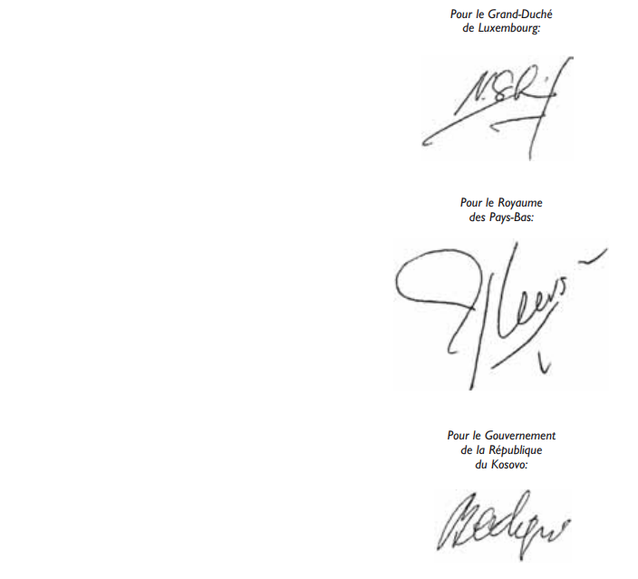

PROTOCOLE D’APPLICATION DE L’ACCORD  entre le Royaume de Belgique, le Grand-Duché de Luxembourg et le Royaume des Pays-Bas  (les Etats du Benelux) et la République du Kosovo relatif à la reprise et à la réadmission  des personnes en situation irrégulière (Accord de reprise et de réadmission)

\*Le Royaume de Belgique,*

\*Le Grand-Duché de Luxembourg*

et

\*Le Royaume des Pays-Bas,*

et

\*La République du Kosovo,*

ci-après dénommés «les Parties»,

En vertu de l’article 15, de l’Accord signé à Bruxelles le 12 mai 2011 entre le Royaume de Belgique, le Grand-Duché de Luxembourg et le Royaume des Pays-Bas (les Etats du BENELUX) et la République du Kosovo relatif à la reprise et à la réadmission des personnes en situation irrégulière,

ci-après dénommé «l’Accord»,

SONT CONVENUES de ce qui suit:

## *Article 1er* — *Définitions*

Aux termes du présent Protocole d’application, il faut entendre par:

1\. représentation diplomatique: la représentation diplomatique de la Partie requise sur le territoire de la Partie requérante;

2\. escorte(s): la personne (ou les personnes) désignée(s) par la Partie requérante et chargée(s) d’escorter la personne à reprendre ou à réadmettre ou à faire transiter.

## *Article 2* — *** Demande de reprise ou de réadmission*** (articles 4 et 7, paragraphe (3), de l’Accord)

1\. La demande de reprise ou de réadmission est introduite par télécopieur ou par voie électronique auprès de l’autorité compétente de la Partie requise. Cette demande contient les informations mentionnées à l’article 4, de l’Accord.

2\. La demande de reprise est introduite en faisant usage du formulaire joint en annexe 1 A au présent Protocole d’application. La demande de réadmission est introduite en faisant usage du formulaire joint en annexe 1 B au présent Protocole d’application.

3\. Si les conditions visées à l’article 4, paragraphe (4), de l’Accord sont remplies, une communication écrite moyennant le formulaire joint en annexe 3 au présent Protocole d’application est suffisante.

4\. La Partie requérante s’adresse à l’autorité compétente de la Partie requise pour fournir de même que pour recueillir des renseignements concernant la demande de reprise ou de réadmission introduite.

5\. La réponse à une demande de reprise ou de réadmission est transmise par télécopieur ou par voie électronique à l’autorité compétente de la Partie requérante en faisant usage du formulaire joint en annexe lA ou 1B du présent Protocole d’application.

## *Article 3* — *** Documents de voyage ***(article 7, paragraphe (6), de l’Accord)

1\. En cas d’accord à la demande de reprise ou de réadmission, les documents de voyage nécessaires au retour sont établis au nom de la personne à transférer, conformément à l’article 7, paragraphe (6), de l’Accord et remis aux autorités compétentes de la Partie requérante par la représentation diplomatique.

2\. En vertu de l’article 7, paragraphe (6), de l’Accord, la Partie requise est réputée accepter l’utilisation d’un document de voyage délivré par la Partie requérante, si la représentation diplomatique ne peut pas délivrer le document de voyage demandé dans le délai de trois jours ouvrables suivant la date de réception de la demande afférente. Les documents que les Parties utiliseront à cette fin sont joints en annexes 4 et 5 au présent Protocole d’application.

## *Article 4* — ** Transfert **(article 8, de l’Accord)

1\. L’autorité compétente de la Partie requérante informe l’autorité compétente de la Partie requise, par télécopieur ou par voie électronique, au moins deux jours ouvrables avant le transfert envisagé de son intention d’y procéder. A cette fin, il est fait usage du formulaire joint en annexe 2 au présent Protocole d’application.

2\. Si le transfert de la personne à reprendre ou à réadmettre ne peut pas s’effectuer dans le délai de trois mois visé à l’article 7, paragraphe (5), de l’Accord, la Partie requérante en informe sans délai l’autorité compétente de la Partie requise.

3\. Lorsque des raisons médicales justifient le transport par voie terrestre ou maritime, les autorités compétentes de la Partie requérante l’indiquent sur le formulaire joint en annexe 2 au présent Protocole d’application.

## *Article 5* — ** Procédure concernant le transit des ressortissants d’un Etat tiers ou des apatrides **(articles 9 et 10, de l’Accord)

1\. La demande de transit est introduite au moins deux jours avant le transit projeté par télécopieur ou par voie électronique auprès de l’autorité compétente de la Partie requise. La demande est introduite en faisant usage du formulaire joint en annexe 6 au présent Protocole d’application.

2\. L’autorité compétente de la Partie requise communique sans délai, par télécopieur ou par voie électronique si elle accepte le transit et la date envisagée de celui-ci, le point de passage des frontières, le mode de transport et le recours à des escortes. A cette fin, il est fait usage du formulaire indiqué au paragraphe 1er, du présent article.

3\. Le transit s’effectue en principe par voie aérienne.

## *Article 6* — *** Soutien au transit ***(article 10, paragraphe (4), de l’Accord)

1\. Si la Partie requérante juge nécessaire le soutien au transit par les autorités de la Partie requise, elle l’indique dans le formulaire joint en annexe 6 au présent Protocole d’application.

2\. A l’occasion de la réponse à la demande de transit, la Partie requise communique si elle peut fournir le soutien demandé. Les Parties se consultent au besoin à cet effet.

3\. Si la personne concernée est escortée, la garde et l’embarquement sont assurés par cette escorte sous l’autorité de la Partie requise.

## *Article 7* — *** Obligations des escortes ***(article 15, sous 3, de l’Accord)

1\. Lors de l’opération de transit, les pouvoirs de l’escorte se limitent à la légitime défense. De plus, en cas d’absence d’agents de la Partie requise compétents en la matière ou dans le but de leur porter assistance, l’escorte peut entreprendre des actions raisonnables et proportionnées pour répondre à un risque sérieux et immédiat afin de prévenir que la personne concernée ne fuit, ne porte atteinte à elle-même ou à un tiers ou cause des dommages aux biens.

2\. Dans toutes les circonstances, l’escorte doit respecter le droit de la Partie requise.

3\. L’escorte accomplit sa mission sans armes et en civil. Elle doit se munir d’un document qui atteste qu’une autorisation a été délivrée pour la reprise ou la réadmission ou pour le transit et doit être en mesure de prouver à tout moment son identité et son habilitation.

4\. Les autorités de la Partie requise garantissent à l’escorte durant l’exercice de sa mission dans le cadre de l’Accord la même protection et la même assistance qu’à leurs propres agents compétents en la matière.

## *Article 8* — ***Désignation des autorités compétentes*** (article 15, sous 1, de l’Accord)

Conformément à l’article 15, sous 1, de l’Accord, les Parties échangent par écrit au plus tard 30 jours après la conclusion du présent Protocole d’application une liste des autorités compétentes pour l’application de l’Accord. Elles s’échangent sans délai toute modification de cette liste.

## *Article 9* — ***Désignation des points de passage frontaliers*** (article 15, sous 2, de l’Accord)

Conformément à l’article 15, sous 2, de l’Accord, les Parties communiquent mutuellement par écrit, au plus tard 30 jours après la conclusion du présent Protocole d’application, les points de passage frontaliers par lesquels les personnes sont effectivement transférées et admises. Elles s’échangent sans délai toute modification de cette liste.

## *Article 10 * — **Coûts** (article 11, de l’Accord)

Sur production d’une facture, la Partie requérante rembourse les frais exposés par la Partie requise en vue de la reprise ou de la réadmission et du transit, qui sont à charge de la Partie requérante en vertu de l’article 11, de l’Accord.

## *Article 11* — ***Comité d’experts*** (article 14, de l’Accord)

Dans les trente jours suivant l’entrée en vigueur de l’Accord, les Parties se communiquent mutuellement la composition de leur délégation au Comité d’experts, institué en vertu de l’article 14, de l’Accord. Elles s’échangent sans délai toute modification de leur délégation.

## *Article 12* — *Langue*

Les Parties communiquent entre elles en langue anglaise.

## *Article 13* — * Modification des annexes*

1\. Les annexes 1 à 6 incluse font partie intégrante du Protocole d’application.

2\. Toute modification des annexes du présent Protocole d’application fera l’objet d’une décision écrite des Parties et entrera en vigueur à une date à fixer par les Parties.

## *Article 14* — * Entrée en vigueur et dénonciation*

Le présent Protocole d’application est appliqué conformément aux articles 17 et 18, de l’Accord et dénoncé en même temps que la dénonciation de l’Accord.

## *Article 15* — * Dépositaire*

Le Royaume de Belgique est dépositaire du présent Protocole d’application qui en expédiera une copie certifiée conforme à toutes les Parties.

FAIT à Bruxelles le 12 mai 2011, en langues anglaise, française, néerlandaise et en langues albanaise et serbe, chacun des textes faisant également foi. En cas de divergence d’interprétation la version anglaise (langue de travail) prévaudra.

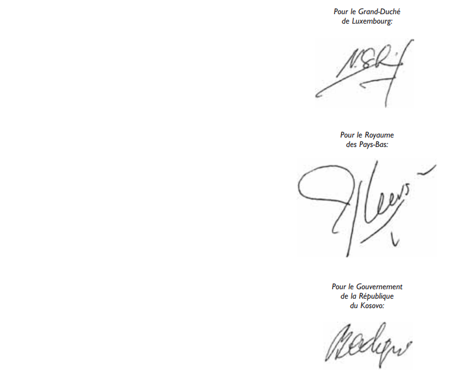

ANNEXE 1 A

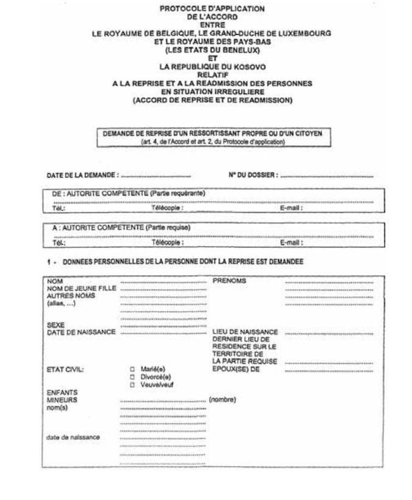

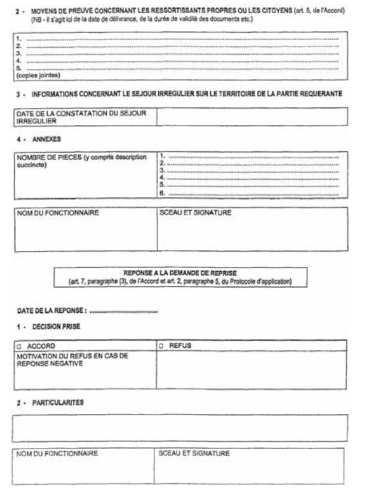

ANNEXE 1 B

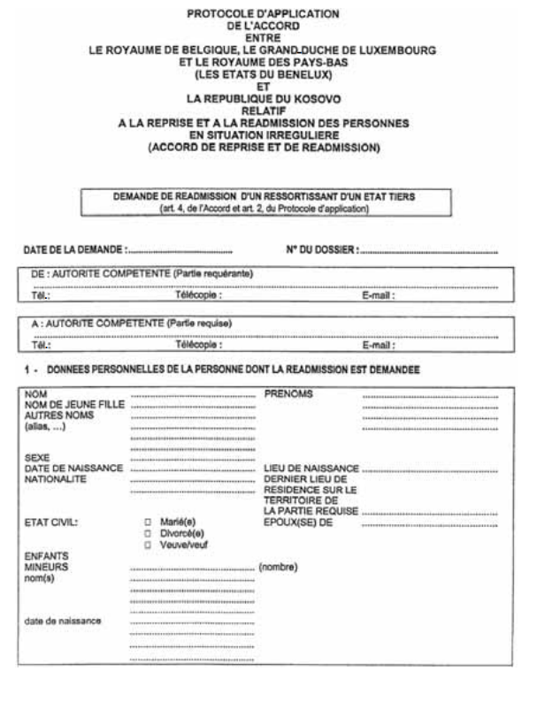

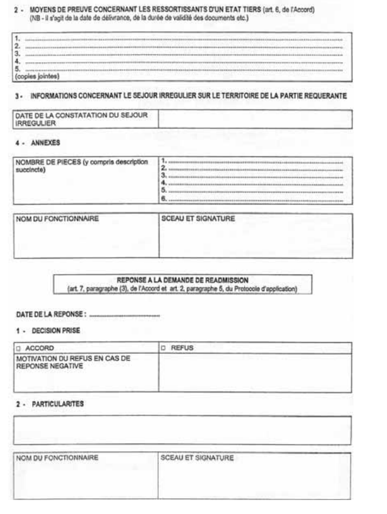

ANNEXE 2

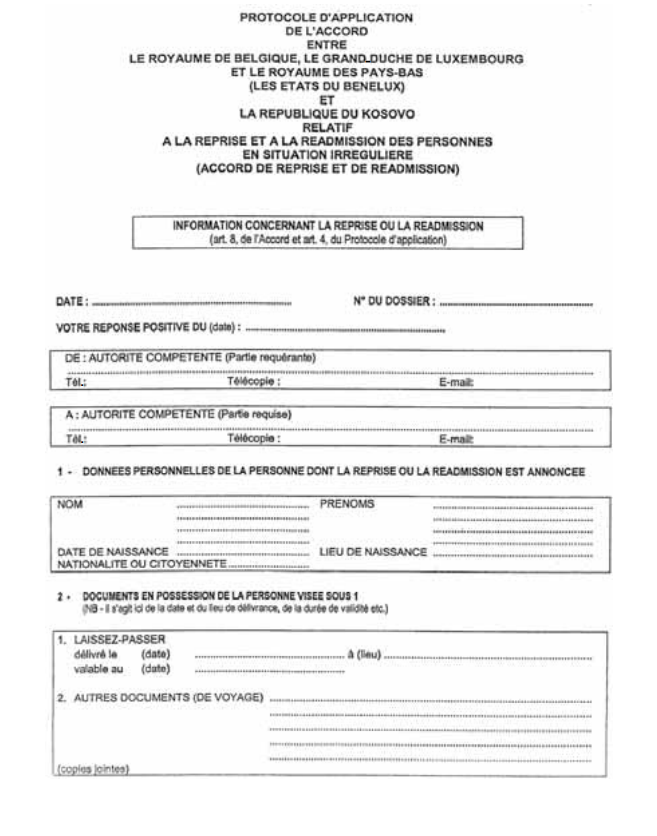

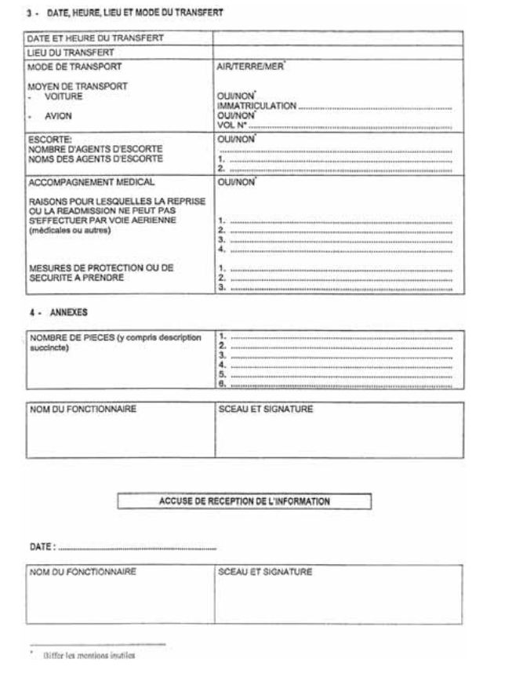

ANNEXE 3

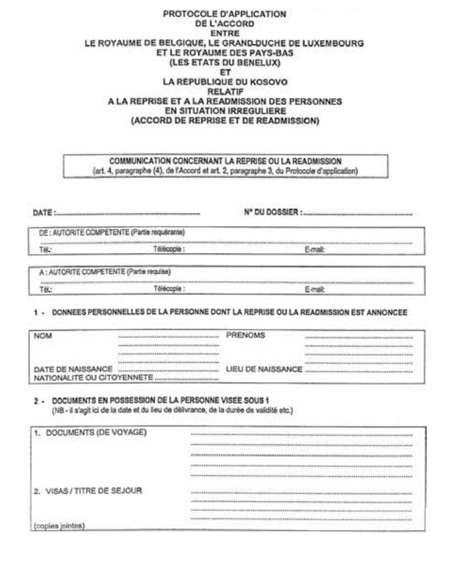

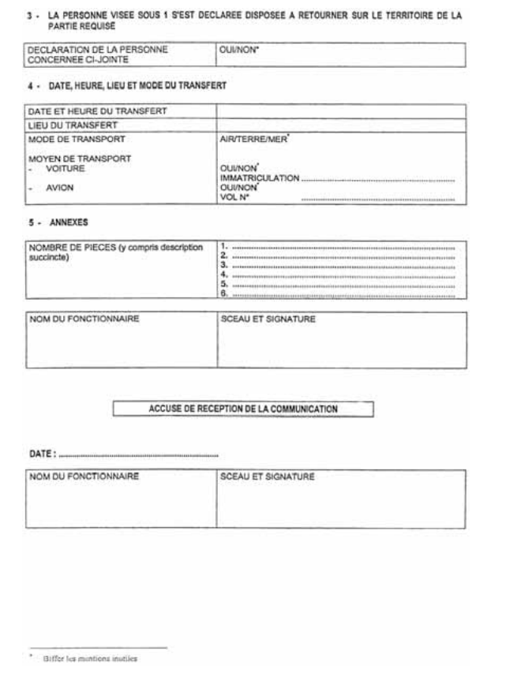

ANNEXE 4

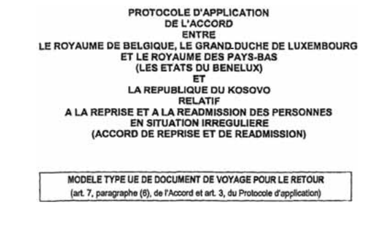

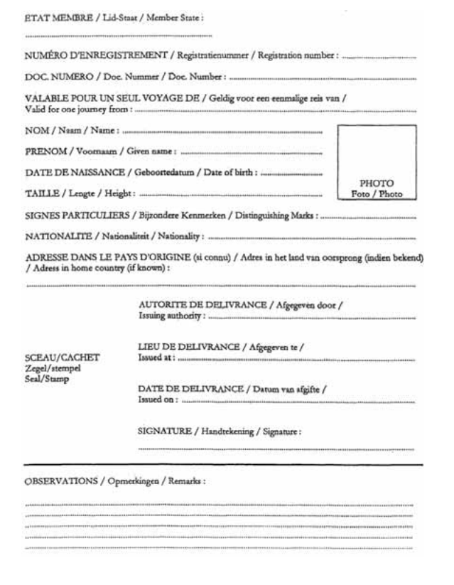

ANNEXE 5

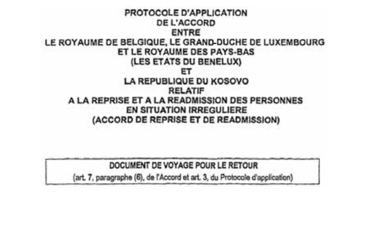

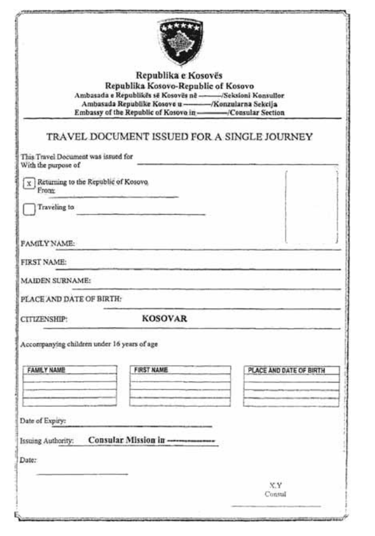

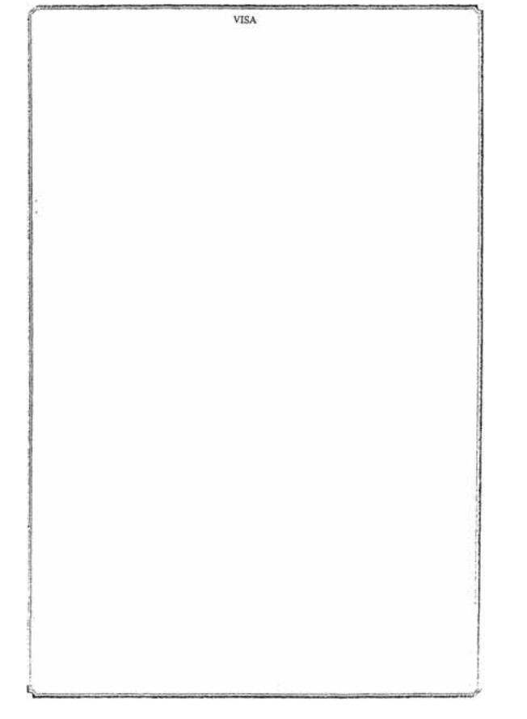

ANNEXE 6

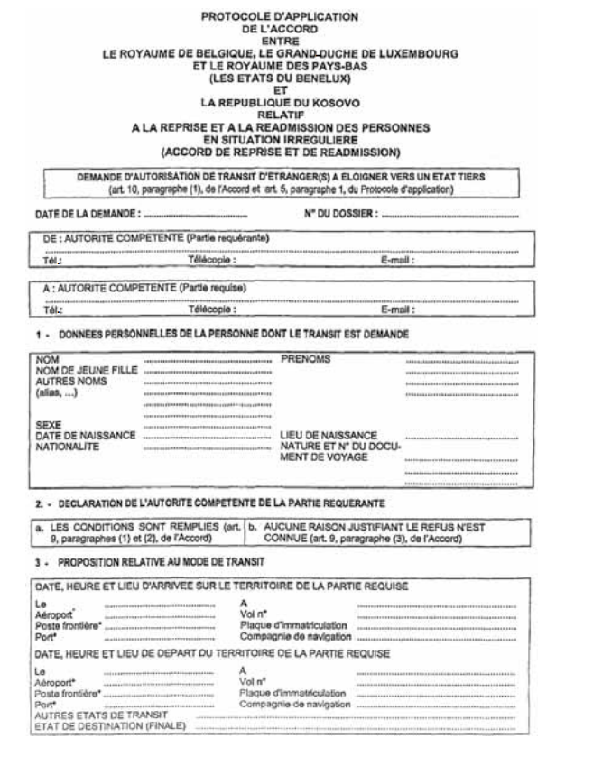

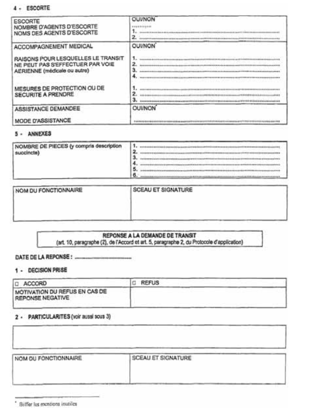

Doc. parl. [6337](https://legilux.public.lu/eli/etat/proj/pl/20110204); sess. ord. 2010-2011 et 2011-2012.
