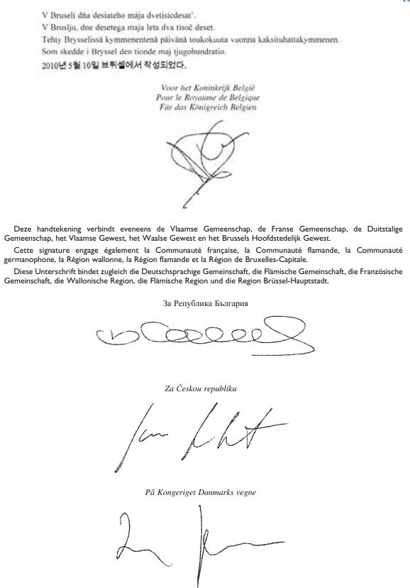
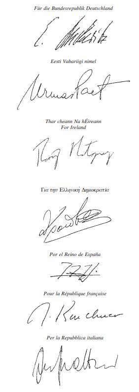
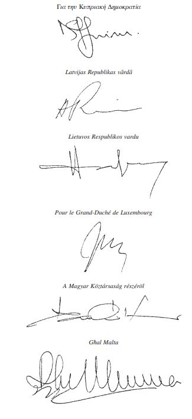
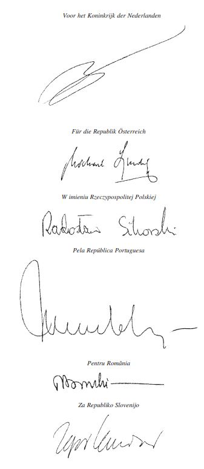
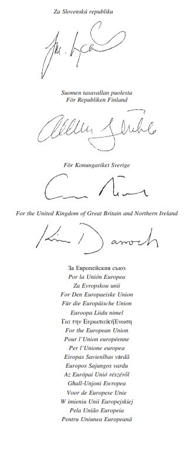
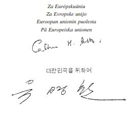
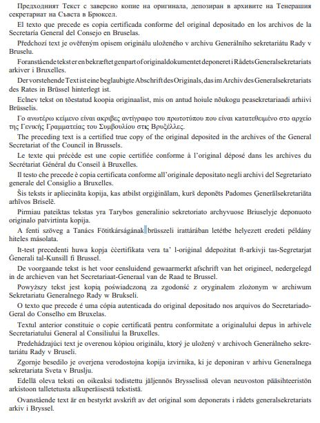
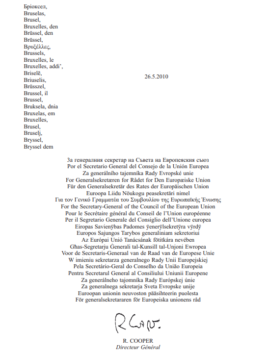

# Loi du 5 décembre 2012 portant approbation de l'Accord-cadre entre l'Union européenne et ses Etats membres, d'une part, et la République de Corée, d'autre part, signé à Bruxelles, le 10 mai 2010.

Nous Henri, Grand-Duc de Luxembourg, Duc de Nassau,

Notre Conseil d’Etat entendu;

De l’assentiment de la Chambre des Députés;

Vu la décision de la Chambre des Députés du 15 novembre 2012 et celle du Conseil d’Etat du 20 novembre 2012 portant qu’il n’y a pas lieu à second vote;

Avons ordonné et ordonnons:

## Article unique.

Est approuvé l’Accord-cadre entre l’Union européenne et ses Etats membres, d’une part, et la République de Corée, d’autre part, signé à Bruxelles, le 10 mai 2010.

Mandons et ordonnons que la présente loi soit insérée au Mémorial pour être exécutée et observée par tous ceux que la chose concerne.

Le Ministre des Affaires étrangères,   Jean Asselborn

Palais de Luxembourg, le 5 décembre 2012.   Henri

\**ACCORD-CADRE**

\**entre l’Union européenne et ses Etats membres, d’une part,**

\**et la République de Corée, d’autre part**

\*L’Union européenne,*

ci-après dénommée «l’Union», et

\*Le Royaume de Belgique,*

\*La République de Bulgarie,*

\*La République tchèque,*

\*Le Royaume de Danemark,*

\*La République fédérale d’Allemagne,*

\*La République d’Estonie,*

\*L’Irlande,*

\*La République hellénique,*

\*Le Royaume d’Espagne,*

\*La République française,*

\*La République italienne,*

\*La République de Chypre,*

\*La République de Lettonie,*

\*La République de Lituanie,*

\*Le Grand-Duché de Luxembourg,*

\*La République de Hongrie,*

\*Malte,*

\*Le Royaume des Pays-Bas,*

\*La République d’Autriche,*

\*La République de Pologne,*

\*La République portugaise,*

\*La Roumanie,*

\*La République de Slovénie,*

\*La République slovaque,*

\*La République de Finlande,*

\*Le Royaume de Suède,*

\*Le Royaume-Uni de Grande-Bretagne et d’Irlande du Nord,*

parties contractantes au [traité sur l’Union européenne](https://legilux.public.lu/eli/etat/leg/loi/1957/11/30/n1/jo) et au [traité sur le fonctionnement de l’Union européenne](https://eur-lex.europa.eu/eli/treaty/tfeu_2012/oj), ci-après dénommées «les Etats membres», d’une part, et

\*La République de Corée* *,*

d’autre part, ci-après dénommées collectivement «les parties»,

\*Considérant* leurs liens traditionnels d’amitié et les liens historiques, politiques et économiques qui les unissent;

\*Rappelant* l’accord-cadre de commerce et de coopération entre la Communauté européenne et ses Etats membres, d’une part, et la République de Corée, d’autre part, signé à Luxembourg le 28 octobre 1996 et qui est entré en vigueur le 1er avril 2001;

\*Tenant compte* du processus accéléré par lequel l’Union européenne acquiert sa propre identité dans les domaines de la politique étrangère ainsi que de la sécurité et de la justice;

\*Conscientes* du rôle et de la responsabilité croissants assumés par la République de Corée au sein de la communauté internationale;

\*Soulignant* le caractère complet de leur relation et l’importance que revêtent des efforts continus pour la préservation d’une cohérence générale;

\*Confirmant* leur désir de conserver et de développer leur dialogue politique régulier, qui se fonde sur des valeurs et des aspirations partagées;

\*Exprimant* leur volonté commune d’élever leurs relations au niveau d’un partenariat renforcé, notamment dans les domaines politique, économique, social et culturel;

\*Déterminées*, à cet égard, à consolider, approfondir et diversifier leurs relations dans des domaines d’intérêt commun, aux niveaux bilatéral, régional et mondial, et sur une base d’égalité, de respect de la souveraineté, de non-discrimination et d’avantages mutuels;

\*Réaffirmant* leur ferme attachement aux principes démocratiques et aux droits de l’homme, établis dans la déclaration universelle des droits de l’homme et dans d’autres instruments internationaux pertinents en la matière, ainsi qu’aux principes de l’Etat de droit et de la bonne gouvernance;

\*Réaffirmant* leur détermination à lutter contre les crimes les plus graves qui touchent l’ensemble de la communauté internationale et leur conviction qu’il convient de traduire en justice les auteurs des infractions de portée internationale les plus graves en adoptant des mesures au niveau national et en renforçant la collaboration à l’échelon mondial;

\*Considérant* que le terrorisme est une menace contre la sécurité mondiale, souhaitant intensifier leur dialogue et leur coopération dans la lutte contre le terrorisme, conformément aux instruments internationaux en la matière, en particulier la résolution 1373 du Conseil de sécurité des Nations unies, et réaffirmant que le respect des droits de l’homme et de l’Etat de droit constituent la base fondamentale de la lutte contre le terrorisme;

\*Partageant* la conviction que la prolifération des armes de destruction massive et de leurs vecteurs constitue une menace grave pour la sécurité internationale, reconnaissant la volonté de la communauté internationale de lutter contre cette prolifération comme l’atteste l’adoption de plusieurs conventions internationales et résolutions du Conseil de sécurité des Nations unies, notamment de la résolution 1540, et souhaitant renforcer leur dialogue et leur coopération dans ce domaine;

\*Reconnaissant* la nécessité d’une coopération renforcée dans les domaines de la justice, de la liberté et de la sécurité;

\*Rappelant*, à cet égard, que les dispositions de l’accord qui relèvent de la troisième partie, titre V, du [traité sur le fonctionnement de l’Union européenne](https://eur-lex.europa.eu/eli/treaty/tfeu_2012/oj) lient le Royaume-Uni et l’Irlande en tant que parties contractantes distinctes et non en qualité de partie de l’Union européenne jusqu’à ce que l’Union européenne notifie (le cas échéant) à la République de Corée que l’un ou l’autre de ces deux Etats est désormais lié pour ces questions en tant que membre de l’Union européenne, conformément au protocole sur la position du Royaume-Uni et de l’Irlande annexé au [traité sur l’Union européenne](https://legilux.public.lu/eli/etat/leg/loi/1957/11/30/n1/jo) et au [traité sur le fonctionnement de l’Union européenne](https://eur-lex.europa.eu/eli/treaty/tfeu_2012/oj), et que la même remarque s’applique au Danemark, conformément au protocole correspondant annexé auxdits traités;

\*Reconnaissant* leur désir de promouvoir le développement durable dans ses dimensions économique, sociale et environnementale;

\*Exprimant* leur détermination à assurer un niveau élevé de protection environnementale et à coopérer dans la lutte contre le changement climatique;

\*Rappelant* leur soutien en faveur d’une mondialisation équitable, des objectifs de plein emploi productif et d’un travail décent pour tous;

\*Reconnaissant* que les échanges commerciaux et les flux d’investissement entre les parties, organisés sur la base des règles mondiales régissant le système commercial sous les auspices de l’Organisation mondiale du commerce (OMC), ont été florissants;

\*Désireuses* de garantir et de promouvoir les conditions nécessaires à l’accroissement et au développement durables des échanges commerciaux et des investissements entre les parties, dans leur intérêt mutuel, notamment en instituant une zone de libre-échange;

\*S’accordant* sur la nécessité de fournir des efforts collectifs afin de faire face à des problèmes mondiaux tels que le terrorisme, les crimes graves ayant une portée internationale, la prolifération des armes de destruction massive et de leurs vecteurs, le changement climatique, l’insécurité énergétique et des ressources, la pauvreté et la crise financière;

\*Déterminées* à renforcer la coopération dans des domaines d’intérêt commun, notamment la promotion des principes démocratiques et le respect des droits de l’homme, la lutte contre la prolifération des armes de destruction massive, la lutte contre le commerce illégal d’armes de petit calibre et d’armes légères, la prise de mesures à l’encontre des crimes les plus graves qui touchent l’ensemble de la communauté internationale, la lutte contre le terrorisme, la coopération dans les organisations régionales et internationales, le commerce et les investissements, le dialogue sur la politique économique, la coopération entre entreprises, la fiscalité, les douanes, la politique de la concurrence; la société de l’information, la science et la technologie, l’énergie, les transports, la politique relative aux transports maritimes, la politique des consommateurs, la santé, l’emploi et les affaires sociales, l’environnement et les ressources naturelles, le changement climatique, l’agriculture, le développement rural et la sylviculture, les ressources marines et la pêche, l’aide au développement, la culture, l’information, la communication, le secteur audiovisuel et les médias, l’éducation, l’Etat de droit, la coopération juridique, la protection des données à caractère personnel, les migrations, la lutte contre les drogues illicites, la lutte contre la criminalité organisée et la corruption, la lutte contre le blanchiment d’argent et le financement du terrorisme, la lutte contre la cybercriminalité, le maintien de l’ordre, le tourisme, la société civile, l’administration publique et les statistiques;

\*Conscientes* de l’importance qu’il y a de faciliter la participation à la coopération des personnes et des entités directement intéressées, et surtout des opérateurs économiques et de leurs organisations représentatives;

\*Reconnaissant* qu’il est souhaitable de renforcer le rôle et le profil de chacune des deux parties dans la région de l’autre et d’encourager les contacts interpersonnels entre elles,

SONT CONVENUES DE CE QUI SUIT:

## TITRE I — Fondement et champ d’application

### *Article 1er* — * Fondement de la coopération*

1\. Les parties confirment leur attachement aux principes démocratiques, aux droits de l’homme et aux libertés fondamentales ainsi qu’à l’Etat de droit. Le respect des principes démocratiques, des droits de l’homme et des libertés fondamentales inscrits dans la Déclaration universelle des droits de l’homme et dans d’autres instruments internationaux relatifs aux droits de l’homme, qui reflètent le principe de l’Etat de droit, sous-tend les politiques intérieures et internationales des deux parties et constitue un aspect essentiel du présent accord.

2\. Les parties confirment leur attachement à la [Charte des Nations unies](https://legilux.public.lu/eli/etat/leg/agd/1945/08/10/n1/jo) et leur soutien en faveur des valeurs communes qui y sont énoncées.

3\. Les parties réaffirment leur volonté de promouvoir le développement durable sous toutes ses formes, qu’il s’agisse d’encourager la croissance économique, de contribuer à la réalisation des objectifs de développement définis sur le plan international et de coopérer pour relever les défis environnementaux mondiaux, en particulier en ce qui concerne le changement climatique.

4\. Les parties réaffirment également leur attachement aux principes de la bonne gouvernance et de la lutte contre la corruption, compte tenu notamment de leurs obligations internationales.

5\. Les parties soulignent leur attachement commun au caractère complet des relations bilatérales et à la préservation d’une cohérence générale à cet égard.

6\. Les parties conviennent d’élever leurs relations au niveau d’un partenariat renforcé et de développer des domaines de coopération aux niveaux bilatéral, régional et mondial.

7\. La mise en oeuvre du présent accord entre parties partageant les mêmes valeurs et respectant les mêmes principes se fonde par conséquent sur le dialogue, le respect mutuel, un partenariat équitable, le multilatéralisme, le consensus et le respect du droit international.

### *Article 2* — * Objectifs de la coopération*

1\. En vue de renforcer leur coopération, les parties s’engagent à intensifier leur dialogue politique et à développer leurs relations économiques. Leurs efforts visent en particulier à:

a) s’accorder sur une vision d’avenir en ce qui concerne le renforcement de leur partenariat et la mise en place de projets conjoints destinés à mettre en œuvre cette vision;

b) mener un dialogue politique régulier;

c) promouvoir des efforts collectifs dans toutes les enceintes et organisations régionales et internationales compétentes afin de répondre aux problèmes de portée mondiale;

d) encourager la coopération économique dans des domaines d’intérêt commun, et notamment la coopération dans le domaine des sciences et de la technologie, afin de diversifier les échanges pour leur bénéfice mutuel;

e) favoriser la coopération entre entreprises en facilitant les investissements de part et d’autre et en promouvant une meilleure compréhension mutuelle;

f) renforcer la participation respective aux programmes de coopération de chacune des parties qui sont ouverts à l’autre partie;

g) renforcer le rôle et le profil de chacune des deux parties dans la région de l’autre, par divers moyens tels que les échanges culturels, l’utilisation des technologies de l’information et l’éducation;

h) promouvoir les contacts interpersonnels et la compréhension mutuelle;

2\. Sur la base de leur partenariat établi de longue date et de leurs valeurs communes, les parties s’engagent à renforcer leur coopération et leur dialogue sur toutes les questions d’intérêt commun. Leurs efforts visent en particulier à:

a) renforcer le dialogue politique et la coopération, notamment en ce qui concerne les droits de l’homme, la non-prolifération des armes de destruction massive, les armes légères et de petit calibre, les crimes les plus graves qui préoccupent la communauté internationale et la lutte antiterroriste;

b) renforcer la coopération dans tous les domaines d’intérêt commun liés aux échanges et aux investissements et assurer les conditions d’une progression durable des échanges et des investissements entre les parties dans leur intérêt mutuel;

c) renforcer la coopération dans le domaine de la coopération économique, notamment le dialogue en matière de politique économique, la coopération entre entreprises, la fiscalité, les douanes, la politique de la concurrence; la société de l’information, la science et la technologie, l’énergie, les transports, la politique relative aux transports maritimes et la politique des consommateurs;

d) renforcer la coopération dans les domaines du développement durable, notamment en ce qui concerne la santé, de l’emploi et des affaires sociales, de l’environnement et des ressources naturelles, du changement climatique, de l’agriculture, du développement rural et de la sylviculture, des ressources marines et de la pêche ainsi que de l’aide au développement;

e) renforcer la coopération dans les domaines de la culture, de l’information, de la communication, de l’audiovisuel et des médias ainsi que de l’éducation;

f) renforcer la coopération dans les domaines de la justice, de la liberté et de la sécurité, notamment l’Etat de droit, de la coopération juridique, de la protection des données à caractère personnel, des migrations, de la lutte contre les drogues illicites, de la lutte contre la criminalité organisée et la corruption, de la lutte contre le blanchiment d’argent et le financement du terrorisme, de la lutte contre la cybercriminalité et du maintien de l’ordre;

g) renforcer la coopération dans d’autres domaines d’intérêt commun tels que le tourisme, la société civile, l’administration publique et les statistiques.

## TITRE II — Dialogue politique et coopération

### *Article 3* — * Dialogue politique*

1\. Un dialogue politique régulier, fondé sur des valeurs et des aspirations communes, est établi entre la République de Corée et l’Union européenne. Il a lieu conformément aux procédures convenues entre la République de Corée et l’Union européenne.

2\. Le dialogue politique vise à:

a) souligner l’attachement des parties à la démocratie et au respect des droits de l’homme et des libertés fondamentales;

b) promouvoir des solutions pacifiques aux conflits internationaux ou régionaux et le renforcement des Nations unies et d’autres organisations internationales;

c) renforcer les consultations stratégiques sur des questions de sécurité internationale telles que la limitation des armements et le désarmement, la non-prolifération des armes de destruction massive et le transfert international d’armes conventionnelles;

d) engager une réflexion sur les principales questions internationales d’intérêt commun en augmentant l’échange d’informations pertinentes, tant entre les deux parties qu’au sein des enceintes internationales;

e) renforcer les consultations sur les questions présentant un intérêt particulier pour les pays des régions Asie-Pacifique et Europe, dans le but de promouvoir la paix, la stabilité et la prospérité dans les deux régions.

3\. Le dialogue entre les parties a lieu à travers des contacts, des échanges et des consultations, et se concrétise notamment par:

a) des réunions au sommet au niveau des dirigeants, qui auront lieu chaque fois que les parties le jugeront nécessaire;

b) des consultations annuelles au niveau ministériel, qui auront lieu dans un lieu convenu par les parties;

c) des réunions d’information au niveau des hauts fonctionnaires sur les principaux évènements de l’actualité nationale ou internationale;

d) des dialogues sectoriels sur des questions d’intérêt commun;

e) des échanges de délégations entre le Parlement européen et l’Assemblée nationale de la République de Corée.

### *Article 4* — * Lutte contre la prolifération des armes de destruction massive*

1\. Les parties estiment que la prolifération des armes de destruction massive et de leurs vecteurs, au profit d’acteurs étatiques et non étatiques, constitue l’une des menaces les plus graves pour la stabilité et la sécurité internationales.

2\. Les parties conviennent dès lors de coopérer et de contribuer à la lutte contre la prolifération d’armes de destruction massive et de leurs vecteurs en mettant pleinement en œuvre les obligations juridiques respectives qui leur incombent actuellement en matière de désarmement et de non-prolifération et d’autres instruments pertinents qu’elles ont adoptés. Elles s’accordent à reconnaître que cette disposition constitue un élément essentiel du présent accord.

3\. Les parties conviennent en outre de coopérer et de contribuer à la lutte contre la prolifération des armes de destruction massive et de leurs vecteurs:

a) en prenant des mesures en vue de signer ou de ratifier tous les autres instruments internationaux pertinents, ou d’y adhérer, selon le cas, et en vue de les mettre pleinement en œuvre;

b) en mettant en place un système efficace de contrôle national des exportations, destiné à prévenir la prolifération des armes de destruction massive et des marchandises et technologies liées, consistant en un contrôle de l’utilisation finale de celles-ci et comportant des sanctions civiles et pénales efficaces en cas d’infraction aux contrôles des exportations.

4\. Les parties conviennent que leur dialogue politique accompagnera et renforcera ces éléments.

### *Article 5* — * Armes légères et de petit calibre*

1\. Les parties reconnaissent que la fabrication, le transfert et la circulation de manière illégale d’armes légères et de petit calibre, y compris de leurs munitions, ainsi que l’accumulation excessive, la gestion déficiente, les stocks insuffisamment sécurisés et la dissémination incontrôlée de ces armes, continuent de faire peser une grave menace sur la paix et la sécurité internationales.

2\. Les parties conviennent de mettre en œuvre leurs engagements respectifs visant à lutter contre le commerce illégal des armes légères et de petit calibre, y compris de leurs munitions, dans le cadre d’instruments internationaux, notamment du programme d’action des Nations unies en vue de prévenir, combattre et éliminer le commerce illicite des armes légères sous toutes ses formes, de l’instrument international visant à permettre aux Etats de procéder à l’identification et au traçage rapides et fiables des armes légères et de petit calibre illicites ainsi que des obligations découlant des résolutions du Conseil de sécurité des Nations unies.

3\. Les parties s’engagent à coopérer et à assurer la coordination, la complémentarité et la synergie de leurs efforts de lutte contre le commerce illégal des armes légères et de petit calibre, y compris de leurs munitions, aux niveaux mondial, régional, sous-régional et national.

### *Article 6* — * Crimes les plus graves qui préoccupent la communauté internationale*

1\. Les parties réaffirment que les crimes les plus graves qui préoccupent l’ensemble de la communauté internationale ne sauraient rester impunis et que leur répression doit être effectivement assurée en prenant des mesures nationales et en renforçant la coopération internationale s’il y a lieu, notamment avec la Cour pénale internationale. Elles conviennent de soutenir pleinement l’universalité et l’intégrité du [statut de Rome](https://legilux.public.lu/eli/etat/leg/loi/2000/08/14/n1/jo) instituant la Cour pénale internationale et des instruments connexes.

2\. Les parties reconnaissent le caractère bénéfique d’un dialogue sur ce sujet.

### *Article 7* — * Coopération en matière de lutte contre le terrorisme*

1\. Les parties, réaffirmant l’importance de la lutte contre le terrorisme et conformément aux conventions internationales applicables, notamment en ce qui concerne le droit humanitaire international et la législation internationale relative aux droits de l’homme et aux réfugiés, ainsi que conformément à leurs législations et réglementations respectives, et compte tenu de la stratégie mondiale contre le terrorisme adoptée par l’Assemblée générale des Nations unies dans sa résolution N° 60/288 du 8 septembre 2006, conviennent de coopérer à la prévention et à l’éradication des actes terroristes.

2\. Les parties coopèrent en particulier:

a) dans le cadre de la mise en œuvre des résolutions du Conseil de sécurité des Nations unies et des obligations respectives qui leur incombent en vertu d’autres conventions et instruments internationaux pertinents;

b) par un échange d’informations sur les groupes terroristes et leurs réseaux de soutien, conformément au droit international et national;

c) par des échanges de vues sur les moyens et les méthodes utilisés pour lutter contre le terrorisme, en particulier sur le plan technique et en matière de formation, et par des échanges d’expérience dans le domaine de la prévention du terrorisme;

d) en approfondissant le consensus international sur la lutte contre le terrorisme, y compris en ce qui concerne la définition juridique d’actes terroristes, le cas échéant, et en œuvrant en particulier à l’élaboration d’un accord sur la convention générale contre le terrorisme international;

e) en partageant les meilleures pratiques en matière de protection des droits de l’homme dans leur lutte contre le terrorisme.

## TITRE III — Coopération dans les organisations régionales et internationales

### *Article 8* — * Coopération dans les organisations régionales et internationales*

Les parties s’engagent à coopérer et à échanger leurs vues dans les instances et organisations régionales et internationales telles que les Nations unies, l’Organisation internationale du travail (OIT), l’Organisation de coopération et de développement économiques (OCDE), l’OMC, le Sommet Asie-Europe (ASEM) et le Forum régional de l’ANASE (FRA).

## TITRE IV — Coopération en matière de développement économique

### *Article 9* — * Commerce et investissements*

1\. Les parties s’engagent à coopérer afin de garantir les conditions nécessaires à l’accroissement et à l’expansion durables des échanges et des investissements entre elles, dans leur intérêt mutuel, et à en faire la promotion. Les parties s’engagent à dialoguer et à renforcer la coopération dans tous les domaines d’intérêt commun liés aux échanges commerciaux et aux investissements afin de faciliter des flux d’échanges et d’investissements durables, de prévenir et supprimer les obstacles au commerce et aux investissements et de faire avancer le système commercial multilatéral.

2\. A cet effet, les parties mettent en œuvre leur coopération dans le domaine des échanges et des investissements au moyen de l’accord instituant une zone de libre-échange. Ledit accord constitue un accord spécifique rendant effectives les dispositions commerciales du présent accord, conformément à l’article 43.

3\. Les parties se tiennent informées de l’évolution des échanges bilatéraux et internationaux, des investissements ainsi que des stratégies et problèmes en la matière et procèdent à des échanges de vues.

### *Article 10* — * Dialogue sur la politique économique*

1\. Les parties conviennent de renforcer le dialogue entre leurs autorités et de promouvoir l’échange d’informations et le partage d’expériences sur les politiques et les tendances macroéconomiques.

2\. Les parties conviennent de renforcer le dialogue et la coopération afin d’améliorer la comptabilité, l’audit ainsi que les systèmes de supervision et de réglementation dans les domaines de la banque et de l’assurance et ainsi que dans d’autres segments du secteur financier.

### *Article 11* — * Coopération entre entreprises*

1\. Les parties, tenant compte de leurs politiques et objectifs économiques respectifs, conviennent de favoriser la coopération en matière de politique industrielle dans tous les domaines qu’elles jugent appropriés, en particulier en vue d’améliorer la compétitivité des petites et moyennes entreprises (PME), entre autres de la manière suivante:

a) en échangeant des informations et en partageant des expériences sur la création de conditions cadre favorables à l’amélioration de la compétitivité des PME et sur les procédures relatives à la création de PME;

b) en promouvant les contacts entre opérateurs économiques, en encourageant les investissements communs et en mettant en place des coentreprises et des réseaux d’information, notamment dans le cadre de programmes en vigueur;

c) en facilitant l’accès aux moyens de financement et à la commercialisation, en communiquant des informations et en stimulant l’innovation;

d) en facilitant les activités mises en place par des PME des deux parties;

e) en promouvant la responsabilité sociale des entreprises et leur obligation de rendre des comptes et en encourageant des pratiques commerciales responsables, notamment en matière de consommation et de production durables.

2\. Les parties facilitent les activités de coopération pertinentes mises en place par leurs secteurs privés respectifs.

### *Article 12* — * Fiscalité*

En vue de renforcer et de développer les activités économiques tout en tenant compte de la nécessité d’élaborer un cadre réglementaire approprié, les parties reconnaissent les principes de transparence, d’échange d’informations et de concurrence fiscale loyale et s’engagent à les appliquer dans le domaine fiscal. A cet effet, conformément à leurs compétences respectives, elles améliorent la coopération internationale dans le domaine fiscal, facilitent la perception de recettes fiscales légitimes et mettent en place des mesures visant à la bonne mise en œuvre des principes susmentionnés.

### *Article 13* — * Douanes*

Les parties coopèrent dans le domaine douanier sur une base bilatérale et multilatérale. A cet effet, elles partagent notamment leurs expériences et étudient les possibilités de simplifier les procédures, renforcer la transparence et développer la coopération. Elles recherchent également une convergence de vues et une action commune dans le cadre des instances internationales compétentes.

### *Article 14* — * Politique de la concurrence*

1\. Les parties encouragent une concurrence loyale dans le domaine des activités économiques en appliquant intégralement leurs législations et réglementations relatives à la concurrence.

2\. En vue d’atteindre l’objectif fixé au paragraphe 1 du présent article et conformément à l’accord conclu entre le gouvernement de la République de Corée et la Communauté européenne concernant la coopération en matière de pratiques anticoncurrentielles, les parties s’engagent à coopérer de la manière suivante:

a) en reconnaissant l’importance du droit de la concurrence et des autorités de la concurrence et en s’efforçant d’appliquer la loi de manière proactive afin de créer un environnement favorable à la concurrence loyale;

b) en échangeant des informations et en renforçant la coopération entre les autorités de la concurrence.

### *Article 15* — * Société de l’information*

1\. Reconnaissant que les technologies de l’information et de la communication sont des éléments essentiels de la vie moderne et qu’elles sont d’une importance vitale pour le développement économique et social, les parties conviennent d’échanger leurs vues sur leurs politiques respectives dans ce domaine.

2\. La coopération dans ce domaine est axée, entre autres, sur:

a) un échange de vues sur les différents aspects de la société de l’information, en particulier les politiques et réglementations sur les communications électroniques, notamment le service universel, les licences individuelles et les autorisations générales, la protection de la vie privée et des données à caractère personnel, de même que l’indépendance et l’efficacité de l’autorité de régulation;

b) l’interconnexion et l’interopérabilité des réseaux et des services de recherche, y compris dans un cadre régional;

c) la normalisation et la diffusion de nouvelles technologies de l’information et de la communication;

d) la promotion de la coopération en matière de recherche entre les parties dans le domaine des technologies de l’information et de la communication;

e) les questions et aspects liés à la sécurité des technologies de l’information et de la communication, notamment la promotion de la sécurité en ligne, la lutte contre la cybercriminalité et les abus dans le domaine des technologies de l’information et de toute forme de médias électroniques.

3\. La coopération entre entreprises est encouragée.

### *Article 16* — * Science et technologie*

Les parties encouragent, développent et facilitent les activités de coopération menées dans les domaines de la science et de la technologie à des fins pacifiques, conformément à l’accord de coopération scientifique et technologique conclu entre la Communauté européenne et le gouvernement de la République de Corée.

### *Article 17* — * Energie*

1\. Les parties reconnaissent l’importance du secteur énergétique pour le développement économique et social et s’efforcent, dans le cadre de leurs compétences respectives, de renforcer la coopération dans ce domaine en vue de:

a) diversifier leurs sources d’énergie pour renforcer la sécurité énergétique et développer des formes d’énergie nouvelles, durables, innovantes et renouvelables, et notamment les biocarburants, la biomasse, les énergies éoliennes et solaires ainsi que la production d’électricité d’origine hydraulique;

b) soutenir le développement de politiques visant à rendre les énergies renouvelables plus concurrentielles;

c) parvenir à une utilisation rationnelle de l’énergie à travers une contribution des parties prenantes tant au niveau tant de l’offre que de la demande en encourageant l’efficacité énergétique lors de la production, du transport et de la distribution de l’énergie ainsi que lors de son utilisation finale;

d) promouvoir les transferts de technologie en vue d’une production durable de l’énergie et d’une efficacité énergétique;

e) œuvrer en faveur du renforcement des capacités et de la facilitation des investissements dans le domaine énergétique en tenant compte des principes de transparence, de non-discrimination et de compatibilité des marchés;

f) promouvoir la concurrence dans le secteur énergétique;

g) procéder à un échange de vues sur l’évolution des marchés mondiaux de l’énergie, et notamment sur l’incidence de celle-ci sur les pays en développement.

2\. A cet effet, les parties œuvrent, en fonction des besoins, à la promotion des activités de coopération suivantes, en particulier par l’intermédiaire de cadres régionaux et internationaux:

a) coopération en matière d’élaboration des stratégies énergétiques et d’échange d’informations relatives aux politiques énergétiques;

b) échange d’informations sur l’état de la situation et les tendances sur le marché de l’énergie ainsi que dans les secteurs industriel et technologique;

c) réalisation d’études et de recherches conjointes;

d) augmentation des échanges commerciaux et des investissements dans le secteur de l’énergie.

### *Article 18* — * Transports*

1\. Les parties s’efforcent de coopérer dans tous les secteurs appropriés de la politique des transports, y compris en matière de politique intégrée des transports, en vue d’améliorer la circulation des marchandises et des passagers, de promouvoir la sûreté et la sécurité maritime et aérienne ainsi que la protection de l’environnement et d’augmenter l’efficacité de leurs systèmes de transport.

2\. La coopération entre les parties dans ce secteur vise à favoriser:

a) des échanges d’informations sur leurs politiques et pratiques de transport respectives, notamment pour ce qui est du transport urbain, rural, fluvial, aérien et maritime, y compris leur logistique et l’interconnexion et l’interopérabilité des réseaux multimodaux de transport, ainsi que la gestion des routes, des chemins de fer, des ports et des aéroports;

b) un dialogue et des actions conjointes dans des domaines d’intérêt commun du secteur du transport aérien – notamment en ce qui concerne l’accord sur certains aspects des services aériens et l’examen des possibilités de développer davantage les relations – ainsi que la coopération technique et en matière de réglementation, sur des questions touchant à la sûreté et à la sécurité aérienne, l’environnement, la gestion du trafic aérien, l’application du droit de la concurrence et la réglementation économique du secteur du transport aérien, en vue d’encourager l’harmonisation de la réglementation et l’élimination des obstacles à l’activité économique. Sur cette base, les parties envisagent une coopération plus approfondie dans le domaine de l’aviation civile;

c) la coopération en matière de réduction des émissions de gaz à effet de serre dans le secteur des transports;

d) la coopération au sein d’enceintes internationales s’occupant de transports;

e) la mise en œuvre de normes de sécurité et de sûreté et de normes relatives à la prévention de la pollution, notamment en ce qui concerne le transport maritime et l’aviation, conformément aux conventions internationales applicables aux deux parties, et notamment la coopération au sein des enceintes internationales compétentes, dans le but d’assurer une meilleure application des règlements internationaux.

3\. En ce qui concerne la navigation mondiale par satellite à usage civil, les parties coopèrent conformément à l’accord de coopération relatif à un système de navigation mondiale par satellite (GNSS) à usage civil conclu entre la Communauté européenne et ses Etats membres, d’une part, et la République de Corée, d’autre part.

### *Article 19* — * Politique relative aux transports maritimes*

1\. Les parties s’engagent à se rapprocher de l’objectif d’un accès illimité aux marchés et à la circulation maritimes internationaux fondés sur le principe d’une concurrence loyale sur une base commerciale, conformément aux dispositions du présent article.

2\. En vue d’atteindre l’objectif fixé au paragraphe 1, les parties:

a) s’abstiennent d’introduire des dispositions relatives au partage des cargaisons dans leurs futurs accords bilatéraux avec des pays tiers concernant les services de transport maritime, y compris le vrac sec et liquide et le trafic de lignes régulières, et ne font pas jouer de telles clauses lorsqu’elles existent dans des accords bilatéraux précédents;

b) s’abstiennent de mettre en vigueur, après l’entrée en vigueur du présent accord, des mesures administratives, techniques et législatives qui pourraient avoir pour effet d’établir une distinction entre leurs ressortissants ou entreprises et ceux de l’autre partie lors de la fourniture de services de transport maritime international;

c) octroient aux navires exploités par des ressortissants ou des sociétés de l’autre partie, un traitement non moins favorable que celui accordé à ses propres navires en ce qui concerne l’accès aux ports ouverts au commerce international, l’utilisation des infrastructures et des services maritimes auxiliaires de ces ports, les droits et taxes, les facilités douanières et l’attribution de postes de mouillage et d’installations de chargement et de déchargement;

d) permettent aux compagnies de transport maritime de l’autre partie d’avoir une présence commerciale sur leurs territoires respectifs aux fins de pratiquer des activités de transport maritime dans des conditions d’établissement et d’exploitation non moins favorables que celles accordées à leurs propres sociétés, ou aux filiales ou succursales de sociétés d’un pays tiers, si celles-ci sont meilleures.

3\. Aux fins du présent article, l’accès au marché maritime international comprend notamment le droit, pour les fournisseurs de services de transport maritime international de chacune des parties, d’organiser des services de transport international porte à porte comportant un trajet maritime et de passer un contrat direct avec des fournisseurs locaux de modes de transport autres que le transport maritime sur le territoire de l’autre partie sans préjudice des restrictions de nationalité applicables en matière de transport de marchandises et de passagers par ces autres modes de transport.

4\. Les dispositions du présent article s’appliquent tant aux compagnies de l’Union européenne qu’aux compagnies coréennes. Les compagnies de transport maritime établies hors de l’Union européenne ou de la République de Corée et contrôlées par des ressortissants d’un Etat membre ou de la République de Corée bénéficient également des dispositions du présent article si leurs navires sont immatriculés dans cet Etat membre ou dans la République de Corée conformément à la législation en vigueur.

5\. Les activités menées par les agences maritimes dans l’Union européenne et de la République de Corée font l’objet d’accords spécifiques s’il y a lieu.

6\. Les parties entretiennent un dialogue sur la politique des transports maritimes.

### *Article 20* — * Politique des consommateurs*

Les parties s’efforcent de coopérer en matière de politique des consommateurs afin de veiller à un haut niveau de protection des consommateurs. Elles conviennent que la coopération dans ce domaine peut notamment, dans la mesure du possible, viser à:

a) renforcer la compatibilité des législations relatives à la protection des consommateurs pour éviter les entraves aux échanges tout en assurant un niveau élevé de protection des consommateurs;

b) promouvoir l’échange d’informations sur les systèmes de protection des consommateurs, notamment en ce qui concerne les législations en la matière, la sécurité des produits, le contrôle de l’application de la législation, l’éducation et le renforcement des moyens d’action des consommateurs et les voies de recours à leur disposition;

c) encourager le développement d’associations indépendantes de consommateurs et de contacts entre représentants des groupements de consommateurs.

## TITRE V — Coopération en matière de développement durable

### *Article 21* — * Santé*

1\. Les parties conviennent d’encourager la coopération et l’échange d’informations entre elles dans les domaines de la santé et de la gestion efficace des problèmes sanitaires transfrontaliers.

2\. Les parties s’efforcent d’encourager l’échange d’informations et la coopération mutuelle, entre autres comme suit:

a) échange d’informations sur la surveillance des maladies infectieuses, notamment en ce qui concerne la pandémie de grippe, ainsi que sur l’alerte précoce et les mesures à prendre;

b) échange d’informations sur les stratégies en matière de santé et sur les programmes sanitaires mis en oeuvre par les autorités publiques;

c) échanges d’informations sur les politiques de prévention dans le domaine de la santé, telles que les campagnes antitabac, la prévention de l’obésité et les mesures de lutte contre les maladies;

d) échange d’informations, dans la mesure du possible, dans le domaine de la sécurité des produits pharmaceutiques et des autorisations de mise sur le marché;

e) échange d’informations, dans la mesure du possible, ainsi que recherche conjointe dans le domaine de la sécurité alimentaire, notamment sur des questions ayant trait à la législation et à la réglementation alimentaires, aux systèmes d’alerte d’urgence, etc.;

f) coopération dans des domaines de la R&D, notamment en ce qui concerne les traitements avancés ainsi que les médicaments novateurs ou orphelins;

g) échange d’informations et coopération relative à la politique de santé en ligne.

3\. Les parties s’efforcent d’encourager la mise en œuvre d’accords internationaux relevant du domaine sanitaire tels que le règlement sanitaire international et la convention-cadre pour la lutte antitabac.

### *Article 22* — * Emploi et affaires sociales*

1\. Les parties conviennent de renforcer leur coopération dans le domaine de l’emploi et des affaires sociales, notamment dans le contexte de la mondialisation et de l’évolution démographique. Elles déploient des efforts pour encourager la coopération et l’échange d’informations et d’expériences sur des questions ayant trait à l’emploi et au travail. La coopération peut porter sur la cohésion régionale et sociale, l’intégration sociale, les systèmes de sécurité sociale, l’acquisition de compétences tout au long de la vie, la santé et la sécurité au travail, l’égalité entre hommes et femmes et un travail digne.

2\. Les parties réaffirment la nécessité de soutenir une mondialisation qui profite à tous et de promouvoir un plein-emploi productif ainsi qu’un travail digne en tant qu’éléments essentiels d’un développement durable et de la réduction de la pauvreté.

3\. Les parties réaffirment leur engagement à respecter, promouvoir et appliquer les normes sociales et du droit du travail reconnues au plan international, définies en particulier par la déclaration de l’OIT relative aux principes et droits fondamentaux au travail.

4\. La coopération peut notamment revêtir la forme de programmes et projets spécifiques convenus entre les parties ainsi que d’un dialogue, d’une coopération et d’initiatives sur des sujets d’intérêt commun, au niveau bilatéral ou multilatéral.

### *Article 23* — * Environnement et ressources naturelles*

1\. Les parties conviennent de la nécessité de préserver et de gérer de manière durable les ressources naturelles et la diversité biologique en tant qu’éléments essentiels au développement des générations actuelles et futures.

2\. Elles s’efforcent de continuer et de renforcer leur coopération en matière de protection de l’environnement, y compris dans un contexte régional, en particulier en ce qui concerne:

a) le changement climatique et l’efficacité énergétique;

b) la sensibilisation à l’environnement;

c) la participation à des accords multilatéraux sur l’environnement et la mise en œuvre de ceux-ci, notamment ceux ayant trait à la biodiversité, la biosécurité et la convention sur le commerce international des espèces de faune et de flore sauvages menacées d’extinction;

d) la promotion des technologies, produits et services relatifs à l’environnement, y compris les systèmes de management environnemental et l’étiquetage écologique;

e) la prévention des mouvements transfrontaliers clandestins de substances et déchets dangereux et d’autres types de déchets;

f) le contrôle de la conservation, de la pollution et de la dégradation de l’environnement côtier et marin;

g) la participation, au niveau local, à la protection de l’environnement en tant qu’élément essentiel du développement durable;

h) la gestion des sols et des terres;

i) l’échange d’informations, de savoir-faire et de pratiques.

3\. Les résultats du sommet mondial sur le développement durable et la mise en œuvre d’accords multilatéraux pertinents dans le domaine de l’environnement doivent être dûment pris en compte.

### *Article 24* — * Changement climatique*

1\. Les parties reconnaissent le défi mondial commun que constitue le changement climatique et la nécessité d’agir pour réduire les émissions afin de stabiliser les concentrations de gaz à effet de serre dans l’atmosphère à un niveau qui préviendrait une interférence anthropogénique dangereuse avec le système climatique. Dans les limites de leurs compétences respectives, et sans préjudice des discussions sur le climat menées dans d’autres enceintes, telles que la [convention-cadre des Nations unies sur le changement climatique](https://legilux.public.lu/eli/etat/leg/loi/1994/03/04/n2/jo) (CCNECC), les parties renforcent leur coopération dans ce domaine. Cette coopération vise à:

a) lutter contre le changement climatique, l’objectif global étant une transition rapide vers des sociétés sobres en carbone au moyen d’actions nationales d’atténuation et d’adaptation appropriées;

b) prôner l’utilisation efficace des ressources, notamment en recourant largement aux meilleures technologies sobres en carbone viables économiquement et en appliquant des normes d’atténuation et d’adaptation;

c) échanger des compétences techniques et des informations relatives aux avantages et à la structure des systèmes d’échanges de droits d’émission;

d) renforcer les instruments de financement des secteurs public et privé, notamment en ce qui concerne les mécanismes de marché et les partenariats public-privé qui pourraient contribuer efficacement aux mesures de lutte contre le changement climatique;

e) collaborer dans le domaine des technologies sobres en carbone, qu’il s’agisse de recherche, de développement, de diffusion, d’utilisation et de transfert, en vue d’atténuer les émissions de gaz à effet de serre tout en maintenant la croissance économique;

f) échanger, s’il y a lieu, les expériences et les compétences relatives au suivi et à l’analyse des effets des gaz à effet de serre et à la mise sur pied de programmes d’atténuation et d’adaptation;

g) soutenir, s’il y a lieu, les mesures d’atténuation et d’adaptation des pays en développement, notamment grâce aux mécanismes de flexibilité du protocole de Kyoto.

2\. A cet effet, les parties conviennent d’intensifier le dialogue et la coopération aux niveaux politique, stratégique et technique.

### *Article 25* — * Agriculture, développement rural et sylviculture*

Les parties conviennent d’encourager la coopération en matière d’agriculture, de développement rural et de sylviculture. Elles échangent des informations et développent leur coopération sur:

a) la politique agricole et sylvicole ainsi que les perspectives agricoles et sylvicoles sur le plan international en général;

b) l’enregistrement et la protection des indications géographiques;

c) la production biologique;

d) la recherche dans les domaines agricole et sylvicole;

e) la politique de développement des zones rurales et, en particulier, la diversification et la restructuration des secteurs agricoles;

f) l’agriculture durable, la sylviculture et la prise en compte d’exigences environnementales dans la politique agricole;

g) les liens entre l’agriculture, la sylviculture et l’environnement et la politique de développement des zones rurales;

h) les activités de promotion en faveur de produits agro-alimentaires;

i) la gestion durable des forêts afin de prévenir la déforestation et encourager la création de nouvelles superficies boisées, en tenant dûment compte des intérêts des pays en développement qui exportent du bois.

### *Article 26* — * Milieu marin et pêche*

Les parties encouragent la coopération dans le domaine de la pêche et du milieu marin, aux niveaux bilatéral et multilatéral, notamment en vue de promouvoir un développement et une gestion durables et responsables de la pêche et du milieu marin. Cette coopération peut notamment porter sur les domaines suivants:

a) l’échange d’informations;

b) le soutien d’une politique durable et responsable à long terme de la pêche et du milieu marin, notamment en matière de conservation et de gestion des ressources côtières et marines; et

c) le soutien des efforts de prévention et de lutte contre les pratiques de pêche illicite, non déclarée et non réglementée.

### *Article 27* — * Aide au développement*

1\. Les parties échangent des informations sur leurs politiques d’aide au développement en vue d’établir un dialogue régulier sur les objectifs de ces politiques et sur leurs programmes respectifs d’aide au développement dans des pays tiers. Elles étudient dans quelle mesure il est possible d’intensifier la coopération, conformément à leurs législations respectives et aux conditions applicables à la mise en œuvre de ces programmes.

2\. Les parties réaffirment leur engagement à l’égard de la déclaration de Paris de 2005 sur l’efficacité de l’aide et conviennent de renforcer la coopération en vue d’améliorer les résultats dans le domaine du développement.

## TITRE VI — Coopération dans le domaine de la culture et de l’éducation

### *Article 28* — * Coopération dans les domaines de la culture, de l’information, de la communication, du secteur audiovisuel et des médias*

1\. Les parties conviennent de promouvoir la coopération afin de renforcer la compréhension mutuelle et la connaissance de leurs cultures respectives.

2\. Les parties s’efforcent de prendre les mesures appropriées afin de promouvoir les échanges culturels ainsi que de réaliser des initiatives conjointes dans ce domaine.

3\. Elles conviennent de coopérer étroitement dans les enceintes internationales compétentes, telles que l’Organisation des Nations unies pour l’éducation, la science et la culture (UNESCO) et l’ASEM, afin de poursuivre des objectifs communs et de promouvoir la diversité culturelle, en respectant les dispositions de la convention de l’UNESCO sur la protection et la promotion de la diversité des expressions culturelles.

4\. Les parties étudient les moyens d’encourager les échanges, la coopération et le dialogue entre institutions compétentes dans les domaines de l’audiovisuel et des médias.

### *Article 29* — * Education*

1\. Les parties reconnaissent la contribution cruciale de l’éducation et de la formation au développement de ressources humaines capables de participer à une économie mondiale fondée sur la connaissance; elles conviennent de leur intérêt commun à coopérer dans les domaines de l’éducation et de la formation.

2\. Conformément à leurs intérêts communs et aux objectifs de leurs politiques éducatives, les parties s’engagent à encourager ensemble des activités de coopération appropriées dans les domaines de l’éducation, de la formation et de la jeunesse, l’accent étant mis en particulier sur l’enseignement supérieur. La coopération peut notamment se concrétiser par:

a) un appui à des projets de coopération communs entre établissements d’enseignement et de formation de l’Union européenne et de la République de Corée, en vue de promouvoir l’élaboration des programmes de cours, la mise sur pied de programmes d’études conjoints et la mobilité des étudiants;

b) un dialogue, des études ainsi qu’un échange d’informations et de savoir-faire dans le domaine de la politique éducative;

c) la promotion d’échanges d’étudiants, de membres du corps enseignant et du personnel administratif d’établissements d’enseignement supérieur ainsi que d’animateurs socio-éducatifs, notamment par la mise en œuvre du programme Erasmus Mundus;

d) la coopération dans des domaines éducatifs d’intérêt commun.

## TITRE VII — Coopération dans le domaine de la justice, de la liberté et de la sécurité

### *Article 30* — * Etat de droit*

Dans la coopération dans le domaine de la justice, de la liberté et de la sécurité, les parties accordent une importance particulière à la promotion de l’Etat de droit, y compris à l’indépendance du pouvoir judiciaire, à l’accès à la justice et au droit à un procès équitable.

### *Article 31* — * Coopération judiciaire*

1\. Les parties conviennent de développer la coopération judiciaire en matière civile et commerciale, en particulier en ce qui concerne la ratification et la mise en œuvre de conventions multilatérales relatives à la coopération judiciaire en matière civile, et notamment des conventions de la [Conférence de la Haye de droit international privé](https://legilux.public.lu/eli/etat/leg/loi/1955/08/26/n1/jo) relatives à l’entraide judiciaire internationale, au contentieux international et à la protection des enfants.

2\. Les parties conviennent de faciliter et d’encourager le recours à l’arbitrage pour résoudre les différends civils et commerciaux privés chaque fois que les instruments internationaux applicables le permettent.

3\. En ce qui concerne la coopération judiciaire en matière pénale, les parties s’efforcent de renforcer les mécanismes d’entraide judiciaire et d’extradition. Il s’agit notamment d’adhérer aux instruments internationaux pertinents des Nations unies, y compris au [statut de Rome](https://legilux.public.lu/eli/etat/leg/loi/2000/08/14/n1/jo) instituant la Cour pénale internationale, mentionné à l’article 6 du présent accord, et de les mettre en œuvre.

### *Article 32* — * Protection des données à caractère personnel*

1\. Les parties conviennent de coopérer afin d’aligner le niveau de protection des données à caractère personnel sur les normes internationales les plus strictes, notamment celles contenues dans les lignes directrices des Nations unies pour la réglementation des dossiers informatisés de données à caractère personnel (résolution 45/95 de l’Assemblée générale des Nations unies du 14 décembre 1990).

2\. La coopération en matière de protection des données à caractère personnel peut porter notamment sur les échanges d’informations et de compétences.

### *Article 33* — * Migrations*

1\. Les parties conviennent de renforcer et d’approfondir la coopération dans les domaines de l’immigration clandestine, du trafic des migrants et de la traite des êtres humains. Les questions de migrations doivent être intégrées aux stratégies nationales de développement socio-économique des régions dont les migrants sont originaires.

2\. Dans le cadre de la coopération visant à prévenir et à contrôler l’immigration clandestine, les parties conviennent de réadmettre leurs ressortissants en séjour illégal sur le territoire de l’autre partie. Elles fournissent à leurs ressortissants les documents d’identité appropriés à cette fin. S’il existe des doutes sur la nationalité d’une personne, elles conviennent d’identifier leurs ressortissants présumés.

3\. Les parties s’efforcent de conclure, s’il y a lieu, un accord régissant les dispositions particulières relatives à la réadmission de leurs ressortissants. Cet accord précisera également les conditions applicables aux ressortissants d’autres pays et aux apatrides.

### *Article 34* — * Lutte contre les drogues illicites*

1\. Conformément à leurs législations et réglementations respectives, les parties s’efforcent de réduire l’offre, le trafic et la demande de drogues illicites et leur incidence sur les consommateurs de drogue et la société dans son ensemble et de prévenir plus efficacement le détournement des précurseurs de drogue utilisés dans la fabrication illicite de stupéfiants et de substances psychotropes. Dans le cadre de leur coopération, elles veillent à ce qu’une approche globale et équilibrée soit adoptée en vue d’atteindre cet objectif au moyen d’une action et d’une coordination efficaces entre les autorités compétentes, notamment des secteurs de la santé, de l’éducation, des services sociaux, du maintien de l’ordre et de la justice ainsi que d’une réglementation du marché licite.

2\. Les parties s’entendent sur les modalités de la coopération à mettre en œuvre en vue de réaliser ces objectifs. Les actions sont basées sur des principes communs relevant des conventions internationales en vigueur dans ce domaine, de la déclaration politique et de la déclaration spéciale sur les orientations à suivre pour réduire la demande de stupéfiants, adoptées par la vingtième session spéciale de l’Assemblée générale des Nations unies sur les drogues de juin 1998.

### *Article 35* — * Lutte contre la criminalité organisée et la corruption*

Les parties conviennent de coopérer et de contribuer à la lutte contre la criminalité organisée, à caractère économique et financier, et contre la corruption, la contrefaçon et les transactions illégales, dans le respect total de leurs obligations mutuelles internationales actuelles dans ce domaine, notamment par une coopération efficace dans le recouvrement d’actifs ou de fonds provenant d’actes de corruption. Elles soutiennent la mise en œuvre de la convention des Nations unies contre la criminalité transnationale organisée et de ses protocoles additionnels ainsi que de la convention des Nations unies contre la corruption.

### *Article 36* — * Lutte contre le blanchiment des capitaux et le financement du terrorisme*

1\. Les parties conviennent de la nécessité d’œuvrer et de coopérer afin d’empêcher que leurs systèmes financiers ne servent au blanchiment de capitaux provenant d’activités criminelles, notamment du trafic de drogues et de la corruption, et au financement du terrorisme. Cette coopération s’étend au recouvrement d’actifs ou de fonds provenant d’actes criminels.

2\. Les parties peuvent échanger des informations utiles dans le cadre de leurs législations respectives et appliquer des normes appropriées pour lutter contre le blanchiment de capitaux et le financement du terrorisme, équivalentes à celles adoptées par les organismes internationaux compétents actifs dans ce domaine, comme le Groupe d’action financière sur le blanchiment de capitaux (GAFI).

### *Article 37* — * Lutte contre la cybercriminalité*

1\. Les parties renforcent leur coopération en ce qui concerne la prévention et la lutte contre la criminalité dans les domaines de la haute technologie, du cyberespace et de l’électronique, et contre la diffusion d’éléments à contenu terroriste sur l’Internet grâce à un échange d’informations et d’expériences concrètes conformément à leur législation nationale dans les limites de leur responsabilité.

2\. Les parties échangent des informations dans les domaines de l’éducation et de la formation d’enquêteurs spécialisés dans la cybercriminalité, de l’enquête sur la cybercriminalité et de la criminalistique numérique.

### *Article 38* — * Coopération entre les services de répression*

Les parties conviennent de coopérer au niveau de leurs autorités, agences et services de répression et de contribuer à l’arrêt et à la disparition des menaces de la criminalité transnationale communes aux deux parties. Cette coopération peut revêtir la forme d’une assistance mutuelle dans les enquêtes, d’un partage des techniques d’investigation, d’une formation et d’un enseignement communs du personnel des services de répression et de tout autre type d’activités et d’assistance conjointes à déterminer d’un commun accord entre les parties.

## TITRE VIII — Coopération dans d’autres domaines

### *Article 39* — * Tourisme*

Les parties s’engagent à établir une coopération dans le domaine du tourisme, afin d’accroître leur compréhension mutuelle et de favoriser un développement équilibré et durable du tourisme.

Cette coopération peut se concrétiser notamment par:

a) l’échange de renseignements sur des questions d’intérêt commun concernant le tourisme;

b) l’organisation d’évènements touristiques;

c) des échanges touristiques;

d) la coopération dans la conservation et la gestion du patrimoine culturel;

e) la coopération dans le domaine de la gestion touristique.

### *Article 40* — * Société civile*

Les parties reconnaissent le rôle et la contribution potentielle d’une société civile organisée au processus de dialogue et de coopération prévu dans le cadre du présent accord et conviennent de favoriser un dialogue constructif avec cette même société civile organisée, ainsi que sa participation effective.

### *Article 41* — * Administration publique*

Les parties conviennent de coopérer en ce qui concerne la modernisation de l’administration publique en échangeant des expériences et les meilleures pratiques et en s’appuyant sur les efforts en cours, dans les domaines ayant trait à:

a) l’amélioration de l’efficacité organisationnelle;

b) le renforcement de l’efficacité des institutions en ce qui concerne la prestation de services;

c) la garantie d’une gestion transparente des finances publiques et la responsabilisation;

d) l’amélioration du cadre juridique et institutionnel;

e) la conception et la mise en œuvre de mesures.

### *Article 42* — * Statistiques*

1\. Les parties développent et approfondissent leur coopération en ce qui concerne les problèmes statistiques, contribuant ainsi à l’objectif à long terme d’une communication en temps voulu de données statistiques fiables et comparables au niveau international. Il est prévu que des systèmes statistiques durables, efficaces et professionnellement indépendants fournissent des informations utiles aux citoyens, aux entreprises et aux décideurs des parties, leur permettant de prendre des décisions en connaissance de cause. Les parties doivent, entre autres, échanger des informations et des compétences, et développer leur coopération en tenant compte de l’expérience qu’elles ont déjà accumulée.

La coopération vise à:

a) réaliser une harmonisation progressive des systèmes statistiques des deux parties;

b) paramétrer les échanges de données entre les parties en tenant compte des méthodologies pertinentes utilisées au niveau international;

c) améliorer les capacités professionnelles des agents statistiques afin de leur permettre d’appliquer les normes statistiques pertinentes;

d) favoriser l’échange d’expériences entre les parties concernant le développement d’un savoir-faire statistique.

2\. Leur coopération peut revêtir, entre autres, les formes suivantes: des programmes et des projets spécifiques, convenus d’un commun accord, un dialogue, une coopération et des initiatives sur des sujets d’intérêt commun au niveau bilatéral ou multilatéral.

## TITRE IX — Cadre institutionnel

### *Article 43* — * Autres accords*

1\. L’[accord-cadre de commerce et de coopération entre la Communauté européenne et ses Etats membres, d’une part, et la République de Corée, d’autre part, signé à Luxembourg le 28 octobre 1996](https://legilux.public.lu/eli/etat/leg/loi/1999/06/10/n3/jo) et qui est entré en vigueur le 1er avril 2001, est abrogé.

2\. Le présent accord actualise et remplace l’accord susmentionné. Toute référence faite à l’accord susmentionné dans un quelconque autre accord conclu entre les parties s’entend comme faite au présent accord.

3\. Les parties peuvent compléter le présent accord par la conclusion d’accords spécifiques dans tout domaine de coopération relevant de son champ d’application. De tels accords spécifiques font partie intégrante des relations bilatérales générales régies par le présent accord et font partie d’un cadre institutionnel commun.

4\. De la même manière, les accords en vigueur actuellement, relatifs à des domaines de coopération relevant du champ d’application du présent accord, sont considérés comme faisant partie, d’une part, des relations bilatérales générales régies par le présent accord et, d’autre part, d’un cadre institutionnel commun.

### *Article 44* — * Comité mixte*

1\. Les parties établissent, dans le cadre du présent accord, un comité mixte composé, d’une part, de représentants des membres du Conseil de l’Union européenne et de représentants de la Commission européenne et, d’autre part, de représentants de la République de Corée.

2\. Des consultations se tiennent dans le cadre du comité mixte pour faciliter la mise en œuvre et pour promouvoir la réalisation des objectifs généraux du présent accord ainsi que pour maintenir une cohérence globale dans les relations et assurer le bon fonctionnement de tout autre accord entre les parties.

3\. Le comité mixte a pour mission:

a) d’assurer le bon fonctionnement du présent accord;

b) de suivre le développement des relations complètes entre les parties;

c) de demander, le cas échéant, des informations à d’autres comités ou d’autres instances établis en vertu d’autres accords relevant du cadre institutionnel commun et d’examiner tous les rapports qu’ils lui soumettent;

d) d’échanger des avis et faire des suggestions sur tout sujet présentant un intérêt commun, notamment les actions futures et les ressources disponibles pour les réaliser;

e) de définir les priorités au regard des objectifs du présent accord;

f) de rechercher les moyens propres à prévenir les difficultés qui pourraient surgir dans les domaines couverts par le présent accord;

g) de résoudre les différends liés à l’application ou à l’interprétation du présent accord par un consensus conformément à l’article 45, paragraphe 3;

h) d’examiner toutes les informations présentées par l’une des parties concernant la non-exécution des obligations et d’organiser des consultations avec l’autre partie afin de trouver une solution acceptable par les deux parties, conformément à l’article 45, paragraphe 3.

4\. Le comité mixte se réunit généralement une fois par an, alternativement à Bruxelles et à Séoul. Des réunions extraordinaires sont convoquées à la demande d’une des parties. La présidence du comité mixte est exercée alternativement par chacune des parties. Il se réunit normalement au niveau des hauts fonctionnaires.

### *Article 45* — * Modalités de mise en œuvre*

1\. Les parties prennent toutes les mesures générales ou particulières nécessaires à l’accomplissement des obligations qui leur incombent en vertu du présent accord et veillent à ce qu’elles respectent les objectifs définis par celui-ci.

2\. La mise en œuvre de l’accord fait l’objet d’un consensus et d’un dialogue. Toutefois, en cas de divergence de vues sur l’application ou l’interprétation du présent accord, chaque partie peut saisir le comité mixte.

3\. Si une partie considère que l’autre partie n’a pas rempli les obligations qui lui incombent en vertu du présent accord, elle peut prendre des mesures appropriées conformément au droit international. Elle doit préalablement, sauf en cas d’urgence spéciale, fournir au comité mixte tous les éléments d’information nécessaires à un examen approfondi de la situation. Les parties se consultent au sein du comité mixte et, si elles en conviennent, un médiateur nommé par le comité peut faciliter ces consultations.

4\. En cas d’urgence spéciale, la mesure est notifiée immédiatement à l’autre partie. A la demande de celle-ci, des consultations sont organisées pendant une période ne dépassant pas vingt (20) jours. A l’issue de cette période, la mesure est applicable. L’autre partie peut demander, dans ce cas-là, un arbitrage conformément à l’article 46, afin d’examiner tous les aspects, ou le fondement, de la mesure.

### *Article 46* — * Procédure d’arbitrage*

1\. Le tribunal arbitral se compose de trois (3) arbitres. Chaque partie désigne un arbitre et le comité mixte, à la demande de l’une ou de l’autre d’entre elles, désigne un troisième arbitre dans les quatorze (14) jours, selon le cas. La désignation d’un arbitre par une partie est immédiatement notifiée par écrit à l’autre partie et transmise par la voie diplomatique. La décision des arbitres est prise à la majorité. Les arbitres s’efforcent de parvenir à une décision dans les plus brefs délais et, en tout état de cause, au plus tard trois (3) mois après la date de leur nomination. Le comité mixte arrête les procédures détaillées pour la conduite accélérée de l’arbitrage.

2\. Chaque partie au différend est tenue de prendre les mesures requises pour l’application de la décision des arbitres. Sur demande, ces derniers émettent des recommandations sur les modalités de mise en œuvre de leur décision afin de rétablir l’équilibre entre les droits et les obligations découlant du présent accord.

## TITRE X — Dispositions finales

### *Article 47* — * Définition*

Aux fins du présent accord, le terme «parties» signifie, d’une part, l’Union européenne ou ses Etats membres, ou l’Union européenne et ses Etats membres, selon leurs compétences respectives, et, d’autre part, la République de Corée.

### *Article 48* — * Sécurité nationale et divulgation d’informations*

Aucune disposition du présent accord ne doit être interprétée de manière à exiger d’une partie qu’elle révèle des informations dont elle considère la divulgation contraire à ses intérêts essentiels en matière de sécurité.

### *Article 49* — * Entrée en vigueur, durée et dénonciation*

1\. Le présent accord entre en vigueur le premier jour du mois suivant la date à laquelle les parties se sont notifié l’accomplissement des procédures juridiques nécessaires à cet effet.

2\. Sans préjudice des dispositions du paragraphe 1, le présent accord est appliqué à titre provisoire jusqu’à son entrée en vigueur. L’application à titre provisoire commence le premier jour du premier mois suivant la date à laquelle les parties se sont notifié l’accomplissement des procédures nécessaires.

3\. Le présent accord est de durée illimitée. Chaque partie peut notifier par écrit à l’autre partie son intention de le dénoncer. La dénonciation prend effet six mois après la notification à l’autre partie.

### *Article 50* — * Notifications*

Les notifications faites conformément à l’article 49 sont adressées respectivement au secrétariat général du Conseil de l’Union européenne et au ministère des affaires étrangères et du commerce de la République de Corée.

### *Article 51* — * Déclarations et annexes*

Les déclarations et les annexes du présent accord font partie intégrante de celui-ci.

### *Article 52* — * Application territoriale*

Le présent accord s’applique, d’une part, aux territoires où le [traité sur l’Union européenne](https://legilux.public.lu/eli/etat/leg/loi/1957/11/30/n1/jo) est applicable et dans les conditions prévues par ledit traité et, d’autre part, au territoire de la République de Corée.

### *Article 53* — * Textes faisant foi*

Le présent accord est rédigé en double exemplaire en langue allemande, anglaise, bulgare, danoise, espagnole, estonienne, finnoise, française, grecque, hongroise, italienne, lettone, lituanienne, maltaise, néerlandaise, polonaise, portugaise, roumaine, slovaque, slovène, suédoise, tchèque et coréenne, chacun de ces textes faisant également foi.

\*

\**DECLARATION INTERPRETATIVE COMMUNE CONCERNANT LES ARTICLES 45 ET 46**

Les parties sont des démocraties qui souhaitent travailler ensemble à la promotion dans le monde de leurs valeurs partagées. Leur accord est une manifestation de leur détermination conjointe à promouvoir la démocratie, les droits de l’homme, la non-prolifération et la lutte contre le terrorisme dans le monde. La mise en oeuvre du présent accord entre les parties qui partagent les mêmes valeurs sera donc fondée sur les principes du dialogue, du respect mutuel, d’un partenariat équitable, du multilatéralisme, du consensus et du respect du droit international.

Les parties conviennent, aux fins de l’interprétation correcte et de l’application pratique du présent accord, que les termes «mesures appropriées» employés dans l’article 45, paragraphe 3, sont des mesures proportionnées au défaut de mise en œuvre des obligations prévues par le présent accord. Des mesures peuvent être prises concernant le présent accord ou un accord spécifique relevant du cadre institutionnel commun. Le choix des mesures doit porter en priorité sur celles qui perturbent le moins le fonctionnement des accords, compte tenu du recours possible à des voies de droit nationales, si elles existent.

Les parties conviennent, aux fins de l’interprétation correcte et de l’application pratique du présent accord, que les «cas d’urgence spéciale» visés à l’article 45, paragraphe 4, de l’accord signifient les cas de violation substantielle de l’accord par l’une des deux parties. Par violation substantielle, il faut entendre soit une dénonciation du présent accord non sanctionnée par les règles générales du droit international, soit une violation particulièrement grave et substantielle d’un élément essentiel de l’accord. Les parties apprécient une violation substantielle éventuelle de l’article 4, paragraphe 2, en prenant en compte la position officielle, si elle existe, des agences internationales compétentes.

En ce qui concerne l’article 46, lorsque des mesures ont été prises concernant un accord spécifique relevant du cadre institutionnel commun, toute procédure pertinente de règlement d’un différend prévue par cet accord spécifique s’applique à la procédure de mise en œuvre de la décision du groupe spécial d’arbitrage dans les cas où les arbitres décident que la mesure n’était pas justifiée ou proportionnée.

\*

\**DECLARATION UNILATERALE DE L’UNION EUROPEENNE RELATIVE A L’ARTICLE 12**

Les plénipotentiaires des Etats membres et le plénipotentiaire de la République de Corée prennent acte de la déclaration unilatérale suivante:

L’Union européenne déclare que les Etats membres sont engagés en vertu de l’article 12 dans la mesure uniquement où ils ont souscrit à ces principes de bonne gouvernance dans le domaine fiscal au niveau de l’Union européenne.

\*

Doc. parl. [6321](http://legilux.public.lu/eli/etat/proj/pl/20110188); sess. ord. 2010-2011, 2011-2012 et 2012-2013.
