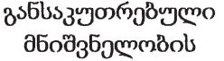
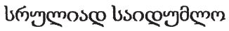
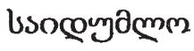
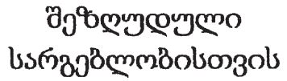
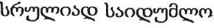
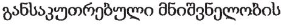
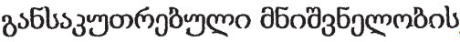
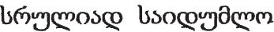

# Loi du 8 mai 2013 portant approbation des Accords entre le Gouvernement du Grand-Duché de Luxembourg et certains pays concernant l’échange et la protection réciproque des informations classifiées.

Nous Henri, Grand-Duc de Luxembourg, Duc de Nassau,

Notre Conseil d’Etat entendu;

De l’assentiment de la Chambre des Députés;

Vu la décision de la Chambre des Députés du 9 avril 2013 et celle du Conseil d’Etat du 16 avril 2013 portant qu’il n’y a pas lieu à second vote;

Avons ordonné et ordonnons:

## Art. 1er.

Est approuvé l’Accord de sécurité entre le Gouvernement du Grand-Duché de Luxembourg et le Gouvernement de la République tchèque concernant l’échange et la protection réciproque d’informations classifiées, signé à Prague, le 11 avril 2011.

## Art. 2.

Est approuvé l’Accord de sécurité entre le Gouvernement du Grand-Duché de Luxembourg et le Gouvernement du Royaume de Suède concernant l’échange et la protection réciproque d’informations classifiées, signé à Bruxelles, le 23 mai 2011.

## Art. 3.

Est approuvé l’Accord entre le Gouvernement du Grand-Duché de Luxembourg et le Gouvernement de la République slovaque concernant l’échange et la protection réciproque d’informations classifiées, signé à Bratislava, le 26 juillet 2011.

## Art. 4.

Est approuvé l’Accord entre le Gouvernement du Grand-Duché de Luxembourg et le Gouvernement de la République de Finlande concernant la protection et l’échange réciproque des informations classifiées, signé à Bruxelles, le 1er décembre 2011.

## Art. 5.

Est approuvé l’Accord entre le Grand-Duché de Luxembourg et le Royaume de Belgique concernant l’échange et la protection réciproque des informations classifiées, signé à Luxembourg, le 9 février 2012.

## Art. 6.

Est approuvé l’Accord entre le Gouvernement du Grand-Duché de Luxembourg et le Gouvernement de la République de Slovénie concernant l’échange et la protection réciproque d’informations classifiées, signé à Bruxelles, le 14 mai 2012.

## Art. 7.

Est approuvé l’Accord entre le Grand-Duché de Luxembourg et la République d’Estonie concernant l’échange et la protection réciproque d’informations classifiées, signé à Bruxelles, le 23 juillet 2012.

## Art. 8.

Est approuvé l’Accord entre le Gouvernement du Grand-Duché de Luxembourg et le Gouvernement de Géorgie concernant l’échange et la protection réciproque d’informations classifiées, signé à Luxembourg, le 15 octobre 2012.

Mandons et ordonnons que la présente loi soit insérée au Mémorial pour être exécutée et observée par tous ceux que la chose concerne.

Le Ministre des Affaires étrangères,   Jean Asselborn

Palais de Luxembourg, le 8 mai 2013.   Henri

\**ACCORD DE SECURITE** entre le Gouvernement du Grand-Duché de Luxembourg et le Gouvernement de la République tchèque concernant l’échange et la protection réciproque d’informations classifiées

Le Gouvernement du Grand-Duché de Luxembourg et le Gouvernement de la République tchèque, ci-après dénommés les «Parties», désireux de garantir la protection des informations classifiées échangées entre eux ou entre des particuliers et des personnes morales relevant de la juridiction de leurs Etats respectifs, conviennent ce qui suit, dans le respect mutuel de la sécurité et des intérêts nationaux:

## *Article 1*

\***Champ d’application de l’Accord***

1\. Le présent Accord a pour but de garantir la protection des informations classifiées échangées ou produites dans le cadre de la coopération entre les Parties, ou entre les particuliers et les personnes morales relevant de la juridiction de leurs Etats respectifs.

2\. Le présent Accord s’applique à tout contrat ou convention, ainsi qu’à tout autre projet de coopération, impliquant des informations classifiées, conclu entre les Parties ou entre les particuliers et les personnes morales relevant de la juridiction de leurs Etats respectifs.

## *Article 2*

\***Définitions***

Aux fins du présent Accord, il y a lieu de considérer les définitions suivantes:

«*Information classifiée*» désigne toute information, quelle qu’en soit la forme, conformément aux lois et réglementations nationales de l’Etat de chacune des Parties, nécessitant une protection contre toute divulgation non autorisée, détournement ou perte, et désignée en conséquence.

«*Contrat classifié*» désigne tout contrat contenant des informations classifiées ou impliquant l’accès à de telles informations.

«*Partie d’origin*e» désigne la Partie, y compris les personnes physiques et morales relevant de la juridiction de cet Etat, qui délivre des informations classifiées.

«*Partie destinataire*» désigne la Partie, y compris les personnes physiques et morales relevant de la juridiction de cet Etat, qui reçoit des informations classifiées.

«*Tierce partie*» désigne tout Etat, y compris les personnes physiques et morales relevant de la juridiction de cet Etat, ou toute organisation internationale, qui n’est pas l’une des Parties au présent Accord.

«*Habilitation de sécurité*» désigne toute décision favorable issue d’une procédure d’habilitation, certifiant la loyauté, la fiabilité, ainsi que d’autres qualités d’une personne physique ou morale en matière de sécurité, conformément aux lois et réglementations nationales.

## *Article 3*

\***Autorités de sécurité compétentes***

1\. Les autorités de sécurité compétentes en charge de la protection des informations classifiées et de l’application du présent Accord sont:

Pour le Grand-Duché de Luxembourg:  *Service de Renseignement de l’Etat* *Autorité nationale de Sécurit*é

Pour la République tchèque: *Národní bezpečnostní úřad*

2\. Les autorités de sécurité compétentes se transmettent mutuellement leurs coordonnées officielles.

## *Article 4*

\***Niveaux de sécurité***

Les équivalences des niveaux de sécurité attribués sont les suivantes:

| *Au Grand-Duché de Luxembourg* | *En République tchèque* |
|---|---|
| TRES SECRET LUX | PŘISNĚ TAJNÉ |
| SECRET LUX | TAJNÉ |
| CONFIDENTIEL LUX | DŮVĚRNÉ |
| RESTREINT LUX | VYHRAZENÉ |

## *Article 5*

\***Accès à des informations classifiées***

L’accès aux informations classifiées délivrées en vertu du présent Accord est réservé aux personnes qui ont le «besoin d’en connaître», qui sont titulaires d’une habilitation de sécurité individuelle ou d’établissement, et qui ont été informées de leurs droits et responsabilités en matière de protection d’informations classifiées, ou qui sont dûment autorisés d’une manière quelconque, conformément aux lois et réglementations de l’Etat de la Partie concernée.

## *Article 6*

\***Principes de sécurité***

1\. La Partie d’origine:

a) s’assure que les informations classifiées sont désignées par un niveau de sécurité approprié, conformément à l’article 4 du présent Accord;

b) informe la Partie destinataire de toute condition applicable à la transmission des informations classifiées, le cas échéant;

c) informe la Partie destinataire de toute modification ultérieure apportée aux niveaux de sécurité des informations classifiées délivrées.

2\. La Partie destinataire:

a) s’assure que les informations classifiées sont désignées par un niveau de sécurité équivalent conformément à l’article 4 du présent Accord;

b) accorde le même degré de protection aux informations classifiées que celui accordé à ses informations classifiées nationales de même niveau de sécurité;

c) garantit que les niveaux de sécurité ne sont pas altérés, excepté si la Partie d’origine l’autorise suite à une demande écrite;

d) s’assure que les informations classifiées reçues en vertu du présent Accord ne sont divulguées à aucune tierce partie sans l’accord écrit préalable de la Partie d’origine;

e) utilise les informations classifiées uniquement aux fins pour lesquelles elles sont délivrées et conformément aux modalités de traitement définies par la Partie d’origine.

## *Article 7*

\***Coopération en matière de sécurité***

1\. En vue de conserver des normes de sécurité similaires, les autorités de sécurité compétentes se tiennent, sur demande, mutuellement informées des normes, procédures et pratiques de sécurité nationales qu’elles appliquent en matière de protection d’informations classifiées. A cette fin, les autorités de sécurité compétentes peuvent effectuer des visites réciproques.

2\. Sur demande, les autorités de sécurité compétentes se prêtent une assistance mutuelle, conformément aux lois et réglementations nationales des Etats des Parties, dans le cadre des procédures d’habilitation de sécurité individuelle et d’établissement.

3\. Les Parties reconnaissent leurs habilitations de sécurité individuelles et d’établissement respectives, conformément aux lois et réglementations nationales de leurs Etats. L’article 4 du présent Accord s’applique en conséquence.

4\. Les autorités de sécurité compétentes se tiennent informées dans les meilleurs délais de toute modification apportée aux habilitations de sécurité individuelles et d’établissement reconnues, notamment dans le cas de leur révocation ou de leur expiration.

## *Article 8*

\***Contrats classifiés***

1\. Tout contrat classifié est conclu et mis en œuvre conformément aux lois et réglementations nationales de l’Etat de la Partie concernée en matière de protection d’informations classifiées.

2\. Sur demande, les autorités de sécurité compétentes confirment que les contractants proposés ainsi que les personnes participant aux négociations précontractuelles ou à la mise en œuvre de contrats classifiés, sont titulaires des habilitations de sécurité individuelles ou d’établissement appropriées.

3\. Chacune des autorités de sécurité compétentes peut demander à l’autorité de sécurité compétente de l’autre Partie d’effectuer une inspection au sein d’un établissement situé sur le territoire de l’Etat de ladite Partie en vue de garantir la conformité permanente à l’égard des normes de sécurité, conformément aux lois et réglementations nationales.

4\. Tout contrat classifié contient des instructions relatives aux normes de sécurité du projet et à la classification de chacun des aspects ou éléments du contrat classifié. Une copie des instructions relatives aux normes de sécurité du projet est transmise à l’autorité de sécurité compétente de l’Etat de la Partie sur le territoire de laquelle le contrat classifié doit être exécuté.

## *Article 9*

\***Transmission d’informations classifiées***

Les informations classifiées sont transmises, conformément aux lois et réglementations nationales de l’Etat de la Partie d’origine, par la voie diplomatique ou par toute autre voie approuvée par les autorités de sécurité compétentes.

## *Article 10*

\***Reproduction, traduction et destruction d’informations classifiées***

1\. Les reproductions et traductions d’informations classifiées portent un niveau de sécurité identique à celui des informations classifiées originales et bénéficient du même degré de protection. Le nombre de reproductions est limité au minimum requis.

2\. Les traductions sont accompagnées d’une note, dans la langue de traduction, indiquant qu’elles contiennent des informations classifiées reçues de la Partie d’origine.

3\. La traduction ou la reproduction des informations classifiées TRES SECRET LUX/PŘISNĚ TAJNÉ est autorisée uniquement avec l’accord écrit préalable de la Partie d’origine.

4\. Les informations classifiées TRES SECRET LUX/PŘISNĚ TAJNÉ ne sont pas détruites, mais renvoyées à la Partie d’origine.

## *Article 11*

\***Visites***

1\. Les visites nécessitant l’accès à des informations classifiées sont soumises à l’autorisation écrite préalable de l’autorité de sécurité compétente concernée, sauf convention contraire adoptée par les autorités de sécurité compétentes.

2\. Toute demande de visite est notifiée aux autorités de sécurité compétentes au moins vingt jours à l’avance. Dans le cas d’une urgence, la demande de visite peut être notifiée dans un délai plus court moyennant la coordination préalable des autorités de sécurité compétentes.

3\. Toute demande de visite contient les renseignements suivants:

a) nom et prénom, date et lieu de naissance, nationalité et numéro du passeport ou de la carte d’identité du visiteur;

b) qualité du visiteur et descriptif de l’établissement que le visiteur représente;

c) détails concernant l’habilitation de sécurité individuelle du visiteur;

d) date et durée de la visite et, dans le cas de visites récurrentes, période totale couverte par les visites;

e) objet de la visite, avec mention du niveau le plus élevé des informations classifiées impliquées;

f) nom, adresse, numéro de téléphone/fax, adresse électronique et personne de contact de l’établissement à visiter;

g) date, signature et sceau officiel de l’autorité de sécurité compétente.

4\. Les autorités de sécurité compétentes peuvent convenir d’établir une liste des visiteurs autorisés à effectuer des visites récurrentes. Les autres détails concernant les visites récurrentes font l’objet d’une coordination entre les autorités de sécurité compétentes.

## *Article 12*

\***Infraction à la sécurité***

1\. Les autorités de sécurité compétentes se tiennent mutuellement et immédiatement informées par écrit de toute infraction à la sécurité, avérée ou suspectée, entraînant la perte, le détournement ou la divulgation non autorisée d’informations classifiées.

2\. Les autorités pertinentes de la Partie destinataire ouvrent sans délai une enquête sur l’incident. Si nécessaire, les autorités pertinentes de la Partie d’origine participent à l’enquête.

3\. Dans tous les cas, l’autorité de sécurité compétente de la Partie destinataire informe par écrit l’autorité de sécurité compétente de la Partie d’origine des circonstances de l’infraction à la sécurité, de l’étendue des dommages, des mesures adoptées en vue d’y remédier, et des résultats de l’enquête.

## *Article 13*

\***Frais***

Chacune des Parties supporte les frais propres encourus du fait de l’application du présent Accord.

## *Article 14*

\***Interprétation et litiges***

Tout litige quant à l’interprétation ou l’application du présent Accord est résolu par voie de consultation entre les Parties, sans faire appel à aucune tierce partie, ou tribunal national ou international aux fins de son règlement.

## *Article 15*

\***Dispositions finales***

1\. Le présent Accord est conclu pour une durée indéterminée. Le présent Accord prend effet le premier jour du deuxième mois qui suit la date de réception de la dernière des notifications des Parties, transmise par la voie diplomatique, informant de l’accomplissement des procédures internes requises en vue de l’entrée en vigueur du présent Accord.

2\. Le présent Accord peut être modifié d’un commun accord par les Parties. Les Parties se tiennent mutuellement informées de toute modification apportée aux lois et réglementations nationales de leurs Etats, susceptible d’affecter la protection des informations classifiées délivrées en vertu du présent Accord. Les modifications apportées au présent Accord prennent effet conformément aux dispositions prévues au paragraphe 1 du présent article.

3\. Chacune des Parties peut, à tout moment, dénoncer par écrit le présent Accord, auquel cas, la validité de ce dernier prend fin six mois après la date de réception, par l’autre Partie, de la notification écrite de dénonciation.

4\. Nonobstant la dénonciation du présent Accord, toutes les informations classifiées transmises ou produites en vertu du présent Accord continuent d’être protégées conformément aux présentes dispositions, jusqu’à ce que la Partie d’origine dispense la Partie destinataire de cette obligation.

FAIT à Prague, le 11 avril 2011, en deux originaux, en langues française, tchèque et anglaise, tous les textes faisant également foi. Dans le cas d’un désaccord quant à l’interprétation des dispositions du présent Accord, le texte anglais prévaut.

EN FOI DE QUOI, les soussignés, dûment autorisés, ont signé le présent Accord.

Pour le Gouvernement du Grand-Duché de Luxembourg   Jean FALTZ   Ambassadeur extraordinaire et plénipotentiaire

Pour le Gouvernement de la République tchèque   Dušan NAVRÁTIL   Directeur Autorité nationale de Sécurité

\**ACCORD DE SECURITE **entre le Gouvernement du Grand-Duché de Luxembourg  et le Gouvernement du Royaume de Suède concernant l’échange  et la protection réciproque d’informations classifiées

\**Préambule**

Le Gouvernement du Grand-Duché de Luxembourg et le Gouvernement du Royaume de Suède, ci-après dénommés les Parties, dans l’intérêt de la sécurité nationale et dans le but de garantir la protection des informations classifiées échangées entre eux, conviennent ce qui suit:

## *Article 1*

\***Définitions***

Aux fins du présent Accord, il faut entendre par:

1\. «*Information classifiée*»: toute information, quelle qu’en soit la forme, nécessitant une protection contre toute perte, divulgation non autorisée ou autre compromission, et désignée en conséquence conformément à la législation de chacune des Parties.

2\. «*Contrat classifié*»: tout contrat contenant ou impliquant des informations classifiées.

3\. «*Habilitation de sécurité*»: toute décision favorable issue d’une procédure d’habilitation, certifiant la loyauté, la fiabilité, ainsi que d’autres qualités d’une personne physique ou morale en matière de sécurité, conformément aux lois et réglementations nationales.

4\. «*Partie d’origine*»: la Partie, y compris les entités publiques ou privées relevant de la juridiction de cette dernière, qui délivre des informations classifiées à l’autre Partie.

5\. «*Partie destinataire*»: la Partie, y compris les entités publiques ou privées relevant de la juridiction de cette dernière, qui reçoit des informations classifiées de la Partie d’origine.

6\. «*Tierce partie*»: tout Etat, y compris les entités publiques et privées relevant de la juridiction de ce dernier, ou toute organisation internationale, qui n’est pas l’une des Parties au présent Accord.

## *Article 2*

\***Niveaux de sécurité***

1\. Toute information classifiée délivrée en vertu du présent Accord est désignée par un niveau de sécurité approprié, conformément aux lois et réglementations nationales de chacune des Parties. Les informations classifiées reçues bénéficient de la protection équivalant au niveau de sécurité défini, tel qu’indiqué au paragraphe 2.

2\. Les équivalences des niveaux de sécurité nationaux sont les suivantes:

<table>
<tr>
<td rowspan="2"><i>Au Grand-Duché</i> <i>de Luxembourg</i></td>
<td colspan="2"><i>Au Royaume de Suède</i></td>
<td rowspan="2"><i>Niveau équivalent</i> <i>en anglais</i></td>
</tr>
<tr>
<td><i>Autorités de la Défense</i></td>
<td><i>Autres Autorités</i></td>
</tr>
<tr>
<td>TRES SECRET LUX</td>
<td>HEMLIG/TOP SECRET</td>
<td>HEMLIG AV SYNNERLIG BETYDELSE FÖR RIKETS SÄKERHET</td>
<td>TOP SECRET</td>
</tr>
<tr>
<td>SECRET LUX</td>
<td>HEMLIG/SECRET</td>
<td>HEMLIG</td>
<td>SECRET</td>
</tr>
<tr>
<td>CONFIDENTIEL LUX</td>
<td>HEMLIG/CONFIDENTIAL</td>
<td>–</td>
<td>CONFIDENTIAL</td>
</tr>
<tr>
<td>RESTREINT LUX</td>
<td>HEMLIG/RESTRICTED</td>
<td>–</td>
<td>RESTRICTED</td>
</tr>
</table>

3\. Les informations classifiées du Royaume de Suède portant uniquement l’appellation «HEMLIG» sont traitées comme les informations classifiées «SECRET LUX» du Grand-Duché de Luxembourg, sauf demande contraire de la Partie d’origine.

4\. Les informations du Grand-Duché de Luxembourg portant la mention RESTREINT LUX et CONFIDENTIEL LUX sont traitées comme les informations classifiées HEMLIG par les autres autorités que celles de la défense au Royaume de Suède, sauf demande contraire de la Partie d’origine.

5\. La Partie d’origine informe immédiatement la Partie destinataire de toute modification apportée au niveau de sécurité des informations classifiées délivrées.

## *Article 3*

\***Autorités de sécurité compétentes***

1\. Aux fins du présent Accord, les autorités de sécurité compétentes font référence à:

\*Pour le Grand-Duché de Luxembourg:* Service de Renseignement de l’Etat Autorité Nationale de Sécurité

\*Pour le Royaume de Suède:* Militära säkerhetstjänsten (autorité nationale de sécurité en charge de la défense) Säkerhetspolisen (autorité nationale de sécurité en charge des affaires civiles) Försvarets materielverk (autorité de sécurité désignée en matière de sécurité industrielle)

2\. Chacune des Parties communique à l’autre Partie les coordonnées de contact appropriées relatives à son autorité de sécurité compétente.

## *Article 4*

\***Divulgation et utilisation d’informations classifiées***

1\. La Partie destinataire prend toutes les mesures appropriées, conformément à ses règles constitutionnelles et à ses lois et réglementations nationales, en vue de respecter le principe de consentement de la Partie d’origine.

2\. Conformément à ses lois nationales, la Partie destinataire ne peut délivrer des informations classifiées à une tierce partie qu’avec l’accord écrit de la Partie d’origine.

## *Article 5*

\***Accès à des informations classifiées***

1\. L’accès à des informations classifiées est réservé aux personnes qui ont le «besoin d’en connaître», qui ont obtenu, au préalable, une habilitation de sécurité de niveau approprié, et qui ont été informées en matière de protection d’informations classifiées.

2\. Sous réserve de l’accomplissement des procédures requises prévues par leur législation nationale, les Parties reconnaissent mutuellement leurs certificats respectifs d’habilitations de sécurité individuelles.

## *Article 6*

\***Protection d’informations classifiées***

1\. La Partie d’origine:

a) s’assure que les informations classifiées sont désignées par un niveau de sécurité national approprié, conformément à l’article 2.2;

b) informe la Partie destinataire de toute condition de transmission ou de toute limite applicable à l’utilisation des informations classifiées, le cas échéant;

c) informe la Partie destinataire de toute modification ultérieure apportée aux niveaux de sécurité des informations classifiées délivrées.

2\. La Partie destinataire:

a) accorde aux informations classifiées un niveau de protection équivalant au niveau de sécurité défini, conformément aux exigences de la Partie d’origine;

b) s’assure que les niveaux de sécurité ne sont pas altérés, excepté si la Partie d’origine l’autorise suite à une demande écrite.

## *Article 7*

\***Transfert d’informations classifiées***

1\. Les informations classifiées sont échangées entre les Parties conformément aux lois et réglementations nationales de la Partie d’origine, par la voie diplomatique ou par toute autre voie convenue entre les autorités de sécurité compétentes.

2\. Aux fins de la sécurité de la transmission, les Parties peuvent convenir d’autres modalités détaillées.

## *Article 8*

\***Visites***

1\. Les visites d’établissements dans lesquels des informations classifiées sont traitées ou stockées sont soumises à l’autorisation préalable des autorités de sécurité compétentes de la Partie hôte, sauf convention contraire conclue entre les autorités de sécurité compétentes.

2\. Toute demande de visite est, en règle générale, présentée à l’autorité de sécurité compétente de la Partie hôte au moins 20 jours avant la visite, et contient les renseignements suivants:

a) nom du visiteur, date et lieu de naissance, nationalité, numéro de passeport ou de carte d’identité;

b) qualité du visiteur, ainsi que nom et descriptif de l’établissement que le visiteur représente;

c) détails concernant l’habilitation de sécurité individuelle du visiteur;

d) nom et descriptif de l’établissement à visiter;

e) objet de la visite;

f) date et durée de la (des) visite(s).

3\. Toute information classifiée divulguée ou mise à la disposition des visiteurs par l’une des Parties est traitée de la même manière que lorsqu’elle est délivrée à ladite Partie, et protégée en conséquence. Tous les visiteurs se conforment aux règles de sécurité de la Partie hôte.

## *Article 9*

\***Contrats classifiés***

1\. Toute Partie qui conclut, ou autorise un contractant à conclure, dans son pays, un contrat impliquant des informations classifiées avec un contractant de l’autre pays, reçoit au préalable l’assurance, de la part de l’autorité de sécurité compétente de l’autre pays, que le contractant proposé est titulaire d’une habilitation de sécurité de niveau approprié, et qu’il offre des garanties de sécurité appropriées pour assurer une protection adéquate des informations classifiées.

2\. Les Parties reconnaissent mutuellement leurs habilitations de sécurité d’établissement respectives.

3\. Chacune des autorités de sécurité compétentes peut demander à l’autre Partie d’effectuer une inspection au sein d’un établissement de ladite Partie en vue de garantir la conformité permanente à l’égard des normes de sécurité, conformément à ses lois et réglementations nationales.

4\. Tout contrat classifié contient une section ou annexe spécifique définissant les normes de sécurité et les niveaux de sécurité spécifiques de chacun des aspects ou éléments du contrat classifié.

## *Article 10*

\***Coopération en matière de sécurité***

1\. En vue d’appliquer et de conserver des normes de sécurité similaires, les autorités de sécurité compétentes se tiennent, sur demande, mutuellement informées des normes, procédures et pratiques de sécurité nationales qu’elles appliquent en matière de protection d’informations classifiées. A cette fin, les autorités de sécurité compétentes peuvent effectuer des visites réciproques.

2\. Les autorités de sécurité compétentes se tiennent mutuellement informées des risques de sécurité existants susceptibles de mettre en péril les informations classifiées délivrées, le cas échéant.

3\. Sur demande, les autorités de sécurité compétentes se prêtent une assistance mutuelle, dans les limites fixées par leurs lois et réglementations nationales, dans le cadre des procédures d’octroi des habilitations de sécurité individuelles et d’établissement.

4\. Lorsque l’une des autorités de sécurité compétentes suspend ou prend des mesures visant à révoquer l’accès à des informations classifiées accordé à un ressortissant de l’autre Partie sur la base d’une habilitation de sécurité individuelle, l’autre Partie est informée de cette décision et des motifs de celle-ci.

## *Article 11*

\***Perte ou divulgation non autorisée d’informations classifiées***

1\. En cas de perte ou de divulgation non autorisée d’informations classifiées, avérée ou suspectée, l’autorité de sécurité compétente de la Partie destinataire en informe immédiatement par écrit l’autorité de sécurité compétente de la Partie d’origine.

2\. Conformément à ses lois et réglementations nationales, la Partie destinataire (avec l’aide des autorités de sécurité compétentes de la Partie d’origine, le cas échéant) ouvre une enquête immédiate sur l’incident. La Partie destinataire informe immédiatement la Partie d’origine des circonstances de l’incident, des dommages causés, des mesures adoptées pour y remédier, et des résultats de l’enquête.

## *Article 12*

\***Interprétation et litiges***

Tout litige quant à l’interprétation ou l’application du présent Accord est résolu par voie de consultation entre les Parties, sans faire appel à aucune tierce partie, ou tribunal national ou international pour son règlement.

## *Article 13*

\***Dispositions finales***

1\. Le présent Accord prend effet le premier jour qui suit la réception de la dernière des notifications, transmise par écrit et par voie diplomatique, confirmant l’accomplissement de toutes les procédures internes des deux Parties, telles que requises à cette fin.

2\. Le présent Accord peut être modifié d’un commun accord, par écrit, par les deux Parties. Ces modifications entrent en vigueur conformément aux dispositions du paragraphe 1 du présent article.

3\. Le présent Accord est conclu pour une durée indéterminée. Chacune des Parties peut, à tout moment, dénoncer par écrit le présent Accord, auquel cas, l’Accord prend fin six (6) mois après la date de réception, par l’autre Partie, de la notification de dénonciation.

4\. Nonobstant la dénonciation du présent Accord, toutes les informations classifiées délivrées en vertu de ce dernier continuent d’être protégées conformément aux présentes dispositions.

5\. Les Parties se tiennent mutuellement informées sans délai de toute modification apportée à leurs lois et réglementations nationales, susceptible d’affecter la protection des informations classifiées délivrées en vertu du présent Accord. Dans ce cas, les Parties se consultent en vue d’envisager d’éventuelles modifications du présent Accord. Entre-temps, les informations classifiées continuent d’être protégées conformément au présent Accord, sauf demande écrite contraire de la Partie d’origine.

6\. La Partie sur le territoire de laquelle le présent Accord est signé transmet ce dernier pour enregistrement au Secrétariat des Nations Unies, conformément à l’article 102 de la [Charte des Nations Unies](https://legilux.public.lu/eli/etat/leg/agd/1945/08/10/n1/jo), et informe l’autre Partie de la conclusion de cette procédure en mentionnant le numéro d’enregistrement correspondant.

FAIT à Bruxelles, le 23 mai 2011, en deux originaux, chacun en langues française, suédoise et anglaise, tous les textes faisant également foi. Dans le cas d’un désaccord quant à l’interprétation des dispositions du présent Accord, le texte anglais prévaut.

EN FOI DE QUOI, les soussignés, dûment autorisés par leurs gouvernements respectifs, ont signé le présent Accord.

Pour le Gouvernement du Grand-Duché de Luxembourg   (signature)

Pour le Gouvernement du Royaume de Suède   (signature)

\**ACCORD entre le Gouvernement du Grand-Duché de Luxembourg  et le Gouvernement de la République slovaque concernant l’échange  et la protection réciproque d’informations classifiées**

\*Le Gouvernement du Grand-Duché de Luxembourg*

et

\*le Gouvernement de la République slovaque*

(ci-après dénommés les «Parties»),

Dans le but de garantir la protection des informations classifiées échangées entre les Etats des Parties ou entre les entités publiques ou privées relevant de leur juridiction, eu égard à la sécurité et aux intérêts nationaux,

CONVIENNENT CE QUI SUIT:

## *Article 1*

\***Objet et champ d’application***

1\. Le présent Accord a pour but de garantir la protection des informations classifiées généralement créées ou échangées entre les Etats des Parties.

2\. Le présent Accord ne peut être invoqué par l’une des Parties pour obtenir des informations classifiées que l’autre Partie a reçu d’une tierce partie.

## *Article 2*

\***Définitions***

Aux fins du présent Accord:

a) «*Information classifiée*» désigne toute information, document ou matériel, quelle qu’en soit la forme ou la nature, créé ou échangé entre les Etats des Parties, nécessitant une protection contre toute manipulation non autorisée, et classifié conformément aux législations nationales respectives;

b) «*Partie d’origine*» désigne l’Etat de la Partie qui transmet des informations classifiées à l’Etat de l’autre Partie;

c) «*Partie destinataire*» désigne l’Etat de la Partie qui reçoit des informations classifiées de l’Etat de l’autre Partie;

d) «*Autorité de sécurité compétente*» désigne l’organe de sécurité national en charge de l’application et de la supervision du présent Accord;

e) «*Contrat classifié*» désigne tout contrat ou contrat de sous-traitance entre deux ou plusieurs contractants qui contient ou implique des informations classifiées;

f) «*Contractant*» désigne toute personne physique ou morale dotée de la capacité juridique de conclure des contrats classifiés;

g) «*Habilitation de sécurité d’établissement*» désigne toute décision de l’autorité de sécurité compétente selon laquelle l’entité juridique possède la capacité physique et organisationnelle de traiter et de stocker des informations classifiées conformément à sa législation nationale;

h) «*Habilitation de sécurité individuelle*» désigne toute décision de l’autorité de sécurité compétente selon laquelle le ressortissant est autorisé à accéder à des informations classifiées conformément à sa législation nationale;

i) «*Besoin d’en connaître*» fait référence à la nécessité d’accéder à des informations classifiées dans le cadre d’une fonction officielle déterminée en vue de l’accomplissement d’une mission spécifique;

j) «*Tierce partie*» désigne tout Etat, organisation, entité juridique ou personne physique, qui n’est pas l’une des Parties au présent Accord.

## *Article 3*

\***Niveaux de sécurité***

Les Parties reconnaissent que les niveaux de sécurité suivants sont équivalents et correspondent aux niveaux de sécurité spécifiés dans la législation nationale de leurs Etats respectifs:

| *Pour le Grand-Duché de Luxembourg* | *Pour la République slovaque* |
|---|---|
| TRES SECRET LUX | PRÍSNE TAJNÉ |
| SECRET LUX | TAJNÉ |
| CONFIDENTIEL LUX | DÔVERNÉ |
| RESTREINT LUX | VYHRADENÉ |

## *Article 4*

\***Autorités de sécurité compétentes***

1\. Les autorités de sécurité compétentes des Etats des Parties sont:

\*Pour le Grand-Duché de Luxembourg:* Service de Renseignement de l’Etat Autorité nationale de Sécurité

\*Pour la République slovaque:* Národný bezpečnostný úrad

2\. Les Etats des Parties se tiennent mutuellement informées, par la voie diplomatique, de toute modification apportée aux coordonnées des autorités de sécurité compétentes.

3\. Sur demande, les autorités de sécurité compétentes se tiennent mutuellement informées de leurs législations nationales respectives traitant des informations classifiées, et échangent des informations relatives aux normes, procédures et pratiques de sécurité qu’elles appliquent en matière de protection d’informations classifiées.

## *Article 5*

\**Protection des informations classifiées**

1\. Conformément à leur législation nationale, les Etats des Parties prennent toutes les mesures appropriées afin de protéger les informations classifiées échangées ou créées en vertu du présent Accord. Elles apportent auxdites informations classifiées un niveau de protection équivalent à celui qui est accordé à leurs informations classifiées nationales de même niveau de sécurité, conformément à l’Article 3.

2\. La Partie d’origine informe par écrit la Partie destinataire de toute modification apportée aux niveaux de sécurité des informations classifiées transmises.

3\. L’accès aux informations classifiées est réservé aux personnes autorisées, sur la base du «besoin d’en connaître», à accéder aux informations classifiées d’un niveau de sécurité équivalent, conformément à leur législation nationale.

4\. Dans le cadre du présent Accord, l’Etat de chacune des Parties reconnaît les habilitations de sécurité individuelles et d’établissement délivrées conformément à la législation nationale de l’Etat de l’autre Partie. Les habilitations de sécurité respectent les équivalences définies à l’Article 3.

5\. Sur demande et conformément à la législation nationale, les autorités de sécurité compétentes se prêtent mutuellement assistance dans le cadre de la mise en œuvre des procédures d’habilitation requises en vertu du présent Accord.

6\. Dans le cadre du présent Accord, les autorités de sécurité compétentes se tiennent mutuellement informées sans délai de toute modification apportées aux habilitations de sécurité individuelles et d’établissement, en particulier de tout déclassement ou déclassification.

7\. La Partie destinataire:

a) ne transmet aucune information classifiée à une tierce partie sans l’accord écrit préalable de la Partie d’origine;

b) classifie les informations reçues conformément à l’article 3;

c) n’utilise des informations classifiées qu’aux fins prévues.

## *Article 6*

\***Transmission des informations* *classifiées***

1\. Les informations classifiées sont transmises conformément aux législations nationales respectives par la voie diplomatique, sauf modalité contraire autorisée par les autorités de sécurité compétentes. La Partie destinataire confirme par écrit la réception des informations classifiées.

2\. La transmission électronique d’informations classifiées est effectuée par le biais de méthodes cryptographiques certifiées acceptées par les autorités de sécurité compétentes.

## *Article 7*

\***Reproduction et traduction d’informations classifiées***

1\. La traduction et la reproduction d’informations classifiées se font conformément à la législation nationale de la Partie destinataire et aux procédures suivantes:

a) les personnes sont titulaires d’une habilitation de sécurité individuelle appropriée, conformément à leur législation nationale;

b) les traductions et les reproductions sont classifiées et protégées de la même manière que les informations classifiées originales;

c) les traductions et le nombre de reproductions sont limités à ceux requis pour un usage officiel;

d) les traductions sont accompagnées d’une note appropriée dans la langue de traduction, indiquant qu’elles contiennent des informations classifiées reçues de la Partie d’origine.

2\. La traduction ou la reproduction des informations classifiées SECRET LUX/TAJNÉ ou de niveau supérieur sont autorisées uniquement avec l’accord écrit préalable de la Partie d’origine.

## *Article 8*

\***Destruction d’informations classifiées***

1\. Les informations classifiées sont détruites de manière à empêcher leur reconstitution intégrale ou partielle.

2\. Les informations classifiées jusqu’au niveau SECRET LUX/TAJNÉ sont détruites conformément aux législations nationales.

3\. Les informations classifiées TRES SECRET LUX/PRÍSNE TAJNÉ ne sont pas détruites et sont renvoyées à l’autorité de sécurité compétente de la Partie d’origine.

4\. Un rapport relatif à la destruction d’informations classifiées est rédigé et sa traduction en langue anglaise est transmise à l’autorité de sécurité compétente de la Partie d’origine.

## *Article 9*

\***Contrats classifiés***

1\. L’Etat de chacune des Parties qui souhaite conclure un contrat classifié avec un contractant de l’Etat de l’autre Partie, ou qui souhaite autoriser l’un de ses propres contractants à conclure un contrat classifié sur le territoire de l’Etat de l’autre Partie dans le cadre d’un projet classifié, reçoit au préalable, de son autorité de sécurité compétente, l’assurance écrite de l’autorité de sécurité compétente de l’Etat de l’autre Partie que le contractant proposé est titulaire d’une habilitation de sécurité d’établissement de niveau de sécurité approprié, conformément aux législations nationales respectives.

2\. Tout contrat classifié contient une section ou une annexe spécifique indiquant les exigences de sécurité des contrats classifiés.

3\. Chaque contrat classifié conclu en vertu du présent Accord inclut:

a) l’engagement du contractant de garantir que ses locaux disposent des conditions nécessaires au traitement et au stockage d’informations classifiées d’un niveau de sécurité approprié;

b) l’engagement du contractant de garantir que les personnes qui accomplissent une mission nécessitant l’accès à des informations classifiées sont titulaires d’une habilitation de sécurité individuelle de niveau approprié;

c) l’engagement du contractant de garantir que toutes les personnes ayant accès à des informations classifiées sont informées de leurs responsabilités concernant la protection des informations classifiées, conformément à leur législation nationale;

d) l’engagement du contractant d’effectuer des inspections de sécurité périodiques au sein de ses locaux;

e) la liste des informations classifiées et la liste des domaines dans lesquels des informations classifiées sont susceptibles d’apparaître;

f) la procédure relative à la notification des modifications apportées aux niveaux de sécurité des informations classifiées;

g) la liste des voies de communication et des moyens de transmission électroniques;

h) la procédure relative au transport d’informations classifiées;

i) la liste des personnes ou des entités juridiques autorisées pertinentes en charge de la coordination de la protection des informations classifiées liées au contrat classifié;

j) l’engagement du contractant de communiquer toute perte, fuite ou compromission, avérée ou suspectée, d’informations classifiées;

k) l’engagement du contractant de transmettre une copie du contrat classifié à sa propre autorité de sécurité compétente;

l) l’engagement du sous-traitant de satisfaire aux mêmes obligations de sécurité que celles du contractant.

4\. Dès le début des négociations précontractuelles entre un contractant potentiel situé sur le territoire d’un Etat de l’une des Parties et un autre contractant éventuel situé sur le territoire de l’Etat de l’autre Partie aux fins de la conclusion d’un contrat classifié, l’autorité de sécurité compétente informe l’Etat de l’autre Partie du niveau de sécurité accordé aux informations classifiées liées à ces négociations précontractuelles.

5\. Une copie de chaque contrat classifié est transmis à l’autorité de sécurité compétente de l’Etat de la Partie sur le territoire duquel la mission doit être accomplie en vue de garantir une supervision et un contrôle de sécurité appropriés.

6\. Les représentants des autorités de sécurité compétentes peuvent effectuer des visites réciproques afin d’analyser l’efficacité des mesures adoptées par un contractant pour garantir la protection des informations classifiées impliquées dans un contrat classifié. Toute visite doit être notifiée au moins vingt jours à l’avance.

## *Article 10*

\**Visites**

1\. Les visites impliquant l’accès de ressortissants de l’Etat de l’une des Parties à des informations classifiées de l’Etat de l’autre Partie requièrent l’accord écrit préalable des autorités de sécurité compétentes de l’Etat d’accueil.

2\. Les visites impliquant l’accès à des informations classifiées sont accordées par l’Etat de l’une des Parties aux visiteurs de l’Etat de l’autre Partie uniquement si ces derniers sont titulaires d’une habilitation de sécurité individuelle appropriée et sont autorisés à recevoir ou à avoir accès à des informations classifiées conformément à leur législation nationale.

3\. Les visites de ressortissants d’une tierce partie impliquant l’accès à des informations classifiées sont autorisées d’un commun accord entre les Etats des Parties.

4\. L’autorité de sécurité compétente de l’Etat d’accueil reçoit la demande de visite de l’autre autorité de sécurité compétente au moins 30 jours à l’avance.

5\. Dans le cas d’une urgence, la demande de visite est adressée au moins sept jours avant la date prévue.

6\. Toute demande de visite contient les renseignements suivants:

a) nom et prénom, date et lieu de naissance, nationalité et numéro du passeport ou du document d’identité du visiteur;

b) nom de l’entité juridique que le visiteur représente;

c) nom et adresse de l’entité juridique à visiter;

d) confirmation de l’habilitation de sécurité personnelle et validité de cette dernière;

e) objet et objectif de la visite, et déclaration relative au niveau de sécurité le plus élevé des informations classifiées concernées;

f) date et durée prévues de la visite requise; dans le cas de visites récurrentes, il convient d’indiquer la période totale couverte par les visites;

g) date, signature et sceau officiel de l’autorité de sécurité compétente.

7\. Une fois la visite autorisée, l’autorité de sécurité compétente de l’Etat d’accueil fournit une copie de la demande de visite aux responsables de la sécurité de l’entité juridique à visiter.

8\. L’autorisation de visite est valable un an au maximum.

9\. Les Etats des Parties peuvent dresser des listes de personnes autorisées à effectuer des visites récurrentes. Ces listes sont valables douze mois au maximum. Les conditions générales des visites respectives sont directement fixées par les points de contact appropriés de l’entité juridique que ces personnes doivent visiter, conformément aux modalités convenues.

10\. L’Etat de chacune des Parties garantit la protection des données personnelles des visiteurs, conformément à sa législation nationale.

## *Article 11*

\***Infraction à la sécurité***

1\. Dans le cas d’une infraction à la sécurité, conformément à la législation nationale, entraînant la compromission avérée ou suspectée des informations classifiées transmises ou reçues par l’Etat de l’autre Partie, l’autorité de sécurité compétente de l’Etat de la Partie sur le territoire de laquelle l’infraction ou la compromission a été commise informe dès que possible l’autorité de sécurité compétente de l’Etat de l’autre Partie et ouvre une enquête appropriée.

2\. Si une infraction à la sécurité est commise dans un autre Etat que ceux des Parties, l’autorité de sécurité compétente de l’Etat d’origine prend les mesures énoncées au paragraphe 1.

3\. Sur demande, l’Etat de l’autre Partie coopère à l’enquête, conformément au paragraphe 1.

4\. L’Etat de l’autre Partie est tenu informé des résultats de l’enquête et reçoit une traduction anglaise du rapport final sur les raisons et l’étendue des dommages.

## *Article 12*

\***Frais***

Chacune des Parties supporte les frais propres encourus du fait de l’application et de la supervision du présent Accord.

## *Article 13*

\***Règlement des litiges***

Tout litige quant à l’interprétation ou l’application du présent Accord est résolu par la voie diplomatique, sauf si les autorités de sécurité compétentes parviennent à le résoudre.

## *Article 14*

\**Dispositions finales**

1\. Le présent Accord est conclu pour une durée indéterminée et prend effet le premier jour du deuxième mois qui suit la réception de la dernière des notifications écrites par lesquelles les Parties se sont tenues mutuellement informées, par la voie diplomatique, de l’accomplissement des exigences légales nationales requises pour son entrée en vigueur.

2\. Le présent Accord peut, à tout moment, être modifié d’un commun accord, par écrit, entre les Parties.

3\. Chacune des Parties peut, à tout moment, dénoncer le présent Accord moyennant notification écrite transmise par la voie diplomatique, auquel cas la dénonciation prend effet six mois à compter de la date de réception de la notification correspondante.

4\. Nonobstant la dénonciation du présent Accord, les Parties garantissent que toutes les informations classifiées continuent d’être protégées jusqu’à ce que la Partie d’origine dispense la Partie destinataire de cette obligation.

5\. L’Etat de la Partie sur le territoire duquel le présent Accord est signé transmet ce dernier pour enregistrement au Secrétariat des Nations Unies, conformément à l’article 102 de la [Charte des Nations Unies](https://legilux.public.lu/eli/etat/leg/agd/1945/08/10/n1/jo), et informe l’autre Partie de la conclusion de cette procédure en mentionnant le numéro d’enregistrement correspondant.

EN FOI DE QUOI, les soussignés, dûment autorisés, ont signé le présent Accord.

FAIT à Bratislava, le 26 juillet 2011, en double exemplaire, chacun en langues française, slovaque et anglaise, tous les textes faisant également foi. Dans le cas d’un désaccord quant à l’interprétation des dispositions du présent Accord, le texte anglais prévaut.

Pour le Gouvernement du Grand-Duché de Luxembourg   Marc THILL   Ambassadeur extraordinaire et plénipotentiaire

Pour le Gouvernement de la République slovaque   František BLANÁRIK   Directeur de l’Autorité nationale de Sécurité

\**ACCORD **entre le Gouvernement du Grand-Duché de Luxembourg  et le Gouvernement de la République de Finlande concernant la protection  et l’échange réciproque des informations classifiées

Le Gouvernement du Grand-Duché de Luxembourg et le Gouvernement de la République de Finlande, ci-après dénommés les «Parties»,

Attendu que les Parties coopèrent en matière d’affaires étrangères, de défense, de sécurité, ainsi que sur le plan policier, scientifique, industriel et technologique,

Dans le but de garantir la protection de toute Information Classifiée échangée de manière confidentielle directement entre les Parties, ou encore entre des entités juridiques publiques ou privées ou des particuliers relevant de la juridiction respective des Parties,

CONVIENNENT CE QUI SUIT:

## *Article 1*

\**Objet et champ d’application**

Le présent Accord a pour objet de garantir la protection d’Informations Classifiées échangées ou créées au cours de la coopération entre les Parties.

## *Article 2*

\**Définitions**

Aux fins du présent Accord:

a) *«Information Classifiée»* désigne toute information, document ou matériel, quelle qu’en soit la forme, auquel un niveau de classification de sécurité a été attribué et qui a été marqué en conséquence en vertu des lois et réglementations nationales, ainsi que toute information, document ou matériel créé sur la base de ces Informations Classifiées et marqué en conséquence;

b) *«Contrat classifié»* désigne tout contrat ou sous-contrat, y compris toutes négociations précontractuelles, contenant ou impliquant des Informations Classifiées;

c) *«Autorité de Sécurité Compétente»* désigne l’Autorité nationale de Sécurité, toute Autorité de Sécurité Désignée ou toute autre entité compétente autorisée conformément aux lois et réglementations nationales des Parties et qui sont responsables de la mise en application du présent Accord selon les domaines concernés;

d) *«Besoin d’en connaître»* désigne le principe qui fait référence à la nécessité d’accéder à des Informations Classifiées dans le cadre d’une fonction officielle déterminée en vue de l’accomplissement d’une mission spécifique;

e) *«Partie d’origine»* désigne la Partie, ainsi que toute entité juridique publique ou privée soumise à son autorité, qui produit ou fournit les Informations Classifiées;

f) *«Partie destinataire»* désigne la Partie, ainsi que toute entité juridique publique ou privée soumise à son autorité, qui reçoit les Informations Classifiées de la Partie d’origine;

g) *«Tierce partie»* désigne tout Etat ou entité juridique qui n’est pas l’une des Parties au présent Accord ou une personne physique qui n’est pas soumise à la juridiction d’une des Parties.

## *Article 3*

\**Autorités de Sécurité Compétentes**

1\. Les Autorités nationales de Sécurité désignées par les Parties en tant que responsables ultimes de la supervision de l’ensemble des aspects du présent Accord, sont:

| *Pour le Grand-Duché de Luxembourg* | *Pour la République de Finlande* |
|---|---|
| Service de Renseignement de l’Etat | Ministère des Affaires étrangères |
| Autorité nationale de Sécurité | Autorité nationale de sécurité |
| Luxembourg | Helsinki |
| Grand-Duché du Luxembourg | Finlande |

2\. Les Parties se tiennent mutuellement informées de la désignation de toute Autorité de Sécurité Compétente chargée de l’application de certains aspects du présent Accord.

3\. Les Parties se tiennent mutuellement informées de toute modification ultérieure affectant une Autorité de Sécurité Compétente.

## *Article 4*

\**Niveaux de sécurité**

1\. Toute Information Classifiée fournie en vertu du présent Accord sera marquée par le niveau approprié de classification de sécurité conformément aux lois et réglementations nationales des Parties.

2\. Les Parties reconnaissent que leurs marques de classification de sécurité correspondent aux niveaux mentionnés ci-dessous et qu’ils sont considérés comme équivalents:

| *Pour le Grand-Duché de Luxembourg* | *Pour la République de Finlande* |
|---|---|
| TRES SECRET LUX | ERITTÄIN SALAINEN |
| SECRET LUX | SALAINEN |
| CONFIDENTIEL LUX | LUOTTAMUKSELLINEN |
| RESTREINT LUX | KÄYTTÖ RAJOITETTU |

3\. La Partie destinataire garantit que les niveaux de classification de sécurité ne sont ni altérés ni révoqués, sauf autorisation écrite de la Partie d’origine.

## *Article 5*

\**Protection des Informations Classifiées**

1\. Conformément à leurs lois et réglementations nationales, les Parties prennent toutes les mesures appropriées pour garantir la protection des Informations Classifiées fournies dans le cadre du présent Accord. Elles apportent auxdites Informations un niveau de protection équivalent à celui qui est accordé à leurs propres Informations Classifiées nationales pour le niveau de classification de sécurité correspondant.

2\. Les Parties ne donnent pas accès aux Informations Classifiées à des Tierces parties sans l’accord écrit préalable de la Partie d’origine.

3\. L’accès aux Informations Classifiées est réservé aux personnes ayant le «Besoin d’en connaître» et qui sont titulaires d’une habilitation de sécurité appropriée en vertu des lois et réglementations nationales, qui sont autorisées à accéder à de telles informations et qui ont été informées de leurs responsabilités concernant la protection des Informations Classifiées.

4\. Les Informations Classifiées ne peuvent être utilisées à fins autres que celles pour lesquelles elles sont fournies.

## *Article 6*

\**Contrats classifiés**

1\. Dans le cas d’un Contrat classifié conclu sur le territoire d’une des deux Parties, l’Autorité nationale de Sécurité de la Partie d’origine doit obtenir de la part de l’Autorité nationale de Sécurité de la Partie destinataire, la confirmation préalable écrite que le contractant proposé est titulaire d’une habilitation de sécurité appropriée.

2\. Dans le cas d’un marché public, l’Autorité de Sécurité Compétente de la Partie destinataire met à la disposition de l’Autorité de Sécurité Compétente de la Partie d’origine l’habilitation de sécurité pertinente sans demande formelle préalable.

3\. L’Autorité de Sécurité Compétente confirme que le contractant a reçu une habilitation de sécurité adaptée au niveau de classification de sécurité concerné. Elle assume également la responsabilité de garantir que la conduite du contractant qui a reçu l’habilitation de sécurité est conforme aux lois et réglementations nationales.

4\. Les contrats classifiés contiennent des dispositions appropriées en matière de sécurité et sont accompagnés de documents permettant d’identifier les informations, ou les éléments ou aspects du contrat qui sont classifiés.

5\. Les représentants des Autorités de Sécurité Compétentes peuvent effectuer des visites réciproques afin d’analyser l’efficacité des mesures adoptées par un contractant pour garantir la protection des Informations Classifiées impliquées dans un contrat classifié.

## *Article 7*

\**Transmission des Informations Classifiées**

1\. Les Informations Classifiées sont transmises entre les Parties conformément aux lois et réglementations nationales respectives, par la voie diplomatique, sauf modalité contraire autorisée par les Autorités de Sécurité Compétentes, comme par exemple moyens de communication, réseaux ou moyens électromagnétiques protégés.

2\. Si l’une des Parties souhaite transférer des Informations Classifiées en provenance de l’autre Partie en dehors de son territoire, un tel transfert reçoit, au préalable, l’autorisation écrite de la Partie d’origine.

## *Article 8*

\**Traduction, Reproduction et Destruction d’Informations Classifiées**

1\. Toutes les traductions ou reproductions des Informations Classifiées portent les mêmes marques de niveau de sécurité et bénéficient de la même protection. Le nombre de reproductions est limité au minimum requis pour un usage officiel.

2\. Toutes les traductions incluent une note appropriée, dans la langue de traduction, indiquant qu’elles contiennent des Informations Classifiées de la Partie d’origine.

3\. Les Informations Classifiées ERITTÄIN SALAINEN/TRES SECRET LUX sont traduites ou reproduites uniquement avec l’accord écrit préalable de la Partie d’origine.

4\. Les Informations Classifiées ERITTÄIN SALAINEN/TRES SECRET LUX ne doivent pas être détruites sauf en cas d’autorisation expresse écrite de la Partie d’origine. Elles sont restituées à la Partie d’origine après avoir été reconnues comme n’étant plus nécessaires.

5\. Les Informations Classifiées SALAINEN/SECRET LUX ou d’un niveau inférieur sont détruites conformément aux lois et réglementations nationales.

6\. Dans le cas d’une situation de crise rendant impossible la protection des Informations Classifiées visées par le présent Accord, les Informations Classifiées sont détruites immédiatement. La Partie destinataire informe dès que possible l’Autorité nationale de Sécurité de la Partie d’origine de la destruction des Informations Classifiées.

## *Article 9*

\**Visites**

1\. Les visites impliquant l’accès à des Informations Classifiées requièrent l’autorisation préalable par écrit des Autorités de Sécurité Compétentes de la Partie hôte. L’accès est autorisé aux visiteurs uniquement si ces derniers:

a) sont titulaires d’une habilitation de sécurité appropriée et sont autorisés à recevoir des Informations Classifiées conformément aux lois et réglementations nationales de la Partie hôte,

et

b) sont autorisés par l’Autorité de Sécurité Compétente de la Partie d’origine à effectuer la ou les visites requises.

2\. L’Autorité de Sécurité Compétente de la Partie requérante informe l’Autorité de Sécurité Compétente de la Partie hôte de la visite programmée conformément aux dispositions du présent Article, et s’assure que cette dernière reçoit la demande de visite au moins 21 jours calendriers avant la date prévue de la visite. Dans le cas d’une urgence, les Autorités de Sécurité Compétentes peuvent convenir d’un délai plus court. Les informations mises à disposition dans la demande de visite sont convenues ente les Autorités nationales de Sécurité.

3\. La demande de visite est adressée à l’Autorité de Sécurité Compétente de la Partie hôte.

4\. La validité des autorisations relatives à des visites récurrentes ne doit pas excéder douze (12) mois.

## *Article 10*

\**Coopération en matière de sécurité**

1\. Aux fins de la mise en œuvre du présent Accord, les Autorités de Sécurité Compétentes se tiennent mutuellement informées des lois et réglementations nationales pertinentes régissant la protection des Informations Classifiées ainsi que de tous changements ultérieurs affectant la protection des Informations Classifiées reçues par l’autre Partie.

2\. Afin de garantir une étroite coopération dans la mise en œuvre du présent Accord, les Autorités de Sécurité Compétentes doivent, si nécessaire, se consulter mutuellement et se transmettre mutuellement, sur demande, des informations relatives aux normes, procédures et pratiques nationales de sécurité traitant de la protection des Informations Classifiées.

3\. Chaque Partie autorise des représentants des Autorités de Sécurité Compétentes de l’autre Partie à se rendre sur son territoire afin de discuter des procédures liées à la protection des Informations Classifiées transmises par l’autre Partie.

4\. Sur demande, les Autorités de Sécurité Compétentes se prêtent mutuellement assistance, conformément aux lois et réglementations nationales, lors des enquêtes de sécurité.

5\. Les Autorités nationales de Sécurité se tiennent mutuellement informées dans les plus brefs délais de toute décision relative à la révocation, suspension ou rétrogradation du niveau d’habilitation de sécurité individuelle d’une personne si cette dernière a eu accès à des Informations Classifiées de l’autre partie en vertu du présent Accord.

## *Article 11*

\**Résolution des litiges**

Tout litige entre les Parties quant à l’interprétation ou l’application du présent Accord est exclusivement résolu dans le cadre de consultations entre les Parties, sans faire appel à aucune tierce partie ou tribunal national ou international.

## *Article 12*

\**Infraction à la sécurité**

1\. Chaque Partie informe immédiatement l’autre Partie de toute infraction à la sécurité ou compromission avérée ou suspectée concernant des Informations Classifiées échangées dans le cadre du présent Accord.

2\. La Partie sur le territoire de laquelle l’infraction a été commise prend toutes les mesures appropriées, conformément à ses lois et réglementations nationales, afin de limiter les conséquences d’une infraction ou compromission, telle que définie au paragraphe 1 du présent article. Elle mène également immédiatement une enquête sur les circonstances de toute infraction à la sécurité, avec, si nécessaire, l’aide de l’autre Partie. La Partie sur le territoire de laquelle l’infraction a été commise informe l’autre Partie des résultats de l’enquête et des mesures adoptées pour prévenir toute violation ultérieure.

## *Article 13*

\**Frais**

Chacune des Parties supporte les frais propres encourus du fait de l’exécution de ses obligations en vertu du présent Accord.

## *Article 14*

\**Modalités d’application**

Les Autorités de Sécurité Compétentes élaborent des procédures détaillées aux fins de l’application du présent Accord en cas de nécessité.

## *Article 15*

\**Dispositions finales**

1\. Chacune des Parties notifie à l’autre l’accomplissement des procédures internes requises en ce qui la concerne pour l’entrée en vigueur du présent Accord qui prend effet le premier jour du second mois suivant la réception de la dernière des notifications.

2\. Le présent Accord reste applicable jusqu’à nouvel ordre. L’Accord peut être modifié d’un commun accord par écrit entre les Parties. Chacune des Parties peut à tout moment proposer des amendements au présent Accord. Si l’une des Parties propose un amendement à l’Accord, les Parties entreprennent des consultations au sujet dudit amendement.

3\. Chacune des Parties peut mettre un terme au présent Accord en envoyant une notification écrite par la voie diplomatique à l’autre Partie en respectant un préavis de six (6) mois. Si l’Accord prend fin, toutes les Informations Classifiées déjà transférées et toutes les Informations Classifiées ultérieures soumises au présent Accord seront traitées conformément aux dispositions de ce dernier aussi longtemps que nécessaire aux fins de la protection des Informations Classifiées.

4\. A la suite de l’entrée en vigueur du présent Accord, la Partie sur le territoire de laquelle l’Accord est signé prend immédiatement les mesures requises pour procéder à l’enregistrement de l’Accord auprès du Secrétariat des Nations Unies, conformément à l’article 102 de la [Charte des Nations Unies](https://legilux.public.lu/eli/etat/leg/agd/1945/08/10/n1/jo) et informe l’autre Partie de cet enregistrement et de son numéro d’enregistrement dans le Recueil des traités des Nations Unies.

EN FOI DE QUOI, les représentants des deux Parties, dûment autorisés à cet effet, ont signé le présent Accord, à Bruxelles, le 1er décembre 2011, en double exemplaire, en langues française, finlandaise et anglaise, chaque texte faisant également foi. Dans le cas d’un désaccord quant à l’interprétation des dispositions du présent Accord, le texte anglais prévaut.

Pour le Gouvernement du Grand-Duché de Luxembourg   (signature)

Pour le Gouvernement  de la République de Finlande   (signature)

\**ACCORD **entre le Grand-Duché de Luxembourg et le Royaume de Belgique  concernant l’échange et la protection réciproque des informations classifiées

\*Le Grand-Duché de Luxembourg,*

\*Le Royaume de Belgique,*

Ci-après dénommés les Parties,

Souhaitant garantir la protection des Informations et des matériels Classifiés échangés ou produits entre les deux Etats ou entre des organismes publics ou privés soumis à leurs lois et réglementations nationales respectives;

SONT CONVENUS des dispositions suivantes,

## *Article 1*

\**Définitions**

Aux fins du présent Accord:

1.1 *«Informations Classifiées»* fait référence aux informations, documents et matériels, quels qu’en soient la forme, la nature ou le mode de transmission, qu’ils soient élaborés ou en cours d’élaboration, auquel un degré de classification ou de protection a été attribué et qui, dans l’intérêt de la sécurité nationale et conformément aux lois et réglementations nationales des Parties, nécessitent une protection contre toute violation, destruction, détournement, divulgation, perte, accès par une personne non autorisée ou tout autre type de compromission.

1.2 *«Contrat classifié»* signifie un contrat, un contrat de sous-traitance ou un projet dont l’élaboration et l’exécution nécessitent l’accès à des Informations Classifiées ou l’utilisation d’Informations Classifiées.

1.3 *«Contractant»* signifie tout individu ou personne morale ayant la capacité juridique de négocier et conclure des contrats classifiés.

1.4 *«Autorité Nationale de Sécurité»* fait référence à l’autorité nationale responsable du contrôle général et de la mise en application du présent Accord pour chacune des Parties.

1.5 *«Autorités de Sécurité Compétentes»* fait référence à toute Autorité de Sécurité Désignée ou toute autre entité compétente autorisée conformément aux lois et réglementations nationales des Parties et qui sont responsables de la mise en application du présent Accord selon les domaines concernés.

1.6 *«Partie d’origine»* fait référence à la Partie, y compris tout organisme public ou privé soumis à ses lois et réglementations nationales, qui délivre ou transmet une Information Classifiée à l’autre Partie.

1.7 *«Partie destinataire»* fait référence à la Partie, y compris tout organisme public ou privé soumis à ses lois et réglementations nationales, à qui les Informations Classifiées sont transmises.

1.8 *«Partie hôte»* fait référence à la Partie sur le territoire de laquelle une visite a lieu.

1.9 *«Besoin d’en connaître»* fait référence à la nécessité d’avoir accès à des Informations Classifiées dans le cadre d’une fonction officielle déterminée et pour l’exécution d’une mission spécifique.

1.10 *«Etat Tiers»* fait référence à une Partie qui n’est pas partie au présent Accord.

1.11 *«Infraction à la sécurité»* fait référence à un acte ou une omission commis par une personne qui est contraire aux règles de sécurité énoncées dans le présent Accord

## *Article 2*

\**Champ d’application**

Le présent Accord constitue la réglementation de sécurité commune applicable à tout échange d’Informations Classifiées entre les Parties et leurs organismes publics ou privés soumis à leurs lois et réglementations nationales.

## *Article 3*

\**Autorités Nationales de Sécurité**

L’Autorité Nationale de Sécurité de chacune des Parties est:

\*Pour le Grand-Duché de Luxembourg:* Autorité nationale de Sécurité  Service de Renseignement 207, route d’Esch L-1471 Luxembourg

\*Pour le Royaume de Belgique:* Autorité nationale de Sécurité SPF Affaires étrangères, Commerce extérieur et Coopération au Développement Rue des Petits Carmes 15 B-1000 Bruxelles

Les Parties se tiennent mutuellement informées de tout changement éventuel affectant l’Autorité Nationale de Sécurité ainsi que de leurs Autorités de Sécurité Compétentes.

## *Article 4*

\**Principes de sécurité**

4.1 Conformément à leurs lois et réglementations nationales respectives, les Parties prennent les mesures appropriées afin de protéger les Informations Classifiées qui sont transmises, reçues ou créées selon les termes du présent Accord et apportent auxdites Informations un niveau de protection équivalent à celui qui est accordé à leurs propres Informations Classifiées nationales, tel que défini à l’Article 5.1.

4.2 Dès réception des Informations Classifiées en provenance de la Partie d’origine, la Partie destinataire leur appose sa propre classification nationale conformément aux équivalences définies à l’Article 5.1.

4.3 L’accès aux Informations Classifiées est strictement réservé aux personnes dûment habilitées et dont les fonctions rendent l’accès auxdites Informations essentiel sur la base du Besoin d’en connaître.

4.4 La Partie destinataire ne déclasse ni ne déclassifie une Information Classifiée transmise sans l’accord écrit préalable de la Partie d’origine.

4.5 Les Parties se tiennent informées de tout changement qui affecterait la protection des Informations Classifiées échangées ou produites en vertu du présent Accord.

4.6 Les Informations Classifiées transmises ne peuvent être utilisées à des fins autres que celles pour lesquelles elles sont transmises, prévues par les accords ou instruments contractuels conclus entre les Parties.

## *Article 5*

\**Classifications de sécurité et équivalences**

5.1 Les Parties s’engagent à assurer la protection des Informations classifiées échangées et adoptent l’équivalence des niveaux de classification de sécurité définis dans le tableau ci-dessous:

| *Grand-Duché de Luxembourg* | *Royaume de Belgique* |
|---|---|
| TRES SECRET LUX | Très Secret (Loi du 11.12.1998) Zeer Geheim (Wet van 11.12.1998) |
| SECRET LUX | Secret (Loi du 11.12.1998) Geheim (Wet van 11.12.1998) |
| CONFIDENTIEL LUX | Confidentiel (Loi du 11.12.1998) Vertrouwelijk (Wet van 11.12.1998) |
| RESTREINT LUX | (voir paragraphes 5.2 et 5.3 ci-dessous) |

5.2 La Belgique traite et protège les Informations Classifiées portant la mention «RESTREINT LUX» transmises par le Luxembourg selon ses lois et réglementations nationales en vigueur relatives à la protection des informations marquées «Diffusion restreinte/beperkte verspreiding».

5.3 Le Luxembourg traite et protège les Informations marquées «Diffusion restreinte/beperkte verspreiding» transmises par la Belgique selon ses lois et réglementations nationales en vigueur relatives à la protection des Informations Classifiées «RESTREINT LUX».

5.4 Afin de maintenir des normes de sécurité comparables et à la demande de l’une ou l’autre des Parties, chaque Partie fournit toutes les informations nécessaires concernant les lois, réglementations et procédures de sécurité nationales appliquées pour assurer la sécurité des Informations Classifiées. Chaque Partie consent à faciliter les contacts entre leurs Autorités Nationales de Sécurité et leurs Autorités de Sécurité Compétentes.

## *Article 6*

\**Procédure d’habilitation de sécurité**

6.1 Pour l’accès aux Informations Classifiées CONFIDENTIEL LUX/Confidentiel (Loi du 11.12.1998)/Vertrouwelijk (Wet van 11.12.1998) ou de niveau supérieur, chaque Partie, conformément aux lois et réglementations nationales, effectue une procédure d’habilitation de sécurité.

6.2 S’agissant de l’habilitation de sécurité d’un ressortissant d’une des Parties qui a séjourné ou qui séjourne encore sur le territoire de l’autre, les Autorités Nationales de Sécurité des Parties se prêtent assistance conformément à leurs lois et réglementations nationales.

6.3 Les Parties reconnaissent mutuellement les habilitations de sécurité délivrées à leurs ressortissants pour l’accès aux Informations Classifiées dans le cadre du présent Accord.

6.4 Les Autorités Nationales de Sécurité ou les Autorités de Sécurité Compétentes se tiennent mutuellement informées des changements concernant les habilitations de sécurité de leurs ressortissants dans le cadre du présent Accord.

## *Article 7*

\**Utilisation d’Informations Classifiées**

7.1 La Partie destinataire ne divulgue des Informations Classifiées échangées ou élaborées dans le cadre du présent Accord à aucun Etat tiers, organisation internationale ou entité ou ressortissant d’un Etat tiers quel qu’il soit, sans le consentement écrit préalable des Autorités Nationales de Sécurité ou des Autorités de Sécurité Compétentes de la Partie d’origine.

7.2 Les Informations Classifiées élaborées conjointement par les Parties au titre d’accords, de contrats ou de toute autre activité commune ne peuvent être déclassées, déclassifiées ou transmises à un Etat tiers, à une personne physique ou morale ayant la nationalité d’un Etat tiers, ou à une organisation internationale sans l’accord écrit préalable de l’autre Partie.

## *Article 8*

\**Traduction, Reproduction et Destruction**

8.1 Les Informations Classifiées TRES SECRET LUX/Très secret (Loi du 11.12.1998)/Zeer Geheim (Wet van 11.12.1998) ne sont ni reproduites, ni traduites. Des exemplaires originaux supplémentaires peuvent être fournis sur demande écrite auprès de la Partie d’origine.

8.2 Les Informations Classifiées TRES SECRET LUX/Très secret (Loi du 11.12.1998)/Zeer Geheim (Wet van 11.12.1998) ne peuvent pas être détruites sauf en cas d’autorisation écrite de la Partie d’origine. Elles sont restituées à la Partie d’origine conformément aux paragraphes 9.1 ou 9.2 ci-dessous, après avoir été reconnues comme n’étant plus nécessaires ou à l’expiration de leur validité.

8.3 La traduction, la reproduction et la destruction des Informations Classifiées SECRET LUX/Secret (Loi du 11.12.1998)/Geheim (Wet van 11.12.1998) ou de niveau inférieur sont autorisées.

8.4 Les Informations classifiées sont détruites de telle manière que leur reconstitution totale ou partielle soit impossible.

8.5 La Partie destinataire assure le marquage des reproductions et des traductions produites comme les originaux et leur assure la même protection.

## *Article 9*

\**Transmission entre les Parties**

9.1 Les Informations Classifiées sont transmises entre les Parties par la voie diplomatique ou selon toute autre voie convenue entre les Autorités Nationales de Sécurité, conformément aux lois et réglementations nationales.

9.2 La réception des Informations Classifiées est confirmée par écrit par la Partie destinataire.

9.3 La transmission d’un important volume d’Informations Classifiées est organisée entre les Autorités Nationales de Sécurité ou Autorités de Sécurité Compétentes respectives au cas par cas.

9.4 Les Informations Classifiées peuvent être transmises via des systèmes, réseaux ou d’autres moyens électromagnétiques de télécommunications cryptés, approuvés conformément aux lois applicables en la matière.

## *Article 10*

\***Contrats Classifiés***

10.1 Dans le cas d’un contrat classifié conclu et mis en œuvre sur le territoire de l’une des Parties, l’Autorité Nationale de Sécurité de l’autre Partie reçoit au préalable l’assurance écrite que le contractant proposé est titulaire d’une habilitation de sécurité de niveau approprié.

10.2 Le contractant s’engage à:

a) garantir que ses locaux sont appropriés pour le traitement des Informations Classifiées, si nécessaire;

b) être en possession des habilitations de sécurité individuelles appropriées pour les personnes dont les fonctions requièrent un accès à des Informations Classifiées;

c) garantir que toutes les personnes autorisées à avoir accès à des Informations Classifiées sont informées de leurs responsabilités concernant la protection des Informations Classifiées, conformément aux lois applicables en la matière;

d) permettre des inspections de sécurité par l’Autorité Nationale de Sécurité de la Partie hôte au sein de ses locaux.

10.3 Les sous-traitants se conforment aux mêmes obligations de sécurité que le contractant.

10.4 Les Autorités Nationales de Sécurité sont chargées de superviser et de contrôler le respect par le contractant des engagements énoncés à l’article 10.2.

10.5 Tout contrat classifié conclu entre les contractants des Parties, conformément aux dispositions du présent Accord, contient les annexes/instructions de sécurité spécifiques appropriées. Celles-ci incluent les aspects suivants:

a) guide des classifications de sécurité et liste des Informations Classifiées;

b) procédures de communication des modifications susceptibles d’affecter la classification des informations;

c) voies de communication et moyens de transmission électromagnétique;

d) procédures de transport des Informations Classifiées;

e) Autorité Nationale de Sécurité compétente pour coordonner la protection des Informations Classifiées liées au contrat;

f) obligation de notifier à l’Autorité Nationale de Sécurité compétente toute compromission avérée ou suspecte des Informations Classifiées.

10.6 Une copie des annexes/instructions de sécurité spécifiques à tout contrat classifié est remise à l’Autorité nationale de sécurité de la Partie sur le territoire de laquelle le contrat classifié doit être exécuté afin de permettre une supervision et un contrôle appropriés de la protection des Informations Classifiées.

## *Article 11*

\**Visites**

11.1 Les visites aux installations de l’une des Parties où un représentant de l’autre Partie a accès à des Informations Classifiées ou à des sites où l’accès à de telles Informations est directement possible, font l’objet d’une autorisation préalable par écrit de l’Autorité Nationale de Sécurité ou des Autorités de Sécurité Compétentes de la Partie hôte.

11.2 Les visites aux installations de l’une des Parties par des ressortissants d’un Etat tiers impliquant l’accès à des Informations Classifiées échangées ou produites entre les Parties ou à des sites où l’accès à de telles Informations est directement possible, requièrent l’autorisation préalable écrite de l’Autorité Nationale de Sécurité ou des Autorités de Sécurité Compétentes des Parties.

11.3 Les visites visées au paragraphe 11.1 et 11.2 ci-dessus impliquent que tout visiteur ait une habilitation de sécurité appropriée ainsi que le besoin d’en connaître.

11.4 Les demandes de visites, lorsque l’accès à des Informations classifiées de niveau TRES SECRET LUX/Très secret (Loi du 11.12.1998)/Zeer Geheim (Wet van 11.12.1998) est nécessaire, sont adressées par la voie diplomatique à l’Autorité Nationale de Sécurité de la Partie hôte. Les demandes de visites, lorsque l’accès à des Informations classifiées de niveau inférieur est nécessaire, sont traitées directement entre les Autoriés Nationales de Sécurité ou Autorités de Sécurité Compétentes respectives. Toute demande est adressée au moins 21 jours calendriers avant la date requise pour la visite. Les demandes de visite contiennent les renseignements mentionnés dans l’Annexe du présent Accord.

11.5 Chaque Partie peut demander une autorisation de visite pour une période maximale de douze (12) mois. Si une visite en particulier est susceptible de ne pas être conclue dans le délai prévu par l’autorisation de visite, ou si un prolongement de la période prévue par l’autorisation de visite est nécessaire, la Partie requérante peut demander une nouvelle autorisation de visite sous réserve qu’elle soit effectuée au moins 21 jours calendriers avant que l’autorisation en cours n’arrive à expiration.

11.6 Tous les visiteurs respectent les réglementations et instructions de sécurité de la Partie hôte.

## *Article 12*

\**Visites multiples**

12.1 Les Parties peuvent dresser une liste des personnels autorisés à effectuer plusieurs visites en relation avec tout projet, programme ou contrat particulier, conformément aux conditions générales convenues par les Autorités Nationales de Sécurité ou Autorités de Sécurité Compétentes des Parties. Initialement, ces listes sont valables pour une durée de douze (12) mois et, par accord entre les Autorités Nationales de Sécurité ou Autorités de Sécurité Compétentes des Parties, cette durée de validité peut être prolongée pour d’autres périodes ne dépassant pas douze (12) mois.

12.2 Les listes mentionnées au paragraphe 12.1 ci-dessus sont établies conformément aux lois et réglementations nationales de la Partie hôte. Une fois que ces listes ont été approuvées, les conditions générales de toutes les visites particulières peuvent être réglées directement par les établissements que les personnes mentionnées sur ces listes vont visiter.

## *Article 13*

\***Infractions à la sécurité***

13.1 II y a compromission lorsque, à la suite d’une infraction à la sécurité, des Informations Classifiées ont été divulguées en totalité ou en partie à des personnes non autorisées.

13.2 Toute infraction à la sécurité, réelle ou présumée, est immédiatement signalée à l’Autorité Nationale de Sécurité compétente.

13.3 Lorsqu’il s’est avéré ou qu’il existe des motifs raisonnables de supposer que des Informations Classifiées ont été compromises ou perdues, l’Autorité Nationale de Sécurité compétente prend toutes les mesures appropriées conformément aux dispositions législatives et réglementaires applicables pour:

a) en informer l’autorité d’origine;

b) faire en sorte qu’une enquête soit menée par des membres du personnel n’étant pas directement concernés par l’infraction afin d’établir les faits;

c) éviter que les faits ne se reproduisent; et

d) informer l’Autorité Nationale de Sécurité de l’autre Partie des circonstances, du résultat de l’enquête, des mesures adoptées et des actions correctrices engagées.

## *Article 14*

\**Les frais**

L’exécution du présent Accord ne génère en principe aucun frais spécifique.

## *Article 15*

\**Résolution des litiges**

15.1 Tout litige quant à l’interprétation ou l’application du présent Accord est exclusivement résolu dans le cadre de consultations entre les Parties, sans faire appel à aucune tierce partie ou tribunal international.

15.2 Pendant la durée du différend, les Parties continuent à respecter les obligations qui découlent du présent Accord.

## *Article 16*

\**Dispositions finales**

16.1 Le présent Accord est conclu pour une durée indéterminée. Chacune des Parties notifie à l’autre l’accomplissement des procédures internes requises en ce qui la concerne pour l’entrée en vigueur du présent Accord qui prend effet le premier jour du second mois suivant la réception de la dernière des notifications.

16.2 En tant que de besoin, les Autorités nationales de Sécurité ou Autorités de Sécurité Compétentes des Parties se consultent au sujet des aspects techniques spécifiques concernant l’application du présent Accord et peuvent conclure, au cas par cas, tout instrument juridique approprié ou protocole de sécurité spécifique visant à compléter le présent Accord.

16.3 Chaque Partie communique à l’autre toute modification de ses lois et réglementations nationales susceptible d’avoir un effet sur la protection d’Informations classifiées en vertu du présent Accord. Dans ce cas, les Parties se concertent afin d’examiner d’éventuelles modifications au présent Accord. Dans l’intervalle, les Informations classifiées restent protégées conformément aux présentes dispositions.

16.4 Les dispositions du présent Accord peuvent être modifiées d’un commun accord par écrit entre les Parties. Ces modifications prennent effet selon les modalités prévues au paragraphe 16.1.

16.5 Le présent Accord peut être dénoncé d’un commun accord ou unilatéralement, la dénonciation prenant effet six (6) mois après réception de la notification écrite. La dénonciation ne remet pas en cause les droits et obligations des Parties liés aux Informations échangées dans le cadre du présent Accord.

16.6 A la suite de l’entrée en vigueur du présent Accord, la Partie sur le territoire de laquelle l’Accord est signé prend immédiatement les mesures requises pour procéder à l’enregistrement de l’Accord auprès du Secrétariat des Nations Unies, conformément à l’article 102 de la [Charte des Nations Unies](https://legilux.public.lu/eli/etat/leg/agd/1945/08/10/n1/jo) et informe l’autre Partie de cet enregistrement et de son numéro d’enregistrement dans le Recueil des traités des Nations Unies.

EN FOI DE QUOI, les représentants des deux Parties, dûment autorisés à cet effet, ont signé le présent Accord et y ont apposé leur sceau.

FAIT à Luxembourg, le 9 février 2012, en double exemplaire, en langues française et néerlandaise. Dans le cas d’un désaccord quant à l’interprétation des dispositions du présent Accord, le texte français prévaut.

Pour le Gouvernement du Grand-Duché de Luxembourg   Jean ASSELBORN   Vice-Premier Ministre et Ministre des Affaires étrangères

Pour le Royaume de Belgique   Didier REYNDERS   Vice-Premier Ministre et Ministre des Affaires étrangères, *du Commerce extérieur et des Affaires européennes*

\**ANNEXE**

La demande de visite mentionnée aux articles 11 et 12 doit contenir les informations suivantes:

a) Le nom et le prénom du visiteur, la date et le lieu de naissance, la nationalité et le numéro du passeport ou de la carte d’identité;

b) L’emploi et la fonction du visiteur, le nom de l’établissement ou de l’organisme qui l’emploie;

c) Le niveau d’habilitation de sécurité du visiteur, authentifié par un certificat de sécurité à fournir par l’Autorité Nationale de Sécurité compétente de la Partie requérante;

d) La date proposée de la visite et la durée prévue;

e) L’objet de la visite et toutes les indications nécessaires précisant les sujets à traiter impliquant des Informations Classifiées et leurs niveaux de classification;

f) Le nom des établissements, des installations et des locaux, objets de la visite;

g) Les noms et prénoms des personnes qui doivent recevoir le visiteur;

h) La date, la signature et l’apposition du cachet officiel de l’Autorité Nationale de Sécurité compétente de la Partie requérante.

\**ACCORD** entre le Gouvernement du Grand-Duché de Luxembourg  et le Gouvernement de la République de Slovénie concernant l’échange  et la protection réciproque d’informations classifiées

\*Le Gouvernement du Grand-Duché de Luxembourg*

et

\*le Gouvernement de la République de Slovénie,*

ci-après dénommés les «Parties»,

désireux de garantir la protection des Informations classifiées échangées entre les Parties ou entre les entités publiques ou privées relevant de leur juridiction, dans le respect des intérêts nationaux et de la sécurité,

CONVIENNENT CE QUI SUIT:

## *Article 1*

\**Objet et champ d’application**

1\. Le présent Accord a pour but de garantir la protection des Informations classifiées échangées ou produites dans le cadre de la coopération entre les Parties.

2\. Le présent Accord régit toute activité et s’applique à tout contrat ou accord entre les Parties, impliquant des Informations classifiées.

## *Article 2*

\***Définitions***

Aux fins du présent Accord, il faut entendre par:

\*Information classifiée*: toute information, document ou matériel, quelle qu’en soit la forme, transmis ou produit entre les Parties conformément aux lois et réglementations nationales de chacune des Parties, nécessitant une protection contre toute divulgation non autorisée, détournement ou perte, désignée et marquée en conséquence.

\*Contrat classifié*: tout contrat ou contrat de sous-traitance, y compris toutes négociations précontractuelles, contenant des Informations classifiées ou impliquant l’accès à ces dernières.

\*Contractant*: toute personne physique ou morale dotée de la capacité juridique de conclure des contrats ou des contrats de sous-traitance.

\*Autorité de Sécurité Compétente*: tout organe compétent autorisé conformément aux lois et réglementations nationales des Parties, en charge de l’application du présent Accord.

\*Habilitation de sécurité personnelle*: toute décision émanant d’une Autorité de Sécurité Compétente suite à une enquête de sécurité conformément aux lois et réglementations nationales, selon laquelle les particuliers et les organismes publics ou privés sont autorisés à manipuler et à accéder à des Informations classifiées jusqu’au niveau de classification déterminé dans l’habilitation de sécurité.

\*Habilitation de sécurité d’établissement*: toute décision émanant d’une Autorité de Sécurité Compétente suite à une enquête de sécurité selon laquelle l’entité juridique remplit les conditions de manipulation des Informations classifiées conformément aux législations et réglementations des Parties.

\*Partie d’origine*: la Partie, y compris les entités publiques ou privées relevant de la juridiction de cette dernière, qui transmet des Informations classifiées à la Partie destinataire.

\*Partie destinataire*: la Partie, y compris les entités publiques ou privées relevant de la juridiction de cette dernière, qui reçoit des Informations classifiées de la Partie d’origine.

\*Tierce partie*: tout Etat, y compris les entités publiques et privées relevant de la juridiction de ce dernier, ou toute organisation internationale, qui n’est pas l’une des Parties au présent Accord.

\*Besoin d’en connaître*: le principe par lequel l’accès à toute Information classifiée ne peut être accordé à une personne que dans le cadre de sa fonction ou mission officielle.

## *Article 3*

\**Autorités nationales de sécurité**

1\. Les Autorités Nationales de Sécurité désignées par les Parties en tant que responsables de l’application générale et de la supervision pertinente de l’ensemble des aspects du présent Accord, sont:

\*Pour le Grand-Duché de Luxembourg:* Service de Renseignement de l’Etat Autorité nationale de Sécurité

\*Pour la République de Slovénie:* Urad Vlade Republike Slovenije za varovanje tajnih podatkov

2\. Les Autorités Nationales de Sécurité se tiennent mutuellement informées de toute autre Autorité de Sécurité Compétente en charge de l’application du présent Accord.

3\. Les Parties se tiennent mutuellement informées de toute modification ultérieure apportée aux Autorités Nationales de Sécurité ou aux Autorités de Sécurité Compétentes.

## *Article 4*

\**Niveaux de sécurité**

1\. Toute Information classifiée délivrée en vertu du présent Accord est désignée par un niveau de sécurité approprié conformément aux lois et réglementations nationales des Parties.

2\. Les équivalences des niveaux de sécurité attribués sont les suivantes:

| *Pour le Grand-Duché de Luxembourg* | *Pour la République de Slovénie* |
|---|---|
| TRES SECRET LUX | STROGO TAJNO |
| SECRET LUX | TAJNO |
| CONFIDENTIEL LUX | ZAUPNO |
| RESTREINT LUX | INTERNO |

## *Article 5*

\***Accès à des Informations classifiées***

1\. L’accès à des Informations classifiées RESTREINT LUX/INTERNO est réservé aux personnes qui ont le Besoin d’en connaître et qui ont été dûment informées en la matière. Pour les Informations classifiées RESTREINT LUX, des habilitations de sécurité sont fournies par l’Autorité Nationale de Sécurité luxembourgeoise.

2\. L’accès à des Informations classifiées CONFIDENTIEL LUX/ZAUPNO, et de niveau supérieur, est réservé aux personnes qui ont un Besoin d’en connaître, et qui, conformément aux lois et réglementations nationales, sont titulaires d’une Habilitation de sécurité personnelle, et autorisées à accéder auxdites informations, et qui ont été dûment informées en la matière.

3\. Les Parties reconnaissent mutuellement leurs Habilitations de sécurité personnelle respectives. Le paragraphe 2 de l’article 4 s’applique en conséquence.

## *Article 6*

\**Coopération en matière de sécurité**

1\. En vue d’appliquer et de conserver des normes de sécurité similaires, les Autorités Nationales de Sécurité se tiennent, sur demande, mutuellement informées des normes, procédures et pratiques de sécurité nationales qu’elles appliquent en matière de protection d’Informations classifiées. A cette fin, les Autorités Nationales de Sécurité peuvent effectuer des visites réciproques.

2\. Les Autorités Nationales de Sécurité se tiennent mutuellement informées des risques de sécurité exceptionnels susceptibles de mettre en péril les Informations classifiées émises.

3\. Sur demande, les Autorités Nationales de Sécurité se prêtent une assistance mutuelle dans le cadre des procédures d’octroi des habilitations de sécurité.

4\. Les Autorités Nationales de Sécurité se tiennent immédiatement informées par écrit de toute modification apportées aux habilitations de sécurité mutuellement reconnues.

## *Article 7*

\***Protection d’informations classifiées***

1\. Les Parties accordent aux Informations classifiées visées dans le présent Accord la même protection que celle accordée à leurs propres informations de niveau de sécurité correspondant.

2\. La Partie d’origine:

a) s’assure que les Informations classifiées sont désignées par un niveau de sécurité approprié, conformément aux lois et réglementations nationales;

b) informe la Partie destinataire:

aash de toute condition de transmission ou de toute limite applicable à l’utilisation des Informations classifiées;

bash de toute modification ultérieure apportée à la classification.

3\. La Partie destinataire:

a) confirme par écrit la réception des Informations classifiées;

b) s’assure que les Informations classifiées sont désignées par un niveau de sécurité équivalent, conformément au paragraphe 2 de l’article 4; et

c) s’assure que les niveaux de sécurité ne sont pas altérés, excepté si la Partie d’origine l’autorise suite à une demande écrite.

4\. La Partie destinataire utilise les Informations classifiées uniquement aux fins pour lesquelles elles ont été délivrées et dans les limites fixées par la Partie d’origine.

5\. La Partie destinataire ne délivre aucune Information classifiée à une Tierce partie sans l’accord écrit de la Partie d’origine.

## *Article 8*

\**Transmission d’Informations classifiées**

1\. Les Informations classifiées sont échangées entre les Parties par la voie diplomatique ou militaire, ou par toute autre voie autorisée par les Autorités Nationales de Sécurité.

2\. Les Informations classifiées peuvent être transmises par des moyens de communication, réseaux ou moyens électromagnétiques protégés autorisés par les Autorités de Sécurité Compétentes des deux Parties.

## *Article 9*

\**Reproduction, traduction et destruction d’Informations** **classifiées**

1\. Toutes les reproductions et traductions portent un niveau de sécurité approprié et bénéficient du même degré de protection que les Informations classifiées originales. Les traductions et le nombre de reproductions est limité au minimum requis pour un usage officiel.

2\. Toutes les traductions incluent une note appropriée, dans la langue de traduction, indiquant qu’elles contiennent des Informations classifiées de la Partie d’origine.

3\. La traduction ou la reproduction d’Informations classifiées TRES SECRET LUX/STROGO TAJNO sont autorisées uniquement avec l’accord écrit de la Partie d’origine.

4\. Les informations classifiées TRES SECRET LUX/STROGO TAJNO ne sont pas détruites mais renvoyées à la Partie d’origine dès lors que les Parties les jugent inutiles.

5\. Les Informations classifiées SECRET LUX/TAJNO, ou de niveau inférieur, sont détruites dès lors que la Partie destinataire les juge inutiles, conformément aux lois et réglementations nationales.

## *Article 10*

\**Contrats classifiés**

1\. Avant de communiquer aux contractants ou aux contractants éventuels des Parties toute Information classifiée reçue de l’autre Partie, la Partie destinataire:

a) s’assure que ledit contractant ou contractant éventuel possède la capacité de garantir une protection appropriée des Informations classifiées et qu’il est titulaire d’une habilitation de sécurité adéquate;

b) délivre une habilitation de sécurité de niveau approprié aux personnes dont les fonctions requièrent un accès aux Informations classifiées;

c) s’assure que toutes les personnes ayant accès à des Informations classifiées sont tenues informées de leurs responsabilités en matière de protection d’Informations classifiées;

d) effectue des inspections de sécurité périodiques conformément aux lois et réglementations nationales.

2\. Tout contrat classifié contient des dispositions relatives aux normes de sécurité à la classification de chacun des aspects ou éléments du contrat classifié. Une copie de ces dispositions est transmise aux Autorités de Sécurité Compétentes des Parties en vue d’effectuer des contrôles de sécurité.

3\. Les Parties reconnaissent mutuellement leurs Habilitations de sécurité d’établissement respectives. Le paragraphe 2 de l’article 4 s’applique en conséquence.

## *Article 11*

\**Visites**

1\. Les visites impliquant l’accès à des Informations classifiées sont soumises à l’autorisation préalable de l’Autorité Nationale de Sécurité de la Partie hôte.

2\. Toute demande de visite est présentée à l’Autorité Nationale de Sécurité pertinente au moins 20 jours avant le début de la visite, et contient les renseignements suivants:

a) nom, date et lieu de naissance, nationalité et numéro du passeport ou de la carte d’identité du visiteur;

b) qualité du visiteur et descriptif de l’employeur que le visiteur représente;

c) descriptif du projet auquel le visiteur participe;

d) validité et niveau de l’habilitation de sécurité du visiteur, si nécessaire;

e) nom, adresse, numéro de téléphone/fax, adresse électronique et personne de contact de l’établissement à visiter;

f) objet de la visite, avec mention du niveau le plus élevé des Informations classifiées impliquées;

g) date et durée de la visite. Dans le cas de visites récurrentes, la période totale couverte par les visites doit être notée;

h) date, signature et sceau officiel de l’autorité nationale de sécurité d’origine.

3\. Dans le cas d’une urgence, l’Autorité Nationale de Sécurité peut accorder un délai plus court pour la présentation d’une demande de visite.

4\. Les Autorités Nationales de Sécurité peuvent convenir d’établir une liste des visiteurs autorisés à effectuer des visites récurrentes. Cette liste est valable pour une première période maximale de 12 mois, qui peut être prolongée pour une nouvelle période maximale de 12 mois. Toute demande de visites récurrentes est présentée conformément au paragraphe 2 du présent article. Une fois la liste approuvée, les visites peuvent être organisées directement par les établissements concernés.

5\. Toute Information classifiée obtenue par un visiteur est considérée comme une Information classifiée en vertu du présent Accord.

6\. Chacune des Parties garantit la protection des données personnelles des visiteurs conformément aux lois et réglementations nationales.

## *Article 12*

\**Infraction à la sécurité**

1\. Chacune des Parties informe immédiatement l’autre Partie de toute infraction à la sécurité ou compromission, suspectée ou avérée, d’Informations classifiées.

2\. L’Autorité Nationale de Sécurité concernée prend toutes les mesures appropriées possibles, conformément à ses lois et réglementations nationales, afin de limiter les conséquences de toute infraction ou compromission, telle que définie au paragraphe 1 du présent article, ou d’empêcher toute violation ultérieure. Sur demande, l’autre Autorité Nationale de Sécurité participe à l’enquête; elle sera tenue informée des résultats de cette dernière et des mesures correctrices entreprises à la suite de la violation.

## *Article 13*

\**Frais**

Chacune des Parties supporte les frais propres encourus du fait de l’application du présent Accord.

## *Article 14*

\**Interprétation et règlement des litiges**

Tout litige quant à l’interprétation ou l’application du présent Accord est exclusivement résolu par voie de consultation entre les Parties.

## *Article 15*

\**Dispositions finales**

1\. Le présent Accord est conclu pour une durée indéterminée. Il est soumis à approbation conformément aux procédures juridiques nationales des Parties, et prend effet le premier jour du deuxième mois qui suit la date de réception de la dernière des notifications informant de l’accomplissement des exigences requises pour l’entrée en vigueur du présent Accord.

2\. Le présent Accord peut être modifié à tout moment moyennant l’accord écrit des deux Parties. Ces modifications entrent en vigueur conformément aux dispositions du paragraphe 1 du présent article.

3\. Chacune des Parties peut, à tout moment, dénoncer par écrit le présent Accord, auquel cas, la validité de ce dernier prend fin 6 mois après la date de réception de la notification de dénonciation par l’autre Partie.

4\. Nonobstant la dénonciation du présent Accord, toutes les Informations classifiées transmises en vertu de ce dernier continuent d’être protégées conformément aux présentes dispositions, jusqu’à ce que la Partie d’origine dispense la Partie destinataire de cette obligation.

5\. Le présent Accord ne porte pas préjudice aux droits et obligations des Parties relevant d’autres conventions internationales.

6\. Des modalités d’application peuvent être convenues dans le cadre de l’application du présent Accord.

EN FOI DE QUOI, les soussignés, dûment autorisés par leurs Gouvernements respectifs, ont signé le présent Accord.

FAIT à Bruxelles, le 14 mai 2012, en deux originaux, en langues française, slovène et anglaise, tous les textes faisant également foi. Dans le cas d’un désaccord quant à l’interprétation des dispositions du présent Accord, le texte anglais prévaut.

Pour le Gouvernement du Grand-Duché de Luxembourg   (signature)

Pour le Gouvernement de la République de Slovénie   (signature)

\**ACCORD **entre le Grand-Duché de Luxembourg et la République d’Estonie concernant l’échange  et la protection réciproque d’informations classifiées

\*Le Grand-Duché de Luxembourg,*

et

\*la République d’Estonie*

ci-après dénommés les «Parties»,

désireux de garantir la protection des informations classifiées échangées entre les Parties ou entre les entités publiques ou privées relevant de leur juridiction, dans le respect de la sécurité et des intérêts nationaux,

CONVIENNENT DE CE QUI SUIT:

## *Article 1*

\**Objet et champ d’application**

1\. Le présent Accord a pour but de garantir la protection des informations classifiées échangées ou produites dans le cadre de la coopération entre les Parties.

2\. Le présent Accord régit toute activité et s’applique à tout contrat ou accord, impliquant des informations classifiées, conclu entre les Parties.

## *Article 2*

\**Définitions**

Aux fins du présent Accord, il faut entendre par:

1\) *Information classifiée*: toute information quelle qu’en soit la forme, transmise ou produite entre les Parties conformément aux lois et réglementations nationales de chacune des Parties, nécessitant une protection contre toute infraction à la sécurité et désignée en conséquence.

2\) *Contrat classifié*: tout contrat ou contrat de sous-traitance contenant des informations classifiées ou impliquant l’accès à ces dernières.

3\) *Contractant*: toute personne physique ou morale dotée de la capacité juridique de conclure des contrats ou des contrats de sous-traitance.

4\) *Autorité nationale de sécurité*: autorité qui, conformément aux lois et réglementations nationales, est responsable de l’application générale et de la supervision de l’ensemble des aspects du présent Accord.

5\) *Autorité compétente*: autorité nationale de sécurité et toute autre instance compétente qui, conformément aux lois et réglementations nationales des Parties, est responsable de l’application du présent Accord.

6\) *Habilitation de sécurité individuelle*: toute décision émanant d’une autorité compétente selon laquelle un particulier est autorisé à accéder à des informations classifiées conformément aux lois et réglementations nationales.

7\) *Habilitation de sécurité d’établissement*: toute décision émanant d’une autorité compétente selon laquelle une personne morale ou un particulier est capable de protéger les informations classifiées conformément aux lois et réglementations nationales.

8\) *Partie d’origine*: la Partie, y compris les entités publiques ou privées relevant de la juridiction de cette dernière, qui a créé et transmis des informations classifiées à la Partie destinataire.

9\) *Partie destinataire*: la Partie, y compris les entités publiques ou privées relevant de la juridiction de cette dernière, qui reçoit des informations classifiées de la Partie d’origine.

10\) *Tierce partie*: tout Etat, y compris les entités publiques et privées relevant de la juridiction de ce dernier, ou toute organisation internationale, qui n’est pas l’une des Parties au présent Accord.

11\) *Besoin d’en connaître*: le principe par lequel l’accès à toute information classifiée ne peut être accordé à une personne que dans le cadre de l’accomplissement de ses devoirs officiels et/ou d’une mission spécifique.

12\) *Infraction à la sécurité*: tout acte ou omission contraire aux lois et réglementations nationales, susceptible d’entraîner la divulgation, la perte, la destruction, le détournement ou tout autre type de compromission d’informations classifiées.

## *Article 3*

\**Autorités nationales de sécurité**

1\. Les autorités nationales de sécurité des Parties sont:

\*Pour le Grand-Duché de Luxembourg*: Service de Renseignement de l’Etat, Autorité nationale de Sécurité

\*Pour la République d’Estonie:* Kaitseministeeriumi iigi julgeoleku volitatud esindaja osakond («Ministère de la Défense, département de l’Autorité nationale de sécurité»).

2\. Les autorités nationales de sécurité se tiennent mutuellement informées de toute autre autorité compétente en charge de l’application du présent Accord.

3\. Les Parties se tiennent mutuellement informées, par la voie diplomatique, de toute modification apportée aux autorités nationales de sécurité.

## *Article 4*

\**Niveaux de sécurité**

Les équivalences des niveaux de sécurité nationaux sont les suivantes:

| *Au Grand-Duché de Luxembourg* | *Pour la République d’Estonie* |
|---|---|
| TRES SECRET LUX | TÄIESTI SALAJANE |
| SECRET LUX | SALAJANE |
| CONFIDENTIEL LUX | KONFIDENTSIAALNE |
| RESTREINT LUX | PIIRATUD |

## *Article 5*

\**Accès à des informations classifiées**

L’accès à des informations classifiées est réservé aux personnes ayant le besoin d’en connaître, qui, conformément aux lois et réglementations nationales, sont autorisées à accéder aux informations classifiées d’un niveau de sécurité équivalent, et qui ont été informées en la matière.

## *Article 6*

\**Coopération en matière de sécurité**

1\. En vue d’appliquer et de conserver des normes de sécurité similaires, les autorités nationales de sécurité se tiennent, sur demande, mutuellement informées des normes, procédures et pratiques de sécurité nationales qu’elles appliquent en matière de protection d’informations classifiées. A cette fin, les autorités nationales de sécurité peuvent effectuer des visites réciproques.

2\. Sur demande, les autorités nationales de sécurité se prêtent une assistance mutuelle dans le cadre des procédures d’octroi des habilitations de sécurité individuelles et d’établissement.

3\. Les Parties reconnaissent mutuellement leurs habilitations de sécurité individuelles et d’établissement respectives. L’article 4 est d’application en la matière.

4\. Les autorités nationales de sécurité se tiennent immédiatement informées par écrit de toute modification apportée aux habilitations de sécurité individuelles et d’établissement mutuellement reconnues.

## *Article 7*

\**Protection d’informations classifiées**

1\. Les Parties accordent aux informations classifiées visées dans le présent Accord la même protection que celle accordée à leurs propres informations de niveau de sécurité correspondant.

2\. La Partie d’origine:

a) s’assure que les informations classifiées sont désignées par un niveau de sécurité approprié, conformément aux lois et réglementations nationales;

b) informe la Partie destinataire

aash de toute condition de transmission ou de toute limite applicable à l’utilisation des informations classifiées;

bash de toute modification ultérieure apportée aux niveaux de sécurité.

3\. La Partie destinataire:

a) confirme par écrit la réception des informations classifiées;

b) s’assure que les informations classifiées sont désignées par un niveau de sécurité équivalent, conformément au paragraphe 2 de l’article 4;

c) s’assure que les niveaux de sécurité ne sont pas modifiés, excepté si la Partie d’origine l’autorise à la suite d’une demande écrite;

d) accorde aux informations classifiées le même niveau de protection que celui accordé à ses propres informations de même niveau de sécurité;

e) utilise les informations classifiées uniquement aux fins pour lesquelles elles ont été délivrées et dans les limites fixées par la Partie d’origine;

f) ne délivre aucune information classifiée à une tierce partie sans l’accord écrit de la Partie d’origine.

## *Article 8*

\***Transmission d’informations classifiées***

1\. Les informations classifiées sont échangées entre les Parties par la voie diplomatique ou par toute autre voie autorisée par les autorités nationales de sécurité.

2\. Des informations classifiées peuvent être transmises par des moyens de communication, réseaux ou moyens électromagnétiques protégés autorisés par les autorités compétentes des deux Parties.

3\. Si nécessaire, les services de sécurité et de police des Parties peuvent, conformément aux lois et réglementations nationales et dans le cadre du présent Accord, échanger directement entre eux des informations opérationnelles et des renseignements.

## *Article 9*

\***Reproduction, traduction et destruction d’informations classifiées***

1\. Toutes les reproductions et traductions portent un niveau de sécurité approprié et bénéficient du même degré de protection que les informations classifiées originales. Les traductions et le nombre de reproductions est limité au minimum requis pour un usage officiel.

2\. Toutes les traductions incluent une note appropriée, dans la langue de traduction, indiquant qu’elles contiennent des informations classifiées de la Partie d’origine.

3\. La traduction ou la reproduction d’informations classifiées SALAJANE/SECRET LUX sont autorisées uniquement avec l’accord écrit de la Partie d’origine.

4\. Les informations classifiées TÄIESTI SALAJANE/TRES SECRET LUX ne sont pas détruites, mais renvoyées à la Partie d’origine dès lors que les Parties les jugent inutiles.

5\. Les informations classifiées SALAJANE/SECRET LUX, ou de niveau inférieur, sont détruites dès lors que la Partie destinataire les juge inutiles, conformément aux lois et réglementations nationales.

6\. Dans le cas d’une situation de crise rendant impossible la protection ou la rétrocession d’informations classifiées, ces dernières sont immédiatement détruites. La Partie destinataire avise dès que possible l’autorité nationale de sécurité de la Partie d’origine d’une telle destruction.

## *Article 10*

\**Contrats classifiés**

1\. Avant de communiquer aux contractants ou aux contractants éventuels toute information classifiée reçue de la Partie d’origine, la Partie destinataire:

a) s’assure que le contractant ou le contractant éventuel concerné est titulaire d’une habilitation de sécurité d’établissement;

b) délivre une habilitation de sécurité individuelle de niveau approprié aux personnes dont les fonctions requièrent un accès aux informations classifiées;

c) s’assure que toutes les personnes ayant accès à des informations classifiées sont tenues informées de leurs responsabilités en matière de protection d’informations classifiées;

d) effectue des inspections de sécurité périodiques conformément aux lois et réglementations nationales.

2\. Tout contrat classifié contient des dispositions relatives aux normes de sécurité et à la classification de chacun des aspects ou éléments du contrat classifié. Une copie de ces dispositions est transmise à l’autorité nationale de sécurité compétente de la Partie au sein de laquelle le Contrat classifié doit être exécuté en vue d’effectuer des contrôles de sécurité.

## *Article 11*

\**Visites**

1\. Les visites liées à un contrat classifié impliquant l’accès à des informations classifiées sont soumises à l’autorisation préalable de l’autorité compétente de la Partie hôte.

2\. Toute demande de visite est présentée à l’autorité compétente pertinente au moins dix (10) jours avant le début de la visite et contient les renseignements suivants:

a) nom, date et lieu de naissance, nationalité et numéro du passeport ou de la carte d’identité du visiteur;

b) qualité du visiteur et descriptif de l’employeur que le visiteur représente;

c) descriptif du projet auquel le visiteur participe;

d) validité et niveau de l’habilitation de sécurité individuelle du visiteur, si nécessaire;

e) nom, adresse, numéro de téléphone/fax, adresse électronique et personne de contact de l’établissement à visiter;

f) objet de la visite, avec mention du niveau le plus élevé des informations classifiées impliquées;

g) date et durée de la visite. Dans le cas de visites récurrentes, période totale couverte par les visites;

h) date, signature et sceau officiel de l’autorité compétente de la Partie d’origine.

3\. En cas d’urgence, les autorités compétentes peuvent accorder un délai plus court pour la présentation d’une demande de visite.

4\. Les autorités compétentes peuvent convenir d’établir une liste des visiteurs autorisés à effectuer des visites récurrentes. Cette liste est valable pour une première période maximale de douze (12) mois qui peut être prolongée pour une nouvelle période maximale de douze (12) mois. Toute demande de visites récurrentes est présentée conformément au paragraphe 2 du présent article. Une fois la liste approuvée, les visites peuvent être organisées directement par les établissements concernés.

5\. Toute information classifiée obtenue par un visiteur est considérée comme une information classifiée en vertu du présent Accord.

6\. Chacune des Parties garantit la protection des données personnelles des visiteurs conformément aux lois et réglementations nationales.

## *Article 12*

\**Infraction à la sécurité**

1\. Les autorités compétentes de la Partie destinataire informent immédiatement l’autorité nationale de sécurité de la Partie d’origine de toute infraction à la sécurité avérée ou suspectée concernant des informations classifiées échangées dans le cadre du présent Accord.

2\. L’autorité nationale de sécurité de la Partie destinataire prend toutes les mesures appropriées possibles, conformément à ses lois et réglementations nationales, afin de limiter les conséquences de toute infraction à la sécurité et d’empêcher toute violation ultérieure, et veille à mener une enquête appropriée. Sur demande, l’autorité nationale de sécurité de la Partie d’origine apporte son aide dans le cadre de l’enquête. Sur demande, l’autorité nationale de sécurité de la Partie destinataire communique à l’autorité nationale de sécurité de la Partie d’origine le résultat de l’enquête et les mesures correctives entreprises à la suite de la violation.

## *Article 13*

\**Frais**

Chacune des Parties supporte les frais propres encourus du fait de l’application du présent Accord.

## *Article 14*

\**Interprétation et règlement des litiges**

Tout litige quant à l’interprétation ou l’application du présent Accord est exclusivement résolu par voie de consultation entre les Parties.

## *Article 15*

\**Dispositions finales**

1\. Le présent Accord est conclu pour une durée indéterminée. Il est soumis à approbation conformément aux procédures juridiques nationales des Parties et prend effet le premier jour du deuxième mois qui suit la date de réception de la dernière des notifications informant de l’accomplissement des exigences requises pour l’entrée en vigueur du présent Accord.

2\. Le présent Accord peut être modifié à tout moment moyennant l’accord écrit des deux Parties. Ces modifications entrent en vigueur conformément aux dispositions du paragraphe 1 du présent article.

3\. Chacune des Parties peut, à tout moment, dénoncer par écrit le présent Accord, auquel cas, la validité de ce dernier prend fin six (6) mois après la date de réception de la notification de dénonciation par l’autre Partie.

4\. Nonobstant la dénonciation du présent Accord, toutes les informations classifiées transmises en vertu de ce dernier continuent d’être protégées conformément aux présentes dispositions, jusqu’à ce que la Partie d’origine dispense la Partie destinataire de cette obligation.

5\. Le présent Accord ne porte pas préjudice aux droits et obligations des Parties relevant d’autres conventions internationales.

6\. Des modalités d’application peuvent être convenues dans le cadre de l’application du présent Accord.

7\. A la suite de l’entrée en vigueur du présent Accord, la Partie sur le territoire de laquelle l’Accord est signé prend immédiatement les mesures requises pour procéder à l’enregistrement de ce dernier auprès du Secrétariat des Nations Unies, conformément à l’article 102 de la [Charte des Nations Unies](https://legilux.public.lu/eli/etat/leg/agd/1945/08/10/n1/jo) et informe l’autre Partie de cet enregistrement et de son numéro d’enregistrement dans le Recueil des traités des Nations Unies.

FAIT à Bruxelles, le 23 juillet 2012, en deux originaux, en langues française, estonienne et anglaise, tous les textes faisant également foi. Dans le cas d’un désaccord quant à l’interprétation des dispositions du présent Accord, le texte anglais prévaut.

EN FOI DE QUOI, les soussignés, dûment autorisés par leurs Gouvernements respectifs, ont signé le présent Accord.

Pour le Grand-Duché de Luxembourg   (signature)

Pour la République d’Estonie   (signature)

\**ACCORD** entre le Gouvernement du Grand-Duché de Luxembourg et le Gouvernement de Géorgie  concernant l’échange et la protection réciproque d’informations classifiées

Le Gouvernement du Grand-Duché de Luxembourg et le Gouvernement de Géorgie, ci-après dénommés les «Parties»,

désireux de garantir la protection des informations classifiées échangées entre les Parties ou entre les entités juridiques publiques ou privées relevant de leur juridiction, dans le respect de la sécurité et des intérêts nationaux,

CONVIENNENT CE QUI SUIT:

## *Article 1*

\**Objet et champ d’application**

1\. Le présent Accord a pour but de garantir la protection des informations classifiées échangées ou produites dans le cadre de la coopération entre les Parties.

2\. Le présent Accord régit toute activité et s’applique à tout contrat ou accord conclu entre les Parties, ainsi qu’à tout document échangé par les Parties, impliquant des informations classifiées.

## *Article 2*

\**Définitions**

Aux fins du présent Accord, il faut entendre par:

\*Information classifiée*: toute information, document ou matériel incluant des secrets d’Etat, quelle qu’en soit la forme, transmis ou produit entre les Parties conformément aux lois et réglementations nationales de chacune des Parties, nécessitant une protection contre toute divulgation non autorisée, détournement ou perte, désignée et marquée en conséquence.

\*Contrat classifié*: tout contrat ou contrat de sous-traitance, y compris toute négociation précontractuelle, contenant des informations classifiées ou impliquant l’accès à ces dernières.

\*Contractant*: toute personne physique ou morale dotée de la capacité juridique de conclure des contrats ou des contrats de sous-traitance.

\*Autorité compétente*: toute autorité en charge de l’application et de la supervision du présent Accord, conformément aux lois et réglementations nationales des Parties.

\*Habilitation de sécurité*: toute décision émanant d’une autorité compétente selon laquelle les particuliers et les entités juridiques publiques ou privées sont autorisés à accéder à des informations classifiées conformément aux lois et réglementations nationales.

\*Partie d’origine*: la Partie, y compris les entités juridiques publiques ou privées relevant de la juridiction de cette dernière, qui transmet des informations classifiées à la Partie destinataire.

\*Partie destinataire*: la Partie, y compris les entités juridiques publiques ou privées relevant de la juridiction de cette dernière, qui reçoit des informations classifiées de la Partie d’origine.

\*Tierce partie*: tout Etat, y compris les entités juridiques publiques et privées relevant de la juridiction de ce dernier, ou toute organisation internationale, qui n’est pas l’une des Parties au présent Accord.

\*Besoin d’en connaître*: le principe par lequel l’accès à toute information classifiée ne peut être accordé à une personne que dans le cadre de sa fonction ou mission officielle.

## *Article 3*

\**Autorités compétentes**

1\. Les autorités compétentes désignées par les Parties en tant que responsables de l’application générale et de la supervision pertinente de l’ensemble des aspects du présent Accord, sont:

a) Pour la Géorgie: le Ministère géorgien des Affaires intérieures;

b) Pour le Grand-Duché de Luxembourg: Service de Renseignement de l’Etat Autorité nationale de Sécurité

2\. Les autorités compétentes se tiennent mutuellement informées par écrit de toute autre autorité compétente en charge de l’application du présent Accord.

3\. Les Parties se tiennent mutuellement informées par écrit de toute modification apportée aux autorités compétentes.

## *Article 4*

\***Niveaux de sécurité***

1\. Toute information classifiée délivrée en vertu du présent Accord est désignée par un niveau de sécurité approprié conformément aux lois et réglementations nationales des Parties.

2\. Les équivalences des niveaux de sécurité attribués sont les suivantes:

| *Pour le Grand-Duché de Luxembourg* | *Pour la Géorgie* | *Equivalent en anglais* |
|---|---|---|
| TRES SECRET LUX |  | Top Secret |
| SECRET LUX |  | Secret |
| CONFIDENTIEL LUX |  | Confidential |
| RESTREINT LUX |  | Restricted |

## *Article 5*

\**Accès à des informations classifiées**

1\. Chaque Partie s’assure que l’accès à des informations classifiées est réservé aux personnes qui ont le besoin d’en connaître, conformément aux lois et réglementations nationales, qui sont titulaires d’une habilitation de sécurité correspondante, qui sont autorisées à accéder auxdites informations et qui ont été informées en la matière.

2\. Les Parties reconnaissent mutuellement leurs habilitations de sécurité respectives.

## *Article 6*

\**Coopération en matière de sécurité**

1\. En vue d’appliquer et de conserver des normes de sécurité similaires, les autorités compétentes se tiennent, sur demande, mutuellement informées des normes, procédures et pratiques de sécurité nationales qu’elles appliquent en matière de protection des informations classifiées. A cette fin, les autorités compétentes peuvent effectuer des visites réciproques.

2\. Les autorités compétentes se tiennent mutuellement informées des risques de sécurité exceptionnels susceptibles de mettre en péril les informations classifiées délivrées.

3\. Sur demande, les autorités compétentes se prêtent une assistance mutuelle dans le cadre des procédures d’octroi des habilitations de sécurité.

4\. Les autorités compétentes se tiennent immédiatement informées par écrit de toute modification apportée aux habilitations de sécurité mutuellement reconnues.

## *Article 7*

\**Protection d’informations classifiées**

1\. Les Parties accordent aux informations classifiées visées dans le présent Accord la même protection que celle accordée à leurs propres informations de niveau de sécurité correspondant.

2\. La Partie d’origine:

a) s’assure que les informations classifiées sont désignées par un niveau de sécurité approprié, conformément aux lois et réglementations nationales.

b) informe la Partie destinataire:

aash de toute condition de transmission ou de toute limite applicable à l’utilisation des informations classifiées;

bash de toute modification ultérieure apportée au niveau de sécurité des informations classifiées délivrées.

3\. La Partie destinataire:

a) confirme par écrit la réception des informations classifiées;

b) s’assure que les informations classifiées sont désignées par un niveau de sécurité équivalent, conformément au paragraphe 2 de l’article 4; et

c) s’assure que les niveaux de sécurité ne sont pas modifiés, excepté si la Partie d’origine l’autorise à la suite d’une demande écrite.

4\. La Partie destinataire utilise les informations classifiées uniquement aux fins pour lesquelles elles ont été délivrées et dans les limites fixées par la Partie d’origine.

5\. La Partie destinataire ne délivre aucune information classifiée à une tierce partie sans l’accord écrit de la Partie d’origine.

## *Article 8*

\**Transmission d’informations classifiées**

Les informations classifiées sont échangées par les Parties, conformément aux législations nationales respectives, par la voie diplomatique et militaire ou par tout autre moyen de communication protégé autorisé avec le consentement préalable des autorités compétentes des deux Parties.

## *Article 9*

\***Reproduction, traduction et destruction d’informations classifiées***

1\. Toutes les reproductions et traductions portent un niveau de sécurité approprié et bénéficient du même degré de protection que les informations classifiées originales. Les traductions et le nombre de reproductions est limité au minimum requis pour un usage officiel.

2\. Toutes les traductions incluent une note appropriée, dans la langue de traduction, indiquant qu’elles contiennent des informations classifiées de la Partie d’origine.

3\. La traduction ou la reproduction d’informations classifiées de niveau /Secret Lux sont autorisées uniquement avec l’accord écrit de la Partie d’origine. La Partie destinataire n’est pas autorisée à traduire ou à reproduire des informations classifiées de niveau /Très Secret Lux.

4\. Les informations classifiées ne sont traduites que par des personnes autorisées à accéder à des informations classifiées d’un niveau de sécurité approprié.

5\. La Partie d’origine peut limiter le nombre de reproductions et de traductions d’informations classifiées ou les interdire.

6\. Les informations classifiées de niveau /Très Secret Lux ne sont pas détruites, mais renvoyées à la Partie d’origine dès lors que les Parties les jugent inutiles.

7\. Les informations classifiées de niveau /Secret Lux ou de niveau inférieur sont détruites dès lors que la Partie destinataire les jugent inutiles, conformément aux lois et réglementations nationales. Dans le cas d’une situation de crise rendant impossible la protection ou la rétrocession des informations classifiées délivrées ou émises en vertu du présent Accord, les informations classifiées sont détruites immédiatement. Les autorités compétentes se tiennent mutuellement informées d’une telle destruction dès que possible.

## *Article 10*

\**Contrats classifiés**

1\. Avant de communiquer aux contractants ou aux contractants éventuels des Parties toute information classifiée reçue de l’autre Partie, la Partie destinataire:

a) s’assure que ledit contractant ou contractant éventuel possède la capacité de garantir une protection appropriée des informations classifiées et qu’il est titulaire d’une habilitation de sécurité adéquate;

b) délivre une habilitation de sécurité de niveau approprié aux personnes dont les fonctions requièrent un accès aux informations classifiées;

c) s’assure que toutes les personnes ayant accès à des informations classifiées sont tenues informées de leurs responsabilités en matière de protection d’informations classifiées;

d) effectue des inspections de sécurité périodiques conformément aux lois et réglementations nationales.

2\. Tout contrat classifié contient des dispositions relatives aux normes de sécurité et à la classification de chacun des aspects ou éléments du contrat classifié. Une copie de ces dispositions est transmise aux autorités compétentes des Parties en vue d’effectuer des contrôles de sécurité.

## *Article 11*

\**Visites**

1\. Les visites impliquant l’accès à des informations classifiées sont soumises à l’autorisation préalable de l’autorité compétente de la Partie hôte.

2\. Toute demande de visite est présentée à l’autorité compétente pertinente au moins vingt (20) jours avant le début de la visite et contient les renseignements suivants:

a) nom, date et lieu de naissance, nationalité et numéro du passeport ou de la carte d’identité du visiteur;

b) qualité du visiteur et descriptif de l’employeur que le visiteur représente;

c) descriptif du projet auquel le visiteur participe;

d) validité et niveau de l’habilitation de sécurité du visiteur, si nécessaire;

e) nom, adresse, numéro de téléphone/fax, adresse électronique et personne de contact de l’établissement à visiter;

f) objet de la visite, avec mention du niveau le plus élevé des informations classifiées impliquées;

g) date et durée de la visite. Dans le cas de visites récurrentes, période totale couverte par les visites;

h) date, signature et sceau officiel de l’autorité compétente de la Partie d’origine.

3\. En cas d’urgence, les autorités compétentes peuvent accorder un délai plus court pour la présentation d’une demande de visite.

4\. Les autorités compétentes peuvent convenir d’établir une liste des visiteurs autorisés à effectuer des visites récurrentes. Cette liste est valable pour une première période maximale de 12 mois, qui peut être prolongée pour une nouvelle période maximale de 12 mois. Toute demande de visites récurrentes est présentée conformément au paragraphe 2 du présent article. Une fois la liste approuvée, les visites peuvent être organisées directement par les établissements concernés.

5\. Toute information classifiée obtenue par un visiteur est considérée comme une information classifiée en vertu du présent Accord.

6\. Chacune des Parties garantit la protection des données personnelles des visiteurs conformément aux lois et réglementations nationales.

## *Article 12*

\**Infraction à la sécurité**

1\. Chacune des Parties informe immédiatement l’autre Partie de toute infraction à la sécurité ou compromission, suspectée ou avérée, d’informations classifiées.

2\. L’autorité compétente concernée prend toutes les mesures appropriées possibles, conformément à ses lois et réglementations nationales, afin de limiter les conséquences de toute infraction ou compromission, telle que définie au paragraphe 1 du présent article, ou d’empêcher toute violation ultérieure. Sur demande, l’autorité compétente de l’autre Partie participe à l’enquête; elle est tenue informée du résultat de cette dernière et des mesures correctives entreprises à la suite de la violation.

## *Article 13*

\**Frais**

Chacune des Parties supporte les frais propres encourus du fait de l’application du présent Accord.

## *Article 14*

\**Interprétation et règlement des litiges**

Tout litige quant à l’interprétation ou l’application du présent Accord est exclusivement résolu par voie de consultation entre les Parties.

## *Article 15*

\**Dispositions finales**

1\. Le présent Accord est conclu pour une durée indéterminée et prend effet le premier jour du deuxième mois qui suit la date à laquelle les Parties se sont tenues mutuellement informées de l’accomplissement des procédures internes requises pour son entrée en vigueur.

2\. Le présent Accord peut être modifié et/ou complété par écrit avec le consentement mutuel des deux Parties, auquel cas ces modifications feront l’objet d’un protocole distinct faisant partie intégrante du présent Accord. L’entrée en vigueur d’un tel protocole est soumise aux dispositions du paragraphe 1 du présent article.

3\. Chacune des Parties peut, à tout moment, dénoncer le présent Accord par écrit en utilisant la voie diplomatique, auquel cas la dénonciation prend effet six mois après la date de réception de la notification correspondante.

4\. Nonobstant la dénonciation du présent Accord, toutes les informations classifiées transmises en vertu de ce dernier continuent d’être protégées conformément aux présentes dispositions, jusqu’à ce que la Partie d’origine dispense la Partie destinataire de cette obligation.

5\. Le présent Accord ne porte pas préjudice aux droits et obligations des Parties relevant d’autres conventions internationales.

6\. Des modalités d’application peuvent être convenues dans le cadre de l’application du présent Accord.

7\. A la suite de l’entrée en vigueur du présent Accord, la Partie sur le territoire de laquelle l’Accord est signé prend immédiatement les mesures requises pour procéder à l’enregistrement de ce dernier auprès du Secrétariat des Nations Unies, conformément à l’article 102 de la [Charte des Nations Unies](https://legilux.public.lu/eli/etat/leg/agd/1945/08/10/n1/jo) et informe l’autre Partie de cet enregistrement et de son numéro d’enregistrement dans le Recueil des traités des Nations Unies.

FAIT à Luxembourg, le 15 octobre 2012 en double exemplaire, en langues française, géorgienne et anglaise, tous les textes faisant également foi. Dans le cas d’un désaccord quant à l’interprétation des dispositions du présent Accord, le texte anglais prévaut.

EN FOI DE QUOI, les soussignés, dûment autorisés, ont signé le présent Accord.

Pour le Gouvernement du Grand-Duché de Luxembourg   (signature)

Pour le Gouvernement de la Géorgie   (signature)

Doc. parl. [6519](http://www.legilux.public.lu/eli/etat/proj/pl/20120295); sess. ord. 2012-2013.
