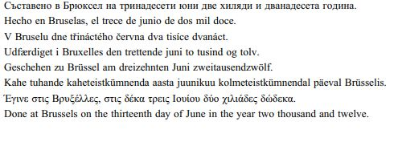
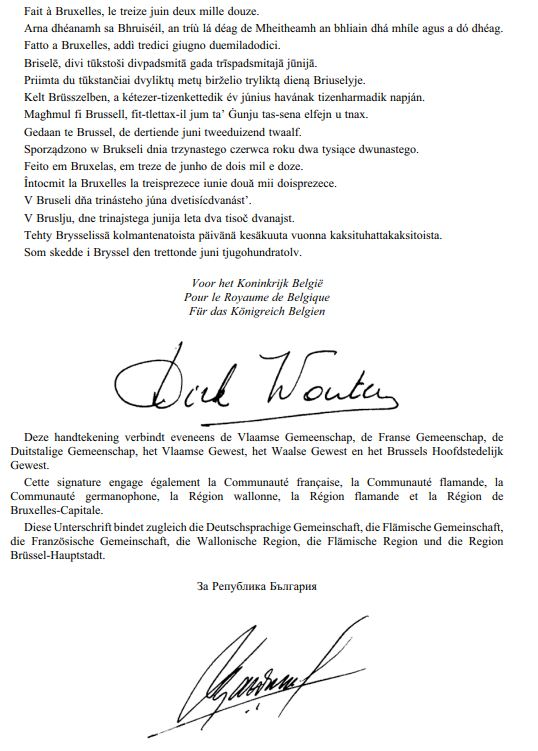
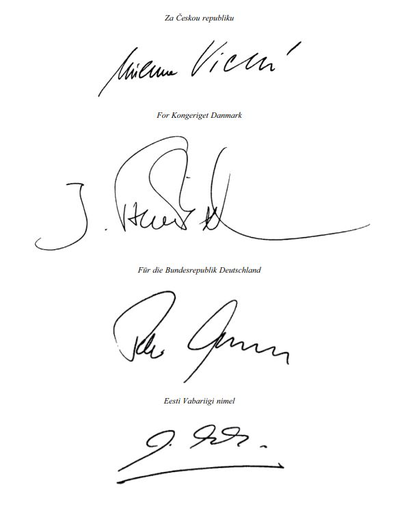
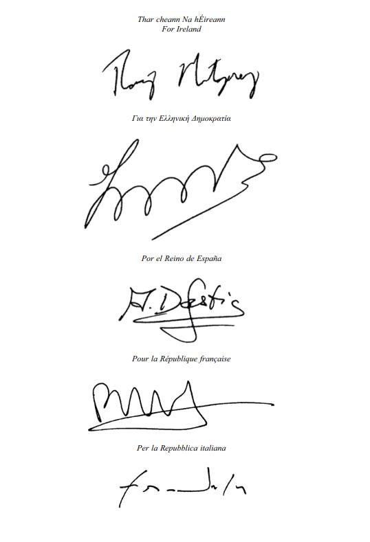
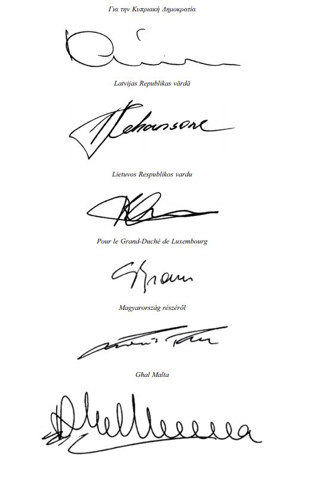
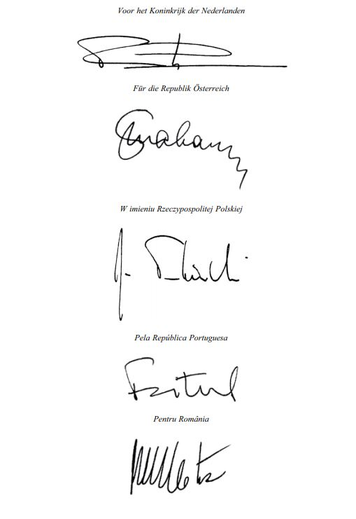
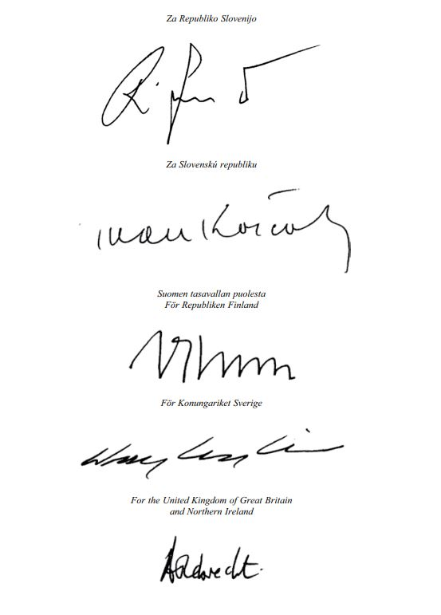
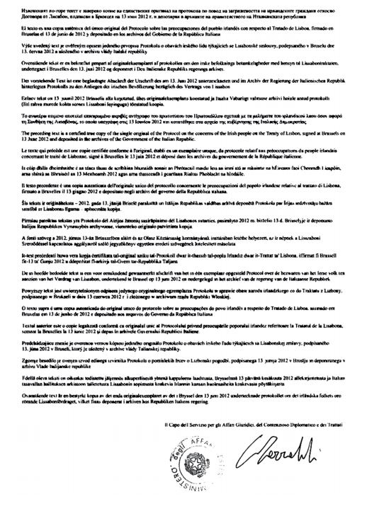

# Loi du 19 juillet 2013 portant approbation du Protocole relatif aux préoccupations du peuple irlandais concernant le traité de Lisbonne, fait à Bruxelles le 16 mai 2012.

Nous Henri, Grand-Duc de Luxembourg, Duc de Nassau,

Notre Conseil d’Etat entendu;

De l’assentiment de la Chambre des Députés;

Vu la décision de la Chambre des Députés du 19 juin 2013 et celle du Conseil d’Etat du 2 juillet 2013 portant qu’il n’y a pas lieu à second vote;

Avons ordonné et ordonnons:

## Article unique.

Est approuvé le Protocole relatif aux préoccupations du peuple irlandais concernant le [traité de Lisbonne](https://legilux.public.lu/eli/etat/leg/loi/2008/07/03/n1/jo), fait à Bruxelles le 16 mai 2012.

Mandons et ordonnons que la présente loi soit insérée au Mémorial pour être exécutée et observée par tous ceux que la chose concerne.

Le Ministre des Affaires étrangères,   Jean Asselborn

Palais de Luxembourg, le 19 juillet 2013.   Henri

\**PROTOCOLE relatif aux préoccupations du peuple irlandais concernant le traité de Lisbonne**

\*Le Royaume de Belgique,*

\*La République de Bulgarie,*

\*La République tchèque,*

\*Le Royaume de Danemark,*

\*La République fédérale d’Allemagne,*

\*La République d’Estonie,*

\*L’Irlande,*

\*La République hellénique,*

\*Le Royaume d’Espagne,*

\*La République française,*

\*La République italienne,*

\*La République de Chypre,*

\*La République de Lettonie,*

\*La République de Lituanie,*

\*Le Grand-Duché de Luxembourg,*

\*La Hongrie,*

\*Malte,*

\*Le Royaume des Pays-Bas,*

\*La République d’Autriche,*

\*La République de Pologne,*

\*La République portugaise,*

\*La Roumanie,*

\*La République de Slovenie,*

\*La République slovaque,*

\*La République de Finlande,*

\*Le Royaume de Suède,*

\*Le Royaume-Uni de Grande-Bretagne*   *et d’Irlande du Nord,*

ci-après dénommés «LES HAUTES PARTIES CONTRACTANTES»,

\*Rappelant* la décision des chefs d’Etat ou de gouvernement des vingt-sept Etats membres de l’Union européenne, réunis au sein du Conseil européen, les 18 et 19 juin 2009, relative aux préoccupations du peuple irlandais concernant le [traité de Lisbonne](https://legilux.public.lu/eli/etat/leg/loi/2008/07/03/n1/jo);

\*Rappelant* que les chefs d’Etat ou de gouvernement, réunis au sein du Conseil européen les 18 et 19 juin 2009, ont déclaré qu’ils énonceraient, lors de la conclusion du prochain traité d’adhésion, les dispositions de ladite décision dans un protocole qui sera annexé, conformément à leurs règles constitutionnelles respectives, au [traité sur l’Union européenne](https://legilux.public.lu/eli/etat/leg/loi/1992/07/27/n6/jo) et au [traité sur le fonctionnement de l’Union européenne](https://legilux.public.lu/eli/etat/leg/loi/1957/11/30/n1/jo);

\*Prenant acte* de la signature par les Hautes Parties Contractantes du traité conclu entre les Hautes Parties Contractantes et la République de Croatie concernant l’adhésion de la République de Croatie à l’Union européenne,

SONT CONVENUES des dispositions ci-après, qui sont annexées au [traité sur l’Union européenne](https://legilux.public.lu/eli/etat/leg/loi/1992/07/27/n6/jo) et au [traité sur le fonctionnement de l’Union européenne](https://legilux.public.lu/eli/etat/leg/loi/1957/11/30/n1/jo):

## TITRE I — Droit à la vie, famille et éducation

### *Article 1*

Aucune des dispositions du [traité de Lisbonne](https://legilux.public.lu/eli/etat/leg/loi/2008/07/03/n1/jo) attribuant un statut juridique à la Charte des droits fondamentaux de l’Union européenne ou relatives à l’espace de liberté, de sécurité et de justice n’affecte de quelque manière que ce soit la portée et l’applicabilité de la protection du droit à la vie prévue à l’article 40.3.1, 40.3.2 et 40.3.3, de la protection de la famille prévue à l’article 41 et de la protection des droits en ce qui concerne l’éducation prévue aux articles 42, 44.2.4 et 44.2.5 de la Constitution de l’Irlande.

## TITRE II — Fiscalité

### *Article 2*

Aucune des dispositions du [traité de Lisbonne](https://legilux.public.lu/eli/etat/leg/loi/2008/07/03/n1/jo) ne modifie de quelque manière que ce soit, pour aucun Etat membre, l’étendue ou la mise en œuvre de la compétence de l’Union européenne dans le domaine fiscal.

## TITRE III — Sécurité et défense

### *Article 3*

L’action de l’Union sur la scène internationale repose sur les principes de la démocratie, de l’Etat de droit, de l’universalité et de l’indivisibilité des droits de l’homme et des libertés fondamentales, le respect de la dignité humaine, les principes d’égalité et de solidarité et le respect des principes de la charte des Nations unies et du droit international.

La politique de sécurité et de défense commune de l’Union fait partie intégrante de la politique étrangère et de sécurité commune et assure à l’Union une capacité opérationnelle pour mener des missions en dehors de l’Union afin d’assurer le maintien de la paix, la prévention des conflits et le renforcement de la sécurité internationale conformément aux principes de la charte des Nations unies.

Elle n’affecte ni la politique de sécurité et de défense de chaque Etat membre, y compris de l’Irlande, ni les obligations qui incombent à tout Etat membre.

Le [traité de Lisbonne](https://legilux.public.lu/eli/etat/leg/loi/2008/07/03/n1/jo) n’affecte ni ne porte préjudice à la politique traditionnelle de neutralité militaire de l’Irlande.

Il appartiendra aux Etats membres – y compris l’Irlande, agissant dans un esprit de solidarité et sans préjudice de sa politique traditionnelle de neutralité militaire – de déterminer la nature de l’aide ou de l’assistance à fournir à un Etat membre qui fait l’objet d’une attaque terroriste ou d’une agression armée sur son territoire.

Toute décision conduisant à une défense commune nécessitera une décision unanime du Conseil européen. Il reviendra aux Etats membres, y compris l’Irlande, de décider, conformément aux dispositions du [traité de Lisbonne](https://legilux.public.lu/eli/etat/leg/loi/2008/07/03/n1/jo) et à leurs règles constitutionnelles respectives, de l’opportunité d’adopter ou non une défense commune.

Aucune disposition du présent titre n’affecte ni ne porte préjudice à la position ou à la politique de tout autre Etat membre en matière de sécurité et de défense.

Il appartient également à chaque Etat membre de décider, conformément aux dispositions du [traité de Lisbonne](https://legilux.public.lu/eli/etat/leg/loi/2008/07/03/n1/jo) et à ses éventuelles règles juridiques internes, s’il participe à la coopération structurée permanente ou à l’Agence européenne de défense.

Le [traité de Lisbonne](https://legilux.public.lu/eli/etat/leg/loi/2008/07/03/n1/jo) ne prévoit pas la création d’une armée européenne ni de conscription pour une quelconque formation militaire.

Il n’affecte pas le droit de l’Irlande ou de tout autre Etat membre de déterminer la nature et le volume de ses dépenses de défense et de sécurité ni la nature de ses capacités de défense.

Il appartiendra à l’Irlande ou à tout autre Etat membre de décider, conformément à ses éventuelles règles juridiques internes, s’il participe ou non à une opération militaire.

## TITRE IV — Dispositions finales

### *Article 4*

Le présent protocole reste ouvert à la signature par les Hautes Parties Contractantes jusqu’au 30 juin 2012.

Le présent protocole est ratifié par les Hautes Parties Contractantes, et par la République de Croatie au cas où le présent protocole ne serait pas entré en vigueur à la date d’adhésion de la République de Croatie à l’Union européenne, conformément à leurs règles constitutionnelles respectives.

Les instruments de ratification sont déposés auprès du gouvernement de la République italienne.

Le présent protocole entre en vigueur, si possible, le 30 juin 2013, à condition que tous les instruments de ratification aient été déposés, ou, à défaut, le premier jour du mois suivant le dépôt de l’instrument de ratification de l’Etat membre qui procède le dernier à cette formalité.

### *Article 5*

Le présent protocole, rédigé en un exemplaire unique, en langues allemande, anglaise, bulgare, danoise, espagnole, estonienne, finnoise, française, grecque, hongroise, irlandaise, italienne, lettonne, lituanienne, maltaise, néerlandaise, polonaise, portugaise, roumaine, slovaque, slovène, suédoise et tchèque, tous les textes faisant également foi, est déposé dans les archives du gouvernement de la République italienne, qui remet une copie certifiée conforme à chacun des gouvernements des autres Etats membres.

Dès que la République de Croatie sera liée par le présent protocole en vertu de l’article 2 de l’Acte relatif aux conditions d’adhésion de la République de Croatie, le texte croate du présent protocole, qui fera également foi à l’instar des textes visés au premier alinéa, sera également déposé dans les archives du gouvernement de la République italienne, qui remettra une copie certifiée conforme à chacun des gouvernements des autres Etats membres.

EN FOI DE QUOI, les plénipotentiaires soussignés ont apposé leur signature au bas du présent protocole.

Doc. parl. [6548](https://legilux.public.lu/eli/etat/proj/pl/20130036); sess. ord. 2012-2013.
