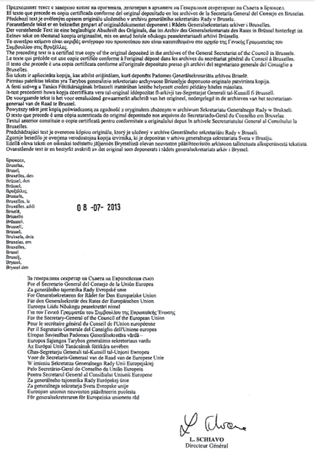

# Loi du 30 avril 2014 portant approbation de l'Accord interne entre les Représentants des Gouvernements des Etats membres de l'Union européenne, réunis au sein du Conseil, relatif au financement de l'aide de l'Union européenne au titre du cadre financier pluriannuel pour la période 2014-2020 conformément à l'Accord de partenariat ACP-UE et à l'affectation des aides financières destinées aux pays et territoires d'outre-mer auxquels s'appliquent les dispositions de la quatrième partie du Traité sur le fonctionnement de l'Union européenne, fait à Luxembourg et à Bruxelles, respectivement les 24 et 26 juin 2013.

Nous Henri, Grand-Duc de Luxembourg, Duc de Nassau,

Notre Conseil d’Etat entendu;

De l’assentiment de la Chambre des Députés;

Vu la décision de la Chambre des Députés du 1er avril 2014 et celle du Conseil d’Etat du 4 avril 2014 portant qu’il n’y a pas lieu à second vote;

Avons ordonné et ordonnons:

## Article unique.

Est approuvé l’Accord interne entre les Représentants des Gouvernements des Etats membres de l’Union européenne, réunis au sein du Conseil, relatif au financement de l’aide de l’Union européenne au titre du cadre financier pluriannuel pour la période 2014-2020 conformément à l’Accord de partenariat ACP-UE et à l’affectation des aides financières destinées aux pays et territoires d’outre-mer auxquels s’appliquent les dispositions de la quatrième partie du Traité sur le fonctionnement de l’Union européenne, fait à Luxembourg et à Bruxelles, respectivement les 24 et 26 juin 2013.

Mandons et ordonnons que la présente loi soit insérée au Mémorial pour être exécutée et observée par tous ceux que la chose concerne.

Le Ministre des Affaires étrangères et européennes,   Jean Asselborn   Le Ministre de la Coopération et de l’Action humanitaire,   Romain Schneider

Palais de Luxembourg, le 30 avril 2014.   Henri

\**ACCORD INTERNE**

entre les Représentants des Gouvernements des Etats membres

de l’Union européenne, réunis au sein du Conseil, relatif au

financement de l’aide de l’Union européenne au titre du

cadre financier pluriannuel pour la période 2014-2020 conformément

à l’Accord de partenariat ACP-UE et à l’affectation des

aides financières destinées aux pays et territoires d’outre-mer auxquels

s’appliquent les dispositions de la quatrième partie du traité

sur le fonctionnement de l’Union européenne

Les Représentants des Gouvernements des Etats membres de l’Union européenne, réunis au sein du Conseil,

vu le traité sur l’Union européenne,

vu le traité sur le fonctionnement de l’Union européenne,

après consultation de la Commission européenne,

après consultation de la Banque européenne d’investissement,

considérant ce qui suit:

(1) L’accord de partenariat entre les membres du groupe des Etats d’Afrique. des Caraïbes et du Pacifique, d’une part, et la Communauté européenne et ses Etats membres, d’autre part, signé à Cotonou le 23 juin 2000 , modifié initialement à Luxembourg le 25 juin 2005 et modifié, pour la deuxième fois, à Ouagadougou le 22 juin 2010 (ci-après dénommé l’«accord de partenariat ACP-UE»), prévoit que des protocoles financiers soient définis pour chaque période de cinq ans.

(2) Le 17 juillet 2006, les représentants des gouvernements des Etats membres, réunis au sein du Conseil, ont adopté un accord interne relatif au financement des aides de la Communauté au titre du cadre financier pluriannuel pour la période 2008-2013, conformément à l’accord de partenariat ACP-CE et à l’affectation des aides financières destinées aux pays et territoires d’outre-mer auxquels s’appliquent les dispositions de la quatrième partie du traité CE.

(3) La [décision 2001/822/CE](https://eur-lex.europa.eu/eli/dec/2001/822(1)/oj) du Conseil du 27 novembre 2001 relative à l’association des pays et territoires d’outre-mer à la Communauté européenne (ci-après dénommée la «décision d’association outre-mer») s’applique jusqu’au 31 décembre 2013. Il y a lieu d’adopter une nouvelle décision avant cette date.

(4) En vue de mettre en œuvre l’accord de partenariat ACP-UE et la décision d’association outre-mer, il convient d’instituer un 11ème Fonds européen de développement (FED) et de fixer les modalités de sa dotation ainsi que les contributions des Etats membres à celle-ci.

(5) Conformément à l’annexe Ib de l’accord de partenariat ACP-UE, l’Union et ses Etats membres ont effectué, avec le groupe des Etats d’Afrique, des Caraïbes et du Pacifique (ci-après dénommés «Etats ACP»), une estimation des résultats, en évaluant le degré de réalisation des engagements et des décaissements.

(6) Il y a lieu de fixer les règles relatives à la gestion de la coopération financière.

(7) Il y a lieu d’instituer un comité des représentants des gouvernements des Etats membres auprès de la Commission (ci-après dénommé le «comité du FED») et un comité de même nature auprès de la Banque européenne d’investissement (BEI). Il convient d’harmoniser l’action déployée par la Commission et la BEI pour l’application de l’accord de partenariat ACP-UE et des dispositions correspondantes de la décision d’association outre-mer.

(8) La politique de l’Union en matière de coopération au développement est régie par les objectifs du millénaire pour le développement adoptés par l’Assemblée générale des Nations unies, le 8 septembre 2000, et leurs éventuelles modifications ultérieures.

(9) Le 22 décembre 2005, le Conseil et les représentants des gouvernements des Etats membres réunis au sein du Conseil, le Parlement européen et la Commission ont adopté une déclaration conjointe sur la politique de développement de l’Union européenne intitulée: Le consensus européen.

(10) Le 9 décembre 2010, le Conseil a adopté les conclusions sur la responsabilité mutuelle et la transparence: quatrième chapitre du cadre opérationnel de l’UE sur l’efficacité de l’aide. Ces conclusions ont été ajoutées au texte consolidé du cadre opérationnel sur l’efficacité de l’aide dans lequel les accords convenus au titre de la déclaration de Paris sur l’efficacité de l’aide (2005), du code de conduite de l’UE sur la complémentarité et la division du travail dans la politique de développement (2007) et des lignes directrices de l’UE pour le programme d’action d’Accra (2008) ont été réaffirmés. Le 14 novembre 2011, le Conseil a adopté une position commune de l’UE, portant notamment sur la garantie de transparence de l’UE ainsi que sur d’autres aspects relatifs à la transparence et à la responsabilité, en vue du quatrième forum de haut niveau sur l’efficacité de l’aide de Busan (Corée du Sud), lequel a donné lieu, entre autres, au document final de Busan. L’Union et ses Etats membres ont approuvé le document final de Busan. Le 14 mai 2012, le Conseil a adopté des conclusions intitulées «Accroître l’impact de la politique de développement de l’UE: un programme pour le changement» et «La future approche de l’appui budgétaire de l’UE en faveur des pays tiers».

(11) Il y a lieu de tenir compte des objectifs en matière d’aide publique au développement (APD) visés dans les conclusions citées au considérant 10. Dans les rapports concernant les dépenses effectuées au titre du 11ème FED, établis à l’intention des Etats membres et du comité d’aide au développement de l’OCDE, la Commission devrait opérer une distinction entre les activités qui relèvent de l’APD et celles qui n’en relèvent pas.

(12) Le 22 décembre 2009, le Conseil a adopté des conclusions sur les relations de l’UE avec les pays et territoires d’outre-mer (PTOM).

(13) L’application du présent accord devrait être conforme à la [décision 2010/427/UE](https://eur-lex.europa.eu/eli/dec/2010/427/oj) du Conseil du 26 juillet 2010 fixant l’organisation et le fonctionnement du service européen pour l’action extérieure.

(14) Afin d’éviter toute interruption de financement entre mars et décembre 2020, il convient de faire en sorte que la période d’application du cadre financier pluriannuel du 11ème FED soit identique à celle du cadre financier pluriannuel pour la période 2014-2020 applicable au budget général de l’Union. En conséquence, il est préférable de fixer au 31 décembre 2020 la date limite pour les engagements de financements au titre du 11ème FED plutôt qu’au 28 février 2020 qui est la date butoir pour l’application de l’accord de partenariat ACP-UE.

(15) Dans le prolongement des principes fondamentaux énoncés dans l’accord de partenariat ACP-UE, les objectifs poursuivis par le 11ème FED sont les suivants: l’éradication de la pauvreté, le développement durable et l’intégration progressive des Etats ACP dans l’économie mondiale. Il y a lieu d’accorder un traitement particulier aux pays les moins avancés.

(16) Afin de renforcer la coopération socio-économique entre les régions ultrapériphériques de l’Union et les Etats ACP, ainsi qu’avec les PTOM, dans les Caraïbes, en Afrique de l’Ouest et dans l’océan Indien, les règlements relatifs au Fonds européen de développement régional et à la coopération territoriale européenne devraient prévoir un renforcement des allocations pour la période 2014-2020 en faveur de ladite coopération entre eux,

SONT CONVENUS de ce qui suit:

## **Chapitre I****er** — Ressources financières

### *Article premier* — Ressources du 11ème FED

1\. Les Etats membres instituent un onzième Fonds européen de développement, ci-après dénommé le «11ème FED».

2\. Le 11ème FED est doté comme suit:

a) un montant de 30.506.000 EUR (en prix courants), financé par les Etats membres selon les contributions suivantes:

| *Etat membre* | *Clé de contribution (%)* | *Contribution en EUR* |
|---|---|---|
| Belgique | 3,24927 | 991.222.306 |
| Bulgarie | 0,21853 | 66.664.762 |
| République tchèque | 0,79745 | 243.270.097 |
| Danemark | 1,98045 | 604.156.077 |
| Allemagne | 20,5798 | 6.278.073.788 |
| Estonie | 0,08635 | 26.341.931 |
| Irlande | 0,94006 | 286.774.704 |
| Grèce | 1,50735 | 459.832.191 |
| Espagne | 7,93248 | 2.419.882.349 |
| France | 17,81269 | 5.433.939.212 |
| Croatie(*) | 0,22518 | 68.693.411 |
| Italie | 12,53009 | 3.822.429.255 |
| Chypre | 0,11162 | 34.050.797 |
| Lettonie | 0,11612 | 35.423.567 |
| Lituanie | 0,18077 | 55.145.696 |
| Luxembourg | 0,25509 | 77.817.755 |
| Hongrie | 0,61456 | 187.477.674 |
| Malte | 0,03801 | 11.595.331 |
| Pays-Bas | 4,77678 | 1.457.204.507 |
| Autriche | 2,39757 | 731.402.704 |
| Pologne | 2,00734 | 612.359.140 |
| Portugal | 1,19679 | 365.092.757 |
| Roumanie | 0,71815 | 219.078.839 |
| Slovénie | 0,22452 | 68.492.071 |
| Slovaquie | 0,37616 | 114.751.370 |
| Finlande | 1,50909 | 460.362.995 |
| Suède | 2,93911 | 896.604.897 |
| Royaume-Uni | 14,67862 | 4.477.859.817 |
| TOTAL | 100,00000 | 30.506.000.000 |

(*) Montant estimé

aone Le montant de 30.506 millions d’euros est mis à disposition à compter de l’entrée en vigueur du cadre financier pluriannuel pour la période 2014-2020. Sur cette somme:

i) 29.089 millions d’euros sont alloués aux Etats ACP;

ii) 364,5 millions d’euros sont alloués aux PTOM;

iii) 1.052 millions d’euros sont alloués à la Commission pour financer les dépenses d’aide visées à l’article 6, liées à la programmation et à la mise en œuvre du 11ème FED; dont au moins 76,3 millions d’euros sont à allouer à la Commission pour les mesures visant à renforcer l’impact des programmes du FED visés à l’article 6, paragraphe 3;

b) à l’exception des subventions destinées au financement des bonifications d’intérêt, les fonds visés aux annexes I et Ib de l’accord de partenariat ACP-UE et aux annexes IIA et IIAa de la décision d’association outre-mer et alloués au titre des 9ème et 10ème FED pour financer les ressources des Facilités d’investissement ne sont pas concernés par la [décision 2005/446/CE](https://eur-lex.europa.eu/eli/dec/2005/446/oj) ni par le paragraphe 5 de l’annexe Ib de l’accord de partenariat ACP-UE précisant les dates au-delà desquelles les fonds des 9ème et 10ème FED ne peuvent plus être engagés. Ces fonds sont transférés au 11ème FED et gérés selon les modalités d’exécution de ce dernier à compter, en ce qui concerne les fonds visés aux annexes I et Ib de l’accord de partenariat ACP-UE, de la date d’entrée en vigueur du cadre financier pluriannuel pour la période 2014-2020 au titre de l’accord de partenariat ACP-UE, et, en ce qui concerne les fonds visés aux annexes IIA et IIAa de la décision d’association outre-mer, de la date d’entrée en vigueur des décisions du Conseil relatives à l’aide financière aux PTOM pour la période 2014-2020.

3\. Les reliquats du 10ème FED ou des FED précédents ne sont plus engagés au-delà du 31 décembre 2013 ou de la date d’entrée en vigueur du cadre financier pluriannuel pour la période 2014-2020 si cette date est ultérieure, à moins que le Conseil statuant à l’unanimité, sur proposition de la Commission, n’en décide autrement, à l’exception des reliquats et des fonds désengagés après la date pertinente et issus du système visant à garantir la stabilisation des recettes d’exportation de produits de base agricoles (STABEX) au titre des FED antérieurs au 9ème FED et des fonds visés au paragraphe 2, point b).

4\. Les fonds désengagés de projets au titre du 10ème FED ou des FED précédents ne sont plus engagés après le 31 décembre 2013 ou après la date d’entrée en vigueur du cadre financier pluriannuel pour la période 2014-2020 si cette date est ultérieure, à moins que le Conseil statuant à l’unanimité, sur proposition de la Commission, n’en décide autrement, à l’exception des fonds désengagés après la date pertinente et issus du système visant à garantir la stabilisation des recettes d’exportation de produits de base agricoles (STABEX) au titre des FED antérieurs au 9ème FED, lesquels sont transférés automatiquement aux programmes indicatifs nationaux correspondants visés à l’article 2, point a) sous i), et à l’article 3, paragraphe 1er, et à l’exception des fonds destinés à financer les ressources des Facilités d’investissement, visés au paragraphe 2, point b), du présent article.

5\. Le montant total des ressources du 11ème FED couvre la période allant du 1er janvier 2014 au 31 décembre 2020. Les fonds du 11ème FED et, dans le cas de la Facilité d’investissement, les fonds provenant de remboursements, ne sont plus engagés au-delà du 31 décembre 2020, à moins que le Conseil statuant à l’unanimité, sur proposition de la Commission, n’en décide autrement. Toutefois, les fonds souscrits par les Etats membres au titre des 9ème, 10ème et 11ème FED pour financer la Facilité d’investissement restent disponibles après le 31 décembre 2020, jusqu’à une date à fixer dans le règlement financier visé à l’article 10, paragraphe 2.

6\. Les recettes provenant des intérêts produits par les opérations financées en vertu des engagements pris dans le cadre des FED précédents et sur les fonds du 11ème FED, qui sont gérés par la Commission, sont créditées sur un ou plusieurs comptes en banque ouverts au nom de la Commission et sont utilisées conformément aux dispositions de l’article 6. L’utilisation des recettes provenant des intérêts produits par les fonds qui sont gérés par la BEI est déterminée dans le cadre du règlement financier visé à l’article 10, paragraphe 2.

7\. Si un Etat adhère à l’Union, les montants et clés de contribution visés au paragraphe 2, point a), sont modifiés par décision du Conseil statuant à l’unanimité sur proposition de la Commission.

8\. Un ajustement des ressources financières peut s’opérer par décision du Conseil statuant à l’unanimité, notamment pour agir conformément à l’article 62, paragraphe 2, de l’accord de partenariat ACP-UE.

9\. Tout Etat membre peut, sans préjudice des règles et procédures de prise de décision établies à l’article 8, fournir à la Commission ou à la BEI des contributions volontaires à l’appui des objectifs fixés dans l’accord de partenariat ACP-UE. Les Etats membres peuvent également cofinancer des projets ou des programmes, par exemple dans le cadre d’initiatives spécifiques gérées par la Commission ou la BEI. L’appropriation de ces initiatives par les Etats ACP au niveau national est garantie.

Le règlement d’application et le règlement financier visés à l’article 10 comportent les dispositions nécessaires concernant le cofinancement par le 11ème FED, ainsi que concernant les activités de cofinancement mises en œuvre par les Etats membres. Les Etats membres informent au préalable le Conseil de leurs contributions volontaires.

10\. L’Union et ses Etats membres procèdent à une estimation des résultats, en évaluant le degré de réalisation des engagements et des décaissements ainsi que les résultats et les conséquences de l’aide apportée. Cette estimation est effectuée sur la base d’une proposition de la Commission.

### *Article 2* — * Ressources allouées aux Etats ACP*

L’enveloppe de 29.089 millions d’euros, visée à l’article 1er, paragraphe 2, point a) i), est répartie entre les différents instruments de coopération comme suit:

a) le montant de 24.365 millions d’euros pour le financement de programmes indicatifs nationaux et régionaux. Cette enveloppe doit servir à financer:

i) les programmes indicatifs nationaux des Etats ACP, conformément aux articles 1er à 5 de l’annexe IV de l’accord de partenariat ACP-UE;

ii) les programmes indicatifs régionaux d’appui à la coopération et à l’intégration régionales et interrégionales des Etats ACP, conformément aux articles 6 à 11 de l’annexe IV de l’accord de partenariat ACP-UE;

b) le montant de 3.590 millions d’euros pour financer la coopération intra-ACP et interrégionale associant de nombreux Etats ACP ou la totalité d’entre eux, conformément aux articles 12 à 14 de l’annexe IV de l’accord de partenariat ACP-UE. Cette enveloppe peut comprendre l’appui structurel aux institutions et organes créés en vertu de l’accord de partenariat ACP-UE. Cette enveloppe couvre l’aide aux dépenses de fonctionnement du secrétariat ACP visées aux points 1 et 2 du protocole 1 annexé à l’accord de partenariat ACP-UE;

c) une partie des ressources visées aux points a) et b) peuvent servir à couvrir des besoins imprévus et à atténuer les conséquences négatives à court terme des chocs exogènes, conformément aux articles 60, 66, 68, 72, 72*bis* et 73 de l’accord de partenariat ACP-UE et aux articles 3 et 9 de l’annexe IV dudit accord, notamment, le cas échéant, pour couvrir une aide humanitaire et d’urgence à court terme complémentaire, lorsque cet appui ne peut pas être pris en charge par le budget de l’Union;

d) le montant de 1.134 millions d’euros alloués à la BEI pour financer la Facilité d’investissement, conformément aux modes et conditions de financement énoncés à l’annexe II de l’accord de partenariat ACP-UE. Ce montant comprend une contribution de 500 millions d’euros venant s’ajouter aux ressources de la Facilité d’investissement, gérée comme un fonds de roulement, et 634 millions d’euros, sous la forme d’aides non remboursables destinées à financer les bonifications d’intérêts et l’assistance technique relative au projet prévues aux articles 1er, 2 et 4 de l’annexe II de l’accord de partenariat ACP-UE sur la période couverte par le 11ème FED.

### *Article 3* — Ressources allouées aux PTOM

1\. Le montant de 364,5 millions d’euros visé à l’article 1er, paragraphe 2, point a) ii), est alloué sur la base d’une nouvelle décision d’association outre-mer qui sera prise par le Conseil avant le 31 décembre 2013. Sur ce montant, 359,5 millions d’euros servent à financer des programmes territoriaux et régionaux et 5 millions d’euros sont alloués à la BEI pour financer les bonifications d’intérêts et l’assistance technique, conformément à la nouvelle décision d’association outre-mer.

2\. Si un PTOM devient indépendant et adhère à l’accord de partenariat ACP-UE, le montant visé au paragraphe 1er, à savoir 364,5 millions d’euros, est diminué et les montants indiqués à l’article 2, point a) i), sont augmentés corrélativement, par décision du Conseil statuant à l’unanimité sur proposition de la Commission.

### *Article 4* — Prêts consentis par la BEI sur ses ressources propres

1\. Au montant alloué à la Facilité d’investissement au titre des 9ème, 10ème et 11ème FED visé à l’article 1er, paragraphe 2, point b), et au montant visé à l’article 2, point d), s’ajoute une somme indicative maximale de 2.600 millions d’euros sous la forme de prêts octroyés par la BEI sur ses ressources propres. Ces ressources sont allouées aux fins exposées dans l’annexe II de l’accord de partenariat ACP-UE à concurrence d’un montant de 2.500 millions d’euros pouvant être augmenté à mi-parcours par une décision à prendre par les organes directeurs de la BEI et à concurrence de 100 millions d’euros aux fins exposées dans la décision d’association outre-mer, conformément aux conditions prévues dans ses statuts et aux modes et conditions de financement de l’investissement applicables établis à l’annexe II de l’accord de partenariat ACP-UE et dans la décision d’association outre-mer.

2\. Les Etats membres s’engagent à se porter caution envers la BEI, au prorata de leur souscription à son capital, en renonçant au bénéfice de discussion, pour tous les engagements financiers découlant pour ses emprunteurs des contrats de prêt conclus par la BEI sur ses ressources propres en application de l’article 1er, paragraphe 1er, de l’annexe II de l’accord de partenariat ACP-UE et des dispositions correspondantes de la décision d’association outre-mer.

3\. Le cautionnement visé au paragraphe 2 est limité à 75% du montant total des crédits ouverts par la BEI au titre de l’ensemble des contrats de prêt et couvre tous les risques liés aux projets du secteur public. Pour les projets du secteur privé, le cautionnement couvre l’ensemble des risques politiques, mais la BEI assume l’intégralité du risque commercial.

4\. Les engagements visés au paragraphe 2 font l’objet de contrats de cautionnement entre chacun des Etats membres et la BEI.

### *Article 5* — Opérations gérées par la BEI

1\. Les paiements effectués à la BEI dans le cadre des prêts spéciaux accordés aux Etats ACP, aux PTOM et aux départements français d’outre-mer, ainsi que les produits et recettes des opérations de capitaux à risque, au titre des FED antérieurs au 9ème FED, reviennent aux Etats membres au prorata de leur contribution au FED dont ces sommes proviennent, à moins que le Conseil ne décide à l’unanimité, sur proposition de la Commission, de les mettre en réserve ou de les affecter à d’autres opérations.

2\. Les commissions dues à la BEI pour la gestion des prêts et opérations visés au paragraphe 1er sont préalablement déduites des sommes à allouer aux Etats membres.

3\. Les produits et recettes perçus par la BEI sur les opérations effectuées dans le cadre de la Facilité d’investissement des 9ème, 10ème et 11ème FED sont affectés à d’autres opérations exécutées au titre de la Facilité d’investissement, conformément à l’article 3 de l’annexe II de l’accord de partenariat ACP-UE et après déduction des dépenses et charges exceptionnelles qu’entraîne la Facilité d’investissement.

4\. La BEI est rémunérée, selon une formule de couverture intégrale des coûts, pour la gestion des opérations effectuées dans le cadre de la Facilité d’investissement visées au paragraphe 3, conformément à l’article 3, paragraphe 1er, point a), de l’annexe II de l’accord de partenariat ACP-UE et aux dispositions pertinentes de la décision d’association outre-mer.

### *Article 6* — Ressources réservées aux dépenses d’aide de la Commission liées au FED

1\. Les ressources du 11ème FED couvrent les coûts des mesures d’aide. Les ressources visées à l’article 1er, paragraphe 2, point a) iii), ainsi qu’à l’article 1er, paragraphe 6, concernent les coûts liés à la programmation et à la mise en œuvre du FED, qui ne sont pas toujours couverts par les documents stratégiques et les programmes indicatifs pluriannuels visés dans le règlement d’application à adopter en vertu de l’article 10, paragraphe 1er, du présent accord. La Commission fournit tous les deux ans des informations sur la manière dont ces ressources sont dépensées et sur des efforts supplémentaires à déployer pour obtenir des économies et des gains en termes de rendement. La Commission informe préalablement les Etats membres de tous montants supplémentaires provenant du budget de l’Union pour mettre en œuvre le FED

2\. Les ressources affectées aux mesures d’aide peuvent couvrir les dépenses de la Commission afférentes:

a) aux activités de préparation, de suivi, de contrôle, de tenue des comptes, d’audit et d’évaluation, notamment à l’élaboration des rapports sur les résultats, directement nécessaires à la programmation et à la mise en œuvre des ressources du FED;

b) à la réalisation des objectifs du FED, au moyen d’activités de recherche en matière de politique de développement, d’études, de réunions, d’actions d’information, de sensibilisation, de formation et de publication, y compris des actions d’information et de communication qui rendent notamment compte des résultats des programmes du FED. Le budget alloué à la communication au titre de l’accord couvre aussi la communication interne des priorités politiques de l’Union relatives au FED; et

c) aux réseaux informatiques visant l’échange d’informations, ainsi que toute autre dépense d’assistance administrative ou technique servant à la programmation et à la mise en œuvre du FED.

Les ressources visées à l’article 1er, paragraphe 2, point a) sous iii), et à l’article 1er, paragraphe 6, comprennent également les dépenses d’appui administratif au siège et dans les délégations de l’Union engendrées par la programmation et la gestion des actions financées dans le cadre de l’accord de partenariat ACP-UE et de la décision d’association outre-mer.

Les ressources visées à l’article 1er, paragraphe 2, point a) sous iii), et à l’article 1er, paragraphe 6, ne sont pas affectées aux tâches fondamentales du service public européen.

3\. Les ressources affectées aux mesures d’aide destinées à renforcer l’impact des programmes du FED visées à l’article 1er, paragraphe 2, point a), iii), incluent les dépenses de la Commission afférentes à la mise en œuvre d’un cadre global axé sur les résultats ainsi que d’un suivi et d’une évaluation renforcés des programmes du FED à compter de 2014. Ces ressources appuient également les efforts déployés par la Commission pour améliorer la gestion et la programmation financière du FED par l’établissement de rapports périodiques concernant les progrès accomplis.

## Chapitre II — *Mise en œuvre et dispositions finales*

### *Article 7* — ** C****ontributions au 11ème FED**

1\. La Commission arrête et communique au Conseil, pour le 20 octobre de chaque année au plus tard, l’état des engagements et des paiements ainsi que le montant annuel des appels de contributions pour l’exercice en cours et les deux suivants, en tenant compte des prévisions de la BEI concernant la gestion et le fonctionnement de la Facilité d’investissement. Ces montants dépendent de la capacité à débourser réellement les ressources proposées.

2\. Sur proposition de la Commission, précisant les parts respectives de la Commission et de la BEI, le Conseil se prononce, à la majorité qualifiée prévue à l’article 8, sur le plafond de la contribution annuelle pour le deuxième exercice suivant la proposition de la Commission (n+2) et, dans la limite du plafond arrêté l’année précédente, sur le montant annuel des appels de contributions relatifs au premier exercice suivant la proposition de la Commission (n+1).

3\. S’il apparaît que les contributions arrêtées conformément au paragraphe 2 s’écartent des véritables besoins du 11ème FED pour l’exercice en question, la Commission propose au Conseil une modification des contributions, dans la limite du plafond visé au paragraphe 2. A cet égard, le Conseil statue alors à la majorité qualifiée prévue à l’article 8.

4\. Les appels de contributions ne peuvent dépasser le plafond visé au paragraphe 2; de même, le plafond ne peut être augmenté, à moins que le Conseil, statuant à la majorité qualifiée prévue à l’article 8, ne le décide en cas de besoins spéciaux dus à des circonstances exceptionnelles ou imprévues, par exemple au lendemain de crises. Dans ce cas, la Commission et le Conseil veillent à ce que les contributions correspondent aux paiements prévus.

5\. La Commission communique au Conseil, pour le 20 octobre de chaque année au plus tard, ses estimations des engagements, décaissements et contributions pour chacun des trois exercices suivants, en tenant compte des prévisions de la BEI.

6\. Pour les fonds transférés des FED précédents au 11èmeFED conformément à l’article 1er, paragraphe 2, point b), les contributions de chaque Etat membre sont calculées au prorata de sa contribution au FED concerné.

En ce qui concerne les fonds du 10ème FED et des FED précédents non transférés au 11ème FED, les conséquences pour la contribution de chaque Etat membre sont calculées au prorata de sa contribution au 10ème FED.

7\. Les modalités de versement des contributions des Etats membres sont déterminées par le règlement financier visé à l’article 10, paragraphe 2.

### *Article 8* — Le comité du Fonds européen de développement

1\. Il est institué auprès de la Commission, pour les ressources du 11ème FED qu’elle gère, un comité (ci-après dénommé «comité du FED») composé de représentants des gouvernements des Etats membres. Le comité du FED est présidé par un représentant de la Commission; son secrétariat est assuré par la Commission. Un observateur de la BEI participe aux travaux du comité pour les questions qui concernent la BEI.

2\. Les voix des Etats membres au sein du comité du FED sont affectées de la pondération suivante:

| *Etat membre* | *Voix* |
|---|---|
| Belgique | 33 |
| Bulgarie | 2 |
| République tchèque | 8 |
| Danemark | 20 |
| Allemagne | 206 |
| Estonie | 1 |
| Irlande | 9 |
| Grèce | 15 |
| Espagne | 79 |
| France | 178 |
| Croatie (*) Italie | [2] 125 |
| Chypre | 1 |
| Lettonie | 1 |
| Lituanie | 2 |
| Luxembourg | 3 |
| Hongrie | 6 |
| Malte | 1 |
| Pays-Bas | 48 |
| Autriche | 24 |
| Pologne | 20 |
| Portugal | 12 |
| Roumanie | 7 |
| Slovénie | 2 |
| Slovaquie | 4 |
| Finlande | 15 |
| Suède | 29 |
| Royaume-Uni | 147 |
| Total UE 27 | 998 |
| Total UE 28 (*) | [1.000] |

| (*) Vote estimé |  |
|---|---|

3\. Le comité du FED statue à la majorité qualifiée de 720 voix sur 998, exprimant le vote favorable d’au moins quatorze Etats membres. La minorité de blocage est de 279 voix.

4\. Dans le cas où un Etat adhérerait à l’Union, la pondération prévue au paragraphe 2 et la majorité qualifiée visée au paragraphe 3 seraient modifiées par décision du Conseil, statuant à l’unanimité.

5\. Le Conseil, statuant à l’unanimité sur proposition de la Commission, adopte le règlement intérieur du comité du FED.

### *Article 9* — Le comité de la Facilité d’investissement

1\. Un comité (ci-après dénommé «comité de la Facilité d’investissement»), composé de représentants des gouvernements des Etats membres et d’un représentant de la Commission, est créé sous l’égide de la BEI. La BEI assure le secrétariat du comité et met à sa disposition des services d’appui. Le président du comité de la Facilité d’investissement est élu par et parmi les membres du comité.

2\. Le Conseil, statuant à l’unanimité, adopte le règlement intérieur du comité de la Facilité d’investissement.

3\. Le comité de la Facilité d’investissement statue à la majorité qualifiée, conformément à l’article 8, paragraphes 2 et 3.

### *Article 10* — Dispositions d’application

1\. Sans préjudice de l’article 8 du présent accord et des droits de vote des Etats membres qui y sont visés, toutes les dispositions pertinentes du [règlement (CE) n° 617/2007](https://legilux.public.lu/eli/reg_ue/2007/617/jo) du Conseil du 14 mai 2007 relatif à la mise en œuvre du 10ème Fonds européen de développement dans le cadre de l’accord de partenariat ACP-CE et du [règlement (CE) n° 2304/2002](https://legilux.public.lu/eli/reg_ue/2002/2304/jo) de la Commission du 20 décembre 2002 portant application de la [décision 2001/822/CE](https://eur-lex.europa.eu/eli/dec/2001/822(1)/oj) du Conseil, concernant l’assistance aux PTOM, restent en vigueur dans l’attente de l’adoption, par le Conseil, d’un règlement portant application du 11ème FED (ci-après dénommé «règlement portant application du 11ème FED») et de modalités d’application de la décision d’association outre-mer. Le règlement portant application du 11ème FED est adopté à l’unanimité, sur proposition de la Commission et après consultation de la BEI. Les modalités d’application relatives à l’assistance financière de l’Union aux PTOM sont adoptées à la suite de l’adoption d’une nouvelle décision d’association outre-mer par le Conseil, statuant à l’unanimité et en concertation avec le Parlement européen.

Le règlement portant application du 11ème FED et les modalités d’application de la décision d’association outre-mer contiennent les modifications et améliorations nécessaires aux procédures de programmation et de décision, assurant, autant que possible, une harmonisation accrue des procédures de l’Union et du 11ème FED. Le règlement portant application du 11ème FED maintient, en outre, des procédures de gestion particulières pour l’instrument financier pour la paix en Afrique. Etant donné que l’aide financière et l’assistance technique pour la mise en œuvre de l’article 11*ter* de l’accord de partenariat ACP-UE seront financées par des instruments spécifiques autres que ceux prévus pour le financement de la coopération ACP-UE, les activités menées en vertu de ces dispositions doivent être approuvées au moyen de procé- dures de gestion budgétaire arrêtées à l’avance.

Le règlement portant application du 11ème FED contient des mesures permettant de compléter le financement de crédits du 11ème FED et du Fonds européen de développement régional en vue de financer des projets de coopération entre les régions ultrapériphériques de l’Union et les Etats ACP, ainsi qu’avec les PTOM, dans les Caraïbes, en Afrique de l’Ouest et dans l’océan Indien, notamment des mécanismes simplifiés pour la gestion conjointe de ces projets.

2\. Un règlement financier est adopté par le Conseil statuant à la majorité qualifiée prévue à l’article 8, sur proposition de la Commission et après avis de la BEI sur les dispositions qui la concernent, et de la Cour des comptes.

3\. La Commission établira ses propositions de règlements visés aux paragraphes 1er et 2 en prévoyant, entre autres, la possibilité de faire exécuter les tâches par des tiers.

### *Article 11* — Exécution financière, comptes, audit et décharge

1\. La Commission assure l’exécution financière des enveloppes qu’elle gère, et notamment celle des projets et programmes, conformément au règlement financier visé à l’article 10, paragraphe 2. Aux fins du recouvrement des montants indûment versés, les décisions de la Commission sont applicables conformément à l’article 299 du traité sur le fonctionnement de l’Union européenne (TFUE).

2\. La BEI gère la Facilité d’investissement et dirige les opérations s’inscrivant dans ce cadre pour le compte de l’Union, conformément aux modalités fixées par le règlement financier visé à l’article 10, paragraphe 2. Ce faisant, la BEI agit aux risques des Etats membres. Les droits découlant de ces opérations, notamment à titre de créancier ou propriétaire, sont exercés par les Etats membres.

3\. La BEI assure, conformément à ses statuts et à ses meilleures pratiques bancaires, l’exécution financière des opérations au moyen de prêts sur ses ressources propres visées à l’article 4, assortis le cas échéant de bonifications d’intérêts accordées sur les ressources du FED.

4\. Pour chaque exercice, la Commission établit et valide les comptes du FED et les envoie au Parlement européen, au Conseil et à la Cour des comptes.

5\. La BEI adresse chaque année à la Commission et au Conseil son rapport annuel sur l’exécution des opérations financées par les ressources du FED dont elle assure la gestion.

6\. Sous réserve des dispositions du paragraphe 9 du présent article, la Cour des comptes exerce également les pouvoirs qui lui sont dévolus par l’article 287 du TFUE pour ce qui est des opérations du FED. Les conditions dans lesquelles la Cour des comptes exerce ses pouvoirs sont arrêtées dans le règlement financier visé à l’article 10, paragraphe 2.

7\. La décharge de la gestion financière du FED, à l’exclusion des opérations gérées par la BEI, est donnée à la Commission par le Parlement européen sur recommandation du Conseil, qui statue à la majorité qualifiée prévue à l’article 8.

8\. Les opérations financées sur les ressources du FED dont la BEI assure la gestion font l’objet des procédures de contrôle et de décharge prévues par les statuts de la BEI pour l’ensemble de ses opérations.

### *Article 12* — Clause de révision

L’article 1er, paragraphe 3, et les articles contenus dans le chapitre 2, à l’exception de l’article 8, peuvent être modifiés par le Conseil statuant à l’unanimité sur proposition de la Commission.

La BEI est associée à la proposition de la Commission pour les questions relatives à ses activités et aux opérations de la Facilité d’investissement.

### *Article 13* — Service européen pour l’action extérieure

L’application du présent accord doit être conforme à la [décision 2010/427/UE](https://eur-lex.europa.eu/eli/dec/2010/427/oj) du Conseil du 26 juillet 2010 fixant l’organisation et le fonctionnement du service européen pour l’action extérieure.

### *Article 14* — Ratification, entrée en vigueur et durée

1\. Le présent accord est approuvé par chaque Etat membre conformément aux règles constitutionnelles qui lui sont propres. Le gouvernement de chaque Etat membre notifie au Secrétariat général du Conseil de l’Union européenne l’accomplissement des procédures requises pour l’entrée en vigueur du présent accord.

2\. Le présent accord entre en vigueur le premier jour du deuxième mois suivant la notification de son approbation par le dernier Etat membre.

3\. Le présent accord est conclu pour une durée identique à celle du cadre financier pluriannuel pour la période 2014-2020 annexé à l’accord de partenariat ACP-UE et à celle de la décision d’association outre-mer (2014-2020). Toutefois, sans préjudice de l’article 1er, paragraphe 4, il reste en vigueur dans la mesure nécessaire à l’exécution intégrale de toutes les opérations financées au titre de l’accord de partenariat ACP-UE, de la décision d’association outre-mer et du cadre financier pluriannuel.

### *Article 15* — Langues faisant foi

Le présent accord, rédigé en un exemplaire original unique en langues allemande, anglaise, bulgare, danoise, espagnole, estonienne, finnoise, française, grecque, hongroise, italienne, lettone, lituanienne, maltaise, néerlandaise, polonaise, portugaise, roumaine, slovaque, slovène, suédoise et tchèque, tous ces textes faisant également foi, est déposé dans les archives du Secrétariat général du Conseil de l’Union européenne, qui en remet une copie certifiée au gouvernement de chaque Etat signataire.

Fait à Luxembourg et à Bruxelles, le vingt-quatre juin et le vingt-six juin deux mille treize respectivement.

Doc. parl. [6638](https://legilux.public.lu/eli/etat/proj/pl/20130200); sess. extraord. 2013-2014.
