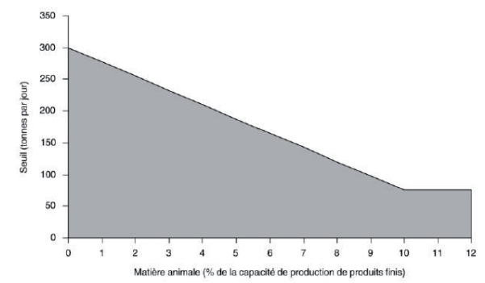

# Loi du 9 mai 2014\n a) relative aux émissions industrielles\n b) modifiant la loi modifiée du 10 juin 1999 relative aux établissements classés\n c) modifiant la loi modifiée du 20 avril 2009 relative à la responsabilité environnementale en ce qui concerne la prévention et la réparation des dommages environnementaux.

Nous Henri, Grand-Duc de Luxembourg, Duc de Nassau,

Notre Conseil d’Etat entendu;

De l’assentiment de la Chambre des Députés;

Vu la décision de la Chambre des Députés du 1er avril 2014 et celle du Conseil d’Etat du 4 avril 2014 portant qu’il n’y a pas lieu à second vote;

Avons ordonné et ordonnons:

## Chapitre Ier — Dispositions communes

### Art. 1er — Objet

La présente loi énonce des règles concernant la prévention et la réduction intégrées de la pollution due aux activités industrielles.

Elle prévoit également des règles visant à éviter ou, lorsque cela s’avère impossible, à réduire les émissions dans l’air, l’eau et le sol, et à empêcher la production de déchets, afin d’atteindre un niveau élevé de protection de l’environnement considéré dans son ensemble.

### Art. 2 — Champ d’application

La présente loi s’applique aux activités industrielles polluantes visées aux chapitres II à VI.

Elle ne s’applique pas aux activités de recherche et développement ou à l’expérimentation de nouveaux produits et procédés.

### Art. 3 — Définitions

Aux fins de la présente loi, on entend par:

1\. «installation»: une unité technique fixe au sein de laquelle interviennent une ou plusieurs des activités figurant à l’annexe I de la présente loi ou dans la partie 1 de l’annexe VI de la *[directive rectifiée 2010/75/UE](https://legilux.public.lu/eli/dir_ue/2010/75/jo) du Parlement européen et du Conseil du 24 novembre 2010 relative aux émissions industrielles (prévention et réduction intégrées de la pollution) (refonte) telle que modifiée par la suite* ainsi que toute autre activité s’y rapportant directement, exercée sur le même site, qui est liée techniquement aux activités énumérées dans ces annexes et qui est susceptible d’avoir des incidences sur les émissions et la pollution;

\*Pour les besoins d’application de la présente loi, les installations relevant de la présente loi sont des établissements classés au sens de la [loi modifiée du 10 juin 1999](https://legilux.public.lu/eli/etat/leg/loi/1999/06/10/n5/jo) relative aux établissements classés;*

2\. «règles générales contraignantes»: les valeurs limites d’émission ou autres conditions, tout au moins au niveau sectoriel, qui sont adoptées pour être utilisées directement en vue de déterminer les conditions d’autorisation;

3\. «document de référence meilleures techniques disponibles»: un document issu de l’échange d’informations organisé en application de l’article 14, établi pour des activités définies et décrivant, notamment, les techniques mises en œuvre, les émissions et les niveaux de consommation du moment, les techniques envisagées pour la définition des meilleures techniques disponibles, ainsi que les conclusions sur les *meilleures techniques disponibles* et toute technique émergente, en accordant une attention particulière aux critères énumérés à l’annexe III de la présente loi;

4\. «conclusions sur les meilleures techniques disponibles»: un document contenant les parties d’un document de référence meilleures techniques disponibles exposant les conclusions concernant «les meilleures techniques disponibles», leur description, les informations nécessaires pour évaluer leur applicabilité, les niveaux d’émission associés aux meilleures techniques disponibles, les mesures de surveillance associées, les niveaux de consommation associés et, s’il y a lieu, les mesures pertinentes de remise en état du site;

5\. «niveaux d’émission associés aux meilleures techniques disponibles»: la fourchette de niveaux d’émission obtenue dans des conditions d’exploitation normales en utilisant une des meilleures techniques disponibles ou une combinaison de meilleures techniques disponibles conformément aux indications figurant dans les conclusions sur les *meilleures techniques disponibles*, exprimée en moyenne sur une période donnée, dans des conditions de référence spécifiées;

6\. «technique émergente»: une technique nouvelle pour une activité industrielle, qui, si elle était développée à l’échelle commerciale, pourrait permettre soit d’atteindre un niveau général de protection de l’environnement plus élevé, soit d’atteindre au moins le même niveau de protection de l’environnement et de réaliser des économies plus importantes que les meilleures techniques disponibles recensées;

7\. «public»: une ou plusieurs personnes physiques ou morales ainsi que les associations, organisations ou groupes constitués par ces personnes;

8\. «substances dangereuses»: les substances ou les mélanges tels que définis à l’article 3 du [règlement (CE) n° 1272/2008](https://legilux.public.lu/eli/reg_ue/2008/1272/jo) du Parlement européen et du Conseil du 16 décembre 2008 relatif à la classification, à l’étiquetage et à l’emballage des substances et des mélanges;

9\. «rapport de base»: des informations concernant le niveau de contamination du sol et des eaux souterraines par les substances dangereuses pertinentes;

10\. «eaux souterraines»: les eaux souterraines telles que définies à l’article 2, point 18) de la [loi modifiée du 19 décembre 2008](https://legilux.public.lu/eli/etat/leg/loi/2008/12/19/n17/jo) relative à l’eau;

11\. «sol»: la couche superficielle de l’écorce terrestre située entre le substratum rocheux et la surface. Le sol est constitué de particules minérales, de matières organiques, d’eau, d’air et d’organismes vivants;

12\. «inspection environnementale»: l’ensemble des actions, notamment visites des sites, surveillance des émissions et contrôle des rapports internes et documents de suivi, vérification des opérations d’autosurveillance, contrôle des techniques utilisées et de l’adéquation de la gestion environnementale de l’installation, effectuées par *l’Administration de l’environnement* ou en son nom afin de contrôler et d’encourager la conformité des installations aux conditions d’autorisation et, au besoin, de surveiller leurs incidences sur l’environnement;

13\. «volailles»: les poules, dindes, pintades, canards, oies, cailles, pigeons, faisans et perdrix, élevés ou détenus en captivité en vue de leur reproduction, de la production de viande ou d’œufs de consommation ou de la fourniture de gibier de repeuplement;

14\. «combustible»: toute matière combustible solide, liquide ou gazeuse;

15\. «installation de combustion»: tout dispositif technique dans lequel des produits combustibles sont oxydés en vue d’utiliser la chaleur ainsi produite;

16\. «cheminée»: une structure contenant une ou plusieurs conduites destinées à rejeter les gaz résiduaires dans l’atmosphère;

17\. «heures d’exploitation»: période, exprimée en heures, pendant laquelle tout ou partie d’une installation de combustion est en exploitation et rejette des émissions dans l’atmosphère, à l’exception des phases de démarrage et d’arrêt;

18\. «taux de désulfuration»: le rapport, au cours d’une période donnée, entre la quantité de soufre qui n’est pas émise dans l’atmosphère par une installation de combustion et la quantité de soufre contenue dans le combustible solide qui est introduit dans les dispositifs de l’installation de combustion et utilisé dans l’installation au cours de la même période;

19\. «combustible solide produit dans le pays»: un combustible solide présent à l’état naturel, brûlé dans une installation de combustion spécifiquement conçue pour ce combustible, extrait localement;

20\. «combustible déterminant»: le combustible qui, parmi tous les combustibles utilisés dans une installation de combustion à foyer mixte utilisant les résidus de distillation et de conversion du raffinage du pétrole brut, seuls ou avec d’autres combustibles, pour sa consommation propre, a la valeur limite d’émission la plus élevée conformément à la partie 1 de l’annexe V de la *[directive 2010/75/UE](https://legilux.public.lu/eli/dir_ue/2010/75/jo) précitée* ou, au cas où plusieurs combustibles ont la même valeur limite d’émission, le combustible qui fournit la puissance thermique la plus élevée de tous les combustibles utilisés;

21\. «biomasse»: les produits suivants:

a) les produits composés d’une matière végétale agricole ou forestière susceptible d’être employée comme combustible en vue d’utiliser son contenu énergétique;

b) les déchets ci-après:

i) déchets végétaux agricoles et forestiers;

ii) déchets végétaux provenant du secteur industriel de la transformation alimentaire, si la chaleur produite est valorisée;

iii) déchets végétaux fibreux issus de la production de pâte vierge et de la production de papier à partir de pâte, s’ils sont coïncinérés sur le lieu de production et si la chaleur produite est valorisée;

iv) déchets de liège;

v) déchets de bois, à l’exception des déchets de bois qui sont susceptibles de contenir des composés organiques halogénés ou des métaux lourds à la suite d’un traitement avec des conservateurs du bois ou du placement d’un revêtement, y compris notamment les déchets de bois de ce type provenant de déchets de construction ou de démolition;

22\. «installation de combustion à foyer mixte»: toute installation de combustion pouvant être alimentée simultanément ou tour à tour par deux types de combustibles ou davantage;

23\. «turbine à gaz»: tout appareil rotatif qui convertit de l’énergie thermique en travail mécanique et consiste principalement en un compresseur, un dispositif thermique permettant d’oxyder le combustible de manière à chauffer le fluide de travail, et une turbine;

24\. «moteur à gaz»: un moteur à combustion interne fonctionnant selon le cycle Otto et utilisant un allumage par étincelle ou, dans le cas de moteurs à double combustible, un allumage par compression pour brûler le combustible;

25\. «moteur diesel»: un moteur à combustion interne fonctionnant selon le cycle diesel et utilisant un allumage par compression pour brûler le combustible;

26\. «déchet»: toute substance ou tout objet dont le détenteur se défait ou dont il a l’intention ou l’obligation de se défaire et qui tombent dans le champ d’application de la [loi du 21 mars 2012](https://legilux.public.lu/eli/etat/leg/loi/2012/03/21/n1/jo) relative aux déchets;

27\. «déchets dangereux»: les déchets visés à l’article 4, paragraphe 2 de la [loi précitée du 21 mars 2012](https://legilux.public.lu/eli/etat/leg/loi/2012/03/21/n1/jo);

28\. «déchets municipaux en mélange»: les déchets visés à l’article 4, paragraphe 9 de la [loi précitée du 21 mars 2012](https://legilux.public.lu/eli/etat/leg/loi/2012/03/21/n1/jo);

29\. «installation d’incinération des déchets»: tout équipement ou unité technique fixe ou mobile destiné spécifiquement au traitement thermique de déchets, avec ou sans récupération de la chaleur produite par la combustion, par incinération par oxydation des déchets ou par tout autre procédé de traitement thermique, tel que la pyrolyse, la gazéification ou le traitement plasmatique, si les substances qui en résultent sont ensuite incinérées;

30\. «installation de coïncinération des déchets»: une unité technique fixe ou mobile dont l’objectif essentiel est de produire de l’énergie ou des produits matériels, et qui utilise des déchets comme combustible habituel ou d’appoint, ou dans laquelle les déchets sont soumis à un traitement thermique en vue de leur élimination par incinération par oxydation ou par d’autres procédés de traitement thermique, tels que la pyrolyse, la gazéification ou le traitement plasmatique, pour autant que les substances qui en résultent soient ensuite incinérées;

31\. «capacité nominale»: la somme des capacités d’incinération des fours dont se compose une installation d’incinération des déchets ou une installation de coïncinération des déchets, telle que spécifiée par le constructeur et confirmée par l’exploitant, compte tenu de la valeur calorifique des déchets, exprimée sous la forme de la quantité de déchets incinérés en une heure;

32\. «dioxines et furannes»: tous les dibenzo-p-dioxines et dibenzofurannes polychlorés énumérés dans l’annexe VI, partie 2 de la *[directive 2010/75/UE](https://legilux.public.lu/eli/dir_ue/2010/75/jo) précitée*;

33\. «composé organique»: tout composé contenant au moins l’élément carbone et un ou plusieurs des éléments suivants: hydrogène, halogènes, oxygène, soufre, phosphore, silicium ou azote, à l’exception des oxydes de carbone et des carbonates et bicarbonates inorganiques;

34\. «composé organique volatil»: tout composé organique ainsi que la fraction de créosote ayant une pression de vapeur de 0,01 kPa ou plus à une température de 293,15 K ou ayant une volatilité correspondante dans les conditions d’utilisation particulières;

35\. «solvant organique»: tout composé organique volatil utilisé pour l’un des usages suivants:

a) seul ou en association avec d’autres agents, sans subir de modification chimique, pour dissoudre des matières premières, des produits ou des déchets;

b) comme agent de nettoyage pour dissoudre des salissures;

c) comme dissolvant;

d) comme dispersant;

e) comme correcteur de viscosité;

f) comme correcteur de tension superficielle;

g) comme plastifiant;

h) comme agent protecteur;

36\. «revêtement»: toute préparation, y compris tous les solvants organiques ou préparations contenant des solvants organiques nécessaires pour une application adéquate, utilisée pour obtenir un film ayant un effet décoratif, un effet protecteur ou tout autre effet fonctionnel sur une surface.

### Art. 4 — Annexes

(1) Les annexes I à IV peuvent être modifiées par règlement grand-ducal en vue de les adapter à l’évolution de la législation de l’Union européenne en la matière. Ces règlements pourront disposer que les directives concernées ne seront pas publiées au Mémorial et que leur publication au Journal Officiel de l’Union européenne en tiendra lieu. La référence de cette publication sera indiquée au Mémorial.

(2) Les modifications des annexes V, VI et VII de la [directive 2010/75/UE](https://legilux.public.lu/eli/dir_ue/2010/75/jo) du Parlement européen et du Conseil relative aux émissions industrielles s’appliquent avec effet au jour de la date de l’entrée en vigueur des actes modificatifs afférents de l’Union européenne.

Le ministre ayant l’Environnement dans ses attributions, dénommé ci-après «le ministre» publie un avis au Mémorial, renseignant sur les modifications intervenues, en y ajoutant une référence à l’acte publié au Journal officiel de l’Union européenne.

### Art. 5 — Obligation de détention d’une autorisation

(1) Aucune installation ou installation de combustion, installation d’incinération des déchets ou installation de coïncinération des déchets ne peut être exploitée sans autorisation.

Par dérogation au premier alinéa, une procédure pour la déclaration des installations qui relèvent uniquement du chapitre V peut être mise en place par voie de règlement grand-ducal. Cette déclaration comprend au minimum la communication à l’Administration de l’environnement par l’exploitant de son intention de mettre en service une installation. Des prescriptions d’exploitation afférentes peuvent être fixées dans le cadre d’un règlement grand-ducal visé à l’article 4, alinéa 5, de la [loi précitée du 10 juin 1999](https://legilux.public.lu/eli/etat/leg/loi/1999/06/10/n5/jo).

(2) Une autorisation peut être valable pour une ou plusieurs installations ou parties d’installations exploitées par le même exploitant sur le même site.

Lorsqu’une autorisation couvre deux installations ou plus, elle contient des conditions assurant que chacune des installations satisfait aux exigences de la présente loi.

(3) Une autorisation peut être valable pour plusieurs parties d’une installation exploitées par des exploitants différents. Dans ce cas, l’autorisation précise les responsabilités de chacun des exploitants.

### Art. 6 — Octroi d’une autorisation

(1) Les installations soumises à autorisation au titre de la présente loi suivent le régime d’autorisation instauré pour un établissement de la classe 1 par la [loi précitée du 10 juin 1999](https://legilux.public.lu/eli/etat/leg/loi/1999/06/10/n5/jo). Il en est de même du régime des modifications apportées aux installations visées par la présente loi.

(2) Le ministre n’accorde une autorisation que si l’installation projetée répond aux exigences prévues par la présente loi.

(3) Les autorisations requises en vertu de la présente loi et celles délivrées par le ministre ayant dans ses attributions l’Environnement pour des établissements classés connexes soumises à autorisation en vertu de la [loi précitée du 10 juin 1999](https://legilux.public.lu/eli/etat/leg/loi/1999/06/10/n5/jo) sont combinées matériellement.

(4) Les procédures et les conditions d’autorisation sont coordonnées par le ministre lorsque d’autres autorités interviennent ou lorsque plusieurs autorisations sont requises en la matière, afin de garantir une approche intégrée effective entre toutes les autorités compétentes pour la procédure et la délivrance des autorisations requises.

### Art. 7 — Prescriptions générales contraignantes

Sans préjudice de l’obligation de détention d’une autorisation, des règlements grand-ducaux peuvent fixer des prescriptions générales contraignantes pour certaines catégories d’installations, d’installations de combustion, d’installations d’incinération des déchets ou d’installations de coïncinération des déchets.

En cas d’adoption de prescriptions générales contraignantes, l’autorisation peut simplement faire référence à ces prescriptions.

### Art. 8 — Incidents et accidents

Sans préjudice de la [loi modifiée du 20 avril 2009](https://legilux.public.lu/eli/etat/leg/loi/2009/04/20/n3/jo) relative à la responsabilité environnementale en ce qui concerne la prévention et la réparation des dommages environnementaux, en cas d’incident ou d’accident affectant de façon significative l’environnement:

a) l’exploitant informe immédiatement l’Administration de l’environnement;

b) l’exploitant prend immédiatement des mesures pour limiter les conséquences environnementales et prévenir d’éventuels autres incidents ou accidents;

c) le ministre oblige l’exploitant à prendre dans les meilleurs délais possibles toute mesure complémentaire appropriée qu’il juge nécessaire pour limiter les conséquences environnementales et prévenir d’éventuels autres incidents ou accidents.

### Art. 9 — Non-conformité aux conditions d’autorisation

(1) Les conditions de l’autorisation doivent être respectées.

(2) En cas de manquement aux conditions d’autorisation:

a) l’exploitant informe immédiatement l’Administration de l’environnement;

b) l’exploitant prend immédiatement les mesures nécessaires pour rétablir dans les plus brefs délais possibles la conformité;

c) le ministre oblige l’exploitant à prendre toute mesure complémentaire appropriée qu’il juge nécessaire pour rétablir la conformité.

Lorsque le non-respect des conditions d’autorisation présente un danger direct pour la santé humaine ou risque de produire un important effet préjudiciable immédiat sur l’environnement, et jusqu’à ce que la conformité soit rétablie conformément au premier alinéa, points b) et c), l’exploitation de l’installation, de l’installation de combustion, de l’installation d’incinération des déchets, de l’installation de coïncinération des déchets ou de la partie concernée de ces installations est suspendue.

### Art. 10 — Emissions de gaz à effet de serre

(1) Lorsque les émissions d’un gaz à effet de serre provenant d’une installation sont spécifiées à l’annexe I de la [loi modifiée du 23 décembre 2004](https://legilux.public.lu/eli/etat/leg/loi/2004/12/23/n1/jo) établissant un système d’échange de quotas d’émission de gaz à effet de serre en relation avec une activité exercée dans cette installation, l’autorisation ne comporte pas de valeur limite d’émission pour les émissions directes de ce gaz, à moins que cela ne soit nécessaire pour éviter toute pollution locale significative.

(2) Pour les activités énumérées à l’annexe I de la [loi modifiée du 23 décembre 2004](https://legilux.public.lu/eli/etat/leg/loi/2004/12/23/n1/jo) précitée, le ministre a la faculté de ne pas imposer d’exigence en matière d’efficacité énergétique en ce qui concerne les unités de combustion et les autres unités émettant du dioxyde de carbone sur le site.

(3) Au besoin, l’autorisation est modifiée en conséquence.

## Chapitre II — Dispositions applicables aux activités visées à l’Annexe I

### Art. 11 — Champ d’application

Le présent chapitre s’applique aux activités visées à l’annexe I de la présente loi et qui, le cas échéant, atteignent les seuils de capacité y indiqués.

### Art. 12 — Principes généraux des obligations fondamentales de l’exploitant

Toute installation doit être exploitée conformément aux principes suivants:

a) toutes les mesures de prévention appropriées sont prises contre la pollution;

b) les meilleures techniques disponibles sont appliquées;

c) aucune pollution importante n’est causée;

d) conformément à la [loi précitée du 21 mars 2012](https://legilux.public.lu/eli/etat/leg/loi/2012/03/21/n1/jo), la production de déchets est évitée;

e) si des déchets sont produits, ils sont, par ordre de priorité et conformément à la [loi précitée du 21 mars 2012](https://legilux.public.lu/eli/etat/leg/loi/2012/03/21/n1/jo), préparés en vue du réemploi, recyclés, valorisés ou, lorsque cela est impossible techniquement et économiquement, éliminés tout en veillant à éviter ou à limiter toute incidence sur l’environnement;

f) l’énergie est utilisée de manière efficace;

g) les mesures nécessaires sont prises afin de prévenir les accidents et de limiter leurs conséquences;

h) les mesures nécessaires sont prises lors de la cessation définitive des activités afin d’éviter tout risque de pollution et afin de remettre le site d’exploitation dans l’état satisfaisant défini conformément à l’article 21.

### Art. 13 — Demandes d’autorisation

(1) Pour les besoins d’application de la présente loi, la demande en obtention de l’autorisation introduite au titre de la présente loi et de la [loi précitée du 10 juin 1999](https://legilux.public.lu/eli/etat/leg/loi/1999/06/10/n5/jo) contient les éléments complémentaires suivants:

a) l’énergie utilisée dans ou produite par l’installation;

b) les sources des émissions de l’installation;

c) le cas échéant, un rapport de base conformément à l’article 21, paragraphe (2);

d) la technologie prévue et les autres techniques visant à prévenir les émissions provenant de l’installation ou, si cela n’est pas possible, à les réduire;

e) les mesures concernant la prévention, la préparation en vue de la réutilisation, le recyclage et la valorisation des déchets générés par l’installation;

f) les autres mesures prévues pour respecter les principes généraux des obligations fondamentales de l’exploitant énoncés à l’article 12;

g) les principales solutions de substitution, étudiées par l’auteur de la demande d’autorisation pour remplacer la technologie proposée, sous la forme d’un résumé.

La demande d’autorisation comprend également un résumé non technique des données visées ci-avant.

(2) Lorsque des données fournies conformément aux exigences prévues par les règlements grand-ducaux visées à l’article 8 de la [loi précitée du 10 juin 1999](https://legilux.public.lu/eli/etat/leg/loi/1999/06/10/n5/jo) ou d’autres informations fournies en application d’une quelconque autre législation applicable en la matière, permettent de répondre à l’une des exigences prévues au paragraphe 1, ces informations peuvent être reprises dans la demande d’autorisation ou être jointes à celle-ci.

### Art. 14 — Documents de référence meilleures techniques disponibles et échange d’informations

Dans l’attente d’une décision en application du paragraphe 5 de l’article 13 de la [directive 2010/75/UE](https://legilux.public.lu/eli/dir_ue/2010/75/jo) précitée, les conclusions sur les meilleures techniques disponibles issues des documents de référence meilleures techniques disponibles adoptés par la Commission avant le 6 janvier 2011 s’appliquent en tant que conclusions sur les meilleures techniques disponibles aux fins du présent chapitre, à l’exception de l’article 16, paragraphes (3) et (4).

### Art. 15 — Conditions d’autorisation

(1) L’autorisation doit fixer toutes les mesures nécessaires pour assurer le respect de l’article 12 de la présente loi et de l’article 13, paragraphe 1er, alinéa 3, de la [loi précitée du 10 juin 1999](https://legilux.public.lu/eli/etat/leg/loi/1999/06/10/n5/jo). Ces mesures comprennent au minimum:

a) des valeurs limites d’émission pour les substances polluantes figurant à l’annexe II et pour les autres substances polluantes, qui sont susceptibles d’être émises par l’installation concernée en quantités significatives, eu égard à leur nature et à leur potentiel de transferts de pollution d’un milieu à l’autre;

b) des prescriptions appropriées garantissant la protection du sol et des eaux souterraines, et des mesures concernant la surveillance et la gestion des déchets générés par l’installation;

c) des exigences appropriées en matière de surveillance des émissions, spécifiant:

i) la méthode de mesure, la fréquence des relevés et la procédure d’évaluation; et

ii) en cas d’application de l’article 16, paragraphe (3), point b), que les résultats de la surveillance des émissions sont disponibles pour les mêmes périodes et pour les mêmes conditions de référence que les niveaux d’émission associés aux meilleures techniques disponibles;

d) une obligation de fournir à l’Administration de l’environnement régulièrement et au moins une fois par an:

i) des informations fondées sur les résultats de la surveillance des émissions visée au point c) et d’autres données requises permettant à l’Administration de l’environnement de contrôler le respect des conditions d’autorisation; et

ii) en cas d’application de l’article 16, paragraphe (3), point b), un résumé des résultats de la surveillance des émissions permettant la comparaison avec les niveaux d’émission associés aux meilleures techniques disponibles;

e) des exigences appropriées concernant l’entretien et la surveillance à intervalles réguliers des mesures prises afin de prévenir les émissions dans le sol et dans les eaux souterraines en application du point b) et des exigences appropriées concernant la surveillance périodique du sol et des eaux souterraines portant sur les substances dangereuses pertinentes susceptibles de se trouver sur le site et eu égard à la possibilité de contamination du sol et des eaux souterraines sur le site de l’installation;

f) des mesures relatives à des conditions d’exploitation autres que les conditions d’exploitation normales, telles que les opérations de démarrage et d’arrêt, les fuites, les dysfonctionnements, les arrêts momentanés et l’arrêt définitif de l’exploitation;

g) des dispositions visant à réduire au minimum la pollution à longue distance ou transfrontière;

h) des conditions permettant d’évaluer le respect des valeurs limites d’émission ou une référence aux exigences applicables stipulées ailleurs.

(2) Aux fins du paragraphe (1), point a), les valeurs limites peuvent être complétées ou remplacées par des paramètres ou des mesures techniques équivalents garantissant un niveau équivalent de protection de l’environnement.

(3) Les conclusions sur les meilleures techniques disponibles servent de référence pour la fixation des conditions d’autorisation.

(4) Sans préjudice de l’article 13, paragraphe 1er, alinéa 3, de la [loi précitée du 10 juin 1999](https://legilux.public.lu/eli/etat/leg/loi/1999/06/10/n5/jo), des conditions d’autorisation plus sévères que celles pouvant être atteintes par l’utilisation des meilleures techniques disponibles telles que décrites dans les conclusions sur les meilleures techniques disponibles peuvent être fixées lorsque des exigences techniques de l’installation, son implantation géographique ou des conditions locales de l’environnement le requièrent.

(5) Lorsque des conditions d’autorisation sont fixées sur la base d’une meilleure technique disponible qui n’est décrite dans aucune des conclusions pertinentes sur les meilleures techniques disponibles, il sera veillé à ce que:

a) ladite technique soit déterminée en accordant une attention particulière aux critères énumérés à l’annexe III; et

b) les exigences de l’article 16 soient remplies.

Lorsque les conclusions sur les meilleures techniques disponibles visées au premier alinéa ne contiennent pas de niveaux d’émission associés aux meilleures techniques disponibles, le ministre veille à ce que la technique visée au premier alinéa garantisse un niveau de protection de l’environnement équivalent à celui résultant des meilleures techniques disponibles décrites dans les conclusions sur les meilleures techniques disponibles.

(6) Lorsqu’une activité ou un type de procédé de production d’usage dans une installation n’est couvert par aucune des conclusions sur les meilleures techniques disponibles ou lorsque ces conclusions ne prennent pas en considération toutes les incidences possibles de l’activité ou du procédé sur l’environnement, le ministre, après consultation préalable de l’exploitant, fixe les conditions d’autorisation sur la base des meilleures techniques disponibles déterminées pour les activités ou procédés concernés en accordant une attention particulière aux critères figurant à l’annexe III.

(7) Dans le cas des installations visées au point 6.6. de l’annexe I, les paragraphes (1) à (6) du présent article s’appliquent sans préjudice de la [loi du 15 mars 1983](https://legilux.public.lu/eli/etat/leg/loi/1983/03/15/n1/jo) ayant pour objet d’assurer la protection de la vie et le bien-être des animaux et à ses règlements d’exécution.

### Art. 16 — Valeurs limites d’émission, paramètres et mesures techniques équivalentes

(1) Les valeurs limites d’émission des substances polluantes sont applicables au point de rejet des émissions à la sortie de l’installation, et toute dilution intervenant avant ce point n’est pas prise en compte lors de la détermination de ces valeurs.

En ce qui concerne les rejets indirects de substances polluantes dans l’eau, l’effet d’une station d’épuration peut être pris en considération lors de la détermination des valeurs limites d’émission de l’installation, à condition qu’un niveau équivalent de protection de l’environnement dans son ensemble soit garanti et pour autant qu’il n’en résulte pas une augmentation des charges polluantes dans le milieu.

(2) Sans préjudice de l’article 13, paragraphe 1er, alinéa 3, de la [loi précitée du 10 juin 1999](https://legilux.public.lu/eli/etat/leg/loi/1999/06/10/n5/jo), les valeurs limites d’émission et les paramètres et mesures techniques équivalents visés à l’article 15, paragraphes (1) et (2), sont fondés sur les meilleures techniques disponibles, sans prescrire l’utilisation d’une technique ou d’une technologie spécifique.

(3) Le ministre fixe des valeurs limites d’émission garantissant que les émissions, dans des conditions d’exploitation normales, n’excèdent pas les niveaux d’émission associés aux meilleures techniques disponibles telles que décrites dans les décisions concernant les conclusions sur les meilleures techniques disponibles visées à l’article 14,

a) soit en fixant des valeurs limites d’émission qui n’excèdent pas les niveaux d’émission associés aux meilleures techniques disponibles. Ces valeurs limites d’émission sont exprimées pour les mêmes périodes, ou pour des périodes plus courtes, et pour les mêmes conditions de référence que lesdits niveaux d’émission associés aux meilleures techniques disponibles;

b) soit en fixant des valeurs limites d’émission différentes de celles visées au point a) en termes de valeurs, de périodes et de conditions de référence.

En cas d’application du point b), l’Administration de l’environnement évalue, au moins une fois par an, les résultats de la surveillance des émissions afin de garantir que les émissions, dans des conditions d’exploitation normales, n’ont pas excédé les niveaux d’émission associés aux meilleures techniques disponibles.

(4) Par dérogation au paragraphe (3) et sans préjudice de l’article 13, paragraphe 1er, alinéa 3, de la [loi précitée du 10 juin 1999](https://legilux.public.lu/eli/etat/leg/loi/1999/06/10/n5/jo), le ministre peut, dans des cas particuliers, fixer des valeurs limites d’émission moins strictes. Une telle dérogation ne s’applique que si une évaluation montre que l’obtention des niveaux d’émission associés aux meilleures techniques disponibles, conformément aux indications figurant dans les conclusions sur les meilleures techniques disponibles, entraînerait une hausse des coûts disproportionnée au regard des avantages pour l’environnement, en raison:

a) de l’implantation géographique de l’installation concernée ou des conditions locales de l’environnement; ou

b) des caractéristiques techniques de l’installation concernée.

Le ministre fournit, en annexe aux conditions d’autorisation, les raisons de l’application du premier alinéa, y compris le résultat de l’évaluation et la justification des conditions imposées.

Les valeurs limites d’émission établies en vertu du premier alinéa n’excèdent toutefois pas les valeurs limites d’émission fixées dans les annexes de la présente loi, suivant le cas.

En tout état de cause, le ministre veille à ce qu’aucune pollution importante ne soit provoquée et que soit atteint un niveau élevé de protection de l’environnement dans son ensemble.

Le ministre réévalue l’application du premier alinéa lors de chaque réexamen des conditions d’autorisation en application de l’article 20.

(5) Le ministre peut accorder des dérogations temporaires aux dispositions des paragraphes (2) et (3) du présent article et de l’article 12, points a) et b) en cas d’expérimentation et d’utilisation de techniques émergentes pour une durée totale ne dépassant pas neuf mois, à condition que, à l’issue de la période prévue, l’utilisation de ces techniques ait cessé ou que les émissions de l’activité respectent au minimum les niveaux d’émission associés aux meilleures techniques disponibles.

### Art. 17 — Exigences de surveillance

(1) Les exigences de surveillance visées à l’article 15, paragraphe (1), point c), sont basées, le cas échéant, sur les conclusions de la surveillance décrite dans les conclusions sur les meilleures techniques disponibles.

(2) La fréquence de la surveillance périodique visée à l’article 15, paragraphe (1), point e), est déterminée dans l’autorisation délivrée à chaque installation ou dans des prescriptions générales contraignantes.

Sans préjudice du premier alinéa, cette surveillance périodique s’effectue au moins une fois tous les cinq ans pour les eaux souterraines et tous les dix ans pour le sol, à moins qu’elle ne soit fondée sur une évaluation systématique du risque de contamination.

### Art. 18 — Prescriptions générales contraignantes pour les activités dont la liste est établie à l’annexe I

(1) Lorsque des prescriptions générales contraignantes sont adoptées par voie de règlement grand-ducal, une approche intégrée et un niveau élevé de protection de l’environnement, équivalent à celui que permettent d’atteindre les conditions d’autorisation individuelles, doivent être garantis.

(2) Les prescriptions générales contraignantes s’appuient sur les meilleures techniques disponibles, mais ne recommandent l’utilisation d’aucune technique ou technologie spécifique afin de garantir la conformité aux articles 15 et 16.

(3) Les prescriptions générales contraignantes doivent être actualisées afin de tenir compte de l’évolution des meilleures techniques disponibles et afin de garantir le respect de l’article 20.

### Art. 19 — Evolution des meilleures techniques disponibles

Pour rendre les informations sur les meilleures techniques disponibles accessibles au public concerné, l’Administration de l’environnement publie tout nouveau document de référence sur les meilleures techniques disponibles ou toute révision d’un de ces documents sur un site électronique spécialement aménagé à cet effet.

### Art. 20 — Réexamen et actualisation des conditions d’autorisation

(1) Le ministre fait réexaminer périodiquement par l’Administration de l’environnement toutes les conditions d’autorisation conformément aux paragraphes (2) à (5) et les actualise, si nécessaire.

(2) A la demande de l’Administration de l’environnement, l’exploitant présente toutes les informations nécessaires aux fins du réexamen des conditions d’autorisation y compris notamment les résultats de la surveillance des émissions et d’autres données permettant une comparaison du fonctionnement de l’installation avec les meilleures techniques disponibles décrites dans les conclusions sur les meilleures techniques disponibles applicables et les niveaux d’émission associés aux meilleures techniques disponibles.

Lors du réexamen des conditions d’autorisation, le ministre utilise toutes les informations résultant de la surveillance ou des inspections.

(3) Dans un délai de quatre ans à compter de la publication des décisions concernant les conclusions sur les meilleures techniques disponibles adoptées conformément à l’article 13, paragraphe 5 de la [directive 2010/75/UE](https://legilux.public.lu/eli/dir_ue/2010/75/jo) précitée, concernant l’activité principale d’une installation, le ministre veille à ce que:

a) toutes les conditions d’autorisation pour l’installation concernée soient réexaminées et, au besoin, actualisées pour assurer la conformité à la présente loi, notamment l’article 16, paragraphes (3) et (4), le cas échéant;

b) l’installation respecte lesdites conditions d’autorisation.

Le réexamen tient compte de toutes les nouvelles conclusions sur les «meilleures techniques disponibles» ou de toute mise à jour de celles-ci applicables à l’installation et adoptées conformément à l’article 13, paragraphe 5, de la [directive 2010/75/UE](https://legilux.public.lu/eli/dir_ue/2010/75/jo) précitée, depuis que l’autorisation a été délivrée ou réexaminée pour la dernière fois.

(4) Lorsqu’une installation ne fait l’objet d’aucune des conclusions sur les meilleures techniques disponibles, les conditions d’autorisation sont réexaminées et, si nécessaire, actualisées lorsque l’évolution des meilleures techniques disponibles permet une réduction sensible des émissions.

(5) Les conditions d’autorisation sont réexaminées et, si nécessaire, actualisées au minimum dans les cas suivants:

a) la pollution causée par l’installation est telle qu’il convient de réviser les valeurs limites d’émission indiquées dans l’autorisation ou d’inclure de nouvelles valeurs limites d’émission;

b) la sécurité d’exploitation requiert le recours à d’autres techniques;

c) lorsqu’il est nécessaire de respecter une norme de qualité environnementale, nouvelle ou révisée, conformément à l’article 13, paragraphe 1er, alinéa 3, de la [loi précitée du 10 juin 1999](https://legilux.public.lu/eli/etat/leg/loi/1999/06/10/n5/jo).

### Art. 21 — Fermeture du site

(1) Sans préjudice de la [loi modifiée du 19 décembre 2008](https://legilux.public.lu/eli/etat/leg/loi/2008/12/19/n17/jo) relative à l’eau et des règlements pris en son application, de la [loi modifiée du 20 avril 2009](https://legilux.public.lu/eli/etat/leg/loi/2009/04/20/n3/jo) relative à la responsabilité environnementale en ce qui concerne la prévention et la réparation des dommages environnementaux ainsi que, le cas échéant, de la législation applicable en matière de protection des sols, le ministre fixe des conditions d’autorisation pour assurer le respect des paragraphes (3) et (4) du présent article lors de la cessation définitive des activités.

(2) Lorsque l’activité implique l’utilisation, la production ou le rejet de substances dangereuses pertinentes, et étant donné le risque de contamination du sol et des eaux souterraines sur le site de l’exploitation, l’exploitant établit et soumet à l’Administration de l’environnement un rapport de base avant la mise en service de l’installation ou avant la première actualisation de l’autorisation délivrée à l’installation qui intervient après l’entrée en vigueur de la présente loi.

Le rapport de base contient les informations nécessaires pour déterminer le niveau de contamination du sol et des eaux souterraines, de manière à effectuer une comparaison quantitative avec l’état du site lors de la cessation définitive des activités, telle que prévue au paragraphe (3).

Le rapport de base contient au minimum les éléments suivants:

a) des informations concernant l’utilisation actuelle et, si elles existent, des informations sur les utilisations précédentes du site;

b) si elles existent, les informations disponibles sur les mesures du sol et des eaux souterraines reflétant l’état du site à l’époque de l’établissement du rapport ou, à défaut, de nouvelles mesures du sol et des eaux souterraines eu égard à l’éventualité d’une contamination de ceux-ci par les substances dangereuses devant être utilisées, produites ou rejetées par l’installation concernée.

Toute information produite en application d’autres dispositions et satisfaisant aux exigences du présent paragraphe peut être incluse dans le rapport de base présenté ou y être annexée.

(3) Lors de la cessation définitive des activités, l’exploitant évalue le niveau de contamination du sol et des eaux souterraines par des substances dangereuses pertinentes utilisées, produites ou rejetées par l’installation. Si l’installation est responsable d’une pollution significative du sol ou des eaux souterraines par des substances dangereuses pertinentes par rapport à l’état constaté dans le rapport de base visé au paragraphe (2), l’exploitant prend les mesures nécessaires afin de remédier à cette pollution, de manière à remettre le site dans cet état. A cette fin, il peut être tenu compte de la faisabilité technique des mesures envisagées.

Sans préjudice du premier alinéa, lors de la cessation définitive des activités, si la contamination du sol et des eaux souterraines sur le site présente un risque important pour la santé humaine ou pour l’environnement, en raison des activités autorisées exercées par l’exploitant avant que l’autorisation relative à l’installation ait été mise à jour pour la première fois après l’entrée en vigueur de la présente loi, et compte tenu de l’état du site de l’installation constaté conformément à l’article 13, paragraphe (1), point d), l’exploitant prend les mesures nécessaires visant à éliminer, maîtriser, confiner ou réduire les substances dangereuses pertinentes, de sorte que le site, compte tenu de son utilisation actuelle ou de l’utilisation qu’il a été convenu de lui donner à l’avenir, cesse de représenter un tel risque.

(4) Lorsque l’exploitant n’est pas tenu d’établir le rapport de base visé au paragraphe (2), il prend les mesures nécessaires, lors de la cessation définitive des activités, visant à éliminer, maîtriser, confiner ou réduire les substances dangereuses pertinentes, de sorte que le site, compte tenu de son utilisation actuelle ou de l’utilisation qu’il a été convenu de lui donner à l’avenir, cesse de présenter un risque important pour la santé humaine ou pour l’environnement en raison de la contamination du sol et des eaux souterraines résultant des activités autorisées et compte tenu de l’état du site de l’installation constaté conformément à l’article 13, paragraphe (1), point d).

### Art. 22 — Inspections environnementales

(1) L’Administration de l’environnement met en place un système d’inspection environnementale des installations portant sur l’examen de l’ensemble des effets environnementaux pertinents induits par les installations concernées. Les modalités y relatives peuvent être fixées par règlement grand-ducal.

Les exploitants doivent fournir à l’Administration de l’environnement toute l’assistance nécessaire pour lui permettre de mener à bien des visites des sites, de prélever des échantillons et de recueillir toute information nécessaire à l’accomplissement de sa tâche aux fins de la présente loi.

(2) Toutes les installations doivent être couvertes par un plan d’inspection environnementale au niveau national ou communal. Ce plan doit régulièrement être révisé et, le cas échéant, mis à jour.

(3) Chaque plan d’inspection environnementale comporte les éléments suivants:

a) une analyse générale des problèmes d’environnement à prendre en considération;

b) la zone géographique couverte par le plan d’inspection;

c) un registre des installations couvertes par le plan;

d) des procédures pour l’établissement de programmes d’inspections environnementales de routine en application du paragraphe (4);

e) des procédures pour les inspections environnementales non programmées en application du paragraphe (5);

f) le cas échéant, des dispositions concernant la coopération entre différentes autorités d’inspection.

(4) Sur la base des plans d’inspection, l’Administration de l’environnement établit régulièrement des programmes d’inspections environnementales de routine, y compris la fréquence des visites des sites pour les différents types d’installations.

L’intervalle entre deux visites d’un site est basé sur une évaluation systématique des risques environnementaux que présentent les installations concernées et n’excède pas un an pour les installations présentant les risques les plus élevés et trois ans pour les installations présentant les risques les moins élevés.

Si une inspection a identifié un cas grave de non-respect des conditions d’autorisation, une visite supplémentaire du site est effectuée dans les six mois de ladite inspection.

L’évaluation systématique des risques environnementaux est fondée au moins sur les critères suivants:

a) les incidences potentielles et réelles des installations concernées sur la santé humaine et l’environnement, compte tenu des niveaux et des types d’émissions, de la sensibilité de l’environnement local et des risques d’accident;

b) les résultats en matière de respect des conditions d’autorisation;

c) la participation de l’exploitant au système de management environnemental et d’audit de l’Union (EMAS), conformément à la [loi du 28 juillet 2011](https://legilux.public.lu/eli/etat/leg/loi/2011/07/28/n11/jo) portant certaines modalités d’application et sanction du [règlement (CE) n° 1221/2009](https://legilux.public.lu/eli/reg_ue/2009/1221/jo) du Parlement européen et du Conseil du 25 novembre 2009 concernant la participation volontaire des organisations à un système communautaire de management environnemental et d’audit (EMAS), abrogeant le [règlement (CE) n° 761/2001](https://legilux.public.lu/eli/reg_ue/2001/761/jo) et les décisions de la Commission [2001/681/CE](http://data.europa.eu/eli/dec/2001/681/oj) et [2006/193/CE](http://data.europa.eu/eli/dec/2006/193/oj).

(5) Des inspections environnementales non programmées sont réalisées de manière à pouvoir examiner, dans les meilleurs délais et, le cas échéant, avant la délivrance, le réexamen ou l’actualisation d’une autorisation, les plaintes sérieuses et les cas graves d’accident, d’incident et d’infraction en rapport avec l’environnement.

(6) Après chaque visite d’un site, l’Administration de l’environnement établit un rapport décrivant les constatations pertinentes faites en ce qui concerne la conformité de l’installation avec les conditions d’autorisation, et les conclusions concernant la suite à donner.

Le rapport est notifié à l’exploitant concerné dans un délai de deux mois après la visite du site. Il est rendu disponible au public par l’Administration de l’environnement, conformément à la [loi du 25 novembre 2005](https://legilux.public.lu/eli/etat/leg/loi/2005/11/25/n4/jo) concernant l’accès du public à l’information en matière d’environnement dans les quatre mois suivant la visite du site.

Sans préjudice de l’article 9, paragraphe (2), l’Administration de l’environnement s’assure que l’exploitant prend toutes les mesures nécessaires indiquées dans le rapport dans un délai raisonnable.

### Art. 23 — Accès à l’information et participation du public à la procédure d’autorisation

(1) Sans préjudice des dispositions de la [loi précitée du 10 juin 1999](https://legilux.public.lu/eli/etat/leg/loi/1999/06/10/n5/jo), sont également transmis aux communes concernées aux fins d’enquête publique:

aash les dossiers portant sur la délivrance ou l’actualisation d’une autorisation délivrée à une installation pour laquelle il est proposé de faire application de l’article 16, paragraphe (4) de la présente loi;

bash les dossiers portant sur l’actualisation d’une autorisation délivrée à une installation ou des conditions dont est assortie cette autorisation, conformément à l’article 20, paragraphe (5), point a) de la présente loi.

Les éléments complémentaires suivants font partie du dossier soumis à l’enquête publique:

aash la demande d’autorisation ou, le cas échéant, la proposition d’actualisation d’une autorisation ou des conditions dont elle est assortie conformément à l’article 20, paragraphe (1), y compris la description des éléments visés à l’article 13, paragraphe (1);

bash le cas échéant, le fait qu’une décision fait l’objet d’une évaluation nationale ou transfrontière des incidences sur l’environnement ou de consultations entre les Etats membres conformément à l’article 11 de la [loi précitée du 10 juin 1999](https://legilux.public.lu/eli/etat/leg/loi/1999/06/10/n5/jo);

cash les coordonnées des autorités pour prendre la décision, de celles auprès desquelles peuvent être obtenus des renseignements pertinents, de celles auxquelles des observations ou questions peuvent être adressées ainsi que des précisions sur les délais de transmission des observations ou des questions;

dash la nature des décisions possibles ou, lorsqu’il existe, le projet de décision;

eash le cas échéant, des précisions concernant une proposition d’actualisation d’une autorisation ou des conditions dont elle est assortie;

fash l’indication de la date et du lieu où les renseignements pertinents seront mis à la disposition du public et des moyens par lesquels ils le seront;

gash les modalités précises de la participation et de la consultation du public.

(2) L’Administration de l’environnement veille à ce que soient mis à la disposition du public, si possible, sur support informatique, avant que la décision ne soit prise, les principaux rapports et avis portés à sa connaissance au courant de l’enquête publique.

(3) Elle veille également à ce que conformément aux dispositions de la [loi précitée du 25 novembre 2005](https://legilux.public.lu/eli/etat/leg/loi/2005/11/25/n4/jo) les informations autres que celles contenues dans le dossier soumis à l’enquête publique et qui sont pertinentes pour la décision et qui ne deviennent disponibles qu’après la clôture de l’enquête publique soient mises à la disposition du public, si possible, sur support informatique.

(4) Lors de l’adoption d’une décision, le ministre tient dûment compte du résultat des consultations tenues.

(5) Lorsqu’une décision concernant l’octroi, le réexamen ou l’actualisation d’une autorisation a été prise, l’Administration de l’environnement met à la disposition du public, y compris au moyen de l’internet pour ce qui concerne les points a), b) et f), les informations suivantes:

a) la teneur de la décision, y compris une copie de l’autorisation et des éventuelles actualisations ultérieures;

b) les raisons sur lesquelles la décision est fondée;

c) les résultats des consultations menées avant que la décision ne soit prise, et une explication de la manière dont il en a été tenu compte dans la décision;

d) le titre des documents de référence meilleures techniques disponibles pertinents pour l’installation ou l’activité concernée;

e) la méthode utilisée pour déterminer les conditions d’autorisation visées à l’article 15, y compris les valeurs limites d’émission, au regard des meilleures techniques disponibles et des niveaux d’émission associés aux meilleures techniques disponibles;

f) si une dérogation a été accordée conformément à l’article 16, paragraphe (4), les raisons spécifiques pour lesquelles elle l’a été, sur la base des critères visés audit paragraphe, et les conditions dont elle s’assortit.

(6) L’Administration de l’environnement rend également publics, y compris au moyen de l’internet au moins pour ce qui concerne le point a):

a) les informations pertinentes sur les mesures prises par l’exploitant lors de la cessation définitive des activités conformément à l’article 21;

b) les résultats de la surveillance des émissions, requis conformément aux conditions de l’autorisation et détenus par l’Administration de l’environnement.

(7) Les paragraphes (1), (2) et (3) du présent article s’appliquent sans préjudice des restrictions prévues à l’article 4, paragraphes 1er et 2 de la [loi précitée du 25 novembre 2005](https://legilux.public.lu/eli/etat/leg/loi/2005/11/25/n4/jo) concernant l’accès du public à l’information en matière d’environnement.

### Art. 24 — Techniques émergentes

L’Administration de l’environnement encourage la mise au point et l’application de techniques émergentes, notamment celles recensées dans les documents de référence meilleures techniques disponibles.

## Chapitre III — Dispositions spéciales applicables aux installations de combustion

### Art. 25 — Champ d’application

Le présent chapitre s’applique aux installations de combustion, dont la puissance thermique nominale totale est égale ou supérieure à 50 MW, quel que soit le type de combustible utilisé.

Le présent chapitre ne s’applique pas aux installations de combustion suivantes:

a) les installations dont les produits de combustion sont utilisés pour le réchauffement direct, le séchage ou tout autre traitement des objets ou matériaux;

b) les installations de postcombustion qui ont pour objet l’épuration des gaz résiduaires par combustion et qui ne sont pas exploitées en tant qu’installations de combustion autonomes;

c) les dispositifs de régénération des catalyseurs de craquage catalytique;

d) les dispositifs de conversion de l’hydrogène sulfuré en soufre;

e) les réacteurs utilisés dans l’industrie chimique;

f) les fours à coke;

g) les cowpers des hauts fourneaux;

h) tout dispositif technique employé pour la propulsion d’un véhicule, navire ou aéronef;

i) les turbines à gaz et les moteurs à gaz utilisés sur les plates-formes offshore;

j) les installations qui utilisent comme combustible tout déchet solide ou liquide autre que les déchets visés à l’article 3, point 21) b).

### Art. 26 — Règles de cumul

(1) Lorsque les gaz résiduaires d’au moins deux installations de combustion distinctes sont rejetés par une cheminée commune, l’ensemble formé par ces installations est considéré comme une seule installation de combustion et les capacités de chacune d’elles s’additionnent aux fins du calcul de la puissance thermique nominale totale.

(2) Si au moins deux installations de combustion distinctes autorisées pour la première fois le 1er juillet 1987 ou après ou pour lesquelles les exploitants ont introduit une demande complète d’autorisation à cette date ou après sont construites de telle manière que leurs gaz résiduaires pourraient, selon l’administration compétente et compte tenu des facteurs techniques et économiques, être rejetés par une cheminée commune, l’ensemble formé par ces installations est considéré comme une seule installation de combustion, et les capacités de chacune d’elles s’additionnent aux fins du calcul de la puissance thermique nominale totale.

(3) Aux fins du calcul de la puissance thermique nominale totale d’un ensemble d’installations de combustion visé aux paragraphes (1) et (2), les installations de combustion individuelles dont la puissance thermique nominale est inférieure à 15 MW ne sont pas prises en compte.

### Art. 27 — Valeurs limites d’émission

(1) Le rejet des gaz résiduaires des installations de combustion est effectué d’une manière contrôlée, par l’intermédiaire d’une cheminée, contenant une ou plusieurs conduites, dont la hauteur est calculée de manière à sauvegarder la santé humaine et l’environnement.

(2) Toutes les autorisations délivrées à des installations dont les installations de combustion ont été autorisées avant l’entrée en vigueur de la présente loi, ou pour lesquelles les exploitants ont introduit une demande complète d’autorisation avant cette date, sous réserve que les installations soient mises en service au plus tard le 7 janvier 2014, sont assorties de conditions qui visent à garantir que les émissions de ces installations dans l’air ne dépassent pas les valeurs limites d’émission fixées dans l’annexe V, partie 1 de la [directive 2010/75/UE](https://legilux.public.lu/eli/dir_ue/2010/75/jo) précitée.

Toutes les autorisations délivrées à des installations dont les installations de combustion qui avaient obtenu une dérogation visée par la [loi modifiée du 21 juin 1976](https://legilux.public.lu/eli/etat/leg/loi/1976/06/21/n1/jo) relative à la lutte contre la pollution de l’atmosphère et le règlement pris en son application et qui sont exploitées après le 1er janvier 2016 contiennent des conditions qui visent à garantir que les émissions de ces installations dans l’air ne dépassent pas les valeurs limites d’émission fixées dans l’annexe V, partie 2 de la [directive 2010/75/UE](https://legilux.public.lu/eli/dir_ue/2010/75/jo) précitée.

(3) Toutes les autorisations délivrées à des installations dont les installations de combustion ne relèvent pas des dispositions du paragraphe (2) sont assorties de conditions qui visent à garantir que les émissions dans l’air de ces installations ne dépassent pas les valeurs limites d’émission fixées dans l’annexe V, partie 2 de la [directive 2010/75/UE](https://legilux.public.lu/eli/dir_ue/2010/75/jo) précitée.

(4) Les valeurs limites d’émission fixées à l’annexe V, parties 1 et 2 de la [directive 2010/75/UE](https://legilux.public.lu/eli/dir_ue/2010/75/jo) précitée, ainsi que les taux minimaux de désulfuration fixés à la partie 5 de ladite annexe, s’appliquent aux émissions de chaque cheminée commune en fonction de la puissance thermique nominale totale de l’ensemble de l’installation de combustion. Lorsque l’annexe V de la [directive 2010/75/UE](https://legilux.public.lu/eli/dir_ue/2010/75/jo) précitée prévoit que des valeurs limites d’émission peuvent être appliquées pour une partie d’une installation de combustion ayant un nombre limité d’heures d’exploitation, ces valeurs limites s’appliquent aux émissions de ladite partie de l’installation, mais par rapport à la puissance thermique nominale totale de l’ensemble de l’installation de combustion.

(5) Le ministre peut accorder une dérogation, pour une durée maximale de six mois, dispensant de l’obligation de respecter les valeurs limites d’émission prévues aux paragraphes (2) et (3) pour le dioxyde de soufre dans une installation de combustion qui, à cette fin, utilise normalement un combustible à faible teneur en soufre, lorsque l’exploitant n’est pas en mesure de respecter ces valeurs limites en raison d’une interruption de l’approvisionnement en combustible à faible teneur en soufre résultant d’une situation de pénurie grave.

(6) Le ministre peut accorder une dérogation dispensant de l’obligation de respecter les valeurs limites d’émission prévues aux paragraphes (2) et (3) dans le cas où une installation de combustion qui n’utilise que du combustible gazeux doit exceptionnellement avoir recours à d’autres combustibles en raison d’une interruption soudaine de l’approvisionnement en gaz et doit de ce fait être équipée d’un dispositif d’épuration des gaz résiduaires. Une telle dérogation est accordée pour une période ne dépassant pas dix jours, sauf s’il existe une nécessité impérieuse de maintenir l’approvisionnement énergétique.

L’exploitant informe immédiatement l’Administration de l’environnement de chaque cas spécifique visé au premier alinéa.

(7) Lorsqu’une installation de combustion est agrandie, les valeurs limites d’émission spécifiées dans l’annexe V, partie 2 de la [directive 2010/75/UE](https://legilux.public.lu/eli/dir_ue/2010/75/jo) précitée s’appliquent à la partie agrandie de l’installation concernée par la modification, et sont déterminées en fonction de la puissance thermique nominale totale de l’ensemble de l’installation de combustion. En cas de modification d’une installation de combustion pouvant entraîner des conséquences pour l’environnement et concernant une partie de l’installation dont la puissance thermique nominale est égale ou supérieure à 50 MW, les valeurs limites d’émission fixées à l’annexe V, partie 2 de la [directive 2010/75/UE](https://legilux.public.lu/eli/dir_ue/2010/75/jo) précitée s’appliquent à la partie de l’installation qui a été modifiée par rapport à la puissance thermique nominale totale de l’ensemble de l’installation de combustion.

(8) Les valeurs limites d’émissions fixées à l’annexe V, parties 1 et 2 de la [directive 2010/75/UE](https://legilux.public.lu/eli/dir_ue/2010/75/jo) précitée ne s’appliquent pas aux installations de combustion suivantes:

a) moteurs diesel;

b) chaudières de récupération au sein d’installations de production de pâte à papier.

### Art. 28 — Taux de désulfuration

(1) Dans le cas des installations de combustion utilisant des combustibles solides produits dans le pays qui ne peuvent respecter les valeurs limites d’émission pour le dioxyde de soufre, visées à l’article 27, paragraphes (2) et (3) de la présente loi, en raison des caractéristiques desdits combustibles, le ministre peut appliquer en lieu et place les taux minimaux de désulfuration fixés à l’annexe V, partie 5 de la [directive 2010/75/UE](https://legilux.public.lu/eli/dir_ue/2010/75/jo) précitée, conformément aux règles en matière de respect de ces taux énoncées à la partie 6 de cette annexe et moyennant la validation préalable, par le ministre, du rapport technique visé à l’article 72, paragraphe 4, point a) de la [directive 2010/75/UE](https://legilux.public.lu/eli/dir_ue/2010/75/jo) précitée qui, à partir du 1er janvier 2016, inclut pour les installations de combustion, auxquelles s’applique le présent article, la teneur en soufre du combustible solide qui est utilisé et le taux de désulfuration atteint, exprimé en moyenne mensuelle. Lors de la première inclusion de ces données, il est aussi fait état de la justification technique de l’impossibilité de respecter les valeurs limites d’émission visées à l’article 27, paragraphes (2) et (3) de la présente loi.

(2) Le ministre peut appliquer aux installations de combustion utilisant des combustibles solides produits dans le pays, avec coïncinération de déchets, qui ne peuvent pas respecter les valeurs limites d’émission de dioxyde de soufre (Cprocédé) visées à l’annexe V, partie 4, point 3.1) ou point 3.2) de la [directive 2010/75/UE](https://legilux.public.lu/eli/dir_ue/2010/75/jo) précitée, en raison des caractéristiques du combustible solide produit dans le pays, au lieu desdites valeurs, les taux minimaux de désulfuration fixés à l’annexe V, partie 5 de la [directive 2010/75/UE](https://legilux.public.lu/eli/dir_ue/2010/75/jo) précitée, conformément aux critères visés à l’annexe V, partie 6 de la [directive 2010/75/UE](https://legilux.public.lu/eli/dir_ue/2010/75/jo) précitée. En cas d’application du présent alinéa, la valeur Cdéchets visée à l’annexe VI, partie 4, point 1) de la [directive 2010/75/UE](https://legilux.public.lu/eli/dir_ue/2010/75/jo) précitée est égale à 0 mg/Nm3 .

### Art. 29 — Dérogation pour les installations à durée de vie limitée

Pendant la période allant du 1er janvier 2016 au 31 décembre 2023, les installations de combustion peuvent ne pas être tenues de respecter les valeurs limites d’émission visées à l’article 27, paragraphe (2), et les taux de désulfuration visés à l’article 28, pour autant que les conditions ci-après soient remplies:

a) l’exploitant de l’installation de combustion s’engage, dans une déclaration écrite présentée au plus tard le 1er janvier 2014 au ministre, à ne pas exploiter l’installation pendant plus de 17.500 heures d’exploitation entre le 1er janvier 2016 et le 31 décembre 2023 au plus tard;

b) l’exploitant est tenu de présenter chaque année à l’Administration de l’environnement un relevé du nombre d’heures d’exploitation depuis le 1er janvier 2016;

c) les valeurs limites d’émission fixées pour le dioxyde de soufre, les oxydes d’azote et les poussières dans l’autorisation de l’installation de combustion applicable au 31 décembre 2015, conformément aux exigences de la [loi modifiée du 21 juin 1976](https://legilux.public.lu/eli/etat/leg/loi/1976/06/21/n1/jo) relative à la lutte contre la pollution de l’atmosphère et des règlements pris en son application, transposant les [directives 2001/80/CE](https://legilux.public.lu/eli/dir_ue/2001/80/jo) et [2008/1/CE](https://legilux.public.lu/eli/dir_ue/2008/1/jo), et

d) l’installation de combustion n’a pas obtenu une dérogation à la [loi modifiée du 21 juin 1976](https://legilux.public.lu/eli/etat/leg/loi/1976/06/21/n1/jo) relative à la lutte contre la pollution de l’atmosphère et au règlement pris en son application, transposant l’article 4, paragraphe 4 de la [directive 2001/80/CE](https://legilux.public.lu/eli/dir_ue/2001/80/jo).

### Art. 30 — Stockage géologique du dioxyde de carbone

(1) Sans préjudice des dispositions de la [loi du 27 août 2012](https://legilux.public.lu/eli/etat/leg/loi/2012/08/27/n1/jo) relative au stockage géologique du dioxyde de carbone, les exploitants de toutes les installations de combustion d’une puissance électrique nominale égale ou supérieure à 300 MW pour laquelle l’autorisation initiale de construction ou, à défaut d’une telle procédure, l’autorisation initiale d’exploitation a été accordée après le 25 juin 2009 peuvent être tenus par le ministre d’évaluer si les conditions suivantes sont réunies:

a) disponibilité de sites de stockage appropriés;

b) faisabilité technique et économique de réseaux de transport;

c) faisabilité technique et économique d’une adaptation ultérieure en vue du captage du dioxyde de carbone.

(2) Si les conditions énoncées au paragraphe (1) sont réunies, le ministre veille à ce que suffisamment d’espace soit prévu sur le site de l’installation pour l’équipement nécessaire au captage et à la compression du dioxyde de carbone. Le ministre détermine si ces conditions sont réunies sur la base de l’évaluation visée au paragraphe (1) et des autres informations disponibles, en particulier en ce qui concerne la protection de l’environnement et de la santé humaine.

### Art. 31 — Dysfonctionnement ou panne du dispositif de réduction des émissions

(1) Les autorisations prévoient des procédures concernant le mauvais fonctionnement ou les pannes du dispositif de réduction des émissions.

(2) En cas de panne, le ministre demande à l’exploitant de réduire ou d’arrêter les opérations, si le retour à un fonctionnement normal n’est pas possible dans les 24 heures, ou d’exploiter l’installation en utilisant des combustibles peu polluants.

L’exploitant informe l’Administration de l’environnement dans les 48 heures suivant le dysfonctionnement ou la panne du dispositif de réduction des émissions.

La durée cumulée de fonctionnement sans dispositif de réduction ne dépasse pas 120 heures par période de douze mois.

Le ministre peut accorder une dérogation aux limites horaires prévues aux premier et troisième alinéas dans l’un des cas suivants:

a) s’il existe une nécessité impérieuse de maintenir l’approvisionnement énergétique;

b) si l’installation de combustion concernée par la panne risque d’être remplacée, pour une durée limitée, par une autre installation susceptible de causer une augmentation générale des émissions.

### Art. 32 — Surveillance des émissions dans l’air

(1) La surveillance des émissions de substances polluantes dans l’air doit être effectuée conformément à l’annexe V, partie 3 de la [directive 2010/75/UE](https://legilux.public.lu/eli/dir_ue/2010/75/jo) précitée.

(2) L’installation et le fonctionnement de l’équipement de surveillance automatisé sont soumis au contrôle et aux essais de surveillance annuels définis à l’annexe V, partie 3 de la [directive 2010/75/UE](https://legilux.public.lu/eli/dir_ue/2010/75/jo) précitée.

(3) L’Administration de l’environnement détermine l’emplacement des points d’échantillonnage ou de mesure qui serviront à la surveillance des émissions.

(4) Tous les résultats de la surveillance sont enregistrés, traités et présentés de manière à permettre à l’Administration de l’environnement de vérifier que les conditions d’exploitation et les valeurs limites d’émission prescrites dans l’autorisation sont respectées.

### Art. 33 — Respect des valeurs limites d’émission

Les valeurs limites d’émission dans l’air sont considérées comme respectées si les conditions énoncées dans l’annexe V, partie 4 de la [directive 2010/75/UE](https://legilux.public.lu/eli/dir_ue/2010/75/jo) précitée sont remplies.

### Art. 34 — Installations de combustion à foyer mixte

(1) Dans le cas d’une installation de combustion à foyer mixte impliquant l’utilisation simultanée de deux combustibles ou plus, le ministre fixe les valeurs limites d’émission en respectant les étapes suivantes:

a) prendre la valeur limite d’émission relative à chaque combustible et à chaque polluant, correspondant à la puissance thermique nominale totale de l’ensemble de l’installation de combustion, telle qu’indiquée dans l’annexe V, parties 1 et 2 de la [directive 2010/75/UE](https://legilux.public.lu/eli/dir_ue/2010/75/jo) précitée;

b) déterminer les valeurs limites d’émission pondérées par combustible; ces valeurs sont obtenues en multipliant les valeurs limites d’émission individuelles visées au point a) par la puissance thermique fournie par chaque combustible et en divisant le résultat de la multiplication par la somme des puissances thermiques fournies par tous les combustibles;

c) additionner les valeurs limites d’émission pondérées par combustible.

(2) Dans le cas des installations de combustion à foyer mixte visées à l’article 27, paragraphe (2), qui utilisent les résidus de distillation et de conversion du raffinage du pétrole brut, seuls ou avec d’autres combustibles, pour leur consommation propre, les valeurs limites d’émission ci-après peuvent être appliquées au lieu des valeurs limites d’émission fixées conformément au paragraphe (1):

a) si, pendant le fonctionnement de l’installation de combustion, la proportion de chaleur fournie par le combustible déterminant par rapport à la somme des puissances thermiques fournies par tous les combustibles est égale ou supérieure à 50% à la valeur limite d’émission fixée à l’annexe V, partie 1 de la [directive 2010/75/UE](https://legilux.public.lu/eli/dir_ue/2010/75/jo) précitée pour le combustible déterminant;

b) si la proportion de chaleur fournie par le combustible déterminant par rapport à la somme des puissances thermiques fournies par tous les combustibles est inférieure à 50% à la valeur limite d’émission déterminée selon les étapes suivantes:

i) prendre les valeurs limites d’émission indiquées à l’annexe V, partie 1 de la [directive 2010/75/UE](https://legilux.public.lu/eli/dir_ue/2010/75/jo) précitée pour chacun des combustibles utilisés, correspondant à la puissance thermique nominale totale de l’installation de combustion;

ii) calculer la valeur limite d’émission pour le combustible déterminant en multipliant par deux la valeur limite d’émission déterminée pour ce combustible conformément au point i) et en soustrayant du résultat la valeur limite d’émission relative au combustible utilisé ayant la valeur limite d’émission la moins élevée conformément à l’annexe V, partie 1 de la [directive 2010/75/UE](https://legilux.public.lu/eli/dir_ue/2010/75/jo) précitée, correspondant à la puissance thermique nominale totale de l’installation de combustion;

iii) déterminer la valeur limite d’émission pondérée pour chaque combustible utilisé en multipliant la valeur limite d’émission déterminée en application des points i) et ii) par la puissance thermique du combustible concerné et en divisant le résultat de la multiplication par la somme des puissances thermiques fournies par tous les combustibles;

iv) additionner les valeurs limites d’émission pondérées par combustible déterminées en application du point iii).

(3) Dans le cas des installations de combustion à foyer mixte visées à l’article 27, paragraphe (2), qui utilisent les résidus de distillation et de conversion du raffinage du pétrole brut, seuls ou avec d’autres combustibles, pour leur consommation propre, les valeurs limites moyennes d’émission de dioxyde de soufre, fixées à l’annexe V, partie 7 de la [directive 2010/75/UE](https://legilux.public.lu/eli/dir_ue/2010/75/jo) précitée peuvent être appliquées au lieu des valeurs limites d’émission fixées conformément au paragraphe (1) ou (2) du présent article.

## Chapitre IV — Dispositions spéciales applicables aux installations d’incinération des déchets et aux installations de coïncinération des déchets

### Art. 35 — Champ d’application

(1) Le présent chapitre s’applique aux installations d’incinération des déchets et aux installations de coïncinération des déchets qui incinèrent ou coïncinèrent des déchets solides ou liquides.

Le présent chapitre ne s’applique pas aux installations de gazéification ou de pyrolyse, si les gaz issus de ce traitement thermique des déchets sont purifiés au point de n’être plus des déchets avant leur incinération et s’ils ne peuvent donner lieu à des émissions supérieures à celles résultant de l’utilisation de gaz naturel.

Aux fins du présent chapitre, les installations d’incinération des déchets et les installations de coïncinération des déchets comprennent toutes les lignes d’incinération ou de coïncinération, les installations de réception, de stockage et de prétraitement sur place des déchets, les systèmes d’alimentation en déchets, en combustible et en air; les chaudières, les installations de traitement des gaz résiduaires, les installations de traitement ou de stockage sur place des résidus et des eaux usées, la cheminée, les appareils et systèmes de commande des opérations d’incinération ou de coïncinération, d’enregistrement et de surveillance des conditions d’incinération ou de coïncinération.

Si des procédés autres que l’oxydation, tels que la pyrolyse, la gazéification ou le traitement plasmatique, sont appliqués pour le traitement thermique des déchets, l’installation d’incinération des déchets ou l’installation de coïncinération des déchets inclut à la fois le procédé de traitement thermique et le procédé ultérieur d’incinération des déchets.

Si la coïncinération des déchets a lieu de telle manière que l’objectif essentiel de l’installation n’est pas de produire de l’énergie ou des produits matériels, mais plutôt d’appliquer aux déchets un traitement thermique, l’installation doit être considérée comme une installation d’incinération des déchets.

(2) Le présent chapitre ne s’applique pas aux installations suivantes:

a) installations où sont traités exclusivement les déchets suivants:

i) déchets énumérés à l’article 3, point 21) b);

ii) déchets radioactifs;

iii) carcasses d’animaux relevant du [règlement (CE) n° 1774/2002](https://legilux.public.lu/eli/reg_ue/2002/1774/jo) du Parlement européen et du Conseil du 3 octobre 2002 établissant des règles sanitaires applicables aux sous-produits animaux non destinés à la consommation humaine;

iv) déchets résultant de la prospection et de l’exploitation des ressources en pétrole et en gaz provenant d’installations offshore et incinérés à bord de celles-ci;

b) installations expérimentales de recherche, de développement et d’essais visant à améliorer le processus d’incinération et traitant moins de 50 tonnes de déchets par an.

### Art. 36 — Définition de «résidu»

Aux fins du présent chapitre, on entend par «résidu» tout déchet solide ou liquide produit par une installation d’incinération ou de coïncinération des déchets.

### Art. 37 — Demandes d’autorisation

Les demandes d’autorisation pour une installation d’incinération des déchets ou de coïncinération des déchets sont introduites selon la procédure prévue à l’article 13 de la présente loi et comprennent également une description des mesures envisagées pour garantir le respect des exigences suivantes:

a) l’installation est conçue et équipée, et sera entretenue et exploitée de manière à ce que les exigences du présent chapitre soient respectées et en tenant compte des catégories de déchets à incinérer ou à coïncinérer;

b) la chaleur produite par l’incinération et la coïncinération est valorisée, lorsque cela est faisable, par la production de chaleur, de vapeur ou d’électricité;

c) les résidus produits seront aussi minimes et peu nocifs que possible et, le cas échéant, recyclés;

d) l’élimination des résidus dont la production ne peut être évitée ou réduite ou qui ne peuvent être recyclés sera effectuée dans le respect des dispositions applicables en la matière.

### Art. 38 — Conditions d’autorisation

(1) L’autorisation comprend également les éléments suivants:

a) la liste de tous les types de déchets pouvant être traités, reprenant, si possible, au moins les types de déchets figurant dans la liste européenne de déchets établie par la [décision 2000/532/CE](http://data.europa.eu/eli/dec/2000/532/oj) et contenant, le cas échéant, des informations sur la quantité de chaque type de déchets;

b) la capacité totale d’incinération ou de coïncinération de l’installation;

c) les valeurs limites d’émission dans l’air et dans l’eau;

d) les exigences requises concernant le pH, la température et le débit des rejets d’eaux résiduaires;

e) les procédures d’échantillonnage et de mesure, et les fréquences à utiliser pour respecter les conditions définies pour la surveillance des émissions;

f) la durée maximale admissible des arrêts, dérèglements ou défaillances techniquement inévitables des systèmes d’épuration ou des systèmes de mesure, pendant lesquels les émissions dans l’air et les rejets d’eaux résiduaires peuvent dépasser les valeurs limites d’émission prescrites.

(2) En plus des exigences énoncées au paragraphe (1), l’autorisation délivrée à une installation d’incinération des déchets ou de coïncinération des déchets utilisant des déchets dangereux contient les éléments suivants:

a) la liste des quantités des différentes catégories de déchets dangereux pouvant être traitées;

b) le débit massique minimal et maximal de ces déchets dangereux, leur valeur calorifique minimale et maximale et leur teneur maximale en polychlorobiphényle, pentachlorophénol, chlore, fluor, soufre, métaux lourds et autres substances polluantes.

(3) Le ministre peut énumérer les catégories de déchets devant figurer dans l’autorisation, qui peuvent être coïncinérés dans certaines catégories d’installations de coïncinération des déchets.

(4) Le ministre réexamine périodiquement et actualise, si nécessaire, les conditions associées à l’autorisation.

### Art. 39 — Réduction des émissions

(1) Les gaz résiduaires des installations d’incinération des déchets et des installations de coïncinération des déchets sont rejetés de manière contrôlée, par une cheminée dont la hauteur est calculée de façon à préserver la santé des personnes et l’environnement.

(2) Les émissions atmosphériques des installations d’incinération des déchets et des installations de coïncinération des déchets ne dépassent pas les valeurs limites d’émission fixées dans l’annexe VI, parties 3 et 4 de la [directive 2010/75/UE](https://legilux.public.lu/eli/dir_ue/2010/75/jo) précitée, ou déterminées conformément à la partie 4 de ladite annexe.

Si, dans une installation de coïncinération des déchets, plus de 40% du dégagement de chaleur produit provient de déchets dangereux, ou si l’installation coïncinère des déchets municipaux mixtes non traités, les valeurs limites d’émission fixées dans l’annexe VI, partie 3 de la [directive 2010/75/UE](https://legilux.public.lu/eli/dir_ue/2010/75/jo) précitée s’appliquent.

(3) Le rejet en milieu aquatique des eaux usées résultant de l’épuration des gaz résiduaires est limité dans toute la mesure de ce qui est faisable, et les concentrations de substances polluantes ne dépassent pas les valeurs limites d’émission fixées dans l’annexe VI, partie 5 de la [directive 2010/75/UE](https://legilux.public.lu/eli/dir_ue/2010/75/jo) précitée.

(4) Les valeurs limites d’émission sont applicables au point où les eaux usées provenant de l’épuration des gaz résiduaires sont évacuées de l’installation d’incinération des déchets ou de l’installation de coïncinération des déchets.

Lorsque les eaux usées provenant de l’épuration de gaz résiduaires sont traitées en dehors de l’installation d’incinération des déchets ou de l’installation de coïncinération des déchets dans une station d’épuration exclusivement destinée à épurer ce type d’eaux usées, les valeurs limites d’émission fixées dans l’annexe VI, partie 5 de la [directive 2010/75/UE](https://legilux.public.lu/eli/dir_ue/2010/75/jo) précitée sont appliquées au point où les eaux usées quittent la station d’épuration. Lorsque les eaux usées provenant de l’épuration des gaz résiduaires sont traitées conjointement avec d’autres sources d’eaux usées, que ce soit sur place ou en dehors du site, l’exploitant effectue les calculs de bilan massique appropriés en utilisant les résultats des mesures indiqués à l’annexe VI, partie 6, point 3 de la [directive 2010/75/UE](https://legilux.public.lu/eli/dir_ue/2010/75/jo) précitée, afin de déterminer quels sont les niveaux d’émission qui, au point de rejet final des eaux usées, peuvent être attribués aux eaux usées provenant de l’épuration des gaz résiduaires.

La dilution d’eaux usées n’est en aucun cas pratiquée aux fins d’assurer le respect des valeurs limites d’émission indiquées dans l’annexe VI, partie 5 de la [directive 2010/75/UE](https://legilux.public.lu/eli/dir_ue/2010/75/jo) précitée.

(5) Les sites des installations d’incinération des déchets et des installations de coïncinération des déchets, y compris les zones de stockage des déchets qui y sont associées, sont conçus et exploités de manière à prévenir le rejet non autorisé et accidentel de toute substance polluante dans le sol, les eaux de surface et les eaux souterraines.

Un collecteur doit être prévu pour récupérer les eaux de pluie contaminées s’écoulant du site de l’installation d’incinération des déchets ou de l’installation de coïncinération des déchets, ou l’eau contaminée résultant de débordements ou d’opérations de lutte contre l’incendie. La capacité de stockage de ce collecteur doit être suffisante pour que ces eaux puissent être, au besoin, analysées et traitées avant rejet.

(6) Sans préjudice de l’article 43, paragraphe (4), point c), l’installation d’incinération des déchets ou l’installation de coïncinération des déchets ou les différents fours faisant partie de l’installation d’incinération ou de coïncinération ne continuent en aucun cas d’incinérer des déchets pendant plus de quatre heures sans interruption en cas de dépassement des valeurs limites d’émission.

La durée cumulée de fonctionnement sur une année dans de telles conditions ne dépasse pas soixante heures.

Les limites horaires définies au deuxième alinéa s’appliquent aux fours qui sont reliés à un seul système d’épuration des gaz résiduaires.

### Art. 40 — Pannes

En cas de panne, l’exploitant réduit ou interrompt l’exploitation de l’installation dès que faisable, jusqu’à ce qu’elle puisse se remettre à fonctionner normalement.

### Art. 41 — Surveillance des émissions

(1) L’Administration de l’environnement veille à ce que la surveillance des émissions soit réalisée conformément aux prescriptions de l’annexe VI, parties 6 et 7 de la [directive 2010/75/UE](https://legilux.public.lu/eli/dir_ue/2010/75/jo) précitée.

(2) L’installation et le fonctionnement des systèmes de mesure automatisés sont soumis au contrôle et aux essais annuels de surveillance définis à l’annexe VI, partie 6, point 1 de la [directive 2010/75/UE](https://legilux.public.lu/eli/dir_ue/2010/75/jo) précitée.

(3) L’Administration de l’environnement détermine l’emplacement des points d’échantillonnage ou de mesure qui serviront à la surveillance des émissions.

(4) Tous les résultats de la surveillance sont enregistrés, traités et présentés de manière à permettre à l’administration compétente de vérifier que les conditions d’exploitation et les valeurs limites d’émission prescrites dans l’autorisation sont respectées.

### Art. 42 — Respect des valeurs limites d’émission

Les valeurs limites d’émission dans l’air et dans l’eau sont considérées comme respectées si les conditions énoncées dans l’annexe VI, partie 8 de la [directive 2010/75/UE](https://legilux.public.lu/eli/dir_ue/2010/75/jo) précitée, sont remplies.

### Art. 43 — Conditions d’exploitation

(1) Les installations d’incinération des déchets sont exploitées de manière à atteindre un niveau d’incinération tel que la teneur en carbone organique total des cendres et mâchefers soit inférieure à 3% du poids sec de ces matériaux ou que leur perte au feu soit inférieure à 5% de ce poids sec. Des techniques de prétraitement des déchets sont utilisées, si nécessaire.

(2) Les installations d’incinération des déchets sont conçues, équipées, construites et exploitées de manière à ce que, même dans les conditions les plus défavorables, les gaz résultant de l’incinération des déchets soient portés, après la dernière injection d’air de combustion, d’une façon contrôlée et homogène, à une température de 850 °C au minimum pendant au moins deux secondes.

Les installations de coïncinération des déchets sont conçues, équipées, construites et exploitées de manière à ce que, même dans les conditions les plus défavorables, les gaz résultant de la coïncinération des déchets soient portés, d’une façon contrôlée et homogène, à une température de 850 °C au minimum pendant au moins deux secondes.

Si des déchets dangereux ayant une teneur en substances organiques halogénées, exprimée en chlore, supérieure à 1% sont incinérés ou coïncinérés, la température requise pour satisfaire aux premier et deuxième alinéas est d’au moins 1100 °C.

Dans les installations d’incinération des déchets, les températures visées aux premier et troisième alinéas sont mesurées à proximité de la paroi interne de la chambre de combustion. L’Administration de l’environnement peut accepter que les mesures soient effectuées en un autre point représentatif de la chambre de combustion.

(3) Chaque chambre de combustion d’une installation d’incinération des déchets est équipée d’au moins un brûleur d’appoint, qui s’enclenche automatiquement lorsque la température des gaz de combustion tombe en dessous des températures prescrites au paragraphe (2) après la dernière injection d’air de combustion. Ces brûleurs sont aussi utilisés dans les phases de démarrage et de mise à l’arrêt afin de maintenir ces températures en permanence pendant lesdites phases et aussi longtemps que des déchets non brûlés se trouvent dans la chambre de combustion.

Les brûleurs auxiliaires ne peuvent pas être alimentés avec des combustibles pouvant provoquer des émissions plus importantes que celles qu’entraînerait la combustion de tout combustible liquide dérivé du pétrole classé sous le code NC 2710 00 67 ou 2710 00 68 ou de tout combustible liquide dérivé du pétrole appartenant, du fait de ses limites de distillation, à la catégorie des distillats de distillation, à la catégorie des distillats moyens destinés à être utilisés comme combustibles et dont au moins 85% en volume (pertes comprises) distillent à 350 °C selon la méthode ASTM D86. Les carburants diesels tels que définis par la réglementation concernant la qualité de l’essence et des carburants diesel sont exclus de la présente définition.

Les combustibles utilisés pour les engins mobiles non routiers et les tracteurs agricoles sont inclus dans la présente définition.

(4) Les installations d’incinération des déchets et les installations de coïncinération des déchets utilisent un système automatique qui empêche l’alimentation en déchets dans les situations suivantes:

a) pendant la phase de démarrage, jusqu’à ce que la température prescrite au paragraphe (2) du présent article, ou la température précisée conformément à l’article 46, paragraphe (1), ait été atteinte;

b) chaque fois que la température prescrite au paragraphe (2) du présent article, ou la température précisée conformément à l’article 46, paragraphe (1), n’est pas maintenue;

c) chaque fois que les mesures en continu montrent qu’une des valeurs limites d’émission est dépassée en raison de dérèglements ou de défaillances des systèmes d’épuration des gaz résiduaires.

(5) La chaleur produite par les installations d’incinération des déchets ou par les installations de coïncinération des déchets est valorisée dans la mesure de ce qui est faisable.

(6) Les déchets hospitaliers infectieux sont introduits directement dans le four, sans être mélangés au préalable à d’autres catégories de déchets et sans être manipulés directement.

(7) L’Administration de l’environnement veille à ce que l’installation d’incinération des déchets ou l’installation de coïncinération des déchets soit exploitée et gérée par une personne physique ayant les compétences pour assumer cette gestion.

### Art. 44 — Autorisation de modification des conditions d’exploitation

(1) Le ministre peut autoriser des conditions différentes de celles fixées à l’article 44, paragraphes (1), (2) et (3) et, en ce qui concerne la température, au paragraphe (4) du même article, et spécifiées dans l’autorisation pour certaines catégories de déchets ou pour certains traitements thermiques, à condition que les autres exigences du présent chapitre soient respectées.

(2) Pour les installations d’incinération des déchets, la modification des conditions d’exploitation ne se traduit pas par une production de résidus plus importante ou par une production de résidus plus riches en substances organiques polluantes par rapport aux résidus qui auraient été obtenus dans les conditions prévues à l’article 44, paragraphes (1), (2) et (3).

(3) Les émissions de carbone organique total et de monoxyde de carbone des installations de coïncinération des déchets qui ont obtenu une autorisation de modification des conditions d’exploitation conformément au paragraphe 1er sont également conformes aux valeurs limites fixées dans l’annexe VI, partie 3 de la [directive 2010/75/UE](https://legilux.public.lu/eli/dir_ue/2010/75/jo) précitée.

### Art. 45 — Livraison et réception des déchets

(1) L’exploitant de l’installation d’incinération des déchets ou de l’installation de coïncinération des déchets prend toutes les précautions nécessaires en ce qui concerne la livraison et la réception des déchets dans le but de prévenir ou de limiter dans toute la mesure du possible la pollution de l’air, du sol, des eaux de surface et des eaux souterraines, ainsi que d’autres effets négatifs sur l’environnement, les odeurs et le bruit et les risques directs pour la santé humaine.

(2) L’exploitant détermine la masse de chaque type de déchets, si possible conformément à la liste européenne des déchets établie par la [décision 2000/532/CE](http://data.europa.eu/eli/dec/2000/532/oj), avant d’accepter de réceptionner les déchets dans l’installation d’incinération des déchets ou dans l’installation de coïncinération des déchets.

(3) Avant d’accepter des déchets dangereux dans une installation d’incinération des déchets ou dans une installation de coïncinération des déchets, l’exploitant rassemble des informations sur les déchets, dans le but de vérifier que les conditions d’autorisation spécifiées à l’article 38, paragraphe (2) sont respectées.

Ces informations comprennent:

a) toutes les informations administratives sur le processus de production contenues dans les documents visés au paragraphe (4), point a);

b) la composition physique et, dans la mesure de ce qui est faisable, chimique des déchets ainsi que toutes les autres informations permettant de juger s’ils sont aptes à subir le traitement d’incinération prévu;

c) les risques inhérents aux déchets, les substances avec lesquelles ils ne peuvent être mélangés et les précautions à prendre lors de leur manipulation.

(4) Avant d’accepter des déchets dangereux dans une installation d’incinération des déchets ou dans une installation de coïncinération des déchets, l’exploitant effectue au minimum les procédures suivantes:

a) vérification des documents exigés aux termes de la [loi du 21 mars 2012](https://legilux.public.lu/eli/etat/leg/loi/2012/03/21/n1/jo) et, le cas échéant, aux termes du [règlement (CE) n° 1013/2006](https://legilux.public.lu/eli/reg_ue/2006/1013/jo) du Parlement européen et du Conseil du 14 juin 2006 concernant les transferts de déchets, ainsi que de la législation relative au transport des marchandises dangereuses;

b) sauf si cela n’est pas approprié, prélèvement d’échantillons représentatifs, dans la mesure du possible avant le déchargement, afin de vérifier, au moyen de contrôles, leur conformité avec les informations prévues au paragraphe (3) et afin de permettre à l’Administration de l’environnement de déterminer la nature des déchets traités.

Les échantillons visés au point b) sont conservés pendant au moins un mois après l’incinération ou la coïncinération des déchets concernés.

(5) Le ministre peut accorder des dérogations au paragraphe (2) aux installations d’incinération des déchets ou aux installations de coïncinération des déchets faisant partie d’une installation relevant du chapitre II et qui incinèrent ou coïncinèrent uniquement les déchets produits dans cette installation lorsqu’il est matériellement impossible de déterminer la masse de chaque type de déchet.

### Art. 46 — Résidus

(1) La quantité et la nocivité des résidus sont réduites au minimum. Les résidus sont recyclés directement dans l’installation ou à l’extérieur, selon le cas.

(2) Le transport et le stockage intermédiaire des résidus secs à l’état de poussières sont effectués de manière à éviter la dispersion de ces résidus dans l’environnement.

(3) Avant de définir les filières d’élimination ou de recyclage des résidus, des essais appropriés sont réalisés afin de déterminer les caractéristiques physiques et chimiques ainsi que le potentiel polluant des résidus. Ces essais portent sur la fraction soluble totale et sur la fraction soluble de métaux lourds.

### Art. 47 — Modification substantielle

Une modification dans l’exploitation d’une installation d’incinération des déchets ou d’une installation de coïncinération des déchets ne traitant que des déchets non dangereux au sein d’une installation relevant du chapitre II, qui implique l’incinération ou la coïncinération de déchets dangereux est considérée comme une modification substantielle.

### Art. 48 — Information du public concernant les installations d’incinération des déchets et les installations de coïncinération des déchets

(1) L’Administration de l’environnement dresse la liste des installations d’incinération des déchets ou des installations de coïncinération des déchets dont la capacité nominale est inférieure à deux tonnes par heure et la rend accessible au public dans les meilleurs délais possibles. A cette fin, les exploitants sont tenus d’informer l’Administration de l’environnement des installations qu’ils exploitent.

(2) Pour les installations d’incinération des déchets ou les installations de coïncinération des déchets dont la capacité nominale est égale ou supérieure à deux tonnes par heure le rapport visé à l’article 72, paragraphe 4, point a) de la [directive 2010/75/UE](https://legilux.public.lu/eli/dir_ue/2010/75/jo) précitée comprend des informations concernant le fonctionnement et la surveillance de l’installation et fait état du déroulement du processus d’incinération ou de coïncinération, ainsi que des émissions dans l’air et dans l’eau, comparées aux valeurs limites d’émission. Ces informations sont mises à la disposition du public.

## Chapitre V — Dispositions spéciales applicables aux installations et aux activités utilisant des solvants organiques

### Art. 49 — Champ d’application

Le présent chapitre s’applique aux activités énumérées dans l’annexe VII, partie 1 de la [directive 2010/75/UE](https://legilux.public.lu/eli/dir_ue/2010/75/jo) précitée, et qui atteignent, le cas échéant, les seuils de consommation fixés dans la partie 2 de cette annexe.

### Art. 50 — Définitions

Aux fins du présent chapitre, on entend par:

1\. «installation existante»: une installation en service au 29 mars 1999 ou qui a obtenu une autorisation ou dont l’exploitant a présenté une demande complète d’autorisation avant le 1er avril 2001, pour autant que cette installation ait été mise en service le 1er avril 2002 au plus tard;

2\. «gaz résiduaires»: le rejet gazeux final contenant des composés organiques volatils ou d’autres polluants et rejeté dans l’air par une cheminée ou d’autres équipements de réduction;

3\. «émissions diffuses»: les émissions, non comprises dans les gaz résiduaires, de composés organiques volatils dans l’air, le sol et l’eau ainsi que de solvants contenus dans des produits, sauf indication contraire mentionnée dans la partie 2 de l’annexe VII de la [directive 2010/75/UE](https://legilux.public.lu/eli/dir_ue/2010/75/jo) précitée;

4\. «émissions totales»: la somme des émissions diffuses et des émissions sous forme de gaz résiduaires;

5\. «mélange»: un mélange au sens de l’article 3, paragraphe 2, du [règlement (CE) n° 1907/2006](https://legilux.public.lu/eli/reg_ue/2006/1907/jo) du Parlement européen et du Conseil du 18 décembre 2006 concernant l’enregistrement, l’évaluation et l’autorisation des substances chimiques, ainsi que les restrictions applicables à ces substances (REACH) et instituant une Agence européenne des substances chimiques;

6\. «colle»: tout mélange, y compris tous les solvants organiques ou mélanges contenant des solvants organiques nécessaires pour une application adéquate, utilisé pour assurer l’adhérence entre différentes parties d’un produit;

7\. «encre»: tout mélange, y compris tous les solvants organiques ou mélanges contenant des solvants organiques nécessaires pour une application adéquate, utilisé dans une opération d’impression pour imprimer du texte ou des images sur une surface;

8\. «vernis»: un revêtement transparent;

9\. «consommation»: quantité totale de solvants organiques utilisée dans une installation par année de calendrier ou toute autre période de douze mois, moins les composés organiques volatils récupérés en vue de leur réutilisation;

10\. «solvants organiques utilisés à l’entrée»: la quantité de solvants organiques, à l’état pur ou dans des mélanges, qui est utilisée dans l’exercice d’une activité, y compris les solvants recyclés à l’intérieur ou à l’extérieur de l’installation, et qui est comptée chaque fois que les solvants sont utilisés pour l’exercice de l’activité;

11\. «réutilisation»: l’utilisation à des fins techniques ou commerciales, y compris en tant que combustible, de solvants organiques récupérés dans une installation, n’entrent pas dans cette définition les solvants organiques récupérés qui sont évacués définitivement comme déchets;

12\. «conditions maîtrisées»: les conditions dans lesquelles une installation est exploitée de sorte que les composés organiques volatils libérés par l’activité soient captés et rejetés de manière contrôlée, par l’intermédiaire d’une cheminée ou d’un équipement de réduction des émissions, et ne constituent donc pas des émissions totalement diffuses;

13\. «opérations de démarrage et d’arrêt»: les opérations de mise en service, de mise hors service ou de mise au ralenti d’une installation, d’un équipement ou d’une cuve à l’exception des phases d’activité fluctuante survenant dans les conditions normales de fonctionnement.

### Art. 51 — Remplacement des substances dangereuses

Les substances ou mélanges auxquels sont attribuées, ou sur lesquels doivent être apposées, les mentions de danger H340, H350, H350i, H360D ou H360F en raison de leur teneur en composés organiques volatils classés cancérigènes, mutagènes ou toxiques pour la reproduction en vertu du [règlement (CE) n° 1272/2008](https://legilux.public.lu/eli/reg_ue/2008/1272/jo) précité, sont remplacés, dans toute la mesure du possible, par des substances ou des mélanges moins nocifs, et ce dans les meilleurs délais possibles.

### Art. 52 — Réduction des émissions

(1) Le ministre veille à ce que chaque installation remplit l’une ou l’autre des conditions suivantes:

a) les émissions de composés organiques volatils des installations ne dépassent pas les valeurs limites d’émission dans les gaz résiduaires et les valeurs limites d’émission diffuse, ou les valeurs limites d’émission totale, et les autres exigences énoncées dans l’annexe VII parties 2 et 3 de la [directive 2010/75/UE](https://legilux.public.lu/eli/dir_ue/2010/75/jo) précitée sont respectées;

b) les installations respectent les exigences du schéma de réduction figurant dans l’annexe VII, partie 5 de la [directive 2010/75/UE](https://legilux.public.lu/eli/dir_ue/2010/75/jo) précitée à condition qu’il en résulte une réduction des émissions équivalente à celle qu’aurait permis d’obtenir l’application des valeurs limites d’émission visées au point a).

(2) Par dérogation au paragraphe (1), point a), si l’exploitant démontre au ministre qu’une installation déterminée ne peut, d’un point de vue technique et économique, respecter la valeur limite d’émission diffuse, le ministre peut autoriser le dépassement de cette valeur limite d’émission, pour autant qu’il n’y ait pas lieu de craindre des risques importants pour la santé humaine ou pour l’environnement et que l’exploitant prouve au ministre qu’il est fait appel aux meilleures techniques disponibles.

(3) Par dérogation au paragraphe (1), pour les activités de revêtement relevant de la rubrique 8 du tableau figurant dans l’annexe VII, partie 2 de la [directive 2010/75/UE](https://legilux.public.lu/eli/dir_ue/2010/75/jo) précitée, qui ne peuvent être réalisées dans des conditions maîtrisées, le ministre peut accepter que les émissions des installations ne respectent pas les exigences du présent paragraphe si l’exploitant démontre au ministre que cela n’est pas techniquement ni économiquement réalisable et qu’il est fait appel aux meilleures techniques disponibles.

(4) Les émissions, soit de composés organiques volatils auxquels sont attribuées, ou sur lesquels doivent être apposées, les mentions de danger H340, H350, H350i, H360D ou H360F, soit de composés organiques volatils halogénés auxquels sont attribuées, ou sur lesquels doivent être apposées, les mentions de danger H341 ou H351 sont contrôlées dans des conditions maîtrisées, dans la mesure où il est techniquement et économiquement possible de le faire en vue de protéger la santé publique et l’environnement, et ne dépassent pas les valeurs limites d’émission pertinentes fixées à l’annexe VII, partie 4 de la [directive 2010/75/UE](https://legilux.public.lu/eli/dir_ue/2010/75/jo) précitée.

(5) Les installations dans lesquelles se déroulent au moins deux activités qui entraînent chacune un dépassement des seuils fixés dans l’annexe VII, partie 2 de la [directive 2010/75/UE](https://legilux.public.lu/eli/dir_ue/2010/75/jo) précitée, sont tenues:

a) en ce qui concerne les substances indiquées au paragraphe (5), de respecter les exigences de ce paragraphe pour chacune des activités;

b) en ce qui concerne toutes les autres substances:

i) de respecter les exigences du paragraphe (1) pour chaque activité individuellement; ou

ii) de faire en sorte que les émissions totales de composés organiques volatils ne dépassent pas le niveau qui aurait été atteint si le point i) avait été appliqué.

(6) Toutes les précautions appropriées sont prises pour réduire au minimum les émissions de composés organiques volatils lors des opérations de démarrage et d’arrêt.

### Art. 53 — Surveillance des émissions

Le ministre s’assure, par des spécifications à cet effet dans les conditions de l’autorisation ou au moyen de prescriptions générales contraignantes, que les mesures des émissions sont réalisées conformément aux indications de l’annexe VII, partie 6 de la [directive 2010/75/UE](https://legilux.public.lu/eli/dir_ue/2010/75/jo) précitée.

### Art. 54 — Respect des valeurs limites d’émission

Les valeurs limites d’émission dans les gaz résiduaires sont considérées comme respectées si les conditions énoncées dans l’annexe VII, partie 8 de la [directive 2010/75/UE](https://legilux.public.lu/eli/dir_ue/2010/75/jo) précitée sont remplies.

### Art. 55 — Rapport concernant le respect des conditions d’autorisation

L’exploitant fournit à l’Administration de l’environnement, sur demande et dans les meilleurs délais possibles, des données permettant à celle-ci de vérifier que sont respectées, selon le cas:

a) les valeurs limites d’émission dans les gaz résiduaires, les valeurs limites d’émission diffuse et les valeurs limites d’émission totale;

b) les exigences relevant du schéma de réduction figurant dans l’annexe VII, partie 5 de la [directive 2010/75/UE](https://legilux.public.lu/eli/dir_ue/2010/75/jo) précitée;

c) les dérogations accordées conformément à l’article 52, paragraphes (2) et (3).

Cela peut inclure un plan de gestion des solvants établi conformément à l’annexe VII, partie 7 de la [directive 2010/75/UE](https://legilux.public.lu/eli/dir_ue/2010/75/jo) précitée.

### Art. 56 — Modification substantielle d’installations existantes

(1) Une modification de la masse maximale de solvants organiques utilisée, en moyenne journalière, par une installation existante lorsque cette dernière fonctionne dans des conditions normales, au rendement prévu, en dehors des opérations de démarrage et d’arrêt et d’entretien de l’équipement, est considérée comme une modification substantielle si elle entraîne une augmentation des émissions de composés organiques volatils supérieure:

a) à 25% pour une installation qui exerce soit des activités relevant des seuils les plus bas du tableau de l’annexe VII, partie 2, rubriques 1, 3, 4, 5, 8, 10, 13, 16 ou 17 de la [directive 2010/75/UE](https://legilux.public.lu/eli/dir_ue/2010/75/jo) précitée, soit des activités relevant d’une des autres rubriques du tableau de l’annexe VII, partie 2 de la [directive 2010/75/UE](https://legilux.public.lu/eli/dir_ue/2010/75/jo) précitée, et dont la consommation de solvants est inférieure à 10 tonnes par an;

b) à 10% pour toutes les autres installations.

(2) Dans les cas où une installation existante subit une modification substantielle ou entre pour la première fois dans le champ d’application de la présente loi à la suite d’une modification substantielle, la partie de l’installation qui subit cette modification substantielle est traitée soit comme une nouvelle installation, soit comme une installation existante si les émissions totales de l’ensemble de l’installation ne dépassent pas le niveau qui aurait été atteint si la partie qui a subi la modification substantielle avait été traitée comme une nouvelle installation.

(3) En cas de modification substantielle, l’Administration de l’environnement vérifie la conformité de l’installation aux exigences de la présente loi.

### Art. 57 — Accès à l’information

(1) La décision du ministre, ainsi qu’une copie au moins de l’autorisation et toutes les mises à jour ultérieures, sont mises à la disposition du public dans les meilleurs délais possibles.

Les prescriptions générales contraignantes applicables aux installations, ainsi que la liste des installations soumises à la procédure d’autorisation et d’enregistrement sont accessibles au public.

(2) Les résultats de la surveillance des émissions requis en vertu de l’article 55 et détenus par l’Administration de l’environnement sont mis à la disposition du public.

(3) Les paragraphes (1) et (2) du présent article s’appliquent sous réserve des restrictions prévues à l’article 4, paragraphes 1er et 2, de la [loi précitée du 25 novembre 2005](https://legilux.public.lu/eli/etat/leg/loi/2005/11/25/n4/jo).

## Chapitre VI — Dispositions spéciales applicables aux installations produisant du dioxyde de titane

### Art. 58 — Champ d’application

Le présent chapitre s’applique aux installations produisant du dioxyde de titane.

### Art. 59 — Interdiction d’élimination des déchets

L’élimination des déchets ci-après dans les masses d’eau est interdite:

a) les déchets solides;

b) les eaux mères résultant de la phase de filtration après hydrolyse de la solution de sulfate de titanyle, provenant des installations utilisant le procédé au sulfate; y compris les déchets acides associés à ces eaux mères, qui contiennent globalement plus de 0,5% d’acide sulfurique libre et divers métaux lourds, et ces eaux mères qui ont été diluées afin que la proportion d’acide sulfurique libre ne dépasse pas 0,5%;

c) les déchets des installations utilisant le procédé au chlorure, qui contiennent plus de 0,5% d’acide chlorhydrique libre et divers métaux lourds, y compris les déchets qui ont été dilués afin que la proportion d’acide chlorhydrique libre ne dépasse pas 0,5%;

d) les sels de filtration, boues et déchets liquides qui proviennent du traitement (concentration ou neutralisation) des déchets mentionnés aux points b) et c) et qui contiennent différents métaux lourds, mais non les déchets neutralisés et filtrés ou décantés qui contiennent des métaux lourds seulement sous forme de traces et qui, avant toute dilution, ont une valeur de pH supérieure à 5,5.

### Art. 60 — Réduction des émissions dans l’eau

Les émissions des installations dans l’eau ne dépassent pas les valeurs limites d’émission fixées dans l’annexe IV, partie 1.

### Art. 61 — Prévention et réduction des émissions dans l’air

(1) L’émission de vésicules acides en provenance des installations est évitée.

(2) Les émissions atmosphériques des installations ne dépassent pas les valeurs limites d’émission fixées dans l’annexe IV, partie 2.

### Art. 62 — Surveillance des émissions

(1) L’Administration de l’environnement assure la surveillance des émissions dans l’eau afin de vérifier le respect des conditions d’autorisation et des dispositions de l’article 60.

(2) L’Administration de l’environnement assure la surveillance des émissions dans l’air afin de vérifier le respect des conditions d’autorisation et des dispositions de l’article 61. Cette surveillance consiste au minimum en une surveillance des émissions conformément aux prescriptions figurant dans l’annexe IV, partie 3.

(3) La surveillance est réalisée en conformité avec les normes CEN ou, en l’absence de normes CEN, avec les normes ISO ou d’autres normes internationales qui garantissent l’obtention de données d’une qualité scientifique équivalente.

## Chapitre VII — Dispositions diverses, transitoires, modificatives et finales

### Art. 63 — Mesures administratives

En cas de non-respect des dispositions visées à l’article 66, le ministre peut prendre les mesures visées à l’article 27 de la [loi précitée du 10 juin 1999](https://legilux.public.lu/eli/etat/leg/loi/1999/06/10/n5/jo).

### Art. 64 — Recherche et constatation des infractions

Les infractions à la présente loi et à ses règlements d’exécution sont constatées par les personnes visées à l’article 22 de la [loi précitée du 10 juin 1999](https://legilux.public.lu/eli/etat/leg/loi/1999/06/10/n5/jo), et selon les conditions et modalités y visées.

### Art. 65 — Pouvoirs et prérogatives de contrôle

Les pouvoirs et prérogatives de contrôle sont ceux visés par les articles 23 et 24 de la [loi précitée du 10 juin 1999](https://legilux.public.lu/eli/etat/leg/loi/1999/06/10/n5/jo).

### Art. 66 — Sanctions pénales

Est puni(e) d’une peine d’emprisonnement de huit jours à six mois et d’une amende de 251 euros à 125.000 euros ou d’une de ces peines seulement:

aash toute personne qui par infraction à l’article 5, paragraphe (1) exploite sans autorisation respectivement sans enregistrement une installation ou une installation de combustion, une installation d’incinération des déchets ou une installation de coïncinération des déchets;

bash tout exploitant qui par infraction à l’article 8, point a) n’informe pas immédiatement l’Administration de l’environnement;

cash tout exploitant qui par infraction à l’article 8, point b) ne prend pas immédiatement des mesures pour limiter les conséquences environnementales et prévenir d’éventuels autres incidents ou accidents;

dash tout exploitant qui par infraction à l’article 8, point c) ne respecte pas les mesures complémentaires ordonnées par le ministre pour limiter les conséquences environnementales et prévenir d’éventuels autres incidents ou accidents;

eash toute personne qui par infraction à l’article 9, paragraphe (1) ne respecte pas les conditions de l’autorisation;

fash tout exploitant qui par infraction à l’article 9, paragraphe (2), point a) n’informe pas immédiatement l’Administration de l’environnement en cas d’infraction aux conditions d’autorisation;

gash tout exploitant qui par infraction à l’article 9, paragraphe (2), point b) ne prend pas immédiatement les mesures nécessaires pour rétablir dans les plus brefs délais possibles la conformité;

hash tout exploitant qui par infraction à l’article 9, paragraphe (2), point c) ne respecte pas les mesures complémentaires ordonnées par le ministre pour rétablir la conformité;

iash tout exploitant qui par infraction à l’article 12 n’exploite pas l’installation selon les principes y visés;

jash tout exploitant qui par infraction à l’article 20, paragraphe (2) ne présente pas toutes les informations nécessaires aux fins du réexamen des conditions d’autorisation y compris notamment les résultats de la surveillance des émissions et d’autres données permettant une comparaison du fonctionnement de l’installation avec les meilleures techniques disponibles décrites dans les conclusions sur les meilleures techniques disponibles applicables et les niveaux d’émission associés aux meilleures techniques disponibles;

kash tout exploitant qui par infraction à l’article 21, paragraphe (2) n’établit respectivement ne soumet pas à l’Administration de l’environnement le rapport de base dans les délais impartis et selon les modalités y visées;

lash tout exploitant qui par infraction à l’article 21, paragraphe (3), alinéa 1 n’évalue pas le niveau de contamination du sol et des eaux souterraines par des substances dangereuses pertinentes utilisées, produites ou rejetées par l’installation lors de la cessation définitive des activités;

mash tout exploitant qui par infraction à l’article 21, paragraphe (3), alinéa 2 ne prend pas les mesures nécessaires visant à éliminer, maîtriser, confiner ou réduire les substances dangereuses pertinentes, de sorte que le site, compte tenu de son utilisation actuelle ou de l’utilisation qu’il a été convenu de lui donner à l’avenir, cesse de représenter un tel risque;

nash tout exploitant qui par infraction à l’article 21, paragraphe (4) ne prend pas les mesures nécessaires, lors de la cessation définitive des activités, visant à éliminer, maîtriser, confiner ou réduire les substances dangereuses pertinentes, de sorte que le site, compte tenu de son utilisation actuelle ou de l’utilisation qu’il a été convenu de lui donner à l’avenir, cesse de présenter un risque important pour la santé humaine ou pour l’environnement en raison de la contamination du sol et des eaux souterraines résultant des activités autorisées et compte tenu de l’état du site de l’installation constaté conformément à l’article 13, paragraphe (1), point d);

oash toute personne qui par infraction à l’article 27, paragraphe (1) ne procède pas au rejet des gaz résiduaires des installations de combustion d’une manière contrôlée, par l’intermédiaire d’une cheminée, contenant une ou plusieurs conduites, dont la hauteur est calculée de manière à sauvegarder la santé humaine et l’environnement;

pash toute personne qui par infraction à l’article 27, paragraphe (4) ne respecte pas les valeurs limites d’émission y visées;

qash tout exploitant qui par infraction à l’article 31, paragraphe (2) ne respecte pas, en cas de panne, la demande de l’autorité compétente de réduire ou d’arrêter les opérations, si le retour à un fonctionnement normal n’est pas possible dans les 24 heures, ou d’exploiter l’installation en utilisant des combustibles peu polluants;

rash toute personne qui par infraction à l’article 32, paragraphe (1) ne procède pas à la surveillance des émissions de substances polluantes dans l’air conformément à l’annexe V, partie 3 de la [directive 2010/75/UE](https://legilux.public.lu/eli/dir_ue/2010/75/jo) précitée;

sash toute personne qui par infraction à l’article 32, paragraphe (2), ne soumet pas au contrôle et aux essais de surveillance annuels définis à l’annexe V, partie 3 de la [directive 2010/75/UE](https://legilux.public.lu/eli/dir_ue/2010/75/jo) précitée l’installation et le fonctionnement de l’équipement de surveillance automatisé;

tash toute personne qui par infraction à l’article 32, paragraphe (4) ne procède pas à la l’enregistrement, au traitement et à la présentation des résultats de la surveillance de manière à permettre à l’Administration de l’environnement de vérifier que les conditions d’exploitation et les valeurs limites d’émission prescrites dans l’autorisation sont respectées;

uash toute personne qui par infraction à l’article 39, paragraphe (1) ne procède pas au rejet de manière contrôlée des gaz résiduaires des installations d’incinération des déchets et des installations de coïncinération des déchets par une cheminée dont la hauteur est calculée de façon à préserver la santé des personnes et l’environnement;

vash toute personne qui par infraction à l’article 39, paragraphe (3) ne procède pas au rejet limité dans toute la mesure de ce qui est faisable en milieu aquatique des eaux usées résultant de l’épuration des gaz résiduaires respectivement dont les concentrations de substances polluantes dépassent les valeurs limites d’émission fixées dans l’annexe VI, partie 5 de la [directive 2010/75/UE](https://legilux.public.lu/eli/dir_ue/2010/75/jo) précitée;

wash toute personne qui par infraction à l’article 39, paragraphe (5) n’exploite pas le site d’une installation d’incinération des déchets respectivement le site d’une installation de coïncinération des déchets, y compris les zones de stockage des déchets qui y sont associées, de manière à prévenir le rejet non autorisé et accidentel de toute substance polluante dans le sol, les eaux de surface et les eaux souterraines;

xash toute personne qui par infraction à l’article 39, paragraphe (6), alinéa 1 continue, dans les installations y visées, à incinérer des déchets pendant plus de quatre heures sans interruption en cas de dépassement des valeurs limites d’émission;

yash toute personne qui par infraction à l’article 39, paragraphe (6), alinéa 2 dépasse, sur une année, la durée cumulée de fonctionnement;

zash tout exploitant qui par infraction à l’article 40, en réduit pas ou n’interrompt pas, en cas de panne, l’exploitation de l’installation dès que faisable, jusqu’à ce qu’elle puisse se remettre à fonctionner normalement;

aaash toute personne qui par infraction à l’article 41, paragraphe (2) ne soumet pas l’installation et le fonctionnement des systèmes de mesure automatisé au contrôle et aux essais annuels de surveillance définis à l’annexe VI, partie 6, point 1 de la [directive 2010/75/UE](https://legilux.public.lu/eli/dir_ue/2010/75/jo) précitée;

abash toute personne qui par infraction à l’article 41 paragraphe (4) ne procède pas à l’enregistrement, le traitement et la présentation des résultats de la surveillance de manière à permettre au ministre de vérifier que les conditions d’exploitation et les valeurs limites d’émission prescrites dans l’autorisation sont respectées;

acash tout exploitant qui par infraction à l’article 43, paragraphe (1) n’exploite pas l’installation d’incinération des déchets de manière à atteindre un niveau d’incinération tel que la teneur en carbone organique total des cendres et mâchefers soit inférieure à 3% du poids sec de ces matériaux ou que leur perte au feu soit inférieure à 5% de ce poids sec, sauf dans l’hypothèse d’une dérogation dûment autorisée;

adash tout exploitant qui par infraction à l’article 43, paragraphe (2) n’équipe pas, ne construit pas ou n’exploite pas l’installation d’incinération des déchets de manière à ce que, même dans les conditions les plus défavorables, les gaz résultant de l’incinération des déchets soient portés, après la dernière injection d’air de combustion, d’une façon contrôlée et homogène, à une température de 850 °C au minimum pendant au moins deux secondes, sauf dans l’hypothèse d’une dérogation dûment autorisée;

aeash toute personne qui par infraction à l’article 43, paragraphe (3) n’équipe pas l’installation d’incinération des déchets d’au moins un brûleur d’appoint, sauf dans l’hypothèse d’une dérogation dûment autorisée;

afash toute personne qui par infraction à l’article 43, paragraphe (4) n’équipe pas l’installation d’incinération des déchets respectivement l’installation de coïncinération des déchets d’un système automatique qui empêche l’alimentation en déchets dans les situations y visées, sauf dans l’hypothèse d’une dérogation dûment autorisée concernant la température;

agash toute personne qui par infraction à l’article 43, paragraphe (5) ne valorise pas dans la mesure de ce qui est faisable la chaleur produite par les installations d’incinération des déchets ou par les installations de coïncinération des déchets;

ahash toute personne qui par infraction à l’article 43, paragraphe (6) n’introduit pas directement les déchets hospitaliers infectieux dans le four, sans être mélangés au préalable à d’autres catégories de déchets et sans être manipulés directement;

aiash tout exploitant d’une installation d’incinération des déchets ou d’une installation de coïncinération des déchets qui par infraction à l’article 45, paragraphe (1) ne prend pas toutes les précautions nécessaires en ce qui concerne la livraison et la réception des déchets dans le but de prévenir ou de limiter dans toute la mesure du possible la pollution de l’air, du sol, des eaux de surface et des eaux souterraines, ainsi que d’autres effets négatifs sur l’environnement, les odeurs et le bruit et les risques directs pour la santé humaine;

ajash tout exploitant qui par infraction à l’article 45, paragraphe (2) ne détermine pas la masse de chaque type de déchets, si possible conformément à la liste européenne des déchets établie par la [décision 2000/532/CE](http://data.europa.eu/eli/dec/2000/532/oj), avant d’accepter de réceptionner les déchets dans l’installation d’incinération des déchets ou dans l’installation de coïncinération des déchets;

akash tout exploitant qui par infraction à l’article 45, paragraphe (3) ne rassemble pas des informations sur les déchets dans le but de vérifier que les conditions d’autorisation spécifiées à l’article 38, paragraphe (2) sont respectées avant d’accepter des déchets dangereux dans une installation d’incinération des déchets ou dans une installation de coïncinération des déchets;

alash tout exploitant qui par infraction à l’article 45, paragraphe (4) n’effectue pas au minimum les procédures y visées avant d’accepter des déchets dangereux dans une installation d’incinération des déchets ou dans une installation de coïncinération des déchets;

amash toute personne qui par infraction à l’article 46, paragraphe (1) ne réduit pas au minimum la quantité et la nocivité des résidus;

anash toute personne qui par infraction à l’article 46, paragraphe (2) n’effectue pas le transport et le stockage intermédiaire des résidus secs à l’état de poussières de manière à éviter la dispersion de ces résidus dans l’environnement;

aoash tout exploitant qui par infraction à l’article 48 n’informe pas l’Administration de l’environnement des installations d’incinération des déchets qu’il exploite;

apash toute personne qui par infraction à l’article 51 ne remplace pas dans les meilleurs délais possibles, les substances ou mélanges y visés, dans toute la mesure du possible, par des substances ou des mélanges moins nocifs;

aqash toute personne qui par infraction à l’article 52, paragraphe (4) ne respecte pas les exigences y visées;

arash toute personne qui par infraction à l’article 52, paragraphe (6) ne prend pas les précautions appropriées pour réduire au minimum les émissions de composés organiques volatils lors des opérations de démarrage et d’arrêt;

asash tout exploitant qui par infraction à l’article 55 ne fournit pas à l’Administration de l’environnement, sur demande, des données y visées;

atash toute personne qui par infraction à l’article 61, paragraphe (1) n’évite pas l’émission de vésicules acides en provenance des installations;

auash toute personne qui par infraction à l’article 63 ne respecte pas les mesures administratives prises par le ministre;

avash toute personne qui par infraction à l’article 69 ne respecte pas les dispositions transitoires y visées.

### Art. 67 — Recours

Contre les décisions prises en vertu de la présente loi, un recours est ouvert devant le tribunal administratif qui statuera comme juge du fond. Le recours est également ouvert aux associations et organisations visées à l’article 29 de la [loi modifiée du 10 juin 1999](https://legilux.public.lu/eli/etat/leg/loi/1999/06/10/n5/jo). Les prédites associations et organisations sont réputées avoir un intérêt personnel.

### Art. 68 — Mise en vigueur

A l’article 2, à l’article 3, points 2, 3 à 6, 8 à 13, 16 à 20, 24 à 27 et 30, à l’article 5, paragraphes (2) et (3), à l’article 8, aux articles 9 et 11, à l’article 12, points e) et h), à l’article 13, paragraphe (1), points e) et h), à l’article 14, à l’article 15, paragraphe (1), point c) ii), à l’article 15, paragraphe (1), points d), e), f) et h), à l’article 15, paragraphes (2) à (7), à l’article 16, paragraphes (2) à (5), aux articles 17 à 19, à l’article 20, paragraphes (2) à (5), aux articles 21 à 23, aux articles 24 à 26, à l’article 27, paragraphes (1) à (4), (7) et (8), aux articles 28 à 30, aux articles 32 et 33, à l’article 34, paragraphes (2) et (3), aux articles 35 et 36, à l’article 38, paragraphe (1), à l’article 51, à l’article 52, paragraphe (5), à l’article 56, à l’article 57, paragraphe (3), aux articles 61 et 62, ainsi que l’annexe I, premier alinéa et points 1.1, 1.4, 2.5 b), 3.1, 4, 5, 6.1 c), 6.4 b), 6.10 et 6.11, l’annexe II, l’annexe III, point 12, l’annexe V de la [directive 2010/75/UE](https://legilux.public.lu/eli/dir_ue/2010/75/jo) précitée, l’annexe VI, partie 1, point b), partie 4, points 2.2, 2.4, 3.1 et 3.2, partie 6, points 2.5 et 2.6, et partie 8, point 1.1 d) de la [directive 2010/75/UE](https://legilux.public.lu/eli/dir_ue/2010/75/jo) précitée, l’annexe VII, partie 4, point 2, partie 5, point 1, partie 7, point 3 de la [directive 2010/75/UE](https://legilux.public.lu/eli/dir_ue/2010/75/jo) précitée, et l’annexe VIII, partie 1, points 1 et 2 c), partie 2, points 2 et 3 et partie 3 de la [directive 2010/75/UE](https://legilux.public.lu/eli/dir_ue/2010/75/jo) précitée, sont applicables à partir de l’entrée en vigueur de la présente loi.

### Art. 69 — Dispositions transitoires

(1) En ce qui concerne les installations opérant des activités visées à l’annexe I, point 1.1 pour les activités d’une puissance thermique nominale totale supérieure à 50 MW, points 1.2 et 1.3, point 1.4 a), points 2.1 à 2.6, points 3.1 à 3.5, points 4.1 à 4.6 pour les activités relatives à la production par transformation chimique, points 5.1 et 5.2 pour les activités couvertes par la [directive 2008/1/CE](https://legilux.public.lu/eli/dir_ue/2008/1/jo), point 5.3 a) i) et ii), point 5.4, point 6.1 a) et b), points 6.2 et 6.3, point 6.4 a), point 6.4 b) pour les activités couvertes par la [directive 2008/1/CE](https://legilux.public.lu/eli/dir_ue/2008/1/jo), point 6.4 c) et points 6.5 à 6.9 qui sont en service et détiennent une autorisation avant l’entrée en vigueur de la présente loi ou dont les exploitants ont introduit une demande complète d’autorisation, à condition que ces installations soient mises en service au plus tard le 7 janvier 2014, les dispositions visées à l’article 68 sont applicables à partir du 7 janvier 2014, à l’exception du chapitre III et de l’annexe V de la [directive 2010/75/UE](https://legilux.public.lu/eli/dir_ue/2010/75/jo) précitée.

(2) En ce qui concerne les installations opérant des activités visées à l’annexe I, point 1.1 pour les activités d’une puissance thermique nominale totale de 50 MW, point 1.4 b), points 4.1 à 4.6 pour les activités relatives à la production par transformation biologique, points 5.1 et 5.2 pour les activités non couvertes par la [directive 2008/1/CE](https://legilux.public.lu/eli/dir_ue/2008/1/jo), point 5.3 a) iii) à v), point 5.3 b), points 5.5 et 5.6, point 6.1 c), point 6.4 b) pour les activités non couvertes par la [directive 2008/1/CE](https://legilux.public.lu/eli/dir_ue/2008/1/jo) et points 6.10 et 6.11 qui sont en service avant le 7 janvier 2013, les dispositions de la présente loi sont applicables à partir du 7 juillet 2015, à l’exception des chapitres III et IV et des annexes V et VI de la [directive 2010/75/UE](https://legilux.public.lu/eli/dir_ue/2010/75/jo) précitée.

(3) En ce qui concerne les installations de combustion visées à l’article 27, paragraphe (2), les dispositions visées à l’article 68 sont applicables à compter du 1er janvier 2016, pour se conformer au chapitre III et à l’annexe V de la [directive 2010/75/UE](https://legilux.public.lu/eli/dir_ue/2010/75/jo) précitée.

(4) En ce qui concerne les installations de combustion visées à l’article 27, paragraphe (3), les dispositions de la [loi modifiée du 21 juin 1976](https://legilux.public.lu/eli/etat/leg/loi/1976/06/21/n1/jo) relative à la lutte contre la pollution de l’atmosphère et du règlement pris en son application, transposant la [directive 2001/80/CE](https://legilux.public.lu/eli/dir_ue/2001/80/jo) ne sont plus applicables à partir de l’entrée en vigueur de la présente loi.

(5) En ce qui concerne les installations de combustion qui coïncinèrent des déchets, l’annexe VI, partie 4, point 3.1 de la [directive 2010/75/UE](https://legilux.public.lu/eli/dir_ue/2010/75/jo) précitée s’applique jusqu’au 31 décembre 2015 pour les installations de combustion visées à l’article 27, paragraphe (2).

(6) L’annexe VI, partie 4, point 3.2 de la [directive 2010/75/UE](https://legilux.public.lu/eli/dir_ue/2010/75/jo) précitée s’applique aux installations de combustion qui coïncinèrent des déchets à partir:

a) du 1er janvier 2016, pour les installations de combustion visées à l’article 27, paragraphe (2);

b) de l’entrée en vigueur de la présente loi, pour les installations de combustion visées à l’article 27, paragraphe (3).

(7) L’article 51 s’applique à partir du 1er juin 2015. Jusqu’à cette date, les substances ou mélanges auxquels sont attribuées, ou sur lesquels doivent être apposées les mentions de danger H340, H350, H350i, H360D ou H360F, ou, les phrases de risque R45, R46, R49, R60 ou R61 en raison de leur teneur en composés organiques volatils classés cancérigènes, mutagènes ou toxiques pour la reproduction en vertu du [règlement (CE) n° 1272/2008](https://legilux.public.lu/eli/reg_ue/2008/1272/jo) précité sont remplacés, dans toute la mesure du possible et dans les meilleurs délais par des substances ou des mélanges moins nocifs.

(8) L’article 52, paragraphe (5) s’applique à partir du 1er juin 2015. Jusqu’à cette date, les émissions, soit de composés organiques volatils auxquels sont attribuées, ou sur lesquels doivent être apposées, les mentions de danger H340, H350, H350i, H360D ou H360F ou les phrases de risque R45, R46, R49, R60 ou R61, soit de composés organiques volatils halogénés auxquels sont attribuées ou sur lesquels doivent être apposées les mentions de danger H341 ou H351 ou les phrases de risque R40 ou R68, sont contrôlées dans des conditions maîtrisées, dans la mesure où il est techniquement et économiquement possible de le faire en vue de protéger la santé humaine et l’environnement, et ne dépassent pas les valeurs limites d’émission pertinentes fixées dans l’annexe VII, partie 4 de la [directive 2010/75/UE](https://legilux.public.lu/eli/dir_ue/2010/75/jo) précitée.

(9) L’annexe VII, partie 4, point 2 de la [directive 2010/75/UE](https://legilux.public.lu/eli/dir_ue/2010/75/jo) précitée, s’applique à partir du 1er juin 2015. Jusqu’à cette date, pour les émissions de composés organiques volatils halogénés auxquels sont attribuées ou pour lesquels doivent être apposées les mentions de danger H341 ou H351 ou les phrases de risque R40 ou R68, lorsque le débit massique de la somme des composés justifiant l’apposition de la mention H341 ou H351 ou l’étiquetage R40 ou R68 est supérieur ou égal à 100 g/h, une valeur limite d’émission de 20 mg/Nm3 , est respectée. La valeur limite d’émission se rapporte à la masse totale des différents composés.

### Art. 70 — Dispositions modificatives

(1) La [loi modifiée du 10 juin 1999](https://legilux.public.lu/eli/etat/leg/loi/1999/06/10/n5/jo) relative aux établissements classés est modifiée comme suit:

1\. L’article 2, paragraphe 4 est remplacé par les dispositions suivantes:

> «4. «substance»: tout élément chimique et ses composés, à l’exclusion des substances suivantes:
>
> a) les substances radioactives, telles que définies à l’article 1er de la [directive 96/29/Euratom](https://legilux.public.lu/eli/dir_ue/1996/29/jo) du Conseil du 13 mai 1996 fixant les normes de base relatives à la protection sanitaire de la population et des travailleurs contre les dangers résultant des rayonnements ionisants;
>
> b) les micro-organismes génétiquement modifiés, tels que définis à l’article 2, point b) de la [loi modifiée du 13 janvier 1997](https://legilux.public.lu/eli/etat/leg/loi/1997/01/13/n1/jo) relative au contrôle de l’utilisation et de la dissémination des organismes génétiquement modifiés;».

2\. L’article 2, paragraphe 7 est remplacé par le libellé suivant:

> «7. «modification substantielle»: une modification de l’établissement qui, de l’appréciation des administrations compétentes, peut avoir des incidences négatives significatives sur les intérêts protégés par l’article 1er de la présente loi; est également réputée substantielle toute modification d’une exploitation qui répond en elle-même aux seuils fixés à l’annexe I de la [loi du 9 mai 2014](https://legilux.public.lu/eli/etat/leg/loi/2014/05/09/n1/jo) relative aux émissions industrielles;».

3\. La deuxième phrase de l’alinéa 1 du paragraphe 8 de l’article 2 est formulée comme suit:

> Les valeurs limites d’émission dans le milieu ambiant peuvent être fixées également pour certains groupes, familles ou catégories de substances notamment celles visées à l’annexe II de la [loi du 9 mai 2014](https://legilux.public.lu/eli/etat/leg/loi/2014/05/09/n1/jo) relative aux émissions industrielles.

4\. Le dernier alinéa du paragraphe 9 de l’article 2 est formulé comme suit:

> Dans la détermination des meilleures techniques disponibles, il convient de prendre particulièrement en considération les éléments énumérés à l’annexe III de la [loi du 9 mai 2014](https://legilux.public.lu/eli/etat/leg/loi/2014/05/09/n1/jo) relative aux émissions industrielles.

5\. L’article 2 est complété par un paragraphe 14 formulé comme suit:

> 14\. «exploitant»: toute personne physique ou morale qui exploite ou détient, en tout ou en partie, un établissement ou toute personne qui s’est vu déléguer à l’égard de ce fonctionnement technique un pouvoir économique déterminant.

6\. L’article 5 est remplacé comme suit:

> **Art. 5 — Classification des établissements composites et procédures d’autorisation échelonnées**
>
> Lorsque plusieurs établissements faisant l’objet d’une demande d’autorisation relèvent de classes différentes, l’établissement présentant le risque le plus élevé, suivant sa classification, détermine le régime d’autorisation visé à l’article qui précède.
>
> Par dérogation à l’alinéa 1, lorsque les établissements faisant l’objet d’une demande d’autorisation relèvent de deux ou plusieurs des classes 2, 3, 3A ou 3B, le régime d’autorisation relève de la classe 3.
>
> Les dispositions du présent article ne s’appliquent pas aux établissements relevant de la classe 4.
>
> Sur demande expresse du demandeur, l’autorité compétente applique des procédures d’autorisation distinctes concernant, selon le cas,
>
> aash la démolition,
>
> bash l’excavation et les terrassements,
>
> cash la construction et l’exploitation de l’établissement.

7\. Le point i) du paragraphe 7 de l’article 7 est supprimé.

8\. Le paragraphe 7 de l’article 7 est complété par un deuxième alinéa formulé comme suit:

> Les demandes d’autorisation pour un établissement relevant de la classe 3B ne requièrent pas les informations reprises à l’alinéa 1, point c). Les demandes d’autorisation pour un établissement relevant de la classe 3A ne requièrent pas les informations reprises à l’alinéa 1, points d) et f).

9\. Le deuxième alinéa du paragraphe 9 de l’article 7 est formulé comme suit:

> Pour les établissements soumis à une évaluation des incidences sur l’environnement au titre de l’article 8, paragraphe 2, l’autorité compétente joint également au dossier de la demande d’autorisation les autres rapports et avis dont elle dispose et qu’elle juge indispensables à sa prise de décision.

10\. La dernière phrase du point 2.1. du paragraphe 1er de l’article 9 est formulée comme suit:

> Sur demande écrite et motivée du requérant, ce délai peut être prolongé de soixante jours pour les établissements soumis aux dispositions de la [loi du 9 mai 2014](https://legilux.public.lu/eli/etat/leg/loi/2014/05/09/n1/jo) relative aux émissions industrielles ou de trente jours pour les autres établissements.

11\. Le paragraphe 2 de l’article 9 est formulé comme suit:

> L’Administration de l’environnement envoie, par lettre recommandée avec avis de réception, dans les huit jours après qu’il ait été constaté que le dossier de demande d’un établissement de la classe 1 est complet, le dossier aux fins d’enquête publique aux communes concernées. Pour les établissements soumis à une évaluation des incidences sur l’environnement au titre de l’article 8, paragraphe 2, le dossier de demande est précisé quant à la nature des décisions possibles et complété d’un projet de décision lorsqu’il existe.

12\. L’article 10, alinéa 1 est formulé comme suit:

> Un avis indiquant l’objet de la demande d’autorisation est affiché dans la commune d’implantation pendant quinze jours, de la façon usuelle, par les autorités communales.

13\. La loi est complétée par un article 12*ter* formulé comme suit:

> **Art. 12*ter* — E-commodo**
>
> Par dérogation aux dispositions de l’article 7.1, les demandes d’autorisation peuvent également être introduites auprès des administrations compétentes par voie informatique. Un règlement grand-ducal fixe la mise en place, par les administrations compétentes, de procédures de saisie, d’information et de participation du public relatives aux établissements classés moyennant plate-forme informatique. Ces procédures doivent comporter pour les administrés des garanties au moins équivalentes à celles prévues par la présente loi.

14\. L’article 13*bis* est supprimé.

15\. L’article 16, alinéa 1 est formulé comme suit:

> Les décisions portant autorisation, actualisation ou refus d’autorisation pour les établissements soumis à une évaluation des incidences sur l’environnement au titre de l’article 8, paragraphe 2, indiquent, après examen des préoccupations et des avis exprimés par le public, les raisons et considérations sur lesquelles la décision est fondée, y compris l’information concernant le processus de participation du public.

16\. L’article 19, alinéa 1 est formulé comme suit:

> Dans les cas prévus aux articles 5, 6, 7, 9, 13, 17.2, 18 et 27 de la présente loi, un recours est ouvert devant le tribunal administratif qui statuera comme juge du fond. Le recours est également ouvert aux associations et organisations visées à l’article 29. Pour les recours portant sur une décision concernant un établissement défini par règlement grand-ducal pris en vertu de l’article 8 paragraphe 2, les prédites associations et organisations sont réputées avoir un intérêt personnel.

17\. L’article 29 est remplacé par le texte suivant:

> Les associations et organisations dotées de la personnalité morale dont les statuts ont été publiés au Mémorial et qui exercent leurs activités statutaires dans le domaine de la protection de l’environnement peuvent faire l’objet d’un agrément du ministre ayant l’Environnement dans ses attributions. Il en est de même des associations et organisations de droit étranger dotées de la personnalité morale qui exercent leurs activités statutaires dans le domaine de la protection de l’environnement.

18\. L’article 31, alinéa 8 est supprimé.

19\. L’article 32 est supprimé. Les annexes I, II et III sont abrogées.

(2) Le point 1 de l’annexe III de la [loi modifiée du 20 avril 2009](https://legilux.public.lu/eli/etat/leg/loi/2009/04/20/n3/jo) relative à la responsabilité environnementale en ce qui concerne la prévention et la réparation des dommages environnementaux est modifié comme suit:

> 1\. L’exploitation d’installations soumises à la [loi du 9 mai 2014](https://legilux.public.lu/eli/etat/leg/loi/2014/05/09/n1/jo) relative aux émissions industrielles, à l’exception des installations ou parties d’installations utilisées pour la recherche, le développement et l’expérimentation de nouveaux produits et procédés.

### Art. 71 — Intitulé abrégé

La référence à la présente loi peut se faire sous une forme abrégée en recourant à l’intitulé suivant: «Loi du 9 mai 2014 relative aux émissions industrielles».

Mandons et ordonnons que la présente loi soit insérée au Mémorial pour être exécutée et observée par tous ceux que la chose concerne.

La Ministre de l’Environnement,   Carole Dieschbourg   Le Ministre de la Justice,   Félix Braz   Le Ministre du Travail, de l’Emploi et de l’Economie sociale et solidaire,   Nicolas Schmit

Château de Berg, le 9 mai 2014.   Henri

\**Annexe I**

\**Catégories d’activités visées à l’article 11**

Les valeurs seuils citées ci-dessous se rapportent généralement à des capacités de production ou des rendements. Si plusieurs activités relevant de la même description d’activité contenant un seuil sont mises en œuvre dans une même installation, les capacités de ces activités s’additionnent. Pour les activités de gestion des déchets, ce mode de calcul s’applique aux activités visées au point 5.1 et au point 5.3, sous a) et b).

La Commission établit des lignes directrices, concernant:

a) le rapport entre les activités de gestion des déchets décrites dans la présente annexe et celles décrites aux annexes I et II de la [directive 2008/98/CE](https://legilux.public.lu/eli/dir_ue/2008/98/jo); et

b) l’interprétation des termes «en quantité industrielle» à propos des activités de l’industrie chimique décrites dans la présente annexe.

1\. **Industries d’activités énergétiques**

1.1. Combustion de combustibles dans des installations d’une puissance thermique nominale totale égale ou supérieure à 50 MW.

1.2. Raffinage de pétrole et de gaz.

1.3. Production de coke.

1.4. Gazéification ou liquéfaction de:

a) charbon;

b) autres combustibles dans des installations d’une puissance thermique nominale totale égale ou supérieure à 20 MW.

2\. **Production et transformation des métaux**

2.1. Grillage ou frittage de minerai métallique, y compris de minerai sulfuré.

2.2. Production de fonte ou d’acier (fusion primaire ou secondaire), y compris par coulée continue, avec une capacité de plus de 2,5 tonnes par heure.

2.3. Transformation des métaux ferreux:

a) exploitation de laminoirs à chaud d’une capacité supérieure à 20 tonnes d’acier brut par heure;

b) opérations de forgeage à l’aide de marteaux dont l’énergie de frappe dépasse 50 kilojoules par marteau et pour lesquelles la puissance calorifique mise en œuvre est supérieure à 20 MW;

c) application de couches de protection de métal en fusion avec une capacité de traitement supérieure à 2 tonnes d’acier brut par heure.

2.4. Exploitation de fonderies de métaux ferreux d’une capacité de production supérieure à 20 tonnes par jour.

2.5. Transformation des métaux non ferreux:

a) production de métaux bruts non ferreux à partir de minerais, de concentrés ou de matières premières secondaires par procédés métallurgiques, chimiques ou électrolytiques;

b) fusion, y compris alliage, de métaux non ferreux incluant les produits de récupération et exploitation de fonderies de métaux non ferreux, avec une capacité de fusion supérieure à 4 tonnes par jour pour le plomb et le cadmium ou à 20 tonnes par jour pour tous les autres métaux.

2.6. Traitement de surface de métaux ou de matières plastiques par un procédé électrolytique ou chimique pour lequel le volume des cuves affectées au traitement est supérieur à 30 m3 .

3\. **Industrie minérale**

3.1. Production de ciment, de chaux et d’oxyde de magnésium:

a) production de clinker (ciment) dans des fours rotatifs avec une capacité de production supérieure à 500 tonnes par jour ou d’autres types de fours avec une capacité de production supérieure à 50 tonnes par jour;

b) production de chaux dans des fours avec une production supérieure à 50 tonnes par jour;

c) production d’oxyde de magnésium dans des fours avec une capacité supérieure à 50 tonnes par jour.

3.2. Production d’amiante ou fabrication de produits à base d’amiante.

3.3. Fabrication du verre, y compris de fibres de verre, avec une capacité de fusion supérieure à 20 tonnes par jour.

3.4. Fusion de matières minérales, y compris production de fibres minérales, avec une capacité de fusion supérieure à 20 tonnes par jour.

3.5. Fabrication de produits céramiques par cuisson, notamment de tuiles, de briques, de pierres réfractaires, de carrelages, de grès ou de porcelaines avec une capacité de production supérieure à 75 tonnes par jour, et/ou dans un four avec une capacité supérieure à 4 m3 et une densité d’enfournement de plus de 300 kg/m3 par four.

4\. **Industrie chimique**

Aux fins de la présente partie, la production, pour les catégories d’activités répertoriées dans cette partie, désigne la production en quantité industrielle par transformation chimique ou biologique des substances ou groupes de substances énumérés aux points 4.1 à 4.6.

4.1. Production de produits chimiques organiques, tels que:

a) hydrocarbures simples (linéaires ou cycliques, saturés ou insaturés, aliphatiques ou aromatiques);

b) hydrocarbures oxygénés, notamment alcools, aldéhydes, cétones, acides carboxyliques, esters, et mélanges d’esters, acétates, éthers, peroxydes et résines époxydes;

c) hydrocarbures sulfurés;

d) hydrocarbures azotés, notamment amines, amides, composés nitreux, nitrés ou nitratés, nitriles, cyanates, isocyanates;

e) hydrocarbures phosphorés;

f) hydrocarbures halogénés;

g) dérivés organométalliques;

h) matières plastiques (polymères, fibres synthétiques, fibres à base de cellulose);

i) caoutchoucs synthétiques;

j) colorants et pigments;

k) tensioactifs et agents de surface.

4.2. Fabrication de produits chimiques inorganiques, tels que:

a) gaz, tels que ammoniac, chlore ou chlorure d’hydrogène, fluor ou fluorure d’hydrogène, oxydes de carbone, composés sulfuriques, oxydes d’azote, hydrogène, dioxyde de soufre, chlorure de carbonyle;

b) acides, tels que acide chromique, acide fluorhydrique, acide phosphorique, acide nitrique, acide chlorhydrique, acide sulfurique, oléum, acides sulfurés;

c) bases, telles que hydroxyde d’ammonium, hydroxyde de potassium, hydroxyde de sodium;

d) sels, tels que chlorure d’ammonium, chlorate de potassium, carbonate de potassium, carbonate de sodium, perborate, nitrate d’argent;

e) non-métaux, oxydes métalliques ou autres composés inorganiques, tels que carbure de calcium, silicium, carbure de silicium.

4.3. Fabrication d’engrais à base de phosphore, d’azote ou de potassium (engrais simples ou composés).

4.4. Fabrication de produits phytosanitaires ou de biocides.

4.5. Fabrication de produits pharmaceutiques, y compris d’intermédiaires.

4.6. Fabrication d’explosifs.

5\. **Gestion des déchets**

5.1. Elimination ou valorisation des déchets dangereux, avec une capacité de plus de 10 tonnes par jour, supposant le recours à une ou plusieurs des activités suivantes:

a) traitement biologique;

b) traitement physico-chimique;

c) mélange avant de soumettre les déchets à l’une des autres activités énumérées aux points 5.1 et 5.2;

d) reconditionnement avant de soumettre les déchets à l’une des autres activités énumérées aux points 5.1 et 5.2;

e) récupération/régénération des solvants;

f) recyclage/récupération de matières inorganiques autres que des métaux ou des composés métalliques;

g) régénération d’acides ou de bases;

h) valorisation des composés utilisés pour la réduction de la pollution;

i) valorisation des constituants des catalyseurs;

j) régénération et autres réutilisations des huiles;

k) lagunage.

5.2. Elimination ou valorisation de déchets dans des installations d’incinération des déchets ou des installations de coïncinération des déchets:

a) pour les déchets non dangereux avec une capacité supérieure à 3 tonnes par heure;

b) pour les déchets dangereux avec une capacité supérieure à 10 tonnes par jour.

5.3. a) Elimination des déchets non dangereux avec une capacité de plus de 50 tonnes par jour, supposant le recours à une ou plusieurs des activités suivantes, à l’exclusion des activités relevant de la [directive 91/271/CEE](https://legilux.public.lu/eli/dir_ue/1991/271/jo) du Conseil du 21 mai 1991 relative au traitement des eaux urbaines résiduaires:

i) traitement biologique;

ii) traitement physico-chimique;

iii) prétraitement des déchets destinés à l’incinération ou à la coïncinération;

iv) traitement du laitier et des cendres;

v) traitement en broyeur de déchets métalliques, notamment déchets d’équipements électriques et électroniques et véhicules hors d’usage ainsi que leurs composants;

b) valorisation, ou un mélange de valorisation et d’élimination, de déchets non dangereux avec une capacité supérieure à 75 tonnes par jour et entraînant une ou plusieurs des activités suivantes, à l’exclusion des activités relevant de la [directive 91/271/CEE](https://legilux.public.lu/eli/dir_ue/1991/271/jo):

i) traitement biologique;

ii) prétraitement des déchets destinés à l’incinération ou à la coïncinération;

iii) traitement du laitier et des cendres;

iv) traitement en broyeur de déchets métalliques, notamment déchets d’équipements électriques et électroniques et véhicules hors d’usage ainsi que leurs composants.

Lorsque la seule activité de traitement des déchets exercée est la digestion anaérobie, le seuil de capacité pour cette activité est fixé à 100 tonnes par jour

5.4. Décharges, au sens de l’article 2, point g), de la [directive 1999/31/CE](https://legilux.public.lu/eli/dir_ue/1999/31/jo) du Conseil du 26 avril 1999 concernant la mise en décharge des déchets recevant plus de 10 tonnes de déchets par jour ou d’une capacité totale supérieure à 25.000 tonnes, à l’exclusion des décharges de déchets inertes.

5.5. Stockage temporaire de déchets dangereux ne relevant pas du point 5.4, dans l’attente d’une des activités énumérées aux points 5.1, 5.2, 5.4 et 5.6 avec une capacité totale supérieure à 50 tonnes, à l’exclusion du stockage temporaire sur le site où les déchets sont produits, dans l’attente de la collecte.

5.6. Stockage souterrain de déchets dangereux, avec une capacité totale supérieure à 50 tonnes.

6\. **Autres activités**

6.1. Fabrication, dans des installations industrielles, de:

a) pâte à papier à partir du bois ou d’autres matières fibreuses;

b) papier ou carton, avec une capacité de production supérieure à 20 tonnes par jour;

c) un ou plusieurs des panneaux à base de bois suivants: panneaux de particules orientées, panneaux d’aggloméré ou panneaux de fibres avec une capacité de production supérieure à 600 m3 par jour.

6.2. Prétraitement (opérations de lavage, blanchiment, mercerisation) ou teinture de fibres textiles ou de textiles, avec une capacité de traitement supérieure à 10 tonnes par jour.

6.3. Tannage des peaux, avec une capacité de traitement supérieure à 12 tonnes de produits finis par jour.

6.4. a) Exploitation d’abattoirs, avec une capacité de production supérieure à 50 tonnes de carcasses par jour.

b) Traitement et transformation, à l’exclusion du seul conditionnement des matières premières ci-après, qu’elles aient été ou non préalablement transformées, en vue de la fabrication de produits alimentaires ou d’aliments pour animaux issus:

i) uniquement de matières premières animales (autre que le lait exclusivement), avec une capacité de production supérieure à 75 tonnes de produits finis par jour;

ii) uniquement de matières premières végétales, avec une capacité de production supérieure à 300 tonnes de produits finis par jour ou 600 tonnes par jour lorsque l’installation fonctionne pendant une durée maximale de 90 jours consécutifs en un an;

iii) matières premières animales et végétales, aussi bien en produits combinés qu’en produits séparés, avec une capacité de production, exprimée en tonnes de produits finis par jour, supérieure à:

aash 75 si A est égal ou supérieur à 10, ou

bash [300- (22,5 × A)] dans tous les autres cas

où «A» est la proportion de matière animale (en pourcentage de poids) dans la quantité entrant dans le calcul de la capacité de production de produits finis.

L’emballage n’est pas compris dans le poids final du produit.

Ce point ne s’applique pas si la matière première est seulement du lait.

c) Traitement et transformation du lait exclusivement, la quantité de lait reçue étant supérieure à 200 tonnes par jour (valeur moyenne sur une base annuelle).

6.5. Elimination ou recyclage de carcasses ou de déchets animaux, avec une capacité de traitement supérieure à 10 tonnes par jour.

6.6. Elevage intensif de volailles ou de porcs:

a) avec plus de 40.000 emplacements pour les volailles;

b) avec plus de 2.000 emplacements pour les porcs de production (de plus de 30 kg); ou

c) avec plus de 750 emplacements pour les truies.

6.7. Traitement de surface de matières, d’objets ou de produits à l’aide de solvants organiques, notamment pour les opérations d’apprêt, d’impression, de couchage, de dégraissage, d’imperméabilisation, de collage, de peinture, de nettoyage ou d’imprégnation, avec une capacité de consommation de solvant organique supérieure à 150 kg par heure ou à 200 tonnes par an.

6.8. Fabrication de carbone (charbon dur) ou d’électrographite par combustion ou graphitisation.

6.9. Captage des flux de CO2 provenant d’installations relevant de la présente loi, en vue du stockage géologique conformément à la [directive 2009/31/CE](https://legilux.public.lu/eli/dir_ue/2009/31/jo).

6.10. Préservation du bois et des produits dérivés du bois au moyen de produits chimiques, avec une capacité de production supérieure à 75 m3 par jour, autre que le seul traitement contre la coloration.

6.11. Traitement des eaux résiduaires dans des installations autonomes ne relevant pas de la [directive 91/271/CEE](https://legilux.public.lu/eli/dir_ue/1991/271/jo), qui sont rejetées par une installation couverte par le chapitre II.

\**Annexe II**

Liste des substances polluantes

\**AIR**

1\. Dioxyde de soufre et autres composés du soufre

2\. Oxydes d’azote et autres composés de l’azote

3\. Monoxyde de carbone

4\. Composés organiques volatils

5\. Métaux et leurs composés

6\. Poussières, y compris particules fines

7\. Amiante (particules en suspension, fibres)

8\. Chlore et ses composés

9\. Fluor et ses composés

10\. Arsenic et ses composés

11\. Cyanures

12\. Substances et préparations dont il est prouvé qu’elles possèdent des propriétés cancérogènes, mutagènes ou susceptibles d’affecter la reproduction via l’air

13\. Polychlorodibenzodioxines et polychlorodibenzofurannes

\**EAU**

1\. Composés organohalogénés et substances susceptibles de former de tels composés en milieu aquatique

2\. Composés organophosphorés

3\. Composés organostanniques

4\. Substances et préparations dont il est prouvé qu’elles présentent des propriétés cancérogènes, mutagènes ou susceptibles d’affecter la reproduction dans le milieu aquatique ou par l’intermédiaire de celui-ci

5\. Hydrocarbures persistants et substances organiques toxiques persistantes et bioaccumulables

6\. Cyanures

7\. Métaux et leurs composés

8\. Arsenic et ses composés

9\. Biocides et produits phytosanitaires

10\. Matières en suspension

11\. Substances contribuant à l’eutrophisation (en particulier nitrates et phosphates)

12\. Substances exerçant une influence défavorable sur le bilan d’oxygène (et mesurables par des paramètres, tels que DBO, DCO)

13\. Substances figurant à l’annexe X de la [directive 2000/60/CE](https://legilux.public.lu/eli/dir_ue/2000/60/jo)

\**Annexe III**

Critères pour la détermination des meilleures techniques disponibles

1\. Utilisation de techniques produisant peu de déchets;

2\. utilisation de substances moins dangereuses;

3\. développement des techniques de récupération et de recyclage des substances émises et utilisées dans le procédé et des déchets, le cas échéant;

4\. procédés, équipements ou modes d’exploitation comparables qui ont été expérimentés avec succès à une échelle industrielle;

5\. progrès techniques et évolution des connaissances scientifiques;

6\. nature, effets et volume des émissions concernées;

7\. dates de mise en service des installations nouvelles ou existantes;

8\. délai nécessaire à la mise en place de la meilleure technique disponible;

9\. consommation et nature des matières premières (y compris l’eau) utilisées dans le procédé et efficacité énergétique;

10\. nécessité de prévenir ou de réduire à un minimum l’impact global des émissions sur l’environnement et des risques qui en résultent pour ce dernier;

11\. nécessité de prévenir les accidents et d’en réduire les conséquences sur l’environnement;

12\. informations publiées par des organisations internationales publiques.

\**Annexe IV**

Dispositions techniques applicables aux installations produisant du dioxyde de titane

\**Partie 1**

\**Valeurs limites d’émission dans l’eau**

1\. Dans le cas des installations utilisant le procédé au sulfate (en moyenne annuelle):

550 kilogrammes de sulfate par tonne de dioxyde de titane produit.

2\. Dans le cas des installations utilisant le procédé au chlorure (en moyenne annuelle):

a) 130 kg de chlorure par tonne de dioxyde de titane produit en cas d’utilisation de rutile naturel;

b) 228 kg de chlorure par tonne de dioxyde de titane produit en cas d’utilisation de rutile synthétique;

c) 330 kg de chlorure par tonne de dioxyde de titane produit en cas d’utilisation de mâchefer. Les installations rejetant dans les eaux de mer (estuariennes, côtières, pleine mer) peuvent être soumises à une valeur limite d’émission de 450 kg de chlorure par tonne de dioxyde de titane produit en cas d’utilisation de mâchefer.

3\. Dans le cas des installations mettant en œuvre le procédé au chlorure et utilisant plus d’un type de minerai, les valeurs limites d’émission indiquées au point 2 s’appliquent en proportion des quantités de chaque minerai utilisées.

\**Partie 2**

\**Valeurs limites d’émission dans l’air**

1\. Les valeurs limites d’émission exprimées sous la forme de concentrations en masse par mètre cube (Nm3) sont calculées à une température de 273,15 K et à une pression de 101,3 kPa.

2\. Pour les poussières: 50 mg/Nm3 en moyenne horaire en provenance des sources principales et 150 mg/Nm3 en moyenne horaire en provenance de toute autre source.

3\. Pour les rejets gazeux de dioxyde et de trioxyde de soufre provenant de la digestion et de la calcination, y compris les vésicules acides, calculés en équivalent SO2 ;

a) 6 kg par tonne de dioxyde de titane produit en moyenne annuelle;

b) 500 mg/Nm3 en moyenne horaire pour les installations de concentration d’acide usé.

4\. Pour le chlorure, dans le cas des installations utilisant le procédé au chlorure:

a) 5 mg/Nm3 en moyenne journalière;

b) 40 mg/Nm3 à tout moment.

\**Partie 3**

\**Surveillance des émissions**

La surveillance des émissions dans l’air porte au minimum sur la surveillance en continu des émissions:

a) de rejets gazeux de dioxyde et de trioxyde de soufre provenant de la digestion et de la calcination dans des installations de concentration d’acides usés qui utilisent le procédé au sulfate;

b) de chlore provenant de sources principales au sein d’installations qui utilisent le procédé au chlorure;

c) de poussières provenant des sources principales.

Doc. parl. [6541](https://legilux.public.lu/eli/etat/proj/pl/20130008); sess. ord. 2012-2013; sess. extraord 2013 et sess. extraord. 2013-2014; [Dir. 2010/75/UE.](https://legilux.public.lu/eli/dir_ue/2010/75/jo)
