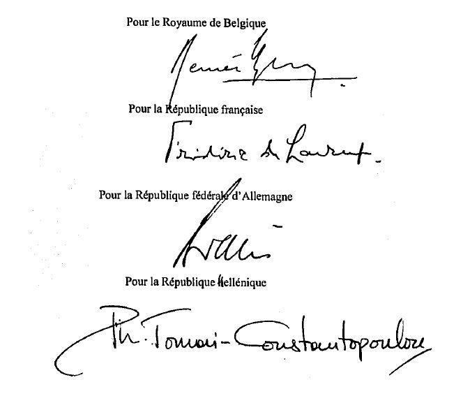
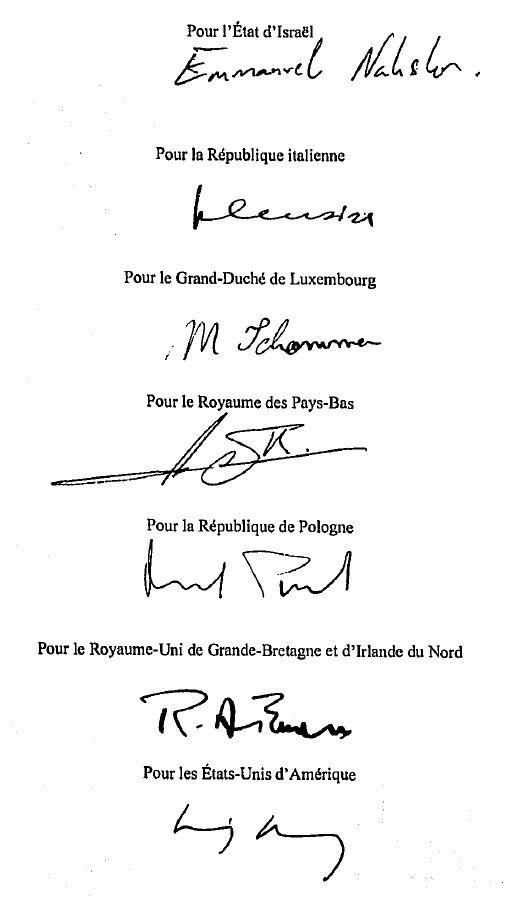
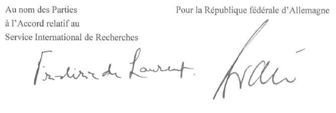

# Loi du 23 mai 2014 portant approbation de l'Accord relatif au Service International de Recherches, signé à Berlin, le 9 décembre 2011.

Nous Henri, Grand-Duc de Luxembourg, Duc de Nassau,

Notre Conseil d’État entendu;

De l’assentiment de la Chambre des Députés;

Vu la décision de la Chambre des Députés du 12 mars 2014 et celle du Conseil d’État du 25 mars 2014 portant qu’il n’y a pas lieu à second vote;

Avons ordonné et ordonnons:

## Article unique.

Est approuvé l’Accord relatif au Service International de Recherches, signé à Berlin, le 9 décembre 2011.

Mandons et ordonnons que la présente loi soit insérée au Mémorial pour être exécutée et observée par tous ceux que la chose concerne.

Le Premier Ministre, Ministre d‘État,   Xavier Bettel

Château de Berg, le 23 mai 2014.   Henri

Accord

relatif au

Service International de Recherches

Le Royaume de Belgique,

la République française,

la République fédérale d’Allemagne,

la République hellénique,

l’État d’Israël,

la République italienne,

le Grand-Duché de Luxembourg

le Royaume des Pays-Bas,

la République de Pologne,

le Royaume-Uni de Grande-Bretagne et d’Irlande du Nord

et

les États-Unis d’Amérique,

ci-après dénommés les Parties au présent Accord;

Préambule

considérant que le Service International de Recherches a été créé dans le but de rechercher les personnes disparues et de rassembler, de classer, de conserver et de rendre accessibles aux Gouvernements et aux personnes intéressées les documents relatifs aux Allemands et aux non-Allemands qui ont été détenus dans les camps de concentration ou de travail national-socialistes ou aux non-Allemands qui ont été déplacés du fait de la Seconde Guerre mondiale;

gardant à l’esprit l’Accord instituant une Commission Internationale pour le Service International de Recherches et l’Accord sur les relations entre la Commission Internationale pour le Service International de Recherches et le Comité International de la Croix-Rouge, tous deux conclus à Bonn le 6 juin 1955, tels que modifiés par le Protocole sur la prolongation et la modification de l’Accord instituant une Commission Internationale pour le Service International de Recherches, conclu à Bonn le 23 août 1960, le Protocole sur la prolongation et la modification de l’Accord sur les relations entre la Commission Internationale pour le Service International de Recherches et le Comité International de la Croix-Rouge, conclu à Bonn et Genève le 30 septembre et le 7 octobre 1960, par l’Arrangement relatif à la prolongation et à la modification de l’Accord instituant une Commission Internationale pour le Service International de Recherches, conclu à Bonn le 15 octobre 1973, par l’Arrangement relatif à la prolongation et à la modification de l’Accord sur les relations entre la Commission Internationale pour le Service International de Recherches et le Comité International de la Croix-Rouge, conclu à Genève le 22 décembre 1972, par le Protocole sur la modification de l’Accord instituant une Commission Internationale pour le Service International de Recherches, conclu à Berlin Ie 16 mai 2006, et par le Protocole sur la modification de l’Accord sur les relations entre la Commission Internationale pour le Service International de Recherches et le Comité International de la Croix-Rouge, conclu à Luxembourg le 16 mai 2006, ainsi que l’Accord relatif au statut juridique du Service International de Recherches à Arolsen, conclu à Bonn le 15 juillet 1993;

désireux de poursuivre les activités de conservation et de recherches menées par le Service International de Recherches à Bad Arolsen, tout en permettant l’élargissement de ses activités pour prendre en compte la transformation progressive du Service International de Recherches en un centre de documentation, d’information et de recherche afin de garantir que le sort des victimes du national-socialisme et des survivants puisse continuer d’être étudié et que les connaissances dans ce domaine puissent être transmises aux générations futures;

désireux d’assurer un accès, à des fins de recherche, aux archives et documents détenus par le Service International de Recherches, à la fois sur place et par des copies des archives et documents reçues par les Parties au présent Accord ou par d’autres moyens tels que l’accès à distance;

réaffirmant que le présent Accord ne porte pas atteinte aux droits de propriété sur les archives et documents conservés au Service International de Recherches à Bad Arolsen;

considérant que les Parties au présent Accord estiment que leur législation nationale respective assure une protection adéquate des données à caractère personnel et escomptent qu’en donnant accès aux copies, chaque Partie au présent Accord tiendra compte du caractère sensible de certaines informations qu’elles peuvent contenir;

notant qu’en conséquence de l’élargissement des activités du Service International de Recherches, le Comité International de la Croix-Rouge a exprimé le souhait de se retirer de la gestion et de l’administration du Service International de Recherches;

rappelant que la notification émanant du Comité International de la Croix-Rouge et adressée au Président de la Commission Internationale pour le Service International de Recherches le 14 avril 2011 rend ledit retrait et la dénonciation de l’Accord sur les relations entre la Commission Internationale pour le Service International de Recherches et le Comité International de la Croix-Rouge conclu à Bonn le 6 juin 1955, tel que modifié, effectifs au 31 décembre 2012, conformément aux dispositions dudit Accord;

désireux d’assurer l’intégrité et la préservation des archives et documents originaux et de conserver la structure historique dans son ensemble tout en maintenant une administration et une direction impartiales et responsables du Service International de Recherches, conformément à son caractère international;

reconnaissant la contribution constante de la République fédérale d’Allemagne en tant que pays hôte du Service International de Recherches;

sont convenus de ce qui suit:

I. Objectifs et missions

Article 1er

Rôle du Service International de Recherches

Source unique d’informations sur les sujets liés aux actes de persécution commis par le régime national-socialiste et aux déplacements de personnes résultant des atrocités de la Seconde Guerre mondiale en Europe, le Service International de Recherches, dont le siège se trouve à Bad Arolsen, poursuit ses activités en tant que centre international chargé de conserver, de préserver, de cataloguer et d’indexer les archives et documents détenus dans ses locaux, afin de faciliter les recherches de victimes, la recherche, le travail de mémoire, la commémoration, l’appui judiciaire et d’autres tâches relevant de sa compétence.

Article 2

Conservation, préservation, catalogage et indexation

Le Service International de Recherches assure la conservation des archives et documents originaux détenus dans ses locaux, notamment en créant et en maintenant les conditions appropriées de conservation des archives et documents et en prenant, en tant que de besoin, toutes les mesures pertinentes pour stopper et prévenir leur détérioration ou pour les restaurer. En tant que dépositaire d’archives et de documents originaux, le Service International de Recherches veille à leur intégrité ainsi qu’à la préservation et au maintien de la structure historique de la collection dans son ensemble, sauf décision contraire de la Commission Internationale prise à l’unanimité.

Article 3

Recherches de personnes

Le Service International de Recherches fournit, à des fins humanitaires et en se basant sur les archives et documents qu’il détient, toutes les informations pouvant être utiles et présentant un intérêt direct pour la ou les personne(s) sollicitant les informations en question. Les informations sont également mises à la disposition, aux mêmes fins, des représentants à la Commission Internationale, des officiers de liaison désignés par les Parties au présent Accord et, sous réserve de l’approbation de la Commission Internationale, de toute organisation gouvernementale ou non gouvernementale sollicitant des informations au profit de parties intéressées ou de leurs mandataires, administrateurs ou exécuteurs.

Article 4

Recherche

a) Les archives et documents détenus par le Service International de Recherches sont disponibles pour la recherche, par communication dans les locaux du Service International de Recherches et par communication des copies des archives et documents reçues par les Parties au présent Accord.

b) Le Service International de Recherches peut mener des recherches en se basant sur ses archives et documents.

Article 5

Mémoire et commémoration

a) Dans un souci de mémoire et de commémoration, le Service International de Recherches peut notamment organiser dans ses locaux des expositions ainsi que des initiatives pédagogiques basées sur ses archives et documents.

b) Le Service International de Recherches peut faciliter les activités de mémoire et de commémoration en d’autres lieux situés sur le territoire des Parties au présent Accord et, dans les conditions à déterminer par la Commission Internationale, dans des États non parties au présent Accord,

Article 6

Appui judiciaire

a) À la demande des autorités judiciaires compétentes, le Service International de Recherches peut apporter son concours lors de procès et d’autres procédures judiciaires relevant de la juridiction d’une Partie au présent Accord, sur la base des informations pouvant raisonnablement être obtenues à partir de ses archives et documents.

b) Toutes les demandes émanant des autorités judiciaires compétentes d’États non parties au présent Accord sont transmises à la Commission Internationale pour décision.

c) Le témoignage d’un agent ou d’un employé du Service International de Recherches lors d’un procès ou au cours de toute autre procédure judiciaire nécessite une décision préalable de la Commission Internationale.

d) Le Service International de Recherches peut percevoir une redevance pour les services rendus lors de procédures civiles.

Article 7

Autres missions

Le Service International de Recherches peut, sur décision unanime de la Commission Internationale, exercer des activités hors du champ d’application des articles 2 à 6 du présent Accord, à condition qu’elles soient liées aux renseignements contenus dans les archives et documents qu’il détient.

II. Accès aux informations, archives et documents

Article 8

Règles concernant l’accès et l’utilisation

Tout représentant à la Commission Internationale et tout officier de liaison nommé par l’une des Parties au présent Accord a librement accès à toutes les archives et tous les documents conservés au Service International de Recherches. Ces personnes coordonnent leurs activités avec le Directeur.

L’accès aux archives et documents en vue de rechercher des personnes et à des fins de recherche dans les locaux du Service International de Recherches est assuré dans toute la mesure du possible, conformément aux dispositions énoncées ci-dessous:

a) Les informations à des fins de recherche de personnes sont fournies sur demande et sans frais.

b) L’accès aux archives et documents à des fins de recherche dans les locaux du Service International de Recherches est accordé sous réserve que toutes les mesures appropriées aient été prises pour que les activités liées à cette recherche ne compromettent pas de manière significative l’exécution des missions du Service International de Recherches relatives à son mandat humanitaire conformément à l’article 3 du présent Accord.

c) L’utilisation aux fins de recherche des archives et documents détenus par le Service International de Recherches est autorisée sur demande. Les modalités d’utilisation sont déterminées par la Commission Internationale dans des directives relatives à l’utilisation, adoptées à l’unanimité et comprenant un barème de droits. En règle générale, l’utilisation est limitée aux archives et documents disponibles sous forme numérisée. L’accès aux archives et documents originaux est accordé en tenant dûment compte de leur état de conservation. Le demandeur doit s’engager par écrit à respecter les règles d’accès établies par la Commission Internationale.

d) Nonobstant les dispositions du paragraphe c) ci-dessus, les archives et documents qui ont été transmis au Service International de Recherches ou mis à sa disposition sur la base d’un arrangement écrit à la date du dépôt stipulant que le Service International de Recherches jouit d’un droit exclusif d’utilisation, ne peuvent être utilisés ou copiés que si le donateur des archives et documents ou, le cas échéant, son ayant droit, fait part de son accord par écrit.

e) Le demandeur ou l’utilisateur des archives et documents engage sa responsabilité individuelle au regard de la législation nationale applicable en cas de divulgation de données à caractère personnel.

Article 9

Copies des archives et documents

a) Chaque Partie au présent Accord reçoit sur demande une copie unique des archives et documents du Service International de Recherches.

b) Chaque Partie au présent Accord peut permettre l’accès à ces archives et documents à des fins de recherche dans les locaux d’un dépôt d’archives approprié ou par accès à distance sur son territoire. L’accès est autorisé conformément à la législation nationale pertinente et aux règles et pratiques nationales en matière d’archivage.

c) La Commission Internationale statue sur les demandes de copies des archives et documents du Service International de Recherches émanant d’États non parties au présent Accord et d’entités non étatiques.

Article 10

Accès à distance aux documents du Service International de Recherches

a) L’accès des États membres de la Commission Internationale aux archives et documents détenus par le Service International de Recherches est accordé sur demande par accès à distance sécurisé et authentifié à condition que l’État requérant prenne en charge les frais occasionnés, y compris les frais encourus au siège du Service International de Recherches, Cet accès à distance s’étend à toutes les archives et tous les documents conservés au Service International de Recherches à Bad Arolsen et mis à la disposition des États membres sous forme de copie numérisée.

b) La Commission Internationale prend les décisions nécessaires à la mise en œuvre de l’accès à distance.

c) La Commission Internationale statue sur les demandes d’accès à distance aux archives et documents du Service International de Recherches à Bad Arolsen émanant d’États non parties au présent Accord et d’entités non étatiques.

III. Protection de la vie privée

Article 11

Vie privée

a) L’accès aux archives et documents détenus par le Service International de Recherches est toujours autorisé en tenant dûment compte de la nécessité de protéger les données mettant en cause la vie privée, conformément aux dispositions énoncées ci-dessous. L’exécution des missions humanitaires et de recherche est pleinement compatible avec les dispositions du présent article.

b) Le Service International de Recherches et la Commission Internationale, ainsi que les officiers de liaison, prennent toutes les mesures raisonnables pour éviter la divulgation d’informations concernant une ou des personne(s), susceptibles de porter préjudice aux intérêts de la ou des personne(s) concernée(s) ou de ses (leurs) proches.

c) L’utilisation de données à caractère personnel reposant sur les informations issues des archives et documents originaux fournis par le Service International de Recherches à Bad Arolsen, et notamment leur diffusion par le biais de publications, est régie par une série de règles énoncées dans les directives adoptées à l’unanimité par la Commission Internationale. Ces directives tiennent dûment compte des intérêts de la ou des personne(s) concernée(s) et de ses (leurs) proches parents, ainsi que de l’avancement des recherches et des connaissances sur la période et les événements couverts par les archives et documents détenus par le Service International de Recherches.

d) En fournissant un accès aux copies des archives et documents du Service International de Recherches, chaque Partie au présent Accord, tenant compte du caractère sensible des informations que ces copies peuvent contenir, assure une protection adéquate des données à caractère personnel issues de ces informations à l’aide de sa législation nationale.

IV. Inviolabilité des archives et documents

Article 12

Inviolabilité

Sans préjudice des droits de propriété, les archives et documents détenus par le Service International de Recherches sont inviolables. Les archives et documents ne sont soumis à aucune forme de réquisition, saisie ou séquestre par un tribunal ou toute autre autorité dans le pays d’accueil. Sur le territoire de toute autre Partie au présent Accord, les archives et documents sont inviolables dans les limites prévues par la législation nationale.

V. Statut juridique

Article 13

Caractère international et capacité juridique

Le Service International de Recherches, organisation à caractère international, jouit de la capacité juridique et peut, conformément à la législation de la République fédérale d’Allemagne, conclure les transactions juridiques nécessaires à l’accomplissement de ses missions, notamment des contrats de travail, de location et des marchés, et comparaître en justice. À ces fins, le Service International de Recherches à Bad Arolsen est représenté par son Directeur. Les contrats de travail conclus avec le Service International de Recherches sont soumis aux dispositions du droit du travail et du droit social en vigueur au lieu de travail.

VI. Gouvernance

Article 14

La Commission Internationale

a) La Commission Internationale, composée d’un représentant nommé par chacune des Parties au présent Accord, fait office d’organe directeur suprême du Service International de Recherches.

b) La Commission Internationale est présidée par l’un des représentants visés au paragraphe a) ci-dessus. Le premier président de la Commission Internationale est le président de la Commission Internationale établie conformément aux Accords de Bonn à la date d’entrée en vigueur du présent Accord.

c) La Commission Internationale peut inviter des représentants désignés par d’autres États ou organisations internationales intéressés à participer en qualité d’observateurs à tous les débats portant sur des questions intéressant lesdits États ou organisations internationales.

d) La Commission Internationale est convoquée pour la première fois par son président à Bad Arolsen au plus tard quatre-vingt-dix jours après l’entrée en vigueur du présent Accord. Par la suite, la Commission Internationale se réunit au moins une fois par an. Les réunions de la Commission Internationale peuvent avoir lieu au siège du Service International de Recherches ou sur le territoire des Parties au présent Accord.

e) La Commission Internationale peut décider de se réunir plus fréquemment, étant entendu que son président doit la convoquer dans un délai de trente jours à compter de la requête de deux de ses membres.

f) La Commission Internationale ne peut adopter de décisions que si les deux tiers de ses membres sont présents.

g) La Commission Internationale prend ses décisions par consensus ou, si tous les efforts en ce sens ont échoué, à la majorité simple de ses membres, présents ou représentés, et votants, sauf si une autre procédure est expressément prévue par le présent Accord ou si la Commission Internationale en décide autrement.

h) Le Directeur du Service International de Recherches fait office de Secrétaire auprès de la Commission Internationale.

i) La Commission Internationale établit son propre règlement intérieur par décision unanime.

Article 15

Rôle de la Commission Internationale

a) La Commission Internationale assure la coordination entre les Parties au présent Accord pour les questions relatives au Service International de Recherches et émet des directives relatives aux opérations du Service International de Recherches, notamment en ce qui concerne l’accès aux archives et documents détenus dans ses locaux.

b) Les directives visées au paragraphe a) du présent article sont transmises au Directeur du Service International de Recherches pour application.

Article 16

Partenaire institutionnel

a) Les Parties au présent Accord autorisent le président de la Commission Internationale à conclure en leur nom un accord concernant une institution ci-après dénommée «le Partenaire institutionnel», accord qui sera adopté à l’unanimité. Cet accord (ci-après dénommé «l’Accord de partenariat») consigne les modalités spécifiques du partenariat entre le Service International de Recherches et le Partenaire institutionnel.

b) Le Partenaire institutionnel a pour mission de collaborer avec le Service International de Recherches pour lui permettre de remplir le rôle qui lui incombe en vertu du présent Accord.

c) Le Partenaire institutionnel a pour rôle de conseiller la Commission Internationale et le Directeur du Service International de Recherches et de collaborer avec eux pour la mise en œuvre de politiques dans les domaines de la gestion des ressources humaines, de la conservation et de la préservation, du catalogage et de l’indexation, du budget et de la vérification des comptes.

d) La Commission Internationale peut, statuant à l’unanimité, adopter des projets d’amendement ou des prorogations de l’Accord de partenariat. Sur la base de cette décision, un amendement ou une prorogation peut être conclu entre les Parties à l’Accord de partenariat.

e) La Commission Internationale peut, statuant à l’unanimité, mettre fin au partenariat conformément aux modalités de l’Accord de partenariat et inviter une autre institution à assumer ce rôle après avoir conclu un nouvel accord conformément aux dispositions du paragraphe a) ci-dessus.

Article 17

Relations consultatives et subsidiaires

a) La Commission Internationale peut établir des organes consultatifs ou subsidiaires.

b) La Commission Internationale peut établir des relations avec d’autres institutions si elle le juge nécessaire.

Article 18

Observateurs

Le Comité International de la Croix-Rouge et le Partenaire institutionnel sont invités à nommer un observateur à la Commission Internationale.

Article 19

Organisations non gouvernementales

Les organisations non gouvernementales portant un intérêt clairement défini aux activités du Service International de Recherches peuvent soumettre des suggestions à la Commission Internationale et, dans les conditions fixées par la Commission Internationale, être invitées à participer aux délibérations relatives à ces suggestions.

Article 20

Nomination du Directeur

a) Sous réserve de l’approbation unanime de la Commission Internationale, cette dernière nomme le Directeur du Service International de Recherches. La Commission Internationale se concerte avec le Partenaire institutionnel visé à l’article 16 du présent Accord avant de prendre cette décision.

b) La procédure de nomination du Directeur du Service International de Recherches est définie dans le règlement intérieur de la Commission Internationale.

c) Le Directeur du Service International de Recherches jouit mutatis mutandis, en République fédérale d’Allemagne, des mêmes privilèges et immunités que les fonctionnaires consulaires de carrière, conformément aux articles 40 à 47 et 52 de la Convention de Vienne de 1963 sur les relations consulaires, sauf s’il est ressortissant ou résident permanent de la République fédérale d’Allemagne. Dans ce dernier cas, il ne jouit de l’immunité de juridiction et de l’inviolabilité personnelle que pour les actes officiels accomplis dans l’exercice de ses fonctions.

d) Le Directeur du Service International de Recherches est nommé pour une période de cinq ans. Cette nomination est renouvelable une fois.

Article 21

Responsabilité du Directeur

a) Le Directeur du Service International de Recherches agit conformément aux directives de la Commission Internationale à laquelle il rend compte. Le Directeur informe la Commission Internationale immédiatement si une situation se présente qui n’est pas couverte par le présent Accord ni par l’Accord de partenariat, à laquelle une décision prise ou une directive adoptée par la Commission Internationale conformément au présent Accord ne s’applique pas. Le Directeur est responsable de la mise en œuvre des décisions adoptées par la Commission Internationale, ainsi que de la direction et de l’administration du Service International de Recherches.

b) Le Directeur élabore, sous la direction de la Commission Internationale, les priorités envisagées pour le Service International de Recherches et en définit les implications financières pour examen par la Commission Internationale. Le Directeur établit le projet de plan de travail et de budget annuels, qui sont transmis en temps utile à la Commission Internationale pour approbation.

c) Le Directeur du Service International de Recherches présente à la Commission Internationale semestriellement ou plus fréquemment si nécessaire, un rapport sur les activités du Service International de Recherches.

d) Le Directeur du Service International de Recherches présente à la Commission Internationale un bilan annuel des recettes et dépenses de l’exercice financier précédent.

VII. Rôle des États Parties

Article 22

Assistance au Service International de Recherches

a) Sur demande, les Parties au présent Accord fournissent leur assistance au Service International de Recherches dans l’exercice de sa fonction de recherche de personnes. Cette assistance prend la forme de l’examen, de la fourniture de copies ou du transfert de documents détenus dans les archives nationales, publiques ou privées se trouvant sur leur territoire et contenant des informations personnelles sur les personnes directement concernées. L’assistance est fournie conformément à la législation nationale pertinente et n’est pas accordée dans les cas où elle serait contraire aux intérêts de l’État Partie qui la fournit ou porterait atteinte aux droits de propriété sur ces documents.

b) Le Directeur peut à tout moment proposer à la Commission Internationale de prendre contact avec le Gouvernement de tout État non partie au présent Accord ou toute entité non étatique pour l’inviter à rendre accessibles au Service International de Recherches les originaux ou copies de documents détenus par ou pour le compte dudit Gouvernement ou de ladite entité non étatique et qui revêtent une grande importance pour le Service International de Recherches au regard de sa fonction de recherche de personnes.

Article 23

Bureaux de liaison

Toutes les Parties au présent Accord ainsi que le Comité International de la Croix-Rouge ont le droit d’entretenir à leurs frais un bureau de liaison permanent auprès du Service International de Recherches.

Article 24

Soutien du pays d’accueil

a) Le budget ordinaire du Service International de Recherches portant sur ses objectifs et missions visés à l’article 1er du présent Accord, sur la base d’un projet de budget annuel approuvé par la Commission Internationale conformément au paragraphe b) de l’article 21 du présent Accord, est transmis au Gouvernement de la République fédérale d’Allemagne et financé par une contribution prélevée sur le budget de la République fédérale d’Allemagne.

b) La Cour fédérale des comptes de la République fédérale d’Allemagne peut, en coordination avec le Directeur du Service International de Recherches, vérifier les comptes du Service International de Recherches ainsi que l’efficacité, la régularité et la conformité de sa gestion financière.

VIII. Contributions volontaires

Article 25

Contributions volontaires

Outre le financement mentionné à l’article 24 du présent Accord, le Service International de Recherches peut solliciter et recevoir des contributions volontaires de sources publiques ou privées afin de remplir ses objectifs et missions. Le Service International de Recherches informe la Commission Internationale de ces contributions et de leurs sources.

IX. Dispositions Finales

Article 26

Adhésion

a) Le présent Accord restera ouvert à l’adhésion de tout État auquel aura été adressée une invitation sur la base d’une décision unanime de la Commission Internationale.

b) Les instruments d’adhésion seront déposés auprès de la République fédérale d’Allemagne.

c) Pour les États ayant déposé un instrument d’adhésion, le présent Accord entrera en vigueur le trentième jour suivant le dépôt de l’instrument en question.

Article 27

Dénonciation

a) Le présent Accord restera en vigueur pour une durée indéterminée.

b) Tout État Partie peut dénoncer le présent Accord en adressant une notification écrite au dépositaire. La dénonciation prendra effet à la fin de l’année civile suivant cette notification.

Article 28

Signature et application temporaire

a) Le présent Accord sera ouvert à la signature du Royaume de Belgique, de la République française, de la République fédérale d’Allemagne, de la République hellénique, de l’État d’Israël, de la République italienne, du Grand-Duché de Luxembourg, du Royaume des Pays-Bas, de la République de Pologne, du Royaume-Uni de Grande-Bretagne et d’Irlande du Nord et des États-Unis d’Amérique à partir du 9 décembre 2011 au Ministère fédéral des Affaires étrangères de la République fédérale d’Allemagne à Berlin.

b) À condition que tous les États mentionnés au paragraphe a) ci-dessus aient signé le présent Accord, celui-ci s’appliquera à titre temporaire, dans l’attente de son entrée en vigueur, à compter du 1er janvier 2013, conformément à la législation interne le cas échéant.

Article 29

Entrée en vigueur

a) Le présent Accord entrera en vigueur à la dernière des deux dates ci-après: soit (1) le 1er janvier 2013, soit (2) le premier jour du premier mois suivant la date à laquelle le Royaume de Belgique, la République française, la République fédérale d’Allemagne, la République hellénique, l’État d’Israël, la République italienne, le Grand-Duché de Luxembourg, le Royaume des Pays-Bas, la République de Pologne, le Royaume-Uni de Grande-Bretagne et d’Irlande du Nord et les États-Unis d’Amérique auront informé le dépositaire de l’accomplissement des procédures nationales requises en ce qui les concerne pour l’entrée en vigueur du présent Accord.

b) À compter de sa date d’entrée en vigueur, le présent Accord remplace l’Accord instituant une Commission Internationale pour le Service International de Recherches, conclu à Bonn le 6 juin 1955, tel que modifié par le Protocole sur la prolongation et la modification de l’Accord instituant une Commission Internationale pour le Service International de Recherches, conclu à Bonn le 23 août 1960, par l’Arrangement relatif à la prolongation et à la modification de l’Accord instituant une Commission Internationale pour le Service International de Recherches, conclu à Bonn le 15 octobre 1973, par le Protocole sur la modification de l’Accord instituant une Commission Internationale pour le Service International de Recherches, conclu à Berlin le 16 mai 2006, ainsi que l’Accord relatif au statut juridique du Service International de Recherches à Arolsen, conclu à Bonn le 15 juillet 1993.

c) À l’entrée en vigueur du présent Accord, toutes les décisions et directives de la Commission Internationale prises en vertu des accords précédents mentionnés au paragraphe b) ci-dessus restent en vigueur jusqu’à ce que la Commission Internationale en décide autrement.

Article 30

Dépositaire

La République fédérale d’Allemagne, en sa qualité de dépositaire du présent Accord, informe toutes les autres Parties au présent Accord de la signature, de l’accomplissement des procédures nationales requises pour l’entrée en vigueur du présent Accord, de l’entrée en vigueur du présent Accord, des adhésions, dénonciations et autres notifications reçues des Parties au présent Accord. Elle transmet une copie certifiée conforme à toutes les Parties au présent Accord ainsi qu’au Secrétaire général des Nations Unies pour enregistrement conformément à l’article 102 de la Charte des Nations Unies.

En foi de quoi, les soussignés ont signé le présent Accord.

Fait à Berlin, le 9 décembre 2011, en langues française, allemande et anglaise, les trois textes faisant également foi, en un seul exemplaire déposé aux archives de la République fédérale d’Allemagne.

Accord de Partenariat sur les relations entre les Archives fédérales de la République fédérale d’Allemagne  et le Service International de Recherches

Préambule

Le Président de la Commission Internationale pour le Service International de Recherches, autorisé à agir au nom des Parties à l’Accord relatif au Service International de Recherches conclu à Berlin le 9 décembre 2011 (ci-après dénommé «l’Accord SIR») conformément à l’article 16 dudit Accord, d’une part,

et

la République fédérale d’Allemagne, d’autre part;

gardant à l’esprit le rôle que joue le Service International de Recherches en tant que centre international chargé de conserver, de préserver, de cataloguer et d’indexer les archives et documents détenus dans ses locaux, afin de faciliter les recherches de victimes, la recherche, le travail de mémoire, la commémoration, l’appui judiciaire et d’autres tâches relevant de sa compétence;

conscients de l’histoire du Service International de Recherches qui a été créé dans le but de rechercher les personnes disparues et de rassembler, de classer, de conserver et de rendre accessibles aux Gouvernements et aux personnes intéressés les documents relatifs aux Allemands et aux non-Allemands qui ont été détenus dans les camps de concentration ou de travail national-socialistes ou aux non-Allemands qui ont été déplacés du fait de la Seconde Guerre mondiale;

rappelant le mandat défini dans l’Accord SIR concernant la désignation d’un Partenaire institutionnel qui aura pour rôle de conseiller la Commission Internationale et le Directeur du Service International de Recherches et de collaborer avec eux pour la mise en œuvre de politiques dans les domaines de la gestion des ressources humaines, de la conservation et de la préservation, du catalogage et de l’indexation, du budget et de la vérification des comptes;

rappelant le pouvoir que l’Accord SIR donne au Président de la Commission Internationale de conclure un accord qui sera adopté à l’unanimité par la Commission Internationale, consignant les modalités spécifiques d’un partenariat entre le Service International de Recherches et un Partenaire institutionnel;

prenant acte de la volonté des Archives fédérales de la République fédérale d’Allemagne d’accepter le rôle de Partenaire institutionnel tel que défini dans l’Accord SIR pour conseiller le Directeur du Service International de Recherches et collaborer avec lui dans tous les domaines où l’expertise et l’expérience des Archives fédérales peuvent se révéler utiles pour atteindre les objectifs que la Commission Internationale a arrêtés et assignés au Directeur du Service International de Recherches;

désireux d’assurer la continuité professionnelle et institutionnelle et le développement des travaux du Service International de Recherches;

sont convenus de ce qui suit:

Article 1er.

Définitions

Aux fins du présent Accord:

1\. Le terme «Président» désigne le Président de la Commission Internationale pour le Service International de Recherches.

2\. L’expression «Service International de Recherches» désigne le Directeur du Service International de Recherches ou le Service International de Recherches.

3\. L’expression «Archives fédérales» désigne le Président des Archives fédérales de la République fédérale d’Allemagne ou les Archives fédérales de la République fédérale d’Allemagne.

Article 2

Partenaire institutionnel

Les Archives fédérales sont le Partenaire institutionnel désigné du Service International de Recherches conformément à l’article 16 de l’Accord SIR.

Article 3

Questions relatives aux archives

(1) Aux fins de la mise en œuvre de l’article 2 de l’Accord SIR et des directives de la Commission Internationale, le Service International de Recherches sollicite et les Archives fédérales fournissent toute l’aide et tous les conseils pertinents concernant la conservation, la restauration, la préservation, le catalogage et l’indexation des archives et documents détenus par le Service International de Recherches dans ses locaux.

(2) Dans le cadre de cette aide, les Archives fédérales fournissent leur expertise et peuvent, si possible et en tant que de besoin, proposer leurs services pour assister le Service International de Recherches dans ses travaux afin de lui permettre d’accomplir ses missions conformément à l’article 2 de l’Accord SIR.

(3) Le Service International de Recherches et les Archives fédérales coopèrent à l’élaboration de priorités et à la définition des principes professionnels se rapportant à la conservation, à la restauration, à la préservation, au catalogage et à l’indexation des archives. Ces priorités et principes sont soumis à la Commission Internationale pour approbation.

(4) Le Service International de Recherches et les Archives fédérales se consultent régulièrement sur la coopération visée aux paragraphes 1 à 3.

(5) Le Service International de Recherches et les Archives fédérales préservent la structure historique des archives et des documents détenus par le Service International de Recherches et aucune disposition du présent Accord n’est interprétée comme autorisant à réviser la structure des archives.

(6) Tous les efforts déployés pour rendre possible le classement des dossiers en fonction de leur provenance ou tout autre principe généralement appliqué aux archives qui n’ont pas la spécificité historique du Service International de Recherches s’effectuent uniquement dans les dossiers numériques en fonction des possibilités de marquage et de récupération électroniques de séries de documents dans les archives numériques, sans procéder à une véritable réorganisation des documents papier originaux.

(7) En ce qui concerne l’accès aux archives et documents détenus par le Service International de Recherches à Bad Arolsen, l’Accord SIR, ainsi que les décisions prises et les directives adoptées par la Commission Internationale conformément audit Accord prévalent.

Article 4

Gestion des ressources humaines

(1) La gestion des ressources humaines incombe au Directeur du Service International de Recherches.

(2) Le Service International de Recherches consulte les Archives fédérales à l’occasion du recrutement du personnel d’encadrement du Service International de Recherches. Lors du recrutement du personnel d’archives, le Service International de Recherches veille, en accord avec les Archives fédérales, à ce que ce personnel réponde aux normes internationalement reconnues en matière d’archives.

Article 5

Préparation du budget

(1) Aux fins de l’accomplissement des missions énumérées à l’article 21 de l’Accord SIR, qui incluent, de manière non exhaustive, l’établissement d’un projet de budget et la présentation d’un bilan annuel des recettes et dépenses de l’exercice financier précédent, le Service International de Recherches sollicite et les Archives fédérales fournissent toute l’aide et tous les conseils possibles, en particulier en ce qui concerne les implications financières se rapportant aux initiatives en matière de conservation et de préservation, notamment une étude de viabilité économique avant toute passation de marchés d’un montant supérieur à 125 000 euros ou à tout autre montant fixé par la Commission Internationale

(2) Lors de la préparation du projet de budget, la mise en œuvre des décisions et mandats de la Commission Internationale doit être prioritaire dans l’allocation des ressources.

Article 6

Affaires diverses

(1) Le Service International de Recherches consulte les Archives fédérales lors de l’élaboration des priorités du Service International de Recherches et de la définition de leurs implications financières qui seront examinées par la Commission Internationale, de l’établissement du plan de travail annuel, comprenant les éventuels projets de réorganisation d’ordre structurel, et de la présentation des rapports semestriels sur les activités du Service International de Recherches. Les Archives fédérales peuvent présenter à la Commission Internationale leurs commentaires sur ces documents et rapports.

(2) Le Service International de Recherches consulte les Archives fédérales lors de la conclusion de transactions juridiques, notamment de contrats de travail, de location ou de marchés, et du traitement de procédures judiciaires.

(3) Les bâtiments utilisés par le Service International de Recherches à Bad Arolsen sont gérés par l’Institut fédéral du patrimoine immobilier.

(4) La planification, l’utilisation et le développement des technologies de l’information (TI) au Service International de Recherches sont mis en œuvre en consultation avec les Archives fédérales. À cet effet, le Service International de Recherches et les Archives fédérales s’efforcent de maintenir, dans la mesure du possible, une certaine cohérence avec l’expérience dans l’utilisation des copies numériques des archives du Service International de Recherches à Bad Arolsen et dans les dépôts d’archives nationaux.

(5) Si l’avis d’experts extérieurs concernant les activités du Service International de Recherches est sollicité ou obtenu, le Service International de Recherches et les Archives fédérales s’en informent mutuellement.

Article 7

Différends entre le Service International de Recherches et le Partenaire institutionnel

En cas de différend concernant la mise en œuvre ou l’application du présent Accord qui ne peut être réglé par voie de consultations mutuelles, l’une ou l’autre des parties peut soumettre l’affaire à la Commission Internationale pour examen.

Article 8

Entrée en vigueur et durée

(1) Le présent Accord entrera en vigueur le même jour que l’Accord relatif au Service International de Recherches signé à Berlin, le 9 décembre 2011.

(2) Le présent Accord restera en vigueur pendant une durée de cinq ans à compter de la date de son entrée en vigueur. Il peut être renouvelé pour des périodes successives de cinq ans par décision unanime de la Commission Internationale, si possible au moins un an avant l’expiration de la période précédemment arrêtée. Si aucune décision quant à la prorogation n’a été prise avant sa date d’expiration, le présent Accord devient caduc et le partenariat institutionnel prend fin.

(3) À la suite de sa signature, le présent Accord s’appliquera à titre temporaire, conformément à la législation interne le cas échéant, durant toute période au cours de laquelle l’Accord SIR conclu à Berlin, le 9 décembre 2011, s’appliquera à titre temporaire.

Article 9

Dénonciation

Le Président de la Commission Internationale pour le Service International de Recherches, au nom des parties à l’Accord SIR, ou la République fédérale d’Allemagne peut dénoncer le présent Accord en adressant à l’autre partie une notification écrite moyennant un préavis d’au moins six mois [180 jours].

Article 10

Assistance en cas de caducité ou de dénonciation

En cas de caducité ou de dénonciation du présent Accord de partenariat, le Service International de Recherches et les Archives fédérales coopèrent pour prendre toutes les mesures nécessaires afin de traiter les affaires pendantes.

Fait à Berlin, le 9 décembre 2011, en double exemplaire en langues française, allemande et anglaise, les trois textes faisant également foi.

Doc. parl. [6620](https://legilux.public.lu/eli/etat/proj/pl/20130170); sess. ord. 2012-1013 et sess. extraord. 2013-2014.
