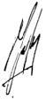
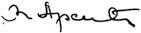

# Loi du 18 juillet 2014 portant approbation de la Convention entre le Grand-Duché de Luxembourg et la République en Serbie en matière de sécurité sociale, signée à Luxembourg, le 7 juin 2013.

Nous Henri, Grand-Duc de Luxembourg, Duc de Nassau,

Notre Conseil d’Etat entendu;

De l’assentiment de la Chambre des Députés;

Vu la décision de la Chambre des Députés du 17 juin 2014 et celle du Conseil d’Etat du 24 juin 2014 portant qu’il n’y a pas lieu à second vote;

Avons ordonné et ordonnons:

## Article unique.

Est approuvée la Convention entre le Grand-Duché de Luxembourg et la République de Serbie en matière de sécurité sociale, signée à Luxembourg, le 7 juin 2013.

Mandons et ordonnons que la présente loi soit insérée au Mémorial pour être exécutée et observée par tous ceux que la chose concerne.

Le Ministre des Affaires étrangères et européennes,   Jean Asselborn   Le Ministre de la Sécurité sociale,   Romain Schneider

Cabasson, le 18 juillet 2014.   Henri

\**CONVENTION**

entre le Grand-Duché de Luxembourg et la République de Serbie

en matière de sécurité sociale

\*Le Grand-Duché de Luxembourg*

\*et*

\*la République de Serbie*

\*animés* du désir de régler les rapports réciproques entre les deux Etats dans le domaine de la sécurité sociale,

SONT CONVENUS de ce qui suit:

TITRE I

\**Dispositions générales**

\*Article 1er*

\***Définitions des termes***

(1) Pour l’application de la présente convention les termes ont la signification suivante:

1\. «législation» désigne les lois, règlements et dispositions statutaires qui se réfèrent aux branches de la sécurité sociale visées au paragraphe (1) de l’article 2 de la présente convention;

2\. «autorité compétente» désigne

aash en ce qui concerne le Grand-Duché de Luxembourg, le Ministre ayant dans ses attributions la sécurité sociale;

bash en ce qui concerne la République de Serbie, les Ministères chargés de la législation visée au paragraphe (1) de l’article 2 de la présente convention;

3\. «institution» désigne l’organisme ou l’autorité chargé d’appliquer tout ou partie des législations visées au paragraphe (1) de l’article 2 de la présente convention;

4\. «institution compétente» désigne l’institution à laquelle l’intéressé est affilié au moment de la demande de prestations ou l’institution de la part de laquelle l’intéressé a droit aux prestations;

5\. «assuré» désigne la personne qui est assurée ou qui a été assurée au titre de la législation visée au paragraphe (1) de l’article 2 de la présente convention;

6\. «résidence» signifie le séjour habituel;

7\. «séjour» signifie le séjour temporaire;

8\. «périodes d’assurance» désigne les périodes de cotisation ou périodes d’emploi ou d’activité professionnelle telles qu’elles sont définies ou admises comme périodes d’assurance par la législation sous laquelle elles ont été accomplies ou considérées comme accomplies, ainsi que toutes les périodes assimilées dans la mesure où elles sont reconnues par cette législation comme équivalentes à des périodes d’assurance;

9\. «prestations» désigne toutes les prestations en espèces et en nature (soins de santé) et les pensions et rentes, y compris tous les éléments prévus par les législations au paragraphe (1) de l’article 2 de la présente convention, les majorations de revalorisation ou allocations supplémentaires, ainsi que les versements en capital qui peuvent être substituées aux pensions ou rentes et les versements effectués à titre de remboursement de cotisations;

10\. «prestations familiales» désigne toutes les prestations en espèces et en nature prévues par la législation qu’applique la Partie contractante compétente;

11\. pour l’application du chapitre premier du titre III-maladie et maternité, „membres de la famille» désigne les personnes définies ou admises comme membres de la famille ou désignées comme membres du ménage par la législation de la Partie contractante sur le territoire de laquelle elles résident.

(2) Les autres termes utilisés dans la présente convention ont la signification qui leur est donnée en vertu de la législation applicable.

\*Article 2*

\***Législations visées par la présente convention***

(1) La présente convention s’applique:

A. En République de Serbie aux législations concernant:

1\. l’assurance maladie;

2\. l’assurance pension et invalidité;

3\. l’assurance accidents du travail et maladies professionnelles;

4\. l’assurance chômage;

5\. la protection de l’enfance et maternité.

B. Au Grand-Duché de Luxembourg aux législations concernant:

1\. l’assurance maladie-maternité;

2\. l’assurance pension en cas de vieillesse, d’invalidité et de survie;

3\. l’assurance accident du travail et maladies professionnelles;

4\. les prestations de chômage;

5\. les prestations familiales.

(2) La présente convention s’applique également à tous les actes législatifs ou réglementaires qui modifient, complètent ou codifient les législations énumérées au paragraphe (1) du présent article.

(3) La présente convention s’applique à tout acte législatif d’une Partie contractante qui étend les législations visées au paragraphe (1) du présent article à de nouvelles catégories de bénéficiaires, si dans un délai de six mois à dater de la publication officielle desdits actes, cette Partie ne fait pas savoir à l’autre Partie contractante que la convention ne leur est pas applicable.

(4) La présente convention ne s’applique aux actes législatifs couvrant une branche nouvelle de la sécurité sociale que si un accord intervient à cet effet entre les autorités compétentes des Parties contractantes.

(5) La présente convention ne s’applique ni aux prestations de l’assistance sociale, ni aux prestations en faveur des victimes de la guerre.

\*Article 3*

\***Personnes couvertes par la présente convention***

Les dispositions de la présente convention sont applicables

1\. aux personnes qui sont ou ont été soumises à la législation de l’une ou des deux Parties contractantes,

2\. aux membres de la famille et aux survivants dont les droits dérivent des personnes visées au point 1.

\*Article 4*

\***Egalité de traitement***

Les personnes visées à l’article 3 de la présente convention sont soumises aux obligations et sont admises au bénéfice de la législation de chacune des Parties contractantes dans les mêmes conditions que les ressortissants de cette Partie.

\*Article 5*

\**Admission à l’assurance facultative continuée**

(1) Si la législation d’une Partie contractante subordonne l’admission à l’assurance facultative continuée à la résidence sur le territoire de cette Partie contractante, les personnes qui résident sur le territoire de l’autre Partie contractante sont admises à l’assurance facultative continuée à condition qu’elles aient été soumises, à un moment quelconque de leur carrière passée, à la législation de la première Partie contractante en qualité de travailleur.

(2) Si la législation d’une Partie contractante subordonne l’admission à l’assurance facultative continuée à l’accomplissement de périodes d’assurance, les périodes d’assurance accomplies sous la législation de l’autre Partie contractante sont prises en compte, dans la mesure nécessaire, comme s’il s’agissait de périodes d’assurance accomplies sous la législation de la première Partie contractante.

\*Article 6*

\***Levée de la clause de résidence***

(1) A moins qu’il n’en soit disposé autrement par la présente convention, les prestations acquises en vertu des législations de l’une des Parties contractantes ne peuvent subir aucune réduction, ni modification, ni suspension, ni suppression du fait que le bénéficiaire réside sur le territoire de l’autre Partie contractante.

(2) Les dispositions du paragraphe (1) du présent article ne s’appliquent pas aux indemnités de chômage et aux prestations familiales.

\*Article 7*

\***Dispositions de non-cumul***

(1) Les dispositions de la présente convention ne peuvent conférer, ni maintenir le droit de bénéficier, en vertu des législations des deux Parties contractantes de plusieurs prestations de même nature ou de plusieurs prestations se rapportant à une même période d’assurance. Toutefois, cette disposition ne s’applique pas aux prestations d’invalidité, de vieillesse et de survie qui sont liquidées conformément aux dispositions du chapitre 2 du titre III de la présente convention.

(2) Si par la législation d’une Partie contractante on prévoit une réduction, suspension ou suppression de prestations sur base d’un cumul de ces prestations avec d’autres prestations de sécurité sociale et avec d’autres revenus, on tient compte d’autres prestations ou revenus obtenus dans l’autre Partie contractante.

\*Article 8*

\***Totalisation des périodes d’assurance***

Si la législation d’une Partie contractante subordonne l’acquisition, le maintien ou le recouvrement du droit aux prestations à l’accomplissement d’une certaine période d’assurance, l’institution compétente de cette Partie contractante tient également compte, dans la mesure nécessaire, des périodes d’assurance accomplies sous la législation de l’autre Partie contractante, pour autant qu’elles ne se superposent pas.

TITRE II

\**Dispositions déterminant la législation applicable**

\*Article 9*

\***Règle générale***

Le travailleur occupé sur le territoire d’une Partie contractante est soumis à la législation de cette Partie contractante, ce qui est valable également dans le cas où le siège de l’employeur se trouve sur le territoire de l’autre Partie contractante, à moins que cette convention n’en dispose autrement.

\*Article 10*

\***Règles particulières***

(1) Le travailleur salarié qui exerce une activité sur le territoire d’une Partie contractante et qui est détaché, par l’employeur qui l’occupe normalement, sur le territoire de l’autre Partie contractante afin d’y effectuer un travail pour le compte de cet employeur, demeure soumis à la législation de la première Partie contractante, à condition que la durée prévisible de ce travail n’excède pas vingt-quatre mois.

(2) Le paragraphe (1) du présent article est applicable par analogie au non salarié.

(3) Le personnel roulant ou navigant au service d’un employeur effectuant, pour le compte d’autrui ou pour son propre compte, des transports de passagers ou de marchandises par voies ferroviaire, routière, aérienne ou de navigation intérieure, et ayant son siège sur le territoire de l’une des Parties contractantes, est soumis à la législation de la Partie contractante sur le territoire de laquelle l’employeur a son siège.

(4) Toutefois, dans le cas où l’entreprise visée au paragraphe (3) du présent article possède sur le territoire de l’autre Partie contractante une succursale ou une représentation permanente, les travailleurs occupés par celle-ci sont soumis à la législation de la Partie contractante sur le territoire de laquelle la succursale ou la représentation permanente se trouve.

(5) Les gens de mer qui exercent leur activité professionnelle à bord d’un navire battant pavillon d’une Partie contractante sont soumis à la législation de cette Partie contractante.

(6) Les fonctionnaires et personnes assimilées sont soumis à la législation de la Partie contractante dont relève l’administration qui les occupe.

\*Article 11*

\***Les membres des missions diplomatiques et postes consulaires***

(1) Les personnes en service dans les missions diplomatiques ou postes consulaires des Parties contractantes et les domestiques privés au service d’agents de ces missions ou postes consulaires détachés sur le territoire de l’autre Partie contractante, sont soumis à la législation de la Partie contractante par laquelle elles sont envoyées.

(2) Pour les personnes visées au paragraphe (1) du présent article qui n’ont pas été détachées, la législation de la Partie contractante sur le territoire de laquelle elles exercent leur travail est applicable.

(3) Toutefois, les personnes visées au paragraphe (2) du présent article qui sont ressortissants de la Partie contractante représentée par la mission diplomatique ou par le poste consulaire en question, peuvent opter pour l’application de la législation de cette Partie. Ce droit d’option ne peut être exercé qu’une seule fois, dans un délai de trois mois à partir de la date de l’entrée en vigueur de la présente convention ou du début de cette activité, selon le cas.

\*Article 12*

\***Dérogations***

Les autorités compétentes des Parties contractantes peuvent prévoir, d’un commun accord, pour certains travailleurs ou groupes de travailleurs, des exceptions aux dispositions des articles 9 à 11 de la présente convention.

TITRE III

\**Dispositions particulières**

\**Chapitre premier** – ***Maladie et maternité***

\*Article 13*

\***Droit aux prestations en cas de séjour sur le territoire*** ***de l’autre Partie contractante***

(1) Une personne qui a droit aux prestations en nature conformément à la législation de l’une des Parties contractantes, bénéficie des prestations en nature lors d’un séjour temporaire sur le territoire de l’autre Partie contractante lorsque son état vient à nécessiter immédiatement des soins de santé, pour autant que cette personne ne s’est pas rendue sur le territoire de l’autre Partie contractante pour recevoir un traitement.

(2) Toutefois, les personnes visées aux paragraphes (1), (2), (3), (5) et (6) de l’article 10 et à l’article 11 de la présente convention bénéficient des dispositions du paragraphe (1) pour tout état venant à nécessiter des prestations en nature au cours de leur séjour sur le territoire de la Partie contractante où elles exercent leur activité professionnelle ou dont le navire, à bord duquel elles exercent leur activité professionnelle, bat pavillon.

(3) Une personne qui a droit aux prestations en nature conformément à la législation d’une Partie contractante, qui séjourne sur le territoire de l’autre Partie contractante pour y faire ses études, bénéficie des prestations en nature pour tout état venant à nécessiter des soins au cours de son séjour sur le territoire de cette dernière Partie contractante.

(4) Le droit aux prestations en nature est maintenu pour une personne qui a obtenu l’autorisation préalable par l’institution compétente à se rendre temporairement sur le territoire de l’autre Partie contractante pour y recevoir un traitement médical ou pour y continuer un traitement médical déjà entamé.

(5) Les prestations prévues aux paragraphes (1) à (4) du présent article sont servies par l’institution du lieu de séjour selon les dispositions de la législation qu’elle applique, notamment en ce qui concerne l’étendu et les modalités du service des prestations en nature; toutefois, la durée du service de ces prestations est celle prévue par la législation de la Partie contractante compétente.

(6) L’octroi des prothèses, du grand appareillage et d’autres prestations en nature d’une grande importance est subordonné, sauf en cas d’urgence absolue à définir par l’arrangement administratif prévu au paragraphe (2) de l’article 38 de la présente convention, à la condition que l’institution compétente en donne l’autorisation.

(7) Les dispositions des paragraphes (1) à (6) du présent article sont applicables par analogie aux membres de la famille.

(8) Les prestations en espèces en cas de maladie ou de maternité sont servies directement par l’institution compétente dont relève le bénéficiaire, selon les dispositions de la législation qu’elle applique.

\*Article 14*

\***Personne résidant sur le territoire de l’une des Parties contractantes*** ***et travaillant dans l’autre***

(1) La personne qui réside sur le territoire de l’une des Parties contractantes et qui satisfait aux conditions requises pour avoir droit aux prestations en vertu de la législation de la Partie contractante où elle travaille, peut bénéficier des prestations en nature servies, pour le compte de l’institution compétente, par l’institution du lieu de résidence, selon les dispositions de la législation qu’elle applique.

(2) La personne visée au paragraphe (1) du présent article qui séjourne sur le territoire de la Partie contractante compétente bénéficie des prestations en nature selon les dispositions de la législation de cette Partie comme si elle y résidait, même si elle a déjà bénéficié de prestations en nature pour le même cas de maladie ou de maternité avant son séjour.

(3) Les dispositions des paragraphes (1) et (2) du présent article sont applicables par analogie aux membres de la famille de la personne assurée pour autant qu’ils n’aient pas droit aux prestations en nature en vertu de la législation de la Partie contractante sur le territoire de laquelle ils résident du fait de l’exercice d’une activité professionnelle ou du fait du bénéfice d’une pension ou d’une rente.

(4) Les prestations en espèces sont directement servies au bénéficiaire par l’institution compétente selon les dispositions de la législation qu’elle applique.

\*Article 15*

\***Droit aux prestations des membres de la famille résidant sur le territoire*** **de l’autre Partie contractante**

(1) Les membres de la famille d’une personne qui est affiliée à une institution de l’une des Parties contractantes, bénéficient des prestations en nature, lorsqu’ils résident sur le territoire de l’autre Partie contractante, comme si cette personne était affiliée à l’institution du lieu de leur résidence. L’étendue, la durée et les modalités du service desdites prestations sont déterminées suivant les dispositions de la législation que cette institution applique.

(2) Lorsque les membres de la famille séjournent ou transfèrent leur résidence sur le territoire de la Partie contractante compétente, ils bénéficient des prestations conformément aux dispositions de la législation de cette Partie contractante. Cette règle est également applicable lorsque les membres de la famille ont déjà bénéficié pour le même cas de maladie ou de maternité, des prestations servies par l’institution de la Partie contractante sur le territoire où ils ont résidé auparavant.

(3) Lorsque les membres de la famille visés au paragraphe (1) du présent article exercent une activité professionnelle ou bénéficient d’une pension ou d’une rente leur ouvrant droit aux prestations en nature selon la législation de la Partie contractante où ils résident, les dispositions du présent article ne leur sont pas applicables.

\*Article 16*

\***Règle de priorité pour les prestations de maternité***

Dans le cas où l’application du présent chapitre, compte tenu de la totalisation des périodes d’assurance visée à l’article 8 de la présente convention, ouvrirait à une personne affiliée, ou à un membre de sa famille, un droit au bénéfice des prestations de maternité au titre des législations des deux Parties contractantes, la législation la plus favorable s’appliquera.

\*Article 17*

\***Droit aux prestations des titulaires de pensions ou de rentes***

(1) Lorsque le titulaire de pensions ou de rentes dues en vertu des législations de l’une et de l’autre des Parties contractantes réside sur le territoire de l’une des Parties contractantes, il bénéficie, ainsi que les membres de sa famille, des prestations en nature conformément à la législation de cette Partie contractante, comme s’il était titulaire d’une pension ou d’une rente due en vertu de la seule législation de la Partie contractante où il réside. Lesdites prestations sont à la charge de l’institution de la Partie contractante où il réside.

(2) Lorsque le titulaire d’une pension ou d’une rente due en vertu de la législation de l’une des Parties contractantes réside sur le territoire de l’autre Partie contractante, les prestations en nature auxquelles il a droit en vertu de la législation de la première Partie contractante sont servies à lui-même et aux membres de sa famille par l’institution du lieu de sa résidence, conformément à la législation qu’elle applique, comme s’il y était affilié.

(3) Lorsque le titulaire de pension ou de rente visé au paragraphe (2) du présent article, ainsi que les membres de sa famille, séjournent ou transfèrent leur résidence sur le territoire de la Partie débitrice de la pension, ils bénéficient des prestations en nature conformément aux dispositions de la législation de cette Partie contractante. Cette règle est également applicable lorsque les intéressés ont déjà bénéficié pour le même cas de maladie ou de maternité des prestations servies par l’institution de la Partie contractante où ils ont résidé auparavant.

\*Article 18*

\***Délai de renouvellement de certaines prestations en nature***

Lorsque la législation d’une Partie contractante subordonne l’octroi de certaines prestations en nature à un délai de renouvellement, les prestations accordées sur le territoire de l’autre Partie contractante sont considérées comme des prestations au sens de la législation de la première Partie contractante, selon les modalités à déterminer dans l’arrangement administratif.

\*Article 19*

\**Remboursement des frais entre institutions**

(1) Les prestations en nature servies en vertu des dispositions des paragraphes (1) à (7) de l’article 13, des paragraphes (1) et (3) de l’article 14, du paragraphe (1) de l’article 15 et du paragraphe (2) de l’article 17 de la présente convention font l’objet d’un remboursement de la part des institutions compétentes à celles qui les ont servies.

(2) Les dépenses relatives aux prestations en nature servies, lors du séjour temporaire sur le territoire de la Partie contractante compétente, aux personnes visées au paragraphe (2) de l’article 14 et au paragraphe (2) de l’article 15 de la présente convention, ainsi qu’aux titulaires de pension et aux membres de leur famille visés au paragraphe (3) de l’article 17 de la convention, sont prises à charge par les institutions compétentes.

(3) Le remboursement des prestations visé au paragraphe (1) du présent article se fait sur base des frais effectifs et suivant les modalités à prévoir dans l’arrangement administratif prévu au paragraphe (2) de l’article 38 de la présente convention.

(4) Les autorités compétentes pourront convenir d’autres modalités de remboursement, tel que des montants forfaitaires.

\**Chapitre deux – *Invalidité, vieillesse et survie***

\*Article 20*

\***Totalisation de périodes d’assurance accomplies dans un Etat tiers***

Si une personne n’a pas droit à une prestation sur la base des périodes d’assurance accomplies sous les législations des deux Parties contractantes, totalisées comme prévu à l’article 8 de la présente convention, le droit à ladite prestation est déterminé en totalisant ces périodes avec les périodes accomplies sous la législation d’un Etat tiers avec lequel les deux Parties contractantes sont liées par un accord bi- ou multilatéral de sécurité sociale qui prévoit des règles sur la totalisation de périodes d’assurance.

\*Article 21*

\***Condition d’assurance préalable***

(1) Lorsque la législation d’une Partie contractante subordonne la mise en compte de certaines périodes d’assurance à la condition que l’intéressé ait été assuré préalablement pendant une période déterminée au titre de cette législation, il est tenu compte des périodes d’assurance accomplies par l’intéressé en vertu de la législation de l’autre Partie contractante, dans la mesure nécessaire.

(2) L’application du paragraphe (1) du présent article est subordonnée à la condition que l’intéressé ait accompli en dernier lieu des périodes d’assurance selon les dispositions de la législation au titre de laquelle cette mise en compte est demandée.

\*Article 22*

\***Prolongation de la période de référence***

Si la législation d’une Partie contractante subordonne l’ouverture du droit aux prestations à l’accomplissement d’une période d’assurance au cours d’une période déterminée précédant la survenance du risque et dispose que certains faits ou circonstances prolongent cette période, ces faits et circonstances produisent le même effet lorsqu’ils surviennent sur le territoire de l’autre Partie contractante.

\*Article 23*

\***Calcul des pensions***

(1) Si une personne peut prétendre à une pension en vertu de la législation de l’une des Parties contractantes sans qu’il soit nécessaire de faire application de l’article 8 et de l’article 20 de la présente convention, l’institution calcule, selon les dispositions de la législation qu’elle applique, la pension correspondant à la durée totale des périodes d’assurance à prendre en compte en vertu de cette législation.

Cette institution procède aussi au calcul de la pension qui serait due en application des dispositions du paragraphe (2) ci-après.

Le montant le plus élevé est seul retenu.

(2) Si une personne peut prétendre à une pension, dont le droit n’est ouvert que compte tenu de la totalisation des périodes prévue à l’article 8 et à l’article 20 de la présente convention, les règles suivantes sont applicables:

1\. l’institution calcule le montant théorique de la pension à laquelle le requérant pourrait prétendre si toutes les périodes d’assurance accomplies en vertu des législations des deux Parties avaient été accomplies exclusivement sous sa propre législation;

2\. pour la détermination du montant théorique visé au point 1 qui précède, les bases de calcul ne sont établies que compte tenu des périodes d’assurance accomplies sous la législation que l’institution compétente applique;

3\. sur la base de ce montant théorique l’institution fixe ensuite le montant effectif de la pension au prorata de la durée des périodes d’assurance accomplies sous la législation qu’elle applique par rapport à la durée totale des périodes d’assurance accomplies sous les législations des deux Parties contractantes.

(3) Si une personne ne peut prétendre à une pension que compte tenu des dispositions de l’article 20 de la présente convention, les périodes d’assurance accomplies sous la législation d’un Etat tiers sont prises en considération pour l’application du paragraphe qui précède.

\*Article 24*

\***Période d’assurance inférieure à une année***

Si les périodes d’assurance accomplies sous la législation de l’une des Parties contractantes n’atteignent pas, dans leur ensemble, un an, aucune prestation n’est accordée en vertu de ladite législation, à moins qu’elles n’ouvrent droit à elles seules à une prestation au titre de cette législation; ces périodes sont cependant prises en compte par l’autre Partie contractante pour l’application de l’article 8 de la présente convention, ainsi que pour l’application des dispositions du paragraphe (2) de l’article 23, à l’exception du point 3.

\**Chapitre trois – *Accidents du travail et maladies professionnelles***

\*Article 25*

\***Droit aux prestations***

(1) Une personne qui en raison d’un accident du travail ou d’une maladie professionnelle a droit à des prestations en nature en vertu de la législation d’une Partie contractante bénéficie en cas de séjour ou de résidence sur le territoire de l’autre Partie contractante des prestations en nature qui lui sont servies, à charge de l’institution compétente, par l’institution du lieu de résidence ou de séjour suivant les dispositions de la législation que cette institution applique.

(2) En ce qui concerne les prestations en espèces le paragraphe (8) de l’article 13 de la présente convention est applicable par analogie.

(3) En ce qui concerne le remboursement des coûts résultant de l’application du paragraphe (1) du présent article, les dispositions de l’article 19 de la présente convention sont applicables par analogie.

\*Article 26*

\***Accident de trajet***

Si la personne, qui sur base d’un contrat de travail voyage par trajet habituel en vue de commencer à travailler dans l’autre Partie contractante, est victime d’un accident, on considère que l’accident est survenu selon la législation de cette seconde Partie contractante.

\*Article 27*

\***Prise en considération d’accidents ou de maladies professionnelles antérieures***

Si, pour déterminer le taux d’incapacité dans le cas d’un accident du travail ou d’une maladie professionnelle, la législation de l’une des Parties contractantes prescrit que les accidents du travail ou les maladies professionnelles survenus antérieurement sont pris en considération, le sont également les accidents du travail et les maladies professionnelles survenus antérieurement sous la législation de l’autre Partie contractante comme s’ils étaient survenus sous la législation de la première Partie contractante.

\*Article 28*

\***Maladie professionnelle en cas d’exercice d’une activité sur le territoire*** ***des deux Parties contractantes***

Les prestations en cas de maladie professionnelle qui sont prévues en vertu de la législation des deux Parties contractantes ne sont accordées qu’au titre de la législation de la Partie contractante sur le territoire de laquelle l’activité susceptible de provoquer ladite maladie professionnelle a été exercée en dernier lieu et sous réserve que l’intéressé remplisse les conditions prévues par cette législation.

\*Article 29*

\***Aggravation d’une maladie professionnelle***

Lorsque, en cas d’aggravation d’une maladie professionnelle, une personne qui bénéficie ou qui a bénéficié d’une réparation pour une maladie professionnelle en vertu de la législation de l’une des Parties contractantes fait valoir, pour une maladie professionnelle de même nature, des droits à prestations en vertu de la législation de l’autre Partie contractante, les règles suivantes sont applicables:

1\. si la personne n’a pas exercé sur le territoire de cette dernière Partie un emploi susceptible de provoquer la maladie professionnelle ou de l’aggraver, l’institution compétente de la première Partie contractante est tenue d’assumer la charge des prestations, compte tenu de l’aggravation, selon les dispositions de la législation qu’elle applique;

2\. si la personne a exercé sur le territoire de cette dernière Partie un tel emploi, l’institution compétente de la première Partie contractante est tenue d’assumer la charge des prestations, compte non tenu de l’aggravation selon les dispositions de la législation qu’elle applique; l’institution compétente de la seconde Partie accorde à la personne un supplément dont le montant est égal à la différence entre le montant de la prestation due après l’aggravation et le montant de la prestation qui aurait été due avant l’aggravation, selon les dispositions de la législation qu’elle applique.

\**Chapitre quatre – *Allocation au décès***

\*Article 30*

\***Levée de la clause territoriale***

Lorsqu’une personne soumise à la législation d’une Partie contractante décède sur le territoire de l’autre Partie contractante, le décès est considéré comme étant survenu sur le territoire de la première Partie contractante.

\*Article 31*

\***Règle de priorité***

En cas de décès d’un titulaire de pensions ou de rentes dues en vertu des législations des deux Parties contractantes ou d’un membre de sa famille, l’institution du lieu de résidence du titulaire est considérée comme institution compétente pour l’application des dispositions qui précèdent.

\**Chapitre cinq – *Chômage***

\*Article 32*

\***Règle particulière en matière de totalisation***

La Partie contractante dont la législation subordonne l’ouverture et la durée du droit aux prestations à l’accomplissement de périodes d’assurance est tenue d’appliquer l’article 8 de la présente convention uniquement si les périodes accomplies dans l’autre Partie contractante correspondent à des périodes d’assurance de sa propre législation.

\*Article 33*

\***Durée d’emploi minimum***

(1) L’application des dispositions de l’article 8 de la présente convention est subordonnée à la condition que l’intéressé ait été soumis en dernier lieu à la législation de la Partie contractante au titre de laquelle les prestations sont demandées et qu’il ait exercé sous cette législation une activité professionnelle pendant six mois au moins au cours des douze derniers mois précédant sa demande.

(2) L’article 8 de la présente convention s’applique nonobstant la cessation de l’emploi, sans la faute de la personne concernée, avant l’accomplissement des six mois lorsque cet emploi était destiné à durer plus longtemps.

\*Article 34*

\***Prise en compte de périodes d’indemnisation antérieures***

En cas d’application des dispositions de l’article 8 de la présente convention, l’institution compétente tient compte, en tant que de besoin, pour déterminer la durée d’octroi des prestations, de la période pendant laquelle des prestations ont été servies par l’institution de l’autre Partie contractante au cours des douze derniers mois précédant la demande de prestations.

\*Article 35*

\***Prise en compte des membres de la famille***

Si la législation d’une Partie contractante prévoit que le montant des prestations varie avec le nombre des membres de la famille, l’institution compétente de cette Partie contractante tient également compte des membres de la famille résidant sur le territoire de l’autre Partie contractante.

\*Article 36*

\***Condition de résidence***

L’article 6 de la présente convention n’est pas applicable au présent chapitre.

\**Chapitre six – *Prestations familiales***

\*Article 37*

\***Droit aux prestations***

(1) Les enfants qui résident sur le territoire d’une Partie contractante ont droit aux prestations familiales prévues par la législation de cette Partie contractante. Ces prestations sont servies par l’institution du lieu de résidence des enfants selon les dispositions de la législation que cette institution applique et sont à sa charge.

(2) Si la législation d’une Partie contractante subordonne l’acquisition, le maintien ou le recouvrement du droit aux prestations familiales à l’accomplissement de périodes de résidence sur son territoire, l’institution compétente de cette Partie contractante tient également compte, dans la mesure nécessaire, des périodes de résidence accomplies sur le territoire de l’autre Partie contractante.

TITRE IV

\**Dispositions diverses**

\*Article 38*

\***Mesures d’application de la convention***

(1) Les autorités compétentes se communiquent toutes informations concernant les mesures prises pour l’application de la présente convention et toutes celles concernant les modifications de leur législation susceptibles d’affecter son application.

(2) Les autorités compétentes fixent les modalités d’application de la présente convention dans un arrangement administratif.

(3) Les autorités compétentes désignent des organismes de liaison en vue de faciliter l’application de la présente convention.

\*Article 39*

\***Entraide administrative***

(1) Pour l’application de la présente convention les autorités et institutions compétentes des Parties contractantes se prêtent leurs bons offices comme s’il s’agissait de l’application de leur propre législation. L’entraide administrative de ces autorités et institutions compétentes est gratuite.

(2) Pour l’application de la présente convention les autorités et institutions compétentes peuvent communiquer directement entre elles, de même qu’avec toute personne concernée, quelle que soit sa résidence.

(3) Les examens médicaux des personnes qui ont leur résidence ou leur séjour sur le territoire de l’autre Partie contractante, sont pratiqués par l’institution du lieu de résidence ou de séjour à la demande et à la charge de l’institution compétente. Les frais des examens médicaux ne sont pas remboursés s’ils sont dans l’intérêt des institutions des deux Parties contractantes.

(4) Les modalités du contrôle médical et administratif des bénéficiaires de la présente convention sont fixées dans l’arrangement administratif prévu au paragraphe (2) de l’article 38 de la présente convention.

\*Article 40*

\***Régime des langues***

(1) Les communications adressées, pour l’application de la présente convention, aux autorités ou institutions compétentes des Parties contractantes, sont rédigées en français ou en serbe.

(2) Une demande ou un document ne peut pas être rejeté parce qu’il est rédigé dans la langue officielle de l’autre Partie contractante.

\*Article 41*

\***Exemption de taxes et de l’obligation de légalisation***

(1) Le bénéfice des exemptions ou réductions de taxes, de timbres, de droits de greffe ou d’enregistrement, prévues par la législation de l’une des Parties contractantes pour les pièces ou documents à produire en application de la législation de cette Partie contractante, est étendu aux pièces et documents analogues à produire en application de la législation de l’autre Partie contractante ou de la présente convention.

(2) Les actes, documents et demandes qui sont produits pour l’exécution de la présente convention sont dispensés d’une autorisation d’une autorité quelconque.

\*Article 42*

\***Présentation des demandes et observation des délais***

(1) Les demandes, déclarations ou recours qui auraient dû être présentés, aux fins de l’application de la législation de l’une des Parties contractantes, dans un délai déterminé auprès d’une autorité ou d’une institution de cette Partie, sont recevables s’ils sont présentés dans le même délai auprès d’une autorité ou d’une institution correspondante de l’autre Partie contractante. Dans ce cas, l’instance ainsi saisie transmet sans retard ces demandes, déclarations ou recours à l’autorité ou l’institution de la première Partie contractante, soit directement, soit par l’intermédiaire des organismes de liaison des deux Parties contractantes.

(2) Une demande de prestations introduite sous la législation d’une Partie contractante est considérée comme demande pour une prestation analogue sous la législation de l’autre Partie contractante, sauf si le requérant demande expressément de surseoir à la liquidation d’une prestation acquise au titre de la législation de l’une des Parties contractantes.

\*Article 43*

\**Paiement des prestations**

(1) Les institutions d’une Partie contractante qui en vertu de la présente convention sont débitrices de prestations en espèces au regard des bénéficiaires se trouvant sur le territoire de l’autre Partie contractante s’en libèrent valablement dans la monnaie de la première Partie contractante.

(2) Sur demande du bénéficiaire, l’institution compétente pour le service des prestations en espèces, s’assure que ces prestations sont déposées sur un compte en banque ouvert par le bénéficiaire sur le territoire de la Partie contractante où cette institution a son siège.

\*Article 44*

\***Recours contre tiers responsable***

Si une personne qui bénéficie de prestations en vertu de la législation d’une Partie contractante pour un dommage survenu sur le territoire de l’autre Partie contractante a, sur le territoire de cette deuxième Partie, le droit de réclamer à un tiers la réparation de ce dommage, les droits éventuels de l’institution débitrice à l’encontre du tiers sont réglés comme suit:

1\. lorsque l’institution débitrice est subrogée, en vertu de la législation qui lui est applicable, dans les droits que le bénéficiaire détient à l’égard du tiers, chaque Partie contractante reconnaît une telle subrogation;

2\. lorsque l’institution débitrice a un droit direct contre le tiers, chaque Partie contractante reconnaît ce droit.

\*Article 45*

\**Régularisation de trop-perçus**

Si l’institution d’une Partie contractante a versé une prestation indue, elle peut demander à l’institution de l’autre Partie contractante de retenir sur les arrérages de la prestation que celle-ci doit verser pour la même période la somme indûment payée et de la lui verser directement.

\*Article 46*

\***Régularisation en cas de perception de prestations d’assistance sociale***

Si le titulaire d’une pension au titre de la législation d’une Partie contractante a bénéficié pour la même période d’une prestation d’assistance sociale sur le territoire de l’autre Partie contractante, l’institution qui a versé la prestation d’assistance sociale peut demander à l’institution compétente pour la pension de retenir sur les arrérages de la prestation qu’elle doit verser pour la même période la somme indûment payée et de la lui verser directement. Cette dernière institution opère la retenue dans les conditions et limites prévues par la législation qu’elle applique.

\*Article 47*

\**Recouvrement des cotisations**

(1) La décision concernant le recouvrement des cotisations dues à une institution de l’une des Parties contractantes peut s’exécuter sur le territoire de l’autre Partie, suivant la procédure et avec les garanties et privilèges applicables au recouvrement des cotisations dues à une institution correspondante de la dernière Partie. La décision doit comporter une clause exécutoire.

(2) Les modalités d’application du présent article peuvent faire l’objet d’arrangements administratifs entre les autorités compétentes.

\*Article 48*

\***Règlement d’un différend***

Tout différend venant à s’élever entre les institutions des Parties contractantes concernant l’interprétation ou l’application de la présente convention fera l’objet de négociations directes entre les autorités compétentes des Parties contractantes.

TITRE V

\**Dispositions transitoires et finales**

\*Article 49*

\***Périodes d’assurance et éventualités antérieures***

(1) La présente convention n’ouvre aucun droit au paiement de prestations pour une période antérieure à la date de son entrée en vigueur ou d’une allocation de décès en cas de décès avant l’entrée en vigueur de la convention.

(2) Toute période d’assurance accomplie sous la législation d’une des Parties contractantes avant la date d’entrée en vigueur de la présente convention est prise en considération pour la détermination du droit aux prestations s’ouvrant conformément aux dispositions de la présente convention.

(3) Sous réserve des dispositions du paragraphe (1) du présent article, un droit est ouvert, en vertu de la présente convention, même s’il se rapporte à une éventualité réalisée avant l’entrée en vigueur de la présente convention.

\*Article 50*

\***Durée***

La présente convention est conclue pour une durée indéterminée. Elle peut être dénoncée par écrit par chacune des Parties contractantes par voie diplomatique au plus tard six mois avant l’expiration de l’année civile en cours; dans ce cas elle perdra sa validité le dernier jour de cette année.

\*Article 51*

\***Garantie des droits acquis ou en cours d’acquisition***

(1) En cas de dénonciation de la présente convention, tout droit acquis en application de ses dispositions sera maintenu.

(2) Les droits en cours d’acquisition relatifs aux périodes d’assurance accomplies antérieurement à la date à laquelle la dénonciation a pris effet ne s’éteignent pas du fait de la dénonciation; leur maintien sera déterminé d’un commun accord pour la période postérieure ou, à défaut d’un tel accord, par la législation propre à l’institution intéressée.

\*Article 52*

\***Dispositions abrogatoires***

(1) Dès l’entrée en vigueur de la présente convention, la convention entre le Grand-Duché de Luxembourg et la Communauté d’Etat Serbie et Monténégro en matière de sécurité sociale du 27 octobre 2003 perd ses effets dans les relations entre le Grand-Duché de Luxembourg et la République de Serbie.

(2) Les droits liquidés sous l’empire de la convention générale sur la sécurité sociale entre le Grand-Duché de Luxembourg et la République fédérative populaire de Yougoslavie du 13 octobre 1954 et ceux liquidés sous l’empire de la convention entre le Grand-Duché de Luxembourg et la Communauté d’Etat Serbie et Monténégro en matière de sécurité sociale du 27 octobre 2003 demeurent acquis dans les limites qui leur sont applicables.

(3) Les demandes formulées avant l’entrée en vigueur de la présente convention, mais n’ayant pas donné lieu, à cette date, à une décision, sont examinées au regard des règles fixées par ladite convention.

\*Article 53*

\**Entrée en vigueur**

(1) La présente convention doit être ratifiée.

(2) Les Parties contractantes s’informent par voie diplomatique de l’accomplissement des procédures législatives et constitutionnelles requises en ce qui concerne l’entrée en vigueur de la présente convention.

(3) La présente convention entre en vigueur le premier jour du deuxième mois qui suit celui au cours duquel les instruments de ratification ont été échangés.

FAIT à Luxembourg, le 7 juin 2013, en double exemplaire, chacun en langues française et serbe, les deux textes faisant également foi.

| *Pour le Grand-Duché de Luxembourg* | *Pour la République de Serbie* |
|---|---|
|  |  |

Doc. parl. [6639](https://legilux.public.lu/eli/etat/proj/pl/20130199); sess. extraord. 2013-2014.
