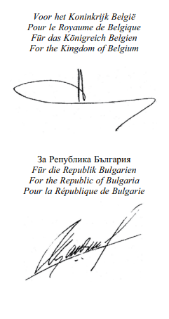
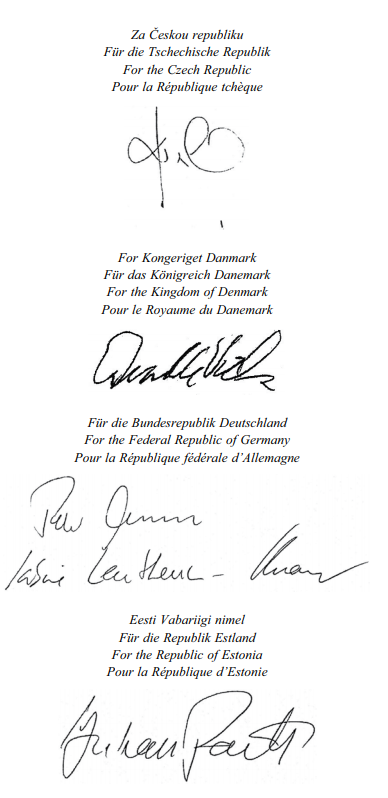
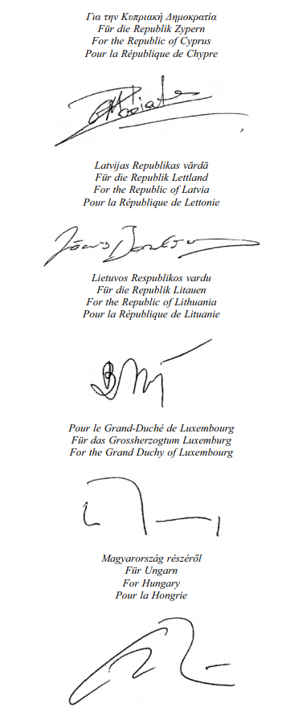
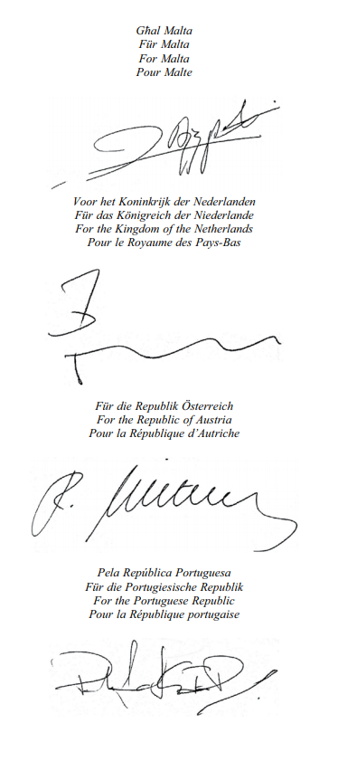
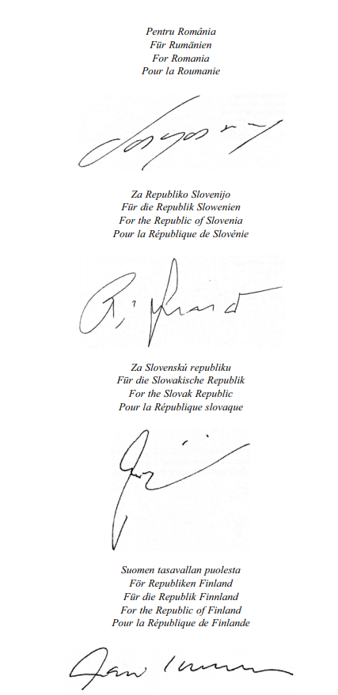
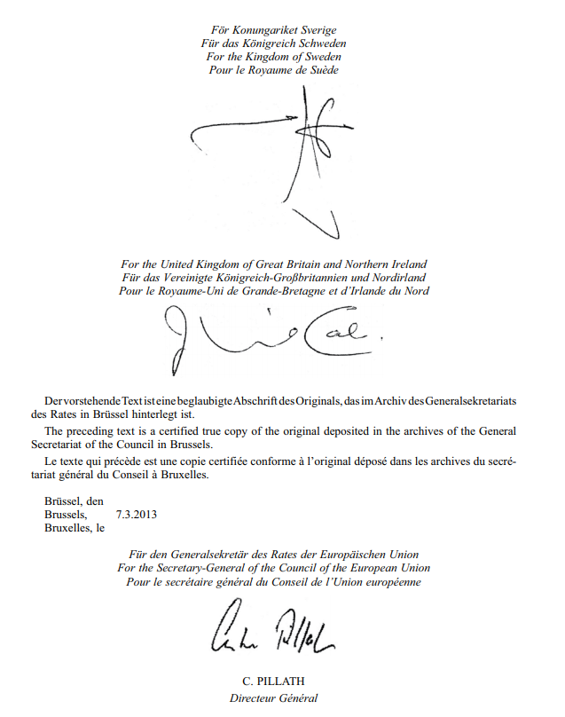

# Loi du 12 avril 2015 portant approbation de l’Accord relatif à une juridiction unifiée du brevet, signé à Bruxelles, le 19 février 2013.

Nous Henri, Grand-Duc de Luxembourg, Duc de Nassau,

Notre Conseil d’Etat entendu;

De l’assentiment de la Chambre des Députés;

Vu la décision de la Chambre des Députés du 18 mars 2015 et celle du Conseil d’Etat du 25 mars 2015 portant qu’il n’y a pas lieu à second vote;

Avons ordonné et ordonnons:

## Article unique.

Est approuvé l’Accord relatif à une juridiction unifiée du brevet, signé à Bruxelles, le 19 février 2013.

Mandons et ordonnons que la présente loi soit insérée au Mémorial pour être exécutée et observée par tous ceux que la chose concerne.

Le Ministre des Affaires étrangères  et européennes,   Jean Asselborn   Le Ministre de l’Economie,   Etienne Schneider

Château de Berg, le 12 avril 2015.   Henri

\**ACCORD RELATIF A UNE JURIDICTION UNIFIEE DU BREVET**

LES ETATS MEMBRES CONTRACTANTS,

\*Considérant* que la coopération entre les Etats membres de l’Union européenne dans le domaine des brevets contribue de manière significative au processus d’intégration en Europe, notamment à l’établissement d’un marché intérieur au sein de l’Union européenne caractérisé par la libre circulation des marchandises et des services, ainsi qu’à la création d’un système garantissant que la concurrence n’est pas faussée dans le marché intérieur;

\*Considérant* que la fragmentation du marché des brevets et les variations importantes entre les systèmes juridictionnels nationaux sont préjudiciables à l’innovation, en particulier pour les petites et moyennes entreprises, qui ont des difficultés à faire respecter leurs brevets et à se défendre contre des actions non fondées et des actions relatives à des brevets qui devraient être annulés;

\*Considérant* que la Convention sur le brevet européen (ci après dénommée «CBE»), qui a été ratifiée par tous les Etats membres de l’Union européenne, prévoit une procédure unique pour la délivrance de brevets européens par l’Office européen des brevets;

\*Considérant* que, en vertu du [règlement (UE) n° 1257/2012](https://legilux.public.lu/eli/reg_ue/2012/1257/jo), les titulaires de brevets peuvent demander que leurs brevets européens aient un effet unitaire afin d’obtenir la protection unitaire conférée par un brevet dans les Etats membres de l’Union européenne qui participent à la coopération renforcée;

\*Désireux* d’améliorer le respect des brevets, de renforcer les moyens permettant de se défendre contre des actions non fondées et des brevets qui devraient être annulés et d’accroître la sécurité juridique par la création d’une juridiction unifiée du brevet pour le contentieux lié à la contrefaçon et à la validité des brevets;

\*Considérant* que la juridiction unifiée du brevet devrait être conçue pour rendre des décisions rapides et de qualité, recherchant un juste équilibre entre les intérêts des titulaires de droits et d’autres parties et tenant compte de la proportionnalité et de la souplesse nécessaires;

\*Considérant* que la juridiction unifiée du brevet devrait être une juridiction commune aux Etats membres contractants et, par conséquent, faire partie de leur système judiciaire, et qu’elle devrait jouir d’une compétence exclusive en ce qui concerne les brevets européens à effet unitaire et les brevets européens délivrés en vertu des dispositions de la CBE;

\*Considérant* que la Cour de justice de l’Union européenne doit veiller à l’uniformité de l’ordre juridique de l’Union et à la primauté du droit de l’Union européenne;

\*Rappelant* les obligations qui incombent aux Etats membres contractants en vertu du traité sur l’Union européenne (TUE) et du traité sur le fonctionnement de l’Union européenne (TFUE), y compris l’obligation de coopération loyale énoncée à l’article 4, paragraphe 3, du [TUE](http://data.europa.eu/eli/treaty/teu_2012/oj) et l’obligation d’assurer, par la création de la juridiction unifiée du brevet, la pleine application et le respect du droit de l’Union sur leurs territoires respectifs, ainsi que la protection juridictionnelle des droits conférés par ce droit aux particuliers;

\*Considérant* que, comme toute juridiction nationale, la juridiction unifiée du brevet est tenue de respecter et d’appliquer le droit de l’Union et, en collaboration avec la Cour de justice de l’Union européenne qui est la gardienne du droit de l’Union, de veiller à sa bonne application et à son interprétation uniforme; la juridiction unifiée du brevet est, en particulier, tenue de coopérer avec la Cour de justice de l’Union européenne aux fins de l’interprétation correcte du droit de l’Union en s’appuyant sur la jurisprudence de la Cour et en saisissant celle-ci de demandes préjudicielles conformément à l’article 267 du [TFUE](http://data.europa.eu/eli/treaty/tfeu_2012/oj);

\*Considérant* que les Etats membres contractants devraient, conformément à la jurisprudence de la Cour de justice de l’Union européenne relative à la responsabilité non contractuelle, être responsables des dommages résultant de violations du droit de l’Union commises par la juridiction unifiée du brevet, y compris le manquement à l’obligation de saisir la Cour de justice de l’Union européenne de demandes préjudicielles;

\*Considérant* que les violations du droit de l’Union commises par la juridiction unifiée du brevet, y compris le manquement à l’obligation de saisir la Cour de justice de l’Union européenne de demandes préjudicielles, sont directement imputables aux Etats membres contractants et qu’une procédure en manquement peut, par conséquent, être engagée en vertu des articles 258, 259 et 260 du [TFUE](http://data.europa.eu/eli/treaty/tfeu_2012/oj) contre tout Etat membre contractant afin de garantir le respect de la primauté du droit de l’Union et sa bonne application;

\*Rappelant* la primauté du droit de l’Union, qui comprend le TUE, le TFUE, la Charte des droits fondamentaux de l’Union européenne, les principes fondamentaux du droit de l’Union tels que développés par la Cour de justice de l’Union européenne, et en particulier le droit à un recours effectif devant un tribunal et le droit à ce qu’une cause soit entendue équitablement, publiquement et dans un délai raisonnable par un tribunal indépendant et impartial, la jurisprudence de la Cour de justice de l’Union européenne et le droit dérivé de l’Union;

\*Considérant* que le présent accord devrait être ouvert à l’adhésion de tout Etat membre de l’Union européenne; les Etats membres qui ont décidé de ne pas participer à la coopération renforcée dans le domaine de la création d’une protection unitaire conférée par un brevet peuvent participer au présent accord pour ce qui concerne les brevets européens délivrés pour leur territoire respectif;

\*Considérant* que le présent accord devrait entrer en vigueur le 1erjanvier 2014 ou le premier jour du quatrième mois suivant celui du treizième dépôt, à condition que parmi les Etats membres contractants qui auront déposé leur instrument de ratification ou d’adhésion figurent les trois Etats dans lesquels le plus grand nombre de brevets européens étaient en vigueur au cours de l’année précédant celle au cours de laquelle intervient la signature de l’accord, ou le premier jour du quatrième mois après la date d’entrée en vigueur des modifications du [règlement (UE) n° 1215/2012](https://legilux.public.lu/eli/reg_ue/2012/1215/jo) portant sur le lien entre ce dernier et le présent accord, la date la plus tardive étant retenue,

SONT CONVENUS des dispositions qui suivent:

## PARTIE I — Dispositions générales et institutionnelles

### Chapitre I — *Dispositions générales*

#### *Article 1* — * Juridiction unifiée du brevet*

Il est institué par le présent accord une juridiction unifiée du brevet pour le règlement des litiges liés aux brevets européens et aux brevets européens à effet unitaire.

La juridiction unifiée du brevet est une juridiction commune aux Etats membres contractants et est donc soumise aux mêmes obligations en vertu du droit de l’Union que celles qui incombent à toute juridiction nationale des Etats membres contractants.

#### *Article 2* — * Définitions*

Aux fins du présent accord, on entend par:

a) «Juridiction», la juridiction unifiée du brevet créée par le présent accord;

b) «Etat membre», un Etat membre de l’Union européenne;

c) «Etat membre contractant», un Etat membre partie au présent accord;

d) «CBE», la Convention sur la délivrance de brevets européens du 5 octobre 1973, y compris toute modification ultérieure;

e) «brevet européen», un brevet délivré conformément aux dispositions de la CBE auquel n’est pas conféré d’effet unitaire en vertu du [règlement (UE) n° 1257/2012](http://legilux.public.lu/eli/reg_ue/2012/1257/jo);

f) «brevet européen à effet unitaire», un brevet européen délivré conformément aux dispositions de la CBE auquel est conféré un effet unitaire en vertu du [règlement (UE) n° 1257/2012](http://legilux.public.lu/eli/reg_ue/2012/1257/jo);

g) «brevet», un brevet européen et/ou un brevet européen à effet unitaire;

h) «certificat complémentaire de protection», un certificat complémentaire de protection délivré en vertu du [règlement (CE) n° 469/2009](https://legilux.public.lu/eli/reg_ue/2009/469/jo) ou du [règlement (CE) n° 1610/96](https://legilux.public.lu/eli/reg_ue/1996/1610/jo);

i) «statuts», les statuts de la Juridiction figurant à l’annexe I, qui font partie intégrante du présent accord;

j) «règlement de procédure», le règlement de procédure de la Juridiction, établi conformément à l’article 41.

#### *Article 3* — *Champ d’application*

Le présent accord s’applique à:

a) tout brevet européen à effet unitaire;

b) tout certificat complémentaire de protection délivré pour un produit protégé par un brevet;

c) tout brevet européen qui n’est pas encore éteint à la date d’entrée en vigueur du présent accord ou qui a été délivré après cette date, sans préjudice de l’article 83; et

d) toute demande de brevet européen en instance à la date d’entrée en vigueur du présent accord ou qui a été introduite après cette date, sans préjudice de l’article 83.

#### *Article 4* — * Statut juridique*

1\. La Juridiction a la personnalité juridique dans chaque Etat membre contractant et possède la capacité juridique la plus large reconnue aux personnes morales par le droit national de l’Etat concerné.

2\. La Juridiction est représentée par le président de la cour d’appel, qui est élu conformément aux statuts.

#### *Article 5* — *Responsabilité*

1\. La responsabilité contractuelle de la Juridiction est régie par la loi applicable au contrat en cause conformément au [règlement (CE) n° 593/2008](https://legilux.public.lu/eli/reg_ue/2008/593/jo) (Rome I), le cas échéant, ou à défaut conformément au droit de l’Etat membre de la juridiction saisie.

2\. La responsabilité non contractuelle de la Juridiction pour tout dommage causé par elle et par les membres de son personnel dans l’exercice de leurs fonctions, dans la mesure où il ne s’agit pas d’une matière civile ou commerciale au sens du [règlement (CE) n° 864/2007](https://legilux.public.lu/eli/reg_ue/2007/864/jo) (Rome II), est régie par la loi de l’Etat membre contractant dans lequel le dommage s’est produit. Cette disposition s’entend sans préjudice de l’application de l’article 22.

3\. La juridiction compétente pour régler les litiges relevant du paragraphe 2 est une juridiction de l’Etat membre contractant dans lequel le dommage s’est produit.

### Chapitre II — *Dispositions institutionnelles*

#### *Article 6* — *La Juridiction*

1\. La Juridiction comprend un tribunal de première instance, une cour d’appel et un greffe.

2\. La Juridiction exerce les fonctions qui lui sont attribuées en vertu du présent accord.

#### *Article 7* — *Le tribunal de première instance*

1\. Le tribunal de première instance comprend une division centrale ainsi que des divisions locales et régionales.

2\. La division centrale a son siège à Paris, ainsi que des sections à Londres et à Munich. Les affaires portées devant la division centrale sont réparties conformément à l’annexe II, qui fait partie intégrante du présent accord.

3\. Une division locale est créée dans un Etat membre contractant à la demande de ce dernier, conformément aux statuts. Un Etat membre contractant sur le territoire duquel est située une division locale désigne le siège de cette dernière.

4\. Une division locale supplémentaire est créée dans un Etat membre contractant à la demande de ce dernier pour chaque centaine de procédures par année civile concernant des brevets ayant été, pendant trois années consécutives avant ou après la date d’entrée en vigueur du présent accord, engagées dans cet Etat membre contractant. Un Etat membre contractant ne compte pas plus de quatre divisions locales.

5\. Une division régionale est créée pour deux Etats membres contractants ou plus à la demande de ceux-ci, conformément aux statuts. Ces Etats membres contractants désignent le siège de la division concernée. La division régionale peut tenir ses audiences dans plusieurs localités.

#### *Article 8* — *Composition des chambres du tribunal de première instance*

1\. Les chambres du tribunal de première instance ont une composition multinationale. Sans préjudice du paragraphe 5 du présent article et de l’article 33, paragraphe 3, point a), elles siègent en formation de trois juges.

2\. Les chambres d’une division locale située dans un Etat membre contractant dans lequel, sur une période de trois années consécutives avant ou après la date d’entrée en vigueur du présent accord, en moyenne moins de cinquante procédures concernant les brevets ont été engagées par année civile, siègent en formation d’un juge qualifié sur le plan juridique qui est un ressortissant de l’Etat membre contractant sur le territoire duquel est située la division locale concernée et de deux juges qualifiés sur le plan juridique qui ne sont pas des ressortissants de l’Etat membre contractant concerné, issus du pool de juges et affectés au cas par cas, conformément à l’article 18, paragraphe 3.

3\. Nonobstant le paragraphe 2, les chambres d’une division locale située dans un Etat membre contractant dans lequel, sur une période de trois années consécutives avant ou après la date d’entrée en vigueur du présent accord, en moyenne au moins cinquante procédures concernant les brevets ont été engagées par année civile, siègent en formation de deux juges qualifiés sur le plan juridique qui sont des ressortissants de l’Etat membre contractant sur le territoire duquel est située la division locale concernée et d’un juge qualifié sur le plan juridique, qui n’est pas un ressortissant de l’Etat membre contractant concerné, issu du pool de juges et affecté conformément à l’article 18, paragraphe 3. Ce troisième juge est affecté à la division locale à long terme lorsque cela est nécessaire au bon fonctionnement des divisions dont la charge de travail est importante.

4\. Les chambres d’une division régionale siègent en formation de deux juges qualifiés sur le plan juridique choisis sur une liste régionale de juges, qui sont des ressortissants des Etats membres contractants concernés et d’un juge qualifié sur le plan juridique, qui n’est pas un ressortissant des Etats membres contractants concernés, issu du pool de juges et affecté conformément à l’article 18, paragraphe 3.

5\. A la demande d’une des parties, une chambre d’une division locale ou régionale demande au président du tribunal de première instance de lui affecter, conformément à l’article 18, paragraphe 3, un juge supplémentaire qualifié sur le plan technique, issu du pool de juges, et ayant des qualifications ainsi qu’une expérience dans le domaine technique concerné. En outre, une chambre d’une division locale ou régionale peut, après avoir entendu les parties, présenter une telle demande de sa propre initiative, lorsqu’elle le juge appropriée.

Dans les cas où un tel juge qualifié sur le plan technique est affecté, aucun autre juge qualifié sur le plan technique ne peut être affecté au titre de l’article 33, paragraphe 3, point a).

6\. Les chambres de la division centrale siègent en formation de deux juges qualifiés sur le plan juridique qui sont des ressortissants de différents Etats membres contractants et d’un juge qualifié sur le plan technique, issu du pool de juges et affecté conformément à l’article 18, paragraphe 3, ayant des qualifications ainsi qu’une expérience dans le domaine technique concerné. Cependant, les chambres de la division centrale qui connaissent des actions visées à l’article 32, paragraphe 1, point i), siègent en formation de trois juges qualifiés sur le plan juridique qui sont des ressortissants de différents Etats membres contractants.

7\. Nonobstant les paragraphes 1 à 6 et conformément au règlement de procédure, les parties peuvent convenir que leur litige sera porté devant un juge unique qualifié sur le plan juridique.

8\. Les chambres du tribunal de première instance sont présidées par un juge qualifié sur le plan juridique.

#### *Article 9* — *La cour d’appel*

1\. Les chambres de la cour d’appel siègent en formation multinationale de cinq juges. Elles comprennent trois juges qualifiés sur le plan juridique qui sont des ressortissants de différents Etats membres contractants et deux juges qualifiés sur le plan technique ayant des qualifications ainsi qu’une expérience dans le domaine technique concerné. Les juges qualifiés sur le plan technique sont affectés à la chambre par le président de la cour d’appel qui les choisit parmi les juges qui composent le pool de juges, visé à l’article 18.

2\. Nonobstant le paragraphe 1, les chambres qui connaissent des actions visées à l’article 32, paragraphe 1, point i), siègent en formation de trois juges qualifiés sur le plan juridique qui sont des ressortissants de différents Etats membres contractants.

3\. Les chambres de la cour d’appel sont présidées par un juge qualifié sur le plan juridique.

4\. Les chambres de la cour d’appel sont instituées conformément aux statuts.

5\. La cour d’appel a son siège à Luxembourg.

#### *Article 10* — *Le greffe*

1\. Il est institué un greffe au siège de la cour d’appel. Celui-ci est dirigé par le greffier et exerce les fonctions qui lui sont attribuées conformément aux statuts. Sous réserve des conditions énoncées dans le présent accord et dans le règlement de procédure, le registre tenu par le greffe est public.

2\. Il est institué des sous-greffes auprès de toutes les divisions du tribunal de première instance.

3\. Le greffe conserve les minutes de toutes les affaires portées devant la Juridiction. Au moment du dépôt, le sousgreffe concerné notifie chaque affaire au greffe.

4\. La Juridiction nomme son greffier conformément à l’article 22 des statuts et arrête les règles régissant l’exercice de ses fonctions.

#### *Article 11* — *Comités*

Il est institué un comité administratif, un comité budgétaire et un comité consultatif en vue d’assurer la mise en œuvre et le fonctionnement effectifs du présent accord. Ces comités exercent notamment les fonctions prévues par le présent accord et par les statuts.

#### *Article 12* — *Le comité administratif*

1\. Le comité administratif est composé d’un représentant de chaque Etat membre contractant. La Commission européenne est représentée aux réunions du comité administratif à titre d’observateur.

2\. Chaque Etat membre contractant dispose d’une voix.

3\. Le comité administratif adopte ses décisions à la majorité des trois quarts des Etats membres contractants représentés et votants, sauf si le présent accord ou les statuts en disposent autrement.

4\. Le comité administratif adopte son règlement intérieur.

5\. Le comité administratif élit son président parmi ses membres pour un mandat de trois ans. Ce mandat est renouvelable.

#### *Article 13* — *Le comité budgétaire*

1\. Le comité budgétaire est composé d’un représentant de chaque Etat membre contractant.

2\. Chaque Etat membre contractant dispose d’une voix.

3\. Le comité budgétaire adopte ses décisions à la majorité simple des représentants des Etats membres contractants. Toutefois, la majorité des trois quarts des représentants des Etats membres contractants est requise pour l’adoption du budget.

4\. Le comité budgétaire adopte son règlement intérieur.

5\. Le comité budgétaire élit son président parmi ses membres pour un mandat de trois ans. Ce mandat est renouvelable.

#### *Article 14* — *Le comité consultatif*

1\. Le comité consultatif:

a) assiste le comité administratif pour préparer la nomination des juges de la Juridiction;

b) formule des propositions à l’intention du présidium visé à l’article 15 des statuts en ce qui concerne les orientations relatives au cadre de formation des juges visé à l’article 19; et

c) rend des avis au comité administratif concernant les exigences de qualifications visées à l’article 48, paragraphe 2.

2\. Le comité consultatif est composé de juges des brevets et de praticiens du droit des brevets et du contentieux en matière de brevets ayant le plus haut niveau de compétence reconnu. Ses membres sont nommés, conformément à la procédure prévue dans les statuts, pour un mandat de six ans. Ce mandat est renouvelable.

3\. La composition du comité consultatif garantit un large éventail de compétences dans le domaine concerné et la représentation de chacun des Etats membres contractants. Les membres du comité consultatif exercent leurs fonctions en toute indépendance et ne sont liés par aucune instruction.

4\. Le comité consultatif adopte son règlement intérieur.

5\. Le comité consultatif élit son président parmi ses membres pour un mandat de trois ans. Ce mandat est renouvelable.

### Chapitre III — *Juges de la Juridiction*

#### *Article 15* — Conditions à remplir pour être nommé juge

1\. La Juridiction comprend des juges qualifiés sur le plan juridique et des juges qualifiés sur le plan technique. Les juges font preuve du plus haut niveau de compétence et d’une expérience avérée dans le domaine du contentieux des brevets.

2\. Les juges qualifiés sur le plan juridique possèdent les qualifications requises pour être nommés à des fonctions judiciaires dans un Etat membre contractant.

3\. Les juges qualifiés sur le plan technique sont titulaires d’un diplôme universitaire dans un domaine technique et disposent d’une compétence avérée dans ce domaine. Ils ont aussi une connaissance avérée du droit civil et de la procédure civile dans le domaine du contentieux des brevets.

#### *Article 16* — *Procédure de nomination*

1\. Le comité consultatif établit une liste des candidats les plus qualifiés pour être nommés juges à la Juridiction, conformément aux statuts.

2\. Sur la base de cette liste, le comité administratif nomme, d’un commun accord, les juges de la Juridiction.

3\. Les dispositions d’exécution relatives à la nomination des juges sont prévues dans les statuts.

#### *Article 17* — *Indépendance judiciaire et impartialité*

1\. La Juridiction, les juges qui y siègent et le greffier bénéficient de l’indépendance judiciaire. Dans l’exercice de leurs fonctions, les juges ne sont liés par aucune instruction.

2\. Les juges qualifiés sur le plan juridique, ainsi que les juges qualifiés sur le plan technique siégeant de manière permanente à la Juridiction, ne peuvent exercer aucune autre activité professionnelle, rémunérée ou non, sauf dérogation accordée par le comité administratif.

3\. Nonobstant le paragraphe 2, l’exercice du mandat de juge n’exclut pas l’exercice d’autres fonctions judiciaires au niveau national.

4\. L’exercice du mandat de juge qualifié sur le plan technique ne siégeant pas de manière permanente à la Juridiction n’exclut pas l’exercice d’autres fonctions, pour autant qu’il n’y ait pas conflit d’intérêt.

5\. En cas de conflit d’intérêt, le juge concerné ne prend pas part à la procédure. Les règles régissant les conflits d’intérêt sont énoncées dans les statuts.

#### *Article 18* — *Pool de juges*

1\. Il est institué un pool de juges conformément aux statuts.

2\. Le pool de juges comprend tous les juges qualifiés sur le plan juridique et tous les juges qualifiés sur le plan technique du tribunal de première instance qui siègent de manière permanente ou non à la Juridiction. Le pool de juges comprend, pour chaque domaine technique, au moins un juge qualifié sur le plan technique ayant les qualifications et l’expérience requises. Les juges qualifiés sur le plan technique issus du pool de juges sont également à la disposition de la cour d’appel.

3\. Lorsque le présent accord ou les statuts le prévoient, les juges du pool sont affectés à la division concernée par le président du tribunal de première instance. L’affectation des juges tient compte de leurs compétences juridiques ou techniques, de leurs aptitudes linguistiques et de l’expérience requise. Elle garantit le même niveau élevé de qualité des travaux et de compétences juridiques et techniques dans toutes les chambres du tribunal de première instance.

#### *Article 19* — *Cadre de formation*

1\. Il est institué un cadre de formation pour les juges, dont les modalités sont précisées dans les statuts, en vue d’améliorer et d’accroître les compétences disponibles dans le domaine du contentieux des brevets et d’assurer une large diffusion géographique de ces connaissances et expériences spécifiques. Les infrastructures nécessaires à ce cadre sont situées à Budapest.

2\. Le cadre de formation se concentre en particulier sur:

a) l’organisation de stages dans les juridictions nationales compétentes en matière de brevets ou dans les divisions du tribunal de première instance connaissant un nombre important d’affaires dans le domaine du contentieux des brevets;

b) l’amélioration des aptitudes linguistiques;

c) les aspects techniques du droit des brevets;

d) la diffusion des connaissances et des expériences en matière de procédure civile, à l’intention des juges qualifiés sur le plan technique;

e) la préparation des candidats aux fonctions de juge.

3\. Le cadre de formation prévoit une formation continue. Des réunions sont organisées régulièrement entre tous les juges de la Juridiction afin de débattre des évolutions dans le domaine du droit des brevets et d’assurer la cohérence de la jurisprudence de la Juridiction.

### Chapitre IV — *Primauté du droit de l’Union et responsabilité des Etats membres contractants*

#### *Article 20* — *Primauté et respect du droit de l’Union*

La Juridiction applique le droit de l’Union dans son intégralité et respecte sa primauté.

#### *Article 21* — *Demandes préjudicielles*

En tant que juridiction commune aux Etats membres contractants et dans la mesure où elle fait partie de leur système judiciaire, la Juridiction coopère avec la Cour de justice de l’Union européenne afin de garantir la bonne application et l’interprétation uniforme du droit de l’Union, comme toute juridiction nationale, conformément, en particulier, à l’article 267 du [TFUE](http://data.europa.eu/eli/treaty/tfeu_2012/oj). Les décisions de la Cour de justice de l’Union européenne sont contraignantes pour la Juridiction.

#### *Article 22* — *Responsabilité pour les dommages résultant de violations du droit de l’Union*

1\. Les Etats membres contractants sont solidairement responsables des dommages résultant d’une violation du droit de l’Union par la cour d’appel, conformément au droit de l’Union en matière de responsabilité non contractuelle des Etats membres pour les dommages résultant d’une violation du droit de l’Union par leurs juridictions nationales.

2\. Une action relative à de tels dommages est formée contre l’Etat membre contractant dans lequel le requérant a son domicile ou son principal établissement ou, en l’absence de domicile ou de principal établissement, son établissement, devant l’autorité compétente de cet Etat membre contractant. Si le requérant n’a pas son domicile ou son principal établissement ou, en l’absence de domicile ou de principal établissement, son établissement dans un Etat membre contractant, il peut former une telle action contre l’Etat membre contractant dans lequel la cour d’appel a son siège, devant l’autorité compétente de cet Etat membre contractant.

L’autorité compétente applique la loi du for, exception faite de son droit international privé, à toutes les questions qui ne sont pas régies par le droit de l’Union ou par le présent accord. Le requérant a le droit d’obtenir l’intégralité du montant des dommages-intérêts exigés par l’autorité compétente de la part de l’Etat membre contractant contre lequel l’action a été formée.

3\. L’Etat membre contractant qui a payé les dommages-intérêts a le droit d’obtenir une contribution proportionnelle, déterminée conformément à la méthode prévue à l’article 37, paragraphes 3 et 4, de la part des autres Etats membres contractants. Les règles détaillées régissant la contribution due par les Etats membres contractants au titre du présent paragraphe sont fixées par le comité administratif.

#### *Article 23* — *Responsabilité des Etats membres contractants*

Les actions de la Juridiction sont directement imputables individuellement à chacun des Etats membres contractants, y compris aux fins des articles 258, 259 et 260 du [TFUE](http://data.europa.eu/eli/treaty/tfeu_2012/oj), ainsi que collectivement à l’ensemble des Etats membres contractants.

### Chapitre V — *Sources du droit et droit matériel*

#### *Article 24* — *Sources du droit*

1\. En parfaite conformité avec l’article 20, lorsqu’elle a à connaître d’une affaire dont elle est saisie en vertu du présent accord, la Juridiction fonde ses décisions sur:

a) le droit de l’Union, y compris le [règlement (UE) n° 1257/2012](https://legilux.public.lu/eli/reg_ue/2012/1257/jo) et le [règlement (UE) n° 1260/2012](https://legilux.public.lu/eli/reg_ue/2012/1260/jo);

b) le présent accord;

c) la CBE;

d) les autres accords internationaux applicables aux brevets et contraignants à l’égard de tous les Etats membres contractants; et

e) les droits nationaux.

2\. Dans les cas où la Juridiction fonde ses décisions sur le droit national, y compris, le cas échéant, le droit d’Etats non contractants, le droit applicable est déterminé:

a) par les dispositions directement applicables du droit de l’Union qui contiennent des règles de droit international privé; ou

b) en l’absence de dispositions directement applicables du droit de l’Union ou si celles-ci ne s’appliquent pas, par les instruments internationaux contenant des règles de droit international privé; ou

c) en l’absence de dispositions visées aux points a) et b), par les dispositions nationales de droit international privé déterminées par la Juridiction.

3\. Le droit d’Etats non contractants s’applique lorsqu’il est désigné en application des règles visées au paragraphe 2, en particulier pour ce qui est des articles 25 à 28, 54, 55, 64, 68 et 72.

#### *Article 2*5 — *Droit d’empêcher l’exploitation directe de l’invention*

Un brevet confère à son titulaire le droit d’empêcher, en l’absence de son consentement, tout tiers:

a) de fabriquer, d’offrir, de mettre sur le marché ou d’utiliser un produit qui fait l’objet du brevet, ou bien d’importer ou de détenir ce produit à ces fins;

b) d’utiliser le procédé qui fait l’objet du brevet ou, lorsque le tiers sait ou aurait dû savoir que l’utilisation du procédé est interdite sans le consentement du titulaire du brevet, d’en offrir l’utilisation sur le territoire des Etats membres contractants dans lesquels le brevet produit ses effets;

c) d’offrir, de mettre sur le marché, d’utiliser ou bien d’importer ou de détenir à ces fins un produit obtenu directement par un procédé qui fait l’objet du brevet.

#### *Article 26* — *Droit d’empêcher l’exploitation indirecte de l’invention*

1\. Un brevet confère à son titulaire le droit d’empêcher, en l’absence de son consentement, tout tiers, de fournir ou d’offrir de fournir, sur le territoire des Etats membres contractants dans lesquels le brevet produit ses effets, à une personne autre que celle habilitée à exploiter l’invention brevetée, des moyens de mise en œuvre, sur ce territoire, de cette invention se rapportant à un élément essentiel de celle-ci, lorsque le tiers sait, ou aurait dû savoir, que ces moyens sont aptes et destinés à cette mise en œuvre.

2\. Le paragraphe 1 ne s’applique pas lorsque les moyens sont des produits de consommation courants, sauf si le tiers incite la personne à qui ils sont fournis à commettre tout acte interdit par l’article 25.

3\. Ne sont pas considérées comme des personnes habilitées à exploiter l’invention au sens du paragraphe 1 celles qui accomplissent les actes visés à l’article 27, points a) à e).

#### *Article 27* — *Limitations des effets d’un brevet*

Les droits conférés par un brevet ne s’étendent à aucun des actes suivants:

a) les actes accomplis dans un cadre privé et à des fins non commerciales;

b) les actes accomplis à titre expérimental qui portent sur l’objet de l’invention brevetée;

c) l’utilisation de matériel biologique en vue de créer ou de découvrir et de développer d’autres variétés végétales;

d) les actes autorisés en vertu de l’article 13, paragraphe 6, de la [directive 2001/82/CE](https://legilux.public.lu/eli/dir_ue/2001/82/jo) ou de l’article 10, paragraphe 6, de la [directive 2001/83/CE](https://legilux.public.lu/eli/dir_ue/2001/83/jo) en ce qui concerne tout brevet portant sur le produit au sens de l’une ou l’autre de ces directives;

e) la préparation de médicaments faite extemporanée et par unité dans les officines de pharmacie, sur ordonnance médicale, ou les actes concernant les médicaments ainsi préparés;

f) l’utilisation de l’invention brevetée à bord de navires de pays membres de l’Union internationale pour la protection de la propriété industrielle (Union de Paris) ou membres de l’Organisation mondiale du commerce autres que les Etats membres contractants dans lesquels le brevet concerné produit ses effets, dans le corps dudit navire, dans les machines, agrès, apparaux et autres accessoires, lorsque ces navires pénètrent temporairement ou accidentellement dans les eaux d’un Etat membre contractant dans lequel le brevet concerné produit ses effets, sous réserve que ladite invention soit utilisée exclusivement pour les besoins du navire;

g) l’utilisation de l’invention brevetée dans la construction ou le fonctionnement des engins de locomotion aérienne ou terrestre ou d’autres moyens de transport de pays membres de l’Union internationale pour la protection de la propriété industrielle (Union de Paris) ou membres de l’Organisation mondiale du commerce autres que les Etats membres contractants dans lesquels le brevet concerné produit ses effets, ou des accessoires de ces engins, lorsque ceux-ci pénètrent temporairement ou accidentellement sur le territoire d’un Etat membre contractant dans lequel le brevet concerné produit ses effets;

h) les actes prévus par l’article 27 de la [Convention relative à l’aviation civile internationale](https://legilux.public.lu/eli/etat/leg/loi/1948/03/25/n2/jo) du 7 décembre 1944, lorsque ces actes concernent des aéronefs d’un pays partie à ladite Convention autre qu’un Etat membre contractant dans lequel ce brevet produit ses effets;

i) l’utilisation par un agriculteur du produit de sa récolte pour reproduction ou multiplication sur sa propre exploitation, pour autant que le matériel de reproduction végétale ait été vendu ou commercialisé sous une autre forme à l’agriculteur par le titulaire du brevet ou avec son consentement à des fins d’exploitation agricole. L’étendue et les conditions d’une telle utilisation correspondent à celles fixées à l’article 14 du [règlement (CE) n° 2100/94](https://legilux.public.lu/eli/reg_ue/1994/2100/jo);

j) l’utilisation par un agriculteur de bétail protégé pour un usage agricole, pour autant que les animaux d’élevage ou autre matériel de reproduction animal aient été vendus ou commercialisés sous une autre forme à l’agriculteur par le titulaire du brevet ou avec son consentement. Une telle utilisation comprend la mise à disposition de l’animal ou autre matériel de reproduction animal pour la poursuite de l’activité agricole de l’agriculteur, mais non la vente de ceux-ci dans le cadre ou dans le but d’une activité de reproduction commerciale;

k) les actes et l’utilisation des informations obtenues tels qu’autorisés en vertu des articles 5 et 6 de la [directive 2009/24/CE](https://legilux.public.lu/eli/dir_ue/2009/24/jo), en particulier par ses dispositions relatives à la décompilation et à l’interopérabilité; et

l) les actes autorisés en vertu de l’article 10 de la [directive 98/44/CE](https://legilux.public.lu/eli/dir_ue/1998/44/jo).

#### *Article 28* — *Droit fondé sur une utilisation antérieure de l’invention*

Quiconque, dans le cas où un brevet national a été délivré pour une invention, aurait acquis, dans un Etat membre contractant, un droit fondé sur une utilisation antérieure de cette invention ou un droit de possession personnelle sur cette invention jouit, dans cet Etat membre contractant, des mêmes droits à l’égard du brevet ayant cette invention pour objet.

#### *Article 29* — *Epuisement des droits conférés par un brevet européen*

Les droits conférés par un brevet européen ne s’étendent pas aux actes qui concernent un produit couvert par ce brevet après que ce produit a été mis sur le marché dans l’Union européenne par le titulaire du brevet ou avec son consentement, à moins qu’il n’existe des motifs légitimes justifiant que le titulaire s’oppose à la poursuite de la commercialisation du produit.

#### *Article 30* — *Effets des certificats complémentaires de protection*

Un certificat complémentaire de protection confère les mêmes droits que ceux qui sont conférés par le brevet et est soumis aux mêmes limitations et aux mêmes obligations.

### Chapitre VI — Compétence internationale

#### *Article 31* — *Compétence internationale*

La compétence internationale de la Juridiction est établie conformément au [règlement (UE) n° 1215/2012](https://legilux.public.lu/eli/reg_ue/2012/1215/jo) ou, le cas échéant, sur la base de la Convention concernant la compétence judiciaire, la reconnaissance et l’exécution des décisions en matière civile et commerciale (Convention de Lugano).

#### *Article 32* — *Compétence de la Juridiction*

1\. La Juridiction a une compétence exclusive pour:

a) les actions en contrefaçon ou en menace de contrefaçon de brevets et de certificats complémentaires de protection et les défenses y afférentes, y compris les demandes reconventionnelles concernant les licences;

b) les actions en constatation de non-contrefaçon de brevets et de certificats complémentaires de protection;

c) les actions visant à obtenir des mesures provisoires et conservatoires et des injonctions;

d) les actions en nullité de brevets et de certificats complémentaires de protection;

e) les demandes reconventionnelles en nullité de brevets et de certificats complémentaires de protection;

f) les actions en dommages-intérêts ou en réparation découlant de la protection provisoire conférée par une demande de brevet européen publiée;

g) les actions relatives à l’utilisation de l’invention avant la délivrance du brevet ou au droit fondé sur une utilisation antérieure de l’invention;

h) les actions en réparation concernant les licences formées sur la base de l’article 8 du [règlement (UE) n° 1257/2012](http://legilux.public.lu/eli/reg_ue/2012/1257/jo); et

i) les actions concernant les décisions prises par l’Office européen des brevets dans l’exercice des tâches visées à l’article 9 du [règlement (UE) n° 1257/2012](http://legilux.public.lu/eli/reg_ue/2012/1257/jo).

2\. Les juridictions nationales des Etats membres contractants demeurent compétentes pour les actions relatives aux brevets et aux certificats complémentaires de protection qui ne relèvent pas de la compétence exclusive de la Juridiction.

#### *Article 33* — *Compétence des divisions du tribunal de première instance*

1\. Sans préjudice du paragraphe 7 du présent article, les actions visées à l’article 32, paragraphe 1, points a), c), f) et g), sont portées devant:

a) la division locale située sur le territoire de l’Etat membre contractant où la contrefaçon ou la menace de contrefaçon s’est produite ou est susceptible de se produire, ou devant la division régionale à laquelle ledit Etat membre contractant participe; ou

b) la division locale située sur le territoire de l’Etat membre contractant dans lequel le défendeur ou, s’il y a plusieurs défendeurs, l’un des défendeurs a son domicile ou son principal établissement ou, en l’absence de domicile ou de principal établissement, son établissement, ou devant la division régionale à laquelle ledit Etat membre contractant participe. Une action ne peut être exercée contre plusieurs défendeurs que si ceux-ci ont un lien commercial et si l’action porte sur la même contrefaçon alléguée.

Les actions visées à l’article 32, paragraphe 1, point h), sont portées devant la division locale ou régionale conformément au point b) du premier alinéa.

Les actions contre des défendeurs ayant leur domicile ou leur principal établissement ou, en l’absence de domicile ou de principal établissement, leur établissement en dehors du territoire des Etats membres contractants sont portées devant la division locale ou régionale conformément au point a) du premier alinéa ou devant la division centrale.

Si aucune division locale ne se trouve sur le territoire de l’Etat membre contractant concerné et que celui-ci ne participe pas à une division régionale, les actions sont portées devant la division centrale.

2\. Si une action visée à l’article 32, paragraphe 1, points a), c), f), g) ou h), est pendante devant une division du tribunal de première instance, aucune action visée à l’article 32, paragraphe 1, points a), c), f), g) ou h), ne peut être engagée entre les mêmes parties au sujet du même brevet devant aucune autre division.

Si une action visée à l’article 32, paragraphe 1, point a), est pendante devant une division régionale et que la contrefaçon s’est produite sur le territoire d’au moins trois divisions régionales, à la demande du défendeur, la division régionale concernée renvoie l’affaire devant la division centrale.

Si une action est engagée entre les mêmes parties au sujet du même brevet devant plusieurs divisions différentes, la division première saisie est compétente pour l’intégralité de l’affaire et toute division saisie ultérieurement déclare l’action irrecevable conformément au règlement de procédure.

3\. Une demande reconventionnelle en nullité visée à l’article 32, paragraphe 1, point e), peut être introduite dans le cadre d’une action en contrefaçon visée à l’article 32, paragraphe 1, point a). Après avoir entendu les parties, la division locale ou régionale concernée, a la faculté:

a) soit de statuer tant sur l’action en contrefaçon que sur la demande reconventionnelle en nullité et de demander au président du tribunal de première instance l’affectation, conformément à l’article 18, paragraphe 3, d’un juge qualifié sur le plan technique issu du pool de juges et ayant des qualifications et une expérience dans le domaine technique concerné;

b) soit de renvoyer la demande reconventionnelle en nullité devant la division centrale pour décision et de suspendre l’action en contrefaçon ou de statuer sur celle-ci; ou

c) soit, avec l’accord des parties, de renvoyer l’affaire devant la division centrale pour décision.

4\. Les actions visées à l’article 32, paragraphe 1, points b) et d), sont portées devant la division centrale. Si, toutefois, une action en contrefaçon visée à l’article 32, paragraphe 1, point a), a été engagée entre les mêmes parties au sujet du même brevet devant une division locale ou régionale, les actions précitées ne peuvent être portées que devant la même division locale ou régionale.

5\. Si une action en nullité visée à l’article 32, paragraphe 1, point d), est pendante devant la division centrale, une action en contrefaçon visée à l’article 32, paragraphe 1, point a), peut être engagée entre les mêmes parties au sujet du même brevet devant n’importe quelle division, conformément au paragraphe 1 du présent article, ou devant la division centrale. La division locale ou régionale concernée a la faculté de statuer conformément au paragraphe 3 du présent article.

6\. Une action en constatation de non-contrefaçon visée à l’article 32, paragraphe 1, point b), pendante devant la division centrale est suspendue dès qu’une action en contrefaçon visée à l’article 32, paragraphe 1, point a), est engagée entre les mêmes parties ou entre le titulaire d’une licence exclusive et la partie demandant la constatation de noncontrefaçon au sujet du même brevet devant une division locale ou régionale dans un délai de trois mois à compter de la date à laquelle l’action a été engagée devant la division centrale.

7\. Les parties peuvent convenir de porter les actions visées à l’article 32, paragraphe 1, points a) à h), devant la division de leur choix, y compris la division centrale.

8\. Les actions visées à l’article 32, paragraphe 1, points d) et e), peuvent être engagées sans que le requérant ait à former opposition devant l’Office européen des brevets.

9\. Les actions visées à l’article 32, paragraphe 1, point i), sont portées devant la division centrale.

10\. Les parties informent la Juridiction de toute procédure de nullité, de limitation ou d’opposition pendante devant l’Office européen des brevets, ainsi que de toute demande de procédure accélérée présentée auprès de l’Office européen des brevets. La Juridiction peut suspendre la procédure lorsqu’une décision rapide peut être attendue de l’Office européen des brevets.

#### *Article 34* — *Champ d’application territorial des décisions*

Les décisions de la Juridiction couvrent, dans le cas d’un brevet européen, le territoire des Etats membres contractants pour lesquels le brevet produit ses effets.

### Chapitre VII — *Médiation et arbitrage en matière de brevets*

#### *Article 35* — *Centre de médiation et d’arbitrage en matière de brevets*

1\. Il est institué un centre de médiation et d’arbitrage en matière de brevets (ci-après dénommé «centre»). Il a ses sièges à Ljubljana et à Lisbonne.

2\. Le centre fournit des services de médiation et d’arbitrage des litiges en matière de brevets qui relèvent du champ d’application du présent accord. L’article 82 s’applique mutatis mutandis à tout règlement d’un différend par le biais des services fournis par le centre, y compris la médiation. Toutefois, un brevet ne peut pas être annulé ou limité dans le cadre d’une procédure de médiation ou d’arbitrage.

3\. Le centre définit des règles régissant la médiation et l’arbitrage.

4\. Le centre établit une liste de médiateurs et d’arbitres chargés d’aider les parties à régler leur différend.

## PARTIE II — Dispositions financières

### *Article 36* — *Budget de la Juridiction*

1\. Le budget de la Juridiction est financé sur les recettes financières propres de la Juridiction et, à tout le moins au cours de la période transitoire visée à l’article 83, si nécessaire, sur les contributions des Etats membres contractants. Le budget est en équilibre.

2\. Les recettes financières propres de la Juridiction comprennent le paiement des frais de procédure et d’autres recettes.

3\. Les frais de procédure sont fixés par le comité administratif. Ils comprennent un montant fixe, combiné à un montant fondé sur la valeur du litige, au-delà d’un plafond prédéfini. Le montant des frais de procédure est fixé à un niveau garantissant un juste équilibre entre le principe d’accès équitable à la justice, en particulier pour les petites et moyennes entreprises, les micro-entités, les personnes physiques, les organisations à but non lucratif, les universités et les organismes publics de recherche, et une contribution adéquate des parties aux frais exposés par la Juridiction, tenant compte des avantages économiques pour les parties concernées et de l’objectif visant à ce que la Juridiction s’autofinance et ait des comptes en équilibre. Le montant des frais de procédure est revu périodiquement par le comité administratif. Des mesures de soutien ciblées en faveur des petites et moyennes entreprises et des micro-entités peuvent être envisagées.

4\. Si la Juridiction n’est pas en mesure d’équilibrer son budget au moyen de ses ressources propres, les Etats membres contractants lui versent des contributions financières spéciales.

### *Article 37* — *Financement de la Juridiction*

1\. Les coûts opérationnels de la Juridiction sont couverts par son budget, conformément aux statuts.

Les Etats membres contractants qui créent une division locale fournissent les infrastructures nécessaires à cette fin. Les Etats membres contractants qui partagent une division régionale fournissent conjointement les infrastructures nécessaires à cette fin. Les Etats membres contractants sur le territoire desquels est située la division centrale, ses sections ou la cour d’appel fournissent les infrastructures nécessaires à celles-ci. Durant une période transitoire initiale de sept ans à partir de la date d’entrée en vigueur du présent accord, les Etats membres contractants concernés fournissent également le personnel d’appui administratif, sans préjudice du statut de ce personnel.

2\. A la date d’entrée en vigueur du présent accord, les Etats membres contractants apportent les contributions financières initiales nécessaires à la création de la Juridiction.

3\. Pendant la période transitoire initiale de sept ans à partir de la date d’entrée en vigueur du présent accord, la contribution de chaque Etat membre contractant ayant ratifié l’accord ou y ayant adhéré avant son entrée en vigueur est calculée en fonction du nombre de brevets européens produisant leurs effets sur le territoire de l’Etat concerné à la date d’entrée en vigueur du présent accord et du nombre de brevets européens au sujet lesquels des actions en contrefaçon ou en nullité ont été engagées devant les juridictions nationales dudit Etat au cours des trois années précédant l’entrée en vigueur du présent accord.

Pendant la même période transitoire initiale de sept ans, les contributions des Etats membres qui ratifient le présent accord ou y adhèrent après son entrée en vigueur sont calculées en fonction du nombre de brevets européens produisant leurs effets sur le territoire de l’Etat membre ratifiant l’accord ou y adhérant à la date de la ratification ou de l’adhésion et du nombre de brevets européens au sujet desquels des actions en contrefaçon ou en nullité ont été engagées devant les juridictions nationales de l’Etat membre ratifiant l’accord ou y adhérant au cours des trois années précédant la ratification ou l’adhésion.

4\. A l’expiration de la période transitoire initiale de sept ans, au terme de laquelle il est prévu que la Juridiction s’autofinance, si des contributions des Etats membres contractants s’avèrent nécessaires, celles-ci sont déterminées conformément à la clé de répartition des taxes annuelles des brevets européens à effet unitaire applicable au moment où la contribution devient nécessaire.

### *Article 38* — *Financement du cadre de formation des juges*

Le cadre de formation des juges est financé sur le budget de la Juridiction.

### *Article 39* — *Financement du centre*

Les coûts de fonctionnement du centre sont financés sur le budget de la Juridiction.

## PARTIE III — Organisation et dispositions procédurales

### Chapitre I — *Dispositions générales*

#### *Article 40* — *Statuts*

1\. Les statuts fixent les modalités de l’organisation et du fonctionnement de la Juridiction.

2\. Les statuts sont annexés au présent accord. Ils peuvent être modifiés par décision du comité administratif sur la base d’une proposition de la Juridiction ou d’une proposition d’un Etat membre contractant après consultation de la Juridiction. Toutefois, ces modifications ne sont pas contraires au présent accord et ne l’altèrent pas.

3\. Les statuts garantissent que le fonctionnement de la Juridiction est organisé de la manière la plus efficace et économique qui soit et assure un accès équitable à la justice.

#### *Article 41* — *Règlement de procédure*

1\. Le règlement de procédure fixe les modalités de la procédure devant la Juridiction. Il est conforme au présent accord et aux statuts.

2\. Le règlement de procédure est adopté par le comité administratif sur la base de larges consultations avec les parties intéressées. L’avis préalable de la Commission européenne sur la compatibilité du règlement de procédure avec le droit de l’Union est demandé.

Le règlement de procédure peut être modifié par décision du comité administratif sur la base d’une proposition de la Juridiction et après consultation de la Commission européenne. Toutefois, ces modifications ne sont pas contraires au présent accord ou aux statuts et ne les altèrent pas.

3\. Le règlement de procédure garantit que les décisions rendues par la Juridiction sont de la plus haute qualité et que la procédure est organisée de la manière la plus efficace et la plus économique qui soit. Il établit un juste équilibre entre les intérêts légitimes de toutes les parties. Il assure aux juges le niveau requis de pouvoir d’appréciation sans compromettre la prévisibilité de la procédure pour les parties.

#### *Article 42* — *Proportionnalité et équité*

1\. La Juridiction traite les litiges de manière proportionnée à leur importance et à leur complexité.

2\. La Juridiction veille à ce que les règles, procédures et recours prévus par le présent accord et par les statuts soient utilisés de manière juste et équitable et ne faussent pas la concurrence.

#### *Article 43* — *Traitement des affaires*

La Juridiction traite avec diligence les affaires dont elle est saisie conformément à son règlement de procédure sans compromettre la liberté dont disposent les parties de déterminer l’objet de l’affaire et les éléments de preuve qui l’étayent.

#### *Article 44* — *Procédures électroniques*

La Juridiction utilise au mieux les procédures électroniques, notamment pour le dépôt des conclusions des parties et la communication des éléments de preuve, ainsi que la vidéoconférence, conformément à son règlement de procédure.

#### *Article 45* — *Débats publics*

Les débats de la Juridiction sont publics sauf si elle décide, dans la mesure où cela est nécessaire, de les rendre confidentiels dans l’intérêt d’une des parties ou d’autres personnes concernées, ou dans l’intérêt général de la justice ou de l’ordre public.

#### *Article 46* — *Capacité juridique*

Toute personne physique ou morale, ou tout organisme équivalent à une personne morale habilité à engager une procédure conformément à son droit national, a la capacité d’ester devant la Juridiction.

#### *Article 4*7 — *Parties*

1\. Le titulaire d’un brevet est habilité à former une action devant la Juridiction.

2\. Sauf si l’accord de licence en dispose autrement, le titulaire d’une licence exclusive sur un brevet est habilité à former une action devant la Juridiction dans les mêmes conditions que le titulaire du brevet, à condition que le titulaire du brevet soit informé au préalable.

3\. Le titulaire d’une licence non-exclusive n’est pas habilité à former une action devant la Juridiction, sauf si le titulaire du brevet est informé au préalable et dans la mesure où cela est expressément autorisé par l’accord de licence.

4\. Dans le cadre des actions formées par le titulaire d’une licence, le titulaire du brevet a le droit de se joindre à l’action formée devant la Juridiction.

5\. La validité d’un brevet ne peut pas être contestée dans une action en contrefaçon engagée par le titulaire d’une licence si le titulaire du brevet ne participe pas à la procédure. La partie à l’action en contrefaçon qui souhaite contester la validité d’un brevet est tenue d’engager une action contre le titulaire du brevet.

6\. Toute autre personne physique ou morale, ou tout organisme habilité à engager une action conformément à son droit national, qui est concerné par un brevet, peut engager une action conformément au règlement de procédure.

7\. Toute personne physique ou morale, ou tout organisme habilité à engager une action conformément à son droit national et qui est affecté par une décision prise par l’Office européen des brevets dans l’exercice des tâches visées à l’article 9 du [règlement (UE) n° 1257/2012](http://legilux.public.lu/eli/reg_ue/2012/1257/jo) a le droit de former une action en vertu de l’article 32, paragraphe 1, point i).

#### *Article 48* — *Représentation*

1\. Les parties sont représentées par un avocat autorisé à exercer devant une juridiction d’un Etat membre contractant.

2\. Les parties ont également la possibilité d’être représentées par des mandataires en brevets européens habilités à agir en tant que représentants professionnels devant l’Office européen des brevets en vertu de l’article 134 de la CBE et qui possèdent les qualifications appropriées, telles qu’un certificat européen dans le domaine du contentieux des brevets.

3\. Les exigences de qualifications prévues au paragraphe 2 sont établies par le comité administratif. Une liste des mandataires en brevets européens habilités à représenter les parties devant la Juridiction est tenue par le greffier.

4\. Les représentants des parties peuvent être assistés de mandataires en brevets, qui sont autorisés à prendre la parole à l’audience devant la Juridiction conformément au règlement de procédure.

5\. Les représentants des parties jouissent des droits et garanties nécessaires à l’exercice indépendant de leurs fonctions, y compris du privilège de confidentialité couvrant les communications entre un représentant et la partie représentée ou tout autre personne dans le cadre des procédures engagées devant la Juridiction, dans les conditions fixées par le règlement de procédure, sauf si la partie concernée renonce expressément à ce privilège.

6\. Les représentants des parties sont tenus de ne pas dénaturer des points de droit ou des faits devant la Juridiction, sciemment ou alors qu’ils avaient tout lieu d’en avoir connaissance.

7\. La représentation visée aux paragraphes 1 et 2 du présent article n’est pas requise dans les procédures engagées en vertu de l’article 32, paragraphe 1, point i).

### Chapitre II — *Langue de procédure*

#### *Article 49* — *Langue de procédure devant le tribunal de première instance*

1\. La langue de procédure devant les divisions locales ou régionales est une langue officielle de l’Union européenne qui est la langue officielle ou l’une des langues officielles de l’Etat membre contractant sur le territoire duquel est située la division concernée, ou la ou les langues officielles désignées par les Etats membres contractants qui partagent une division régionale.

2\. Nonobstant le paragraphe 1, les Etats membres contractants peuvent désigner une ou plusieurs langue(s) officielle(s) de l’Office européen des brevets comme langue de procédure de leur division locale ou régionale.

3\. Les parties peuvent convenir d’utiliser comme langue de procédure la langue dans laquelle le brevet a été délivré, sous réserve de l’approbation de la chambre compétente. Si la chambre n’approuve pas le choix des parties, celles-ci peuvent demander que l’affaire soit renvoyée à la division centrale.

4\. Avec l’accord des parties, la chambre compétente peut, pour des raisons de commodité et d’équité, décider d’utiliser comme langue de procédure la langue dans laquelle le brevet a été délivré.

5\. A la demande d’une des parties et après avoir entendu les autres parties et la chambre compétente, le président du tribunal de première instance peut, pour des raisons d’équité et compte tenu de toutes les circonstances pertinentes, y compris la position des parties, en particulier la position du défendeur, décider d’utiliser comme langue de procédure la langue dans laquelle le brevet a été délivré. Dans ce cas, le président du tribunal de première instance détermine s’il est nécessaire de prendre des dispositions particulières en matière de traduction et d’interprétation.

6\. La langue de procédure devant la division centrale est la langue dans laquelle le brevet en cause a été délivré.

#### Article 50 — *Langue de procédure devant la cour d’appel*

1\. La langue de procédure devant la cour d’appel est celle qui a été utilisée devant le tribunal de première instance.

2\. Nonobstant le paragraphe 1, les parties peuvent convenir d’utiliser comme langue de procédure la langue dans laquelle le brevet a été délivré.

3\. Dans des cas exceptionnels et dans la mesure où cela est approprié, la cour d’appel peut décider d’utiliser, pour tout ou partie de la procédure, une autre langue officielle d’un Etat membre contractant comme langue de procédure, sous réserve de l’accord des parties.

#### *Article 51* — *Autres dispositions linguistiques*

1\. Toute chambre du tribunal de première instance ainsi que la cour d’appel peuvent, dans la mesure où cela est jugé approprié, passer outre aux exigences en matière de traduction.

2\. A la demande d’une des parties, et dans la mesure où cela est jugé approprié, toute division du tribunal de première instance ainsi que la cour d’appel assurent un service d’interprétation pour assister les parties concernées dans une procédure orale.

3\. Nonobstant l’article 49, paragraphe 6, dans les cas où une action en contrefaçon est engagée devant la division centrale, un défendeur ayant son domicile, son établissement principal ou son établissement dans un Etat membre a le droit d’obtenir, sur demande, une traduction des documents pertinents dans la langue de l’Etat membre dans lequel il a son domicile, son principal établissement ou, en l’absence de domicile ou de principal établissement, son établissement, dans les circonstances suivantes:

a) la division centrale est saisie conformément à l’article 33, paragraphe 1, troisième ou quatrième alinéa; et

b) la langue de procédure devant la division centrale n’est pas une langue officielle de l’Etat membre dans lequel le défendeur a son domicile, son principal établissement ou, en l’absence de domicile ou de principal établissement, son établissement; et

c) le défendeur n’a pas une connaissance suffisante de la langue de procédure.

### Chapitre III — *Procédure devant la juridiction*

#### *Article 52* — *Procédure écrite, procédure de mise en état et procédure orale*

1\. La procédure devant la Juridiction comprend une procédure écrite, une procédure de mise en état et une procédure orale, conformément au règlement de procédure. Toutes les procédures sont organisées de manière souple et équilibrée.

2\. Dans le cadre de la procédure de mise en état, une fois la procédure écrite terminée et si nécessaire, le juge agissant en tant que rapporteur, dans le cadre d’un mandat reçu du collège plénier, est chargé de convoquer une audience de mise en état. En particulier, le juge étudie avec les parties les possibilités de parvenir à un règlement, y compris par la voie de la médiation et/ou de l’arbitrage en recourant aux services du centre visé à l’article 35.

3\. La procédure orale offre aux parties l’occasion d’exposer dûment leurs arguments. La Juridiction peut, avec l’accord des parties, renoncer à l’audience.

#### *Article 53* — *Moyens de preuve*

1\. Dans les procédures devant la Juridiction, les mesures d’instruction ci-après peuvent notamment être prises:

a) l’audition des parties;

b) les demandes de renseignements;

c) la production de documents;

d) l’audition de témoins;

e) l’expertise;

f) la descente sur les lieux;

g) les tests comparatifs ou les expériences;

h) les déclarations écrites faites sous la foi du serment.

2\. Le règlement de procédure régit la procédure relative à l’obtention de ces preuves. L’interrogatoire des témoins et des experts s’effectue sous le contrôle de la Juridiction et est limité à ce qui est nécessaire.

#### *Article 54* — *Charge de la preuve*

Sans préjudice de l’article 24, paragraphes 2 et 3, la charge de la preuve des faits incombe à la partie qui les invoque.

#### *Article 55* — *Renversement de la charge de la preuve*

1\. Sans préjudice de l’article 24, paragraphes 2 et 3, si l’objet d’un brevet est un procédé permettant d’obtenir un nouveau produit, tout produit identique fabriqué sans le consentement du titulaire du brevet est, jusqu’à preuve du contraire, considéré comme ayant été obtenu par le procédé breveté.

2\. Le principe énoncé au paragraphe 1 s’applique également lorsque la probabilité est grande que le produit identique ait été obtenu par le procédé breveté et que le titulaire du brevet n’ait pas pu, en dépit d’efforts raisonnables, déterminer quel procédé a été en fait utilisé pour le produit identique.

3\. Dans la présentation de la preuve contraire, sont pris en considération les intérêts légitimes du défendeur pour la protection de ses secrets de fabrication et des affaires.

### Chapitre IV — *Pouvoirs de la juridiction*

#### *Article 56* — *Les pouvoirs généraux de la Juridiction*

1\. La Juridiction peut imposer les mesures, procédures et recours prévus par le présent accord et assortir ses ordonnances de conditions, conformément au règlement de procédure.

2\. La Juridiction tient dûment compte de l’intérêt des parties et, avant de rendre une ordonnance, elle donne à toutes les parties la possibilité d’être entendues, sauf si cela est incompatible avec une exécution efficace de ladite ordonnance.

#### *Article 57* — *Experts auprès de la Juridiction*

1\. Sans préjudice de la possibilité qu’ont les parties de produire des preuves d’expert, la Juridiction peut à tout moment nommer des experts chargés d’apporter un éclairage spécialisé sur des aspects particuliers de l’espèce. La Juridiction fournit à ces experts toutes les informations nécessaires pour leur permettre de donner leur avis en leur qualité d’experts.

2\. A cette fin, une liste indicative d’experts est établie par la Juridiction conformément au règlement de procédure. Cette liste est tenue par le greffier.

3\. Les experts auprès de la Juridiction offrent toute garantie d’indépendance et d’impartialité. Les règles régissant les conflits d’intérêt applicables aux juges énoncées à l’article 7 des statuts s’appliquent par analogie à leur égard.

4\. Les avis rendus par des experts devant la Juridiction sont mis à la disposition des parties, qui ont la possibilité de faire part de leurs observations sur ces avis.

#### *Article 58* — *Protection des informations confidentielles*

Afin de protéger les secrets des affaires, les données à caractère personnel ou d’autres informations confidentielles d’une partie à la procédure ou d’un tiers, ou afin d’empêcher un détournement de preuve, la Juridiction peut ordonner que la collecte et l’utilisation de preuves au cours de la procédure soient restreintes ou interdites ou que l’accès à ces preuves soit limité à des personnes déterminées.

#### *Article 59* — *Ordonnance de production des preuves*

1\. A la demande d’une partie qui a présenté des éléments de preuve raisonnablement accessibles et suffisants pour étayer ses allégations et a précisé les éléments de preuve à l’appui de ses allégations qui se trouvent sous le contrôle de la partie adverse ou d’un tiers, la Juridiction peut ordonner que ces éléments de preuve soient produits par la partie adverse ou un tiers, sous réserve que la protection des informations confidentielles soit assurée. Cette ordonnance n’emporte pas obligation pour cette partie de déposer contre elle-même.

2\. A la demande d’une partie, la Juridiction peut, dans les mêmes conditions que celles prévues au paragraphe 1, ordonner la communication de documents bancaires, financiers ou commerciaux qui se trouvent sous le contrôle de la partie adverse, sous réserve que la protection des informations confidentielles soit assurée.

#### *Article 60* — *Ordonnance de conservation des preuves et de descente sur les lieux*

1\. A la demande du requérant qui a présenté des éléments de preuve raisonnablement accessibles pour étayer ses allégations selon lesquelles son brevet a été contrefait ou qu’une telle contrefaçon est imminente, la Juridiction peut, avant même l’engagement d’une action au fond, ordonner des mesures provisoires rapides et efficaces pour conserver les éléments de preuve pertinents au regard de la contrefaçon alléguée, sous réserve que la protection des informations confidentielles soit assurée.

2\. De telles mesures peuvent inclure la description détaillée, avec ou sans prélèvement d’échantillons, ou la saisie matérielle des produits litigieux et, dans les cas appropriés, des matériels et instruments utilisés pour produire et/ou distribuer ces produits ainsi que des documents s’y rapportant.

3\. La Juridiction peut, avant même l’engagement d’une action au fond, à la demande du requérant qui a présenté des éléments de preuve pour étayer ses allégations selon lesquelles son brevet a été contrefait ou qu’une telle contrefaçon est imminente, ordonner une descente sur les lieux. Cette descente sur les lieux est effectuée par une personne nommée par la Juridiction conformément au règlement de procédure.

4\. Lors de la descente sur les lieux, le requérant n’est pas présent en personne, mais il peut être représenté par un professionnel indépendant dont le nom figure dans l’ordonnance de la Juridiction.

5\. Des mesures sont ordonnées, le cas échéant, sans que l’autre partie soit entendue, notamment lorsque tout retard est susceptible de causer un préjudice irréparable au titulaire du brevet ou lorsqu’il existe un risque démontrable de destruction des éléments de preuve.

6\. Dans les cas où des mesures de conservation des preuves ou une descente sur les lieux sont ordonnées sans que l’autre partie ait été entendue, les parties affectées en sont avisées, sans délai et au plus tard immédiatement après l’exécution des mesures. Une révision, y compris le droit d’être entendu, a lieu à la demande des parties affectées afin qu’il soit décidé, dans un délai raisonnable après la notification des mesures, si celles-ci doivent être modifiées, abrogées ou confirmées.

7\. Les mesures de conservation des preuves peuvent être subordonnées à la constitution par le requérant d’une caution ou d’une garantie équivalente adéquate, destinée à assurer l’indemnisation de tout préjudice subi par le défendeur conformément au paragraphe 9.

8\. La Juridiction veille à ce que les mesures de conservation des preuves soient abrogées ou cessent de produire leurs effets d’une autre manière, à la demande du défendeur, sans préjudice des dommages-intérêts qui peuvent être réclamés, si le requérant n’a pas engagé, dans un délai ne dépassant pas trente et un jours civils ou vingt jours ouvrables, le délai le plus long étant retenu, d’action conduisant à une décision au fond devant la Juridiction.

9\. Dans les cas où les mesures de conservation des preuves sont abrogées ou cessent d’être applicables en raison de toute action ou omission du requérant, ou dans les cas où il est constaté ultérieurement qu’il n’y a pas eu contrefaçon ou menace de contrefaçon d’un brevet, la Juridiction peut ordonner au requérant, à la demande du défendeur, d’accorder à ce dernier une indemnisation appropriée de tout dommage subi à la suite de ces mesures.

#### *Article 61* — *Décisions de gel*

1\. A la demande du requérant qui a présenté des éléments de preuve raisonnablement accessibles pour étayer ses allégations selon lesquelles son brevet a été contrefait ou qu’une telle contrefaçon est imminente, la Juridiction peut, avant même l’engagement d’une action au fond, ordonner à une partie de ne pas sortir du territoire qui relève de sa compétence des avoirs situés sur ce territoire ou de ne pas réaliser des transactions sur des avoirs, qu’ils soient ou non situés sur ce territoire.

2\. L’article 60, paragraphes 5 à 9, s’applique par analogie aux mesures visées dans le présent article.

#### *Article 62* — *Mesures provisoires et conservatoires*

1\. La Juridiction peut, par voie d’ordonnance, prononcer des injonctions à l’encontre du contrefacteur supposé ou d’un intermédiaire dont les services sont utilisés par le contrefacteur supposé, visant à prévenir toute contrefaçon imminente, à interdire, à titre provisoire et sous réserve, le cas échéant, du paiement d’une astreinte, que la contrefaçon présumée se poursuive, ou à subordonner sa poursuite à la constitution de garanties destinées à assurer l’indemnisation du titulaire du droit.

2\. La Juridiction dispose d’un pouvoir d’appréciation pour mettre en balance les intérêts des parties et, notamment, tenir compte des effets préjudiciables éventuels pour l’une ou l’autre des parties résultant de sa décision de prononcer ou non l’injonction en question.

3\. La Juridiction peut également ordonner la saisie ou la remise des produits qui sont soupçonnés de contrefaire un brevet pour empêcher leur introduction ou leur circulation dans les circuits commerciaux. Si le requérant justifie de circonstances susceptibles de compromettre le recouvrement des dommages-intérêts, la Juridiction peut ordonner la saisie conservatoire des biens mobiliers et immobiliers du contrefacteur supposé, y compris le blocage de ses comptes bancaires et autres avoirs.

4\. La Juridiction peut, dans le cadre des mesures visées aux paragraphes 1 et 3, exiger du requérant qu’il fournisse tout élément de preuve raisonnable afin d’acquérir avec une certitude suffisante la conviction qu’il est le titulaire du droit et qu’il est porté atteinte à son droit ou que cette atteinte est imminente.

5\. L’article 60, paragraphes 5 à 9, s’applique par analogie aux mesures visées dans le présent article.

#### *Article 63* — *Injonctions permanentes*

1\. Lorsqu’une décision constatant la contrefaçon d’un brevet est rendue, la Juridiction peut prononcer à l’encontre du contrefacteur une injonction visant à interdire la poursuite de la contrefaçon. La Juridiction peut également prononcer une telle injonction à l’encontre d’un intermédiaire dont les services sont utilisés par un tiers pour contrefaire un brevet.

2\. Le cas échéant, le non-respect de l’injonction visée au paragraphe 1 est passible d’une astreinte à payer à la Juridiction.

#### *Article 64* — *Mesures correctives dans une procédure en contrefaçon*

1\. Sans préjudice des éventuels dommages-intérêts dus à la partie lésée en raison de la contrefaçon, et sans indemnisation d’aucune sorte, la Juridiction peut ordonner, à la demande du requérant, que des mesures appropriées soient prises à l’égard des produits dont elle aura constaté qu’ils contrefont un brevet et, dans les cas appropriés, à l’égard des matériels et instruments ayant principalement servi à la création ou à la fabrication de ces produits.

2\. Parmi ces mesures figureront:

a) une déclaration de contrefaçon;

b) le rappel des produits des circuits commerciaux;

c) l’élimination du caractère litigieux des produits;

d) la mise à l’écart définitive des produits des circuits commerciaux; ou

e) la destruction des produits et/ou des matériels et instruments concernés.

3\. La Juridiction ordonne que ces mesures soient mises en œuvre aux frais du contrefacteur, à moins que des raisons particulières s’y opposant ne soient invoquées.

4\. Lors de l’examen d’une demande de mesures correctives en vertu du présent article, la Juridiction tient compte du fait qu’il doit y avoir proportionnalité entre la gravité de la contrefaçon et les mesures correctives devant être ordonnées, du fait que le contrefacteur est disposé à remettre les matériels dans un état non litigieux, ainsi que des intérêts des tiers.

#### *Article 65* — *Décision sur la validité d’un brevet*

1\. La Juridiction statue sur la validité d’un brevet sur la base d’une action en nullité ou d’une demande reconventionnelle en nullité.

2\. La Juridiction ne peut annuler un brevet, en tout ou en partie, que pour les motifs visés à l’article 138, paragraphe 1, et à l’article 139, paragraphe 2, de la CBE.

3\. Sans préjudice de l’article 138, paragraphe 3, de la CBE, si les motifs de nullité ne visent le brevet que partiellement, le brevet est limité par une modification correspondante des revendications et est annulé en partie.

4\. Dans la mesure où un brevet a été annulé, il est réputé avoir été, d’emblée, dépourvu des effets précisés aux articles 64 et 67 de la CBE.

5\. Lorsque la Juridiction, dans une décision définitive, annule un brevet en tout ou en partie, elle transmet une copie de la décision à l’Office européen des brevets et, s’il s’agit d’un brevet européen, à l’office national des brevets de tout Etat membre contractant concerné.

#### *Article 66* — *Pouvoirs de la Juridiction concernant les décisions de l’Office européen des brevets*

1\. Dans le cadre des actions engagées en vertu de l’article 32, paragraphe 1, point i), la Juridiction peut exercer tout pouvoir qui a été confié à l’Office européen des brevets en vertu de l’article 9 du [règlement (UE) n° 1257/2012](https://legilux.public.lu/eli/reg_ue/2012/1257/jo), y compris procéder à la rectification du registre de la protection unitaire conférée par un brevet.

2\. Dans le cadre des actions engagées au titre de l’article 32, paragraphe 1, point i), par dérogation à l’article 69, les parties supportent leurs propres frais.

#### *Article 67* — *Pouvoir d’ordonner la communication d’informations*

1\. La Juridiction peut, en réponse à une demande justifiée et proportionnée du requérant et conformément au règlement de procédure, ordonner à un contrefacteur d’informer le requérant en ce qui concerne:

a) l’origine et les canaux de distribution des produits ou procédés litigieux;

b) les quantités produites, fabriquées, livrées, reçues ou commandées, ainsi que le prix obtenu pour les produits litigieux; et

c) l’identité de tout tiers intervenant dans la production ou la distribution des produits litigieux ou dans l’utilisation du procédé litigieux.

2\. La Juridiction peut aussi, conformément au règlement de procédure, ordonner à tout tiers:

a) dont il a été constaté qu’il se trouvait en possession de produits litigieux à une échelle commerciale ou qu’il utilisait un procédé litigieux à une échelle commerciale;

b) dont il a été constaté qu’il fournissait des services utilisés aux fins d’activités litigieuses à une échelle commerciale; ou

c) désigné par la personne visée au point a) ou b) comme ayant participé à la production, à la fabrication ou à la distribution des produits ou des procédés litigieux ou à la fourniture des services;

de fournir au requérant les informations visées au paragraphe 1.

#### *Article 68* — *Octroi de dommages-intérêts*

1\. La Juridiction, à la demande de la partie lésée, ordonne au contrefacteur qui s’est livré à une activité de contrefaçon d’un brevet sciemment ou en ayant des motifs raisonnables de le savoir, de payer à la partie lésée des dommages-intérêts correspondant au préjudice effectivement subi par cette partie en raison de la contrefaçon.

2\. La partie lésée est, dans la mesure du possible, placée dans la situation dans laquelle elle aurait été si aucune contrefaçon n’avait eu lieu. Le contrefacteur ne saurait bénéficier de la contrefaçon. Toutefois, les dommages-intérêts ne sont pas punitifs.

3\. Lorsque la Juridiction fixe les dommages-intérêts:

a) elle prend en considération tous les aspects appropriés tels que les conséquences économiques négatives, notamment le manque à gagner, subies par la partie lésée, les éventuels bénéfices injustement réalisés par le contrefacteur et, dans des cas appropriés, des éléments autres que des facteurs économiques, comme le préjudice moral causé à la partie lésée du fait de la contrefaçon; ou

b) en lieu et place de la solution prévue au point a), elle peut décider, dans des cas appropriés, de fixer un montant forfaitaire de dommages-intérêts sur la base d’éléments tels que, au moins, le montant des redevances ou droits qui auraient été dus si le contrefacteur avait demandé l’autorisation d’utiliser le brevet en question.

4\. Lorsque le contrefacteur ne s’est pas livré à une activité de contrefaçon sciemment ou en ayant des motifs raisonnables de le savoir, la Juridiction peut ordonner le recouvrement des bénéfices ou le versement d’indemnités.

#### *Article 69* — *Frais de justice*

1\. Les frais de justice raisonnables et proportionnés et les autres dépenses exposés par la partie ayant obtenu gain de cause sont, en règle générale, supportés par la partie qui succombe, à moins que l’équité ne s’y oppose, dans la limite d’un plafond fixé conformément au règlement de procédure.

2\. Lorsqu’une partie n’obtient que partiellement gain de cause ou dans des circonstances exceptionnelles, la Juridiction peut ordonner que les frais soient répartis équitablement ou que les parties supportent leurs propres frais.

3\. Chaque partie devrait supporter les frais inutiles qu’elle a fait engager par la Juridiction ou par l’autre partie.

4\. A la demande du défendeur, la Juridiction peut ordonner au requérant de fournir une garantie appropriée pour les frais de justice et autres dépenses exposés par le défendeur qui pourraient incomber au requérant, notamment dans les cas visés aux articles 59 à 62.

#### *Article 70* — *Frais de procédure*

1\. Les parties à la procédure devant la Juridiction supportent les frais de procédure.

2\. Les frais de procédure sont payés d’avance, sauf disposition contraire du règlement de procédure. Toute partie n’ayant pas acquitté les frais de procédure prescrits peut se voir exclure de toute participation à la suite de la procédure.

#### *Article 71* — *Aide juridictionnelle*

1\. Une partie ayant la qualité de personne physique et étant dans l’incapacité d’acquitter, en totalité ou en partie, les frais de la procédure peut à tout moment demander à bénéficier de l’aide juridictionnelle. Les conditions d’octroi de l’aide juridictionnelle sont énoncées dans le règlement de procédure.

2\. La Juridiction décide, conformément au règlement de procédure, s’il convient d’accorder l’aide juridictionnelle en totalité ou en partie, ou de la refuser.

3\. Sur proposition de la Juridiction, le comité administratif fixe le niveau et les règles de prise en charge de l’aide juridictionnelle.

#### *Article 72* — *Prescription*

Sans préjudice de l’article 24, paragraphes 2 et 3, les actions relatives à toutes les formes d’indemnisation financière se prescrivent par cinq ans à compter de la date à laquelle le requérant a eu connaissance ou avait raisonnablement lieu d’avoir connaissance du dernier fait justifiant l’action.

### Chapitre V — *Voies de recours*

#### *Article 73* — *Appel*

1\. Un appel contre une décision du tribunal de première instance peut être formé devant la cour d’appel par toute partie ayant partiellement ou totalement succombé en ses conclusions, dans un délai de deux mois à compter de la date de la notification de la décision.

2\. Un appel contre une ordonnance du tribunal de première instance peut être formé devant la cour d’appel par toute partie ayant partiellement ou totalement succombé en ses conclusions:

a) pour les ordonnances visées à l’article 49, paragraphe 5, ainsi qu’aux articles 59 à 62 et 67, dans les quinze jours civils suivant la notification de l’ordonnance au requérant;

b) pour les ordonnances autres que celles visées au point a):

i) en même temps que l’appel contre la décision, ou

ii) si la Juridiction accorde l’autorisation d’interjeter appel, dans les quinze jours suivant la notification de la décision de la Juridiction à cet effet.

3\. L’appel contre une décision ou une ordonnance du tribunal de première instance peut porter sur des points de droit et des questions de fait.

4\. De nouveaux éléments de fait et de preuve ne peuvent être introduits que conformément au règlement de procédure et que lorsqu’on ne saurait raisonnablement attendre de la partie concernée qu’elle les ait produits au cours de la procédure devant le tribunal de première instance.

#### *Article 74* — *Effets de l’appel*

1\. Un appel n’a pas d’effet suspensif sauf décision contraire de la cour d’appel statuant sur demande motivée de l’une des parties. Le règlement de procédure garantit qu’une telle décision est rendue sans délai.

2\. Nonobstant le paragraphe 1, un appel contre une décision rendue sur des actions en nullité ou des demandes reconventionnelles en nullité, et sur des actions fondées sur l’article 32, paragraphe 1, point i), a toujours un effet suspensif.

3\. Un appel contre une ordonnance visée à l’article 49, paragraphe 5, ainsi qu’aux articles 59 à 62 ou 67, n’empêche pas la poursuite de la procédure au principal. Toutefois, le tribunal de première instance ne rend pas de décision dans la procédure au principal avant qu’ait été rendue la décision de la cour d’appel concernant l’ordonnance frappée d’appel.

#### *Article 75* — *Décision sur appel et renvoi*

1\. Si un appel formé conformément à l’article 73 est fondé, la cour d’appel annule la décision du tribunal de première instance et rend une décision définitive. La cour d’appel peut, dans des cas exceptionnels et conformément au règlement de procédure, renvoyer l’affaire devant le tribunal de première instance pour qu’il rende une décision.

2\. Lorsqu’une affaire est renvoyée devant le tribunal de première instance en vertu du paragraphe 1, celui-ci est lié par la décision de la cour d’appel concernant les points de droit.

### Chapitre VI — *Décisions*

#### *Article 76* — *Fondement des décisions et droit d’être entendu*

1\. La Juridiction statue conformément aux demandes présentées par les parties et n’accorde pas plus que ce qui est demandé.

2\. Les décisions sur le fond ne peuvent être fondées que sur des moyens, des faits et des preuves présentés par les parties ou introduits dans la procédure sur ordonnance de la Juridiction et sur lesquels les parties ont eu l’occasion de présenter leurs observations.

3\. La Juridiction apprécie les preuves librement et en toute indépendance.

#### *Article 77* — *Exigences formelles*

1\. Les décisions et ordonnances de la Juridiction sont motivées et formulées par écrit conformément au règlement de procédure.

2\. Les décisions et ordonnances de la Juridiction sont rendues dans la langue de procédure.

#### *Article 78* — *Décisions de la Juridiction et avis dissidents*

1\. Les décisions et ordonnances de la Juridiction sont prises à la majorité des membres de la chambre, conformément aux statuts. En cas d’égalité des voix, celle du président est prépondérante.

2\. Dans des circonstances exceptionnelles, tout juge de la chambre peut exprimer un avis dissident séparément de la décision de la Juridiction.

#### *Article 79* — *Transaction*

Les parties peuvent, à tout moment pendant le déroulement de l’instance, mettre fin au litige par la conclusion d’une transaction, qui est confirmée par une décision de la Juridiction. Un brevet ne peut être annulé ou limité par voie de transaction.

#### *Article 80* — *Publication des décisions*

La Juridiction peut ordonner, à la demande du requérant et aux frais du contrefacteur, des mesures appropriées en vue de la diffusion des informations concernant la décision de la Juridiction, y compris l’affichage de la décision et sa publication en tout ou partie dans les médias publics.

#### *Article 81* — *Révision*

1\. La cour d’appel peut faire droit, à titre exceptionnel, à une demande de révision après une décision définitive de la Juridiction dans les circonstances suivantes:

a) en raison de la découverte, par la partie demandant la révision, d’un fait de nature à exercer une influence décisive et qui, au moment où la décision a été rendue, était inconnu de la partie demandant la révision; il ne peut être fait droit à une telle demande que sur le fondement d’un acte qualifié d’infraction pénale par une décision définitive d’une juridiction nationale; ou

b) en cas de vice de procédure fondamental, en particulier lorsqu’un défendeur qui n’a pas comparu devant la Juridiction ne s’est pas vu signifier l’acte introductif d’instance ou un acte équivalent en temps utile et de telle manière qu’il puisse se défendre.

2\. Une demande de révision est formée dans les dix ans suivant la date de la décision et au plus tard deux mois après la date de la découverte du fait nouveau ou du vice de procédure. Une telle demande n’a pas d’effet suspensif, sauf décision contraire de la cour d’appel.

3\. Si la demande de révision est fondée, la cour d’appel infirme, en tout ou partie, la décision faisant l’objet du réexamen et rouvre la procédure en vue d’une nouvelle instance et d’une nouvelle décision, conformément au règlement de procédure.

4\. Les personnes utilisant des brevets qui font l’objet d’une décision soumise à un réexamen et qui agissent de bonne foi devraient être autorisées à continuer à utiliser ces brevets.

#### *Article 82* — *Exécution des décisions et des ordonnances*

1\. Les décisions et ordonnances de la Juridiction sont exécutoires dans tout Etat membre contractant. Une formule exécutoire est apposée à la décision de la Juridiction.

2\. Au besoin, l’exécution d’une décision peut être subordonnée au dépôt d’une caution ou à la constitution d’une garantie équivalente afin d’assurer l’indemnisation de tout dommage subi, en particulier dans le cas d’injonctions.

3\. Sans préjudice du présent accord et des statuts, les procédures d’exécution sont régies par le droit de l’Etat membre contractant dans lequel l’exécution a lieu. Toute décision de la Juridiction est exécutée dans les mêmes conditions qu’une décision rendue dans l’Etat membre contractant dans lequel l’exécution a lieu.

4\. Si une partie ne se conforme pas aux termes d’une ordonnance de la Juridiction, cette partie peut être sanctionnée par une astreinte à payer à la Juridiction. L’astreinte individuelle est proportionnée à l’importance que revêt l’ordonnance à exécuter et est sans préjudice du droit de la partie de réclamer des dommages-intérêts ou une caution.

## PARTIE IV — Dispositions transitoires

### *Article 83* — *Régime transitoire*

1\. Pendant une période transitoire de sept ans à partir de la date d’entrée en vigueur du présent accord, une action en contrefaçon ou en nullité d’un brevet européen, ou une action en contrefaçon ou une demande en nullité d’un certificat complémentaire de protection délivré pour un produit protégé par un brevet européen, peut encore être engagée devant les juridictions nationales ou d’autres autorités nationales compétentes.

2\. L’expiration de la période transitoire n’a pas d’incidence sur une action pendante devant une juridiction nationale à la fin de cette période.

3\. A moins qu’une action n’ait déjà été engagée devant la Juridiction, un titulaire ou un demandeur de brevet européen délivré ou demandé avant la fin de la période transitoire conformément au paragraphe 1 et, le cas échéant, au paragraphe 5, ainsi qu’un titulaire d’un certificat complémentaire de protection délivré pour un produit protégé par un brevet européen, a la possibilité de décider de déroger à la compétence exclusive de la Juridiction. A cet effet, il notifie sa décision au greffe au plus tard un mois avant l’expiration de la période transitoire. La dérogation prend effet au moment de son inscription au registre.

4\. A moins qu’une action n’ait déjà été engagée devant une juridiction nationale, un titulaire ou un demandeur de brevet européen ou un titulaire d’un certificat complémentaire de protection délivré pour un produit protégé par un brevet européen qui fait usage de la dérogation prévue au paragraphe 3 a le droit de retirer cette dérogation à tout moment. Dans ce cas, il en informe le greffe. Le retrait de la dérogation prend effet au moment de son inscription au registre.

5\. Cinq ans après l’entrée en vigueur du présent accord, le comité administratif mène une large consultation auprès des utilisateurs du système de brevets ainsi qu’une étude sur le nombre de brevets européens et de certificats complémentaires de protection délivrés pour des produits protégés par un brevet européen au sujet desquels des actions en contrefaçon ou en nullité ou de demande en nullité demeurent engagées devant les juridictions nationales en vertu du paragraphe 1, ainsi que sur les motifs et les conséquences de cette situation. Sur la base de cette consultation et d’un avis de la Juridiction, le comité administratif peut décider de prolonger la période transitoire jusqu’à sept ans.

## PARTIE V — Dispositions finales

### *Article 84* — *Signature, ratification et adhésion*

1\. Le présent accord est ouvert à la signature de tout Etat membre le 19 février 2013.

2\. Le présent accord est soumis à ratification conformément aux règles constitutionnelles respectives des Etats membres. Les instruments de ratification sont déposés auprès du secrétariat général du Conseil de l’Union européenne (ci-après dénommé «dépositaire»).

3\. Chaque Etat membre ayant signé le présent accord notifie sa ratification à la Commission européenne au moment du dépôt de l’instrument de ratification conformément à l’article 18, paragraphe 3, du [règlement (UE) n° 1257/2012](https://legilux.public.lu/eli/reg_ue/2012/1257/jo).

4\. Le présent accord est ouvert à l’adhésion de tout Etat membre. Les instruments d’adhésion sont déposés auprès du dépositaire.

### *Article 85* — *Fonctions du dépositaire*

1\. Le dépositaire établit des copies certifiées conformes du présent accord et les transmet aux gouvernements de tous les Etats membres signataires ou adhérents.

2\. Le dépositaire notifie aux gouvernements des Etats membres signataires ou adhérents:

a) toute signature;

b) le dépôt de tout instrument de ratification ou d’adhésion;

c) la date d’entrée en vigueur du présent accord.

3\. Le dépositaire enregistre le présent accord auprès du Secrétariat des Nations unies.

### *Article 86* — *Durée de l’accord*

Le présent accord a une durée indéterminée.

### *Article 87* — *Révision de l’accord*

1\. Sept ans après l’entrée en vigueur du présent accord ou après que la Juridiction aura tranché 2000 litiges en matière de contrefaçon, la date la plus tardive étant retenue, et si nécessaire à intervalles réguliers par la suite, le comité administratif mène auprès des utilisateurs du système de brevets une large consultation portant sur le fonctionnement, l’efficacité et le rapport coût-efficacité de la Juridiction, ainsi que sur la confiance des utilisateurs du système dans la qualité des décisions rendues par la Juridiction. Sur la base de cette consultation et d’un avis de la Juridiction, le comité administratif peut décider de réviser le présent accord en vue d’améliorer le fonctionnement de la Juridiction.

2\. Le comité administratif peut modifier le présent accord pour le mettre en conformité avec un traité international portant sur les brevets ou avec le droit de l’Union.

3\. Une décision prise par le comité administratif en vertu des paragraphes 1 et 2 ne prend pas effet si un Etat membre contractant déclare, dans un délai de douze mois à partir de la date de la décision, sur la base de ses procédures décisionnelles internes applicables, qu’il ne souhaite pas être lié par la décision. Dans ce cas, une conférence de révision réunissant les Etats membres contractants est convoquée.

### *Article 88* — *Langues de l’accord*

1\. Le présent accord est établi en un seul exemplaire, dans les langues allemande, anglaise et française, chacun de ces textes faisant également foi.

2\. Les textes du présent accord établis dans des langues officielles des Etats membres contractants autres que celles mentionnées au paragraphe 1 sont, s’ils ont été approuvés par le comité administratif, considérés comme des textes officiels. En cas de divergences entre les différents textes, les textes visés au paragraphe 1 prévalent.

### *Article 89* — *Entrée en vigueur*

1\. Le présent accord entre en vigueur le 1erjanvier 2014 ou le premier jour du quatrième mois suivant celui du dépôt du treizième instrument de ratification ou d’adhésion conformément à l’article 84, y compris par les trois Etats membres clans lesquels le plus grand nombre de brevets européens produisaient leurs effets au cours de l’année précédant celle lors de laquelle la signature du présent accord a lieu, ou le premier jour du quatrième mois après la date d’entrée en vigueur des modifications du [règlement (UE) n° 1215/2012](http://legilux.public.lu/eli/reg_ue/2012/1215/jo) portant sur le lien entre ce dernier et le présent accord, la date la plus tardive étant retenue.

2\. Toute ratification ou adhésion intervenant après l’entrée en vigueur du présent accord prend effet le premier jour du quatrième mois suivant celui du dépôt de l’instrument de ratification ou d’adhésion.

EN FOI DE QUOI les soussignés, dûment habilités à cet effet, ont signé le présent accord.

FAIT à Bruxelles le 19 février 2013 en allemand, anglais et français, les trois textes faisant également foi, en un seul exemplaire déposé dans les archives du secrétariat général du Conseil de l’Union européenne.

ANNEXE I

\**Statuts de la Juridiction unifiée du brevet**

## *Article 1* — *Champ d’application des statuts*

Les présents statuts contiennent des dispositions institutionnelles et financières relatives à la Juridiction unifiée du brevet, établie conformément à l’article 1er de l’accord.

## Chapitre I — *Juges*

### *Article 2* — *Conditions à remplir pour exercer les fonctions de juge*

1\. Toute personne qui est un ressortissant d’un Etat membre contractant et qui remplit les conditions fixées à l’article 15 de l’accord et dans les présents statuts peut être nommée juge.

2\. Les juges ont une bonne maîtrise d’au moins une langue officielle de l’Office européen des brevets.

3\. Une expérience dans le domaine du contentieux des brevets, qui doit être démontrée aux fins de la nomination visée à l’article 15, paragraphe 1, de l’accord, peut s’acquérir par une formation conformément à l’article 11, paragraphe 4, point a), des présents statuts.

### *Article 3* — *Nomination des juges*

1\. Les juges sont nommés conformément à la procédure prévue à l’article 16 de l’accord.

2\. Les offres d’emploi font l’objet d’une publication et indiquent les conditions requises visées à l’article 2. Le comité consultatif rend un avis sur la qualification des candidats pour exercer les fonctions de juge de la Juridiction. L’avis comprend une liste des candidats les plus qualifiés. La liste contient au moins deux fois plus de candidats qu’il y a de postes à pourvoir. Au besoin, le comité consultatif peut recommander que, avant qu’une décision portant nomination ne soit prise, un candidat aux fonctions de juge suive une formation dans le domaine du contentieux des brevets conformément à l’article 11, paragraphe 4, point a).

3\. Lors de la nomination des juges, le comité administratif veille à obtenir les meilleures compétences juridiques et techniques et à assurer une composition équilibrée de la Juridiction sur une base géographique aussi large que possible parmi les ressortissants des Etats membres contractants.

4\. Le comité administratif nomme autant de juges qu’il est nécessaire au bon fonctionnement de la Juridiction. Il nomme, dans un premier temps, le nombre de juges nécessaire pour constituer au moins une chambre dans chacune des divisions du tribunal de première instance et au moins deux chambres au sein de la cour d’appel.

5\. La décision du comité administratif portant nomination des juges qualifiés sur le plan juridique qui siègent de manière permanente ou non et de juges qualifiés sur le plan technique qui siègent de manière permanente mentionne l’instance de la Juridiction et/ou la division du tribunal de première instance à laquelle chaque juge est nommé, ainsi que le ou les domaines techniques pour lesquels un juge qualifié sur le plan technique est nommé.

6\. Les juges qualifiés sur le plan technique qui ne siègent pas de manière permanente sont nommés juges de la Juridiction et intégrés au pool de juges sur la base de leurs qualifications et de leur expérience particulières. La nomination de ces juges à la Juridiction se fait de manière à ce que tous les domaines techniques soient couverts.

### *Article 4* — *Mandat des juges*

1\. Les juges sont nommés pour un mandat de six ans, débutant à la date prévue dans l’instrument de nomination. Ils peuvent être reconduits dans leurs fonctions.

2\. En l’absence de dispositions concernant la date, le mandat débute à la date à laquelle l’instrument de nomination a été établi.

### *Article 5* — *Nomination des membres du comité consultatif*

1\. Chaque Etat membre contractant propose, en vue de la nomination d’un membre du comité consultatif, un candidat qui remplit les conditions énoncées à l’article 14, paragraphe 2, de l’accord.

2\. Les membres du comité consultatif sont nommés par le comité administratif d’un commun accord.

### *Article 6* — *Serment*

Avant d’entrer en fonctions, les juges prêtent, en séance publique, serment d’exercer leurs fonctions en toute impartialité et en toute conscience et de ne rien divulguer du secret des délibérations de la Juridiction.

### *Article 7* — *Impartialité*

1\. Immédiatement après avoir prêté serment, les juges signent une déclaration par laquelle ils s’engagent solennellement, pendant la durée de leurs fonctions et après la cessation de celles-ci, à respecter les obligations découlant de leur charge, notamment les devoirs d’honnêteté et de délicatesse quant à l’acceptation, après cette cessation, de certaines fonctions ou de certains avantages.

2\. Les juges ne peuvent connaître d’une affaire dans laquelle:

a) ils sont intervenus en tant que conseils;

b) ils ont été parties ou ont agi pour le compte de l’une des parties;

c) ils ont été appelés à se prononcer en tant que membres d’un tribunal, d’une cour, d’une chambre de recours, d’une commission d’arbitrage ou de médiation, d’une commission d’enquête ou à tout autre titre;

d) ils ont un intérêt personnel ou financier, ou en rapport avec l’une des parties; ou

e) ils sont liés à l’une des parties ou aux représentants de celles-ci par des liens familiaux.

3\. Si, pour une raison spéciale, un juge estime ne pas devoir participer au jugement ou à l’examen d’une affaire déterminée, il en fait part au président de la cour d’appel ou, s’il s’agit d’un juge nommé au tribunal de première instance, au président du tribunal de première instance. Si, pour une raison spéciale, le président de la cour d’appel ou, s’il s’agit d’un juge nommé au tribunal de première instance, le président du tribunal de première instance estime qu’un juge ne devrait pas siéger ou conclure dans une affaire déterminée, le président de la cour d’appel ou le président du tribunal de première instance justifie cette appréciation par écrit et en avertit le juge concerné.

4\. Toute partie à une action peut s’opposer à ce qu’un juge participe à la procédure pour l’un des motifs énumérés au paragraphe 2 ou si le juge est, à juste titre, suspecté de partialité.

5\. En cas de difficulté sur l’application du présent article, le présidium statue, conformément au règlement de procédure. Le juge concerné est entendu, mais il ne participe pas aux délibérations.

### *Article 8* — *Immunité des juges*

1\. Les juges jouissent de l’immunité de juridiction. Après la cessation de leurs fonctions, ils continuent à bénéficier de l’immunité en ce qui concerne les actes accomplis par eux en rapport avec leur qualité officielle.

2\. Le présidium peut lever l’immunité.

3\. Au cas où, l’immunité ayant été levée, une action pénale est engagée contre un juge, celui-ci n’est justiciable, dans chacun des Etats membres contractants, que de la juridiction compétente pour juger les magistrats appartenant à la plus haute juridiction nationale.

4\. Le Protocole sur les privilèges et immunités de l’Union européenne est applicable aux juges de la Juridiction, sans préjudice des dispositions relatives à l’immunité de juridiction des juges qui figurent dans les présents statuts.

### *Article 9* — *Cessation des fonctions*

1\. En dehors des renouvellements après expiration d’un mandat en application de l’article 4 et des décès, les fonctions de juge prennent fin individuellement par démission.

2\. En cas de démission d’un juge, la lettre de démission est adressée au président de la cour d’appel ou, s’il s’agit d’un juge nommé au tribunal de première instance, au président du tribunal de première instance pour être transmise au président du comité administratif.

3\. Sauf dans les cas où l’article 10 reçoit application, un juge continue à siéger jusqu’à l’entrée en fonctions de son successeur.

4\. Il est pourvu à toute vacance par la nomination d’un nouveau juge pour la durée du mandat restant à courir.

### *Article 10* — *Révocation*

1\. Un juge ne peut être relevé de ses fonctions ni déclaré déchu d’autres avantages que si le présidium décide qu’il a cessé de répondre aux conditions requises ou de satisfaire aux obligations découlant de sa charge. Le juge concerné est entendu, mais il ne participe pas aux délibérations.

2\. Le greffier de la Juridiction porte la décision à la connaissance du président du comité administratif.

3\. En cas de décision relevant un juge de ses fonctions, ladite notification emporte vacance de siège.

### *Article 11* — *Formation*

1\. Une formation appropriée et régulière des juges est dispensée dans le cadre de formation prévu à l’article 19 de l’accord. Le présidium adopte des règles en matière de formation qui assurent la mise en œuvre et la cohérence globale du cadre de formation.

2\. Le cadre de formation prévoit la mise en place d’une plateforme pour l’échange de connaissances spécialisées et d’un forum de discussion, notamment:

a) en organisant des cours, des conférences, des séminaires, des ateliers et des colloques;

b) en coopérant avec des organisations internationales et des établissements d’enseignement dans le domaine de la propriété intellectuelle; et

c) en promouvant et en appuyant la formation professionnelle continue.

3\. Il est établi un programme de travail annuel et des orientations relatives à la formation, qui prévoient, pour chaque juge, un plan de formation annuel dans lequel sont recensés ses principaux besoins en formation, conformément aux règles en matière de formation.

4\. En outre, le cadre de formation:

a) assure la formation appropriée des candidats aux fonctions de juge et des juges nouvellement nommés à la Juridiction;

b) appuie les projets destinés à faciliter la coopération entre les représentants, les mandataires en brevets et la Juridiction.

### *Article 12* — *Rémunération*

Le comité administratif fixe le montant de la rémunération du président de la cour d’appel, du président du tribunal de première instance, des juges, du greffier, du greffier adjoint et des membres du personnel.

## Chapitre II — *Dispositions relatives à l’organisation*

### *Section 1* — *Dispositions communes*

#### *Article 13* — *Président de la cour d’appel*

1\. Le président de la cour d’appel est élu par tous les juges de la cour d’appel, parmi ses membres, pour un mandat de trois ans. Le président de la cour d’appel peut être réélu deux fois.

2\. L’élection du président de la cour d’appel a lieu au scrutin secret. Si un juge obtient la majorité absolue, il est élu. Si aucun juge n’obtient la majorité absolue, un deuxième vote est organisé et le juge qui obtient le plus grand nombre de voix est élu.

3\. Le président de la cour d’appel dirige les activités juridictionnelles et l’administration de la cour d’appel et préside la cour d’appel siégeant en assemblée plénière.

4\. Si le poste de président de la cour d’appel devient vacant avant le terme du mandat, un successeur est élu pour la durée du mandat restant à courir.

#### *Article 14* — *Président du tribunal de première instance*

1\. Le président du tribunal de première instance est élu par tous les juges permanents du tribunal de première instance, parmi ses membres, pour un mandat de trois ans. Le président du tribunal de première instance peut être réélu deux fois.

2\. Le premier président du tribunal de première instance est un ressortissant de l’Etat membre contractant sur le territoire duquel se trouve le siège de la division centrale.

3\. Le président du tribunal de première instance dirige les activités juridictionnelles et l’administration du tribunal de première instance.

4\. L’article 13, paragraphes 2 et 4, s’applique par analogie au président du tribunal de première instance.

#### *Article 15* — *Présidium*

1\. Le présidium est composé du président de la cour d’appel, qui agit en qualité de président, du président du tribunal de première instance, de deux juges de la cour d’appel élus parmi ses membres, de trois juges permanents du tribunal de première instance élus parmi ses membres et du greffier, qui est membre non votant.

2\. Le présidium exerce les fonctions qui lui sont conférées conformément aux présents statuts. Il peut, sans préjudice de sa propre responsabilité, déléguer certaines tâches à l’un de ses membres.

3\. Le présidium est responsable de la gestion de la Juridiction et, en particulier:

a) élabore des propositions de modification du règlement de procédure conformément à l’article 41 de l’accord et des propositions concernant le règlement financier de la Juridiction;

b) prépare le budget annuel, les comptes annuels et le rapport annuel de la Juridiction et les soumet au comité budgétaire;

c) établit les orientations relatives au programme de formation des juges et supervise leur mise en œuvre;

d) prend les décisions concernant la nomination et la révocation du greffier et du greffier adjoint;

e) définit les règles régissant le greffe ainsi que les sous-greffes;

f) rend un avis conformément à l’article 83, paragraphe 5, de l’accord.

4\. Le présidium prend les décisions visées aux articles 7, 8, 10 et 22 sans la participation du greffier.

5\. Le présidium ne peut prendre de décisions valables que si tous ses membres sont présents ou dûment représentés. Les décisions sont prises à la majorité des voix.

#### *Article 16* — *Personnel*

1\. Les fonctionnaires et autres agents de la Juridiction sont chargés d’assister le président de la cour d’appel, le président du tribunal de première instance, les juges et le greffier. Ils relèvent du greffier, sous l’autorité du président de la cour d’appel et du président du tribunal de première instance.

2\. Le comité administratif établit le statut des fonctionnaires et autres agents de la Juridiction.

#### *Article 17* — *Vacances judiciaires*

1\. Après consultation du présidium, le président de la cour d’appel fixe la durée des vacances judiciaires et les règles concernant le respect des jours fériés légaux.

2\. Pendant la période de vacances judiciaires, la présidence de la cour d’appel et la présidence du tribunal de première instance peuvent être exercées par un juge que le président concerné a invité à assumer ce rôle. Le président de la cour d’appel peut, en cas d’urgence, convoquer les juges.

3\. Le président de la cour d’appel et le président du tribunal de première instance peuvent, pour de justes motifs, accorder des congés respectivement aux juges de la cour d’appel et aux juges du tribunal de première instance.

### *Section 2* — *Le tribunal de première instance*

#### *Article 18* — *Création et suppression d’une division locale ou d’une division régionale*

1\. Une demande émanant d’un ou de plusieurs Etats membres contractants en vue de la création d’une division locale ou régionale est adressée au président du comité administratif. Elle mentionne le siège de la division locale ou régionale concernée.

2\. La décision du comité administratif portant création d’une division locale ou régionale mentionne le nombre de juges de la division concernée et est publique.

3\. Le comité administratif décide, à la demande de l’Etat membre contractant sur le territoire duquel est située la division locale ou à la demande des Etats membres contractants participant à la division régionale, de supprimer une division locale ou régionale. La décision portant suppression d’une division locale ou régionale mentionne la date après laquelle les nouvelles affaires ne pourront plus être portées devant la division concernée et la date à laquelle la division cessera d’exister.

4\. A compter de la date à laquelle une division locale ou régionale cesse d’exister, les juges affectés à la division locale ou régionale concernée sont affectés à la division centrale, et les affaires en instance devant la division locale ou régionale concernée sont transférées, avec le sous-greffe et l’ensemble de sa documentation, à la division centrale.

#### *Article 19* — *Chambres*

1\. L’affectation des juges et l’attribution des affaires au sein d’une division à ses chambres sont régies par le règlement de procédure. Un juge de la chambre est nommé président, conformément au règlement de procédure.

2\. La chambre peut déléguer, conformément au règlement de procédure, certaines fonctions à un ou plusieurs des juges qui la composent.

3\. Un juge de permanence chargé de connaître des affaires urgentes pour chaque division peut être nommé conformément au règlement de procédure.

4\. Dans les cas où le litige est porté devant un juge unique conformément à l’article 8, paragraphe 7, de l’accord, ou un juge de permanence, conformément au paragraphe 3 du présent article, celui-ci exerce toutes les fonctions d’une chambre.

5\. Un juge de la chambre agit en qualité de rapporteur, conformément au règlement de procédure.

#### *Article 20* — *Pool de juges*

1\. Une liste comportant les noms des juges intégrés dans le pool de juges est établie par le greffier. Pour chaque juge, la liste indique au moins les aptitudes linguistiques, le domaine technique et l’expérience y afférente, ainsi que les affaires déjà traitées par ce juge.

2\. Une demande adressée au président du tribunal de première instance en vue d’affecter un juge issu du pool de juges indique notamment l’objet de l’affaire, la langue officielle de l’Office européen des brevets utilisée par les juges de la chambre, la langue de procédure et le domaine technique requis.

### *Section 3* — *La cour d’appel*

#### *Article 21* — *Chambres*

1\. La composition des chambres et l’attribution des affaires aux chambres sont régies par le règlement de procédure. Un juge de la chambre est nommé président, conformément au règlement de procédure.

2\. Lorsqu’une affaire revêt une importance exceptionnelle, et en particulier lorsque la décision est susceptible d’avoir des incidences sur l’unité et la cohérence de la jurisprudence de la Juridiction, la cour d’appel peut décider, sur la base d’une proposition de son président, de renvoyer l’affaire devant l’assemblée plénière.

3\. La chambre peut déléguer, conformément au règlement de procédure, certaines fonctions à un ou plusieurs des juges qui la composent.

4\. Un juge de la chambre agit en qualité de rapporteur, conformément au règlement de procédure.

### *Section 4* — *Le greffe*

#### *Article 22* — *Nomination et révocation du greffier*

1\. Le présidium nomme le greffier de la Juridiction pour un mandat de six ans. Il peut être reconduit dans ses fonctions.

2\. Le président de la cour d’appel informe le présidium, deux semaines avant la date fixée pour la nomination du greffier, des candidatures qui ont été présentées.

3\. Avant d’entrer en fonctions, le greffier prête serment devant le présidium d’exercer ses fonctions en toute impartialité et en toute conscience.

4\. Le greffier ne peut être relevé de ses fonctions que s’il a cessé de satisfaire aux obligations découlant de sa charge. Le présidium prend sa décision après avoir entendu le greffier.

5\. Si le poste de greffier devient vacant avant l’expiration de son mandat, le présidium nomme un nouveau greffier pour un mandat de six ans.

6\. En cas d’absence ou d’empêchement du greffier ou de vacance de son poste, le président de la cour d’appel, après avoir consulté le présidium, désigne parmi les membres du personnel de la Juridiction la personne chargée de remplir les fonctions de greffier.

#### *Article 23* — *Fonctions du greffier*

1\. Le greffier assiste la Juridiction, le président de la cour d’appel, le président du tribunal de première instance et les juges dans l’exercice de leurs fonctions. Il est responsable de l’organisation et des activités du greffe, sous l’autorité du président de la cour d’appel.

2\. Le greffier est notamment chargé de:

a) tenir le registre répertoriant toutes les affaires portées devant la Juridiction;

b) tenir et administrer les listes établies conformément à l’article 18, à l’article 48, paragraphe 3, et à l’article 57, paragraphe 2, de l’accord;

c) tenir et publier une liste des notifications et des retraits des décisions de dérogation conformément à l’article 83 de l’accord;

d) publier les décisions de la Juridiction, sous réserve de la protection des informations confidentielles;

e) publier des rapports annuels comportant des données statistiques; et

f) veiller à ce que les informations relatives aux décisions de dérogation prises conformément à l’article 83 de l’accord soient notifiées à l’Office européen des brevets.

#### *Article 24* — *Tenue du registre*

1\. Des règles détaillées relatives à la tenue du registre de la Juridiction sont prévues dans les règles régissant le greffe adoptées par le présidium.

2\. Les règles relatives à l’accès aux documents du greffe sont prévues dans le règlement de procédure.

#### *Article 25* — *Sous-greffes et greffier adjoint*

1\. Un greffier adjoint est nommé pour un mandat de six ans par le présidium. Il peut être reconduit dans ses fonctions.

2\. Les dispositions de l’article 22, paragraphes 2 à 6, s’appliquent par analogie.

3\. Le greffier adjoint est chargé de l’organisation et des activités des sous-greffes sous l’autorité du greffier et du président du tribunal de première instance. Les fonctions du greffier adjoint comprennent en particulier:

a) la tenue des registres de toutes les affaires portées devant le tribunal de première instance;

b) la notification au greffe de chaque affaire portée devant le tribunal de première instance.

4\. Le greffier adjoint fournit également aux divisions du tribunal de première instance une assistance administrative et une assistance en matière de secrétariat.

## Chapitre III — *Dispositions financières*

### *Article 26* — *Budget*

1\. Le budget est adopté par le comité budgétaire sur proposition du présidium. Il est établi conformément aux principes comptables généralement admis, définis dans le règlement financier, arrêté conformément à l’article 33.

2\. A l’intérieur du budget, le présidium peut, conformément au règlement financier, procéder à des virements de crédits entre les différentes rubriques ou sous-rubriques.

3\. Le greffier est responsable de l’exécution du budget conformément au règlement financier.

4\. Le greffier établit chaque année un état relatif à l’exécution du budget pour l’exercice écoulé, qui est approuvé par le présidium.

### *Article 27* — *Autorisation des dépenses*

1\. Les dépenses inscrites au budget sont autorisées pour la durée de l’exercice budgétaire, sauf si le règlement financier en dispose autrement.

2\. Conformément au règlement financier, les crédits qui ne sont pas utilisés à la fin de l’exercice budgétaire, à l’exception de ceux relatifs aux dépenses de personnel, peuvent faire l’objet d’un report qui sera limité au seul exercice suivant.

3\. Les crédits figurent sous différentes rubriques selon le type et la destination des dépenses et sont subdivisés, dans la mesure nécessaire, conformément au règlement financier.

### *Article 28* — *Crédits pour dépenses imprévisibles*

1\. Des crédits pour dépenses imprévisibles peuvent être inscrits au budget de la Juridiction.

2\. L’utilisation de ces crédits par la Juridiction est subordonnée à l’autorisation préalable du comité budgétaire.

### *Article 29* — *Exercice budgétaire*

L’exercice budgétaire commence le 1er janvier et s’achève le 31 décembre.

### *Article 30* — *Préparation du budget*

Le présidium soumet le projet de budget de la Juridiction au comité budgétaire au plus tard à la date fixée par le règlement financier.

### *Article 31* — *Budget provisoire*

1\. Si, au début d’un exercice budgétaire, le budget n’a pas encore été arrêté par le comité budgétaire, les dépenses peuvent être effectuées mensuellement par rubrique ou par une autre subdivision du budget, conformément au règlement financier, dans la limite d’un douzième des crédits ouverts au budget de l’exercice précédent, sans que cette mesure puisse avoir pour effet de mettre à la disposition du présidium des crédits supérieurs à un douzième de ceux prévus par le projet de budget.

2\. Le comité budgétaire peut, sous réserve que les autres conditions prévues au paragraphe 1 soient respectées, autoriser des dépenses dépassant un douzième des crédits ouverts au budget de l’exercice précédent.

### *Article 32* — *Vérification des comptes*

1\. Les états financiers annuels de la Juridiction sont examinés par des commissaires aux comptes indépendants. Les commissaires aux comptes sont nommés et, au besoin, relevés de leurs fonctions par le comité budgétaire.

2\. La vérification, qui a lieu sur la base des normes professionnelles en matière de vérification des comptes, et au besoin sur place, établit la légalité et la régularité de l’exécution du budget et s’assure que la Juridiction a été administrée sur le plan financier conformément aux principes d’économie et de bonne gestion financière. Les commissaires aux comptes établissent après la clôture de chaque exercice un rapport qui contient une certification des comptes signée.

3\. Le présidium soumet au comité budgétaire les états financiers annuels de la Juridiction et l’état annuel relatif à l’exécution du budget pour l’exercice précédent, accompagnés du rapport des commissaires aux comptes.

4\. Le comité budgétaire approuve les comptes annuels ainsi que le rapport des commissaires aux comptes et donne décharge au présidium pour l’exécution du budget.

### *Article 33* — *Règlement financier*

1\. Le règlement financier est adopté par le comité administratif. Il est modifié par le comité administratif sur proposition de la Juridiction.

2\. Le règlement financier détermine notamment:

a) les modalités relatives à l’établissement et à l’exécution du budget, ainsi qu’à la reddition et à la vérification des comptes;

b) les modalités et la procédure selon lesquelles les versements et contributions, y compris les contributions financières initiales, prévus à l’article 37 de l’accord sont mis à la disposition de la Juridiction;

c) les règles relatives aux responsabilités des ordonnateurs et comptables et les modalités relatives au contrôle dont ils font l’objet; et

d) les principes comptables généralement admis sur lesquels se fondent le budget et les états financiers annuels.

## Chapitre IV — *Dispositions procédurales*

### *Article 34* — *Secret des délibérations*

Les délibérations de la Juridiction sont et restent secrètes.

### *Article 35* — *Décisions*

1\. Lorsqu’une chambre siège dans une formation composée d’un nombre pair de juges, la Juridiction statue à la majorité des membres composant la chambre. En cas d’égalité des voix, celle du président est prépondérante.

2\. En cas d’empêchement de l’un des juges composant une chambre, il peut être fait appel à un juge faisant partie d’une autre chambre conformément au règlement de procédure.

3\. Dans les cas où les présents statuts prévoient que la cour d’appel statue en assemblée plénière, la décision prise n’est valable que si elle est adoptée par au moins trois quarts des juges composant l’assemblée plénière.

4\. Les décisions de la Juridiction mentionnent les noms des juges qui ont statué.

5\. Les décisions sont signées par les juges qui ont statué, ainsi que par le greffier pour les décisions de la cour d’appel et par le greffier adjoint pour les décisions du tribunal de première instance. Elles sont lues en séance publique.

### *Article 36* — *Avis dissidents*

Un avis dissident exprimé séparément par un juge d’une chambre conformément à l’article 78 de l’accord est motivé, formulé par écrit et signé par le juge exprimant cet avis.

### *Article 37* — *Décision rendue par défaut*

1\. A la demande d’une partie à une action, une décision peut être rendue par défaut conformément au règlement de procédure lorsque l’autre partie, après s’être vu signifier l’acte introductif d’instance ou un acte équivalent, s’abstient de déposer des conclusions écrites ou s’abstient de comparaître à l’audience. La décision est susceptible d’opposition dans le délai d’un mois à compter de sa signification à la partie à l’encontre de laquelle elle a été rendue.

2\. Sauf décision contraire de la Juridiction, l’opposition ne suspend pas l’exécution de la décision rendue par défaut.

### *Article 38* — *Questions portées devant la Cour de justice de l’Union européenne*

1\. Les procédures établies par la Cour de justice de l’Union européenne en matière de renvoi préjudiciel au sein de l’Union européenne s’appliquent.

2\. Lorsque le tribunal de première instance ou la cour d’appel a décidé de saisir la Cour de justice de l’Union européenne d’une question portant sur l’interprétation du traité sur l’Union européenne ou du traité sur le fonctionnement de l’Union européenne, ou d’une question concernant la validité ou l’interprétation des actes adoptés par les institutions de l’Union européenne, il ou elle suspend la procédure.

ANNEXE II

\**Répartition des affaires au sein de la division centrale**

| *Section de LONDRES* | *Siège de PARIS* | *Section de MUNICH* |
|---|---|---|
|  | Bureau du président |  |
| Nécessités courantes de la vie | Techniques industrielles, transports | Mécanique, éclairage, chauffage, armement, sautage |
| Chimie, métallurgie | Textiles, papier |  |
|  | Constructions fixes |  |
|  | Physique |  |
|  | Electricité |  |

Doc. parl. [6696](https://legilux.public.lu/eli/etat/proj/pl/20140086); sess. extraord. 2013-2014 et sess. ord. 2014-2015.
