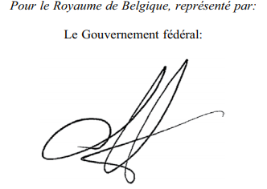
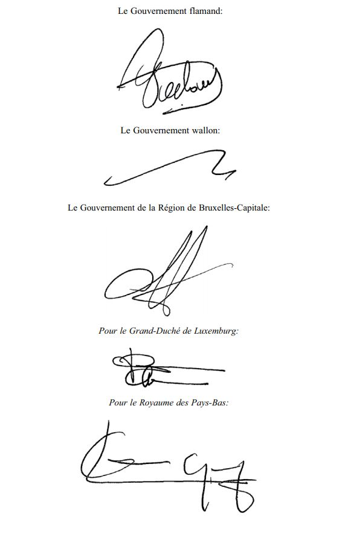

# Loi du 5 août 2015 portant approbation du Traité Benelux relatif à la coopération transfrontalière en matière d'inspection du transport routier, signé à Liège, le 3 octobre 2014.

Nous Henri, Grand-Duc de Luxembourg, Duc de Nassau,

Notre Conseil d’Etat entendu;

De l’assentiment de la Chambre des Députés;

Vu la décision de la Chambre des Députés du 8 juillet 2015 et celle du Conseil d’Etat du 17 juillet 2015 portant qu’il n’y a pas lieu à second vote;

Avons ordonné et ordonnons:

## Article unique.

Est approuvé le Traité Benelux relatif à la coopération transfrontalière en matière d’inspection du transport routier, signé à Liège, le 3 octobre 2014.

Mandons et ordonnons que la présente loi soit insérée au Mémorial pour être exécutée et observée par tous ceux que la chose concerne.

Le Ministre des Affaires étrangères  et européennes,   Jean Asselborn   Le Ministre du Développement durable et des Infrastructures,   François Bausch

Cabasson, le 5 août 2015.   Henri

\**TRAITE BENELUX**

relatif à la coopération transfrontalière en matière  d’inspection du transport routier

\*Le Royaume de Belgique,*

représenté par:

Le Gouvernement fédéral,

Le Gouvernement flamand,

Le Gouvernement wallon,

Le Gouvernement de la Région de Bruxelles-Capitale,

\*Le Royaume des Pays-Bas*

et

\*Le Grand-Duché de Luxembourg*

dénommés ci-après «les Parties Contractantes»,

\*Vu* l’article 6, alinéa 2, sous f), du [Traité instituant l’Union Benelux](https://legilux.public.lu/eli/etat/leg/loi/1960/08/05/n1/jo),

\*Vu* l’article 3, alinéa 2, sous a), du [Traité instituant l’Union Benelux](https://legilux.public.lu/eli/etat/leg/loi/1960/08/05/n1/jo) et le chapitre 3.5 du programme de travail commun 2013-2016,

\*Vu* la Décision M (2013) 6 du 18 novembre 2013 du Comité de Ministres Benelux concernant la coopération transfrontalière entre les services d’inspection en matière de transport routier,

\*Considérant* que le [Règlement (CE) n° 1071/2009](https://legilux.public.lu/eli/reg_ue/2009/1071/jo) du Parlement européen et du Conseil du 21 octobre 2009 établissant des règles communes sur les conditions à respecter pour exercer la profession de transporteur par route, et abrogeant la [Directive 96/26/CE](https://legilux.public.lu/eli/dir_ue/1996/26/jo) du Conseil, régit la coopération administrative et l’assistance mutuelle entre Etats membres,

\*Considérant* que la [Directive 2006/22/CE](https://legilux.public.lu/eli/dir_ue/2006/22/jo) du Parlement européen et du Conseil du 15 mars 2006 établissant les conditions minimales à respecter pour la mise en œuvre des [Règlements du Conseil (CEE) n° 3820/85](https://legilux.public.lu/eli/reg_ue/1985/3820/jo) et (CEE) [n° 3821/85](https://legilux.public.lu/eli/reg_ue/1985/3821/jo) concernant la législation sociale relative aux activités de transport routier et abrogeant la [Directive 88/599/CEE](https://legilux.public.lu/eli/dir_ue/1988/599/jo) du Conseil, encourage les contacts intracommunautaires entre les Etats membres sous la forme d’échange de données, d’expériences et d’informations,

\*Considérant* que la [Directive 2000/30/CE](https://legilux.public.lu/eli/dir_ue/2000/30/jo) du Parlement européen et du Conseil du 6 juin 2000 relative au contrôle technique routier des véhicules utilitaires circulant dans la Communauté ordonne les Etats membres à s’accorder mutuellement assistance pour l’application de la Directive,

\*Considérant* que la [Directive 95/50/CE](https://legilux.public.lu/eli/dir_ue/1995/50/jo) du Conseil du 6 octobre 1995 concernant des procédures uniformes en matière de contrôle des transports de marchandises dangereuses par route oblige les Etats membres à s’accorder mutuellement assistance pour la bonne application de la Directive,

\*Considérant* que les articles 24 à 26 du [Traité instituant l’Union Benelux](https://legilux.public.lu/eli/etat/leg/loi/1960/08/05/n1/jo) permettent la coopération entre, d’une part, l’Union Benelux et, d’autre part, des Etats et entités fédérées tiers et notamment les Etats, entités fédérées et entités administratives limitrophes du territoire des pays du Benelux,

\*Considérant* la coopération déjà mise en place dans le cadre d’Euro Contrôle Route,

\*Considérant* qu’en Europe, et également au sein du Benelux, les transports routiers se sont développés à un rythme effréné à l’échelle internationale, non seulement en nombre, mais également au niveau du cadre opérationnel dans lequel ils sont effectués,

\*Considérant* que malgré le développement de l’Union européenne en tant que marché intérieur, le contrôle et l’application de la réglementation de l’UE en matière de transport routier restent du ressort national, ce qui conduit à une grande diversité en termes de mise en œuvre entre les Etats membres, au mépris de l’uniformité souhaitée de l’acquis de l’UE,

\*Considérant* qu’une uniformité accrue dans la mise en œuvre de la réglementation de l’UE en matière de transport routier peut être réalisée grâce à une collaboration plus étroite entre les services d’inspection au sein du Benelux, et que la mise en commun des effectifs, de l’expertise et de l’expérience de chacun peut procurer des économies significatives, une importante augmentation de rendement et des avantages d’échelle significatifs,

SONT CONVENUS des dispositions qui suivent:

## Chapitre premier — *Objet, définitions et incidence d’autres règlements*

### *Article premier* — *Objet*

Le présent Traité vise à:

a) l’harmonisation plus approfondie du contrôle et de l’application de la réglementation de l’UE en matière de transports routiers de marchandises et de personnes;

b) la mise à profit d’avantages d’échelle en termes de capacité (personnel, moyens et matériel), d’expertise, d’expérience et de formation;

c) l’assistance transfrontalière mutuelle des services d’inspection en matière de transport routier et ses modalités.

### *Article 2* — *Définitions*

1\. Au sens du présent Traité, on entend par:

a) Autorité compétente: une autorité qui, en vertu de la répartition interne des compétences, est responsable sur le territoire d’une Partie Contractante du contrôle et de l’application de la réglementation en matière de transport routier des marchandises et des personnes;

b) Fonctionnaire: le fonctionnaire compétent désigné au moyen d’une mesure d’exécution telle que visée à l’article 26 du présent Traité;

c) Intervention transfrontalière: l’intervention de fonctionnaires d’une Partie Contractante sur le territoire d’une autre Partie Contractante afin d’exécuter les objectifs définis à l’article 1er, sous c), du présent Traité;

d) Fonctionnaire transfrontalier: le fonctionnaire qui effectue une intervention transfrontalière;

e) Unité transfrontalière d’inspection: l’unité constituée de fonctionnaires qui, au sens organisationnel et logistique du terme, effectue comme une entité globale une intervention transfrontalière;

f) Etat d’accueil: la Partie Contractante sur le territoire de laquelle a lieu une intervention transfrontalière;

g) Etat expéditeur: la Partie Contractante d’où les fonctionnaires transfrontaliers, les unités transfrontalières d’inspection ou les moyens et le matériel sont originaires;

h) Partie Contractante requérante: la Partie Contractante qui fait une demande d’intervention transfrontalière ou de mise à disposition de ressources ou de matériel;

i) Partie Contractante requise: la Partie Contractante à laquelle une demande visée sous g) est adressée;

j) Contrôle: les activités entreprises par ou au nom des autorités compétentes sans qu’il y ait un indice d’infraction pour vérifier si les prescriptions applicables sont respectées;

k) Application: toute intervention de l’autorité compétente destinée à induire un changement de comportement qui conduit ou doit conduire au respect des prescriptions applicables;

l) Recherche: enquête effectuée pour élucider ou prévenir un fait punissable probablement commis ou à commettre et pour préparer une sanction pénale à infliger éventuellement à ce titre.

2\. Une liste des autorités compétentes et des fonctionnaires compétents est dressée et mise à jour au moyen de mesures d’exécution telles que visées à l’article 26 du présent Traité.

### *Article 3* — Incidence d’autres règlements

Sauf disposition contraire expresse dans le présent Traité, la coopération a lieu dans le cadre du droit respectif des Parties Contractantes ainsi que de leurs obligations internationales.

## Chapitre II — ***Harmonisation plus approfondie* du contrôle et de l’application** **de la réglementation de l’UE en matière de transports routiers**

### *Article 4* — Harmonisation

1\. Les Parties Contractantes visent à une harmonisation plus approfondie du contrôle et de l’application de la réglementation de l’UE en matière de transport routier.

2\. Les plans d’action visés à l’article 27 du présent Traité comportent des propositions en la matière.

### *Article 5* — Systèmes de classification des risques

Les Parties Contractantes s’efforcent de rapprocher leurs systèmes de classification des risques tels que visés à l’article 9 de la [Directive 2006/22/CE](https://legilux.public.lu/eli/dir_ue/2006/22/jo) du Parlement européen et du Conseil du 15 mars 2006 établissant les conditions minimales à respecter pour la mise en œuvre des Règlements du Conseil [(CEE) n° 3820/85](https://legilux.public.lu/eli/reg_ue/1985/3820/jo) et [(CEE) n° 3821/85](https://legilux.public.lu/eli/reg_ue/1985/3821/jo) concernant la législation sociale relative aux activités de transport routier et abrogeant la [Directive 88/599/CEE](https://legilux.public.lu/eli/dir_ue/1988/599/jo) du Conseil.

## Chapitre III — *Mise à profit d’avantages d’échelle en termes de capacité (personnel, moyens et matériel), d’expertise, d’expérience et de formation*

### *Article 6* — Connaissance, expertise, expérience, formation, personnel, moyens et matériel

Les Parties Contractantes soutiennent la coopération transfrontalière dans le cadre du présent Traité:

a) par l’échange d’informations relatives à leurs législations et réglementations nationales, leurs structures de contrôle et d’application et leurs pratiques de contrôle et d’application;

b) en fournissant un forum pour l’échange de bonnes pratiques et d’expériences;

c) par l’organisation d’une coopération en matière de formations;

d) en fournissant un soutien technique et scientifique;

e) par l’échange de moyens et de matériel;

f) en informant au préalable les autres Parties Contractantes lors de l’acquisition de moyens et de matériel qui peuvent être utilisés de façon transfrontalière;

g) en échangeant du personnel;

h) en fournissant, dans le cadre d’une intervention transfrontalière, un droit d’accès aux fonctionnaires transfrontaliers des autres Parties Contractantes aux registres électroniques nationaux que la Partie Contractante tient conformément aux articles 16 et 17 du [Règlement (CE) n° 1071/2009](https://legilux.public.lu/eli/reg_ue/2009/1071/jo) du Parlement européen et du Conseil du 21 octobre 2009 établissant des règles communes sur les conditions à respecter pour exercer la profession de transporteur par route, et abrogeant la [Directive 96/26/CE](https://legilux.public.lu/eli/dir_ue/1996/26/jo) du Conseil, ainsi qu’à d’autres registres nationaux déterminés dans une mesure d’exécution telle que visée à l’article 26 du présent Traité, dans le respect de la législation applicable à ces registres en matière de traitement des données à caractère personnel et de protection de la vie privée.

### *Article 7* ***Modalités pratiques de la coopération***

Les modalités pratiques de la coopération en vertu du présent Traité sont réglées par les autorités compétentes au moyen de mesures d’exécution telles que visées à l’article 26 du présent Traité.

### *Article 8* ***Moyens et matériel***

1\. L’autorité compétente de l’Etat expéditeur peut, sur demande de l’Etat d’accueil, fournir des moyens et du matériel. La fourniture des moyens et du matériel s’accompagne d’un inventaire, qui est soumis sur demande à l’autorité compétente de l’Etat d’accueil.

2\. Lorsque des moyens et du matériel sont fournis, l’Etat expéditeur se charge de la formation et des explications nécessaires à l’utilisation de ces moyens et de ce matériel.

3\. Les frais engendrés par la perte ou l’endommagement de matériel fourni par une Partie Contractante sont à charge de cette dernière.

## Chapitre IV — *Assistance transfrontalière, mutuelle des services d’inspection en matière de transport routier et ses modalités*

### *Article 9* **Interventions transfrontalières**

Les autorités compétentes des Parties Contractantes peuvent organiser, en fonction de leurs besoins opérationnels, une intervention transfrontalière.

### *Article 10 * — *Tâches lors des interventions transfrontalières*

Les modalités pratiques de la coopération et l’attribution de tâches lors de la participation à une intervention transfrontalière sont réglées par les autorités compétentes au moyen de mesures d’exécution telles que visées à l’article 26 du présent Traité, en tenant compte des différences éventuelles existant entre les fonctionnaires dans les compétences dont ils disposent sur leur propre territoire.

### *Article 11* — *Demande d’intervention transfrontalière*

1\. Une intervention transfrontalière n’est possible que sur demande. La demande est adressée par écrit ou par voie électronique par l’autorité compétente de la Partie Contractante requérante à l’autorité compétente de la Partie Contractante requise. La demande est signée par l’autorité compétente de la Partie Contractante requérante. Dans le cas des demandes électroniques, une signature électronique est exigée.

2\. La demande contient une description de la nature de l’intervention transfrontalière souhaitée de même qu’une description de la nécessité opérationnelle de cette intervention.

3\. L’autorité compétente de la Partie Contractante requise prend sans délai une décision relative à la demande. La décision est communiquée aussi rapidement que possible, mais dans tous les cas au plus tard une semaine avant l’intervention transfrontalière envisagée, par écrit ou par voie électronique à l’autorité compétente de la Partie Contractante requérante. La décision est signée par l’autorité compétente de la Partie Contractante requérante. Dans le cas des demandes électroniques, une signature électronique est exigée.

### *Article 12* — *Devoir d’information*

1\. Le fonctionnaire transfrontalier est mis en possession d’une copie de la décision visée à l’article 11, alinéa 3, du présent Traité.

2\. Le cas échéant, le fonctionnaire transfrontalier est en possession d’un inventaire des moyens et du matériel qu’il a apportés, tel qu’arrêté par l’autorité compétente. Il soumet cet inventaire sur demande à l’autorité compétente de l’Etat d’accueil.

### *Article 13* **Usage de moyens de contrainte**

Lors d’une intervention transfrontalière, les fonctionnaires peuvent transporter, emporter ou porter les moyens de contrainte matériels individuels faisant partie de l’équipement de base dans l’Etat expéditeur moyennant l’autorisation de l’Etat d’accueil. Ces moyens de contrainte peuvent uniquement être utilisés dans le respect de la législation applicable dans l’Etat d’accueil.

### *Article 14* ***Confidentialité***

Les mêmes règles de confidentialité valent pour le fonctionnaire transfrontalier, pour l’unité transfrontalière d’inspection et pour les autorités compétentes de l’Etat expéditeur que celles en vigueur pour les fonctionnaires et les autorités compétentes de l’Etat d’accueil.

## Chapitre V — *Dispositions générales relatives aux interventions transfrontalières*

### *Article 15* ***Droit et procédures applicables***

1\. Le fonctionnaire se conforme au droit en vigueur dans l’Etat d’accueil pendant l’intervention transfrontalière.

2\. L’intervention transfrontalière est effectuée suivant les procédures légales de l’Etat d’accueil.

### *Article 16* ***Autorité***

Pendant l’intervention transfrontalière, le fonctionnaire transfrontalier est tenu d’obtempérer aux instructions des autorités compétentes concernées et aux ordres du supérieur concerné de l’Etat d’accueil.

### *Article 17* **Identification**

Le fonctionnaire transfrontalier est en mesure de justifier en tout temps de sa qualité officielle au moyen d’une pièce d’identité qui lui a été délivrée dans l’Etat expéditeur.

### *Article 18* **Caractère reconnaissable**

1\. Le fonctionnaire transfrontalier est extérieurement identifiable en tant que tel par le port d’une tenue de service ou de signes d’identification qui indiquent le caractère transfrontalier de l’intervention.

2\. Pendant une intervention transfrontalière, des dispositifs qui indiquent le caractère transfrontalier de l’intervention sont placés sur le véhicule utilisé par le fonctionnaire transfrontalier.

3\. Les alinéas précédents ne sont pas applicables si la nature de l’intervention transfrontalière des services d’inspection du transport routier l’impose.

### *Article 19* **Reprise et fin**

1\. Le début et la fin de l’intervention transfrontalière sont fixés dans des mesures d’exécution telles que visées à l’article 26 du présent Traité.

2\. Dans des cas exceptionnels, l’autorité compétente de l’Etat d’accueil peut reprendre l’intervention transfrontalière, si nécessaire en dérogeant aux mesures d’exécution mentionnées au premier alinéa. L’intervention transfrontalière prend fin dès que l’autorité compétente de l’Etat d’accueil communique cette reprise.

### *Article 20* ***Rapport***

Le fonctionnaire transfrontalier ou le supérieur d’une unité transfrontalière d’inspection dresse, après chaque intervention transfrontalière, un rapport de cette intervention aux autorités compétentes de l’Etat d’accueil.

### *Article 21* ***Assistance***

L’Etat d’accueil est tenu envers les fonctionnaires transfrontaliers de l’Etat expéditeur pendant l’intervention transfrontalière à la même protection et à la même assistance qu’envers ses propres fonctionnaires.

## Chapitre VI — *Dispositions en matière de responsabilité civile et pénale et en matière de frais*

### *Article 22* ***Responsabilité pénale***

Dans le cadre des missions relevant du champ d’application du présent Traité, les fonctionnaires de l’Etat expéditeur sont assimilés aux fonctionnaires de l’Etat d’accueil en ce qui concerne les infractions dont ils seraient victimes ou qu’ils commettraient, sauf si les Parties Contractantes en conviennent autrement.

### *Article 23* ***Responsabilité civile***

1\. Les obligations résultant d’un acte illicite commis par un fonctionnaire de l’Etat expéditeur lors d’une intervention transfrontalière sont régies par le droit de l’Etat d’accueil.

2\. Dans le cas d’interventions transfrontalières, l’Etat expéditeur assume la réparation des dommages causés par son fonctionnaire sur le territoire de l’Etat d’accueil. Dans ce cas, l’Etat d’accueil répare le préjudice subi par les parties lésées ou leurs ayants droit dans les conditions applicables aux dommages causés par ses propres fonctionnaires. L’Etat expéditeur rembourse ensuite à l’Etat d’accueil le montant intégral que ce dernier a versé aux parties lésées ou à leurs ayants droit.

### *Article 24* **Relation de travail**

Les droits et obligations qui découlent de la relation de travail du fonctionnaire transfrontalier dans l’Etat expéditeur restent en vigueur pendant l’intervention transfrontalière. On entend entre autres par là les droits et obligations dans le domaine de la responsabilité civile.

### *Article 25* ***Frais de l’intervention transfrontalière***

Chaque Partie Contractante supporte les coûts de sa propre participation à une intervention transfrontalière, sauf accord contraire.

## Chapitre VII — *Mesures d’exécution et plans d’action*

### *Article 26* ***Mesures d’exécution***

Sur la base et dans le cadre du présent Traité, les autorités compétentes conviennent de mesures relatives à son exécution.

### *Article 27* ***Plans d’action***

1\. Le Comité de pilotage mentionné à l’article 28 établit les plans d’action périodiques visant l’application du présent Traité et les soumet aux gouvernements des Parties Contractantes.

2\. Le Comité de pilotage mentionné à l’article 28 fait rapport annuellement aux gouvernements des Parties Contractantes au sujet de la mise en œuvre des plans d’action mentionnés à l’alinéa premier.

### *Article 28* ***Comité de pilotage inspection du transport routier***

1\. Il est institué un Comité de pilotage inspection des transports routiers où toutes les Parties Contractantes sont représentées.

2\. La composition du Comité de pilotage mentionné à l’alinéa premier est fixée dans l’annexe au présent Traité.

3\. La présidence, le fonctionnement et la procédure à suivre pour la modification de la composition du Comité de pilotage visé à l’alinéa premier sont arrêtés dans une mesure d’exécution telle que visée à l’article 26 du présent Traité.

## Chapitre VIII — *Dispositions finales*

### *Article 29* ***Règlement des différends***

1\. Les Parties Contractantes coopèrent en cas de questions relatives à l’interprétation ou à l’application du présent Traité.

2\. A cette fin, une commission d’experts, composée de représentants des autorités compétentes des Parties Contractantes, est instituée.

3\. Si nécessaire, la commission d’experts se réunit à la demande d’une Partie Contractante.

4\. Tout différend relatif à l’interprétation ou à l’application du présent Traité faisant l’objet d’un désaccord au sein de la commission d’experts est réglé en concertation entre les gouvernements des Parties Contractantes.

### *Article 30* **Mise en œuvre du Traité**

Les Parties Contractantes prennent les mesures nécessaires à la mise en œuvre du présent Traité.

### *Article 31* **Echange d’informations**

Les Parties Contractantes développent conjointement un mécanisme pour l’échange d’informations et d’évaluations dans le domaine du contrôle du transport routier en application du présent Traité, en stricte conformité avec les prescriptions applicables concernant le traitement des données à caractère personnel et la protection de la vie privée.

### *Article 32* ***Evaluation***

Au plus tard trois ans après l’entrée en vigueur du présent Traité, les Parties Contractantes évaluent son fonctionnement et son efficacité.

### *Article 33* **Champ d’application territorial**

Sous réserve des dispositions de l’article 35 du présent Traité, le présent Traité s’applique au territoire du Royaume de Belgique, du Grand-Duché de Luxembourg et du Royaume des Pays-Bas en Europe.

### *Article 34* **Ratification et entrée en vigueur**

1\. Le Secrétaire général de l’Union Benelux est le dépositaire du présent Traité, dont il fournit une copie certifiée conforme à chaque Partie Contractante.

2\. Le présent Traité est ratifié, accepté ou approuvé par les Parties Contractantes.

3\. Les Parties Contractantes déposent leur instrument de ratification, d’acceptation ou d’approbation auprès du dépositaire.

4\. Le dépositaire informe les Parties Contractantes du dépôt des instruments de ratification, d’acceptation ou d’approbation.

5\. Le présent Traité entre en vigueur le premier jour du deuxième mois suivant le dépôt du dernier instrument de ratification, d’acceptation ou d’approbation.

6\. Le dépositaire communique la date d’entrée en vigueur du présent Traité aux Parties Contractantes.

### *Article 35* ***Adhésion de pays tiers et d’entités fédérées***

Il est loisible à des pays tiers et, si elles ont la capacité de conclure des Traités, à des entités fédérées d’adhérer au présent Traité par le dépôt d’un instrument d’adhésion auprès du dépositaire. Pour les pays ou entités fédérées adhérents, le Traité entre en vigueur le premier jour du deuxième mois suivant le dépôt de l’instrument d’adhésion et au plus tôt le jour de l’entrée en vigueur du Traité conformément à l’article 34, alinéa 5, du présent Traité. Le dépositaire informe les Parties Contractantes du dépôt de l’instrument d’adhésion et de la date d’entrée en vigueur du présent Traité pour l’état ou l’entité fédérée adhérant au Traité.

### *Article 36* **Dénonciation**

Chaque Partie Contractante peut dénoncer à tout moment le présent Traité par le dépôt d’une déclaration écrite auprès du dépositaire. La dénonciation prend effet six mois après le dépôt de cette déclaration écrite. Le Traité reste en vigueur entre les autres Parties Contractantes. Le dépositaire informe les Parties Contractantes du dépôt d’une telle déclaration.

EN FOI DE QUOI, les soussignés, dûment mandatés à cet effet, ont signé le présent Traité et l’ont revêtu de leur sceau.

FAIT à Liège, le 3 octobre 2014, en un exemplaire, en langue néerlandaise et en langue française, les deux textes faisant également foi.

ANNEXE

\**Composition du Comité de pilotage inspection du transport routier**

1\. Le Comité de pilotage inspection du transport routier institué en vertu de l’article 28 du présent Traité est composé d’au moins un représentant du Royaume de Belgique, de la Région flamande, de la Région wallonne, de la Région de Bruxelles-Capitale, du Grand-Duché de Luxembourg et du Royaume des Pays-Bas.

2\. Les membres du Comité de pilotage sont actifs au sein d’un service public compétent en matière d’inspection du transport routier et incluent, pour chaque Partie Contractante, au moins un représentant exerçant au sein du service public concerné au moins la fonction de directeur ou une fonction dirigeante à un niveau comparable.

3\. Une liste avec les noms et les coordonnées des membres du Comité de pilotage est arrêtée au moyen d’une mesure d’exécution telle que visée à l’article 26 du présent [Traité](https://legilux.public.lu/eli/etat/leg/loi/2015/08/05/n1/jo).

Doc. parl. [6785](http://legilux.public.lu/eli/etat/proj/pl/20150012); sess. ord. 2014-2015.
