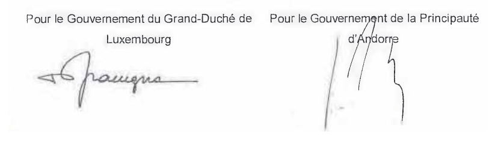
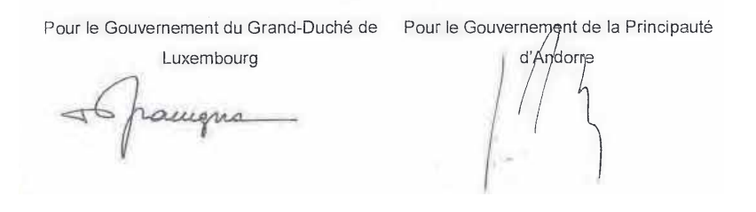
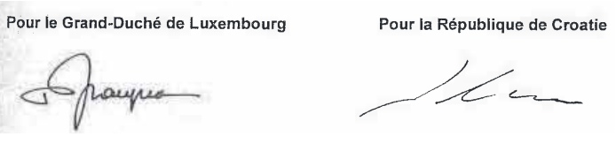
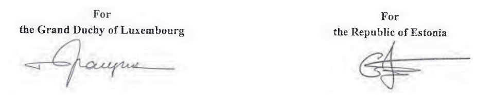
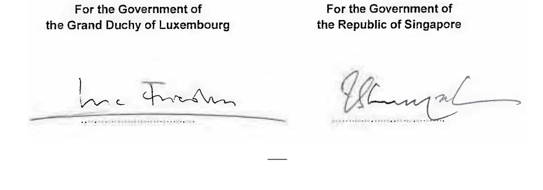
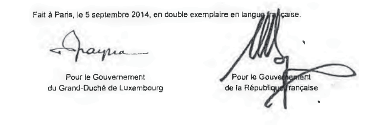
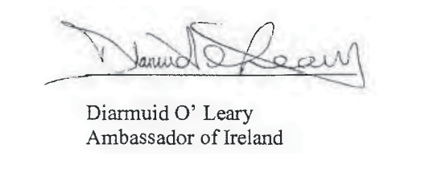
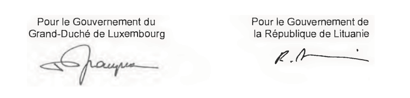
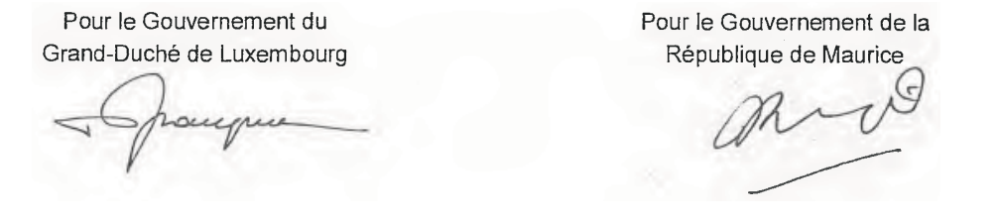
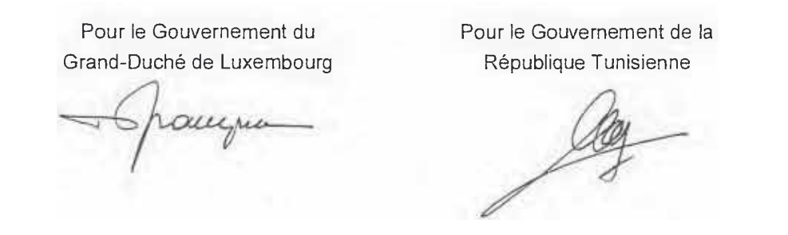

# Loi du 7 décembre 2015 portant\n1) approbation de la Convention entre le Grand-Duché de Luxembourg et la Principauté d’Andorre tendant à éviter les doubles impositions et à prévenir la fraude fiscale en matière d’impôts sur le revenu et sur la fortune, et du Protocole y relatif, signés à Luxembourg, le 2 juin 2014;\n2) approbation de la Convention entre le Grand-Duché de Luxembourg et la République de Croatie tendant à éviter les doubles impositions et à prévenir la fraude fiscale en matière d’impôts sur le revenu et sur la fortune, et du Protocole y relatif, signés à Luxembourg, le 20 juin 2014;\n3) approbation de la Convention entre le Grand-Duché de Luxembourg et la République d’Estonie tendant à éviter les doubles impositions et à prévenir la fraude fiscale en matière d’impôts sur le revenu et sur la fortune, et du Protocole y relatif, signés à Bruxelles, le 7 juillet 2014;\n4) approbation de la Convention entre le Gouvernement du Grand-Duché de Luxembourg et le Gouvernement de la République de Singapour tendant à éviter les doubles impositions et à prévenir la fraude fiscale en matière d’impôts sur le revenu et sur la fortune, et du Protocole y relatif, signés à Washington DC, le 9 octobre 2013;\n5) approbation du Protocole, signé à Abou Dhabi, le 26 octobre 2014, modifiant la Convention entre le Grand-Duché de Luxembourg et les Emirats Arabes Unis tendant à éviter les doubles impositions et à prévenir la fraude fiscale en matière d’impôts sur le revenu et sur la fortune, et du Protocole y relatif, signés à Dubaï, le 20 novembre 2005;\n6) approbation du quatrième Avenant, signé à Paris, le 5 septembre 2014, à la Convention entre le Grand-Duché de Luxembourg et la France tendant à éviter les doubles impositions et à établir des règles d’assistance administrative réciproque en matière d’impôts sur le revenu et sur la fortune signée à Paris le 1er avril 1958 modifiée par un Avenant signé à Paris le 8 septembre 1970, par un Avenant signé à Luxembourg le 24 novembre 2006 et par un Avenant signé à Paris, le 3 juin 2009;\n7) approbation du Protocole et l’échange de lettres y relatif, signés à Luxembourg, le 27 mai 2014, modifiant la Convention entre le Grand-Duché de Luxembourg et l’Irlande tendant à éviter les doubles impositions et à prévenir l’évasion fiscale en matière d’impôts sur le revenu et sur la fortune, signée à Luxembourg, le 14 janvier 1972;\n8) approbation du Protocole et du Protocole additionnel, signés à Luxembourg, le 20 juin 2014, modifiant la Convention entre le Gouvernement du Grand-Duché de Luxembourg et le Gouvernement de la République de Lituanie tendant à éviter les doubles impositions et à\nprévenir la fraude fiscale en matière d’impôts sur le revenu et sur la fortune, et du Protocole y relatif, signés à Bruxelles, le 22 novembre 2004;\n9) approbation du Protocole, signé à Bruxelles, le 28 janvier 2014, modifiant la Convention entre le Gouvernement du Grand-Duché de Luxembourg et le Gouvernement de la République de Maurice tendant à éviter les doubles impositions et à prévenir la fraude fiscale en matière d’impôts sur le revenu et sur la fortune, et du Protocole, signés à Luxembourg, le 15 février 1995;\n10) approbation du Protocole et l’échange de lettres y relatif, signés à Bruxelles, le 8 juillet 2014, modifiant la Convention entre le Grand-Duché de Luxembourg et la République Tunisienne tendant à éviter les doubles impositions et à prévenir l’évasion fiscale en matière d’impôts sur le revenu et sur la fortune, signée à Luxembourg, le 27 mars 1996.

Nous Henri, Grand-Duc de Luxembourg, Duc de Nassau,

Notre Conseil d’État entendu;

De l’assentiment de la Chambre des Députés;

Vu la décision de la Chambre des Députés du 18 novembre 2015 et celle du Conseil d’État du 1er décembre 2015 portant qu’il n’y a pas lieu à second vote;

Avons ordonné et ordonnons:

## Art. 1er.

Sont approuvés:

aash la Convention entre le Grand-Duché de Luxembourg et la Principauté d’Andorre tendant à éviter les doubles impositions et à prévenir la fraude fiscale en matière d’impôts sur le revenu et sur la fortune, et le Protocole y relatif, signés à Luxembourg, le 2 juin 2014;

bash la Convention entre le Grand-Duché de Luxembourg et la République de Croatie tendant à éviter les doubles impositions et à prévenir la fraude fiscale en matière d’impôts sur le revenu et sur la fortune, et le Protocole y relatif, signés à Luxembourg, le 20 juin 2014;

cash la Convention entre le Grand-Duché de Luxembourg et la République d’Estonie tendant à éviter les doubles impositions et à prévenir la fraude fiscale en matière d’impôts sur le revenu et sur la fortune, et le Protocole y relatif, signés à Bruxelles, le 7 juillet 2014;

dash la Convention entre le Gouvernement du Grand-Duché de Luxembourg et le Gouvernement de la République de Singapour tendant à éviter les doubles impositions et à prévenir la fraude fiscale en matière d’impôts sur le revenu et sur la fortune, et le Protocole y relatif, signés à Washington DC, le 9 octobre 2013;

eash le Protocole, signé à Abou Dhabi, le 26 octobre 2014, modifiant la Convention entre le Grand-Duché de Luxembourg et les Émirats Arabes Unis tendant à éviter les doubles impositions et à prévenir la fraude fiscale en matière d’impôts sur le revenu et sur la fortune, et le Protocole y relatif, signés à Dubaï, le 20 novembre 2005;

fash le quatrième Avenant, signé à Paris, le 5 septembre 2014, à la Convention entre le Grand-Duché de Luxembourg et la France tendant à éviter les doubles impositions et à établir des règles d’assistance administrative réciproque en matière d’impôts sur le revenu et sur la fortune signée à Paris le 1er avril 1958 modifiée par un Avenant signé à Paris le 8 septembre 1970, par un Avenant signé à Luxembourg le 24 novembre 2006 et par un Avenant signé à Paris, le 3 juin 2009;

gash le Protocole et l’échange de lettres y relatif, signés à Luxembourg, le 27 mai 2014, modifiant la Convention entre le Grand-Duché de Luxembourg et l’Irlande tendant à éviter les doubles impositions et à prévenir l’évasion fiscale en matière d’impôts sur le revenu et sur la fortune, signée à Luxembourg, le 14 janvier 1972;

hash le Protocole et le Protocole additionnel, signés à Luxembourg, le 20 juin 2014, modifiant la Convention entre le Gouvernement du Grand-Duché de Luxembourg et le Gouvernement de la République de Lituanie tendant à éviter les doubles impositions et à prévenir la fraude fiscale en matière d’impôts sur le revenu et sur la fortune, et le Protocole y relatif, signés à Bruxelles, le 22 novembre 2004;

iash le Protocole, signé à Bruxelles, le 28 janvier 2014, modifiant la Convention entre le Gouvernement du Grand-Duché de Luxembourg et le Gouvernement de la République de Maurice tendant à éviter les doubles impositions et à prévenir la fraude fiscale en matière d’impôts sur le revenu et sur la fortune, et le Protocole, signés à Luxembourg, le 15 février 1995;

jash le Protocole et l’échange de lettres y relatif, signés à Bruxelles, le 8 juillet 2014, modifiant la Convention entre le Grand-Duché de Luxembourg et la République Tunisienne tendant à éviter les doubles impositions et à prévenir l’évasion fiscale en matière d’impôts sur le revenu et sur la fortune, signée à Luxembourg, le 27 mars 1996.

## Art. 2.

La référence à la présente loi peut se faire sous une forme abrégée en recourant à l’intitulé suivant:

«Loi du 7 décembre 2015 portant approbation de conventions fiscales et prévoyant la procédure y applicable en matière d’échange de renseignements sur demande».

Mandons et ordonnons que la présente loi soit insérée au Mémorial pour être exécutée et observée par tous ceux que la chose concerne.

Le Ministre des Finances,   Pierre Gramegna

Palais de Luxembourg, le 7 décembre 2015.   Henri

\**CONVENTION**

\**ENTRE**

\**LE GRAND-DUCHE DE LUXEMBOURG**

\**ET**

\**LA PRINCIPAUTE D’ANDORRE**

\**TENDANT A EVITER LES DOUBLES IMPOSITIONS ET A PREVENIR LA FRAUDE**

\**FISCALE EN MATIERE D’IMPOTS SUR LE REVENU ET SUR LA FORTUNE**

Le Gouvernement du Grand-Duché de Luxembourg et le Gouvernement de la Principauté d’Andorre, désireux de conclure une Convention tendant à éviter les doubles impositions et à prévenir la fraude fiscale en matière d’impôts sur le revenu et sur la fortune, sont convenus de ce qui suit:

## Article 1er — PERSONNES VISÉES

La présente Convention s’applique aux personnes qui sont des résidents d’un État contractant ou des deux États contractants.

## Article 2 — IMPÔTS VISÉS

1\. La présente Convention s’applique aux impôts sur le revenu et sur la fortune perçus pour le compte d’un État contractant ou de ses collectivités locales, quel que soit le système de perception.

2\. Sont considérés comme impôts sur le revenu et sur la fortune les impôts perçus sur le revenu total, sur la fortune totale, ou sur des éléments du revenu ou de la fortune, y compris les impôts sur les gains provenant de l’aliénation de biens mobiliers ou immobiliers, les impôts sur le montant global des salaires payés par les entreprises, ainsi que les impôts sur les plus-values.

3\. Les impôts actuels auxquels s’applique la Convention sont notamment:

a) en ce qui concerne le Grand-Duché de Luxembourg:

(i) l’impôt sur le revenu des personnes physiques;

(ii) l’impôt sur le revenu des collectivités;

(iii) l’impôt sur la fortune; et

(iv) l’impôt commercial communal;

(ci-après dénommés «impôt luxembourgeois»);

b) en ce qui concerne la Principauté d’Andorre:

(i) l’impôt sur les sociétés;

(ii) l’impôt sur le revenu des activités économiques;

(iii) l’impôt sur le revenu des non-résidents fiscaux; et

(iv) l’impôt sur les plus values des transmissions patrimoniales immobilières;

(ci-après dénommés «impôt andorran»).

4\. La Convention s’applique aussi aux impôts de nature identique ou analogue qui seraient établis après la date de signature de la Convention et qui s’ajouteraient aux impôts actuels ou qui les remplaceraient ainsi qu’à tout autre impôt s’inscrivant dans le cadre de la présente convention que l’un des États contractants pourrait percevoir à l’avenir, en particulier l’impôt sur le revenu des personnes physiques en Andorre. Les autorités compétentes des États contractants se communiquent les modifications significatives apportées à leurs législations fiscales.

## Article 3 — DÉFINITIONS GÉNÉRALES

1\. Au sens de la présente Convention, à moins que le contexte n’exige une interprétation différente:

a) le terme «Luxembourg» désigne le Grand-Duché de Luxembourg et, lorsqu’il est employé dans un sens géographique, il désigne le territoire du Grand-Duché de Luxembourg;

b) le terme «Andorre» désigne la Principauté d’Andorre et, lorsqu’il est employé dans un sens géographique, il désigne le territoire de la Principauté d’Andorre;

c) les expressions «État contractant» et «autre État contractant» désignent, suivant le cas, le Luxembourg ou l’Andorre;

d) le terme «personne» comprend les personnes physiques, les sociétés et tous autres groupements de personnes;

e) le terme «société» désigne toute personne morale ou toute entité qui est considérée comme une personne morale aux fins d’imposition;

f) le terme «entreprise» s’applique à l’exercice de toute activité ou affaire;

g) les expressions «entreprise d’un État contractant» et «entreprise de l’autre État contractant» désignent respectivement une entreprise exploitée par un résident d’un État contractant et une entreprise exploitée par un résident de l’autre État contractant;

h) l’expression «trafic international» désigne tout transport effectué par un navire, un aéronef ou un véhicule routier exploité par une entreprise dont le siège de direction effective est situé dans un État contractant, sauf lorsque le navire, l’aéronef ou le véhicule routier n’est exploité qu’entre des points situés dans l’autre État contractant;

i) l’expression «autorité compétente» désigne:

(i) en ce qui concerne le Luxembourg, le Ministre des Finances ou son représentant autorisé;

(ii) en ce qui concerne l’Andorre, le Ministre chargé des Finances ou son représentant autorisé;

j) le terme «national», en ce qui concerne un État contractant, désigne:

(i) toute personne physique qui possède la nationalité ou la citoyenneté de cet État contractant; et

(ii) toute personne morale, société de personnes ou association constituée conformément à la législation en vigueur dans cet État contractant;

k) les termes «activité», par rapport à une entreprise, et «affaires» comprennent l’exercice de professions libérales ou d’autres activités de caractère indépendant.

2\. Pour l’application de la Convention à un moment donné par un État contractant, tout terme ou expression qui n’y est pas défini a, sauf si le contexte exige une interprétation différente, le sens que lui attribue, à ce moment, le droit de cet État concernant les impôts auxquels s’applique la Convention, le sens attribué à ce terme ou expression par le droit fiscal de cet État prévalant sur le sens que lui attribuent les autres branches du droit de cet État.

## Article 4 — RÉSIDENT

1\. Au sens de la présente Convention, l’expression «résident d’un État contractant» désigne toute personne qui, en vertu de la législation de cet État, est assujettie à l’impôt dans cet État, en raison de son domicile, de sa résidence, de son siège de direction, ou de tout autre critère de nature analogue et s’applique aussi à cet État, ainsi qu’à toutes ses collectivités locales. Toutefois, cette expression ne comprend pas les personnes qui ne sont assujetties à l’impôt dans cet État que pour les revenus de sources situées dans cet État ou pour la fortune qui y est située.

2\. Lorsque, selon les dispositions du paragraphe 1er, une personne physique est un résident des deux États contractants, sa situation est réglée de la manière suivante:

a) cette personne est considérée comme un résident seulement de l’État où elle dispose d’un foyer d’habitation permanent; si elle dispose d’un foyer d’habitation permanent dans les deux États, elle est considérée comme un résident seulement de l’État avec lequel ses liens personnels et économiques sont les plus étroits (centre des intérêts vitaux);

b) si l’État où cette personne a le centre de ses intérêts vitaux ne peut pas être déterminé, ou si elle ne dispose d’un foyer d’habitation permanent dans aucun des États, elle est considérée comme un résident seulement de l’État où elle séjourne de façon habituelle;

c) si cette personne séjourne de façon habituelle dans les deux États ou si elle ne séjourne de façon habituelle dans aucun d’eux, elle est considérée comme un résident seulement de l’État dont elle possède la nationalité;

d) si cette personne possède la nationalité des deux États ou si elle ne possède la nationalité d’aucun d’eux, les autorités compétentes des États contractants tranchent la question d’un commun accord.

3\. Lorsque, selon les dispositions du paragraphe 1er, une personne autre qu’une personne physique est un résident des deux États contractants, elle est considérée comme un résident seulement de l’État où son siège de direction effective est situé.

## Article 5 — ÉTABLISSEMENT STABLE

1\. Au sens de la présente Convention, l’expression «établissement stable» désigne une installation fixe d’affaires par l’intermédiaire de laquelle une entreprise exerce tout ou partie de son activité.

2\. L’expression «établissement stable» comprend notamment:

a) un siège de direction;

b) une succursale;

c) un bureau;

d) une usine;

e) un atelier;

f) une mine, un puits de pétrole ou de gaz, une carrière ou tout autre lieu d’extraction de ressources naturelles;

et

g) une exploitation agricole, d’élevage ou forestière.

3\. Un chantier de construction ou de montage ou de dragage ne constitue un établissement stable que si sa durée dépasse 12 mois.

4\. Nonobstant les dispositions précédentes du présent article, on considère qu’il n’y a pas «établissement stable» si:

a) il est fait usage d’installations aux seules fins de stockage, d’exposition ou de livraison de marchandises appartenant à l’entreprise;

b) des marchandises appartenant à l’entreprise sont entreposées aux seules fins de stockage, d’exposition ou de livraison;

c) des marchandises appartenant à l’entreprise sont entreposées aux seules fins de transformation par une autre entreprise;

d) une installation fixe d’affaires est utilisée aux seules fins d’acheter des marchandises ou de réunir des informations, pour l’entreprise;

e) une installation fixe d’affaires est utilisée aux seules fins d’exercer, pour l’entreprise, toute autre activité de caractère préparatoire ou auxiliaire;

f) une installation fixe d’affaires est utilisée aux seules fins de l’exercice cumulé d’activités mentionnées aux alinéas a) à e), à condition que l’activité d’ensemble de l’installation fixe d’affaires résultant de ce cumul garde un caractère préparatoire ou auxiliaire.

5\. Nonobstant les dispositions des paragraphes 1er et 2, lorsqu’une personne - autre qu’un agent jouissant d’un statut indépendant auquel s’applique le paragraphe 6 - agit pour le compte d’une entreprise et dispose dans un État contractant de pouvoirs qu’elle y exerce habituellement lui permettant de conclure des contrats au nom de l’entreprise, cette entreprise est considérée comme ayant un établissement stable dans cet État pour toutes les activités que cette personne exerce pour l’entreprise, à moins que les activités de cette personne ne soient limitées à celles qui sont mentionnées au paragraphe 4 et qui, si elles étaient exercées par l’intermédiaire d’une installation fixe d’affaires, ne permettraient pas de considérer cette installation comme un établissement stable selon les dispositions de ce paragraphe.

6\. Une entreprise n’est pas considérée comme ayant un établissement stable dans un État contractant du seul fait qu’elle y exerce son activité par l’entremise d’un courtier, d’un commissionnaire général ou de tout autre agent jouissant d’un statut indépendant, à condition que ces personnes agissent dans le cadre ordinaire de leur activité.

7\. Le fait qu’une société qui est un résident d’un État contractant contrôle ou est contrôlée par une société qui est un résident de l’autre État contractant ou qui y exerce son activité (que ce soit par l’intermédiaire d’un établissement stable ou non) ne suffit pas, en lui-même, à faire de l’une quelconque de ces sociétés un établissement stable de l’autre.

## Article 6 — REVENUS IMMOBILIERS

1\. Les revenus qu’un résident d’un État contractant tire de biens immobiliers (y compris les revenus des exploitations agricoles ou forestières) situés dans l’autre État contractant, sont imposables dans cet autre État.

2\. L’expression «biens immobiliers» a le sens que lui attribue le droit de l’État contractant où les biens considérés sont situés. L’expression comprend en tous cas les accessoires, le cheptel mort ou vif des exploitations agricoles et forestières, les droits auxquels s’appliquent les dispositions du droit privé concernant la propriété foncière, l’usufruit des biens immobiliers et les droits à des paiements variables ou fixes pour l’exploitation ou la concession de l’exploitation de gisements minéraux, sources et autres ressources naturelles; les navires, bateaux et aéronefs ne sont pas considérés comme des biens immobiliers.

3\. Les dispositions du paragraphe 1er s’appliquent aux revenus provenant de l’exploitation directe, de la location ou de l’affermage, ainsi que de toute autre forme d’exploitation des biens immobiliers.

4\. Les dispositions des paragraphes 1er et 3 s’appliquent également aux revenus provenant des biens immobiliers d’une entreprise.

## Article 7 — BÉNÉFICES DES ENTREPRISES

1\. Les bénéfices d’une entreprise d’un État contractant ne sont imposables que dans cet État, à moins que l’entreprise n’exerce son activité dans l’autre État contractant par l’intermédiaire d’un établissement stable qui y est situé. Si l’entreprise exerce son activité d’une telle façon, les bénéfices qui sont attribuables à l’établissement stable conformément aux dispositions du paragraphe 2 sont imposables dans l’autre État.

2\. Aux fins de cet article et de l’article 22, les bénéfices qui sont attribuables dans chaque État contractant à l’établissement stable mentionné au paragraphe 1er sont ceux qu’il aurait pu réaliser, en particulier dans ses opérations internes avec d’autres parties de l’entreprise, s’il avait constitué une entreprise distincte et indépendante exerçant des activités identiques ou analogues dans des conditions identiques ou analogues, compte tenu des fonctions exercées, des actifs utilisés et des risques assumés par l’entreprise par l’intermédiaire de l’établissement stable et des autres parties de l’entreprise.

3\. Lorsque, conformément au paragraphe 2, un État contractant ajuste les bénéfices qui sont attribuables à un établissement stable d’une entreprise d’un des États contractants et impose en conséquence des bénéfices de l’entreprise qui ont été imposés dans l’autre État, cet autre État procède à un ajustement approprié du montant de l’impôt qui a été perçu sur ces bénéfices dans la mesure nécessaire pour éliminer la double imposition de ces bénéfices. Pour déterminer cet ajustement, les autorités compétentes des États contractants se consultent si nécessaire.

4\. Lorsque les bénéfices comprennent des éléments de revenu traités séparément dans d’autres articles de la présente Convention, les dispositions de ces articles ne sont pas affectées par les dispositions du présent article.

## Article 8 — NAVIGATION MARITIME, INTÉRIEURE ET AÉRIENNE

1\. Les bénéfices provenant de l’exploitation, en trafic international, de navires ou d’aéronefs ne sont imposables que dans l’État contractant où le siège de direction effective de l’entreprise est situé.

2\. Les bénéfices provenant de l’exploitation de bateaux servant à la navigation intérieure ne sont imposables que dans l’État contractant où le siège de direction effective de l’entreprise est situé.

3\. Si le siège de direction effective d’une entreprise de navigation maritime ou intérieure est à bord d’un navire ou d’un bateau, ce siège est considéré comme situé dans l’État contractant où se trouve le port d’attache de ce navire ou de ce bateau, ou à défaut de port d’attache, dans l’État contractant dont l’exploitant du navire ou du bateau est un résident.

4\. Les dispositions du paragraphe 1er s’appliquent aussi aux bénéfices provenant de la participation à un pool, une exploitation en commun ou un organisme international d’exploitation.

## Article 9 — ENTREPRISES ASSOCIÉES

1\. Lorsque

a) une entreprise d’un État contractant participe directement ou indirectement à la direction, au contrôle ou au capital d’une entreprise de l’autre État contractant, ou que

b) les mêmes personnes participent directement ou indirectement à la direction, au contrôle ou au capital d’une entreprise d’un État contractant et d’une entreprise de l’autre État contractant,

et que, dans l’un et l’autre cas, les deux entreprises sont, dans leurs relations commerciales ou financières, liées par des conditions convenues ou imposées, qui diffèrent de celles qui seraient convenues entre des entreprises indépendantes, les bénéfices qui, sans ces conditions, auraient été réalisés par l’une des entreprises, mais n’ont pu l’être en fait à cause de ces conditions, peuvent être inclus dans les bénéfices de cette entreprise et imposés en conséquence.

2\. Lorsqu’un État contractant inclut dans les bénéfices d’une entreprise de cet État - et impose en conséquence - des bénéfices sur lesquels une entreprise de l’autre État contractant a été imposée dans cet autre État, et que les bénéfices ainsi inclus sont des bénéfices qui auraient été réalisés par l’entreprise du premier État si les conditions convenues entre les deux entreprises avaient été celles qui auraient été convenues entre des entreprises indépendantes, l’autre État procède à un ajustement approprié du montant de l’impôt qui y a été perçu sur ces bénéfices. Pour déterminer cet ajustement, il est tenu compte des autres dispositions de la présente Convention et, si c’est nécessaire, les autorités compétentes des États contractants se consultent.

## Article 10 — DIVIDENDES

1\. Les dividendes payés par une société qui est un résident d’un État contractant à un résident de l’autre État contractant, sont imposables dans cet autre État.

2\. Toutefois, ces dividendes sont aussi imposables dans l’État contractant dont la société qui paie les dividendes est un résident, et selon la législation de cet État, mais si le bénéficiaire effectif des dividendes est un résident de l’autre État contractant, l’impôt ainsi établi ne peut excéder:

a) 5 pour cent du montant brut des dividendes, si le bénéficiaire effectif est une société (autre qu’une société de personnes) qui détient directement au moins 10 pour cent du capital de la société qui paie les dividendes ou 0 pour cent du montant brut des dividendes, si le bénéficiaire effectif détient directement et de façon ininterrompue, pendant au moins une période de 12 mois, au moins 10 pour cent du capital de la société qui paie les dividendes ou une participation d’un prix d’acquisition d’au moins 1.200.000 d’euros dans la société qui paie les dividendes;

b) 15 pour cent du montant brut des dividendes, dans tous les autres cas.

Le présent paragraphe n’affecte pas l’imposition de la société au titre des bénéfices qui servent au paiement des dividendes.

3\. Le terme «dividendes» employé dans le présent article désigne les revenus provenant d’actions, actions ou bons de jouissance, parts de mine, parts de fondateur ou autres parts bénéficiaires à l’exception des créances, ainsi que les revenus d’autres parts sociales soumis au même régime fiscal que les revenus d’actions par la législation de l’État dont la société distributrice est un résident.

4\. Les dispositions des paragraphes 1er et 2 ne s’appliquent pas, lorsque le bénéficiaire effectif des dividendes, résident d’un État contractant, exerce dans l’autre État contractant dont la société qui paie les dividendes est un résident, une activité d’entreprise par l’intermédiaire d’un établissement stable qui y est situé, et que la participation génératrice des dividendes s’y rattache effectivement. Dans ce cas, les dispositions de l’article 7 sont applicables.

5\. Lorsqu’une société qui est un résident d’un État contractant, tire des bénéfices ou des revenus de l’autre État contractant, cet autre État ne peut percevoir aucun impôt sur les dividendes payés par la société, sauf dans la mesure où ces dividendes sont payés à un résident de cet autre État ou dans la mesure où la participation génératrice des dividendes se rattache effectivement à un établissement stable situé dans cet autre État, ni prélever aucun impôt, au titre de l’imposition des bénéfices non distribués, sur les bénéfices non distribués de la société, même si les dividendes payés ou les bénéfices non distribués consistent en tout ou en partie en bénéfices ou revenus provenant de cet autre État.

## Article 11 — INTÉRÊTS

1\. Les intérêts provenant d’un État contractant et dont le bénéficiaire effectif est un résident de l’autre État contractant ne sont imposables que dans cet autre État.

2\. Le terme «intérêts» employé dans le présent article désigne les revenus des créances de toute nature, assorties ou non de garanties hypothécaires ou d’une clause de participation aux bénéfices du débiteur, et notamment les revenus des fonds publics et des obligations d’emprunts, y compris les primes et lots attachés à ces titres. Les pénalisations pour paiement tardif ne sont pas considérées comme des intérêts au sens du présent article.

3\. Les dispositions du paragraphe 1er ne s’appliquent pas, lorsque le bénéficiaire effectif des intérêts, résident d’un État contractant, exerce dans l’autre État contractant d’où proviennent les intérêts, une activité d’entreprise par l’intermédiaire d’un établissement stable qui y est situé, et que la créance génératrice des intérêts s’y rattache effectivement. Dans ce cas, les dispositions de l’article 7 sont applicables.

4\. Les intérêts sont considérés comme provenant d’un État contractant lorsque le débiteur est un résident de cet État. Toutefois, lorsque le débiteur des intérêts, qu’il soit ou non un résident d’un État contractant, a dans un État contractant un établissement stable pour lequel la dette donnant lieu au paiement des intérêts a été contractée et qui supporte la charge de ces intéréts, ceux-ci sont considérés comme provenant de l’État où l’établissement stable est situé.

5\. Lorsque, en raison de relations spéciales existant entre le débiteur et le bénéficiaire effectif ou que l’un et l’autre entretiennent avec de tierces personnes, le montant des intérêts, compte tenu de la créance pour laquelle ils sont payés, excède celui dont seraient convenus le débiteur et le bénéficiaire effectif en l’absence de pareilles relations, les dispositions du présent article ne s’appliquent qu’à ce dernier montant. Dans ce cas, la partie excédentaire des paiements reste imposable selon la législation de chaque État contractant et compte tenu des autres dispositions de la présente Convention.

## Article 12 — REDEVANCES

1\. Les redevances provenant d’un État contractant et dont le bénéficiaire effectif est un résident de l’autre État contractant ne sont imposables que dans cet autre État.

2\. Le terme «redevances» employé dans le présent article, désigne les rémunérations de toute nature payées pour l’usage ou la concession de l’usage d’un droit d’auteur sur une œuvre littéraire, artistique ou scientifique, y compris les films cinématographiques, d’un brevet, d’une marque de fabrique ou de commerce, d’un dessin ou d’un modèle, d’un plan, d’une formule ou d’un procédé secrets et pour des informations ayant trait à une expérience acquise dans le domaine industriel, commercial ou scientifique.

3\. Les dispositions du paragraphe 1er ne s’appliquent pas, lorsque le bénéficiaire effectif des redevances, résident d’un État contractant, exerce dans l’autre État contractant d’où proviennent les redevances, une activité d’entreprise par l’intermédiaire d’un établissement stable qui y est situé, et que le droit ou le bien générateur des redevances s’y rattache effectivement. Dans ce cas, les dispositions de l’article 7 sont applicables.

4\. Les redevances sont considérées comme provenant d’un État contractant lorsque le débiteur est un résident de cet État. Toutefois, lorsque le débiteur des redevances, qu’il soit ou non un résident d’un État contractant, a dans un État un établissement stable pour lequel l’obligation donnant lieu au paiement des redevances a été contractée et qui supporte la charge de ces redevances, celles-ci sont considérées comme provenant de l’État où l’établissement stable est situé.

5\. Lorsque, en raison de relations spéciales existant entre le débiteur et le bénéficiaire effectif ou que l’un et l’autre entretiennent avec de tierces personnes, le montant des redevances, compte tenu de la prestation pour laquelle elles sont payées, excède celui dont seraient convenus le débiteur et le bénéficiaire effectif en l’absence de pareilles relations, les dispositions du présent article ne s’appliquent qu’à ce dernier montant. Dans ce cas, la partie excédentaire des paiements reste imposable selon la législation de chaque État contractant et compte tenu des autres dispositions de la présente Convention.

## Article 13 — GAINS EN CAPITAL

1\. Les gains qu’un résident d’un État contractant tire de l’aliénation de biens immobiliers visés à l’article 6, et situés dans l’autre État contractant, sont imposables dans cet autre État.

2\. Les gains provenant de l’aliénation de biens mobiliers qui font partie de l’actif d’un établissement stable qu’une entreprise d’un État contractant a dans l’autre État contractant, y compris de tels gains provenant de l’aliénation de cet établissement stable (seul ou avec l’ensemble de l’entreprise) sont imposables dans cet autre État.

3\. Les gains provenant de l’aliénation de navires ou aéronefs exploités en trafic international, de bateaux servant à la navigation intérieure ou de biens mobiliers affectés à l’exploitation de ces navires, aéronefs ou bateaux, ne sont imposables que dans l’État contractant où le siège de direction effective de l’entreprise est situé.

4\. Les gains provenant de l’aliénation d’actions, de parts ou de droits analogues dans une société dont l’actif est composé de plus de 50 pour cent de biens immobiliers situés dans un État contractant sont imposables dans cet État contractant.

5\. Les gains provenant de l’aliénation de tous biens autres que ceux visés aux paragraphes 1er, 2, 3 et 4, ne sont imposables que dans l’État contractant dont le cédant est un résident.

## Article 14 — REVENUS D’EMPLOI

1\. Sous réserve des dispositions des articles 15, 17 et 18, les salaires, traitements et autres rémunérations similaires qu’un résident d’un État contractant reçoit au titre d’un emploi salarié, ne sont imposables que dans cet État, à moins que l’emploi ne soit exercé dans l’autre État contractant. Si l’emploi y est exercé, les rémunérations reçues à ce titre sont imposables dans cet autre État.

2\. Nonobstant les dispositions du paragraphe 1er, les rémunérations qu’un résident d’un État contractant reçoit au titre d’un emploi salarié exercé dans l’autre État contractant, ne sont imposables que dans le premier État si:

a) le bénéficiaire séjourne dans l’autre État pendant une période ou des périodes n’excédant pas au total 183 jours durant toute période de douze mois commençant ou se terminant durant l’année civile considérée, et

b) les rémunérations sont payées par un employeur ou pour le compte d’un employeur qui n’est pas un résident de l’autre État, et

c) la charge des rémunérations n’est pas supportée par un établissement stable que l’employeur a dans l’autre État.

3\. Nonobstant les dispositions précédentes du présent article, les rémunérations reçues au titre d’un emploi salarié exercé à bord d’un navire, d’un aéronef ou d’un véhicule routier exploité en trafic international, ou à bord d’un bateau servant à la navigation intérieure, sont imposables dans l’État contractant où le siège de direction effective de l’entreprise est situé.

## Article 15 — TANTIÈMES

Les tantièmes, jetons de présence et autres rétributions similaires qu’un résident d’un État contractant reçoit en sa qualité de membre du conseil d’administration ou de surveillance d’une société qui est un résident de l’autre État contractant, sont imposables dans cet autre État.

## Article 16 — ARTISTES ET SPORTIFS

1\. Nonobstant les dispositions des articles 7 et 14, les revenus qu’un résident d’un État contractant tire de ses activités personnelles exercées dans l’autre État contractant en tant qu’artiste du spectacle, tel qu’un artiste de théâtre, de cinéma, de la radio ou de la télévision, ou qu’un musicien, ou en tant que sportif, sont imposables dans cet autre État.

2\. Lorsque les revenus d’activités qu’un artiste du spectacle ou un sportif exerce personnellement et en cette qualité, sont attribués non pas à l’artiste ou au sportif lui-même, mais à une autre personne, ces revenus sont imposables, nonobstant les dispositions des articles 7 et 14, dans l’État contractant où les activités de l’artiste ou du sportif sont exercées.

## Article 17 — PENSIONS

1\. Sous réserve des dispositions du paragraphe 2 de l’article 18, les pensions et autres rémunérations similaires, payées à un résident d’un État contractant au titre d’un emploi antérieur, ne sont imposables que dans cet État.

2\. Nonobstant les dispositions du paragraphe 1er, les pensions et autres sommes payées en application de la législation sur la sécurité sociale d’un État contractant ne sont imposables que dans cet État.

3\. Nonobstant les dispositions du paragraphe 1er, les pensions et autres rémunérations similaires (y compris les versements forfaitaires) provenant d’un État contractant et payées à un résident de l’autre État contractant, ne sont pas imposables dans l’autre État contractant si ces paiements découlent des cotisations, allocations ou primes d’assurance versées à un régime complémentaire de pension par le bénéficiaire ou pour son compte, ou des dotations faites par l’employeur à un régime interne, et si ces cotisations, allocations, primes d’assurance ou dotations ont été effectivement soumises à l’impôt dans le premier État contractant.

## Article 18 — FONCTIONS PUBLIQUES

1\. a) Les salaires, traitements et autres rémunérations similaires payés par un État contractant ou l’une de ses collectivités locales à une personne physique, au titre de services rendus à cet État ou à cette collectivité, ne sont imposables que dans cet État.

b) Toutefois, ces salaires, traitements et autres rémunérations similaires ne sont imposables que dans l’autre État contractant si les services sont rendus dans cet État et si la personne physique est un résident de cet État qui:

(i) possède la nationalité de cet État, ou

(ii) n’est pas devenu un résident de cet État à seule fin de rendre les services.

2\. a) Nonobstant les dispositions du paragraphe 1er, les pensions et autres rémunérations similaires payées par un État contractant ou l’une de ses collectivités locales, soit directement, soit par prélèvement sur des fonds qu’ils ont constitués, à une personne physique, au titre de services rendus à cet État ou à cette collectivité, ne sont imposables que dans cet État.

b) Toutefois, ces pensions et autres rémunérations similaires ne sont imposables que dans l’autre État contractant si la personne physique est un résident de cet État et en possède la nationalité.

3\. Les dispositions des articles 14, 15, 16 et 17 s’appliquent aux salaires, traitements, pensions, et autres rémunérations similaires payés au titre de services rendus dans le cadre d’une activité d’entreprise exercée par un État contractant ou l’une de ses collectivités locales.

## Article 19 — ÉTUDIANTS

Les sommes qu’un étudiant ou un stagiaire qui est, ou qui était immédiatement avant de se rendre dans un État contractant, un résident de l’autre État contractant et qui séjourne dans le premier État à seule fin d’y poursuivre ses études ou sa formation, reçoit pour couvrir ses frais d’entretien, d’études ou de formation ne sont pas imposables dans cet État, à condition qu’elles proviennent de sources situées en dehors de cet État.

## Article 20 — AUTRES REVENUS

1\. Les éléments du revenu d’un résident d’un État contractant, d’où qu’ils proviennent, qui ne sont pas traités dans les articles précédents de la présente Convention, ne sont imposables que dans cet État.

2\. Les dispositions du paragraphe 1er ne s’appliquent pas aux revenus autres que les revenus provenant de biens immobiliers tels qu’ils sont définis au paragraphe 2 de l’article 6, lorsque le bénéficiaire de tels revenus, résident d’un État contractant, exerce dans l’autre État contractant, une activité d’entreprise par l’intermédiaire d’un établissement stable qui y est situé, et que le droit ou le bien générateur des revenus s’y rattache effectivement. Dans ce cas, les dispositions de l’article 7 sont applicables.

## Article 21 — FORTUNE

1\. La fortune constituée par des biens immobiliers visés à l’article 6, que possède un résident d’un État contractant et qui sont situés dans l’autre État contractant, est imposable dans cet autre État.

2\. La fortune constituée par des biens mobiliers qui font partie de l’actif d’un établissement stable qu’une entreprise d’un État contractant a dans l’autre État contractant, est imposable dans cet autre État.

3\. La fortune constituée par des navires et des aéronefs exploités en trafic international, par des bateaux servant à la navigation intérieure ainsi que par des biens mobiliers affectés à l’exploitation de ces navires, aéronefs ou bateaux, n’est imposable que dans l’État contractant où le siège de direction effective de l’entreprise est situé.

4\. Tous les autres éléments de la fortune d’un résident d’un État contractant ne sont imposables que dans cet État.

## Article 22 — ÉLIMINATION DES DOUBLES IMPOSITIONS

1\. Sous réserve des dispositions de la législation luxembourgeoise concernant l’élimination de la double imposition qui n’en affectent pas le principe général, la double imposition est éliminée de la manière suivante:

a) Lorsqu’un résident du Luxembourg reçoit des revenus ou possède de la fortune qui, conformément aux dispositions de la présente Convention, sont imposables én Andorre, le Luxembourg exempte de l’impôt ces revenus ou cette fortune, sous réserve des dispositions des sous-paragraphes b) et c), mais peut, pour calculer le montant de l’impôt sur le reste du revenu ou de la fortune du résident, appliquer les mêmes taux d’impôt que si les revenus ou la fortune n’avaient pas été exemptés.

b) Lorsqu’un résident du Luxembourg reçoit des éléments de revenu qui, conformément aux dispositions des articles 10 et 16, sont imposables en Andorre, le Luxembourg accorde sur l’impôt sur le revenu des personnes physiques ou sur l’impôt sur le revenu des collectivités de ce résident, une déduction d’un montant égal à l’impôt payé en Andorre. Cette déduction ne peut toutefois excéder la fraction de l’impôt, calculé avant déduction, correspondant à ces éléments de revenus reçus en Andorre.

c) Les dispositions du sous-paragraphe a) ne s’appliquent pas au revenu reçu ou à la fortune possédée par un résident du Luxembourg, lorsque l’Andorre applique les dispositions de la présente Convention pour exempter d’impôt ce revenu ou cette fortune ou applique les dispositions du paragraphe 2 de l’article 10 à ce revenu.

2\. Sous réserve des dispositions de la législation andorrane concernant l’élimination de la double imposition qui n’en affectent pas le principe général, la double imposition est éliminée de la manière suivante:

a) Lorsqu’un résident d’Andorre reçoit des revenus ou possède de la fortune qui, conformément aux dispositions de la présente Convention sont aussi imposables au Luxembourg, l’Andorre accorde sur l’impôt qu’elle perçoit de ce résident, une déduction d’un montant égal à l’impôt sur le revenu ou de la fortune payé au Luxembourg.

Cette déduction ne peut toutefois excéder la fraction de l’impôt andorran, calculé avant déduction, correspondant aux revenus ou à la fortune, imposables au Luxembourg.

b) Lorsque, en application des dispositions de la Convention, un résident d’Andorre reçoit des revenus ou possède de la fortune qui sont exempts d’impôt en Andorre, l’Andorre peut néanmoins, pour le calcul de l’impôt dû sur les autres éléments du revenu ou de la fortune de ce résident, tenir compte des revenus ou de la fortune exemptés.

## Article 23 — NON-DISCRIMINATION

1\. Les nationaux d’un État contractant ne sont soumis dans l’autre État contractant à aucune imposition ou obligation y relative, qui est autre ou plus lourde que celles auxquelles sont ou pourront être assujettis les nationaux de cet autre État qui se trouvent dans la même situation, notamment au regard de la résidence. La présente disposition s’applique aussi, nonobstant les dispositions de l’article 1, aux personnes qui ne sont pas des résidents d’un État contractant ou des deux États contractants.

2\. L’imposition d’un établissement stable qu’une entreprise d’un État contractant a dans l’autre État contractant, n’est pas établie dans cet autre État d’une façon moins favorable que l’imposition des entreprises de cet autre État qui exercent la même activité. La présente disposition ne peut être interprétée comme obligeant un État contractant à accorder aux résidents de l’autre État contractant les déductions personnelles, abattements et réductions d’impôt en fonction de la situation ou des charges de famille qu’il accorde à ses propres résidents.

3\. A moins que les dispositions du paragraphe 1er de l’article 9, du paragraphe 5 de l’article 11 ou du paragraphe 5 de l’article 12 ne soient applicables, les intérêts, redevances et autres dépenses payés par une entreprise d’un État contractant à un résident de l’autre État contractant, sont déductibles, pour la détermination des bénéfices imposables de cette entreprise, dans les mêmes conditions que s’ils avaient été payés à un résident du premier État. De même, les dettes d’une entreprise d’un État contractant envers un résident de l’autre État contractant sont déductibles, pour la détermination de la fortune imposable de cette entreprise, dans les mêmes conditions que si elles avaient été contractées envers un résident du premier État.

4\. Les entreprises d’un État contractant, dont le capital est en totalité ou en partie, directement ou indirectement, détenu ou contrôlé par un ou plusieurs résidents de l’autre État contractant, ne sont soumises dans le premier État à aucune imposition ou obligation y relative, qui est autre ou plus lourde que celles auxquelles sont ou pourront être assujetties les autres entreprises similaires du premier État.

5\. Les dispositions du présent article s’appliquent, nonobstant les dispositions de l’article 2, aux impôts de toute nature ou dénomination.

## Article 24 — PROCÉDURE AMIABLE

1\. Lorsqu’une personne estime que les mesures prises par un État contractant ou par les deux États contractants entraînent ou entraîneront pour elle une imposition non conforme aux dispositions de la présente Convention, elle peut, indépendamment des recours prévus par le droit interne de ces États, soumettre son cas à l’autorité compétente de l’État contractant dont elle est un résident ou, si son cas relève du paragraphe 1er de l’article 23, à celle de l’État contractant dont elle possède la nationalité. Le cas doit être soumis dans les trois ans qui suivent la première notification de la mesure qui entraîne une imposition non conforme aux dispositions de la Convention.

2\. L’autorité compétente s’efforce, si la réclamation lui paraît fondée et si elle n’est pas elle-même en mesure d’y apporter une solution satisfaisante, de résoudre le cas par voie d’accord amiable avec l’autorité compétente de l’autre État contractant, en vue d’éviter une imposition non conforme à la Convention. L’accord est appliqué quels que soient les délais prévus par le droit interne des États contractants.

3\. Les autorités compétentes des États contractants s’efforcent, par voie d’accord amiable, de résoudre les difficultés ou de dissiper les doutes auxquels peuvent donner lieu l’interprétation ou l’application de la Convention. Elles peuvent aussi se concerter en vue d’éliminer la double imposition dans les cas non prévus par la Convention.

4\. Lés autorités compétentes des États contractants peuvent communiquer directement entre elles, y compris au sein d’une commission mixte composée de ces autorités ou de leurs représentants, en vue de parvenir à un accord comme il est indiqué aux paragraphes précédents.

## Article 25 — ÉCHANGE DE RENSEIGNEMENTS

1\. Les autorités compétentes des États contractants échangent les renseignements vraisemblablement pertinents pour appliquer les dispositions de la présente Convention ou pour l’administration ou l’application de la législation interne relative aux impôts de toute nature ou dénomination perçus pour le compte des États contractants ou de leurs collectivités locales dans la mesure où l’imposition qu’elles prévoient n’est pas contraire à la Convention. L’échange de renseignements n’est pas restreint par les articles 1er et 2.

2\. Les renseignements reçus en vertu du paragraphe 1er par un État contractant sont tenus secrets de la même manière que les renseignements obtenus en application de la législation interne de cet État et ne sont communiqués qu’aux personnes ou autorités (y compris les tribunaux et organes administratifs) concernées par l’établissement ou le recouvrement des impôts mentionnés au paragraphe 1er, par les procédures ou poursuites concernant ces impôts, par les décisions sur les recours relatifs à ces impôts, ou par le contrôle de ce qui précède. Ces personnes ou autorités n’utilisent ces renseignements qu’à ces fins. Elles peuvent révéler ces renseignements au cours d’audiences publiques de tribunaux ou dans des jugements.

3\. Les dispositions des paragraphes 1eret 2 ne peuvent en aucun cas être interprétées comme imposant à un État contractant l’obligation:

a) de prendre des mesures administratives dérogeant à sa législation et à sa pratique administrative ou à celles de l’autre État contractant;

b) de fournir des renseignements qui ne pourraient être obtenus sur la base de sa législation ou dans le cadre de sa pratique administrative normale ou de celles de l’autre État contractant;

c) de fournir des renseignements qui révéleraient un secret commercial, industriel, professionnel ou un procédé commercial ou des renseignements dont la communication serait contraire à l’ordre public.

4\. Si des renseignements sont demandés par un État contractant conformément à cet article, l’autre État contractant utilise les pouvoirs dont il dispose pour obtenir les renseignements demandés, même s’il n’en a pas besoin à ses propres fins fiscales. L’obligation qui figure dans la phrase précédente est soumise aux limitations prévues au paragraphe 3 sauf si ces limitations sont susceptibles d’empêcher un État contractant de communiquer des renseignements uniquement parce que ceux-ci ne présentent pas d’intérêt pour lui dans le cadre national.

5\. En aucun cas les dispositions du paragraphe 3 ne peuvent être interprétées comme permettant à un État contractant de refuser de communiquer des renseignements demandés uniquement parce que ceux-ci sont détenus par une banque, un autre établissement financier, un mandataire ou une personne agissant en tant qu’agent ou fiduciaire ou parce que ces renseignements se rattachent aux droits de propriété d’une personne.

## Article 26 — MEMBRES DES MISSIONS DIPLOMATIQUES ET POSTES CONSULAIRES

Les dispositions de la présente Convention ne portent pas atteinte aux privilèges fiscaux dont bénéficient les membres des missions diplomatiques ou postes consulaires et les membres des délégations permanentes auprès d’organisations internationales en vertu soit des règles générales du droit international, soit des dispositions d’accords particuliers.

## Article 27 — ENTRÉE EN VIGUEUR

1\. Chacun des États contractants notifiera à l’autre par écrit, par la voie diplomatique, l’accomplissement des procédures requises par sa législation pour la mise en vigueur de la présente Convention. La Convention entrera en vigueur à la date de réception de la dernière de ces notifications.

2\. La Convention sera applicable:

a) en ce qui concerne les impôts retenus à la source, aux revenus attribués le ou après le 1er janvier de l’année civile suivant immédiatement l’année au cours de laquelle la Convention entrera en vigueur;

b) en ce qui concerne les autres impôts sur le revenu et les impôts sur la fortune, aux impôts dus pour toute année d’imposition commençant le ou après le 1er janvier de l’année civile suivant immédiatement l’année au cours de laquelle la Convention entrera en vigueur.

## Article 28 — DÉNONCIATION

1\. La présente Convention demeurera en vigueur tant qu’elle n’aura pas été énoncée par un État contractant. Chaque État contractant peut dénoncer la Convention par voie diplomatique avec un préavis minimum de six mois avant la fin de chaque année civile.

2\. La Convention cessera d’être applicable:

a) en ce qui concerne les impôts retenus à la source, aux revenus attribués le ou après le 1er janvier de l’année civile suivant immédiatement l’année au cours de laquelle le préavis est donné;

b) en ce qui concerne les autres impôts sur le revenu et les impôts sur la fortune, aux impôts dus pour toute année d’imposition commençant le ou après le 1er janvier de l’année civile suivant immédiatement l’année au cours de laquelle le préavis est donné.

EN FOI DE QUOI, les soussignés, dûment autorisés à cet effet, ont signé la présente Convention.

Fait à Luxembourg, le 2 juin 2014, en double exemplaire, en langues française et catalane, les deux textes faisant également foi.

PROTOCOLE

Au moment de procéder à la signature de la Convention entre le Grand-Duché de Luxembourg et la Principauté d’Andorre tendant à éviter les doubles impositions et à prévenir la fraude fiscale en matière d’impôts sur le revenu et sur la fortune, les soussignés sont convenus que les dispositions suivantes forment partie intégrante de la Convention:

I. En référence à l’article 4 de la Convention:

1\. Un organisme de placement collectif ou un fonds de pensions qui est établi dans un État contractant et qui est considéré comme une personne morale aux fins d’imposition dans cet État contractant est considéré comme un résident de l’État contractant.

2\. Un organisme de placement collectif ou un fonds de pensions qui est établi dans un État contractant et qui n’est pas considéré comme une personne morale aux fins d’imposition dans cet État contractant est considéré comme une personne physique qui est un résident de l’État contractant dans lequel il est établi et comme le bénéficiaire effectif des revenus qu’il reçoit.

II. En référence à l’article 10 paragraphe 3:

Dans le cas du Luxembourg, le terme «dividendes» inclut les parts de bénéfice touchées, du chef de sa mise de fonds dans une entreprise commerciale, industrielle, minière ou artisanale, par le bailleur de fonds rémunéré en proportion du bénéfice ainsi que les arrérages et intérêts d’obligations lorsqu’il est concédé pour ces titres un droit à l’attribution, en dehors de l’intérêt fixe, d’un intérêt supplémentaire variant en fonction du montant du bénéfice distribué et lorsque ces rémunérations ne sont pas déductibles de la base imposable au Luxembourg.

III. En référence à l’article 17 paragraphe 3 de la Convention:

Dans le cas du Luxembourg, et conformément à la [Loi du 8 juin 1999](https://legilux.public.lu/eli/etat/leg/loi/1999/06/08/n5/jo) relative aux régimes complémentaires de pension, le paragraphe 3 est applicable lorsque les pensions et autres rémunérations similaires proviennent d’activités salariées exercées par des personnes employées au Luxembourg.

IV. En référence à l’article 25 de la Convention:

II est entendu que l’autorité compétente de l’État requis fournit sur demande de l’autorité compétente de l’État requérant les renseignements aux fins visées à l’article 25.

L’autorité compétente de l’État requérant fournit les informations suivantes à l’autorité compétente de l’État requis afin de démontrer la pertinence vraisemblable des renseignements demandés:

a) l’identité de la personne faisant l’objet d’un contrôle ou d’une enquête;

b) les indications concernant les renseignements recherchés, notamment leur nature et la forme sous laquelle l’État requérant souhaite recevoir les renseignements de l’État requis;

c) le but fiscal dans lequel les renseignements sont demandés;

d) les raisons qui donnent à penser que les renseignements demandés sont détenus dans l’État requis ou sont en la possession ou sous le contrôle d’une personne relevant de la compétence de l’État requis;

e) dans la mesure où ils sont connus, les nom et adresse de toute personne dont il y a lieu de penser qu’elle est en possession des renseignements demandés;

f) une déclaration précisant que l’État requérant a utilisé pour obtenir les renseignements tous les moyens disponibles sur son propre territoire, hormis ceux qui susciteraient des difficultés disproportionnées;

g) une déclaration précisant que la demande est conforme aux dispositions législatives et réglementaires ainsi qu’aux pratiques administratives de la partie requérante, que, si les renseignements demandés relevaient de la compétence de la partie requérante, l’autorité compétente de cette partie pourrait obtenir les renseignements en vertu de son droit ou dans le cadre normal de ses pratiques administratives et que la demande est conforme au présent Accord.

EN FOI DE QUOI, les soussignés, dûment autorisés à cet effet, ont signé le présent Protocole.

Fait à Luxembourg, le 2 juin 2014, en double exemplaire, en langues française et catalane, les deux textes faisant également foi.

\**CONVENTION**

\**ENTRE**

\**LE GRAND-DUCHE DE LUXEMBOURG**

\**ET**

\**LA REPUBLIQUE DE CROATIE**

\**TENDANT A EVITER LES DOUBLES IMPOSITIONS ET A PREVENIR LA FRAUDE** **FISCALE**

\**EN MATIERE D’IMPOTS SUR LE REVENU ET SUR LA FORTUNE**

Le Grand-Duché de Luxembourg et la République de Croatie - désireux de conclure une Convention tendant à éviter les doubles impositions et à prévenir la fraude fiscale en matière d’impôts sur le revenu et sur la fortune - sont convenus de ce qui suit:

## Article 1er — PERSONNES VISÉES

La présente Convention s’applique aux personnes qui sont des résidents d’un État contractant ou des deux États contractants.

## Article 2 — IMPÔTS VISÉS

1\. La présente Convention s’applique aux impôts sur le revenu et sur la fortune perçus pour le compte d’un État contractant ou de ses collectivités locales, quel que soit le système de perception.

2\. Sont considérés comme impôts sur le revenu et sur la fortune les impôts perçus sur le revenu total, sur la fortune totale, ou sur des éléments du revenu ou de la fortune, y compris les impôts sur les gains provenant de l’aliénation de biens mobiliers ou immobiliers, les impôts sur le montant global des salaires payés par les entreprises, ainsi que les impôts sur les plus-values.

3\. Les impôts actuels auxquels s’applique la présente Convention sont notamment:

a) en Croatie:

(i) l’impôt sur les bénéfices;

(ii) l’impôt sur le revenu;

(iii) l’impôt local sur le revenu et toute autre taxe supplémentaire perçue sur l’un de ces impôts;

(ci-après dénommés «impôt croate»);

b) au Luxembourg:

(i) l’impôt sur le revenu des personnes physiques;

(ii) l’impôt sur le revenu des collectivités;

(iii) l’impôt sur la fortune; et

(iv) l’impôt commercial communal;

(ci-après dénommés «impôt luxembourgeois»).

4\. La Convention s’applique aussi aux impôts de nature identique ou analogue qui seraient établis après la date de signature de la Convention et qui s’ajouteraient aux impôts actuels ou qui les remplaceraient. Les autorités compétentes des États contractants se communiquent les modifications significatives apportées à leurs législations fiscales.

## Article 3 — DÉFINITIONS GÉNÉRALES

(1) Au sens de la présente Convention, à moins que le contexte n’exige une interprétation différente:

a) le terme «Croatie» désigne le territoire de la République de Croatie ainsi que les zones maritimes adjacentes à la limite extérieure de la mer territoriale, y compris le lit de mer et son sous-sol, sur lesquels la République de Croatie, conformément au droit international et à la législation de la République de Croatie, exerce ses droits souverains et sa juridiction;

b) le terme «Luxembourg» désigne le Grand-Duché de Luxembourg et, lorsqu’il est employé dans un sens géographique, il désigne le territoire du Grand-Duché de Luxembourg;

c) les expressions «un État contractant» et «l’autre État contractant» désignent, suivant le contexte, la Croatie ou le Luxembourg;

d) le terme «impôt» désigne, suivant le contexte, l’impôt croate ou l’impôt luxembourgeois;

e) le terme «personne» comprend les personnes physiques, les sociétés et tous autres groupements de personnes;

f) le terme «société» désigne toute personne morale ou toute entité qui est considérée comme une personne morale aux fins d’imposition;

g) les expressions «entreprise d’un État contractant» et «entreprise de l’autre État contractant» désignent respectivement une entreprise exploitée par un résident d’un État contractant et une entreprise exploitée par un résident de l’autre État contractant;

h) l’expression «trafic international» désigne tout transport effectué par un navire, un aéronef, un véhicule routier ou ferroviaire, exploité par une entreprise dont le siège de direction effective est situé dans un État contractant, sauf lorsque le navire, l’aéronef, le véhicule routier ou ferroviaire n’est exploité qu’entre des points situés dans l’autre État contractant;

i) l’expression «autorité compétente» désigne:

(i) en Croatie, le Ministre des Finances ou son représentant autorisé;

(ii) au Luxembourg, le Ministre des Finances ou son représentant autorisé;

j) le terme «national» désigne:

(i) toute personne physique qui possède la nationalité ou la citoyenneté de cet État contractant;

(ii) toute personne morale, société de personnes ou association constituée conformément à la législation en vigueur dans un État contractant;

(2) Pour l’application de la Convention à un moment donné par un État contractant, tout terme ou expression qui n’y est pas défini a, sauf si le contexte exige une interprétation différente, le sens que lui attribue, à ce moment, le droit de cet État concernant les impôts auxquels s’applique la Convention, le sens attribué à ce terme ou expression par le drôit fiscal de cet État prévalant sur le sens que lui attribuent les autres branches du droit de cet État.

## Article 4 — RÉSIDENT

1\. Au sens de la présente Convention, l’expression «résident d’un État contractant» désigne toute personne qui, en vertu de la législation de cet État, est assujettie à l’impôt dans cet État, en raison de son domicile, de sa résidence, de son siège de direction ou de tout autre critère de nature analogue et s’applique aussi à cet État ainsi qu’à toutes ses collectivités locales. Toutefois, cette expression ne comprend pas les personnes qui ne sont assujetties à l’impôt dans cet État que pour les revenus de sources situées dans cet État ou pour la fortune qui y est située.

2\. Lorsque, selon les dispositions du paragraphe 1er, une personne physique est un résident des deux États contractants, sa situation est réglée de la manière suivante:

a) cette personne est considérée comme un résident seulement de l’État où elle dispose d’un foyer d’habitation permanent; si elle dispose d’un foyer d’habitation permanent dans les deux États, elle est considérée comme un résident seulement de l’État avec lequel ses liens personnels et économiques sont les plus étroits (centre des intérêts vitaux);

b) si l’État où cette personne a le centre de ses intérêts vitaux ne peut pas être déterminé, ou si elle ne dispose d’un foyer d’habitation permanent dans aucun des États, elle est considérée comme un résident seulement de l’État où elle séjourne de façon habituelle;

c) si cette personne séjourne de façon habituelle dans les deux États ou si elle ne séjourne de façon habituelle dans aucun d’eux, elle est considérée comme un résident seulement de l’État dont elle possède la nationalité;

d) si cette personne possède la nationalité des deux États ou si elle ne possède la nationalité d’aucun d’eux, les autorités compétentes des États contractants tranchent la question d’un commun accord.

3\. Lorsque, selon les dispositions du paragraphe 1er, une personne autre qu’une personne physique est un résident des deux États contractants, elle est considérée comme un résident seulement de l’État où son siège de direction effective est situé.

## Article 5 — ÉTABLISSEMENT STABLE

1\. Au sens de la présente Convention, l’expression «établissement stable» désigne une installation fixe d’affaires par l’intermédiaire de laquelle une entreprise exerce tout ou partie de son activité.

2\. L’expression «établissement stable» comprend notamment:

a) un siège de direction;

b) une succursale;

c) un bureau;

d) une usine;

e) un atelier et

f) une mine, un puits de pétrole ou de gaz, une carrière ou tout autre lieu d’extraction de ressources naturelles.

3\. Un chantier de construction ou de montage ou de dragage ne constitue un établissement stable que si sa durée dépasse 12 mois.

4\. Nonobstant les dispositions précédentes du présent article, on considère qu’il n’y a pas «établissement stable» si:

a) il est fait usage d’installations aux seules fins de stockage, d’exposition ou de livraison de marchandises appartenant à l’entreprise;

b) des marchandises appartenant à l’entreprise sont entreposées aux seules fins de stockage, d’exposition ou de livraison;

c) des marchandises appartenant à l’entreprise sont entreposées aux seules fins de transformation par une autre entreprise;

d) une installation fixe d’affaires est utilisée aux seules fins d’acheter des marchandises ou de réunir des informations, pour l’entreprise;

e) une installation fixe d’affaires est utilisée aux seules fins d’exercer, pour l’entreprise, toute autre activité de caractère préparatoire ou auxiliaire;

f) une installation fixe d’affaires est utilisée aux seules fins de l’exercice cumulé d’activités mentionnées aux alinéas a) à e), à condition que l’activité d’ensemble de l’installation fixe d’affaires résultant de ce cumul garde un caractère préparatoire ou auxiliaire.

5\. Nonobstant les dispositions des paragraphes 1er et 2, lorsqu’une personne - autre qu’un agent jouissant d’un statut indépendant auquel s’applique le paragraphe 6 - agit pour le compte d’une entreprise et dispose dans un État contractant de pouvoirs qu’elle y exerce habituellement lui permettant de conclure des contrats au nom de l’entreprise, cette entreprise est considérée comme ayant un établissement stable dans cet État pour toutes les activités que cette personne exerce pour l’entreprise, à moins que les activités de cette personne ne soient limitées à celles qui sont mentionnées au paragraphe 4 et qui, si elles étaient exercées par l’intermédiaire d’une installation fixe d’affaires, ne permettraient pas de considérer cette installation comme un établissement stable selon les dispositions de ce paragraphe.

6\. Une entreprise n’est pas considérée comme ayant un établissement stable dans un État contractant du seul fait qu’elle y exerce son activité par l’entremise d’un courtier, d’un commissionnaire général ou de tout autre agent jouissant d’un statut indépendant, à condition que ces personnes agissent dans le cadre ordinaire de leur activité.

7\. Le fait qu’une société qui est un résident d’un État contractant contrôle ou est contrôlée par une société qui est un résident de l’autre État contractant ou qui y exerce son activité (que ce soit par l’intermédiaire d’un établissement stable ou non) ne suffit pas, en lui-même, à faire de l’une quelconque de ces sociétés un établissement stable de l’autre.

## Article 6 — REVENUS IMMOBILIERS

1\. Les revenus qu’un résident d’un État contractant tire de biens immobiliers (y compris les revenus des exploitations agricoles ou forestières) situés dans l’autre État contractant, sont imposables dans cet autre État.

2\. L’expression «biens immobiliers» a le sens que lui attribue le droit de l’État contractant où les biens considérés sont situés. L’expression comprend en tous cas les accessoires, le cheptel mort ou vif des exploitations agricoles et forestières, les droits auxquels s’appliquent les dispositions du droit privé concernant la propriété foncière, l’usufruit des biens immobiliers et les droits à des paiements variables ou fixes pour l’exploitation ou la concession de l’exploitation de gisements minéraux, sources et autres ressources naturelles; les navires, bateaux et aéronefs ne sont pas considérés comme des biens immobiliers.

3\. Les dispositions du paragraphe 1er s’appliquent aux revenus provenant de l’exploitation directe, de la location ou de l’affermage, ainsi que de toute autre forme d’exploitation des biens immobiliers.

4\. Les dispositions des paragraphes 1er et 3 s’appliquent également aux revenus provenant des biens immobiliers d’une entreprise.

## Article 7 — BÉNÉFICES DES ENTREPRISES

1\. Les bénéfices d’une entreprise d’un État contractant ne sont imposables que dans cet État, à moins que l’entreprise n’exerce son activité dans l’autre État contractant par l’intermédiaire d’un établissement stable qui y est situé. Si l’entreprise exerce son activité d’une telle façon, les bénéfices de l’entreprise sont imposables dans l’autre État, mais uniquement dans la mesure où ils sont imputables à cet établissement stable.

2\. Sous réserve des dispositions du paragraphe 3, lorsqu’une entreprise d’un État contractant exerce son activité dans l’autre État contractant par l’intermédiaire d’un établissement stable qui y est situé, il est imputé, dans chaque État contractant, à cet établissement stable les bénéfices qu’il aurait pu réaliser s’il avait constitué une entreprise distincte exerçant des activités identiques ou analogues dans des conditions identiques ou analogues et traitant en toute indépendance avec l’entreprise dont il constitue un établissement stable.

3\. Pour déterminer les bénéfices d’un établissement stable, sont admises en déduction les dépenses exposées aux fins poursuivies par cet établissement stable, y compris les dépenses de direction et les frais généraux d’administration ainsi exposés, soit dans l’État où est situé cet établissement stable, soit ailleurs.

4\. S’il est d’usage, dans un État contractant, de déterminer les bénéfices imputables à un établissement stable sur la base d’une répartition des bénéfices totaux de l’entreprise entre ses diverses parties, aucune disposition du paragraphe 2 n’empêche cet État contractant de déterminer les bénéfices imposables selon la répartition en usage; la méthode de répartition adoptée doit cependant être telle que le résultat obtenu soit conforme aux principes contenus dans le présent article.

5\. Aucun bénéfice n’est imputé à un établissement stable du fait qu’il a simplement acheté des marchandises pour l’entreprise.

6\. Aux fins des paragraphes précédents, les bénéfices à imputer à l’établissement stable sont déterminés chaque année selon la même méthode, à moins qu’il n’existe des motifs valables et suffisants de procéder autrement.

7\. Lorsque les bénéfices comprennent des éléments de revenu traités séparément dans d’autres articles de la présente Convention, les dispositions de ces articles ne sont pas affectées par les dispositions du présent article.

## Article 8 — TRAFIC INTERNATIONAL

1\. Les bénéfices provenant de l’exploitation, en trafic international, de navires, d’aéronefs ou de véhicules routiers ou ferroviaires ne sont imposables que dans l’État contractant où le siège de direction effective de l’entreprise est situé.

2\. Les bénéfices provenant de l’exploitation de bateaux servant à la navigation intérieure ne sont imposables que dans l’État contractant où le siège de direction effective de l’entreprise est situé.

3\. Si le siège de direction effective d’une entreprise de navigation maritime ou intérieure est à bord d’un navire ou d’un bateau, ce siège est considéré comme situé dans l’État contractant où se trouve le port d’attache de ce navire ou de ce bateau, ou à défaut de port d’attache, dans l’État contractant dont l’exploitant du navire ou du bateau est un résident.

4\. Les dispositions du paragraphe 1er s’appliquent aussi aux bénéfices provenant de la participation à un pool, une exploitation en commun ou un organisme international d’exploitation.

## Article 9 — ENTREPRISES ASSOCIÉES

1\. Lorsque

a) une entreprise d’un État contractant participe directement ou indirectement à la direction, au contrôle ou au capital d’une entreprise de l’autre État contractant, ou que

b) les mêmes personnes participent directement ou indirectement à la direction, au contrôle ou au capital d’une entreprise d’un État contractant et d’une entreprise de l’autre État contractant,

et que, dans l’un et l’autre cas, les deux entreprises sont, dans leurs relations commerciales ou financières, liées par des conditions convenues ou imposées, qui diffèrent de celles qui seraient convenues entre des entreprises indépendantes, les bénéfices qui, sans ces conditions, auraient été réalisés par l’une des entreprises, mais n’ont pu l’être en fait à cause de ces conditions, peuvent être inclus dans les bénéfices de cette entreprise et imposés en conséquence.

2\. Lorsqu’un État contractant inclut dans les bénéfices d’une entreprise de cet État - et impose en conséquence - des bénéfices sur lesquels une entreprise de l’autre État contractant a été imposée dans cet autre État, et que les bénéfices ainsi inclus sont des bénéfices qui auraient été réalisés par l’entreprise du premier État si les conditions convenues entre les deux entreprises avaient été celles qui auraient été convenues entre des entreprises indépendantes, l’autre État procède à un ajustement approprié du montant de l’impôt qui y a été perçu sur ces bénéfices. Pour déterminer cet ajustement, il est tenu compte des autres dispositions de la présente Convention et, si c’est nécessaire, les autorités compétentes des États contractants se consultent.

## Article 10 — DIVIDENDES

1\. Les dividendes payés par une société qui est un résident d’un État contractant à un résident de l’autre État contractant, sont imposables dans cet autre État.

2\. Toutefois, ces dividendes sont aussi imposables dans l’État contractant dont la société qui paie les dividendes est un résident, et selon la législation de cet État, mais si le bénéficiaire effectif des dividendes est un résident de l’autre État contractant, l’impôt ainsi établi ne peut excéder:

a) 5% du montant brut des dividendes, si le bénéficiaire effectif est une société (autre qu’une société de personnes) qui détient directement au moins 10% du capital de la société qui paie les dividendes;

b) 15% du montant brut des dividendes, dans tous les autres cas.

Le présent paragraphe n’affecte pas l’imposition de la société au titre des bénéfices qui servent au paiement des dividendes.

3\. Le terme «dividendes» employé dans le présent article désigne les revenus provenant d’actions, actions ou bons de jouissance, parts de mine, parts de fondateur ou autres parts bénéficiaires à l’exception des créances, ainsi que les revenus d’autres parts sociales soumis au même régime fiscal que les revenus d’actions par la législation de l’État dont la société distributrice est un résident, et les parts de bénéfice touchées, du chef de sa mise de fonds dans une entreprise commerciale, industrielle, minière ou artisanale, par le bailleur de fonds rémunéré en proportion du bénéfice ainsi que les arrérages et intérêts d’obligations lorsqu’il est concédé pour ces titres un droit à l’attribution, en dehors de l’intérêt fixe, d’un intérêt supplémentaire variant en fonction du montant du bénéfice distribué.

4\. Les dispositions des paragraphes 1er et 2 ne s’appliquent pas lorsque le bénéficiaire effectif des dividendes, résident d’un État contractant, exerce dans l’autre État contractant dont la société qui paie les dividendes est un résident, soit une activité industrielle ou commerciale par l’intermédiaire d’un établissement stable qui y est situé, soit une profession indépendante au moyen d’une base fixe qui y est située, et que la participation génératrice des dividéndes s’y rattache effectivement. Dans ce cas, les dispositions de l’article 7 ou de l’article 14, suivant les cas, sont applicables.

5\. Lorsqu’une société qui est un résident d’un État contractant, tire des bénéfices ou des revenus de l’autre État contractant, cet autre État ne peut percevoir aucun impôt sur les dividendes payés par la société, sauf dans la mesure où ces dividendes sont payés à un résident de cet autre État ou dans la mesure où la participation génératrice des dividendes se rattache effectivement à un établissement stable situé dans cet autre État, ni prélever aucun impôt, au titre de l’imposition des bénéfices non distribués, sur les bénéfices non distribués de la société, même si les dividendes payés ou les bénéfices non distribués consistent en tout ou en partie en bénéfices ou revenus provenant de cet autre État.

## Article 11 — INTÉRÊTS

1\. Les intérêts provenant d’un État contractant et payés à un résident de l’autre État contractant sont imposables dans cet autre État.

2\. Toutefois, ces intéréts sont aussi imposables dans l’État contractant d’où ils proviennent et selon la législation de cet État, mais si le bénéficiaire effectif des intérêts est un résident de l’autre État contractant, l’impôt ainsi établi ne peut excéder 10% du montant brut des intérêts.

3\. Nonobstant les dispositions du paragraphe 2, les intérêts mentionnés au paragraphe 1er ne sont imposables que dans l’État contractant dont la personne qui reçoit les intérêts est un résident si le bénéficiaire effectif de ces intérêts est un résident de cet État, et:

a) est cet État ou sa banque centrale ou l’une de ses collectivités locales;

b) si les intérêts sont versés par l’État dans lequel ils sont générés ou par l’une de ses collectivités locales ou établissements publics;

c) si l’intérêt est versé au titre d’un prêt, d’une créance ou d’un crédit qui est dû à cet État ou consenti, accordé, garanti ou assuré par lui ou par l’une de ses collectivités locales ou agences de financement des exportations;

d) est une institution financière ou un organisme de placement collectif.

4\. Le terme «intérêts» employé dans le présent article désigne les revenus des créances de toute nature, assorties ou non de garanties hypothécaires ou d’une clause de participation aux bénéfices du débiteur, et notamment les revenus des fonds publics et des obligations d’emprunts, y compris les primes et lots attachés à ces titres. Toutefois, le terme «intérêts» ne comprend pas les revenus visés à l’article 10. Les pénalisations pour paiement tardif ne sont pas considérées comme des intérêts au sens du présent article.

5\. Les dispositions des paragraphes 1er, 2 et 3 ne s’appliquent pas lorsque le bénéficiaire effectif des intérêts, résident d’un État contractant, exerce dans l’autre État contractant d’où proviennent les intérêts, soit une activité industrielle ou commerciale par l’intermédiaire d’un établissement stable qui y est situé, soit une profession indépendante au moyen d’une base fixe qui y est située, et que la créance génératrice des intérêts s’y rattache effectivement. Dans ce cas, les dispositions de l’article 7 ou de l’article 14, suivant les cas, sont applicables.

6\. Les intérêts sont considérés comme provenant d’un État contractant lorsque le débiteur est un résident de cet État. Toutefois, lorsque le débiteur des intérêts, qu’il soit ou non un résident d’un État contractant, a dans un État contractant un établissement stable, ou une base fixe, pour lequel la dette donnant lieu au paiement des intérêts a été contractée et qui supporte la charge de ces intérêts, ceux-ci sont considérés comme provenant de l’État où l’établissement stable, ou la base fixe, est situé.

7\. Lorsque, en raison de relations spéciales existant entre le débiteur et le bénéficiaire effectif ou que l’un et l’autre entretiennent avec de tierces personnes, le montant des intérêts, compte tenu de la créance pour laquelle ils sont payés, excède celui dont seraient convenus le débiteur et le bénéficiaire effectif en l’absence de pareilles relations, les dispositions du présent article ne s’appliquent qu’à ce dernier montant. Dans ce cas, la partie excédentaire des paiements reste imposable selon la législation de chaque État contractant et compte tenu des autres dispositions de la présente Convention.

## Article 12 — REDEVANCES

1\. Les redevances provenant d’un État contractant et payées à un résident de l’autre État contractant sont imposables dans cet autre État.

2\. Toutefois, ces redevances sont aussi imposables dans l’État contractant d’où elles proviennent et selon la législation de cet État, mais si le bénéficiaire effectif des redevances est un résident de l’autre État contractant, l’impôt ainsi établi ne peut excéder 5% du montant brut des redevances.

3\. Le terme «redevances» employé dans le présent article, désigne les rémunérations de toute nature payées pour l’usage ou la concession de l’usage d’un droit d’auteur sur une oeuvre littéraire, artistique ou scientifique, y compris les films cinématographiques, d’un brevet, d’une marque de fabrique ou de commerce, d’un dessin ou d’un modèle, d’un plan, d’une formule ou d’un procédé secrets et pour des informations ayant trait à une expérience acquise dans le domaine industriel, commercial ou scientifique.

4\. Les dispositions des paragraphes 1er et 2 ne s’appliquent pas lorsque le bénéficiaire effectif des redevances, résident d’un État contractant, exerce dans l’autre État contractant d’où proviennent les redevances, soit une activité industrielle ou commerciale par l’intermédiaire d’un établissement stable qui y est situé, soit une profession indépendante au moyen d’une base fixe qui y est située, et que le droit ou le bien générateur des redevances s’y rattache effectivement. Dans ce cas, les dispositions de l’article 7 ou de l’article 14, suivant les cas, sont applicables.

5\. Les redevances sont considérées comme provenant d’un État contractant lorsque le débiteur est un résident de cet État contractant. Toutefois, lorsque le débiteur des redevances, qu’il soit ou non un résident d’un État contractant, a dans un État contractant un établissement stable, ou une base fixe, pour lequel l’engagement donnant lieu au paiement des redevances a été contracté et qui supporte la charge de ces redevances, celles-ci sont considérées comme provenant de l’État contractant où l’établissement stable, ou la base fixe, est situé.

6\. Lorsque, en raison de relations spéciales existant entre le débiteur et le bénéficiaire effectif ou que l’un et l’autre entretiennent avec de tierces personnes, le montant des redevances, compte tenu de la prestation pour laquelle elles sont payées, excède celui dont seraient convenus le débiteur et le bénéficiaire effectif en l’absence de pareilles relations, les dispositions du présent article ne s’appliquent qu’à ce dernier montant. Dans ce cas, la partie excédentaire des paiements reste imposable selon la législation de chaque État contractant et compte tenu des autres dispositions de la présente Convention.

## Article 13 — GAINS EN CAPITAL

1\. Les gains qu’un résident d’un État contractant tire de l’aliénation de biens immobiliers visés à l’article 6, et situés dans l’autre État contractant, sont imposables dans cet autre État.

2\. Les gains provenant de l’aliénation de biens mobiliers qui font partie de l’actif d’un établissement stable qu’une entreprise d’un État contractant a dans l’autre État contractant, ou de biens mobiliers qui appartiennent à une base fixe dont un résident d’un État contractant dispose dans l’autre État contractant pour l’exercice d’une profession indépendante, y compris de tels gains provenant de l’aliénation de cet établissement stable (seul ou avec l’ensemble de l’entreprise) ou de cette base fixe, sont imposables dans cet autre État.

3\. Les gains provenant de l’aliénation de navires, d’aéronefs ou de véhicules routiers ou ferroviaires exploités en trafic international, de bateaux servant à la navigation intérieure ou de biens mobiliers affectés à l’exploitation de ces navires, bateaux, aéronefs ou véhicules routiers ou ferroviaires, ne sont imposables que dans l’État contractant où le siège de direction effective de l’entreprise est situé.

4\. Les gains qu’un résident d’un État contractant tire de l’aliénation d’actions qui tirent directement ou indirectement plus de 50 pour cent de leur valeur de biens immobiliers situés dans l’autre État contractant sont imposables dans cet autre État.

Toutefois, le présent paragraphe ne s’applique pas aux gains tirés de l’aliénation d’actions de sociétés qui sont cotées sur un marché boursier reconnu de l’un des États, aux gains tirés de l’aliénation d’actions dans le cadre d’une réorganisation de société ou lorsque le bien immobilier dont les actions tirent leur valeur est un bien (tel qu’une mine ou un hôtel) dans lequel des activités d’entreprise sont exercées.

5\. Les gains provenant de l’aliénation de tous biens autres que ceux visés aux paragraphes 1er, 2, 3 et 4 ne sont imposables que dans l’État contractant dont le cédant est un résident.

## Article 14 — PROFESSIONS INDÉPENDANTES

1\. Les revenus qu’un résident d’un État contractant tire d’une profession libérale ou d’autres activités de caractère indépendant ne sont imposables que dans cet État, à moins que ce résident ne dispose de façon habituelle dans l’autre État contractant d’une base fixe pour l’exercice de ses activités. S’il dispose d’une telle base fixe, les revenus sont imposables dans l’autre État mais uniquement dans la mesure où ils sont imputables à cette base fixe.

2\. L’expression «profession libérale» comprend notamment les activités indépendantes d’ordre scientifique, littéraire, artistique, éducatif ou pédagogique, ainsi que les activités indépendantes des médecins, avocats, ingénieurs, architectes, dentistes et comptables.

## Article 15 — PROFESSIONS DÉPENDANTES

1\. Sous réserve des dispositions des articles 16, 18 et 19, les salaires, traitements et autres rémunérations similaires qu’un résident d’un État contractant reçoit au titre d’un emploi salarié ne sont imposables que dans cet État, à moins que l’emploi ne soit exercé dans l’autre État contractant. Si l’emploi y est exercé, les rémunérations reçues à ce titre sont imposables dans cet autre État.

2\. Nonobstant les dispositions du paragraphe 1er, les rémunérations qu’un résident d’un État contractant reçoit au titre d’un emploi salarié exercé dans l’autre État contractant, ne sont imposables que dans le premier État si:

a) le bénéficiaire séjourne dans l’autre État pendant une période ou des périodes n’excédant pas au total 183 jours durant toute période de douze mois commençant ou se terminant durant l’année civile considérée, et

b) les rémunérations sont payées par un employeur ou pour le compte d’un employeur qui n’est pas un résident de l’autre État, et

c) la charge des rémunérations n’est pas supportée par un établissement stable ou une base fixe que l’employeur a dans l’autre État.

3\. Nonobstant les dispositions précédentes du présent article, les rémunérations reçues au titre d’un emploi salarié exercé à bord d’un navire, d’un aéronef ou d’un véhicule routier ou ferroviaire exploité en trafic international, ou à bord d’un bateau servant à la navigation intérieure, sont imposables dans l’État contractant où le siège de direction effective de l’entreprise est situé.

## Article 16 — TANTIÈMES

Les tantièmes, jetons de présence et autres rétributions similaires qu’un résident d’un État contractant reçoit en sa qualité de membre du conseil d’administration ou de surveillance d’une société qui est un résident de l’autre État contractant, sont imposables dans cet autre État.

## Article 17 — ARTISTES ET SPORTIFS

1\. Nonobstant les dispositions des articles 14 et 15, les revenus qu’un résident d’un État contractant tire de ses activités personnelles exercées dans l’autre État contractant en tant qu’artiste du spectacle, tel qu’un artiste de théâtre, de cinéma, de la radio ou de la télévision, ou qu’un musicien, ou en tant que sportif, sont imposables dans cet autre État.

2\. Lorsque les revenus d’activités qu’un artiste du spectacle ou un sportif exerce personnellement et en cette qualité, sont attribués non pas à l’artiste ou au sportif lui-même, mais à une autre personne, ces revenus sont imposables, nonobstant les dispositions des articles 7, 14 et 15, dans l’État contractant où les activités de l’artiste ou du sportif sont exercées.

## Article 18 — PENSIONS

1\. Sous réserve des dispositions du paragraphe 2 de l’article 19, les pensions et autres rémunérations similaires, payées à un résident d’un État contractant au titre d’un emploi antérieur, ne sont imposables que dans cet État.

2\. Nonobstant les dispositions du paragraphe 1er, les pensions et autres sommes payées en application de la législation sur la sécurité sociale d’un État contractant ne sont imposables que dans cet État.

3\. Nonobstant les dispositions du paragraphe 1er, les pensions et autres rémunérations similaires (y compris les versements forfaitaires) provenant d’un État contractant et payées à un résident de l’autre État contractant, ne sont pas imposables dans l’autre État contractant si ces paiements découlent des cotisations, allocations ou primes d’assurance versées à un régime complémentaire de pension par le bénéficiaire ou pour son compte, ou des dotations faites par l’employeur à un régime interne, et si ces cotisations, allocations, primes d’assurance ou dotations ont été effectivement soumises à l’impôt dans le premier État contractant.

## Article 19 — FONCTIONS PUBLIQUES

1\. a) Les salaires, traitements et autres rémunérations similaires payés par un État contractant ou l’une de ses collectivités locales à une personne physique, au titre de services rendus à cet État ou à cette collectivité, ne sont imposables que dans cet État.

b) Toutefois, ces salaires, traitements et autres rémunérations similaires ne sont imposables que dans l’autre État contractant si les services sont rendus dans cet État et si la personne physique est un résident de cet État qui:

(i) possède la nationalité de cet État, ou

(ii) n’est pas devenu un résident de cet État à seule fin de rendre les services.

2\. a) Nonobstant les dispositions du paragraphe 1er, les pensions et autres rémunérations similaires payées par un État contractant ou l’une de ses collectivités locales, soit directement, soit par prélèvement sur des fonds qu’ils ont constitués, à une personne physique, au titre de services rendus à cet État ou à cette collectivité, ne sont imposables que dans cet État.

b) Toutefois, ces pensions et autres rémunérations similaires ne sont imposables que dans l’autre État contractant si la personne physique est un résident de cet État et en possède la nationalité.

3\. Les dispositions des articles 15, 16, 17 et 18 s’appliquent aux salaires, traitements, pensions, et autres rémunérations similaires payés au titre de services rendus dans le cadre d’une activité industrielle ou commerciale exercée par un État contractant ou l’une de ses collectivités locales.

## Article 20 — ÉTUDIANTS

Les sommes qu’un étudiant ou un stagiaire qui est, ou qui était immédiatement avant de se rendre dans un État contractant, un résident de l’autre État contractant et qui séjourne dans le premier État à seule fin d’y poursuivre ses études ou sa formation, reçoit pour couvrir ses frais d’entretien, d’études ou de formation ne sont pas imposables dans cet État, à condition qu’elles proviennent de sources situées en dehors de cet État.

## Article 21 — AUTRES REVENUS

1\. Les éléments du revenu d’un résident d’un État contractant, d’où qu’ils proviennent, qui ne sont pas traités dans les articles précédents de la présente Convention, ne sont imposables que dans cet État.

2\. Les dispositions du paragraphe 1er ne s’appliquent pas aux revenus autres que les revenus provenant de biens immobiliers tels qu’ils sont définis au paragraphe 2 de l’article 6, lorsque le bénéficiaire de tels revenus, résident d’un État contractant, exerce dans l’autre État contractant, soit une activité industrielle ou commerciale par l’intermédiaire d’un établissement stable qui y est situé, soit une profession indépendante au moyen d’une base fixe qui y est située, et que le droit ou le bien générateur des revenus s’y rattache effectivement. Dans ce cas, les dispositions de l’article 7 ou de l’article 14, suivant les cas, sont applicables.

## Article 22 — FORTUNE

1\. La fortune constituée par des biens immobiliers visés à l’article 6, que possède un résident d’un État contractant et qui sont situés dans l’autre État contractant, est imposable dans cet autre État.

2\. La fortune constituée par des biens mobiliers qui font partie de l’actif d’un établissement stable qu’une entreprise d’un État contractant a dans l’autre État contractant, ou par des biens mobiliers qui appartiennent à une base fixe dont un résident d’un État contractant dispose dans l’autre État contractant pour l’exercice d’une profession indépendante, est imposable dans cet autre État.

3\. La fortune constituée par des navires, des aéronefs et des véhicules routiers ou ferroviaires exploités en trafic international, par des bateaux servant à la navigation intérieure ainsi que par des biens mobiliers affectés à l’exploitation de ces navires, bateaux, aéronefs ou véhicules routiers ou ferroviaires, n’est imposable que dans l’État contractant où le siège de direction effective de l’entreprise est situé.

4\. Tous les autres éléments de la fortune d’un résident d’un État contractant ne sont imposables que dans cet État.

## Article 23 — ÉLIMINATION DES DOUBLES IMPOSITIONS

1\. En Croatie, la double imposition est éliminée de la manière suivante:

Lorsqu’un résident de Croatie reçoit des revenus ou possède de la fortune qui, conformément aux dispositions de la présente Convention, sont imposables au Luxembourg, la Croatie accorde:

a) sur l’impôt qu’elle perçoit sur les revenus de ce résident, une déduction d’un montant égal à l’impôt sur le revenu payé au Luxembourg;

b) sur l’impôt qu’elle perçoit sur la fortune de ce résident, une déduction d’un montant égal à l’impôt sur la fortune payé au Luxembourg.

Dans l’un ou l’autre cas, cette déduction ne peut toutefois excéder la fraction de l’impôt sur le revenu ou de l’impôt sur la fortune, calculé avant déduction, correspondant selon le cas aux revenus ou à la fortune imposables au Luxembourg.

Lorsque, conformément à une disposition quelconque de la Convention, les revenus qu’un résident de Croatie reçoit ou la fortune qu’il possède, sont exempts d’impôt en Croatie, la Croatie peut néanmoins, pour calculer le montant de l’impôt sur le reste des revenus ou de la fortune de ce résident, tenir compte des revenus ou de la fortune exemptés.

2\. Sous réserve des dispositions de la législation luxembourgeoise concernant l’élimination de la double imposition qui n’en affectent pas le principe général, la double imposition est éliminée de la manière suivante:

a) lorsqu’un résident du Luxembourg reçoit des revenus ou possède de la fortune qui, conformément aux dispositions de la présente Convention, sont imposables en Croatie, le Luxembourg exempte de l’impôt ces revenus ou cette fortune, sous réserve des dispositions des sous-paragraphes b) et c), mais peut, pour calculer le montant de l’impôt sur le reste du revenu ou de la fortune du résident, appliquer les mêmes taux d’impôt que si les revenus ou la fortune n’avaient pas été exemptés.

b) lorsqu’un résident du Luxembourg reçoit des éléments de revenu qui, conformément aux dispositions des articles 10, 11, 12 et 17, sont imposables en Croatie, le Luxembourg accorde sur l’impôt sur le revenu des personnes physiques ou sur l’impôt sur le revenu des collectivités de ce résident, une déduction d’un montant égal à l’impôt payé en Croatie. Cette déduction ne peut toutefois excéder la fraction de l’impôt, calculé avant déduction, correspondant à ces éléments de revenus reçus de Croatie.

c) les dispositions du sous-paragraphe a) ne s’appliquent pas au revenu reçu ou à la fortune possédée par un résident du Luxembourg, lorsque la Croatie applique les dispositions de la présente Convention pour exempter d’impôt ce revenu ou cette fortune ou applique les dispositions du paragraphe 2 de l’article 10, 11 ou 12 à ce revenu.

## Article 24 — NON-DISCRIMINATION

1\. Les nationaux d’un État contractant ne sont soumis dans l’autre État contractant à aucune imposition ou obligation y relative, qui est autre ou plus lourde que celles auxquelles sont ou pourront être assujettis les nationaux de cet autre État qui se trouvent dans la même situation, notamment au regard de la résidence. La présente disposition s’applique aussi, nonobstant les dispositions de l’article 1er, aux personnes qui ne sont pas des résidents d’un État contractant ou des deux États contractants.

2\. L’imposition d’un établissement stable qu’une entreprise d’un État contractant a dans l’autre État contractant, n’est pas établie dans cet autre État d’une façon moins favorable que l’imposition des entreprises de cet autre État qui exercent la même activité. La présente disposition ne peut être interprétée comme obligeant un État contractant à accorder aux résidents de l’autre État contractant les déductions personnelles, abattements et réductions d’impôt en fonction de la situation ou des charges de famille qu’il accorde à ses propres résidents.

3\. A moins que les dispositions du paragraphe 1er de l’article 9, du paragraphe 7 de l’article 11 ou du paragraphe 6 de l’article 12 ne soient applicables, les intérêts, redevances et autres dépenses payés par une entreprise d’un État contractant à un résident de l’autre État contractant, sont déductibles, pour la détermination des bénéfices imposables de cette entreprise, dans les mêmes conditions que s’ils avaient été payés à un résident du premier État. De même, les dettes d’une entreprise d’un État contractant envers un résident de l’autre État contractant sont déductibles, pour la détermination de la fortune imposable de cette entreprise, dans les mêmes conditions que si elles avaient été contractées envers un résident du premier État.

4\. Les entreprises d’un État contractant, dont le capital est en totalité ou en partie, directement ou indirectement, détenu ou contrôlé par un ou plusieurs résidents de l’autre État contractant, ne sont soumises dans le premier État à aucune imposition ou obligation y relative, qui est autre ou plus lourde que celles auxquelles sont ou pourront être assujetties les autres entreprises similaires du premier État.

5\. Les dispositions du présent article s’appliquent, nonobstant les dispositions de l’article 2, aux impôts de toute nature ou dénomination.

## Article 25 — PROCÉDURE AMIABLE

1\. Lorsqu’une personne estime que les mesures prises par un État contractant ou par les deux États contractants entraînent ou entraîneront pour elle une imposition non conforme aux dispositions de la présente Convention, elle peut, indépendamment des recours prévus par le droit interne de ces États, soumettre son cas à l’autorité compétente de l’État contractant dont elle est un résident ou, si son cas relève du paragraphe 1er de l’article 24, à celle de l’État contractant dont elle possède la nationalité. Le cas doit être soumis dans les trois ans qui suivent la première notification de la mesure qui entraîne une imposition non conforme aux dispositions de la Convention.

2\. L’autorité compétente s’efforce, si la réclamation lui paraît fondée et si elle n’est pas elle-même en mesure d’y apporter une solution satisfaisante, de résoudre le cas par voie d’accord amiable avec l’autorité compétente de l’autre État contractant, en vue d’éviter une imposition non conforme à la Convention. L’accord est appliqué quels que soient les délais prévus par le droit interne des États contractants.

3\. Les autorités compétentes des États contractants s’efforcent, par voie d’accord amiable, de résoudre les difficultés ou de dissiper les doutes auxquels peuvent donner lieu l’interprétation ou l’application de la Convention. Elles peuvent aussi se concerter en vue d’éliminer la double imposition dans les cas non prévus par la Convention.

4\. Les autorités compétentes des États contractants peuvent communiquer directement entre elles, y compris au sein d’une commission mixte composée de ces autorités ou de leurs représentants, en vue de parvenir à un accord comme il est indiqué aux paragraphes précédents.

## Article 26 — ÉCHANGE DE RENSEIGNEMENTS

1\. Les autorités compétentes des États contractants échangent les renseignements vraisemblablement pertinents pour appliquer les dispositions de la présente Convention ou pour l’administration ou l’application de la législation interne relative aux impôts de toute nature ou dénomination perçus pour le compte des États contractants ou de leurs collectivités locales dans la mesure où l’imposition qu’elles prévoient n’est pas contraire à la Convention. L’échange de renseignements n’est pas restreint par les articles 1er et 2.

2\. Les renseignements reçus en vertu du paragraphe 1er par un État contractant sont tenus secrets de la même manière que les renseignements obtenus en application de la législation interne de cet État et ne sont communiqués qu’aux personnes ou autorités (y compris les tribunaux et organes administratifs) concernées par l’établissement ou le recouvrement des impôts mentionnés au paragraphe 1er, par les procédures ou poursuites concernant ces impôts, par les décisions sur les recours relatifs à ces impôts, ou par le contrôle de ce qui précède. Ces personnes ou autorités n’utilisent ces renseignements qu’à ces fins. Elles peuvent révéler ces renseignements au cours d’audiences publiques de tribunaux ou dans des jugements.

3\. Les dispositions des paragraphes 1er et 2 ne peuvent en aucun cas être interprétées comme imposant à un État contractant l’obligation:

a) de prendre des mesures administratives dérogeant à sa législation et à sa pratique administrative ou à celles de l’autre État contractant;

b) de fournir des renseignements qui ne pourraient être obtenus sur la base de sa législation ou dans le cadre de sa pratique administrative normale ou de celles de l’autre État contractant;

c) de fournir des renseignements qui révéleraient un secret commercial, industriel, professionnel ou un procédé commercial ou des renseignements dont la communication serait contraire à l’ordre public.

4\. Si des renseignements sont demandés par un État contractant conformément à cet article, l’autre État contractant utilise les pouvoirs dont il dispose pour obtenir les renseignements demandés, même s’il n’en a pas besoin à ses propres fins fiscales. L’obligation qui figure dans la phrase précédente est soumise aux limitations prévues au paragraphe 3 sauf si ces limitations sont susceptibles d’empêcher un État contractant de communiquer des renseignements uniquement parce que ceux-ci ne présentent pas d’intérêt pour lui dans le cadre national.

5\. En aucun cas les dispositions du paragraphe 3 ne peuvent être interprétées comme permettant à un État contractant de refuser de communiquer des renseignements demandés uniquement parce que ceux-ci sont détenus par une banque, un autre établissement financier, un mandataire ou une personne agissant en tant qu’agent ou fiduciaire ou parce que ces renseignements se rattachent aux droits de propriété d’une personne.

## Article 27 — MEMBRES DES MISSIONS DIPLOMATIQUES ET POSTES CONSULAIRES

Les dispositions de la présente Convention ne portent pas atteinte aux privilèges fiscaux dont bénéficient les membres des missions diplomatiques ou postes consulaires en vertu soit des règles générales du droit international, soit des dispositions d’accords particuliers.

## Article 28 — ENTRÉE EN VIGUEUR

1\. Chacun des États contractants notifiera à l’autre par écrit, par la voie diplomatique, l’accomplissement des procédures requises par sa législation pour la mise en vigueur de la présente Convention. La Convention entrera en vigueur 30 jours après la date de réception de la dernière de ces notifications.

2\. La Convention sera applicable:

a) en ce qui concerne les impôts retenus à la source, aux revenus attribués le ou après le 1er janvier de l’année civile suivant immédiatement l’année au cours de laquelle la Convention entrera en vigueur;

b) en ce qui concerne les autres impôts sur le revenu et les impôts sur la fortune, aux impôts dus pour toute année d’imposition commençant le ou après le 1er janvier de l’année civile suivant immédiatement l’année au cours de laquelle la Convention entrera en vigueur.

## Article 29 — DÉNONCIATION

1\. La présente Convention demeurera en vigueur tant qu’elle n’aura pas été dénoncée par un État contractant. Chaque État contractant peut dénoncer la Convention par voie diplomatique avec un préavis écrit minimum de six mois avant la fin de chaque année civile commençant après l’expiration d’une période de cinq années à partir de la date de son entrée en vigueur.

2\. La Convention cessera d’être applicable:

a) en ce qui concerne les impôts retenus à la source, aux revenus attribués le ou après le 1er janvier de l’année civile suivant immédiatement l’année au cours de laquelle le préavis est donné;

b) en ce qui concerne les autres impôts sur le revenu et les impôts sur la fortune, aux impôts dus pour toute année d’imposition commençant le ou après le 1er janvier de l’année civile suivant immédiatement l’année au cours de laquelle le préavis est donné.

EN FOI DE QUOI, les soussignés, dûment autorisés à cet effet, ont signé la présente Convention.

Fait à Luxembourg, le 20 juin 2014, en deux originaux, en langues française, croate et anglaise, tous les textes faisant également foi. En cas de toute divergence dans l’interprétation, le texte anglais prévaut.

PROTOCOLE

Au moment de procéder à la signature de la Convention entre le Grand-Duché de Luxembourg et la République de Croatie tendant à éviter les doubles impositions et à prévenir la fraude fiscale en matière d’impôts sur le revenu et sur la fortune, les deux parties sont convenues que les dispositions suivantes forment partie intégrante de la Convention:

I. **En référence à l’article 4:**

1\. Un organismé de placement collectif qui est établi dans un État contractant et qui est considéré comme une personne morale aux fins d’imposition dans cet État contractant est considéré comme un résident de l’État contractant dans lequel il est établi et comme le bénéficiaire effectif des revenus qu’il reçoit.

2\. Un organisme de placement collectif qui est établi dans un État contractant et qui n’est pas considéré comme une personne morale aux fins d’imposition dans cet État contractant est considéré comme une personne physique qui est un résident de l’État contractant dans lequel il est établi et comme le bénéficiaire effectif des revenus qu’il reçoit.

II. **En référence à l’article 5, paragraphe 3:**

Il est entendu que l’expression «chantier de construction ou de montage» comprend un chantier de dragage.

III. **En référence à l’article 26:**

L’autorité compétente de l’État requérant fournit les informations suivantes à l’autorité compétente de l’État requis lorsqu’elle soumet une demande de renseignements en vertu de la Convention, afin de démontrer la pertinence vraisemblable des renseignements demandés:

a) l’identité de la personne faisant l’objet d’un contrôle ou d’une enquête;

b) les indications concernant les renseignements recherchés, notamment leur nature et la forme sous laquelle l’État requérant souhaite recevoir les renseignements de l’État requis;

c) le but fiscal dans lequel les renseignements sont demandés;

d) les raisons qui donnent à penser que les renseignements demandés sont détenus dans l’État requis ou sont en la possession ou sous le contrôle d’une personne relevant de la compétence de l’État requis;

e) dans la mesure où ils sont connus, les nom et adresse de toute personne dont il y a lieu de penser qu’elle est en possession des renseignements demandés;

f) une déclaration précisant que l’État requérant a utilisé pour obtenir les renseignements tous les moyens disponibles sur son propre territoire, hormis ceux qui susciteraient des difficultés disproportionnées.

EN FOI DE QUOI, les soussignés, dûment autorisés à cet effet, ont signé le présent Protocole.

Fait à Luxembourg, le 20 juin 2014, en deux originaux, en langues française, croate et anglaise, tous les textes faisant également foi. En cas de toute divergence dans l’interprétation, le texte anglais prévaut.

\**CONVENTION**

\**BETWEEN**

\**THE GRAND DUCHY OF LUXEMBOURG**

\**AND**

\**THE REPUBLIC OF ESTONIA**

\**FOR THE AVOIDANCE OF DOUBLE TAXATION**

\**AND THE PREVENTION OF FISCAL EVASION**

\**WITH RESPECT TO TAXES ON INCOME**

\**AND ON CAPITAL**

The Grand Duchy of Luxembourg and the Republic of Estonia

Desiring to conclude a Convention for the avoidance of double taxation and the prevention of fiscal evasion with respect to taxes on income and on capital, have agreed as follows:

## Article 1 — PERSONS COVERED

This Convention shall apply to persons who are residents of one or both of the Contracting States.

## Article 2 — TAXES COVERED

1\. This Convention shall apply to taxes on income and on capital imposed on behalf of a Contracting State or of its local authorities, irrespective of the manner in which they are levied.

2\. There shall be regarded as taxes on income and on capital all taxes imposed on total income, on total capital, or on elements of income or of capital, including taxes on gains from the alienation of movable or immovable property, as well as taxes on capital appreciation.

3\. The existing taxes to which the Convention shall apply are in particular:

a) in the case of Estonia, the income tax;

b) in the case of Luxembourg:

(i) the income tax on individuals (l’impôt sur le revenu des personnes physiques);

(ii) the corporation tax (l’impôt sur le revenu des collectivités);

(iii) the capital tax (l’impôt sur la fortune); and

(iv) the communal trade tax (l’impôt commercial communal).

4\. The Convention shall apply also to any identical or substantially similar taxes that are imposed after the date of signature of the Convention in addition to, or in place of, the existing taxes. The competent authorities of the Contracting States shall notify each other of any significant changes that have been made in their relevant taxation laws.

## Article 3 — GENERAL DEFINITIONS

1\. For the purposes of this Convention, unless the context otherwise requires:

a) the term “Estonia” means the Republic of Estonia and, when used in the geographical sense, the territory of Estonia and any other area adjacent to the territorial waters of Estonia within which, under the laws of Estonia and in accordance with international law, the rights of Estonia may be exercised with respect to the sea bed and its sub-soil and their natural resources;

b) the term “Luxembourg” means the Grand Duchy of Luxembourg and, when used in a geographical sense, means the territory of the Grand Duchy of Luxembourg;

c) the terms “a Contracting State” and “the other Contracting State” mean Estonia or Luxembourg as the context requires;

d) the term “person” includes an individual, a company and any other body of persons;

e) the term “company” means any legal person or any entity that is treated as a legal person for tax purposes;

f) the term “enterprise” applies to the carrying on of any business;

g) the terms “enterprise of a Contracting State” and “enterprise of the other Contracting State” mean respectively an enterprise carried on by a resident of a Contracting State and an enterprise carried on by a resident of the other Contracting State;

h) the term “international traffic” means any transport by a ship, aircraft or road vehicle operated by an enterprise of a Contracting State, except when the ship, aircraft or road vehicle is operated solely between places in the other Contracting State;

i) the term “business” includes the performance of professional services and of other activities of an independent character;

j) the term “competent authority” means:

(i) in the case of Estonia, the Minister of Finance or his authorised representative; and

(ii) in the case of Luxembourg, the Minister of Finance or his authorised representative;

k) the term “national”, in relation to a Contracting State, means:

(i) any individual possessing the nationality or citizenship of that Contracting State; and

(ii) any legal person, partnership or association deriving its status as such from the laws in force in that Contracting State.

2\. As regards the application of the Convention at any time by a Contracting State, any term not defined therein shall, unless the context otherwise requires, have the meaning that it has at that time under the law of that State for the purposes of the taxes to which the Convention applies. Any meaning under the applicable tax laws of that State prevails over a meaning given to the term under other laws of that State.

## Article 4 — RESIDENT

1\. For the purposes of this Convention, the term “resident of a Contracting State” means any person who, under the laws of that State, is liable to tax therein by reason of his domicile, residence, place of management, place of incorporation or any other criterion of a similar nature, and also includes that State and any local authority thereof, as well as a collective investment vehicle established in that State. This term, however, does not include any person who is liable to tax in that State in respect only of income from sources in that State or capital situated therein.

2\. Where by reason of the provisions of paragraph 1 an individual is a resident of both Contracting States, then his status shall be determined as follows:

a) he shall be deemed to be a resident only of the State in which he has a permanent home available to him; if he has a permanent home available to him in both States, he shall be deemed to be a resident only of the State with which his personal and economic relations are closer (centre of vital interests);

b) if the State in which he has his centre of vital interests cannot be determined, or if he has not a permanent home available to him in either State, he shall be deemed to be a resident only of the State in which he has an habitual abode;

c) if he has an habitual abode in both States or in neither of them, he shall be deemed to be a resident only of the State of which he is a national;

d) if he is a national of both States or of neither of them, the competent authorities of the Contracting States shall settle the question by mutual agreement.

3\. Where by reason of the provisions of paragraph 1 a person other than an individual is a resident of both Contracting States, the competent authorities of the Contracting States shall settle the question by mutual agreement.

## Article 5 — PERMANENT ESTABLISHMENT

1\. For the purposes of this Convention, the term “permanent establishment” means a fixed place of business through which the business of an enterprise is wholly or partly carried on.

The term “permanent establishment” includes especially:

a) a place of management;

b) a branch;

c) an office;

d) a factory;

e) a workshop, and

f) a mine, an oil or gas well, a quarry or any other place of extraction of natural resources.

3\. A building site or construction, installation or dredging project constitutes a permanent establishment only if it lasts more than 12 months.

4\. Notwithstanding the preceding paragraphs, the furnishing of services by an enterprise of a Contracting State in the other Contracting State constitutes a permanent establishment, but only if the activities of the enterprise continue within that other State for a period or periods aggregating more than 183 days in any twelve month period.

5\. Notwithstanding the preceding provisions of this Article, the term “permanent establishment” shall be deemed not to include:

a) the use of facilities solely for the purpose of storage, display or delivery of goods or merchandise belonging to the enterprise;

b) the maintenance of a stock of goods or merchandise belonging to the enterprise solely for the purpose of storage, display or delivery;

c) the maintenance of a stock of goods or merchandise belonging to the enterprise solely for the purpose of processing by another enterprise;

d) the maintenance of a fixed place of business solely for the purpose of purchasing goods or merchandise or of collecting information, for the enterprise;

e) the maintenance of a fixed place of business solely for the purpose of carrying on, for the enterprise, any other activity of a preparatory or auxiliary character;

f) the maintenance of a fixed place of business solely for any combination of activities mentioned in subparagraphs a) to e), provided that the overall activity of the fixed place of business resulting from this combination is of a preparatory or auxiliary character.

6\. Notwithstanding the provisions of paragraphs 1 and 2, where a person – other than an agent of an independent status to whom paragraph 7 applies – is acting on behalf of an enterprise and has, and habitually exercises, in a Contracting State an authority to conclude contracts in the name of the enterprise, that enterprise shall be deemed to have a permanent establishment in that State in respect of any activities which that person undertakes for the enterprise, unless the activities of such person are limited to those mentioned in paragraph 5 which, if exercised through a fixed place of business, would not make this fixed place of business a permanent establishment under the provisions of that paragraph.

7\. An enterprise shall not be deemed to have a permanent establishment in a Contracting State merely because it carries on business in that State through a broker, general commission agent or any other agent of an independent status, provided that such persons are acting in the ordinary course of their business. However, when the activities of such an agent are devoted wholly or almost wholly on behalf of that enterprise he will not be considered an agent of an independent status within the meaning of this paragraph.

8\. The fact that a company which is a resident of a Contracting State controls or is controlled by a company which is a resident of the other Contracting State, or which carries on business in that other State (whether through a permanent establishment or otherwise), shall not of itself constitute either company a permanent establishment of the other.

## Article 6 — INCOME FROM IMMOVABLE PROPERTY

1\. Income derived by a resident of a Contracting State from immovable property (including income from agriculture or forestry) situated in the other Contracting State may be taxed in that other State.

2\. The term “immovable property” shall have the meaning which it has under the law of the Contracting State in which the property in question is situated. The term shall in any case include property accessory to immovable property, livestock and equipment used in agriculture and forestry, rights to which the provisions of general law respecting landed property apply, any rights of claim in respect of immovable property, usufruct of immovable property and rights to variable or fixed payments as consideration for the working of, or the right to work, mineral deposits, sources and other natural resources. Ships, boats and aircraft shall not be regarded as immovable property.

3\. The provisions of paragraph 1 shall apply to income derived from the direct use, letting, or use in any other form of immovable property.

4\. The provisions of paragraphs 1 and 3 shall also apply to the income from immovable property of an enterprise.

## Article 7 — BUSINESS PROFITS

1\. The profits of an enterprise of a Contracting State shall be taxable only in that State unless the enterprise carries on business in the other Contracting State through a permanent establishment situated therein. If the enterprise carries on business as aforesaid, the profits of the enterprise may be taxed in the other State but only so much of them as is attributable to that permanent establishment.

2\. Subject to the provisions of paragraph 3, where an enterprise of a Contracting State carries on business in the other Contracting State through a permanent establishment situated therein, there shall in each Contracting State be attributed to that permanent establishment the profits which it might be expected to make if it were a distinct and separate enterprise engaged in the same or similar activities under the same or similar conditions and dealing wholly independently with the enterprise of which it is a permanent establishment.

3\. In determining the profits of a permanent establishment, there shall be allowed as deductions expenses which are incurred for the purposes of the permanent establishment, including executive and general administrative expenses so incurred, whether in the State in which the permanent establishment is situated or elsewhere.

4\. Insofar as it has been customary in a Contracting State to determine the profits to be attributed to a permanent establishment on the basis of an apportionment of the total profits of the enterprise to its various parts, nothing in paragraph 2 shall preclude that Contracting State from determining the profits to be taxed by such an apportionment as may be customary; the method of apportionment adopted shall, however, be such that the result shall be in accordance with the principles contained in this Article.

5\. No profits shall be attributed to a permanent establishment by reason of the mere purchase by that permanent establishment of goods or merchandise for the enterprise.

6\. For the purposes of the preceding paragraphs, the profits to be attributed to the permanent establishment shall be determined by the same method year by year unless there is good and sufficient reason to the contrary.

7\. Where profits include items of income which are dealt with separately in other Articles of this Convention, then the provisions of those Articles shall not be affected by the provisions of this Article.

## Article 8 — INTERNATIONAL TRANSPORT

1\. The profits of an enterprise of a Contracting State from the operation of ships, aircraft or road vehicles in international traffic shall be taxable only in that State.

2\. The provisions of paragraph 1 shall also apply to profits from the participation in a pool, a joint business or an international operating agency.

## Article 9 — ASSOCIATED ENTREPRISES

1\. Where

a) an enterprise of a Contracting State participates directly or indirectly in the management, control or capital of an enterprise of the other Contracting State, or

b) the same persons participate directly or indirectly in the management, control or capital of an enterprise of a Contracting State and an enterprise of the other Contracting State,

and in either case conditions are made or imposed between the two enterprises in their commercial or financial relations which differ from those which would be made between independent enterprises, then any profits which would, but for those conditions, have accrued to one of the enterprises, but, by reason of those conditions, have not so accrued, may be included in the profits of that enterprise and taxed accordingly.

2\. Where a Contracting State includes in the profits of an enterprise of that State – and taxes accordingly – profits on which an enterprise of the other Contracting State has been charged to tax in that other State and the profits so included are profits which would have accrued to the enterprise of the first-mentioned State if the conditions made between the two enterprises had been those which would have been made between independent enterprises, then that other State shall make an appropriate adjustment to the amount of the tax charged therein on those profits. In determining such adjustment, due regard shall be had to the other provisions of this Convention and the competent authorities of the Contracting States shall if necessary consult each other.

## Article 10 — DIVIDENDS

1\. Dividends paid by a company which is a resident of a Contracting State to a resident of the other Contracting State may be taxed in that other State.

2\. However, such dividends may also be taxed in the Contracting State of which the company paying the dividends is a resident and according to the laws of that State, but if the beneficial owner of the dividends is a resident of the other Contracting State, the tax so charged shall not exceed:

a) 0 per cent of the gross amount of the dividends if the beneficial owner is a company which holds directly at least 10 per cent of the capital of the company paying the dividends;

b) 10 per cent of the gross amount of the dividends in all other cases.

This paragraph shall not affect the taxation of the company in respect of the profits out of which the dividends are paid.

3\. The term “dividends” as used in this Article means income from shares or other rights, not being debt-claims, participating in profits, as well as income from other rights which is subjected to the same taxation treatment as income from shares by the laws of the State of which the company making the distribution is a resident, and the investor’s share of the profit of an enterprise, paid proportionally to his capital investment, as well as interest and payments on bonds where, in addition to the fixed rate of interest, a supplementary interest, varying according to the distributed profits, is granted.

4\. The provisions of paragraphs 1 and 2 shall not apply if the beneficial owner of the dividends, being a resident of a Contracting State, carries on business in the other Contracting State of which the company paying the dividends is a resident, through a permanent establishment situated therein and the holding in respect of which the dividends are paid is effectively connected with such permanent establishment. In such case the provisions of Article 7 shall apply.

5\. Where a company which is a resident of a Contracting State derives profits or income from the other Contracting State, that other State may not impose any tax on the dividends paid by the company, except insofar as such dividends are paid to a resident of that other State or insofar as the holding in respect of which the dividends are paid is effectively connected with a permanent establishment situated in that other State, nor subject the company’s undistributed profits to a tax on the company’s undistributed profits, even if the dividends paid or the undistributed profits consist wholly or partly of profits or income arising in such other State.

## Article 11 — INTEREST

1\. Interest arising in a Contracting State and beneficially owned by a resident of the other Contracting State shall be taxable only in that other State.

2\. The term “interest” as used in this Article means income from debt-claims of every kind, whether or not secured by mortgage and whether or not carrying a right to participate in the debtor’s profits, and in particular, income from government securities and income from bonds or debentures, including premiums and prizes attaching to such securities, bonds or debentures. However, the term “interest” shall not include income referred to in Article 10. Penalty charges for late payment shall not be regarded as interest for the purpose of this Article.

3\. The provisions of paragraph 1 shall not apply if the beneficial owner of the interest, being a resident of a Contracting State, carries on business in the other Contracting State in which the interest arises, through a permanent establishment situated therein and the debt-claim in respect of which the interest is paid is effectively connected with such permanent establishment. In such case the provisions of Article 7 shall apply.

4\. Interest shall be deemed to arise in a Contracting State when the payer is a resident of that State. Where, however, the person paying the interest, whether he is a resident of a Contracting State or not, has in a Contracting State a permanent establishment in connection with which the indebtedness on which the interest is paid was incurred, and such interest is borne by such permanent establishment, then such interest shall be deemed to arise in the State in which the permanent establishment is situated.

5\. Where, by reason of a special relationship between the payer and the beneficial owner or between both of them and some other person, the amount of the interest, having regard to the debt-claim for which it is paid, exceeds the amount which would have been agreed upon by the payer and the beneficial owner in the absence of such relationship, the provisions of this Article shall apply only to the last-mentioned amount. In such case, the excess part of the payments shall remain taxable according to the laws of each Contracting State, due regard being had to the other provisions of this Convention.

## Article 12 — ROYALTIES

1\. Royalties arising in a Contracting State and beneficially owned by a resident of the other Contracting State shall be taxable only in that other State.

2\. The term “royalties” as used in this Article means payments of any kind received as a consideration for the use of, or the right to use, any copyright of literary, artistic or scientific work including cinematograph films, any patent, trade mark, design or model, plan, secret formula or process, or for information concerning industrial, commercial or scientific experience.

3\. The provisions of paragraph 1 shall not apply if the beneficial owner of the royalties, being a resident of a Contracting State, carries on business in the other Contracting State in which the royalties arise through a permanent establishment situated therein, and the right or property in respect of which the royalties are paid is effectively connected with such permanent establishment. In such case the provisions of Article 7 shall apply.

4\. Royalties shall be deemed to arise in a Contracting State when the payer is a resident of that State. Where, however, the person paying the royalties, whether he is a resident of a Contracting State or not, has in a Contracting State a permanent establishment in connection with which the liability to pay the royalties was incurred, and such royalties are borne by such permanent establishment, then such royalties shall be deemed to arise in the State in which the permanent establishment is situated.

5\. Where, by reason of a special relationship between the payer and the beneficial owner or between both of them and some other person, the amount of the royalties, having regard to the use, right or information for which they are paid, exceeds the amount which would have been agreed upon by the payer and the beneficial owner in the absence of such relationship, the provisions of this Article shall apply only to the last-mentioned amount. In such case, the excess part of the payments shall remain taxable according to the laws of each Contracting State, due regard being had to the other provisions of this Convention.

## Article 13 — CAPITAL GAINS

1\. Gains derived by a resident of a Contracting State from the alienation of immovable property referred to in Article 6 and situated in the other Contracting State may be taxed in that other State.

2\. Gains from the alienation of movable property forming part of the business property of a permanent establishment which an enterprise of a Contracting State has in the other Contracting State, including such gains from the alienation of such a permanent establishment (alone or with the whole enterprise), may he taxed in that other State.

3\. Gains derived by an enterprise of a Contracting State operating ships, aircraft or road vehicles in international traffic from the alienation of ships, aircraft or road vehicles operated in international traffic or movable property pertaining to the operation of such ships, aircraft or road vehicles, shall be taxable only in that State.

4\. Gains derived by a resident of a Contracting State from the alienation of shares deriving more than 50 per cent of their value directly or indirectly from immovable property situated in the other Contracting State may be taxed in that other State. However, this paragraph does not apply to gains derived from the alienation of shares quoted on a stock exchange of a member state of the Organisation for Economic Co-operation and Development or the European Economic Area or any other stock exchange as may be agreed between the competent authorities of the Contracting States.

5\. Gains from the alienation of any property, other than that referred to in the preceding paragraphs shall be taxable only in the Contracting State of which the alienator is a resident.

## Article 14 — INCOME FROM EMPLOYMENT

1\. Subject to the provisions of Articles 15, 17 and 18, salaries, wages and other similar remuneration derived by a resident of a Contracting State in respect of an employment shall be taxable only in that State unless the employment is exercised in the other Contracting State. If the employment is so exercised, such remuneration as is derived therefrom may be taxed in that other State.

2\. Notwithstanding the provisions of paragraph 1, remuneration derived by a resident of a Contracting State in respect of an employment exercised in the other Contracting State shall be taxable only in the first-mentioned State if all the following conditions are met:

a) the recipient is present in the other State for a period or periods not exceeding in the aggregate 183 days in any twelve month period commencing or ending in the calendar year concerned, and

b) the remuneration is paid by, or on behalf of, an employer who is not a resident of the other State, and

c) the remuneration is not borne by a permanent establishment which the employer has in the other State.

3\. Notwithstanding the preceding provisions of this Article, remuneration derived in respect of an employment exercised aboard a ship, aircraft or road vehicle operated in international traffic by an enterprise of a Contracting State, may be taxed in that State.

## Article 15 — DIRECTORS’ FEES

Directors’ fees and other similar payments derived by a resident of a Contracting State in his capacity as a member of the board of directors or any other similar organ of a company which is a resident of the other Contracting State may be taxed in that other State.

## Article 16 — ARTISTES AND SPORTSMEN

1\. Notwithstanding the provisions of Articles 7 and 14, income derived by a resident of a Contracting State as an entertainer, such as a theatre, motion picture, radio or television artiste, or a musician, or as a sportsman, from his personal activities as such exercised in the other Contracting State, may be taxed in that other State.

2\. Where income in respect of personal activities exercised by an entertainer or a sportsman in his capacity as such accrues not to the entertainer or sportsman himself but to another person, that income may, notwithstanding the provisions of Articles 7 and 14, be taxed in the Contracting State in which the activities of the entertainer or sportsman are exercised.

3\. The provisions of paragraphs 1 and 2 shall not apply to income derived from activities exercised in a Contracting State by an entertainer or a sportsman if the visit to that State is mainly supported by public funds of one or both of the Contracting States or local authorities thereof. In such case, the income shall be taxable only in the Contracting State of which the entertainer or sportsman is a resident.

## Article 17 — PENSIONS

Pensions and other similar payments arising in a Contracting State and paid to a resident of the other Contracting State shall be taxable only in the first-mentioned State.

## Article 18 — GOVERNMENT SERVICE

1\. Salaries, wages and other similar remuneration paid by a Contracting State or a local authority thereof to an individual in respect of services rendered to that State or authority shall be taxable only in that State.

However, such salaries, wages and other similar remuneration shall be taxable only in the other Contracting State if the services are rendered in that State and the individual is a resident of that State and has fulfilled one of the following conditions:

a) he is a national of that State; or

b) he did not become a resident of that State solely for the purpose of rendering the services.

2\. The provisions of Articles 14, 15 and 16 shall apply to salaries, wages and other similar remuneration in respect of services rendered in connection with a business carried on by a Contracting State or a local authority thereof.

## Article 19 — STUDENTS

Payments which a student or business apprentice who is or was immediately before visiting a Contracting State a resident of the other Contracting State and who is present in the first-mentioned State solely for the purpose of his education or training receives for the purpose of his maintenance, education or training shall not be taxed in that State, provided that such payments arise from sources outside that State.

## Article 20 — OTHER INCOME

1\. Items of income of a resident of a Contracting State, wherever arising, not dealt with in the foregoing Articles of this Convention shall be taxable only in that State.

2\. The provisions of paragraph 1 shall not apply to income, other than income from immovable property as defined in paragraph 2 of Article 6, if the recipient of such income, being a resident of a Contracting State, carries on business in the other Contracting State through a permanent establishment situated therein and the right or property in respect of which the income is paid is effectively connected with such permanent establishment. In such case the provisions of Article 7 shall apply.

## Article 21 — CAPITAL

1\. Capital represented by immovable property referred to in Article 6, owned by a resident of a Contracting State and situated in the other Contracting State, may be taxed in that other State.

2\. Capital represented by movable property forming part of the business property of a permanent establishment which an enterprise of a Contracting State has in the other Contracting State may be taxed in that other State.

3\. Capital represented by ships, aircraft and road vehicles operated in international traffic by an enterprise of a Contracting State and by movable property pertaining to the operation of such ships, aircraft and road vehicles, shall be taxable only in that State.

4\. All other elements of capital of a resident of a Contracting State shall be taxable only in that State.

## Article 22 — ELIMINATION OF DOUBLE TAXATION

1\. In the case of a resident of Estonia, double taxation shall be avoided as follows:

a) where a resident of Estonia derives income or owns capital which, in accordance with the provisions of this Convention, has been taxed in Luxembourg, Estonia shall, subject to the provisions of sub-paragraphs b) and c) exempt such income or capital from tax;

b) where a resident of Estonia derives income which in accordance with the provisions of sub-paragraph b) of paragraph 2 of Article 10 may be taxed in Luxembourg, Estonia shall allow as a deduction from the tax on the income of that resident an amount equal to the tax paid in Luxembourg. Such deduction shall not, however, exceed the part of the tax, as computed before the deduction is given, which is attributable to such items of income derived from Luxembourg;

c) where in accordance with any provision of the Convention income derived or capital owned by a resident of Estonia is exempt from tax in Estonia, Estonia may nevertheless, in calculating the amount of tax on the remaining income or capital of such resident, take into account the exempted income or capital.

2\. Subject to the provisions of the law of Luxembourg regarding the elimination of double taxation which shall not affect the general principle hereof, double taxation shall be eliminated as follows:

a) where a resident of Luxembourg derives income or owns capital which, in accordance with the provisions of this Convention, may be taxed in Estonia, Luxembourg shall, subject to the provisions of sub-paragraphs b) and c), exempt such income or capital from tax, but may, in order to calculate the amount of tax on the remaining income or capital of the resident, apply the same rates of tax as if the income or capital had not been exempted;

b) where a resident of Luxembourg derives income which, in accordance with the provisions of Articles 10 and 16 may be taxed in Estonia, Luxembourg shall allow as a deduction from the income tax on individuals or from the corporation tax of that resident an amount equal to the tax paid in Estonia. Such deduction shall not, however, exceed that part of the tax, as computed before the deduction is given, which is attributable to such items of income derived from Estonia;

c) the provisions of sub-paragraph a) shall not apply to income derived or capital owned by a resident of Luxembourg where Estonia applies the provisions of this Convention to exempt such income or capital from tax or applies the provisions of paragraph 2 of Article 10 to such income.

## Article 23 — NON-DISCRIMINATION

1\. Nationals of a Contracting State shall not be subjected in the other Contracting State to any taxation or any requirement connected therewith, which is other or more burdensome than the taxation and connected requirements to which nationals of that other State in the same circumstances, in particular with respect to residence, are or may be subjected.

2\. The taxation on a permanent establishment which an enterprise of a Contracting State has in the other Contracting State shall not be less favourably levied in that other State than the taxation levied on enterprises of that other State carrying on the same activities.

3\. Except where the provisions of paragraph 1 of Article 9, paragraph 5 of Article 11, or paragraph 5 of Article 12, apply, interest, royalties and other disbursements paid by an enterprise of a Contracting State to a resident of the other Contracting State shall, for the purpose of determining the taxable profits of such enterprise, be deductible under the same conditions as if they had been paid to a resident of the first-mentioned State. Similarly, any debts of an enterprise of a Contracting State to a resident of the other Contracting State shall, for the purpose of determining the taxable capital of such enterprise, be deductible under the same conditions as if they had been contracted to a resident of the first-mentioned State.

4\. Enterprises of a Contracting State, the capital of which is wholly or partly owned or controlled, directly or indirectly, by one or more residents of the other Contracting State, shall not be subjected in the first-mentioned State to any taxation or any requirement connected therewith which is other or more burdensome than the taxation and connected requirements to which other similar enterprises of the first-mentioned State are or may be subjected.

5\. The provisions of this Article shall not be construed as obliging a Contracting State to grant to residents of the other Contracting State any personal allowances, reliefs and reductions for taxation purposes on account of civil status or family responsibilities which it grants to its own residents.

6\. The provisions of this Article shall, notwithstanding the provisions of Article 2, apply to taxes of every kind and description.

## Article 24 — MUTUAL AGREEMENT PROCEDURE

1\. Where a person considers that the actions of one or both of the Contracting States result or will result for him in taxation not in accordance with the provisions of this Convention, he may, irrespective of the remedies provided by the domestic law of those States, present his case to the competent authority of the Contracting State of which he is a resident, or if his case comes under paragraph 1 of Article 23, to that of the Contracting State of which he is a national. The case must be presented within three years from the first notification of the action resulting in taxation not in accordance with the provisions of the Convention.

2\. The competent authority shall endeavour, if the objection appears to it to be justified and if it is not itself able to arrive at a satisfactory solution, to resolve the case by mutual agreement with the competent authority of the other Contracting State, with a view to the avoidance of taxation which is not in accordance with the Convention. Any agreement reached shall be implemented notwithstanding any time limits in the domestic law of the Contracting States.

3\. The competent authorities of the Contracting States shall endeavour to resolve by mutual agreement any difficulties or doubts arising as to the interpretation or application of the Convention. They may also consult together for the elimination of double taxation in cases not provided for in the Convention.

4\. The competent authorities of the Contracting States may communicate with each other directly, including through a joint commission consisting of themselves or their representatives, for the purpose of reaching an agreement in the sense of the preceding paragraphs.

5\. Where,

a) under paragraph 1, a person has presented a case to the competent authority of a Contracting State on the basis that the actions of one or both of the Contracting States have resulted for that person in taxation not in accordance with the provisions of this Convention, and

b) the competent authorities are unable to reach an agreement to resolve that case pursuant to paragraph 2 within two years from the presentation of the case to the competent authority of the other Contracting State,

any unsolved issues arising from the case shall be submitted to arbitration if the person so requests. These unresolved issues shall not, however, be submitted to arbitration if a decision on these issues has already been rendered by a court or administrative tribunal of either State. Unless a person directly affected by the case does not accept the mutual agreement that implements the arbitration decision, that decision shall be binding on both Contracting States and shall be implemented notwithstanding any time limits in the domestic laws of these States. The competent authorities of the Contracting States shall by mutual agreement settle the mode of application of this paragraph.

## Article 25 — EXCHANGE OF INFORMATION

1\. The competent authorities of the Contracting States shall exchange such information as is foreseeably relevant for carrying out the provisions of this Convention or to the administration or enforcement of the domestic laws concerning taxes of every kind and description imposed on behalf of the Contracting States, or of their local authorities, insofar as the taxation thereunder is not contrary to the Convention. The exchange of information is not restricted by Articles 1 and 2.

2\. Any information received under paragraph 1 by a Contracting State shall be treated as secret in the same manner as information obtained under the domestic laws of that State and shall be disclosed only to persons or authorities (including courts and administrative bodies) concerned with the assessment or collection of, the enforcement or prosecution in respect of, the determination of appeals in relation to the taxes referred to in paragraph 1, or the oversight of the above. Such persons or authorities shall use the information only for such purposes. They may disclose the information in public court proceedings or in judicial decisions. Notwithstanding the foregoing, information received by a Contracting State may be used for other purposes when such information may be used for such other purposes under the laws of both States and the competent authority of the supplying State authorises such use.

3\. In no case shall the provisions of paragraphs 1 and 2 be construed so as to impose on a Contracting State the obligation:

a) to carry out administrative measures at variance with the laws and administrative practice of that or of the other Contracting State;

b) to supply information which is not obtainable under the laws or in the normal course of the administration of that or of the other Contracting State;

c) to supply information which would disclose any trade, business, industrial, commercial or professional secret or trade process, or information the disclosure of which would be contrary to public policy (*ordre public*).

4\. If information is requested by a Contracting State in accordance with this Article, the other Contracting State shall use its information gathering measures to obtain the requested information, even though that other State may not need such information for its own tax purposes. The obligation contained in the preceding sentence is subject to the limitations of paragraph 3 but in no case shall such limitations be construed to permit a Contracting State to decline to supply information solely because it has no domestic interest in such information.

5\. In no case shall the provisions of paragraph 3 be construed to permit a Contracting State to decline to supply information upon request solely because the information is held by a bank, other financial institution, nominee or person acting in an agency or a fiduciary capacity or because it relates to ownership interests in a person.

## Article 26 — MEMBERS OF DIPLOMATIC MISSIONS AND CONSULAR POSTS

Nothing in this Convention shall affect the fiscal privileges of members of diplomatic missions or consular posts under the general rules of international law or under the provisions of special agreements.

## Article 27 — ENTRY INTO FORCE

1\. The Contracting States shall notify each other of the completion of the procedures required by its law for the bringing into force of this Convention. The Convention shall enter into force on the date of the later of these notifications.

2\. The provisions of the Convention shall have effect:

a) in respect of taxes withheld at source, on income derived on or after the first day of January next following the year in which the Convention enters into force;

b) in respect of other taxes on income and on capital, on taxes chargeable for any taxable year beginning on or after the first day of January next following the year in which the Convention enters into force.

3\. The Convention between the Government of the Republic of Estonia and the Government of the Grand Duchy of Luxembourg for the avoidance of double taxation and the prevention of fiscal evasion with respect to taxes on income and on capital signed in Tallinn on May 23, 2006, shall cease to have effect from the date on which this Convention becomes effective in accordance with paragraph 2 of this Article.

## Article 28 — TERMINATION

1\. This Convention shall remain in force until terminated by a Contracting State. Either Contracting State may terminate the Convention by giving to the other Contracting State written notice not later than the 30th June of any calendar year from the fifth year following that in which the Convention entered into force.

2\. In such event, the Convention shall cease to have effect:

a) in respect of taxes withheld at source, on income derived on or after the first day of January next following the year in which the notice is given;

b) in respect of other taxes on income and on capital, on taxes chargeable for any taxable year beginning on or after the first day of January next following the year in which the notice is given.

IN WITNESS WHEREOF the undersigned, being duly authorised thereto by their respective Governments, have signed this Convention.

DONE in duplicate at Brussels on this 7th day of July 2014, in the English language.

PROTOCOL

At the moment of the signing of the Convention between the Grand Duchy of Luxembourg and the Republic of Estonia for the avoidance of double taxation and the prevention of fiscal evasion with respect to taxes on income and on capital, both sides have agreed upon the following provisions, which shall form an integral part of the Convention:

I. With reference to Article 4:

A collective investment vehicle which is established in a Contracting State shall be considered as a resident of the Contracting State in which it is established and as the beneficial owner of the income it receives.

For purposes of paragraph 1 of Article 4, the term “collective investment vehicle” means:

a) in the case of Estonia, any pool of assets (common fund) established or company founded for collective investment on the basis of Investment Fund Act, and

b) in the case of Luxembourg,

(i) an investment company with variable capital (société d’investissement à capital variable);

(ii) an investment company with fixed capital (société d’investissement à capital fixe);

(iii) an investment company in risk capital (société d’investissement en capital à risque);

(iv) a collective investment fund (fonds commun de placement),

as well as any other collective investment vehicle established in either Contracting State which the competent authorities of the Contracting States agree to regard as a collective investment vehicle for purposes of this paragraph.

II. With reference to Article 25:

The competent authority of the requesting State shall provide the following information to the competent authority of the requested State when making a request for information under the Convention to demonstrate the foreseeable relevance of the information to the request:

a) the identity of the person under examination or investigation;

b) a statement of the information sought including its nature and the form in which the requesting State wishes to receive the information from the requested State;

c) the tax purpose for which the information is sought;

d) grounds for believing that the information requested is held in the requested State or is in the possession or control of a person within the jurisdiction of the requested State;

e) to the extent known the name and address of any person believed to be in possession of the requested information;

f) a statement that the requesting State has pursued all means available in its own territory to obtain the information, except those that would give rise to disproportionate difficulties.

IN WITNESS WHEREOF the undersigned, being duly authorised thereto by their respective Governments, have signed this Protocol.

DONE in duplicate at Brussels on this 7th day of July 2014, in the English language.

\**AGREEMENT**

\**BETWEEN**

\**THE GOVERNMENT OF THE GRAND DUCHY OF LUXEMBOURG**

\**AND**

\**THE GOVERNMENT OF THE REPUBLIC OF SINGAPORE**

\**FOR THE AVOIDANCE OF DOUBLE TAXATION**

\**AND THE PREVENTION OF FISCAL EVASION**

\**WITH RESPECT TO TAXES ON INCOME**

\**AND ON CAPITAL**

The Government of the Grand Duchy of Luxembourg and the Government of the Republic of Singapore,

Desiring to conclude an Agreement for the Avoidance of Double Taxation and the Prevention of Fiscal Evasion with respect to Taxes on Income and on Capital,

Have Agreed as follows:

## Article 1 — Persons Covered

This Agreement shall apply to persons who are residents of one or both of the Contracting States.

## Article 2 — Taxes Covered

1\. This Agreement shall apply to taxes on income and on capital imposed on behalf of a Contracting State or of its local authorities, irrespective of the manner in which they are levied.

2\. There shall be regarded as taxes on income and on capital all taxes imposed on total income, on total capital, or on elements of income or of capital, including taxes on gains from the alienation of movable or immovable property.

3\. The existing taxes to which the Agreement shall apply are in particular:

(a) in Singapore:

aash the income tax

(hereinafter referred to as “Singapore tax”);

(b) in Luxembourg:

(i) the income tax on individuals (l’impôt sur le revenu des personnes physiques);

(ii) the corporation tax (l’impôt sur le revenu des collectivités);

(iii) the capital tax (l’impôt sur la fortune); and

(iv) the communal trade tax (l’impôt commercial communal);

(hereinafter referred to as “Luxembourg tax”).

4\. The Agreement shall apply also to any identical or substantially similar taxes that are imposed after the date of signature of the Agreement in addition to, or in place of, the existing taxes. The competent authorities of the Contracting States shall notify each other of any significant changes that have been made in their taxation laws.

## Article 3 — General Definitions

1\. For the purposes of this Agreement, unless the context otherwise requires:

(a) the term “Singapore” means the Republic of Singapore and, when used in a geographical sense, includes its land territory, internal waters and territorial sea, as well as any maritime area situated beyond the territorial sea which has been or might in the future be designated under its national law, in accordance with international law, as an area within which Singapore may exercise sovereign rights or jurisdiction with regards to the sea, the sea-bed, the subsoil and the natural resources;

(b) the term “Luxembourg” means the Grand Duchy of Luxembourg and, when used in a geographical sense, means the territory of the Grand Duchy of Luxembourg;

(c) the term “person” includes an individual, a company and any other body of persons;

(d) the term “company” means any body corporate or any entity that is treated as a body corporate for tax purposes;

(e) the terms “enterprise of a Contracting State” and “enterprise of the other Contracting State” mean respectively an enterprise carried on by a resident of a Contracting State and an enterprise carried on by a resident of the other Contracting State;

(f) the term “international traffic” means any transport by a ship, aircraft or road vehicle operated by an enterprise of a Contracting State, except when the ship or aircraft is operated solely between places in the other Contracting State;

(g) the term “competent authority” means:

(i) in Singapore, the Minister for Finance or his authorised representative;

(ii) in Luxembourg, the Minister of Finance or his authorised representative;

(h) the term “national”, in relation to a Contracting State, means:

(i) any individual possessing the nationality or citizenship of that Contracting State; and

(ii) any legal person, partnership or association deriving its status as such from the laws in force in that Contracting State.

2\. As regards the application of the Agreement at any time by a Contracting State, any term not defined therein shall, unless the context otherwise requires, have the meaning that it has at that time under the law of that State for the purposes of the taxes to which the Agreement applies, any meaning under the applicable tax laws of that State prevailing over a meaning given to the term under other laws of that State.

## Article 4 — Resident

1\. For the purposes of this Agreement, the term “resident of a Contracting State” means any person who, under the laws of that State, is liable to tax therein by reason of his domicile, residence, place of management or any other criterion of a similar nature, and also includes that State and any local authority or statutory body thereof.

2\. Where by reason of the provisions of paragraph 1 an individual is a resident of both Contracting States, then his status shall be determined as follows:

(a) he shall be deemed to be a resident only of the State in which he has a permanent home available to him; if he has a permanent home available to him in both States, he shall be deemed to be a resident only of the State with which his personal and economic relations are closer (centre of vital interests);

(b) if the State in which he has his centre of vital interests cannot be determined, or if he has not a permanent home available to him in either State, he shall be deemed to be a resident only of the State in which he has an habitual abode;

(c) if he has an habitual abode in both States or in neither of them, he shall be deemed to be a resident only of the State of which he is a national;

(d) in any other case, the competent authorities of the Contracting States shall settle the question by mutual agreement.

3\. Where by reason of the provisions of paragraph 1 a person other than an individual is a resident of both Contracting States, then it shall be deemed to be a resident only of the State in which its place of effective management is situated. If its place of effective management cannot be determined, the competent authorities of the Contracting States shall settle the question by mutual agreement.

## Article 5 — Permanent Establishment

1\. For the purposes of this Agreement, the term “permanent establishment” means a fixed place of business through which the business of an enterprise is wholly or partly carried on.

2\. The term “permanent establishment” includes especially:

(a) a place of management;

(b) a branch;

(c) an office;

(d) a factory;

(e) a workshop, and

(f) a mine, an oil or gas well, a quarry or any other place of extraction of natural resources.

3\. The term “permanent establishment” also encompasses:

(a) a building site, a construction, assembly, installation or dredging project or supervisory activities in connection therewith, but only if such site, project or activities lasts more than 12 months;

(b) the furnishing of services, including consultancy services, by an enterprise of a Contracting State through employees or other personnel engaged by the enterprise for such purpose, but only if activities of that nature continue (for the same or a connected project) within the other Contracting State for a period or periods aggregating more than 365 days in any 15-month period.

4\. Notwithstanding the preceding provisions of this Article, the term “permanent establishment” shall be deemed not to include:

(a) the use of facilities solely for the purpose of storage, display or delivery of goods or merchandise belonging to the enterprise;

(b) the maintenance of a stock of goods or merchandise belonging to the enterprise solely for the purpose of storage, display or delivery;

(c) the maintenance of a stock of goods or merchandise belonging to the enterprise solely for the purpose of processing by another enterprise;

(d) the maintenance of a fixed place of business solely for the purpose of purchasing goods or merchandise or of collecting information, for the enterprise;

(e) the maintenance of a fixed place of business solely for the purpose of carrying on, for the enterprise, any other activity of a preparatory or auxiliary character;

(f) the maintenance of a fixed place of business solely for any combination of activities mentioned in subparagraphs a) to e), provided that the overall activity of the fixed place of business resulting from this combination is of a preparatory or auxiliary character.

5\. Notwithstanding the provisions of paragraphs 1 and 2, where a person - other than an agent of an independent status to whom paragraph 6 applies - is acting on behalf of an enterprise and has, and habitually exercises, in a Contracting State an authority to conclude contracts in the name of the enterprise, that enterprise shall be deemed to have a permanent establishment in that State in respect of any activities which that person undertakes for the enterprise, unless the activities of such person are limited to those mentioned in paragraph 4 which, if exercised through a fixed place of business, would not make this fixed place of business a permanent establishment under the provisions of that paragraph.

6\. An enterprise shall not be deemed to have a permanent establishment in a Contracting State merely because it carries on business in that State through a broker, general commission agent or any other agent of an independent status, provided that such persons are acting in the ordinary course of their business.

7\. The fact that a company which is a resident of a Contracting State controls or is controlled by a company which is a resident of the other Contracting State, or which carries on business in that other State (whether through a permanent establishment or otherwise), shall not of itself constitute either company a permanent establishment of the other.

## Article 6 — Income from Immovable Property

1\. Income derived by a resident of a Contracting State from immovable property (including income from agriculture or forestry) situated in the other Contracting State may be taxed in that other State.

2\. The term “immovable property” shall have the meaning which it has under the law of the Contracting State in which the property in question is situated. The term shall in any case include property accessory to immovable property, livestock and equipment used in agriculture and forestry, rights to which the provisions of general law respecting landed property apply, usufruct of immovable property and rights to variable or fixed payments as consideration for the working of, or the right to work, mineral deposits, sources and other natural resources; ships, boats and aircraft shall not be regarded as immovable property.

3\. The provisions of paragraph 1 shall apply to income derived from the direct use, letting, or use in any other form of immovable property.

4\. The provisions of paragraphs 1 and 3 shall also apply to the income from immovable property of an enterprise and to income from immovable property used for the performance of independent personal services.

## Article 7 — Business Profits

1\. The profits of an enterprise of a Contracting State shall be taxable only in that State unless the enterprise carries on business in the other Contracting State through a permanent establishment situated therein. If the enterprise carries on business as aforesaid, the profits of the enterprise may be taxed in the other State but only so much of them as is attributable to that permanent establishment.

2\. Subject to the provisions of paragraph 3, where an enterprise of a Contracting State carries on business in the other Contracting State through a permanent establishment situated therein, there shall in each Contracting State be attributed to that permanent establishment the profits which it might be expected to make if it were a distinct and separate enterprise engaged in the same or similar activities under the same or similar conditions and dealing wholly independently with the enterprise of which it is a permanent establishment.

3\. In determining the profits of a permanent establishment, there shall be allowed as deductions expenses which are incurred for the purposes of the permanent establishment, including executive and general administrative expenses so incurred, whether in the State in which the permanent establishment is situated or elsewhere.

4\. Insofar as it has been customary in a Contracting State to determine the profits to be attributed to a permanent establishment on the basis of an apportionment of the total profits of the enterprise to its various parts, nothing in paragraph 2 shall preclude that Contracting State from determining the profits to be taxed by such an apportionment as may be customary; the method of apportionment adopted shall, however, be such that the result shall be in accordance with the principles contained in this Article.

5\. No profits shall be attributed to a permanent establishment by reason of the mere purchase by that permanent establishment of goods or merchandise for the enterprise.

6\. For the purposes of the preceding paragraphs, the profits to be attributed to the permanent establishment shall be determined by the same method year by year unless there is good and sufficient reason to the contrary.

7\. Where profits include items of income which are dealt with separately in other Articles of this Agreement, then the provisions of those Articles shall not be affected by the provisions of this Article.

## Article 8 — Shipping and Air Transport

1\. Profits derived by an enterprise of a Contracting State from the operation of ships or aircraft in international traffic shall be taxable only in that State.

2\. The provisions of paragraph 1 shall also apply to profits from the participation in a pool, a joint business or an international operating agency.

3\. For the purposes of this Article, profits from the operation of ships or aircraft in international traffic shall include:

(a) profits from the rental on a bareboat basis of ships or aircraft;

(b) profits from the use, maintenance or rental of containers (including trailers and related equipment for the transport of containers), used for the transport of goods or merchandise; and

(c) interest on funds connected with the operations of ships or aircraft;

where such rental or such use, maintenance or rental, or such interest, as the case may be, is incidental to the operation of ships or aircraft in international traffic.

## Article 9 — Associated Entreprises

1\. Where

a) an enterprise of a Contracting State participates directly or indirectly in the management, control or capital of an enterprise of the other Contracting State, or

b) the same persons participate directly or indirectly in the management, control or capital of an enterprise of a Contracting State and an enterprise of the other Contracting State,

and in either case conditions are made or imposed between the two enterprises in their commercial or financial relations which differ from those which would be made between independent enterprises, then any profits which would, but for those conditions, have accrued to one of the enterprises, but, by reason of those conditions, have not so accrued, may be included in the profits of that enterprise and taxed accordingly.

2\. Where a Contracting State includes in the profits of an enterprise of that State – and taxes accordingly – profits on which an enterprise of the other Contracting State has been charged to tax in that other State and the profits so included are profits which would have accrued to the enterprise of the first-mentioned State if the conditions made between the two enterprises had been those which would have been made between independent enterprises, then that other State shall make an appropriate adjustment to the amount of the tax charged therein on those agreed profits. In determining such adjustment, due regard shall be had to the other provisions of this Agreement and the competent authorities of the Contracting States shall if necessary consult each other.

## Article 10 — Dividends

1\. Dividends paid by a company which is a resident of a Contracting State to a resident of the other Contracting State shall, if the recipient is the beneficial owner of the dividends, be taxable only in that other State. This paragraph shall not affect the taxation of the company in respect of the profits out of which the dividends are paid.

2\. The term “dividends” as used in this Article means income from shares, “jouissance” shares or “jouissance” rights, mining shares, founders’ shares or other rights, not being debt-claims, participating in profits, as well as income from other corporate rights which is subjected to the same taxation treatment as income from shares by the laws of the State of which the company making the distribution is a resident.

3\. The provisions of paragraph 1 shall not apply if the beneficial owner of the dividends, being a resident of a Contracting State, carries on business in the other Contracting State of which the company paying the dividends is a resident, through a permanent establishment situated therein, or performs in that other State independent personal services from a fixed base situated therein, and the holding in respect of which the dividends are paid is effectively connected with such permanent establishment or fixed base. In such case the provisions of Article 7 or Article 14, as the case may be, shall apply.

4\. Where a company which is a resident of a Contracting State derives profits or income from the other Contracting State, that other State may not impose any tax on the dividends paid by the company, except insofar as such dividends are paid to a resident of that other State or insofar as the holding in respect of which the dividends are paid is effectively connected with a permanent establishment or a fixed base situated in that other State, nor subject the company’s undistributed profits to a tax on the company’s undistributed profits, even if the dividends paid or the undistributed profits consist wholly or partly of profits or income arising in such other State.

## Article 11 — Interest

1\. Interest arising in a Contracting State and beneficially owned by a resident of the other Contracting State shall be taxable only in that other State.

2\. The term “interest” as used in this Article means income from debt-claims of every kind, whether or not secured by mortgage and whether or not carrying a right to participate in the debtor’s profits, and in particular, income from government securities and income from bonds or debentures, including premiums and prizes attaching to such securities, bonds or debentures. Penalty charges for late payment shall not be regarded as interest for the purpose of this Article.

3\. The provisions of paragraph 1 shall not apply if the beneficial owner of the interest, being a resident of a Contracting State, carries on business in the other Contracting State in which the interest arises, through a permanent establishment situated therein, or performs in that other State independent personal services from a fixed base situated therein, and the debt-claim in respect of which the interest is paid is effectively connected with such permanent establishment or fixed base. In such case the provisions of Article 7 or Article 14, as the case may be, shall apply.

4\. Where, by reason of a special relationship between the payer and the beneficial owner or between both of them and some other person, the amount of the interest, having regard to the debt-claim for which it is paid, exceeds the amount which would have been agreed upon by the payer and the beneficial owner in the absence of such relationship, the provisions of this Article shall apply only to the last-mentioned amount. In such case, the excess part of the payments shall remain taxable according to the laws of each Contracting State, due regard being had to the other provisions of this Agreement.

## Article 12 — Royalties

1\. Royalties arising in a Contracting State and beneficially owned by a resident of the other Contracting State shall be taxable only in that other State.

2\. However, such royalties may also be taxed in the Contracting State in which they arise and according to the laws of that State, but if the beneficial owner of the royalties is a resident of the other Contracting State, the tax so charged shall not exceed 7 per cent of the gross amount of the royalties.

3\. The term “royalties” as used in this Article means payments of any kind received as a consideration for the use of, or the right to use, any copyright of literary, artistic or scientific work including cinematograph films, or films or tapes used for radio or television broadcasting, any patent, trade mark, design or model, plan, secret formula or process, or for information concerning industrial, commercial or scientific experience.

4\. The provisions of paragraphs 1 and 2 shall not apply if the beneficial owner of the royalties, being a resident of a Contracting State, carries on business in the other Contracting State in which the royalties arise, through a permanent establishment situated therein, or performs in that other State independent personal services from a fixed base situated therein, and the right or property in respect of which the royalties are paid is effectively connected with such permanent establishment or fixed base. In such case, the provisions of Article 7 or Article 14, as the case may be, shall apply.

5\. Royalties shall be deemed to arise in a Contracting State when the payer is a resident of that State. Where, however, the person paying the royalties, whether he is a resident of a Contracting State or not, has in a Contracting State a permanent establishment or a fixed base in connection with which the liability to pay the royalties was incurred, and such royalties are borne by such permanent establishment or fixed base, then such royalties shall be deemed to arise in the State in which the permanent establishment or fixed base is situated.

6\. Where, by reason of a special relationship between the payer and the beneficial owner or between both of them and some other person, the amount of the royalties, having regard to the use, right or information for which they are paid, exceeds the amount which would have been agreed upon by the payer and the beneficial owner in the absence of such relationship, the provisions of this Article shall apply only to the last-mentioned amount. In such case, the excess part of the payments shall remain taxable according to the laws of each Contracting State, due regard being had to the other provisions of this Agreement.

## Article 13 — Capital Gains

1\. Gains derived by a resident of a Contracting State from the alienation of immovable property referred to in Article 6 and situated in the other Contracting State may be taxed in that other State.

2\. Gains from the alienation of movable property forming part of the business property of a permanent establishment which an enterprise of a Contracting State has in the other Contracting State or of movable property pertaining to a fixed base available to a resident of a Contracting State in the other Contracting State for the purpose of performing independent personal services, including such gains from the alienation of such a permanent establishment (alone or with the whole enterprise) or of such fixed base, may be taxed in that other State.

3\. Gains derived by a resident of a Contracting State from the alienation of ships or aircraft operated in international traffic, or movable property pertaining to the operation of such ships or aircraft, shall be taxable only in that State.

4\. Gains from the alienation of any property other than that referred to in the preceding paragraphs of this Article shall be taxable only in the Contracting State of which the alienator is a resident.

## Article 14 — Independent Personal Services

1\. Income derived by an individual who is a resident of a Contracting State in respect of professional services or other activities of an independent character shall be taxable only in that State except in the following circumstances, when such income may also be taxed in the other Contracting State:

(a) if he has a fixed base regularly available to him in the other Contracting State for the purpose of performing his activities; in that case, only so much of the income as is attributable to that fixed base may be taxed in that other Contracting State; or

(b) if his stay in the other Contracting State is for a period or periods exceeding in the aggregate 365 days in any 15-month period; in that case, only so much of the income as is derived from his activities performed in that other State may be taxed in that other State.

2\. The term “professional services” includes especially independent scientific, literary, artistic, educational or teaching activities as well as the independent activities of physicians, lawyers, engineers, architects, dentists and accountants.

## Article 15 — Dependent Personal Services

1\. Subject to the provisions of Articles 16, 18 and 19, salaries, wages and other similar remuneration derived by a resident of a Contracting State in respect of an employment shall be taxable only in that State unless the employment is exercised in the other Contracting State. If the employment is so exercised, such remuneration as is derived therefrom may be taxed in that other State.

2\. Notwithstanding the provisions of paragraph 1, remuneration derived by a resident of a Contracting State in respect of an employment exercised in the other Contracting State shall be taxable only in the first-mentioned State if:

(a) the recipient is present in the other State for a period or periods not exceeding in the aggregate 183 days in any twelve month period commencing or ending in the calendar year concerned; and

(b) the remuneration is paid by, or on behalf of, an employer who is not a resident of the other State; and

(c) the remuneration is not borne by a permanent establishment or a fixed base which the employer has in the other State.

3\. Notwithstanding the preceding provisions of this Article, remuneration derived in respect of an employment exercised aboard a ship or aircraft operated in international traffic by an enterprise of a Contracting State shall be taxable only in that State. However, if the remuneration is derived by a resident of the other Contracting State, it may also be taxed in that other State.

## Article 16 — Directors’ Fees

Directors’ fees and other similar payments derived by a resident of a Contracting State in his capacity as a member of the board of directors of a company which is a resident of the other Contracting State may be taxed in that other State.

## Article 17 — Artistes and sportspersons

1\. Notwithstanding the provisions of Articles 14 and 15, income derived by a resident of a Contracting State as an entertainer, such as a theatre, motion picture, radio or television artiste, or a musician or as a sportsperson, from his personal activities exercised in the other Contracting State, may be taxed in that other State.

2\. Where income in respect of or in connection with personal activities exercised by an entertainer or a sportsperson accrues not to the entertainer or sportsperson himself but to another person, that income may, notwithstanding the provisions of Articles 7, 14 and 15, be taxed in the Contracting State in which the activities of the entertainer or sportsperson are exercised.

3\. The provisions of paragraphs 1 and 2 shall not apply to income derived from activities exercised in a Contracting State by an artiste or a sportsperson if the visit to that State is wholly or mainly supported by public funds of one or both of the Contracting States or local authorities or statutory bodies thereof. In such case, the income shall be taxable only in the Contracting State in which the artiste or the sportsperson is a resident.

## Article 18 — Pensions

1\. Subject to the provisions of paragraph 2 of Article 19, pensions and other similar remuneration paid to a resident of a Contracting State in consideration of past employment shall be taxable only in that State.

2\. Notwithstanding the provisions of paragraph 1, pensions and other payments made under a social security scheme of a Contracting State shall be taxable only in that State.

3\. Notwithstanding the provisions of paragraph 1, pensions and other similar remuneration (including lump-sum payments) arising in a Contracting State and paid to a resident of the other Contracting State shall be taxable only in the first-mentioned State, provided that such payments derive from contributions paid to or from provisions made under a pension scheme by the recipient or on his behalf and that these contributions, provisions or the pensions or other similar remuneration have been subjected to tax in the first-mentioned State under the ordinary rules of its tax laws.

## Article 19 — Government Service

1\. (a) Salaries, wages and other similar remuneration paid by a Contracting State or a local authority or a statutory body thereof to an individual in respect of services rendered to that State or authority or body shall be taxable only in that State.

(b) However, such salaries, wages and other similar remuneration shall be taxable only in the other Contracting State if the services are rendered in that State and the individual is a resident of that State who:

(i) is a national of that State; or

(ii) did not become a resident of that State solely for the purpose of rendering the services.

2\. (a) Notwithstanding the provisions of paragraph 1, pensions and other similar remuneration paid by, or out of funds created by, a Contracting State or a local authority or a statutory body thereof to an individual in respect of services rendered to that State or authority or body shall be taxable only in that State.

(b) However, such pensions and other similar remuneration shall be taxable only in the other Contracting State if the individual is a resident of, and a national of, that State.

3\. The provisions of Articles 15, 16, 17 and 18 shall apply to salaries, wages and other similar remuneration in respect of services rendered in connection with a business carried on by a Contracting State or a local authority or a statutory body thereof.

## Article 20 — Students

Payments which a student or business apprentice who is or was immediately before visiting a Contracting State a resident of the other Contracting State and who is present in the first-mentioned State solely for the purpose of his education or training receives for the purpose of his maintenance, education or training shall not be taxed in that State, provided that such payments arise from sources outside that State.

## Article 21 — Other Income

1\. Items of income of a resident of a Contracting State, wherever arising, not dealt with in the foregoing Articles of this Agreement shall be taxable only in that State.

2\. The provisions of paragraph 1 shall not apply to income, other than income from immovable property as defined in paragraph 2 of Article 6, if the recipient of such income, being a resident of a Contracting State, carries on business in the other Contracting State through a permanent establishment situated therein, or performs in that other State independent personal services from a fixed base situated therein, and the right or property in respect of which the income is paid is effectively connected with such permanent establishment or fixed base. In such case the provisions of Article 7 or Article 14, as the case may be, shall apply.

3\. Notwithstanding the provisions of paragraphs 1 and 2, items of income of a resident of a Contracting State not dealt with in the foregoing Articles of this Agreement and arising in the other Contracting State may also be taxed in that other State.

## Article 22 — Capital

1\. Capital represented by immovable property referred to in Article 6, owned by a resident of a Contracting State and situated in the other Contracting State, may be taxed in that other State.

2\. Capital represented by movable property forming part of the business property of a permanent establishment which an enterprise of a Contracting State has in the other Contracting State or of movable property pertaining to a fixed base available to a resident of a Contracting State in the other Contracting State for the purpose of performing independent personal services, may be taxed in that other State.

3\. Capital represented by ships and aircraft operated in international traffic by a resident of a Contracting State and by movable property pertaining to the operation of such ships and aircraft, shall be taxable only in that State.

4\. All other elements of capital of a resident of a Contracting State shall be taxable only in that State.

## Article 23 — Elimination of Double Taxation

1\. In Singapore, double taxation shall be avoided as follows:

Where a resident of Singapore derives income from Luxembourg which, in accordance with the provisions of this Agreement, may be taxed in Luxembourg, Singapore shall, subject to its laws regarding the allowance as a credit against Singapore tax of tax payable in any country other than Singapore, allow the Luxembourg tax paid, whether directly or by deduction, as a credit against the Singapore tax payable on the income of that resident. Where such income is a dividend paid by a company which is a resident of Luxembourg to a resident of Singapore which is a company owning directly or indirectly not less than 10 per cent of the share capital of the first-mentioned company, the credit shall take into account the Luxembourg tax paid by that company on the portion of its profits out of which the dividend is paid.

2\. In Luxembourg, double taxation shall be avoided as follows:

Subject to the provisions of the law of Luxembourg regarding the elimination of double taxation which shall not affect the general principle hereof, double taxation shall be eliminated as follows:

(a) Where a resident of Luxembourg derives income or owns capital which, in accordance with the provisions of this Agreement, may be taxed in Singapore, Luxembourg shall, subject to the provisions of sub-paragraphs (b), (c) and (d), exempt such income or capital from tax, but may, in order to calculate the amount of tax on the remaining income or capital of the resident, apply the same rates of tax as if the income or capital had not been exempted.

(b) Where a resident of Luxembourg derives income which, in accordance with the provisions of Article 12, Article 17 and paragraph 3 of Article 21 may be taxed in Singapore, Luxembourg shall allow as a deduction from the income tax on individuals or from the corporation tax of that resident an amount equal to the tax paid in Singapore. Such deduction shall not, however, exceed that part of the tax, as computed before the deduction is given, which is attributable to such items of income derived from Singapore.

(c) The provisions of sub-paragraph (a) shall not apply to income derived or capital owned by a resident of Luxembourg where Singapore applies the provisions of this Agreement to exempt such income or capital from tax or applies the provisions of paragraph 2 of Article 12 to such income.

(d) Where a company which is a resident of Luxembourg derives dividends from Singapore sources, Luxembourg shall exempt such dividends from tax, provided that the company which is a resident of Luxembourg holds directly at least 10 per cent of the capital of the company paying the dividends since the beginning of the accounting year and if this company is subject in Singapore to an income tax corresponding to the Luxembourg corporation tax. The abovementioned shares in the Singapore company are, under the same conditions, exempt from the Luxembourg capital tax. The exemption under this sub-paragraph shall also apply notwithstanding that the Singapore company is exempted from tax or taxed at a reduced rate in Singapore in accordance with Singapore laws providing incentives for the promotion of economic development in Singapore.

## Article 24 — Non-Discrimination

1\. Nationals of a Contracting State shall not be subjected in the other Contracting State to any taxation or any requirement connected therewith, which is other or more burdensome than the taxation and connected requirements to which nationals of that other State in the same circumstances, in particular with respect to residence, are or may be subjected.

2\. The taxation on a permanent establishment which an enterprise of a Contracting State has in the other Contracting State shall not be less favourably levied in that other State than the taxation levied on enterprises of that other State carrying on the same activities.

3\. Nothing in this Article shall be construed as obliging a Contracting State to grant to:

(a) residents of the other Contracting State any personal allowances, reliefs and reductions for tax purposes which it grants to its own residents; or

(b) nationals of the other Contracting State those personal allowances, reliefs and reductions for tax purposes which it grants to its own nationals who are not residents of that State or to such other persons as may be specified in the taxation laws of that State.

4\. Except where the provisions of paragraph 1 of Article 9, paragraph 4 of Article 11, or paragraph 6 of Article 12, apply, interest, royalties and other disbursements paid by an enterprise of a Contracting State to a resident of the other Contracting State shall, for the purpose of determining the taxable profits of such enterprise, be deductible under the same conditions as if they had been paid to a resident of the first-mentioned State. Similarly, any debts of an enterprise of a Contracting State to a resident of the other Contracting State shall, for the purpose of determining the taxable capital of such enterprise, be deductible under the same conditions as if they had been contracted to a resident of the first-mentioned State.

5\. Enterprises of a Contracting State, the capital of which is wholly or partly owned or controlled, directly or indirectly, by one or more residents of the other Contracting State, shall not be subjected in the first-mentioned State to any taxation or any requirement connected therewith which is other or more burdensome than the taxation and connected requirements to which other similar enterprises of the first-mentioned State are or may be subjected.

6\. Where a Contracting State grants tax incentives to its nationals designed to promote economic or social development in accordance with its national policy and criteria, it shall not be construed as discrimination under this Article.

7\. The provisions of this Article shall apply to the taxes which are the subject of this Agreement.

## Article 25 — Mutual Agreement Procedure

1\. Where a person considers that the actions of one or both of the Contracting States result or will result for him in taxation not in accordance with the provisions of this Agreement, he may, irrespective of the remedies provided by the domestic law of those States, present his case to the competent authority of the Contracting State of which he is a resident or, if his case comes under paragraph 1 of Article 24, to that of the Contracting State of which he is a national. The case must be presented within three years from the first notification of the action resulting in taxation not in accordance with the provisions of the Agreement.

2\. The competent authority shall endeavour, if the objection appears to it to be justified and if it is not itself able to arrive at a satisfactory solution, to resolve the case by mutual agreement with the competent authority of the other Contracting State, with a view to the avoidance of taxation which is not in accordance with the Agreement. Any agreement reached shall be implemented notwithstanding any time limits in the domestic law of the Contracting States.

3\. The competent authorities of the Contracting States shall endeavour to resolve by mutual agreement any difficulties or doubts arising as to the interpretation or application of the Agreement. They may also consult together for the elimination of double taxation in cases not provided for in the Agreement

4\. The competent authorities of the Contracting States may communicate with each other directly for the purpose of reaching an agreement in the sense of the preceding paragraphs.

## Article 26 — Exchange of Information

1\. The competent authorities of the Contracting States shall exchange such information as is foreseeably relevant for carrying out the provisions of this Agreement or to the administration or enforcement of the domestic laws concerning taxes of every kind and description imposed on behalf of the Contracting States or of their local authorities, insofar as the taxation thereunder is not contrary to the Agreement. The exchange of information is not restricted by Articles 1 and 2.

2\. Any information received under paragraph 1 by a Contracting State shall be treated as secret in the same manner as information obtained under the domestic laws of that State and shall be disclosed only to persons or authorities (including courts and administrative bodies) concerned with the assessment or collection of, the enforcement or prosecution in respect of, the determination of appeals in relation to the taxes referred to in paragraph 1, or the oversight of the above. Such persons or authorities shall use the information only for such purposes. They may disclose the information in public court proceedings or in judicial decisions.

3\. In no case shall the provisions of paragraphs 1 and 2 be construed so as to impose on a Contracting State the obligation:

(a) to carry out administrative measures at variance with the laws and administrative practice of that or of the other Contracting State;

(b) to supply information which is not obtainable under the laws or in the normal course of the administration of that or of the other Contracting State;

(c) to supply information which would disclose any trade, business, industrial, commercial or professional secret or trade process, or information the disclosure of which would be contrary to public policy (ordre public).

4\. If information is requested by a Contracting State in accordance with this Article, the other Contracting State shall use its information gathering measures to obtain the requested information, even though that other State may not need such information for its own tax purposes. The obligation contained in the preceding sentence is subject to the limitations of paragraph 3 but in no case shall such limitations be construed to permit a Contracting State to decline to supply information solely because it has no domestic interest in such information.

5\. In no case shall the provisions of paragraph 3 be construed to permit a Contracting State to decline to supply information solely because the information is held by a bank, other financial institution, nominee or person acting in an agency or a fiduciary capacity or because it relates to ownership interests in a person.

## Article 27 — Members of Diplomatic Missions and Consular Posts

Nothing in this Agreement shall affect the fiscal privileges of members of diplomatic missions or consular posts under the general rules of international law or under the provisions of special agreements.

## Article 28 — Entry into Force

1\. The Contracting States shall notify each other in writing, through diplomatic channels, that the procedures required by its law for the entry into force of this Agreement have been satisfied.

2\. The Agreement shall enter into force on the date of the later of these notifications and its provisions shall have effect:

(a) in Singapore:

(i) in respect of taxes withheld at source on amounts liable to be paid, deemed paid or paid (whichever is the earliest) on or after 1 January of the calendar year next following the year in which the Agreement enters into force;

(ii) in respect of tax chargeable (other than taxes withheld at source) for any year of assessment beginning on or after 1 January in the second calendar year following the year in which the Agreement enters into force; and

(iii) in respect of Article 26, for requests made on or after the date of entry into force concerning information for taxes relating to taxable periods beginning on or after 1 January of the calendar year next following the date on which the Agreement enters into force; or where there is no taxable period, for all charges to tax arising on or after 1 January of the calendar year next following the date on which the Agreement enters into force;

(b) in Luxembourg:

(i) in respect of taxes withheld at source, to income derived on or after 1 January of the calendar year next following the year in which the Agreement enters into force;

(ii) in respect of other taxes on income, and taxes on capital, to taxes chargeable for any taxable year beginning on or after 1 January of the calendar year next following the year in which the Agreement enters into force;

(iii) in respect of Article 26, for requests made on or after the date of entry into force concerning information for taxes relating to taxable periods beginning on or after 1 January of the calendar year next following the date on which the Agreement enters into force; or where there is no taxable period, for all charges to tax arising on or after 1 January of the calendar year next following the date on which the Agreement enters into force.

3\. The Agreement between the Republic of Singapore and the Grand Duchy of Luxembourg for the Avoidance of Double Taxation and the Prevention of Fiscal Evasion with respect to Taxes on Income and on Capital, with Protocol, signed on 6th March 1993 shall be terminated and cease to be effective from the date upon which this Agreement has effect in respect of the taxes to which this Agreement applies in accordance with the provisions of paragraph 2 of this Article.

4\. Notwithstanding paragraph 3, the provisions of Article 23 (1)(c) of the Agreement between the Republic of Singapore and the Grand Duchy of Luxembourg for the Avoidance of Double Taxation and the Prevention of Fiscal Evasion with respect to Taxes on Income and on Capital, with Protocol, signed on 6th March 1993 shall remain applicable for a 5-year period from the date this Agreement has effect.

## Article 29 — Termination

This Agreement shall remain in force until terminated by a Contracting State. Either Contracting State may terminate the Agreement, through diplomatic channels, by giving notice of termination at least six months before the end of any calendar year beginning after the expiration of a period of five years from the date of its entry into force. In such event, the Agreement shall cease to have effect:

(a) in Singapore:

(i) in respect of taxes withheld at source on amounts liable to be paid, deemed paid or paid (whichever is the earliest) after the end of that calendar year in which the notice is given;

(ii) in respect of tax chargeable (other than taxes withheld at source) for any year of assessment beginning on or after 1 January in the second calendar year following the year in which the notice is given; and

(iii) in all other cases, after the end of that calendar year in which the notice is given;

(b) in Luxembourg:

(i) in respect of taxes withheld at source, to income derived on or after 1 January of the calendar year next following the year in which the notice is given;

(ii) in respect of other taxes on income, and taxes on capital, to taxes chargeable for any taxable year beginning on or after 1 January of the calendar year next following the year in which the notice is given; and

(iii) in all other cases, after the end of that calendar year in which the notice is given.

In witness whereof the undersigned, duly authorised thereto, have signed this Agreement.

Done in duplicate at Washington DC on this 9th day of October 2013 in the English language.

PROTOCOL

At the moment of the signing of the Agreement between the Government of the Grand Duchy of Luxembourg and the Government of the Republic of Singapore for the Avoidance of Double Taxation and the Prevention of Fiscal Evasion with respect to Taxes on Income and on Capital, the undersigned have agreed upon the following provisions, which shall form an integral part of the Agreement:

I. **With reference to Article 4:**

It is understood that a collective investment vehicle is a resident of a Contracting State if under the domestic laws of that State it is liable to tax therein by reason of its domicile, residence, place of management or any other criterion of a similar nature. A collective investment vehicle is also considered liable to tax if it is subject to the tax laws of that Contracting State but is exempt from tax only if it meets all the requirements for exemption specified in the tax laws of that Contracting State.

II. **With reference to Article 10, 11 and 12:**

A trustee liable to tax in a Contracting State in respect of dividends, interest or royalties shall be deemed to be the beneficial owner of that interest or those dividends or royalties.

III. **With reference to Article 26:**

The competent authority of the requesting State shall provide the following information to the competent authority of the requested State when making a request for information under the Agreement to demonstrate the foreseeable relevance of the information to the request:

(a) the identity of the person under examination or investigation;

(b) a statement of the information sought including its nature and the form in which the requesting State wishes to receive the information from the requested State;

(c) the taxable period with respect to which the information is requested;

(d) the tax purpose for which the information is sought;

(e) grounds for believing that the information requested is held in the requested State or is in the possession or control of a person within the jurisdiction of the requested State;

(f) to the extent known, the name and address of any person believed to be in possession of the requested information;

(g) a statement that the requesting State has pursued all means available in its own territory to obtain the information, except those that would give rise to disproportionate difficulties.

In witness whereof the undersigned, duly authorised thereto, have signed this Protocol.

Done in duplicate at Washington DC on this 9th day of October 2013 in the English language.

\**PROTOCOLE**

\**MODIFIANT LA CONVENTION**

\**ENTRE**

\**LE GRAND-DUCHE DE LUXEMBOURG**

\**ET**

\**LES ÉMIRATS ARABES UNIS**

\**TENDANT A EVITER LES DOUBLES IMPOSITIONS**

\**ET A PREVENIR LA FRAUDE** **FISCALE EN MATIERE**

\**D’IMPOTS SUR LE REVENU ET SUR LA FORTUNE** **, ET**

\**LE PROTOCOLE Y RELATIF,**

\**SIGNES A DUBAI, LE 20 NOVEMBRE 2005**

Le Gouvernement du Grand-Duché de Luxembourg et le Gouvernement des Émirats Arabes Unis

Désireux de conclure un Protocole modifiant la Convention entre le Grand-Duché de Luxembourg et les Émirats Arabes Unis tendant à éviter les doubles impositions et à prévenir la fraude fiscale en matière d’impôts sur le revenu et sur la fortune, et le Protocole y relatif, signés à Dubaï, le 20 novembre 2005, (ci-après dénommés «la Convention»),

sont convenus de ce qui suit:

## ARTICLE 1ER

Le paragraphe 4 de l’article 13 (GAINS EN CAPITAL) de la [Convention](https://legilux.public.lu/eli/etat/leg/loi/2009/05/29/n12/jo) est supprimé et remplacé par celui qui suit:

> «4. Les gains provenant de l’aliénation d’actions, d’obligations et de tous autres titres ou instruments similaires cotés sur un marché boursier reconnu d’un État contractant ne sont imposables que dans l’autre État contractant.»

Un nouveau paragraphe 5 est ajouté à l’article 13 (GAINS EN CAPITAL) de la [Convention](https://legilux.public.lu/eli/etat/leg/loi/2009/05/29/n12/jo):

> «5. Les gains provenant de l’aliénation d’actions dans une société autres que celles visées aux paragraphes 1er à 4 comme des titres, des obligations et des titres semblables, ne sont imposables que dans l’État dont le cédant est un résident.»

## ARTICLE 2

Le paragraphe 1er de l’article 23 (ÉLIMINATION DE LA DOUBLE IMPOSITION) de la [Convention](https://legilux.public.lu/eli/etat/leg/loi/2009/05/29/n12/jo) est supprimé et remplacé par celui qui suit:

> «1. Sous réserve des dispositions de la législation luxembourgeoise concernant l’élimination de la double imposition qui n’en affectent pas le principe général, la double imposition est évitée de la manière suivante:
>
> a) Lorsqu’un résident du Luxembourg reçoit des revenus ou possède de la fortune qui, conformément aux dispositions de la présente Convention, sont imposables aux Émirats Arabes Unis, le Luxembourg exempte de l’impôt ces revenus ou cette fortune, sous réserve des dispositions des sous-paragraphes b), c) et d), mais peut, pour calculer le montant de l’impôt sur le reste du revenu ou de la fortune du résident, appliquer les mêmes taux d’impôt que si les revenus ou la fortune n’avaient pas été exemptés.
>
> b) Lorsqu’un résident du Luxembourg reçoit des éléments de revenu qui, conformément aux dispositions des articles 7, 10, 13(2) et 16, sont imposables aux Émirats Arabes Unis, le Luxembourg accorde sur l’impôt sur le revenu des personnes physiques ou sur l’impôt sur le revenu des collectivités de ce résident, une déduction d’un montant égal à l’impôt payé aux Émirats Arabes Unis, mais seulement, en ce qui concerne les articles 7 et 13(2), si les bénéfices et les gains en capital ne proviennent pas d’activités agricoles, industrielles, d’infrastructure et touristiques d’un établissement stable situé aux Émirats Arabes Unis. Cette déduction ne peut toutefois excéder la fraction de l’impôt, calculé avant déduction, correspondant à ces éléments de revenus reçus des Émirats Arabes Unis. Ainsi, lorsque les revenus proviennent d’un établissement stable situé aux Émirats Arabes Unis et exerçant des activités agricoles, industrielles, d’infrastructure et touristiques, ces revenus sont exemptés au Luxembourg même si aucun impôt n’a été payé aux Émirats Arabes Unis.
>
> c) Lorsqu’une société qui est un résident du Luxembourg reçoit des dividendes provenant des Émirats Arabes Unis, le Luxembourg exempte de l’impôt ces dividendes pourvu que la société qui est un résident du Luxembourg détienne directement depuis le début de son exercice social au moins 10 pour cent du capital de la société qui paie les dividendes et si cette société est assujettie aux Émirats Arabes Unis à un impôt sur le revenu correspondant à l’impôt luxembourgeois sur le revenu des collectivités. Les actions ou parts susvisées de la société des Émirats Arabes Unis sont, aux mêmes conditions, exonérées de l’impôt luxembourgeois sur la fortune. L’exemption prévue par le présent sous-paragraphe s’applique aussi même si la société des Émirats Arabes Unis est exempte d’impôt ou imposée à un taux réduit aux Émirats Arabes Unis et si ces dividendes proviennent de bénéfices en relation avec des activités agricoles, industrielles, d’infrastructure ou touristiques aux Émirats Arabes Unis.
>
> d) Les dispositions du sous-paragraphe a) ne s’appliquent pas au revenu reçu ou à la fortune possédée par un résident du Luxembourg, lorsque les Émirats Arabes Unis appliquent les dispositions de la présente Convention pour exempter d’impôt ce revenu ou cette fortune ou appliquent les dispositions du paragraphe 2 de l’article 10 à ce revenu.»

## ARTICLE 3

L’article 26 (ÉCHANGE DE RENSEIGNEMENTS) de la [Convention](https://legilux.public.lu/eli/etat/leg/loi/2009/05/29/n12/jo) est supprimé et remplacé par celui qui suit:

> **«Article 26 — ÉCHANGE DE RENSEIGNEMENTS**
>
> 1\. Les autorités compétentes des États contractants échangent les renseignements vraisemblablement pertinents pour appliquer les dispositions de la présente Convention ou pour l’administration ou l’application de la législation interne relative aux impôts de toute nature ou dénomination perçus pour le compte des États contractants, de leurs gouvernements locaux ou de leurs collectivités locales dans la mesure où l’imposition qu’elle prévoit n’est pas contraire à la Convention. L’échange de renseignements n’est pas restreint par les articles 1er et 2.
>
> 2\. Les renseignements reçus en vertu du paragraphe 1er par un État contractant sont tenus secrets de la même manière que les renseignements obtenus en application de la législation interne de cet État et ne sont communiqués qu’aux personnes ou autorités (y compris les tribunaux et organes administratifs) concernées par l’établissement ou le recouvrement des impôts mentionnés au paragraphe 1er, par les procédures ou poursuites concernant ces impôts, par les décisions sur les recours relatifs à ces impôts, ou par le contrôle de ce qui précède. Ces personnes ou autorités n’utilisent ces renseignements qu’à ces fins. Elles peuvent révéler ces renseignements au cours d’audiences publiques de tribunaux ou dans des jugements.
>
> 3\. Les dispositions des paragraphes 1er et 2 ne peuvent en aucun cas être interprétées comme imposant à un État contractant l’obligation:
>
> a) de prendre des mesures administratives dérogeant à sa législation et à sa pratique administrative ou à celles de l’autre État contractant;
>
> b) de fournir des renseignements qui ne pourraient être obtenus sur la base de sa législation ou dans le cadre de sa pratique administrative normale ou de celles de l’autre État contractant;
>
> c) de fournir des renseignements qui révéleraient un secret commercial, industriel, professionnel ou un procédé commercial ou des renseignements dont la communication serait contraire à l’ordre public.
>
> 4\. Si des renseignements sont demandés par un État contractant conformément à cet article, l’autre État contractant utilise les pouvoirs dont il dispose pour obtenir les renseignements demandés, même s’il n’en a pas besoin à ses propres fins fiscales. L’obligation qui figure dans la phrase précédente est soumise aux limitations prévues au paragraphe 3 sauf si ces limitations sont susceptibles d’empêcher un État contractant de communiquer des renseignements uniquement parce que ceux-ci ne présentent pas d’intérêt pour lui dans le cadre national.
>
> 5\. En aucun cas les dispositions du paragraphe 3 ne peuvent être interprétées comme permettant à un État contractant de refuser de communiquer des renseignements demandés uniquement parce que ceux-ci sont détenus par une banque, un autre établissement financier, un mandataire ou une personne agissant en tant qu’agent ou fiduciaire ou parce que ces renseignements se rattachent aux droits de propriété d’une personne.»

## ARTICLE 4

Le paragraphe 2 du Protocole de la [Convention](https://legilux.public.lu/eli/etat/leg/loi/2009/05/29/n12/jo) est supprimé. Les paragraphes 3, 4 et 5 du Protocole de la [Convention](https://legilux.public.lu/eli/etat/leg/loi/2009/05/29/n12/jo) sont renumérotés en 2, 3 et 4.

Le paragraphe 2 renuméroté du [Protocole](https://legilux.public.lu/eli/etat/leg/loi/2009/05/29/n12/jo) est supprimé et remplacé par celui qui suit:

> «2. En ce qui concerne le paragraphe 3 de l’article 10
>
> Dans le cas des Émirats Arabes Unis, l’expression «institution financière» désigne:
>
> a) Abu Dhabi Investment Authority (ADIA),
>
> b) la Banque Centrale des Émirats Arabes Unis,
>
> c) International Petroleum Investment Company,
>
> d) Abu Dhabi Investment Council,
>
> e) Mubadala,
>
> f) TAQA,
>
> g) Investment Corporation of Dubai, et
>
> h) toute autre institution gouvernementale lorsqu’il en a été convenu entre les autorités compétentes des États contractants par échange de lettres.
>
> Dans le cas du Luxembourg, l’expression «institution financière» désigne:
>
> a) la Société Nationale de Crédit et d’Investissement,
>
> b) la Banque Centrale du Luxembourg, et
>
> c) toute autre institution gouvernementale lorsqu’il en a été convenu entre les autorités compétentes des États contractants par échange de lettres.»

## ARTICLE 5

Un nouveau paragraphe 5 est ajouté au [Protocole](https://legilux.public.lu/eli/etat/leg/loi/2009/05/29/n12/jo) qui se lit comme suit:

> «5. En ce qui concerne l’article 26:
>
> 1\. II est convenu que l’autorité compétente de l’État requis fournit sur demande de l’autorité compétente de l’État requérant les renseignements aux fins visées à l’article 26.
>
> 2\. L’autorité compétente de l’État requérant fournit les informations suivantes à l’autorité compétente de l’État requis lorsqu’elle soumet une demande de renseignements en vertu de la Convention, afin de démontrer la pertinence vraisemblable des renseignements demandés:
>
> a) l’identité de la personne faisant l’objet d’un contrôle ou d’une enquête;
>
> b) les indications concernant les renseignements recherchés, notamment leur nature et la forme sous laquelle l’État requérant souhaite recevoir les renseignements de l’État requis;
>
> c) le but fiscal dans lequel les renseignements sont demandés;
>
> d) les raisons qui donnent à penser que les renseignements demandés sont détenus dans l’État requis ou sont en la possession ou sous le contrôle d’une personne relevant de la compétence de l’État requis;
>
> e) dans la mesure où ils sont connus, les nom et adresse de toute personne dont il y a lieu de penser qu’elle est en possession des renseignements demandés;
>
> f) une déclaration précisant que l’État requérant a utilisé pour obtenir les renseignements tous les moyens disponibles sur son propre territoire, hormis ceux qui susciteraient des difficultés disproportionnées.»

## ARTICLE 6

1\. Le présent Protocole sera ratifié conformément aux procédures applicables au Luxembourg et aux Émirats Arabes Unis. Chacun des États contractants notifiera à l’autre par écrit, par la voie diplomatique, l’accomplissement des procédures applicables respectives.

2\. Le Protocole entrera en vigueur à la date de la dernière des notifications visées au paragraphe 1er. Les dispositions du présent Protocole seront applicables aux années d’imposition commençant le ou après le 1er janvier de l’année civile suivant immédiatement l’année de l’entrée en vigueur du présent Protocole.

EN FOI DE QUOI, les soussignés, dûment autorisés à cet effet, ont signé le présent Protocole.

Fait en deux exemplaires, à Abou Dhabi, le 26 octobre 2014 en langues française, arabe et anglaise, tous les textes faisant également foi.

\**TEXTE COORDONNÉ**

\**CONVENTION**

\**entre le Grand-Duché de Luxembourg et les Émirats Arabes Unis**

\**tendant à éviter les doubles impositions et à prévenir la fraude fiscale**

\**en matière d’impôts sur le revenu et sur la fortune**

Le Gouvernement du Grand-Duché de Luxembourg et le Gouvernement des Émirats Arabes Unis, désireux de conclure une Convention tendant à éviter les doubles impositions et à prévenir la fraude fiscale en matière d’impôts sur le revenu et sur la fortune, sont convenus de ce qui suit:

## Article 1er — *Personnes visées*

1\. La présente Convention s’applique aux personnes qui sont des résidents d’un État contractant ou des deux États contractants.

2\. Il est entendu que les dispositions de la présente Convention ne portent pas atteinte aux droits des Émirats Arabes Unis, de leurs gouvernements locaux ou d’une de leurs collectivités locales, d’appliquer les lois et réglementations du droit interne en ce qui concerne l’imposition des revenus et des bénéfices réalisés par l’hydrocarbure et les activités associées, situés sur le territoire des Émirats Arabes Unis.

## Article 2 — *Impôts visés*

1\. La présente Convention s’applique aux impôts sur le revenu et sur la fortune perçus pour le compte d’un État contractant, de ses gouvernements locaux ou de ses collectivités locales, quel que soit le système de perception.

2\. Sont considérés comme impôts sur le revenu et sur la fortune les impôts perçus sur le revenu total, sur la fortune totale, ou sur des éléments du revenu ou de la fortune, y compris les impôts sur les gains provenant de l’aliénation de biens mobiliers ou immobiliers, les impôts sur le montant global des salaires payés par les entreprises, ainsi que les impôts sur les plus-values.

3\. Les impôts actuels auxquels s’applique la Convention sont notamment:

a) en ce qui concerne le Grand-Duché de Luxembourg:

(i.) l’impôt sur le revenu des personnes physiques;

(ii.) l’impôt sur le revenu des collectivités;

(iii.) l’impôt sur la fortune; et

(iv.) l’impôt commercial communal;

(ci-après dénommés «impôt luxembourgeois»);

b) en ce qui concerne les Émirats Arabes Unis:

(i.) l’impôt sur le revenu; et

(ii.) l’impôt sur le revenu des collectivités;

(ci-après dénommés «impôts des Émirats Arabes Unis»).

4\. La Convention s’applique aussi aux impôts de nature identique ou analogue qui seraient établis après la date de signature de la Convention et qui s’ajouteraient aux impôts actuels ou qui les remplaceraient. Les autorités compétentes des États contractants se communiquent les modifications significatives apportées à leurs législations fiscales.

## Article 3 — *Définitions générales*

1\. Au sens de la présente Convention, à moins que le contexte n’exige une interprétation différente:

a) le terme «Luxembourg» désigne le Grand-Duché de Luxembourg; et, lorsqu’il est employé dans un sens géographique, il désigne le territoire du Grand-Duché de Luxembourg;

b) le terme «Émirats Arabes Unis» désigne les Émirats Arabes Unis, et, lorsqu’il est employé dans le sens géographique, il désigne le territoire sur lequel ils exercent leur souveraineté, les eaux territoriales, le lit de mer et son sous-sol sur lesquels les Émirats Arabes Unis exercent leurs droits souverains conformément au droit international et à la législation des Émirats Arabes Unis;

c) le terme «personne» comprend les personnes physiques, les sociétés et tous autres groupements de personnes;

d) le terme «société» désigne toute personne morale ou toute entité qui est considérée comme une personne morale aux fins d’imposition;

e) le terme «entreprise» s’applique à l’exercice de toute activité ou affaire;

f) les expressions «entreprise d’un État contractant» et «entreprise de l’autre État contractant» désignent respectivement une entreprise exploitée par un résident d’un État contractant et une entreprise exploitée par un résident de l’autre État contractant;

g) l’expression «trafic international» désigne tout transport effectué par un navire ou un aéronef exploité par une entreprise dont le siège de direction effective est situé dans un État contractant, sauf lorsque le navire ou l’aéronef n’est exploité qu’entre des points situés dans l’autre État contractant;

h) l’expression «autorité compétente» désigne:

(i.) en ce qui concerne le Luxembourg, le Ministre des Finances ou son représentant autorisé;

(ii.) en ce qui concerne les Émirats Arabes Unis, le Ministre des Finances et de l’industrie, ou son représentant autorisé;

i) le terme «national» désigne:

(i.) toute personne physique qui possède la nationalité d’un État contractant;

(ii.) toute personne morale, société de personnes ou association constituée conformément à la législation en vigueur dans un État contractant;

j) les termes «activité» par rapport à une entreprise, et «affaires» comprennent l’exercice de professions libérales ou d’autres activités de caractère indépendant.

2\. Pour l’application de la Convention à un moment donné par un État contractant, tout terme ou expression qui n’y est pas défini a, sauf si le contexte exige une interprétation différente, le sens que lui attribue le droit de cet État concernant les impôts auxquels s’applique la Convention.

## Article 4 — *Résident*

1\. Au sens de la présente Convention, l’expression «résident d’un État contractant» désigne:

a) dans le cas des Émirats Arabes Unis:

(i.) les Émirats Arabes Unis, un de leurs gouvernements locaux, de leurs collectivités locales, ou de leurs institutions gouvernementales;

(ii.) les nationaux des Émirats Arabes Unis;

(iii.) une personne physique qui suivant les lois des Émirats Arabes Unis, est considérée comme résident de cet État; et

(iv.) une société ou toute autre personne morale, constituée conformément à la législation des Émirats Arabes Unis;

b) dans le cas du Luxembourg:

toute personne qui, en vertu de la législation du Luxembourg, y est assujettie à l’impôt en raison de son domicile, de sa résidence, de son siège de direction ou de tout autre critère de nature analogue, et s’applique aussi à l’État du Luxembourg, ainsi qu’à ses collectivités locales.

2\. Lorsque, selon les dispositions du paragraphe 1er, une personne physique est un résident des deux États contractants, sa situation est réglée de la manière suivante:

a) cette personne est considérée comme un résident seulement de l’État où elle dispose d’un foyer d’habitation permanent; si elle dispose d’un foyer d’habitation permanent dans les deux États, elle est considérée comme un résident seulement de l’État avec lequel ses liens personnels et économiques sont les plus étroits (centre des intérêts vitaux);

b) si l’État où cette personne a le centre de ses intérêts vitaux ne peut pas être déterminé, ou si elle ne dispose d’un foyer d’habitation permanent dans aucun des États, elle est considérée comme un résident seulement de l’État où elle séjourne de façon habituelle;

c) si cette personne séjourne de façon habituelle dans les deux États ou si elle ne séjourne de façon habituelle dans aucun d’eux, elle est considérée comme un résident seulement de l’État dont elle possède la nationalité;

d) si cette personne possède la nationalité des deux États ou si elle ne possède la nationalité d’aucun d’eux, les autorités compétentes des États contractants tranchent la question d’un commun accord.

3\. Lorsque, selon les dispositions du paragraphe 1er, une personne autre qu’une personne physique est un résident des deux États contractants, elle est considérée comme un résident seulement de l’État où son siège de direction effective est situé.

## Article 5 — *Etablissement stable*

1\. Au sens de la présente Convention, l’expression «établissement stable» désigne une installation fixe d’affaires par l’intermédiaire de laquelle une entreprise exerce tout ou partie de son activité.

2\. L’expression «établissement stable» comprend notamment:

a) un siège de direction;

b) une succursale;

c) un bureau;

d) une usine;

e) un atelier et

f) une mine, un puits de pétrole ou de gaz, une carrière ou tout autre lieu d’extraction de ressources naturelles.

3\. Un chantier de construction ou de montage ou de dragage ne constitue un établissement stable que si sa durée dépasse 12 mois.

4\. Nonobstant les dispositions précédentes du présent article, on considère qu’il n’y a pas «établissement stable» si:

a) il est fait usage d’installations aux seules fins de stockage, d’exposition ou de livraison de marchandises appartenant à l’entreprise;

b) des marchandises appartenant à l’entreprise sont entreposées aux seules fins de stockage, d’exposition ou de livraison;

c) des marchandises appartenant à l’entreprise sont entreposées aux seules fins de transformation par une autre entreprise;

d) une installation fixe d’affaires est utilisée aux seules fins d’acheter des marchandises ou de réunir des informations, pour l’entreprise;

e) une installation fixe d’affaires est utilisée aux seules fins d’exercer, pour l’entreprise, toute autre activité de caractère préparatoire ou auxiliaire;

f) une installation fixe d’affaires est utilisée aux seules fins de l’exercice cumulé d’activités mentionnées aux alinéas a) à e), à condition que l’activité d’ensemble de l’installation fixe d’affaires résultant de ce cumul garde un caractère préparatoire ou auxiliaire.

5\. Nonobstant les dispositions des paragraphes 1er et 2, lorsqu’une personne - autre qu’un agent jouissant d’un statut indépendant auquel s’applique le paragraphe 6 - agit pour le compte d’une entreprise et dispose dans un État contractant de pouvoirs qu’elle y exerce habituellement lui permettant de conclure des contrats au nom de l’entreprise, cette entreprise est considérée comme ayant un établissement stable dans cet État pour toutes les activités que cette personne exerce pour l’entreprise, à moins que les activités de cette personne ne soient limitées à celles qui sont mentionnées au paragraphe 4 et qui, si elles étaient exercées par l’intermédiaire d’une installation fixe d’affaires, ne permettraient pas de considérer cette installation comme un établissement stable selon les dispositions de ce paragraphe.

6\. Une entreprise n’est pas considérée comme ayant un établissement stable dans un État contractant du seul fait qu’elle y exerce son activité par l’entremise d’un courtier, d’un commissionnaire général ou de tout autre agent jouissant d’un statut indépendant, à condition que ces personnes agissent dans le cadre ordinaire de leur activité.

7\. Le fait qu’une société qui est un résident d’un État contractant contrôle ou est contrôlée par une société qui est un résident de l’autre État contractant ou qui y exerce son activité (que ce soit par l’intermédiaire d’un établissement stable ou non) ne suffit pas, en lui-même, à faire de l’une quelconque de ces sociétés un établissement stable de l’autre.

## Article 6 — *Revenus immobiliers*

1\. Les revenus qu’un résident d’un État contractant tire de biens immobiliers (y compris les revenus des exploitations agricoles ou forestières) situés dans l’autre État contractant, sont imposables dans cet autre État.

2\. L’expression «biens immobiliers» a le sens que lui attribue le droit de l’État contractant où les biens considérés sont situés. L’expression comprend en tous cas les accessoires, le cheptel mort ou vif des exploitations agricoles et forestières, les droits auxquels s’appliquent les dispositions du droit privé concernant la propriété foncière, l’usufruit des biens immobiliers et les droits à des paiements variables ou fixes pour l’exploitation ou la concession de l’exploitation de gisements minéraux, sources et autres ressources naturelles; les navires, bateaux et aéronefs ne sont pas considérés comme des biens immobiliers.

3\. Les dispositions du paragraphe 1er s’appliquent aux revenus provenant de l’exploitation directe, de la location ou de l’affermage, ainsi que de toute autre forme d’exploitation des biens immobiliers.

4\. Les dispositions des paragraphes 1er et 3 s’appliquent également aux revenus provenant des biens immobiliers d’une entreprise.

## Article 7 — *Bénéfices des entreprises*

1\. Les bénéfices d’une entreprise d’un État contractant ne sont imposables que dans cet État, à moins que l’entreprise n’exerce son activité dans l’autre État contractant par l’intermédiaire d’un établissement stable qui y est situé. Si l’entreprise exerce son activité d’une telle façon, les bénéfices de l’entreprise sont imposables dans l’autre État, mais uniquement dans la mesure où ils sont imputables à cet établissement stable.

2\. Sous réserve des dispositions du paragraphe 3, lorsqu’une entreprise d’un État contractant exerce son activité dans l’autre État contractant par l’intermédiaire d’un établissement stable qui y est situé, il est imputé, dans chaque État contractant, à cet établissement stable les bénéfices qu’il aurait pu réaliser s’il avait constitué une entreprise distincte exerçant des activités identiques ou analogues dans des conditions identiques ou analogues et traitant en toute indépendance avec l’entreprise dont il constitue un établissement stable.

3\. Pour déterminer les bénéfices d’un établissement stable, sont admises en déduction les dépenses exposées aux fins poursuivies par cet établissement stable, y compris les dépenses de direction et les frais généraux d’administration ainsi exposés, soit dans l’État où est situé cet établissement stable, soit ailleurs.

4\. S’il est d’usage, dans un État contractant, de déterminer les bénéfices imputables à un établissement stable sur la base d’une répartition des bénéfices totaux de l’entreprise entre ses diverses parties, aucune disposition du paragraphe 2 n’empêche cet État contractant de déterminer les bénéfices imposables selon la répartition en usage; la méthode de répartition adoptée doit cependant être telle que le résultat obtenu soit conforme aux principes contenus dans le présent article.

5\. Aucun bénéfice n’est imputé à un établissement stable du fait qu’il a simplement acheté des marchandises pour l’entreprise.

6\. Aux fins des paragraphes précédents, les bénéfices à imputer à l’établissement stable sont déterminés chaque année selon la même méthode, à moins qu’il n’existe des motifs valables et suffisants de procéder autrement.

7\. Lorsque les bénéfices comprennent des éléments de revenu traités séparément dans d’autres articles de la présente Convention, les dispositions de ces articles ne sont pas affectées par les dispositions du présent article.

## Article 8 — *Navigation maritime et aérienne*

1\. Les bénéfices provenant de l’exploitation, en trafic international, de navires, d’aéronefs ou de véhicules routiers ou ferroviaires ne sont imposables que dans l’État contractant où le siège de direction effective de l’entreprise est situé.

2\. Les bénéfices provenant de l’exploitation, en trafic international, de navires, d’aéronefs ou de véhicules routiers ou ferroviaires ne sont imposables que dans l’État contractant où le siège de direction effective de l’entreprise est situé.

3\. Dans le présent article:

a) le terme «bénéfices» comprend:

(i.) les bénéfices, les bénéfices nets, les recettes brutes et les revenus provenant directement de l’exploitation, en trafic international, de navires ou d’aéronefs;

(ii.) les intérêts sur des sommes provenant directement de l’exploitation, en trafic international, de navires ou d’aéronefs, qui sont accessoires à ces opérations; et

(iii.) les revenus provenant de la vente de billets par d’autres entreprises;

b) l’expression «exploitation de navires ou d’aéronefs» en trafic international par une personne comprend:

(i.) l’affrètement ou la location de navires ou d’aéronefs; et

(ii.) la location de conteneurs et équipements connexes par cette personne, pourvu que cet affrètement ou cette location soit accessoire à l’exploitation, par cette personne, en trafic international, de navires ou d’aéronefs.

## Article 9 — *Entreprises associées*

1\. Lorsque

a) une entreprise d’un État contractant participe directement ou indirectement à la direction, au contrôle ou au capital d’une entreprise de l’autre État contractant, ou que

b) les mêmes personnes participent directement ou indirectement à la direction, au contrôle ou au capital d’une entreprise d’un État contractant et d’une entreprise de l’autre État contractant, et que, dans l’un et l’autre cas, les deux entreprises sont, dans leurs relations commerciales ou financières, liées par des conditions convenues ou imposées, qui diffèrent de celles qui seraient convenues entre des entreprises indépendantes, les bénéfices qui, sans ces conditions, auraient été réalisés par l’une des entreprises, mais n’ont pu l’être en fait à cause de ces conditions, peuvent être inclus dans les bénéfices de cette entreprise et imposés en conséquence.

2\. Lorsqu’un État contractant inclut dans les bénéfices d’une entreprise de cet État - et impose en conséquence - des bénéfices sur lesquels une entreprise de l’autre État contractant a été imposée dans cet autre État, et que les bénéfices ainsi inclus sont des bénéfices qui auraient été réalisés par l’entreprise du premier État si les conditions convenues entre les deux entreprises avaient été celles qui auraient été convenues entre des entreprises indépendantes, l’autre État procède à un ajustement approprié du montant de l’impôt qui y a été perçu sur ces bénéfices. Pour déterminer cet ajustement, il est tenu compte des autres dispositions de la présente Convention et, si c’est nécessaire, les autorités compétentes des États contractants se consultent.

## Article 10 — *Dividendes*

1\. Les dividendes payés par une société qui est un résident d’un État contractant à un résident de l’autre État contractant, sont imposables dans cet autre État.

2\. Toutefois, ces dividendes sont aussi imposables dans l’État contractant dont la société qui paie les dividendes est un résident, et selon la législation de cet État, mais si le bénéficiaire effectif des dividendes est un résident de l’autre État contractant, l’impôt ainsi établi ne peut excéder:

a) 5 pour cent du montant brut des dividendes, si le bénéficiaire effectif est une société (autre qu’une société de personnes) qui détient directement au moins 10 pour cent du capital de la société qui paie les dividendes;

b) 10 pour cent du montant brut des dividendes, dans tous les autres cas.

Le présent paragraphe n’affecte pas l’imposition de la société au titre des bénéfices qui servent au paiement des dividendes.

3\. Nonobstant les dispositions des paragraphes 1er et 2, les dividendes payés par une société qui est un résident d’un État contractant, ne sont imposables que dans l’autre État contractant si le bénéficiaire effectif des dividendes est cet autre État lui-même, un de ses Gouvernements locaux, une de ses collectivités locales, ou une de ses institutions financières, qui est un résident de cet autre État.

4\. Le terme «dividendes» employé dans le présent article désigne les revenus provenant d’actions, actions ou bons de jouissance, parts de mine, parts de fondateur ou autres parts bénéficiaires à l’exception des créances, ainsi que les revenus d’autres parts sociales soumis au même régime fiscal que les revenus d’actions par la législation de l’État dont la société distributrice est un résident.

5\. Les dispositions des paragraphes 1er, 2 et 3 ne s’appliquent pas lorsque le bénéficiaire effectif des dividendes, résident d’un État contractant, exerce dans l’autre État contractant dont la société qui paie les dividendes est un résident, une activité d’entreprise par l’intermédiaire d’un établissement stable qui y est situé, et que la participation génératrice des dividendes s’y rattache effectivement. Dans ce cas, les dispositions de l’article 7 sont applicables.

6\. Lorsqu’une société qui est un résident d’un État contractant, tire des bénéfices ou des revenus de l’autre État contractant, cet autre État ne peut percevoir aucun impôt sur les dividendes payés par la société, sauf dans la mesure où ces dividendes sont payés à un résident de cet autre État ou dans la mesure où la participation génératrice des dividendes se rattache effectivement à un établissement stable situé dans cet autre État, ni prélever aucun impôt, au titre de l’imposition des bénéfices non distribués, sur les bénéfices non distribués de la société, même si les dividendes payés ou les bénéfices non distribués consistent en tout ou en partie en bénéfices ou revenus provenant de cet autre État.

## Article 11 — *Intérêts*

1\. Les intérêts provenant d’un État contractant et payés à un résident de l’autre État contractant sont imposables dans cet autre État.

2\. Le terme «intérêts» employé dans le présent article désigne les revenus des créances de toute nature, assorties ou non de garanties hypothécaires ou d’une clause de participation aux bénéfices du débiteur, et notamment les revenus des fonds publics et des obligations d’emprunts, y compris les primes et lots attachés à ces titres. Les pénalisations pour paiement tardif ne sont pas considérées comme des intérêts au sens du présent article.

3\. Les dispositions du paragraphe 1erne s’appliquent pas, lorsque le bénéficiaire effectif des intérêts, résident d’un État contractant, exerce dans l’autre État contractant d’où proviennent les intérêts, une activité d’entreprise par l’intermédiaire d’un établissement stable qui y est situé, et que la créance génératrice des intérêts s’y rattache effectivement. Dans ce cas, les dispositions de l’article 7 sont applicables.

4\. Lorsque, en raison de relations spéciales existant entre le débiteur et le bénéficiaire effectif ou que l’un et l’autre entretiennent avec de tierces personnes, le montant des intérêts, compte tenu de la créance pour laquelle ils sont payés, excède celui dont seraient convenus le débiteur et le bénéficiaire effectif en l’absence de pareilles relations, les dispositions du présent article ne s’appliquent qu’à ce dernier montant. Dans ce cas, la partie excédentaire des paiements reste imposable selon la législation de chaque État contractant et compte tenu des autres dispositions de la présente Convention.

## Article 12 — *Redevances*

1\. Les redevances provenant d’un État contractant et payées à un résident de l’autre État contractant, ne sont imposables que dans cet autre État, si ce résident en est le bénéficiaire effectif.

2\. Le terme «redevances» employé dans le présent article, désigne les rémunérations de toute nature payées pour l’usage ou la concession de l’usage d’un droit d’auteur sur une oeuvre littéraire, artistique ou scientifique, y compris les films cinématographiques, d’un brevet, d’une marque de fabrique ou de commerce, d’un dessin ou d’un modèle, d’un plan, d’une formule ou d’un procédé secrets et pour des informations ayant trait à une expérience acquise dans le domaine industriel, commercial ou scientifique.

3\. Les dispositions du paragraphe 1er ne s’appliquent pas, lorsque le bénéficiaire effectif des redevances, résident d’un État contractant, exerce dans l’autre État contractant d’où proviennent les redevances, une activité d’entreprise par l’intermédiaire d’un établissement stable qui y est situé, et que le droit ou le bien générateur des redevances s’y rattache effectivement. Dans ce cas, les dispositions de l’article 7 sont applicables.

4\. Lorsque, en raison de relations spéciales existant entre le débiteur et le bénéficiaire effectif ou que l’un et l’autre entretiennent avec de tierces personnes, le montant des redevances, compte tenu de la prestation pour laquelle elles sont payées, excède celui dont seraient convenus le débiteur et le bénéficiaire effectif en l’absence de pareilles relations, les dispositions du présent article ne s’appliquent qu’à ce dernier montant. Dans ce cas, la partie excédentaire des paiements reste imposable selon la législation de chaque État contractant et compte tenu des autres dispositions de la présente Convention.

## Article 13 — *Gains en capital*

1\. Les gains qu’un résident d’un État contractant tire de l’aliénation de biens immobiliers visés à l’article 6, et situés dans l’autre État contractant, sont imposables dans cet autre État.

2\. Les gains provenant de l’aliénation de biens mobiliers qui font partie de l’actif d’un établissement stable qu’une entreprise d’un État contractant a dans l’autre État contractant, ou de biens mobiliers qui appartiennent à une base fixe dont un résident d’un État contractant dispose dans l’autre État contractant pour l’exercice d’une profession indépendante, y compris de tels gains provenant de l’aliénation de cet établissement stable (seul ou avec l’ensemble de l’entreprise) ou de cette base fixe, sont imposables dans cet autre État.

3\. Les gains provenant de l’aliénation de navires ou aéronefs exploités en trafic international, ou de biens mobiliers affectés à l’exploitation de ces navires ou aéronefs, ne sont imposables que dans l’État contractant où le siège de direction effective de l’entreprise est situé.

4\. Les gains provenant de l’aliénation d’actions, d’obligations et de tous autres titres ou instruments similaires cotés sur un marché boursier reconnu d’un État contractant ne sont imposables que dans l’autre État contractant.

5\. Les gains provenant de l’aliénation d’actions dans une société autres que celles visées aux paragraphes 1er à 4 comme des titres, des obligations et des titres semblables, ne sont imposables que dans l’État dont le cédant est un résident.

## Article 14 — *Revenus d’emploi*

1\. Sous réserve des dispositions des articles 15, 17 et 18, les salaires, traitements et autres rémunérations similaires qu’un résident d’un État contractant reçoit au titre d’un emploi salarié, ne sont imposables que dans cet État, à moins que l’emploi ne soit exercé dans l’autre État contractant. Si l’emploi y est exercé, les rémunérations reçues à ce titre sont imposables dans cet autre État.

2\. Nonobstant les dispositions du paragraphe 1er, les rémunérations qu’un résident d’un État contractant reçoit au titre d’un emploi salarié exercé dans l’autre État contractant, ne sont imposables que dans le premier État si:

a) le bénéficiaire séjourne dans l’autre État pendant une période ou des périodes n’excédant pas au total 183 jours durant toute période de douze mois commençant ou se terminant durant l’année civile considérée, et

b) les rémunérations sont payées par un employeur ou pour le compte d’un employeur qui n’est pas un résident de l’autre État, et

c) la charge des rémunérations n’est pas supportée par un établissement stable que l’employeur a dans l’autre État.

3\. Nonobstant les dispositions précédentes du présent article, les rémunérations reçues au titre d’un emploi salarié exercé à bord d’un navire, d’un aéronef ou d’un véhicule routier exploité en trafic international, ne sont imposables que dans l’État contractant où le siège de direction effective de l’entreprise est situé.

## Article 15 — *Tantièmes*

Les tantièmes, jetons de présence et autres rétributions similaires qu’un résident d’un État contractant reçoit en sa qualité de membre du conseil d’administration ou de surveillance d’une société qui est un résident de l’autre État contractant, sont imposables dans cet autre État.

## Article 16 — *Artistes et sportifs*

1\. Nonobstant les dispositions des articles 7 et 14, les revenus qu’un résident d’un État contractant tire de ses activités personnelles exercées dans l’autre État contractant en tant qu’artiste du spectacle, tel qu’un artiste de théâtre, de cinéma, de la radio ou de la télévision, ou qu’un musicien, ou en tant que sportif, sont imposables dans cet autre État.

2\. Lorsque les revenus d’activités qu’un artiste du spectacle ou un sportif exerce personnellement et en cette qualité, sont attribués non pas à l’artiste ou au sportif lui-même, mais à une autre personne, ces revenus sont imposables, nonobstant les dispositions des articles 7 et 14, dans l’État contractant où les activités de l’artiste ou du sportif sont exercées.

3\. Nonobstant les dispositions des paragraphes 1er et 2 du présent article, les revenus tirés de telles activités exercées dans le cadre d’échanges culturels convenus entre les États contractants, sont réciproquement exempts d’impôt, pourvu que ces activités soient sponsorisées par le Gouvernement d’un État contractant ou financées par des fonds publics des deux États contractants et que ces activités ne soient pas exercées dans un but de lucre.

## Article 17 — *Pensions*

1\. Sous réserve des dispositions du paragraphe 2 de l’article 18, les pensions et autres rémunérations similaires, payées à un résident d’un État contractant au titre d’un emploi antérieur, ne sont imposables que dans cet État.

2\. Nonobstant les dispositions du paragraphe 1er, les pensions et autres sommes payées en application de la législation sur la sécurité sociale d’un État contractant ne sont imposables que dans cet État.

3\. Nonobstant les dispositions du paragraphe 1er, les pensions et autres rémunérations similaires provenant d’un État contractant et payées à un résident de l’autre État contractant, ne sont imposables que dans le premier État contractant, si ces paiements découlent des cotisations versées à un régime complémentaire de pension par le bénéficiaire ou pour son compte, et si ces cotisations, pensions et autres rémunérations similaires ont été soumises à l’impôt dans le premier État contractant conformément aux dispositions ordinaires de ses lois fiscales.

## Article 18 — *Fonctions publiques*

1\. a) Les salaires, traitements et autres rémunérations similaires, autres que les pensions, payés par un État contractant ou l’une de ses subdivisions politiques ou collectivités locales à une personne physique, au titre de services rendus à cet État ou à cette subdivision ou collectivité, ne sont imposables que dans cet État.

b) Toutefois, ces salaires, traitements et autres rémunérations similaires ne sont imposables que dans l’autre État contractant, si les services sont rendus dans cet État et si la personne physique est un résident de cet État qui:

(i) possède la nationalité de cet État, ou

(ii) n’est pas devenu un résident de cet État à seule fin de rendre les services.

2\. a) Les pensions payées par un État contractant ou l’une de ses subdivisions politiques ou collectivités locales, soit directement, soit par prélèvement sur des fonds qu’ils ont constitués, à une personne physique, au titre de services rendus à cet État ou à cette subdivision ou collectivité, ne sont imposables que dans cet État.

b) Toutefois, ces pensions ne sont imposables que dans l’autre État contractant, si la personne physique est un résident de cet État et en possède la nationalité.

3\. Les dispositions des articles 14, 15, 16 et 17 s’appliquent aux salaires, traitements et autres rémunérations similaires ainsi qu’aux pensions payés au titre de services rendus dans le cadre d’une activité d’entreprise exercée par un État contractant ou l’une de ses subdivisions politiques ou collectivités locales.

## Article 19 — *Etudiants et stagiaires*

1\. Un étudiant ou un stagiaire qui est, ou qui était immédiatement avant de se rendre dans un État contractant, un résident de l’autre État contractant et qui séjourne dans le premier État à seule fin d’y poursuivre ses études ou sa formation, est exempt d’impôt dans le premier État contractant sur

a) les paiements provenant de personnes qui sont résidents en dehors du premier État contractant pour couvrir ses frais d’entretien, d’études ou de formation; et

b) les revenus provenant de l’exercice d’une activité dans ce premier État contractant, pourvu que ces revenus n’excèdent pas les sommes nécessaires à couvrir ses frais d’entretien, d’études ou de formation.

2\. Une personne physique qui est, ou qui était immédiatement avant de se rendre dans un État contractant, un résident de l’autre État contractant et qui ne séjourne dans le premier État que temporairement à des fins d’études, de recherche, ou en tant que stagiaire bénéficiant d’une subvention, allocation ou d’une bourse provenant d’une organisation scientifique, éducative, religieuse ou de charité ou dans le cadre d’un programme d’assistance technique passé par le Gouvernement d’un État contractant, est exempte d’impôt, dans le premier État, depuis le jour de son arrivée dans cet État en relation avec cette visite, pour la durée de l’octroi de la subvention.

## Article 20 — *Professeurs et chercheurs*

Une personne physique qui est un résident d’un État contractant immédiatement avant de se rendre dans l’autre État contractant, et qui, sur invitation d’une université, d’un collège, d’une école, ou d’une autre institution éducative similaire, ou d’une institution scientifique de recherche, se rend dans cet autre État, pour une période n’excédant pas deux ans, uniquement à des fins d’enseignement, de recherche ou bien des deux, dans ces institutions éducatives ou institutions scientifiques de recherche, est exempte d’impôt, pour une période n’excédant pas deux ans, dans cet autre État sur toute rémunération touchée pour tel enseignement ou recherche.

## Article 21 — *Autres revenus*

1\. Les éléments du revenu d’un résident d’un État contractant, d’où qu’ils proviennent, qui ne sont pas traités dans les articles précédents de la présente Convention, ne sont imposables que dans cet État.

2\. Les dispositions du paragraphe 1er ne s’appliquent pas aux revenus autres que les revenus provenant de biens immobiliers tels qu’ils sont définis au paragraphe 2 de l’article 6, lorsque le bénéficiaire de tels revenus, résident d’un État contractant, exerce dans l’autre État contractant une activité d’entreprise par l’intermédiaire d’un établissement stable qui y est situé, et que le droit ou le bien générateur des revenus s’y rattache effectivement. Dans ce cas, les dispositions de l’article 7 sont applicables.

## Article 22 — *Fortune*

1\. La fortune constituée par des biens immobiliers visés à l’article 6, que possède un résident d’un État contractant et qui sont situés dans l’autre État contractant, est imposable dans cet autre État.

2\. La fortune constituée par des biens mobiliers qui font partie de l’actif d’un établissement stable qu’une entreprise d’un État contractant a dans l’autre État contractant, est imposable dans cet autre État.

3\. La fortune constituée par des navires et des aéronefs exploités en trafic international, ainsi que par des biens mobiliers affectés à l’exploitation de ces navires et aéronefs, n’est imposable que dans l’État contractant où le siège de direction effective de l’entreprise est situé.

4\. Tous les autres éléments de la fortune, tels que des actions ou des obligations, d’un résident d’un État contractant ne sont imposables que dans cet État.

## Article 23 — *Elimination de la double imposition*

1\. Sous réserve des dispositions de la législation luxembourgeoise concernant l’élimination de la double imposition qui n’en affectent pas le principe général, la double imposition est évitée de la manière suivante:

a) Lorsqu’un résident du Luxembourg reçoit des revenus ou possède de la fortune qui, conformément aux dispositions de la présente Convention sont imposables aux Émirats Arabes Unis, le Luxembourg exempte de l’impôt ces revenus ou cette fortune, sous réserve des dispositions des sous-paragraphes b), c) et d), mais peut, pour calculer le montant de l’impôt sur le reste du revenu ou de la fortune du résident, appliquer les mêmes taux d’impôt que si les revenus ou la fortune n’avaient pas été exemptés.

b) Lorsqu’un résident du Luxembourg reçoit des éléments de revenu qui, conformément aux dispositions des articles 7, 10, 13(2) et 16, sont imposables aux Émirats Arabes Unis, le Luxembourg accorde sur l’impôt sur le revenu des personnes physiques ou sur l’impôt sur le revenu des collectivités de ce résident, une déduction d’un montant égal à l’impôt payé aux Émirats Arabes Unis, mais seulement, en ce qui concerne les articles 7 et 13(2), si les bénéfices et les gains en capital ne proviennent pas d’activités agricoles, industrielles, d’infrastructure et touristiques d’un établissement stable situé aux Émirats Arabes Unis. Cette déduction ne peut toutefois excéder la fraction de l’impôt, calculé avant déduction, correspondant à ces éléments de revenus reçus des Émirats Arabes Unis. Ainsi, lorsque les revenus proviennent d’un établissement stable situé aux Émirats Arabes Unis et exerçant des activités agricoles, industrielles, d’infrastructure et touristiques, ces revenus sont exemptés au Luxembourg même si aucun impôt n’a été payé aux Émirats Arabes Unis.

c) Lorsqu’une société qui est un résident du Luxembourg reçoit des dividendes provenant des Émirats Arabes Unis, le Luxembourg exempte de l’impôt ces dividendes pourvu que la société qui est un résident du Luxembourg détienne directement depuis le début de son exercice social au moins 10 pour cent du capital de la société qui paie les dividendes et si cette société est assujettie aux Émirats Arabes Unis à un impôt sur le revenu correspondant à l’impôt luxembourgeois sur le revenu des collectivités. Les actions ou parts susvisées de la société des Émirats Arabes Unis sont, aux mêmes conditions, exonérées de l’impôt luxembourgeois sur la fortune. L’exemption prévue par le présent sous-paragraphe s’applique aussi même si la société des Émirats Arabes Unis est exempte d’impôt ou imposée à un taux réduit aux Émirats Arabes Unis et si ces dividendes proviennent de bénéfices en relation avec des activités agricoles, industrielles, d’infrastructure ou touristiques aux Émirats Arabes Unis.

d) Les dispositions du sous-paragraphe a) ne s’appliquent pas au revenu reçu ou à la fortune possédée par un résident du Luxembourg, lorsque les Émirats Arabes Unis appliquent les dispositions de la présente Convention pour exempter d’impôt ce revenu ou cette fortune ou appliquent les dispositions du paragraphe 2 de l’article 10 à ce revenu.

2\. Dans le cas des Émirats Arabes Unis, la double imposition est évitée de la manière suivante:

Lorsqu’un résident des Émirats Arabes Unis reçoit des revenus qui, conformément aux dispositions de la présente Convention, sont imposables au Luxembourg, les Émirats Arabes Unis accordent sur l’impôt sur le revenu de cette personne une déduction d’un montant égal à l’impôt payé au Luxembourg.

Cette déduction ne peut toutefois excéder la fraction de l’impôt, calculée avant déduction, correspondant à ces revenus qui sont imposables au Luxembourg.

## Article 24 — *Non-discrimination*

1\. Les nationaux d’un État contractant ne sont soumis dans l’autre État contractant à aucune imposition ou obligation y relative, qui est autre ou plus lourde que celles auxquelles sont ou pourront être assujettis les nationaux de cet autre État qui se trouvent dans la même situation, notamment au regard de la résidence. La présente disposition s’applique aussi, nonobstant les dispositions de l’article 1er, aux personnes qui ne sont pas des résidents d’un État contractant ou des deux États contractants.

2\. L’imposition d’un établissement stable qu’une entreprise d’un État contractant a dans l’autre État contractant, n’est pas établie dans cet autre État d’une façon moins favorable que l’imposition des entreprises de cet autre État qui exercent la même activité. La présente disposition ne peut être interprétée comme obligeant un État contractant à accorder aux résidents de l’autre État contractant les déductions personnelles, abattements et réductions d’impôt en fonction de la situation ou des charges de famille qu’il accorde à ses propres résidents.

3\. A moins que les dispositions du paragraphe 1er de l’article 9, du paragraphe 4 de l’article 11 ou du paragraphe 4 de l’article 12 ne soient applicables, les intérêts, redevances et autres dépenses payés par une entreprise d’un État contractant à un résident de l’autre État contractant, sont déductibles, pour la détermination des bénéfices imposables de cette entreprise, dans les mêmes conditions que s’ils avaient été payés à un résident du premier État. De même, les dettes d’une entreprise d’un État contractant envers un résident de l’autre État contractant sont déductibles, pour la détermination de la fortune imposable de cette entreprise, dans les mêmes conditions que si elles avaient été contractées envers un résident du premier État.

4\. Les entreprises d’un État contractant, dont le capital est en totalité ou en partie, directement ou indirectement, détenu ou contrôlé par un ou plusieurs résidents de l’autre État contractant, ne sont soumises dans le premier État à aucune imposition ou obligation y relative, qui est autre ou plus lourde que celles auxquelles sont ou pourront être assujetties les autres entreprises similaires du premier État.

5\. Les dispositions du présent article s’appliquent aux impôts visés par la présente Convention.

## Article 25 — *Procédure amiable*

1\. Lorsqu’une personne estime que les mesures prises par un État contractant ou par les deux États contractants entraînent ou entraîneront pour elle une imposition non conforme aux dispositions de la présente Convention, elle peut, indépendamment des recours prévus par le droit interne de ces États, soumettre son cas à l’autorité compétente de l’État contractant dont elle est un résident ou, si son cas relève du paragraphe 1er de l’article 24, à celle de l’État contractant dont elle possède la nationalité. Le cas doit être soumis dans les trois ans qui suivent la première notification de la mesure qui entraîne une imposition non conforme aux dispositions de la Convention.

2\. L’autorité compétente s’efforce, si la réclamation lui paraît fondée et si elle n’est pas elle-même en mesure d’y apporter une solution satisfaisante, de résoudre le cas par voie d’accord amiable avec l’autorité compétente de l’autre État contractant, en vue d’éviter une imposition non conforme à la Convention. L’accord est appliqué quels que soient les délais prévus par le droit interne des États contractants.

3\. Les autorités compétentes des États contractants s’efforcent, par voie d’accord amiable, de résoudre les difficultés ou de dissiper les doutes auxquels peuvent donner lieu l’interprétation ou l’application de la Convention. Elles peuvent aussi se concerter en vue d’éliminer la double imposition dans les cas non prévus par la Convention.

4\. Les autorités compétentes des États contractants peuvent communiquer directement entre elles, y compris au sein d’une commission mixte composée de ces autorités ou de leurs représentants, en vue de parvenir à un accord comme il est indiqué aux paragraphes précédents.

## Article 26 — *Echange de renseignements*

1\. Les autorités compétentes des États contractants échangent les renseignements vraisemblablement pertinents pour appliquer les dispositions de la présente Convention ou pour l’administration ou l’application de la législation interne relative aux impôts de toute nature ou dénomination perçus pour le compte des États contractants, de leurs gouvernements locaux ou de leurs collectivités locales dans la mesure où l’imposition qu’elle prévoit n’est pas contraire à la Convention. L’échange de renseignements n’est pas restreint par les articles 1er et 2.

2\. Les renseignements reçus en vertu du paragraphe 1er par un État contractant sont tenus secrets de la même manière que les renseignements obtenus en application de la législation interne de cet État et ne sont communiqués qu’aux personnes ou autorités (y compris les tribunaux et organes administratifs) concernées par l’établissement ou le recouvrement des impôts mentionnés au paragraphe 1er, par les procédures ou poursuites concernant ces impôts, par les décisions sur les recours relatifs à ces impôts, ou par le contrôle de ce qui précède. Ces personnes ou autorités n’utilisent ces renseignements qu’à ces fins. Elles peuvent révéler ces renseignements au cours d’audiences publiques de tribunaux ou dans des jugements.

3\. Les dispositions des paragraphes 1er et 2 ne peuvent en aucun cas être interprétées comme imposant à un État contractant l’obligation:

a) de prendre des mesures administratives dérogeant à sa législation et à sa pratique administrative ou à celles de l’autre État contractant;

b) de fournir des renseignements qui ne pourraient être obtenus sur la base de sa législation ou dans le cadre de sa pratique administrative normale ou de celles de l’autre État contractant;

c) de fournir des renseignements qui révéleraient un secret commercial, industriel, professionnel ou un procédé commercial ou des renseignements dont la communication serait contraire à l’ordre public.

4\. Si des renseignements sont demandés par un État contractant conformément à cet article, l’autre État contractant utilise les pouvoirs dont il dispose pour obtenir les renseignements demandés, même s’il n’en a pas besoin à ses propres fins fiscales. L’obligation qui figure dans la phrase précédente est soumise aux limitations prévues au paragraphe 3 sauf si ces limitations sont susceptibles d’empêcher un État contractant de communiquer des renseignements uniquement parce que ceux-ci ne présentent pas d’intérêt pour lui dans le cadre national.

5\. En aucun cas les dispositions du paragraphe 3 ne peuvent être interprétées comme permettant à un État contractant de refuser de communiquer des renseignements demandés uniquement parce que ceux-ci sont détenus par une banque, un autre établissement financier, un mandataire ou une personne agissant en tant qu’agent ou fiduciaire ou parce que ces renseignements se rattachent aux droits de propriété d’une personne.

## Article 27 — *Membres des missions diplomatiques et postes consulaires*

Les dispositions de la présente Convention ne portent pas atteinte aux privilèges fiscaux dont bénéficient les membres des missions diplomatiques ou postes consulaires en vertu soit des règles générales du droit international, soit des dispositions d’accords particuliers.

## Article 28 — *Dispositions spéciales*

En vue d’éviter des abus conventionnels et si tels cas se présentent, les deux États contractants coopèrent et se consultent mutuellement afin de trouver une solution par voie d’accord mutuel.

## Article 29 — *Entrée en vigueur*

1\. Chacun des États contractants notifiera à l’autre, par écrit, par la voie diplomatique, l’accomplissement des procédures requises par sa législation pour la mise en vigueur de la présente Convention. La Convention entrera en vigueur à la date de réception de la dernière de ces notifications.

2\. La Convention sera applicable:

i.) en ce qui concerne les impôts retenus à la source, aux revenus attribués le ou après le 1er janvier de l’année civile suivant immédiatement l’année au cours de laquelle la Convention entre en vigueur;

ii.) en ce qui concerne les autres impôts sur le revenu et les impôts sur la fortune, aux impôts dus pour toute année d’imposition commençant le ou après le 1er janvier de l’année civile suivant immédiatement l’année au cours de laquelle la Convention entre en vigueur.

## Article 30 — *Dénonciation*

1\. La présente Convention demeurera en vigueur tant qu’elle n’aura pas été dénoncée par un État contractant. Chaque État contractant peut dénoncer la Convention par voie diplomatique avec un préavis minimum de six mois avant la fin de chaque année civile commençant après l’expiration d’une période de cinq années à partir de la date de son entrée en vigueur.

2\. La Convention cessera d’être applicable:

a) en ce qui concerne les impôts retenus à la source, aux revenus attribués le ou après le 1er janvier de l’année civile suivant immédiatement l’année au cours de laquelle le préavis est donné;

b) en ce qui concerne les autres impôts sur le revenu et les impôts sur la fortune, aux impôts dus pour toute année d’imposition commençant le ou après le 1er janvier de l’année civile suivant immédiatement l’année au cours de laquelle le préavis est donné.

______

PROTOCOLE

Au moment de procéder à la signature de la Convention tendant à éviter les doubles impositions et à prévenir la fraude fiscale en matière d’impôts sur le revenu et sur la fortune, conclue ce jour entre le Gouvernement du Grand-Duché de Luxembourg et le Gouvernement des Émirats Arabes Unis, les soussignés sont convenus que les dispositions suivantes font partie intégrante de la Convention.

1\. En ce qui concerne le paragraphe 1er de l’article 4:

Il a été convenu que les institutions gouvernementales des Émirats Arabes Unis au sens du sous-paragraphe a) i) comprennent les entités suivantes, créées conformément au droit public, détenues ou contrôlées par les Émirats Arabes Unis ou l’un de ses Gouvernements locaux:

a) les collectivités publiques;

b) les administrations;

c) les agences gouvernementales;

d) les fondations;

e) les fonds de développements, et

f) les collectivités détenues directement ou indirectement par les organes susmentionnés.

Il est entendu que les institutions financières suivantes font entre autres partie des institutions gouvernementales:

a) Abu Dhabi Investment Authority (ADIA);

b) Zayed Charity Foundation;

c) la Banque Centrale des Émirats Arabes Unis;

d) le fonds de développement économique de Abu Dhabi, et

e) toute autre institution, lorsqu’il en a été convenu de temps en temps par les États contractants.

2\. En ce qui concerne le paragraphe 3 de l’article 10:

Dans le cas des Émirats Arabes Unis, l’expression «institution financière» désigne:

a) Abu Dhabi Investment Authority (ADIA),

b) la Banque Centrale des Émirats Arabes Unis,

c) International Petroleum Investment Company,

d) Abu Dhabi Investment Council,

e) Mubadala,

f) TAQA,

g) Investment Corporation of Dubai, et

h) toute autre institution gouvernementale lorsqu’il en a été convenu entre les autorités compétentes des États contractants par échange de lettres.

Dans le cas du Luxembourg, l’expression «institution financière» désigne:

a) la Société Nationale de Crédit et d’Investissement,

b) la Banque Centrale du Luxembourg, et

c) toute autre institution gouvernementale lorsqu’il en a été convenu entre les autorités compétentes des États contractants par échange de lettres.

3\. En ce qui concerne l’article 14:

Les dispositions du paragraphe 3 du présent article s’appliquent également aux rémunérations perçues par les employés d’une compagnie aérienne de transport d’un État contractant exerçant des activités dans l’autre État contractant pour une période limitée de 4 ans, pourvu que ces employés soient des nationaux de cet État.

4\. En ce qui concerne l’article 29:

Nonobstant les dispositions de l’article 29, les provisions de l’article 8, du paragraphe 3 de l’article 13, du paragraphe 3 de l’article 14 et du paragraphe 3 de l’article 22 prennent effet dans les deux États contractants pour ce qui est de toute année fiscale commençant au ou après le 1er janvier 2000.

5\. En ce qui concerne l’article 26:

1\. Il est convenu que l’autorité compétente de l’État requis fournit sur demande de l’autorité compétente de l’État requérant les renseignements aux fins visées à l’article 26.

2\. L’autorité compétente de l’État requérant fournit les informations suivantes à l’autorité compétente de l’État requis lorsqu’elle soumet une demande de renseignements en vertu de la Convention, afin de démontrer la pertinence vraisemblable des renseignements demandés:

a) l’identité de la personne faisant l’objet d’un contrôle ou d’une enquête;

b) les indications concernant les renseignements recherchés, notamment leur nature et la forme sous laquelle l’État requérant souhaite recevoir les renseignements de l’État requis;

c) le but fiscal dans lequel les renseignements sont demandés;

d) les raisons qui donnent à penser que les renseignements demandés sont détenus dans l’État requis ou sont en la possession ou sous le contrôle d’une personne relevant de la compétence de l’État requis;

e) dans la mesure où ils sont connus, les nom et adresse de toute personne dont il y a lieu de penser qu’elle est en possession des renseignements demandés;

f) une déclaration précisant que l’État requérant a utilisé pour obtenir les renseignements tous les moyens disponibles sur son propre territoire, hormis ceux qui susciteraient des difficultés disproportionnées.

\**QUATRIEME AVENANT A LA CONVENTION**

\**ENTRE LE GRAND-DUCHÉ DE LUXEMBOURG**

\**ET LA FRANCE**

\**TENDANT A EVITER LES DOUBLES IMPOSITIONS**

\**ET À ÉTABLIR DES RÈGLES D’ASSISTANCE ADMINSTRATIVE**

\**RÉCIPROQUE EN MATIÈRE D’IMPÔTS SUR LE REVENU**

\**ET SUR LA FORTUNE SIGNÉE À PARIS LE 1ER AVRIL 1958**

\**MODIFIÉE PAR UN AVENANT SIGNÉ À PARIS LE 8 SEPTEMBRE 1970,**

\**PAR UN AVENANT SIGNÉ À LUXEMBOURG LE 24 NOVEMBRE 2006**

\**ET PAR UN AVENANT SIGNÉ À PARIS LE 3 JUIN 2009**

Le Gouvernement du Grand-Duché de Luxembourg et le Gouvernement de la République française, désireux de modifier la Convention entre le Grand-Duché de Luxembourg et la France tendant à éviter les doubles impositions et à établir des règles d’assistance administrative réciproque en matière d’impôts sur le revenu et sur la fortune, signée à Paris le 1er avril 1958 (ci-après dénommée «la Convention»), sont convenus des dispositions suivantes:

## ARTICLE 1er

L’article 3 de la [Convention](https://legilux.public.lu/eli/etat/leg/loi/1959/08/17/n2/jo) est complété par un paragraphe 4 ainsi rédigé:

> «4. Les gains provenant de l’aliénation d’actions, parts ou autres droits dans une société, une fiducie ou toute autre institution ou entité, dont l’actif ou les biens sont constitués pour plus de 50 pour cent de leur valeur ou tirent plus de 50 pour cent de leur valeur – directement ou indirectement par l’interposition d’une ou plusieurs autres sociétés, fiducies, institutions ou entités – de biens immobiliers situés dans un État contractant ou de droits portant sur de tels biens ne sont imposables que dans cet État. Pour l’application de cette disposition, ne sont pas pris en considération les biens immobiliers affectés par une telle société à sa propre activité d’entreprise.
>
> Les dispositions de l’alinéa qui précède s’appliquent également à l’aliénation par une entreprise desdites actions, parts ou autres droits.
>
> Les dispositions des deux alinéas qui précèdent ne contreviennent pas à l’application de la [directive 2009/133/CE](https://legilux.public.lu/eli/dir_ue/2009/133/jo) du Conseil concernant le régime fiscal commun applicable aux fusions, scissions, scissions partielles, apports d’actifs et échanges d’actions intéressant des sociétés d’États membres différents, ainsi qu’au transfert du siège statutaire d’une société européenne (SE) ou d’une société coopérative européenne (SCE) d’un État membre à un autre.»

## ARTICLE 2

1\. Chacun des États contractants notifie à l’autre l’accomplissement des procédures requises en ce qui le concerne pour la mise en vigueur du présent Avenant. Celui-ci entre en vigueur le premier jour du mois suivant le jour de réception de la dernière de ces notifications.

2\. Les dispositions de l’Avenant s’appliquent:

a) en ce qui concerne les impôts sur le revenu perçus par voie de retenue à la source, aux sommes imposables après l’année civile au cours de laquelle l’Avenant est entré en vigueur;

b) en ce qui concerne les impôts sur le revenu qui ne sont pas perçus par voie de retenue à la source, aux revenus afférents, suivant les cas, à toute année civile ou tout exercice commençant après l’année civile au cours de laquelle l’Avenant est entré en vigueur;

c) en ce qui concerne les autres impôts, aux impositions dont le fait générateur intervient après l’année civile au cours de laquelle l’Avenant est entré en vigueur.

3\. L’Avenant demeure en vigueur aussi longtemps que la Convention demeure en vigueur

EN FOI DE QUOI, les soussignés, dûment autorisés à cet effet, ont signé le présent Avenant.

\**TEXTE COORDONNÉ**

\**CONVENTION**

\**entre le Grand-Duché de Luxembourg et la France tendant à éviter les doubles**

\**impositions et à établir des règles d’assistance administrative réciproque en**

\**matière d’impôts sur le revenu et sur la fortune du 1er avril 1958**

## Article 1er

§ 1. Les impôts qui font l’objet de la présente convention sont:

a) en ce qui concerne le Grand-Duché de Luxembourg:

1\. l’impôt sur le revenu des personnes physiques;

2\. l’impôt sur le revenu des collectivités;

3\. l’impôt spécial sur les tantièmes;

4\. l’impôt sur la fortune;

5\. les impôts communaux sur le revenu et sur la fortune.

b) en ce qui concerne la France:

1\. l’impôt sur le revenu des personnes physiques,

2\. la taxe complémentaire,

3\. l’impôt sur les sociétés, ainsi que toutes retenues, tous précomptes et avances décomptés sur ces impôts.

§ 2. La présente convention s’appliquera également aux autres impôts ou taxes analogues qui pourront être établis par l’un ou l’autre des deux États contractants après la signature de la présente convention.

§ 3. Il est entendu que dans le cas où il serait apporté à la législation fiscale de l’un ou l’autre État des modifications qui affecteraient sensiblement la nature ou le caractère des impôts visés au paragraphe 1er du présent article, les autorités compétentes des deux pays se concerteraient.

## Article 2

Pour l’application de la présente convention:

§ 1. Le terme «France», quand il est employé dans un sens géographique, ne comprend que la France métropolitaine et les départements d’outre-mer (Guadeloupe, Guyane, Martinique, Réunion).

Le terme «Luxembourg», employé dans le même sens, désigne le Grand-Duché de Luxembourg.

§ 2. Le terme «personne» désigne:

a) toute personne physique;

b) toute personne morale;

c) tout groupement de personnes physiques qui n’a pas la personnalité morale.

§ 3. (1) Le terme «établissement stable» désigne une installation fixe d’affaires dans laquelle l’entreprise exerce tout ou partie de son activité.

(2) Au nombre des établissements stables figurent notamment:

a) les sièges de direction;

b) les succursales;

c) les bureaux;

d) les usines;

e) les ateliers;

f) les installations à usage d’entrepôt ou de magasin;

g) les mines, carrières ou autres lieux d’extraction de ressources naturelles;

h) les chantiers de construction ou d’assemblage dont la durée dépasse 6 mois.

(3) On ne considérera pas qu’il y a «établissement stable» si:

a) il est fait usage de simples installations de stockage;

b) un stock de marchandises est maintenu dans le pays, en entrepôt ou non, sans autre objet que de faciliter la livraison (sauf si l’alinéa (4) b) s’applique);

c) un lieu d’affaires est maintenu dans le pays sans autre objet que d’acheter des biens ou des marchandises ou de réunir des informations;

d) un lieu d’affaires est maintenu dans le pays aux seules fins d’exposition, de publicité, de fourniture d’informations ou de recherches scientifiques ayant pour l’entreprise un caractère préparatoire ou auxiliaire.

(4) Un représentant ou un employé agissant dans un des territoires pour le compte d’une entreprise de l’autre territoire – autre qu’une personne visée à l’alinéa 6 ci-après – n’est considéré comme «établissement stable» dans le premier territoire que s’il:

a) dispose de pouvoirs généraux qu’il exerce habituellement lui permettant de négocier et de conclure des contrats au nom de l’entreprise, à moins que son activité soit limitée à l’achat de matériel et de marchandises, ou

b) détient habituellement dans le premier territoire un stock de matériels ou de marchandises appartenant à l’entreprise en vue d’effectuer régulièrement des livraisons pour le compte de cette dernière.

(5) Les entreprises d’assurances sont considérées comme ayant un établissement stable dans l’un des deux États dès l’instant que, par l’intermédiaire d’un représentant n’entrant pas dans la catégorie des personnes visées à l’alinéa 6 ci-après, elles perçoivent des primes sur le territoire dudit État ou assurent des risques situés sur ce territoire.

(6) On ne considérera pas qu’une entreprise de l’un des territoires a un établissement stable dans l’autre territoire du seul fait qu’elle effectue des opérations commerciales dans cet autre territoire par l’entremise d’un courtier, d’un commissionnaire général ou de tout autre intermédiaire jouissant d’un statut vraiment indépendant, à condition que ces personnes agissent dans le cadre ordinaire de leur activité ainsi définie.

(7) Le fait qu’une société ayant son domicile fiscal dans l’un des États contractants contrôle une société (ou est contrôlée par une société) qui a son domicile fiscal dans l’autre État ou qui fait du commerce ou des affaires dans cet autre État (que ce soit par l’intermédiaire d’un établissement stable ou non) ne suffit pas, en lui-même, à faire de l’une quelconque de ces sociétés un établissement stable de l’autre.

§ 4. Le domicile fiscal des personnes physiques est au lieu de la résidence normale entendue dans le sens du foyer permanent d’habitation ou, à défaut, au lieu du séjour principal.

Celui des personnes morales et des groupements de personnes physiques n’ayant pas la personnalité morale est au lieu de leur centre effectif de direction, ou si cette direction effective ne se trouve ni dans l’un ni dans l’autre des États contractants, au lieu de leur siège.

Les personnes qui ont leur résidence à bord d’un bateau de navigation intérieure sont considérées comme ayant leur domicile fiscal dans celui des deux États contractants dont elles possèdent la nationalité.

§ 5. L’expression «autorité compétente» ou «autorités compétentes» signifie, dans le cas de la France, le Directeur général des Impôts ou son représentant dûment autorisé et, dans le cas du Luxembourg, le Directeur de l’Administration des Contributions directes et Accises ou son représentant dûment autorisé.

## Article 3

§ 1. Les revenus des biens immobiliers et de leurs accessoires, y compris les bénéfices des exploitations agricoles et forestières, ne sont imposables que dans l’État où les biens sont situés.

Cette disposition s’applique également aux bénéfices provenant de l’aliénation desdits biens.

§ 2. Les dispositions du paragraphe 1er s’appliquent également aux revenus provenant de l’exploitation et de l’aliénation des biens immobiliers d’une entreprise.

§ 3. Les dispositions des paragraphes 1er et 2 s’appliquent également aux gains tirés de l’exploitation ou de l’aliénation d’immeubles réalisés au travers de sociétés qui, quelle que soit leur forme juridique n’ont pas de personnalité distincte de celle de leurs membres pour l’application des impôts visés à l’article 1er.

§ 4. Les gains provenant de l’aliénation d’actions, parts ou autres droits dans une société, une fiducie ou toute autre institution ou entité, dont l’actif ou les biens sont constitués pour plus de 50 pour cent de leur valeur ou tirent plus de 50 pour cent de leur valeur - directement ou indirectement par l’interposition d’une ou plusieurs autres sociétés, fiducies, institutions ou entités - de biens immobiliers situés dans un État contractant ou de droits portant sur de tels biens ne sont imposables que dans cet État. Pour l’application de cette disposition, ne sont pas pris en considération les biens immobiliers affectés par une telle société à sa propre activité d’entreprise.

Les dispositions de l’alinéa qui précède s’appliquent également à l’aliénation par une entreprise desdites actions, parts ou autres droits.

Les dispositions des deux alinéas qui précèdent ne contreviennent pas à l’application de la [directive 2009/133/CE](https://legilux.public.lu/eli/dir_ue/2009/133/jo) du Conseil concernant le régime fiscal commun applicable aux fusions, scissions, scissions partielles, apports d’actifs et échanges d’actions intéressant des sociétés d’États membres différents, ainsi qu’au transfert du siège statutaire d’une société européenne (SE) ou d’une société coopérative européenne (SCE) d’un État membre à un autre.

## Article 4

§ 1. Les revenus des entreprises industrielles, minières, commerciales ou financières ne sont imposables que dans l’État sur le territoire duquel se trouve un établissement stable.

§ 2. Lorsqu’une entreprise possède des établissements stables dans les deux États contractants, chacun d’eux ne peut imposer que le revenu provenant de l’activité des établissements stables situés sur son territoire.

§ 3. Ce revenu imposable ne peut excéder le montant des bénéfices industriels, miniers, commerciaux ou financiers réalisés par l’établissement stable, y compris, s’il y a lieu, les bénéfices ou avantages retirés indirectement de cet établissement ou qui auraient été attribués ou accordés à des tiers soit par voie de majoration ou de diminution des prix d’achat ou de vente, soit par tout autre moyen. Une quote-part des frais généraux du siège de l’entreprise est imputée aux résultats des différents établissements stables.

§ 4. Les autorités compétentes des deux États contractants s’entendent, le cas échéant, pour arrêter les règles de ventilation, à défaut de comptabilité régulière faisant ressortir distinctement et exactement les bénéfices afférents aux établissements stables situés sur leurs territoires respectifs.

§ 5. Lorsque les bénéfices comprennent des éléments de revenu traités séparément dans d’autres articles de la présente Convention, les dispositions de ces articles ne sont pas affectées par les dispositions du présent article.

## Article 5

§ 1. Lorsqu’une entreprise de l’un des deux États, du fait de sa participation à la gestion ou au capital d’une entreprise de l’autre État, fait ou impose à cette dernière, dans leurs relations commerciales ou financières, des conditions différentes de celles qui seraient faites à une tierce entreprise, tous bénéfices qui auraient dû normalement apparaître dans les comptes de l’une des entreprises, mais qui ont été de la sorte transférés à l’autre entreprise, peuvent être incorporés aux bénéfices imposables de la première entreprise.

§ 2. Une entreprise est considérée comme participant à la gestion ou au capital d’une autre entreprise notamment lorsque les mêmes personnes participent directement ou indirectement à la gestion ou au capital de chacune de ces deux entreprises.

## Article 6

Par dérogation à l’article 4 de la présente Convention, les bénéfices qu’une entreprise de l’un des deux États contractants tire de l’exploitation d’aéronefs sont exonérés d’impôt dans l’autre État contractant.

En ce qui concerne les entreprises de navigation fluviale l’impôt est perçu dans l’État où se trouve le siège de leur direction effective ou bien, si ce siège est ambulant, dans l’État où l’exploitant a son domicile fiscal à la condition que l’entreprise étende son activité sur le territoire dudit État.

## Article 7

§ 1. Une société qui a son domicile fiscal au Luxembourg et qui a en France un établissement stable au sens de l’article 2, paragraphe 3, est soumise en France à la retenue à la source dans les conditions prévues par la législation interne française, étant toutefois entendu que le taux applicable est de 5 pour cent.

§ 2. Une société ayant son domicile fiscal dans l’un des deux États n’est pas soumise dans l’autre État à l’impôt frappant le revenu des capitaux mobiliers en raison de sa participation dans la gestion ou dans le capital d’une société ayant son domicile fiscal dans cet autre État ou à cause de tout autre rapport avec cette société; mais les bénéfices distribués par cette dernière société et passibles de l’impôt frappant le revenu des capitaux mobiliers sont, le cas échéant, augmentés, pour l’assiette de l’impôt, de tous les bénéfices ou avantages que la première société a indirectement retirés de la dernière société dans les conditions prévues aux articles 4 et 5.

## Article 8

§ 1. Les dividendes payés par une société qui a son domicile fiscal dans un État contractant à une personne qui a son domicile fiscal dans l’autre État contractant sont imposables dans cet autre État.

§ 2. a) Toutefois, ces dividendes peuvent être imposés dans l’État contractant où la société qui paye les dividendes a son domicile fiscal, et selon la législation de cet État, mais l’impôt ainsi établi ne peut excéder:

1\. cinq pour cent du montant brut des dividendes si le bénéficiaire des dividendes est une société de capitaux qui détient directement au moins 25 pour cent du capital social de la société de capitaux qui distribue les dividendes;

2\. quinze pour cent du montant brut des dividendes, dans tous les autres cas.

b) Les dispositions de l’alinéa a) n° 1 du présent paragraphe s’appliquent également lorsque les participations cumulées de plusieurs sociétés de capitaux qui ont leur domicile fiscal dans un État contractant atteignent 25 pour cent au moins du capital social de la société de capitaux qui a son domicile fiscal dans l’autre État contractant, et que l’une des sociétés ayant leur domicile fiscal dans le premier État contractant détient plus de 50 pour cent du capital social de chacune des autres sociétés visées ayant leur domicile fiscal dans le premier État contractant.

§ 3. a) Les dividendes payés par une société ayant son domicile fiscal en France, qui donneraient droit à un avoir fiscal s’ils étaient reçus par une personne ayant son domicile réel ou son siège social en France, ouvrent droit, lorsqu’ils sont payés à des personnes physiques ou morales qui ont leur domicile fiscal au Luxembourg, à un paiement brut du Trésor français d’un montant égal à cet avoir fiscal, sous réserve de la déduction de l’impôt prévu au paragraphe 2 a) n° 2 du présent article.

b) Les dispositions de l’alinéa a) s’appliqueront aux personnes ci-après, qui ont leur domicile fiscal au Luxembourg:

1\. personnes physiques assujetties à l’impôt luxembourgeois à raison du montant total des dividendes distribués par une société ayant son domicile fiscal en France et du paiement brut visé à l’alinéa a) afférent à ces dividendes;

2\. sociétés autres que celles visées au paragraphe 2, alinéa a), n° 1 et alinéa b), qui sont assujetties à l’impôt luxembourgeois à raison du montant total des dividendes distribués par une société ayant son domicile fiscal en France et du paiement brut visé à l’alinéa a) afférent à ces dividendes.

c) Le paiement brut prévu à l’alinéa a) sera considéré comme un dividende pour l’application de l’ensemble des dispositions de la convention.

§ 4. a) A moins qu’elle ne bénéficie du paiement prévu au § 3, une personne ayant son domicile fiscal au Luxembourg qui reçoit des dividendes distribués par une société ayant son domicile fiscal en France peut demander le remboursement du précompte afférent à ces dividendes acquitté, le cas échéant, par la société distributrice.

La France peut prélever sur le montant des sommes remboursées l’impôt prévu au paragraphe 2 du présent article.

b) le montant brut du précompte remboursé sera considéré comme un dividende pour l’application de l’ensemble des dispositions de la convention.

§ 5. Le terme «dividendes», au sens du présent article, désigne les revenus provenant d’actions, actions ou bons de jouissance, parts de fondateur ou autres parts bénéficiaires à l’exception des créances, ainsi que les revenus d’autres parts sociales assimilés aux revenus d’actions par la législation fiscale de l’État où la société distributrice a son domicile fiscal. Par dérogation à l’article 9, les revenus perçus par des bailleurs de fonds avec participation aux bénéfices d’une entreprise commerciale sont considérés, au Luxembourg, comme des dividendes.

§ 6. Les dispositions des paragraphes 1er, 2, 3 et 4 ne s’appliquent pas lorsque le bénéficiaire des dividendes, qui a son domicile fiscal dans un État contractant, possède dans l’autre État contractant où la société distributrice a son domicile fiscal, un établissement stable auquel se rattache effectivement la participation génératrice des dividendes. Dans ce cas, les dispositions de l’article 4 sont applicables.

## Article 9

§ 1. Les intérêts provenant d’un État contractant et payés à une personne qui a son domicile fiscal dans l’autre État contractant sont imposables dans cet autre État.

§ 2. Toutefois, ces intérêts peuvent être imposés dans l’État contractant d’où ils proviennent et selon la législation de cet État, mais l’impôt ainsi établi ne peut excéder 10 pour cent du montant des intérêts. La France se réserve le droit de maintenir à 12 pour cent le taux de son impôt pour les intérêts d’obligations négociables émises avant le ler janvier 1965.

§ 3. Le terme «intérêts», employé dans le présent article, désigne les revenus des fonds publics, des obligations d’emprunts, assorties ou non de garanties hypothécaires, et des créances de toute nature, ainsi que tous autres produits assimilés aux revenus de sommes prêtées par la législation fiscale de l’État d’où proviennent les revenus.

§ 4. Les dispositions des paragraphes 1er et 2 ne s’appliquent pas lorsque le bénéficiaire des intérêts, qui a son domicile fiscal dans un État contractant, a, dans l’autre État contractant d’où proviennent les intérêts, un établissement stable auquel se rattache effectivement la créance génératrice des intérêts. Dans ce cas, les dispositions de l’article 4 sont applicables.

§ 5. Les intérêts sont considérés comme provenant d’un État contractant lorsque le débiteur est cet État lui-même, une collectivité locale ou une personne qui a son domicile fiscal dans cet État. Toutefois, lorsque le débiteur des intérêts, qu’il ait ou non son domicile fiscal dans un État contractant, possède dans un État contractant un établissement stable pour lequel l’emprunt générateur des intérêts a été contracté et qui supporte la charge de ces intérêts, lesdits intérêts sont réputés provenir de l’État contractant où l’établissement stable est situé.

§ 6. Si, par suite de relations spéciales existant entre le débiteur et le créancier ou que l’un et l’autre entretiennent avec de tierces personnes, le montant des intérêts payés, compte tenu de la créance pour laquelle ils sont versés, excède celui dont seraient convenus le débiteur et le créancier en l’absence de pareilles relations, les dispositions du présent article ne s’appliquent qu’à ce dernier montant. En ce cas, la partie excédentaire des paiements reste imposable conformément à la législation de chaque État contractant et compte tenu des autres dispositions de la présente convention.

## Article 10

§ 1. Les redevances (royalties) versées pour la jouissance de biens immobiliers ou l’exploitation de mines, carrières ou autres ressources naturelles sont seulement imposables dans celui des deux États contractants où sont situés ces biens, mines, carrières ou autres ressources naturelles.

§ 2. Les droits d’auteurs ainsi que les produits ou redevances (royalties) provenant de la vente ou de la concession de licences d’exploitation de brevets, marques de fabrique, procédés et formules secrets qui sont payés dans l’un des deux États contractants à une personne ayant son domicile fiscal dans l’autre État sont imposables dans ce dernier État, à la condition que ladite personne n’exerce pas son activité dans le premier État par l’intermédiaire d’un établissement stable. Le mot «redevance» doit s’entendre comme comprenant les revenus de la location de films cinématographiques.

§ 3. Si, par suite de relations spéciales existant entre le débiteur et le créancier ou que l’un et l’autre entretiennent avec de tierces personnes, le montant des redevances payées, compte tenu de la prestation pour laquelle elles sont versées, excède celui dont seraient convenues le débiteur et le créancier en l’absence de pareilles relations, les dispositions du présent article ne s’appliquent qu’à ce dernier montant. En ce cas, la partie excédentaire des paiements est imposée soit conformément à l’article 8, si elle est soumise au régime des dividendes ou des distributions de sociétés, soit, à défaut, conformément aux autres dispositions de la convention, selon la qualification retenue pour ces revenus.

## Article 10*bis*

Pour bénéficier des dispositions de l’article 8, paragraphes 2, 3 et 4, de l’article 9, paragraphe 2 et de l’article 10, paragraphe 2, la personne qui a son domicile fiscal dans un des États contractants doit produire aux autorités fiscales de l’autre État contractant une attestation, visée par les autorités fiscales du premier État, précisant les revenus pour lesquels le bénéfice des dispositions visées ci-dessus est demandé et certifiant que ces revenus et les paiements prévus à l’article 8, paragraphes 3 et 4 seront soumis aux impôts directs, dans les conditions du droit commun, dans l’État où elle a son domicile fiscal.

Les autorités compétentes des deux États contractants détermineront d’un commun accord les modalités d’application du présent article.

## Article 11

Les tantièmes, jetons de présence et autres rémunérations des membres des conseils d’administration et des conseils de surveillance des sociétés par actions sont imposables dans celui des deux États où se trouve le domicile fiscal de la société, sous réserve de l’application des articles 14 et 15 ci-après en ce qui concerne les rémunérations perçues par les intéressés en leurs autres qualités effectives.

## Article 12

Les rémunérations allouées par l’État, les départements, les communes ou autres personnes morales de droit public régulièrement constituées suivant la législation interne des États contractants, en vertu d’une prestation de service ou de travail actuelle ou antérieure, sous forme de traitements, pensions, salaires et autres appointements, sont imposables seulement dans l’État du débiteur.

Cette disposition est également applicable aux prestations servies dans le cadre d’un régime obligatoire de sécurité sociale.

## Article 13

Les pensions privées et les rentes viagères provenant d’un des États contractants et payées à des personnes ayant leur domicile fiscal dans l’autre État sont exemptées d’impôt dans le premier État.

## Article 14

§ 1. Sous réserve des dispositions de l’article 12 ci-dessus, les traitements, salaires et autres rémunérations analogues ne sont imposables que dans l’État sur le territoire duquel s’exerce l’activité personnelle, source de ces revenus.

§ 2. Pour l’application du paragraphe précédent, n’est pas considéré comme l’exercice d’une activité personnelle dans l’un des deux États le fait pour un salarié d’un établissement situé dans l’autre État d’accomplir sur le territoire du premier État une mission temporaire ne comportant qu’un séjour inférieur à 183 jours à la condition toutefois que sa rémunération continue à être supportée et payée par ledit établissement.

Dans le cas où la mission excède une durée totale de 183 jours, l’impôt est applicable dans l’État sur le territoire duquel la mission est accomplie et porte sur l’ensemble des rémunérations perçues par le salarié du chef de l’activité qu’il a exercée sur ledit territoire depuis le début de la mission.

§ 3. Une personne ayant son domicile fiscal dans l’un des États contractants est exonérée de l’impôt dans l’autre État contractant en ce qui concerne la rémunération des services rendus sur des aéronefs affectés à des transports internationaux.

## Article 15

§ 1. Les revenus provenant de l’exercice d’une profession libérale et, d’une manière générale, tous revenus du travail autres que ceux qui sont visés aux articles 11, 12, 13 et 14 de la présente convention, sont imposables seulement dans l’État où s’exerce l’activité personnelle.

§ 2. Pour l’application du paragraphe précédent, l’activité personnelle n’est considérée comme s’exerçant dans l’un des deux États que si elle a un point d’attache fixe dans cet État.

§ 3. Sont considérées comme professions libérales, au sens du présent article, notamment l’activité scientifique, artistique, littéraire, enseignante ou pédagogique ainsi que celle des médecins, avocats, architectes ou ingénieurs.

§ 4. Par dérogation aux dispositions des paragraphes 1er et 2 ci-dessus, les revenus provenant de l’activité professionnelle indépendante exercée dans l’un des deux États par les artistes dramatiques, lyriques et choréographiques ainsi que par les chefs d’orchestre et les musiciens y sont imposables même si cette activité n’a pas de point d’attache fixe dans ledit État.

§ 5. Lorsque les bénéfices comprennent des éléments de revenu traités séparément dans d’autres articles de la présente Convention, les dispositions de ces articles ne sont pas affectées par les dispositions du présent article.

## Article 16

Les professeurs et autres membres du personnel enseignant de l’un des deux États contractants qui se rendent sur le territoire de l’autre État en vue d’y professer, pour une période de deux années au plus, dans une université, un lycée, un collège, une école ou tout autre établissement d’enseignement sont exemptés d’impôt dans ce dernier État pour la rémunération qu’ils y perçoivent du chef de leur enseignement pendant ladite période.

## Article 17

Les étudiants et les apprentis de l’un des deux États contractants qui séjournent dans l’autre État exclusivement pour y faire leurs études ou y acquérir une formation professionnelle ne sont soumis à aucune imposition de la part de ce dernier État pour les subsides qu’ils reçoivent de provenance étrangère.

## Article 18

Les revenus non mentionnés aux articles précédents ne sont imposables que dans l’État du domicile fiscal du bénéficiaire.

## Article 19

§ 1. Les revenus qui, d’après les dispositions de la présente convention, ne sont imposables que dans l’un des deux États, ne peuvent pas être imposés dans l’autre État, même par voie de retenue à la source. Néanmoins chacun des deux États conserve le droit de calculer au taux correspondant à l’ensemble du revenu du contribuable les impôts directs afférents aux éléments du revenu dont l’imposition lui est réservée.

§ 2. Nonobstant les dispositions de la présente convention, chacun des deux États contractants conserve le droit d’imposer suivant les règles propres à sa législation les produits de participation dans des entreprises constituées sous forme de sociétés civiles, de sociétés en nom collectif, de sociétés de fait et d’associations en participation ainsi que pour les parts des commandités dans les sociétés en commandite simple.

En ce qui concerne ces produits, la double imposition sera évitée de la façon suivante:

a) Le Luxembourg imputera, sur l’impôt afférent aux produits dont il s’agit ayant leur source en France et compris dans les bases d’imposition de l’impôt sur le revenu des personnes physiques ou de l’impôt sur le revenu des collectivités, et dans la limite de ces impôts, l’impôt auquel lesdits produits auront été assujettis en France;

b) La France imputera sur les impôts visés à l’article 1er, paragraphe 1er, b), dans la base desquels ces produits se trouvent compris et dans la limite de ces impôts, les impôts visés à l’article 1er, paragraphe 1er, a), que ces produits auront supportés au Luxembourg.

§ 3. a) Lorsqu’une personne qui a son domicile fiscal au Luxembourg, bénéficie de revenus visés aux articles 8 et 9 et ayant supporté l’impôt français dans les conditions prévues à ces articles, le Luxembourg imputera sur l’impôt sur le revenu des personnes physiques ou sur l’impôt sur le revenu des collectivités dont il frappe ces revenus, l’impôt auquel lesdits produits auront été assujettis en France.

L’imputation ne pourra toutefois excéder la fraction de l’impôt dont le bénéficiaire sera redevable au Luxembourg du chef des mêmes revenus.

L’imputation visée à l’alinéa qui précède ne trouvera pas à s’appliquer en ce qui concerne la retenue à la source subie en France dans l’hypothèse prévue au paragraphe 1er de l’article 7.

Les dividendes payés par une société de capitaux qui a son domicile fiscal en France, à une société de capitaux qui a son domicile fiscal au Luxembourg et qui détient directement au moins 25 pour cent du capital social de la première société, seront exemptés de l’impôt au Luxembourg. Dans ce cas, l’impôt prélevé à la source en France ne sera ni déductible des dividendes exemptés au Luxembourg ni imputable sur l’impôt luxembourgeois.

Les dispositions de l’alinéa qui précède s’appliqueront également lorsque les participations cumulées de plusieurs sociétés de capitaux qui ont leur domicile fiscal au Luxembourg, atteignent au moins 25 pour cent du capital social de la société de capitaux ayant son domicile fiscal en France et que l’une des premières sociétés détient plus de 50 pour cent du capital social de chacune des autres premières sociétés.

b) La France accordera aux personnes qui ont leur domicile fiscal en France et qui bénéficient des revenus visés aux articles 8 et 9 ayant supporté l’impôt luxembourgeois dans les conditions prévues à ces articles, un crédit d’impôt correspondant au montant de l’impôt luxembourgeois, imputable sur les impôts français dans les bases desquels ces revenus se trouvent compris et dans la limite de ces impôts.

## Article 20

En ce qui concerne les impôts sur la fortune, les dispositions suivantes seront applicables:

(1) Si la fortune consiste en:

a) – biens immobiliers et accessoires,

b) – entreprises commerciales ou industrielles,

l’impôt ne peut être perçu que dans l’État contractant qui, en vertu des articles précédents, est autorisé à imposer le revenu qui provient de ces biens.

(2) Les participations à des entreprises constituées sous forme de sociétés en nom collectif, de sociétés en commandite simple, de sociétés de fait et d’associations en participation ne sont imposables que dans l’État où se trouve situé un établissement stable.

(3) Pour tous les autres éléments de fortune, l’impôt ne peut être perçu que dans l’État du domicile. Toutefois, la valeur des meubles meublants est imposable dans l’État de la résidence à laquelle les meubles sont affectés.

(4) Chacun des deux États conserve le droit de calculer au taux correspondant à l’ensemble de la fortune du contribuable les impôts directs afférents aux éléments de la fortune dont l’imposition lui est réservée.

## Article 21

§ 1. Les nationaux et les sociétés ou autres groupements de l’un des deux États contractants ne seront pas soumis dans l’autre État à des impôts autres ou plus élevés que ceux qui frappent les nationaux et les sociétés ou autres groupements de ce dernier État.

§ 2. En particulier, les nationaux de l’un des deux États contractants qui sont imposables sur le territoire de l’autre État bénéficient, dans les mêmes conditions que les nationaux de ce dernier État, des exemptions, abattements à la base, déductions et réductions d’impôts ou taxes quelconques accordés pour charges de famille.

De même, lorsqu’un contribuable domicilié en France possède un établissement stable au Luxembourg, les dispositions relatives au report de pertes sont applicables pour l’imposition de cet établissement dans les mêmes conditions qu’à l’égard des contribuables domiciliés au Luxembourg.

§ 3. Le terme «nationaux» désigne:

aash en ce qui concerne la France, tous les sujets et protégés français;

bash en ce qui concerne le Luxembourg, tous les sujets luxembourgeois.

## Article 22

1\. Les autorités compétentes des États contractants échangent les renseignements vraisemblablement pertinents pour appliquer les dispositions de la présente Convention ou pour l’administration ou l’application de la législation interne relative aux impôts de toute nature ou dénomination perçus pour le compte des États contractants, de leurs subdivisions politiques ou de leurs collectivités locales dans la mesure où l’imposition qu’elles prévoient n’est pas contraire à la Convention. L’échange de renseignements n’est pas restreint par l’article 1.

2\. Les renseignements reçus en vertu du paragraphe 1er par un État contractant sont tenus secrets de la même manière que les renseignements obtenus en application de la législation interne de cet État et ne sont communiqués qu’aux personnes ou autorités (y compris les tribunaux et les organes administratifs) concernées par l’établissement ou le recouvrement des impôts mentionnés au paragraphe 1er, par les procédures ou poursuites concernant ces impôts, par les décisions sur les recours relatifs à ces impôts, ou par le contrôle de ce qui précède. Ces personnes ou autorités n’utilisent ces renseignements qu’à ces fins. Elles peuvent révéler ces renseignements au cours d’audiences publiques de tribunaux ou dans des jugements.

3\. Les dispositions des paragraphes 1er et 2 ne peuvent en aucun cas être interprétées comme imposant à un État contractant l’obligation:

a) de prendre des mesures administratives dérogeant à sa législation et à sa pratique administrative ou à celle de l’autre État contractant;

b) de fournir des renseignements qui ne pourraient être obtenus sur la base de sa législation ou dans le cadre de sa pratique administrative normale ou de celles de l’autre État contractant;

c) de fournir des renseignements qui révéleraient un secret commercial, industriel, professionnel ou un procédé commercial ou des renseignements dont la communication serait contraire à l’ordre public.

4\. Si des renseignements sont demandés par un État contractant conformément à cet article, l’autre État contractant utilise les pouvoirs dont il dispose pour obtenir les renseignements demandés, même s’il n’en a pas besoin à ses propres fins fiscales. L’obligation qui figure dans la phrase précédente est soumise aux limitations prévues au paragraphe 3 sauf si ces limitations sont susceptibles d’empêcher un État contractant de communiquer des renseignements uniquement parce que ceux-ci ne présentent pas d’intérêt pour lui dans le cadre national.

5\. En aucun cas les dispositions du paragraphe 3 ne peuvent être interprétées comme permettant à un État contractant de refuser de communiquer des renseignements uniquement parce que ceux-ci sont détenus par une banque, un autre établissement financier, un mandataire ou une personne agissant en tant qu’agent ou fiduciaire ou parce que ces renseignements se rattachent aux droits de propriété d’une personne.

## Article 23

§ 1. Les États contractants s’engagent à se prêter aide et assistance pour le recouvrement des impôts qui font l’objet de la présente convention et pour celui des intérêts, des frais, des suppléments d’impôt et des amendes qui n’ont pas le caractère pénal.

§ 2. La demande formulée à cette fin doit être accompagnée des documents exigés par les lois de l’État requérant pour établir que les sommes à recouvrer sont définitivement dues.

§ 3. Au vu de ces documents, les significations et mesures de recouvrement et de perception ont lieu dans l’État requis conformément aux lois applicables pour le recouvrement et la perception de ses propres impôts. Les titres de perception, en particulier, sont rendus exécutoires dans la forme prévue par la législation de cet État.

§ 4. Les créances fiscales à recouvrer ne seront pas considérées comme des créances privilégiées dans l’État requis.

§ 5. En ce qui concerne les créances fiscales qui sont encore susceptibles de recours, l’État créancier, pour la sauvegarde de ses droits, peut demander à l’autre État de notifier au redevable une contrainte ou un titre de perception.

Les contestations touchant le bien-fondé des réclamations qui ont motivé la notification ne peuvent être portées que devant la juridiction compétente de l’État requérant.

## Article 24

§ 1. Tout contribuable qui prouve que les mesures prises par les autorités fiscales des deux États contractants ont entraîné pour lui une double imposition en ce qui concerne les impôts visés par la présente convention, peut adresser une demande soit aux autorités compétentes de l’État sur le territoire duquel il a son domicile fiscal, soit à celles de l’autre État. Si le bien-fondé de cette demande est reconnu, les autorités compétentes des deux États s’entendent pour éviter de façon équitable la double imposition.

§ 2. Les autorités compétentes des deux États contractants peuvent également s’entendre pour supprimer la double imposition dans les cas non réglés par la présente convention, ainsi que dans les cas où l’interprétation ou l’application de la présente convention donnerait lieu à des difficultés ou à des doutes.

§ 3. S’il apparaît que, pour parvenir à une entente, des pourparlers soient opportuns, ceux-ci seront confiés à une commission mixte formée de représentants des administrations des deux États désignés par les autorités compétentes.

## Article 25

§ 1. A tout moment, pendant la durée d’application de la présente convention, l’un ou l’autre des deux États contractants pourra exprimer le désir que les dispositions de ladite convention soient étendues soit en totalité, soit en partie, avec les ajustements qui seraient jugés nécessaires, à tout territoire dont la France assure les relations internationales et qui perçoit des impôts de même nature que ceux faisant l’objet de cette convention.

§ 2. Les extensions prévues au § 1 du présent article seront réalisées par un échange entre les États contractants de notes diplomatiques qui désigneront le territoire auquel s’appliqueront les dispositions étendues et préciseront les conditions de cette extension.

Les dispositions étendues par l’échange de notes susvisé, en totalité ou en partie ou avec les ajustements éventuellement nécessaires, s’appliqueront au territoire désigné à compter inclusivement de la date qui sera spécifiée dans les notes.

§ 3. A tout moment après l’expiration d’une période d’une année à compter de la date effective d’une extension accordée en vertu des §§ 1 et 2 du présent article, l’un ou l’autre des États contractants pourra, par avis écrit de cessation donné à l’autre État contractant par la voie diplomatique, mettre fin à l’application des dispositions concernant l’un quelconque des territoires auquel elles auraient été étendues; dans ce cas, les dispositions cesseront d’être applicables à ce territoire à compter inclusivement du 1er janvier suivant la date de l’avis, sans toutefois qu’en soit affectée l’application des dispositions à la France, au Luxembourg ou à tout autre territoire auquel elles auraient été étendues et qui ne serait pas mentionné dans l’avis de cessation.

§ 4. Lorsque les dispositions de la convention cesseront de s’appliquer entre la France et le Luxembourg, ces dispositions cesseront également de s’appliquer à tout territoire auquel elles auront été étendues en vertu du présent article, à moins qu’il n’en ait été décidé autrement de façon expresse par les États contractants.

§ 5. Pour l’application de la présente convention dans tout territoire auquel elle aura été étendue, il y aura lieu chaque fois que la convention se réfère à la France de considérer qu’elle se réfère également audit territoire.

## Article 26

§ 1. La présente convention sera ratifiée et les instruments de ratification seront échangés à Luxembourg dans le plus bref délai.

§ 2. La convention entrera en vigueur dès l’échange des instruments de ratification, étant entendu qu’elle produira ses effets pour la première fois:

a) aash En ce qui concerne les impôts perçus par voie de retenue à la source: sur les revenus des capitaux mobiliers visés à l’article 8, pour l’imposition des revenus mis en paiement à compter du 1er janvier 1957;

bash sur les redevances désignées aux §§ 2 et 3 de l’article 10, pour l’imposition des redevances payées à compter du 1er janvier 1957;

b) aash En ce qui concerne les impôts sur les autres revenus, pour l’imposition des revenus afférents à l’année civile 1957, ou aux exercices clos au cours de cette année civile;

c) aash En ce qui concerne l’impôt sur la fortune, pour les impositions correspondant à l’année civile 1957

Les renseignements visés à l’article 22, pour autant qu’ils sont échangés d’office, seront fournis dans la mesure où ils deviendront disponibles pendant la durée d’application de la convention.

§ 3. Dès l’entrée en vigueur de la présente convention, l’accord résultant de l’échange de lettres des 30 août 1906 et 19 septembre 1912 entre l’ancien Ministère d’Alsace-Lorraine et la Division des Finances du Grand-Duché de Luxembourg, ainsi que l’accord conclu le 16 janvier 1926 entre les Gouvernements français et luxembourgeois cesseront de s’appliquer et n’auront plus d’effet.

## Article 27

La présente convention restera en vigueur pendant une durée indéfinie.

Toutefois, à partir du 1er janvier 1963, chacun des deux États contractants pourra notifier à l’autre État, dans le courant du premier semestre de chaque année, par écrit et par la voie diplomatique, son intention de mettre fin à la présente convention. En ce cas, la convention cessera d’être applicable à partir du ler janvier de l’année suivant la date de la notification, étant entendu que ses effets se trouveront limités, en ce qui concerne les impôts annuels, à ceux qui seront établis au titre de 1er année au cours de laquelle cette notification aura eu lieu ou des exercices clos pendant cette année.

\**PROTOCOLE**

\**MODIFIANT LA CONVENTION ENTRE LE GRAND-DUCHÉ DE LUXEMBOURG ET**

\**L’IRLANDE TENDANT À ÉVITER LES DOUBLES IMPOSITIONS ET À PRÉVENIR**

\**L’ÉVASION FISCALE EN MATIÈRE D’IMPÔTS SUR LE REVENU ET SUR LA**

\**FORTUNE, SIGNÉE À LUXEMBOURG, LE 14 JANVIER 1972**

Le Gouvernement du Grand-Duché de Luxembourg et le Gouvernement de l’Irlande

Désireux de conclure un Protocole modifiant la Convention entre le Grand-Duché de Luxembourg et l’Irlande tendant à éviter les doubles impositions et à prévenir l’évasion fiscale en matière d’impôts sur le revenu et sur la fortune, signée à Luxembourg, le 14 janvier 1972, (ci-après dénommée «la Convention»),

Sont convenus de ce qui suit:

## ARTICLE 1er

L’article 27 (ECHANGE DE RENSEIGNEMENTS) de la [Convention](https://legilux.public.lu/eli/etat/leg/loi/1974/12/13/n1/jo) est supprimé et remplacé par celui qui suit:

> **«Article 27 — ECHANGE DE RENSEIGNEMENTS**
>
> 1\. Les autorités compétentes des États contractants échangent les renseignements vraisemblablement pertinents pour appliquer les dispositions de la présente Convention ou pour l’administration ou l’application de la législation interne relative aux impôts de toute nature ou dénomination perçus pour le compte des États contractants, de leurs subdivisions politiques ou de leurs collectivités locales dans la mesure où l’imposition qu’elle prévoit n’est pas contraire à la Convention. L’échange de renseignements n’est pas restreint par les articles 1eret 2.
>
> 2\. Les renseignements reçus en vertu du paragraphe 1er par un État contractant sont tenus secrets de la même manière que les renseignements obtenus en application de la législation interne de cet État et ne sont communiqués qu’aux personnes ou autorités (y compris les tribunaux et organes administratifs) concernées par l’établissement ou le recouvrement des impôts mentionnés au paragraphe 1er, par les procédures ou poursuites concernant ces impôts, par les décisions sur les recours relatifs à ces impôts, ou par le contrôle de ce qui précède. Ces personnes ou autorités n’utilisent ces renseignements qu’à ces fins. Elles peuvent révéler ces renseignements au cours d’audiences publiques de tribunaux ou dans des jugements.
>
> 3\. Les dispositions des paragraphes 1er et 2 ne peuvent en aucun cas être interprétées comme imposant à un État contractant l’obligation:
>
> a) de prendre des mesures administratives dérogeant à sa législation et à sa pratique administrative ou à celles de l’autre État contractant;
>
> b) de fournir des renseignements qui ne pourraient être obtenus sur la base de sa législation ou dans le cadre de sa pratique administrative normale ou de celles de l’autre État contractant;
>
> c) de fournir des renseignements qui révéleraient un secret commercial, industriel, professionnel ou un procédé commercial ou des renseignements dont la communication serait contraire à l’ordre public.
>
> 4\. Si des renseignements sont demandés par un État contractant conformément à cet article, l’autre État contractant utilise les pouvoirs dont il dispose pour obtenir les renseignements demandés, même s’il n’en a pas besoin à ses propres fins fiscales. L’obligation qui figure dans la phrase précédente est soumise aux limitations prévues au paragraphe 3 sauf si ces limitations sont susceptibles d’empêcher un État contractant de communiquer des renseignements uniquement parce que ceux-ci ne présentent pas d’intérêt pour lui dans le cadre national.
>
> 5\. En aucun cas les dispositions du paragraphe 3 ne peuvent être interprétées comme permettant à un État contractant de refuser de communiquer des renseignements demandés uniquement parce que ceux-ci sont détenus par une banque, un autre établissement financier, un mandataire ou une personne agissant en tant qu’agent ou fiduciaire ou parce que ces renseignements se rattachent aux droits de propriété d’une personne.»

## ARTICLE 2

1\. Le présent Protocole sera ratifié conformément aux procédures applicables au Luxembourg et en Irlande. Chacun des États contractants notifiera à l’autre par écrit, par la voie diplomatique, l’accomplissement des procédures applicables respectives.

2\. Le Protocole entrera en vigueur à la date de la dernière des notifications visées au paragraphe 1er. Les dispositions du présent Protocole seront applicables aux années d’imposition commençant le ou après le 1er janvier de l’année civile suivant immédiatement l’année de l’entrée en vigueur du présent Protocole.

EN FOI DE QUOI, les soussignés, dûment autorisés à cet effet, ont signé le présent Protocole.

FAIT en deux exemplaires, à Luxembourg, le 27 mai 2014, en langues française et anglaise, les deux textes faisant également foi.

His Excellency

Mr Diarmuid O’Leary

Ambassador of Ireland in Luxembourg

Luxembourg, 27th May 2014

Excellency,

I have the honour to refer to the Convention between the Grand Duchy of Luxembourg and Ireland for the avoidance of double taxation and the prevention of fiscal evasion with respect to taxes on income and on capital, signed at Luxembourg on 14 January 1972, (hereinafter referred to as “the Convention“) and to propose on behalf of the Government of the Grand Duchy of Luxembourg the following understandings:

1\. lt is understood that the competent authority of the requested State shall provide upon request by the competent authority of the requesting State information for the purposes referred to in Article 27.

2\. The competent authority of the applicant State shall provide the following information to the competent authority of the requested State when making a request for information under the Convention to demonstrate the foreseeable relevance of the information to the request:

a) the identity of the person under examination or investigation;

b) a statement of the information sought including its nature and the form in which the applicant State wishes to receive the information from the requested State;

c) the tax purpose for which the information is sought;

d) grounds for believing that the information requested is held in the requested State or is in the possession or control of a person within the jurisdiction of the requested State;

e) to the extent known, the name and address of any person believed to be in possession of the requested information;

f) a statement that the applicant State has pursued all means available in its own territory to obtain the information, except those that would give rise to disproportionate difficulties.

If the foregoing understandings meet with the approval of the Government of Ireland, I have the further honour to propose that this Note and your affirmative Note in reply shall constitute an agreement between our Governments which shall become an integral part of the Convention on the date of entry into force of the Protocol.

Accept, Your Excellency, the expression of my highest consideration.

His Excellency

Mr Pierre Gramegna

Minister for Finance in Luxembourg

Luxembourg, 27 May 2014

Excellency,

I have the honour to acknowledge the receipt of Your Excellency’s Note of the 27th of May, 2014 which reads as follows:

“I have the honour to refer to the Convention between Ireland and the Grand Duchy of Luxembourg for the avoidance of double taxation and the prevention of fiscal evasion with respect to taxes on income and on capital, signed at Luxembourg on 14 January 1972, (hereinafter referred to as “the Convention”) and to propose on behalf of the Government of Grand Duchy of Luxembourg the following understandings:

1\. It is understood that the competent authority of the requested State shall provide upon request by the competent authority of the requesting State information for the purposes referred to in Article 27.

2\. The competent authority of the applicant State shall provide the following information to the competent authority of the requested State when making a request for information under the Convention to demonstrate the foreseeable relevance of the information to the request:

(a) the identity of the person under examination or investigation;

(b) a statement of the information sought including its nature and the form in which the applicant State wishes to receive the information from the requested State;

(c) the tax purpose for which the information is sought;

(d) grounds for believing that the information requested is held in the requested State or is in the possession or control of a person within the jurisdiction of the requested State;

(e) to the extent known, the name and address of any person believed to be in possession of the requested information;

(f) a statement that the applicant State had pursued all means available in its own territory to obtain the information, except those that would give rise to disproportionate difficulties.

If the foregoing understandings meet with the approval of the Government of Ireland, I have the further honour to propose that this Note and your affirmative Note in reply shall constitute an agreement between our Governments which shall become an integral part of the Convention on the date of entry into force of the Protocol.”

I have further the honour to accept the understandings contained in Your Excellency’s Note, on behalf of the Government of Ireland. Therefore Your Excellency’s Note and this Note shall constitute an agreement between our Governments which shall become an integral part of the Convention on the date of entry into force of the Protocol.

Accept, Your Excellency, the expression of my highest consideration.

For Ireland:

\**TEXTE COORDONNÉ**

\**Convention entre le Grand-Duché de Luxembourg et l’Irlande tendant à éviter**

\**les doubles impositions et à prévenir la fraude fiscale** **en matière d’impôts sur**

\**le revenu et sur la fortune**

## **Chapitre I** **er** **.** — – Champ d’application de la Convention

### Article 1er — *Personnes visées*

La présente Convention s’applique aux personnes qui au regard de l’impôt sont des résidents de l’un des États contractants ou qui résident dans chacun des deux États contractants.

### Article 2 — *Impôts visés*

1\. Les impôts qui font l’objet de la présente Convention sont:

(a) en ce qui concerne l’Irlande:

(i.) l’impôt sur le revenu, y compris la surtaxe (the income tax, including sur-tax); et

(ii.) l’impôt sur les bénéfices des collectivités (the corporation profits tax)

(ci-après dénommés «impôt irlandais»);

(b) en ce qui concerne le Luxembourg:

(i.) l’impôt sur le revenu des personnes physiques;

(ii.) l’impôt sur le revenu des collectivités;

(iii.) l’impôt sur les tantièmes;

(iv.) l’impôt sur la fortune; et

(v.) l’impôt commercial communal d’après les bénéfices et capital d’exploitation

(ci-après dénommés «impôts luxembourgeois»).

2\. La Convention s’appliquera aussi aux impôts futurs de nature identique ou analogue qui s’ajouteraient aux impôts actuels ou qui les remplaceraient. Les autorités compétentes des États contractants se communiqueront, à la fin de chaque année, les modifications apportées à leurs législations fiscales respectives.

## Chapitre II — – Définitions

### Article 3 — *Définitions générales*

1\. Au sens de la présente Convention, à moins que le contexte n’exige une interprétation différente:

a) le terme «Irlande» comprend toute région adjacente à la mer territoriale de l’Irlande qui a été ou qui serait ultérieurement désignée, suivant la législation irlandaise concernant le Plateau Continental et en accord avec le droit international, comme une région à l’intérieur de laquelle peuvent être exercés les droits de l’Irlande afférents au lit de la mer et au sous-sol des régions sous-marines ainsi qu’à leurs ressources naturelles;

b) le terme «Luxembourg» désigne le Grand-Duché de Luxembourg;

c) les expressions «un État contractant» et «l’autre État contractant» désignent, suivant le contexte, l’Irlande ou le Luxembourg;

d) le terme «impôt» désigne, suivant le contexte, l’impôt irlandais ou l’impôt luxembourgeois;

e) le terme «personne» comprend les personnes physiques, les sociétés et tous autres groupements de personnes;

f) le terme «société» désigne toute personne morale ou toute entité qui est considérée comme une personne morale au regard de l’impôt;

g) (i) sous réserve des dispositions visées sub (ii) et (iii) de ce sous-paragraphe, l’expression «résident de l’Irlande» désigne toute personne qui réside en Irlande au regard de l’impôt irlandais et ne réside pas au Luxembourg au regard de l’impôt luxembourgeois (n’a au Luxembourg ni son domicile fiscal ni son séjour habituel), et l’expression «résident du Luxembourg» désigne toute personne qui réside au Luxembourg au regard de l’impôt luxembourgeois (a au Luxembourg son domicile fiscal ou son séjour habituel) et ne réside pas en Irlande au regard de l’impôt irlandais;

(ii) une société est considérée comme résident de l’Irlande si ses affaires sont dirigées et contrôlées en Irlande. Il est entendu que le présent paragraphe ne touche en rien les dispositions de la loi irlandaise concernant l’assujettissement à l’impôt sur les bénéfices des collectivités dans le cas d’une société constituée en Irlande et qui n’est pas dirigée et contrôlée au Luxembourg;

(iii) une société est considérée comme résident du Luxembourg si elle a son principal établissement au Luxembourg ou si elle a son siège statuaire au Luxembourg et n’est pas dirigée et contrôlée en Irlande.

h) les expressions «résident d’un État contractant» et «résident de l’autre État contractant» désignent, suivant le contexte, une personne qui est un résident de l’Irlande ou une personne qui est un résident du Luxembourg;

i) les expressions «entreprise d’un État contractant» et «entreprise de l’autre État contractant» désignent respectivement une entreprise exploitée par un résident d’un État contractant et une entreprise exploitée par un résident de l’autre État contractant;

j) l’expression «autorité compétente» désigne:

1\. en ce qui concerne l’Irlande: Les «Revenue Commissioners» ou leur représentant dûment autorisé;

2\. en ce qui concerne le Luxembourg: Le Ministre des Finances ou son représentant dûment autorisé;

k) l’expression «trafic international» comprend le trafic effectué entre des lieux de n’importe quel État au cours d’un voyage qui s’étend sur deux ou plus de deux États.

2\. Lorsqu’une disposition de la Convention prévoit (sous des conditions ou sans conditions) que certains revenus tirés par un résident de l’un des États contractants de sources situées dans l’autre État contractant ne sont imposables que dans le premier État ou bénéficient d’un taux d’impôt réduit dans l’autre État et que, conformément à la législation en vigueur dans le premier État, les revenus en cause y sont imposés à raison du montant de ces revenus qui est transféré ou perçu dans cet État et non à raison du montant total de ces revenus, l’exemption ou la réduction de taux dans l’autre État résultant d’une telle disposition ne s’applique qu’au montant de ces revenus qui est transféré ou perçu dans le premier État.

3\. Pour l’application de la Convention par un État contractant, toute expression qui n’est pas autrement définie a le sens qui lui est attribué par la législation dudit État régissant les impôts faisant l’objet de la Convention, à moins que le contexte n’exige une interprétation différente.

### Article 4 — * Etablissement stable*

1\. Au sens de la présente Convention, l’expression «établissement stable» désigne une installation fixe d’affaires où l’entreprise exerce tout ou partie de son activité.

2\. L’expression «établissement stable» comprend notamment:

(i.) un siège de direction;

(ii.) une succursale;

(iii.) un bureau;

(iv.) une usine;

(v.) un atelier ;

(vi.) une mine, une carrière ou tout autre lieu d’extraction de ressources naturelles;

(vii.) un chantier de construction ou de montage dont la durée dépasse six mois.

3\. On ne considère pas qu’il y a établissement stable si:

(a) il est fait usage d’installations aux seules fins de stockage, d’exposition ou de livraison de marchandises appartenant à l’entreprise;

(b) des marchandises appartenant à l’entreprise sont entreposées aux seules fins de stockage, d’exposition ou de livraison;

(c) des marchandises appartenant à l’entreprise sont entreposées aux seules fins de transformation par une autre entreprise;

(d) une installation fixe d’affaires est utilisée aux seules fins d’acheter des marchandises ou de réunir des informations pour l’entreprise;

(e) une installation fixe d’affaires est utilisée, pour l’entreprise, aux seules fins de publicité, de fourniture d’informations, de recherches scientifiques ou d’activités analogues qui ont un caractère préparatoire ou auxiliaire.

4\. Une personne agissant dans un État contractant pour le compte d’une entreprise de l’autre État contractant – autre qu’un agent jouissant d’un statut indépendant, visé au paragraphe 5 – est considérée comme «établissement stable» dans le premier État si elle dispose dans cet État de pouvoirs qu’elle y exerce habituellement lui permettant de conclure des contrats au nom de l’entreprise, à moins que l’activité de cette personne ne soit limitée à l’achat de marchandises pour l’entreprise.

5\. On ne considère pas qu’une entreprise d’un État contractant a un établissement stable dans l’autre État contractant du seul fait qu’elle y exerce son activité par l’entremise d’un courtier, d’un commissionnaire général ou de tout autre intermédiaire jouissant d’un statut indépendant, à condition que cette personne agisse dans le cadre ordinaire de son activité.

6\. Le fait qu’une société qui est un résident d’un État contractant contrôle ou est contrôlée par une société qui est un résident de l’autre État contractant ou qui y exerce son activité (que ce soit par l’intermédiaire d’un établissement stable ou non) ne suffit pas, en lui-même, à faire de l’une quelconque de ces sociétés un établissement stable de l’autre.

## Chapitre III — – Imposition des revenus

### Article 5 — *Revenus immobiliers*

1\. Les revenus provenant de biens immobiliers sont imposables dans l’État contractant où ces biens sont situés.

2\. L’expression «biens immobiliers» est définie conformément au droit de l’État contractant où les biens considérés sont situés. L’expression englobe en tous cas les accessoires, le cheptel mort ou vif des exploitations agricoles et forestières, les droits auxquels s’appliquent les dispositions du droit privé concernant la propriété foncière, l’usufruit des biens immobiliers et les droits à des redevances variables ou fixes pour l’exploitation ou la concession de l’exploitation de gisements minéraux, sources et autres richesses du sol; les navires, bateaux et aéronefs ne sont pas considérés comme biens immobiliers.

3\. Les dispositions du paragraphe 1er s’appliquent aux revenus provenant de l’exploitation directe, de la location ou de l’affermage, ainsi que de toute autre forme d’exploitation de biens immobiliers.

4\. Les dispositions des paragraphes 1er et 3 s’appliquent également aux revenus provenant des biens immobiliers d’une entreprise ainsi qu’aux revenus des biens immobiliers servant à l’exercice d’une profession libérale.

### Article 6 — *Bénéfices des entreprises*

1\. Les bénéfices d’une entreprise d’un État contractant ne sont imposables que dans cet État, à moins que l’entreprise n’exerce son activité dans l’autre État contractant par l’intermédiaire d’un établissement stable qui y est situé. Si l’entreprise exerce son activité d’une telle façon, les bénéfices de l’entreprise sont imposables dans l’autre État mais uniquement dans la mesure où ils sont imputables audit établissement stable.

2\. Les bénéfices d’une entreprise d’un État contractant ne sont imposables que dans cet État, à moins que l’entreprise n’exerce son activité dans l’autre État contractant par l’intermédiaire d’un établissement stable qui y est situé. Si l’entreprise exerce son activité d’une telle façon, les bénéfices de l’entreprise sont imposables dans l’autre État mais uniquement dans la mesure où ils sont imputables audit établissement stable.

3\. Dans le calcul des bénéfices d’un établissement stable, sont admises en déduction les dépenses exposées aux fins poursuivies par cet établissement stable, y compris les dépenses de direction et les frais généraux d’administration ainsi exposés, soit dans l’État où est situé cet établissement stable, soit ailleurs.

4\. S’il est d’usage, dans un État contractant, de déterminer les bénéfices imputables à un établissement stable sur la base d’une répartition des bénéfices totaux de l’entreprise entre ses diverses parties, aucune disposition du paragraphe 2 n’empêche cet État contractant de déterminer les bénéfices imposables selon la répartition en usage; la méthode de répartition adoptée doit cependant être telle que le résultat obtenu soit conforme aux principes énoncés dans le présent article.

5\. Aucun bénéfice n’est imputé à un établissement stable du fait que cet établissement stable a simplement acheté des marchandises pour l’entreprise.

6\. Aux fins des paragraphes précédents, les bénéfices à imputer à l’établissement stable sont calculés chaque année selon la même méthode, à moins qu’il n’existe des motifs valables et suffisants de procéder autrement.

7\. Lorsque les bénéfices comprennent des éléments de revenu traités séparément dans d’autres articles de la présente Convention, les dispositions de ces articles ne sont pas affectées par les dispositions du présent article.

### Article 7 — *Navigation maritime et aérienne*

Les bénéfices d’une entreprise provenant de l’exploitation, en trafic international, de navires ou d’aéronefs ne sont imposables que dans l’État contractant où le siège de la direction effective de l’entreprise est situé.

### Article 8 — *Entreprises associées*

Lorsque

(a) une entreprise d’un État contractant participe directement ou indirectement à la direction, ou au capital d’une entreprise de l’autre État contractant, ou que

(b) les mêmes personnes participent directement ou indirectement à la direction, au contrôle ou au capital d’une entreprise d’un État contractant et d’une entreprise de l’autre État contractant, et que, dans l’un et l’autre cas, les deux entreprises sont, dans leurs relations commerciales ou financières, liées par des conditions acceptées ou imposées, qui diffèrent de celles qui seraient conclues entre des entreprises indépendantes, les bénéfices qui, sans ces conditions, auraient été obtenus par l’une des entreprises mais n’ont pu l’être en fait à cause de ces conditions, peuvent être inclus dans les bénéfices de cette entreprise et imposés en conséquence.

### Article 9 — *Dividendes*

1\. Les dividendes payés par une société qui est un résident d’un État contractant à un résident de l’autre État contractant sont imposables dans cet autre État.

2\. Toutefois, ces dividendes peuvent être imposés également dans l’État contractant dont la société qui paie les dividendes est un résident et selon la législation de cet État, mais l’impôt ainsi établi est limité conformément aux dispositions des sous-paragraphes (a) et (b):

a) les dividendes payés par une société qui est un résident de l’Irlande à un résident du Luxembourg sont exemptés de la surtaxe irlandaise;

b) les dividendes payés par une société qui est un résident du Luxembourg à un résident de l’Irlande peuvent être imposés au Luxembourg, mais l’impôt ainsi établi ne peut excéder:

(i.) 5 pour-cent du montant brut des dividendes si le bénéficiaire des dividendes est une société (à l’exclusion des sociétés de personnes) qui contrôle directement au moins 25 pour-cent des droits de vote dans la société qui paie les dividendes;

(ii.) 15 pour-cent du montant brut des dividendes, dans tous les autres cas.

3\. Le terme «dividendes» employé dans le présent article désigne les revenus provenant d’actions, actions ou bons de jouissance, parts de mine, parts de fondateur ou autres parts bénéficiaires à l’exception des créances, ainsi que les revenus d’autres parts sociales assimilés aux revenus d’actions par la législation fiscale de l’État dont la société distributrice est un résident, et en ce qui concerne le Luxembourg le revenu qu’un bailleur de fonds avec participation aux bénéfices tire de sa participation comme telle.

4\. Les dispositions des paragraphes 1er et 2 ne s’appliquent pas lorsque le bénéficiaire des dividendes, résident d’un État contractant, a, dans l’autre État contractant dont la société qui paie les dividendes est un résident, un établissement stable auquel se rattache effectivement la participation génératrice des dividendes. Dans ce cas, les dividendes restent imposables dans cet autre État conformément à sa propre législation, compte tenu des autres dispositions de la présente Convention.

5\. Lorsqu’une société qui est un résident d’un État contractant tire des bénéfices ou des revenus de l’autre État contractant, cet autre État ne peut percevoir aucun impôt sur les dividendes payés par la société aux personnes qui ne sont pas des résidents de cet autre État, ni prélever aucun impôt, au titre de l’imposition des bénéfices non distribués, sur les bénéfices non distribués de la société, même si les dividendes payés ou les bénéfices non distribués consistent en tout ou en partie en bénéfices ou revenus provenant de cet autre État.

### Article 10 — *Intérêts*

1\. Les intérêts qu’un résident d’un État contractant tire de sources situées dans l’autre État contractant ne sont imposables que dans le premier État.

2\. Le terme «intérêts» employé dans le présent article désigne les revenus des fonds publics, des obligations d’emprunts, assorties ou non de garanties hypothécaires ou d’une clause de participation aux bénéfices, et des créances de toute nature, ainsi que tous autres produits assimilés aux revenus de sommes prêtées par la législation fiscale de l’État d’où proviennent les revenus.

3\. Les dispositions du paragraphe 1er ne s’appliquent pas lorsque le bénéficiaire des intérêts, résident d’un État contractant, a, dans l’autre État contractant d’où proviennent les intérêts, un établissement stable auquel se rattache effectivement la créance génératrice des intérêts. Dans ce cas, les intérêts restent imposables dans cet autre État contractant conformément à sa propre législation, compte tenu des autres dispositions de la présente Convention.

4\. Si, par suite de relations spéciales existant entre le débiteur et le créancier ou que l’un et l’autre entretiennent avec de tierces personnes, le montant des intérêts payés, compte tenu de la créance pour laquelle ils sont versés, excède celui dont seraient convenus le débiteur et le créancier en l’absence de pareilles relations, les dispositions du présent article ne s’appliquent qu’à ce dernier montant. En ce cas, la partie excédentaire des paiements reste imposable conformément à la législation de chaque État contractant et compte tenu des autres dispositions de la présente Convention.

### Article 11 — *Redevances*

1\. Les redevances qu’un résident d’un État contractant tire de sources situées dans l’autre État contractant ne sont imposables que dans le premier État.

2\. Le terme «redevances» employé dans le présent article désigne les rémunérations de toute nature payées pour l’usage ou la concession de l’usage d’un droit d’auteur sur une oeuvre littéraire, artistique ou scientifique (y compris les films cinématographiques et les films ou bandes pour émissions radiophoniques ou télévisées), d’un brevet, d’une marque de fabrique ou de commerce, d’un dessin ou d’un modèle, d’un plan, d’une formule ou d’un procédé secrets, ainsi que pour l’usage ou la concession de l’usage d’un équipement industriel, commercial ou scientifique et pour des informations ayant trait à une expérience acquise dans le domaine industriel, commercial ou scientifique.

3\. Les dispositions du paragraphe 1er ne s’appliquent pas lorsque le bénéficiaire des redevances, résident d’un État contractant, a, dans l’autre État contractant d’où proviennent les redevances, un établissement stable auquel se rattache effectivement le droit ou le bien générateur des redevances. Dans ce cas, les redevances restent imposables dans cet autre État contractant conformément à sa propre législation, compte tenu des autres dispositions de la présente Convention.

4\. Si, par suite de relations spéciales existant entre le débiteur et le créancier ou que l’un et l’autre entretiennent avec de tierces personnes, le montant des redevances payées, compte tenu de la prestation pour laquelle elles sont versées, excède celui dont seraient convenus le débiteur et le créancier en l’absence de pareilles relations, les dispositions du présent article ne s’appliquent qu’à ce dernier montant. En ce cas, la partie excédentaire du paiement reste imposable conformément à la législation de chaque État contractant et compte tenu des autres dispositions de la présente Convention.

### Article 12 — *Gains en capital*

1\. Les gains provenant de l’aliénation des biens immobiliers, tels qu’ils sont définis au paragraphe 2 de l’article 5, sont imposables dans l’État contractant où ces biens sont situés.

2\. Les gains provenant de l’aliénation de biens mobiliers faisant partie de l’actif d’un établissement stable qu’une entreprise d’un État contractant a dans l’autre État contractant, ou de biens mobiliers constitutifs d’une base fixe dont dispose un résident d’un État contractant dans l’autre État contractant pour l’exercice d’une profession libérale, y compris de tels gains provenant de l’aliénation globale de cet établissement stable (seul ou avec l’ensemble de l’entreprise) ou de cette base fixe, sont imposables dans cet autre État. Toutefois, les gains provenant de l’aliénation des biens mobiliers visés au paragraphe 3 de l’article 22 ne sont imposables que dans l’État contractant où les biens en question eux-mêmes sont imposables en vertu dudit article.

3\. Les gains provenant de l’aliénation de tous biens autres que ceux qui sont mentionnés aux paragraphes 1eret 2 ne sont imposables que dans l’État contractant dont le cédant est un résident.

### Article 13 — *Professions indépendantes*

1\. Les revenus qu’un résident d’un État contractant tire d’une profession libérale ou d’autres activités indépendantes de caractère analogue ne sont imposables que dans cet État, à moins que ce résident ne dispose de façon habituelle dans l’autre État contractant d’une base fixe pour l’exercice de ses activités. S’il dispose d’une telle base, les revenus sont imposables dans l’autre État mais uniquement dans la mesure où ils sont imputables à ladite base fixe.

2\. L’expression «professions libérales» comprend en particulier les activités indépendantes d’ordre scientifique, littéraire, artistique, éducatif ou pédagogique, ainsi que les activités indépendantes des médecins, avocats, ingénieurs, architectes, dentistes et comptables.

### Article 14 — *Professions dépendantes*

1\. Sous réserve des dispositions des articles 15, 17, 18, 19 et 20, les salaires, traitements et autres rémunérations similaires qu’un résident d’un État contractant reçoit au titre d’un emploi salarié ne sont imposables que dans cet État, à moins que l’emploi ne soit exercé dans l’autre État contractant. Si l’emploi y est exercé, les rémunérations reçues à ce titre sont imposables dans cet autre État.

2\. Nonobstant les dispositions du paragraphe 1er, une personne physique qui au cours d’un séjour dans un État contractant exerce un emploi dans cet État et qui est, ou, immédiatement avant ce séjour, était un résident de l’autre État contractant, n’est imposable que dans ce dernier État du chef de la rémunération de cet emploi, si:

(a) elle séjourne dans le premier État pendant une période ou des périodes n’excédant pas au total 183 jours au cours de l’année fiscale considérée,

(b) les rémunérations sont payées par un employeur ou au nom d’un employeur qui n’est pas résident du premier État, et

(c) la charge des rémunérations n’est pas supportée par un établissement stable ou une base fixe que l’employeur a dans le premier État.

3\. Nonobstant les dispositions précédentes du présent article, les rémunérations au titre d’un emploi salarié exercé à bord d’un navire ou d’un aéronef en trafic international sont imposables dans l’État contractant où le siège de la direction effective de l’entreprise est situé.

### Article 15 — *Administrateurs et Commissaires*

Les tantièmes, jetons de présence et autres rétributions similaires qu’un résident d’un État contractant reçoit en sa qualité de membre du conseil d’administration ou de surveillance d’une société qui est un résident de l’autre État contractant sont imposables dans cet autre État. En ce qui concerne la rémunération qu’un administrateur de société reçoit de la part de la société pour l’exercice de fonctions journalières de nature administrative ou technique, les dispositions de l’article 14 sont applicables comme si cette rémunération était la rémunération qu’un employé reçoit au titre d’un emploi salarié et comme si les références à «l’employeur» se rapportaient à la société.

### Article 16 — *Artistes et Sportifs*

Nonobstant les dispositions des articles 13 et 14, les revenus que les professionnels du spectacle, tels les artistes de théâtre, de cinéma, de la radio ou de la télévision et les musiciens, ainsi que les sportifs retirent de leurs activités personnelles en cette qualité sont imposables dans l’État contractant où ces activités sont exercées.

### Article 17 — *Pensions*

Sous réserve des dispositions du paragraphe 1er de l’article 18, les pensions et autres rémunérations similaires, versées à un résident d’un État contractant au titre d’un emploi antérieur, ne sont imposables que dans cet État.

### Article 18 — *Fonctions publiques*

1\. Les rémunérations, y compris les pensions, versées par un État contractant ou l’une de ses subdivisions politiques ou collectivités locales, soit directement, soit par prélèvement sur des fonds qu’ils ont constitués, à une personne physique au titre de services rendus à cet État ou à cette subdivision ou collectivité dans l’exercice de fonctions de caractère public ne sont imposables que dans cet État. Cette disposition n’est pas applicable si la personne physique est un ressortissant de l’autre État contractant sans être également un ressortissant du premier État.

2\. Les dispositions des articles 14, 15 et 17 s’appliquent aux rémunérations ou pensions versées au titre de services rendus dans le cadre d’une activité commerciale ou industrielle exercée par l’un des États contractants ou l’une de ses subdivisions politiques ou collectivités locales.

### Article 19 — *Professeurs, Enseignants et Chercheurs*

Une personne physique qui séjourne dans l’un des États contractants pour une période ne dépassant pas deux ans, pour enseigner ou pour se livrer à des études avancées ou à des recherches à une université, un institut de recherches, un collège, une école ou un autre établissement d’enseignement dans cet État et qui immédiatement avant ce séjour était un résident de l’autre État contractant, n’est pas imposable dans le premier État du chef des sommes touchées pour cette activité.

### Article 20 — *Etudiants et Stagiaires*

1\. Les sommes qu’un étudiant ou un stagiaire qui est ou qui, immédiatement avant de visiter un État contractant, était un résident de l’autre État contractant et qui séjourne dans le premier État à la seule fin d’y poursuivre ses études ou sa formation, reçoit pour couvrir ses frais d’entretien, d’études ou de formation, ne sont pas imposables dans le premier État, à condition qu’elles proviennent de sources situées en dehors de cet État.

2\. La rémunération qu’un étudiant ou un stagiaire qui est ou qui, immédiatement avant de visiter un État contractant, était un résident de l’autre État contractant, reçoit au titre d’un emploi qu’il exerce dans le premier État pour une période ou pour des périodes ne dépassant pas 183 jours au total au cours de l’année fiscale en question, en vue d’acquérir une expérience pratique en rapport direct avec ses études ou sa formation, n’est pas imposable dans le premier État.

### Article 21 — *Revenus non expressément mentionnés*

Les éléments de revenu tirés d’un État contractant par un résident de l’autre État contractant qui ne sont pas expressément mentionnés dans les articles précédents de la présente Convention ne sont imposables que dans cet autre État.

## Chapitre IV — – Imposition de la fortune

### Article 22 — *Fortune*

1\. La fortune constituée par des biens immobiliers, tels qu’ils sont définis au paragraphe 2 de l’article 5, est imposable dans l’État contractant où ces biens sont situés.

2\. La fortune constituée par des biens mobiliers faisant partie de l’actif d’un établissement stable d’une entreprise ou par des biens mobiliers constitutifs d’une base fixe servant à l’exercice d’une profession libérale est imposable dans l’État contractant où est situé l’établissement stable ou la base fixe.

3\. Les navires et les aéronefs exploités en trafic international ainsi que les biens mobiliers affectés à leur exploitation ne sont imposables que dans l’État contractant où le siège de la direction effective de l’entreprise est situé.

4\. Tous les autres éléments de la fortune d’un résident d’un État contractant ne sont imposables que dans cet État.

## Chapitre V — – Dispositions pour éliminer les doubles impositions

### *Article 23*

1\. Les législations des États contractants continuent de régir l’imposition des revenus provenant de l’un et de l’autre des États contractants à moins d’une disposition contraire expresse de cette Convention. Lorsqu’un revenu est passible de l’impôt dans les deux États contractants, la double imposition est évitée conformément aux paragraphes suivants du présent article.

2\. Sous réserve des dispositions de la législation de l’Irlande concernant l’imputation de l’impôt à payer dans un territoire situé hors de l’Irlande sur l’impôt irlandais, l’impôt luxembourgeois qui d’après la législation luxembourgeoise et conformément à la présente Convention est à payer soit directement, soit par voie de retenue, au titre de revenus ayant leur source au Luxembourg, est imputé sur l’impôt irlandais payable sur ces revenus. Lorsque ces revenus sont des dividendes ordinaires payés par une société qui est un résident du Luxembourg, l’imputation tient compte (en sus de l’impôt luxembourgeois retenu ou établi sur ces dividendes) de l’impôt luxembourgeois dû par la société au titre de ses bénéfices, et, lorsqu’il s’agit de dividendes distribués sur des actions privilégiées et représentant à la fois les dividendes au taux fixe auxquels ces actions donnent droit et une participation supplémentaire aux bénéfices, l’impôt luxembourgeois à payer par la société est également pris en considération dans la mesure où les dividendes dépassent le taux fixe. Aux fins du présent paragraphe l’expression «impôt luxembourgeois» ne comprend ni l’impôt commercial communal établi sur une base autre que les bénéfices ni l’impôt sur la fortune.

3\. (a) Lorsqu’un résident du Luxembourg reçoit des revenus ou possède de la fortune qui, conformément aux dispositions de la présente Convention, sont imposables en Irlande soit directement, soit par voie de retenue, le Luxembourg exempte de l’impôt luxembourgeois ces revenus ou cette fortune, sous réserve des dispositions des sous-paragraphes (b) et (c) de ce paragraphe, mais peut pour calculer le montant de l’impôt sur le reste du revenu ou de la fortune de cette personne, appliquer le même taux que si les revenus ou la fortune en question n’avaient pas été exemptés.

(b) Les dividendes payés par une société qui est un résident de l’Irlande à une société qui est un résident du Luxembourg, sont exemptés de l’impôt luxembourgeois si la société qui reçoit les dividendes contrôle directement au moins 25 pour-cent des droits de vote dans la société qui paie les dividendes.

(c) Les dividendes payés par une société qui est un résident de l’Irlande à un résident du Luxembourg qui n’est pas une société exemptée de l’impôt luxembourgeois par les dispositions du sous-paragraphe (b) de ce paragraphe, sont imposables au Luxembourg, mais l’impôt est calculé sur un montant qui ne doit pas dépasser le montant net du dividende, et l’impôt luxembourgeois établi sur ce montant net est diminué d’une somme égale à 15 pour-cent de ce montant net.

Au sens de ce sous-paragraphe l’expression «montant net du dividende» signifie:

(i.) Lorsqu’il s’agit d’un dividende payé moyennant des bénéfices qui ont été exemptés entièrement ou en partie de l’impôt irlandais sur le revenu pour une période de temps limitée, le montant du dividende qui serait resté après déduction de l’impôt irlandais sur le revenu si les bénéfices en question n’avaient pas bénéficié d’une telle exemption;

(ii.) Dans tous les autres cas, le montant net du dividende après déduction de l’impôt irlandais sur le revenu.

4\. Lorsqu’une personne physique réside en Irlande au regard de l’impôt irlandais et réside également au Luxembourg au regard de l’impôt luxembourgeois, les dispositions du paragraphe 2 s’appliquent en ce qui concerne les revenus que cette personne tire de sources situées au Luxembourg, et les dispositions du paragraphe 3 s’appliquent en ce qui concerne les revenus que cette personne tire de sources situées en Irlande. Si cette personne tire des revenus de sources situées en dehors tant de l’Irlande que du Luxembourg, ces revenus sont imposables dans les deux États contractants (sous réserve des législations en vigueur dans les États contractants et des conventions éventuelles entre chacun des deux États contractants et l’État d’où proviennent ces revenus), mais l’impôt luxembourgeois sur toute partie de ces revenus soumise à l’impôt dans les deux États contractants est limité à la moitié de l’impôt sur cette partie et l’impôt irlandais sur cette partie est, conformément au paragraphe 2, diminué par imputation de l’impôt luxembourgeois ainsi calculé. Au sens de ce paragraphe, les revenus provenant de sources situées au Royaume-Uni sont considérés comme des revenus de sources irlandaises si ces revenus ne sont pas passibles de l’impôt du Royaume-Uni.

5\. Au sens du présent article, les bénéfices ou la rémunération provenant de l’exercice d’une profession ou d’un emploi dans un État contractant sont censés constituer des revenus de sources situées dans cet État contractant, et les prestations d’une personne physique qui exerce ses services entièrement ou principalement sur des bateaux ou aéronefs exploités par un résident d’un État contractant, sont censées être exercées dans cet État contractant.

## Chapitre VI — – Dispositions spéciales

### *Article 24* — *Abattements personnels pour non-résidents*

1\. Les personnes physiques qui sont des résidents du Luxembourg ont droit, lorsqu’elles sont soumises à l’impôt irlandais, aux mêmes abattements, dégrèvements et réductions personnels que les citoyens irlandais qui ne résident pas en Irlande.

2\. Les personnes physiques qui sont des résidents de l’Irlande ont droit, lorsqu’elles sont soumises à l’impôt luxembourgeois, aux mêmes abattements, dégrèvements et réductions personnels que ceux auxquels peuvent prétendre les nationaux luxembourgeois qui ne résident pas au Luxembourg.

### Article 25 — *Non-discrimination*

1\. Les nationaux d’un État contractant ne sont soumis dans l’autre État contractant à aucune imposition ou obligation y relative, qui est autre ou plus lourde que celle à laquelle sont ou pourront être assujettis les nationaux de cet autre État se trouvant dans la même situation.

2\. Le terme «nationaux» désigne:

(i.) en ce qui concerne l’Irlande, tous les citoyens de l’Irlande et toutes les personnes morales, sociétés de personnes et associations constituées conformément à la législation en vigueur en Irlande;

(ii.) en ce qui concerne le Luxembourg, toutes les personnes physiques qui possèdent la nationalité luxembourgeoise et toutes les personnes morales, sociétés de personnes et associations constituées conformément à la législation en vigueur au Luxembourg.

3\. L’imposition d’un établissement stable qu’une entreprise d’un État contractant a dans l’autre État contractant n’est pas établie dans cet autre État d’une façon moins favorable que l’imposition des entreprises de cet autre État qui exercent la même activité.

Cette disposition ne peut être interprétée comme obligeant un État contractant à accorder aux résidents de l’autre État contractant les déductions personnelles, abattements et réductions d’impôt en fonction de la situation ou des charges de famille qu’il accorde à ses propres résidents.

4\. Les entreprises d’un État contractant, dont le capital est en totalité ou en partie, directement ou indirectement, détenu ou contrôlé par un ou plusieurs résidents de l’autre État contractant, ne sont soumises dans le premier État contractant à aucune imposition ou obligation y relative, qui est autre ou plus lourde que celle à laquelle sont ou pourront être assujetties les autres entreprises de même nature de ce premier État.

5\. Les dispositions du présent article ne peuvent être interprétées comme obligeant l’Irlande à accorder à une société autre qu’une société constituée en Irlande et y résidant au regard de l’impôt sur le revenu, des abattements ou exemptions accordés conformément aux dispositions:

(i.) du Finance (Profits of Certain Mines) (Temporary Relief from Taxation) Act, 1956 (n° 8 de 1956), tel qu’il a été amendé dans la suite, ou

(ii.) de la Partie II du Finance (Miscellaneous Provisions) Act, 1956 (n° 47 de 1956), tel qu’il a été amendé dans la suite, ou

(iii.) du Chapitre II ou du Chapitre III de la Partie XXV du Income Tax Act, 1967 (n° 6 de 1967), tel qu’il a été amendé dans la suite.

6\. Le terme «imposition» désigne dans le présent article les impôts de toute nature ou dénomination.

### Article 26 — *Procédure amiable*

1\. Lorsqu’un résident d’un État contractant estime que les mesures prises par un État contractant ou par chacun des deux États entraînent ou entraîneront pour lui une imposition non conforme à la présente Convention, il peut, indépendamment des recours prévus par la législation nationale de ces États, soumettre son cas à l’autorité compétente de l’État contractant dont il est résident.

2\. Cette autorité compétente s’efforcera, si la réclamation lui paraît fondée et si elle n’est pas elle-même en mesure d’apporter une solution satisfaisante, de régler la question par voie d’accord amiable avec l’autorité compétente de l’autre État contractant, en vue d’éviter une imposition non conforme à la Convention.

3\. Les autorités compétentes des États contractants s’efforcent, par voie d’accord amiable, de résoudre les difficultés ou de dissiper les doutes auxquels peuvent donner lieu l’interprétation ou l’application de la Convention. Elles peuvent aussi se concerter en vue d’éviter la double imposition dans les cas non prévus par la Convention.

4\. Les autorités compétentes des États contractants peuvent communiquer directement entre elles en vue de parvenir à un accord comme il est indiqué aux paragraphes précédents. Si des échanges de vues oraux semblent devoir faciliter cet accord, ces échanges de vues peuvent avoir lieu au sein d’une Commission composée de représentants des autorités compétentes des États contractants.

### Article 27 — *Echange de renseignements*

1\. Les autorités compétentes des États contractants échangent les renseignements vraisemblablement pertinents pour appliquer les dispositions de la présente Convention ou pour l’administration ou l’application de la législation interne relative aux impôts de toute nature ou dénomination perçus pour le compte des États contractants, de leurs subdivisions politiques ou de leurs collectivités locales dans la mesure où l’imposition qu’elle prévoit n’est pas contraire à la Convention. L’échange de renseignements n’est pas restreint par les articles 1er et 2.

2\. Les renseignements reçus en vertu du paragraphe 1er par un État contractant sont tenus secrets de la même manière que les renseignements obtenus en application de la législation interne de cet État et ne sont communiqués qu’aux personnes ou autorités (y compris les tribunaux et organes administratifs) concernées par l’établissement ou le recouvrement des impôts mentionnés au paragraphe 1er, par les procédures ou poursuites concernant ces impôts, par les décisions sur les recours relatifs à ces impôts, ou par le contrôle de ce qui précède. Ces personnes ou autorités n’utilisent ces renseignements qu’à ces fins. Elles peuvent révéler ces renseignements au cours d’audiences publiques de tribunaux ou dans des jugements.

3\. Les dispositions des paragraphes 1er et 2 ne peuvent en aucun cas être interprétées comme imposant à un État contractant l’obligation:

a) de prendre des mesures administratives dérogeant à sa législation et à sa pratique administrative ou à celles de l’autre État contractant;

b) de fournir des renseignements qui ne pourraient être obtenus sur la base de sa législation ou dans le cadre de sa pratique administrative normale ou de celles de l’autre État contractant;

c) de fournir des renseignements qui révéleraient un secret commercial, industriel, professionnel ou un procédé commercial ou des renseignements dont la communication serait contraire à l’ordre public.

4\. Si des renseignements sont demandés par un État contractant conformément à cet article, l’autre État contractant utilise les pouvoirs dont il dispose pour obtenir les renseignements demandés, même s’il n’en a pas besoin à ses propres fins fiscales. L’obligation qui figure dans la phrase précédente est soumise aux limitations prévues au paragraphe 3 sauf si ces limitations sont susceptibles d’empêcher un État contractant de communiquer des renseignements uniquement parce que ceux-ci ne présentent pas d’intérêt pour lui dans le cadre national.

5\. En aucun cas les dispositions du paragraphe 3 ne peuvent être interprétées comme permettant à un État contractant de refuser de communiquer des renseignements sur demande uniquement parce que ceux-ci sont détenus par une banque, un autre établissement financier, un mandataire ou une personne agissant en tant qu’agent ou fiduciaire ou parce que ces renseignements se rattachent aux droits de propriété d’une personne.

### Article 28 — *Fonctionnaires diplomatiques et consulaires*

1\. Les dispositions de la présente Convention ne portent pas atteinte aux privilèges fiscaux dont bénéficient les fonctionnaires diplomatiques ou consulaires en vertu soit des règles générales du droit des gens, soit des dispositions d’accords particuliers.

2\. Les personnes qui sont membres d’une mission diplomatique ou consulaire d’un État contractant accréditées dans l’autre État contractant ou dans un État tiers, et qui sont des nationaux de l’État qui les envoie, sont considérées comme étant des résidents de cet État si elles y sont soumises aux mêmes obligations concernant les impôts sur le revenu et sur la fortune que les résidents de cet État.

3\. La Convention ne s’applique pas aux organisations internationales, à leurs organes ou à leurs fonctionnaires ni aux personnes qui sont membres d’une mission diplomatique ou consulaire d’un État tiers, qui se trouvent sur le territoire d’un État contractant et qui ne sont traités ni dans l’un ni dans l’autre des États contractants comme des résidents d’un de ces États au regard des impôts sur le revenu et sur la fortune.

### Article 29 — *Sociétés holding*

La présente Convention ne s’applique pas aux sociétés holding qui bénéficient d’un traitement fiscal particulier conformément aux [lois luxembourgeoises du 31 juillet 1929](https://legilux.public.lu/eli/etat/leg/loi/1929/07/31/n1/jo) ou [du 27 décembre 1937](https://legilux.public.lu/eli/etat/leg/loi/1937/12/27/n1/jo) ou d’une loi similaire dont la mise en vigueur au Luxembourg interviendrait après la signature de la présente Convention.

## Chapitre VII — – Dispositions finales

### Article 30 — *Entrée en vigueur*

1\. La présente Convention sera ratifiée et les instruments de ratification seront échangés à Luxembourg le plus tôt possible.

2\. La présente Convention entrera en vigueur dès l’échange des instruments de ratification et ses dispositions seront applicables:

(a) En Irlande:

(1) en ce qui concerne l’impôt sur le revenu (y compris la surtaxe), pour toute année d’imposition commençant le ou après le 6 avril 1968;

(2) en ce qui concerne l’impôt sur les bénéfices des collectivités, pour tout exercice comptable commençant le ou après le 1er avril 1968, et pour la partie non écoulée de tout exercice comptable en cours à cette date;

(b) Au Luxembourg:

aux périodes d’imposition commençant après le 31 décembre 1967.

### Article 31 — *Dénonciation*

La présente Convention demeurera en vigueur indéfiniment, mais chacun des États contractants peut dénoncer la Convention par voie diplomatique avec un préavis minimum de six mois avant la fin de chaque année civile et à partir de l’année 1973. Dans ce cas, la Convention cessera d’être applicable:

(a) En Irlande:

(1) en ce qui concerne l’impôt sur le revenu (y compris la surtaxe) pour toute année d’imposition commençant le ou après le 6 avril de l’année civile qui suit celle au cours de laquelle la dénonciation aura été notifiée;

(2) en ce qui concerne l’impôt sur les bénéfices des collectivités pour tout exercice comptable commençant le ou après le 1er avril de l’année civile qui suit celle au cours de laquelle la dénonciation aura été notifiée et pour la partie non écoulée de tout exercice comptable en cours à cette date;

(b) Au Luxembourg:

aux périodes d’imposition commençant après la fin de l’année civile au cours de laquelle la dénonciation aura été notifiée.

\**PROTOCOLE**

\**MODIFIANT LA CONVENTION ENTRE LE GOUVERNEMENT DU GRAND-DUCHÉ DE**

\**LUXEMBOURG ET LE GOUVERNEMENT DE LA RÉPUBLIQUE DE LITUANIE TENDANT À**

\**ÉVITER LES DOUBLES IMPOSITIONS ET À PRÉVENIR LA FRAUDE FISCALE EN MATIÈRE**

\**D’IMPÔTS SUR LE REVENU ET SUR LA FORTUNE, SIGNÉE À BRUXELLES**

\**LE 22 NOVEMBRE 2004**

Le Gouvernement du Grand-Duché de Luxembourg et le Gouvernement de la République de Lituanie

Désireux de conclure un Protocole modifiant la Convention entre le Gouvernement du Grand-Duché de Luxembourg et le Gouvernement de la République de Lituanie tendant à éviter les doubles impositions et à prévenir la fraude fiscale en matière d’impôts sur le revenu et sur la fortune, signée à Bruxelles le 22 Novembre 2004 (ci-après dénommée «la Convention»),

sont convenus de ce qui suit:

## ARTICLE 1er

L’article 27 de la [Convention](https://legilux.public.lu/eli/etat/leg/loi/2006/03/27/n5/jo) est modifié et s’énonce comme suit:

> **«Article 27 — ECHANGE DE RENSEIGNEMENTS**
>
> 1\. Les autorités compétentes des États contractants échangent les renseignements vraisemblablement pertinents pour appliquer les dispositions de la présente Convention ou pour l’administration ou l’application de la législation interne relative aux impôts de toute nature ou dénomination perçus pour le compte des États contractants ou de leurs collectivités locales dans la mesure où l’imposition qu’elle prévoit n’est pas contraire à la Convention. L’échange de renseignements n’est pas restreint par les articles 1er et 2.
>
> 2\. Les renseignements reçus en vertu du paragraphe 1er par un État contractant sont tenus secrets de la même manière que les renseignements obtenus en application de la législation interne de cet État et ne sont communiqués qu’aux personnes ou autorités (y compris les tribunaux et organes administratifs) concernées par l’établissement ou le recouvrement des impôts mentionnés au paragraphe 1er, par les procédures ou poursuites concernant ces impôts, par les décisions sur les recours relatifs à ces impôts, ou par le contrôle de ce qui précède. Ces personnes ou autorités n’utilisent ces renseignements qu’à ces fins. Elles peuvent révéler ces renseignements au cours d’audiences publiques de tribunaux ou dans des jugements.
>
> 3\. Les dispositions des paragraphes 1er et 2 ne peuvent en aucun cas être interprétées comme imposant à un État contractant l’obligation:
>
> a) de prendre des mesures administratives dérogeant à sa législation et à sa pratique administrative ou à celles de l’autre État contractant;
>
> b) de fournir des renseignements qui ne pourraient être obtenus sur la base de sa législation ou dans le cadre de sa pratique administrative normale ou de celles de l’autre État contractant;
>
> c) de fournir des renseignements qui révéleraient un secret commercial, industriel, professionnel ou un procédé commercial ou des renseignements dont la communication serait contraire à l’ordre public.
>
> 4\. Si des renseignements sont demandés par un État contractant conformément à cet article, l’autre État contractant utilise les pouvoirs dont il dispose pour obtenir les renseignements demandés, même s’il n’en a pas besoin à ses propres fins fiscales. L’obligation qui figure dans la phrase précédente est soumise aux limitations prévues au paragraphe 3 sauf si ces limitations sont susceptibles d’empêcher un État contractant de communiquer des renseignements uniquement parce que ceux-ci ne présentent pas d’intérêt pour lui dans le cadre national.
>
> 5\. En aucun cas les dispositions du paragraphe 3 ne peuvent être interprétées comme permettant à un État contractant de refuser de communiquer des renseignements uniquement parce que ceux-ci sont détenus par une banque, un autre établissement financier, un mandataire ou une personne agissant en tant qu’agent ou fiduciaire ou parce que ces renseignements se rattachent aux droits de propriété d’une personne.»

## ARTICLE 2

1\. Le présent Protocole sera ratifié conformément aux procédures applicables au Luxembourg et en Lituanie. Chacun des États contractants notifiera à l’autre par écrit, par la voie diplomatique, l’accomplissement des procédures applicables respectives.

2\. Le Protocole entrera en vigueur à la date de la dernière des notifications visées au paragraphe 1er. Les dispositions du présent Protocole seront applicables aux années d’imposition commençant le ou après le 1er janvier de l’année civile suivant immédiatement l’année au cours de laquelle le Protocole entrera en vigueur.

EN FOI DE QUOI, les soussignés, dûment autorisés à cet effet, ont signé le présent Protocole.

FAIT en deux exemplaires, à Luxembourg, le 20 juin 2014, en langues française, lituanienne et anglaise, tous les textes faisant également foi.

PROTOCOLE ADDITIONNEL

Au moment de procéder à la signature du Protocole modifiant la Convention entre le Gouvernement du Grand-Duché de Luxembourg et le Gouvernement de la République de Lituanie tendant à éviter les doubles impositions et à prévenir la fraude fiscale en matière d’impôts sur le revenu et sur la fortune, les soussignés sont convenus des dispositions suivantes qui font partie intégrante du Protocole.

1\. Il est convenu que l’autorité compétente de l’État requis fournit sur demande de l’autorité compétente de l’État requérant les renseignements aux fins visées à l’article 27 de la Convention.

2\. L’autorité compétente de l’État requérant fournit les informations suivantes à l’autorité compétente de l’État requis lorsqu’elle soumet une demande de renseignements en vertu de la Convention, afin de démontrer la pertinence vraisemblable des renseignements demandés:

a) l’identité de la personne faisant l’objet d’un contrôle ou d’une enquête;

b) les indications concernant les renseignements recherchés, notamment leur nature et la forme sous laquelle l’État requérant souhaite recevoir les renseignements de l’État requis;

c) le but fiscal dans lequel les renseignements sont demandés;

d) les raisons qui donnent à penser que les renseignements demandés sont détenus dans l’État requis ou sont en la possession ou sous le contrôle d’une personne relevant de la compétence de l’État requis;

e) dans la mesure où ils sont connus, les nom et adresse de toute personne dont il y a lieu de penser qu’elle est en possession des renseignements demandés;

f) une déclaration précisant que l’État requérant a utilisé pour obtenir les renseignements tous les moyens disponibles sur son propre territoire, hormis ceux qui susciteraient des difficultés disproportionnées.

3\. Il est convenu que le présent Protocole Additionnel n’affecte pas les actes légaux de l’Union Européenne.

EN FOI DE QUOI, les soussignés, dûment autorisés à cet effet, ont signé le présent Protocole.

FAIT en deux exemplaires, à Luxembourg, le 20 juin 2014, en langues française, lituanienne et anglaise, tous les textes faisant également foi.

\**TEXTE COORDONNÉ**

\**CONVENTION**

\**entre le Gouvernement du Grand-Duché de Luxembourg et le Gouvernement de la République de**

\****Lituanie tendant à éviter les doubles** impositions et à prévenir la fraude fiscale en matière d’impôts**

\**sur le revenu et sur la fortune**

Le Gouvernement du Grand-Duché de Luxembourg et le Gouvernement de la République de Lituanie, désireux de conclure une Convention tendant à éviter les doubles impositions et à prévenir la fraude fiscale en matière d’impôts sur le revenu et sur la fortune,

SONT CONVENUS de ce qui suit:

## Article 1er — *Personnes visées*

La présente Convention s’applique aux personnes qui sont des résidents d’un État contractant ou des deux États contractants.

## Article 2 — *Impôts visés*

1\. La présente Convention s’applique aux impôts sur le revenu et sur la fortune perçus pour le compte d’un État contractant ou de ses collectivités locales, quel que soit le système de perception.

2\. Sont considérés comme impôts sur le revenu et sur la fortune les impôts perçus sur le revenu total, sur la fortune totale, ou sur des éléments du revenu ou de la fortune, y compris les impôts sur les gains provenant de l’aliénation de biens mobiliers ou immobiliers, ainsi que les impôts sur les plus-values.

3\. Les impôts actuels auxquels s’applique la Convention sont notamment:

a) en Lituanie:

(i.) l’impôt sur le bénéfice (pelno mokestis);

(ii.) l’impôt sur le revenu (pajamu mokestis);

(iii.) l’impôt sur les entreprises qui utilisent le capital de l’État (palukanos uz valstybinio kapitalo naudojima);

(iv.) l’impôt sur les biens immobiliers (nekilnojamojo turto mokestis);

(ci-après dénommés «impôt lituanien»);

b) au Luxembourg:

(i.) l’impôt sur le revenu des personnes physiques;

(ii.) l’impôt sur le revenu des collectivités;

(iii.) l’impôt sur la fortune;

(iv.) l’impôt commercial communal;

(ci-après dénommés «impôt luxembourgeois»).

4\. La Convention s’applique aussi aux impôts de nature identique ou analogue qui seraient établis après la date de signature de la Convention et qui s’ajouteraient aux impôts actuels ou qui les remplaceraient. Les autorités compétentes des États contractants se communiquent les modifications significatives apportées à leurs législations fiscales.

## Article 3 — *Définitions générales*

1\. Au sens de la présente Convention, à moins que le contexte n’exige une interprétation différente:

a) le terme «Lituanie» désigne la République de Lituanie, et, lorsqu’il est employé dans le sens géographique, il désigne le territoire de la République de Lituanie ainsi que toute autre région adjacente aux eaux territoriales de la République de Lituanie sur laquelle peuvent être exercés, en vertu de la législation de la République de Lituanie et conformément au droit international, les droits de la Lituanie relatifs au lit de mer et à son soussol et leurs ressources naturelles;

b) le terme «Luxembourg» désigne le Grand-Duché de Luxembourg, et, lorsqu’il est employé dans un sens géographique, il désigne le territoire du Grand-Duché de Luxembourg;

c) les expressions «un État contractant» et «l’autre État contractant» désignent, suivant le contexte, la Lituanie ou le Luxembourg;

d) le terme «personne» comprend les personnes physiques, les sociétés et tous autres groupements de personnes;

e) le terme «société» désigne toute personne morale ou toute entité qui est considérée comme une personne morale aux fins d’imposition;

f) les expressions «entreprise d’un État contractant» et «entreprise de l’autre État contractant» désignent respectivement une entreprise exploitée par un résident d’un État contractant et une entreprise exploitée par un résident de l’autre État contractant;

g) l’expression «trafic international» désigne tout transport effectué par un navire ou un aéronef exploité par une entreprise d’un État contractant, sauf lorsque le navire ou l’aéronef n’est exploité qu’entre des points situés dans l’autre État contractant;

h) l’expression «autorité compétente» désigne:

(i.) en ce qui concerne la Lituanie, le Ministre des Finances ou son représentant autorisé;

(ii.) en ce qui concerne le Luxembourg, le Ministre des Finances ou son représentant autorisé;

i) le terme «national» désigne:

(i.) toute personne physique qui possède la nationalité d’un État contractant;

(ii.) toute personne morale, société de personnes ou association constituée conformément à la législation en vigueur dans un État contractant;

2\. Pour l’application de la Convention à un moment donné par un État contractant, tout terme ou expression qui n’y est pas défini a, sauf si le contexte exige une interprétation différente, le sens que lui attribue, à ce moment, le droit de cet État concernant les impôts auxquels s’applique la Convention, le sens attribué à ce terme ou expression par le droit fiscal de cet État prévalant sur le sens que lui attribuent les autres branches du droit de cet État.

## Article 4 — *Résident*

1\. Au sens de la présente Convention, l’expression «résident d’un État contractant» désigne toute personne qui, en vertu de la législation de cet État, est assujettie à l’impôt dans cet État, en raison de son domicile, de sa résidence, de son siège de direction, de son lieu d’enregistrement ou de tout autre critère de nature analogue et s’applique aussi à cet État ainsi qu’à toutes ses collectivités locales. Toutefois, cette expression ne comprend pas les personnes qui ne sont assujetties à l’impôt dans cet État que pour les revenus de sources situées dans cet État ou pour la fortune qui y est située.

2\. Lorsque, selon les dispositions du paragraphe 1er, une personne physique est un résident des deux États contractants, sa situation est réglée de la manière suivante:

a) cette personne est considérée comme un résident seulement de l’État où elle dispose d’un foyer d’habitation permanent; si elle dispose d’un foyer d’habitation permanent dans les deux États, elle est considérée comme un résident seulement de l’État avec lequel ses liens personnels et économiques sont les plus étroits (centre des intérêts vitaux);

b) si l’État où cette personne a le centre de ses intérêts vitaux ne peut pas être déterminé, ou si elle ne dispose d’un foyer d’habitation permanent dans aucun des États, elle est considérée comme un résident seulement de l’État où elle séjourne de façon habituelle;

c) si cette personne séjourne de façon habituelle dans les deux États ou si elle ne séjourne de façon habituelle dans aucun d’eux, elle est considérée comme un résident seulement de l’État dont elle possède la nationalité;

d) si cette personne possède la nationalité des deux États ou si elle ne possède la nationalité d’aucun d’eux, les autorités compétentes des États contractants tranchent la question d’un commun accord.

3\. Lorsque, selon les dispositions du paragraphe 1er, une personne autre qu’une personne physique est un résident des deux États contractants, les autorités compétentes des États contractants s’efforcent de trancher la question d’un commun accord.

## Article 5 — *Etablissement stable*

1\. Au sens de la présente Convention, l’expression «établissement stable» désigne une installation fixe d’affaires par l’intermédiaire de laquelle une entreprise exerce tout ou partie de son activité.

2\. L’expression «établissement stable» comprend notamment:

a) un siège de direction;

b) une succursale;

c) un bureau;

d) une usine;

e) un atelier et

f) une mine, un puits de pétrole ou de gaz, une carrière ou tout autre lieu d’extraction de ressources naturelles.

3\. Un chantier de construction ou de montage ou des activités de surveillance s’y exerçant ne constitue un établissement stable que si ce chantier ou ces activités ont une durée supérieure à neuf mois.

4\. Nonobstant les dispositions précédentes du présent article, on considère qu’il n’y a pas «établissement stable» si:

a) il est fait usage d’installations aux seules fins de stockage, d’exposition ou de livraison de marchandises appartenant à l’entreprise;

b) des marchandises appartenant à l’entreprise sont entreposées aux seules fins de stockage, d’exposition ou de livraison;

c) des marchandises appartenant à l’entreprise sont entreposées aux seules fins de transformation par une autre entreprise;

d) une installation fixe d’affaires est utilisée aux seules fins d’acheter des marchandises ou de réunir des informations, pour l’entreprise;

e) une installation fixe d’affaires est utilisée aux seules fins d’exercer, pour l’entreprise, toute autre activité de caractère préparatoire ou auxiliaire;

f) une installation fixe d’affaires est utilisée aux seules fins de l’exercice cumulé d’activités mentionnées aux alinéas a) à e), à condition que l’activité d’ensemble de l’installation fixe d’affaires résultant de ce cumul garde un caractère préparatoire ou auxiliaire.

5\. Nonobstant les dispositions des paragraphes 1er et 2, lorsqu’une personne – autre qu’un agent jouissant d’un statut indépendant auquel s’applique le paragraphe 6 – agit pour le compte d’une entreprise et dispose dans un État contractant de pouvoirs qu’elle y exerce habituellement lui permettant de conclure des contrats au nom de l’entreprise, cette entreprise est considérée comme ayant un établissement stable dans cet État pour toutes les activités que cette personne exerce pour l’entreprise, à moins que les activités de cette personne ne soient limitées à celles qui sont mentionnées au paragraphe 4 et qui, si elles étaient exercées par l’intermédiaire d’une installation fixe d’affaires, ne permettraient pas de considérer cette installation comme un établissement stable selon les dispositions de ce paragraphe.

6\. Une entreprise n’est pas considérée comme ayant un établissement stable dans un État contractant du seul fait qu’elle y exerce son activité par l’entremise d’un courtier, d’un commissionnaire général ou de tout autre agent jouissant d’un statut indépendant, à condition que ces personnes agissent dans le cadre ordinaire de leur activité. Toutefois, lorsque les activités d’un tel agent sont exercées exclusivement ou presque exclusivement pour le compte de cette entreprise, il n’est pas considéré comme un agent jouissant d’un statut indépendant au sens du présent paragraphe.

7\. Le fait qu’une société qui est un résident d’un État contractant, contrôle ou est contrôlée par une société qui est un résident de l’autre État contractant ou qui y exerce son activité (que ce soit par l’intermédiaire d’un établissement stable ou non) ne suffit pas, en lui-même, à faire de l’une quelconque de ces sociétés un établissement stable de l’autre.

## Article 6 — *Revenus immobiliers*

1\. Les revenus qu’un résident d’un État contractant tire de biens immobiliers (y compris les revenus des exploitations agricoles ou forestières) situés dans l’autre État contractant, sont imposables dans cet autre État.

2\. L’expression «biens immobiliers» a le sens que lui attribue le droit de l’État contractant où les biens considérés sont situés. Les dispositions de la présente Convention relatives aux biens immobiliers s’appliquent aussi aux accessoires, au cheptel mort ou vif des exploitations agricoles et forestières, aux droits auxquels s’appliquent les dispositions du droit privé concernant la propriété foncière, à l’usufruit des biens immobiliers et aux droits à des paiements variables ou fixes pour l’exploitation ou la concession de l’exploitation de gisements minéraux, sources et autres ressources naturelles; les navires, bateaux et aéronefs ne sont pas considérés comme des biens immobiliers.

3\. Les dispositions du paragraphe 1er s’appliquent aux revenus provenant de l’exploitation directe, de la location ou de l’affermage, ou de toute autre forme d’exploitation des biens immobiliers, ainsi qu’aux revenus provenant de l’aliénation de biens immobiliers.

4\. Lorsque la propriété d’actions ou d’autres droits dans une société donne au propriétaire de tels actions ou droits, la jouissance de biens immobiliers détenus par la société, les revenus provenant de l’exploitation directe, de la location ou de l’affermage, ou de toute autre forme d’exploitation de tels droits sont imposables dans l’État contractant où les biens immobiliers sont situés.

5\. Les dispositions des paragraphes 1er, 3 et 4 s’appliquent également aux revenus provenant des biens immobiliers d’une entreprise ainsi qu’aux revenus des biens immobiliers servant à l’exercice d’une profession indépendante.

## Article 7 — *Bénéfices des entreprises*

1\. Les bénéfices d’une entreprise d’un État contractant ne sont imposables que dans cet État, à moins que l’entreprise n’exerce son activité dans l’autre État contractant par l’intermédiaire d’un établissement stable qui y est situé. Si l’entreprise exerce son activité d’une telle façon, les bénéfices de l’entreprise sont imposables dans l’autre État mais uniquement dans la mesure où ils sont imputables à cet établissement stable.

2\. Nonobstant les dispositions du paragraphe 1er, lorsqu’une entreprise d’un État contractant qui a un établissement stable dans l’autre État contractant, exerce dans cet autre État des activités commerciales identiques ou analogues à celles exercées par l’intermédiaire de cet établissement stable, alors, pour empêcher des abus, les bénéfices provenant de telles activités sont imputables à l’établissement stable, à moins que l’entreprise démontre que de telles activités n’auraient pas pu être entreprises de façon raisonnable par l’établissement stable.

3\. Sous réserve des dispositions du paragraphe 4, lorsqu’une entreprise d’un État contractant exerce son activité dans l’autre État contractant par l’intermédiaire d’un établissement stable qui y est situé, il est imputé, dans chaque État contractant, à cet établissement stable les bénéfices qu’il aurait pu réaliser s’il avait constitué une entreprise distincte exerçant des activités identiques ou analogues dans des conditions identiques ou analogues et traitant en toute indépendance avec l’entreprise dont il constitue un établissement stable.

4\. Pour déterminer les bénéfices d’un établissement stable dans un État contractant, sont admises en déduction les dépenses (autres que les dépenses qui ne seraient pas déductibles si cet établissement stable constituait une entreprise distincte de cet État contractant) exposées aux fins poursuivies par cet établissement stable, y compris les dépenses de direction et les frais généraux d’administration ainsi exposés, soit dans l’État où est situé cet établissement stable, soit ailleurs.

5\. S’il est d’usage, dans un État contractant, de déterminer les bénéfices imputables à un établissement stable sur la base d’une répartition des bénéfices totaux de l’entreprise entre ses diverses parties, aucune disposition du paragraphe 3 n’empêche cet État contractant de déterminer les bénéfices imposables selon la répartition en usage; la méthode de répartition adoptée doit cependant être telle que le résultat obtenu soit conforme aux principes contenus dans le présent article.

6\. Aucun bénéfice n’est imputé à un établissement stable du fait qu’il a simplement acheté des marchandises pour l’entreprise.

7\. Aux fins des paragraphes précédents, les bénéfices à imputer à l’établissement stable sont déterminés chaque année selon la même méthode, à moins qu’il n’existe des motifs valables et suffisants de procéder autrement.

8\. Lorsque les bénéfices comprennent des éléments de revenu traités séparément dans d’autres articles de la présente Convention, les dispositions de ces articles ne sont pas affectées par les dispositions du présent article.

## Article 8 — *Navigation maritime et aérienne*

1\. Les bénéfices d’une entreprise d’un État contractant provenant de l’exploitation, en trafic international, de navires ou d’aéronefs, ne sont imposables que dans cet État.

2\. Les dispositions du paragraphe 1er s’appliquent aussi aux bénéfices provenant de la participation à un pool, une exploitation en commun ou un organisme international d’exploitation.

## Article 9 — *Entreprises associées*

1\. Lorsque

a) une entreprise d’un État contractant participe directement ou indirectement à la direction, au contrôle ou au capital d’une entreprise de l’autre État contractant, ou que

b) les mêmes personnes participent directement ou indirectement à la direction, au contrôle ou au capital d’une entreprise d’un État contractant et d’une entreprise de l’autre État contractant,

et que, dans l’un et l’autre cas, les deux entreprises sont, dans leurs relations commerciales ou financières, liées par des conditions convenues ou imposées, qui diffèrent de celles qui seraient convenues entre des entreprises indépendantes, les bénéfices qui, sans ces conditions, auraient été réalisés par l’une des entreprises mais n’ont pu l’être en fait à cause de ces conditions, peuvent être inclus dans les bénéfices de cette entreprise et imposés en conséquence.

2\. Lorsqu’un État contractant inclut dans les bénéfices d’une entreprise de cet État – et impose en conséquence – des bénéfices sur lesquels une entreprise de l’autre État contractant a été imposée dans cet autre État, et que les bénéfices ainsi inclus sont des bénéfices qui auraient été réalisés par l’entreprise du premier État si les conditions convenues entre les deux entreprises avaient été celles qui auraient été convenues entre des entreprises indépendantes, l’autre État procède à un ajustement approprié du montant de l’impôt qui y a été perçu sur ces bénéfices. Pour déterminer cet ajustement, il est tenu compte des autres dispositions de la présente Convention et, si c’est nécessaire, les autorités compétentes des États contractants se consultent.

## Article 10 — *Dividendes*

1\. Les dividendes payés par une société qui est un résident d’un État contractant à un résident de l’autre État contractant, sont imposables dans cet autre État.

2\. Toutefois, ces dividendes sont aussi imposables dans l’État contractant dont la société qui paie les dividendes est un résident, et selon la législation de cet État, mais si le bénéficiaire effectif des dividendes est un résident de l’autre État contractant, l’impôt ainsi établi ne peut excéder:

a) 5 pour cent du montant brut des dividendes, si le bénéficiaire effectif est une société (autre qu’une société de personnes) qui détient directement au moins 25 pour cent du capital de la société qui paie les dividendes;

b) 15 pour cent du montant brut des dividendes, dans tous les autres cas.

Le présent paragraphe n’affecte pas l’imposition de la société au titre des bénéfices qui servent au paiement des dividendes.

3\. Le terme «dividendes» employé dans le présent article désigne les revenus provenant d’actions ou autres parts bénéficiaires à l’exception des créances, ainsi que les revenus d’autres parts sociales soumis au même régime fiscal que les revenus d’actions par la législation de l’État dont la société distributrice est un résident, et les parts de bénéfice d’une entreprise touchées par le bailleur de fonds rémunéré en proportion de sa mise de fonds, ainsi que les arrérages et intérêts d’obligations lorsqu’en plus de l’intérêt fixe, un intérêt supplémentaire variant en fonction des bénéfices distribués, est accordé.

4\. Les dispositions des paragraphes 1er et 2 ne s’appliquent pas lorsque le bénéficiaire effectif des dividendes, résident d’un État contractant, exerce dans l’autre État contractant dont la société qui paie les dividendes est un résident, soit une activité industrielle ou commerciale par l’intermédiaire d’un établissement stable qui y est situé, soit une profession indépendante au moyen d’une base fixe qui y est située, et que la participation génératrice des dividendes s’y rattache effectivement. Dans ces cas, les dispositions de l’article 7 ou de l’article 14, suivant les cas, sont applicables.

5\. Lorsqu’une société qui est un résident d’un État contractant tire des bénéfices ou des revenus de l’autre État contractant, cet autre État ne peut percevoir aucun impôt sur les dividendes payés par la société, sauf dans la mesure où ces dividendes sont payés à un résident de cet autre État ou dans la mesure où la participation génératrice des dividendes se rattache effectivement à un établissement stable ou à une base fixe situés dans cet autre État, ni prélever aucun impôt, au titre de l’imposition des bénéfices non distribués, sur les bénéfices non distribués de la société, même si les dividendes payés ou les bénéfices non distribués consistent en tout ou en partie en bénéfices ou revenus provenant de cet autre État.

## Article 11 — *Intérêts*

1\. Les intérêts provenant d’un État contractant et payés à un résident de l’autre État contractant sont imposables dans cet autre État.

2\. Toutefois, ces intérêts sont aussi imposables dans l’État contractant d’où ils proviennent et selon la législation de cet État, mais si le bénéficiaire effectif des intérêts est un résident de l’autre État contractant, l’impôt ainsi établi ne peut excéder 10 pour cent du montant brut des intérêts.

3\. Nonobstant les dispositions du paragraphe 2:

a) les intérêts provenant d’un État contractant, touchés par le bénéficiaire effectif qui est le Gouvernement de l’autre État contractant, une collectivité locale, la Banque Centrale ou toute autre institution financière détenue en totalité par ce Gouvernement, comme il en a été convenu par les autorités compétentes, ou les intérêts payés au titre d’un prêt garanti par ce Gouvernement ou collectivité, sont exempts d’impôt dans le premier État;

b) les intérêts provenant d’un État contractant sont exempts d’impôt dans cet État lorsque le bénéficiaire effectif des intérêts est une entreprise de l’autre État contractant, et que les intérêts sont payés au titre d’une dette consécutive à la vente à crédit par une entreprise de cet autre État, de marchandises ou d’un équipement industriel, commercial ou scientifique à une entreprise du premier État, sauf lorsque la vente ou la dette concerne des personnes liées.

4\. Le terme «intérêts» employé dans le présent article désigne les revenus des créances de toute nature, assorties ou non de garanties hypothécaires ou d’une clause de participation aux bénéfices du débiteur, et notamment les revenus des fonds publics et des obligations d’emprunts, y compris les primes et lots attachés à ces titres. Toutefois, le terme «intérêts» ne comprend pas les revenus visés à l’article 10. Les pénalisations pour paiement tardif ne sont pas considérées comme des intérêts au sens du présent article.

5\. Les dispositions des paragraphes 1er, 2 et 3 ne s’appliquent pas lorsque le bénéficiaire effectif des intérêts, résident d’un État contractant, exerce dans l’autre État contractant d’où proviennent les intérêts, soit une activité industrielle ou commerciale par l’intermédiaire d’un établissement stable qui y est situé, soit une profession indépendante au moyen d’une base fixe qui y est située, et que la créance génératrice des intérêts s’y rattache effectivement. Dans ce cas, les dispositions de l’article 7 ou de l’article 14, suivant les cas, sont applicables.

6\. Les intérêts sont considérés comme provenant d’un État contractant lorsque le débiteur est un résident de cet État. Toutefois, lorsque le débiteur des intérêts, qu’il soit ou non un résident d’un État contractant, a dans un État contractant un établissement stable, ou une base fixe, pour lequel la dette donnant lieu au paiement des intérêts a été contractée et qui supporte la charge de ces intérêts, ceux-ci sont considérés comme provenant de l’État où l’établissement stable, ou la base fixe, est situé.

7\. Lorsque, en raison de relations spéciales existant entre le débiteur et le bénéficiaire effectif ou que l’un et l’autre entretiennent avec de tierces personnes, le montant des intérêts, compte tenu de la créance pour laquelle ils sont payés, excède celui dont seraient convenus le débiteur et le bénéficiaire effectif en l’absence de pareilles relations, les dispositions du présent article ne s’appliquent qu’à ce dernier montant. Dans ce cas, la partie excédentaire des paiements reste imposable selon la législation de chaque État contractant et compte tenu des autres dispositions de la présente Convention.

## Article 12 — *Redevances*

1\. Les redevances provenant d’un État contractant et payées à un résident de l’autre État contractant sont imposables dans cet autre État.

2\. Toutefois, ces redevances sont aussi imposables dans l’État contractant d’où elles proviennent et selon la législation de cet État, mais si le bénéficiaire effectif des redevances est un résident de l’autre État contractant, l’impôt ainsi établi ne peut excéder:

a) 5 pour cent du montant brut des redevances payées pour l’usage d’un équipement industriel, commercial ou scientifique;

b) 10 pour cent du montant brut des redevances dans tous les autres cas.

3\. Le terme «redevances» employé dans le présent article, désigne les rémunérations de toute nature payées pour l’usage ou la concession de l’usage d’un droit d’auteur sur une oeuvre littéraire, artistique ou scientifique, y compris les films cinématographiques et les films ou les bandes et les autres moyens de reproduction d’images ou de sons utilisés pour les émissions radiophoniques ou télévisées, d’un brevet, d’une marque de fabrique ou de commerce, d’un dessin ou d’un modèle, d’un plan, d’une formule ou d’un procédé secrets ou pour l’usage ou la concession de l’usage d’un équipement industriel, commercial ou scientifique, et pour des informations ayant trait à une expérience acquise dans le domaine industriel, commercial ou scientifique.

4\. Les dispositions des paragraphes 1er et 2 ne s’appliquent pas lorsque le bénéficiaire effectif des redevances, résident d’un État contractant, exerce dans l’autre État contractant d’où proviennent les redevances, soit une activité industrielle ou commerciale par l’intermédiaire d’un établissement stable qui y est situé, soit une profession indépendante au moyen d’une base fixe qui y est située, et que le droit ou le bien générateur des redevances s’y rattache effectivement. Dans ce cas, les dispositions de l’article 7 ou de l’article 14, suivant les cas, sont applicables.

5\. Les redevances sont considérées comme provenant d’un État contractant lorsque le débiteur est un résident de cet État. Toutefois, lorsque le débiteur des redevances, qu’il soit ou non un résident d’un État contractant, a dans un État contractant un établissement stable, ou une base fixe, pour lequel l’engagement donnant lieu au paiement des redevances a été contracté et qui supporte la charge de ces redevances, celles-ci sont considérées comme provenant de l’État où l’établissement stable, ou la base fixe, est situé.

6\. Lorsque, en raison de relations spéciales existant entre le débiteur et le bénéficiaire effectif ou que l’un et l’autre entretiennent avec de tierces personnes, le montant des redevances, compte tenu de la prestation pour laquelle elles sont payées, excède celui dont seraient convenus le débiteur et le bénéficiaire effectif en l’absence de pareilles relations, les dispositions du présent article ne s’appliquent qu’à ce dernier montant. Dans ce cas, la partie excédentaire des paiements reste imposable selon la législation de chaque État contractant et compte tenu des autres dispositions de la présente Convention.

## Article 13 — *Gains en capital*

1\. Les gains qu’un résident d’un État contractant tire de l’aliénation de biens immobiliers visés à l’article 6, et situés dans l’autre État contractant, sont imposables dans cet autre État.

2\. Les gains provenant de l’aliénation de biens mobiliers qui font partie de l’actif d’un établissement stable qu’une entreprise d’un État contractant a dans l’autre État contractant, ou de biens mobiliers qui appartiennent à une base fixe dont un résident d’un État contractant dispose dans l’autre État contractant pour l’exercice d’une profession indépendante, y compris de tels gains provenant de l’aliénation de cet établissement stable (seul ou avec l’ensemble de l’entreprise) ou de cette base fixe, sont imposables dans cet autre État.

3\. Les gains qu’une entreprise d’un État contractant exploitant des navires ou aéronefs en trafic international, tire de l’aliénation de navires ou d’aéronefs exploités en trafic international, ou de biens mobiliers affectés à l’exploitation de ces navires ou aéronefs, ne sont imposables que dans cet État.

4\. Les gains provenant de l’aliénation de tous biens autres que ceux visés aux paragraphes 1er, 2 et 3, ne sont imposables que dans l’État contractant dont le cédant est un résident.

## Article 14 — *Professions indépendantes*

1\. Les revenus qu’une personne physique qui est un résident d’un État contractant, tire d’une profession libérale ou d’autres activités de caractère indépendant, ne sont imposables que dans cet État, à moins que ce résident ne dispose de façon habituelle dans l’autre État contractant d’une base fixe pour l’exercice de ses activités. S’il dispose d’une telle base fixe, les revenus sont imposables dans l’autre État, mais uniquement dans la mesure où ils sont imputables à cette base fixe. A cette fin, lorsqu’une personne physique qui est un résident d’un État contractant, séjourne dans l’autre État contractant pendant une période ou des périodes excédant au total 183 jours au cours de toute période de douze mois commençant ou se terminant pendant l’année fiscale considérée, elle est réputée disposer d’une base fixe de façon habituelle dans cet autre État, et les revenus qu’elle tire des activités visées ci-dessus, qui sont exercées dans cet autre État, sont imputables à cette base fixe.

2\. L’expression «profession libérale» comprend notamment les activités indépendantes d’ordre scientifique, littéraire, artistique, éducatif ou pédagogique, ainsi que les activités indépendantes des médecins, avocats, ingénieurs, architectes, dentistes et comptables.

## Article 15 — *Professions dépendantes*

1\. Sous réserve des dispositions des articles 16, 18 et 19, les salaires, traitements et autres rémunérations similaires qu’un résident d’un État contractant reçoit au titre d’un emploi salarié ne sont imposables que dans cet État, à moins que l’emploi ne soit exercé dans l’autre État contractant. Si l’emploi y est exercé, les rémunérations reçues à ce titre sont imposables dans cet autre État.

2\. Nonobstant les dispositions du paragraphe 1er, les rémunérations qu’un résident d’un État contractant reçoit au titre d’un emploi salarié exercé dans l’autre État contractant ne sont imposables que dans le premier État si:

a) le bénéficiaire séjourne dans l’autre État pendant une période ou des périodes n’excédant pas au total 183 jours durant toute période de douze mois commençant ou se terminant durant l’année civile considérée, et

b) les rémunérations sont payées par un employeur ou pour le compte d’un employeur qui n’est pas un résident de l’autre État, et

c) la charge des rémunérations n’est pas supportée par un établissement stable ou une base fixe que l’employeur a dans l’autre État.

3\. Nonobstant les dispositions précédentes du présent article, les rémunérations reçues au titre d’un emploi salarié exercé à bord d’un navire ou d’un aéronef exploité en trafic international par une entreprise d’un État contractant sont imposables dans cet État.

## Article 16 — *Tantièmes*

Les tantièmes, jetons de présence et autres rétributions similaires qu’un résident d’un État contractant reçoit en sa qualité de membre du conseil d’administration ou de surveillance ou d’un organe similaire d’une société qui est un résident de l’autre État contractant sont imposables dans cet autre État.

## Article 17 — *Artistes et sportifs*

1\. Nonobstant les dispositions des articles 7, 14 et 15, les revenus qu’un résident d’un État contractant tire de ses activités personnelles exercées dans l’autre État contractant en tant qu’artiste du spectacle, tel qu’un artiste de théâtre, de cinéma, de la radio ou de la télévision, ou qu’un musicien, ou en tant que sportif, sont imposables dans cet autre État.

2\. Lorsque les revenus d’activités qu’un artiste du spectacle ou un sportif exerce personnellement et en cette qualité sont attribués non pas à l’artiste ou au sportif lui-même, mais à une autre personne, ces revenus sont imposables, nonobstant les dispositions des articles 7, 14 et 15, dans l’État contractant où les activités de l’artiste ou du sportif sont exercées.

3\. Les dispositions des paragraphes 1er et 2 ne s’appliquent pas aux revenus reçus d’activités exercées dans un État contractant par un artiste du spectacle ou un sportif lorsque le séjour dans cet État est financé entièrement ou principalement par des fonds publics d’un ou des deux États contractants ou des collectivités locales. Dans ce cas, les revenus ne sont imposables que dans l’État contractant dont l’artiste du spectacle ou le sportif est un résident.

## Article 18 — *Pensions*

1\. Sous réserve des dispositions du paragraphe 2 de l’article 19, les pensions et autres rémunérations similaires, payées à un résident d’un État contractant au titre d’un emploi antérieur, ne sont imposables que dans cet État.

2\. Nonobstant les dispositions du paragraphe 1er, les pensions et autres sommes payées en application de la législation sur la sécurité sociale d’un État contractant ne sont imposables que dans cet État.

## Article 19 — *Fonctions publiques*

1\. a) Les salaires, traitements et autres rémunérations similaires, autres que les pensions, payés par un État contractant ou l’une de ses collectivités locales à une personne physique, au titre de services rendus à cet État ou à cette collectivité, ne sont imposables que dans cet État

b) Toutefois, ces salaires, traitements et autres rémunérations similaires ne sont imposables que dans l’autre État contractant si les services sont rendus dans cet État et si la personne physique est un résident de cet État qui:

(i) possède la nationalité de cet État, ou

(ii) n’est pas devenu un résident de cet État à seule fin de rendre les services.

2\. a) Les pensions payées par un État contractant ou l’une de ses collectivités locales, soit directement soit par prélèvement sur des fonds qu’ils ont constitués, à une personne physique, au titre de services rendus à cet État ou à cette collectivité, ne sont imposables que dans cet État.

b) Toutefois, ces pensions ne sont imposables que dans l’autre État contractant si la personne physique est un résident de cet État et en possède la nationalité.

3\. Les dispositions des articles 15, 16, 17 et 18 s’appliquent aux salaires, traitements et autres rémunérations similaires ainsi qu’aux pensions payés au titre de services rendus dans le cadre d’une activité industrielle ou commerciale exercée par un État contractant ou l’une de ses collectivités locales.

## Article 20 — *Etudiants*

Les sommes qu’un étudiant, un apprenti ou un stagiaire qui est, ou qui était immédiatement avant de se rendre dans un État contractant, un résident de l’autre État contractant et qui séjourne dans le premier État à seule fin d’y poursuivre ses études ou sa formation, reçoit pour couvrir ses frais d’entretien, d’études ou de formation ne sont pas imposables dans cet État, à condition qu’elles proviennent de sources situées en dehors de cet État.

## Article 21 — *Activités en mer*

1\. Les dispositions du présent article s’appliquent nonobstant les dispositions des articles 4 à 20 de la présente Convention.

2\. Au sens du présent article, l’expression «activités en mer» désigne les activités exercées en mer dans un État contractant en relation avec la prospection ou l’exploitation du lit de mer et du sous-sol et de leurs ressources naturelles situés dans cet État.

3\. Une personne qui est un résident d’un État contractant et qui exerce des activités en mer dans l’autre État contractant est, sous réserve du paragraphe 4, réputée exercer une activité industrielle ou commerciale dans cet autre État par l’intermédiaire d’un établissement stable ou d’une base fixe qui y sont situés.

4\. Les dispositions du paragraphe 3 ne s’appliquent pas lorsque les activités en mer sont exercées pendant une période ou des périodes n’excédant pas au total 30 jours durant toute période de douze mois. Au sens du présent paragraphe:

a) les activités en mer exercées par une personne associée à une autre personne, sont réputées comme étant exercées par l’autre personne si les activités en question sont essentiellement les mêmes que celles exercées par la première personne sauf dans la mesure où ces activités sont exercées en même temps que ses propres activités;

b) une personne est réputée associée à une autre personne si l’une est placée directement ou indirectement sous le contrôle de l’autre, ou les deux sont placées directement ou indirectement sous le contrôle d’une ou de plusieurs tierces personnes.

5\. Les salaires, traitements et autres rémunérations similaires qu’un résident d’un État contractant reçoit au titre d’un emploi salarié en relation avec des activités en mer dans l’autre État contractant sont imposables dans cet autre État dans la mesure où ces services sont exercés en mer dans cet autre État. Toutefois, ces rémunérations ne sont imposables que dans le premier État lorsque l’emploi salarié est exercé pour un employeur qui n’est pas un résident de l’autre État et pour une période ou des périodes n’excédant pas au total 30 jours durant toute période de douze mois.

6\. Les gains qu’un résident d’un État contractant tire de l’aliénation:

a) de droits à la prospection ou à l’exploitation; ou

b) de biens situés dans l’autre État contractant qui sont utilisés en relation avec des activités en mer exercées dans cet autre État; ou

c) d’actions qui tirent leur valeur ou la majeure partie de leur valeur directement ou indirectement de tels droits ou de tels biens ou de tels droits et de tels biens pris ensemble; sont imposables dans cet autre État.

Dans le présent paragraphe, l’expression «droits à la prospection ou à l’exploitation» désigne les droits aux actifs découlant d’activités en mer exercées dans l’autre État contractant, ou à des avantages ou des bénéfices relatifs à ces actifs.

## Article 22 — *Autres revenus*

1\. Les éléments du revenu d’un résident d’un État contractant, d’où qu’ils proviennent, qui ne sont pas traités dans les articles précédents de la présente Convention, ne sont imposables que dans cet État.

2\. Les dispositions du paragraphe 1er ne s’appliquent pas aux revenus autres que les revenus provenant de biens immobiliers tels qu’ils sont définis au paragraphe 2 de l’article 6, lorsque le bénéficiaire de tels revenus, résident d’un État contractant, exerce dans l’autre État contractant, soit une activité industrielle ou commerciale par l’intermédiaire d’un établissement stable qui y est situé, soit une profession indépendante au moyen d’une base fixe qui y est située, et que le droit ou le bien générateur des revenus s’y rattache effectivement. Dans ce cas, les dispositions de l’article 7 ou de l’article 14, suivant les cas, sont applicables.

3\. Nonobstant les dispositions des paragraphes 1er et 2, les éléments du revenu d’un résident d’un État contractant qui ne sont pas traités dans les articles précédents de la présente Convention et provenant de l’autre État contractant, sont aussi imposables dans cet autre État.

## Article 23 — *Fortune*

1\. La fortune constituée par des biens immobiliers visés à l’article 6, que possède un résident d’un État contractant et qui sont situés dans l’autre État contractant, est imposable dans cet autre État.

2\. La fortune constituée par des biens mobiliers qui font partie de l’actif d’un établissement stable qu’une entreprise d’un État contractant a dans l’autre État contractant, ou par des biens mobiliers qui appartiennent à une base fixe dont un résident d’un État contractant dispose dans l’autre État contractant pour l’exercice d’une profession indépendante, est imposable dans cet autre État.

3\. La fortune constituée par des navires et des aéronefs exploités en trafic international par une entreprise d’un État contractant, ainsi que par des biens mobiliers affectés à l’exploitation de ces navires ou aéronefs, n’est imposable que dans cet État.

4\. Tous les autres éléments de la fortune d’un résident d’un État contractant ne sont imposables que dans cet État.

## Article 24 — *Elimination de la double imposition*

1\. Dans le cas d’un résident de Lituanie, la double imposition est évitée comme suit:

a) Sous réserve des dispositions de la législation interne lituanienne prévoyant un traitement plus favorable, lorsqu’un résident de Lituanie reçoit des revenus ou possède de la fortune qui, conformément à la présente Convention, sont imposables au Luxembourg, la Lituanie accorde:

(i.) sur l’impôt qu’il perçoit sur les revenus de ce résident, une déduction d’un montant égal à l’impôt sur le revenu payé au Luxembourg;

(ii.) sur l’impôt qu’il perçoit sur la fortune de ce résident, une déduction d’un montant égal à l’impôt sur la fortune payé au Luxembourg.

Dans l’un ou l’autre cas, cette déduction ne peut toutefois excéder la fraction de l’impôt sur le revenu ou de l’impôt sur la fortune en Lituanie, calculé avant déduction, correspondant selon le cas aux revenus ou à la fortune imposables au Luxembourg.

b) Pour l’application du sous-paragraphe a), lorsqu’une société qui est un résident de Lituanie reçoit un dividende d’une société qui est un résident du Luxembourg, dont elle détient au moins 10% des actions conférant l’ensemble des prérogatives attachées aux droits de vote, l’impôt payé au Luxembourg comprend non seulement l’impôt payé sur le dividende, mais aussi l’impôt payé au titre des bénéfices de la société qui servent au paiement du dividende.

2\. Sous réserve des dispositions de la législation luxembourgeoise concernant l’élimination de la double imposition qui n’en affectent pas le principe général, la double imposition est évitée de la manière suivante:

a) Lorsqu’un résident du Luxembourg reçoit des revenus ou possède de la fortune qui, conformément aux dispositions de la présente Convention, sont imposables en Lituanie, le Luxembourg exempte de l’impôt ces revenus ou cette fortune, sous réserve des dispositions des sous-paragraphes b) et c), mais peut, pour calculer le montant de l’impôt sur le reste du revenu ou de la fortune du résident, appliquer les mêmes taux d’impôt que si les revenus ou la fortune n’avaient pas été exemptés.

b) Lorsqu’un résident du Luxembourg reçoit des éléments de revenu qui, conformément aux dispositions des articles 10, 11, 12, 17 et 22, sont imposables en Lituanie, le Luxembourg accorde sur l’impôt qu’il perçoit sur les revenus de ce résident, une déduction d’un montant égal à l’impôt payé en Lituanie. Cette déduction ne peut toutefois excéder la fraction de l’impôt, calculé avant déduction, correspondant à ces éléments de revenus reçus de Lituanie.

c) Les dispositions du sous-paragraphe a) ne s’appliquent pas au revenu reçu ou à la fortune possédée par un résident du Luxembourg, lorsque la Lituanie applique les dispositions de la présente Convention pour exempter d’impôt ce revenu ou cette fortune ou applique les dispositions du paragraphe 2 des articles 10, 11 ou 12 à ce revenu.

## Article 25 — *Non-discrimination*

1\. Les nationaux d’un État contractant ne sont soumis dans l’autre État contractant à aucune imposition ou obligation y relative, qui est autre ou plus lourde que celles auxquelles sont ou pourront être assujettis les nationaux de cet autre État qui se trouvent dans la même situation, notamment au regard de la résidence. La présente disposition s’applique aussi, nonobstant les dispositions de l’article 1, aux personnes qui ne sont pas des résidents d’un État contractant ou des deux États contractants.

2\. L’imposition d’un établissement stable qu’une entreprise d’un État contractant a dans l’autre État contractant, n’est pas établie dans cet autre État d’une façon moins favorable que l’imposition des entreprises de cet autre État qui exercent la même activité. La présente disposition ne peut être interprétée comme obligeant un État contractant à accorder aux résidents de l’autre État contractant les déductions personnelles, abattements et réductions d’impôt en fonction de la situation ou des charges de famille qu’il accorde à ses propres résidents.

3\. A moins que les dispositions du paragraphe 1er de l’article 9, du paragraphe 7 de l’article 11 ou du paragraphe 6 de l’article 12 ne soient applicables, les intérêts, redevances et autres dépenses payés par une entreprise d’un État contractant à un résident de l’autre État contractant sont déductibles, pour la détermination des bénéfices imposables de cette entreprise, dans les mêmes conditions que s’ils avaient été payés à un résident du premier État. De même, les dettes d’une entreprise d’un État contractant envers un résident de l’autre État contractant sont déductibles, pour la détermination de la fortune imposable de cette entreprise, dans les mêmes conditions que si elles avaient été contractées envers un résident du premier État.

4\. Les entreprises d’un État contractant, dont le capital est en totalité ou en partie, directement ou indirectement, détenu ou contrôlé par un ou plusieurs résidents de l’autre État contractant, ne sont soumises dans le premier État à aucune imposition ou obligation y relative, qui est autre ou plus lourde que celles auxquelles sont ou pourront être assujetties les autres entreprises similaires du premier État.

5\. Les dispositions du présent article s’appliquent, nonobstant les dispositions de l’article 2, aux impôts de toute nature ou dénomination.

## Article 26 — *Procédure amiable*

1\. Lorsqu’une personne estime que les mesures prises par un État contractant ou par les deux États contractants entraînent ou entraîneront pour elle une imposition non conforme aux dispositions de la présente Convention, elle peut, indépendamment des recours prévus par le droit interne de ces États, soumettre son cas à l’autorité compétente de l’État contractant dont elle est un résident ou, si son cas relève du paragraphe 1er de l’article 25, à celle de l’État contractant dont elle possède la nationalité. Le cas doit être soumis dans les trois ans qui suivent la première notification de la mesure qui entraîne une imposition non conforme aux dispositions de la Convention.

2\. L’autorité compétente s’efforce, si la réclamation lui paraît fondée et si elle n’est pas elle-même en mesure d’y apporter une solution satisfaisante, de résoudre le cas par voie d’accord amiable avec l’autorité compétente de l’autre État contractant, en vue d’éviter une imposition non conforme à la Convention.

L’accord est appliqué quels que soient les délais prévus par le droit interne des États contractants.

3\. Les autorités compétentes des États contractants s’efforcent, par voie d’accord amiable, de résoudre les difficultés ou de dissiper les doutes auxquels peuvent donner lieu l’interprétation ou l’application de la Convention. Elles peuvent aussi se concerter en vue d’éliminer la double imposition dans les cas non prévus par la Convention.

4\. Les autorités compétentes des États contractants peuvent communiquer directement entre elles, y compris au sein d’une commission mixte composée de ces autorités ou de leurs représentants, en vue de parvenir à un accord comme il est indiqué aux paragraphes précédents.

## Article 27 — *Echange de renseignements*

1\. Les autorités compétentes des États contractants échangent les renseignements vraisemblablement pertinents pour appliquer les dispositions de la présente Convention ou pour l’administration ou l’application de la législation interne relative aux impôts de toute nature ou dénomination perçus pour le compte des États contractants, ou de leurs collectivités locales dans la mesure où l’imposition qu’elle prévoit n’est pas contraire à la Convention. L’échange de renseignements n’est pas restreint par les articles 1er et 2.

2\. Les renseignements reçus en vertu du paragraphe 1er par un État contractant sont tenus secrets de la même manière que les renseignements obtenus en application de la législation interne de cet État et ne sont communiqués qu’aux personnes ou autorités (y compris les tribunaux et organes administratifs) concernées par l’établissement ou le recouvrement des impôts mentionnés au paragraphe 1er, par les procédures ou poursuites concernant ces impôts, par les décisions sur les recours relatifs à ces impôts, ou par le contrôle de ce qui précède. Ces personnes ou autorités n’utilisent ces renseignements qu’à ces fins. Elles peuvent révéler ces renseignements au cours d’audiences publiques de tribunaux ou dans des jugements.

  Les dispositions des paragraphes 1er et 2 ne peuvent en aucun cas être interprétées comme imposant à un État contractant l’obligation:

a) de prendre des mesures administratives dérogeant à sa législation et à sa pratique administrative ou à celles de l’autre État contractant;

b) de fournir des renseignements qui ne pourraient être obtenus sur la base de sa législation ou dans le cadre de sa pratique administrative normale ou de celles de l’autre État contractant:

c) de fournir des renseignements qui révéleraient un secret commercial, industriel, professionnel ou un procédé commercial ou des renseignements dont la communication serait contraire à l’ordre public.

4\. Si des renseignements sont demandés par un État contractant conformément à cet article, l’autre État contractant utilise les pouvoirs dont il dispose pour obtenir les renseignements demandés, même s’il n’en a pas besoin à ses propres fins fiscales. L’obligation qui figure dans la phrase précédente est soumise aux limitations prévues au paragraphe 3 sauf si ces limitations sont susceptibles d’empêcher un État contractant de communiquer des renseignements uniquement parce que ceux-ci ne présentent pas d’intérêt pour lui dans le cadre national.

5\. En aucun cas les dispositions du paragraphe 3 ne peuvent être interprétées comme permettant à un État contractant de refuser de communiquer des renseignements uniquement parce que ceux-ci sont détenus par une banque, un autre établissement financier, un mandataire ou une personne agissant en tant qu’agent ou fiduciaire ou parce que ces renseignements se rattachent aux droits de propriété d’une personne.

## Article 28 — *Membres des missions diplomatiques et postes consulaires*

Les dispositions de la présente Convention ne portent pas atteinte aux privilèges fiscaux dont bénéficient les membres des missions diplomatiques ou postes consulaires en vertu soit des règles générales du droit international, soit des dispositions d’accords particuliers.

## Article 29 — *Exclusion de certaines sociétés*

La Convention ne s’applique pas aux sociétés holding au sens de la législation particulière luxembourgeoise (actuellement la [loi du 31 juillet 1929](https://legilux.public.lu/eli/etat/leg/loi/1929/07/31/n1/jo) et l’[arrêté grand-ducal du 17 décembre 1938](https://legilux.public.lu/eli/etat/leg/agd/1938/12/17/n2/jo)) ou à toute autre législation similaire mise en vigueur au Luxembourg ou en Lituanie après la signature de la Convention, ni à des sociétés soumises au Luxembourg ou en Lituanie à une législation fiscale similaire. Elle ne s’applique pas non plus aux revenus qu’un résident de Lituanie tire de telles sociétés, ni aux actions ou autres titres de capital de telles sociétés que cette personne possède.

## Article 30 — *Entrée en vigueur*

i. Les Gouvernements des États contractants se notifieront mutuellement par écrit, par la voie diplomatique, lorsque les exigences constitutionnelles pour l’entrée en vigueur de la présente Convention ont été accomplies.

ii. La Convention entrera en vigueur à la date de la dernière des notifications visées au paragraphe 1er et ses dispositions seront applicables dans les deux États contractants:

1\. en ce qui concerne les impôts retenus à la source, aux revenus attribués le ou après le 1er janvier de l’année civile suivant immédiatement l’année au cours de laquelle la Convention entrera en vigueur;

2\. en ce qui concerne les autres impôts sur le revenu et les impôts sur la fortune, aux impôts dus pour toute année d’imposition commençant le ou après le 1er janvier de l’année civile suivant immédiatement l’année au cours de laquelle la Convention entrera en vigueur.

## Article 31 — *Dénonciation*

La présente Convention demeurera en vigueur tant qu’elle n’aura pas été dénoncée par un État contractant. Chaque État contractant peut dénoncer la Convention par voie diplomatique avec un préavis écrit minimum de six mois avant la fin de chaque année civile. Dans ce cas, la Convention cessera d’être applicable dans chacun des deux États contractants:

a) en ce qui concerne les impôts retenus à la source, aux revenus attribués le ou après le 1er janvier de l’année civile suivant immédiatement l’année au cours de laquelle le préavis a été donné;

b) en ce qui concerne les autres impôts sur le revenu et les impôts sur la fortune, aux impôts dus pour toute année fiscale commençant le ou après le 1er janvier de l’année civile suivant immédiatement l’année au cours de laquelle le préavis a été donné.

\**PROTOCOLE**

\**MODIFIANT LA CONVENTION ENTRE LE GOUVERNEMENT DU GRAND-DUCHÉ DE LUXEMBOURG**

\**ET LE GOUVERNEMENT DE LA RÉPUBLIQUE DE MAURICE TENDANT À **ÉVITER LES DOUBLES****

\**IMPOSITIONS ET À PRÉVENIR LA FRAUDE FISCALE EN MATIÈRE** **D’IMPÔTS SUR LE REVENU**

\**ET SUR LA FORTUNE, ET LE PROTOCOLE, SIGNÉS À LUXEMBOURG,** **LE 15 FÉVRIER 1995**

Le Gouvernement du Grand-Duché de Luxembourg et le Gouvernement de la République de Maurice

Désireux de conclure un Protocole modifiant la Convention entre le Grand-Duché de Luxembourg et la République de Maurice tendant à éviter les doubles impositions et à prévenir la fraude fiscale en matière d’impôts sur le revenu et sur la fortune, et le Protocole, signés à Luxembourg, le 15 février 1995, (ci-après dénommée «la Convention»),

sont convenus de ce qui suit:

## Article 1er

Le sous-paragraphe (1)(b)(iii) de l’article 2 (Impôts visés) de la [Convention](https://legilux.public.lu/eli/etat/leg/loi/1996/04/11/n2/jo) est supprimé, les sous-paragraphes existants (iv) et (v) sont renumérotés (iii) et (iv) respectivement.

## Article 2

Un nouveau paragraphe 5 est ajouté à l’article 26 (Procédure amiable) de la [Convention](https://legilux.public.lu/eli/etat/leg/loi/1996/04/11/n2/jo) qui se lit comme suit:

> (5) Lorsque,
>
> (a) en vertu du paragraphe 1er, une personne a soumis un cas à l’autorité compétente d’un État contractant en se fondant sur le fait que les mesures prises par un État contractant ou par les deux États contractants ont entraîné pour cette personne une imposition non conforme aux dispositions de cette Convention, et que
>
> (b) les autorités compétentes ne parviennent pas à un accord permettant de résoudre ce cas en vertu du paragraphe 2 dans un délai de deux ans à compter de la présentation du cas à l’autorité compétente de l’autre État contractant,
>
> les questions non résolues soulevées par ce cas doivent être soumises à arbitrage si la personne en fait la demande. Ces questions non résolues ne doivent toutefois pas être soumises à arbitrage si une décision sur ces questions a déjà été rendue par un tribunal judiciaire ou administratif de l’un des États. A moins qu’une personne directement concernée par le cas n’accepte pas l’accord amiable par lequel la décision d’arbitrage est appliquée, cette décision lie les deux États contractants et doit être appliquée quels que soient les délais prévus par le droit interne de ces États. Les autorités compétentes des États contractants règlent par accord amiable les modalités d’application de ce paragraphe.

## Article 3

L’article 27 (Échange de renseignements) de la [Convention](https://legilux.public.lu/eli/etat/leg/loi/1996/04/11/n2/jo) est supprimé et remplacé par celui qui suit:

> **Article 27 — *Échange de renseignements***
>
> (1) Les autorités compétentes des États contractants échangent les renseignements vraisemblablement pertinents pour appliquer les dispositions de la présente Convention ou pour l’administration ou l’application de la législation interne relative aux impôts de toute nature ou dénomination perçus pour le compte des États contractants, de leurs subdivisions politiques ou de leurs collectivités locales dans la mesure où l’imposition qu’elle prévoit n’est pas contraire à la Convention. L’échange de renseignements n’est pas restreint par les articles 1er et 2.
>
> (2) Les renseignements reçus en vertu du paragraphe 1er par un État contractant sont tenus secrets de la même manière que les renseignements obtenus en application de la législation interne de cet État et ne sont communiqués qu’aux personnes ou autorités (y compris les tribunaux et organes administratifs) concernées par l’établissement ou le recouvrement des impôts mentionnés au paragraphe 1er, par les procédures ou poursuites concernant ces impôts, par les décisions sur les recours relatifs à ces impôts, ou par le contrôle de ce qui précède. Ces personnes ou autorités n’utilisent ces renseignements qu’à ces fins. Elles peuvent révéler ces renseignements au cours d’audiences publiques de tribunaux ou dans des jugements.
>
> (3) Les dispositions des paragraphes 1er et 2 ne peuvent en aucun cas être interprétées comme imposant à un État contractant l’obligation:
>
> (a) de prendre des mesures administratives dérogeant à sa législation et à sa pratique administrative ou à celles de l’autre État contractant;
>
> (b) de fournir des renseignements qui ne pourraient être obtenus sur la base de sa législation ou dans le cadre de sa pratique administrative normale ou de celles de l’autre État contractant;
>
> (c) de fournir des renseignements qui révéleraient un secret commercial, industriel, professionnel ou un procédé commercial ou des renseignements dont la communication serait contraire à l’ordre public.
>
> (4) Si des renseignements sont demandés par un État contractant conformément à cet article, l’autre État contractant utilise les pouvoirs dont il dispose pour obtenir les renseignements demandés, même s’il n’en a pas besoin à ses propres fins fiscales. L’obligation qui figure dans la phrase précédente est soumise aux limitations prévues au paragraphe 3 sauf si ces limitations sont susceptibles d’empêcher un État contractant de communiquer des renseignements uniquement parce que ceux-ci ne présentent pas d’intérêt pour lui dans le cadre national.
>
> (5) En aucun cas les dispositions du paragraphe 3 ne peuvent être interprétées comme permettant à un État contractant de refuser de communiquer des renseignements demandés uniquement parce que ceux-ci sont détenus par une banque, un autre établissement financier, un mandataire ou une personne agissant en tant qu’agent ou fiduciaire ou parce que ces renseignements se rattachent aux droits de propriété d’une personne.

## Article 4

(1) Le présent Protocole sera ratifié conformément aux procédures applicables à Maurice et au Luxembourg. Chacun des États contractants notifiera à l’autre par écrit, par la voie diplomatique, l’accomplissement des procédures applicables respectives.

(2) Le Protocole entrera en vigueur à la date de la dernière des notifications visées au paragraphe 1er. Les dispositions du présent Protocole seront applicables aux années d’imposition commençant le ou après le 1er janvier de l’année civile suivant immédiatement l’année de l’entrée en vigueur du présent Protocole.

EN FOI DE QUOI, les soussignés, dûment autorisés à cet effet par leurs Gouvernements respectifs, ont signé le présent Protocole.

FAIT en deux exemplaires, en français et anglais, à Bruxelles, le 28 janvier 2014.

\**TEXTE COORDONNÉ**

\**CONVENTION**

\**entre le Gouvernement du Grand-Duché de Luxembourg et le Gouvernement**

\******de la République de Maurice** tendant à éviter les doubles** impositions et à prévenir**

\****la fraude fiscale en matière d’impôts** sur le revenu et sur la fortune**

Le Gouvernement du Grand-Duché de Luxembourg et le Gouvernement de la République de Maurice, désireux de conclure une Convention tendant à éviter les doubles impositions et à prévenir la fraude fiscale en matière d’impôts sur le revenu et sur la fortune

SONT CONVENUS de ce qui suit:

## Article 1er — *Personnes visées*

La présente Convention s’applique aux personnes qui sont des résidents d’un État contractant ou des deux États contractants.

## Article 2 — *Impôts visés*

(1) Les impôts actuels auxquels s’applique la présente Convention sont:

(a) à Maurice: l’impôt sur le revenu;

(ci-après dénommés «impôt mauricien»);

(b) au Grand-Duché de Luxembourg:

(i.) l’impôt sur le revenu des personnes physiques;

(ii.) l’impôt sur le revenu des collectivités;

(iii.) l’impôt sur la fortune;

(iv.) l’impôt commercial communal;

(ci-après dénommés «impôt luxembourgeois»).

(2) La présente Convention s’applique aussi aux impôts de nature identique ou analogue qui seraient établis après la date de signature de la présente Convention par l’un ou l’autre des États contractants et qui s’ajouteraient aux impôts actuels ou qui les remplaceraient.

(3) Les autorités compétentes des États contractants se communiquent les modifications importantes apportées à leurs législations fiscales respectives.

## Article 3 — *Définitions générales*

(1) Au sens de la présente Convention, à moins que le contexte n’exige une interprétation différente:

(a) le terme «Maurice» désigne tous les territoires y compris toutes les îles qui conformément à la législation mauricienne constitue l’État de Maurice et comprend:

(i) les eaux territoriales de Maurice; et

(ii) toute zone située hors des eaux territoriales de Maurice qui, conformément au droit international, a été ou pourrait être ultérieurement désignée, en vertu de la législation mauricienne comme une zone, y compris le plateau continental, où peuvent être exercés les droits de Maurice afférents à la mer, au lit de la mer, au sous-sol marin et à leurs ressources naturelles;

(b) le terme «Luxembourg» désigne le Grand-Duché de Luxembourg;

(c) le terme «national» désigne:

(i) toute personne physique qui possède la nationalité ou la citoyenneté d’un État contractant;

(ii) toute personne morale, société de personnes, association et toute autre entité constituée conformément à la législation en vigueur dans un État contractant;

(d) les expressions «un État contractant» et «l’autre État contractant» désignent, suivant le contexte, le Luxembourg ou Maurice;

(e) le terme «personne» comprend les personnes physiques, les trusts, les sociétés et tous autres groupements de personnes;

(f) le terme «société» désigne toute personne morale ou toute entité qui est considérée comme une société ou une personne morale aux fins d’imposition;

(g) les expressions «entreprise d’un État contractant» et «entreprise de l’autre État contractant» désignent respectivement une entreprise exploitée par un résident d’un État contractant et une entreprise exploitée par un résident de l’autre État contractant;

(h) l’expression «trafic international» désigne tout transport effectué par un navire ou un aéronef exploité par une entreprise dont le siège de direction effective est situé dans un État contractant, sauf lorsque le navire ou l’aéronef n’est exploité qu’entre des points situés dans l’autre État contractant;

(i) l’expression «autorité compétente» désigne, dans le cas de Maurice, le ministre des Finances ou son représentant autorisé, et, dans le cas du Luxembourg, le ministre des Finances ou son représentant autorisé;

(j) le terme «impôt» désigne, suivant le contexte, l’impôt mauricien ou l’impôt luxembourgeois.

(2) Pour l’application de la Convention par un État contractant, toute expression qui n’y est pas définie a le sens que lui attribue le droit de cet État concernant les impôts auxquels s’applique la Convention, à moins que le contexte n’exige une interprétation différente.

## Article 4 — *Résident*

(1) Au sens de la présente Convention, sous réserve des dispositions des paragraphes (2) et (3) l’expression «résident d’un État contractant» désigne toute personne qui, en vertu de la législation de cet État, est assujettie à l’impôt dans cet État, en raison de son domicile, de sa résidence, de son siège de direction ou de tout autre critère de nature analogue. Toutefois, cette expression ne comprend pas les personnes qui ne sont assujetties à l’impôt dans cet État que pour les revenus de sources situées dans cet État ou pour la fortune qui y est située. Les expressions «résident de Maurice» et «résident du Luxembourg» sont à interpréter conformément aux dispositions du présent paragraphe.

(2) Lorsque, selon les dispositions du paragraphe (1), une personne physique est un résident des deux États contractants sa situation est déterminée conformément aux règles qui suivent:

(a) cette personne est considérée comme un résident de l’État contractant où elle dispose d’un foyer d’habitation permanent; si elle dispose d’un foyer d’habitation permanent dans les deux États contractants, elle est considérée comme un résident de l’État contractant avec lequel ses liens personnels et économiques sont les plus étroits (centre des intérêts vitaux);

(b) si l’État contractant où cette personne a le centre de ses intérêts vitaux ne peut pas être déterminé, ou si elle ne dispose d’un foyer d’habitation permanent dans aucun des États contractants, elle est considérée comme un résident de l’État contractant où elle séjourne de façon habituelle;

(c) si cette personne séjourne de façon habituelle dans les deux États contractants ou si elle ne séjourne de façon habituelle dans aucun d’eux, elle est considérée comme un résident de l’État contractant dont elle possède la nationalité;

(d) si cette personne possède la nationalité des deux États contractants ou si elle ne possède la nationalité d’aucun d’eux, les autorités compétentes des États contractants tranchent la question d’un commun accord.

(3) Lorsque, selon les dispositions du paragraphe (1), une personne autre qu’une personne physique est un résident des deux États contractants, elle est considérée comme un résident de l’État contractant où son siège de direction effective est situé.

## Article 5 — *Etablissement stable*

(1) Au sens de la présente Convention, l’expression «établissement stable» désigne une installation fixe d’affaires par l’intermédiaire de laquelle une entreprise exerce tout ou partie de son activité.

(2) L’expression «établissement stable» comprend notamment:

(a) un siège de direction,

(b) une succursale,

(c) un bureau,

(d) une usine,

(e) un atelier,

(f) un entrepôt en relation avec une personne fournissant pour d’autres des installations de stockage,

(g) une mine, un puits de pétrole ou de gaz, une carrière ou tout autre lieu d’extraction de ressources naturelles,

(h) une installation utilisée pour l’exploration de ressources naturelles,

(i) une ferme ou une plantation.

(3) Un chantier de construction ou de montage ou des activités de surveillance s’y exerçant ne constitue un établissement stable que si ce chantier ou cette activité dépasse six mois.

(4) Nonobstant les dispositions précédentes du présent article, on considère qu’il n’y a pas «établissement stable» si:

(a) il est fait usage d’installations aux seules fins de stockage, d’exposition ou de livraison de marchandises appartenant à l’entreprise;

(b) des marchandises appartenant à l’entreprise sont entreposées aux seules fins de stockage, d’exposition ou de livraison;

(c) des marchandises appartenant à l’entreprise sont entreposées aux seules fins de transformation par une autre entreprise;

(d) une installation fixe d’affaires est utilisée aux seules fins d’acheter des marchandises ou de réunir des informations, pour l’entreprise;

(e) une installation fixe d’affaires est utilisée, pour l’entreprise, aux seules fins de publicité, de fourniture d’informations, de recherche scientifique ou d’activités analogues qui ont un caractère préparatoire ou auxiliaire;

(f) une installation fixe d’affaires est utilisée aux seules fins de l’exercice cumulé d’activités mentionnées aux sous-paragraphes (a) à (e), à condition que l’activité d’ensemble de l’installation fixe d’affaires résultant de ce cumul garde un caractère préparatoire ou auxiliaire.

(5) Nonobstant les dispositions des paragraphes (1) et (2), lorsqu’une personne – autre qu’un agent jouissant d’un statut indépendant auquel s’applique le paragraphe (6) – agit pour le compte d’une entreprise et dispose dans un État contractant de pouvoirs qu’elle y exerce habituellement lui permettant de conclure des contrats au nom de l’entreprise, cette entreprise est considérée comme ayant un établissement stable dans cet État pour toutes les activités que cette personne exerce pour l’entreprise, à moins que les activités de cette personne ne soient limitées à celles qui sont mentionnées au paragraphe (4) et qui, si elles étaient exercées par l’intermédiaire d’une installation fixe d’affaires, ne permettraient pas de considérer cette installation comme un établissement stable selon les dispositions de ce paragraphe.

(6) Une entreprise d’un État contractant n’est pas considérée comme ayant un établissement stable dans l’autre État contractant du seul fait qu’elle y exerce son activité par l’entremise d’un courtier, d’un commissionnaire général ou de tout autre agent jouissant d’un statut indépendant, à condition que ces personnes agissent dans le cadre ordinaire de leur activité. Un agent n’est pas considéré comme jouissant d’un statut indépendant, lorsque l’agent agit exclusivement ou presque exclusivement pour l’entreprise.

(7) Le fait qu’une société qui est un résident d’un État contractant, contrôle ou est contrôlée par une société qui est un résident de l’autre État contractant ou qui y exerce son activité (que ce soit par l’intermédiaire d’un établissement stable ou non) ne suffit pas, en lui-même, à faire de l’une quelconque de ces sociétés un établissement stable de l’autre.

## Article 6 — *Revenus immobiliers*

(1) Les revenus qu’un résident d’un État contractant tire de biens immobiliers (y compris les revenus des exploitations agricoles ou forestières) situés dans l’autre État contractant, sont imposables dans cet autre État.

(2) a) Sous réserve des dispositions du sous-paragraphe (b), l’expression «biens immobiliers» est définie conformément au droit de l’État contractant où les biens considérés sont situés;

b) l’expression «biens immobiliers» comprend en tous cas les accessoires, le cheptel mort ou vif des exploitations agricoles et forestières, les droits auxquels s’appliquent les dispositions du droit privé concernant la propriété foncière, l’usufruit des biens immobiliers et les droits à des paiements variables ou fixes pour l’exploitation ou la concession de l’exploitation de gisements minéraux, sources et autres ressources naturelles; les navires, bateaux et aéronefs ne sont pas considérés comme des biens immobiliers.

(3) Les dispositions du paragraphe (1er) s’appliquent aux revenus provenant de l’exploitation directe, de la location ou de l’affermage, ainsi que de toute autre forme d’exploitation de biens immobiliers.

(4) Les dispositions des paragraphes (1er) et (3) s’appliquent également aux revenus provenant des biens immobiliers d’une entreprise ainsi qu’aux revenus des biens immobiliers servant à l’exercice d’une profession indépendante.

## Article 7 — *Bénéfices des entreprises*

(1) Les bénéfices d’une entreprise d’un État contractant ne sont imposables que dans cet État, à moins que l’entreprise n’exerce son activité dans l’autre État contractant par l’intermédiaire d’un établissement stable qui y est situé. Si l’entreprise exerce son activité d’une telle façon, les bénéfices de l’entreprise sont imposables dans l’autre État mais uniquement dans la mesure où ils sont imputables à cet établissement stable.

(2) Sous réserve des dispositions du paragraphe (3), lorsqu’une entreprise d’un État contractant exerce son activité dans l’autre État contractant par l’intermédiaire d’un établissement stable qui y est situé, il est imputé, dans chaque État contractant, à cet établissement stable les bénéfices qu’il aurait pu réaliser s’il avait constitué une entreprise distincte exerçant des activités identiques ou analogues dans des conditions identiques ou analogues et traitant dans des conditions de pleine concurrence avec l’entreprise dont il constitue un établissement stable.

(3) Pour déterminer les bénéfices d’un établissement stable, sont admises en déduction toutes les dépenses de l’entreprise exposées aux fins poursuivies par cet établissement stable, y compris les dépenses de direction et les frais généraux d’administration ainsi exposés, soit dans l’État contractant où est situé cet établissement stable, soit ailleurs. Toutefois, aucune déduction n’est admise pour les sommes qui seraient, le cas échéant, versées (à d’autres titres que le remboursement de frais encourus) par l’établissement stable au siège central de l’entreprise ou à l’un quelconque de ses bureaux, comme redevances, honoraires ou autres paiements similaires, pour l’usage de brevets ou d’autres droits, ou comme commission, pour des services précis rendus ou pour une activité de direction ou, sauf dans le cas d’une entreprise bancaire, comme intérêts sur des sommes prêtées à l’établissement stable. De même, il n’est pas tenu compte, pour la détermination des bénéfices d’un établissement stable, des sommes (autres que le remboursement des frais encourus) portées par l’établissement stable au débit du siège central de l’entreprise ou de l’un quelconque de ses autres bureaux, comme redevances, honoraires ou autres paiements similaires, pour l’usage de brevets ou d’autres droits, ou comme commission pour des services spécifiques rendus ou pour une activité de direction ou, sauf dans le cas d’une entreprise bancaire, comme intérêts sur des sommes prêtées au siège central de l’entreprise ou à l’un quelconque de ses autres bureaux.

(4) S’il est d’usage, dans un État contractant, de déterminer les bénéfices imputables à un établissement stable sur la base d’une répartition des bénéfices totaux de l’entreprise entre ses diverses parties, aucune disposition du paragraphe (2) n’empêche cet État contractant de déterminer les bénéfices imposables selon la répartition en usage; la méthode de répartition adoptée doit cependant être telle que le résultat obtenu soit conforme aux principes contenus dans le présent article.

(5) Aucun bénéfice n’est imputé à un établissement stable du fait qu’il a simplement acheté des marchandises pour l’entreprise.

(6) Aux fins des paragraphes précédents, les bénéfices à imputer à l’établissement stable sont déterminés chaque année selon la même méthode, à moins qu’il n’existe des motifs valables et suffisants de procéder autrement.

(7) Lorsque les bénéfices comprennent des éléments de revenu traités séparément dans d’autres articles de la présente Convention, les dispositions de ces articles ne sont pas affectées par les dispositions du présent article.

## Article 8 — *Navigation maritime et aérienne*

(1) Les bénéfices provenant de l’exploitation, en trafic international, de navires ou d’aéronefs ne sont imposables que dans l’État contractant où le siège de direction effective de l’entreprise est situé

(2) Si le siège de direction effective d’une entreprise de navigation maritime est à bord d’un navire, ce siège est considéré comme situé dans l’État contractant où se trouve le port d’attache de ce navire, ou à défaut de port d’attache, dans l’État contractant dont l’exploitant du navire est un résident.

(3) Les dispositions du paragraphe (1er) s’appliquent aussi aux bénéfices provenant de la participation à un pool, une exploitation en commun ou un organisme international d’exploitation.

## Article 9 — *Entreprises associées*

(1) Lorsque

(a) une entreprise d’un État contractant participe directement ou indirectement à la direction, au contrôle ou au capital d’une entreprise de l’autre État contractant, ou que

(b) les mêmes personnes participent directement ou indirectement à la direction, au contrôle ou au capital d’une entreprise d’un État contractant et d’une entreprise de l’autre État contractant, et que, dans l’un et l’autre cas, les deux entreprises sont, dans leurs relations commerciales ou financières, liées par des conditions convenues ou imposées, qui diffèrent de celles qui seraient convenues entre des entreprises indépendantes, les bénéfices qui, sans ces conditions, auraient été réalisés par l’une des entreprises mais n’ont pu l’être en fait à cause de ces conditions, peuvent être inclus dans les bénéfices de cette entreprise et imposés en conséquence.

(2) Lorsqu’un État contractant inclut, conformément aux dispositions du paragraphe (1er), dans les bénéfices d’une entreprise de cet État contractant – et impose en conséquence – des bénéfices sur lesquels une entreprise de l’autre État contractant a été imposée dans cet autre État contractant et lorsque les autorités compétentes des États contractants tombent d’accord, après consultation, que les bénéfices ainsi inclus sont en tout ou en partie des bénéfices qui auraient été réalisés par l’entreprise du premier État contractant si les conditions convenues entre les deux entreprises avaient été celles qui auraient été convenues entre des entreprises indépendantes, l’autre État contractant procède à un ajustement approprié du montant de l’impôt qui y a été perçu sur ces bénéfices convenus. Pour déterminer cet ajustement, il est tenu compte des autres dispositions de la présente Convention.

## Article 10 — *Dividendes*

(1) Les dividendes payés par une société qui est un résident d’un État contractant à un résident de l’autre État contractant sont imposables dans cet autre État.

(2) Toutefois, ces dividendes sont aussi imposables dans l’État contractant dont la société qui paie les dividendes est un résident, et selon la législation de cet État, mais si la personne qui reçoit les dividendes en est le bénéficiaire effectif, l’impôt ainsi établi ne peut excéder:

(a) 5 pour cent du montant brut des dividendes si le bénéficiaire effectif est une société qui détient directement au moins 10 pour cent du capital de la société qui paie les dividendes;

(b) 10 pour cent du montant brut des dividendes, dans tous les autres cas.

Le présent paragraphe n’affecte pas l’imposition de la société au titre des bénéfices qui servent au paiement des dividendes.

(3) Le terme «dividendes» employé dans le présent article désigne les revenus provenant d’actions, actions ou bons de jouissance, parts de mine, parts de fondateur ou autres parts bénéficiaires à l’exception des créances, ainsi que les revenus d’autres parts sociales soumis au même régime fiscal que les revenus d’actions par la législation de l’État contractant dont la société distributrice est un résident.

(4) Les dispositions des paragraphes (1er) et (2) ne s’appliquent pas lorsque le bénéficiaire effectif des dividendes, résident d’un État contractant, exerce dans l’autre État contractant dont la société qui paie les dividendes est un résident, soit une activité industrielle ou commerciale par l’intermédiaire d’un établissement stable qui y est situé, soit une profession indépendante au moyen d’une base fixe qui y est située, et que la participation génératrice des dividendes s’y rattache effectivement. Dans ce cas, les dispositions de l’article 7 ou de l’article 14, suivant les cas, sont applicables.

(5) Lorsqu’une société qui est un résident d’un État contractant tire des bénéfices ou des revenus de l’autre État contractant, cet autre État ne peut percevoir aucun impôt sur les dividendes payés par la société, sauf dans la mesure où ces dividendes sont payés à un résident de cet autre État ou dans la mesure où la participation génératrice des dividendes se rattache effectivement à un établissement stable ou à une base fixe situés dans cet autre État, ni prélever aucun impôt, au titre de l’imposition des bénéfices non distribués, sur les bénéfices non distribués de la société, même si les dividendes payés ou les bénéfices non distribués consistent en tout ou en partie en bénéfices ou revenus provenant de cet autre État.

## Article 11 — *Intérêts*

(1) Les intérêts provenant d’un État contractant et payés à un résident de l’autre État contractant ne sont imposables que dans cet autre État, si ce résident en est le bénéficiaire effectif.

(2) Le terme «intérêts» employé dans le présent article désigne les revenus des créances de toute nature, assorties ou non de garanties hypothécaires ou d’une clause de participation aux bénéfices du débiteur, et notamment les revenus des fonds publics et des obligations d’emprunts, y compris les primes et lots attachés à ces titres. Les pénalisations pour paiement tardif ne sont pas considérées comme des intérêts au sens du présent article.

(3) Les dispositions du paragraphe (1er) ne s’appliquent pas lorsque le bénéficiaire effectif des intérêts, résident d’un État contractant, exerce dans l’autre État contractant d’où proviennent les intérêts, soit une activité industrielle ou commerciale par l’intermédiaire d’un établissement stable qui y est situé, soit une profession indépendante au moyen d’une base fixe qui y est située, et que la créance génératrice des intérêts s’y rattache effectivement. Dans ce cas, les dispositions de l’article 7 ou de l’article 14, suivant les cas, sont applicables.

(4) Lorsque, en raison de relations spéciales existant entre le débiteur et le bénéficiaire effectif ou que l’un et l’autre entretiennent avec de tierces personnes, le montant des intérêts, compte tenu de la créance pour laquelle ils sont payés, excède celui dont seraient convenus le débiteur et le bénéficiaire effectif en l’absence de pareilles relations, les dispositions du présent article ne s’appliquent qu’à ce dernier montant. Dans ce cas, la partie excédentaire des paiements reste imposable selon la législation de chaque État contractant et compte tenu des autres dispositions de la présente Convention.

## Article 12 — *Redevances*

(1) Les redevances provenant d’un État contractant et payées à un résident de l’autre État contractant ne sont imposables que dans cet autre État, si ce résident en est le bénéficiaire effectif.

(2) Le terme «redevances» employé dans le présent article désigne les rémunérations de toute nature payées pour l’usage ou la concession de l’usage d’un droit d’auteur sur une oeuvre littéraire, artistique ou scientifique, y compris les films cinématographiques, d’un brevet, d’une marque de fabrique ou de commerce, d’un dessin ou d’un modèle, d’un plan, d’une formule ou d’un procédé secrets et pour des informations ayant trait à une expérience acquise dans le domaine industriel, commercial ou scientifique.

(3) Les dispositions du paragraphe (1er) ne s’appliquent pas lorsque le bénéficiaire effectif des redevances, résident d’un État contractant, exerce dans l’autre État contractant d’où proviennent les redevances, soit une activité industrielle ou commerciale par l’intermédiaire d’un établissement stable qui y est situé, soit une profession indépendante au moyen d’une base fixe qui y est située, et que le droit ou le bien générateur des redevances s’y rattache effectivement. Dans ce cas, les dispositions de l’article 7 ou de l’article 14, suivant les cas, sont applicables.

(4) Lorsque, en raison de relations spéciales existant entre le débiteur et le bénéficiaire effectif ou que l’un et l’autre entretiennent avec de tierces personnes, le montant des redevances, compte tenu de la prestation pour laquelle elles sont payées, excède celui dont seraient convenus le débiteur et le bénéficiaire effectif en l’absence de pareilles relations, les dispositions du présent article ne s’appliquent qu’à ce dernier montant. Dans ce cas, la partie excédentaire des paiements reste imposable selon la législation de chaque État contractant et compte tenu des autres dispositions de la présente Convention.

## Article 13 — *Gains en capital*

(1) Les gains qu’un résident d’un État contractant tire de l’aliénation de biens immobiliers visés à l’article 6, et situés dans l’autre État contractant, sont imposables dans cet autre État.

(2) Les gains provenant de l’aliénation de biens mobiliers qui font partie de l’actif d’un établissement stable qu’une entreprise d’un État contractant a dans l’autre État contractant, ou de biens mobiliers qui appartiennent à une base fixe dont un résident d’un État contractant dispose dans l’autre État contractant pour l’exercice d’une profession indépendante, y compris de tels gains provenant de l’aliénation de cet établissement stable (seul ou avec l’ensemble de l’entreprise) ou de cette base fixe, sont imposables dans cet autre État.

(3) Nonobstant les dispositions du paragraphe (2), les gains provenant de l’aliénation de navires ou aéronefs exploités en trafic international ou de biens mobiliers affectés à l’exploitation de ces navires ou aéronefs, ne sont imposables que dans l’État contractant où le siège de direction effective de l’entreprise est situé.

(4) Les gains provenant de l’aliénation de tous biens autres que ceux mentionnés aux paragraphes (1er), (2) et (3) ne sont imposables que dans l’État contractant dont le cédant est un résident.

## Article 14 — *Professions indépendantes*

(1) Les revenus qu’un résident d’un État contractant tire d’une profession libérale ou d’autres activités de caractère indépendant ne sont imposables que dans cet État, à moins que ce résident ne dispose de façon habituelle dans l’autre État contractant d’une base fixe pour l’exercice de ses activités. S’il dispose d’une telle base fixe, les revenus sont imposables dans l’autre État contractant mais uniquement dans la mesure où ils sont imputables à cette base fixe.

(2) L’expression «profession libérale» comprend notamment les activités indépendantes d’ordre scientifique, littéraire, artistique, éducatif ou pédagogique, ainsi que les activités indépendantes des médecins, avocats, ingénieurs, architectes, dentistes et comptables.

## Article 15 — *Professions dépendantes*

(1) Sous réserve des dispositions des articles 16, 18, 19, 20 et 21, les salaires, traitements et autres rémunérations similaires qu’un résident d’un État contractant reçoit au titre d’un emploi salarié ne sont imposables que dans cet État, à moins que l’emploi ne soit exercé dans l’autre État contractant. Si l’emploi y est exercé, les rémunérations reçues à ce titre sont imposables dans cet autre État.

(2) Nonobstant les dispositions du paragraphe (1), les rémunérations qu’un résident d’un État contractant reçoit au titre d’un emploi salarié exercé dans l’autre État contractant ne sont imposables que dans le premier État si:

(a) le bénéficiaire séjourne dans l’autre État pendant une période ou des périodes n’excédant pas au total 183 jours durant toute période de douze mois; et

(b) les rémunérations sont payées par un employeur ou pour le compte d’un employeur qui n’est pas un résident de l’autre État; et

(c) la charge des rémunérations n’est pas supportée par un établissement stable ou une base fixe que l’employeur a dans l’autre État.

(3) Nonobstant les dispositions précédentes du présent article, les rémunérations reçues au titre d’un emploi salarié exercé à bord d’un navire ou d’un aéronef exploité en trafic international sont imposables dans l’État contractant où le siège de direction effective de l’entreprise est situé.

## Article 16 — *Tantièmes*

Les tantièmes, jetons de présence et autres rétributions similaires qu’un résident d’un État contractant reçoit en sa qualité de membre du conseil d’administration ou de surveillance d’une société qui est un résident de l’autre État contractant sont imposables dans cet autre État.

## Article 17 — *Artistes et sportifs*

(1) Nonobstant les dispositions des articles 14 et 15, les revenus qu’un résident d’un État contractant tire de ses activités personnelles exercées dans l’autre État contractant en tant qu’artiste du spectacle, tel qu’un artiste de théâtre, de cinéma, de la radio ou de la télévision, ou qu’un musicien, ou en tant que sportif, sont imposables dans cet autre État.

(2) Lorsque les revenus d’activités qu’un artiste du spectacle ou un sportif exerce personnellement et en cette qualité sont attribués non pas à l’artiste ou au sportif lui-même mais à une autre personne, ces revenus sont imposables, nonobstant les dispositions des articles 7, 14 et 15, dans l’État contractant où les activités de l’artiste ou du sportif sont exercées.

(3) Les dispositions des paragraphes (1er) et (2) ne s’appliquent pas aux revenus susvisés, si les activités de l’artiste du spectacle ou du sportif exercées dans l’État contractant sont financées en totalité ou pour une part substantielle par des fonds publics de l’autre État contractant, de l’une de ses subdivisions politiques, collectivités locales ou collectivités publiques.

## Article 18 — *Pensions*

(1) Sous réserve des dispositions du paragraphe (2) de l’article 19, les pensions et autres rémunérations similaires, payées à un résident d’un État contractant au titre d’un emploi antérieur et toute annuité payée à un tel résident, ne sont imposables que dans cet État contractant.

(2) Le terme «annuité» employé au paragraphe (1er), désigne une somme déterminée payable périodiquement à des époques déterminées pendant la vie d’une personne ou pendant une période de temps spécifiée ou déterminée, en exécution d’une obligation d’effectuer le paiement de cette somme déterminée en échange d’une contreprestation adéquate et appropriée.

(3) Nonobstant les dispositions du paragraphe (1er), les pensions et autres sommes payées en application d’un régime public régi par la législation sur la sécurité sociale d’un État contractant, d’une de ses subdivisions politiques ou collectivités locales, ne sont imposables que dans cet État.

## Article 19 — *Fonctions publiques*

(1) (a) Les rémunérations, autres que les pensions, payées par un État contractant ou l’une de ses subdivisions politiques, collectivités locales ou collectivités publiques, soit directement soit par prélèvement sur des fonds qu’ils ont constitués, à une personne physique, au titre de services rendus à cet État ou à cette subdivision ou collectivité, ne sont imposables que dans cet État.

(b) Toutefois, ces rémunérations ne sont imposables que dans l’autre État contractant si les services sont rendus dans cet autre État et si la personne physique est un résident de cet État qui:

(i) possède la nationalité de cet État, ou

(ii) n’est pas devenu un résident de cet État à seule fin de rendre les services.

(2) (a) Les pensions payées par un État contractant ou l’une de ses subdivisions politiques, collectivités locales ou collectivités publiques, soit directement soit par prélèvement sur des fonds qu’ils ont constitués, à une personne physique, au titre de services rendus à cet État ou à cette subdivision ou collectivité, ne sont imposables que dans cet État.

(b) Toutefois, ces pensions ne sont imposables que dans l’autre État contractant si la personne physique est un résident de cet État et en possède la nationalité.

(3) Les dispositions des articles 15, 16 et 18 s’appliquent aux rémunérations et pensions payées au titre de services rendus dans le cadre d’une activité industrielle ou commerciale exercée par un État contractant ou l’une de ses subdivisions politiques, collectivités locales ou collectivités publiques.

## Article 20 — *Etudiants*

Une personne physique qui était, immédiatement avant de se rendre dans un État contractant, un résident de l’autre État contractant et qui séjourne dans le premier État contractant à seule fin:

(a) d’étudier dans une université ou dans une autre institution d’enseignement reconnue; ou

(b) de recevoir une formation en vue de se qualifier pour exercer une profession ou exploiter un commerce; ou

(c) d’étudier ou d’effectuer des recherches en qualité de bénéficiaire d’une bourse, d’une allocation ou d’un prix reçu de la part d’une organisation gouvernementale, religieuse, charitable, scientifique, littéraire ou éducative;

est exemptée d’impôt dans le premier État sur:

(i) la somme que cette personne reçoit de l’étranger pour couvrir ses frais d’entretien, d’études, de recherches ou de formation;

(ii) la bourse, l’allocation ou le prix; et

(iii) le revenu reçu en contrepartie de services personnels rendus dans cet État, pourvu que le revenu constitue les sommes nécessaires pour couvrir ses frais d’entretien et d’études.

## Article 21 — *Professeurs et enseignants*

(1) Une personne physique qui est un résident d’un État contractant au moment où il vient séjourner temporairement dans l’autre État contractant, à l’invitation de cet autre État, ou d’une université, d’un lycée, d’une école ou d’une autre institution d’enseignement reconnue dans l’autre État, principalement dans le but d’enseigner ou de se livrer à des recherches, ou les deux activités, dans une université, un lycée, une école ou une autre institution d’enseignement reconnue, est exemptée d’impôt par cet autre État sur ses revenus reçus au titre des services personnels d’enseignement ou de recherches dans cette université, ce lycée, cette école ou cette institution d’enseignement pendant une période n’excédant pas deux ans à compter de la date de son arrivée dans cet autre État.

(2) Le présent article ne s’applique pas aux revenus touchés pour des recherches, si ces recherches sont entreprises non pas dans l’intérêt public mais principalement au profit privé d’une ou de personnes déterminées.

## Article 22 — *Revenus non expressément mentionnés*

(1) Les éléments du revenu d’un résident d’un État contractant, d’où qu’ils proviennent, qui ne sont pas traités dans les articles précédents de la présente Convention ne sont imposables que dans cet État.

(2) Les dispositions du paragraphe (1er) ne s’appliquent pas aux revenus autres que les revenus provenant de biens immobiliers tels qu’ils sont définis au paragraphe (2) de l’article 6, lorsque le bénéficiaire de tels revenus, résident d’un État contractant, exerce dans l’autre État contractant, soit une activité industrielle ou commerciale par l’intermédiaire d’un établissement stable qui y est situé, soit une profession indépendante au moyen d’une base fixe qui y est située, et que le droit ou le bien générateur des revenus s’y rattache effectivement. Dans ce cas, les dispositions de l’article 7 ou de l’article 14, suivant les cas, sont applicables.

## Article 23 — *Fortune*

(1) La fortune constituée par des biens immobiliers visés à l’article 6, que possède un résident d’un État contractant et qui sont situés dans l’autre État contractant, est imposable dans cet autre État.

(2) La fortune constituée par des biens mobiliers qui font partie de l’actif d’un établissement stable qu’une entreprise d’un État contractant a dans l’autre État contractant, ou par des biens mobiliers qui appartiennent à une base fixe dont un résident d’un État contractant dispose dans l’autre État contractant pour l’exercice d’une profession indépendante, est imposable dans cet autre État.

(3) La fortune constituée par des navires et des aéronefs exploités en trafic international, ainsi que par des biens mobiliers affectés à l’exploitation de ces navires ou aéronefs, n’est imposable que dans l’État contractant où le siège de direction effective de l’entreprise est situé.

(4) Tous les autres éléments de la fortune d’un résident d’un État contractant ne sont imposables que dans cet État.

## Article 24 — *Elimination de la double imposition*

(1) La double imposition est évitée conformément aux paragraphes suivants.

(2) Dans le cas de Maurice:

(a) Sous réserve des autres sous-paragraphes du présent paragraphe et des dispositions de la législation mauricienne relative à l’imputation sur l’impôt mauricien de l’impôt payé à l’étranger, (qui ne porte pas atteinte au principe général de la présente Convention), lorsqu’un résident de Maurice reçoit des bénéfices, revenus ou gains de source luxembourgeoise et qui, conformément à la législation luxembourgeoise et en vertu de la présente Convention, sont assujettis à l’impôt ou imposables au Luxembourg soit directement soit par voie de retenue à la source, Maurice accorde un crédit imputable sur l’impôt mauricien calculé sur la base des mêmes bénéfices, revenus ou gains, que ceux sur lesquels l’impôt luxembourgeois payé est calculé.

(b) En ce qui concerne les dividendes, le crédit visé au sous-paragraphe (a) ne tient compte que de l’impôt sur les dividendes qui s’ajoute à l’impôt dû au Luxembourg par la société distributrice sur les bénéfices ayant servi au paiement des dividendes et est finalement à charge du bénéficiaire des dividendes sans référence à l’impôt dû par la société.

(c) Lorsqu’une société qui est un résident du Luxembourg paie des dividendes à une société qui est un résident de Maurice et qui détient directement au moins 10 pour cent du capital de la société qui paie les dividendes, le crédit tient compte (en sus de tout impôt luxembourgeois dont le crédit est prévu aux dispositions des sous-paragraphes (a) et (b) du présent paragraphe) de l’impôt luxembourgeois dû par la première société au titre des bénéfices ayant servi au paiement de ces dividendes.

(3) Dans le cas du Luxembourg:

(a) Lorsqu’un résident du Luxembourg reçoit des revenus ou possède de la fortune qui, conformément aux dispositions de la présente Convention, sont imposables à Maurice, le Luxembourg exempte de l’impôt ces revenus ou cette fortune, sous réserve des dispositions des sous-paragraphes (b) à (d), mais il peut, pour calculer les montants de l’impôt sur le reste des revenus ou de la fortune du résident, appliquer les mêmes taux d’impôt que si les revenus ou la fortune n’avaient pas été exemptés.

(b) Lorsqu’un résident du Luxembourg reçoit des revenus qui, conformément aux dispositions de l’article 10 sont imposables à Maurice, le Luxembourg accorde, sur l’impôt qu’il perçoit sur les revenus de ce résident, une déduction d’un montant égal à l’impôt payé à Maurice. Cette déduction ne peut toutefois excéder la fraction de l’impôt, calculé avant déduction, correspondant à ces éléments de revenus reçus de Maurice.

(c) Les dispositions du sous-paragraphe (a) ne s’appliquent pas aux revenus imputables à un établissement stable situé à Maurice d’une entreprise luxembourgeoise qui est soumise à Maurice à un taux d’impôt correspondant à moins de 15 pour cent, calculé sur une base déterminée conformément à la loi luxembourgeoise concernant l’impôt sur le revenu. Dans ce cas, le Luxembourg accorde, sur l’impôt qu’il perçoit sur les revenus de cette entreprise, une déduction d’un montant égal à l’impôt payé à Maurice. Cette déduction ne peut toutefois excéder la fraction de l’impôt, calculé avant déduction, correspondant à ces revenus reçus de Maurice.

(d) Lorsqu’une société qui est un résident du Luxembourg reçoit des dividendes de sources mauriciennes, le Luxembourg exempte de l’impôt ces dividendes, pourvu que cette société qui est un résident du Luxembourg détienne directement depuis le début de son exercice social au moins 10 pour cent du capital de la société qui paie les dividendes et que la dernière société est soumise à Maurice à un taux d’impôt correspondant à au moins 15 pour cent, calculé sur une base déterminée conformément à la loi luxembourgeoise concernant l’impôt sur le revenu. Les actions ou parts dans la société mauricienne sont, aux mêmes conditions, exemptées de l’impôt luxembourgeois sur la fortune.

(4) Aux fins des paragraphes (2) et (3) du présent article, les bénéfices, revenus et gains, que reçoit un résident d’un État contractant qui est assujetti ou pourrait être assujetti à l’impôt dans l’autre État contractant conformément à la présente Convention, sont considérés comme provenant de sources situées dans cet autre État contractant.

## Article 25 — *Non-discrimination*

(1) Les nationaux d’un État contractant ne sont soumis dans l’autre État contractant à aucune imposition ou obligation y relative, qui est autre ou plus lourde que celles auxquelles sont ou pourront être assujettis les nationaux de cet autre État qui se trouvent dans la même situation. La présente disposition s’applique aussi, nonobstant les dispositions de l’article 1, aux personnes qui ne sont pas des résidents d’un État contractant ou des deux États contractants.

(2) L’imposition d’un établissement stable qu’une entreprise d’un État contractant a dans l’autre État contractant n’est pas établie dans cet autre État d’une façon moins favorable que l’imposition des entreprises de cet autre État qui exercent la même activité.

(3) Les entreprises d’un État contractant, dont le capital est en totalité ou en partie, directement ou indirectement, détenu ou contrôlé par un ou plusieurs résidents de l’autre État contractant, ne sont soumises dans le premier État contractant à aucune imposition ou obligation y relative, qui est autre ou plus lourde que celles auxquelles sont ou pourront être assujetties les autres entreprises similaires du premier État.

(4) Aucune disposition du présent article ne peut être considérée comme obligeant l’un ou l’autre des États contractants à accorder aux personnes physiques qui ne sont pas des résidents de cet État les déductions personnelles, abattements et réductions d’impôt qu’il accorde aux personnes physiques qui sont des résidents.

(5) A moins que les dispositions du paragraphe (1er) de l’article 9, du paragraphe (4) de l’article 11 ou du paragraphe (4) de l’article 12 ne soient applicables, les intérêts, redevances et autres dépenses payés par une entreprise d’un État contractant à un résident de l’autre État contractant sont déductibles, pour la détermination des bénéfices imposables de cette entreprise, dans les mêmes conditions que s’ils avaient été payés à un résident du premier État. De même, les dettes d’une entreprise d’un État contractant envers un résident de l’autre État contractant sont déductibles, pour la détermination de la fortune imposable de cette entreprise, dans les mêmes conditions que si elles avaient été contractées envers un résident du premier État.

(6) Dans le présent article, le terme «imposition» désigne les impôts de toute nature ou dénomination.

## Article 26 — *Procédure amiable*

(1) Lorsqu’une personne estime que les mesures prises par un État contractant ou par les deux États contractants entraînent ou entraîneront pour elle une imposition non conforme aux dispositions de la présente Convention, elle peut, indépendamment des recours prévus par le droit interne de ces États, soumettre son cas à l’autorité compétente de l’État contractant dont elle est un résident ou, si son cas relève du paragraphe 1er de l’article 25, à celle de l’État contractant dont elle possède la nationalité. Le cas doit être soumis dans les trois ans qui suivent la première notification de la mesure qui entraîne une imposition non conforme aux dispositions de la Convention.

(2) L’autorité compétente s’efforce, si la réclamation lui paraît fondée et si elle n’est pas elle-même en mesure d’y apporter une solution satisfaisante, de résoudre le cas par voie d’accord amiable avec l’autorité compétente de l’autre État contractant, en vue d’éviter une imposition non conforme à la Convention.

(3) Les autorités compétentes des États contractants s’efforcent, par voie d’accord amiable, de résoudre les difficultés ou de dissiper les doutes auxquels peuvent donner lieu l’interprétation ou l’application de la Convention. Elles peuvent aussi se concerter en vue d’éliminer la double imposition dans les cas non prévus par la Convention.

(4) Les autorités compétentes des États contractants peuvent communiquer directement entre elles en vue de parvenir à un accord comme il est indiqué aux paragraphes précédents. Si des échanges de vues oraux semblent devoir faciliter cet accord, ces échanges de vues peuvent avoir lieu au sein d’une Commission composée de représentants des autorités compétentes des États contractants.

(5) Lorsque,

(a) en vertu du paragraphe 1er, une personne a soumis un cas à l’autorité compétente d’un État contractant en se fondant sur le fait que les mesures prises par un État contractant ou par les deux États contractants ont entraîné pour cette personne une imposition non conforme aux dispositions de cette Convention, et que

(b) les autorités compétentes ne parviennent pas à un accord permettant de résoudre ce cas en vertu du paragraphe 2 dans un délai de deux ans à compter de la présentation du cas à l’autorité compétente de l’autre État contractant,

les questions non résolues soulevées par ce cas doivent être soumises à arbitrage si la personne en fait la demande. Ces questions non résolues ne doivent toutefois pas être soumises à arbitrage si une décision sur ces questions a déjà été rendue par un tribunal judiciaire ou administratif de l’un des États. A moins qu’une personne directement concernée par le cas n’accepte pas l’accord amiable par lequel la décision d’arbitrage est appliquée, cette décision lie les deux États contractants et doit être appliquée quels que soient les délais prévus par le droit interne de ces États. Les autorités compétentes des États contractants règlent par accord amiable les modalités d’application de ce paragraphe.

## Article 27 — *Echange de renseignements*

(1) Les autorités compétentes des États contractants échangent les renseignements vraisemblablement pertinents pour appliquer les dispositions de la présente Convention ou pour l’administration ou l’application de la législation interne relative aux impôts de toute nature ou dénomination perçus pour le compte des États contractants de leurs subdivisions politiques ou de leurs collectivités locales dans la mesure où l’imposition qu’elle prévoit n’est pas contraire à la Convention. L’échange de renseignements n’est pas restreint par les articles 1er et 2.

(2) Les renseignements reçus en vertu du paragraphe 1er par un État contractant sont tenus secrets de la même manière que les renseignements obtenus en application de la législation interne de cet État et ne sont communiqués qu’aux personnes ou autorités (y compris les tribunaux et organes administratifs) concernées par l’établissement ou le recouvrement des impôts mentionnés au paragraphe 1er, par les procédures ou poursuites concernant ces impôts, par les décisions sur les recours relatifs à ces impôts, ou par le contrôle de ce qui précède. Ces personnes ou autorités n’utilisent ces renseignements qu’à ces fins. Elles peuvent révéler ces renseignements au cours d’audiences publiques de tribunaux ou dans des jugements.

(3) Les dispositions des paragraphes 1er et 2 ne peuvent en aucun cas être interprétées comme imposant à un État contractant l’obligation:

a) de prendre des mesures administratives dérogeant à sa législation et à sa pratique administrative ou à celles de l’autre État contractant;

b) de fournir des renseignements qui ne pourraient être obtenus sur la base de sa législation ou dans le cadre de sa pratique administrative normale ou de celles de l’autre État contractant:

c) de fournir des renseignements qui révéleraient un secret commercial, industriel, professionnel ou un procédé commercial ou des renseignements dont la communication serait contraire à l’ordre public.

(4) Si des renseignements sont demandés par un État contractant conformément à cet article, l’autre État contractant utilise les pouvoirs dont il dispose pour obtenir les renseignements demandés, même s’il n’en a pas besoin à ses propres fins fiscales. L’obligation qui figure dans la phrase précédente est soumise aux limitations prévues au paragraphe 3 sauf si ces limitations sont susceptibles d’empêcher un État contractant de communiquer des renseignements uniquement parce que ceux-ci ne présentent pas d’intérêt pour lui dans le cadre national.

(5) En aucun cas les dispositions du paragraphe 3 ne peuvent être interprétées comme permettant à un État contractant de refuser de communiquer des renseignements uniquement parce que ceux-ci sont détenus par une banque, un autre établissement financier, un mandataire ou une personne agissant en tant qu’agent ou fiduciaire ou parce que ces renseignements se rattachent aux droits de propriété d’une personne.

## Article 28 — *Diplomates*

(1) Les dispositions de la présente Convention ne portent pas atteinte aux privilèges fiscaux dont bénéficient les agents diplomatiques ou les fonctionnaires consulaires en vertu soit des règles générales du droit des gens, soit des dispositions d’accords particuliers.

(2) Nonobstant les dispositions du paragraphe (1er) de l’article 4, toute personne physique qui est membre d’une mission diplomatique, d’un poste consulaire ou d’une délégation permanente d’un État contractant ou de tout État tiers situé dans l’autre État contractant et qui est assujettie à l’impôt dans cet autre État uniquement pour des revenus reçus de sources de cet autre État, n’est pas considérée comme un résident de cet autre État.

## Article 29 — *Entrée en vigueur*

(1) La présente Convention sera ratifiée et les instruments de ratification seront échangés aussitôt que possible.

(2) La présente Convention entrera en vigueur à la date de l’échange des instruments de ratification et ses dispositions seront applicables:

(a) à Maurice:

en ce qui concerne l’impôt sur le revenu pour toute année d’imposition commençant le ou après le 1er juillet qui suit immédiatement la date à laquelle la Convention entrera en vigueur;

(b) au Luxembourg:

(i.) en ce qui concerne les impôts retenus à la source, aux revenus attribués le ou après le 1er janvier de l’année civile au cours de laquelle la Convention entrera en vigueur;

(ii.) en ce qui concerne les autres impôts sur le revenu et sur la fortune; aux impôts dus pour toute année fiscale commençant le ou après le 1er janvier de l’année civile au cours de laquelle la Convention entrera en vigueur.

## Article 30 — *Dénonciation*

La présente Convention demeurera en vigueur tant qu’elle n’aura pas été dénoncée par un des États contractants. Chaque État contractant peut, après une période de cinq ans à partir de la date de l’entrée en vigueur de la Convention, dénoncer la Convention par la voie diplomatique avec un préavis minimum de six mois avant la fin de toute année civile. Dans ce cas, la Convention cessera d’être applicable:

(a) à Maurice:

en ce qui concerne l’impôt sur le revenu pour toute année d’imposition commençant le ou après le 1er juillet de l’année civile suivant immédiatement celle au cours de laquelle le préavis aura été notifié;

(b) au Luxembourg:

(i.) en ce qui concerne les impôts retenus à la source, aux revenus attribués le ou après le 1erjanvier de l’année civile suivant immédiatement celle au cours de laquelle le préavis aura été notifié;

(ii.) en ce qui concerne les autres impôts sur le revenu et sur la fortune, aux impôts dus pour toute année fiscale commençant le ou après le 1er janvier de l’année civile suivant immédiatement celle au cours de laquelle le préavis aura été notifié.

\**PROTOCOLE**

\**MODIFIANT LA CONVENTION ENTRE LE GRAND-DUCHÉ DE LUXEMBOURG**

\**ET LA RÉPUBLIQUE TUNISIENNE TENDANT À **ÉVITER LES DOUBLES **IMPOSITIONS ET******

\**À PRÉVENIR L’ÉVASION FISCALE EN MATIÈRE** **D’IMPÔTS SUR LE REVENU** **ET SUR**

\**LA FORTUNE, SIGNÉS À LUXEMBOURG,** **LE 27 MARS 1996**

Le Gouvernement du Grand-Duché de Luxembourg et le Gouvernement de la République Tunisienne,

désireux de conclure un Protocole modifiant la Convention entre le Grand-Duché de Luxembourg et la République Tunisienne tendant à éviter les doubles impositions et à prévenir l’évasion fiscale en matière d’impôts sur le revenu et sur la fortune, signée à Luxembourg le 27 mars 1996, («la Convention»), sont convenus de ce qui suit:

## Article Ier

L’article 26 (Echange de renseignements) de la [Convention](https://legilux.public.lu/eli/etat/leg/loi/1999/05/18/n5/jo) est remplacé par celui qui suit:

> **«**Article 26** — Echange de renseignements**
>
> 1\. Les autorités compétentes des États contractants échangent les renseignements vraisemblablement pertinents pour appliquer les dispositions de la présente Convention ou pour l’administration ou l’application de la législation interne relative aux impôts de toute nature ou dénomination perçus pour le compte des États contractants, de leurs subdivisions politiques ou de leurs collectivités locales dans la mesure où l’imposition qu’elle prévoit n’est pas contraire à la Convention. L’échange de renseignements n’est pas restreint par les articles 1eret 2.
>
> 2\. Les renseignements reçus en vertu du paragraphe 1er par un État contractant sont tenus secrets de la même manière que les renseignements obtenus en application de la législation interne de cet État et ne sont communiqués qu’aux personnes ou autorités (y compris les tribunaux et organes administratifs) concernées par l’établissement ou le recouvrement des impôts mentionnés au paragraphe 1er, par les procédures ou poursuites concernant ces impôts, par les décisions sur les recours relatifs à ces impôts, ou par le contrôle de ce qui précède. Ces personnes ou autorités n’utilisent ces renseignements qu’à ces fins. Elles peuvent révéler ces renseignements au cours d’audiences publiques de tribunaux ou dans des jugements.
>
> 3\. Les dispositions des paragraphes 1er et 2 ne peuvent en aucun cas être interprétées comme imposant à un État contractant l’obligation:
>
> a) de prendre des mesures administratives dérogeant à sa législation et à sa pratique administrative ou à celles de l’autre État contractant;
>
> b) de fournir des renseignements qui ne pourraient être obtenus sur la base de sa législation ou dans le cadre de sa pratique administrative normale ou de celles de l’autre État contractant;
>
> c) de fournir des renseignements qui révéleraient un secret commercial, industriel, professionnel ou un procédé commercial ou des renseignements dont la communication serait contraire à l’ordre public.
>
> 4\. Si des renseignements sont demandés par un État contractant conformément à cet article, l’autre État contractant utilise les pouvoirs dont il dispose pour obtenir les renseignements demandés, même s’il n’en a pas besoin à ses propres fins fiscales. L’obligation qui figure dans la phrase précédente est soumise aux limitations prévues au paragraphe 3 sauf si ces limitations sont susceptibles d’empêcher un État contractant de communiquer des renseignements uniquement parce que ceux-ci ne présentent pas d’intérêt pour lui dans le cadre national.
>
> 5\. En aucun cas les dispositions du paragraphe 3 ne peuvent être interprétées comme permettant à un État contractant de refuser de communiquer des renseignements demandés uniquement parce que ceux-ci sont détenus par une banque, un autre établissement financier, un mandataire ou une personne agissant en tant qu’agent ou fiduciaire ou parce que ces renseignements se rattachent aux droits de propriété d’une personne.»

## Article II

1\. Ce Protocole sera soumis à ratification conformément aux procédures applicables au Luxembourg et en Tunisie. Chacun des États contractants notifiera à l’autre par écrit, par la voie diplomatique, l’accomplissement des procédures requises par sa législation.

2\. Le Protocole entrera en vigueur à la date de la dernière des notifications visées au paragraphe (1er). Les dispositions du présent Protocole seront applicables aux années d’imposition commençant le ou après le 1er janvier de l’année civile suivant immédiatement l’année de l’entrée en vigueur du présent Protocole.

EN FOI DE QUOI, les soussignés, dûment autorisés à cet effet, ont signé le présent Protocole.

FAIT en deux exemplaires, à Bruxelles, le 8 juillet 2014, en langues française et arabe, les deux textes faisant également foi.

Son Excellence

Monsieur Tahar Cherif

Ambassadeur de la République Tunisienne

à Bruxelles

Bruxelles, le 8 juillet 2014

Excellence,

J’ai l’honneur de me référer à la Convention entre le Grand-Duché de Luxembourg et la République Tunisienne tendant à éviter les doubles impositions et à prévenir l’évasion fiscale en matière d’impôts sur le revenu et sur la fortune, signée à Luxembourg le 27 mars 1996 («la Convention»), et propose au nom du Gouvernement du Grand-Duché de Luxembourg d’ajouter les précisions suivantes:

1\. Il est convenu que l’autorité compétente de l’État requis fournit sur demande de l’autorité compétente de l’État requérant les renseignements aux fins visées à l’article 26.

2\. L’autorité compétente de l’État requérant fournit les informations suivantes à l’autorité compétente de l’État requis lorsqu’elle soumet une demande de renseignements en vertu de la Convention afin de démontrer la pertinence vraisemblable des renseignements demandés:

(a) l’identité de la personne faisant l’objet d’un contrôle ou d’une enquête;

(b) les indications concernant les renseignements recherchés, notamment leur nature et la forme sous laquelle l’État requérant souhaite recevoir les renseignements de l’État requis;

(c) le but fiscal dans lequel les renseignements sont demandés;

(d) les raisons qui donnent à penser que les renseignements demandés sont détenus dans l’État requis ou sont en la possession ou sous le contrôle d’une personne relevant de la compétence de l’État requis;

(e) dans la mesure où ils sont connus, les nom et adresse de toute personne dont il y a lieu de penser qu’elle est en possession des renseignements demandés;

(f) une déclaration précisant que l’État requérant a utilisé pour obtenir les renseignements tous les moyens disponibles sur son propre territoire, hormis ceux qui susciteraient des difficultés disproportionnées.

J’ai l’honneur de proposer que, si ce qui précède est acceptable pour le Gouvernement de la République Tunisienne, la présente lettre et votre confirmation constituent ensemble un Accord entre nos gouvernements lequel deviendra partie intégrante de la Convention à la date d’entrée en vigueur du Protocole.

Veuillez agréer, Excellence, l’assurance de ma plus haute considération.

Ambassade

de la République Tunisienne

à Bruxelles

L’Ambassadeur

Excellence,

J’ai l’honneur d’accuser réception de votre lettre du 8 juillet 2014, libellée comme suit:

«J’ai l’honneur de me référer à la convention entre le Grand-Duché de Luxembourg et la République Tunisienne tendant à éviter les doubles impositions et à prévenir l’évasion fiscale en matière d’impôts sur le revenu et sur la fortune, signée à Luxembourg le 27 mars 1996 («la convention»), et propose au nom du gouvernement du Grand-Duché de Luxembourg d’ajouter les précisions suivantes:

1\. Il est convenu que l’autorité compétente de l’État requis fournit sur demande de l’autorité compétente de l’État requérant les renseignements aux fins visées à l’article 26.

2\. L’autorité compétente de l’État requérant fournit les informations suivantes à l’autorité compétente de l’État requis lorsqu’elle soumet une demande de renseignements en vertu de la Convention afin de démontrer la pertinence vraisemblable des renseignements demandés:

a) l’identité de la personne faisant l’objet d’un contrôle ou d’une enquête;

b) les indications concernant les renseignements recherchés, notamment leur nature et la forme sous laquelle l’État requérant souhaite recevoir les renseignements de l’État requis;

c) le but fiscal dans lequel les renseignements sont demandés;

d) les raisons qui donnent à penser que les renseignements demandés sont détenus dans l’État requis ou sont en la possession ou sous le contrôle d’une personne relevant de la compétence de l’État requis;

e) dans la mesure où ils sont connus, les nom et adresse de toute personne dont il y a lieu de penser qu’elle est en possession des renseignements demandés;

f) une déclaration précisant que l’État requérant a utilisé pour obtenir les renseignements tous les moyens disponibles sur son propre territoire, hormis ceux qui susciteraient des difficultés disproportionnées.

J’ai l’honneur de proposer que, si ce qui précède est acceptable pour le gouvernement de la République Tunisienne, la présente lettre et votre confirmation constituent ensemble un accord entre nos gouvernements lequel deviendra partie intégrante de la convention à la date d’entrée en vigueur du protocole».

J’ai l’honneur de confirmer l’accord du gouvernement de la République Tunisienne sur le contenu de votre lettre. Par conséquent, votre lettre et cette confirmation constituent ensemble un accord entre nos gouvernements lequel deviendra partie intégrante de la convention à la date de l’entrée en vigueur du protocole.

Veuillez agréer, Excellence, l’assurance de ma plus haute considération.

FAIT à Bruxelles, le 8 juillet 2014

\**TEXTE COORDONNÉ**

\**CONVENTION**

\**entre le Grand-Duché de Luxembourg et la République Tunisienne tendant à**

\****éviter les doubles** impositions et à prévenir** **l’évasion fiscale en matière**

\****d’impôts** sur le revenu et sur la fortune**

Le Gouvernement du Grand-Duché de Luxembourg et le Gouvernement de la République Tunisienne, désireux de conclure une Convention tendant à éviter les doubles impositions et à prévenir l’évasion fiscale en matière d’impôts sur le revenu et sur la fortune,

SONT CONVENUS des dispositions suivantes:

## Article 1er — *Personnes visées*

La présente Convention s’applique aux personnes qui sont des résidents d’un État contractant ou des deux États contractants.

## Article 2 — *Impôts visés*

1\. La présente Convention s’applique aux impôts sur le revenu et sur la fortune perçus pour le compte d’un État contractant, de ses subdivisions politiques et de ses collectivités locales, quel que soit le système de perception.

2\. Sont considérés comme impôts sur le revenu et sur la fortune, les impôts perçus sur le revenu total, sur la fortune totale, ou sur des éléments du revenu ou de la fortune, y compris les impôts sur les gains provenant de l’aliénation de biens mobiliers ou immobiliers, les impôts sur le montant des salaires ainsi que les impôts sur les plus-values.

3\. Les impôts actuels auxquels s’applique la Convention sont notamment:

a) en ce qui concerne la Tunisie:

– l’impôt sur le revenu des personnes physiques;

– l’impôt sur les sociétés;

– la taxe sur les établissements à caractère industriel, commercial ou professionnel;

– la taxe hôtelière;

– la taxe de formation professionnelle;

– le fonds de promotion des logements pour les salariés

(ci-après dénommés «impôt tunisien»);

b) en ce qui concerne le Luxembourg:

– l’impôt sur le revenu des personnes physiques;

– l’impôt sur le revenu des collectivités;

– l’impôt spécial sur les tantièmes;

– l’impôt sur la fortune;

– l’impôt commercial communal d’après les bénéfice et capital d’exploitation

(ci-après dénommés «impôt luxembourgeois»).

4\. La Convention s’applique aussi aux impôts de nature identique ou analogue qui seraient établis après la date de signature de la Convention et qui s’ajouteraient aux impôts actuels ou qui les remplaceraient. Les autorités compétentes des États contractants se communiquent les modifications apportées à leurs législations fiscales respectives.

## Article 3 — *Définitions générales*

1\. Au sens de la présente Convention, à moins que le contexte n’exige une interprétation différente:

a) les expressions «un État contractant» et «l’autre État contractant» désignent, suivant le contexte, la Tunisie ou le Luxembourg;

b) le terme «Tunisie» désigne le territoire de la République Tunisienne et les zones adjacentes aux eaux territoriales de la Tunisie sur lesquelles, en conformité avec le droit international, la Tunisie peut exercer les droits relatifs au lit de la mer, au sous-sol marin et à leurs ressources naturelles;

c) le terme «Luxembourg» désigne le territoire du Grand-Duché de Luxembourg;.

d) le terme «personnes» comprend les personnes physiques, les sociétés et tous autres groupements de personnes;

e) le terme «société» désigne toute personne morale ou toute entité qui est considérée comme une personne morale aux fins d’imposition;

f) les expressions «entreprise d’un État contractant» et «entreprise de l’autre État contractant» désignent respectivement une entreprise exploitée par un résident d’un État contractant et une entreprise exploitée par un résident de l’autre État contractant;

g) le terme «nationaux» désigne toutes les personnes physiques qui possèdent la nationalité d’un État contractant et toutes les personnes morales, sociétés de personnes et associations constituées conformément à la législation en vigueur dans un État contractant;

h) l’expression «trafic international» désigne tout transport effectué par un navire ou un aéronef exploité par une entreprise dont le siège de direction effective est situé dans un État contractant, sauf lorsque le navire ou l’aéronef n’est exploité qu’entre des points situés dans l’autre État contractant;

i) l’expression «autorité compétente» désigne:

– en Tunisie: le Ministre des Finances ou son représentant autorisé;

– au Luxembourg: le Ministre des Finances ou son représentant autorisé.

2\. Pour l’application de la Convention par un État contractant, toute expression qui n’est pas autrement définie, a le sens qui lui est attribué par la législation dudit État régissant les impôts faisant l’objet de la Convention, à moins que le contexte n’exige une interprétation différente.

## Article 4 — *Résident*

1\. Au sens de la présente Convention, l’expression «résident d’un État contractant» désigne toute personne qui, en vertu de la législation dudit État, est assujettie à l’impôt dans cet État, en raison de son domicile, de sa résidence, de son siège de direction ou de tout autre critère de nature analogue.

2\. Lorsque, selon les dispositions du paragraphe 1er du présent article, une personne physique est considérée comme un résident de chacun des États contractants, sa situation est réglée de la manière suivante:

a) cette personne est considérée comme un résident de l’État contractant où elle dispose d’un foyer d’habitation permanent; lorsqu’elle dispose d’un foyer d’habitation permanent dans chacun des États contractants, elle est considérée comme un résident de l’État contractant avec lequel ses liens personnels et économiques sont les plus étroits (centre des intérêts vitaux);

b) si l’État contractant où cette personne a le centre de ses intérêts vitaux ne peut pas être déterminé, ou qu’elle ne dispose d’un foyer d’habitation permanent dans aucun des États contractants, elle est considérée comme un résident de l’État contractant où elle séjourne de façon habituelle;

c) si cette personne séjourne de façon habituelle dans chacun des États contractants ou qu’elle ne séjourne de façon habituelle dans aucun d’eux, elle est considérée comme un résident de l’État contractant dont elle possède la nationalité;

d) si cette personne possède la nationalité de chacun des États contractants ou qu’elle ne possède la nationalité d’aucun d’eux, les autorités compétentes des États contractants tranchent la question d’un commun accord.

3\. Lorsque, selon les dispositions du paragraphe 1er, une personne autre qu’une personne physique est considérée comme un résident de chacun des États contractants, elle est considérée comme un résident de l’État où se trouve son siège de direction effective.

## Article 5 — *Établissement stable*

1\. Au sens de la présente Convention, l’expression «établissement stable» désigne une installation fixe d’affaires où l’entreprise exerce tout ou partie de son activité.

2\. L’expression «établissement stable» comprend notamment:

a) un siège de direction,

b) une succursale,

c) un bureau,

d) une usine,

e) un atelier,

f) une mine, une carrière ou tout autre lieu d’extraction de ressources naturelles;

g) un chantier de construction, ou des opérations temporaires de montage, ou des activités de surveillance s’y exerçant, lorsque ce chantier, ces opérations temporaires de montage ou activités de surveillance ont une durée supérieure à six mois ou lorsque ces opérations de montage ou activités de surveillance faisant suite à la vente de machines ou d’équipements ont une durée supérieure à trois mois et que les frais de montage ou de surveillance dépassent 10% du prix de ces machines ou équipements.

3\. Nonobstant les dispositions précédentes du présent article, on considère qu’il n’y a pas «établissement stable» si:

a) il est fait usage d’installations aux seules fins de stockage, de livraison ou d’exposition de marchandises appartenant à l’entreprise;

b) des marchandises appartenant à l’entreprise sont entreposées aux seules fins de stockage, d’exposition ou de livraison;

c) des marchandises appartenant à l’entreprise sont entreposées aux seules fins de transformation par une autre entreprise;

d) une installation fixe d’affaires est utilisée à des fins de publicité;

e) une installation fixe d’affaires est utilisée aux seules fins d’exercer, pour l’entreprise, toute autre activité de caractère préparatoire ou auxiliaire;

f) une installation fixe d’affaires est utilisée aux seules fins de l’exercice cumulé d’activités mentionnées aux alinéas a) à e), à condition que l’activité d’ensemble de l’installation fixe d’affaires résultant de ce cumul garde un caractère préparatoire ou auxiliaire.

4\. Nonobstant les dispositions des paragraphes 1er et 2, lorsqu’une personne - autre qu’un agent jouissant d’un statut indépendant auquel s’applique le paragraphe 6 - agit dans un État contractant pour le compte d’une entreprise de l’autre État contractant, cette entreprise est considérée comme ayant un établissement stable dans le premier État si la personne:

a) dispose dans cet État de pouvoirs généraux qu’elle y exerce habituellement lui permettant de négocier et de conclure des contrats pour l’entreprise ou pour le compte de l’entreprise;

b) prend habituellement des commandes dans le premier État exclusivement ou presque exclusivement pour l’entreprise elle-même ou pour l’entreprise et d’autres entreprises qui sont contrôlées par elle ou qui ont une participation dominante dans cette entreprise ou qui sont placées sous un contrôle commun.

5\. Une entreprise d’assurances d’un État contractant est considérée, sauf en matière de réassurance, comme ayant un établissement stable dans l’autre État si elle perçoit des primes sur le territoire de cet État ou assure des risques qui y sont encourus par l’intermédiaire d’un employé ou par l’intermédiaire d’un représentant qui n’entre pas dans la catégorie de personnes visées au paragraphe 6 ci-après.

6\. On ne considère pas qu’une entreprise d’un État contractant a un établissement stable dans l’autre État contractant du seul fait qu’elle y exerce son activité par l’entremise d’un courtier, d’un commissionnaire ou de tout autre intermédiaire jouissant d’un statut indépendant à condition que ces personnes agissent dans le cadre ordinaire de leur activité.

7\. Le fait qu’une société qui est un résident d’un État contractant contrôle ou est contrôlée par une société qui est un résident de l’autre État contractant ou qui y exerce son activité (que ce soit par l’intermédiaire d’un établissement stable ou non) ne suffit pas, en lui-même, à faire de l’une quelconque de ces sociétés un établissement stable de l’autre.

## Article 6 — *Revenus immobiliers*

1\. Les revenus qu’un résident d’un État contractant tire de biens immobiliers (y compris les revenus des exploitations agricoles ou forestières) situés dans l’autre État contractant, sont imposables dans cet autre État.

2\. L’expression «biens immobiliers» est définie conformément au droit de l’État contractant où les biens considérés sont situés. L’expression englobe en tous cas les accessoires, le cheptel mort ou vif des exploitations agricoles et forestières, les droits auxquels s’appliquent les dispositions du droit privé concernant la propriété foncière, l’usufruit des biens immobiliers et les droits à des redevances variables ou fixes pour l’exploitation ou la concession de l’exploitation de gisements minéraux, sources et autres richesses du sol. Les navires, bateaux et aéronefs ne sont pas considérés comme biens immobiliers.

3\. Les dispositions du paragraphe 1er s’appliquent aux revenus provenant de l’exploitation directe, de la location ou de l’affermage, ainsi que de toute autre forme d’exploitation de biens immobiliers.

4\. Les dispositions des paragraphes 1er et 3 s’appliquent également aux revenus provenant des biens immobiliers d’une entreprise ainsi qu’aux revenus des biens immobiliers servant à l’exercice d’une profession indépendante.

## Article 7 — *Bénéfices des entreprises*

1\. Les bénéfices d’une entreprise d’un État contractant ne sont imposables que dans cet État, à moins que l’entreprise n’exerce son activité dans l’autre État contractant par l’intermédiaire d’un établissement stable qui y est situé. Si l’entreprise exerce son activité d’une telle façon, les bénéfices de l’entreprise sont imposables dans l’autre État mais uniquement dans la mesure où ils sont imputables audit établissement stable.

2\. Lorsqu’une entreprise d’un État contractant exerce son activité dans l’autre État contractant par l’intermédiaire d’un établissement stable qui y est situé, il est imputé, dans chaque État contractant, à cet établissement stable, les bénéfices, qu’il aurait pu réaliser s’il avait constitué une entreprise distincte et séparée exerçant des activités identiques ou analogues dans des conditions identiques ou analogues et traitant en toute indépendance avec l’entreprise dont il constitue un établissement stable.

3\. Pour la détermination des bénéfices d’un établissement stable, sont admises en déduction les dépenses engagées aux fins de l’activité de cet établissement stable, y compris les dépenses effectives de direction et les frais généraux réels d’administration ainsi engagés, soit dans l’État contractant où est situé cet établissement stable soit ailleurs.

Toutefois, aucune déduction n’est admise pour les sommes qui seraient, le cas échéant, versées par l’établissement stable au siège de l’entreprise ou à l’un quelconque de ses autres établissements comme redevances, honoraires ou autres paiements analogues au titre de licences d’exploitation, de brevets ou d’autres droits, comme commissions (autres que le remboursement de dépenses réelles effectuées) pour des services rendus ou pour une activité de direction ou, sauf dans le cas d’une entreprise bancaire, comme intérêts sur des sommes prêtées à l’établissement stable.

De même, il n’est pas tenu compte, pour la détermination des bénéfices d’un établissement stable, parmi les frais du siège de l’entreprise ou de l’un quelconque de ses autres établissements, des redevances, honoraires ou autres paiements analogues au titre de licences d’exploitations, de brevets ou d’autres droits, ou de commissions (autres que le remboursement de dépenses réelles effectuées) pour des services rendus ou pour une activité de direction ou, sauf dans le cas d’un établissement bancaire, des intérêts sur des sommes prêtées au siège de l’entreprise ou à l’un quelconque de ses autres établissements.

4\. S’il est d’usage, dans un État contractant, de déterminer les bénéfices imputables à un établissement stable sur la base d’une répartition des bénéfices de l’entreprise entre ses diverses parties, aucune disposition du paragraphe 2 du présent article n’empêche cet État contractant de déterminer les bénéfices imposables selon la répartition en usage; la méthode de répartition adoptée doit cependant être telle que le résultat obtenu soit conforme aux principes énoncés dans le présent article.

5\. Aux fins des paragraphes précédents, les bénéfices à imputer à l’établissement stable sont calculés chaque année selon la même méthode, à moins qu’il n’existe des motifs valables et suffisants de procéder autrement.

6\. Aucun bénéfice n’est imputé à un établissement stable du fait qu’il a simplement acheté des marchandises pour l’entreprise; parallèlement aucune charge à ce titre ne sera admise en déduction.

7\. Les dispositions des paragraphes précédents ainsi que celles de l’article 5 sont également applicables aux sociétés de personnes et autres groupements de personnes dont les bénéfices sont imposables entre les mains des associés ou membres.

8\. Lorsque les bénéfices comprennent des éléments de revenu traités séparément dans d’autres articles de la présente Convention, les dispositions de ces articles ne sont pas affectées par les dispositions du présent article.

## Article 8 — *Navigation maritime et aérienne*

1\. Les bénéfices provenant de l’exploitation, en trafic international, de navires ou d’aéronefs ne sont imposables que dans l’État contractant où le siège de direction effective de l’entreprise est situé.

Si le siège de direction effective d’une entreprise de navigation maritime est à bord d’un navire, ce siège est réputé situé dans l’État contractant où se trouve le port d’attache de ce navire ou, à défaut de port d’attache, dans l’État contractant dont l’exploitant du navire est un résident.

2\. Les bénéfices provenant de l’exploitation de navires ou d’aéronefs entre des points situés dans un État contractant ne sont imposables que dans cet État.

3\. Les dispositions du paragraphe 1er s’appliquent aussi aux bénéfices provenant de la participation à un pool, une exploitation en commun ou un organisme international d’exploitation.

## Article 9 — *Entreprises associées*

1\. Lorsque

a) une entreprise d’un État contractant participe directement ou indirectement à la direction, au contrôle, ou au capital d’une entreprise de l’autre État contractant, ou que

b) les mêmes personnes participent directement ou indirectement à la direction, au contrôle ou au capital d’une entreprise d’un État contractant et d’une entreprise de l’autre État contractant, et que, dans l’un et l’autre cas, les deux entreprises sont, dans leurs relations commerciales ou financières, liées par des conditions convenues ou imposées, qui diffèrent de celles qui seraient convenues entre des entreprises indépendantes, les bénéfices qui, sans ces conditions, auraient été obtenus par l’une des entreprises mais n’ont pu l’être en fait à cause de ces conditions, peuvent être inclus dans les bénéfices de cette entreprise et imposés en conséquence.

2\. Lorsqu’un État contractant inclut dans les bénéfices d’une entreprise de cet État et impose en conséquence des bénéfices sur lesquels une entreprise de l’autre État contractant a été imposée dans cet autre État, et que les bénéfices ainsi inclus sont des bénéfices qui auraient été réalisés par l’entreprise du premier État si les conditions convenues entre les deux entreprises avaient été celles qui auraient été convenues entre des entreprises indépendantes, l’autre État procède à un ajustement approprié du montant de l’impôt qui y a été perçu sur ces bénéfices. Pour déterminer cet ajustement, il est tenu compte des autres dispositions de la présente Convention et, si c’est nécessaire, les autorités compétentes des États contractants se consultent.

## Article 10 — *Dividendes*

1\. Les dividendes payés par une société qui est un résident d’un État contractant à un résident de l’autre État contractant sont imposables dans cet autre État.

2\. Toutefois, ces dividendes sont aussi imposables dans l’État contractant dont la société qui paie les dividendes est un résident, et selon la législation de cet État, mais si la personne qui reçoit les dividendes en est le bénéficiaire effectif, l’impôt ainsi établi ne peut excéder 10 pour cent du montant brut des dividendes.

Le présent paragraphe n’affecte pas l’imposition de la société au titre des bénéfices qui servent au paiement des dividendes.

3\. Le terme «dividendes» employé dans le présent article désigne les revenus provenant d’actions ou bons de jouissance, parts de fondateur ou autres parts bénéficiaires à l’exception des créances, ainsi que les revenus d’autres parts sociales assimilés aux revenus d’actions par la législation fiscale de l’État dont la société distributrice est un résident.

4\. Les dispositions des paragraphes 1er et 2 ne s’appliquent pas lorsque le bénéficiaire effectif des dividendes, résident d’un État contractant, exerce dans l’autre État contractant dont la société qui paie les dividendes est un résident, soit une activité industrielle ou commerciale par l’intermédiaire d’un établissement stable qui y est situé, soit une profession indépendante au moyen d’une base fixe qui y est située, et que la participation génératrice des dividendes s’y rattache effectivement. Dans ces cas, les dispositions de l’article 7 ou de l’article 14, suivant le cas, sont applicables.

5\. Lorsqu’une société qui est un résident d’un État contractant tire des bénéfices ou des revenus de l’autre État contractant, cet autre État ne peut percevoir aucun impôt sur les dividendes payés par la société, sauf dans la mesure où ces dividendes sont payés à un résident de cet autre État ou dans la mesure où la participation génératrice des dividendes se rattache effectivement à un établissement stable ou à une base fixe situés dans cet autre État, ni prélever aucun impôt, au titre de l’imposition des bénéfices non distribués, sur les bénéfices non distribués de la société, même si les dividendes payés ou les bénéfices non distribués consistent en tout ou en partie en bénéfices ou revenus provenant de cet autre État.

## Article 11 — *Intérêts*

1\. Les intérêts provenant d’un État contractant et payés à un résident de l’autre État contractant sont imposables dans cet autre État.

2\. Toutefois, ces intérêts sont aussi imposables dans l’État contractant d’où ils proviennent et selon la législation de cet État, mais si la personne qui reçoit les intérêts en est le bénéficiaire effectif, l’impôt ainsi établi ne peut excéder:

a) 7,5 pour cent du montant brut des intérêts, au cas où le prêt générateur des intérêts est garanti ou financé par l’autre État ou par une institution financière qui est un résident de cet autre État et que le prêt est consenti pour une période minimale de cinq ans;

b) 10 pour cent du montant brut des intérêts, dans tous les autres cas.

3\. Le terme «intérêts» employé dans le présent article désigne les revenus des créances de toute nature, assorties ou non de garanties hypothécaires ou d’une clause de participation aux bénéfices du débiteur, et notamment les revenus des fonds publics et des obligations d’emprunts, y compris les primes et lots attachés à ces titres. Les pénalisations pour paiement tardif ne sont pas considérées comme des intérêts au sens du présent article.

4\. Les dispositions des paragraphes 1er et 2 ne s’appliquent pas lorsque le bénéficiaire effectif des intérêts, résident d’un État contractant, exerce dans l’autre État contractant d’où proviennent les intérêts, soit une activité industrielle ou commerciale par l’intermédiaire d’un établissement stable qui y est situé, soit une profession indépendante au moyen d’une base fixe, qui y est située, et que la créance génératrice des intérêts s’y rattache effectivement. Dans ces cas, les dispositions de l’article 7 ou de l’article 14, suivant le cas, sont applicables.

5\. Les intérêts sont considérés comme provenant d’un État contractant lorsque le débiteur est cet État lui-même, une subdivision politique, une collectivité locale ou un résident de cet État. Toutefois, lorsque le débiteur des intérêts, qu’il soit ou non un résident d’un État contractant, a dans un État contractant un établissement stable, ou une base fixe, pour lequel la dette donnant lieu au paiement des intérêts a été contractée et qui supporte la charge de ces intérêts, ceux-ci sont considérés comme provenant de l’État où l’établissement stable, ou la base fixe, est situé.

6\. Lorsque, en raison de relations spéciales existant entre le débiteur et le bénéficiaire effectif ou que l’un et l’autre entretiennent avec de tierces personnes, le montant des intérêts, compte tenu de la créance pour laquelle ils sont payés, excède celui dont seraient convenus le débiteur et le bénéficiaire effectif en l’absence de pareilles relations, les dispositions du présent article ne s’appliquent qu’à ce dernier montant. Dans ce cas, la partie excédentaire des paiements reste imposable selon la législation de chaque État contractant et compte tenu des autres dispositions de la présente Convention.

## Article 12 — *Redevances*

1\. Les redevances provenant d’un État contractant et payées à un résident de l’autre État contractant sont imposables dans cet autre État.

2\. Toutefois, ces redevances sont aussi imposables dans l’État contractant d’où elles proviennent et selon la législation de cet État, mais si la personne qui reçoit les redevances en est le bénéficiaire effectif, l’impôt ainsi établi ne peut excéder 12 pour cent du montant brut des redevances.

3\. Le terme «redevances» employé dans le présent article désigne les rémunérations de toute nature payées pour l’usage ou la concession de l’usage d’un droit d’auteur sur une oeuvre littéraire, artistique ou scientifique, y compris les films cinématographiques, d’un brevet, d’une marque de fabrique ou de commerce, d’un dessin ou d’un modèle, d’un plan, d’une formule ou d’un procédé secrets, ainsi que pour l’usage ou la concession de l’usage d’un équipement industriel, commercial, portuaire, agricole ou scientifique et pour des informations ayant trait à une expérience acquise dans le domaine industriel, commercial ou scientifique, à l’exception des rémunérations pour affrètement des navires ou d’aéronefs affectés au trafic international, ou pour des études techniques ou économiques ou pour la prestation d’une assistance technique effectuée dans l’État d’où proviennent les redevances.

4\. Les dispositions des paragraphes 1er et 2 ne s’appliquent pas lorsque le bénéficiaire effectif des redevances, résident d’un État contractant, exerce dans l’autre État contractant d’où proviennent les redevances, soit une activité industrielle ou commerciale par l’intermédiaire d’un établissement stable qui y est situé, soit une profession indépendante au moyen d’une base fixe qui y est située, et que le bien ou le droit générateur des redevances s’y rattache effectivement. Dans ces cas, les dispositions de l’article 7 ou de l’article 14, suivant le cas, sont applicables.

5\. Les redevances sont considérées comme provenant d’un État contractant lorsque le débiteur est cet État luimême, une subdivision politique, une collectivité locale ou un résident de cet État. Toutefois, lorsque le débiteur des redevances, qu’il soit ou non résident d’un État contractant, a dans un État contractant un établissement stable, ou une base fixe, pour lequel le contrat donnant lieu au paiement des redevances a été conclu et qui supporte comme telle la charge de celles-ci, ces redevances sont réputées provenir de l’État contractant où est situé l’établissement stable ou la base fixe.

6\. Lorsque, en raison de relations spéciales existant entre le débiteur et le bénéficiaire effectif ou que l’un et l’autre entretiennent avec de tierces personnes, le montant des redevances, compte tenu de la prestation pour laquelle elles sont payées, excède celui dont seraient convenus le débiteur et le bénéficiaire effectif en l’absence de pareilles relations, les dispositions du présent article ne s’appliquent qu’à ce dernier montant. Dans ce cas, la partie excédentaire des paiements reste imposable selon la législation de chaque État contractant et compte tenu des autres dispositions de la présente Convention.

## Article 13 — *Gains en capital*

1\. Les gains qu’un résident d’un État contractant tire de l’aliénation de biens immobiliers visés à l’article 6 et situés dans l’autre État contractant, sont imposables dans cet autre État.

2\. Les gains provenant de l’aliénation de biens mobiliers faisant partie de l’actif d’un établissement stable qu’une entreprise d’un État contractant a dans l’autre État contractant, ou de biens mobiliers qui appartiennent à une base fixe dont dispose un résident d’un État contractant dans l’autre État contractant pour l’exercice d’une profession indépendante, y compris de tels gains provenant de l’aliénation de cet établissement stable (seul ou avec l’ensemble de l’entreprise) ou de cette base fixe, sont imposables dans cet autre État.

3\. Les gains provenant de l’aliénation de navires ou d’aéronefs exploités en trafic international, ou de biens mobiliers affectés à l’exploitation de ces navires ou aéronefs, ne sont imposables que dans l’État contractant où le siège de direction effective de l’entreprise est situé.

4\. Les gains provenant de l’aliénation de tous biens autres que ceux visés aux paragraphes 1er, 2 et 3 ne sont imposables que dans l’État contractant dont le cédant est un résident.

## Article 14 — *Professions indépendantes*

1\. Les revenus qu’un résident d’un État contractant tire d’une profession libérale ou d’autres activités indépendantes de caractère analogue ne sont imposables que dans cet État. Toutefois, ces revenus sont imposables dans l’autre État contractant dans les cas suivants:

a) si l’intéressé dispose de façon habituelle dans l’autre État contractant d’une base fixe pour l’exercice de ses activités; en ce cas, seule la fraction des revenus qui est imputable à ladite base fixe est imposable dans l’autre État contractant

ou,

b) si son séjour dans l’autre État contractant s’étend sur une période ou des périodes d’une durée totale égale ou supérieure à 90 jours pendant l’année fiscale.

2\. L’expression «profession libérale» comprend en particulier les activités indépendantes d’ordre scientifique, littéraire, éducatif ou pédagogique, ainsi que les activités indépendantes des médecins, dentistes, avocats, ingénieurs, architectes et comptables.

## Article 15 — *Professions dépendantes*

1\. Sous réserve des dispositions des articles 16, 18 et 19, les salaires, traitements et autres rémunérations similaires qu’un résident d’un État contractant reçoit au titre d’un emploi salarié ne sont imposables que dans cet État, à moins que l’emploi ne soit exercé dans l’autre État contractant. Si l’emploi y est exercé, les rémunérations reçues à ce titre sont imposables dans cet autre État.

2\. Nonobstant les dispositions du paragraphe 1er, les rémunérations qu’un résident d’un État contractant reçoit au titre d’un emploi salarié exercé dans l’autre État contractant ne sont imposables que dans le premier État si:

a) le bénéficiaire séjourne dans l’autre État pendant une période ou des périodes n’excédant pas au total 183 jours au cours de l’année fiscale considérée;

b) les rémunérations sont payées par un employeur ou au nom d’un employeur qui n’est pas un résident de l’autre État, et

c) la charge des rémunérations n’est pas supportée par un établissement stable ou une base fixe que l’employeur a dans l’autre État.la charge des rémunérations n’est pas supportée par un établissement stable ou une base fixe que l’employeur a dans l’autre État.

3\. Nonobstant les dispositions précédentes du présent article, les rémunérations au titre d’un emploi salarié exercé à bord d’un navire ou d’un aéronef en trafic international, ne sont imposables que dans l’État contractant où le siège de direction effective de l’entreprise est situé.

## Article 16 — *Tantièmes*

Les tantièmes, jetons de présence et autres rétributions similaires qu’un résident d’un État contractant reçoit en sa qualité de membre du conseil d’administration ou de surveillance ou d’un organe analogue d’une société qui est un résident de l’autre État contractant sont imposables dans cet autre État.

## Article 17 — *Artistes et sportifs*

1\. Nonobstant les dispositions des articles 14 et 15, les revenus que les professionnels du spectacle, tels les artistes de théâtre, de cinéma, de la radio ou de la télévision et les musiciens, ainsi que les sportifs retirent de leurs activités personnelles en cette qualité sont imposables dans l’État contractant où ces activités sont exercées.

2\. Lorsque les revenus d’activités qu’un artiste du spectacle ou un sportif exerce personnellement et en cette qualité sont attribués non pas à l’artiste ou au sportif lui-même mais à une autre personne, ces revenus sont imposables, nonobstant les dispositions des articles 7, 14 et 15, dans l’État contractant où les activités de l’artiste ou du sportif sont exercées.

## Article 18 — *Pensions*

1\. Sous réserve des dispositions du paragraphe 2 de l’article 19, les pensions et autres rémunérations similaires, payées à un résident d’un État contractant au titre d’un emploi antérieur, ne sont imposables que dans cet État.

2\. Nonobstant les dispositions du paragraphe 1er, les pensions et autres sommes payées en application de la législation sur la sécurité sociale d’un État contractant à un résident de l’autre État contractant sont imposables dans le premier État, mais l’impôt ne peut excéder 15 pour cent du montant soumis à l’impôt.

## Article 19 — *Fonctions publiques*

1\. a) Les rémunérations, autres que les pensions, payées par un État contractant ou l’une de ses subdivisions politiques ou collectivités locales à une personne physique, au titre de services rendus à cet État ou à cette subdivision ou collectivité, ne sont imposables que dans cet État,

b) Toutefois, ces rémunérations ne sont imposables que dans l’autre État contractant si les services sont rendus dans cet État et si la personne physique est un résident de cet État qui:

– possède la nationalité de cet État, ou

– n’est pas devenu un résident de cet État à seule fin de rendre les services.

2\. a) Les pensions payées par un État contractant ou l’une de ses subdivisions politiques ou collectivités locales, soit directement soit par prélèvement sur des fonds qu’ils ont constitués, à une personne physique, au titre de services rendus à cet État ou à cette subdivision ou collectivité, sont imposables dans cet État.

b) Toutefois, ces pensions ne sont imposables que dans l’autre État contractant si la personne physique est un résident de cet État et en possède la nationalité.

3\. Les dispositions des articles 15, 16 et 18 s’appliquent aux rémunérations et pensions payées au titre de services rendus dans le cadre d’une activité industrielle ou commerciale exercée par un État contractant ou l’une de ses subdivisions politiques ou collectivités locales.

## Article 20 — *Etudiants et stagiaires*

1\. Tout résident de l’un des États contractants qui séjourne dans l’autre État exclusivement:

a) en qualité d’étudiant inscrit dans une université, un collège ou une école de cet autre État;

b) en qualité d’apprenti du commerce ou de l’industrie;

c) ou en tant que bénéficiaire d’une bourse, d’une subvention ou d’une allocation à titre de récompense qui lui est versée par une institution religieuse, charitable, scientifique ou éducative et dont l’objet essentiel est de lui permettre de poursuivre des études ou des recherches, est exonéré d’impôt dans cet autre État en ce qui concerne les sommes qu’il reçoit de l’étranger en vue de son entretien, de ses études ou de sa formation, en ce qui concerne toute bourse dont il est titulaire ou en ce qui concerne toute somme qu’il reçoit en rémunération d’une activité lucrative non indépendante, qu’il exerce dans cet autre État en vue d’acquérir une formation pratique.

2\. Toute personne physique de l’un des États contractants qui séjourne dans l’autre État contractant pendant une période n’excédant pas deux ans en qualité d’agent d’une entreprise du premier État ou d’une des organisations visées à l’alinéa c) du paragraphe 1er du présent article, ou en vertu d’un contrat passé avec ladite entreprise ou ladite organisation, à seule fin d’acquérir une expérience technique ou professionnelle ou l’expérience des affaires auprès d’une personne autre que ladite entreprise ou ladite organisation, est exonérée d’impôt dans cet autre État en ce qui concerne la rétribution qu’elle reçoit pendant ladite période.

## Article 21 — *Autres revenus*

1\. Les éléments du revenu d’un résident d’un État contractant qui ne sont pas traités dans les articles précédents de la présente Convention ne sont imposables que dans cet État.

2\. Les dispositions du paragraphe 1er ne s’appliquent pas aux revenus autres que les revenus provenant de biens immobiliers tels qu’ils sont définis au paragraphe 2 de l’article 6, lorsque le bénéficiaire de tels revenus, résident d’un État contractant, exerce dans l’autre État contractant, soit une activité industrielle ou commerciale par l’intermédiaire d’un établissement stable qui y est situé, soit une profession indépendante au moyen d’une base fixe qui y est située et que le droit ou le bien générateur des revenus s’y rattache effectivement. Dans ces cas, les dispositions de l’article 7 ou de l’article 14, suivant le cas, sont applicables.

## Article 22 — *Fortune*

1\. La fortune constituée par des biens immobiliers visés à l’article 6, que possède un résident d’un État contractant et qui sont situés dans l’autre État contractant, est imposable dans cet autre État.

2\. La fortune constituée par des biens mobiliers qui font partie de l’actif d’un établissement stable qu’une entreprise d’un État contractant a dans l’autre État contractant, ou par des biens mobiliers qui appartiennent à une base fixe dont un résident d’un État contractant dispose dans l’autre État contractant pour l’exercice d’une profession indépendante, est imposable dans cet autre État.

3\. La fortune constituée par des navires et des aéronefs exploités en trafic international, ainsi que par des biens mobiliers affectés à l’exploitation de ces navires ou aéronefs, n’est imposable que dans l’État contractant où le siège de direction effective de l’entreprise est situé.

4\. Tous les autres éléments de la fortune d’un résident d’un État contractant ne sont imposables que dans cet État.

## Article 23 — *Méthodes pour éliminer les doubles impositions*

La double imposition est évitée de la façon suivante:

1\. En ce qui concerne la Tunisie:

a) Lorsqu’un résident de Tunisie reçoit des revenus qui, conformément aux dispositions de la présente Convention, sont imposables au Luxembourg, la Tunisie déduit de l’impôt qu’elle perçoit sur les revenus du résident un montant égal à l’impôt sur le revenu payé au Luxembourg.

b) Lorsqu’une société qui est un résident de Tunisie reçoit des dividendes d’une société qui est un résident du Luxembourg et dont elle détient 10 pour cent au moins du capital, la déduction tient compte, en sus de tout impôt luxembourgeois dont la déduction est prévue au sous-paragraphe a), de l’impôt luxembourgeois dû par la première société, au titre des bénéfices ayant servi au paiement de ces dividendes.

c) Toutefois, la somme déduite dans l’un ou l’autre cas ne peut excéder la fraction de l’impôt sur le revenu calculé avant la déduction, correspondant selon le cas aux revenus imposables au Luxembourg.

2\. En ce qui concerne le Luxembourg:

a) Lorsqu’un résident du Luxembourg reçoit des revenus ou possède de la fortune qui, conformément aux dispositions de la présente Convention, sont imposables en Tunisie, le Luxembourg exempte de l’impôt ces revenus ou cette fortune, sous réserve des dispositions des sous-paragraphes b) à e), mais il peut, pour calculer le montant de l’impôt sur le reste des revenus ou de la fortune du résident, appliquer les mêmes taux d’impôt que si les revenus ou la fortune n’avaient pas été exemptés.

b) Nonobstant les dispositions du sous-paragraphe a), si une banque ou une société de participations financières qui est un résident du Luxembourg réalise des revenus qui, conformément aux dispositions de l’article 7, sont imposables en Tunisie, mais qui ont fait l’objet d’une exonération totale ou partielle d’impôt en vertu de la législation tunisienne d’incitations aux investissements, le Luxembourg accorde, sur l’impôt qu’il perçoit sur les revenus de ce résident, une déduction d’un montant égal à l’impôt payé en Tunisie. Cette déduction ne peut toutefois excéder la fraction de l’impôt, calculé avant déduction, correspondant à ces revenus reçus de Tunisie.

c) Lorsqu’un résident du Luxembourg reçoit des revenus qui, conformément aux dispositions des articles 10, 11, 12 et du paragraphe 2 de l’article 18, sont imposables en Tunisie, le Luxembourg accorde, sur l’impôt qu’il perçoit sur les revenus de ce résident, une déduction d’un montant égal à l’impôt payé en Tunisie. Cette déduction ne peut toutefois excéder la fraction de l’impôt, calculé avant déduction, correspondant à ces revenus reçus de Tunisie.

d) Pour l’application du sous-paragraphe c),

– les dividendes touchés par une personne physique qui est un résident du Luxembourg sont considérés comme ayant été soumis au paiement de l’impôt en Tunisie au taux de 15 pour cent, pourvu que la société qui paie les dividendes soit soumise en Tunisie à l’impôt sur les sociétés visé à l’article 2; est aussi considérée comme société soumise en Tunisie à l’impôt sur les sociétés, une société tunisienne qui bénéficie d’exemptions ou de réductions d’impôts en vertu des mesures spéciales d’incitations aux investissements (à l’exception des banques et des sociétés d’investissement à capital fixe et à capital variable) en Tunisie;

– les intérêts et les redevances sont considérés comme ayant été soumis au paiement de l’impôt en Tunisie aux taux respectifs des articles 11 et 12, au cas où les exemptions ou réductions d’impôt sont accordées en vertu des mesures spéciales d’incitations aux investissements (à l’exception des banques et des sociétés d’investissement à capital fixe et à capital variable) en Tunisie.

Les dispositions du présent sous-paragraphe s’appliquent durant une période de 15 ans commençant le 1er janvier de l’année civile suivant celle au cours de laquelle la Convention entre en vigueur. Cette période pourra être prolongée par voie d’accord amiable entre les autorités compétentes des deux États contractants.

e) Lorsqu’une société qui est un résident du Luxembourg reçoit des dividendes de sources tunisiennes,

– le Luxembourg exempte de l’impôt ces dividendes, pourvu que cette société qui est un résident du Luxembourg détienne directement depuis le début de son exercice social au moins 10 pour cent du capital de la société qui paie les dividendes et que cette dernière société soit soumise en Tunisie à l’impôt sur les sociétés visé à l’article 2. Les actions ou parts susvisées de la société tunisienne sont, aux mêmes conditions, exonérées de l’impôt luxembourgeois sur la fortune. L’exemption prévue par le présent sous-paragraphe s’applique aussi, même si la société tunisienne bénéficie d’exemptions ou de réductions d’impôts en vertu des mesures spéciales d’incitations aux investissements (à l’exception des banques et des sociétés d’investissement à capital fixe et à capital variable) en Tunisie;

– les dividendes sont, dans le cas où les conditions de participation visées au premier tiret ne sont pas remplies, considérés comme ayant été soumis au paiement de l’impôt en Tunisie au taux de 20 pour cent, pourvu que la société qui paie les dividendes soit soumise en Tunisie à l’impôt sur les sociétés visé à l’article 2; est aussi considérée comme société soumise en Tunisie à l’impôt sur les sociétés, une société tunisienne qui bénéficie d’exemptions ou de réductions d’impôts en vertu des mesures spéciales d’incitations aux investissements (à l’exception des banques et des sociétés d’investissement à capital fixe et à capital variable) en Tunisie.

Les dispositions visées au deuxième tiret de ce sous-paragraphe s’appliquent durant une période de 15 ans commençant le 1er janvier de l’année civile suivant celle au cours de laquelle la Convention entre en vigueur. Cette période pourra être prolongée par voie d’accord amiable entre les autorités compétentes des deux États contractants.

## Article 24 — *Non-discrimination et encouragement à l’investissement*

1\. Les nationaux d’un État contractant ne sont soumis dans l’autre État contractant à aucune imposition ou obligation y relative, qui est autre ou plus lourde que celle à laquelle sont ou pourront être assujettis les nationaux de cet autre État se trouvant dans la même situation, notamment au regard de la résidence.

2\. L’imposition d’un établissement stable qu’une entreprise d’un État contractant a dans l’autre État contractant n’est pas établie dans cet autre État d’une façon moins favorable que l’imposition des entreprises de cet autre État qui exercent la même activité.

Cette disposition ne peut être interprétée comme obligeant un État contractant à accorder aux résidents de l’autre État contractant les déductions personnelles, abattements et réductions d’impôt en fonction de la situation ou des charges de famille ou d’autres éléments d’ordre personnel, qu’il accorde à ses propres résidents.

3\. Les entreprises d’un État contractant, dont le capital est en totalité ou en partie, directement ou indirectement, détenu ou contrôlé par un ou plusieurs résidents de l’autre État contractant, ne sont soumises dans le premier État à aucune imposition ou obligation y relative, qui est autre ou plus lourde que celle à laquelle sont ou pourront être assujetties les autres entreprises de même nature de ce premier État.

4\. A moins que les dispositions du paragraphe 1er de l’article 9, du paragraphe 6 de l’article 11 ou du paragraphe 6 de l’article 12 ne soient applicables, les intérêts, redevances et autres dépenses payés par une entreprise d’un État contractant à un résident de l’autre État contractant sont déductibles, pour la détermination des bénéfices imposables de cette entreprise, dans les mêmes conditions que s’ils avaient été payés à un résident du premier État. De même, les dettes d’une entreprise d’un État contractant envers un résident de l’autre État contractant sont déductibles, pour la détermination de la fortune imposable de cette entreprise, dans les mêmes conditions que si elles avaient été contractées envers un résident du premier État.

5\. Le terme «imposition» désigne dans le présent article les impôts de toute nature ou dénomination visés à l’article 2 de la présente Convention.

6\. Les dispositions de la présente Convention ne doivent pas faire obstacle à l’application de dispositions fiscales plus favorables prévues par la législation de l’un des États contractants en faveur des investissements.

## Article 25 — *Procédure amiable*

1\. Lorsqu’un résident d’un État contractant estime que les mesures prises par un État contractant ou par chacun des deux États contractants entraîneront pour lui une imposition non conforme à la présente Convention, il peut, indépendamment des recours prévus par la législation nationale de ces États, soumettre son cas à l’autorité compétente de l’État contractant dont il est un résident.

Le cas doit être soumis dans les trois ans qui suivent la première notification de la mesure qui entraîne une imposition non conforme aux dispositions de la Convention.

2\. Cette autorité compétente s’efforcera, si la réclamation lui paraît fondée et si elle n’est pas elle-même en mesure d’apporter une solution satisfaisante, de régler la question par voie d’accord amiable avec l’autorité compétente de l’autre État contractant, en vue d’éviter une imposition non conforme à la Convention.

3\. Les autorités compétentes des États contractants s’efforcent, par voie d’accord amiable, de résoudre les difficultés ou de dissiper les doutes auxquels peuvent donner lieu l’interprétation ou l’application de la Convention. Elles peuvent aussi se concerter en vue d’éviter la double imposition dans les cas non prévus par la Convention.

4\. Les autorités compétentes des États contractants peuvent communiquer directement entre elles en vue de parvenir à un accord comme il est indiqué aux paragraphes précédents. Si des échanges de vues oraux semblent devoir faciliter cet accord, ces échanges de vues peuvent avoir lieu au sein d’une Commission composée de représentants des autorités compétentes des États contractants.

## Article 26 — *Échange de renseignements*

1\. Les autorités compétentes des États contractants échangent les renseignements vraisemblablement pertinents pour appliquer les dispositions de la présente Convention ou pour l’administration ou l’application de la législation interne relative aux impôts de toute nature ou dénomination perçus pour le compte des États contractants, de leurs subdivisions politiques ou de leurs collectivités locales dans la mesure où l’imposition qu’elle prévoit n’est pas contraire à la Convention. L’échange de renseignements n’est pas restreint par les articles 1er et 2.

2\. Les renseignements reçus en vertu du paragraphe 1erpar un État contractant sont tenus secrets de la même manière que les renseignements obtenus en application de la législation interne de cet État et ne sont communiqués qu’aux personnes ou autorités (y compris les tribunaux et organes administratifs) concernées par l’établissement ou le recouvrement des impôts mentionnés au paragraphe 1er, par les procédures ou poursuites concernant ces impôts, par les décisions sur les recours relatifs à ces impôts, ou par le contrôle de ce qui précède. Ces personnes ou autorités n’utilisent ces renseignements qu’à ces fins. Elles peuvent révéler ces renseignements au cours d’audiences publiques de tribunaux ou dans des jugements.

3\. Les dispositions des paragraphes 1er et 2 ne peuvent en aucun cas être interprétées comme imposant à un État contractant l’obligation:

a) de prendre des mesures administratives dérogeant à sa législation et à sa pratique administrative ou à celles de l’autre État contractant;

b) de fournir des renseignements qui ne pourraient être obtenus sur la base de sa législation ou dans le cadre de sa pratique administrative normale ou de celles de l’autre État contractant;

c) de fournir des renseignements qui révéleraient un secret commercial, industriel, professionnel ou un procédé commercial ou des renseignements dont la communication serait contraire à l’ordre public.

4\. Si des renseignements sont demandés par un État contractant conformément à cet article, l’autre État contractant utilise les pouvoirs dont il dispose pour obtenir les renseignements demandés, même s’il n’en a pas besoin à ses propres fins fiscales. L’obligation qui figure dans la phrase précédente est soumise aux limitations prévues au paragraphe 3 sauf si ces limitations sont susceptibles d’empêcher un État contractant de communiquer des renseignements uniquement parce que ceux-ci ne présentent pas d’intérêt pour lui dans le cadre national.

5\. En aucun cas les dispositions du paragraphe 3 ne peuvent être interprétées comme permettant à un État contractant de refuser de communiquer des renseignements sur demande uniquement parce que ceux-ci sont détenus par une banque, un autre établissement financier, un mandataire ou une personne agissant en tant qu’agent ou fiduciaire ou parce que ces renseignements se rattachent aux droits de propriété d’une personne.

## Article 27 — *Agents diplomatiques et fonctionnaires consulaires*

Les dispositions de la présente Convention ne portent pas atteinte aux privilèges fiscaux dont bénéficient les agents diplomatiques ou les fonctionnaires consulaires en vertu soit des règles générales du droit des gens, soit des dispositions d’accords particuliers.

## Article 28 — *Entrée en vigueur*

1\. La présente Convention sera ratifiée et les instruments de ratification seront échangés à Luxembourg aussitôt que possible.

2\. Elle entrera en vigueur dès l’échange des instruments de ratification et ses dispositions seront applicables:

a) aux impôts dus à la source sur les revenus attribués ou mis en paiement à partir du 1er janvier de l’année civile qui suit celle de l’échange des instruments de ratification;

b) aux autres impôts pour toute année d’imposition prenant fin après le 1er janvier de l’année civile qui suit celle de l’échange des instruments de ratification.

## Article 29 — *Dénonciation*

La présente Convention est conclue pour une durée illimitée, mais chaque État contractant pourra, jusqu’au 30 juin inclus de toute année civile à partir de la cinquième année à dater de celle de l’échange des instruments de ratification, la dénoncer, par écrit et par la voie diplomatique, à l’autre État contractant.

En cas de dénonciation avant le 1erjuillet d’une telle année, la Convention s’applique pour la dernière fois:

a) aux impôts dus à la source sur les revenus attribués ou mis en paiement au plus tard le 31 décembre de l’année de la dénonciation;

b) aux autres impôts pour toute année d’imposition prenant fin au plus tard le 31 décembre de l’année de la dénonciation.

Doc. parl. [6826](https://legilux.public.lu/eli/etat/proj/pl/20150149); sess. ord. 2014-2015 et 2015-2016.
