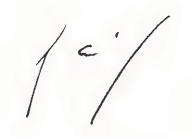
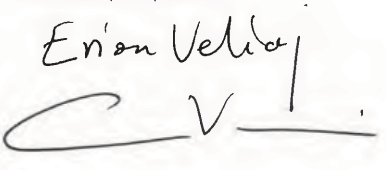

# Loi du 5 avril 2016 portant approbation de la Convention en matière de sécurité sociale entre le Grand-Duché de Luxembourg et la République d’Albanie, signée à Luxembourg, le 27 octobre 2014.

Nous Henri, Grand-Duc de Luxembourg, Duc de Nassau,

Notre Conseil d’ État entendu;

De l’assentiment de la Chambre des Députés;

Vu la décision de la Chambre des Députés du 24 février 2016 et celle du Conseil d’ État du 8 mars 2016 portant qu’il n’y a pas lieu à second vote;

Avons ordonné et ordonnons:

## Article unique.

Est approuvée la Convention de sécurité sociale entre le Grand-Duché de Luxembourg et la République d’Albanie, signée à Luxembourg, le 27 octobre 2014.

Mandons et ordonnons que la présente loi soit insérée au Mémorial pour être exécutée et observée par tous ceux que la chose concerne.

Le Ministre des Affaires étrangères  et européennes,   Jean Asselborn   Le Ministre de la Sécurité sociale,   Romain Schneider

Château de Berg, le 5 avril 2016.   Henri

\**CONVENTION  EN MATIÈRE DE SÉCURITÉ SOCIALE ENTRE LE GRAND-DUCHÉ DE LUXEMBOURG  ET LA RÉPUBLIQUE D’ALBANIE**

\*Le Grand-Duché de Luxembourg  et  la République d’Albanie*

dénommés ci-après « États contractants»,

animés du désir de régler les rapports réciproques entre les deux États dans le domaine de la sécurité sociale,

SONT CONVENUS de ce qui suit:

\**TITRE Ier** – **Dispositions générales**

\**Article 1er**

\**Définitions**

1\. Aux fins de l’application de la présente convention, le terme

a) «législation» désigne les lois et décisions prises par le Gouvernement pour l’application des lois, règlements et dispositions statutaires qui se réfèrent aux branches de la sécurité sociale visées au paragraphe 1er de l’article 2;

b) «autorité compétente» désigne pour chaque État contractant le ministre, les ministres ou une autorité correspondante dont relèvent les législations de sécurité sociale visées au paragraphe 1er de l’article 2;

c) «institution compétente» désigné l’organisme ou l’autorité chargé d’appliquer tout ou partie des législations visées au paragraphe 1erde l’article 2;

d) «périodes d’assurance» désigne les périodes de cotisation ou périodes d’emploi ou d’activité professionnelle telles qu’elles sont définies ou admises comme périodes d’assurance par la législation sous laquelle elles ont été accomplies ou considérées comme accomplies, ainsi que toutes les périodes reconnues par cette législation comme équivalentes à des périodes d’assurance;

e) «prestations» désigne toutes les pensions et prestations en espèces, y compris tous les éléments prévus par les législations visées au paragraphe 1er de l’article 2.

2\. Les autres termes utilisés dans la présente convention ont la signification qui leur est donnée en vertu de la législation applicable.

\**Article 2**

\**Champ d’application matériel**

1\. La présente convention s’applique aux législations concernant:

A. en République d’Albanie,

1\. au système d’assurance obligatoire sociale pour les pensions de vieillesse, les pensions d’invalidité et les pensions de survie pour les salariés, les indépendants, de même que pour les employeurs,

2\. les dispositions de l’assurance volontaire de soins de santé pour l’application de l’article 8;

B. au Grand-Duché de Luxembourg,

1\. l’assurance pension en cas de vieillesse, d’invalidité et de survie,

2\. le paragraphe 1er de l’article 2 du [Code de la sécurité sociale](https://legilux.public.lu/eli/etat/leg/code/securite_sociale) pour l’application de l’article 8.

2\. Indépendamment de ce qui est énuméré ci-dessus, les dispositions du titre II s’appliquent

A. en République d’Albanie, pour les autres branches du système d’assurance obligatoire sociale ci-après:

1\. la maternité,

2\. les maladies,

3\. les accidents de travail et les maladies professionnelles,

4\. le chômage,

5\. l’assurance obligatoire des soins de santé;

B. au Grand-Duché de Luxembourg, pour les autres branches de la sécurité sociale ci-après:

1\. l’assurance maladie-maternité,

2\. l’assurance accidents du travail et maladies professionnelles,

3\. l’assurance dépendance,

4\. les prestations de chômage,

5\. les prestations familiales.

3\. La présente convention s’applique également à tous les actes législatifs ou réglementaires qui modifient, complètent ou codifient les législations énumérées au paragraphe 1er.

4\. La présente convention s’applique à tout acte législatif d’un État contractant qui étend les législations visées au paragraphe 1er à de nouvelles catégories de bénéficiaires, si dans un délai de six mois à dater de la publication officielle desdits actes, cet État contractant ne fait pas savoir à l’autre État contractant que la convention ne leur est pas applicable.

5\. La présente convention ne s’applique aux actes législatifs couvrant une branche nouvelle de la sécurité sociale que si un accord intervient à cet effet entre les autorités compétentes des États contractants.

6\. La présente convention ne s’applique ni aux prestations de l’assistance sociale, ni aux prestations en faveur des victimes de la guerre.

\**Article 3**

\**Champ d’application personnel**

Les dispositions de la présente convention sont applicables aux personnes qui sont ou ont été soumises à la législation d’un État contractant, ainsi qu’à leurs ayants droit.

\**Article 4**

\**Égalité de traitement**

Les personnes qui résident sur le territoire d’un État contractant et auxquelles les dispositions de la présente convention sont applicables, sont soumises aux obligations et ont droit au bénéfice des législations visées à l’article 2, dans les mêmes conditions que les ressortissants de cet État contractant.

\**Article 5**

\**Levée de la clause de résidence**

Les prestations acquises en vertu des législations d’un État contractant ne peuvent subir aucune réduction, ni modification, ni suspension, ni suppression du fait que le bénéficiaire réside sur le territoire de l’autre État contractant.

\**Article 6**

\**Totalisation des périodes d’assurance**

Si la législation d’un État contractant subordonne l’acquisition, le maintien ou le recouvrement du droit aux prestations à l’accomplissement d’une certaine période d’assurance, l’institution compétente de cet État contractant tient également compte, dans la mesure nécessaire, des périodes d’assurance accomplies sous la législation de l’autre État contractant, pour autant qu’elles ne se superposent pas.

\**Article 7**

\**Assimilation de faits ou évènements**

1\. Si en vertu de la législation de l’ État contractant compétent, le bénéfice de prestations ou d’autres revenus produit certains effets juridiques, les dispositions en cause de cette législation sont également applicables en cas de bénéfice de prestations équivalentes acquises en vertu de la législation de l’autre État contractant ou de revenus acquis dans l’autre État contractant.

2\. Si en vertu de la législation de l’ État contractant compétent, des effets juridiques sont attribués à la survenance de certains faits ou événements, cet État contractant tient compte des faits ou événements semblables survenus dans l’autre État contractant comme si ceux-ci étaient survenus sur son propre territoire.

3\. Les dispositions du paragraphe 2 ne s’appliquent, ni pour la reconnaissance de l’invalidité, pour laquelle seule la législation de l’ État contractant compétent reste applicable, ni pour assimiler des périodes d’assurance, lesquelles sont totalisées, le cas échéant, conformément aux dispositions des articles 6 et 14.

\**Article 8**

\**Admission à l’assurance maladie continuée volontaire**

1\. Si la législation d’un État contractant subordonne l’admission à l’assurance maladie continuée volontaire à la résidence sur le territoire de cet État, les personnes qui résident sur le territoire de l’autre État contractant sont admises à l’assurance maladie continuée volontaire à condition qu’elles aient été soumises, à un moment quelconque de leur carrière passée, à la législation du premier État contractant en qualité de travailleur.

2\. Si la législation d’un État contractant subordonne l’admission à l’assurance maladie continuée volontaire à l’accomplissement de périodes d’assurance, les périodes d’assurance accomplies sous la législation de l’autre État contractant sont prises en compte, dans la mesure nécessaire, comme s’il s’agissait de périodes d’assurance accomplies sous la législation du premier État contractant.

\**TITRE II – Dispositions déterminant la législation applicable**

\**Article 9**

\**Règles générales**

1\. Les personnes qui exercent une activité salariée ou non salariée sur le territoire d’un État contractant sont soumises à la législation de cet État contractant, même si elles résident sur le territoire de l’autre État contractant ou si l’employeur qui les occupe a son siège sur le territoire de l’autre État contractant.

2\. Les gens de mer qui exercent leur activité professionnelle à bord d’un navire battant pavillon d’un État contractant sont soumis à la législation de cet État contractant.

3\. Les fonctionnaires et personnes assimilés sont soumis à la législation de l’ État contractant dont relève l’administration qui les occupe.

\**Article 10**

\**Règles particulières (détachement)**

1\. Les personnes qui exercent une activité salariée sur le territoire d’un État contractant et qui sont détachées par l’employeur, qui les occupe normalement, sur le territoire de l’autre État contractant afin d’y effectuer un travail pour le compte de cet employeur, demeurent soumises à la législation du premier État contractant, à condition que la durée prévisible de ce travail n’excède pas vingt-quatre mois.

2\. Les personnes qui exercent normalement une activité non salariée sur le territoire d’un État contractant et qui effectuent un travail sur le territoire de l’autre État contractant demeurent soumises à la législation du premier État contractant, à condition que la durée prévisible de ce travail n’excède pas vingt-quatre mois.

\**Article 11**

\**Règles particulières concernant le personnel des entreprises de transports**

1\. Les personnes qui font partie du personnel d’une entreprise de transport dont le siège est enregistré dans l’un des États contractants et qui travaillent temporairement sur le territoire de l’autre État contractant, sont soumises à la législation de l’ État contractant dans lequel le siège de cette entreprise est enregistré.

2\. Toutefois, dans le cas où l’entreprise possède sur le territoire de l’autre État contractant une succursale ou une représentation permanente, les personnes occupées par celle-ci sont soumises à la législation de l’ État contractant sur le territoire duquel se trouve la succursale ou la représentation permanente.

\**Article 12**

\**Règles particulières concernant les missions diplomatiques et postes consulaires**

1\. Les membres du personnel de service dans les missions diplomatiques ou postes consulaires des États contractants et les domestiques privés au service d’agents de ces missions ou postes, détachés sur le territoire de l’autre État contractant, sont soumis à la législation de l’ État contractant par lequel ils sont envoyés.

2\. Pour les personnes visées au paragraphe 1er qui n’ont pas été détachées, la législation de l’ État contractant sur le territoire duquel elles travaillent est applicable, conformément au paragraphe 1er de l’article 9. Toutefois, si elles sont des ressortissants de l’ État contractant représenté par la mission diplomatique ou par le poste consulaire, elles peuvent opter pour l’application de la législation de cet État contractant. Ce droit d’option ne peut être exercé qu’une seule fois, dans un délai de trois mois à partir de la date de l’entrée en vigueur de la présente convention ou de l’entrée en service et avec effet à cette date.

\**Article 13**

\**Dérogations**

Les autorités compétentes des États contractants peuvent prévoir, d’un commun accord, des exceptions aux dispositions des articles 9 à 12 pour certaines personnes ou certaines catégories de personnes.

\**TITRE III – Vieillesse, invalidité et survie**

\**Article 14**

\**Règles particulières de totalisation**

1\. Si la législation d’un État contractant subordonne l’acquisition du droit à des prestations spécifiques à l’accomplissement d’une période d’assurance dans une profession, un emploi ou une occupation spécifique pour lequel/ laquelle il existe un régime spécial, l’institution compétente de cet État contractant tient également compte des périodes d’assurance accomplies en vertu de la législation de l’autre État contractant dans la même profession ou dans le même emploi ou dans un régime spécial.

2\. Si une personne n’a pas droit à une prestation sur la base des périodes d’assurance accomplies sous les législations des deux États contractants, totalisées comme prévu à l’article 6, le droit à ladite prestation est déterminé en totalisant ces périodes avec les périodes accomplies sous la législation d’un État tiers avec lequel les deux États contractants sont liés par un accord bi- ou multilatéral de sécurité sociale qui prévoit des règles sur la totalisation de périodes d’assurance.

\**Article 15**

\**Période d’assurance inférieure à une année**

Si l’ensemble des périodes d’assurance accomplies sous la législation d’un État contractant n’atteignent pas une année, aucune prestation n’est accordée en vertu de ladite législation, à moins qu’elles n’ouvrent droit à elles seules à une prestation au titre de cette législation. Toutefois, ces périodes sont prises en compte par l’autre État contractant pour l’application de l’article 6, ainsi que pour l’application des dispositions du paragraphe 2, excepté le point c), de l’article 17.

\**Article 16**

\**Particularité de la législation luxembourgeoise (années bébé)**

Lors du calcul de la pension, les dispositions de l’article 6 s’appliquent pour la mise en compte éventuelle des années bébés prévue par la législation luxembourgeoise, à condition que l’intéressé ait accompli en dernier lieu des périodes d’assurance sous la législation luxembourgeoise avant la naissance ou l’adoption de l’enfant.

\**Article 17**

\**Calcul des pensions**

1\. Si une personne peut prétendre à une pension en vertu de la législation d’un État contractant sans qu’il soit nécessaire de faire application des articles 6 et 14, l’institution compétente calcule, selon les dispositions de la législation qu’elle applique, la pension correspondant à la durée totale des périodes d’assurance à prendre en compte en vertu de cette législation.

Cette institution procède aussi au calcul de la pension qui serait due en application des dispositions du paragraphe 2. Le montant le plus élevé est seul retenu.

2\. Si une personne peut prétendre à une pension, dont le droit n’est ouvert que compte tenu de la totalisation des périodes prévue aux articles 6 et 14, les règles suivantes sont applicables:

a) l’institution compétente calcule le montant théorique de la pension à laquelle le requérant pourrait prétendre si toutes les périodes d’assurance accomplies en vertu des législations des deux États contractants avaient été accomplies exclusivement sous sa propre législation;

b) pour la détermination du montant théorique visé sous a), les bases de calcul ne sont établies que compte tenu des périodes d’assurance accomplies sous la législation que l’institution compétente applique;

c) sur la base de ce montant théorique l’institution compétente fixe ensuite le montant effectif de la pension au prorata de la durée des périodes d’assurance accomplies sous la législation qu’elle applique par rapport à la durée totale des périodes d’assurance accomplies sous les législations des deux États contractants.

3\. Pour le calcul du montant théorique et du prorata susmentionnés, si la durée totale des périodes d’assurance, accomplies avant la réalisation du risque en vertu des législations des deux États contractants, est supérieure à la période maximale exigée par la législation de l’un des États contractants pour le bénéfice d’une prestation complète, l’institution compétente de cet État contractant prend en compte cette période maximale au lieu de la durée totale des périodes accomplies. Cette méthode de calcul n’a pas pour effet d’imposer à cette institution la charge d’une prestation d’un montant supérieur à celui de la prestation complète prévue par la législation qu’elle applique.

4\. Si une personne ne peut prétendre à une pension que compte tenu des dispositions du paragraphe 2 de l’article 14, les périodes d’assurance accomplies sous la législation de l’ État tiers concerné sont prises en considération pour l’application du paragraphe 2.

\**TITRE IV – Dispositions diverses**

\**Article 18**

\**Mesures d’application de la convention**

1\. Les autorités compétentes se communiquent toutes informations concernant les mesures prises pour l’application de la présente convention et toutes celles concernant les modifications de leur législation susceptibles d’affecter son application.

2\. Les autorités compétentes fixent les modalités d’application de la présente convention dans un arrangement administratif.

3\. Les autorités compétentes désignent dans l’arrangement administratif des organismes de liaison en vue de faciliter l’application de la présente convention.

\**Article 19**

\**Entraide administrative**

1\. Pour l’application de la présente convention les autorités et institutions compétentes des États contractants se prêtent leurs bons offices comme s’il s’agissait de l’application de leur propre législation. L’entraide administrative de ces autorités et institutions compétentes est gratuite.

2\. Pour l’application de la présente convention les autorités et institutions compétentes peuvent communiquer directement entre elles, de même qu’avec toute personne concernée, quelle que soit sa résidence.

3\. Les examens médicaux des personnes qui résident sur le territoire de l’autre État contractant, sont pratiqués par l’institution du lieu de résidence à la demande et à la charge de l’institution compétente. Les frais des examens médicaux ne sont pas remboursés si les examens sont effectués dans l’intérêt des institutions des deux États contractants.

4\. Les modalités du contrôle médical et administratif des bénéficiaires de la présente convention sont fixées dans l’arrangement administratif prévu au paragraphe 2 de l’article 18.

\**Article 20**

\**Régime des langues**

1\. Les communications adressées, pour l’application de la présente convention, aux autorités ou institutions compétentes des États contractants, sont rédigées en français ou en albanais.

2\. Une demande ou un document ne peut pas être rejeté parce qu’il est rédigé dans la langue officielle de l’autre État contractant.

\**Article 21**

\**Exemption de taxes et de l’obligation de légalisation**

1\. Le bénéfice des exemptions ou réductions de taxes, de timbres, de droits de greffe ou d’enregistrement, prévues par la législation d’un État contractant pour les pièces ou documents à produire en application de la législation de cet État contractant, est étendu aux pièces et documents analogues à produire en application de la législation de l’autre État contractant ou de la présente convention.

2\. Tous actes, documents et pièces quelconques à produire pour l’exécution de la présente convention sont dispensés du visa de légalisation des autorités diplomatiques et consulaires.

\**Article 22**

\**Délais**

1\. Les demandes, déclarations ou recours qui auraient dû être présentés, aux fins de l’application de la législation d’un État contractant, dans un délai déterminé auprès d’une autorité ou institution compétente de cet État, sont recevables s’ils sont présentés dans le même délai auprès d’une autorité ou institution compétente correspondante de l’autre État contractant. Dans ce cas, l’autorité ou l’institution compétente ainsi saisie transmet sans retard ces demandes, déclarations ou recours à l’autorité ou l’institution compétente du premier État contractant, soit directement, soit par l’intermédiaire des organismes de liaison.

2\. Une demande de prestations introduite sous la législation d’un État contractant est considérée comme demande pour une prestation analogue sous la législation de l’autre État contractant, sauf si le requérant demande expressément de surseoir à la liquidation d’une prestation acquise au titre de la législation d’un État contractant.

\**Article 23**

\**Paiement des prestations**

1\. Les institutions compétentes d’un État contractant qui en vertu de la présente convention sont débitrices de prestations au regard des bénéficiaires se trouvant sur le territoire de l’autre État contractant s’en libèrent valablement dans la monnaie du premier État contractant.

2\. Sur demande du bénéficiaire, l’institution compétente pour le service des prestations s’assure que ces prestations sont déposées sur un compte en banque ouvert par le bénéficiaire sur le territoire de l’ État contractant où cette institution a son siège.

\**Article 24**

\**Recours contre tiers responsable**

Si une personne qui bénéficie de prestations en vertu de la législation d’un État contractant pour un dommage survenu sur le territoire de l’autre État contractant a, sur le territoire de ce deuxième État, le droit de réclamer à un tiers la réparation de ce dommage, les droits éventuels de l’institution débitrice à l’encontre du tiers sont réglés comme suit:

a) lorsque l’institution débitrice est subrogée, en vertu de la législation qui lui est applicable, dans les droits que le bénéficiaire détient à l’égard du tiers, chaque État contractant reconnaît une telle subrogation;

b) lorsque l’institution débitrice a un droit direct contre le tiers, chaque État contractant reconnaît ce droit.

\**Article 25**

\**Régularisation de trop perçus**

Si l’institution compétente d’un État contractant a versé une prestation indue, elle peut demander à l’institution compétente de l’autre État contractant de retenir sur les arrérages de la prestation que celle-ci doit verser pour la même période la somme indûment payée, en application de la législation de cet État contractant, et de la lui verser directement.

\**Article 26**

\**Règlement d’un différend**

Tout différend venant à s’élever entre les institutions compétentes des États contractants concernant l’interprétation ou l’application de la présente convention fera l’objet de négociations directes entre les autorités compétentes des États contractants.

\**TITRE V – Dispositions transitoires et finales**

\**Article 27**

\**Périodes d’assurance et éventualités antérieures**

1\. La présente convention n’ouvre aucun droit au paiement de prestations pour une période antérieure à la date de son entrée en vigueur.

2\. Toute période d’assurance accomplie sous la législation d’un État contractant avant la date d’entrée en vigueur de la présente convention est prise en considération pour la détermination du droit aux prestations s’ouvrant conformément aux dispositions de la présente convention.

3\. Sous réserve des dispositions du paragraphe 1er, un droit est ouvert en vertu de la présente convention même s’il se rapporte à une éventualité réalisée avant l’entrée en vigueur de la présente convention.

\**Article 28**

\**Révision des droits**

1\. Toute prestation qui n’a pas été liquidée ou qui a été suspendue à cause de la nationalité de l’intéressé ou en raison de sa résidence sur le territoire de l’ État contractant autre que celui où se trouve l’institution débitrice ou pour tout autre obstacle qui a été levé par la présente convention, sera à la demande de l’intéressé liquidée ou rétablie à partir de l’entrée en vigueur de la présente convention, sauf si les droits antérieurement liquidés ont donné lieu à un règlement en capital ou si un remboursement de cotisations a fait perdre tout droit aux prestations.

2\. Les droits des intéressés ayant obtenu, antérieurement à l’entrée en vigueur de la présente convention, la liquidation d’une pension, seront révisés à leur demande, compte tenu des dispositions de cette convention. Ces droits peuvent également être révisés d’office. En aucun cas, une telle révision ne peut avoir pour effet de réduire les droits antérieurs des intéressés.

\**Article 29**

\**Délais de prescription**

1\. Si la demande visée à l’article 28 est présentée dans un délai de deux ans à partir de la date de l’entrée en vigueur de la présente convention, les droits ouverts conformément aux dispositions de cette convention sont acquis à partir de la date de l’entrée en vigueur.

2\. Si la demande visée à l’article 28 est présentée après l’expiration d’un délai de deux ans suivant l’entrée en vigueur de la présente convention, les droits qui ne sont pas prescrits sont acquis à partir de la date de la demande, sous réserve des dispositions plus favorables de la législation nationale.

\**Article 30**

\**Garantie des droits acquis ou en cours d’acquisition**

1\. En cas de dénonciation de la présente convention tout droit acquis en application de ses dispositions sera maintenu.

2\. Les droits en cours d’acquisition relatifs aux périodes d’assurance accomplies antérieurement à la date à laquelle la dénonciation prend effet ne s’éteignent pas du fait de la dénonciation; leur maintien est déterminé d’un commun accord pour la période postérieure ou, à défaut d’un tel accord, par la législation qu’applique l’institution concernée.

\**Article 31**

\**Durée**

La présente convention est conclue pour une durée indéterminée. Elle peut être dénoncée par chacun des États contractants par voie diplomatique au plus tard six mois avant l’expiration de l’année civile en cours; dans ce cas elle perdra sa validité le dernier jour de cette année.

\**Article 32**

\**Entrée en vigueur**

La présente convention entre en vigueur le premier jour du troisième mois qui suit la date de réception de la notification par laquelle le dernier des États contractants a notifié à l’autre État contractant que toutes les exigences nationales requises ont été accomplies.

FAIT à Luxembourg, le 27 octobre 2014, en double exemplaire, chacun en langues française et albanaise, les deux textes faisant également foi.

| Pour le Grand-Duché de Luxembourg | Pour la République d’Albanie |
|---|---|
|  |  |

Doc. parl. [6802](https://legilux.public.lu/eli/etat/proj/pl/20150077); sess. ord. 2014-2015 et 2015-2016.
