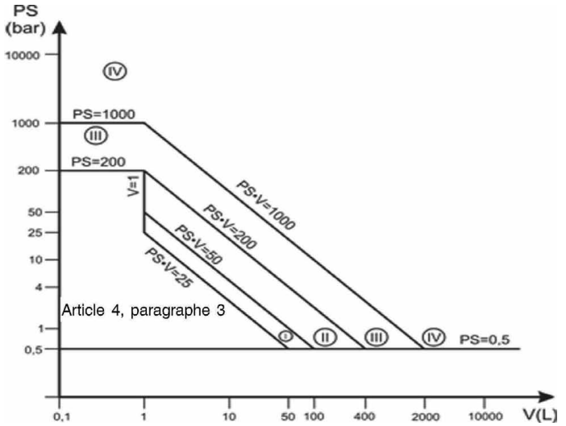
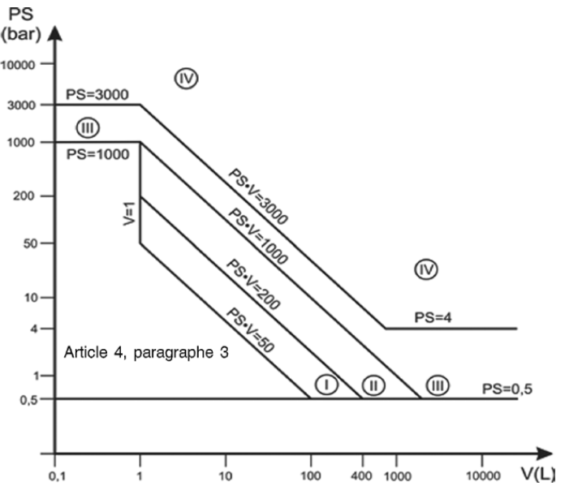
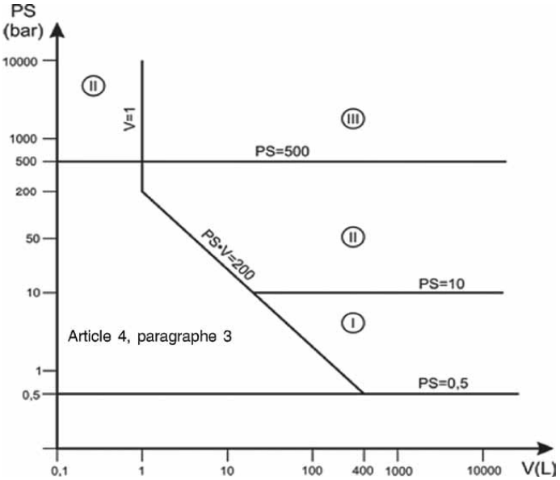
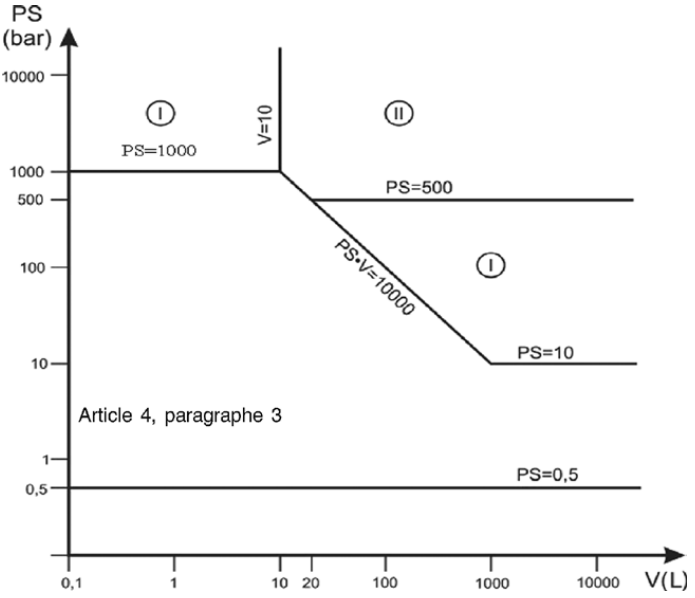
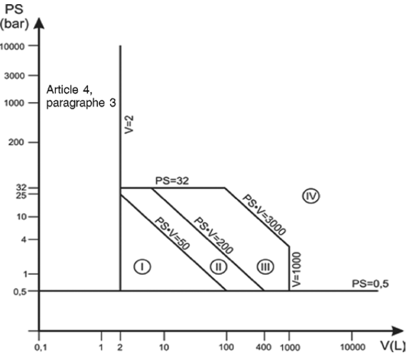
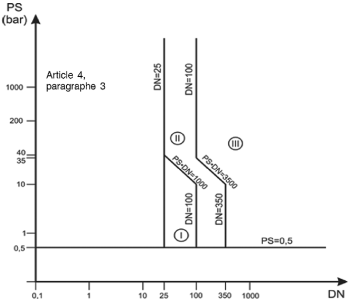
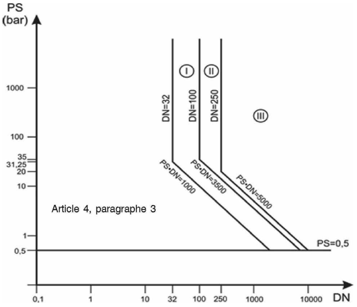
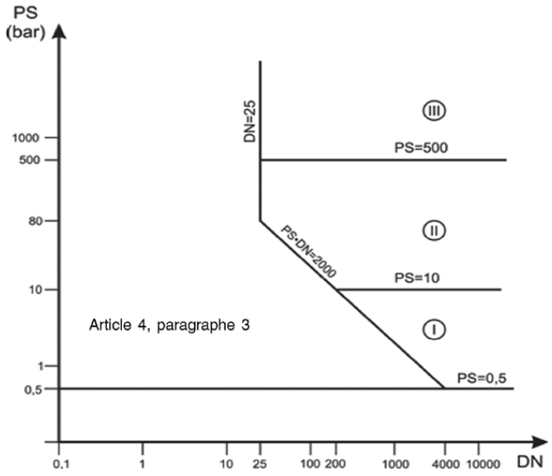
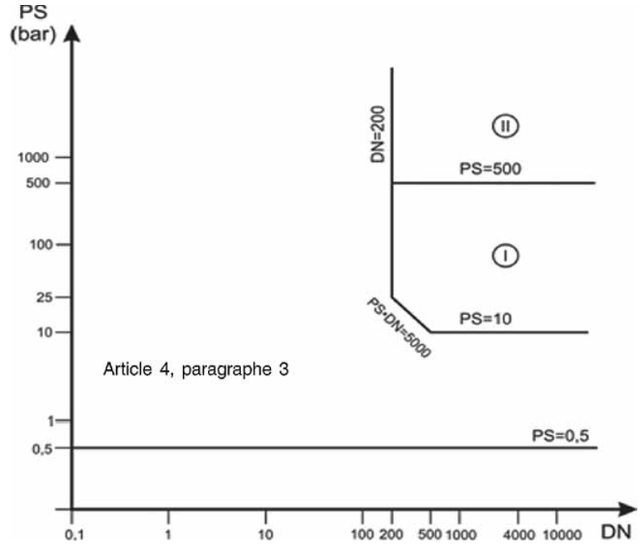

# Loi du 27 juin 2016 concernant la mise à disposition sur le marché des équipements sous pression.

Nous Henri, Grand-Duc de Luxembourg, Duc de Nassau,

Notre Conseil d’État entendu;

De l’assentiment de la Chambre des Députés;

Vu la décision de la Chambre des Députés du 11 mai 2016 et celle du Conseil d’État du 24 mai 2016 portant qu’il n’y a pas lieu à second vote;

Avons ordonné et ordonnons:

## Chapitre 1er — *Dispositions générales.*

### Art. 1er — *Champ d’application.*

(1) La présente loi s’applique à la conception, à la fabrication et à l’évaluation de la conformité des équipements sous pression et des ensembles dont la pression maximale admissible (PS) est supérieure à 0,5 bar.

(2) La présente loi ne s’applique pas:

a) aux canalisations comprenant une tuyauterie ou un ensemble de tuyauteries destinées au transport de tout fluide ou matière vers une ou à partir d’une installation, sur terre ou en mer, à partir du, et y compris, le dernier organe d’isolement situé dans le périmètre de l’installation, y compris tous les équipements annexes qui sont spécifiquement conçus pour la canalisation; cette exclusion ne couvre pas les équipements sous pression standard tels que ceux qui peuvent se trouver dans les postes de détente et dans les stations de compression;

b) aux réseaux d’adduction, de distribution et d’évacuation d’eau et leurs équipements ainsi qu’aux conduites d’eau motrice telles que conduites forcées, galeries sous pression, cheminées d’équilibrage des installations hydroélectriques et leurs accessoires spécifiques;

c) aux récipients à pression simples visés par la législation applicable relative à la mise à disposition sur le marché des récipients à pression simples;

d) aux générateurs d’aérosols visés par le [règlement grand-ducal modifié du 12 juillet 1995](https://legilux.public.lu/eli/etat/leg/rgd/1995/07/12/n1/jo) relatif aux générateurs d’aérosols, adopté selon la procédure prévue par la [loi modifiée du 9 août 1971](https://legilux.public.lu/eli/etat/leg/loi/1971/08/09/n2/jo) concernant l’exécution et la sanction des décisions et des directives ainsi que la sanction des règlements des Communautés européennes en matière économique, technique, agricole, forestière, sociale et en matière de transports;

e) aux équipements destinés au fonctionnement des véhicules définis par les actes juridiques suivants:

i. la [loi modifiée du 14 février 1955](https://legilux.public.lu/eli/etat/leg/loi/1955/02/14/n3/jo) concernant la réglementation de la circulation sur toutes les voies publiques et les règlements pris en son exécution en vue de la transposition de la législation européenne concernant la réception par type des véhicules à moteur et de leurs remorques ainsi que des tracteurs agricoles et forestiers à roues;

ii. le [règlement (UE) n° 167/2013](https://legilux.public.lu/eli/reg_ue/2013/167/jo) du Parlement européen et du Conseil du 5 février 2013 relatif à la réception et à la surveillance du marché des véhicules agricoles et forestiers;

iii. le [règlement (UE) n° 168/2013](https://legilux.public.lu/eli/reg_ue/2013/168/jo) du Parlement européen et du Conseil du 15 janvier 2013 relatif à la réception et à la surveillance du marché des véhicules à deux ou trois roues et des quadricycles, tel que modifié par la suite;

f) aux équipements qui relèveraient au plus de la catégorie I en application de l’article 13 de la présente loi et qui sont visés par l’un des actes juridiques suivants:

i. la [loi modifiée du 27 mai 2010](https://legilux.public.lu/eli/etat/leg/loi/2010/05/27/n2/jo) relative aux machines, telle que modifiée par la suite;

ii. la [loi du 27 mai 2016](https://legilux.public.lu/eli/etat/leg/loi/2016/05/27/n3/jo) relative aux ascenseurs et les composants de sécurité pour ascenseurs;

iii. la [loi du 27 mai 2016](https://legilux.public.lu/eli/etat/leg/loi/2016/05/27/n2/jo) relative à la mise à disposition sur le marché du matériel électrique destiné à être employé dans certaines limites de tension;

iv. la [loi du 16 janvier 1990](https://legilux.public.lu/eli/etat/leg/loi/1990/01/16/n1/jo) relative aux dispositifs médicaux, telle que modifiée par la suite;

v. le [règlement grand-ducal modifié du 3 février 1992](https://legilux.public.lu/eli/etat/leg/rgd/1992/02/03/n2/jo) relatif aux appareils à gaz, adopté selon la procédure prévue par la [loi précitée du 9 août 1971](https://legilux.public.lu/eli/etat/leg/loi/1971/08/09/n2/jo);

vi. la [loi du 27 juin 2016](https://legilux.public.lu/eli/etat/leg/loi/2016/06/27/n4/jo) relative aux appareils et aux systèmes de protection destinés à être utilisés en atmosphères explosibles;

g) aux équipements visés à l’article 346, paragraphe 1er, point b), du [traité sur le fonctionnement de l’Union européenne](https://legilux.public.lu/eli/etat/leg/loi/2008/07/03/n1/jo);

h) aux équipements spécialement conçus pour des applications nucléaires, dont la défaillance peut donner lieu à des émissions radioactives;

i) aux équipements de contrôle de puits utilisés dans l’industrie de prospection et d’exploitation pétrolière, gazière ou géothermique ainsi que dans le stockage souterrain et prévus pour contenir et/ou contrôler la pression du puits; cela comprend la tête de puits (arbre de Noël) et les obturateurs de sécurité (BOP), les tuyauteries et collecteurs ainsi que leurs équipements situés en amont;

j) aux équipements comportant des carters ou des mécanismes dont le dimensionnement, le choix des matériaux et les règles de construction reposent essentiellement sur des critères de résistance, de rigidité et de stabilité à l’égard des sollicitations statiques et dynamiques en service ou à l’égard d’autres caractéristiques liées à leur fonctionnement et pour lesquels la pression ne constitue pas un facteur significatif au niveau de la conception; ces équipements peuvent comprendre:

i. les moteurs, y compris les turbines et les moteurs à combustion interne;

ii. les machines à vapeur, les turbines à gaz ou à vapeur, les turbogénérateurs, les compresseurs, les pompes et les servocommandes;

k) aux hauts-fourneaux, y compris leurs systèmes de refroidissement, leurs récupérateurs de vent chaud, leurs extracteurs de poussières et leurs épurateurs de gaz de hauts-fourneaux, ainsi qu’aux fours à réduction directe, y compris leurs systèmes de refroidissement, leurs convertisseurs à gaz, et leurs cuves destinées à la fusion, à la refusion, au dégazage et à la coulée de l’acier, du fer et des métaux non ferreux;

l) aux enveloppes des équipements électriques à haute tension tels que les appareillages de connexion et de commande, les transformateurs et les machines tournantes;

m) aux enveloppes sous pression entourant les éléments de réseaux de transmission, tels que les câbles électriques et les câbles téléphoniques;

n) aux bateaux, fusées, aéronefs ou unités mobiles offshore, ainsi qu’aux équipements destinés expressément à être installés à bord de ces engins ou à les propulser;

o) aux équipements sous pression composés d’une enveloppe souple, par exemple les pneumatiques, les coussins pneumatiques, balles et ballons de jeu, les embarcations gonflables, et autres équipements sous pression similaires;

p) aux silencieux d’échappement et d’admission;

q) aux bouteilles ou canettes de boissons gazeuses destinées aux consommateurs finals;

r) aux récipients destinés au transport et à la distribution de boissons avec une pression maximale admissible (PS) multipliée par le volume (V) n’excédant pas 500 bar.L et une pression maximale admissible n’excédant pas 7 bar;

s) aux équipements relevant des accords internationaux sur le transport de marchandises dangereuses, et de la [loi modifiée du 21 décembre 2012](https://legilux.public.lu/eli/etat/leg/loi/2012/12/21/n8/jo) concernant les équipements sous pression transportables, telle que modifiée par la suite, ainsi qu’aux équipements relevant du code maritime international pour le transport des marchandises dangereuses et de la [convention relative à l’aviation civile internationale](https://legilux.public.lu/eli/etat/leg/loi/1948/03/25/n2/jo);

t) aux radiateurs et tuyaux dans les systèmes de chauffage à eau chaude;

u) aux récipients devant contenir des liquides avec une pression de gaz au-dessus du liquide ne dépassant pas 0,5 bar.

### Art. 2 — *Définitions.*

Aux fins de la présente loi, on entend par:

1° Accessoires de sécurité: des dispositifs conçus pour protéger des équipements sous pression contre le dépassement des limites admissibles, y compris des dispositifs pour la limitation directe de la pression, tels que les soupapes de sûreté, les dispositifs à disques de rupture, les tiges de flambage, les dispositifs de sécurité asservis (CSPRS) et des dispositifs de limitation qui mettent en œuvre des moyens d’intervention ou entraînent la coupure ou la coupure et le verrouillage, tels que les commutateurs actionnés par la pression, la température ou le niveau du fluide et les dispositifs de mesure, de contrôle et de régulation jouant un rôle en matière de sécurité (SRMCR);

2° Accessoires sous pression: des dispositifs jouant un rôle opérationnel et dont l’enveloppe est soumise à pression;

3° Accords internationaux sur le transport de marchandises dangereuses:

1\. l’Accord européen relatif au transport international des marchandises dangereuses par route (ADR), du Protocole de signature y relatif et des Annexes À et B audit Accord, en date, à Genève, du 30 septembre 1957, approuvé par la [loi du 23 avril 1970](https://legilux.public.lu/eli/etat/leg/loi/1970/04/23/n1/jo) portant approbation de l’Accord européen relatif au transport international des marchandises dangereuses par route (ADR), du Protocole de signature y relatif et des Annexes À et B audit Accord, en date, à Genève, du 30 septembre 1957;

2\. le Protocole portant amendement des articles 1 (a), 14 (1) et 14 (3) b) de l’Accord européen du 30 septembre 1957 relatif au transport international des marchandises dangereuses par route (ADR), adopté à Genève, le 28 octobre 1993, approuvé par la [loi du 24 juillet 1995](https://legilux.public.lu/eli/etat/leg/loi/1995/07/24/n3/jo) portant approbation du Protocole portant amendement des articles 1 (a), 14 (1) et 14 (3) b) de l’Accord européen du 30 septembre 1957 relatif au transport international des marchandises dangereuses par route (ADR), adopté à Genève, le 28 octobre 1993;

3\. la Convention relative aux transports internationaux ferroviaires (COTIF), du Protocole sur les privilèges et immunités de l’Organisation intergouvernementale pour les transports internationaux ferroviaires (OTIF), des Règles uniformes concernant le contrat de transport international ferroviaire des voyageurs et des bagages (CIV) et des Règles uniformes concernant le contrat de transport international ferroviaire des marchandises (CIM), signés à Berne le 9 mai 1980, approuvée par la [loi du 4 mai 1983](https://legilux.public.lu/eli/etat/leg/loi/1983/05/04/n1/jo) portant approbation de la Convention relative aux transports internationaux ferroviaires (COTIF), du Protocole sur les privilèges et immunités de l’Organisation intergouvernementale pour les transports internationaux ferroviaires (OTIF), des Règles uniformes concernant le contrat de transport international ferroviaire des voyageurs et des bagages (CIV) et des Règles uniformes concernant le contrat de transport international ferroviaire des marchandises (CIM), signés à Berne le 9 mai 1980;

4\. le Protocole, signé à Vilnius, le 3 juin 1999, portant modification de la Convention relative aux transports internationaux ferroviaires (COTIF), du 9 mai 1980, approuvé par la [loi du 15 juin 2006](https://legilux.public.lu/eli/etat/leg/loi/2006/06/15/n1/jo) portant approbation du Protocole, signé à Vilnius, le 3 juin 1999, portant modification de la Convention relative aux transports internationaux ferroviaires (COTIF), du 9 mai 1980;

5\. l’Accord européen relatif au transport international des marchandises dangereuses par voies de navigation intérieures (ADN), fait à Genève le 26 mai 2000, approuvé par la [loi du 13 mars 2007](https://legilux.public.lu/eli/etat/leg/loi/2007/03/13/n4/jo) portant approbation de l’Accord européen relatif au transport international des marchandises dangereuses par voies de navigation intérieures (ADN), fait à Genève le 26 mai 2000;

4° Accréditation: l’accréditation au sens de l’article 2, point 10), du [règlement (CE) n° 765/2008](https://legilux.public.lu/eli/reg_ue/2008/765/jo) du Parlement européen et du Conseil du 9 juillet 2008 fixant les prescriptions relatives à l’accréditation et à la surveillance du marché pour la commercialisation des produits et abrogeant le [règlement (CEE) n° 339/93](https://legilux.public.lu/eli/reg_ue/1993/339/jo) du Conseil;

5° Approbation européenne de matériaux: un document technique définissant les caractéristiques des matériaux destinés à une utilisation répétée pour la fabrication d’équipements sous pression, qui ne sont pas régis par une norme harmonisée;

6° Assemblages permanents: des assemblages qui ne peuvent être dissociés sauf par des méthodes destructives;

7° Dimension nominale (DN): la désignation numérique de la dimension commune à tous les éléments d’un système de tuyauteries autres que les éléments indiqués par leur diamètre extérieur ou par la taille du filet; il s’agit d’un nombre arrondi à des fins de référence et qui n’a pas de relation stricte avec les cotes de fabrication; la taille nominale est indiquée par DN suivi d’un nombre;

8° Distributeur: toute personne physique ou morale faisant partie de la chaîne d’approvisionnement, autre que le fabricant ou l’importateur, qui met des équipements sous pression ou des ensembles à disposition sur le marché;

9° Ensembles: plusieurs équipements sous pression assemblés par un fabricant pour former un tout intégré et fonctionnel;

10° Équipements sous pression: les récipients, tuyauteries, accessoires de sécurité et accessoires sous pression, y compris, le cas échéant, les éléments attachés aux parties sous pression, tels que les brides, piquages, raccords, supports et pattes de levage;

11° Évaluation de la conformité: le processus qui permet de démontrer si les exigences essentielles de sécurité de la présente loi relatives à des équipements sous pression ou à des ensembles ont été respectées;

12° Fabricant: toute personne physique ou morale qui fabrique un équipement sous pression ou un ensemble ou fait concevoir ou fabriquer un tel équipement ou ensemble, et commercialise cet équipement sous pression ou cet ensemble sous son propre nom ou sa propre marque ou l’utilise à ses propres fins;

13° Fluides: les gaz, liquides et vapeurs en phase pure ainsi que les mélanges de ceux-ci; les fluides peuvent contenir une suspension de solides;

14° Importateur: toute personne physique ou morale établie dans l’Union européenne qui met un équipement sous pression ou un ensemble provenant d’un pays tiers sur le marché de l’Union européenne;

15° Législation d’harmonisation de l’Union européenne: toute législation de l’Union européenne visant à harmoniser les conditions de commercialisation des produits;

16° Mandataire: toute personne physique ou morale établie dans l’Union européenne ayant reçu mandat écrit du fabricant pour agir en son nom aux fins de l’accomplissement de tâches déterminées;

17° Marquage CE: le marquage par lequel le fabricant indique que l’équipement sous pression ou l’ensemble est conforme aux exigences applicables de la législation d’harmonisation de l’Union européenne prévoyant son apposition;

18° Mise à disposition sur le marché: toute fourniture d’un équipement sous pression ou d’un ensemble destiné à être distribué ou utilisé sur le marché de l’Union européenne dans le cadre d’une activité commerciale, à titre onéreux ou gratuit;

19° Mise en service: la première utilisation d’un équipement sous pression ou d’un ensemble par son utilisateur;

20° Mise sur le marché: la première mise à disposition d’un équipement sous pression ou d’un ensemble sur le marché de l’Union européenne;

21° Norme harmonisée: une norme harmonisée au sens de l’article 2, point 1) c), du [règlement (UE) n° 1025/2012](https://legilux.public.lu/eli/reg_ue/2012/1025/jo) du Parlement européen et du Conseil du 25 octobre 2012 relatif à la normalisation européenne, modifiant les [directives 89/686/CEE](https://legilux.public.lu/eli/dir_ue/1989/686/jo) et [93/15/CEE](https://legilux.public.lu/eli/dir_ue/1993/15/jo) du Conseil ainsi que les [directives 94/9/CE](https://legilux.public.lu/eli/dir_ue/1994/9/jo), [94/25/CE](https://legilux.public.lu/eli/dir_ue/1994/25/jo), [95/16/CE](https://legilux.public.lu/eli/dir_ue/1995/16/jo), [97/23/CE](https://legilux.public.lu/eli/dir_ue/1997/23/jo), [98/34/CE](https://legilux.public.lu/eli/dir_ue/1998/34/jo), [2004/22/CE](https://legilux.public.lu/eli/dir_ue/2004/22/jo), [2007/23/CE](https://legilux.public.lu/eli/dir_ue/2007/23/jo), [2009/23/CE](https://legilux.public.lu/eli/dir_ue/2009/23/jo) et [2009/105/CE](https://legilux.public.lu/eli/dir_ue/2009/105/jo) du Parlement européen et du Conseil et abrogeant la [décision 87/95/CEE](http://data.europa.eu/eli/dec/1987/95/oj) du Conseil et la [décision n° 1673/2006/CE](http://data.europa.eu/eli/dec/2006/1673/oj) du Parlement européen et du Conseil;

22° Opérateurs économiques: le fabricant, le mandataire, l’importateur et le distributeur;

23° Organisme d’évaluation de la conformité: un organisme qui effectue des opérations d’évaluation de la conformité, comme l’étalonnage, les essais, la certification et l’inspection;

24° Pression: la pression par rapport à la pression atmosphérique, c’est-à-dire la pression au manomètre. Par conséquent, le vide est exprimé par une valeur négative;

25° Pression maximale admissible (PS): la pression maximale pour laquelle l’équipement est conçu, spécifiée par le fabricant, et définie à un emplacement spécifié par ce dernier, à savoir soit l’emplacement où sont connectés les organes de protection ou de sûreté, soit la partie supérieure de l’équipement ou, si cela n’est pas approprié, tout autre emplacement spécifié;

26° Rappel: toute mesure visant à obtenir le retour d’un équipement sous pression ou d’un ensemble qui a déjà été mis à la disposition des consommateurs ou d’autres utilisateurs;

27° Récipient: une enveloppe conçue et construite pour contenir des fluides sous pression, y compris les éléments qui y sont directement attachés jusqu’au dispositif prévu pour le raccordement avec d’autres équipements; un récipient peut comporter un ou plusieurs compartiments;

28° Retrait: toute mesure visant à empêcher la mise à disposition sur le marché d’un équipement sous pression ou d’un ensemble présent dans la chaîne d’approvisionnement;

29° Spécifications techniques: un document fixant les exigences techniques devant être respectées par des équipements sous pression ou des ensembles;

30° Température minimale/maximale admissible (TS): les températures minimale et maximale pour lesquelles l’équipement est conçu, spécifiées par le fabricant;

31° Tuyauteries: des composants de canalisation, destinés au transport des fluides, lorsqu’ils sont raccordés en vue d’être intégrés dans un système sous pression; les tuyauteries comprennent notamment un tuyau ou un ensemble de tuyaux, le tubage, les accessoires de tuyauterie, les joints d’expansion, les flexibles ou, le cas échéant, d’autres composants résistant à la pression; les échangeurs thermiques constitués de tuyaux et destinés au refroidissement ou au réchauffement de l’air sont assimilés aux tuyauteries;

32° Volume (V): le volume interne de chaque compartiment, y compris le volume des raccordements jusqu’à la première connexion ou soudure et à l’exclusion du volume des éléments internes permanents.

### Art. 3 — *Mise à disposition sur le marché et mise en service.*

(1) Ne peuvent être mis à disposition sur le marché et en service que les équipements sous pression et les ensembles qui satisfont aux exigences de la présente loi. Ils doivent être installés et entretenus convenablement et utilisés conformément à leur destination.

(2) Lors des foires, des expositions, des démonstrations et d’autres manifestations similaires, des équipements sous pression ou d’ensembles non conformes à la présente loi peuvent être présentés, pour autant qu’une indication visible spécifie clairement que ces équipements sous pression ou ensembles ne peuvent pas être mis à disposition sur le marché ou mis en service tant qu’ils n’ont pas été rendus conformes. Lors de démonstrations, les mesures de sécurité adéquates doivent être prises afin d’assurer la sécurité des personnes.

La présente loi n’affecte pas la faculté du département de la surveillance du marché de l’Institut luxembourgeois de la normalisation, de l’accréditation, de la sécurité et qualité des produits et services (ILNAS), ci-après «département de la surveillance du marché» de prescrire, dans le respect du droit de l’Union européenne, les exigences qu’il estime nécessaires pour assurer la protection des personnes lors de la mise à disposition sur le marché ou la mise en service des équipements sous pression ou ensembles en question, pour autant que cela n’implique pas de modifications de ces équipements sous pression ou ensembles par rapport à la présente loi.

### Art. 4 — *Exigences techniques.*

(1) Les équipements sous pression suivants doivent satisfaire aux exigences essentielles de sécurité énoncées à l’annexe I:

a) les récipients, à l’exception de ceux visés au point b), prévus pour:

i. des gaz, des gaz liquéfiés, des gaz dissous sous pression, des vapeurs ainsi que les liquides dont la pression de vapeur, à la température maximale admissible, est supérieure de 0,5 bar à la pression atmosphérique normale (1.013 mbar), dans les limites suivantes:

– pour les fluides du groupe 1, lorsque le volume est supérieur à 1 L et le produit PS V est supérieur à 25 bar.L, ainsi que lorsque la pression PS est supérieure à 200 bar conformément au tableau 1 de l’annexe II,

– pour les fluides du groupe 2, lorsque le volume est supérieur à 1 L et le produit PS V est supérieur à 50 bar.L, ainsi que lorsque la pression PS est supérieure à 1.000 bar, ainsi que tous les extincteurs portables et les bouteilles pour appareils respiratoires conformément au tableau 2 de l’annexe II;

ii. des liquides dont la pression de vapeur, à la température maximale admissible, est inférieure ou égale à 0,5 bar au-dessus de la pression atmosphérique normale (1.013 mbar), dans les limites suivantes:

– pour les fluides du groupe 1, lorsque le volume est supérieur à 1 L et le produit PS V est supérieur à 200 bar.L, ainsi que lorsque la pression PS est supérieure à 500 bar conformément au tableau 3 de l’annexe II,

– pour les fluides du groupe 2, lorsque la pression PS est supérieure à 10 bar et le produit PS V est supérieur à 10.000 bar.L, ainsi que lorsque la pression PS est supérieure à 1.000 bar conformément au tableau 4 de l’annexe II;

b) les équipements sous pression soumis à l’action de la flamme ou chauffés d’une autre façon présentant un risque de surchauffe prévus pour la production de vapeur ou d’eau surchauffée à une température supérieure à 110 °C lorsque le volume est supérieur à 2 L, ainsi que tous les autocuiseurs conformément au tableau 5 de l’annexe II;

c) les tuyauteries prévues pour:

i. des gaz, des gaz liquéfiés, des gaz dissous sous pression, des vapeurs ainsi que les liquides dont la pression de vapeur, à la température maximale admissible, est supérieure de 0,5 bar à la pression atmosphérique normale (1.013 mbar), dans les limites suivantes:

– pour les fluides du groupe 1, lorsque la DN est supérieure à 25 conformément au tableau 6 de l’annexe II,

– pour les fluides du groupe 2, lorsque la DN est supérieure à 32 et que le produit PS.DN est supérieur à 1.000 bar conformément au tableau 7 de l’annexe II;

ii. des liquides dont la pression de vapeur, à la température maximale admissible, est inférieure ou égale à 0,5 bar au-dessus de la pression atmosphérique normale (1.013 mbar) dans les limites suivantes:

– pour les fluides du groupe 1, lorsque la DN est supérieure à 25 et que le produit PS.DN est supérieur à 2.000 bar conformément au tableau 8 de l’annexe II,

– pour les fluides du groupe 2, lorsque le PS est supérieur à 10 bar et la DN est supérieure à 200 et le produit PS.DN est supérieur à 5.000 bar conformément au tableau 9 de l’annexe II;

d) les accessoires de sécurité et les accessoires sous pression destinés à des équipements relevant des points a), b) et c), y compris lorsque de tels équipements sont incorporés dans un ensemble.

(2) Les ensembles suivants qui comprennent au moins un équipement sous pression relevant du paragraphe 1er satisfont aux exigences essentielles de sécurité énoncées à l’annexe I:

a) les ensembles prévus pour la production de vapeur et d’eau surchauffée à une température supérieure à 110 °C comportant au moins un équipement sous pression soumis à l’action de la flamme ou chauffés d’une autre façon présentant un risque de surchauffe;

b) les ensembles autres que ceux visés au point a) lorsque leur fabricant les destine à être mis à disposition sur le marché et en service en tant qu’ensembles.

Par dérogation au premier alinéa, les ensembles prévus pour la production d’eau chaude à une température égale ou inférieure à 110 °C, alimentés manuellement par combustible solide, avec un PS V supérieur à 50 bar.L satisfont aux exigences essentielles de sécurité visées à l’annexe I, points 2.10, 2.11, 3.4, 5 a) et 5 d).

(3) Les équipements sous pression et les ensembles dont les caractéristiques sont inférieures ou égales aux limites visées respectivement au paragraphe 1er, points a), b) et c), et au paragraphe 2 sont conçus et fabriqués conformément aux règles de l’art en usage dans un État membre de l’Union européenne afin d’assurer leur utilisation de manière sûre. Les équipements sous pression et les ensembles doivent être accompagnés d’instructions d’utilisation suffisantes.

Ces équipements ou ensembles ne portent pas le marquage CE visé à l’article 18, à moins que d’autres dispositions législatives n’en prévoient l’apposition.

### Art. 5 — *Libre circulation.*

(1) La mise à disposition sur le marché ou la mise en service, dans les conditions fixées par le fabricant, d’équipements sous pression ou d’ensembles qui satisfont à la présente loi, ne peuvent être ni interdites, ni restreintes, ni entravées pour des risques dus à la pression.

La mise à disposition sur le marché ou la mise en service d’équipements sous pression ou d’ensembles conformes à l’article 4, paragraphe 3, ne peuvent être ni interdites, ni restreintes, ni entravées pour des risques dus à la pression.

(2) Lorsque le ministre ayant l’Économie dans ses attributions, ci-après «le ministre» a désigné un service d’inspection des utilisateurs conformément aux exigences énoncées à l’article 25, il ne peut, pour des risques dus à la pression, interdire, restreindre ou entraver la mise sur le marché ou la mise en service, dans les conditions prévues à l’article 16, d’équipements sous pression ou d’ensembles dont la conformité a été évaluée par un service d’inspection des utilisateurs désigné par une autre autorité compétente d’un État membre de l’Union européenne conformément aux exigences énoncées à l’article 25.

(3) Les informations figurant à l’annexe I, points 3.3 et 3.4, doivent être fournies dans au moins une des trois langues désignées dans la [loi du 24 février 1984](https://legilux.public.lu/eli/etat/leg/loi/1984/02/24/n1/jo) sur le régime des langues.

## Chapitre 2 — *Obligations des opérateurs économiques.*

### Art. 6 — *Obligations des fabricants.*

(1) Les fabricants assurent, lorsqu’ils mettent sur le marché des équipements sous pression ou des ensembles visés à l’article 4, paragraphes 1er et 2, ou lorsqu’ils les utilisent à leurs propres fins, que ceux-ci ont été conçus et fabriqués conformément aux exigences essentielles de sécurité énoncées à l’annexe I.

Les fabricants assurent, lorsqu’ils mettent sur le marché des équipements sous pression ou des ensembles visés à l’article 4, paragraphe 3, ou lorsqu’ils les utilisent à leurs propres fins, que ceux-ci ont été conçus et fabriqués conformément aux règles de l’art en usage dans un État membre de l’Union européenne.

(2) En ce qui concerne les équipements sous pression ou les ensembles visés à l’article 4, paragraphes 1er et 2, les fabricants établissent la documentation technique visée à l’annexe III et mettent ou font mettre en œuvre la procédure applicable d’évaluation de la conformité visée à l’article 14.

Lorsqu’il a été démontré, à l’aide de la procédure visée à l’alinéa 1 du présent paragraphe, qu’un équipement sous pression ou un ensemble visé à l’article 4, paragraphes 1er et 2, respecte les exigences applicables, les fabricants établissent une déclaration UE de conformité et apposent le marquage CE.

(3) Les fabricants conservent la documentation technique et la déclaration UE de conformité pendant dix ans à partir de la mise sur le marché de l’équipement sous pression ou de l’ensemble.

(4) Les fabricants veillent à ce que des procédures soient en place pour que la production en série reste conforme à la présente loi. Il est dûment tenu compte des modifications de la conception ou des caractéristiques de l’équipement sous pression ou de l’ensemble ainsi que des modifications des normes harmonisées ou des autres spécifications techniques par rapport auxquelles la conformité d’un équipement sous pression ou d’un ensemble est déclarée.

Lorsque cela semble approprié au vu des risques que présente un équipement sous pression ou un ensemble, les fabricants, dans un souci de protection de la santé et de la sécurité des consommateurs et des autres utilisateurs, effectuent des essais par sondage sur les équipements sous pression ou les ensembles mis à disposition sur le marché, examinent les réclamations concernant les équipements sous pression et les ensembles non conformes ainsi que les rappels de tels équipements et, le cas échéant, tiennent un registre en la matière et informent les distributeurs d’un tel suivi.

(5) Les fabricants assurent que leurs équipements sous pression ou ensembles portent un numéro de type, de lot ou de série, ou un autre élément permettant leur identification ou, lorsque la taille ou la nature de l’équipement ou de l’ensemble ne le permet pas, que les informations requises figurent sur l’emballage ou dans un document accompagnant l’équipement.

(6) Les fabricants indiquent leur nom, leur raison sociale ou leur marque déposée et l’adresse postale à laquelle ils peuvent être contactés sur l’équipement sous pression ou sur l’ensemble ou, lorsque ce n’est pas possible, sur l’emballage ou dans un document accompagnant l’équipement ou l’ensemble. L’adresse précise un lieu unique où le fabricant peut être contacté. Les coordonnées sont indiquées en lettres de l’alphabet latin et en chiffres.

(7) Les fabricants veillent à ce que les équipements sous pression ou ensembles visés à l’article 4, paragraphes 1er et 2, soient accompagnés d’instructions et d’informations de sécurité conformément à l’annexe I, points 3.3 et 3.4, qui doivent être rédigées dans au moins une des trois langues désignées dans la [loi précitée du 24 février 1984](https://legilux.public.lu/eli/etat/leg/loi/1984/02/24/n1/jo). Ces instructions et ces informations de sécurité sont claires, compréhensibles et intelligibles.

Les fabricants veillent à ce que les équipements sous pression ou ensembles visés à l’article 4, paragraphe 3, soient accompagnés d’instructions et d’informations de sécurité conformément à l’article 4, paragraphe 3, qui doivent être rédigées dans au moins une des trois langues désignées dans la [loi précitée du 24 février 1984](https://legilux.public.lu/eli/etat/leg/loi/1984/02/24/n1/jo). Ces instructions et ces informations de sécurité sont claires, compréhensibles et intelligibles.

(8) Les fabricants qui considèrent ou ont des raisons de croire qu’un équipement sous pression ou un ensemble qu’ils ont mis sur le marché n’est pas conforme à la présente loi prennent immédiatement les mesures correctives nécessaires pour le mettre en conformité, le retirer ou le rappeler, si nécessaire. En outre, si l’équipement sous pression ou l’ensemble présente un risque, les fabricants en informent immédiatement le département de la surveillance du marché de l’ILNAS, en fournissant des précisions, notamment, sur la non-conformité et toute mesure corrective adoptée.

(9) Sur requête motivée du département de la surveillance du marché, les fabricants lui communiquent toutes les informations et tous les documents nécessaires pour démontrer la conformité de l’équipement sous pression ou de l’ensemble à la présente loi, dans au moins une des trois langues désignées dans la [loi précitée du 24 février 1984](https://legilux.public.lu/eli/etat/leg/loi/1984/02/24/n1/jo) ou en anglais.

Ces informations et documents peuvent être fournis sur papier ou sous forme électronique. Les fabricants coopèrent avec le département de la surveillance du marché, à sa demande, à toute mesure adoptée en vue d’éliminer les risques présentés par des équipements sous pression ou des ensembles qu’ils ont mis sur le marché.

### Art. 7 — *Mandataires.*

(1) Le fabricant peut désigner un mandataire par un mandat écrit.

Les obligations énoncées à l’article 6, paragraphe 1er, et l’obligation d’établir la documentation technique visée à l’article 6, paragraphe 2, ne peuvent être confiées au mandataire.

(2) Le mandataire exécute les tâches indiquées dans le mandat reçu du fabricant. Le mandat doit au minimum autoriser le mandataire:

a) à tenir la déclaration UE de conformité et la documentation technique à la disposition du département de la surveillance du marché pendant dix ans à partir de la mise sur le marché de l’équipement sous pression ou de l’ensemble;

b) sur requête motivée du département de la surveillance du marché, à lui communiquer toutes les informations et tous les documents nécessaires pour démontrer la conformité de l’équipement sous pression ou de l’ensemble;

c) à coopérer avec le département de la surveillance du marché, à sa demande, à toute mesure adoptée en vue d’éliminer les risques présentés par les équipements sous pression ou les ensembles couverts par le mandat délivré au mandataire.

### Art. 8 — *Obligations des importateurs.*

(1) Les importateurs ne mettent sur le marché que des équipements sous pression ou des ensembles conformes.

(2) Avant de mettre sur le marché des équipements sous pression ou des ensembles visés à l’article 4, paragraphes 1er et 2, les importateurs assurent que la procédure appropriée d’évaluation de la conformité visée à l’article 14 a été appliquée par le fabricant. Ils assurent que le fabricant a établi la documentation technique, que l’équipement sous pression ou l’ensemble porte le marquage CE et est accompagné des instructions et informations de sécurité prévues à l’annexe I, points 3.3 et 3.4, et que le fabricant a respecté les exigences énoncées à l’article 6, paragraphes 5 et 6.

Avant de mettre sur le marché des équipements sous pression ou des ensembles visés à l’article 4, paragraphe 3, les importateurs assurent que le fabricant a établi la documentation technique, que les équipements sous pression ou les ensembles sont accompagnés d’instructions d’utilisation suffisantes et que le fabricant a respecté les exigences énoncées à l’article 6, paragraphes 5 et 6.

Lorsqu’un importateur considère ou a des raisons de croire qu’un équipement sous pression ou un ensemble n’est pas conforme aux exigences essentielles de sécurité énoncées à l’annexe I, il ne met cet équipement ou cet ensemble sur le marché qu’après qu’il a été mis en conformité. En outre, si l’équipement sous pression ou l’ensemble présente un risque, l’importateur en informe le fabricant, ainsi que le département de la surveillance du marché.

(3) Les importateurs indiquent leur nom, leur raison sociale ou leur marque déposée et l’adresse postale à laquelle ils peuvent être contactés sur l’équipement sous pression ou sur l’ensemble ou, lorsque ce n’est pas possible, sur son emballage ou dans un document accompagnant l’équipement ou l’ensemble. Les coordonnées sont indiquées en lettres latines et chiffres.

(4) Les importateurs veillent à ce que les équipements sous pression ou les ensembles visés à l’article 4, paragraphes 1er et 2, soient accompagnés d’instructions et d’informations de sécurité conformément à l’annexe I, points 3.3 et 3.4, qui doivent être rédigées dans au moins une des trois langues désignées dans la [loi précitée du 24 février 1984](https://legilux.public.lu/eli/etat/leg/loi/1984/02/24/n1/jo).

Les importateurs veillent à ce que les équipements sous pression ou les ensembles visés à l’article 4, paragraphe 3, soient accompagnés d’instructions et d’informations de sécurité rédigées dans au moins une des trois langues désignées dans la [loi précitée du 24 février 1984](https://legilux.public.lu/eli/etat/leg/loi/1984/02/24/n1/jo).

(5) Les importateurs s’assurent que, tant qu’un équipement sous pression ou un ensemble visé à l’article 4, paragraphes 1er et 2, est sous leur responsabilité, les conditions de stockage ou de transport ne compromettent pas sa conformité avec les exigences essentielles de sécurité énoncées à l’annexe I.

(6) Lorsque cela semble approprié au vu des risques que présente un équipement sous pression ou un ensemble, les importateurs, dans un souci de protection de la santé et de la sécurité des consommateurs et des autres utilisateurs, effectuent des essais par sondage sur les équipements sous pression et les ensembles mis à disposition sur le marché, examinent les réclamations, les équipements sous pression ou les ensembles non conformes et les rappels de tels équipements et, le cas échéant, tiennent un registre en la matière et informent les distributeurs d’un tel suivi.

(7) Les importateurs qui considèrent ou ont des raisons de croire qu’un équipement sous pression ou un ensemble qu’ils ont mis sur le marché n’est pas conforme à la présente loi prennent immédiatement les mesures correctives nécessaires pour le mettre en conformité, le retirer ou le rappeler, si nécessaire. En outre, si l’équipement sous pression ou l’ensemble présente un risque, les importateurs en informent immédiatement le département de la surveillance du marché, en fournissant des précisions, notamment, sur la non-conformité et toute mesure corrective adoptée.

(8) Pendant dix ans à compter de la mise sur le marché de l’équipement sous pression ou de l’ensemble, les importateurs tiennent une copie de la déclaration UE de conformité à la disposition du département de la surveillance du marché et assurent que la documentation technique peut être fournie à ces autorités, sur demande.

(9) Sur requête motivée du département de la surveillance du marché, les importateurs lui communiquent toutes les informations et tous les documents nécessaires pour démontrer la conformité d’un équipement sous pression ou d’un ensemble, dans une des trois langues désignées dans la [loi précitée du 24 février 1984](https://legilux.public.lu/eli/etat/leg/loi/1984/02/24/n1/jo) ou en anglais. Ces informations et documents peuvent être fournis sur papier ou sous forme électronique. Les importateurs coopèrent avec cette autorité, à sa demande, à toute mesure adoptée en vue d’éliminer les risques présentés par des équipements sous pression ou des ensembles qu’ils ont mis sur le marché.

### Art. 9 — *Obligations des distributeurs.*

(1) Lorsqu’ils mettent un équipement sous pression ou un ensemble à disposition sur le marché, les distributeurs agissent avec la diligence requise en ce qui concerne les exigences de la présente loi.

(2) Avant de mettre un équipement sous pression ou un ensemble visé à l’article 4, paragraphes 1er et 2, à disposition sur le marché, les distributeurs vérifient qu’il porte le marquage CE, qu’il est accompagné des documents requis, et d’instructions et d’informations de sécurité conformément à l’annexe I, points 3.3 et 3.4, qui doivent être rédigées dans au moins une des trois langues désignées dans la [loi précitée du 24 février 1984](https://legilux.public.lu/eli/etat/leg/loi/1984/02/24/n1/jo), et que le fabricant et l’importateur se sont conformés aux exigences énoncées respectivement à l’article 6, paragraphes 5 et 6, et à l’article 8, paragraphe 3.

Lorsqu’un distributeur considère ou a des raisons de croire qu’un équipement sous pression ou un ensemble n’est pas conforme aux exigences essentielles de sécurité énoncées à l’annexe I, il ne met cet équipement ou cet ensemble à disposition sur le marché qu’après qu’il a été mis en conformité. En outre, si l’équipement sous pression ou l’ensemble présente un risque, le distributeur en informe le fabricant ou l’importateur ainsi que le département de la surveillance du marché.

Avant de mettre un équipement sous pression ou un ensemble visé à l’article 4, paragraphe 3, à disposition sur le marché, les distributeurs vérifient qu’il est accompagné d’instructions d’utilisation suffisantes, qui doivent être rédigées dans au moins une des trois langues désignées dans la [loi précitée du 24 février 1984](https://legilux.public.lu/eli/etat/leg/loi/1984/02/24/n1/jo), et que le fabricant et l’importateur se sont respectivement conformés aux exigences énoncées à l’article 6, paragraphes 5 et 6, et à l’article 8, paragraphe 3.

(3) Les distributeurs veillent à ce que, tant qu’un équipement sous pression ou un ensemble visé à l’article 4, paragraphes 1er et 2, est sous leur responsabilité, les conditions de stockage ou de transport ne compromettent pas sa conformité avec les exigences essentielles de sécurité énoncées à l’annexe I.

(4) Les distributeurs qui considèrent ou ont des raisons de croire qu’un équipement sous pression ou un ensemble qu’ils ont mis à disposition sur le marché n’est pas conforme à la présente loi veillent à ce que soient prises les mesures correctives nécessaires pour le mettre en conformité, le retirer ou le rappeler, si nécessaire. En outre, si l’équipement sous pression ou l’ensemble présente un risque, les distributeurs en informent immédiatement le département de la surveillance du marché, en fournissant des précisions, notamment, sur la non-conformité et toute mesure corrective adoptée.

(5) Sur requête motivée du département de la surveillance du marché, les distributeurs lui communiquent toutes les informations et tous les documents nécessaires pour démontrer la conformité d’un équipement sous pression ou d’un ensemble. Ces informations et documents peuvent être fournis sur papier ou sous forme électronique. Les distributeurs coopèrent avec le département de la surveillance du marché, à sa demande, à toute mesure adoptée en vue d’éliminer les risques présentés par des équipements sous pression ou des ensembles qu’ils ont mis à disposition sur le marché.

### Art. 10 — *Cas dans lesquels les obligations des fabricants s’appliquent aux importateurs et aux distributeurs.*

Un importateur ou un distributeur est considéré comme un fabricant pour l’application de la présente loi et il est soumis aux obligations incombant au fabricant en vertu de l’article 6 lorsqu’il met un équipement sous pression ou un ensemble sur le marché sous son nom ou sa marque, ou modifie un équipement sous pression ou un ensemble déjà mis sur le marché de telle sorte que la conformité aux exigences de la présente loi peut en être affectée.

### Art. 11 — *Identification des opérateurs économiques.*

Sur demande du département de la surveillance du marché, les opérateurs économiques identifient:

a) tout opérateur économique qui leur a fourni un équipement sous pression ou un ensemble;

b) tout opérateur économique auquel ils ont fourni un équipement sous pression ou un ensemble.

Les opérateurs économiques doivent être en mesure de communiquer les informations visées à l’alinéa 1 pendant dix ans à compter de la date où l’équipement sous pression ou l’ensemble leur a été fourni et pendant dix ans à compter de la date où ils ont fourni l’équipement sous pression ou l’ensemble.

## Chapitre 3 — *Conformité et classification des équipements sous pression et des ensembles.*

### Art. 12 — *Présomption de conformité.*

(1) Les équipements sous pression ou les ensembles visés à l’article 4, paragraphes 1er et 2, qui sont conformes à des normes harmonisées ou à des parties de normes harmonisées dont les références ont été publiées au Journal officiel de l’Union européenne sont présumés conformes aux exigences essentielles de sécurité qui sont couvertes par ces normes ou parties de ces normes et qui sont énoncées à l’annexe I.

(2) Les matériaux utilisés pour la fabrication des équipements sous pression ou des ensembles qui sont conformes aux approbations européennes de matériaux dont les références ont été publiées au Journal officiel de l’Union européenne en application de l’article 15, paragraphe 4, sont présumés conformes aux exigences essentielles de sécurité applicables énoncées à l’annexe I.

### Art. 13 — *Classification des équipements sous pression.*

(1) Les équipements sous pression visés à l’article 4, paragraphe 1er, sont classés en catégories conformément à l’annexe II, en fonction du niveau croissant des dangers.

Pour les besoins de cette classification, les fluides sont répartis en deux groupes, comme suit:

a) groupe 1, constitué de substances et de mélanges, au sens de l’article 2, points 7) et 8), du [règlement (CE) n° 1272/2008](https://legilux.public.lu/eli/reg_ue/2008/1272/jo) du Parlement européen et du Conseil du 16 décembre 2008 relatif à la classification, à l’étiquetage et à l’emballage des substances et des mélanges, modifiant et abrogeant les [directives 67/548/CEE](https://legilux.public.lu/eli/dir_ue/1967/548/jo) et [1999/45/CE](https://legilux.public.lu/eli/dir_ue/1999/45/jo) et modifiant le [règlement (CE) n° 1907/2006](https://legilux.public.lu/eli/reg_ue/2006/1907/jo), qui sont considérés comme dangereux selon les classes de dangers physiques ou de dangers pour la santé définies à l’annexe I, parties 2 et 3, dudit règlement:

i) explosibles instables ou explosibles des divisions 1.1, 1.2, 1.3, 1.4 et 1.5;

ii) gaz inflammables, des catégories 1 et 2;

iii) gaz comburants, de catégorie 1;

iv) liquides inflammables, des catégories 1 et 2;

v) liquides inflammables, de catégorie 3, lorsque la température maximale admissible est supérieure au point d’éclair;

vi) matières solides inflammables, des catégories 1 et 2;

vii) substances et mélanges autoréactifs, des types À à F;

viii) liquides pyrophoriques, de catégorie 1;

ix) matières solides pyrophoriques, de catégorie 1;

x) substances et mélanges qui, au contact de l’eau, dégagent des gaz inflammables, des catégories 1, 2 et 3;

xi) liquides comburants, des catégories 1, 2 et 3;

xii) matières solides comburantes, des catégories 1, 2 et 3;

xiii) peroxydes organiques, des types À à F;

xiv) toxicité aiguë par voie orale, catégories 1 et 2;

xv) toxicité aiguë par voie cutanée, catégories 1 et 2;

xvi) toxicité aiguë par inhalation, catégories 1, 2 et 3;

xvii) toxicité spécifique pour certains organes cibles – exposition unique, catégorie 1.

Le groupe 1 comprend également des substances et des mélanges contenus dans des équipements sous pression dont la température maximale admissible TS est supérieure au point d’éclair du fluide;

b) groupe 2, constitué de substances et de mélanges non mentionnés au point a).

(2) Lorsqu’un récipient est constitué de plusieurs compartiments, le récipient est classé dans la plus élevée des catégories de chacun des compartiments individuels. Lorsqu’un compartiment contient plusieurs fluides, la classification a lieu en fonction du fluide qui nécessite la catégorie la plus élevée.

### Art. 14 — *Procédures d’évaluation de la conformité.*

(1) Les procédures d’évaluation de la conformité à mettre en œuvre dans le cas d’un équipement sous pression sont déterminées par la catégorie, telle qu’établie à l’article 13, dans laquelle est classé l’équipement.

(2) Les procédures d’évaluation de la conformité à mettre en œuvre pour les diverses catégories sont les suivantes:

a) catégorie I:

i) module A;

b) catégorie II:

i) module A2,

ii) module D1,

iii) module E1;

c) catégorie III:

i) modules B (type de conception) + D,

ii) modules B (type de conception) + F,

iii) modules B (type de fabrication) + E,

iv) modules B (type de fabrication) + C2,

v) module H;

d) catégorie IV:

i) modules B (type de fabrication) + D,

ii) modules B (type de fabrication) + F,

iii) module G,

iv) module H1.

Les procédures d’évaluation de la conformité sont celles de l’annexe III.

(3) Les équipements sous pression doivent être soumis à une des procédures d’évaluation de la conformité, au choix du fabricant, prévues pour la catégorie dans laquelle ils sont classés. Le fabricant peut également choisir d’appliquer une des procédures prévues pour une catégorie supérieure dans la mesure où il y en a une.

(4) Dans le cadre des procédures concernant l’assurance de qualité pour les équipements sous pression des catégories III et IV visés à l’article 4, paragraphe 1er, point a) i), point a) ii), premier tiret, et point b), l’organisme notifié, lorsqu’il effectue des visites inopinées, prélève un échantillon de l’équipement dans les locaux de fabrication ou de stockage afin de réaliser ou de faire réaliser la vérification finale visée à l’annexe I, point 3.2. À cet effet, le fabricant informe l’organisme notifié du projet de programme de production. L’organisme notifié effectue au moins deux visites durant la première année de fabrication. La fréquence des visites ultérieures est fixée par l’organisme notifié sur la base des critères exposés au point 4.4 des modules D, E et H et au point 5.4 du module H1.

(5) En cas de production à l’unité de récipients et d’équipements sous pression de la catégorie III visés à l’article 4, paragraphe 1er, point b), dans le cadre de la procédure du module H, l’organisme notifié réalise ou fait réaliser la vérification finale visée à l’annexe I, point 3.2, pour chaque unité. À cet effet, le fabricant communique à l’organisme notifié le projet de programme de production.

(6) Les ensembles visés à l’article 4, paragraphe 2, font l’objet d’une procédure globale d’évaluation de la conformité qui comprend les évaluations suivantes:

a) l’évaluation de chacun des équipements sous pression constitutifs de cet ensemble visés à l’article 4, paragraphe 1er, lorsqu’ils n’ont pas fait l’objet antérieurement d’une procédure d’évaluation de la conformité et d’un marquage CE séparé; la procédure d’évaluation est déterminée par la catégorie de chacun de ces équipements;

b) l’évaluation de l’intégration des différents éléments de l’ensemble conformément à l’annexe I, points 2.3, 2.8 et 2.9: celle-ci est déterminée par la catégorie la plus élevée applicable à l’équipement concerné, autre que celle applicable à des accessoires de sécurité;

c) l’évaluation de la protection de l’ensemble contre le dépassement des limites de service admissibles conformément à l’annexe I, points 2.10 et 3.2.3; celle-ci doit être conduite en fonction de la plus élevée des catégories des équipements sous pression individuels des équipements à protéger.

(7) Par dérogation aux paragraphes 1er à 6, le département de la surveillance du marché peut, lorsque cela est justifié, permettre la mise à disposition sur le marché et la mise en service, sur le territoire du Grand-Duché de Luxembourg, d’équipements sous pression et d’ensembles individuels visés à l’article 2 pour lesquels les procédures prévues aux paragraphes 1er à 6 n’ont pas été appliquées et dont l’utilisation est dans l’intérêt de l’expérimentation.

(8) Les documents et la correspondance relatifs aux procédures d’évaluation de la conformité sont rédigés dans au moins une des trois langues désignées dans la [loi précitée du 24 février 1984](https://legilux.public.lu/eli/etat/leg/loi/1984/02/24/n1/jo).

### Art. 15 — *Approbation européenne de matériaux.*

(1) L’approbation européenne de matériaux est délivrée, à la demande d’un ou de plusieurs fabricants de matériaux ou d’équipements, par un des organismes notifiés visés à l’article 20 et spécifiquement désignés pour cette tâche. L’organisme notifié définit et effectue, ou fait effectuer, les examens et essais appropriés pour certifier la conformité des types de matériaux avec les exigences correspondantes de la présente loi. Dans le cas de matériaux reconnus d’usage sûr avant le 29 novembre 1999, l’organisme notifié tient compte des données existantes pour certifier cette conformité. À cette fin, il se base sur la documentation technique établie par les organismes mandatés conformément au [règlement grand-ducal du 30 novembre 1989](https://legilux.public.lu/eli/etat/leg/rgd/1989/11/30/n3/jo) relatif aux appareils à pression en provenance ou à destination d’un des États membres de la Communauté européenne, adopté selon la procédure prévue par la [loi précitée du 9 août 1971](https://legilux.public.lu/eli/etat/leg/loi/1971/08/09/n2/jo).

(2) L’organisme notifié, avant de délivrer une approbation européenne de matériaux, informe les États membres et la Commission européenne en leur transmettant les informations pertinentes. Dans un délai de trois mois, un État membre ou la Commission européenne peut formuler des observations en exposant ses raisons. L’organisme notifié peut délivrer l’approbation européenne de matériaux en tenant compte des observations présentées.

(3) Une copie de l’approbation européenne de matériaux est transmise aux autorités compétentes des autres États membres de l’Union européenne, aux organismes notifiés et à la Commission européenne.

(4) L’organisme notifié qui a délivré l’approbation européenne de matériaux retire cette approbation lorsqu’il constate que ladite approbation n’aurait pas dû être délivrée ou lorsque le type de matériau est couvert par une norme harmonisée. Il informe immédiatement les autorités compétentes des autres États membres de l’Union européenne, les organismes notifiés et la Commission européenne de tout retrait d’une approbation.

(5) Lorsque l’ILNAS ou un organisme qu’il a notifié estime qu’une approbation européenne de matériaux dont les références ont été publiées au Journal officiel de l’Union européenne ne satisfait pas entièrement aux exigences essentielles de sécurité qu’elle couvre et qui sont énoncées à l’annexe I, l’ILNAS en informe la Commission européenne.

### Art. 16 — *Service d’inspection des utilisateurs.*

(1) Par dérogation aux dispositions relatives aux tâches effectuées par les organismes notifiés, le ministre peut autoriser la mise sur le marché et la mise en service par des utilisateurs d’équipements sous pression ou d’ensembles dont la conformité avec les exigences essentielles de sécurité a été évaluée par un service d’inspection des utilisateurs désigné conformément au paragraphe 7.

(2) Les équipements sous pression et les ensembles dont la conformité a été évaluée par un service d’inspection des utilisateurs ne portent pas le marquage CE.

(3) Les équipements sous pression ou les ensembles visés au paragraphe 1er ne peuvent être utilisés que dans les établissements exploités par le groupe dont fait partie le service d’inspection. Le groupe applique une politique commune de sécurité en ce qui concerne les spécifications techniques de conception, de fabrication, de contrôle, de maintenance et d’utilisation des équipements sous pression et des ensembles.

(4) Les services d’inspection des utilisateurs travaillent exclusivement pour le groupe dont ils font partie.

(5) Les procédures applicables en cas d’évaluation de la conformité par les services d’inspection des utilisateurs sont les modules A2, C2, F et G définis à l’annexe III.

(6) Le ministre communique aux autorités compétentes des autres États membres de l’Union européenne et à la Commission européenne les services d’inspection des utilisateurs qu’il autorise, les tâches pour lesquelles ils ont été désignés, ainsi que, pour chacun d’entre eux, la liste des établissements répondant aux dispositions du paragraphe 3.

(7) Pour la désignation des services d’inspection des utilisateurs, le ministre applique les exigences énoncées à l’article 25 et assure que le groupe dont fait partie le service d’inspection applique les critères visés à la seconde phrase du paragraphe 3 du présent article.

### Art. 17 — *Déclaration UE de conformité.*

(1) La déclaration UE de conformité atteste que le respect des exigences essentielles de sécurité énoncées à l’annexe I a été démontré.

(2) La déclaration UE de conformité est établie selon le modèle figurant à l’annexe IV, contient les éléments précisés dans les procédures d’évaluation de la conformité prévues à l’annexe III et est mise à jour en continu. Elle est rédigée dans au moins une des trois langues désignées dans la [loi précitée du 24 février 1984](https://legilux.public.lu/eli/etat/leg/loi/1984/02/24/n1/jo) ou en anglais.

(3) Lorsqu’un équipement sous pression ou un ensemble relève de plusieurs actes de l’Union européenne imposant l’établissement d’une déclaration UE de conformité, il n’est établi qu’une seule déclaration UE de conformité pour l’ensemble de ces actes. Cette déclaration mentionne les titres des actes de l’Union européenne concernés, ainsi que les références de leur publication.

(4) En établissant la déclaration UE de conformité, le fabricant assume la responsabilité de la conformité de l’équipement sous pression ou de l’ensemble aux exigences de la présente loi.

### Art. 18 — *Principes généraux du marquage CE.*

Le marquage CE est soumis aux principes généraux énoncés à l’article 30 du [règlement (CE) n° 765/2008](https://legilux.public.lu/eli/reg_ue/2008/765/jo) du Parlement européen et du Conseil du 9 juillet 2008 fixant les prescriptions relatives à l’accréditation et à la surveillance du marché pour la commercialisation des produits et abrogeant le [règlement (CEE) n° 339/93](https://legilux.public.lu/eli/reg_ue/1993/339/jo) du Conseil.

### Art. 19 — *Règles et conditions d’apposition du marquage CE.*

(1) Le marquage CE est apposé de manière visible, lisible et indélébile sur chaque:

a) équipement sous pression visé à l’article 4, paragraphe 1er, ou sa plaque signalétique;

b) ensemble visé à l’article 4, paragraphe 2, ou sa plaque signalétique.

Si l’apposition du marquage CE est impossible ou injustifiée étant donné la nature de l’équipement ou de l’ensemble, ce marquage doit être apposé sur l’emballage et sur les documents d’accompagnement.

L’équipement ou l’ensemble visé aux points a) et b) de l’alinéa 1 est complet ou dans un état qui permet la vérification finale décrite à l’annexe I, point 3.2.

(2) II n’est pas nécessaire d’apposer le marquage CE sur chacun des équipements sous pression individuels qui composent un ensemble. Les équipements sous pression individuels portant déjà le marquage CE lors de leur incorporation dans l’ensemble conservent ce marquage.

(3) Le marquage CE est apposé avant que l’équipement sous pression ou l’ensemble ne soit mis sur le marché.

(4) Le marquage CE est suivi du numéro d’identification de l’organisme notifié lorsque celui-ci intervient dans la phase de contrôle de la fabrication.

Le numéro d’identification de l’organisme notifié est apposé par l’organisme lui-même ou, sur instruction de celui-ci, par le fabricant ou son mandataire.

(5) Le marquage CE et, le cas échéant, le numéro d’identification visé au paragraphe 4 peuvent être suivis de toute autre marque indiquant un risque ou un usage particulier.

## Chapitre 4 — *Notification des organismes d’évaluation de la conformité.*

### Art. 20 — *Notification.*

L’OLAS notifie à la Commission européenne et aux autorités compétentes des autres États membres de l’Union européenne les organismes notifiés et les services d’inspection des utilisateurs autorisés à effectuer des tâches d’évaluation de la conformité conformément à l’article 14, l’article 15 ou l’article 16, ainsi que des entités tierces parties qu’il a reconnues aux fins de l’accomplissement des tâches décrites à l’annexe I, points 3.1.2 et 3.1.3.

### Art. 21 — *Autorités notifiantes.*

L’OLAS est l’autorité notifiante responsable de la mise en place et de l’application des procédures nécessaires à l’évaluation et à la notification des organismes d’évaluation de la conformité ainsi qu’au contrôle des organismes notifiés, des entités tierces parties reconnues et des services d’inspection des utilisateurs, y compris le respect de l’article 27.

### Art. 22 — *Exigences concernant les autorités notifiantes.*

(1) L’OLAS est établie de manière à éviter tout conflit d’intérêts avec les organismes d’évaluation de la conformité.

(2) L’OLAS est organisée et fonctionne de façon à garantir l’objectivité et l’impartialité de ses activités.

(3) L’OLAS est organisée de telle sorte que chaque décision concernant la notification d’un organisme d’évaluation de la conformité soit prise par des personnes compétentes différentes de celles qui ont réalisé l’évaluation.

(4) L’OLAS ne propose ni ne fournit aucune des activités réalisées par les organismes d’évaluation de la conformité, ni aucun service de conseil sur une base commerciale ou concurrentielle.

(5) L’OLAS garantit la confidentialité des informations qu’elle obtient.

(6) L’OLAS dispose d’un personnel compétent en nombre suffisant pour la bonne exécution de ses tâches.

(7) L’OLAS, en cas de contestation de la compétence d’un organisme notifié, communique à la Commission européenne, sur sa demande, toutes les informations relatives au fondement de la notification ou au maintien de la compétence de l’organisme notifié concerné.

### Art. 23 — *Obligation d’information de l’autorité notifiante.*

L’OLAS informe la Commission européenne des procédures concernant l’évaluation et la notification des organismes d’évaluation de la conformité ainsi que le contrôle des organismes notifiés, des entités tierces parties reconnues et des services d’inspection des utilisateurs, et de toute modification en la matière.

### Art. 24 — *Exigences applicables aux organismes notifiés et aux entités tierces parties reconnues.*

(1) Un organisme d’évaluation de la conformité a la personnalité juridique et est constitué selon la loi luxembourgeoise.

(2) Un organisme d’évaluation de la conformité est un organisme tiers indépendant de l’organisation, du produit ou de l’ensemble qu’il évalue.

Un organisme appartenant à une association d’entreprises ou à une fédération professionnelle qui représente des entreprises participant à la conception, à la fabrication, à la fourniture, à l’assemblage, à l’utilisation ou à l’entretien des équipements sous pression ou des ensembles qu’il évalue peut, pour autant que son indépendance et que l’absence de tout conflit d’intérêts soient démontrées, être considéré comme satisfaisant à cette condition.

(3) Un organisme d’évaluation de la conformité, ses cadres supérieurs et le personnel chargé d’exécuter les tâches d’évaluation de la conformité ne peuvent être le concepteur, le fabricant, le fournisseur, l’installateur, l’acheteur, le propriétaire, l’utilisateur ou le responsable de l’entretien des équipements sous pression ou des ensembles qu’ils évaluent, ni le mandataire d’aucune de ces parties. Cela n’empêche pas l’utilisation d’équipements sous pression ou d’ensembles évalués qui sont nécessaires au fonctionnement de l’organisme d’évaluation de la conformité, ou l’utilisation de ces équipements à des fins personnelles.

Un organisme d’évaluation de la conformité, ses cadres supérieurs et le personnel chargé d’exécuter les tâches d’évaluation de la conformité ne peuvent intervenir ni directement ni comme mandataires dans la conception, la fabrication ou la construction, la commercialisation, l’installation, l’utilisation ou l’entretien de ces équipements sous pression ou de ces ensembles. Ils ne peuvent participer à aucune activité qui peut entrer en conflit avec l’indépendance de leur jugement et leur intégrité dans le cadre des activités d’évaluation de la conformité pour lesquelles ils sont notifiés. Cela vaut en particulier pour les services de conseil.

Les organismes d’évaluation de la conformité veillent à ce que les activités de leurs filiales ou sous-traitants n’affectent pas la confidentialité, l’objectivité ou l’impartialité de leurs activités d’évaluation de la conformité.

(4) Les organismes d’évaluation de la conformité et leur personnel accomplissent les activités d’évaluation de la conformité avec la plus haute intégrité professionnelle et la compétence technique requise dans le domaine spécifique et sont à l’abri de toute pression ou incitation, notamment d’ordre financier, susceptibles d’influencer leur jugement ou les résultats de leurs travaux d’évaluation de la conformité, en particulier de la part de personnes ou de groupes de personnes intéressés par ces résultats.

(5) Un organisme d’évaluation de la conformité est capable d’exécuter toutes les tâches d’évaluation de la conformité qui lui ont été assignées conformément à l’article 14, à l’article 15 ou à l’annexe I, points 3.1.2 et 3.1.3, et pour lesquelles il a été notifié, que ces tâches soient exécutées par lui-même ou en son nom et sous sa responsabilité.

En toutes circonstances et pour chaque procédure d’évaluation de la conformité et tout type ou toute catégorie d’équipements sous pression pour lesquels il est notifié, l’organisme d’évaluation de la conformité dispose à suffisance:

a) du personnel requis ayant les connaissances techniques et l’expérience suffisante et appropriée pour effectuer les tâches d’évaluation de la conformité;

b) de descriptions des procédures utilisées pour évaluer la conformité, garantissant la transparence et la capacité de reproduction de ces procédures; l’organisme dispose de politiques et de procédures appropriées faisant la distinction entre les tâches qu’il exécute en tant qu’organisme d’évaluation de la conformité et d’autres activités;

c) de procédures pour accomplir ses activités qui tiennent dûment compte de la taille des entreprises, du secteur dans lequel elles exercent leurs activités, de leur structure, du degré de complexité de la technologie du produit en question et de la nature en masse, ou série, du processus de production.

Un organisme d’évaluation de la conformité se dote des moyens nécessaires à la bonne exécution des tâches techniques et administratives liées aux activités d’évaluation de la conformité et a accès à tous les équipements ou installations nécessaires.

(6) Le personnel chargé des tâches d’évaluation de la conformité possède:

a) une solide formation technique et professionnelle couvrant toutes les activités d’évaluation de la conformité pour lesquelles l’organisme d’évaluation de la conformité a été notifié;

b) une connaissance satisfaisante des exigences applicables aux évaluations qu’il effectue et l’autorité nécessaire pour effectuer ces évaluations;

c) une connaissance et une compréhension adéquates des exigences essentielles de sécurité énoncées à l’annexe I, des normes harmonisées applicables ainsi que des dispositions pertinentes de la législation d’harmonisation de l’Union européenne et de la législation nationale;

d) l’aptitude pour rédiger les attestations, procès-verbaux et rapports démontrant que des évaluations ont été effectuées.

(7) L’impartialité des organismes d’évaluation de la conformité, de leurs cadres supérieurs et de leur personnel chargé d’exécuter les tâches d’évaluation de la conformité est garantie.

La rémunération des cadres supérieurs et du personnel chargé d’effectuer les tâches d’évaluation de la conformité au sein d’un organisme d’évaluation de la conformité ne peut dépendre du nombre d’évaluations effectuées ni de leurs résultats.

(8) Les organismes d’évaluation de la conformité souscrivent une assurance couvrant leur responsabilité civile, à moins que cette responsabilité ne soit couverte par l’État sur la base du droit national ou que l’évaluation de la conformité ne soit effectuée sous la responsabilité directe de l’État.

(9) Le personnel d’un organisme d’évaluation de la conformité est lié par le secret professionnel pour toutes les informations dont il prend connaissance dans l’exercice de ses fonctions dans le cadre de l’article 14, de l’article 15 ou de l’annexe I, points 3.1.2 et 3.1.3, ou de toute disposition de droit national lui donnant effet, sauf à l’égard du département de la surveillance du marché et de l’OLAS. Les droits de propriété sont protégés.

(10) Les organismes d’évaluation de la conformité participent aux activités de normalisation pertinentes et aux activités du groupe de coordination des organismes notifiés établi en application de la législation d’harmonisation de l’Union européenne applicable, ou veillent à ce que leur personnel chargé d’exécuter les tâches d’évaluation de la conformité en soit informé, et appliquent comme lignes directrices les décisions et les documents administratifs résultant du travail de ce groupe.

(11) Les dispositions des paragraphes 1er à 10 s’appliquent également en vue de la notification d’une entité tierce partie reconnue.

### Art. 25 — *Exigences applicables aux services d’inspection des utilisateurs.*

(1) Les services d’inspection des utilisateurs sont constitués en vertu du droit national et possèdent la personnalité juridique.

(2) Les services d’inspection des utilisateurs doivent avoir une structure identifiable et disposer de méthodes de rapport au sein du groupe dont ils font partie, qui garantissent et démontrent leur impartialité.

(3) Un service d’inspection d’un utilisateur, ses cadres supérieurs et le personnel chargé d’exécuter les tâches d’évaluation de la conformité ne peuvent être le concepteur, le fabricant, le fournisseur, l’installateur, l’acheteur, le propriétaire, l’utilisateur ou le responsable de l’entretien des équipements sous pression ou des ensembles qu’ils évaluent, ni le mandataire d’aucune de ces parties. Cela n’exclut pas l’utilisation d’équipements sous pression ou d’ensembles évalués qui sont nécessaires au fonctionnement du service d’inspection, ou l’utilisation de ces équipements à des fins personnelles.

Un service d’inspection d’un utilisateur, ses cadres supérieurs et le personnel chargé d’exécuter les tâches d’évaluation de la conformité n’interviennent ni directement ni comme mandataires dans la conception, la fabrication ou la construction, la commercialisation, l’installation, l’utilisation ou l’entretien de ces équipements sous pression ou de ces ensembles. Ils ne participent à aucune activité qui peut entrer en conflit avec l’indépendance de leur jugement et leur intégrité dans le cadre des activités d’évaluation de la conformité pour lesquelles ils sont notifiés. Cela vaut en particulier pour les services de conseil.

(4) Les services d’inspection des utilisateurs et leur personnel accomplissent les activités d’évaluation de la conformité avec la plus haute intégrité professionnelle et la compétence technique requise dans le domaine spécifique et sont à l’abri de toute pression ou incitation, notamment d’ordre financier, susceptibles d’influencer leur jugement ou les résultats de leurs travaux d’évaluation de la conformité, en particulier de la part de personnes ou de groupes de personnes intéressés par ces résultats.

(5) Un service d’inspection d’un utilisateur est capable d’exécuter toutes les tâches d’évaluation de la conformité qui lui ont été assignées conformément à l’article 16 et pour lesquelles il a été notifié, que ces tâches soient exécutées par lui-même ou en son nom et sous sa responsabilité.

En toutes circonstances et pour chaque procédure d’évaluation de la conformité et tout type ou toute catégorie d’équipements sous pression pour lesquels il est notifié, le service d’inspection d’un utilisateur dispose à suffisance:

a) du personnel requis ayant les connaissances techniques et l’expérience suffisante et appropriée pour effectuer les tâches d’évaluation de la conformité;

b) de descriptions des procédures utilisées pour évaluer la conformité, garantissant la transparence et la capacité de reproduction de ces procédures; le service dispose de politiques et de procédures appropriées faisant la distinction entre les tâches qu’il exécute en tant que service d’inspection d’un utilisateur et d’autres activités;

c) de procédures pour accomplir ses activités qui tiennent dûment compte de la taille des entreprises, du secteur dans lequel elles exercent leurs activités, de leur structure, du degré de complexité de la technologie du produit en question et de la nature en masse, ou série, du processus de production.

Un service d’inspection d’un utilisateur se dote des moyens nécessaires à la bonne exécution des tâches techniques et administratives liées aux activités d’évaluation de la conformité et a accès à tous les équipements ou installations nécessaires.

(6) Le personnel chargé de l’exécution des tâches d’évaluation de la conformité possède:

a) une solide formation technique et professionnelle couvrant toutes les activités d’évaluation de la conformité pour lesquelles l’organisme d’évaluation de la conformité a été notifié;

b) une connaissance satisfaisante des exigences applicables aux évaluations qu’il effectue et l’autorité nécessaire pour effectuer ces évaluations;

c) une connaissance et une compréhension adéquates des exigences essentielles de sécurité énoncées à l’annexe I, des normes harmonisées applicables ainsi que des dispositions pertinentes de la législation d’harmonisation de l’Union européenne et de la législation nationale;

d) l’aptitude pour rédiger les attestations, procès-verbaux et rapports démontrant que des évaluations ont été effectuées.

(7) L’impartialité des services d’inspection des utilisateurs, de leurs cadres supérieurs et de leur personnel chargé d’exécuter les tâches d’évaluation de la conformité est garantie. Les services d’inspection des utilisateurs ne participent à aucune activité qui peut entrer en conflit avec l’indépendance de leur jugement et leur intégrité dans le cadre des activités d’inspection.

La rémunération des cadres supérieurs et du personnel chargé d’effectuer les tâches d’évaluation de la conformité au sein d’un service d’inspection d’un utilisateur ne peut dépendre du nombre d’évaluations effectuées ni de leurs résultats.

(8) Les services d’inspection des utilisateurs souscrivent une assurance en responsabilité civile à moins que cette responsabilité ne soit couverte par le groupe dont ils font partie.

(9) Le personnel d’un service d’inspection d’un utilisateur est lié par le secret professionnel pour toutes les informations dont il prend connaissance dans l’exercice de ses fonctions en vertu de l’article 16 ou de toute disposition de droit national lui donnant effet, sauf à l’égard du département de la surveillance du marché et de l’OLAS. Les droits de propriété sont protégés.

(10) Les services d’inspection des utilisateurs participent aux activités de normalisation pertinentes et aux activités du groupe de coordination des organismes notifiés établi en application de la législation d’harmonisation de l’Union européenne applicable, ou veillent à ce que leur personnel chargé d’effectuer les tâches d’évaluation de la conformité en soit informé, et appliquent comme lignes directrices les décisions et les documents administratifs résultant du travail de ce groupe.

### Art. 26 — *Présomption de conformité des organismes d’évaluation de la conformité.*

Lorsqu’un organisme d’évaluation de la conformité démontre sa conformité avec les critères énoncés dans les normes harmonisées concernées, ou dans des parties de ces normes, dont les références ont été publiées au Journal officiel de l’Union européenne, il est présumé répondre aux exigences énoncées à l’article 24 ou à l’article 25 dans la mesure où les normes harmonisées applicables couvrent ces exigences.

### Art. 27 — *Filiales et sous-traitants des organismes d’évaluation de la conformité.*

(1) Lorsqu’un organisme notifié, un service d’inspection des utilisateurs ou une entité tierce partie reconnue soustraite certaines tâches spécifiques dans le cadre de l’évaluation de la conformité ou a recours à une filiale, l’organisme, le service ou l’entité assure que le sous-traitant ou la filiale répond aux exigences énoncées à l’article 24 ou à l’article 25 et informe l’OLAS en conséquence.

(2) Les organismes notifiés, les services d’inspection des utilisateurs et les entités tierces parties reconnues assument l’entière responsabilité des tâches effectuées par des sous-traitants ou des filiales, quel que soit leur lieu d’établissement.

(3) Des activités ne peuvent être sous-traitées ou réalisées par une filiale qu’avec l’accord du client.

(4) Les organismes notifiés, les services d’inspection des utilisateurs et les entités tierces parties reconnues tiennent à la disposition de l’OLAS les documents pertinents concernant l’évaluation des qualifications du sous-traitant ou de la filiale et le travail exécuté par celui-ci ou celle-ci en vertu de l’article 14, de l’article 15, de l’article 16 ou de l’annexe I, points 3.1.2 et 3.1.3.

### Art. 28 — *Demande de notification.*

(1) En vue de sa notification, l’organisme d’évaluation de la conformité soumet sa demande à l’OLAS conformément à l’article 7 de la [loi précitée du 4 juillet 2014](https://legilux.public.lu/eli/etat/leg/loi/2014/07/04/n2/jo).

(2) La demande de notification est accompagnée d’une description des activités d’évaluation de la conformité, du ou des modules d’évaluation de la conformité et de l’équipement sous pression pour lesquels cet organisme se déclare compétent, ainsi que d’un certificat d’accréditation, délivré par l’OLAS conformément à l’article 5, paragraphe 1er, sous 1° de la [loi précitée du 4 juillet 2014](https://legilux.public.lu/eli/etat/leg/loi/2014/07/04/n2/jo) ou sur base d’une accréditation reconnue équivalente par l’OLAS en vertu de l’article 5, paragraphe 1er, sous 2° de la [loi précitée du 4 juillet 2014](https://legilux.public.lu/eli/etat/leg/loi/2014/07/04/n2/jo), qui atteste que l’organisme d’évaluation de la conformité remplit les exigences énoncées à l’article 24 ou à l’article 25.

### Art. 29 — *Procédure d’une notification.*

(1) L’OLAS ne peut notifier que les organismes d’évaluation de la conformité qui ont satisfait aux exigences énoncées à l’article 24 ou à l’article 25.

(2) L’OLAS les notifie à la Commission européenne et aux autorités compétentes des autres États membres de l’Union européenne à l’aide de l’outil de notification électronique mis au point et géré par la Commission européenne.

(3) La notification comprend des informations complètes sur les activités d’évaluation de la conformité, le ou les modules d’évaluation de la conformité et les équipements sous pression concernés, ainsi que l’attestation de compétence correspondante.

(4) L’organisme concerné ne peut effectuer les activités propres à un organisme notifié, une entité tierce partie reconnue ou un service d’inspection d’un utilisateur que si aucune objection n’est émise par la Commission européenne ou les autorités compétentes des autres États membres de l’Union européenne dans les deux semaines qui suivent la notification si un certificat d’accréditation est utilisé.

Seul un tel organisme est considéré comme un organisme notifié, une entité tierce partie reconnue ou un service d’inspection d’un utilisateur aux fins de la présente loi.

(5) L’OLAS avertit la Commission européenne et les autorités compétentes des autres États membres de l’Union européenne de toute modification pertinente apportée ultérieurement à la notification.

### Art. 30 — *Modifications apportées à la notification.*

(1) Lorsque l’OLAS a établi ou a été informée qu’un organisme notifié, une entité tierce partie reconnue ou un service d’inspection des utilisateurs ne répond plus aux exigences énoncées à l’article 24 ou que celui-ci ou celle-ci ne s’acquitte pas de ses obligations, il soumet à des restrictions, suspend ou retire, selon le cas, la notification, selon la gravité du non-respect de ces exigences ou du manquement à ces obligations. Il en informe immédiatement la Commission européenne et les autorités compétentes des autres États membres de l’Union européenne.

Lorsque l’OLAS a établi ou a été informé qu’un service d’inspection d’un utilisateur ne répondait plus aux exigences énoncées à l’article 25 ou qu’il ne s’acquittait pas de ses obligations, il soumet à des restrictions, suspend ou retire, selon le cas, la notification, selon la gravité du non-respect de ces exigences ou du manquement à ces obligations. Il en informe immédiatement la Commission européenne et les autorités compétentes des autres États membres de l’Union européenne.

(2) En cas de restriction, de suspension ou de retrait d’une notification, ou lorsque l’organisme notifié, l’entité tierce partie reconnue ou le service d’inspection d’un utilisateur a cessé ses activités, l’OLAS prend les mesures qui s’imposent pour faire en sorte que les dossiers dudit organisme soient traités par un autre organisme notifié, une autre entité tierce partie reconnue ou un autre service d’inspection d’un utilisateur, ou pour qu’ils soient tenus à la disposition des autorités notifiantes et des autorités de surveillance du marché compétentes qui en font la demande.

### Art. 31 — *Obligations opérationnelles des organismes notifiés, des services d’inspection des utilisateurs et des entités tierces parties reconnues.*

(1) Les organismes notifiés, les services d’inspection des utilisateurs et les entités tierces parties reconnues réalisent les évaluations de la conformité dans le respect des procédures d’évaluation de la conformité prévues à l’article 14, à l’article 15, à l’article 16 ou à l’annexe I, points 3.1.2 et 3.1.3.

(2) Les évaluations de la conformité sont effectuées de manière proportionnée, en évitant d’imposer des charges inutiles aux opérateurs économiques.

Les organismes d’évaluation de la conformité accomplissent leurs activités en tenant dûment compte de la taille des entreprises, du secteur dans lequel elles exercent leurs activités, de leur structure, du degré de complexité de la technologie relative aux équipements sous pression ou aux ensembles en question et de la nature en masse, ou série, du processus de production.

Ce faisant, cependant, ils respectent le degré de rigueur et le niveau de protection requis pour la conformité des équipements sous pression avec les exigences de la présente loi.

(3) Lorsqu’un organisme d’évaluation de la conformité constate que les exigences essentielles de sécurité énoncées à l’annexe I, dans les normes harmonisées ou les autres spécifications techniques correspondantes n’ont pas été respectées par un fabricant, il demande à celui-ci de prendre les mesures correctives appropriées et ne délivre pas de certificat de conformité.

(4) Lorsque, au cours du contrôle de la conformité faisant suite à la délivrance d’un certificat, un organisme d’évaluation de la conformité constate qu’un équipement sous pression n’est plus conforme, il demande au fabricant de prendre les mesures correctives appropriées et suspend ou retire le certificat si nécessaire.

(5) Lorsque les mesures correctives ne sont pas adoptées ou n’ont pas l’effet requis, l’organisme d’évaluation de la conformité soumet à des restrictions, suspend ou retire le certificat, selon le cas.

### Art. 32 — *Obligations d’information des organismes notifiés, des entités tierces parties reconnues et des services d’inspection des utilisateurs.*

(1) Les organismes notifiés, les entités tierces parties reconnues et les services d’inspection des utilisateurs communiquent à l’OLAS les éléments suivants:

a) tout refus, restriction, suspension ou retrait d’un certificat;

b) toute circonstance influant sur la portée ou les conditions de la notification;

c) toute demande d’information reçue des autorités de surveillance du marché concernant des activités d’évaluation de la conformité;

d) sur demande, les activités d’évaluation de la conformité réalisées dans le cadre de leur notification et toute autre activité réalisée, y compris les activités et sous-traitances transfrontalières.

(2) Les organismes notifiés, les entités tierces parties reconnues et les services d’inspection des utilisateurs fournissent aux autres organismes notifiés au titre de la présente loi qui effectuent des activités similaires d’évaluation de la conformité couvrant les mêmes équipements sous pression des informations pertinentes sur les questions relatives aux résultats négatifs de l’évaluation de la conformité et, sur demande, aux résultats positifs.

## Chapitre 5 — *Surveillance du marché de l’Union européenne, contrôle des équipements sous pression et des ensembles entrant sur le marché de l’Union européenne et procédure de sauvegarde de l’Union européenne.*

### Art. 33 — *Surveillance du marché de l’Union européenne et contrôle des équipements sous pression et des ensembles entrant sur le marché de l’Union européenne.*

L’article 15, paragraphe 3, et les articles 16 à 29 du [règlement (CE) n° 765/2008](https://legilux.public.lu/eli/reg_ue/2008/765/jo) du Parlement européen et du Conseil du 9 juillet 2008 fixant les prescriptions relatives à l’accréditation et à la surveillance du marché pour la commercialisation des produits et abrogeant le [règlement (CEE) n° 339/93](https://legilux.public.lu/eli/reg_ue/1993/339/jo) du Conseil s’appliquent aux équipements sous pression et aux ensembles relevant de l’article 1er, paragraphe 1er.

### Art. 34 — *Procédure applicable aux équipements sous pression ou aux ensembles présentant un risque au niveau national.*

(1) Lorsque le département de la surveillance du marché a des raisons suffisantes de croire qu’un équipement sous pression ou un ensemble couvert par la présente loi présente un risque pour la santé ou la sécurité des personnes ou pour les animaux domestiques ou les biens, il effectue une évaluation de l’équipement sous pression ou de l’ensemble en cause en tenant compte de toutes les exigences pertinentes énoncées dans la présente loi. Les opérateurs économiques concernés apportent la coopération nécessaire au département de la surveillance du marché à cette fin.

Si, au cours de l’évaluation visée à l’alinéa 1, le département de la surveillance du marché constate que l’équipement ou l’ensemble ne respecte pas les exigences énoncées dans la présente loi, il invite sans tarder l’opérateur économique en cause à prendre toutes les mesures correctives appropriées pour mettre l’équipement sous pression ou l’ensemble en conformité avec ces exigences, le retirer du marché ou le rappeler dans le délai raisonnable, proportionné à la nature du risque, qu’il prescrit.

Le département de la surveillance du marché informe l’organisme notifié concerné en conséquence.

L’article 21 du [règlement (CE) n° 765/2008](https://legilux.public.lu/eli/reg_ue/2008/765/jo) du Parlement européen et du Conseil du 9 juillet 2008 fixant les prescriptions relatives à l’accréditation et à la surveillance du marché pour la commercialisation des produits et abrogeant le [règlement (CEE) n° 339/93](https://legilux.public.lu/eli/reg_ue/1993/339/jo) du Conseil, s’applique aux mesures visées au présent paragraphe, alinéa 2.

(2) Lorsque le département de la surveillance du marché considère que la non-conformité n’est pas limitée au territoire national, il informe la Commission européenne et les autorités compétentes des autres États membres de l’Union européenne des résultats de l’évaluation et des mesures qu’il a prescrites à l’opérateur économique.

(3) L’opérateur économique assure que toutes les mesures correctives appropriées sont prises pour tous les équipements sous pression et les ensembles en cause qu’il a mis à disposition sur le marché dans toute l’Union européenne.

(4) Lorsque l’opérateur économique en cause ne prend pas des mesures correctives adéquates dans le délai visé au paragraphe 1er, alinéa 2, le département de la surveillance du marché adopte toutes les mesures provisoires appropriées pour interdire ou restreindre la mise à disposition de l’équipement sous pression ou de l’ensemble sur leur marché national, pour le retirer de ce marché ou pour le rappeler.

Le département de la surveillance du marché en informe sans tarder la Commission européenne et les autorités compétentes des autres États membres de l’Union européenne.

(5) Les informations visées au paragraphe 4, alinéa 2, contiennent toutes les précisions disponibles, notamment les données nécessaires pour identifier l’équipement ou l’ensemble non conforme, son origine, la nature de la nonconformité alléguée et du risque encouru, ainsi que la nature et la durée des mesures nationales adoptées et les arguments avancés par l’opérateur économique concerné. En particulier, le département de la surveillance du marché indique si la non-conformité découle de l’une des causes suivantes:

a) la non-conformité de l’équipement ou de l’ensemble avec des exigences relatives à la santé ou à la sécurité des personnes ou à la protection des animaux domestiques ou des biens; ou

b) des lacunes des normes harmonisées visées à l’article 12 qui confèrent une présomption de conformité.

(6) Dans le cas où le département de la surveillance du marché n’est pas à l’origine de la procédure visée par le présent article, il informe sans tarder la Commission européenne et les autorités compétentes des autres États membres de l’Union européenne de toute mesure adoptée et de toute information supplémentaire dont il dispose à propos de la non-conformité de l’équipement ou de l’ensemble concerné et, dans l’éventualité où il s’opposerait à la mesure nationale adoptée par une autorité compétente d’un autre État membre de l’Union européenne, de ses objections.

(7) Lorsque, dans un délai de trois mois à compter de la réception des informations visées au paragraphe 4, alinéa 2, aucune objection n’a été émise par une autorité compétente d’un État membre de l’Union européenne ou par la Commission européenne à l’encontre d’une mesure provisoire arrêtée par le département de la surveillance du marché, cette mesure est réputée justifiée.

### Art. 35 — *Procédure de sauvegarde de l’Union européenne.*

Dans le cas où une autorité compétente d’un État membre de l’Union européenne prend une mesure aux termes de la procédure visée à l’article 34 et si la mesure nationale de cette dernière est jugée justifiée, le département de la surveillance du marché prend les mesures nécessaires pour assurer le retrait de l’équipement ou de l’ensemble non conforme du marché luxembourgeois et il en informe la Commission européenne. Si cette mesure est jugée non justifiée, le département de la surveillance du marché la retire.

### Art. 36 — *Équipements sous pression ou ensembles conformes qui présentent un risque.*

(1) Lorsque le département de la surveillance du marché constate, après avoir réalisé l’évaluation visée à l’article 34, paragraphe 1er, qu’un équipement sous pression ou un ensemble, bien que conforme à la présente loi, présente un risque pour la santé ou la sécurité des personnes ou pour les animaux domestiques ou les biens, il invite l’opérateur économique en cause à prendre toutes les mesures appropriées pour faire en sorte que l’équipement ou l’ensemble concerné, une fois mis sur le marché, ne présente plus ce risque, ou pour le retirer du marché ou le rappeler dans le délai raisonnable, proportionné à la nature du risque, qu’il prescrit.

(2) L’opérateur économique veille à ce que des mesures correctives soient prises à l’égard de l’équipement ou de l’ensemble en cause qu’il a mis à disposition sur le marché dans toute l’Union européenne.

(3) Le département de la surveillance du marché informe immédiatement la Commission européenne et les autorités compétentes des autres États membres de l’Union européenne. Les informations fournies contiennent toutes les précisions disponibles, notamment les données nécessaires pour identifier l’équipement ou l’ensemble concerné, l’origine et la chaîne d’approvisionnement de l’équipement ou de l’ensemble, la nature du risque encouru, ainsi que la nature et la durée des mesures nationales adoptées.

### Art. 37 — *Non-conformité formelle.*

(1) Sans préjudice de l’article 34, lorsque le département de la surveillance du marché fait l’une des constatations suivantes, il demande à l’opérateur économique en cause de mettre un terme à la non-conformité en question:

a) le marquage CE a été apposé en violation de l’article 30 du [règlement (CE) n° 765/2008](https://legilux.public.lu/eli/reg_ue/2008/765/jo) du Parlement européen et du Conseil du 9 juillet 2008 fixant les prescriptions relatives à l’accréditation et à la surveillance du marché pour la commercialisation des produits et abrogeant le [règlement (CEE) n° 339/93](https://legilux.public.lu/eli/reg_ue/1993/339/jo) du Conseil, ou de l’article 19;

b) le marquage CE n’a pas été apposé;

c) le numéro d’identification de l’organisme notifié intervenant dans la phase de contrôle de la fabrication a été apposé en violation de l’article 19 ou n’a pas été apposé;

d) le marquage et l’étiquetage visés à l’annexe I, point 3.3, n’ont pas été apposés ou ont été apposés en violation de l’article 19 ou de l’annexe I, point 3.3;

e) la déclaration UE de conformité n’a pas été établie;

f) la déclaration UE de conformité n’a pas été établie correctement;

g) la documentation technique n’est pas disponible ou n’est pas complète;

h) les informations visées à l’article 6, paragraphe 6, ou à l’article 8, paragraphe 3, sont absentes, fausses ou incomplètes;

i) une autre prescription administrative prévue à l’article 6 ou à l’article 8 n’est pas remplie.

(2) Si la non-conformité visée au paragraphe 1er persiste, l’ILNAS prend toutes les mesures appropriées pour restreindre ou interdire la mise à disposition de l’équipement ou de l’ensemble sur le marché ou pour assurer son rappel ou son retrait du marché, conformément aux articles 13 et 17 de la [loi précitée du 4 juillet 2014](https://legilux.public.lu/eli/etat/leg/loi/2014/07/04/n2/jo).

## Chapitre 6 — *Dispositions transitoires et finales.*

### Art. 38 — *Dispositions transitoires.*

Les équipements sous pression et les ensembles conformes aux exigences juridiques en vigueur avant le 19 juillet 2016 sont admis à être librement mis en service, à être librement mis sur le marché ou à disposition à partir de cette date.

Les certificats délivrés par les organismes d’évaluation de la conformité et les décisions que ceux-ci ont prises avant le 19 juillet 2016 restent valables au-delà de cette date.

### Art. 39 — *Entrée en vigueur.*

(1) Les dispositions de l’article 13 entrent en vigueur le 28 février 2015.

(2) Les autres dispositions de la présente loi entrent en vigueur le 19 juillet 2016.

Mandons et ordonnons que la présente loi soit insérée au Mémorial pour être exécutée et observée par tous ceux que la chose concerne.

Le Ministre de l’Économie,   Étienne Schneider

Palais de Luxembourg, le 27 juin 2016.   Henri

\*ANNEXE I*

\**EXIGENCES ESSENTIELLES DE SÉCURITÉ**

\**REMARQUES PRÉLIMINAIRES**

1\. Les obligations découlant des exigences essentielles de sécurité énoncées dans la présente annexe pour les équipements sous pression s’appliquent également aux ensembles lorsque le danger correspondant existe.

2\. Les exigences essentielles de sécurité fixées par la présente loi sont obligatoires. Les obligations découlant de ces exigences essentielles de sécurité ne s’appliquent que si le danger correspondant existe pour les équipements sous pression en cause lorsqu’ils sont utilisés dans les conditions raisonnablement prévisibles par le fabricant.

3\. Le fabricant est tenu d’analyser les dangers et les risques afin de déterminer ceux qui s’appliquent à ses équipements du fait de la pression; il conçoit et construit ensuite ses équipements en tenant compte de son analyse.

4\. Les exigences essentielles de sécurité doivent être interprétées et appliquées de manière à tenir compte de l’état d’avancement de la technique et de la pratique au moment de la conception et de la fabrication, ainsi que des considérations techniques et économiques compatibles avec un degré élevé de protection de la santé et de la sécurité.

1\. GÉNÉRALITÉS

1.1. Les équipements sous pression sont conçus, fabriqués, contrôlés et, le cas échéant, équipés et installés de façon à garantir leur sécurité s’ils sont mis en service conformément aux instructions du fabricant ou dans des conditions raisonnablement prévisibles.

1.2. Pour choisir les solutions les plus appropriées, le fabricant applique les principes ci-après, dans l’ordre dans lequel ils sont énoncés:

– supprimer ou réduire les dangers autant que raisonnablement possible,

– appliquer les mesures de protection appropriées contre les dangers qui ne peuvent être supprimés,

– informer, le cas échéant, les utilisateurs des dangers résiduels et indiquer s’il est nécessaire de prendre des mesures spéciales appropriées visant à atténuer les risques au moment de l’installation et/ou de l’utilisation.

1.3. En cas de risque avéré ou prévisible d’utilisation erronée, les équipements sous pression sont conçus de manière à prévenir les risques d’une telle utilisation erronée ou, en cas d’impossibilité, il est indiqué de manière appropriée que lesdits équipements sous pression ne doivent pas être utilisés de cette façon.

2\. CONCEPTION

2.1. **Généralités**

Les équipements sous pression sont correctement conçus en tenant compte de tous les facteurs pertinents permettant de garantir la sûreté de l’équipement pendant toute sa durée de vie prévue.

La conception comprend des coefficients de sécurité appropriés qui se fondent sur des méthodes générales réputées utiliser des marges de sécurité adéquates pour prévenir tous types de défaillance de manière cohérente.

2.2. **Conception pour une résistance appropriée**

2.2.1. Les équipements sous pression sont conçus pour supporter des charges correspondant à l’usage envisagé, ainsi que pour d’autres conditions de fonctionnement raisonnablement prévisibles. Sont notamment pris en compte les facteurs suivants:

– les pressions internes et externes,

– les températures ambiantes et de service,

– la pression statique et la masse du contenu dans les conditions d’emploi et d’essai,

– les charges dues à la circulation, au vent, aux séismes,

– les forces et les moments de réaction provoqués par les supports, les fixations, les tuyauteries, etc.,

– la corrosion et l’érosion, la fatigue, etc.,

– la décomposition des fluides instables.

Les différentes charges qui peuvent intervenir au même moment doivent être prises en considération, en tenant compte de la probabilité de leur apparition simultanée.

2.2.2. La conception pour une résistance appropriée est fondée sur l’un des deux éléments suivants:

– en règle générale, une méthode de calcul, telle que décrite au point 2.2.3, et complétée si nécessaire par une méthode expérimentale de conception telle que décrite au point 2.2.4,

– une méthode expérimentale de conception sans calcul, telle que décrite au point 2.2.4, lorsque le produit de la pression maximale admissible PS par le volume V est inférieur à 6.000 bar.L ou le produit PS.DN inférieur à 3.000 bar.

2.2.3. *Méthode de calcul*

a) Confinement de la pression et autres charges

Les contraintes admissibles des équipements sous pression sont limitées eu égard aux défaillances raisonnablement prévisibles dans les conditions de fonctionnement. À cet effet, il y a lieu d’appliquer des facteurs de sécurité permettant d’éliminer entièrement toutes les incertitudes découlant de la fabrication, des conditions réelles d’utilisation, des contraintes, des modèles de calcul, ainsi que des propriétés et du comportement du matériau.

Ces méthodes de calcul doivent procurer des marges de sécurité suffisantes, conformément, lorsque cela est approprié, aux prescriptions du point 7.

Les dispositions ci-dessus peuvent être satisfaites en appliquant une des méthodes suivantes, comme approprié, si nécessaire à titre de complément ou en combinaison:

– conception par formules,

– conception par analyse,

– conception par mécanique de la rupture.

b) Résistance

La résistance de l’équipement sous pression en cause est établie par des calculs de conception appropriés.

En particulier:

– les pressions de calcul ne sont pas inférieures aux pressions maximales admissibles et doivent tenir compte des pressions de fluide statiques et dynamiques ainsi que de la décomposition des fluides instables. Lorsqu’un récipient est composé de compartiments distincts et individuels de confinement de la pression, les cloisons de séparation doivent être conçues en tenant compte de la pression la plus élevée pouvant exister dans un compartiment et de la pression la plus basse possible pouvant exister dans le compartiment voisin,

– les températures de calcul doivent offrir des marges de sécurité adéquates,

– la conception tient dûment compte de toutes les combinaisons possibles de température et de pression qui peuvent survenir dans des conditions de fonctionnement raisonnablement prévisibles de l’équipement,

– les contraintes maximales et les pointes de concentration de contraintes doivent être maintenues dans des limites sûres,

– les calculs de confinement de la pression doivent utiliser les valeurs adéquates des propriétés du matériau, fondées sur des données démontrées, compte tenu des dispositions énoncées au point 4 ainsi que des facteurs de sécurité adéquats. Selon le cas, les caractéristiques du matériau à prendre en compte comprennent:

– la limite d’élasticité, à 0,2% ou, selon le cas, à 1,0%, à la température de calcul,

– la résistance à la traction,

– la résistance en fonction du temps, c’est-à-dire la résistance au fluage,

– les données relatives à la fatigue,

– le module de Young (module d’élasticité),

– le niveau adéquat de déformation plastique,

– l’énergie de flexion par choc,

– la ténacité à la rupture,

– des coefficients de joint appropriés doivent être appliqués aux caractéristiques des matériaux en fonction, par exemple, de la nature des essais non destructifs, des propriétés des assemblages de matériaux et des conditions de fonctionnement envisagées,

– la conception tient dûment compte de tous les mécanismes de dégradation raisonnablement prévisibles (notamment la corrosion, le fluage, la fatigue) correspondant à l’usage auquel l’équipement est destiné. Les instructions visées au point 3.4 doivent attirer l’attention sur les caractéristiques de la conception qui sont déterminantes pour la durée de vie de l’équipement telles que:

– pour le fluage: le nombre théorique d’heures de fonctionnement à des températures déterminées,

– pour la fatigue: le nombre théorique de cycles à des niveaux de contrainte déterminés,

– pour la corrosion: la tolérance de corrosion théorique.

c) Stabilité

Lorsque l’épaisseur calculée ne permet pas d’obtenir une stabilité structurelle suffisante, il convient de prendre les mesures nécessaires pour y remédier, compte tenu des risques liés au transport et à la manutention.

2.2.4. *Méthode expérimentale de conception*

La conception de l’équipement peut être validée, en tout ou en partie, par un programme d’essais portant sur un échantillon représentatif de l’équipement ou de la famille d’équipements.

Le programme d’essais est clairement défini avant les essais et est accepté par l’organisme notifié chargé du module d’évaluation de la conception, lorsqu’il existe.

Ce programme définit les conditions d’essais et les critères d’acceptation et de refus. Les valeurs exactes des dimensions essentielles et des caractéristiques des matériaux constitutifs des équipements essayés doivent être relevées avant l’essai.

Le cas échéant, pendant les essais, les zones critiques de l’équipement sous pression doivent pouvoir être observées avec des instruments adéquats permettant de mesurer les déformations et les contraintes avec suffisamment de précision.

Le programme d’essai comprend:

a) un essai de résistance à la pression, destiné à vérifier qu’à une pression garantissant une marge de sécurité définie par rapport à la pression maximale admissible, l’équipement ne présente pas de fuite significative ni de déformation excédant un seuil déterminé.

La pression d’essai est déterminée en tenant compte des différences entre les valeurs des caractéristiques géométriques et des matériaux mesurées dans les conditions d’essai et les valeurs admises pour la conception; elle doit aussi tenir compte de la différence entre les températures d’essai et de conception;

b) lorsque le risque de fluage ou de fatigue existe, des essais appropriés déterminés en fonction des conditions de service prévues pour l’équipement, par exemple: durée de service à des températures spécifiées et nombre de cycles à des niveaux de contrainte déterminés;

c) lorsque c’est nécessaire, des essais complémentaires relatifs à d’autres facteurs d’environnement particuliers visés au point 2.2.1 tels que corrosion et agressions extérieures.

2.3. **Dispositions visant à assurer la sécurité de la manutention et du fonctionnement**

Le mode de fonctionnement des équipements sous pression doit exclure tout risque raisonnablement prévisible du fait de leur utilisation. Une attention particulière est apportée, selon le cas:

– aux dispositifs de fermeture et d’ouverture,

– aux émissions dangereuses provenant des soupapes de sûreté,

– aux dispositifs d’interdiction d’accès physique tant que règne la pression ou le vide,

– à la température de surface, en tenant compte de l’utilisation envisagée,

– à la décomposition des fluides instables.

En particulier, les équipements sous pression munis d’obturateurs amovibles doivent être munis d’un dispositif automatique ou manuel permettant à l’utilisateur de s’assurer aisément que l’ouverture ne présente pas de danger. De plus, lorsque cette ouverture peut être manœuvrée rapidement, l’équipement sous pression doit être équipé d’un dispositif interdisant l’ouverture tant que la pression ou la température du fluide présentent un danger.

2.4. **Moyens d’inspection**

a) Les équipements sous pression sont conçus de telle sorte que toutes les inspections nécessaires à leur sécurité puissent être effectuées.

b) Il importe de prévoir des moyens permettant de déterminer l’état intérieur de l’équipement sous pression lorsque cela est nécessaire pour assurer la sécurité permanente de l’équipement, tels que des regards permettant d’avoir physiquement accès à l’intérieur de l’équipement de façon que les inspections appropriées puissent être menées de manière sûre et ergonomique.

c) D’autres moyens d’assurer que l’état de l’équipement sous pression est conforme aux exigences de sécurité peuvent être employés dans l’un ou l’autre des cas de figure suivants:

– lorsqu’il est trop petit pour permettre l’accès physique à l’intérieur,

– lorsque l’ouverture de l’équipement sous pression risque d’en altérer la condition intérieure

– lorsqu’il est prouvé que la substance qu’il contient ne présente pas de danger pour le matériau dont il est constitué et qu’aucun autre mécanisme de dégradation interne n’est raisonnablement prévisible.

2.5. **Purge et ventilation**

Des moyens adéquats de purge et de ventilation de l’équipement sous pression sont prévus au besoin:

– pour éviter des phénomènes nocifs, tels que coups de bélier, effondrement sous l’effet du vide, corrosion et réactions chimiques incontrôlées. Tous les états de fonctionnement et d’essai, notamment des essais de pression, doivent être envisagés,

– pour permettre le nettoyage, le contrôle et l’entretien en sécurité.

2.6. **Corrosion et autres attaques chimiques**

Au besoin, une surépaisseur ou une protection appropriée contre la corrosion ou contre d’autres attaques chimiques sont prévues, en tenant dûment compte de l’utilisation envisagée et raisonnablement prévisible.

2.7. **Usure**

Lorsque l’équipement risque d’être soumis à une érosion ou à une abrasion intense, des mesures appropriées sont prises pour:

– minimiser ces effets par une conception appropriée, par exemple, en prévoyant des surépaisseurs, ou par l’utilisation de chemises intérieures ou de revêtements,

– permettre le remplacement des pièces les plus touchées,

– attirer l’attention, dans les instructions visées au point 3.4, sur les mesures à mettre en œuvre pour que l’utilisation de l’équipement puisse se poursuivre sans danger.

2.8. **Ensembles**

Les ensembles sont conçus de telle sorte que:

– les éléments à assembler soient adaptés et fiables dans leurs conditions de service,

– tous les éléments s’intègrent correctement et s’assemblent de manière appropriée.

2.9. **Dispositions relatives au remplissage et à la vidange**

Le cas échéant, les équipements sous pression sont conçus et équipés des accessoires appropriés, ou prévus pour en être équipés, en vue de garantir un remplissage et une vidange sûrs, notamment en ce qui concerne les risques suivants:

a) lors du remplissage:

– le surremplissage ou la surpression au regard notamment du taux de remplissage et de la tension de vapeur à la température de référence,

– l’instabilité des équipements sous pression;

b) lors de la vidange: l’échappement incontrôlé du fluide sous pression;

c) tant lors du remplissage que lors de la vidange: les connexions et déconnexions présentant des risques.

2.10. **Protection contre le dépassement des limites admissibles des équipements sous pression**

Lorsque, dans des conditions raisonnablement prévisibles, les limites admissibles pourraient être dépassées, les équipements sous pression doivent être équipés ou prévus pour être équipés de dispositifs de protection adéquats, à moins que la protection ne soit assurée par d’autres dispositifs de protection intégrés dans l’ensemble.

Le dispositif adéquat, ou la combinaison des dispositifs adéquats, est déterminé en fonction des particularités de l’équipement ou de l’ensemble et de ses conditions de fonctionnement.

Les dispositifs de protection et leurs combinaisons comprennent:

a) les accessoires de sécurité tels que définis à l’article 2, point 4),

b) selon le cas, des dispositifs de contrôle appropriés, tels que des indicateurs ou des alarmes, permettant que soient prises, automatiquement ou manuellement, les dispositions visant à maintenir l’équipement sous pression à l’intérieur des limites admissibles.

2.11. **Accessoires de sécurité**

2.11.1. Les accessoires de sécurité:

– sont conçus et construits de façon à être fiables et adaptés aux conditions de service prévues et à prendre en compte, s’il y a lieu, les exigences en matière de maintenance et d’essais des dispositifs,

– sont indépendants des autres fonctions à moins que leur fonction de sécurité ne puisse être affectée par les autres fonctions,

– suivent les principes de conception appropriés pour obtenir une protection adaptée et fiable. Ces principes incluent notamment la sécurité positive, la redondance, la diversité et l’autocontrôle.

2.11.2. *Dispositifs de limitation de la pression*

Ces dispositifs sont conçus de manière que la pression ne dépasse pas de façon permanente la pression maximale admissible PS; une surpression de courte durée est cependant admise conformément, lorsque cela est approprié, aux prescriptions du point 7.3.

2.11.3. *Dispositifs de surveillance de la température*

Ces dispositifs doivent avoir un temps de réaction adéquat pour des raisons de sécurité et compatible avec la fonction de mesure.

2.12. **Feu extérieur**

Au besoin, les équipements sous pression sont conçus et, le cas échéant, équipés des accessoires appropriés ou prévus pour en être équipés, pour satisfaire aux exigences relatives à la limitation des dommages en cas de feu externe, compte tenu, notamment, de l’utilisation à laquelle ils sont destinés.

3\. FABRICATION

3.1. **Procédés de fabrication**

Le fabricant veille à la bonne exécution des dispositions prises au stade de la conception en appliquant les techniques et les méthodes appropriées, notamment en ce qui concerne les éléments figurant ci-après.

3.1.1. *Préparation des composants*

La préparation des composants (par exemple le formage et le chanfreinage) ne doit pas engendrer de défauts, de fissures ou de modifications des propriétés mécaniques susceptibles de nuire à la sécurité de l’équipement sous pression.

3.1.2. *Assemblages permanents*

Les assemblages permanents et les zones adjacentes doivent être exempts de défauts de surface ou internes préjudiciables à la sécurité des équipements.

Les propriétés des assemblages permanents doivent correspondre aux propriétés minimales spécifiées pour les matériaux devant être assemblés, sauf si d’autres valeurs de propriétés correspondantes sont spécifiquement prises en compte dans les calculs de conception.

Pour les équipements sous pression, les assemblages permanents des parties qui contribuent à la résistance à la pression de l’équipement et les parties qui y sont directement attachées doivent être réalisés par du personnel qualifié au degré d’aptitude approprié et selon des modes opératoires qualifiés.

Les modes opératoires et le personnel sont approuvés pour les équipements sous pression des catégories II, III et IV par un tiers compétent qui est, au choix du fabricant:

–  un organisme notifié,

–  une entité tierce partie reconnue par un État membre comme prévu à l’article 20.

Pour procéder à ces approbations, le tiers procède ou fait procéder aux examens et essais prévus dans les normes harmonisées appropriées ou à des examens et essais équivalents.

3.1.3. *Essais non destructif*

Pour les équipements sous pression, les contrôles non destructifs des assemblages permanents doivent être effectués par un personnel qualifié au degré d’aptitude approprié. Pour les équipements sous pression des catégories III et IV, ce personnel doit avoir été approuvé par une entité tierce partie reconnue par un État membre en application de l’article 20.

3.1.4. *Traitement thermique*

Lorsqu’il existe un risque que le processus de fabrication modifie des propriétés du matériau dans une mesure qui compromettrait l’intégrité de l’équipement sous pression, un traitement thermique adapté doit être appliqué à l’étape appropriée de la fabrication.

3.1.5. *Traçabilité*

Des procédures adéquates doivent être établies et maintenues pour l’identification des matériaux des parties de l’équipement qui contribuent à la résistance à la pression par des moyens appropriés, depuis la réception, en passant par la production, jusqu’à l’essai final de l’équipement sous pression fabriqué.

3.2. **Vérification finale**

Les équipements sous pression doivent être soumis à la vérification finale telle que décrite ci-après.

3.2.1. *Examen final*

Les équipements sous pression doivent être soumis à un examen final destiné à vérifier, visuellement et par contrôle des documents d’accompagnement, le respect des exigences de la présente loi. Il peut être tenu compte, en l’occurrence, des contrôles qui ont été effectués au cours de la fabrication. Pour autant que la sécurité le rende nécessaire, l’examen final est effectué à l’intérieur et à l’extérieur de toutes les parties de l’équipement, le cas échéant au cours du processus de fabrication (par exemple si l’inspection n’est plus possible au cours de l’examen final).

3.2.2. *Épreuve*

La vérification finale des équipements sous pression comprend un essai de résistance à la pression qui prend normalement la forme d’un essai de pression hydrostatique à une pression au moins égale, lorsque cela est approprié, à la valeur fixée au point 7.4.

Pour les équipements de catégorie I, fabriqués en série, cet essai peut être réalisé sur une base statistique.

Dans le cas où l’essai de pression hydrostatique est nocif ou ne peut pas être effectué, d’autres essais d’une valeur reconnue peuvent être réalisés. Pour les essais autres que l’essai de pression hydrostatique, des mesures complémentaires, telles que des contrôles non destructifs ou d’autres méthodes d’efficacité équivalente, doivent être mises en œuvre avant ces essais.

3.2.3. *Examen des dispositifs de sécurité*

Pour les ensembles, la vérification finale comprend également un examen des accessoires de sécurité destiné à vérifier que les exigences visées au point 2.10 ont été pleinement respectées.

3.3. **Marquage et étiquetage**

Outre le marquage CE visé aux articles 18 et 19 et les informations à fournir conformément à l’article 6, paragraphe 6, et à l’article 8, paragraphe 3, les informations suivantes doivent être fournies:

a) pour tous les équipements sous pression:

– l’année de fabrication,

– l’identification de l’équipement sous pression en fonction de sa nature, par exemple le type, l’identification de la série ou du lot, et le numéro de fabrication,

– les limites essentielles maximales/minimales admissibles;

b) selon le type de l’équipement sous pression, des informations complémentaires nécessaires à la sécurité de l’installation, du fonctionnement ou de l’utilisation et, le cas échéant, de l’entretien et du contrôle périodique, telles que:

– le volume V de l’équipement sous pression, exprimé en L,

– la dimension nominale de la tuyauterie DN,

– la pression d’essai PT appliquée, exprimée en bar, et la date,

– la pression de début de déclenchement du dispositif de sécurité, exprimée en bar,

– la puissance de l’équipement sous pression, exprimée en kW,

– la tension d’alimentation, exprimée en V (volts),

– l’usage prévu,

– le taux de chargement, exprimé en kg/L,

– la masse de remplissage maximale, exprimée en kg

– la tare, exprimée en kg,

– le groupe de fluides;

c) le cas échéant, des avertissements apposés sur les équipements sous pression, qui attirent l’attention sur les erreurs d’utilisation mises en évidence par l’expérience

Les informations visées aux points a), b) et c) sont apposées sur les équipements sous pression ou sur une plaque solidement fixée sur ceux-ci, à l’exception des cas suivants:

– s’il y a lieu, un document adéquat peut être utilisé pour éviter le marquage répété d’éléments individuels tels que des composants de tuyauterie, destinés au même ensemble,

– lorsque l’équipement sous pression est trop petit, par exemple pour les accessoires, ces informations peuvent être indiquées sur une étiquette attachée à l’équipement sous pression,

– une étiquette ou tout autre moyen adéquat peut être utilisé pour l’identification de la masse de remplissage et pour indiquer les avertissements visés au point c), pour autant qu’elle reste lisible pendant le laps de temps approprié.

3.4. **Instructions de service**

a) Lors de leur mise à disposition sur le marché, les équipements sous pression sont accompagnés en tant que de besoin d’une notice d’instructions destinée à l’utilisateur contenant toutes les informations utiles à la sécurité en ce qui concerne:

– le montage, y compris l’assemblage de différents équipements sous pression,

– la mise en service,

– l’utilisation,

– la maintenance, y compris les contrôles par l’utilisateur.

b) La notice d’instructions doit reprendre les informations apposées sur l’équipement sous pression en application du point 3.3, à l’exception de l’identification de la série, et doit être accompagnée, le cas échéant, de la documentation technique ainsi que des dessins, schémas et diagrammes nécessaires à une bonne compréhension de ces instructions.

c) Le cas échéant, la notice d’instructions doit également attirer l’attention sur les risques d’utilisation erronée conformément au point 1.3 et sur les caractéristiques particulières de la conception conformément au point 2.2.3.

4\. MATÉRIAUX

Les matériaux entrant dans la fabrication des équipements sous pression doivent être adaptés à cette utilisation pendant la durée de vie prévue de ceux-ci, à moins que leur remplacement ne soit prévu.

Les matériaux de soudage et les autres matériaux d’assemblage ne doivent remplir que les obligations correspondantes des points 4.1, 4.2 a) et du point 4.3, premier alinéa, de manière appropriée, à la fois individuellement et après leur mise en œuvre.

4.1. Les matériaux destinés aux parties sous pression doivent:

a) avoir des caractéristiques appropriées à l’ensemble des conditions de service raisonnablement prévisibles et des conditions d’essai, et notamment être suffisamment ductiles et tenaces. Le cas échéant, les caractéristiques de ces matériaux doivent respecter les exigences prévues au point 7.5. En outre, une sélection adéquate des matériaux doit être en particulier effectuée de manière à prévenir une rupture fragile en cas de besoin; lorsque l’utilisation d’un matériau fragile s’impose pour des raisons particulières, des mesures appropriées doivent être prises;

b) avoir une résistance chimique suffisante contre le fluide contenu dans l’équipement sous pression; les propriétés chimiques et physiques nécessaires à la sécurité de fonctionnement ne doivent pas être altérées de manière significative au cours de la durée de vie prévue des équipements;

c) ne pas être significativement sensibles au vieillissement;

d) convenir aux méthodes de transformation prévues;$

e) être choisis de façon à éviter des effets négatifs significatifs quand des matériaux différents sont assemblés.

4.2. Le fabricant de l’équipement sous pression doit:

a) définir de manière appropriée les valeurs nécessaires pour les calculs de conception visés au point 2.2.3, ainsi que les caractéristiques essentielles des matériaux et de leur mise en œuvre visées au point 4.1;

b) faire figurer, dans la documentation technique, les éléments relatifs au respect des prescriptions de la présente loi relatives aux matériaux sous l’une des formes suivantes:

– par l’utilisation de matériaux conformément aux normes harmonisées,

– par l’utilisation des matériaux ayant fait l’objet d’une approbation européenne de matériaux pour équipements sous pression conformément à l’article 15,

– par une évaluation particulière des matériaux;

c) pour les équipements sous pression des catégories III et IV, une vérification spécifique de l’évaluation particulière des matériaux est réalisée par l’organisme notifié chargé des procédures d’évaluation de la conformité de l’équipement sous pression.

4.3. Le fabricant de l’équipement prend les mesures appropriées pour assurer que le matériau utilisé est conforme aux prescriptions requises. En particulier, des documents établis par le fabricant du matériau certifiant la conformité avec une prescription donnée doivent être obtenus pour tous les matériaux.

Pour les parties principales sous pression des équipements des catégories II, III et IV, cette attestation est un certificat avec contrôle spécifique sur produit.

Lorsqu’un fabricant de matériaux a un système d’assurance qualité approprié, certifié par un organisme compétent établi dans l’Union et qui a fait l’objet d’une évaluation spécifique pour les matériaux, les attestations délivrées par le fabricant sont présumées donner la conformité avec les exigences correspondantes du présent point.

\**EXIGENCES PARTICULIÈRES POUR CERTAINS ÉQUIPEMENTS SOUS PRESSION**

Outre les exigences prévues aux points 1 à 4, les exigences suivantes sont applicables aux équipements sous pression visés aux points 5 et 6.

5\. ÉQUIPEMENTS SOUS PRESSION SOUMIS À L’ACTION DE LA FLAMME OU À UN APPORT CALORIFIQUE PRÉSENTANT UN DANGER DE SURCHAUFFE, VISÉS À L’ARTICLE 4, PARAGRAPHE 1ER

Font partie de cette catégorie d’équipements sous pression:

– les générateurs de vapeur et d’eau surchauffée visés à l’article 4, paragraphe 1er, point b), tels que les chaudières à vapeur et à eau surchauffée à feu nu, les surchauffeurs et les resurchauffeurs, les chaudières de récupération de calories, les chaudières d’incinérateurs, les chaudières électriques à électrode ou à immersion et les autoclaves à pression, ainsi que leurs accessoires et, le cas échéant, leurs systèmes de traitement de l’eau d’alimentation et d’alimentation en combustible,

– les appareils de chauffage à des fins industrielles utilisant d’autres fluides que la vapeur et l’eau surchauffée qui relèvent de l’article 4, paragraphe 1er, point a), tels que les dispositifs de chauffage pour les industries chimiques et autres industries comparables et les équipements sous pression pour le traitement des denrées alimentaires.

Ces équipements sous pression sont calculés, conçus et construits de façon à éviter ou à réduire les risques d’une perte de confinement significative due à la surchauffe. Il y a notamment lieu de veiller à ce que, selon le cas:

a) des dispositifs de protection appropriés soient fournis pour limiter des paramètres de fonctionnement tels l’apport et l’évacuation de chaleur et, s’il y a lieu, le niveau de fluide afin d’éviter tout risque de surchauffe localisée ou généralisée;

b) des points de prélèvement soient prévus lorsque nécessaire pour évaluer les propriétés du fluide afin d’éviter tout risque lié aux dépôts ou à la corrosion;

c) des dispositions appropriées soient prises pour supprimer les risques de dommages dus aux dépôts;

d) des moyens sûrs soient prévus pour l’évacuation de la chaleur résiduelle après l’arrêt;

e) des dispositions soient prévues pour éviter une accumulation dangereuse de mélanges inflammables de combustibles et d’air ou un retour de flamme.

6\. TUYAUTERIE VISÉE À L’ARTICLE 4, PARAGRAPHE 1ER, POINT C)

La conception et la construction doivent garantir:

a) que le risque de surcharge due à des jeux excessifs ou à des forces excessives, par exemple au niveau des brides, des raccordements, des soufflets et des tuyaux flexibles, est contrôlé de manière adéquate par des moyens tels que supports, renforts, attaches, alignement et précontrainte;

b) que, dans les cas où il existe un risque de condensation à l’intérieur des tuyaux pour fluides gazeux, le drainage et l’élimination des dépôts dans les points bas sont prévus afin d’éviter les coups de bélier ou la corrosion;

c) que les dégâts potentiels provoqués par la turbulence et les tourbillons sont dûment pris en compte. Les dispositions pertinentes du point 2.7 sont applicables;

d) que le risque de fatigue dû aux vibrations dans les tuyaux est correctement pris en compte;

e) que, lorsque la tuyauterie contient des fluides du groupe 1, des moyens appropriés sont prévus pour isoler les tuyauteries d’expédition qui présentent des risques significatifs du fait de leur dimension;

f) que le risque de vidange intempestif est réduit au minimum; les points d’expédition doivent comporter, sur leur partie fixe, l’indication claire du fluide contenu;

g) que l’emplacement et le trajet des tuyauteries et des conduites souterraines sont au moins enregistrés dans la documentation technique afin de faciliter l’entretien, l’inspection ou la réparation en toute sécurité.

7\. EXIGENCES QUANTITATIVES PARTICULIÈRES POUR CERTAINS ÉQUIPEMENTS SOUS PRESSION

Les dispositions ci-après sont applicables en règle générale. Toutefois, lorsqu’elles ne sont pas appliquées, y compris dans les cas où les matériaux ne sont pas spécifiquement visés et où les normes harmonisées ne sont pas appliquées, le fabricant doit justifier de la mise en œuvre de dispositions appropriées permettant d’obtenir un niveau de sécurité global équivalent.

Les dispositions fixées par la présente section complètent les exigences essentielles de sécurité des points 1 à 6, pour les équipements sous pression auxquels elles s’appliquent.

7.1. **Contraintes admissibles**

7.1.1. Symboles

Re/t, limite d’élasticité, désigne la valeur à la température de calcul, selon le cas, de:

– la limite supérieure d’écoulement pour un matériau présentant des limites inférieure et supérieure d’écoulement,

– la limite conventionnelle d’élasticité à 1,0% pour l’acier austénitique et l’aluminium non allié,

– la limite conventionnelle d’élasticité à 0,2% dans les autres cas.

Rm/20 désigne la valeur minimale de la résistance à la traction à 20 °C.

Rm/t désigne la résistance à la traction à la température de calcul.

7.1.2. La contrainte générale de membrane admissible pour des charges à prédominance statique et pour des températures se situant en dehors de la gamme où les phénomènes de fluage sont significatifs ne doit pas être supérieure à la plus petite des valeurs ci-après, selon le matériau employé:

– dans le cas de l’acier ferritique, y compris l’acier normalisé (acier laminé) et à l’exclusion des aciers à grain fin et des aciers qui ont subi un traitement thermique spécial, 2 / 3 de Re/t et 5 / 12 de Rm/20 ,

– dans le cas de l’acier austénitique:

– si son allongement après rupture est supérieur à 30%, 2 / 3 de Re/t ,

– ou, alternativement, et si son allongement après rupture est supérieur à 35%, 5 / 6 de Re/t et 1 / 3 de Rm/t,

– dans le cas de l’acier moulé non allié ou faiblement allié, 10 / 19 de Re/t et 1 / 3 de Rm/20,

– dans le cas de l’aluminium, 2 / 3 de Re/t,

– dans le cas des alliages d’aluminium qui ne peuvent être trempés, 2 / 3 de Re/t et 5 / 12 de Rm/20.

7.2. **Coefficients de joints**

Pour les joints soudés, le coefficient de joint doit être au plus égal à la valeur suivante:

– pour les équipements faisant l’objet de contrôles destructifs et non destructifs permettant de vérifier que l’ensemble des joints ne présente pas de défauts significatifs: 1,

– pour les équipements faisant l’objet de contrôles non destructifs par sondage: 0,85,

– pour les équipements ne faisant pas l’objet de contrôles non destructifs autres qu’une inspection visuelle: 0,7.

En cas de besoin, le type de sollicitation et les propriétés mécaniques et technologiques du joint sont également pris en compte.

7.3. **Dispositifs de limitation de pression, en particulier pour les récipients sous pression**

La surpression momentanée visée au point 2.11.2 doit être limitée à 10% de la pression maximale admissible.

7.4. **Pression d’épreuve hydrostatique**

Pour les récipients sous pression, la pression d’épreuve hydrostatique visée au point 3.2.2 doit être au moins égale à la plus élevée des valeurs suivantes:

– soit la pression correspondant au chargement maximal que peut supporter l’équipement en service compte tenu de sa pression maximale admissible et de sa température maximale admissible, multipliée par le coefficient 1,25,

– soit la pression maximale admissible multipliée par le coefficient 1,43.

7.5. **Caractéristiques des matériaux**

À moins que d’autres valeurs ne soient requises au titre d’autres critères qui doivent être pris en compte, un acier est considéré comme suffisamment ductile pour satisfaire au point 4.1 a) si son allongement après rupture dans un test de traction réalisé selon une procédure standard est au moins égal à 14% et si son énergie de flexion par choc sur éprouvette ISO V est au moins égale à 27 J, à une température au plus égale à 20 °C, mais non supérieure à la plus basse température de fonctionnement prévue.

\*ANNEXE II*

\**TABLEAUX D’ÉVALUATION DE LA CONFORMITÉ**

1\. Les références aux différentes catégories de modules dans les tableaux sont comme suit: I = Module A II = Modules A2, D1, E1 III = Modules B (type de conception) + D, B (type de conception) + F, B (type de fabrication) + E, B (type de fabrication) + C2, H IV = Modules B (type de fabrication) + D, B (type de fabrication) + F, G, H1

2\. Les accessoires de sécurité définis à l’article 2, point 4), et visés à l’article 4, paragraphe 1er, point d), sont classés dans la catégorie IV. Toutefois, par exception, les accessoires de sécurité qui sont fabriqués pour des équipements spécifiques peuvent être classés dans la même catégorie que l’équipement à protéger.

3\. Les accessoires sous pression définis à l’article 2, point 5), et visés à l’article 4, paragraphe 1er, point d), sont classés en fonction:

– de leur pression maximale admissible PS,

– de leur volume propre V ou de leur dimension nominale DN, selon les cas,

– du groupe de fluides auxquels ils sont destinés.

Le tableau correspondant pour les récipients ou les tuyauteries est appliqué pour préciser la catégorie d’évaluation de la conformité.

Dans les cas où le volume et la dimension nominale sont l’un et l’autre considérés comme appropriés aux fins de l’application du premier alinéa, deuxième tiret, l’accessoire sous pression doit alors être classé dans la catégorie la plus élevée.

4\. Les lignes de démarcation dans les tableaux d’évaluation de la conformité qui suivent indiquent la limite supérieure pour chaque catégorie.

\*Tableau 1*

\**Récipients visés à l’article 4, paragraphe 1er, point a) i), premier tiret**

Par exception, les récipients destinés à contenir un gaz instable et qui relèveraient des catégories I ou II, en application du tableau 1, sont classés en catégorie III.

\*Tableau 2*

\**Récipients visés à l’article 4, paragraphe 1er, point a) i), deuxième tiret**

Par exception, les extincteurs portables et les bouteilles pour appareils respiratoires sont classés au moins en catégorie III.

\*Tableau 3*

\**Récipients visés à l’article 4, paragraphe 1er, point a) ii), premier tiret**

\*Tableau 4*

\**Récipients visés à l’article 4, paragraphe 1er, point a) ii), deuxième tiret**

Par exception, les ensembles prévus pour la production d’eau chaude visés à l’article 4, paragraphe 2, deuxième alinéa, font l’objet soit d’un examen UE de type (module B – type de conception) afin de contrôler leur conformité aux exigences essentielles visées à l’annexe I, points 2.10, 2.11, 3.4, 5 a) et 5 d), soit d’un système d’assurance complète de la qualité (module H).

\*Tableau 5*

\**Équipements sous pression visés à l’article 4, paragraphe 1er, point b)**

Par exception, les autocuiseurs font l’objet d’un contrôle de la conception suivant une procédure d’évaluation de la conformité correspondant au moins à un des modules de la catégorie III.

\*Tableau 6*

\**Tuyauteries visées à l’article 4, paragraphe 1er, point c) i), premier tiret**

Par exception, les tuyauteries destinées aux gaz instables et qui relèveraient des catégories I ou II, en application du tableau 6, sont classées en catégorie III.

\*Tableau 7*

\**Tuyauteries visées à l’article 4, paragraphe 1er, point c) i), deuxième tiret**

Par exception, toutes les tuyauteries contenant des fluides à une température supérieure à 350 °C et qui relèveraient de la catégorie II, en application du tableau 7, sont classées dans la catégorie III.

\*Tableau 8*

\**Tuyauteries visées à l’article 4, paragraphe 1er, point c) ii), premier tiret**

\*Tableau 9*

\**Tuyauteries visées à l’article 4, paragraphe 1er, point c) ii), deuxième tiret**

\*ANNEXE III*

\**PROCÉDURES D’ÉVALUATION DE LA CONFORMITÉ**

Les obligations découlant des dispositions énoncées dans la présente annexe pour les équipements sous pression s’appliquent également aux ensembles.

I. **MODULE A: CONTRÔLE INTERNE DE LA FABRICATION**

1\. Le contrôle interne de la fabrication est la procédure d’évaluation de la conformité par laquelle le fabricant remplit les obligations définies aux points 2, 3 et 4, et assure et déclare sous sa seule responsabilité que les équipements sous pression concernés satisfont aux exigences de la présente loi.

2\. **Documentation technique**

Le fabricant établit la documentation technique.

La documentation technique permet l’évaluation de l’équipement sous pression du point de vue de sa conformité aux exigences pertinentes, et inclut une analyse et une évaluation adéquates du ou des risques. La documentation technique précise les exigences applicables et couvre, dans la mesure nécessaire à l’évaluation, la conception, la fabrication et le fonctionnement de l’équipement sous pression. La documentation technique comprend, le cas échéant, au moins les éléments suivants:

– une description générale de l’équipement sous pression,

– des dessins de la conception et de la fabrication ainsi que des diagrammes des composants, des sousensembles, des circuits, etc.,

– les descriptions et explications nécessaires pour comprendre ces dessins et diagrammes ainsi que le fonctionnement de l’équipement sous pression,

– une liste des normes harmonisées dont les références ont été publiées au Journal officiel de l’Union européenne, appliquées entièrement ou en partie, et la description des solutions adoptées pour satisfaire aux exigences essentielles de sécurité de la présente loi lorsque ces normes harmonisées n’ont pas été appliquées. Dans le cas où des normes harmonisées ont été appliquées en partie, la documentation technique précise les parties appliquées,

– les résultats des calculs de conception réalisés, des contrôles effectués, etc.,

– les rapports d’essais.

3\. **Fabrication**

Le fabricant prend toutes les mesures nécessaires pour que le procédé de fabrication et le suivi de celui-ci assurent la conformité de l’équipement sous pression fabriqué avec la documentation technique visée au point 2 et avec les exigences de la présente loi.

4\. **Marquage CE et déclaration UE de conformité**

4.1. Le fabricant appose le marquage CE sur chaque équipement sous pression conforme aux exigences applicables de la présente loi.

4.2. Le fabricant établit une déclaration UE de conformité écrite concernant le modèle d’équipement sous pression et la tient, accompagnée de la documentation technique, à la disposition des autorités nationales pendant dix ans à partir du moment où l’équipement a été mis sur le marché. La déclaration UE de conformité précise l’équipement sous pression pour lequel elle a été établie.

Une copie de la déclaration UE de conformité est mise à la disposition des autorités compétentes sur demande.

5\. **Mandataire**

Les obligations du fabricant énoncées au point 4 peuvent être remplies par son mandataire, en son nom et sous sa responsabilité, pour autant qu’elles soient spécifiées dans le mandat.

II. **MODULE A2: CONTRÔLE INTERNE DE LA FABRICATION ET CONTRÔLES SUPERVISÉS DE L’ÉQUIPEMENT SOUS PRESSION À DES INTERVALLES ALÉATOIRES**

1\. Le contrôle interne de la fabrication et les contrôles supervisés de l’équipement sous pression à des intervalles aléatoires constituent la procédure d’évaluation de la conformité par laquelle le fabricant remplit les obligations définies aux points 2, 3, 4 et 5, et assure et déclare sous sa seule responsabilité que les équipements sous pression concernés satisfont aux exigences de la présente loi.

2\. **Documentation technique**

Le fabricant établit la documentation technique. La documentation permet l’évaluation de l’équipement sous pression du point de vue de sa conformité aux exigences pertinentes et inclut une analyse et une évaluation adéquates du ou des risques. La documentation technique précise les exigences applicables et couvre, dans la mesure nécessaire à l’évaluation, la conception, la fabrication et le fonctionnement de l’équipement sous pression. La documentation technique comprend, le cas échéant, au moins les éléments suivants:

– une description générale de l’équipement sous pression,

– des dessins de la conception et de la fabrication ainsi que des diagrammes des composants, des sousensembles, des circuits, etc.,

– les descriptions et explications nécessaires pour comprendre ces dessins et diagrammes ainsi que le fonctionnement de l’équipement sous pression,

– une liste des normes harmonisées dont les références ont été publiées au Journal officiel de l’Union européenne, appliquées entièrement ou en partie, et la description des solutions adoptées pour satisfaire aux exigences essentielles de sécurité de la présente loi lorsque ces normes harmonisées n’ont pas été appliquées. Dans le cas où des normes harmonisées ont été appliquées en partie, la documentation technique précise les parties appliquées,

– les résultats des calculs de conception, des contrôles effectués, etc.,

– les rapports d’essais.

3\. **Fabrication**

Le fabricant prend toutes les mesures nécessaires pour que le procédé de fabrication et le suivi de celui-ci assurent la conformité des équipements sous pression fabriqués à la documentation technique visée au point 2 et aux exigences de la présente loi qui leur sont applicables.

4\. **Vérification finale et contrôles de l’équipement sous pression**

Le fabricant effectue une vérification finale de l’équipement sous pression, qui fait l’objet d’une surveillance sous la forme de visites inopinées de la part d’un organisme notifié choisi par le fabricant.

L’organisme notifié effectue ou fait effectuer des contrôles du produit à des intervalles aléatoires qu’il détermine afin de vérifier la qualité des contrôles internes des équipements sous pression, compte tenu notamment de la complexité technologique de ces équipements et du volume de production.

Durant ces visites inopinées, l’organisme notifié:

– s’assure que le fabricant procède effectivement à la vérification finale conformément à l’annexe I, point 3.2,

– procède au prélèvement, sur les lieux de fabrication ou d’entreposage, d’équipements sous pression à des fins de contrôle. L’organisme notifié apprécie le nombre d’équipements à prélever ainsi que la nécessité d’effectuer ou de faire effectuer sur ces équipements sous pression prélevés tout ou partie de la vérification finale.

La procédure d’échantillonnage pour acceptation à appliquer vise à déterminer si le procédé de fabrication de l’équipement sous pression fonctionne dans des limites acceptables, en vue de garantir la conformité de ce dernier.

Dans le cas où un ou plusieurs équipements sous pression ou ensembles ne sont pas conformes, l’organisme notifié prend les mesures appropriées.

Le fabricant appose, sous la responsabilité de l’organisme notifié, le numéro d’identification de ce dernier au cours du processus de fabrication.

5\. **Marquage CE et déclaration UE de conformité**

5.1. Le fabricant appose le marquage CE sur chaque équipement sous pression conforme aux exigences applicables de la présente loi.

5.2. Le fabricant établit une déclaration UE de conformité écrite concernant le modèle d’équipement sous pression et la tient, accompagnée de la documentation technique, à la disposition des autorités nationales pendant dix ans à partir du moment où l’équipement a été mis sur le marché. La déclaration UE de conformité précise l’équipement sous pression pour lequel elle a été établie.

Une copie de la déclaration UE de conformité est mise à la disposition des autorités compétentes sur demande.

6\. **Mandataire**

Les obligations du fabricant énoncées au point 5 peuvent être remplies par son mandataire, en son nom et sous sa responsabilité, pour autant qu’elles soient spécifiées dans le mandat.

III. **MODULE B: EXAMEN UE DE TYPE**

III.1. ***Examen UE de type – type de fabrication***

1\. L’examen UE de type – type de fabrication est la partie de la procédure d’évaluation de la conformité par laquelle un organisme notifié examine la conception technique d’un équipement sous pression et vérifie et atteste qu’elle satisfait aux exigences de la présente loi.

2\. L’examen UE de type – type de fabrication consiste en une évaluation de l’adéquation de la conception technique de l’équipement sous pression par un examen de la documentation technique et des preuves visées au point 3, avec examen d’un échantillon, représentatif de la fabrication envisagée, de l’ensemble de l’équipement sous pression.

3\. Le fabricant introduit une demande d’examen UE de type auprès d’un seul organisme notifié de son choix.

Cette demande comprend:

– le nom et l’adresse du fabricant, ainsi que le nom et l’adresse du mandataire si la demande est introduite par celui-ci,

– une déclaration écrite certifiant que la même demande n’a pas été introduite auprès d’un autre organisme notifié,

– la documentation technique. La documentation technique permet l’évaluation de l’équipement sous pression du point de vue de sa conformité avec les exigences applicables de la présente loi et inclut une analyse et une évaluation adéquates du ou des risques. La documentation technique précise les exigences applicables et couvre, dans la mesure nécessaire à l’évaluation, la conception, la fabrication et le fonctionnement de l’équipement sous pression. La documentation technique comprend, le cas échéant, au moins les éléments suivants:

– une description générale de l’équipement sous pression,

– des dessins de la conception et de la fabrication ainsi que des diagrammes des composants, des sousensembles, des circuits, etc.,

– les descriptions et explications nécessaires pour comprendre ces dessins et diagrammes ainsi que le fonctionnement de l’équipement sous pression,

– une liste des normes harmonisées dont les références ont été publiées au Journal officiel de l’Union européenne, appliquées entièrement ou en partie, et la description des solutions adoptées pour satisfaire aux exigences essentielles de sécurité de la présente loi lorsque ces normes harmonisées n’ont pas été appliquées. Dans le cas où des normes harmonisées ont été appliquées en partie, la documentation technique précise les parties appliquées,

– les résultats des calculs de conception réalisés, des contrôles effectués, etc.,

– les rapports d’essais,

– les éléments relatifs aux essais prévus dans le cadre de la fabrication,

– les éléments relatifs aux qualifications ou approbations requises au titre de l’annexe I, points 3.1.2 et 3.1.3,

– les échantillons représentatifs de la fabrication envisagée.

L’échantillon peut couvrir plusieurs versions de l’équipement sous pression pour autant que les différences entre les versions n’affectent pas le niveau de sécurité.

L’organisme notifié peut demander d’autres exemplaires si le programme d’essais le requiert,

– les preuves à l’appui de l’adéquation de la solution retenue pour la conception technique. Ces preuves mentionnent tous les documents qui ont été utilisés, en particulier lorsque les normes harmonisées applicables n’ont pas été appliquées entièrement. Elles comprennent, si nécessaire, les résultats d’essais effectués conformément à d’autres spécifications techniques pertinentes par le laboratoire approprié du fabricant ou par un autre laboratoire d’essais en son nom et sous sa responsabilité.

4\. L’organisme notifié:

4.1. examine la documentation technique et les preuves permettant d’évaluer l’adéquation de la conception technique de l’équipement sous pression et des procédés de fabrication.

En particulier, l’organisme notifié:

– évalue les matériaux lorsque ceux-ci ne sont pas conformes aux normes harmonisées applicables ou à une approbation européenne de matériaux pour équipements sous pression et vérifie le certificat délivré par le fabricant de matériau conformément à l’annexe I, point 4.3,

– agrée les modes opératoires d’assemblage permanent des pièces, ou vérifie qu’ils ont été agréés antérieurement, conformément à l’annexe I, point 3.1.2,

– vérifie que le personnel pour l’assemblage permanent des pièces et les essais non destructifs est qualifié ou approuvé conformément à l’annexe I, point 3.1.2 ou 3.1.3;

4.2. vérifie que le ou les échantillons ont été fabriqués en conformité avec la documentation technique et relève les éléments qui ont été conçus conformément aux dispositions applicables des normes harmonisées pertinentes, ainsi que les éléments qui ont été conçus conformément à d’autres spécifications techniques pertinentes et sans appliquer les dispositions pertinentes desdites normes;

4.3. effectue les examens appropriés et les tests nécessaires pour vérifier si, dans les cas où le fabricant a choisi d’appliquer les solutions indiquées dans les normes harmonisées pertinentes, celles-ci ont été appliquées correctement;

4.4. effectue les examens appropriés et les tests nécessaires pour vérifier si, dans le cas où les solutions indiquées dans les normes harmonisées pertinentes n’ont pas été appliquées, les solutions adoptées par le fabricant conformément à d’autres spécifications techniques pertinentes satisfont aux exigences essentielles de sécurité correspondantes de la présente loi;

4.5. convient avec le fabricant de l’endroit où les examens et les essais seront effectués.

5\. L’organisme notifié établit un rapport d’évaluation répertoriant les activités effectuées conformément au point 1.4 et leurs résultats. Sans préjudice de ses obligations vis-à-vis de l’autorité notifiante, l’organisme notifié ne divulgue le contenu de ce rapport, en totalité ou en partie, qu’avec l’accord du fabricant.

6\. Lorsque le type satisfait aux exigences de la présente loi, l’organisme notifié délivre au fabricant une attestation d’examen UE de type – type de fabrication. Sans préjudice du point 1.7, l’attestation a une durée de validité de dix ans, est renouvelable et contient le nom et l’adresse du fabricant, les conclusions de l’examen, les conditions (éventuelles) de sa validité et les données nécessaires à l’identification du type approuvé.

Une liste des parties pertinentes de la documentation technique est annexée à l’attestation, et une copie en est conservée par l’organisme notifié.

L’attestation et ses annexes contiennent toutes les informations nécessaires pour permettre l’évaluation de la conformité des équipements sous pression fabriqués au type examiné et le contrôle en service.

Lorsque le type ne satisfait pas aux exigences applicables de la présente loi, l’organisme notifié refuse de délivrer une attestation d’examen UE de type – type de fabrication et en informe le demandeur, en lui précisant les raisons de son refus. Une procédure de recours doit être prévue.

7\. L’organisme notifié suit l’évolution de l’état de la technique généralement reconnu; lorsque cette évolution donne à penser que le type approuvé pourrait ne plus être conforme aux exigences applicables de la présente loi, il détermine si des examens complémentaires sont nécessaires. Si tel est le cas, l’organisme notifié en informe le fabricant.

Le fabricant informe l’organisme notifié qui détient la documentation technique relative à l’attestation d’examen UE de type – type de production de toutes les modifications du type approuvé qui peuvent remettre en cause la conformité de l’équipement sous pression aux exigences essentielles de sécurité de la présente loi ou les conditions de validité de l’attestation. Ces modifications nécessitent une nouvelle approbation sous la forme d’un complément à l’attestation initiale d’examen UE de type - type de production.

8\. Chaque organisme notifié informe ses autorités notifiantes des attestations d’examen UE de type – type de fabrication et/ou des compléments qu’il a délivrés ou retirés et leur transmet, périodiquement ou sur demande, la liste des attestations et/ou des compléments qu’il a refusés, suspendus ou soumis à d’autres restrictions.

Chaque organisme notifié informe les autres organismes notifiés des attestations d’examen UE de type – type de fabrication et/ou des compléments qu’il a refusés, retirés, suspendus ou soumis à d’autres restrictions et, sur demande, des attestations et/ou des compléments qu’il a délivrés.

La Commission européenne, les États membres et les autres organismes notifiés peuvent, sur demande, obtenir une copie des attestations d’examen UE de type – type de fabrication et/ou de leurs compléments. Sur demande, la Commission et les États membres peuvent obtenir une copie de la documentation technique et des résultats des examens réalisés par l’organisme notifié. L’organisme notifié conserve une copie de l’attestation d’examen UE de type – type de fabrication, de ses annexes et compléments, ainsi que le dossier technique, y compris la documentation communiquée par le fabricant, pour une durée allant jusqu’à la fin de la validité de l’attestation.

9\. Le fabricant tient à la disposition des autorités nationales une copie de l’attestation d’examen UE de type – type de fabrication, de ses annexes et compléments, ainsi que la documentation technique, pour une durée de dix ans à partir du moment où l’équipement sous pression a été mis sur le marché.

10\. Le mandataire du fabricant peut introduire la demande visée au point 3 et s’acquitter des obligations énoncées aux points 1.7 et 1.9 pour autant qu’elles soient spécifiées dans le mandat.

III.2. ***Examen UE de type – type de conception***

1\. L’examen UE de type – type de conception est la partie de la procédure d’évaluation de la conformité par laquelle un organisme notifié examine la conception technique d’un équipement sous pression et vérifie et atteste qu’elle satisfait aux exigences de la présente loi.

2\. L’examen UE de type – type de conception consiste en une évaluation de l’adéquation de la conception technique de l’équipement sous pression par un examen de la documentation technique et des preuves visées au point 2.3, sans examen d’un échantillon.

La méthode expérimentale de conception, prévue à l’annexe I, point 2.2.4, ne peut pas être utilisée dans le cadre de ce module.

3\. Le fabricant introduit une demande d’examen UE de type – type de conception auprès d’un seul organisme notifié de son choix.

Cette demande comprend:

– le nom et l’adresse du fabricant, ainsi que le nom et l’adresse du mandataire si la demande est introduite par celui-ci,

– une déclaration écrite certifiant que la même demande n’a pas été introduite auprès d’un autre organisme notifié,

– la documentation technique. La documentation technique permet l’évaluation de l’équipement sous pression du point de vue de sa conformité avec les exigences applicables de la présente loi et inclut une analyse et une évaluation adéquates du ou des risques. La documentation technique précise les exigences applicables et couvre, dans la mesure nécessaire à l’évaluation, la conception, la fabrication et le fonctionnement de l’équipement sous pression. La documentation technique comprend, le cas échéant, au moins les éléments suivants:

– une description générale de l’équipement sous pression,

– des dessins de la conception et de la fabrication ainsi que des diagrammes des composants, des sousensembles, des circuits, etc.,

– les descriptions et explications nécessaires pour comprendre ces dessins et diagrammes ainsi que le fonctionnement de l’équipement sous pression,

– une liste des normes harmonisées dont les références ont été publiées au Journal officiel de l’Union européenne, appliquées entièrement ou en partie, et la description des solutions adoptées pour satisfaire aux exigences essentielles de sécurité de la présente loi lorsque ces normes harmonisées n’ont pas été appliquées. Dans le cas où des normes harmonisées ont été appliquées en partie, la documentation technique précise les parties appliquées,

– les résultats des calculs de conception réalisés, des contrôles effectués, etc.,

– les éléments relatifs aux qualifications ou approbations requises à l’annexe I, points 3.1.2 et 3.1.3,

– les preuves à l’appui de l’adéquation de la solution retenue pour la conception technique. Ces preuves mentionnent tous les documents qui ont été utilisés, en particulier lorsque les normes harmonisées applicables n’ont pas été appliquées entièrement. Elles comprennent, si nécessaire, les résultats d’essais effectués par le laboratoire approprié du fabricant ou par un autre laboratoire d’essais en son nom et sous sa responsabilité.

La demande peut couvrir plusieurs versions de l’équipement sous pression pour autant que les différences entre les versions n’affectent pas le niveau de sécurité.

4\. L’organisme notifié:

4.1. examine la documentation technique et les preuves permettant d’évaluer l’adéquation de la conception technique du produit.

En particulier, l’organisme notifié:

– évalue les matériaux lorsque ceux-ci ne sont pas conformes aux normes harmonisées applicables ou à une approbation européenne de matériaux pour équipements sous pression,

– agrée les modes opératoires d’assemblage permanent des pièces, ou vérifie qu’ils ont été agréés antérieurement, conformément à l’annexe I, point 3.1.2;

4.2 effectue les examens appropriés pour vérifier si, dans le cas où le fabricant a choisi d’appliquer les solutions indiquées dans les normes harmonisées pertinentes, celles-ci ont été appliquées correctement;

4.3. effectue les examens appropriés pour vérifier si, dans les cas où les solutions indiquées dans les normes harmonisées pertinentes n’ont pas été appliquées, les solutions adoptées par le fabricant satisfont aux exigences essentielles de sécurité correspondantes de la présente loi.

5\. L’organisme notifié établit un rapport d’évaluation répertoriant les activités effectuées conformément au point 2.4 et leurs résultats. Sans préjudice de ses obligations vis-à-vis des autorités notifiantes, l’organisme notifié ne divulgue le contenu de ce rapport, en totalité ou en partie, qu’avec l’accord du fabricant.

6\. Lorsque la conception satisfait aux exigences de la présente loi, l’organisme notifié délivre au fabricant une attestation d’examen UE de type – type de conception. Sans préjudice du point 7, l’attestation a une durée de validité de dix ans, est renouvelable et contient le nom et l’adresse du fabricant, les conclusions de l’examen, les conditions (éventuelles) de sa validité et les données nécessaires à l’identification de la conception approuvée.

Une liste des parties pertinentes de la documentation technique est annexée à l’attestation, et une copie en est conservée par l’organisme notifié.

L’attestation et ses annexes contiennent toutes les informations nécessaires pour permettre l’évaluation de la conformité des équipements sous pression fabriqués à la conception examinée et le contrôle en service.

Lorsque la conception ne satisfait pas aux exigences applicables de la présente loi, l’organisme notifié refuse de délivrer une attestation d’examen UE de type – type de conception et en informe le demandeur, en lui précisant les raisons de son refus.

7\. L’organisme notifié suit l’évolution de l’état de la technique généralement reconnu; lorsque cette évolution donne à penser que la conception approuvée pourrait ne plus être conforme aux exigences applicables de la présente loi, il détermine si des examens complémentaires sont nécessaires. Si tel est le cas, l’organisme notifié en informe le fabricant.

Le fabricant informe l’organisme notifié qui détient la documentation technique relative à l’attestation d’examen UE de type – type de conception de toutes les modifications de la conception approuvée qui peuvent remettre en cause la conformité de l’équipement sous pression aux exigences essentielles de sécurité de la présente loi ou les conditions de validité de l’attestation. Ces modifications nécessitent une nouvelle approbation sous la forme d’un complément à l’attestation initiale d’examen UE de type – type de conception.

8\. Chaque organisme notifié informe ses autorités notifiantes des attestations d’examen UE de type – type de conception et/ou des compléments qu’il a délivrés ou retirés et leur transmet, périodiquement ou sur demande, la liste des attestations et/ou des compléments qu’il a refusés, suspendus ou soumis à d’autres restrictions.

Chaque organisme notifié informe les autres organismes notifiés des attestations d’examen UE de type – type de conception et/ou des compléments qu’il a refusés, retirés, suspendus ou soumis à d’autres restrictions et, sur demande, des attestations et/ou des compléments qu’il a délivrés.

La Commission européenne, les États membres et les autres organismes notifiés peuvent, sur demande, obtenir une copie des attestations d’examen UE de type – type de conception et/ou de leurs compléments. Sur demande, la Commission européenne et les États membres peuvent obtenir une copie de la documentation technique et des résultats des examens réalisés par l’organisme notifié. L’organisme notifié conserve une copie de l’attestation d’examen UE de type – type de conception, de ses annexes et compléments, ainsi que le dossier technique, y compris la documentation communiquée par le fabricant, pour une durée allant jusqu’à la fin de la validité de l’attestation.

9\. Le fabricant tient à la disposition des autorités nationales une copie de l’attestation d’examen UE de type – type de conception, de ses annexes et compléments, ainsi que la documentation technique, pour une durée de dix ans à partir du moment où l’équipement sous pression a été mis sur le marché.

10\. Le mandataire du fabricant peut introduire la demande visée au point 2.3 et s’acquitter des obligations énoncées aux points 2.7 et 2.9 pour autant qu’elles soient spécifiées dans le mandat.

IV. **MODULE C2: CONFORMITÉ AU TYPE SUR LÀ BASE DU CONTRÔLE INTERNE DE LÀ FABRICATION ET DE CONTRÔLES SUPERVISÉS DE L’ÉQUIPEMENT SOUS PRESSION À DES INTERVALLES ALÉATOIRES**

1\. La conformité au type sur la base du contrôle interne de la fabrication et de contrôles supervisés de l’équipement sous pression à des intervalles aléatoires est la partie de la procédure d’évaluation de la conformité par laquelle le fabricant remplit les obligations définies aux points 2, 3 et 4 et assure et déclare sous sa seule responsabilité que les équipements sous pression concernés sont conformes au type décrit dans l’attestation d’examen UE de type et satisfont aux exigences de la présente loi qui leur sont applicables.

2\. **Fabrication**

Le fabricant prend toutes les mesures nécessaires pour que le procédé de fabrication et le suivi de celui-ci assurent la conformité de l’équipement sous pression fabriqué avec le type décrit dans l’attestation d’examen UE de type et avec les exigences de la présente loi qui lui sont applicables.

3\. **Vérification finale et contrôles de l’équipement sous pression**

L’organisme notifié choisi par le fabricant effectue ou fait effectuer des contrôles à des intervalles aléatoires qu’il détermine afin de vérifier la qualité de la vérification finale et des contrôles internes des équipements sous pression, compte tenu notamment de la complexité technologique de ces équipements et du volume de production.

L’organisme notifié s’assure que le fabricant procède effectivement à la vérification finale conformément à l’annexe I, point 3.2.

Un échantillon approprié d’équipements sous pression finis, prélevé sur place par l’organisme notifié avant la mise sur le marché, est examiné, et les essais appropriés, décrits dans les parties pertinentes des normes harmonisées, et/ou des essais équivalents sont effectués conformément à d’autres spécifications techniques pertinentes pour vérifier la conformité de ces équipements aux exigences applicables de la présente loi.

L’organisme notifié apprécie le nombre d’équipements à prélever ainsi que la nécessité d’effectuer ou de faire effectuer sur ces équipements sous pression prélevés tout ou partie de la vérification finale.

Dans les cas où un échantillon n’est pas conforme au niveau de qualité acceptable, l’organisme prend des mesures appropriées.

La procédure d’échantillonnage pour acceptation à appliquer vise à déterminer si le procédé de fabrication de l’équipement sous pression fonctionne dans des limites acceptables, en vue de garantir la conformité de ce dernier.

Lorsque les essais sont réalisés par un organisme notifié, le fabricant appose, sous la responsabilité dudit organisme, le numéro d’identification de ce dernier au cours du processus de fabrication.

4\. **Marquage CE et déclaration UE de conformité**

4.1. Le fabricant appose le marquage CE sur chaque équipement sous pression ou ensemble qui est conforme au type décrit dans l’attestation d’examen UE de type et qui satisfait aux exigences applicables de la présente loi.

4.2. Le fabricant établit une déclaration UE de conformité écrite concernant un modèle d’équipement sous pression et la tient à la disposition des autorités nationales pendant dix ans à partir du moment où l’équipement a été mis sur le marché. La déclaration UE de conformité précise le modèle d’équipement sous pression pour lequel elle a été établie.

Une copie de la déclaration UE de conformité est mise à la disposition des autorités compétentes sur demande.

5\. **Mandataire**

Les obligations du fabricant énoncées au point 4 peuvent être remplies par son mandataire, en son nom et sous sa responsabilité, pour autant qu’elles soient spécifiées dans le mandat.

V. **MODULE D: CONFORMITÉ AU TYPE SUR LA BASE DE L’ASSURANCE DE LA QUALITÉ DU PROCÉDÉ DE FABRICATION**

1\. La conformité au type sur la base de l’assurance de la qualité du procédé de fabrication est la partie de la procédure d’évaluation de la conformité par laquelle le fabricant remplit les obligations définies aux points 2 et 5 et assure et déclare sous sa seule responsabilité que les équipements sous pression ou les ensembles concernés sont conformes au type décrit dans l’attestation d’examen UE de type et satisfont aux exigences de la présente loi qui leur sont applicables.

2\. **Fabrication**

Le fabricant applique un système de qualité approuvé pour la fabrication, l’inspection des produits finis et l’essai des équipements sous pression concernés conformément au point 3, et est soumis à la surveillance visée au point 4.

3\. **Système de qualité**

3.1. Le fabricant introduit auprès de l’organisme notifié de son choix une demande d’évaluation de son système de qualité pour les équipements sous pression concernés.

Cette demande comprend:

– le nom et l’adresse du fabricant, ainsi que le nom et l’adresse du mandataire si la demande est introduite par celui-ci,

– une déclaration écrite certifiant que la même demande n’a pas été introduite auprès d’un autre organisme notifié,

– toutes les informations appropriées concernant le type d’équipement sous pression envisagé,

– la documentation relative au système de qualité,

– la documentation technique relative au type approuvé et une copie de l’attestation d’examen UE de type.

3.2. Le système de qualité garantit la conformité de l’équipement sous pression avec le type décrit dans l’attestation d’examen UE de type et avec les exigences de la présente loi qui lui sont applicables.

Tous les éléments, les exigences et les dispositions adoptés par le fabricant doivent être réunis de manière systématique et ordonnée dans une documentation sous la forme de politiques, de procédures et d’instructions écrites. Cette documentation relative au système de qualité permet une interprétation uniforme des programmes, des plans, des manuels et des dossiers de qualité.

Elle contient en particulier une description adéquate:

– des objectifs de qualité, de l’organigramme, ainsi que des responsabilités et des compétences du personnel d’encadrement en matière de qualité des équipements sous pression,

– des techniques correspondantes de fabrication, de contrôle de la qualité et d’assurance de la qualité, des procédés et des actions systématiques qui seront utilisés, notamment les modes opératoires d’assemblage permanent des pièces agréés conformément à l’annexe I, point 3.1.2,

– des contrôles et des essais qui seront effectués avant, pendant et après la fabrication et de la fréquence à laquelle ils auront lieu,

– des dossiers de qualité, tels que les rapports d’inspection et les données d’essais et d’étalonnage, les rapports sur les qualifications ou approbations du personnel concerné, notamment celles du personnel pour l’assemblage permanent des pièces et les essais non destructifs conformément à l’annexe I, points 3.1.2 et 3.1.3, etc.,

– des moyens de surveillance permettant de contrôler l’obtention de la qualité requise et le bon fonctionnement du système de qualité.

3.3. L’organisme notifié évalue le système de qualité pour déterminer s’il répond aux exigences visées au point 3.2.

Il présume la conformité à ces exigences pour les éléments du système de qualité qui sont conformes aux spécifications correspondantes de la norme harmonisée applicable.

L’équipe d’auditeurs doit posséder une expérience des systèmes de gestion de la qualité et comporter au moins un membre ayant de l’expérience dans l’évaluation du groupe de produits et de la technologie de l’équipement sous pression concernés, ainsi qu’une connaissance des exigences applicables de la présente loi. L’audit comprend une visite d’inspection dans les installations du fabricant.

L’équipe d’auditeurs examine la documentation technique visée au point 3.1, cinquième tiret, afin de vérifier la capacité du fabricant à déterminer les exigences pertinentes de la présente loi et à réaliser les examens nécessaires en vue d’assurer la conformité du produit à ces exigences.

La décision est notifiée au fabricant. La notification contient les conclusions de l’audit et la décision d’évaluation motivée.

3.4. Le fabricant s’engage à remplir les obligations découlant du système de qualité tel qu’il est approuvé et à faire en sorte qu’il demeure adéquat et efficace.

3.5. Le fabricant informe l’organisme notifié ayant approuvé le système de qualité de tout projet de modification de celui-ci.

L’organisme notifié évalue les modifications proposées et décide si le système de qualité modifié continuera à répondre aux exigences énoncées au point 3.2 ou si une nouvelle évaluation est nécessaire.

Il notifie sa décision au fabricant. La notification contient les conclusions de l’examen et la décision d’évaluation motivée.

4\. **Surveillance sous la responsabilité de l’organisme notifié**

4.1. Le but de la surveillance est d’assurer que le fabricant remplit correctement les obligations qui découlent du système de qualité approuvé.

4.2. Le fabricant autorise l’organisme notifié à accéder, à des fins d’évaluation, aux lieux de fabrication, d’inspection, d’essai et de stockage et lui fournit toutes les informations nécessaires, notamment:

– la documentation relative au système de qualité,

– les dossiers de qualité, tels que les rapports d’inspection et les données d’essai et d’étalonnage, les rapports sur la qualification du personnel concerné, etc.

4.3. L’organisme notifié effectue périodiquement des audits pour s’assurer que le fabricant maintient et applique le système de qualité; il transmet un rapport d’audit au fabricant. La fréquence des audits périodiques est telle qu’une réévaluation complète est menée tous les trois ans.

4.4. En outre, l’organisme notifié peut effectuer des visites inopinées chez le fabricant. La nécessité de ces visites additionnelles et leur fréquence sont déterminées sur la base d’un système de contrôle sur visites géré par l’organisme notifié. En particulier, les facteurs suivants sont pris en considération dans le système de contrôle sur visites:

– la catégorie de l’équipement sous pression,

– les résultats de visites de surveillance antérieures,

– la nécessité d’assurer le suivi de mesures de correction,

– le cas échéant, les conditions spéciales liées à l’approbation du système,

– des modifications significatives dans l’organisation de la fabrication, les politiques ou les techniques.

À l’occasion de telles visites, l’organisme notifié peut, si nécessaire, effectuer ou faire effectuer des essais de produits pour vérifier le bon fonctionnement du système de qualité. L’organisme notifié remet au fabricant un rapport de visite et, s’il y a eu des essais, un rapport d’essais.

5\. **Marquage CE et déclaration UE de conformité**

5.1. Le fabricant appose le marquage CE et, sous la responsabilité de l’organisme notifié visé au point 3.1, le numéro d’identification de ce dernier sur chaque équipement sous pression qui est conforme au type décrit dans l’attestation d’examen UE de type et qui satisfait aux exigences applicables de la présente loi.

5.2. Le fabricant établit une déclaration UE de conformité écrite concernant chaque modèle d’équipement sous pression et la tient à la disposition des autorités nationales pendant dix ans à partir du moment où l’équipement a été mis sur le marché. La déclaration UE de conformité précise le modèle d’équipement sous pression pour lequel elle a été établie.

Une copie de la déclaration UE de conformité est mise à la disposition des autorités compétentes sur demande.

6\. Le fabricant tient à la disposition des autorités nationales, pendant dix ans à partir du moment où l’équipement sous pression a été mis sur le marché:

– la documentation visée au point 3.1,

– les modifications approuvées visées au point 3.5,

– les décisions et rapports de l’organisme notifié visés aux points 3.3, 3.5, 4.3 et 4.4.

7\. Chaque organisme notifié informe ses autorités notifiantes des approbations de systèmes de qualité qu’il a délivrées ou retirées et leur transmet, périodiquement ou sur demande, la liste des approbations de systèmes de qualité qu’il a refusées, suspendues ou soumises à d’autres restrictions.

Chaque organisme notifié informe les autres organismes notifiés des approbations de systèmes de qualité qu’il a refusées, suspendues, retirées ou soumises à d’autres restrictions et, sur demande, des approbations qu’il a délivrées.

8\. **Mandataire**

Les obligations du fabricant énoncées aux points 3.1, 3.5, 5 et 6 peuvent être remplies par son mandataire, en son nom et sous sa responsabilité, pour autant qu’elles soient spécifiées dans le mandat.

VI. **MODULE D1: ASSURANCE DE LA QUALITÉ DU PROCÉDÉ DE FABRICATION**

1\. L’assurance de la qualité du procédé de fabrication est la procédure d’évaluation de la conformité par laquelle le fabricant remplit les obligations définies aux points 2, 4 et 7 et assure et déclare sous sa seule responsabilité que les équipements sous pression concernés satisfont aux exigences de la présente loi qui leur sont applicables.

2\. **Documentation technique**

Le fabricant établit la documentation technique. La documentation permet l’évaluation de l’équipement sous pression du point de vue de sa conformité aux exigences pertinentes et inclut une analyse et une évaluation adéquates du ou des risques. La documentation technique précise les exigences applicables et couvre, dans la mesure nécessaire à l’évaluation, la conception, la fabrication et le fonctionnement du produit. La documentation technique comprend, le cas échéant, au moins les éléments suivants:

– une description générale de l’équipement sous pression,

– des dessins de la conception et de la fabrication ainsi que des diagrammes des composants, des sousensembles, des circuits, etc.,

– les descriptions et explications nécessaires pour comprendre ces dessins et diagrammes ainsi que le fonctionnement de l’équipement sous pression,

– une liste des normes harmonisées dont les références ont été publiées au Journal officiel de l’Union européenne, appliquées entièrement ou en partie, et la description des solutions adoptées pour satisfaire aux exigences essentielles de sécurité de la présente loi lorsque ces normes harmonisées n’ont pas été appliquées. Dans le cas où des normes harmonisées ont été appliquées en partie, la documentation technique précise les parties appliquées,

– les résultats des calculs de conception, des contrôles effectués, etc.,

– les rapports d’essais.

3\. Le fabricant tient la documentation technique à la disposition des autorités nationales compétentes pendant dix ans à partir du moment où l’équipement sous pression a été mis sur le marché.

4\. **Fabrication**

Le fabricant applique un système de qualité approuvé pour la fabrication, l’inspection des produits finis et l’essai des équipements sous pression concernés conformément au point 5, et est soumis à la surveillance visée au point 6.

5\. **Système de qualité**

5.1. Le fabricant introduit auprès de l’organisme notifié de son choix une demande d’évaluation de son système de qualité pour les équipements sous pression concernés.

Cette demande comprend:

– le nom et l’adresse du fabricant, ainsi que le nom et l’adresse du mandataire si la demande est introduite par celui-ci,

– une déclaration écrite certifiant que la même demande n’a pas été introduite auprès d’un autre organisme notifié,

– toutes les informations appropriées concernant le type d’équipement sous pression envisagé,

– la documentation relative au système de qualité,

– la documentation technique visée au point 2.

5.2. Le système de qualité garantit la conformité de l’équipement sous pression aux exigences de la présente loi qui lui sont applicables.

Tous les éléments, les exigences et les dispositions adoptés par le fabricant doivent être réunis de manière systématique et ordonnée dans une documentation sous la forme de politiques, de procédures et d’instructions écrites. Cette documentation relative au système de qualité permet une interprétation uniforme des programmes, des plans, des manuels et des dossiers de qualité.

Elle contient en particulier une description adéquate:

– des objectifs de qualité, de l’organigramme, ainsi que des responsabilités et des compétences du personnel d’encadrement en matière de qualité des équipements sous pression,

– des techniques correspondantes de fabrication, de contrôle de la qualité et d’assurance de la qualité, des procédés et des actions systématiques qui seront utilisés, notamment les modes opératoires d’assemblage permanent des pièces agréés conformément à l’annexe I, point 3.1.2,

– des contrôles et des essais qui seront effectués avant, pendant et après la fabrication et de la fréquence à laquelle ils auront lieu,

– des dossiers de qualité, tels que les rapports d’inspection et les données d’essais et d’étalonnage, les rapports sur les qualifications ou approbations du personnel concerné, notamment celles du personnel pour l’assemblage permanent des pièces conformément à l’annexe I, point 3.1.2, etc.,

– des moyens de surveillance permettant de contrôler l’obtention de la qualité requise des produits et le bon fonctionnement du système de qualité.

5.3. L’organisme notifié évalue le système de qualité pour déterminer s’il répond aux exigences visées au point 5.2. Les éléments du système de qualité conformes à la norme harmonisée pertinente sont présumés conformes aux exigences correspondantes visées au point 5.2.

L’équipe d’auditeurs doit posséder une expérience des systèmes de gestion de la qualité et comporter au moins un membre ayant de l’expérience dans l’évaluation de la technologie de l’équipement sous pression concernée, ainsi qu’une connaissance des exigences applicables de la présente loi. L’audit comprend une visite d’évaluation dans les installations du fabricant.

L’équipe d’auditeurs examine la documentation technique visée au point 2 afin de vérifier la capacité du fabricant à déterminer les exigences pertinentes de la présente loi et à réaliser les examens nécessaires en vue d’assurer la conformité de l’équipement sous pression à ces exigences.

La décision est notifiée au fabricant. La notification contient les conclusions de l’audit et la décision d’évaluation motivée.

5.4. Le fabricant s’engage à remplir les obligations découlant du système de qualité tel qu’il est approuvé et à faire en sorte qu’il demeure adéquat et efficace.

5.5. Le fabricant informe l’organisme notifié ayant approuvé le système de qualité de tout projet de modification de celui-ci.

L’organisme notifié évalue les modifications proposées et décide si le système de qualité modifié continuera à répondre aux exigences visées au point 5.2 ou si une nouvelle évaluation est nécessaire.

Il notifie sa décision au fabricant. La notification contient les conclusions de l’examen et la décision d’évaluation motivée.

6\. **Surveillance sous la responsabilité de l’organisme notifié**

6.1. Le but de la surveillance est d’assurer que le fabricant remplit correctement les obligations qui découlent du système de qualité approuvé.

6.2. Le fabricant autorise l’organisme notifié à accéder, à des fins d’évaluation, aux lieux de fabrication, d’inspection, d’essai et de stockage et lui fournit toutes les informations nécessaires, notamment:

– la documentation relative au système de qualité,

– la documentation technique visée au point 2,

– les dossiers de qualité, tels que les rapports d’inspection et les données d’essais et d’étalonnage, les rapports sur la qualification du personnel concerné, etc.

6.3. L’organisme notifié effectue périodiquement des audits pour s’assurer que le fabricant maintient et applique le système de qualité; il transmet un rapport d’audit au fabricant. La fréquence des audits périodiques est telle qu’une réévaluation complète est menée tous les trois ans.

6.4. En outre, l’organisme notifié peut effectuer des visites inopinées chez le fabricant. La nécessité de ces visites additionnelles, et leur fréquence, sera déterminée sur la base d’un système de contrôle sur visites géré par l’organisme notifié. En particulier, les facteurs suivants sont pris en considération dans le système de contrôle sur visites:

– la catégorie de l’équipement sous pression,

– les résultats de visites de surveillance antérieures,

– la nécessité d’assurer le suivi de mesures de correction,

– le cas échéant, les conditions spéciales liées à l’approbation du système,

– des modifications significatives dans l’organisation de la fabrication, les politiques ou les techniques.

À l’occasion de telles visites, l’organisme notifié peut, si nécessaire, effectuer ou faire effectuer des essais de produits pour vérifier le bon fonctionnement du système de qualité. L’organisme notifié remet au fabricant un rapport de visite et, s’il y a eu des essais, un rapport d’essais.

7\. **Marquage CE et déclaration UE de conformité**

7.1. Le fabricant appose le marquage CE et, sous la responsabilité de l’organisme notifié visé au point 5.1, le numéro d’identification de ce dernier sur chaque équipement sous pression individuel qui satisfait aux exigences applicables de la présente loi.

7.2. Le fabricant établit une déclaration UE de conformité écrite concernant chaque modèle d’équipement sous pression et la tient à la disposition des autorités nationales pendant dix ans à partir du moment où l’équipement a été mis sur le marché. La déclaration UE de conformité précise le modèle de produit pour lequel elle a été établie.

Une copie de la déclaration UE de conformité est mise à la disposition des autorités compétentes sur demande.

8\. Le fabricant tient à la disposition des autorités nationales, pendant dix ans à partir du moment où l’équipement sous pression a été mis sur le marché:

– la documentation visée au point 5.1,

– les modifications visées au point 5.5,

– les décisions et rapports de l’organisme notifié visés aux points 5.5, 6.3 et 6.4.

9\. Chaque organisme notifié informe ses autorités notifiantes des approbations de systèmes de qualité qu’il a délivrées ou retirées et leur transmet, périodiquement ou sur demande, la liste des approbations de systèmes de qualité qu’il a refusées, suspendues ou soumises à d’autres restrictions.

Chaque organisme notifié informe les autres organismes notifiés des approbations de systèmes de qualité qu’il a refusées, suspendues ou retirées et, sur demande, des approbations de systèmes de qualité qu’il a délivrées.

10\. **Mandataire**

Les obligations du fabricant énoncées aux points 3, 5.1, 5.5, 7 et 8 peuvent être remplies par son mandataire, en son nom et sous sa responsabilité, pour autant qu’elles soient spécifiées dans le mandat.

VII. **MODULE E: CONFORMITÉ AU TYPE SUR LA BASE DE L’ASSURANCE DE LA QUALITÉ DE L’ÉQUIPEMENT SOUS PRESSION**

1\. La conformité au type sur la base de l’assurance de la qualité de l’équipement sous pression est la partie de la procédure d’évaluation de la conformité par laquelle le fabricant remplit les obligations définies aux points 2 et 5 et assure et déclare sous sa seule responsabilité que les équipements sous pression concernés sont conformes au type décrit dans l’attestation d’examen UE de type et satisfont aux exigences de la présente loi qui leur sont applicables.

2\. **Fabrication**

Le fabricant applique un système de qualité approuvé pour l’inspection des produits finis et l’essai des équipements sous pression concernés conformément au point 3, et est soumis à la surveillance visée au point 4.

3\. **Système de qualité**

3.1. Le fabricant introduit auprès de l’organisme notifié de son choix une demande d’évaluation de son système de qualité pour l’équipement sous pression concerné.

Cette demande comprend:

– le nom et l’adresse du fabricant, ainsi que le nom et l’adresse du mandataire si la demande est introduite par celui-ci,

– une déclaration écrite certifiant que la même demande n’a pas été introduite auprès d’un autre organisme notifié,

– toutes les informations appropriées concernant le type d’équipement sous pression envisagé,

– la documentation relative au système de qualité,

– la documentation technique relative au type approuvé et une copie de l’attestation d’examen UE de type.

3.2. Le système de qualité garantit la conformité des produits au type décrit dans l’attestation d’examen UE de type et aux exigences applicables de la présente loi.

Tous les éléments, les exigences et les dispositions adoptés par le fabricant sont réunis de manière systématique et ordonnés dans une documentation sous la forme de politiques, de procédures et d’instructions écrites. Cette documentation relative au système de qualité permet une interprétation uniforme des programmes, des plans, des manuels et des dossiers de qualité.

Elle contient en particulier une description adéquate:

– des objectifs de qualité, de l’organigramme, ainsi que des responsabilités et des compétences du personnel d’encadrement en matière de qualité des produits,

– des contrôles et des essais qui seront effectués après la fabrication,

– des dossiers de qualité, tels que les rapports d’inspection et les données d’essais et d’étalonnage, les rapports sur les qualifications ou approbations du personnel concerné, notamment celles du personnel pour l’assemblage permanent des pièces et les essais non destructifs conformément à l’annexe I, points 3.1.2 et 3.1.3,

– des moyens de surveillance permettant de contrôler le bon fonctionnement du système de qualité.

3.3. L’organisme notifié évalue le système de qualité pour déterminer s’il répond aux exigences visées au point 3.2. Il présume la conformité à ces exigences pour les éléments du système de qualité qui sont conformes aux spécifications correspondantes de la norme harmonisée applicable.

L’équipe d’auditeurs possède une expérience des systèmes de gestion de la qualité et comporte au moins un membre ayant de l’expérience dans l’évaluation du groupe de produits et de la technologie de l’équipement sous pression concernés, ainsi qu’une connaissance des exigences applicables de la présente loi. L’audit comprend une visite d’évaluation dans les installations du fabricant.

L’équipe d’auditeurs examine la documentation technique visée au point 3.1, cinquième tiret, afin de vérifier la capacité du fabricant à déterminer les exigences pertinentes de la présente loi et à réaliser les examens nécessaires en vue d’assurer la conformité de l’équipement sous pression à ces exigences.

La décision est notifiée au fabricant. La notification contient les conclusions de l’audit et la décision d’évaluation motivée.

3.4. Le fabricant s’engage à remplir les obligations découlant du système de qualité tel qu’il est approuvé et à faire en sorte qu’il demeure adéquat et efficace.

3.5. Le fabricant informe l’organisme notifié ayant approuvé le système de qualité de tout projet de modification de celui-ci.

L’organisme notifié évalue les modifications proposées et décide si le système de qualité modifié continuera à répondre aux exigences visées au point 3.2 ou si une nouvelle évaluation est nécessaire.

Il notifie sa décision au fabricant. La notification contient les conclusions de l’examen et la décision d’évaluation motivée.

4\. **Surveillance sous la responsabilité de l’organisme notifié**

4.1. Le but de la surveillance est d’assurer que le fabricant remplit correctement les obligations qui découlent du système de qualité approuvé.

4.2. Le fabricant autorise l’organisme notifié à accéder, à des fins d’évaluation, aux lieux de fabrication, d’inspection, d’essai et de stockage et lui fournit toutes les informations nécessaires, notamment:

– la documentation relative au système de qualité,

– la documentation technique,

– les dossiers de qualité, tels que les rapports d’inspection et les données d’essais et d’étalonnage, les rapports sur la qualification du personnel concerné, etc.

4.3. L’organisme notifié effectue périodiquement des audits pour s’assurer que le fabricant maintient et applique le système de qualité; il transmet un rapport d’audit au fabricant. La fréquence des audits périodiques est telle qu’une réévaluation complète est menée tous les trois ans.

4.4. En outre, l’organisme notifié peut effectuer des visites inopinées chez le fabricant.

La nécessité de ces visites additionnelles et leur fréquence sont déterminées sur la base d’un système de contrôle sur visites géré par l’organisme notifié. En particulier, les facteurs suivants sont pris en considération dans le système de contrôle sur visites:

– la catégorie de l’équipement sous pression,

– les résultats de visites de surveillance antérieures,

– la nécessité d’assurer le suivi de mesures de correction,

– le cas échéant, les conditions spéciales liées à l’approbation du système,

– des modifications significatives dans l’organisation de la fabrication, les politiques ou les techniques.

À l’occasion de telles visites, l’organisme notifié peut, si nécessaire, effectuer ou faire effectuer des essais de produits pour vérifier le bon fonctionnement du système de qualité. L’organisme notifié remet au fabricant un rapport de visite et, s’il y a eu des essais, un rapport d’essais.

5\. **Marquage CE et déclaration UE de conformité**

5.1. Le fabricant appose le marquage CE et, sous la responsabilité de l’organisme notifié visé au point 3.1, le numéro d’identification de ce dernier sur chaque équipement sous pression qui est conforme au type décrit dans l’attestation d’examen UE de type et qui satisfait aux exigences applicables de la présente loi.

5.2. Le fabricant établit une déclaration UE de conformité écrite concernant chaque modèle d’équipement sous pression et la tient à la disposition des autorités nationales pendant dix ans à partir du moment où l’équipement a été mis sur le marché. La déclaration UE de conformité précise le modèle de produit pour lequel elle a été établie.

Une copie de la déclaration UE de conformité est mise à la disposition des autorités compétentes sur demande.

6\. Le fabricant tient à la disposition des autorités nationales, pendant dix ans à partir du moment où l’équipement sous pression a été mis sur le marché:

– la documentation visée au point 3.1,

– les modifications approuvées visées au point 3.5,

– les décisions et rapports de l’organisme notifié visés aux points 3.3, 3.5, 4.3 et 4.4.

7\. Chaque organisme notifié informe ses autorités notifiantes des approbations de systèmes de qualité qu’il a délivrées ou retirées et leur transmet, périodiquement ou sur demande, la liste des approbations de systèmes de qualité qu’il a refusées, suspendues ou soumises à d’autres restrictions.

Chaque organisme notifié informe les autres organismes notifiés des approbations de systèmes de qualité qu’il a refusées, suspendues ou retirées et, sur demande, des approbations de systèmes de qualité qu’il a délivrées.

8\. **Mandataire**

Les obligations du fabricant énoncées aux points 3.1, 3.5, 5 et 6 peuvent être remplies par son mandataire, en son nom et sous sa responsabilité, pour autant qu’elles soient spécifiées dans le mandat.

VIII. **MODULE E1: ASSURANCE DE LA QUALITÉ DE L’INSPECTION DES ÉQUIPEMENTS SOUS PRESSION FINIS ET DES ESSAIS**

1\. L’assurance de la qualité de l’inspection des équipements sous pression finis et des essais est la procédure d’évaluation de la conformité par laquelle le fabricant remplit les obligations définies aux points 2, 4 et 7 et assure et déclare sous sa seule responsabilité que l’équipement sous pression concerné satisfait aux exigences de la présente loi qui lui sont applicables.

2\. **Documentation technique**

Le fabricant établit la documentation technique. La documentation permet l’évaluation de l’équipement sous pression du point de vue de sa conformité avec les exigences pertinentes et inclut une analyse et une évaluation adéquates du ou des risques. La documentation technique précise les exigences applicables et couvre, dans la mesure nécessaire à l’évaluation, la conception, la fabrication et le fonctionnement de l’équipement sous pression. La documentation technique comprend, le cas échéant, au moins les éléments suivants:

– une description générale de l’équipement sous pression,

– des dessins de la conception et de la fabrication ainsi que des diagrammes des composants, des sousensembles, des circuits, etc.,

– les descriptions et explications nécessaires pour comprendre ces dessins et diagrammes ainsi que le fonctionnement de l’équipement sous pression,

– une liste des normes harmonisées dont les références ont été publiées au Journal officiel de l’Union européenne, appliquées entièrement ou en partie, et la description des solutions adoptées pour satisfaire aux exigences essentielles de sécurité de la présente loi lorsque ces normes harmonisées n’ont pas été appliquées. Dans le cas où des normes harmonisées ont été appliquées en partie, la documentation technique précise les parties appliquées,

– les résultats des calculs de conception, des contrôles effectués, etc.,

– les rapports d’essais.

3\. Le fabricant tient la documentation technique à la disposition des autorités nationales compétentes pendant dix ans à partir du moment où l’équipement sous pression a été mis sur le marché.

4\. **Fabrication**

Le fabricant applique un système de qualité approuvé pour l’inspection des produits finis et l’essai de l’équipement sous pression concerné conformément au point 5, et est soumis à la surveillance visée au point 6.

5\. **Système de qualité**

5.1. Le fabricant introduit auprès de l’organisme notifié de son choix une demande d’évaluation de son système de qualité pour l’équipement sous pression concerné.

Cette demande comprend:

– le nom et l’adresse du fabricant, ainsi que le nom et l’adresse du mandataire si la demande est introduite par celui-ci,

– une déclaration écrite certifiant que la même demande n’a pas été introduite auprès d’un autre organisme notifié,

– toutes les informations appropriées concernant le type d’équipement sous pression envisagé,

– la documentation relative au système de qualité,

– la documentation technique visée au point 2.

5.2. Le système de qualité garantit la conformité de l’équipement sous pression aux exigences de la présente loi qui lui sont applicables.

Dans le cadre du système de qualité, chaque équipement sous pression est examiné, et les essais appropriés définis dans la ou les normes pertinentes visées à l’article 12 ou des essais équivalents et, en particulier, la vérification finale visée à l’annexe I, point 3.2, sont effectués afin d’assurer sa conformité avec les exigences de la présente loi qui lui sont applicables.

Tous les éléments, les exigences et les dispositions adoptés par le fabricant sont réunis de manière systématique et ordonnés dans une documentation sous la forme de politiques, de procédures et d’instructions écrites. Cette documentation relative au système de qualité permet une interprétation uniforme des programmes, des plans, des manuels et des dossiers de qualité.

Elle contient en particulier une description adéquate:

– des objectifs de qualité, de l’organigramme, ainsi que des responsabilités et des compétences du personnel d’encadrement en matière de qualité des équipements sous pression,

– des modes opératoires d’assemblage permanent des pièces agréés conformément à l’annexe I, point 3.1.2,

– des contrôles et des essais qui seront effectués après la fabrication,

– des dossiers de qualité, tels que les rapports d’inspection et les données d’essais et d’étalonnage, les rapports sur les qualifications ou approbations du personnel concerné, notamment celles du personnel pour l’assemblage permanent des pièces conformément à l’annexe I, point 3.1.2,

– des moyens de surveillance permettant de contrôler le bon fonctionnement du système de qualité.

5.3. L’organisme notifié évalue le système de qualité pour déterminer s’il répond aux exigences visées au point 5.2.

Il présume la conformité à ces exigences pour les éléments du système de qualité qui sont conformes aux spécifications correspondantes de la norme harmonisée applicable.

L’équipe d’auditeurs possède une expérience des systèmes de gestion de la qualité et comporte au moins un membre ayant de l’expérience dans l’évaluation du groupe de produits et de la technologie de l’équipement sous pression concernés, ainsi qu’une connaissance des exigences applicables de la présente loi. L’audit comprend une visite d’évaluation dans les installations du fabricant.

L’équipe d’auditeurs examine la documentation technique visée au point 2 afin de vérifier la capacité du fabricant à déterminer les exigences pertinentes de la présente loi et à réaliser les examens nécessaires en vue d’assurer la conformité de l’équipement sous pression à ces exigences.

La décision est notifiée au fabricant. La notification contient les conclusions de l’audit et la décision d’évaluation motivée.

5.4. Le fabricant s’engage à remplir les obligations découlant du système de qualité tel qu’il est approuvé et à faire en sorte qu’il demeure adéquat et efficace.

5.5. Le fabricant informe l’organisme notifié ayant approuvé le système de qualité de tout projet de modification de celui-ci.

L’organisme notifié évalue les modifications proposées et décide si le système de qualité modifié continuera à répondre aux exigences visées au point 5.2 ou si une nouvelle évaluation est nécessaire.

Il notifie sa décision au fabricant. La notification contient les conclusions de l’examen et la décision d’évaluation motivée.

6\. **Surveillance sous la responsabilité de l’organisme notifié**

6.1. Le but de la surveillance est d’assurer que le fabricant remplit correctement les obligations qui découlent du système de qualité approuvé.

6.2. Le fabricant autorise l’organisme notifié à accéder, à des fins d’évaluation, aux lieux de fabrication, d’inspection, d’essai et de stockage et lui fournit toutes les informations nécessaires, notamment:

– la documentation relative au système de qualité,

– la documentation technique visée au point 2,

– les dossiers de qualité, tels que les rapports d’inspection et les données d’essai et d’étalonnage, les rapports sur la qualification du personnel concerné, etc.

6.3. L’organisme notifié effectue périodiquement des audits pour s’assurer que le fabricant maintient et applique le système de qualité; il transmet un rapport d’audit au fabricant. La fréquence des audits périodiques est telle qu’une réévaluation complète est menée tous les trois ans.

6.4. En outre, l’organisme notifié peut effectuer des visites inopinées chez le fabricant. La nécessité de ces visites additionnelles et leur fréquence sont déterminées sur la base d’un système de contrôle sur visites géré par l’organisme notifié. En particulier, les facteurs suivants sont pris en considération dans le système de contrôle sur visites:

– la catégorie de l’équipement,

– les résultats de visites de surveillance antérieures,

– la nécessité d’assurer le suivi de mesures de correction,

– le cas échéant, les conditions spéciales liées à l’approbation du système,

– des modifications significatives dans l’organisation de la fabrication, les politiques ou les techniques.

À l’occasion de telles visites, l’organisme notifié peut, si nécessaire, effectuer ou faire effectuer des essais de produits pour vérifier le bon fonctionnement du système de qualité. L’organisme notifié remet au fabricant un rapport de visite et, s’il y a eu des essais, un rapport d’essais.

7\. **Marquage CE et déclaration UE de conformité**

7.1. Le fabricant appose le marquage CE et, sous la responsabilité de l’organisme notifié visé au point 5.1, le numéro d’identification de ce dernier sur chaque équipement sous pression individuel qui satisfait aux exigences applicables de la présente loi.

7.2. Le fabricant établit une déclaration UE de conformité écrite concernant chaque modèle d’équipement sous pression et la tient à la disposition des autorités nationales pendant dix ans à partir du moment où l’équipement a été mis sur le marché. La déclaration UE de conformité précise le modèle d’équipement sous pression pour lequel elle a été établie.

Une copie de la déclaration UE de conformité est mise à la disposition des autorités compétentes sur demande.

8\. Le fabricant tient à la disposition des autorités nationales, pendant dix ans à partir du moment où l’équipement sous pression a été mis sur le marché:

– la documentation visée au point 5.1,

– les modifications approuvées visées au point 5.5,

– les décisions et rapports de l’organisme notifié visés aux points 5.3, 5.5, 6.3 et 6.4.

9\. Chaque organisme notifié informe ses autorités notifiantes des approbations de systèmes de qualité qu’il a délivrées ou retirées et leur transmet, périodiquement ou sur demande, la liste des approbations de systèmes de qualité qu’il a refusées, suspendues ou soumises à d’autres restrictions.

Chaque organisme notifié informe les autres organismes notifiés des approbations de systèmes de qualité qu’il a refusées, suspendues ou retirées et, sur demande, des approbations de systèmes de qualité qu’il a délivrées.

10\. **Mandataire**

Les obligations du fabricant énoncées aux points 3, 5.1, 5.5, 7 et 8 peuvent être remplies par son mandataire, en son nom et sous sa responsabilité, pour autant qu’elles soient spécifiées dans le mandat.

IX. **MODULE F: CONFORMITÉ AU TYPE SUR LA BASE DE LA VÉRIFICATION DE L’ÉQUIPEMENT SOUS PRESSION**

1\. La conformité au type sur la base de la vérification de l’équipement sous pression est la partie de la procédure d’évaluation de la conformité par laquelle le fabricant remplit les obligations définies aux points 2 et 5 et assure et déclare sous sa seule responsabilité que l’équipement sous pression concerné, qui a été soumis aux dispositions du point 3, est conforme au type décrit dans l’attestation d’examen UE de type et satisfait aux exigences de la présente loi qui lui sont applicables.

2\. **Fabrication**

Le fabricant prend toutes les mesures nécessaires pour que le procédé de fabrication et le suivi de celui-ci assurent la conformité des produits fabriqués avec le type approuvé décrit dans l’attestation d’examen UE de type et avec les exigences de la présente loi qui leur sont applicables.

3\. **Vérification**

Un organisme notifié choisi par le fabricant effectue les examens et essais appropriés pour vérifier la conformité des équipements sous pression avec le type approuvé décrit dans l’attestation d’examen UE de type et avec les exigences applicables de la présente loi.

Les examens et essais destinés à vérifier la conformité des équipements sous pression aux exigences pertinentes sont effectués par contrôle et essai de chaque produit comme décrit au point 4.

4\. **Vérification de conformité par contrôle et essai de chaque équipement sous pression**

4.1. Tous les équipements sous pression sont examinés individuellement, et des essais appropriés définis dans la ou les normes harmonisées et/ou des essais équivalents exposés dans d’autres spécifications techniques pertinentes sont effectués afin de vérifier la conformité au type approuvé décrit dans l’attestation d’examen UE de type et aux exigences pertinentes de la présente loi. En l’absence d’une telle norme harmonisée, l’organisme notifié concerné décide des essais appropriés à effectuer.

En particulier, l’organisme notifié:

– vérifie que le personnel pour l’assemblage permanent des pièces et les essais non destructifs est qualifié ou approuvé conformément à l’annexe I, points 3.1.2 et 3.1.3,

– vérifie le certificat délivré par le fabricant de matériau conformément à l’annexe I, point 4.3,

– effectue ou fait effectuer l’examen final et l’épreuve visés à l’annexe I, point 3.2, et examine, le cas échéant, les dispositifs de sécurité.

4.2. L’organisme notifié délivre un certificat de conformité en ce qui concerne les contrôles et essais effectués et appose, ou fait apposer sous sa responsabilité, son numéro d’identification sur chaque équipement sous pression approuvé.

Le fabricant tient les certificats de conformité à la disposition des autorités nationales à des fins d’inspection pendant dix ans à partir du moment où l’équipement sous pression a été mis sur le marché.

5\. **Marquage CE et déclaration UE de conformité**

5.1. Le fabricant appose le marquage CE et, sous la responsabilité de l’organisme notifié visé au point 3, le numéro d’identification de ce dernier sur chaque équipement sous pression individuel qui est conforme au type approuvé dans l’attestation d’examen UE de type et qui satisfait aux exigences applicables de la présente loi.

5.2. Le fabricant établit une déclaration UE de conformité écrite concernant chaque modèle d’équipement sous pression et la tient à la disposition des autorités nationales pendant dix ans à partir du moment où l’équipement a été mis sur le marché. La déclaration UE de conformité précise le modèle d’équipement sous pression pour lequel elle a été établie.

Une copie de la déclaration UE de conformité est mise à la disposition des autorités compétentes sur demande.

Si l’organisme notifié visé au point 3 donne son accord, le fabricant peut également apposer, sous la responsabilité dudit organisme, le numéro d’identification de ce dernier sur les équipements sous pression.

6\. Avec l’accord de l’organisme notifié et sous la responsabilité de celui-ci, le fabricant peut apposer le numéro d’identification de ce dernier sur les équipements sous pression au cours de la fabrication.

7\. **Mandataire**

Les obligations du fabricant peuvent être remplies par son mandataire, en son nom et sous sa responsabilité, pour autant qu’elles soient spécifiées dans le mandat. Un mandataire ne peut remplir les obligations du fabricant énoncées au point 2.

X. **MODULE G: CONFORMITÉ SUR LA BASE DE LA VÉRIFICATION À L’UNITÉ**

1\. La conformité sur la base de la vérification à l’unité est la procédure d’évaluation de la conformité par laquelle le fabricant remplit les obligations définies aux points 2, 3 et 5 et assure et déclare sous sa seule responsabilité que l’équipement sous pression concerné, qui a été soumis aux dispositions du point 4, satisfait aux exigences de la présente loi qui lui sont applicables.

2\. **Documentation technique**

Le fabricant établit la documentation technique et la met à la disposition de l’organisme notifié visé au point 4.

La documentation permet l’évaluation de l’équipement sous pression du point de vue de sa conformité aux exigences pertinentes et inclut une analyse et une évaluation adéquates du ou des risques. La documentation technique précise les exigences applicables et couvre, dans la mesure nécessaire à l’évaluation, la conception, la fabrication et le fonctionnement de l’équipement sous pression.

La documentation technique comprend, le cas échéant, au moins les éléments suivants:

– une description générale de l’équipement sous pression,

– des dessins de la conception et de la fabrication ainsi que des diagrammes des composants, des sousensembles, des circuits, etc.,

– les descriptions et explications nécessaires pour comprendre ces dessins et diagrammes ainsi que le fonctionnement de l’équipement sous pression,

– une liste des normes harmonisées dont les références ont été publiées au Journal officiel de l’Union européenne, appliquées entièrement ou en partie, et la description des solutions adoptées pour satisfaire aux exigences essentielles de sécurité de la présente loi lorsque ces normes harmonisées n’ont pas été appliquées. Dans le cas où des normes harmonisées ont été appliquées en partie, la documentation technique précise les parties appliquées,

– les résultats des calculs de conception réalisés, des contrôles effectués, etc.,

– les rapports d’essais,

– les éléments appropriés relatifs à la qualification des procédés de fabrication et de contrôle, ainsi qu’aux qualifications ou approbations des personnels correspondants conformément à l’annexe I, points 3.1.2 et 3.1.3.

Le fabricant tient la documentation technique à la disposition des autorités nationales compétentes pendant dix ans à partir du moment où l’équipement sous pression a été mis sur le marché.

3\. **Fabrication**

Le fabricant prend toutes les mesures nécessaires pour que le procédé de fabrication et le suivi de celui-ci assurent la conformité des équipements sous pression fabriqués aux exigences applicables de la présente loi.

4\. **Vérification**

Un organisme notifié choisi par le fabricant effectue ou fait effectuer les contrôles et essais appropriés décrits dans les normes harmonisées pertinentes et/ou des essais équivalents, pour vérifier la conformité de l’équipement sous pression avec les exigences applicables de la présente loi. En l’absence d’une telle norme harmonisée, l’organisme notifié concerné décide des essais appropriés à effectuer conformément à d’autres spécifications techniques.

En particulier, l’organisme notifié:

– examine la documentation technique pour ce qui concerne la conception ainsi que les procédés de fabrication,

– évalue les matériaux utilisés lorsque ceux-ci ne sont pas conformes aux normes harmonisées applicables ou à une approbation européenne de matériaux pour équipements sous pression et vérifie le certificat délivré par le fabricant de matériau conformément à l’annexe I, point 4.3,

– agrée les modes opératoires d’assemblage permanent des pièces ou vérifie qu’ils ont été agréés antérieurement conformément à l’annexe I, point 3.1.2,

– vérifie les qualifications ou approbations requises à l’annexe I, points 3.1.2 et 3.1.3,

– procède à l’examen final visé à l’annexe I, point 3.2.1, effectue ou fait effectuer l’épreuve visée à l’annexe I, point 3.2.2, et examine, le cas échéant, les dispositifs de sécurité.

L’organisme notifié délivre un certificat de conformité en ce qui concerne les contrôles et essais effectués et appose, ou fait apposer sous sa responsabilité, son numéro d’identification sur chaque équipement sous pression approuvé. Le fabricant tient les certificats de conformité à la disposition des autorités nationales pendant dix ans à partir du moment où l’équipement sous pression a été mis sur le marché.

5\. **Marquage CE et déclaration UE de conformité**

5.1. Le fabricant appose le marquage CE et, sous la responsabilité de l’organisme notifié visé au point 4, le numéro d’identification de ce dernier sur chaque équipement sous pression qui satisfait aux exigences applicables de la présente loi.

5.2. Le fabricant établit une déclaration UE de conformité écrite et la tient à la disposition des autorités nationales pendant dix ans à partir du moment où l’équipement sous pression a été mis sur le marché. La déclaration UE de conformité précise l’équipement sous pression pour lequel elle a été établie.

Une copie de la déclaration UE de conformité est mise à la disposition des autorités compétentes sur demande.

6\. **Mandataire**

Les obligations du fabricant énoncées aux points 2 et 5 peuvent être remplies par son mandataire, en son nom et sous sa responsabilité, pour autant qu’elles soient spécifiées dans le mandat.

XI. **MODULE H: CONFORMITÉ SUR LA BASE DE L’ASSURANCE COMPLÈTE DE LA QUALITÉ**

1\. La conformité sur la base de l’assurance complète de la qualité est la procédure d’évaluation de la conformité par laquelle le fabricant remplit les obligations définies aux points 2 et 5 et assure et déclare sous sa seule responsabilité que l’équipement sous pression concerné satisfait aux exigences de la présente loi qui lui sont applicables.

2\. **Fabrication**

Le fabricant applique un système de qualité approuvé pour la conception, la fabrication, l’inspection des produits finis et l’essai de l’équipement sous pression concerné conformément au point 3, et est soumis à la surveillance visée au point 4.

3\. **Système de qualité**

3.1. Le fabricant introduit auprès de l’organisme notifié de son choix une demande d’évaluation de son système de qualité pour l’équipement sous pression concerné.

Cette demande comprend:

– le nom et l’adresse du fabricant, ainsi que le nom et l’adresse du mandataire si la demande est introduite par celui-ci,

– la documentation technique pour un modèle de chaque type d’équipement sous pression destiné à être fabriqué. La documentation technique comprend, le cas échéant, au moins les éléments suivants:

– une description générale de l’équipement sous pression,

– des dessins de la conception et de la fabrication ainsi que des diagrammes des composants, des sousensembles, des circuits, etc.,

– les descriptions et explications nécessaires pour comprendre ces dessins et diagrammes ainsi que le fonctionnement de l’équipement sous pression,

– une liste des normes harmonisées dont les références ont été publiées au Journal officiel de l’Union européenne, appliquées entièrement ou en partie, et la description des solutions adoptées pour satisfaire aux exigences essentielles de sécurité de la présente loi lorsque ces normes harmonisées n’ont pas été appliquées. Dans le cas où des normes harmonisées ont été appliquées en partie, la documentation technique précise les parties appliquées,

– les résultats des calculs de conception réalisés, des contrôles effectués, etc.,

– les rapports d’essais,

– la documentation relative au système de qualité,

– une déclaration écrite certifiant que la même demande n’a pas été introduite auprès d’un autre organisme notifié.

3.2. Le système de qualité garantit la conformité de l’équipement sous pression aux exigences de la présente loi qui lui sont applicables.

Tous les éléments, les exigences et les dispositions adoptés par le fabricant sont réunis de manière systématique et ordonnés dans une documentation sous la forme de politiques, de procédures et d’instructions écrites. Cette documentation relative au système de qualité permet une interprétation uniforme des programmes, des plans, des manuels et des dossiers de qualité.

Elle contient en particulier une description adéquate:

– des objectifs de qualité, de l’organigramme, ainsi que des responsabilités et des compétences du personnel d’encadrement en matière de qualité de la conception et des produits,

– des spécifications de la conception technique, y compris les normes qui seront appliquées et, lorsque les normes harmonisées pertinentes ne sont pas appliquées intégralement, des moyens qui seront utilisés pour faire en sorte de respecter les exigences essentielles de la présente loi qui s’appliquent à l’équipement sous pression,

– des techniques de contrôle et de vérification de la conception, des procédés et des actions systématiques qui seront utilisés lors de la conception de l’équipement sous pression appartenant au type de produit couvert, notamment en ce qui concerne les matériaux visés à l’annexe I, point 4,

– des techniques correspondantes de fabrication, de contrôle et d’assurance de la qualité, des procédés et des actions systématiques qui seront utilisés, et notamment les modes opératoires d’assemblage permanent des pièces agréés conformément à l’annexe I, point 3.1.2,

– des contrôles et des essais qui seront effectués avant, pendant et après la fabrication et de la fréquence à laquelle ils auront lieu,

– des dossiers de qualité, tels que les rapports d’inspection et les données d’essais et d’étalonnage, les rapports sur les qualifications ou approbations du personnel concerné, notamment celles du personnel pour l’assemblage permanent des pièces et les essais non destructifs conformément à l’annexe I, points 3.1.2 et 3.1.3, etc.,

– des moyens de surveillance permettant de contrôler l’obtention de la qualité requise en ce qui concerne la conception et l’équipement sous pression, ainsi que le bon fonctionnement du système de qualité.

3.3. L’organisme notifié évalue le système de qualité pour déterminer s’il répond aux exigences visées au point 3.2. Il présume la conformité à ces exigences pour les éléments du système de qualité qui sont conformes aux spécifications correspondantes de la norme harmonisée applicable.

L’équipe d’auditeurs possède une expérience des systèmes de gestion de la qualité et comporte au moins un membre ayant de l’expérience en tant qu’évaluateur de la technologie de l’équipement sous pression concerné, ainsi qu’une connaissance des exigences applicables de la présente loi. L’audit comprend une visite d’évaluation dans les installations du fabricant.

L’équipe d’auditeurs examine la documentation technique visée au point 3.1, deuxième tiret, afin de vérifier la capacité du fabricant à déterminer les exigences applicables de la présente loi et à réaliser les examens nécessaires en vue d’assurer la conformité de l’équipement sous pression à ces exigences.

La décision est notifiée au fabricant ou à son mandataire. La notification contient les conclusions de l’audit et la décision d’évaluation motivée.

3.4. Le fabricant s’engage à remplir les obligations découlant du système de qualité tel qu’il est approuvé et à faire en sorte qu’il demeure adéquat et efficace.

3.5. Le fabricant informe l’organisme notifié ayant approuvé le système de qualité de tout projet de modification de celui-ci.

L’organisme notifié évalue les modifications proposées et décide si le système de qualité modifié continuera à répondre aux exigences visées au point 3.2 ou si une nouvelle évaluation est nécessaire.

Il notifie sa décision au fabricant. La notification contient les conclusions de l’examen et la décision d’évaluation motivée.

4\. **Surveillance sous la responsabilité de l’organisme notifié**

4.1. Le but de la surveillance est d’assurer que le fabricant remplit correctement les obligations qui découlent du système de qualité approuvé.

4.2. Le fabricant autorise l’organisme notifié à accéder, à des fins d’évaluation, aux lieux de conception, de fabrication, d’inspection, d’essai et de stockage et lui fournit toutes les informations nécessaires, notamment:

– la documentation relative au système de qualité,

– les dossiers de qualité prévus dans la partie du système de qualité consacrée à la conception, tels que les résultats des analyses, des calculs, des essais, etc.,

– les dossiers de qualité prévus par la partie du système de qualité consacrée à la fabrication, tels que les rapports d’inspection, les données d’essais et d’étalonnage, les rapports sur la qualification du personnel concerné, etc.

4.3. L’organisme notifié effectue périodiquement des audits pour s’assurer que le fabricant maintient et applique le système de qualité; il transmet un rapport d’audit au fabricant. La fréquence des audits périodiques est telle qu’une réévaluation complète est menée tous les trois ans.

4.4. En outre, l’organisme notifié peut effectuer des visites inopinées chez le fabricant.

La nécessité de ces visites additionnelles et leur fréquence sont déterminées sur la base d’un système de contrôle sur visites géré par l’organisme notifié. En particulier, les facteurs suivants sont pris en considération dans le système de contrôle sur visites:

– la catégorie de l’équipement,

– les résultats de visites de surveillance antérieures,

– la nécessité d’assurer le suivi de mesures de correction,

– le cas échéant, les conditions spéciales liées à l’approbation du système,

– des modifications significatives dans l’organisation de la fabrication, les politiques ou les techniques.

À l’occasion de telles visites, l’organisme notifié peut, si nécessaire, effectuer ou faire effectuer des essais de produits pour vérifier le bon fonctionnement du système de qualité. Il fournit au fabricant un rapport de visite et, s’il y a eu des essais, un rapport d’essai.

5\. **Marquage CE et déclaration UE de conformité**

5.1. Le fabricant appose le marquage CE et, sous la responsabilité de l’organisme notifié visé au point 3.1, le numéro d’identification de ce dernier sur chaque équipement sous pression individuel qui satisfait aux exigences applicables de la présente loi.

5.2. Le fabricant établit une déclaration UE de conformité écrite concernant chaque modèle d’équipement sous pression et la tient à la disposition des autorités nationales pendant dix ans à partir du moment où l’équipement a été mis sur le marché. La déclaration UE de conformité précise le modèle d’équipement sous pression pour lequel elle a été établie.

Une copie de la déclaration UE de conformité est mise à la disposition des autorités compétentes sur demande.

6\. Le fabricant tient à la disposition des autorités nationales pendant dix ans à partir du moment où l’équipement sous pression a été mis sur le marché:

– la documentation technique visée au point 3.1,

– la documentation concernant le système de qualité visé au point 3.1,

– les modifications approuvées visées au point 3.4,

– les décisions et rapports de l’organisme notifié visés aux points 3.3, 3.4, 4.3 et 4.4.

7\. Chaque organisme notifié informe ses autorités notifiantes des approbations de systèmes de qualité délivrées ou retirées et leur transmet, périodiquement ou sur demande, la liste des approbations qu’il a refusées, suspendues ou soumises à d’autres restrictions.

Chaque organisme notifié informe les autres organismes notifiés des approbations de systèmes de qualité qu’il a refusées, suspendues ou retirées et, sur demande, des approbations de systèmes de qualité qu’il a délivrées.

8\. **Mandataire**

Les obligations du fabricant énoncées aux points 3.1, 3.5, 5 et 6 peuvent être remplies par son mandataire, en son nom et sous sa responsabilité, pour autant qu’elles soient spécifiées dans le mandat.

XII. **MODULE H1: CONFORMITÉ SUR LA BASE DE L’ASSURANCE COMPLÈTE DE LA QUALITÉ ET DU CONTRÔLE DE LA CONCEPTION**

1\. La conformité sur la base de l’assurance complète de la qualité avec contrôle de la conception et surveillance particulière de la vérification finale est la procédure d’évaluation de la conformité par laquelle le fabricant remplit les obligations définies aux points 2 et 6 et assure et déclare sous sa seule responsabilité que l’équipement sous pression concerné satisfait aux exigences de la présente loi qui lui sont applicables.

2\. **Fabrication**

Le fabricant applique un système de qualité approuvé pour la conception, la fabrication, l’inspection des produits finis et l’essai des produits concernés conformément au point 3, et est soumis à la surveillance visée au point 5. L’adéquation de la conception technique de l’équipement sous pression a été contrôlée conformément au point 4.

3\. **Système de qualité**

3.1. Le fabricant introduit auprès de l’organisme notifié de son choix une demande d’évaluation de son système de qualité pour l’équipement sous pression concerné.

Cette demande comprend:

– le nom et l’adresse du fabricant, ainsi que le nom et l’adresse du mandataire si la demande est introduite par celui-ci,

– la documentation technique pour un modèle de chaque type d’équipement sous pression destiné à être fabriqué. La documentation technique comprend, le cas échéant, au moins les éléments suivants:

– une description générale de l’équipement sous pression,

– des dessins de la conception et de la fabrication ainsi que des diagrammes des composants, des sousensembles, des circuits, etc.,

– les descriptions et explications nécessaires pour comprendre ces dessins et diagrammes ainsi que le fonctionnement de l’équipement sous pression,

– une liste des normes harmonisées dont les références ont été publiées au Journal officiel de l’Union européenne, appliquées entièrement ou en partie, et la description des solutions adoptées pour satisfaire aux exigences essentielles de sécurité de la présente loi lorsque ces normes harmonisées n’ont pas été appliquées. Dans le cas où des normes harmonisées ont été appliquées en partie, la documentation technique précise les parties appliquées,

– les résultats des calculs de conception réalisés, des contrôles effectués, etc.,

– les rapports d’essais,

– la documentation relative au système de qualité,

– une déclaration écrite certifiant que la même demande n’a pas été introduite auprès d’un autre organisme notifié.

3.2. Le système de qualité garantit la conformité de l’équipement sous pression aux exigences de la présente loi qui lui sont applicables.

Tous les éléments, les exigences et les dispositions adoptés par le fabricant sont réunis de manière systématique et ordonnés dans une documentation sous la forme de politiques, de procédures et d’instructions écrites.

Cette documentation relative au système de qualité permet une interprétation uniforme des programmes, des plans, des manuels et des dossiers de qualité.

Elle contient en particulier une description adéquate:

– des objectifs de qualité, de l’organigramme, ainsi que des responsabilités et des compétences du personnel d’encadrement en matière de qualité de la conception et des produits,

– des spécifications de la conception technique, y compris les normes, qui seront appliquées et, lorsque les normes harmonisées pertinentes ne sont pas appliquées intégralement, des moyens qui seront utilisés pour faire en sorte de respecter les exigences essentielles de sécurité de la présente loi qui s’appliquent à l’équipement sous pression,

– des techniques de contrôle et de vérification de la conception, des procédés et des actions systématiques qui seront utilisés lors de la conception de l’équipement sous pression appartenant au type couvert, notamment en ce qui concerne les matériaux visés à l’annexe I, point 4,

– des techniques correspondantes de fabrication, de contrôle et d’assurance de la qualité, des procédés et des actions systématiques qui seront utilisés, et notamment les modes opératoires d’assemblage permanent des pièces agréés conformément à l’annexe I, point 3.1.2,

– des contrôles et des essais qui seront effectués avant, pendant et après la fabrication et de la fréquence à laquelle ils auront lieu,

– des dossiers de qualité, tels que les rapports d’inspection et les données d’essais et d’étalonnage, les rapports sur les qualifications ou approbations du personnel concerné, notamment celles du personnel pour l’assemblage permanent des pièces et les essais non destructifs conformément à l’annexe I, points 3.1.2 et 3.1.3, etc.,

– des moyens de surveillance permettant de contrôler l’obtention de la qualité requise en ce qui concerne la conception et l’équipement sous pression, ainsi que le bon fonctionnement du système de qualité.

3.3. L’organisme notifié évalue le système de qualité pour déterminer s’il répond aux exigences visées au point 3.2.

Il présume la conformité à ces exigences pour les éléments du système de qualité qui sont conformes aux spécifications correspondantes de la norme harmonisée applicable. L’équipe d’auditeurs possède une expérience des systèmes de gestion de la qualité et comporte au moins un membre ayant de l’expérience en tant qu’évaluateur dans le groupe de produits et la technologie de l’équipement sous pression concernés, ainsi qu’une connaissance des exigences applicables de la présente loi. L’audit comprend une visite d’évaluation dans les installations du fabricant.

L’équipe d’auditeurs examine la documentation technique visée au point 3.1, deuxième tiret, afin de vérifier la capacité du fabricant à déterminer les exigences applicables de la présente loi et à réaliser les examens nécessaires en vue d’assurer la conformité de l’équipement sous pression à ces exigences.

La décision est notifiée au fabricant ou à son mandataire.

La notification contient les conclusions de l’audit et la décision d’évaluation motivée.

3.4. Le fabricant s’engage à remplir les obligations découlant du système de qualité tel qu’il est approuvé et à faire en sorte qu’il demeure adéquat et efficace.

3.5. Le fabricant informe l’organisme notifié ayant approuvé le système de qualité de tout projet de modification de celui-ci.

L’organisme notifié évalue les modifications proposées et décide si le système de qualité modifié continuera à répondre aux exigences visées au point 3.2 ou si une nouvelle évaluation est nécessaire.

Il notifie sa décision au fabricant. La notification contient les conclusions de l’examen et la décision d’évaluation motivée.

3.6. Chaque organisme notifié informe ses autorités notifiantes des approbations de systèmes de qualité délivrées ou retirées et leur transmet, périodiquement ou sur demande, la liste des approbations qu’il a refusées, suspendues ou soumises à d’autres restrictions.

Chaque organisme notifié informe les autres organismes notifiés des approbations de systèmes de qualité qu’il a refusées, suspendues ou retirées et, sur demande, des approbations de systèmes de qualité qu’il a délivrées.

4\. **Contrôle de la conception**

4.1. Le fabricant introduit une demande d’examen de la conception de chaque équipement sous pression qui n’a pas fait l’objet d’un examen de la conception antérieur auprès de l’organisme notifié visé au point 3.1.

4.2. La demande permet de comprendre la conception, la fabrication et le fonctionnement de l’équipement sous pression et d’en évaluer la conformité aux exigences de la présente loi qui lui sont applicables. Elle comprend:

– le nom et l’adresse du fabricant,

– une déclaration écrite certifiant que la même demande n’a pas été introduite auprès d’un autre organisme notifié,

– la documentation technique. La documentation permet l’évaluation de l’équipement sous pression du point de vue de sa conformité aux exigences pertinentes et inclut une analyse et une évaluation adéquates du ou des risques. La documentation technique précise les exigences applicables et couvre, dans la mesure nécessaire à l’évaluation, la conception et le fonctionnement de l’équipement sous pression. La documentation technique comprend, le cas échéant, au moins les éléments suivants:

– une description générale de l’équipement sous pression,

– des dessins de la conception et de la fabrication ainsi que des diagrammes des composants, des sousensembles, des circuits, etc.,

– les descriptions et explications nécessaires pour comprendre ces dessins et diagrammes ainsi que le fonctionnement de l’équipement sous pression,

– une liste des normes harmonisées dont les références ont été publiées au Journal officiel de l’Union européenne, appliquées entièrement ou en partie, et la description des solutions adoptées pour satisfaire aux exigences essentielles de sécurité de la présente loi lorsque ces normes harmonisées n’ont pas été appliquées. Dans le cas où des normes harmonisées ont été appliquées en partie, la documentation technique précise les parties appliquées,

– les résultats des calculs de conception, des contrôles effectués, etc.,

– les rapports d’essais,

– les preuves à l’appui de l’adéquation de la conception technique. Ces preuves mentionnent tous les documents qui ont été utilisés, en particulier lorsque les normes harmonisées pertinentes n’ont pas été appliquées entièrement, et comprennent, si nécessaire, les résultats d’essais effectués par le laboratoire approprié du fabricant ou par un autre laboratoire d’essais en son nom et sous sa responsabilité.

4.3. L’organisme notifié examine la demande et, lorsque la conception satisfait aux exigences de la présente loi qui sont applicables à l’équipement sous pression, il délivre au fabricant une attestation d’examen UE de la conception. L’attestation contient le nom et l’adresse du fabricant, les conclusions de l’examen, les conditions (éventuelles) de sa validité et les données nécessaires à l’identification de la conception approuvée. Une ou plusieurs annexes peuvent être jointes à l’attestation.

L’attestation et ses annexes contiennent toutes les informations nécessaires pour permettre l’évaluation de la conformité des produits fabriqués à la conception examinée et, le cas échéant, le contrôle en service.

Lorsque la conception ne satisfait pas aux exigences applicables de la présente loi, l’organisme notifié refuse de délivrer une attestation d’examen de la conception et en informe le demandeur, en lui précisant les raisons de son refus.

4.4. L’organisme notifié suit l’évolution de l’état de la technique généralement reconnu; lorsque cette évolution donne à penser que la conception approuvée pourrait ne plus être conforme aux exigences applicables de la présente loi, il détermine si des examens complémentaires sont nécessaires. Si tel est le cas, l’organisme notifié en informe le fabricant.

Le fabricant informe l’organisme notifié qui a délivré l’attestation d’examen UE de la conception de toutes les modifications apportées à la conception approuvée susceptibles de remettre en cause la conformité aux exigences essentielles de sécurité de la présente loi ou les conditions de validité de l’attestation. Ces modifications nécessitent une nouvelle approbation, sous la forme d’un complément à l’attestation initiale d’examen UE de la conception, de la part de l’organisme notifié qui a délivré l’attestation d’examen UE de la conception initiale.

4.5. Chaque organisme notifié informe ses autorités notifiantes des attestations d’examen UE de la conception et/ ou des compléments qu’il a délivrés ou retirés, et leur transmet, périodiquement ou sur demande, la liste des attestations et/ou des compléments qu’il a refusés, suspendus ou soumis à d’autres restrictions.

Chaque organisme notifié informe les autres organismes notifiés des attestations d’examen UE de la conception et/ou des compléments qu’il a refusés, retirés, suspendus ou soumis à d’autres restrictions et, sur demande, des attestations et/ou des compléments qu’il a délivrés.

La Commission européenne, les États membres et les autres organismes notifiés peuvent, sur demande, obtenir une copie des attestations d’examen UE de la conception et/ou de leurs compléments. Sur demande, la Commission européenne et les États membres peuvent obtenir une copie de la documentation technique et des résultats des examens réalisés par l’organisme notifié.

L’organisme notifié conserve une copie de l’attestation d’examen UE de la conception, de ses annexes et compléments, ainsi que le dossier technique, y compris la documentation communiquée par le fabricant jusqu’à la fin de la validité de l’attestation.

4.6. Le fabricant tient à la disposition des autorités nationales une copie de l’attestation d’examen UE de la conception, de ses annexes et compléments, ainsi que la documentation technique, pour une durée de dix ans à partir du moment où l’équipement sous pression a été mis sur le **marché.**

5\. **Surveillance sous la responsabilité de l’organisme notifié**

5.1. Le but de la surveillance est d’assurer que le fabricant remplit correctement les obligations qui découlent du système de qualité approuvé.

5.2. Le fabricant autorise l’organisme notifié à accéder, à des fins d’évaluation, aux lieux de conception, de fabrication, d’inspection, d’essai et de stockage et lui fournit toutes les informations nécessaires, notamment:

– la documentation relative au système de qualité,

– les dossiers de qualité prévus dans la partie du système de qualité consacrée à la conception, tels que les résultats des analyses, des calculs, des essais, etc.,

– les dossiers de qualité prévus par la partie du système de qualité consacrée à la fabrication, tels que les rapports d’inspection, les données d’essais et d’étalonnage, les rapports sur la qualification du personnel concerné, etc.

5.3. L’organisme notifié effectue périodiquement des audits pour s’assurer que le fabricant maintient et applique le système de qualité; il transmet un rapport d’audit au fabricant. La fréquence des audits périodiques est telle qu’une réévaluation complète est menée tous les trois ans.

5.4. En outre, l’organisme notifié peut effectuer des visites inopinées chez le fabricant.

La nécessité de ces visites additionnelles et leur fréquence sont déterminées sur la base d’un système de contrôle sur visites géré par l’organisme notifié. En particulier, les facteurs suivants sont pris en considération dans le système de contrôle sur visites:

– la catégorie de l’équipement,

– les résultats de visites de surveillance antérieures,

– la nécessité d’assurer le suivi de mesures de correction,

– le cas échéant, les conditions spéciales liées à l’approbation du système,

– des modifications significatives dans l’organisation de la fabrication, les politiques ou les techniques.

À l’occasion de telles visites, l’organisme notifié peut, si nécessaire, effectuer ou faire effectuer des essais de produits pour vérifier le bon fonctionnement du système de qualité. Il fournit au fabricant un rapport de visite et, s’il y a eu des essais, un rapport d’essais.

5.5. Surveillance particulière de la vérification finale

La vérification finale visée à l’annexe I, point 3.2, fait l’objet d’une surveillance renforcée sous forme de visites inopinées de la part de l’organisme notifié. Dans le cadre de ces visites, l’organisme notifié procède à des contrôles sur les équipements sous pression.

Il fournit au fabricant un rapport de visite et, s’il y a eu des essais, un rapport d’essais.

6\. **Marquage CE et déclaration UE de conformité**

6.1. Le fabricant appose le marquage CE et, sous la responsabilité de l’organisme notifié visé au point 3.1, le numéro d’identification de ce dernier sur chaque équipement sous pression individuel qui satisfait aux exigences applicables de la présente loi.

6.2. Le fabricant établit une déclaration UE de conformité écrite concernant chaque modèle d’équipement sous pression et la tient à la disposition des autorités nationales pendant dix ans à partir du moment où l’équipement a été mis sur le marché. La déclaration UE de conformité précise le modèle d’équipement sous pression pour lequel elle a été établie et mentionne le numéro de l’attestation d’examen de la conception.

Une copie de la déclaration UE de conformité est mise à la disposition des autorités compétentes sur demande.

7\. Le fabricant tient à la disposition des autorités nationales pendant dix ans à partir du moment où l’équipement sous pression a été mis sur le marché:

– la documentation concernant le système de qualité visé au point 3.1,

– les modifications approuvées visées au point 3.5,

– les décisions et rapports de l’organisme notifié visés aux points 3.5, 5.3 et 5.4.

8\. **Mandataire**

Le mandataire du fabricant peut introduire la demande visée aux points 4.1 et 4.2 et remplir, en son nom et sous sa responsabilité, les obligations énoncées aux points 3.1, 3.5, 4.4, 4.6, 6 et 7, pour autant qu’elles soient spécifiées dans le mandat.

\*ANNEXE IV*

\**DÉCLARATION UE DE CONFORMITÉ (n° XXXX)**

1\. Équipement sous pression ou ensemble (produit, type, lot ou numéro de série):

2\. Nom et adresse du fabricant et, le cas échéant, de son mandataire:

3\. La présente déclaration de conformité est établie sous la seule responsabilité du fabricant.,

4\. Objet de la déclaration (identification de l’équipement sous pression ou de l’ensemble permettant sa traçabilité; une illustration peut être jointe si nécessaire pour cette identification):

– la description de l’équipement sous pression ou de l’ensemble,

– la procédure d’évaluation de la conformité appliquée,

– pour les ensembles, la description des équipements sous pression qui les constituent ainsi que les procédures d’évaluation de la conformité appliquées.

5\. L’objet de la déclaration décrit ci-dessus est conforme à la législation d’harmonisation de l’Union applicable:

6\. Références des normes harmonisées pertinentes appliquées ou des autres spécifications techniques par rapport auxquelles la conformité est déclarée:

7\. Le cas échéant, le nom, l’adresse et le numéro de l’organisme notifié ayant effectué l’évaluation de conformité et le numéro de l’attestation délivrée, et un renvoi à l’attestation d’examen UE de type – type de fabrication, à l’attestation d’examen UE de type – type de conception, à l’attestation d’examen UE de la conception ou au certificat de conformité.

8\. Informations complémentaires:

Signé par et au nom de:

(date et lieu d’établissement)

(nom, fonction) (signature)

(le cas échéant, l’identification du signataire ayant reçu pouvoir pour engager le fabricant ou son mandataire)

Doc. parl. [6755](https://legilux.public.lu/eli/etat/projet/pl/10038); sess. ord. 2014-2015 et 2015-2016; [Dir. 2014/68/UE](https://legilux.public.lu/eli/dir_ue/2014/68/jo).
