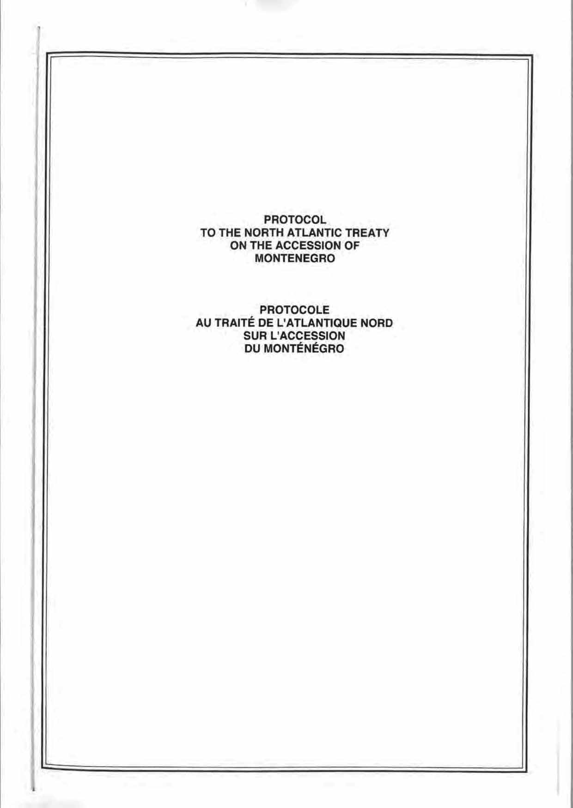
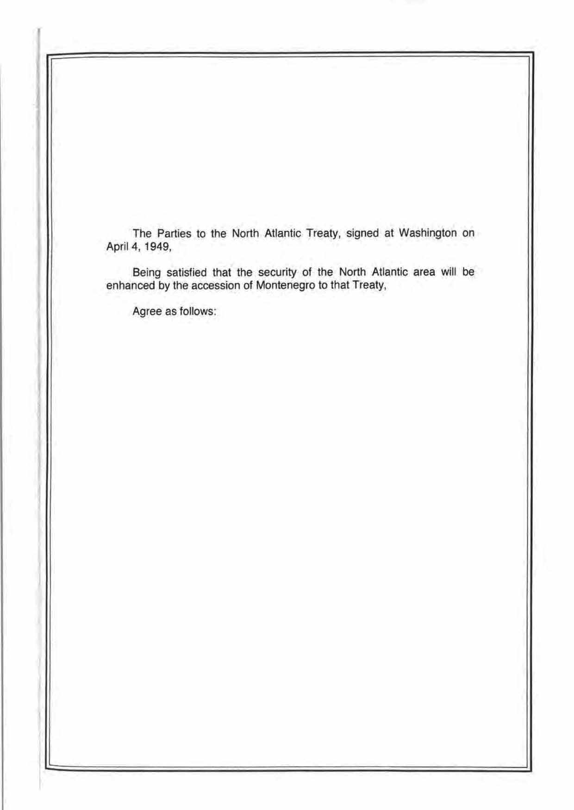
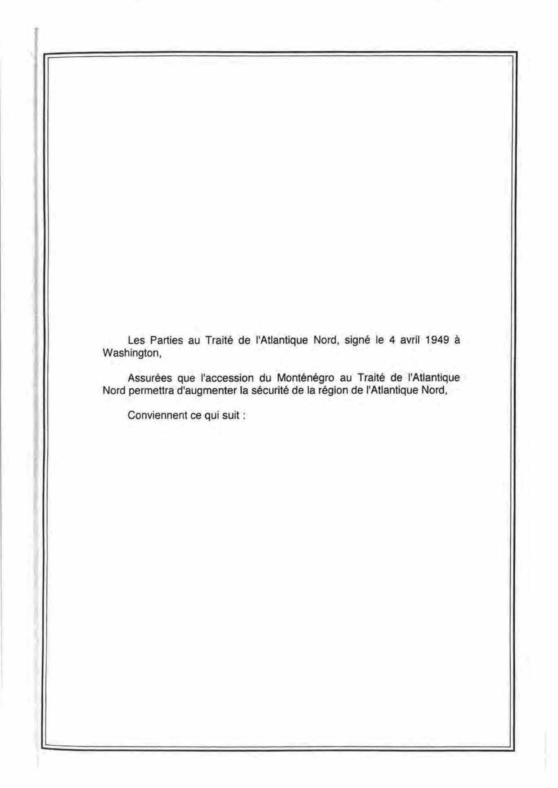

# Loi du 23 décembre 2016 portant approbation du Protocole au Traité de l’Atlantique Nord sur l’accession du Monténégro, signé à Bruxelles, le 19 mai 2016.

Nous Henri, Grand-Duc de Luxembourg, Duc de Nassau,

Notre Conseil d’État entendu;

De l’assentiment de la Chambre des Députés;

Vu la décision de la Chambre des Députés du 14 décembre 2016 et celle du Conseil d’Etat du 23 décembre 2016 portant qu’il n’y a pas lieu à second vote;

Avons ordonné et ordonnons:

## Article unique.

Est approuvé le Protocole au Traité de l’Atlantique Nord sur l’accession du Monténégro, signé à Bruxelles, le 19 mai 2016.

Mandons et ordonnons que la présente loi soit insérée au Mémorial pour être exécutée et observée par tous ceux que la chose concerne.

Le Ministre des Affaires étrangères  et européennes,   Jean Asselborn

Crans, le 23 décembre 2016.   Henri

*[image omitted (0.8 MB) — see the official version: https://legilux.public.lu/eli/etat/leg/loi/2016/12/23/n5/jo]*

*[image omitted (0.8 MB) — see the official version: https://legilux.public.lu/eli/etat/leg/loi/2016/12/23/n5/jo]*

*[image omitted (0.9 MB) — see the official version: https://legilux.public.lu/eli/etat/leg/loi/2016/12/23/n5/jo]*

*[image omitted (0.9 MB) — see the official version: https://legilux.public.lu/eli/etat/leg/loi/2016/12/23/n5/jo]*

*[image omitted (0.9 MB) — see the official version: https://legilux.public.lu/eli/etat/leg/loi/2016/12/23/n5/jo]*

*[image omitted (0.6 MB) — see the official version: https://legilux.public.lu/eli/etat/leg/loi/2016/12/23/n5/jo]*

*[image omitted (0.8 MB) — see the official version: https://legilux.public.lu/eli/etat/leg/loi/2016/12/23/n5/jo]*

Doc. parl. [7029](https://legilux.public.lu/eli/etat/projet/pl/10179); sess. ord. 2015-2016 et 2016-2017.
