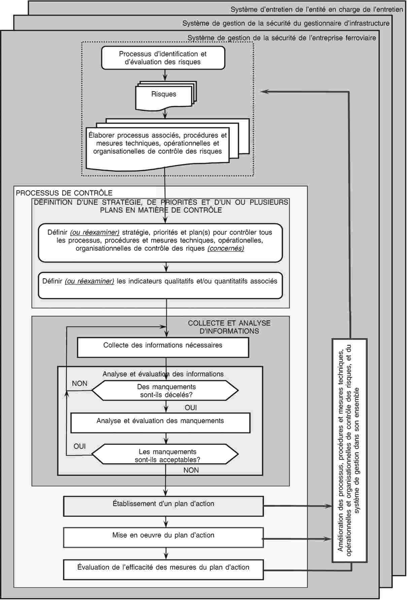

# Loi du 13 juin 2017 ayant pour objet la sécurité du tramway et modifiant\n1° la loi modifiée du 29 juin 2004 sur les transports publics;\n2° la loi modifiée du 30 avril 2008 portant a) création de l'Administration des Enquêtes Techniques, b) modification de la loi modifiée du 22 juin 1963 fixant le régime des traitements des fonctionnaires de l'Etat et c) abrogation de la loi du 8 mars 2002 sur les entités d'enquêtes techniques relatives aux accidents et incidents graves survenus dans les domaines de l'aviation civile, des transports maritimes et des chemins de fer;\n3° l'article L. 215-1 du Code du travail.

Nous Henri, Grand-Duc de Luxembourg, Duc de Nassau,

Notre Conseil d’Etat entendu;

De l’assentiment de la Chambre des Députés;

Vu la décision de la Chambre des Députés du 23 mars 2017 et celle du Conseil d’Etat du 7 avril 2017 portant qu’il n’y a pas lieu à second vote;

Avons ordonné et ordonnons :

## Chapitre 1er — Définitions

### Art. 1.

Au sens de la présente loi, on entend par :

1\. « tramway » : véhicule automoteur qui circule sur rails sur la voie publique et qui est conçu et construit pour le transport de personnes assises et debout. Le tramway n’est pas considéré comme un véhicule routier;

2\. « entreprise de tramway » : toute entreprise à statut privé ou public et titulaire d'une licence conformément à la présente loi, dont l'activité principale est la fourniture de prestations de transport de voyageurs par tramway, la traction devant obligatoirement être assurée par cette entreprise; ce terme recouvre aussi les entreprises qui assurent uniquement la traction;

3\. « gestionnaire de l'infrastructure » : toute entreprise à statut privé ou public et titulaire d'une licence conformément à la présente loi, dont l'activité principale est l'établissement, la gestion et l'entretien d’un réseau de tramway, afin d’en assurer la sécurité;

4\. « licence d’activité » : une autorisation accordée à une entreprise à laquelle est reconnue la qualité d'entreprise de tramway et/ou de gestionnaire d'infrastructure;

5\. « réseau de tramway » : l'ensemble de l'infrastructure de tramway gérée par un gestionnaire de l'infrastructure;

6\. « siège d'opération » le lieu de l'implantation matérielle d’une entreprise à partir duquel elle organise et gère ses activités de façon effective et permanente;

7\. « dirigeant » : la personne physique qui, seule ou de concert avec un ou plusieurs autres dirigeants, assume une responsabilité effective et permanente dans la direction d'une entreprise;

8\. « entité en charge de la maintenance » : une entité chargée de la maintenance d’un véhicule et inscrite en tant que telle dans le registre national des véhicules (ci-après le « RNV »);

9\. « véhicule-tramway » : un véhicule apte à circuler sur ses propres roues sur rails sur une ligne de tramway (avec ou sans traction). Un véhicule se compose d’un ou plusieurs sous-systèmes de nature structurelle et fonctionnelle ou de parties de ces sous-systèmes;

10\. « détenteur » : la personne ou l’entité, propriétaire du véhicule ou disposant d’un droit de disposition sur celui-ci, qui exploite ledit véhicule à titre de moyen de transport et est inscrite en tant que telle au registre des véhicules;

11\. « registre des véhicules » : le registre des véhicules autorisés à circuler sur un réseau de tramway;

12\. « sous-systèmes » : le résultat de la division du système tramway comme indiqué à l’annexe II de la présente loi. Ces sous-systèmes, pour lesquels des exigences essentielles s’appliquent, sont de nature structurelle ou fonctionnelle;

13\. « exigences essentielles » : l’ensemble des conditions décrites à l’annexe III de la présente loi auxquelles doit satisfaire le système tramway;

14\. « organismes compétents » : les organismes compétents en matière d’évaluation de la conformité aux normes et spécifications techniques en usage des sous-systèmes constitutifs du système tramway tel que défini à l’article 36;

15\. « réaménagement » : travaux importants de modification d’un sous-système ou d’une partie de sous-système améliorant les performances globales du sous-système;

16\. « renouvellement » : travaux importants de substitution d’un sous-système ou d’une partie de sous-système ne modifiant pas les performances globales du sous-système;

17\. « mise en service » : l’ensemble des opérations par lesquelles un sous-système est mis en état de fonctionnement nominal;

18\. « bureau technique »: bureau chargé par un organisme compétent pour vérifier la conformité d’un constituant ou d’un sous-système du système de tramway;

19\. « entité adjudicatrice » : toute entité, publique ou privée, qui commande la conception et/ou la construction, le renouvellement ou le réaménagement d’un sous-système. Cette entité peut être une entreprise de tramway, un gestionnaire d’infrastructure ou un détenteur;

20\. « type » : un type de véhicule ou de sous-système définissant les caractéristiques de conception essentielles du véhicule ou du sous-système, telles que visées par l’attestation d’examen de type unique;

21\. « série » : un nombre de véhicules identiques dont la conception et la réalisation relève du même type;

22\. « surveillance » : les dispositions prises par l’Administration pour surveiller les performances en matière de sécurité après qu’elle a accordé un certificat de sécurité;

23\. « système de gestion » : l’organisation et les dispositions établies par un gestionnaire de l’infrastructure, par une entreprise de tramway ou une entité en charge de la maintenance pour assurer la gestion sûre de ses activités;

24\. « contrôle » : les dispositifs mis en place par les entreprises de tramway, les gestionnaires d’infrastructure ou les entités en charge de la maintenance pour vérifier que leur système de gestion est correctement appliqué et efficace;

25\. « danger » : une circonstance pouvant mener à un accident;

26\. « risque » : la fréquence d’occurrence d’accidents et d’incidents causant un dommage (dû à un danger) et le degré de gravité de ce dommage;

27\. « analyse de risque » : l’utilisation systématique de toutes les informations disponibles pour identifier les dangers et estimer le risque;

28\. « évaluation des risques » : une procédure fondée sur l’analyse de risque pour déterminer si un niveau de risque acceptable a été atteint;

29\. « appréciation des risques » : le processus global comprenant une analyse de risque et une évaluation des risques;

30\. « sécurité » : l’absence de risque inacceptable de dommage;

31\. « gestion des risques » : l’application systématique de politiques, procédures et méthodes de gestion aux tâches d’analyse, d’évaluation et de maîtrise des risques;

32\. « interfaces » : tous les points d’interaction dans un système ou sous-système, y compris l’exploitation et l’entretien, où différents acteurs du secteur de tramway collaborent pour gérer les risques;

33\. « acteurs » : toutes les parties qui participent, directement ou par des accords contractuels, à l’application de la présente loi;

34\. « exigences de sécurité » : les caractéristiques de sécurité (qualitatives ou quantitatives, ou, au besoin, qualitatives et quantitatives) devant être observées dans la conception, l'exploitation (y compris les règles d'exploitation) et l'entretien d'un système pour que les objectifs de sécurité établis par la législation ou l'entreprise soient atteints;

35\. « mesures de sécurité » : une série de mesures permettant de réduire la fréquence d’occurrence d’un danger ou d’en atténuer les conséquences afin d’atteindre et/ou de maintenir un niveau de risque acceptable;

36\. « proposant » :

a) une entreprise de tramway ou un gestionnaire de l’infrastructure qui met en œuvre des mesures de maîtrise des risques, ou

b) une entité chargée de l’entretien qui met en œuvre des mesures de maîtrise de risques, ou

c) le demandeur d’une autorisation de mise en service de sous-systèmes de nature structurelle;

37\. « rapport d’évaluation de la sécurité » : le document contenant les conclusions de l’évaluation du système concerné effectuée par un organisme d’évaluation;

38\. « organisme d’évaluation » : la personne, l’organisation ou l’entité indépendante et compétente, externe ou interne, qui procède à des investigations pour formuler un jugement fondé sur des preuves au sujet de l’aptitude d’un système à respecter les exigences de sécurité qu’il doit satisfaire tel que prévu à l’article 51;

39\. « critère d’acceptation des risques » : les éléments au regard desquels l’acceptabilité d’un risque particulier est évaluée; ces critères sont utilisés pour déterminer si le niveau d’un risque est suffisamment bas pour qu’il ne soit pas nécessaire de prendre des mesures immédiates pour le réduire davantage;

40\. « registre des dangers » : le document dans lequel sont consignés et référencés les dangers identifiés et les mesures y afférentes, l’origine des dangers et les coordonnées de l’organisation qui doit les gérer;

41\. « identification des dangers » : le processus consistant à détecter, à inventorier et à caractériser les dangers;

42\. « principe d’acceptation des risques » : les règles utilisées pour déterminer si le risque lié à un ou plusieurs dangers particuliers est acceptable ou non;

43\. « règles de l’art » : un ensemble de règles écrites qui, si elles sont appliquées correctement, peuvent être utilisées pour maîtriser un ou plusieurs dangers particuliers;

44\. « système de référence » : un système dont l’usage a prouvé qu’il présente un niveau de sécurité acceptable et par rapport auquel il est possible d’évaluer, par comparaison, l’acceptabilité des risques présentés par un système en cours d’évaluation;

45\. « estimation des risques » : le processus qui est utilisé pour aboutir à une mesure du niveau des risques analysés et qui comprend les étapes suivantes: estimation de la fréquence, analyse des conséquences et intégration des informations y afférentes;

46\. « système technique » : un produit ou un ensemble de produits, y compris la conception, la mise en œuvre et la documentation; le développement d’un système technique débute par la spécification de ses exigences et se termine par son acceptation; bien que la conception des interfaces pertinentes avec le comportement humain soit prise en considération, les opérateurs humains et leurs actions ne font pas partie du système technique; le processus d’entretien est décrit dans les manuels d’entretien mais ne fait pas en tant que tel partie du système technique;

47\. « accident catastrophique » : un accident touchant généralement un grand nombre de personnes et entraînant de multiples décès;

48\. « acceptation de la sécurité » : le statut donné par le proposant au changement sur la base du rapport d’évaluation de la sécurité fourni par l’organisme d’évaluation;

49\. « système » : toute partie du système tramway qui, dans le cadre d’une analyse de risque, fait l’objet d’un changement, qu’il soit de nature technique, opérationnelle ou organisationnelle;

50\. « règle nationale de sécurité » : toute règle contenant des exigences en matière de sécurité dans le domaine du tramway, imposée au niveau national et applicable aux entités titulaires d’une certification de la sécurité ;

51\. « organisme d’évaluation de la conformité » : l’organisme d’évaluation de la conformité, à savoir l’Institut luxembourgeois de la normalisation, de l’accréditation, de la sécurité et qualité des produits et services, désignée par son acronyme « ILNAS », tel que défini dans la loi du 4 juillet 2014 portant réorganisation de l’ILNAS;

52\. « organisme national d’accréditation » : l’Office luxembourgeois d’accréditation et de surveillance, désigné ci-après par l’acronyme «OLAS», tel que défini dans la loi du 4 juillet 2014 portant réorganisation de l’ILNAS;

53\. « accréditation » : l’accréditation au sens de l’article 1 de la loi du 4 juillet 2014 précitée;

54\. « reconnaissance » : l’attestation établie par un organisme national autre que l’organisme national d’accréditation spécifiant que l’organisme d’évaluation satisfait aux exigences établies à l’annexe VIII de la présente loi lui permettant d’exercer l’activité d’évaluation indépendante visée à l’article 51 paragraphes 1 et 2;

55\. « défaillance systématique » : une défaillance qui se produit de manière répétée en présence d'une combinaison d'entrées particulière ou dans des conditions environnementales ou d'application particulières;

56\. « panne systématique » : une panne inhérente à la spécification, à la conception, à la fabrication, à l'installation, à l'exploitation ou à l'entretien du système évalué;

57\. « dispositif de sécurité » : une mesure technique, opérationnelle ou organisationnelle de contrôle des risques située en dehors du système évalué, qui réduit la fréquence d'apparition d'un danger ou atténue la gravité des conséquences potentielles de ce danger;

58\. « accident critique » : un accident touchant généralement un très petit nombre de personnes et entraînant au moins un décès;

59\. « hautement improbable » : la survenue d'une défaillance à une fréquence inférieure ou égale à 10– 9 par heure d'exploitation;

60\. « improbable » : la survenue d'une défaillance à une fréquence inférieure ou égale à 10– 7 par heure d'exploitation;

61\. « l’Administration » : l’Administration des Chemins de Fer instituée par la [loi modifiée du 22 juillet 2009](https://legilux.public.lu/eli/etat/leg/loi/2009/07/22/n1/jo);

62\. « conducteur de tramway » : dénommé ci-après le «conducteur», toute personne apte et autorisée à conduire, pour le compte d’une entreprise de tramway ou d’un gestionnaire d’infrastructure, de façon autonome, responsable et sûre des tramways et véhicules assimilés;

63\. « candidat » : toute personne postulant à l’admission ou au maintien à une fonction de sécurité;

64\. « candidat-conducteur » : toute personne postulant à l’admission ou au maintien à la fonction de conducteur;

65\. « employeur » : l’entreprise de tramway ou le gestionnaire d’infrastructure à l’initiative ou pour le compte de laquelle ou duquel un candidat se soumet aux examens prévus à l’article 65 ou suit des cours de formation à des tâches de sécurité;

66\. « registre des licences » : le registre regroupant les informations relatives à la licence de conducteur;

67\. « registre de l’infrastructure» : le registre regroupant les informations relatives à l’infrastructure de tramway.

## Chapitre 2 — Exigences et missions de l’Administration des Chemins de Fer et du Tramway

### Art. 2.

Le système tramway tel que déterminé à l’annexe I et ses sous-systèmes tels que déterminés à l’annexe II doivent satisfaire aux exigences essentielles précisées à l’annexe III.

### Art. 3.

L’Administration des Chemins de Fer créée par la [loi modifiée du 22 juillet 2009](https://legilux.public.lu/eli/etat/leg/loi/2009/07/22/n1/jo), ci-après dénommée « Administration », veille au maintien et à l’amélioration du niveau de sécurité dans le domaine du tramway. A cette fin, elle accomplit de manière ouverte, non discriminatoire et transparente notamment les missions suivantes:

a) veiller à ce que ces véhicules-tramways soient dûment inscrits dans le registre national des véhicules-tramways (RNV) et à ce que les informations y figurant soient exactes et tenues à jour;

b) instruire les dossiers en vue de l’émission, du renouvellement, du réexamen, de la modification, du retrait et de la suspension par le membre du Gouvernement ayant les Transports dans ses attributions, désigné ci-après « le ministre » de la certification de sécurité conformément aux dispositions de la présente loi et des règlements grand-ducaux pris en son exécution ainsi que vérifier que les conditions de validité sont remplies;

c) autoriser en application du titre II la mise en service des sous-systèmes de nature structurelle constituant le système tramway implanté au Luxembourg et vérifier qu’ils sont exploités et entretenus conformément aux exigences essentielles les concernant;

d) accomplir les missions lui dévolues conformément à la présente loi et aux règlements grand-ducaux pris en son exécution dans le cadre de la mise en service du matériel roulant utilisé sur un réseau de tramway, à savoir notamment autoriser la mise en service du matériel roulant et vérifier qu’il est exploité et entretenu conformément aux exigences essentielles le concernant;

e) accomplir les missions lui dévolues conformément à la présente loi et aux règlements grand-ducaux pris en son exécution dans le cadre de la formation et de la certification du personnel affecté à des tâches de sécurité sur un réseau de tramway;

f) vérifier, promouvoir, faire appliquer, développer et publier le cadre réglementaire en matière de sécurité dans le domaine du tramway, y compris le système des règles nationales;

g) assister et conseiller le ministre dans l’exécution de ses attributions en matière de sécurité dans le domaine du tramway;

h) apporter son concours à des études et activités en rapport avec la sécurité dans le domaine du tramway;

i) échanger les informations et expériences avec ses homologues en vue de toute évolution en matière de sécurité du système tramway;

j) accomplir les missions lui dévolues conformément à la présente loi et aux règlements grand-ducaux pris en son exécution dans le cadre de la gestion de la sécurité.

### Art. 4.

Avant le premier avril de chaque année, l’Administration rend compte, dans un rapport écrit, au ministre de l’exécution de ses missions au cours de l’année précédente. Dans ce rapport, elle relève plus particulièrement:

a) les informations sur l’évolution de la sécurité du système tramway, y compris un inventaire des indicateurs de sécurité communs définis par le ministre sur proposition de l’Administration,

b) les modifications importantes apportées aux règles applicables en matière de sécurité au système tramway,

c) l’évolution de la certification en matière de sécurité,

d) les résultats de la surveillance des gestionnaires de l’infrastructure de tramway et des entreprises de tramway et les enseignements qui en ont été tirés.

### Art. 5.

(1) Dans la mesure où l’Administration ne dispose pas de spécialistes en nombre ou qualité suffisants pour pouvoir effectuer toutes les inspections ou tous les contrôles exigés dans le cadre de l’accomplissement des missions de l’Administration prévues à la présente loi, le Directeur peut confier des missions à du personnel qualifié appartenant à une autorité de sécurité étrangère ou à une société spécialisée, à condition que:

aash la société présente toutes les garanties d’indépendance par rapport au gestionnaire de l’infrastructure ou à l’entreprise de tramway visés par ses inspections et contrôles;

bash l’assistance procurée par du personnel d’une autorité étrangère fasse l’objet d’un contrat passé avec cette autorité;

cash les procédures pratiquées et les documents utilisés soient conformes au cadre réglementaire luxembourgeois;

dash les éléments recueillis permettent à l’Administration de prendre une décision en toute connaissance de cause.

(2) Les frais d’inspection et de contrôle sont à arrêter par règlement grand-ducal qui fixe les barèmes.

(3) Pour l’exécution de ses missions, l’Administration peut demander l’assistance des gestionnaires de l’infrastructure et des entreprises de tramway. Dans les limites de ce qui est nécessaire à l’exécution des vérifications prévues à l’article 3 de la présente loi, elle a le droit, de demander rapport aux organes de direction et de prendre connaissance, mais sans les déplacer, des livres, comptes et autres documents de la société visée par l’inspection ou le contrôle.

(4) Quiconque empêche ou entrave sciemment l’accomplissement des missions incombant à l’Administration, est puni d’un emprisonnement de huit jours à un an et d’une amende de 251 à 125.000 euros ou d’une de ces peines seulement.

### Art. 6.

Dans la phase d’élaboration des règles nationales de sécurité, l’Administration consulte toutes les parties concernées, notamment les gestionnaires de l’infrastructure et les entreprises de tramway. Les avis des parties concernées sont réputés favorables s’ils ne sont pas intervenus dans le mois suivant la transmission du projet.

## Chapitre 3 — Mise en place et gestion de la sécurité

### Art. 7.

(1) Les règles nationales de sécurité contiennent les exigences en matière de sécurité.

Un règlement grand-ducal détermine les règles nationales de sécurité qui concernent:

a) les objectifs et méthodes de sécurité;

b) les exigences techniques et d'entretien du matériel roulant ainsi que et des installations de l’infrastructure de tramway;

c) l’exploitation d’un réseau tramways, y compris les règles relatives au système de signalisation et de gestion du trafic;

d) les exigences applicables au personnel exécutant des tâches de sécurité essentielles, y compris les critères de sélection, l'aptitude sur le plan médical, la formation professionnelle et la certification;

e) les démarches à suivre en cas d’accidents et d’incidents.

(2) Chaque gestionnaire de l’infrastructure et chaque entreprise de tramway adoptent, chacun en ce qui le concerne, des règles internes de sécurité dans le cadre de leur système de gestion de la sécurité. Les règles internes sont établies dans le respect des règles de sécurité nationales. Elles ne s’appliquent qu’à l’organisme qui les édicte. Ces règles permettent d’atteindre les objectifs de sécurité fixés par l’Administration.

(3) Toute entreprise de tramway admise à utiliser un réseau de tramway ainsi que le gestionnaire de l’infrastructure doivent employer aux tâches de sécurité qu’ils assument, du personnel titulaire d’une formation et d’une certification conformes aux exigences de sécurité définies par la présente loi et par les règles de sécurité nationales.

(4) Chaque année, avant le 30 juin, chaque gestionnaire de l’infrastructure et les entreprises de tramway soumettent à l’Administration un rapport annuel sur la sécurité concernant l’année civile précédente.

Le rapport de sécurité contient:

a) des informations sur la manière dont le gestionnaire de l’infrastructure ou l’entreprise de tramway réalise ses propres objectifs de sécurité et les résultats des plans de sécurité;

b) la mise au point d’indicateurs de sécurité nationaux;

c) les résultats des audits de sécurité internes;

d) des observations sur les insuffisances et les défauts de fonctionnement des opérations et de la gestion de l’infrastructure qui peuvent présenter un intérêt pour l’Administration.

### Art. 8.

Le gestionnaire de l’infrastructure et les entreprises de tramway prennent toutes les mesures requises en vue d’assurer la sécurité de l’exploitation du système tramway et de maîtriser les risques qui en résultent, le cas échéant, en coopération les uns avec les autres. Ils appliquent les règles nationales de sécurité visées à l’article 7, paragraphe 1er et établissent leur système de gestion de la sécurité conformément aux dispositions de l’article 23 paragraphe 2 de la présente loi.

Sans préjudice de la responsabilité civile établie conformément aux prescriptions légales, le gestionnaire de l’infrastructure et chaque entreprise de tramway est responsable de sa partie du système tramway et de la sécurité d’exploitation de celle-ci, y compris la fourniture de matériel et la sous-traitance de services, vis-à-vis des tiers.

La responsabilité du gestionnaire de l’infrastructure et de chaque entreprise de tramway dans l’exploitation du système tramway n’affecte pas la responsabilité de chaque fabricant, fournisseur de services d’entretien, détenteur, prestataire de services et entité adjudicatrice de livrer du matériel roulant, des installations, des accessoires et des équipements ainsi que des services conformes aux exigences et conditions d’utilisation prescrites, de sorte que ceux-ci puissent être exploités en toute sécurité par l’entreprise de tramway respectivement par le gestionnaire de l’infrastructure.

### Art. 9.

La mise en circulation sur un réseau de tramway n’est admise que dans les conditions prévues aux Chapitres 4 et 5 relatifs à la licence d’activité et à la certification de sécurité.

La preuve du respect de ces conditions est rapportée soit par le fait d’être titulaire d’une licence d’activité prévue à l’article 10 de la présente loi, soit par le rapport d’un réviseur d’entreprises certifiant l’existence de moyens financiers pour couvrir la responsabilité civile telle que prévue à l’article 16.

## Chapitre 4 — Licence d’activité et certification dans le secteur du tramway

### Art. 10.

Toute entité exerçant des activités de transport ou de gestion de l’infrastructure de tramway doit être titulaire d’une licence d’activité délivrée conformément au chapitre 4 et d’une certification de sécurité conformément au chapitre 5.

Une entité peut exercer conjointement les activités d’entreprise de tramway et de gestionnaire d'infrastructure.

### Art. 11.

Le ministre est l’autorité compétente pour la délivrance, le renouvellement, le réexamen et le retrait d’une licence d’activité pour les motifs et dans les formes prévues ci-après.

### Art. 12.

Afin d’obtenir et de détenir une licence valable, l’entité doit pouvoir démontrer à tout moment qu’elle remplit les conditions suivantes spécifiées aux articles 13 à 16:

aash d’honorabilité professionnelle du ou des dirigeants de l’entité

bash de capacité financière appropriée

cash de capacité professionnelle

dash en matière de couverture de la responsabilité civile.

### Art. 13.

L'honorabilité s'apprécie sur base des antécédents judiciaires du ou des dirigeants de l'entreprise qui résultent de l'extrait récent de leur casier judiciaire ou d'une attestation officielle en tenant lieu.

Les exigences en matière d'honorabilité sont satisfaites, en particulier si le ou les dirigeants

aash n'ont pas fait l'objet d'une condamnation pénale grave, notamment pour des infractions commises dans le domaine commercial;

bash n'ont pas fait l'objet d'une procédure de faillite;

cash n'ont pas été condamnés pour des infractions graves dans le domaine de la législation spécifique applicable au transport de tramway, notamment en ce qui concerne les règles relatives à la sécurité;

dash n’ont pas été condamnés pour des infractions graves ou répétées à des obligations découlant du droit social ou du droit du travail, y compris les obligations au titre de la législation en matière de protection du travail.

Le demandeur ou le titulaire d'une licence qui ne remplit pas ou qui ne remplit plus la condition d'honorabilité peut la recouvrer par une réhabilitation ou une mesure ayant un caractère équivalent.

### Art. 14.

(1) La capacité financière consiste pour l'entreprise à disposer des ressources financières requises pour faire face, à tout moment, pendant une période d'au moins douze mois à compter du début de l'exploitation, à ses obligations actuelles et potentielles évaluées sur base d'hypothèses réalistes.

(2) L’examen de la capacité financière s’effectue sur la base des comptes annuels de l’entreprise et, pour les entreprises qui demandent une licence et ne sont pas en mesure de présenter ces comptes, sur la base du bilan annuel.

Pour cet examen, des informations détaillées doivent être fournies notamment sur les éléments suivants:

a) ressources financières disponibles, y compris dépôts en banque, avances consenties en compte courant et prêts;

b) fonds et éléments d’actifs mobilisables à titre de garantie;

c) capital d’exploitation;

d) coûts pertinents, y compris coûts d’acquisition et acomptes sur terrains, bâtiments, installations et matériel roulant;

e) charges pesant sur le patrimoine de l’entreprise.

L’entreprise ne présente notamment pas la capacité financière requise lorsque des arriérés considérables d’impôts ou de cotisations sociales sont dus pour son activité.

En vue de l’appréciation de la capacité financière l’entreprise doit présenter un rapport d’un réviseur d’entreprises qui comporte en particulier toutes les informations utiles relatives aux éléments visés au premier alinéa du présent paragraphe et qui est accompagné de tous les documents appropriés à établir par les établissements bancaires et les instances administratives concernés.

### Art. 15.

L'entité apporte la preuve de sa capacité professionnelle en montrant qu'elle a, à tout moment, une organisation de gestion et qu'elle possède les connaissances et l'expérience nécessaires pour exercer un contrôle opérationnel et une surveillance sûrs et efficaces quant aux activités pour lesquelles la licence est valable.

### Art. 16.

L’entité doit rapporter la preuve qu’elle dispose de moyens financiers suffisants pour assumer à tout moment les conséquences financières de sa responsabilité civile, pour le moins dans le respect des dispositions internationales régissant la responsabilité civile dans le domaine du transport de tramway.

Il est satisfait à cette obligation, soit par la conclusion d’un contrat d’assurance couvrant la responsabilité civile de l’entité avec une entreprise d’assurance autorisée, soit par le cantonnement de moyens propres à cette fin, soit par la présentation d’une garantie financière jugée suffisante établie par une banque dûment autorisée ou par toute autre entreprise solvable.

L’entité établit la conformité de sa situation aux dispositions du présent article par le rapport d’un réviseur d’entreprises certifiant que l’entreprise répond aux exigences légales en question. Ce rapport doit être présent au moment de la demande et ensuite au moins tous les cinq ans.

### Art. 17.

La licence est valable aussi longtemps que l'entité remplit les obligations prévues par le présent chapitre. Toutefois, le ministre peut en prescrire le réexamen à intervalles réguliers. Dans ce cas, le réexamen a lieu au moins tous les dix ans.

Des dispositions spécifiques concernant la suspension ou le retrait d'une licence peuvent être incluses dans la licence elle-même.

### Art. 18.

(1) Le ministre peut, s'il existe un doute sérieux quant au respect des exigences du présent chapitre par une entité à laquelle elle a délivré une licence, vérifier à tout moment si ces exigences sont respectées.

Le ministre suspend ou retire la licence si elle constate que l'entité ne satisfait plus aux exigences.

(2) Nonobstant le paragraphe 1, lorsqu'une licence est suspendue ou retirée pour cause de non-respect des exigences en matière de capacité financière, le ministre peut délivrer une licence temporaire durant la réorganisation de l'entité, pour autant que la sécurité ne soit pas compromise. La licence temporaire n'est toutefois valable que pendant une période maximale de six mois à compter de la date d'octroi de la licence.

(3) Le titulaire d’une licence doit informer le ministre dans les meilleurs délais de toute modification pouvant affecter la validité de la licence. En cas de modification affectant la validité d’une licence, le ministre peut décider que la licence doit faire l'objet d'une nouvelle demande. L'entité en cause peut poursuivre ses activités, à moins que le ministre ne décide que la sécurité est compromise. Dans ce cas, la décision doit être motivée.

(4) Si une entité envisage de modifier ou d'étendre ses activités de manière significative, la licence doit être soumise au ministre en vue d'un réexamen.

(5) Lorsqu'une procédure en insolvabilité ou toute autre procédure similaire est engagée à l'encontre d'une entité, le ministre lui retire la licence s’il est convaincu qu'il n'existe pas de possibilité réaliste de restructuration financière satisfaisante dans un délai raisonnable.

### Art. 19.

Le ministre statue sur la demande de délivrance le plus rapidement possible et au plus tard trois mois après la date à laquelle les informations nécessaires, notamment les informations visées dans le cadre de la capacité financière, lui ont été présentées. Il communique, sans délai, sa décision à l'entité qui a demandé la licence. Tout refus doit être motivé.

## Chapitre 5 — Certification en matière de sécurité

### Art. 20.

La prestation de transport de voyageurs par tramway exige de la part de l’entité la détention d’un certificat de sécurité.

La prestation de gestion de l’infrastructure de tramway exige de la part de l’entité la détention d’un agrément de sécurité. L’autorité compétente atteste par cet agrément l’acceptation des dispositions prises par le gestionnaire de l’infrastructure pour satisfaire aux exigences particulières requises afin de garantir la sécurité de l’infrastructure au niveau de la conception, de l’entretien et de l’exploitation du système de contrôle de trafic et de signalisation.

### Art. 21.

(1) Le ministre est l’autorité compétente pour la délivrance, le renouvellement, le réexamen et le retrait de la certification de sécurité sur base des dossiers instruits par l’Administration.

La notification mentionne le nom et l’adresse des entités prévues à l’article10, la date de délivrance, le domaine d’application et la validité de la certification de sécurité et, en cas de retrait, les motifs de la décision.

(2) En vue de l’instruction des demandes en obtention en renouvellement ou en réexamen de la certification de sécurité, l’Administration peut demander tous les renseignements nécessaires à l’instruction des demandes qui lui sont soumises, et le cas échéant, s’assurer à ces fins le concours d’organismes et d’experts indépendants par rapport au requérant.

Si l’entité requérante ne comparaît pas malgré deux convocations par lettre recommandée, la procédure est faite par défaut.

Les frais d’instruction de la demande sont à charge de l’entité requérante.

L’Administration avise les demandes endéans les trois mois à compter du jour où le dossier comportant toutes les pièces utiles au bon déroulement de la procédure lui a été communiqué.

(3) Le ministre peut à tout instant vérifier le respect des conditions de validité de la certification de sécurité Le cas échéant, le ministre décide de la nécessité de procéder à un réexamen de la certification de sécurité.

L’entité titulaire de la certification de sécurité est tenue d’avertir l’Administration de tout manquement constaté et de toute modification substantielle ayant une portée sur les conditions de validité.

Le ministre, après avis de l’Administration, procède au retrait de la certification en cas de manquement grave ou répété par une entité ou si elle ne remplit plus les conditions de validité requises.

### Art. 22.

(1) Afin de pouvoir obtenir une certification en matière de sécurité, les entités prévues à l’article 10 doivent répondre aux conditions suivantes:

a) être établies au Luxembourg et y disposer d’un siège d’opération;

b) exercer la traction des tramways ou la gestion de l’infrastructure de tramway à titre principal.

(2) En vue de la délivrance de la certification, les entités doivent joindre à la demande une copie de la licence prévue au chapitre 4. L’Administration peut demander la présentation de l’original avec indication des modifications.

### Art. 23.

(1) La certification confirme l’acceptation du système de gestion de la sécurité mis en place par l’entité. Elle précise le type et le détail des activités couvertes.

(2) Le système de gestion de la sécurité doit être documenté dans toutes ses parties et décrire notamment la répartition des responsabilités au sein de l’organisation du gestionnaire de l’infrastructure ou de l’entreprise de tramway. Il indique comment la direction assure le contrôle aux différents niveaux de l’organisation, comment le personnel et ses représentants à tous les niveaux participent et comment l’amélioration constante du système de gestion de la sécurité est assurée.

(3) Les éléments essentiels du système de gestion de la sécurité sont les suivants:

a) une politique de sécurité approuvée par le directeur général de l’organisation et communiquée à l’ensemble du personnel;

b) des objectifs qualitatifs et quantitatifs de l’organisation en matière d’entretien et d’amélioration de la sécurité ainsi que des plans et des procédures destinés à atteindre ces objectifs;

c) des procédures pour satisfaire aux normes techniques et opérationnelles existantes, nouvelles et modifiées ou à d’autres prescriptions définies: dans les règles nationales, ou dans d’autres règles pertinentes ou dans les décisions de l’autorité, et des procédures pour assurer la conformité avec ces normes et autres prescriptions tout au long du cycle de vie des équipements et des activités;

d) des procédures et méthodes d'évaluation des risques et de mise en oeuvre de mesures de maîtrise des risques chaque fois qu’un changement des conditions d’exploitation ou l’introduction de nouveau matériel comporte de nouveaux risques pour l’infrastructure ou l’exploitation;

e) des programmes de formation du personnel et des systèmes permettant de veiller à ce que les compétences du personnel soient maintenues et que les tâches soient effectuées en conséquence;

f) des dispositions garantissant une information suffisante au sein de l’organisation et, le cas échéant, entre les organisations opérant sur la même infrastructure;

g) des procédures et formats pour la documentation des informations sur la sécurité et la détermination de la procédure de contrôle de la configuration des informations vitales en matière de sécurité;

h) des procédures garantissant que les accidents, les incidents survenus ou évités de justesse et les autres événements dangereux soient signalés, examinés et analysés, et que les mesures préventives nécessaires soient prises;

i) des plans d’action, d’alerte et d’information en cas d’urgence, adoptés en accord avec les autorités publiques compétentes;

j) des dispositions prévoyant au moins un audit annuel du système de gestion de la sécurité.

### Art. 24.

(1) La certification de sécurité est valable pour une durée de cinq ans.

En vue de son renouvellement, l’entité doit au plus tard trois mois avant l’expiration de la validité adresser une demande en renouvellement à l’Administration.

(2) La certification de sécurité est mise à jour en tout ou en partie à chaque modification substantielle de l’infrastructure, de la signalisation, de l’approvisionnement en énergie ou des principes applicables à son exploitation et à son entretien.

Le titulaire de la certification de sécurité informe sans délai l’Administration de toute modification de ce type.

## Chapitre 6 — Autorisation de mise en service

### Art. 25.

L’Administration autorise au préalable la mise en service des sous-systèmes de nature structurelle constitutifs du système de tramway qui sont implantés ou exploités sur les réseaux de tramway.

Les sous-systèmes de nature structurelle constitutifs du système de tramway ne peuvent être mis en service que s’ils sont conçus, construits et installés de façon à satisfaire aux exigences essentielles visées au chapitre 2.

L’Administration vérifie:

aash la conformité du sous-système par rapport aux règles nationales applicables en la matière,

bash la compatibilité avec le système dans lequel ils s’intègrent et,

cash l’intégration en sécurité des sous-systèmes.

### Art. 26.

L’Administration vérifie, avant que ces sous-systèmes soient mis en service, qu’ils soient conformes, le cas échéant, aux règles nationales de sécurité en matière d’exploitation et de maintenance.

### Art. 27.

(1) Le requérant soumet à l’Administration un dossier concernant le ou l’ensemble de sous-systèmes et leur usage prévus sur un réseau tramway, comportant les informations suivantes:

a) la déclaration de vérification;

b) les caractéristiques techniques et opérationnelles prouvant que le sous-système répond aux exigences essentielles et est compatible avec les autres sous-systèmes;

c) les éléments afférents à la certification de conformité;

d) le programme de maintenance;

e) le cas échéant, les documents justificatifs attestant que la mise en service du sous-système a déjà été autorisée;

f) le cas échéant, les registres faisant apparaître l’historique de la maintenance du sous-système ainsi que les modifications techniques apportées après l’autorisation;

(2) L’Administration fixe la procédure et les modalités d’introduction de la demande de mise en service.

Toute demande d’autorisation de mise en service introduite conformément au présent article fait l’objet d’une décision de l’Administration, au plus tard quatre mois après la présentation du dossier technique.

L’Administration peut demander que:

aash des informations complémentaires soient fournies,

bash des analyses de risque soient effectuées en application, ou

cash que des essais soient réalisés sur le réseau pour vérifier la conformité des éléments visés au paragraphe 1 des points b) et f) du présent article par rapport aux règles nationales en vigueur.

Dès lors, la décision de l’Administration intervient au plus tard

i) le cas échéant, deux mois après la fourniture des informations complémentaires ou des analyses de risques demandées par l’Administration;

ii) le cas échéant, deux mois après la fourniture des résultats des essais demandés par l’Administration.

L’Administration définit, après consultation du requérant, la portée et le contenu des informations complémentaires, des analyses de risque et des essais demandés. Le gestionnaire de l’infrastructure, en concertation avec le requérant, met tout en œuvre pour assurer que les essais éventuels puissent avoir lieu dans un délai de trois mois à partir de la demande de celui-ci.

Les autorisations de mise en service délivrées conformément à la présente loi sont sans préjudice des autres conditions imposées aux entreprises de tramway et au gestionnaire d’infrastructure pour l’exploitation sur les réseaux tramway conformément au chapitre 4.

(3) Le requérant qui demande la mise en service d’un sous-système déterminé doit certifier que toutes les mesures appropriées ont été prises pour que ces sous-systèmes soient conçus, construits et installés de façon à satisfaire aux exigences essentielles les concernant.

La cohérence de ces sous-systèmes avec le système dans lequel ils s’intègrent doit être établie.

### Art. 28.

Pour des raisons de sécurité, l’Administration peut à tout moment suspendre une autorisation émise par elle-même.

L’Administration enlève la suspension dès que les problèmes détectés de sécurité ont été résolus.

Une année après la prononciation de la suspension et sans que des solutions permettant de supprimer la suspension ont été mises en place ou sont en cours de réalisation, l’Administration entame la procédure de révocation de l’autorisation prévue au paragraphe suivant.

La révocation par l’Administration d’une autorisation accordée par elle-même doit se faire par le biais de la procédure de révision des certificats et agréments de sécurité conformément au chapitre5.

### Art. 29.

Après la mise en service des sous-systèmes, la vérification a lieu par l’Administration:

a) pour les infrastructures, dans le cadre de l’octroi et du suivi des agréments de sécurité;

b) pour les véhicules-tramways, dans le cadre de l’octroi et du suivi des certificats de sécurité.

### Art. 30.

L’Administration ne procède qu’à une vérification des dossiers concernant la mise en service de sous-systèmes. Les organismes compétents et les requérants restent responsables de la conformité du sous-système, y compris les véhicules-tramways, par rapport aux exigences techniques et critères imposés.

### Art. 31.

(1) Les sous-systèmes de nature structurelle constitutifs du système de tramway sont considérés comme conformes aux exigences essentielles les concernant quand ils sont munis de la déclaration de vérification.

(2) Sur base d’une proposition préalable du requérant et pour chaque sous-système, l’Administration établit et publie une liste des règles techniques en usage pour l’application des exigences essentielles.

L’Administration veille à ce que les règles techniques contraignantes soient publiées.

### Art. 32.

(1) En vue d’établir la déclaration de vérification, le requérant invite l’organisme compétent qu’il a choisi à cet effet à engager la procédure de vérification de la conformité aux normes et spécifications techniques en usage telle que définie par le ministre sur proposition de l’Administration.

(2) La mission de l’organisme compétent, chargé de la vérification d’un sous-système, commence au stade du projet et couvre toute la période de construction jusqu’au stade de la réception avant la mise en service du sous-système. Elle couvre également la vérification des interfaces du sous-système en question par rapport au système dans lequel il s’intègre, en se fondant sur les informations disponibles dans les registres prévus aux articles 39 et 40 de la présente loi.

(3) L’organisme compétent est responsable de la constitution du dossier technique devant accompagner la déclaration de vérification. Ce dossier technique doit contenir tous les documents nécessaires relatifs aux caractéristiques du sous-système.

Il contient également tous les éléments relatifs aux conditions et limites d’utilisation, aux consignes de maintenance, de surveillance continue ou périodique, de réglage et d’entretien.

(4) L’organisme compétent délivre les certificats de vérification. Il peut également délivrer des certificats de vérification intermédiaires pour couvrir certains stades de la procédure de vérification ou certaines parties du sous-système.

(5) Les prestations à fournir par l’organisme compétent, les bureaux techniques et le gestionnaire d’infrastructure assorties des épreuves et vérifications de conformité afférentes, sont à charge du requérant. Elles sont facturées à celui-ci par l’organisme compétent, les bureaux techniques et le gestionnaire d’infrastructure.

### Art. 33.

Lorsque l’Administration constate qu’un sous-système de nature structurelle, muni de la déclaration de vérification accompagnée du dossier technique, ne satisfait pas entièrement aux exigences essentielles, elle peut demander que des vérifications complémentaires soient réalisées.

### Art. 34.

Dans le cas d’un renouvellement ou d’un réaménagement, l’entité adjudicatrice ou le constructeur introduit auprès de l’Administration un dossier décrivant le projet.

L’Administration examine ce dossier et, en tenant compte de la stratégie de mise en œuvre, décide si l’importance des travaux justifie la nécessité d’une nouvelle autorisation de mise en service.

Une nouvelle autorisation de mise en service est nécessaire chaque fois que le niveau global de sécurité du sous-système concerné peut être affecté négativement par les travaux envisagés.

L’Administration arrête sa décision au plus tard quatre mois après que le requérant ait introduit le dossier complet.

La décision d’autorisation de mise en service peut contenir des conditions d’utilisation et d’autres restrictions.

### Art. 35.

(1) L’Administration peut délivrer des autorisations par type. L’autorisation pour un sous-système porte également sur le type correspondant.

(2) Le sous-système qui est conforme à un type qui a déjà été exploité sur le réseau de tramway est autorisé par l’Administration sur la base d’une déclaration de conformité délivrée antérieurement avec le type considéré présentée par le requérant, sans autre vérification.

(3) La déclaration de conformité avec le type est établie en conformité avec les procédures de vérification fixées par l’Administration.

## Chapitre 7 — Organismes compétents, Organismes d’évaluation et bureaux techniques

### Art. 36.

(1) Sous réserve de répondre aux critères minimaux prévus par l’Annexe V de la présente loi, le ministre peut agréer un ou plusieurs organismes qualifiés et indépendants, ci-après dénommés « organismes compétents ».

Ces organismes compétents sont chargés d’évaluer la conformité aux normes et spécifications techniques nationales des constituants et des sous-systèmes.

(2) Les organismes chargés d’effectuer la procédure d’évaluation de la conformité ou de l’aptitude à l’emploi visée au paragraphe 1 sont agréés par arrêté ministériel, sur avis de l’Administration, en indiquant pour chacun d’eux son domaine de compétence. L’agrément a une durée de validité de cinq ans.

(3) Tout organisme, détenant un tel agrément dont la validité touche à sa fin, peut demander un renouvellement de celui-ci, conformément aux dispositions de cet article.

(4) L’évaluation du ou des organismes candidats interviennent sur base des critères prévus à l’Annexe V de la présente loi. Les organismes qui sont déjà accrédités ou nommés dans un autre État de l’Espace économique européen ou en Suisse sont présumés répondre auxdits critères à condition de présenter à l’Administration les documents y relatifs.

(5) Tout organisme prétendant à être nommé organisme compétent, doit fournir une déclaration tenant lieu de serment qu’il possède les capacités professionnelles d’évaluer la conformité relative au 2ème alinéa du paragraphe 1.

(6) Si un organisme compétent ne satisfait plus aux critères visés dans le présent article, le ministre peut retirer l’agrément dont bénéficie l’organisme en question.

### Art. 37.

Le requérant peut avoir recours à un organisme d’évaluation tel que prévu à l’article 51 et selon les modalités y prescrites.

### Art. 38.

En vue de l’accomplissement des missions qui leur seront dévolues en vertu de la présente loi, les organismes compétents peuvent avoir recours, en cas de besoin, à des bureaux techniques.

Les bureaux techniques exerceront leur mandat sous la responsabilité et le contrôle respectivement d’un organisme compétent.

Le requérant de la demande d’autorisation de type ou d’autorisation de mise en service peut procéder à des essais des sous-systèmes sur le réseau de tramway. Les modalités de ces essais sont fixées en concertation avec l’organisme compétent et le gestionnaire de l’infrastructure.

## Chapitre 8 — Registres

### Art. 39.

(1) Tout véhicule-tramway mis en service sur le système de tramway porte un numéro qui lui est attribué par l’Administration lors de la délivrance de la première autorisation de mise en service.

(2) L’Administration tient un registre des véhicules-tramways autorisés. Le registre est accessible sur demande motivée auprès de l’Administration.

Ce registre recense les informations suivantes:

a) numéro d’identification du véhicule-tramway;

b) le numéro d’autorisation de mise en service établie par l’Administration;

c) numéro de construction des éléments constitutifs d’un véhicule-tramway;

d) le détenteur, le constructeur et entité en charge de la maintenance;

e) les caractéristiques techniques du véhicule-tramway;

f) la date de construction;

g) les modifications.

3\. Le titulaire de l’immatriculation notifie immédiatement toute modification éventuelle des données introduites dans le registre des véhicules-tramways, la destruction d’un véhicule-tramway ou sa décision de ne plus immatriculer un véhicule-tramway.

### Art. 40.

L’Administration détermine les informations recensées au registre de l’infrastructure.

La tenue du registre est à charge du gestionnaire d'infrastructure.

Le registre est mis à la disposition des intéressés sur leur demande au gestionnaire d'infrastructure.

Ce registre présente, pour chaque sous-système ou partie de sous-système concernés, les caractéristiques principales et leur concordance par rapport aux caractéristiques prescrites en vertu des règles applicables.

### Art. 41.

L’agrément des organismes compétents et la reconnaissance des organismes d’évaluation font l’objet d’un registre tenu et publié par l’Administration sur son site internet.

## Chapitre 9 — Surveillance exercée par l’Administration après la délivrance d’un certificat de sécurité ou d’un agrément de sécurité

### Art. 42.

Le présent chapitre vise la méthode de surveillance de la conformité aux exigences pour le maintien de la validité de la certification de sécurité comme prévu au chapitre 5.

L’Administration établit cette méthode soumise à l’approbation du ministre.

La méthode comprend des principes pour surveiller la conformité aux exigences du chapitre 5 après que le ministre a accordé le certificat.

### Art. 43.

Après avoir accordé un certificat de sécurité, l’Administration surveille la continuité de la mise en œuvre, par les entreprises de tramway, de leur système de gestion de la sécurité et appliquent les principes de surveillance exposés dans la méthode approuvée par le ministre.

## Chapitre 10 — Contrôle exercé par les entreprises de tramway et le(s) gestionnaire(s) d’infrastructure après l’obtention d’un certificat de sécurité ou agrément de sécurité.

### Art. 44.

(1) Le processus de contrôle du système de gestion de la sécurité établi ci-après, a pour objet de:

aash gérer efficacement la sécurité dans le système de tramway durant les activités d’exploitation et d’entretien afin d’améliorer continuellement le système de gestion;

bash vérifier l’application correcte et l’efficacité de tous les processus et procédures dans le cadre du système de gestion, notamment les mesures techniques, opérationnelles et organisationnelles en matière de contrôle des risques. Dans le cas des entreprises de tramway et du gestionnaire d’infrastructure, la vérification englobera les éléments techniques, opérationnels et organisationnels qui sont nécessaires à la délivrance de la certification visée aux Chapitres 4 et 5 ainsi que les dispositions adoptées en vue d’obtenir la certification visée aux Chapitres 4 et 5;

cash vérifier si le système de gestion est correctement appliqué dans son ensemble et s’il atteint les résultats escomptés;

dash identifier et mettre en œuvre des mesures appropriées de nature préventive ou corrective si des manquements pertinents sont constatés.

(2) Le présent chapitre s’applique après l’obtention d’un certificat de sécurité ou d’un agrément de sécurité, ainsi qu’aux entités en charge de la maintenance.

### Art. 45.

(1) Les entreprises de tramway, les gestionnaires d’infrastructure et les entités en charge de la maintenance:

a) sont chargés de mener le processus de contrôle décrit à l’annexe VI de la présente loi;

b) veillent à ce que les mesures de contrôle des risques mises en œuvre par leurs contractants soient également contrôlées conformément au présent chapitre. À cette fin, ils appliquent le processus de contrôle décrit à l’annexe VI de la présente loi ou concluent des dispositions contractuelles imposant à leurs contractants de l’appliquer.

(2) Le processus de contrôle comprend les activités suivantes:

a) définition d’une stratégie, de priorités et d’un ou de plusieurs plans en matière de contrôle;

b) collecte et analyse d’informations;

c) établissement d’un plan d’action pour les cas de manquement inacceptable aux exigences fixées dans le système de management;

d) mise en œuvre du plan d’action éventuellement établi;

e) évaluation de l’efficacité des mesures du plan d’action éventuellement établi.

### Art. 46.

(1) Les entreprises de tramway, les gestionnaires d’infrastructure et les entités en charge de la maintenance, y compris leurs contractants, concluent des dispositions contractuelles garantissant qu’ils s’échangent mutuellement toutes les informations pertinentes relatives à la sécurité obtenues en appliquant le processus de contrôle décrit à l’annexe VI, afin de permettre aux autres parties de prendre les mesures correctives nécessaires pour garantir le maintien du niveau de sécurité du système de tramway.

(2) Si les entreprises de tramway, les gestionnaires d’infrastructure et les entités en charge de la maintenance décèlent, grâce au processus de contrôle, un risque pertinent pour la sécurité résultant d’anomalies, d’une construction non conforme ou de dysfonctionnements d’équipements techniques, notamment ceux de sous-systèmes structurels, ils signalent ces risques aux autres parties concernées afin de leur permettre de prendre toutes les mesures correctives nécessaires pour garantir le maintien du niveau de sécurité du système de tramway.

### Art. 47.

(1) Les gestionnaires d’infrastructure et les entreprises de tramway rendent comptent de l’application du présent chapitre à l’Administration dans les rapports annuels sur la sécurité qu’ils lui soumettent.

(2) Le rapport annuel d’entretien des entités en charge de la maintenance contient des informations sur l’expérience acquise par les entités chargées de l’entretien dans l’application du présent chapitre.

## Chapitre 11 — Evaluation et appréciation des risques

### Art. 48.

(1) La méthode de sécurité pour l’évaluation et l’appréciation des risques s’applique au proposant tel que défini à l’article 1er, point 36, lorsqu’il apporte des changements au système de tramway. Ces changements peuvent être de nature technique, opérationnelle ou organisationnelle. En qui concerne les changements organisationnels, seuls ceux susceptibles d’avoir une incidence sur les processus d’exploitation ou d’entretien sont pris en compte conformément aux règles de l’article 49.

(2) Lorsque, sur la base d’une évaluation fondée sur les critères fixés à l’article 49, paragraphe 2, points a) à f):

a) le changement est considéré comme significatif, le processus de gestion des risques établi à l’article 50 est appliqué;

b) le changement n’est pas considéré comme significatif, il suffit de conserver la documentation appropriée pour justifier la décision.

(3) Le présent chapitre s’applique également aux sous-systèmes de nature structurelle si le changement est significatif au sens de l’article 49, paragraphe 2, auquel cas le processus de gestion des risques établi à l’article 50 est appliqué dans le cadre de la mise en service des sous-systèmes de nature structurelle afin de garantir leur intégration en sécurité dans un système existant.

### Art. 49.

(1) Le proposant prend en compte l’incidence potentielle du changement en question sur la sécurité du système de tramway.

Si le changement proposé n’a pas d’incidence sur la sécurité, il n’est pas nécessaire d’appliquer le processus de gestion des risques visé à l’article 50.

(2) Si le changement proposé a une incidence sur la sécurité, le proposant détermine l’importance du changement, sur la base des critères suivants:

a) conséquence d’une défaillance: le scénario réaliste le plus défavorable en cas de défaillance du système évalué, compte tenu de l’existence de dispositifs de sécurité en dehors de ce système;

b) innovation utilisée dans la mise en œuvre du changement: il s’agit tant de ce qui est innovant dans le secteur de tramway que de ce qui est nouveau pour l’organisation mettant en œuvre le changement;

c) complexité du changement;

d) suivi: l’impossibilité de suivre le changement mis en œuvre tout au long du cycle de vie du système et de prendre des mesures adéquates;

e) réversibilité: l’impossibilité de rétablir le système tel qu’il existait avant le changement;

f) additionnalité: l’évaluation de l’importance du changement, compte tenu de tous les changements liés à la sécurité qui ont été apportés récemment au système évalué et qui n’ont pas été considérés comme significatifs.

(3) Le proposant conserve une documentation appropriée pour justifier sa décision.

### Art. 50.

(1) Le proposant est chargé d’appliquer le présent chapitre, y compris d’évaluer l’importance du changement sur la base des critères de l’article 49, et de mener le processus de gestion des risques établi à l’annexe VII de la présente loi.

(2) Le proposant veille à ce que les risques introduits par ses fournisseurs et par ses prestataires de services, y compris leurs sous-traitants, soient également gérés conformément au présent chapitre. À cette fin, le proposant peut demander, en vertu d’arrangements contractuels, que ses fournisseurs et ses prestataires de services, y compris leurs sous-traitants, participent au processus de gestion des risques établi à l’annexe VII de la présente loi.

### Art. 51.

(1) Un organisme d’évaluation évalue en toute indépendance l’adéquation tant de l’application du processus de gestion des risques décrit à l’annexe VII que des résultats de ce processus. Ledit organisme satisfait aux critères énoncés à l’annexe VIII de la présente loi.

(2) Aux fins de l’évaluation indépendante, l’organisme d’évaluation:

a) veille à comprendre dans les détails le changement significatif sur la base de la documentation fournie par le proposant;

b) évalue les processus de gestion de la sécurité et de la qualité appliqués durant la conception et la mise en œuvre du changement significatif, si ces processus ne sont pas déjà certifiés par un organisme d’évaluation de la conformité compétent;

c) évalue l’application desdits processus durant la conception et la mise en œuvre du changement significatif.

Lorsqu’il a terminé son évaluation conformément aux points a), b) et c), l’organisme d’évaluation remet le rapport d’évaluation de la sécurité prévu à l’article 55 et à l’annexe IX.

(3) Les doublons dans les travaux relatifs aux évaluations suivantes sont évités:

a) l’évaluation de la conformité du système de gestion de la sécurité et du système d’entretien des entités en charge de la maintenance; et

b) l’évaluation de la conformité réalisée par un organisme compétent; et

c) les évaluations indépendantes réalisées par l’organisme d’évaluation.

### Art. 52.

L’organisme d’évaluation visé à l’article 51 est reconnu selon les critères fixés à l’annexe VIII de la présente loi.

### Art. 53.

La reconnaissance de l’organisme d’évaluation peut prendre une des formes suivantes:

a) reconnaissance par le ministre d’une organisation ou d’une partie de celle-ci, ou d’une personne;

b) reconnaissance par l’Administration de la capacité d’une organisation, d’une partie de celle-ci, ou d’une personne, à effectuer une évaluation indépendante sous la forme de l’évaluation et du contrôle du système de gestion de la sécurité d’une entreprise de tramway ou d’un gestionnaire de l’infrastructure.

### Art. 54.

Dans les cas visés à l’article 53, points a) et b), la période de validité de la reconnaissance par le ministre n’excède pas cinq ans à compter de la date à laquelle elle a été accordée.

### Art. 55.

(1) L’organisme d’évaluation fournit au proposant un rapport d’évaluation de la sécurité conformément aux exigences fixées à l’annexe IX. Le proposant est responsable de déterminer l’opportunité et la manière de prendre en compte les conclusions du rapport d’évaluation de la sécurité aux fins de l’acceptation de la sécurité du changement évalué. Le proposant justifie sa position et documente la partie du rapport d’évaluation de la sécurité qu’il conteste, le cas échéant.

(2) Dans le cas visé à l’article 48 paragraphe 3, conformément au paragraphe 4 du présent article, la déclaration visée à l’article 56 est acceptée par l’Administration dans sa décision d’autoriser la mise en service de sous-systèmes de nature structurelle et de véhicules-tramways.

(3) L’Administration ne peut pas demander de contrôles ou d’analyses de risque supplémentaires, sauf si elle est en mesure de démontrer l’existence d’un risque significatif sur le plan de la sécurité.

(4) Lorsqu’un système ou une partie d’un système ont déjà été acceptés à l’issue du processus de gestion des risques, le rapport d’évaluation de la sécurité qui en découle ne peut être remis en question par aucun autre organisme d’évaluation chargé d’effectuer une nouvelle évaluation du même système. La reconnaissance mutuelle est subordonnée à la démonstration que le système sera utilisé dans les mêmes conditions fonctionnelles, opérationnelles et environnementales que le système déjà accepté, et que des critères d’acceptation des risques équivalents ont été appliqués.

### Art. 56.

Sur la base des résultats de l’application de la présente loi et du rapport d’évaluation de la sécurité présenté par l’organisme d’évaluation, le proposant produit une déclaration écrite indiquant que tous les dangers identifiés et les risques associés sont maîtrisés de façon à être maintenus à un niveau acceptable selon les principes généraux applicables au processus de gestion des risques arrêtés à l’annexe VII.

### Art. 57.

(1) Les entreprises de tramway et les gestionnaires de l’infrastructure prévoient des audits de l’application du présent titre dans leur programme d’audit périodique du système de gestion de la sécurité.

(2) Les entités en charge de la maintenance prévoient des audits de l’application du présent titre dans leur programme d’audit périodique du système d’entretien.

(3) L’Administration contrôle l’application du présent titre par les entreprises de tramway, les gestionnaires de l’infrastructure et les entités en charge de la maintenance.

### Art. 58.

(1) Dans leurs rapports annuels sur la sécurité, chaque gestionnaire de l’infrastructure, chaque entreprise de tramway et chaque entité en charge de la maintenance font état de leur expérience quant à l’exploitation du système tramway. Ces rapports contiennent également un résumé des changements appliqués.

(2) L’Administration rend compte, dans son rapport annuel sur la sécurité, de son expérience en relation avec l’exploitation du système tramway.

## Chapitre 11 — Qualification et formation du personnel et conditions générales d’admission et de maintien à des fonctions de conducteur

### Art. 59.

(1) Toute entreprise de tramway admise à utiliser un réseau de tramway ainsi que le gestionnaire de l’infrastructure doivent employer aux tâches de sécurité qu’ils assument, du personnel titulaire d’une formation et d’une certification conformes aux exigences de sécurité définies par les règles nationales de sécurité.

Les critères d’aptitude et de qualification, y compris les modalités et la sanction de la formation des conducteurs au sein d’une entreprise de tramway ou du gestionnaire de l’infrastructure, sont réglés au présent chapitre.

(2) La formation du personnel affecté à des tâches de sécurité au sein d’une entreprise de tramway ou du gestionnaire de l’infrastructure relève de la compétence de l’entité elle-même.

### Art. 60.

(1) Pour être admis et maintenu à la fonction de conducteur, celui-ci doit être titulaire de la certification requise consistant en:

a) une licence valide de conducteur attestant qu’il remplit des conditions énumérées à l’article 61;

b) une ou plusieurs habilitations valides précisant les infrastructures sur lesquelles le titulaire est autorisé à conduire ainsi que le matériel roulant que le titulaire est autorisé à conduire.

(2) Les conditions relatives à l’obtention de la licence de conducteur, ci-après dénommée « licence de conducteur », et de l’habilitation de même que celles concernant leur validité respective, sont arrêtées aux articles 61 à 71.

## Chapitre 12 — Conditions d’obtention de la licence de conducteur

### Art. 61.

(1) L’âge minimal pour être admis à des fonctions de conducteur est de 21 ans.

(2) Le candidat doit au moins avoir suivi avec succès une classe de 9ième de l’enseignement secondaire technique ou bien une classe de 5ième de l’enseignement secondaire classique ou bien se prévaloir d’études dont le niveau est reconnu équivalent par le ministre ayant l’Éducation nationale dans ses attributions.

(3) Le candidat doit être titulaire d’un permis de conduire de la catégorie B valide sur le territoire national.

### Art. 62.

(1) Avant de pouvoir être admis à une fonction de conducteur tout candidat doit avoir subi avec succès un examen médical et un examen psychologique qui ont lieu au plus tôt dans les douze mois précédant l’obtention de la licence.

Ces examens sont réalisés respectivement par un médecin du travail et un psychologue reconnu par l’Administration. Ces examens portent sur les critères indiqués à l’annexe X de la présente loi.

Aux fins de leur reconnaissance, les psychologues doivent fournir les documents suivants:

aash une copie de leurs diplômes et

bash un justificatif d’une expérience d’au moins cinq ans dans le domaine concerné.

(2) Tous les examens et leurs résultats doivent présenter toutes les garanties de confidentialité et de non-discrimination. Ils font l’objet d’une attestation d’aptitude délivrée à l’employeur sans aucun autre détail. En aucun cas, ils ne peuvent être effectués à l’insu de la personne concernée qui doit être informée de la nature et des résultats des examens auxquels elle est soumise. Il en est de même de tout autre examen médical ou psychologique visé à la présente loi.

(3) La constatation de l’aptitude physique à l’exercice de fonctions de conducteur et, le cas échéant, la constatation d’une inaptitude ou d’une restriction, temporaire ou définitive, fait l’objet d’un certificat médical, signé et daté par le médecin reconnu, dont l’original est remis au candidat examiné soit contre émargement, soit par envoi postal recommandé. La copie est à classer par le médecin ayant effectué l’examen.

(4) La constatation de l’aptitude psychologique à l’exercice de fonctions de conducteur, et, le cas échéant, la constatation d’une inaptitude ou d’une restriction, temporaire ou définitive, fait l’objet d’un bilan psychologique, signé et daté par le psychologue reconnu dont l’original est remis au candidat examiné soit contre émargement, soit par envoi postal recommandé. La copie est à classer par le psychologue ayant effectué l’examen.

(5) Toute contestation à propos d’un avis d’aptitude physique ou psychologique précité peut faire l’objet d’un recours auprès de l’Administration endéans un délai de trois mois à compter de la date où l’avis a été porté, conformément aux dispositions respectives des paragraphes précédents, à la connaissance du candidat.

L’Administration fait connaître sa décision dans les six semaines suivant l’introduction du recours.

Sur demande du candidat, l’Administration peut prescrire un nouvel examen par un autre médecin reconnu afin de réaliser un examen contradictoire aux frais du candidat. L’Administration dispose dès lors d’un délai d’un mois suivant la réception de la dernière des attestations y relatives.

### Art. 63.

(1) Toute demande de licence est introduite auprès de l’Administration par le candidat ou par l’employeur agissant au nom de celui-ci.

Toute demande doit être accompagnée des documents suivants:

aash photocopie d’un document d’identité en cours de validité,

bash pièce justificative du niveau scolaire,

cash certificat d’aptitude psychologique,

dash certificat d’aptitude physique,

eash photocopie du permis de conduire de la catégorie B valide sur le territoire national.

(2) Le contrôle du respect des conditions visées aux articles 60 et 61 requises pour l’exercice de la fonction de conducteur revient à l’Administration. L’Administration émet une licence numérotée et établie au nom du candidat intéressé et l’inscrit dans le registre des licences visé au paragraphe 5. »

(3) L’Administration délivre la licence le plus rapidement possible et au plus tard un mois après avoir reçu tous les documents nécessaires. Une attestation provisoire peut être délivrée par l’Administration.

(4) La licence est délivrée en un seul exemplaire et appartient à l’Administration. Seule l’Administration est autorisée à la dupliquer sur demande motivée.

Sans préjudice des dispositions de l’alinéa précédent, une copie de la licence est délivrée à l’employeur ayant agi, conformément au paragraphe 2, au nom du candidat.

(5) L’Administration met en place un registre de toutes les licences.

Ce registre contient les informations relatives aux licences respectivement délivrées, retirées, suspendues, modifiées ou renouvelées en conformité de l’article 69, ainsi que de celles déclarées perdues, volées ou détruites. Ce registre est constamment tenu à jour et contient les données figurant sur chaque licence.

## Chapitre 13 — Conditions d’obtention de l’habilitation

### Art. 64.

(1) Par compétences professionnelles relatives à l’habilitation, on entend les connaissances professionnelles et les capacités de les mettre en œuvre, telles que définies à l’annexe XI de la présente loi.

(2) L’habilitation appartient à l’employeur qui l’établit.

(3) L’habilitation émise par un employeur reste valide tant que son titulaire assure la fonction de conducteur auprès du même employeur.

### Art. 65.

Avant de délivrer l’habilitation, l’employeur s’est assuré que le candidat:

a) est titulaire d’une licence de conducteur valide;

b) a réussi les examens sur les compétences professionnelles générales, portant au moins sur les matières indiquées à l’annexe XI sub A;

c) a réussi les examens sur ses compétences professionnelles spécifiques, portant au moins sur les matières indiquées à l’annexe XI sub B, relatives au matériel roulant pour lequel l’attestation est délivrée;

d) a réussi «les examens sur ses compétences» professionnelles spécifiques, portant au moins sur les matières indiquées à l’annexe XI sub C, relatives à l’infrastructure pour laquelle l’attestation est délivrée;

e) remplit le critère lié aux connaissances linguistiques indiqué à l’annexe XI sub D;

f) a suivi avec succès une formation en ce qui concerne le système de gestion de la sécurité prévu par la présente loi.

Chaque employeur établit, conformément à la présente loi, ses propres procédures pour la délivrance et la mise à jour des habilitations.

L’employeur met à jour l’habilitation sans délai, chaque fois que le titulaire de l’habilitation a obtenu de nouvelles autorisations relatives au matériel roulant ou aux infrastructures.

### Art. 66.

La formation à l’habilitation est dispensée et sanctionnée par un formateur désigné par l’employeur. Celui-ci doit s’assurer que le formateur dispose:

a) des compétences professionnelles dans le domaine de la formation indiquées à l’annexe XII;

b) d’une expérience à la conduite d’au moins cinq ans sur un réseau tramway et

c) d’une habilitation à la conduite sur le réseau de l’employeur.

### Art. 67.

L’employeur met en place un registre de toutes les habilitations. Ce registre contient également les informations relatives aux habilitations respectivement délivrées, retirées, suspendues, modifiées ou renouvelées en conformité de l’article 72, ainsi que de celles déclarées perdues, volées ou détruites. Ce registre est constamment tenu à jour et contient les données figurant sur chaque attestation.

## Chapitre 14 — Validité de la licence de conducteur

### Art. 68.

(1) Sous réserve des autres dispositions du présent titre, et pour autant que le conducteur respecte la condition relative à la détention du permis de conduire valide, une licence est valide pour une durée illimitée n’excédant pas l’âge légal de la retraite.

(2) L’aptitude médicale et psychologique du titulaire doit être attestée:

a) par des examens médicaux périodiques de contrôle de l’aptitude physique et psychologique.

La périodicité de ces examens, ainsi que leur contenu sont fixés à l’annexe X sub 3.

Les autres modalités relatives à ces examens périodiques sont celles prévues aux paragraphes 3 et 4 de l’article 62,

b) par un examen médical ou psychologique de contrôle si de l’avis de l’Administration, de l’employeur, du médecin ou du psychologue reconnus des circonstances particulières l’imposent.

Sans préjudice de ce qui précède, un examen médical de contrôle est effectué d’office préalablement à la reprise des fonctions de conducteur:

aash après une absence pour cause de maladie professionnelle;

bash après un congé de maternité;

cash après une absence à temps plein en raison d’un congé parental ou d’un congé sans traitement d’une durée supérieure à 2 mois;

dash après un arrêt de travail pour cause d’accident de travail;

eash après un arrêt de travail continu de trente jours ou plus pour cause de maladie ou d’accident non professionnel;

fash en cas d’absences répétées pour raisons de santé;

gash en cas de restitution de la licence suspendue pour des raisons médicales en conformité de l’article 69.

Les modalités relatives à ces examens sont celles prévues, respectivement aux paragraphes 3 à 5 de l’article 62.

(3) Le titulaire d’une licence doit informer l’Administration et son employeur dans les plus brefs délais du retrait ou de la suspension de son permis de conduire.

### Art. 69.

Lorsque le titulaire d’une licence obtient un résultat négatif lors d’un examen prévu à l’article 68, la licence est, suivant le cas,

a) retirée, s’il ne remplit définitivement plus une ou plusieurs des conditions visées à l’article 68 précité;

b) suspendue, s’il ne remplit temporairement pas une ou plusieurs des conditions visée à l’article 68;

c) modifiée, s’il en résulte une inaptitude partielle entraînant une restriction médicale temporaire ou définitive lors de l’exercice des fonctions de conducteur.

Toute suspension de licence peut être terminée dans l’hypothèse où son titulaire remplit de nouveau toutes les conditions y relatives telles que prescrites par la présente loi.

La décision portant retrait, suspension ou modification d’une licence appartient à l’Administration. Elle est immédiatement portée à la connaissance du titulaire et de son employeur sous pli recommandé avec accusé de réception.

## Chapitre 15 — Validité de l’habilitation

### Art. 70.

Afin qu’une habilitation reste valide, son titulaire doit:

a) remplir les critères de validité de la licence énumérés au chapitre 14,

b) se soumettre, à une vérification périodique de ses compétences professionnelles portant sur les exigences énoncées à l’article 65 sub b) à e). Les modalités de vérification périodique sont celles indiquées à l’article 65.

La responsabilité du suivi des conducteurs, y compris la formation continue, ainsi que des programmes de formation proprement dit, sont régis dans le cadre du Système de Gestion de la Sécurité de l’employeur.

c) effectuer au moins, tous les six mois, un parcours représentatif sur les lignes sur lesquelles le conducteur est autorisé à circuler. Le cas échéant, le conducteur effectuera le prochain parcours sur le réseau accompagné par une personne du personnel d’encadrement du conducteur disposant d’une habilitation valide. Le délai prévu ci-dessus recommence à courir à partir de la date de la conduite accompagnée.

Tout conducteur ne remplissant plus les conditions ci-dessus, doit se soumettre, préalablement à la reprise des fonctions de conducteur, à la formation du conducteur.

Les modalités de réussite relatives à la formation sont celles indiquées à l’article 65. En cas de réussite de celle-ci, le délai prévu ci-dessus commence à courir à partir de la date de renouvellement de l’habilitation.

### Art. 71.

La fréquence de la vérification périodique prévue à l’article 70 est fixée en respectant les périodicités minimales suivantes:

a) connaissance de l’infrastructure (y compris des lignes et des règles d’exploitation): tous les ans ou après toute absence de plus de 12 mois sur l’itinéraire concerné;

b) connaissance du matériel roulant: tous les trois ans. Les vérifications reprises sub a) et b) ci-devant sont réalisées par un formateur.

### Art. 72.

Si le titulaire d’une habilitation échoue lors d’un examen prévu à l’article 70 b) dans le cadre de la vérification périodique des compétences professionnelles telles que prévues à l’article 65 b), c) et d), l’habilitation est suspendue.

Si, par la suite, il échoue également lors d’un examen complémentaire de rattrapage visant ces mêmes compétences professionnelles, l’habilitation est retirée.

En cas de cessation des relations de travail entre le conducteur et son employeur, l’habilitation est retirée. Toutefois, le titulaire reçoit un extrait du registre lui permettant de justifier de ses compétences professionnelles auprès d’un nouvel employeur dont celui-ci pourra tenir compte.

Le retrait ou la suspension d’une habilitation est effectué par l’employeur.

Toute habilitation, suspendue peut être renouvelée au cas où son titulaire remplit de nouveau toutes les conditions y relatives prescrites par la présente loi.

## Chapitre 16 — Suivi des licences et des habilitations

### Art. 73.

Les entreprises de tramway et les gestionnaires de l’infrastructure sont tenus de s’assurer et de vérifier que les licences et les habilitations des conducteurs qu’ils emploient ou avec lesquels ils ont passé un contrat sont valides.

Ils mettent en place un système de suivi de leurs conducteurs. Si les résultats de ce suivi mettent en question les compétences requises d’un conducteur pour exercer temporairement ou définitivement son emploi et le maintien de sa licence ou de son habilitation, l’entreprise de tramway ou le gestionnaire de l’infrastructure prend immédiatement les mesures nécessaires, notamment, dans le cadre de la validité de la licence visée à l’article 68 de la présente loi, pour informer l’Administration de sa décision motivée.

### Art. 74.

Lorsqu’un conducteur considère que son état de santé remet en cause temporairement ou définitivement son aptitude à exercer son emploi, il en informe immédiatement l’entreprise de tramway, le gestionnaire de l’infrastructure, ou l’Administration selon le cas.

Dès qu’une entreprise de tramway ou un gestionnaire de l’infrastructure constate ou est informé par un médecin que l’état de santé d’un conducteur s’est détérioré de telle manière que son aptitude à exercer son emploi est mise en cause, il prend immédiatement les mesures nécessaires, y compris l’examen décrit à l’annexe X, point 3.2., de la présente loi et, si nécessaire, le retrait de l’habilitation ainsi que la mise à jour du registre prévu à l’article 67 de la présente loi.

L’Administration est informée, sans délai, de tout cas d’incapacité de travail dont la durée est supérieure à trois mois.

## Chapitre 17 — Dispositions relatives à la consommation de substances susceptibles d’altérer la vigilance, la concentration et le comportement d’un conducteur

### Art. 75.

Nul conducteur ne doit, à aucun moment de son service, être sous l’emprise de substances susceptibles d’altérer sa vigilance, sa concentration ou son comportement.

### Art. 76.

Nul conducteur ne peut prendre son service ou exercer ses fonctions sous l’emprise d’un état alcoolique caractérisé par la présence dans le sang d’une concentration d’alcool pur supérieure à 0,2 gramme par litre de sang ou de 0,09 mg par litre d’air expiré.

### Art. 77.

Nul conducteur ne peut prendre son service ou exercer ses fonctions sous l’emprise de substances psycho actives telles que drogues et stupéfiants ou substances thérapeutiques susceptibles d’altérer sa vigilance, sa concentration ou son comportement.

### Art. 78.

En cas de traitement médical, le conducteur doit attirer l’attention de son médecin traitant sur le besoin de vigilance et de concentration que requiert l’exercice de ses fonctions. En outre, lors des visites auprès du médecin reconnu il doit informer celui-ci des médicaments qui lui ont été prescrits.

### Art. 79.

L’employeur doit veiller à l’information des conducteurs sur la prévention des risques professionnels, sur les obligations résultant du présent chapitre ainsi que sur les sanctions pouvant être prises à l’égard de contrevenants, en cas de consommation de substances susceptibles d’altérer la vigilance, la concentration ou le comportement.

## Chapitre 18 — Tâches de l’Administration

### Art. 80.

L’Administration accomplit les tâches suivantes de manière transparente et non discriminatoire:

a) délivrer et mettre à jour les licences, et en fournir des duplicatas, conformément à l’article 63;

b) suspendre et retirer les licences, et communiquer à l’entité de délivrance des habilitations les demandes motivées de suspension des habilitations, conformément à l’article 82;

c) tenir et mettre à jour un registre de licences conformément à l’article 63, paragraphe 5;

d) contrôler le processus de certification des conducteurs conformément à l’article 60;

e) effectuer les contrôles prévus aux articles 81 et 82.

L’Administration répond rapidement aux demandes d’information et présente, sans délai, toute demande d’information complémentaire dans le cadre de la préparation des licences.

## Chapitre 19 — Contrôles et mesures administratives

### Art. 81.

A tout moment, l’Administration peut, en particulier, prendre les mesures nécessaires pour vérifier:

a) le respect du présent titre par des contrôles;

b) à bord des tramways circulant sur le réseau de tramway, si le conducteur est muni d’une licence et d’une habilitation valides.

Nonobstant la vérification prévue au paragraphe ci-dessus, en cas de négligence commise au travail, l’Administration peut vérifier si le conducteur en question répond aux exigences énoncées à l’article 65 sub b) et c);

c) par tout autre moyen, si le conducteur en question remplit les conditions requises pour l’admission et le maintien aux fonctions de conducteur qu’il assure, telles que ces conditions sont fixées par le présent titre;

### Art. 82.

Au cas où l’Administration constate ou estime, lors d’une vérification prévue à l’article précédent, qu’un conducteur ne remplit plus une ou plusieurs conditions requises, elle prend les mesures suivantes:

a) s’il s’agit d’une irrégularité relative à une licence qu’elle a délivrée, elle suspend ou retire la licence en fonction de l’importance de l’irrégularité constatée. L’Administration notifie immédiatement sa décision motivée à l’intéressé ainsi qu’à son employeur. Le cas échéant, elle indique également la procédure à suivre en vue de l’annulation de sa décision;

b) s’il s’agit d’une irrégularité relative à une habilitation, l’Administration s’adresse à l’entité de délivrance et demande soit un contrôle complémentaire, soit la suspension de l’habilitation. L’entité de délivrance prend les mesures nécessaires et en informe l’Administration dans un délai de quatre semaines.

L’Administration a la faculté d’interdire à un conducteur d’opérer sur le réseau de tramway en attendant l’information de la part de l’entité ayant émis l’habilitation.

### Art. 83.

Dans l’hypothèse où l’Administration juge qu’un conducteur assurant la conduite d’un tramway constitue une menace grave pour la sécurité, elle peut immédiatement exiger sa relève et lui interdire d’opérer sur le réseau de tramway jusqu’à ce qu’une décision soit prise conformément aux dispositions de l’article précédent.

### Art. 84.

Les mesures prises en exécution des articles 82 et 83 comportent la mise à jour des registres prévus aux articles 63 et 67.

## Chapitre 20 — Dispositions modificatives

### Art. 85.

Le paragraphe 1er de l’article 3 de la [loi modifiée du 29 juin 2004](https://legilux.public.lu/eli/etat/leg/loi/2004/06/29/n1/jo) sur les transports publics est modifié comme suit:

1° A l’alinéa 1er, la mention *transports publics de personnes* remplace la mention *transports en commun de personnes* .

2° Le premier tiret de l’alinéa 2 est remplacé par le texte suivant:

> aash les transports intérieurs de personnes assurés au moyen de trains et de véhicules-tramways, assurant les services réguliers ou occasionnels sur les relations confinées au territoire national;

### Art. 86.

A l’article 4 de la [loi du 29 juin 2004](https://legilux.public.lu/eli/etat/leg/loi/2004/06/29/n1/jo) précitée, alinéas 2 à 4 ainsi qu’à l’article 7bis, paragraphe 1er, alinéa 1er et paragraphe 2, alinéa 2, le terme *transports publics* remplace le terme *transports en commun* .

### Art. 87.

L’article 1er de la [loi modifiée du 30 avril 2008](https://legilux.public.lu/eli/etat/leg/loi/2008/04/30/n1/jo) portant a) création de l’Administration des Enquêtes Techniques, b) modification de la [loi modifiée du 22 juin 1963](https://legilux.public.lu/eli/etat/leg/loi/1963/06/22/n1/jo) fixant le régime des traitements des fonctionnaires de l’Etat et c) abrogation de la [loi du 8 mars 2002](https://legilux.public.lu/eli/etat/leg/loi/2002/03/08/n8/jo) sur les entités d’enquêtes techniques relatives aux accidents et incidents graves survenus dans les domaines de l’aviation civile, des transports maritimes et des chemins de fer, est remplacé par le texte suivant:

> **Art.1er.**
>
> (1) La présente loi a pour objectif d’améliorer la sécurité dans les domaines de l’aviation civile, des transports fluviaux et maritimes, des chemins de fer et de la circulation de véhicules sur les voies publiques par la prévention d’accidents ou d’incidents graves dans ces domaines.
>
> (2) Les accidents et les incidents graves survenus dans les domaines de l’aviation civile, des transports fluviaux et maritimes, du chemin de fer et de la circulation de véhicules sur les voies publiques font l’objet d’une enquête technique répondant aux critères de la présente loi.

### Art. 88.

La phrase introductive du premier paragraphe de l’article 2 de la [loi précitée du 30 avril 2008](https://legilux.public.lu/eli/etat/leg/loi/2008/04/30/n1/jo) est remplacée par le texte suivant :

> **Art. 2.**
>
> (1) L'enquête technique doit obligatoirement être effectuée dans les domaines de l’aviation civile, des transports fluviaux et maritimes et du chemin de fer, chaque fois:

A l’article 2, paragraphe 1er, lettre a), le deuxième tiret de la [loi précitée du 30 avril 2008](https://legilux.public.lu/eli/etat/leg/loi/2008/04/30/n1/jo) est remplacé par le texte suivant:

> aash du matériel ferroviaire sur le réseau national ou ses embranchements, y inclus le système du tramway et ses sous-systèmes,

### Art. 89.

La [loi précitée du 30 avril 2008](https://legilux.public.lu/eli/etat/leg/loi/2008/04/30/n1/jo) est complétée par un nouvel article 2bis libellé comme suit:

> **Art.2bis.**
>
> (1) L’enquête technique peut être effectuée après un accident ayant entraîné des blessures mortelles à une ou plusieurs personnes dans le domaine de la circulation de véhicules sur les voies publiques sur demande du Ministre ayant le transport routier dans ses attributions ou sur décision du directeur de l’Administration des enquêtes techniques, à chaque fois qu’il peut être escompté qu’une amélioration significative de la sécurité peut être atteinte à la suite de la formulation de recommandations de sécurité.
>
> (2) L’Administration des Enquêtes Techniques décide, après une analyse des données de l’accident, de la suite de l’enquête ainsi que des moyens à mettre en œuvre afin de pouvoir, le cas échéant, formuler des recommandations de sécurité.

### Art. 90.

Le paragraphe 1er de l’article 4 de la [loi précitée du 30 avril 2008](https://legilux.public.lu/eli/etat/leg/loi/2008/04/30/n1/jo) est remplacé par le texte suivant:

> **Art. 4.**
>
> (1) Il est créé une Administration des Enquêtes Techniques (AET), chargée d’effectuer les enquêtes techniques prévues au paragraphe (1) de l’article 2 et au paragraphe (1) de l’article 2bis, appelée ci-après « Administration », qui est placée sous l’autorité du membre du gouvernement ayant les transports dans ses attributions, ci-après dénommé le «ministre». Elle est dirigée par un Directeur de l’Administration des Enquêtes Techniques qui en est le supérieur hiérarchique.

### Art. 91.

L’article L.215-1, premier alinéa, du [Code du travail](https://legilux.public.lu/eli/etat/leg/loi/2006/07/31/n2/jo) est complété *in fine* par le bout de phrase suivant: hormis les conducteurs de tramways tels que définis à l’article 1er de la loi du 13 juin 2017 relative à la sécurité du tramway.

## Chapitre 21 — Dispositions transitoire, dérogatoire et finales.

### Art. 92.

(1) Une licence d’activité valable pour trois mois peut être délivrée à toute entité qui adresse une demande motivée auprès du ministre dans le mois suivant l’entrée en vigueur de la présente loi.

(2) Une certification de sécurité valable pour un an peut être délivrée à toute entité qui adresse une demande motivée au ministre dans le mois suivant l’entrée en vigueur de la présente loi.

Au plus tard un an après la délivrance de la certification de sécurité, l’entité doit être titulaire de la certification de sécurité visée au chapitre 5 de la présente loi.

(3) Au plus tard 5 ans après l’entrée en vigueur de la présente loi, la condition d’expérience d’au moins 5 ans de conduite sur un réseau de tramway par le formateur à l’article 66 devra être remplie. »

### Art. 93.

Par dérogation aux dispositions de l’article 60, l’obligation de posséder une habilitation pour une partie spécifique de l’infrastructure ne s’applique pas dans les cas exceptionnels énumérés ci-après, dès lors qu’un autre conducteur possédant une habilitation valide pour la partie de l’infrastructure concernée, appelé ci-après pilote, se tient aux côtés du conducteur durant la conduite:

a) pour la circulation d’engins spécialisés à l’entretien des voies, dont la conduite est assurée par des conducteurs qui n’ont pas les connaissances de l’infrastructure requise;

b) pour des services exceptionnels uniques avec du matériel historique;

c) pour la livraison ou la démonstration d’un nouveau tramway, ainsi qu’à l’occasion d’un parcours d’essai;

d) aux fins de formation et d’examen des conducteurs.

### Art. 94.

La référence à la présente loi peut se faire sous une forme abrégée en recourant à l’intitulé suivant : « loi du … relative à la sécurité-tramway ».

### Art. 95.

La présente loi entre en vigueur le premier jour du mois qui suit celui de sa publication au Journal officiel du Grand-Duché de Luxembourg.

Mandons et ordonnons que la présente loi soit insérée au Journal officiel du Grand-Duché de Luxembourg pour être exécutée et observée par tous ceux que la chose concerne.

Le Ministre du Développement durable et des Infrastructures,   François Bausch   Le Ministre du Travail, de l’Emploi et de l’Economie sociale et solidaire,   Nicolas Schmit

Palais de Luxembourg, le 13 juin 2017.   Henri

\**ANNEXE I - Définition du système tramway**

\**1. Système tramway**

1.1. **Réseaux**

Aux fins de la présente loi, tout réseau peut être subdivisé selon les catégories suivantes:

aash lignes prévues pour le trafic des passagers,

bash nœuds « passagers »,

cash les centres de remisage et de maintenance du matériel roulant,

dash voies de raccordement entre les éléments ci-dessus.

Ces réseaux comportent les systèmes de gestion du trafic, de localisation et de navigation, les installations techniques de traitement des données et de télécommunication prévues pour le transport de passagers sur ces réseaux afn d’en garantir l'exploitation sûre et une gestion efficace.

1.2. **Véhicules**

Le système tramway comprend tous les véhicules-tramways aptes à circuler sur rails ou guidés par rails sur tout ou partie d’un réseau, y compris

aash les tramways constitués de rames automotrices pour le transport de voyageurs;

bash le matériel mobile de construction et d'entretien des infrastructures;

cash le matériel pour le dépannage de rames automotrices.

\**2. Cohérence du système tramway**

La qualité du système tramway nécessite entre autres une excellente compatibilité entre les caractéristiques du réseau (au sens large du terme, c’est-à-dire comprenant les parties fixes de tous les sous-systèmes concernés) et celles des véhicules-tramways (incluant les parties embarquées de tous les sous-systèmes concernés). De cette compatibilité dépendent les niveaux de performance, de sécurité, de qualité du service et leur coût.

\**ANNEXE II - Sous – systèmes**

\**1. Liste des sous-systèmes**

Aux fins de la présente loi, le système constituant le système tramway peut être subdivisé selon les sous-systèmes suivants, correspondant:

a) soit à des domaines de nature structurelle:

aash infrastructures,

bash énergie,

cash contrôle-commande et signalisation au sol et à bord,

dash matériel roulant;

b) soit à des domaines de nature fonctionnelle:

aash exploitation et gestion du trafic,

bash entretien,

cash applications télématiques aux services des voyageurs

\**2. Description des sous-systèmes**

2.1. Infrastructure

La voie courante, les appareils de voies, les ouvrages d’art (ponts, tunnels, etc.), les infrastructures associées dans les nœuds passagers (quais, zones d’accès, en incluant les besoins des personnes à mobilité réduite, etc.), les équipements de sécurité et de protection.

2.2. Énergie

Le système d’électrification, notamment le matériel aérien et l’équipement au sol

2.3. Contrôle-commande et signalisation (au sol et à bord)

Tous les équipements nécessaires pour assurer la sécurité, la commande et le contrôle des mouvements des véhicules-tramways.

2.4. Matériel roulant

La structure, le système de commande et de contrôle de l’ensemble des équipements du véhicule-tramway, les dispositifs de captage du courant électrique, les équipements de traction et de transformation de l’énergie, les équipements de freinage, d’accouplement, les organes de roulement (bogies, essieux, etc.) et la suspension, les portes, les interfaces homme/machine (conducteur, personnel à bord, passagers, en incluant les besoins des personnes à mobilité réduite), les dispositifs de sécurité passifs ou actifs, les dispositifs nécessaires à la santé des passagers et du personnel à bord.

2.5. Exploitation et gestion du trafic

Les procédures et les équipements associés permettant d’assurer une exploitation cohérente des différents sous-systèmes structurels, tant lors du fonctionnement normal que lors des fonctionnements dégradés, y compris notamment la composition et la conduite des véhicules- tramways, la planification et la gestion du trafic ainsi que les qualifications professionnelles exigibles pour la réalisation de services.

2.6. Entretien

Les procédures, les équipements associés, les installations logistiques d’entretien, les réserves permettant d’assurer les opérations d’entretien correctif et préventif pour garantir les performances nécessaires.

2.7. Applications télématiques

Conformément à l’annexe I, ce sous-système comprend les applications au service des voyageurs, y compris les systèmes d’information des voyageurs avant et pendant le voyage, les systèmes de réservation et de paiement, la gestion des bagages, la gestion des correspondances entre tramways et avec d’autres modes de transport;

\**ANNEXE III – Exigences essentielles**

1\. **Exigences de portée générale**

1.1. **Sécurité**

1.1.1. La conception, la construction ou la fabrication, l'entretien et la surveillance des composants critiques pour la sécurité et, plus particulièrement, des éléments participant à la circulation des véhicules-tramways doivent garantir la sécurité au niveau correspondant aux objectifs fixés sur le réseau, y compris dans les situations dégradées spécifiées.

1.1.2. Les paramètres intervenant dans le contact roue-rail doivent respecter les critères de stabilité de roulement nécessaires pour garantir une circulation en toute sécurité à la vitesse maximale autorisée. Les paramètres des équipements de frein doivent permettre l'arrêt sur une distance de freinage donnée à la vitesse maximale autorisée.

1.1.3. Les composants utilisés doivent résister aux sollicitations normales ou exceptionnelles spécifiées pendant leur durée de service. Leurs défaillances fortuites doivent être limitées dans leurs conséquences sur la sécurité par des moyens appropriés.

1.1.4. La conception des installations fixes et des matériels roulants ainsi que le choix des matériaux utilisés doivent viser à limiter la production, la propagation et les effets du feu et des fumées en cas d'incendie.

1.1.5. Les dispositifs destinés à être manœuvrés par les usagers doivent être conçus de façon à ne pas compromettre l'exploitation sûre des dispositifs ou la santé et la sécurité des usagers en cas d'utilisation prévisible mais non conforme aux instructions affichées.

1.2. **Fiabilité, disponibilité**

La surveillance et l'entretien des éléments fixes ou mobiles participant à la circulation des tramways doivent être organisés, menés et quantifiés de manière à maintenir leur fonction dans les conditions prévues.

1.3. **Santé**

1.3.1. Les matériaux susceptibles, dans leur mode d'utilisation, de mettre en danger la santé des personnes y ayant accès ne doivent pas être utilisés dans les véhicules-tramways et les infrastructures de tramway.

1.3.2. Le choix, la mise en œuvre et l'utilisation de ces matériaux doivent viser à limiter l'émission de fumées ou de gaz nocifs et dangereux, notamment en cas d'incendie.

1.4. **Protection de l'environnement**

1.4.1. Les incidences sur l'environnement de l'implantation et de l'exploitation du système tramway doivent être évaluées et prises en compte lors de la conception du système selon les dispositions légales en vigueur.

1.4.2. Les matériaux utilisés dans les véhicules-tramways et dans les infrastructures doivent éviter l'émission de fumées ou de gaz nocifs et dangereux pour l'environnement, notamment en cas d'incendie.

1.4.3. Les matériels roulants et les systèmes d'alimentation en énergie doivent être conçus et réalisés pour être compatibles, en matière électromagnétique, avec les installations, les équipements et les réseaux publics ou privés avec lesquels ils risquent d'interférer.

1.4.4. La conception et l’exploitation du système tramway ne doivent pas donner lieu à un niveau inacceptable d’émissions sonores générées par celui-ci (intérieurs et extérieurs).

1.4.5. L'exploitation du système tramway ne doit pas être à l'origine, dans le sol, d'un niveau de vibrations inadmissible pour les activités et le milieu traversé proches de l'infrastructure et en état normal d'entretien.

1.5. **Compatibilité technique**

Les caractéristiques techniques des infrastructures et des installations fixes doivent être compatibles entre elles et avec celles des véhicules-tramways.

Lorsque le respect de ces caractéristiques se révèle difficile dans certaines parties du réseau, des solutions temporaires, garantissant la compatibilité future, peuvent être mises en œuvre.

1.6.  **Accessibilité**

1.6.1. Les sous-systèmes «infrastructure» et «matériel roulant» doivent être accessibles aux personnes handicapées ainsi qu’aux personnes à mobilité réduite de manière à leur assurer l’accès sur la base de l’égalité avec les autres personnes par la prévention ou l’élimination des obstacles et par d’autres mesures appropriées. Cela inclut la conception, la construction, le renouvellement, le réaménagement, l’entretien et l’exploitation des éléments pertinents des sous-systèmes auxquels le public a accès.

1.6.2. Les sous-systèmes «exploitation» et «applications télématiques au service des voyageurs» doivent offrir les fonctionnalités nécessaires pour faciliter l’accès des personnes handicapées et des personnes à mobilité réduite sur la base de l’égalité avec les autres personnes, par la prévention ou l’élimination des obstacles et par d’autres mesures appropriées.

2\. **Exigences particulières à chaque sous-système**

2.1. **Infrastructures**

2.1.1. Sécurité

Des dispositions adaptées doivent être prises pour éviter l'accès ou les intrusions indésirables dans les installations.

Les infrastructures auxquelles le public a accès doivent être conçues et réalisées de manière à limiter les risques pour la sécurité des personnes (stabilité, incendie, accès, évacuation, quai, etc.).

Des dispositions appropriées doivent être prévues pour prendre en compte les conditions particulières de sécurité dans les tunnels et les viaducs de grande longueur.

2.1.2. **Accessibilité**

2.1.2.1. Les sous-systèmes «infrastructure» auxquels le public a accès doivent être accessibles aux personnes handicapées et aux personnes à mobilité réduite conformément au point 1.6.

2.2. **Énergie**

2.2.1. Sécurité

Le fonctionnement des installations d'alimentation en énergie ne doit compromettre la sécurité ni des véhicules-tramways, ni des personnes (usagers, personnel d'exploitation, riverains et tiers).

2.2.2. Protection de l'environnement

Le fonctionnement des installations d'alimentation en énergie électrique ou thermique ne doit pas perturber l'environnement au-delà des limites spécifiées.

2.2.3. Compatibilité technique

Les systèmes d'alimentation en énergie électrique/thermique utilisés doivent:

aash permettre aux véhicules-tramways de réaliser les performances spécifiées,

bash dans le cas des systèmes d'alimentation en énergie électrique, être compatibles avec les dispositifs de captage installés sur les véhicules-tramways.

2.3. **Contrôle-commande et signalisation**

2.3.1. Sécurité

Les installations et les procédures de contrôle-commande et de signalisation utilisées doivent permettre une circulation des véhicules-tramways présentant le niveau de sécurité correspondant aux objectifs fixés sur le réseau. Les systèmes de contrôle-commande et de signalisation doivent continuer à permettre la circulation en toute sécurité des véhicules-tramways autorisés à rouler en situation dégradée spécifiée.

2.3.2. Compatibilité technique

Toute nouvelle infrastructure et tout nouveau matériel roulant construits ou développés après l'adoption de systèmes de contrôle-commande et de signalisation compatibles doivent être adaptés à l'utilisation de ces systèmes.

Les équipements de contrôle-commande et de signalisation installés au sein des postes de conduite des véhicules-tramways doivent permettre une exploitation normale, dans les conditions spécifiées, sur le système tramway.

2.4. **Matériel roulant**

2.4.1. Sécurité

Les structures des matériels roulants et des liaisons entre les véhicules-tramways doivent être conçues de manière à protéger les espaces où se trouvent les passagers et les espaces de conduite en cas de collision ou de déraillement.

Les équipements électriques ne doivent pas compromettre la sécurité de fonctionnement des installations de contrôle-commande et de signalisation.

Les techniques de freinage ainsi que les efforts exercés doivent être compatibles avec la conception des voies, des ouvrages d'art et des systèmes de signalisation.

Des dispositions doivent être prises en matière d'accès aux constituants sous tension pour ne pas mettre en danger la sécurité des personnes.

En cas de danger, des dispositifs doivent permettre aux passagers d'avertir le conducteur et au personnel d'accompagnement d'entrer en contact avec celui-ci.

Les portes d'accès doivent être dotées d'un système de fermeture et d'ouverture qui garantisse la sécurité des passagers.

Des issues de secours doivent être prévues et signalées.

Des dispositions appropriées doivent être prévues pour prendre en compte les conditions particulières de sécurité dans les tunnels de grande longueur.

Un système d'éclairage de secours d'une intensité et d'une autonomie suffisantes est obligatoire à bord des véhicules-tramways.

Les tramways doivent être équipés d'un système de sonorisation permettant la transmission de messages aux passagers par le personnel de bord.

2.4.2. Fiabilité, disponibilité

La conception des équipements vitaux, de roulement, de traction et de freinage ainsi que de contrôle-commande doit permettre, en situation dégradée spécifiée, la poursuite de la mission du véhicule-tramway sans conséquences néfastes pour les équipements restant en service.

2.4.3. Compatibilité technique

Les équipements électriques doivent être compatibles avec le fonctionnement des installations de contrôle-commande et de signalisation.

Dans le cas de la traction électrique, les caractéristiques des dispositifs de captage de courant doivent permettre la circulation des véhicules-tramways sous les systèmes d'alimentation en énergie du système tramway.

Les caractéristiques du matériel roulant doivent lui permettre de circuler sur toutes les lignes sur lesquelles son exploitation est prévue, compte tenu des conditions climatiques qui prévalent.

2.4.4. Surveillance et contrôle

Les tramways doivent être équipés d'au moins un appareil enregistreur.

Les données collectées et le traitement des informations doivent être harmonisés sur les réseaux et mises à disposition sur demande de l’Administration ou de l’Administration des Enquêtes Techniques telle que prévue par la [loi du 30 avril 2008](https://legilux.public.lu/eli/etat/leg/loi/2008/04/30/n1/jo) portant a) création de l’Administration des Enquêtes Techniques, b) modification de la [loi modifiée du 22 juin 1963](https://legilux.public.lu/eli/etat/leg/tc/2000/02/23/n2/jo) fixant le régime des traitements des fonctionnaires de l’Etat et, c) abrogation de la [loi du 8 mars 2002](https://legilux.public.lu/eli/etat/leg/loi/2002/03/08/n8/jo) sur les entités d’enquêtes techniques relatives aux accidents et incidents graves survenus dans les domaines de l’aviation civile, des transports maritimes et des chemins de fer.

2.4.5. **Accessibilité**

2.4.5.1. Les sous-systèmes «matériel roulant» auxquels le public a accès doivent être accessibles aux personnes handicapées et aux personnes à mobilité réduite conformément au point 1.6.

2.5. **Maintenance**

2.5.1. Santé et sécurité

Les installations techniques et les procédures utilisées dans les centres de remisage et de maintenance doivent garantir une exploitation sûre du sous-système concerné et ne pas constituer un danger pour la santé et la sécurité.

2.5.2. Protection de l'environnement

Les installations techniques et les procédures utilisées dans les centres de remisage et de maintenance ne doivent pas dépasser les niveaux de nuisance admissibles pour le milieu environnant.

2.5.3. Compatibilité technique

Les installations d'entretien traitant le matériel roulant doivent permettre d'effectuer les opérations de sécurité, d'hygiène et de confort sur tout le matériel pour lesquelles elles ont été conçues.

2.6. **Exploitation et gestion du trafic**

2.6.1. Sécurité

La mise en cohérence des règles d'exploitation de tout réseau tramway ainsi que la qualification des conducteurs, du personnel de bord et des centres de contrôle doivent garantir une exploitation sûre.

Les opérations et périodicités d'entretien, la formation et la qualification du personnel d'entretien et des centres de contrôle, ainsi que le système d'assurance qualité mis en place dans les centres de contrôle et d'entretien des exploitants concernés doivent garantir un haut niveau de sécurité.

2.6.2. Fiabilité, disponibilité

Les opérations et périodicités d'entretien, la formation et la qualification du personnel de maintenance et des centres de contrôle-commande, ainsi que le système d'assurance qualité mis en place par les exploitants concernés dans les centres de contrôle-commande et de maintenance doivent garantir un haut niveau de fiabilité et de disponibilité du système.

2.6.3. Compatibilité technique

La mise en cohérence des règles d'exploitation des réseaux ainsi que la qualification des conducteurs, du personnel de bord et du personnel chargé de la gestion de la circulation doivent garantir l'efficacité de l'exploitation sur le système.

2.6.4. **Accessibilité**

2.6.4.1. Des mesures appropriées doivent être prises pour faire en sorte que les règles d’exploitation prévoient les fonctionnalités nécessaires pour garantir l’accessibilité aux personnes handicapées et aux personnes à mobilité réduite.

2.7. **Applications télématiques au service des voyageurs**

Les exigences essentielles dans le domaine des applications télématiques garantissent une qualité de service minimale aux voyageurs, plus particulièrement en termes de compatibilité technique.

Pour ces applications, il faut veiller à ce que:

aash les bases de données, les logiciels et les protocoles de communication des données soient développés de sorte à garantir un maximum de possibilités d'échanges de données entre applications différentes et entre exploitants différents, en excluant les données commerciales confidentielles,

bash les informations soient aisément accessibles aux utilisateurs.

2.7.2. Fiabilité, disponibilité

Les modes d'utilisation, de gestion, de mise à jour et d'entretien de ces bases de données, logiciels et protocoles de communication des données doivent garantir l'efficacité de ces systèmes et la qualité du service.

2.7.3. Santé

Les interfaces de ces systèmes avec les utilisateurs doivent respecter les règles minimales en matière ergonomique et de protection de la santé.

2.7.4. Sécurité

Des niveaux d'intégrité et de fiabilité suffisants doivent être assurés pour le stockage ou la transmission d'informations liées à la sécurité.

2.7.5. **Accessibilité**

2.7.5.1. Des mesures appropriées doivent être prises pour faire en sorte que les sous-systèmes «applications télématiques au service des passagers» offrent les fonctionnalités nécessaires pour garantir l’accessibilité aux personnes handicapées et aux personnes à mobilité réduite.

\**ANNEXE IV - Procédure de vérification des sous-systèmes**

1\. PRINCIPES GÉNÉRAUX

La vérification désigne une procédure effectuée par le requérant en vue de démontrer que les exigences de la législation pertinente relatives à un sous-système sont respectées et que la mise en service du sous-système peut être autorisée.

3\. CERTIFICAT DE VÉRIFICATION DÉLIVRÉ PAR UN ORGANISME COMPETENT

3.1.

Introduction

Dans le cas où des règles nationales s'appliquent, la vérification comprend une procédure par laquelle l'organisme compétent contrôle et atteste que le sous-système est conforme aux règles nationales.

3.2.

Certificat de vérification

L'organisme compétent établit le certificat de vérification destiné au requérant.

Ce certificat fait référence avec précision à la règle nationale ou aux règles nationales dont la conformité a été examinée par l'organisme compétent dans le cadre du processus de vérification.

En cas de règles nationales se rapportant aux sous-systèmes composant un véhicule-tramway, l'organisme compétent subdivise le certificat en deux parties:

aash l'une indique les références aux règles nationales se rapportant strictement aux sous-systèmes concernés;

bash l'autre indique les références aux règles nationales se rapportant à la compatibilité technique et l’intégration du sous-système dans le système tramway.

3.3.Dossier technique

3.3.1. Le dossier technique qui est constitué par l'organisme compétent et suit le certificat de vérification accompagne la déclaration de vérification. Il contient les données techniques utiles pour l'évaluation de la conformité du sous-système avec les règles nationales.

3.3.2. Le dossier technique doit contenir les éléments suivants:

a) les caractéristiques techniques liées à la conception, y compris notamment les plans généraux et de détail relatifs à l'exécution, les schémas électriques et hydrauliques, les schémas des circuits de commande, la description des systèmes informatiques et des automatismes avec un degré de détail suffisant pour étayer la vérification de la conformité effectuée, les notices de fonctionnement et d'entretien, se rapportant au sous-système concerné;

b) lorsque la vérification de l'intégration en toute sécurité est requise, le dossier technique concerné comprend le ou les rapports de l'évaluateur sur les méthodes de sécurité communes en ce qui concerne l'évaluation des risques.

3.4. Dépôt

Une copie du dossier technique complet accompagnant la déclaration de vérification doit être conservée par le requérant pendant toute la durée de vie du système.

4\. VÉRIFICATION DE PARTIES DE SOUS-SYSTÈMES

Si un certificat de vérification est délivré pour certaines parties d'un sous-système, les dispositions de la présente annexe s'appliquent à ces parties.

\**ANNEXE V – Critères minimaux devant être pris en considération pour la notification des organismes**

1\. L'organisme, son directeur et le personnel chargé d'exécuter les opérations de vérification ne peuvent pas intervenir, ni directement, ni comme mandataires, dans la conception, la fabrication, la construction, la commercialisation ou l'entretien des constituants d'interopérabilité ou des sous-systèmes, ni dans l'exploitation. Cela n'exclut pas la possibilité d'un échange d'informations techniques entre le fabricant et l'organisme.

2\. L'organisme et le personnel chargé des vérifications doivent exécuter les opérations de vérification avec la plus grande intégrité professionnelle et la plus grande compétence technique et doivent être libres de toutes les pressions et incitations, notamment d'ordre financier, pouvant influencer leur jugement ou les résultats de leur contrôle, en particulier de celles émanant de personnes ou de groupements de personnes intéressés par les résultats des vérifications.

En particulier, l'organisme et le personnel chargés des vérifications doivent être fonctionnellement indépendants des autorités désignées pour délivrer les autorisations de mise en service, ainsi que des entités chargées des enquêtes en cas d'accident.

3\. L'organisme doit disposer du personnel et posséder les moyens nécessaires pour accomplir de façon adéquate les tâches techniques et administratives liées à l'exécution des vérifications; il doit également avoir accès au matériel nécessaire pour les vérifications exceptionnelles.

4\. Le personnel chargé des contrôles doit posséder:

aash une formation technique et professionnelle adéquate,

bash une connaissance satisfaisante des prescriptions relatives aux vérifications qu'il effectue et une pratique suffisante de ces vérifications,

cash l'aptitude requise pour rédiger les certificats, les procès-verbaux et les rapports qui constituent la matérialisation des contrôles effectués.

5\. L'indépendance du personnel chargé du contrôle doit être garantie. La rémunération de chaque agent ne doit être fonction ni du nombre de contrôles qu'il effectue, ni des résultats de ces contrôles.

6\. L'organisme doit souscrire une assurance de responsabilité civile, à moins que cette responsabilité ne soit couverte par l'État sur la base du droit national ou que les vérifications ne soient effectuées directement par l'État membre.

7\. Le personnel de l'organisme est lié par le secret professionnel pour tout ce qu'il apprend dans l'exercice de ses fonctions sauf à l'égard des autorités administratives compétentes et des autorités chargées des enquêtes sur les accidents de l'État où il exerce ses activités, ainsi qu'à l'égard des organismes d'enquête sur les accidents chargés de mener des enquêtes sur les accidents dus à une défaillance des ou de parties des sous-systèmes contrôlés.

\**ANNEXE VI - Contrôle**

LE PROCESSUS DE CONTRÔLE

1\. Généralités

1.1. Le processus de contrôle est alimenté par les éléments de tous les processus et procédures appartenant au système de gestion, notamment les mesures techniques, opérationnelles et organisationnelles en matière de contrôle des risques.

1.2. Les activités du processus de contrôle visées à l’article 44, paragraphe 2 sont décrites aux points 2 à 6.

1.3. Ce processus de contrôle est répétitif et itératif, comme il ressort du diagramme figurant en appendice ci-après.

2\. Définition d’une stratégie, de priorités et d’un ou de plusieurs plans en matière de contrôle

2.1. Sur la base de son système de gestion, chaque entreprise de tramway, gestionnaire d’infrastructure et entité en charge de la maintenance a pour tâche de définir sa stratégie, ses priorités et son ou ses plans en matière de contrôle.

2.2. Le choix des priorités est décidé en tenant compte des informations émanant des domaines qui présentent les risques les plus grands et qui pourraient entraîner des conséquences néfastes pour la sécurité s’ils ne sont pas contrôlés de manière efficace. Les activités de contrôle sont classées par ordre de priorité, en indiquant le temps, les efforts et les ressources nécessaires. L’ordre de priorité tient compte également des résultats obtenus lors des processus de contrôle antérieurs.

2.3. Le processus de contrôle décèle dès que possible les manquements dans l’application du système de gestion qui sont susceptibles d’entraîner des accidents ou des incidents, survenus ou évités de justesse, ou d’autres événements dangereux. Il entraîne la mise en œuvre de mesures destinées à remédier à ces situations de non-respect.

2.4. La stratégie et le(s) plan(s) de contrôle définissent des indicateurs quantitatifs et/ou qualitatifs qui sont capables:

a) de donner rapidement l’alerte en cas d’écart par rapport aux résultats attendus, ou de donner l’assurance que les résultats attendus seront atteints comme prévu;

b) de fournir des informations sur des résultats non souhaités;

c) d’étayer la prise de décision.

3\. Collecte et analyse d’informations

3.1. La collecte et l’analyse d’informations sont effectuées conformément à la stratégie, aux priorités et au(x) plan(s) définis en matière de contrôle.

3.2. Chacun des indicateurs visés au point 2.4 donne lieu aux actions suivantes:

a) collecter les informations nécessaires;

b) évaluer si les processus, les procédures et les mesures techniques, opérationnelles et organisationnelles en matière de contrôle des risques sont correctement mis en œuvre;

c) vérifier si les processus, les procédures et les mesures techniques, opérationnelles et organisationnelles en matière de contrôle des risques sont efficaces et s’ils atteignent les résultats escomptés;

d) évaluer si le système de gestion dans son ensemble est correctement appliqué et s’il atteint les résultats escomptés;

e) analyser et évaluer les manquements décelés en ce qui concerne les points b), c) et d), et identifier les causes de ces manquements.

4\. Établissement d’un plan d’action

4.1. Les manquements décelés qui sont jugés inacceptables donnent lieu à l’établissement d’un plan d’action, permettant ainsi:

a) de faire respecter la mise en œuvre correcte des processus, procédures et mesures techniques, opérationnelles et organisationnelles en matière de contrôle des risques comme indiqué; ou

b) d’améliorer les processus, procédures et mesures techniques, opérationnelles et organisationnelles en matière de contrôle des risques; ou

c) de définir et mettre en œuvre des mesures supplémentaires de contrôle des risques.

4.2. Le plan d’action comprend notamment les informations suivantes:

a) objectifs et résultats escomptés;

b) mesures préventives et/ou correctives requises;

c) personne chargée de la mise en œuvre des actions;

d) dates pour lesquelles les actions doivent être mises en œuvre;

e) personne chargée d’évaluer l’efficacité des mesures du plan d’action conformément au point 6;

f) examen de l’impact du plan d’action sur la stratégie, les priorités et le(s) plan(s) en matière de contrôle.

4.3. Afin de gérer la sécurité au niveau des interfaces, l’entreprise de tramway, le gestionnaire d’infrastructure ou l’entité en charge de l’entretien décident, en accord avec les autres acteurs concernés, qui est chargé de la mise en œuvre du plan d’action requis ou de sa mise en œuvre partielle.

5\. Mise en œuvre du plan d’action

5.1. Le plan d’action défini au point 4 est mis en œuvre de manière à rectifier les manquements décelés.

6\. Évaluation de l’efficacité des mesures du plan d’action

6.1. Le processus de contrôle décrit dans la présente annexe est également utilisé pour vérifier la mise en œuvre correcte, la pertinence et l’efficacité des mesures recensées dans le plan d’action.

6.2. L’évaluation de l’efficacité du plan d’action comprend notamment les actions suivantes:

a) vérifier si le plan d’action est mis en œuvre correctement et mené à terme dans les délais prévus;

b) vérifier si le résultat escompté est atteint;

c) vérifier si les conditions initiales ont changé entre-temps et si les mesures de contrôle des risques définies dans le plan d’action sont toujours adaptées aux circonstances;

d) vérifier si d’autres mesures de contrôle des risques sont nécessaires.

7\. Preuve de l’application du processus de gestion

7.1. Le processus de contrôle est documenté pour prouver qu’il a été appliqué correctement. Cette documentation est constituée avant tout à des fins d’évaluation interne. Sur demande:

a) les entreprises de tramways, les gestionnaires d’infrastructure et les entités en charge de la maintenance mettent cette documentation à la disposition de l’Administration;

b) Si des interfaces sont gérées au moyen de contrats, les entités chargées de l’entretien mettent cette documentation à la disposition des entreprises de tramways et des gestionnaires d’infrastructure correspondants.

7.2. La documentation produite en vertu du point 7.1 comprend notamment:

a) une description de l’organisation et du personnel désigné pour mener à bien le processus de contrôle;

b) les résultats des différentes activités du processus de contrôle énumérées à l’article45, paragraphe 2, et notamment les décisions prises;

c) dans les cas de manquements décelés qui sont jugés inacceptables, une liste de toutes les mesures nécessaires à mettre en œuvre pour atteindre le résultat requis.

Cadre du processus de contrôle

\**ANNEXE VII**

1\. GESTION DES RISQUES

1.1. Principes généraux et obligations

1.1.1. Le processus de gestion des risques commence par la définition du système évalué et comprend les activités suivantes:

a) le processus d’appréciation des risques, qui identifie les dangers, les risques, les mesures de sécurité associées et les exigences de sécurité qui en résultent et qui doivent être satisfaites par le système faisant l’objet de l’évaluation;

b) la démonstration de la conformité du système avec les exigences de sécurité définies; et

c) la gestion de tous les dangers identifiés et des mesures de sécurité associées.

Ce processus de gestion des risques est itératif. Il est décrit dans le diagramme de l’appendice. Le processus prend fin lorsqu’il est démontré que le système est conforme à toutes les exigences de sécurité nécessaires pour accepter les risques liés aux dangers identifiés.

1.1.2. Le processus de gestion des risques comporte des mesures appropriées d’assurance de la qualité et est mené par du personnel compétent. Il est évalué de façon indépendante par un ou plusieurs organismes d’évaluation.

1.1.3. Le proposant chargé du processus de gestion des risques tient un registre des dangers conformément au point 4.

1.1.4. Les acteurs ayant déjà mis en place des méthodes ou des outils d’appréciation des risques peuvent continuer à les utiliser pour autant que ceux-ci soient compatibles avec les dispositions du présent règlement et que les conditions suivantes soient remplies:

a) les méthodes ou les outils d’appréciation des risques sont décrits dans un système de gestion de la sécurité accepté par une autorité nationale de sécurité; ou

b) les méthodes ou les outils d’appréciation des risques sont conformes à des normes publiques reconnues.

1.1.5. Le processus d’appréciation des risques relève de la responsabilité du proposant. En particulier, le proposant désigne, en accord avec les acteurs concernés, ceux qui seront chargés de satisfaire aux exigences de sécurité résultant de l’appréciation des risques. Les exigences de sécurité assignées par le proposant auxdits acteurs n’excèdent pas les limites de la responsabilité et de la sphère de contrôle de ces derniers. La décision du proposant dépend du type de mesures de sécurité sélectionnées pour maîtriser les risques de façon à les maintenir à un niveau acceptable. Le respect des exigences de sécurité est démontré conformément au point 3.

1.1.6. La première étape du processus de gestion des risques consiste, pour le proposant, à établir un document indiquant les tâches des différents acteurs et leurs activités de gestion des risques. Le proposant est chargé de coordonner la collaboration à un niveau étroit entre les différents acteurs concernés, en fonction de leurs tâches respectives, dans le but de gérer les dangers et les mesures de sécurité associées.

1.1.7. L’évaluation de l’application correcte du processus de gestion des risques relève de la responsabilité de l’organisme d’évaluation.

1.2. Gestion des interfaces

1.2.1. Pour chaque interface à prendre en considération pour le système qui fait l’objet de l’évaluation, les acteurs concernés du secteur de tramway coopèrent pour identifier et gérer conjointement les dangers et les mesures de sécurité associées à appliquer à ces interfaces. La gestion des risques partagés aux interfaces est coordonnée par le proposant.

1.2.2. Si, pour satisfaire à une exigence de sécurité, un acteur estime qu’une mesure de sécurité qu’il ne peut mettre en œuvre lui-même est nécessaire, il s’accorde avec un autre acteur pour transférer à ce dernier la gestion du danger y afférent, conformément au processus décrit au point 4.

1.2.3. En ce qui concerne le système faisant l’objet d’une évaluation, tout acteur qui découvre qu’une mesure de sécurité est non conforme ou inadéquate a la responsabilité d’en avertir le proposant, qui informe à son tour l’acteur mettant en œuvre la mesure de sécurité.

1.2.4. L’acteur mettant en œuvre la mesure de sécurité informe alors tous les acteurs concernés par le problème soit dans le système évalué, soit, pour autant que l’acteur en ait connaissance, dans d’autres systèmes existants qui appliquent la même mesure de sécurité.

1.2.5. Lorsqu’un accord ne peut être trouvé entre deux acteurs ou plus, le proposant est tenu de trouver une solution.

1.2.6. Lorsqu’une exigence prévue par une règle nationale ne peut pas être remplie par un acteur, le proposant sollicite l’avis de l’Administration.

1.2.7. Indépendamment de la définition du système faisant l’objet de l’évaluation, le proposant est chargé de veiller à ce que la gestion des risques couvre le système lui-même et son intégration au sein du système de tramway dans son ensemble.

2\. DESCRIPTION DU PROCESSUS D’APPRÉCIATION DES RISQUES

2.1. Description générale

2.1.1. Le processus d’appréciation des risques est le processus global itératif qui comprend:

a) la définition du système;

b) l’analyse de risque, y compris l’identification des dangers;

c) l’évaluation des risques.

Le processus d’appréciation des risques est appliqué en interaction avec la gestion des dangers conformément au point 4.1.

2.1.2. La définition du système couvre au moins les points suivants:

a) l’objet du système (c’est-à-dire sa finalité);

b) les fonctionnalités et, le cas échéant, les composantes du système (y compris les composantes humaines, techniques et opérationnelles);

c) les limites du système, incluant les autres systèmes en interaction avec celui-ci;

d) les interfaces physiques (telles que les systèmes en interaction) et fonctionnelles (telles que les entrées et sorties fonctionnelles);

e) l’environnement du système (par exemple, les flux énergétiques et thermiques, les chocs, les vibrations, les interférences électromagnétiques, l’exploitation opérationnelle);

f) les mesures de sécurité existantes et, lorsque les itérations nécessaires ont été réalisées, l’établissement des exigences de sécurité définies par le processus d’appréciation des risques;

g) les hypothèses déterminant les limites de l’appréciation des risques.

2.1.3. Les dangers afférents au système défini sont identifiés conformément au point 2.2.

2.1.4. L’acceptabilité des risques du système évalué est appréciée en fonction d’au moins un des principes d’acceptation des risques suivants:

a) l’application de règles de l’art (point 2.3);

b) une comparaison avec des systèmes similaires (point 2.4);

c) une estimation explicite des risques (point 2.5).

Conformément au principe visé au point 1.1.5, l’organisme d’évaluation renonce à imposer au proposant le principe d’acceptation des risques qui sera utilisé par ce dernier.

2.1.5. Le proposant démontre dans l’évaluation des risques que le principe d’acceptation des risques choisi est appliqué correctement. Il vérifie en outre que les principes sélectionnés d’acceptation des risques sont utilisés de manière cohérente.

2.1.6. L’application des principes susmentionnés d’acceptation des risques permet de définir des mesures de sécurité permettant de rendre acceptables le ou les risques présentés par le système évalué. Parmi ces mesures de sécurité, celles sélectionnées pour maîtriser le ou les risques deviennent les exigences de sécurité que doit respecter le système. Le respect desdites exigences est démontré conformément au point 3.

2.1.7. Le processus itératif d’appréciation des risques est considéré comme achevé lorsqu’il a été démontré que toutes les exigences de sécurité sont satisfaites et qu’aucun autre danger raisonnablement prévisible n’est à prendre en considération.

2.2. Identification des dangers

2.2.1. Le proposant identifie systématiquement, en faisant appel à la vaste expertise d’une équipe compétente, tous les dangers raisonnablement prévisibles pour l’ensemble du système évalué, pour ses fonctions, le cas échéant, et pour ses interfaces.

Tous les dangers identifiés sont portés au registre des dangers conformément au point 4.

2.2.2. Afin de concentrer l’appréciation des risques sur les risques principaux, les dangers sont classés conformément à l’estimation du risque qu’ils représentent. Si tel est l’avis d’un expert, il n’est pas nécessaire d’analyser davantage les dangers associés à un risque largement acceptable, mais ces derniers doivent être portés au registre des dangers. Leur classification est justifiée de façon à permettre à un organisme d’évaluation de procéder à une évaluation indépendante.

2.2.3. Il est possible d’appliquer le critère selon lequel les risques résultant des dangers peuvent être classés comme largement acceptables lorsque le risque est si faible qu’il n’y a aucune raison de mettre en œuvre des mesures de sécurité supplémentaires. Pour rendre son avis, l’expert tient compte du fait que la part de tous les risques largement acceptables ne doit pas dépasser une proportion déterminée du risque global.

2.2.4. Au cours de l’identification des dangers, des mesures de sécurité peuvent être définies. Elles sont portées au registre des dangers conformément au point 4.

2.2.5. L’identification des dangers ne doit être effectuée qu’au niveau de détail nécessaire pour déterminer les points où des mesures de sécurité sont requises afin de maîtriser les risques conformément à l’un des principes d’acceptation des risques visés au point 2.1.4. Il peut être nécessaire de procéder à des itérations entre les phases d’analyse de risque et d’évaluation des risques, jusqu’à ce qu’un niveau de détail suffisant soit atteint pour permettre l’identification des dangers.

2.2.6. Lorsque des règles de l’art ou un système de référence sont utilisés pour maîtriser le risque, l’identification des dangers peut être limitée à:

a) la vérification de la pertinence des règles de l’art ou du système de référence;

b) le repérage des écarts par rapport aux règles de l’art ou au système de référence.

2.3. Utilisation des règles de l’art et évaluation des risques

2.3.1. Le proposant évalue, avec l’aide des autres acteurs concernés, si un, plusieurs ou l’ensemble des dangers sont adéquatement couverts par l’application des règles de l’art correspondantes.

2.3.2. Les règles de l’art répondent au minimum aux exigences suivantes:

a) elles sont largement reconnues dans le domaine de tramway. Si tel n’est pas le cas, les règles de l’art doivent être justifiées et être considérées comme acceptables par l’organisme d’évaluation;

b) elles sont pertinentes pour la maîtrise des dangers pris en compte dans le système évalué. L’application réussie de règles de l’art dans des cas similaires pour gérer des changements et maîtriser efficacement les dangers identifiés d’un système au sens du présent règlement suffit pour considérer qu’elles sont pertinentes;

c) sur demande, elles doivent être mises à la disposition des organismes d’évaluation pour que ces derniers évaluent si le processus de gestion des risques a été convenablement appliqué et si ses résultats sont corrects, ou, le cas échéant, procèdent à la reconnaissance mutuelle de ces situations, conformément à l’article 55, paragraphe 4.

2.3.3. Lorsqu’une approche différente est suivie et qu’elle n’est pas pleinement conforme à des règles de l’art, le proposant démontre qu’elle aboutit au moins au même niveau de sécurité.

2.3.4. Si le risque lié à un danger spécifique ne peut pas être rendu acceptable par l’application de règles de l’art, des mesures de sécurité supplémentaires sont définies en appliquant l’un des deux autres principes d’acceptation des risques.

2.3.5. Lorsque tous les dangers sont maîtrisés par l’application de règles de l’art, le processus de gestion des risques peut être limité à:

a) l’identification des dangers conformément au point 2.2.6;

b) l’inscription des règles de l’art utilisées dans le registre des dangers conformément au point 2.2.4;

c) la documentation relative à l’application du processus de gestion des risques conformément au point 5;

d) une évaluation indépendante conformément à l’article 51.

2.4. Utilisation du système de référence et évaluation des risques

2.4.1. Le proposant examine, avec l’aide des autres acteurs concernés, si l’un, plusieurs ou l’ensemble des dangers sont couverts adéquatement par un système similaire qui pourrait servir de système de référence.

2.4.2. Tout système de référence remplit au moins les exigences suivantes:

a) il a déjà été prouvé lors de son utilisation qu’il présente un niveau de sécurité acceptable, et il pourrait donc encore être accepté dans l’État membre où le changement doit être introduit;

b) ses fonctions et ses interfaces sont semblables à celles du système évalué;

c) il est utilisé dans des conditions opérationnelles semblables à celles du système évalué;

d) il est utilisé dans des conditions environnementales semblables à celles du système évalué.

2.4.3. Si un système de référence satisfait aux exigences énumérées au point 2.4.2, alors, en ce qui concerne le système faisant l’objet d’une évaluation:

a) les risques liés aux dangers couverts par le système de référence sont considérés comme acceptables;

b) les exigences de sécurité relatives aux dangers couverts par le système de référence peuvent être tirées des analyses de sécurité ou d’une évaluation des performances de sécurité du système de référence;

c) ces exigences de sécurité sont portées au registre des dangers en tant qu’exigences de sécurité pour les dangers concernés.

2.4.4. Si le système évalué s’écarte du système de référence, l’évaluation des risques doit démontrer que le système évalué atteint au moins le même niveau de sécurité que le système de référence, à l’aide d’un autre système de référence ou de l’un des deux autres principes d’acceptation des risques. Les risques liés aux dangers couverts par le système de référence sont, dans ce cas, considérés comme acceptables.

2.4.5. S’il ne peut pas être démontré qu’un niveau de sécurité au moins équivalent à celui du système de référence est atteint, des mesures de sécurité supplémentaires sont définies pour les écarts constatés, à l’aide de l’un des deux autres principes d’acceptation des risques.

2.5. Estimation et évaluation explicites des risques

2.5.1. Si les dangers ne sont pas couverts par l'un des deux principes d'acceptation des risques fixés aux points 2.3 et 2.4, l'acceptabilité des risques est démontrée par l'estimation et l'évaluation explicites des risques. Les risques liés à ces dangers sont estimés quantitativement ou qualitativement, ou au besoin quantitativement et qualitativement, compte tenu des mesures de sécurité existantes.

2.5.2. L’acceptabilité des risques estimés est évaluée au moyen de critères d’acceptation des risques tirés de la législation de l’Union ou des règles nationales, ou fondés sur certaines de leurs exigences. En fonction des critères d’acceptation des risques, l’acceptabilité du risque peut être évaluée soit séparément pour chaque danger associé, soit pour la combinaison de tous les dangers pris en compte dans l’estimation explicite des risques.

Si le risque estimé n’est pas acceptable, des mesures de sécurité supplémentaires sont définies et mises en œuvre afin de ramener le risque à un niveau acceptable.

2.5.3. Si le risque associé à un danger ou à une combinaison de dangers est considéré comme acceptable, les mesures de sécurité définies sont inscrites dans le registre des dangers.

2.5.4. Le proposant n'est pas tenu d'effectuer une estimation explicite des risques supplémentaire pour les risques qui sont déjà considérés comme acceptables en raison du recours à des codes de pratique ou à des systèmes de référence.

2.5.5. Sans préjudice des points 2.5.1 et 2.5.4, lorsque les dangers résultent de défaillances de fonctions d'un système technique, on applique à ces défaillances les objectifs de conception harmonisés suivants:

a) lorsqu'une défaillance présente un potentiel crédible d'être directement à l'origine d'un accident catastrophique, il n'est pas nécessaire de réduire davantage le risque associé s'il a été établi que la défaillance de la fonction est hautement improbable;

b) lorsqu'une défaillance présente un potentiel crédible d'être directement à l'origine d'un accident critique, il n'est pas nécessaire de réduire davantage le risque associé s'il a été établi que la défaillance de la fonction est improbable.

Le choix entre la définition « accident catastrophique » (point 23) et la définition « accident critique » (point 35) dépend de la conséquence dangereuse la plus crédible de la défaillance.

Pour les systèmes techniques mixtes, comprenant à la fois une composante purement mécanique et une composante électrique, électronique et électronique programmable, l'identification des dangers est effectuée conformément au point 2.2.5. Les dangers liés à la composante purement mécanique ne sont pas maîtrisés à l'aide des objectifs de conception harmonisés définis au point 2.5.5.

2.5.7. Le risque lié aux défaillances de fonctions de systèmes techniques visées au point 2.5.5 est considéré comme acceptable si les conditions suivantes sont également remplies:

a) la conformité avec les objectifs de conception harmonisés qui s'appliquent a été démontrée;

b) les défaillances et pannes systématiques associées sont maîtrisées conformément aux procédures de sécurité et de qualité, proportionnellement à l'objectif de conception harmonisé applicable au système technique évalué et défini dans les normes pertinentes communément reconnues;

c) les conditions d'application pour une intégration sans danger, dans le système de tramway, du système technique évalué sont répertoriées et inscrites dans le registre des dangers conformément au point 4. Conformément au point 1.2.2, ces conditions d'application sont transférées à l'acteur chargé de démontrer la sûreté de l'intégration.

2.5.8. Les définitions spécifiques suivantes s'appliquent aux objectifs quantitatifs de conception harmonisés des systèmes techniques:

a) le terme «directement» signifie que la défaillance de la fonction a le potentiel d'aboutir au type d'accident visé au point 2.5.5, sans que d'autres défaillances doivent nécessairement se produire;

b) le terme «potentiel» signifie que la défaillance de la fonction peut aboutir au type d'accident visé au point 2.5.5.

2.5.9. Lorsque la défaillance d'une fonction du système technique évalué n'aboutit pas directement au risque considéré, l'application d'objectifs de conception moins stricts est autorisée à condition que le proposant puisse démontrer que l'utilisation de dispositifs de sécurité, tels que définis à l'article 1er , point 34), permet d'assurer le même niveau de sécurité.

2.5.11. Lorsqu'un système technique est conçu sur la base des exigences fixées au point 2.5.5, le principe de reconnaissance mutuelle s'applique confo1rmément à l'article 64, paragraphe 4.

Toutefois, si le proposant peut démontrer, pour un danger donné, que le niveau de sécurité existant sur un réseau où le système est appliqué peut être maintenu avec un objectif de conception moins strict que l'objectif de conception harmonisé, cet objectif moins strict peut être utilisé à la place de l'objectif de conception harmonisé.

2.5.12. L'estimation et l'évaluation explicites des risques satisfont au moins aux exigences suivantes:

a) les méthodes utilisées pour l'estimation explicite des risques reflètent correctement le système évalué et ses paramètres (y compris tous les modes opérationnels);

b) les résultats sont suffisamment précis pour fournir une base solide à la prise de décision. Des modifications légères dans les hypothèses de base ou les prérequis n'aboutissent pas à des exigences sensiblement différentes.

3\. DÉMONSTRATION DE LA CONFORMITÉ AVEC LES EXIGENCES DE SÉCURITÉ

3.1. Préalablement à l’acceptation de la sécurité du changement, il est démontré, sous le contrôle du proposant, que les exigences de sécurité résultant de la phase d’appréciation des risques sont satisfaites.

3.2. Cette démonstration est effectuée par chacun des acteurs tenus de satisfaire aux exigences de sécurité en vertu du point 1.1.5.

3.3. L’approche choisie pour démontrer le respect des exigences de sécurité ainsi que la démonstration elle-même sont évaluées indépendamment par un organisme d’évaluation.

3.4. Toute inadéquation des mesures de sécurité destinées à assurer le respect des exigences de sécurité ou tout danger découvert au cours de la démonstration de la conformité avec les exigences de sécurité imposent au proposant de procéder une nouvelle fois à l’appréciation et à l’évaluation des risques associés, conformément au point 2. Les nouveaux dangers sont portés au registre des dangers conformément au point 4.

4\. GESTION DES DANGERS

4.1. Processus de gestion des dangers

4.1.1. Durant les phases de conception et de mise en œuvre, le proposant établit ou met à jour (lorsqu’ils existent déjà) un ou plusieurs registres des dangers, jusqu’à ce que le changement soit accepté ou que le rapport d’évaluation de la sécurité soit remis. Le registre des dangers fait état de l’avancement de la surveillance des risques liés aux dangers identifiés. Une fois le système accepté et mis en service, le gestionnaire de l’infrastructure ou l’entreprise de tramway chargé(e) de l’exploitation du système évalué continue de mettre à jour le registre des dangers en tant que partie intégrante de son système de gestion de la sécurité.

4.1.2. Le registre des dangers comporte tous les dangers identifiés, ainsi que toutes les mesures de sécurité et les hypothèses systémiques associées à ceux-ci, qui ont été définies au cours du processus d’appréciation des risques. Il contient une référence claire à l’origine des dangers et aux principes sélectionnés d’acceptation des risques, et il désigne clairement l’acteur ou les acteurs chargés de la maîtrise de chacun des dangers.

4.2. Échange d’informations

Tous les dangers qui ne peuvent pas être maîtrisés et toutes les exigences de sécurité associées qui ne peuvent pas être satisfaites par un seul acteur sont communiqués à un autre acteur concerné dans le but de trouver conjointement une solution adéquate. Les dangers inscrits dans le registre des dangers de l’acteur qui les transfère ne sont considérés comme maîtrisés que lorsque l’évaluation des risques liés à ces dangers est effectuée par l’autre acteur et que la solution est approuvée par tous les acteurs concernés.

5\. PREUVE DE L’APPLICATION DU PROCESSUS DE GESTION DES RISQUES

5.1. Le processus de gestion des risques utilisé pour évaluer les niveaux de sécurité et la conformité avec les exigences de sécurité est documenté par le proposant de manière à ce qu’un organisme d’évaluation puisse accéder à toutes les preuves nécessaires démontrant l’application correcte du processus de gestion des risques et la fiabilité de ses résultats.

5.2. La documentation établie par le proposant conformément au point 5.1 comporte au minimum:

a) une description de l’organisation et des experts désignés pour mener à bien le processus d’appréciation des risques;

b) les résultats des différentes phases de l’appréciation des risques et une liste de toutes les exigences de sécurité à satisfaire pour maîtriser les risques de façon à les maintenir à un niveau acceptable;

c) la preuve de la conformité avec toutes les exigences de sécurité requises;

d) toutes les hypothèses pertinentes pour l’intégration, l’exploitation et l’entretien du système qui ont été formulées lors de la définition et de la conception du système et lors de l’appréciation des risques présentés par celui-ci.

5.3. L’organisme d’évaluation présente ses conclusions dans un rapport d’évaluation de la sécurité, tel que défini à l’annexe IX.

Processus de gestion des risques et évaluation indépendante

*[image omitted (1.3 MB) — see the official version: https://legilux.public.lu/eli/etat/leg/loi/2017/06/13/a566/jo]*

\**ANNEXE VIII**

\**Critères de reconnaissance de l’organisme d’évaluation**

1\. L’organisme d’évaluation satisfait à toutes les exigences de la norme ISO/IEC 17020:2012 et de ses modifications ultérieures. Il exerce son jugement professionnel dans le cadre des travaux d’inspection définis dans ladite norme. Il satisfait à la fois aux critères de compétence et d’indépendance généraux prévus dans ladite norme et aux critères de compétence spécifiques suivants:

a) compétences en matière de gestion des risques: connaissances et expérience relatives aux techniques standards d’analyse de la sécurité et aux normes applicables;

b) toutes les compétences utiles pour évaluer les parties du système de tramway affectées par le changement;

c) compétences en matière d’application correcte des systèmes de gestion de la sécurité et de la qualité ou en matière de systèmes de gestion d’audits.

2\. L’organisme d’évaluation est reconnu pour les différents domaines de compétence afférents au système de tramway ou aux parties de celui-ci concernées par une exigence essentielle de sécurité, y compris le domaine de compétence relatif à l’exploitation et à l’entretien du système de tramway.

3\. L’organisme d’évaluation est reconnu pour évaluer la cohérence globale de la gestion des risques et la sécurité de l’intégration du système évalué au sein du système de tramway dans son ensemble. À cette fin, l’organisme d’évaluation dispose des compétences nécessaires pour contrôler les éléments suivants:

a) l’organisation, c’est-à-dire les dispositions nécessaires pour mettre en œuvre une approche coordonnée assurant la sécurité du système sur la base d’une compréhension et d’une application uniformes des mesures de maîtrise des risques applicables aux sous-systèmes;

b) la méthodologie, c’est-à-dire l’évaluation des méthodes et des ressources mises en œuvre par différentes parties intéressées pour assurer la sécurité au niveau du sous-système et du système; et

c) les aspects techniques nécessaires pour évaluer la pertinence et l’exhaustivité des appréciations des risques et le niveau de sécurité du système dans son ensemble.

4\. L’organisme d’évaluation peut être accrédité ou reconnu pour un, plusieurs ou l’ensemble des domaines de compétence visés aux points 2 et 3.

\**ANNEXE IX**

\**Rapport d’évaluation de la sécurité présenté par l’organisme d’évaluation**

Le rapport d’évaluation de la sécurité présenté par l’organisme d’évaluation contient au minimum les informations suivantes:

a) l’identification de l’organisme d’évaluation;

b) le plan de l’évaluation indépendante;

c) la définition de la portée de l’évaluation indépendante et de ses limites;

d) les résultats de l’évaluation indépendante, notamment:

i) des informations détaillées sur les activités d’évaluation indépendante réalisées pour contrôler la conformité avec les dispositions du présent règlement,

ii) tous les cas recensés de non-conformité avec les dispositions du présent règlement et les recommandations de l’organisme d’évaluation;

e) les conclusions de l’évaluation indépendante.

\**ANNEXE X**

\**Exigences médicales et psychologiques**

1\. EXIGENCES GENERALES

1.1. Les conducteurs ne doivent être sujets à aucune pathologie ou ne suivre aucun traitement

médical ni prendre de médicaments ou substances susceptibles de causer :

aash une perte soudaine de conscience ;

bash une baisse d’attention ou de concentration ;

cash une incapacité soudaine ;

dash une perte d’équilibre ou de coordination ;

eash une limitation significative de mobilité.

1.2. Vision

Les exigences suivantes en matière de vision doivent être respectées :

aash acuité visuelle de loin, avec ou sans correction : 1,0 avec au minimum 0,5 pour l’oeil le moins performant;

bash lentilles correctives maximales : hypermétropie : +5/myopie: -8.

Des dérogations sont autorisées dans des cas exceptionnels et après avoir consulté un spécialiste de l’œil. Le médecin prend ensuite la décision ;

aash vision de près et intermédiaire : suffisante, qu’elle soit assistée ou non;

bash les verres de contact et les lunettes sont autorisés s’ils sont contrôlés périodiquement par un spécialiste ;

cash vision des couleurs normale: utilisation d’un test reconnu, tel que l’Ishihara, complété par un autre test reconnu si nécessaire. Le test doit être fondé sur la reconnaissance de couleurs particulières et non sur des différences relatives;

dash champ de vision : complet;

eash vision des deux yeux : effective; non exigée lorsque l’intéressé possède une adaptation adéquate et a acquis une capacité de compensation suffisante. Uniquement dans le cas où l’intéressé a perdu la vision binoculaire tandis qu’il exerçait déjà ses fonctions;

fash vision binoculaire: effective;

gash reconnaissance des signaux colorés: le test doit être fondé sur la reconnaissance de couleurs particulières et non sur des différences relatives;

hash sensibilité aux contrastes: bonne;

iash absence de maladie évolutive de l’oeil;

jash les implants oculaires, les kératotomies et les kératectomies sont autorisés à condition qu’ils soient vérifiés annuellement ou selon une périodicité fixée par le médecin;

kash capacité de résistance aux éblouissements;

lash les verres de contact colorés et les lentilles photochromatiques ne sont pas autorisés. Les lentilles dotées d’un filtre UV sont autorisées.

1.3. Exigences en matière d’audition et d’expression verbale

Audition suffisante confirmée par un audiogramme, c’est-à-dire:

aash audition suffisante pour mener une conversation téléphonique et être capable d’entendre des tonalités d’alerte et des messages radio.

Les valeurs suivantes sont fournies à titre indicatif:

aash le déficit auditif ne doit pas être supérieur à 40 dB à 500 et 1.000 Hz;

bash le déficit auditif ne doit pas être supérieur à 45 dB à 2.000 Hz pour l’oreille ayant la conduction aérienne du son la moins bonne;

cash absence d’anomalie du système vestibulaire;

dash absence de trouble chronique du langage (à cause de la nécessité d’échanger des messages à haute et intelligible voix);

eash les appareils acoustiques sont autorisés dans des cas particuliers.

1.4. Grossesse

Sans préjudice des dispositions légales en vigueur, la grossesse doit être considérée, en cas de faible tolérance ou d’état pathologique, comme une cause temporaire d’exclusion des conducteurs.

2\. CONTENU MINIMAL DE L’EXAMEN POUR L’OBTENTION DE LA LICENCE DE CONDUCTEUR DE TRAMWAY

2.1. Examens médicaux

aash examen médical général;

bash examens des fonctions sensorielles (vision, audition, perception des couleurs);

cash analyses de sang ou d’urine, portant notamment sur la détection du diabète sucré, dans la mesure où elles sont nécessaires pour évaluer l’aptitude physique du candidat;

dash électrocardiogramme (ECG) au repos;

eash recherche de substances psychotropes, telles des drogues illicites ou une médication psychotrope, et de l’abus d’alcool mettant en cause l’aptitude à exercer la fonction.

2.2. Examens psychologiques sur le plan professionnel

Les examens psychologiques sur le plan professionnel ont pour but d’apporter une aide au niveau de l’affectation et de la gestion du personnel. Dans la détermination du contenu de l’évaluation psychologique, l’examen doit permettre de vérifier que le candidat conducteur ne présente pas de déficiences psychologiques professionnelles reconnues, en particulier au niveau des aptitudes opérationnelles, ou un facteur affectant sa personnalité, susceptibles de compromettre l’accomplissement de ses tâches en toute sécurité.

Les examens psychologiques portent au moins sur:

aash les aptitudes cognitives: attention et concentration, mémoire, capacité de perception, raisonnement;

bash la communication;

cash les aptitudes psychomotrices: vitesse de réaction, coordination gestuelle.

3\. EXAMENS PERIODIQUES APRES DELIVRANCE DE LA LICENCE DE CONDUCTEUR DE TRAMWAY

3.1. Fréquence

Les examens médicaux (aptitude physique) sont effectués tous les trois ans au moins jusqu’à l’âge de 55 ans, ensuite tous les ans.

Cette fréquence doit être augmentée par le médecin si l’état de santé du conducteur l’exige.

Conformément à l’article 68, paragraphe 2 sub b) un examen médical approprié est effectué s’il existe une raison de penser que le titulaire de la licence de conducteur ou de l’habilitation ne satisfait plus aux exigences médicales énoncées au point 1 ci-dessus.

Les examens psychologiques sont effectués au moins tous les 10 ans.

3.2. Contenu minimal de l’examen périodique médical

Si le conducteur satisfait aux critères exigés lors de l’examen qui est effectué avant l’affectation, les examens périodiques doivent inclure au minimum:

aash un examen médical général;

bash un examen des fonctions sensorielles (vision, audition, perception des couleurs);

cash des analyses de sang ou d’urine pour la détection du diabète sucré et d’autres maladies en fonction des indications de l’examen clinique;

dash la recherche de drogues s’il existe des indications cliniques dans ce sens.

En outre, pour les conducteurs de train âgés de plus de 40 ans, l’ECG au repos est aussi exigé.

\**ANNEXE XI**

\**Compétences professionnelles**

A. CONNAISSANCES PROFESSIONNELLES GENERALES

1\) Le travail d’un conducteur, son environnement de travail, son rôle et ses responsabilités dans le processus d’exploitation, les exigences professionnelles et personnelles de la fonction

a) Connaître les grandes lignes de la législation et des règles applicables à l’exploitation et la sécurité (exigences et procédures relatives à la certification des conducteurs, à la protection de l’environnement, à la protection contre l’incendie, etc.).

b) Comprendre les exigences spécifiques ainsi que les exigences professionnelles et personnelles (travailler principalement de façon autonome, travail posté, protection et sécurité individuelle, lecture et mise à jour de documents, etc.).

c) Comprendre les comportements qui sont compatibles avec des responsabilités déterminantes pour la sécurité (médication, alcool, drogues et autres substances psycho-actives, maladie, stress, fatigue, etc.).

d) Identifier les documents de référence et d’application (Règlement de Sécurité et d’Exploitation (RSE), consignes d’exploitation, etc.).

e) Identifier les responsabilités et les fonctions des personnes concernées.

f) Comprendre l’importance de la précision dans l’exercice des tâches et l’application des méthodes de travail.

g) Comprendre les aspects de santé et sécurité au travail (code de conduite sur les voies et à proximité, ergonomie, règles de sécurité du personnel, équipement de protection individuelle, etc.).

h) Connaître les compétences et principes de comportement (gestion du stress, situations extrêmes, etc.).

i) Connaître les principes de protection de l’environnement (conduite durable, etc.).

2\) Technologies tramway, y compris les principes de sécurité à la base des réglementations d’exploitation

a) Connaître les principes, réglementations et dispositions concernant la sécurité de l’exploitation tramway.

b) Identifier les responsabilités et les fonctions des personnes concernées.

3\) Principes de base des infrastructures de tramway

a) Connaître les principes et paramètres systématiques et structurels.

b) Connaître les définitions des voies, stations, et zones de manœuvres.

c) Connaître les infrastructures (ponts, tunnels, aiguillages, etc.).

d) Connaître les modes d’exploitation (marche à vue, exploitation en mode nominal et mode dégradé, en voie unique, à double voie, etc.).

e) Connaître les systèmes de signalisation.

f) Connaître les installations de sécurité

g) Connaître l’alimentation en énergie tramway.

4\) Principes de base de la communication opérationnelle

a) Connaître l’importance de ces principes, les moyens et les procédures.

b) Identifier les personnes à contacter par le conducteur et connaître leur rôle et responsabilité (poste de commande centralisé, responsable de ligne).

c) Identifier les situations/causes rendant nécessaire l’engagement d’une communication.

d) Comprendre les méthodes de communication écrite(s) et verbale(s).

e) Connaître l’organisation des trajets.

5\) Les tramway, leurs éléments constitutifs et les exigences techniques.

a) Connaître le système de traction

b) Décrire la configuration d’un véhicule-tramway (bogies, carrosserie, cabine de conduite, systèmes de protection, etc.).

c) Comprendre le fonctionnement des systèmes de freinage et sacoir en apprécier les performances. Savoir identifier les facteurs influençant les performances d’accélération et de freinage (conditions météorologiques, équipement de freinage, adhérence réduite, sablage, confort et sécurité des passagers, etc...

d) Identifier la vitesse du tramway.

e) Connaître les dispositions et la finalité du système de gestion de tramway.

6\) Connaitre les risques liés à l’exploitation en général

a) Comprendre les principes régissant la sécurité des circulations.

b) Connaître les risques liés à l’exploitation et les divers moyens à utiliser pour les réduire.

c) Connaître les incidents affectant la sécurité et comprendre les comportements/réactions à adopter à leur égard.

d) Connaître les procédures à suivre en cas d’incident ou d’accident (évacuation, etc.).

e) Comprendre les principes de l’électricité.

B. CONNAISSANCES PROFESSIONNELLES RELATIVES AU MATERIEL

Après avoir suivi la formation d’habilitation de conduite du tramway, le conducteur doit être capable d’accomplir les tâches ci-après.

1\. ESSAIS ET VERIFICATIONS PRESCRITS AVANT LE DEPART

– de vérifier que les équipements de protection et de sécurité prescrits sont en place et fonctionnent lors des relais

Le conducteur doit être capable d’assurer la préparation du tramway pour le service commercial. Cette préparation a pour objectif de vérifier le fonctionnement des principaux équipements relatifs à la sécurité et à la communication.

Le processus de préparation inclut notamment :

aot Test de communication Radio avec le poste de commande centralisé)

bot Vérification du dispositif de commande d’itinéraire

cot Séquence d’ouverture et de fermeture des portes

dot Test avertisseur sonore et gong

eot Test Air conditionné / chauffage

fot Contrôle des extincteurs de bord

got Contrôle de position des boutons et vérification des voyants du pupitre de conduite

hot Vérification de l’éclairage extérieur et intérieur

iot Propreté de l’intérieur

jot Test Freinage de service

kot Test Freinage d’urgence

lot ATest de l’écran IHM du pupitre de conduite

mot Contrôle des moniteurs des rétro-caméras

not Présence des agrès (manuel de conduite, barre d’aiguillage, manivelle pour remontage manuel du pantographe, etc …)

2\. CONNAISSANCE DU MATERIEL ROULANT

Pour conduire un véhicule-tramway, le conducteur doit connaître l’ensemble des organes de commande et des équipements mis à sa disposition, en particulier ceux qui concernent:

aash la chaine de traction;

bash les systèmes de freinage et leurs différents modes d’activation;

cash les systèmes d’alimentation électrique

dash les moyens de communication

eash Le fonctionnement des portes

fash les éléments liés à la sécurité de la circulation.

5\. MAITRISE DE LA CONDUITE DU TRAMWAY DE FAÇON A NE PAS DEGRADER LES INSTALLATIONS OU LE MATERIEL ROULANT

Le conducteur doit être capable:

aash d’utiliser l’ensemble des dispositifs de commande qui sont à sa disposition en respectant les règles applicables;

bash de faire démarrer le tramway en respectant les contraintes d’adhérence et de puissance;

cash d’utiliser les systèmes de freinage pour les ralentissements et les arrêts, en tenant compte du matériel roulant, des installations et de la sécurité et du confort des passagers.

6\. ANOMALIES

Le conducteur doit:

aash pouvoir être attentif aux événements inhabituels concernant la conduite du tramway;

bash être capable d’inspecter le tramway et d’identifier les signes d’anomalies, de les différencier, de les signaler au poste de commande centralisé, de réagir selon leur importance relative et d’essayer d’y remédier dans le respect des procédures, en privilégiant, dans tous les cas, la sécurité du trafic et des personnes ;

cash connaître les moyens de protection et de communication disponibles.

7\. INCIDENTS ET ACCIDENTS D’EXPLOITATION, INCENDIES ET ACCIDENTS AFFECTANT DES PERSONNES

Le conducteur doit:

– être capable de prendre des mesures de protection et d’alerte en cas d’accident affectant des personnes à bord du tramway;

– connaître la procédure d’évacuation d’un tramway en cas d’urgence.

8\. CONDITIONS DE REPRISE DE MARCHE APRES UN INCIDENT CONCERNANT LE MATERIEL ROULANT

près un incident, le conducteur doit connaître les procédures relatives à la reprise de marche.

9\. IMMOBILISATION DU TRAMWAY

Le conducteur doit être capable de prendre les mesures nécessaires pour que le tramway, ne se met pas en mouvement inopinément, même dans les situations les plus délicates.

En outre, le conducteur doit connaître les mesures permettant d’arrêter un tramway, dans le cas où il a commencé à se mettre en mouvement inopinément.

C. CONNAISSANCES ET COMPETENCES PROFESSIONNELLES RELATIVES AUX INFRASTRUCTURES

2\. VITESSE MAXIMUM POUR CHAQUE TRONCON DE LA LIGNE

Le conducteur doit être capable:

aash de prendre connaissance des informations qui lui sont indiquées sur la ligne, telles que les limitations de vitesse ou tout changement dans la signalisation.

bash d’adapter en permanence sa vitesse aux conditions rencontrées en circulation (météorologie, présence de piétons, trafic routier…)

3\. CONNAISSANCE DE LIGNE

e conducteur doit être capable d’anticiper et de réagir de manière adaptée en termes de sécurité, ponctualité et respect des intervalles de circulation. Il doit avoir une bonne connaissance des lignes et des installations parcourues et de tout autre itinéraire convenu.

Les éléments suivants sont importants:

aash les conditions d’exploitation (modes nominaux et dégradés)

bash la prise de connaissance préalable de l’itinéraire et la consultation des documents correspondants;

cash les règles de circulation applicables et la signification du système de signalisation;

dash le système de cantonnement pour les lignes équipées et les règles associées;

eash le nom des stations ainsi que la position et le repérage à distance des stations et aiguillages, afin d’adapter la conduite en conséquence;

fash la signalisation de transition entre différents systèmes d’exploitation ou d’alimentation en énergie;

gash les profils topographiques;

hash les particularités d’exploitation: signaux, panneaux particuliers, conditions de départ, etc.

4\. REGLEMENTATION DE SECURITE

Le conducteur doit être capable:

aash de ne mettre le tramway en marche qu’une fois que les conditions requises sont remplies (horaire, ordre ou signal de départ, ouverture des signaux le cas échéant, etc.);

bash de conduire le tramway en toute sécurité, en adéquation avec les modes particuliers d’exploitation: marches particulières sur ordre, limitations temporaires de vitesse, , autorisation de franchissement de signaux fermés en cas de danger ou de dysfonctionnements, manœuvres, rotations, circulation sur voie de chantier, etc.;

cash de respecter les arrêts prévus à l’horaire, et d’effectuer les opérations liées au service des passagers lors de ces arrêts, notamment l’ouverture et la fermeture des portes.

5\. CONDUITE DU TRAMWAY

Le conducteur doit être capable:

aash de connaître à tout moment sa position sur la ligne qu’il parcourt;

bash d’utiliser les systèmes de freinage pour les ralentissements et les arrêts, en tenant compte du matériel roulant et des installations;

cash De régler la marche du tramway pour respecter la ponctualité et la régularité du service commercial.

6\. ANOMALIES

Le conducteur doit être capable:

aash d’être attentif, dans la mesure où la conduite du tramway le permet, aux événements inhabituels concernant l’infrastructure et l’environnement: obstacles engageant le gabarit, état des signaux, voie, alimentation en énergie, abords de la voie, et autres participants à la circulation;

bash d’évaluer la distance d’arrêt

cash de communiquer avec le poste de commande centralisé, dans les meilleurs délais, l’emplacement et la nature des anomalies constatées, en s’assurant d’être bien compris par son interlocuteur;

dash en tenant compte de l’infrastructure, de garantir la sécurité du trafic et des personnes ou de prendre des mesures pour la garantir, en tant que de besoin.

7\. INCIDENTS ET ACCIDENTS D’EXPLOITATION, INCENDIES ET ACCIDENTS AFFECTANT DES PERSONNES

Le conducteur doit être capable:

aash de prendre des mesures pour protéger le tramway et de solliciter une assistance en cas d’accident affectant des personnes;

bash de prendre en charge l’évacuation des voyageurs si nécessaire;

cash de communiquer au poste de commande centralisé les renseignements utiles sur l’incendie / l’accident, etc.;

8\. TERMINOLOGIE SPECIFIQUE UTILISEE SUR L’INFRASTRUCTURE LUXEMBOURGEOISE

e conducteur doit être capable – d’utiliser le langage et le vocabulaire spécifiques du domaine tramway utilisés sur les lignes de tramway pour lesquelles il est habilité..

D. CONNAISSANCES LINGUISTIQUES

Le conducteur qui doit communiquer avec le poste de commande centralisé sur des questions déterminantes pour la sécurité doit avoir les connaissances linguistiques nécessaires dans le domaine de la terminologie spécifique utilisée sur le réseau de tramway pour laquelle il est habilité.

Le gestionnaire d’infrastructure du réseau définit d’emblée la langue opérationnelle. La langue opérationnelle est choisie entre le luxembourgeois, le français et l’allemand.

Ces connaissances doivent lui permettre de communiquer activement et efficacement dans des situations de routine, des situations problématiques et des situations d’urgence.

Il doit pouvoir:

aash faire face à des situations pratiques comportant un élément imprévu;

bash faire une description;

cash participer à une conversation simple.

Pour être maintenu à des fonctions de conducteur sur le réseau concerné, tout conducteur doit avoir la connaissance requise de la langue opérationnelle choisie.

Les deux autres langues peuvent également être utilisées pour communiquer lorsque les interlocuteurs ont les connaissances nécessaires.

Le personnel communicant doit d’entrée de jeu se concerter sur la langue à utiliser.Lorsqu’il a été établi, lors de la procédure de recrutement, que le candidat conducteur ou affecté à une tâche de sécurité possède de bonnes connaissances en langues française, luxembourgeoise ou allemande, la vérification périodique de cette connaissance linguistique, n’est pas exigée. L’entreprise de tramway peut exiger l’apprentissage d’une seconde langue.

\**Annexe XII : Les compétences professionnelles du formateur**

L’employeur doit s’assurer que les formateurs à l’habilitation des conducteurs disposent des compétences professionnelles relatives aux domaines suivants

a) les différents styles d’apprentissage spécifiques aux adultes ;

b) l’ingénierie pédagogique;

c) l’animation de la formation et les outils d’animation;

d) la position professionnelle du formateur;

e) la gestion de la diversité et des situations difficiles en formation;

f) l’évaluation de la formation.

Doc. parl. 7034; Sess. ord. 2015-2016 et 2016-2017.
