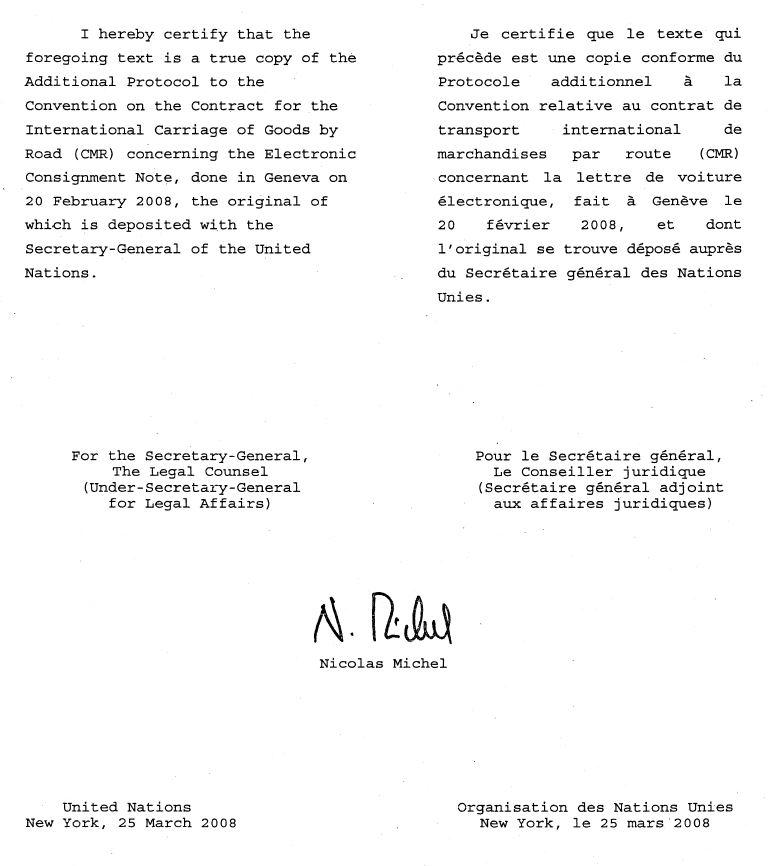

# Loi du 15 décembre 2017 portant approbation du Protocole additionnel à la Convention relative au contrat de transport international de marchandises par route (CMR) concernant la lettre de voiture électronique, fait à Genève, le 20 février 2008.

Nous Henri, Grand-Duc de Luxembourg, Duc de Nassau,

Notre Conseil d'État entendu ;

De l’assentiment de la Chambre des Députés ;

Vu la décision de la Chambre des Députés du 28 novembre 2017 et celle du Conseil d'État du 5 décembre 2017 portant qu'il n'y a pas lieu à second vote ;

Avons ordonné et ordonnons :

## Article unique.

Est approuvé le Protocole additionnel à la Convention relative au contrat de transport international de marchandises par route (CMR) concernant la lettre de voiture électronique, fait à Genève, le 20 février 2008.

Mandons et ordonnons que la présente loi soit insérée au Journal officiel du Grand-Duché de Luxembourg pour être exécutée et observée par tous ceux que la chose concerne.

Le Ministre des Affaires étrangères   et européennes,   Jean Asselborn   Le Ministre du Développement durable  *et des Infrastructures,*   François Bausch

Palais de Luxembourg, le 15 décembre 2017.   Henri

\**ADDITIONAL PROTOCOL TO THE CONVENTION ON THE CONTRACT FOR THE INTERNATIONAL CARRIAGE OF GOODS BY ROAD (CMR) CONCERNING THE ELECTRONIC CONSIGNMENT NOTE**

–––––––––––

\**PROTOCOLE ADDITIONNEL À LA CONVENTION RELATIVE AU CONTRAT DE TRANSPORT INTERNATIONAL DE MARCHANDISES PAR ROUTE (CMR) CONCERNANT LA LETTRE DE VOITURE ÉLECTRONIQUE**

\**PROTOCOLE ADDITIONNEL À LA CONVENTION RELATIVE AU CONTRAT DE TRANSPORT INTERNATIONAL DE MARCHANDISES PAR ROUTE (CMR) CONCERNANT LA LETTRE DE VOITURE ÉLECTRONIQUE**

\**ADDITIONAL PROTOCOL TO THE CONVENTION ON THE CONTRACT FOR THE INTERNATIONAL CARRIAGE OF GOODS BY ROAD (CMR) CONCERNING THE ELECTRONIC CONSIGNMENT NOTE**

\*The Parties to this Protocol,*

\*Being Parties* to the Convention on the Contract for the International Carriage of Goods by Road (CMR), done at Geneva on 19 May 1956,

\*Desirous of* supplementing the Convention in order to facilitate the optional making out of the consignment note by means of procedures used for the electronic recording and handling of data,

\*Have agreed* as follows :

## Article 1 — Definitions

For the purposes of this Protocol,

“Convention” means the Convention on the Contract for the International Carriage of Goods by Road (CMR) ;

“Electronic communication” means information generated, sent, received or stored by electronic, optical, digital or similar means with the result that the information communicated is accessible so as to be usable for subsequent reference ;

“Electronic consignment note” means a consignment note issued by electronic communication by the carrier, the sender or any other party interested in the performance of a contract of carriage to which the Convention applies, including particulars logically associated with the electronic communication by attachments or otherwise linked to the electronic communication contemporaneously with or subsequent to its issue, so as to become part of the electronic consignment note ;

“Electronic signature” means data in electronic form which are attached to or logically associated with other electronic data and which serve as a method of authentication.

## Article 2 — Scope and effect of the electronic consignment note

1\. Subject to the provisions of this Protocol, the consignment note referred to in the Convention, as well as any demand, declaration, instruction, request, reservation or other communication relating to the performance of a contract of carriage to which the Convention applies, may be made out by electronic communication.

2\. An electronic consignment note that complies with the provisions of this Protocol shall be considered to be equivalent to the consignment note referred to in the Convention and shall therefore have the same evidentiary value and produce the same effects as that consignment note.

## Article 3 — Authentication of the electronic consignment note

1\. The electronic consignment note shall be authenticated by the parties to the contract of carriage by means of a reliable electronic signature that ensures its link with the electronic consignment note. The reliability of an electronic signature method is presumed, unless otherwise proved, if the electronic signature :

(a) is uniquely linked to the signatory ;

(b) is capable of identifying the signatory ;

(c) is created using means that the signatory can maintain under his sole control ; and

(d) is linked to the data to which it relates in such a manner that any subsequent change of the data is detectable.

2\. The electronic consignment note may also be authenticated by any other electronic authentication method permitted by the law of the country in which the electronic consignment note has been made out.

3\. The particulars contained in the electronic consignment note shall be accessible to any party entitled thereto.

## Article 4 — Conditions for the establishment of the electronic consignment note

1\. The electronic consignment note shall contain the same particulars as the consignment note referred to in the Convention.

2\. The procedure used to issue the electronic consignment note shall ensure the integrity of the particulars contained therein from the time when it was first generated in its final form. There is integrity when the particulars have remained complete and unaltered, apart from any addition or change which arises in the normal course of communication, storage and display.

3\. The particulars contained in the electronic consignment note may be supplemented or amended in the cases authorized by the Convention.

The procedure used for supplementing or amending the electronic consignment note shall make it possible to detect as such any supplement or amendment to the electronic consignment note and shall preserve the particulars originally contained therein.

## Article 5 — Implementation of the electronic consignment note

1\. The parties interested in the performance of the contract of carriage shall agree on the procedures and their implementation in order to comply with the requirements of this Protocol and the Convention, in particular as regards :

(a) The method for the issuance and the delivery of the electronic consignment note to the entitled party ;

(b) An assurance that the electronic consignment note retains its integrity ;

(c) The manner in which the party entitled to the rights arising out of the electronic consignment note is able to demonstrate that entitlement ;

(d) The way in which confirmation is given that delivery to the consignee has been effected ;

(e) The procedures for supplementing or amending the electronic consignment note ; and

(f) The procedures for the possible replacement of the electronic consignment note by a consignment note issued by different means.

2\. The procedures in paragraph 1 must be referred to in the electronic consignment note and shall be readily ascertainable.

## Article 6 — Documents supplementing the electronic consignment note

1\. The carrier shall hand over to the sender, at the latter’s request, a receipt for the goods and all information necessary for identifying the shipment and for access to the electronic consignment note to which this Protocol refers.

2\. The documents referred to in Article 6, paragraph 2 (g) and Article 11 of the Convention may be furnished by the sender to the carrier in the form of an electronic communication if the documents exist in this form and if the parties have agreed to procedures enabling a link to be established between these documents and the electronic consignment note to which this Protocol refers in a manner that assures their integrity.

## FINAL PROVISIONS

### Article 7 — Signature, ratification, accession

1\. This Protocol shall be open for signature by States which are signatories to or Parties to the Convention and are either members of the Economic Commission for Europe or have been admitted to the Commission in a consultative capacity under paragraph 8 of the Commission’s terms of reference.

2\. This Protocol shall be open for signature at Geneva from 27 to 30 May 2008 inclusive and after this date, at United Nations Headquarters in New York until 30 June 2009 inclusive.

3 This Protocol shall be subject to ratification by signatory States and open for accession by non-signatory States, referred to in paragraph 1 of this article, which are Parties to the Convention.

4\. Such States as may participate in certain activities of the Economic Commission for Europe in accordance with paragraph 11 of the Commission’s terms of reference and which have acceded to the Convention may become Parties to this Protocol by acceding thereto after its entry into force.

5\. Ratification or accession shall be effected by the deposit of an instrument with the Secretary-General of the United Nations.

6\. Any instrument of ratification or accession, deposited after the entry into force of an amendment to this Protocol adopted in accordance with the provisions of Article 13 hereafter, shall be deemed to apply to the Protocol as modified by the amendment.

### Article 8 — Entry into force

1\. This Protocol shall enter into force on the ninetieth day after five of the States referred to in article 7, paragraph 3, of this Protocol, have deposited their instruments of ratification or accession.

2\. For any State ratifying or acceding to it after five States have deposited their instruments of ratification or accession, this Protocol shall enter into force on the ninetieth day after the said State has deposited its instrument of ratification or accession.

### Article 9 — Denunciation

1\. Any Party may denounce this Protocol by so notifying the Secretary-General of the United Nations.

2\. Denunciation shall take effect 12 months after the date of receipt by the Secretary-General of the notification of denunciation.

3\. Any State which ceases to be Party to the Convention shall on the same date cease to be Party to this Protocol.

### Article 10 — Termination

If, after the entry into force of this Protocol, the number of Parties is reduced, as a result of denunciations, to less than five, this Protocol shall cease to be in force from the date on which the last of such denunciations takes effect. It shall also cease to be in force from the date on which the Convention ceases to be in force.

### Article 11 — Dispute

Any dispute between two or more Parties relating to the interpretation or application of this Protocol which the Parties are unable to settle by negotiation or other means may, at the request of any one of the Parties concerned, be referred for settlement to the International Court of Justice.

### Article 12 — Reservations

1\. Any State may, at the time of signing, ratifying, or acceding to this Protocol, declare by a notification addressed to the Secretary-General of the United Nations that it does not consider itself bound by article 11 of this Protocol. Other Parties shall not be bound by article 11 of this Protocol in respect of any Party which has entered such a reservation.

2\. The declaration referred to in paragraph 1 of this article may be withdrawn at any time by a notification addressed to the Secretary-General of the United Nations.

3\. No other reservation to this Protocol shall be permitted.

### Article 13 — Amendments

1\. Once this Protocol is in force, it may be amended according to the procedure defined in this article.

2\. Any proposed amendment to this Protocol presented by a Party to this Protocol shall be submitted to the Working Party on Road Transport of the United Nations Economic Commission for Europe (UNECE) for consideration and decision.

3\. The Parties to this Protocol shall make all possible efforts to achieve consensus. If, despite these efforts, consensus is not reached on the proposed amendment, it shall require, as a last resort, for adoption a two-thirds majority of Parties present and voting. A proposed amendment adopted either by consensus or by a two-thirds majority of Parties shall be submitted by the secretariat of the United Nations Economic Commission for Europe to the Secretary-General to be circulated for acceptance to all Parties to this Protocol, as well as to signatory States.

4\. Within a period of nine months from the date on which the proposed amendment is communicated by the Secretary-General, any Party may inform the Secretary-General that it has an objection to the amendment proposed.

5\. The proposed amendment shall be deemed to have been accepted if, by the end of the period of nine months foreseen in the preceding paragraph, no objection has been notified by a Party to this Protocol. If an objection is stated, the proposed amendment shall be of no effect.

6\. In the case of a country which becomes a Contracting Party to this Protocol between the moment of notification of a proposal for amendment and the end of the nine-month period foreseen in paragraph 4 of this article, the secretariat of the Working Party on Road Transport of the Economic Commission for Europe shall notify the new State Party about the proposed amendment as soon as possible. The latter may inform the Secretary-General before the end of this period of nine months that it has an objection to the proposed amendment.

7\. The Secretary-General shall notify, as soon as possible, all the Parties of objections raised in accordance with paragraphs 4 and 6 of this Article as well as of any amendment accepted according to paragraph 5 above.

8\. Any amendment deemed to have been accepted shall enter into force six months after the date of notification of such acceptance by the Secretary- General to Parties.

### Article 14 — Convening of a diplomatic conference

1\. Once this Protocol is in force, any Party may, by notification to the Secretary-General of the United Nations, request that a conference be convened for the purpose of reviewing this Protocol. The Secretary-General shall notify all Parties of the request and a review conference shall be convened by the Secretary-General if, within a period of four months following the date of notification by the Secretary-General, not less than one fourth of the Parties to this Protocol notify him of their concurrence with the request.

2\. If a conference is convened in accordance with the preceding paragraph, the Secretary-General shall notify all the Parties and invite them to submit within a period of three months such proposals as they may wish the Conference to consider. The Secretary-General shall circulate to all Parties the provisional agenda for the Conference together with the texts of such proposals at least three months before the date on which the Conference is to meet.

3\. The Secretary-General shall invite to any conference convened in accordance with this article all States referred to in Article 7, paragraphs 1, 3 and 4, of this Protocol.

### Article 15 — Notifications to States

In addition to the notifications provided for in Articles 13 and 14, the Secretary-General of the United Nations shall notify the States referred to in Article 7, paragraph 1, above, and the States which have become Parties to this Protocol in accordance with paragraphs 3 and 4 of Article 7, of :

(a) Ratifications and accessions under Article 7 ;

(b) The dates of entry into force of this Protocol in accordance with Article 8 ;

(c) Denunciations under Article 9 ;

(d) The termination of this Protocol in accordance with Article 10 ;

(e) Declarations and notifications received in accordance with Article 12, paragraphs 1 and 2.

### Article 16 — Depositary

The original of this Protocol shall be deposited with the Secretary-General of the United Nations, who shall send certified true copies thereof to all the States referred to in Article 7, paragraphs 1, 3 and 4, of this Protocol.

DONE at Geneva, this twentieth day of February two thousand and eight, in a single copy in the English and French languages, each text being equally authentic.

\**PROTOCOLE ADDITIONNEL À LA CONVENTION RELATIVE AU CONTRAT DE TRANSPORT INTERNATIONAL DE MARCHANDISES PAR ROUTE (CMR) CONCERNANT LA LETTRE DE VOITURE ÉLECTRONIQUE**

\**PROTOCOLE ADDITIONNEL À LA CONVENTION RELATIVE AU CONTRAT DE TRANSPORT INTERNATIONAL DE MARCHANDISES PAR ROUTE (CMR) CONCERNANT LA LETTRE DE VOITURE ÉLECTRONIQUE**

\*Les Parties au présent protocole,*

\*Étant Parties à la Convention relative au contrat de transport international de marchandises par route (CMR), faite à Genève, en date du 19 mai 1956,*

\*Désireuses de compléter ladite Convention afin de faciliter l’établissement optionnel de la lettre de voiture par les procédés employés pour l’enregistrement et le traitement électroniques des données,*

\*Sont convenues de ce qui suit :*

## Article premier — Définitions

Aux fins du présent Protocole,

\*« Convention »* signifie la Convention relative au contrat de transport international de marchandises par route (CMR) ;

\*« Communication électronique »* signifie l’information enregistrée, envoyée, reçue ou conservée par des moyens électroniques, optiques, numériques ou des moyens équivalents faisant que l’information communiquée soit accessible pour être consultée ultérieurement ;

\*« Lettre de voiture électronique »* signifie une lettre de voiture émise au moyen d’une communication électronique par le transporteur, l’expéditeur ou toute autre partie intéressée à l’exécution d’un contrat de transport auquel la Convention s’applique, y compris les indications logiquement associées à la communication électronique sous forme de données jointes ou autrement liées à cette communication électronique au moment de son établissement ou ultérieurement de manière à en faire partie intégrante ;

\*« Signature électronique »* signifie des données sous forme électronique qui sont jointes ou liées logiquement à d’autres données électroniques et qui servent de méthode d’authentification.

## Article 2 — Champ d’application et portée de la lettre de voiture électronique

1\. Sous réserve des dispositions du présent Protocole, la lettre de voiture visée à la Convention, ainsi que toute demande, déclaration, instruction, ordre, réserve ou autre communication concernant l’exécution d’un contrat de transport auquel la Convention s’applique, peuvent être établies par communication électronique.

2\. Une lettre de voiture conforme au présent Protocole sera considérée comme équivalente à la lettre de voiture visée à la Convention et, de ce fait, aura la même force probante et produira les mêmes effets que cette dernière.

## Article 3 — Authentification de la lettre de voiture électronique

1\. La lettre de voiture électronique est authentifiée par les parties au contrat de transport moyennant une signature électronique fiable garantissant son lien avec la lettre de voiture électronique. La fiabilité du procédé de signature électronique est présumée, jusqu’à preuve contraire, lorsque la signature électronique :

(a) Est liée uniquement au signataire ;

(b) Permet d’identifier le signataire ;

(c) A été créée par des moyens que le signataire puisse garder sous son contrôle exclusif ; et

(d) Est liée aux données auxquelles elle se rapporte de telle sorte que toute modification ultérieure des données soit détectable.

2\. La lettre de voiture électronique peut aussi être authentifiée par tout autre procédé d’authentification électronique permis par la législation du pays où la lettre de voiture électronique a été établie.

3\. Les indications qui y sont inscrites doivent être accessibles à toute personne habilitée à cet effet.

## Article 4 — Conditions d’établissement de la lettre de voiture électronique

1\. La lettre de voiture électronique contient les mêmes indications que la lettre de voiture visée à la Convention.

2\. Le procédé employé pour l’établissement de la lettre de voiture électronique doit garantir l’intégrité des indications qu’elle contient à compter du moment où elle a été établie pour la première fois sous sa forme définitive. Il y a intégrité des indications lorsque celles-ci sont restées complètes et n’ont pas été altérées, exception faite de tout ajout et de toute modification intervenant dans le cours normal de la communication, de la conservation et de l’exposition.

3\. Les indications contenues dans la lettre de voiture électronique peuvent être complétées ou modifiées dans les cas admis par la Convention.

La procédure employée pour compléter ou modifier la lettre de voiture électronique doit permettre la détection en tant que telle de tout complément ou toute modification et assurer la préservation des indications originales de la lettre de voiture électronique.

## Article 5 — Mise en oeuvre de la lettre de voiture électronique

1\. Les parties intéressées à l’exécution du contrat de transport conviennent des procédures et de leur mise en oeuvre pour se conformer aux dispositions du présent Protocole et de la Convention, notamment en ce qui concerne :

(a) La méthode pour établir et remettre la lettre de voiture électronique à la partie habilitée ;

(b) L’assurance que la lettre de voiture électronique conservera son intégrité ;

(c) La façon dont le titulaire des droits découlant de la lettre de voiture électronique peut démontrer qu’il en est le titulaire ;

(d) La façon dont il est donné confirmation que la livraison au destinataire a eu lieu ;

(e) Les procédures permettant de compléter ou de modifier la lettre de voiture électronique ; et

(f) Les procédures de remplacement éventuel de la lettre de voiture électronique par une lettre de voiture établie par d’autres moyens.

2\. Les procédures énoncées au paragraphe 1 doivent être mentionnées dans la lettre de voiture électronique et être aisément vérifiables.

## Article 6 — Documents complétant la lettre de voiture électronique

1\. Le transporteur remet à l’expéditeur, à la demande de ce dernier, un récépissé des marchandises et toute indication nécessaire pour l’identification de l’envoi et l’accès à lettre de voiture électronique visée par le présent Protocole.

2\. Les documents visés à l’article 6, paragraphe 2, lettre g, et à l’article 11 de la Convention peuvent être fournis par l’expéditeur au transporteur sous forme de communication électronique si ces documents existent sous cette forme et si les parties ont convenu des procédures permettant d’établir un lien entre ces documents et la lettre de voiture électronique visée par le présent Protocole dans des conditions de nature à en garantir l’intégrité.

## DISPOSITIONS FINALES

### Article 7 — Signature, ratification, adhésion

1\. Le présent Protocole sera ouvert à la signature des États qui sont signataires de la Convention ou y sont Parties et qui sont soit membres de la Commission économique pour l’Europe, soit admis à cette Commission à titre consultatif conformément au paragraphe 8 du mandat de cette Commission.

2\. Le présent Protocole sera ouvert à la signature à Genève du 27 au 30 mai 2008 inclus et, après cette date, au siège des Nations Unies à New York jusqu’au 30 juin 2009 inclus.

3\. Le présent Protocole sera sujet à ratification par les États signataires et ouvert à l’adhésion des États non signataires, visés au paragraphe 1 du présent article, qui sont Parties à la Convention.

4\. Les États susceptibles de participer à certains travaux de la Commission économique pour l’Europe en application du paragraphe 11 du mandat de cette Commission et qui ont adhéré à la Convention peuvent devenir Parties au présent Protocole en y adhérant après son entrée en vigueur.

5\. La ratification ou l’adhésion sera effectuée par le dépôt d’un instrument auprès du Secrétaire général de l’Organisation des Nations Unies.

6\. Tout instrument de ratification ou d’adhésion, déposé après l’entrée en vigueur d’un amendement au présent Protocole adopté conformément aux dispositions de l’article 13 ci-après, est réputé s’appliquer au Protocole tel que modifié par l’amendement.

### Article 8 — Entrée en vigueur

1\. Le présent Protocole entrera en vigueur le quatre-vingt-dixième jour après que cinq des États mentionnés au paragraphe 3 de l’article 7 du présent Protocole auront déposé leur instrument de ratification ou d’adhésion.

2\. Pour chaque État qui le ratifiera ou y adhérera après que cinq États auront déposé leur instrument de ratification ou d’adhésion, le présent Protocole entrera en vigueur le quatre-vingt-dixième jour qui suivra le dépôt de l’instrument de ratification ou d’adhésion dudit État.

### Article 9 — Dénonciation

1\. Toute Partie pourra dénoncer le présent Protocole par notification adressée au Secrétaire général de l’Organisation des Nations Unies.

2\. La dénonciation prendra effet 12 mois après la date à laquelle le Secrétaire général en aura reçu notification.

3\. Tout État qui cessera d’être Partie à la Convention cessera à la même date d’être Partie au présent Protocole.

### Article 10 — Abrogation

Si, après l’entrée en vigueur du présent Protocole, le nombre de Parties se trouve, par suite de dénonciations, ramené à moins de cinq, le présent Protocole cessera d’être en vigueur à partir de la date à laquelle la dernière de ces dénonciations prendra effet. Il cessera également d’être en vigueur à partir de la date à laquelle la Convention elle-même cessera d’être en vigueur.

### Article 11 — Différend

Tout différend entre deux ou plusieurs Parties touchant l’interprétation ou l’application du présent Protocole que les Parties n’auraient pu régler par voie de négociations ou par un autre mode de règlement pourra être porté, à la requête d’une quelconque des Parties intéressées, devant la Cour internationale de Justice, pour être tranché par elle.

### Article 12 — Réserves

1\. Tout État pourra, au moment où il signera ou ratifiera le présent Protocole ou y adhérera, déclarer, par une notification adressée au Secrétaire général de l’Organisation des Nations Unies, qu’il ne se considère pas lié par l’article 11 du présent Protocole. Les autres Parties ne seront pas liées par l’article 11 du présent Protocole envers toute Partie qui aura formulé une telle réserve.

2\. La déclaration visée au paragraphe 1 du présent article pourra être retirée à tout moment par une notification adressée au Secrétaire général de l’Organisation des Nations Unies.

3\. Aucune autre réserve au présent Protocole ne sera admise.

### Article 13 — Amendements

1\. Une fois qu’il sera entré en vigueur, le présent Protocole pourra être amendé suivant la procédure définie au présent article.

2\. Toute proposition d’amendement au présent Protocole présentée par une Partie à ce Protocole sera soumise au Groupe de travail des transports routiers de la Commission économique pour l’Europe des Nations Unies (CEE-ONU) aux fins d’examen et de décision.

3\. Les Parties au présent Protocole feront tous les efforts possibles pour parvenir à un consensus. Si, malgré ces efforts, aucun consensus n’est obtenu sur l’amendement proposé, ce dernier nécessitera, en dernier ressort, pour son adoption, une majorité des deux tiers des Parties, présentes et votantes. La proposition d’amendement adoptée soit par consensus soit par la majorité des deux tiers des Parties sera soumise par le secrétariat de la Commission économique pour l’Europe des Nations Unies au Secrétaire général qui la communiquera pour acceptation à toutes les Parties au présent Protocole, ainsi qu’aux États signataires.

4\. Dans un délai de neuf mois à compter de la date de la communication par le Secrétaire général de la proposition d’amendement, toute Partie pourra faire connaître au Secrétaire général qu’elle a une objection à l’amendement proposé.

5\. L’amendement proposé sera réputé accepté si, à l’expiration du délai de neuf mois prévu au paragraphe précédent, aucune objection n’a été notifiée par une Partie à ce Protocole. Si une objection est formulée, l’amendement proposé restera sans effet.

6\. Au cas où un pays serait devenu Partie contractante à ce Protocole entre le moment de la notification d’une proposition d’amendement et l’expiration du délai de neuf mois visé au paragraphe 4 du présent article, le secrétariat du Groupe de travail des transports routiers de la Commission économique pour l’Europe notifiera le plus tôt possible l’amendement proposé au nouvel État Partie. Ce dernier pourra, avant l’expiration de ce délai de neuf mois, faire connaître au Secrétaire général qu’il a une objection à l’amendement proposé.

7\. Le Secrétaire général notifiera le plus tôt possible, à toutes les Parties au présent Protocole, les objections formulées en application des paragraphes 4 et 6 du présent article ainsi que tout amendement accepté conformément au paragraphe 5 ci-dessus.

8\. Tout amendement réputé accepté entrera en vigueur six mois après la date de sa notification par le Secrétaire général aux Parties.

### Article 14 — Convocation d’une conférence diplomatique

1\. Une fois que le présent Protocole sera entré en vigueur, toute Partie pourra, par notification adressée au Secrétaire général de l’Organisation des Nations Unies, demander la convocation d’une conférence à l’effet de réviser le présent Protocole. Le Secrétaire général notifiera cette demande à toutes les Parties et convoquera une conférence de révision si, dans un délai de 4 mois à dater de la notification adressée par lui, un quart au moins des Parties au présent Protocole lui signifient leur assentiment à cette demande.

2\. Si une conférence est convoquée conformément au paragraphe précédent, le Secrétaire général en avisera toutes les Parties et les invitera à présenter, dans un délai de trois mois, les propositions qu’elles souhaiteraient voir examiner par la Conférence. Le Secrétaire général communiquera à toutes les Parties l’ordre du jour provisoire de la Conférence, ainsi que le texte de ces propositions, trois mois au moins avant la date d’ouverture de la Conférence.

3\. Le Secrétaire général invitera à toute conférence convoquée conformément au présent article tous les États visés aux paragraphes 1, 3 et 4 de l’article 7 du présent Protocole.

### Article 15 — Notifications aux états

Outre les notifications prévues aux articles 13 et 14, le Secrétaire général de l’Organisation des Nations Unies notifiera aux États visés au paragraphe 1 de l’article 7 ci-dessus, ainsi qu’aux États devenus Parties au présent Protocole en application des paragraphes 3 et 4 de l’article 7 :

(a) Les ratifications et adhésions en vertu de l’article 7 ;

(b) Les dates auxquelles le présent Protocole entrera en vigueur conformément à l’article 8 ;

(c) Les dénonciations en vertu de l’article 9 ;

(d) L’abrogation du présent Protocole conformément à l’article 10 ;

(e) Les déclarations et notifications reçues conformément aux paragraphes 1 et 2 de l’article 12.

### Article 16 — Dépositaire

L’original du présent Protocole sera déposé auprès du Secrétaire général de l’Organisation des Nations Unies, qui en transmettra des copies certifiées conformes à tous les États visés aux paragraphes 1, 3 et 4 de l’article 7 du présent Protocole.

FAIT à Genève, le vingt février deux mille huit, en un seul exemplaire, en langues anglaise et française, les deux textes faisant également foi.

Doc. parl. [7115](https://legilux.public.lu/eli/etat/proj/pl/20170022); sess. ord. 2016-2017 et 2017-2018.
