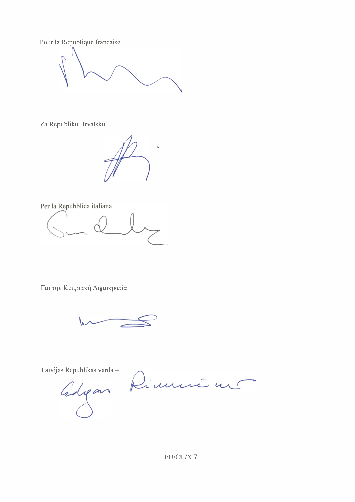
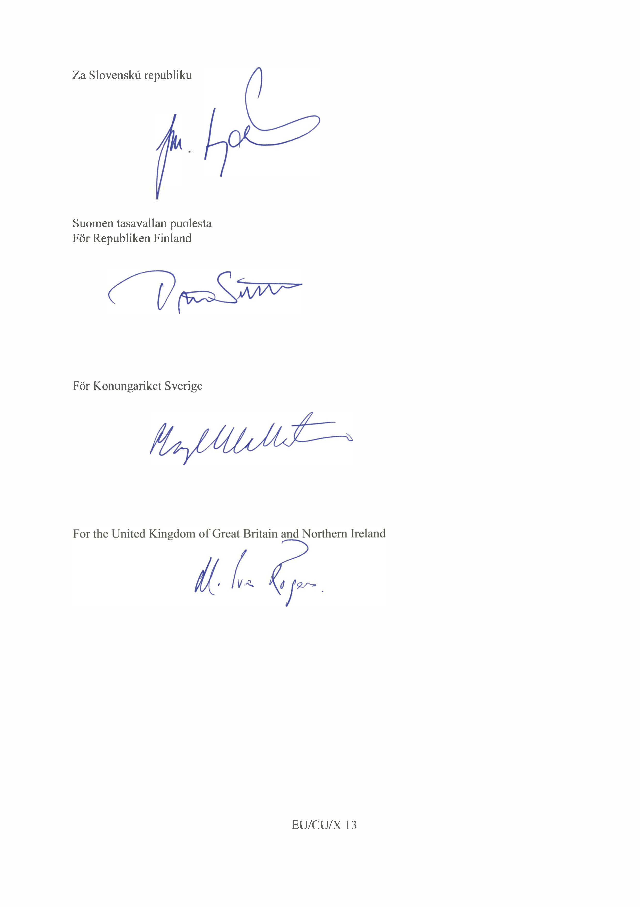
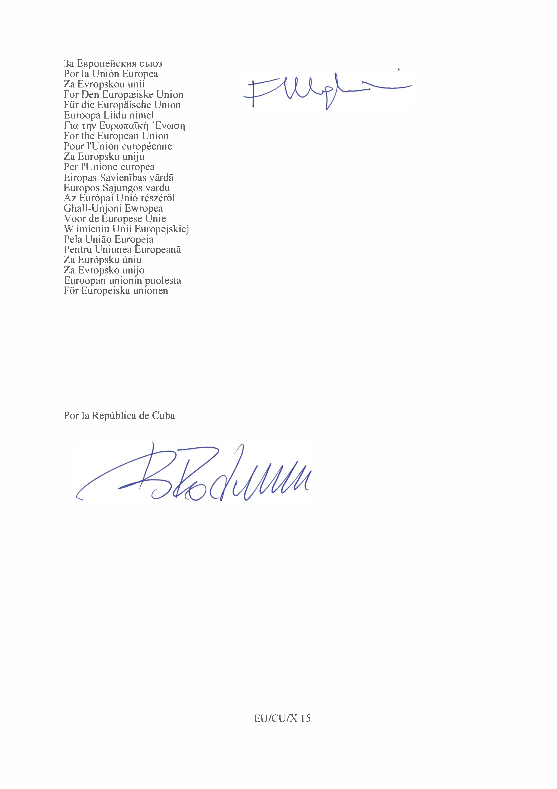

# Loi du 3 février 2018 portant approbation de l’Accord de dialogue politique et de coopération entre l’Union européenne et ses États membres, d’une part, et la République de Cuba, d’autre part, fait à Bruxelles, le 12 décembre 2016.

Nous Henri, Grand-Duc de Luxembourg, Duc de Nassau,

Notre Conseil d'État entendu ;

De l’assentiment de la Chambre des Députés ;

Vu la décision de la Chambre des Députés du 17 janvier 2018 et celle du Conseil d'État du 30 janvier 2018 portant qu'il n'y a pas lieu à second vote ;

Avons ordonné et ordonnons :

## Article unique.

Est approuvé l’Accord de dialogue politique et de coopération entre l’Union européenne et ses États membres, d’une part, et la République de Cuba, d’autre part, fait à Bruxelles, le 12 décembre 2016.

Mandons et ordonnons que la présente loi soit insérée au Journal officiel du Grand-Duché de Luxembourg pour être exécutée et observée par tous ceux que la chose concerne.

Le Ministre des Affaires étrangères et européennes,   Jean Asselborn

Château de Berg, le 3 février 2018.   Henri

Annexe

|  |
|---|
|  |
| ACCORD DE DIALOGUE POLITIQUE ET DE COOPÉRATION ENTRE L’UNION EUROPÉENNE ET SES ÉTATS MEMBRES, D’UNE PART, ET LA RÉPUBLIQUE DE CUBA, D’AUTRE PART |

LE ROYAUME DE BELGIQUE,

LA RÉPUBLIQUE DE BULGARIE,

LA RÉPUBLIQUE TCHÈQUE,

LE ROYAUME DE DANEMARK,

LA RÉPUBLIQUE FÉDÉRALE D’ALLEMAGNE,

LA RÉPUBLIQUE D’ESTONIE,

L’IRLANDE,

LA RÉPUBLIQUE HELLÉNIQUE,

LE ROYAUME D’ESPAGNE,

LA RÉPUBLIQUE FRANÇAISE,

LA RÉPUBLIQUE DE CROATIE,

LA RÉPUBLIQUE ITALIENNE,

LA RÉPUBLIQUE DE CHYPRE,

LA RÉPUBLIQUE DE LETTONIE,

LA RÉPUBLIQUE DE LITUANIE,

LE GRAND-DUCHÉ DE LUXEMBOURG,

LA HONGRIE,

LA RÉPUBLIQUE DE MALTE,

LE ROYAUME DES PAYS-BAS,

LA RÉPUBLIQUE D’AUTRICHE,

LA RÉPUBLIQUE DE POLOGNE,

LA RÉPUBLIQUE PORTUGAISE,

LA ROUMANIE,

LA RÉPUBLIQUE DE SLOVÉNIE,

LA RÉPUBLIQUE SLOVAQUE,

LA RÉPUBLIQUE DE FINLANDE,

LE ROYAUME DE SUÈDE,

LE ROYAUME-UNI DE GRANDE-BRETAGNE ET D’IRLANDE DU NORD,

parties contractantes au traité sur l’Union européenne et au traité sur le fonctionnement de l’Union européenne, ci-après dénommés « États membres de l’Union européenne », et

L’UNION EUROPÉENNE,

d’une part, et

LA RÉPUBLIQUE DE CUBA, ci-après dénommée « Cuba »,

d’autre part

CONSIDÉRANT la volonté des parties de consolider et d’approfondir les liens qui les unissent en renforçant leur dialogue politique, leur coopération et leurs relations économiques et commerciales, dans un esprit de respect mutuel et d’égalité,

SOULIGNANT l’importance que les parties attachent au renforcement du dialogue politique sur les questions bilatérales et internationales,

SOULIGNANT leur volonté de coopérer dans les enceintes internationales sur les questions d’intérêt mutuel,

AYANT À L’ESPRIT leur détermination à continuer de promouvoir le partenariat stratégique établi entre l’Union européenne et l’Amérique latine et les Caraïbes et la stratégie commune relative au partenariat Caraïbes-UE, et compte tenu des avantages mutuels de la coopération et de l’intégration régionales,

RÉAFFIRMANT le respect de la souveraineté, de l’intégrité territoriale et de l’indépendance politique de la République de Cuba,

RÉAFFIRMANT leur détermination à renforcer le multilatéralisme effectif et le rôle des Nations unies, ainsi que leur attachement à tous les principes et les buts énoncés dans la charte des Nations unies,

RÉAFFIRMANT leur respect des droits de l’homme universels tels qu’énoncés dans la déclaration universelle des droits de l’homme et dans les autres instruments internationaux applicables en matière de droits de l’homme,

RAPPELANT leur attachement aux principes reconnus de la démocratie, de la bonne gouvernance et de l’état de droit,

RÉAFFIRMANT leur détermination à promouvoir la paix et la sécurité internationales et le règlement pacifique des différends, en conformité avec les principes de la justice et du droit international,

CONSIDÉRANT leur attachement aux obligations internationales dans le domaine du désarmement et de la non-prolifération des armes de destruction massive et de leurs vecteurs, ainsi qu’à la coopération en la matière,

CONSIDÉRANT leur détermination à lutter contre le commerce et l’accumulation illicites d’armes légères et de petit calibre, dans le respect plein et entier des obligations qui leur incombent en vertu des instruments internationaux, et à coopérer dans ce domaine,

CONFIRMANT leur détermination à combattre et à éliminer toutes les formes de discrimination, y compris la discrimination fondée sur la race, la couleur ou l’origine ethnique, la religion ou les convictions, le handicap, l’âge ou l’orientation sexuelle,

SOULIGNANT leur attachement à un développement inclusif et durable et leur détermination à œuvrer ensemble à la réalisation des objectifs du programme de développement durable à l’horizon 2030,

RECONNAISSANT le statut de pays insulaire en développement de Cuba et prenant en considération les niveaux de développement respectifs des parties,

RECONNAISSANT l’importance de la coopération au développement en faveur des pays en développement, pour la durabilité de leur croissance et de leur développement et la pleine réalisation des objectifs de développement convenus au niveau international,

SE FONDANT sur le principe de la responsabilité partagée et convaincus qu’il importe de prévenir la production, le trafic et la consommation de drogues illicites,

RAPPELANT leur détermination à lutter contre la corruption, le blanchiment d’argent, la criminalité organisée, la traite des êtres humains et le trafic de migrants,

RECONNAISSANT la nécessité d’une coopération renforcée dans les domaines de la promotion de la justice, de la sécurité des citoyens et des migrations,

CONSCIENTS de la nécessité de promouvoir les objectifs du présent accord par la voie du dialogue et de la coopération entre tous les acteurs concernés, y compris, lorsque cela se justifie, les autorités régionales et locales, la société civile et le secteur privé,

RAPPELANT leurs engagements internationaux en matière de développement social, notamment dans les domaines de l’éducation, de la santé et des droits des travailleurs, ainsi que ceux qui sont liés à l’environnement,

RÉAFFIRMANT le droit souverain des États sur leurs ressources naturelles et leur responsabilité à l’égard de la préservation de l’environnement en conformité avec leur législation nationale, les principes du droit international et la déclaration de la conférence des Nations unies sur le développement durable,

RÉAFFIRMANT l’importance que les parties attachent aux principes et aux règles qui régissent le commerce international, en particulier ceux que consacrent l’accord du 15 avril 1994 instituant l’Organisation mondiale du commerce et les accords multilatéraux qui y sont annexés, ainsi qu’à la nécessité de les appliquer d’une manière transparente et non discriminatoire,

RÉAFFIRMANT leur opposition aux mesures coercitives unilatérales assorties d’effets extraterritoriaux, contraires au droit international et aux principes du libre-échange, et déterminés à promouvoir leur abrogation,

PRENANT NOTE du fait que si les parties décidaient, dans le cadre du présent accord, d’adhérer à des accords spécifiques relevant de l’espace de liberté, de sécurité et de justice, que l’Union conclurait conformément à la troisième partie, titre V, du traité sur le fonctionnement de l’Union européenne, les dispositions de ces accords futurs ne lieraient pas le Royaume-Uni et/ou l’Irlande, à moins que l’Union européenne, en même temps que le Royaume-Uni et/ou l’Irlande pour ce qui concerne leurs relations bilatérales antérieures respectives, ne notifie à Cuba que le Royaume-Uni et/ou l’Irlande sont désormais liés par ces accords en tant que membres de l’Union, conformément au protocole n° 21 sur la position du Royaume-Uni et de l’Irlande à l’égard de l’espace de liberté, de sécurité et de justice annexé au traité sur l’Union européenne et au traité sur le fonctionnement de l’Union européenne. De même, toute mesure ultérieure interne à l’Union européenne adoptée conformément à la troisième partie, titre V, du traité sur le fonctionnement de l’Union européenne aux fins de la mise en œuvre du présent accord ne lierait pas le Royaume-Uni et/ou l’Irlande, à moins qu’ils n’aient notifié leur souhait de participer à cette mesure ou de l’accepter conformément au protocole n° 21. Prenant également note du fait que ces accords futurs ou ces mesures ultérieures internes à l’Union européenne entreraient dans le champ d’application du protocole n° 22 sur la position du Danemark annexé auxdits traités,

SONT CONVENUS DE CE QUI SUIT :

PARTIE I

DISPOSITIONS GÉNÉRALES

ARTICLE PREMIER

Principes

1\. Les parties confirment leur attachement à un système multilatéral solide et effectif ainsi qu’au respect plein et entier du droit international et des buts et principes consacrés dans la charte des Nations unies.

2\. De même, elles considèrent que leur attachement aux bases établies des relations entre l’Union européenne et Cuba, qui sont centrées sur l’égalité, la réciprocité et le respect mutuel, constitue un aspect fondamental du présent accord.

3\. Les parties conviennent que toutes les mesures relevant du présent accord sont mises en œuvre en conformité avec leurs principes constitutionnels, cadres juridiques, législations, normes et réglementations respectifs, ainsi qu’avec les instruments internationaux applicables auxquels elles sont parties.

4\. Les parties confirment leur détermination à promouvoir le développement durable, qui est un principe directeur de la mise en œuvre du présent accord.

5\. Le respect et la promotion des principes démocratiques, le respect de l’ensemble des droits de l’homme et des libertés fondamentales inscrits dans la déclaration universelle des droits de l’homme et dans les instruments internationaux fondamentaux en matière de droits de l’homme et leurs protocoles facultatifs qui sont applicables aux parties, ainsi que le respect de l’état de droit constituent un élément essentiel du présent accord.

6\. Dans le cadre de leur coopération, les parties reconnaissent que tous les peuples ont le droit de déterminer librement leur système politique et de mener librement leur développement économique, social et culturel.

ARTICLE 2

Objectifs

Les parties conviennent que les objectifs du présent accord sont les suivants :

a) consolider et renforcer les relations existantes entre les parties dans les domaines du dialogue politique, de la coopération et du commerce, sur la base du respect mutuel, de la réciprocité, de l’intérêt commun et du respect de la souveraineté des parties ;

b) accompagner le processus de modernisation de l’économie et de la société cubaines en fournissant un cadre global pour le dialogue et la coopération ;

c) mener un dialogue orienté vers les résultats sur la base du droit international afin de renforcer la coopération bilatérale et l’engagement mutuel dans les enceintes internationales, en particulier les Nations unies, dans le but de renforcer les droits de l’homme et la démocratie, de parvenir à un développement durable et de mettre fin à la discrimination sous tous ses aspects ;

d) soutenir les efforts visant à atteindre les objectifs du programme de développement durable à l’horizon 2030 ;

e) promouvoir les relations commerciales et économiques en conformité avec les règles et les principes régissant le commerce international inscrits dans les accords de l’Organisation mondiale du commerce (OMC) ;

f) renforcer la coopération régionale dans les Caraïbes et en Amérique latine afin d’apporter, dans la mesure du possible, des réponses régionales aux défis régionaux et mondiaux et de promouvoir le développement durable de la région ;

g) promouvoir la compréhension en encourageant les contacts, le dialogue et la coopération entre les sociétés de Cuba et des pays de l’UE, à tous les niveaux.

PARTIE II

DIALOGUE POLITIQUE

ARTICLE 3

Objectifs

Les parties conviennent de mener un dialogue politique. Les objectifs de ce dialogue sont les suivants :

a) renforcer les relations politiques et favoriser les échanges et la compréhension mutuelle pour ce qui est des questions d’intérêt et de préoccupation communs ;

b) permettre un vaste échange de vues et d’informations entre les parties sur les positions dans les enceintes internationales et promouvoir la confiance mutuelle tout en définissant et en renforçant des approches communes, dans la mesure du possible ;

c) renforcer les Nations unies en tant qu’élément central du système multilatéral, sur la base de la charte des Nations unies et du droit international, afin de leur permettre de mener une action efficace à l’égard des défis mondiaux ;

d) continuer à promouvoir le partenariat stratégique entre l’Union européenne et la Communauté des États latino-américains et des Caraïbes (CELAC).

ARTICLE 4

Domaines et modalités

1\. Les parties conviennent que le dialogue politique a lieu à intervalles réguliers au niveau des hauts fonctionnaires et au niveau politique et qu’il couvre tous les aspects d’intérêt mutuel, que ce soit au niveau régional ou international. Les questions à aborder dans le cadre du dialogue politique sont convenues à l’avance par les parties.

2 Le dialogue politique entre les parties sert à clarifier leurs intérêts et leurs positions et vise à trouver un terrain d’entente en vue de mener des initiatives de coopération bilatérales ou des actions multilatérales dans les domaines prévus dans le présent accord ainsi que dans d’autres domaines qui pourraient être ajoutés à la suite d’un accord entre les parties.

3\. Les parties metteront en place des dialogues spécifiques dans des domaines qui le nécessitent, comme convenu d’un commun accord.

ARTICLE 5

Droits de l’homme

Dans le cadre du dialogue politique global, les parties conviennent d’instaurer un dialogue sur les droits de l’homme, en vue de renforcer la coopération pratique entre elles, tant au niveau multilatéral qu’au niveau bilatéral. L’ordre du jour de chacune des sessions de dialogue est décidé d'un commun accord par les parties, reflète leurs intérêts respectifs et aborde de façon équilibrée les droits civils et politiques et les droits économiques, sociaux et culturels.

ARTICLE 6

Commerce illicite d’armes légères et de petit calibre et d’autres armes conventionnelles

1\. Les parties reconnaissent que la fabrication, le transfert et la circulation illicites d’armes légères et de petit calibre, y compris de leurs munitions, ainsi que l’accumulation excessive, la mauvaise gestion, la sécurisation insuffisante des stocks et la dissémination incontrôlée de ces armes continuent de faire peser une grave menace sur la paix et la sécurité internationales.

2\. Les parties conviennent de respecter et de mettre pleinement en œuvre leurs obligations et leurs engagements dans ce domaine au titre des accords internationaux et des résolutions des Nations unies applicables ainsi que d’autres instruments internationaux, en se fondant sur le cadre reconnu qu’est le programme d’action des Nations unies en vue de prévenir, combattre et éliminer le commerce illicite des armes légères et de petit calibre sous tous ses aspects.

3\. Les parties réaffirment le droit naturel de légitime défense inscrit à l’article 51 de la charte des Nations unies, de même que le droit de chaque État de fabriquer, d’importer et de détenir des armes légères et de petit calibre à des fins de défense et de sécurité nationale ainsi que pour être à même de participer à des opérations de maintien de la paix conformément à la charte des Nations unies et sur la base de la décision de chacune des parties.

4\. Les parties reconnaissent l’importance des systèmes de contrôle interne du transfert d’armes conventionnelles, conformément aux instruments internationaux comme défini au paragraphe 2. Les parties reconnaissent qu’il importe d’appliquer ces contrôles de manière responsable, en vue de contribuer à la paix, à la sécurité et à la stabilité internationales et régionales, à la réduction de la souffrance humaine et à la prévention du trafic illicite d’armes conventionnelles ou de leur détournement au profit de destinataires non autorisés.

5\. Les parties conviennent en outre de coopérer aux niveaux bilatéral, régional et international et d’assurer la coordination, la complémentarité et la synergie de leurs efforts afin de garantir qu’il existe des lois, des réglementations et des procédures appropriées pour exercer un contrôle effectif sur la production, les exportations, les importations, les transferts ou les retransferts d’armes légères et de petit calibre et d’autres armes conventionnelles et pour prévenir, combattre et éliminer le commerce illicite d’armes, de manière à contribuer au maintien de la paix et de la sécurité internationales. Elles conviennent d’instaurer un dialogue politique régulier visant à accompagner et à consolider cet engagement, en tenant compte de la nature, de la portée et de l’ampleur du commerce illicite d’armes pour chaque partie.

ARTICLE 7

Désarmement et non-prolifération des armes de destruction massive

1\. Les parties, réaffirmant leur attachement à un désarmement général et complet, estiment que la prolifération des armes nucléaires, chimiques et biologiques et de leurs vecteurs, au profit d’acteurs tant étatiques que non étatiques, constitue l’une des menaces les plus graves pour la paix, la stabilité et la sécurité internationales.

2\. Les parties prennent note de la proclamation de l’Amérique latine et des Caraïbes "zone de paix", par laquelle les États de cette région s’engagent notamment à promouvoir le désarmement nucléaire, ainsi que du statut de zone exempte d’armes nucléaires de l’Amérique latine et des Caraïbes.

3\. Les parties conviennent de coopérer et de contribuer aux efforts internationaux en matière de désarmement, de non-prolifération des armes de destruction massive sous tous ses aspects, de non-prolifération de leurs vecteurs et de contrôle national des exportations d’armes, en respectant pleinement et en mettant en œuvre au niveau national les obligations qui leur incombent au titre des traités et des accords internationaux relatifs au désarmement et à la non-prolifération, les autres obligations internationales qui leur sont applicables, ainsi que les principes et les normes du droit international.

4\. Les parties conviennent que la présente disposition constitue un élément essentiel du présent accord.

5\. En outre, les parties conviennent de procéder à des échanges de vues et de coopérer afin de prendre des mesures pour, éventuellement, signer les instruments internationaux pertinents, les ratifier ou y adhérer, selon le cas, et pour mettre en œuvre les instruments auxquels elles sont parties et s’y conformer pleinement.

6\. Les parties conviennent d’instaurer un dialogue régulier dans le but d’accompagner leur coopération dans ce domaine.

ARTICLE 8

Lutte contre le terrorisme sous toutes ses formes et dans toutes ses manifestations

1\. Les parties réaffirment l’importance de prévenir et de combattre le terrorisme sous toutes ses formes et dans toutes ses manifestations et conviennent de coopérer dans le cadre d’échanges d’expériences et d’informations, dans le plein respect des principes de la charte des Nations unies, de l’état de droit et du droit international, y compris le droit international relatif aux droits de l’homme et le droit international humanitaire, en tenant compte de la stratégie antiterroriste mondiale des Nations unies contenue dans la résolution 60/288 de l’Assemblée générale des Nations unies du 8 septembre 2006 et ses révisions périodiques.

2\. À cet effet, les parties, en particulier :

a) coopèrent dans le cadre de la mise en œuvre des résolutions applicables des Nations unies et de la ratification et de la mise en œuvre des instruments juridiques universels contre le terrorisme et des autres instruments juridiques pertinents pour les parties ;

b) coopèrent en échangeant des informations sur les groupes terroristes et les réseaux qui les soutiennent, conformément au droit international et interne ;

c) coopèrent en échangeant leurs points de vue sur les moyens, les méthodes et les bonnes pratiques de lutte contre le terrorisme et l’incitation à commettre des actes de terrorisme, y compris sur le plan technique et en matière de formation, ainsi qu’en ce qui concerne la prévention du terrorisme ;

d) coopèrent en vue de favoriser un consensus international sur la lutte contre le terrorisme et son financement et sur le cadre normatif de cette lutte et œuvrent pour dégager, dès que possible, un accord sur la convention générale sur le terrorisme international, de manière à compléter les instruments de lutte contre le terrorisme déjà mis en place par les Nations unies et les autres instruments internationaux applicables en la matière auxquels elles sont parties ;

e) favorisent la coopération entre les États membres des Nations unies aux fins de la mise en œuvre effective, par tous les moyens appropriés, de la stratégie antiterroriste mondiale des Nations unies dans son ensemble.

ARTICLE 9

Crimes graves de portée internationale

1\. Les parties réaffirment que les crimes les plus graves touchant l’ensemble de la communauté internationale ne devraient pas rester impunis et que, pour ces crimes, les poursuites devraient être assurées par l’adoption de mesures sur le plan intérieur ou au niveau international, selon le cas, y compris au niveau de la Cour pénale internationale.

2\. Les parties réaffirment l’importance de coopérer avec les juridictions correspondantes conformément à leurs législations respectives et aux obligations internationales qui leur sont applicables.

3\. Les parties conviennent que les buts et les principes de la charte des Nations unies et du droit international sont essentiels à l’existence d’une juridiction pénale internationale effective et équitable, en complément des systèmes judiciaires nationaux.

4\. Les parties conviennent de coopérer en vue de renforcer le cadre juridique en matière de prévention et de répression des crimes les plus graves qui touchent la communauté internationale, notamment par des échanges d’expériences et le renforcement des capacités dans des domaines définis d’un commun accord.

ARTICLE 10

Mesures coercitives unilatérales

1\. Les parties procèdent à des échanges de vues sur les mesures coercitives à caractère unilatéral assorties d’effets extraterritoriaux, qui sont contraires au droit international et aux règles communément acceptées du commerce international, qui touchent les deux parties et qui sont utilisées comme moyen de pression politique et économique sur des États et portent atteinte à la souveraineté d’autres États.

2\. Les parties entretiennent un dialogue régulier sur l’application de ces mesures et la prévention et l’atténuation de leurs effets.

ARTICLE 11

Lutte contre la traite des êtres humains et le trafic de migrants

1\. En vue de définir des domaines et des stratégies d’action commune, les parties procèdent à des échanges de vues sur la prévention du trafic de migrants et de la traite des êtres humains sous toutes ses formes, la lutte contre ces phénomènes et sur la protection des victimes conformément à la charte des Nations unies et aux instruments internationaux applicables, notamment la convention des Nations unies contre la criminalité transnationale organisée, le protocole visant à prévenir, réprimer et punir la traite des personnes, en particulier des femmes et des enfants et le protocole contre le trafic illicite de migrants par terre, air et mer, ainsi que le plan d’action mondial des Nations unies pour la lutte contre la traite des personnes adopté par l’Assemblée générale des Nations unies dans sa résolution 64/293.

2\. Les parties se concentrent en particulier sur :

a) la promotion de législations et de politiques conformes aux dispositions de la convention des Nations unies contre la criminalité transnationale organisée, du protocole visant à prévenir, réprimer et punir la traite des personnes, en particulier des femmes et des enfants et du protocole contre le trafic illicite de migrants par terre, air et mer ;

b) les bonnes pratiques et les activités qui visent à aider à identifier, à arrêter et à poursuivre les réseaux criminels impliqués dans le trafic de migrants et la traite des êtres humains et à soutenir les victimes de ces crimes.

ARTICLE 12

Lutte contre la production, le trafic et la consommation de drogues illicites

1\. Les parties réaffirment l’importance de procéder à des échanges de vues et de bonnes pratiques dans le but de définir des domaines et des stratégies d’action commune afin de prévenir et de combattre la production, le trafic et la consommation de substances illicites dans toutes leurs variantes, y compris de nouvelles substances psychoactives, conformément à la charte des Nations unies et aux instruments internationaux applicables, en particulier les trois principales conventions des Nations unies relatives au contrôle des drogues de 1961, 1971 et 1988, la déclaration politique et la déclaration spéciale sur les principes fondamentaux de la réduction de la demande de drogues approuvées lors de la session extraordinaire de l’Assemblée générale des Nations unies de juin 1998 consacrée aux drogues, la déclaration politique et le plan d’action adoptés lors du débat de haut niveau de la 52e session de la Commission des stupéfiants des Nations unies en mars 2009 et le document final adopté à la session extraordinaire de l'Assemblée des Nations unies sur le problème mondial relatif à la drogue en avril 2016 .

2\. Les parties s’efforcent également de coopérer avec d’autres pays en vue de réduire la production et le trafic de substances illicites, dans le plein respect du droit international, de la souveraineté des États et du principe de responsabilité commune et partagée.

ARTICLE 13

Lutte contre la discrimination raciale, la xénophobie et l’intolérance qui y est associée

1\. Les parties s’engagent à participer à la lutte mondiale contre le racisme, la discrimination raciale, la xénophobie et l’intolérance qui y est associée, notamment par la ratification et la mise en œuvre universelles de la convention internationale sur l’élimination de toutes les formes de discrimination raciale.

2\. Dans ce contexte, elles procèdent à des échanges sur les bonnes pratiques en matière de stratégies et de politiques visant à promouvoir la lutte contre la discrimination raciale, la xénophobie et l’intolérance qui y est associée, en particulier sur la mise en œuvre de la déclaration et du programme d’action de Durban, sur leurs territoires ainsi qu’au niveau mondial.

3.Elles procèdent également à des échanges de vues sur les moyens les plus efficients de mettre en œuvre la décennie internationale des personnes d’ascendance africaine (2015-2024) des Nations unies.

4\. Elles examinent la possibilité de mener des actions pour lutter contre la discrimination raciale dans le cadre des Nations unies et dans d’autres enceintes.

ARTICLE 14

Développement durable

1\. Les parties saluent le programme de développement durable à l’horizon 2030 et ses objectifs de développement durable (ODD) adoptés par l’Assemblée générale des Nations unies et s’engagent à œuvrer à leur réalisation, au niveau tant national qu’international.

2\. Elles s’accordent sur l’importance d’éradiquer la pauvreté sous toutes ses formes et de parvenir à un développement durable sur les plans économique, social et environnemental d’une manière équilibrée et intégrée. À cette fin, elles réaffirment leur détermination à mettre en œuvre le programme de développement durable à l’horizon 2030, en fonction de leurs capacités et de leurs situations respectives.

3\. Les parties reconnaissent que les 17 ODD du programme de développement durable à l’horizon 2030 doivent tous être réalisés afin de réussir de mettre en place un développement durable. Elles conviennent de procéder à des échanges de vues sur la meilleure façon de coopérer pour atteindre les ODD, notamment :

a) en promouvant l’éradication de la pauvreté, de la faim, de l’analphabétisme et des mauvaises conditions de santé et en assurant une croissance économique soutenue, inclusive et durable pour tous ;

b) en donnant la priorité voulue à la résolution conjointe de tous les problèmes environnementaux, y compris le changement climatique, et en favorisant la gestion et l’utilisation durables de l’eau, des mers et des écosystèmes terrestres ;

c) en collaborant à l’autonomisation des femmes, à la réduction des inégalités au sein des pays et entre eux, à la facilitation de l’accès à la justice pour tous et à la mise en place d’institutions responsables, efficaces et inclusives à tous les niveaux.

4\. Les parties conviennent d’instaurer un dialogue spécifique sur le programme de développement durable à l’horizon 2030 afin de définir les moyens d’améliorer la coopération pratique entre elles dans le cadre général du dialogue politique. L’ordre du jour de chacune des sessions de dialogue est décidé d’un commun accord entre les parties.

5\. Les parties s’engagent à renforcer le partenariat mondial pour le développement, à favoriser la cohérence des politiques à tous les niveaux et à élaborer une approche globale innovante aux fins de la mobilisation et de l’utilisation efficace de toutes les ressources publiques, privées, internes et internationales disponibles, comme indiqué dans le programme d’action d’Addis-Abeba sur le financement du développement.

6\. Les parties reconnaissent la nécessité de procéder au suivi et au réexamen réguliers du programme de développement durable à l’horizon 2030 et du programme d’action d’Addis-Abeba sur le financement du développement, au niveau mondial dans le cadre du forum politique de haut niveau des Nations unies pour le développement durable, y compris en ce qui concerne les moyens de mise en œuvre, ainsi qu’aux niveaux national et régional, selon le cas.

7\. Les parties réaffirment qu'il est nécessaire que tous les pays développés consacrent 0,7 % de leur revenu national brut à l’aide publique au développement et que les économies émergentes et les pays à revenu intermédiaire de la tranche supérieure se fixent des objectifs afin d’accroître leur contribution à l’aide publique internationale.

PARTIE III

COOPÉRATION ET DIALOGUE SUR LES POLITIQUES SECTORIELLES

TITRE I

DISPOSITIONS GÉNÉRALES

ARTICLE 15

Objectifs

1\. L’objectif général de la coopération et du dialogue sur les politiques sectorielles dans le cadre du présent accord est de renforcer les relations bilatérales entre l’Union européenne et Cuba au moyen de ressources, de mécanismes, d’outils et de procédures.

2\. Les parties conviennent :

a) de mettre en œuvre des actions de coopération complétant les efforts de développement économique et social durable de Cuba, dans les domaines définis comme prioritaires et mentionnés aux titres I à VI de la présente partie ;

b) de favoriser un développement durable et inclusif en améliorant la complémentarité entre la croissance économique, la création d’emplois, la cohésion et la protection sociales et la protection de l’environnement ;

c) de contribuer à la réalisation des objectifs du programme de développement durable à l’horizon 2030 par des actions de coopération efficaces ;

d) de promouvoir la confiance mutuelle par des échanges de vues réguliers et par la définition de domaines de coopération touchant à des thèmes mondiaux qui présentent un intérêt pour les deux parties.

ARTICLE 16

Principes

1\. La coopération soutient et complète les efforts déployés par les parties pour mettre en œuvre les priorités fixées dans leurs propres politiques et stratégies de développement.

2\. La coopération est le résultat d’un dialogue entre les parties.

3\. Les activités de coopération sont établies au niveau tant bilatéral que régional et se complètent les unes les autres de manière à soutenir les objectifs exposés dans le présent accord.

4\. Les parties encouragent la participation de l’ensemble des acteurs concernés à leurs politiques de développement et à leur coopération, comme prévu dans le présent accord.

5\. Les parties renforcent l’efficacité de leur coopération en agissant dans des cadres convenus d’un commun accord, en tenant compte de leurs engagements internationaux multilatéraux. Elles favorisent l’harmonisation, l’alignement et la coordination entre les donateurs, ainsi que le respect des obligations mutuelles liées à la mise en œuvre des activités de coopération.

6\. Les parties conviennent de prendre en considération leurs différents niveaux de développement lors de la conception des activités de coopération.

7\. Les parties conviennent d’assurer une gestion transparente et responsable des ressources financières mises à disposition pour les actions convenues.

8\. Les parties conviennent que la coopération au titre du présent accord se déroule conformément à leurs procédures respectives établies à cet effet.

9\. La coopération vise à assurer le développement durable et la multiplication des capacités nationales, régionales et locales afin de parvenir à une viabilité à long terme.

10\. La coopération tient compte de toutes les questions transversales.

ARTICLE 17

Dialogue sur les politiques sectorielles

1\. Les parties s’efforcent de mener un dialogue sur les politiques sectorielles dans des domaines d’intérêt mutuel. Ce dialogue peut comprendre :

a) des échanges d’informations sur l’élaboration et la planification des politiques dans les secteurs concernés ;

b) des échanges de vues sur l’harmonisation du cadre juridique des parties avec les règles et les normes internationales et sur la mise en œuvre de ces règles et de ces normes ;

c) des échanges de bonnes pratiques concernant l’élaboration des politiques sectorielles, la coordination et la gestion des politiques ou des défis sectoriels spécifiques.

2\. Les parties s’efforcent d’étayer leur dialogue sur les politiques sectorielles par des mesures de coopération concrètes, lorsque cela se justifie.

ARTICLE 18

Modalités et procédures de coopération

1\. Les parties conviennent de développer leur coopération selon les modalités et les procédures suivantes :

a) assistance technique et financière, dialogue et échanges de vues et d’informations en tant que moyen de contribuer à la réalisation des objectifs du présent accord ;

b) développement de leur coopération bilatérale sur la base des priorités convenues, de manière à faire progresser et à compléter les stratégies et les politiques de développement de Cuba ;

c) promotion de la participation de Cuba aux programmes de coopération régionale de l’UE ;

d) promotion de la participation de Cuba aux programmes de coopération thématique de l’UE ;

e) promotion de la participation de Cuba, en tant que partenaire associé, aux programmes-cadres de l’Union européenne ;

f) promotion de la coopération dans des domaines d’intérêt commun entre les parties et avec des pays tiers ;

g) promotion de modalités et d’instruments innovants de coopération et de financement, afin d’améliorer l’efficacité de la coopération ;

h) poursuite de l’examen des possibilités pratiques de coopération dans leur intérêt mutuel.

2\. L’Union européenne informe Cuba des nouveaux mécanismes et instruments dont Cuba pourrait bénéficier.

3.L’aide humanitaire de l’Union sera fournie sur la base des besoins définis conjointement et en accord avec les principes humanitaires, lors de la survenance de catastrophes naturelles ou autres.

4\. Les parties établissent conjointement des procédures de travail souples afin de garantir l’efficience et l’efficacité de la coopération. Ces procédures pourraient inclure, si cela se justifie, la création d’un comité de coordination qui se réunirait régulièrement afin de planifier, de coordonner et de suivre de manière systématique toutes les actions de coopération et les activités d’information et de communication visant à faire connaître le soutien apporté aux actions par l’Union européenne.

5\. Cuba, par l’intermédiaire de ses entités déléguées compétentes :

a) accomplit toutes les procédures d’importation, en exemption de droits de douane et de taxes, relatives aux marchandises et aux intrants liés aux actions de coopération ;

b) gère, avec les autorités sanitaires et agricoles, les contrôles sanitaires, vétérinaires et phytosanitaires, chaque fois que cela est nécessaire ; et

c) accomplit les procédures de migration pour le personnel se rendant à Cuba pour les besoins des actions de coopération convenues, ainsi que les procédures afférentes à d’autres autorisations portant sur des permis de travail et de séjour temporaires pour le personnel expatrié travaillant temporairement à Cuba.

ARTICLE 19

Acteurs de la coopération

Les parties conviennent que la coopération sera mise en œuvre conformément à leurs procédures applicables par divers acteurs au sein de la société, notamment :

a) les institutions gouvernementales cubaines ou les organismes publics désignés par ces institutions ;

b) les autorités locales à différents niveaux ;

c) les organisations internationales et leurs agences ;

d) les agences de développement des États membres de l’Union européenne ; et

e) la société civile, y compris les associations scientifiques, techniques, culturelles, artistiques, sportives, d’amitié et de solidarité, les organisations sociales, les syndicats et les coopératives.

ARTICLE 20

Secteurs de coopération

1\. Les parties conviennent de coopérer essentiellement dans les secteurs mentionnés aux titres I à VI de la présente partie.

2\. Les parties conviennent que les actions de coopération à définir tiennent compte des éléments suivants en tant que vecteurs horizontaux et stratégiques de développement :

a) le développement durable ;

b) les droits de l’homme et la bonne gouvernance ;

c) la durabilité environnementale ;

d) la prévention des catastrophes ;

e) la dimension hommes-femmes ;

f) les personnes en situation de vulnérabilité ;

g) le renforcement des capacités nationales ; et

h) la gestion des connaissances.

ARTICLE 21

Moyens de la coopération et protection des intérêts financiers des parties

1\. Les parties conviennent, dans les limites de leurs ressources et de leurs réglementations respectives, de mettre à disposition des moyens appropriés, y compris financiers, pour permettre la réalisation des objectifs de la coopération énoncés dans le présent accord.

2\. Les parties utilisent l’assistance financière conformément aux principes de bonne gestion financière et coopèrent pour protéger leurs intérêts financiers. Les parties prennent des mesures efficaces afin de prévenir et de combattre la fraude, la corruption et toute autre activité illégale, notamment en instaurant une entraide administrative et judiciaire dans les domaines visés par le présent accord. Tout autre accord ou instrument de financement conclu ultérieurement entre les parties renferme des clauses spécifiques de coopération financière concernant des actions de contrôle coordonnées telles que des contrôles sur place, des inspections et des mesures antifraude, notamment ceux menés par l’Office européen de lutte antifraude et l’auditeur général de la République de Cuba.

TITRE II

DÉMOCRATIE, DROITS DE L’HOMME ET BONNE GOUVERNANCE

ARTICLE 22

Démocratie et droits de l’homme

1\. Conscientes que la protection et la promotion des droits de l’homme et des libertés fondamentales sont la responsabilité première des gouvernements, gardant à l’esprit l’importance des particularités nationales et régionales et des divers contextes historiques, culturels et religieux et reconnaissant qu’il est de leur devoir de protéger l’ensemble des droits de l’homme et des libertés fondamentales indépendamment de leurs systèmes politiques, économiques et culturels, les parties conviennent de coopérer dans le domaine de la démocratie et des droits de l’homme.

2\. Les parties reconnaissent que la démocratie est fondée sur la volonté librement exprimée des peuples de déterminer leurs propres systèmes politique, économique, social et culturel et sur leur pleine participation à tous les aspects de la vie.

3\. Les parties conviennent de coopérer en vue de renforcer la démocratie et leur capacité à appliquer les principes et les pratiques de la démocratie et des droits de l’homme, y compris les droits des minorités.

4\. La coopération peut notamment comprendre des activités, convenues d’un commun accord entre les parties, visant à :

a) assurer le respect et la défense de la déclaration universelle des droits de l’homme, ainsi que la promotion et la protection des droits civils, politiques, économiques, sociaux et culturels pour tous ;

b) aborder les droits de l’homme dans le monde entier de façon juste et équitable, sur un pied d’égalité et avec la même attention, en reconnaissant que tous les droits de l’homme sont universels, indissociables, interdépendants et intimement liés ;

c) mettre en œuvre de manière effective les instruments internationaux en matière de droits de l’homme et les protocoles facultatifs applicables à chaque partie, ainsi que les recommandations émanant des organes de défense des droits de l’homme des Nations unies et acceptées par les parties ;

d) intégrer la promotion et la protection des droits de l’homme dans les politiques et les programmes de développement internes ;

e) faire connaître et promouvoir l’éducation aux droits de l’homme, à la démocratie et à la paix ;

f) renforcer les institutions démocratiques et les institutions œuvrant en faveur des droits de l’homme, ainsi que les cadres juridiques et institutionnels favorisant la promotion et la protection des droits de l’homme ;

g) élaborer des initiatives communes d’intérêt mutuel dans le cadre des enceintes multilatérales compétentes.

ARTICLE 23

Bonne gouvernance

1\. Les parties conviennent que la coopération dans le domaine de la bonne gouvernance repose sur le respect strict des principes de la charte des Nations unies et du droit international.

2\. La coopération peut notamment comprendre des activités, convenues d’un commun accord entre les parties, visant à :

a) garantir le respect de l’état de droit ;

b) promouvoir des institutions transparentes, responsables, efficientes, stables et démocratiques ;

c) procéder à des échanges d’expériences et au renforcement des capacités en ce qui concerne les questions juridiques et l’appareil judiciaire ;

d) procéder à des échanges d’informations concernant les systèmes juridiques et la législation ;

e) promouvoir l’échange de bonnes pratiques concernant la bonne gouvernance, l’obligation de rendre des comptes et la transparence en matière de gestion à tous les niveaux ;

f) travailler ensemble à la mise en place de processus politiques plus inclusifs permettant la participation effective de tous les citoyens.

ARTICLE 24

Renforcement des institutions et de l’état de droit

Les parties accordent une importance particulière à la consolidation de l’état de droit, y compris l’accès à la justice et le droit à un procès équitable, ainsi qu’au renforcement des institutions à tous les niveaux dans les domaines liés à la mise en application de la loi et à l’administration de la justice.

ARTICLE 25

Modernisation de l’administration publique

Les parties conviennent, en vue de la modernisation de leur administration publique, de coopérer en ce qui concerne, entre autres :

a) l’amélioration de l’efficience organisationnelle ;

b) le renforcement de l’efficacité des institutions sur le plan des services fournis ;

c) l’amélioration de la gestion transparente des ressources publiques et de l’obligation de rendre des comptes ;

d) l’échange d’expériences touchant à l’amélioration du cadre juridique et institutionnel ;

e) le renforcement des capacités dans les domaines, entre autres, de la conception, de la mise en œuvre et de l’évaluation des politiques en rapport avec la prestation des services publics, de l’administration publique en ligne et de la lutte contre la corruption ;

f) l’échange de vues et de bonnes pratiques en matière de gestion des finances publiques ;

g) le renforcement des processus de décentralisation, conformément à leurs stratégies nationales de développement économique et social.

ARTICLE 26

Prévention et résolution des conflits

1\. Les parties conviennent de procéder à des échanges d’expériences et de bonnes pratiques en matière de prévention et de résolution des conflits sur la base d’une vision commune tendant à s’attaquer aux causes profondes des conflits.

2\. La coopération dans le domaine de la prévention et de la résolution des conflits vise à renforcer les capacités permettant de résoudre les conflits et peut notamment comprendre un soutien aux processus de médiation, de négociation et de réconciliation et aux efforts plus larges déployés pour favoriser la confiance et la consolidation de la paix aux niveaux régional et international.

TITRE III

PROMOTION DE LA JUSTICE, SÉCURITÉ DES CITOYENS ET MIGRATIONS

ARTICLE 27

Protection des données à caractère personnel

1\. Les parties conviennent de coopérer afin de garantir un niveau élevé de protection des données à caractère personnel conformément aux normes adoptées au niveau multilatéral et aux autres pratiques et instruments juridiques internationaux.

2 La coopération dans le domaine de la protection des données à caractère personnel peut inclure, entre autres, le renforcement des capacités, une assistance technique et l’échange d’informations, comme convenu d’un commun accord entre les deux parties.

ARTICLE 28

Drogues illicites

1\. Les parties coopèrent pour garantir une approche globale, intégrée et équilibrée de prévention et de lutte contre le problème mondial de la drogue au moyen d’une action et d’une coordination efficaces entre les autorités compétentes, notamment dans les domaines de la santé, de l’éducation, du respect de la loi, des douanes, des affaires sociales, de la justice et des affaires intérieures, en vue de l’élimination ou de la limitation autant que possible de la production et de la réduction de l’offre, du trafic, de la demande et de la détention de drogues illicites, en conformité avec la législation interne en la matière et dans le respect des droits de l’homme. Cette coopération vise aussi à atténuer les effets des drogues illicites, à aider les victimes par l’octroi d’un traitement non discriminatoire et inclusif, à s’attaquer à la production et à la consommation de nouvelles substances psychoactives et à prévenir plus efficacement le détournement de précurseurs utilisés dans la fabrication illicite de stupéfiants et de substances psychotropes.

2\. Les parties s’entendent sur les modalités de la coopération à mettre en œuvre pour réaliser lesdits objectifs. Les actions sont fondées sur des principes définis d’un commun accord en conformité avec les conventions internationales applicables, en particulier les trois principales conventions des Nations unies relatives au contrôle des drogues de 1961, 1971 et 1988, la déclaration politique et la déclaration spéciale sur les principes fondamentaux de la réduction de la demande de drogues approuvées lors de la session extraordinaire de l’Assemblée générale des Nations unies de juin 1998 consacrée aux drogues, la déclaration politique et le plan d’action adoptés lors du débat de haut niveau de la 52e session de la Commission des stupéfiants des Nations unies en mars 2009 et le document final adopté à la session extraordinaire de l'Assemblée des Nations unies sur le problème mondial relatif à la drogue en avril 2016.

3\. Sans préjudice d’autres mécanismes de coopération, les parties conviennent de recourir à cette fin, au niveau interrégional, au mécanisme de coordination et de coopération en matière de drogues entre l’Union européenne, l’Amérique latine et les Caraïbes, et de coopérer en vue de renforcer son efficacité.

4\. Les parties conviennent également de coopérer dans la lutte contre le trafic de drogues lié à des activités criminelles, au moyen d’une coordination accrue avec les instances et les organes internationaux compétents, y compris dans le domaine de la coopération policière et judiciaire.

5\. Les parties procéderont à des échanges d’expériences dans des domaines tels que la conception des politiques, des législations et des institutions, la formation du personnel, la recherche en matière de drogues, la prévention, le traitement, la réadaptation et la réinsertion sociale des consommateurs de drogue, dans le but de réduire autant que possible les conséquences négatives qu'entraîne l'abus de la drogue sur les plans sanitaire et social.

ARTICLE 29

Blanchiment d’argent

1\. Les parties conviennent de coopérer pour prévenir et combattre l’utilisation de leurs institutions et systèmes financiers et de certaines activités et professions du secteur non financier aux fins du blanchiment de capitaux provenant d’activités criminelles, telles que le trafic de drogues illicites et la corruption, et aux fins du financement du terrorisme.

2\. Les deux parties conviennent d’échanger des bonnes pratiques, de l’expertise, des initiatives de renforcement des capacités et des formations, comme convenu d’un commun accord, concernant l’assistance technique et administrative ayant pour objet l’élaboration et la mise en œuvre de réglementations et le fonctionnement efficace des mécanismes destinés à lutter contre le blanchiment d’argent et le financement du terrorisme.

3\. La coopération porte essentiellement sur :

a) des échanges d’informations utiles dans les cadres législatifs respectifs des parties ;

b) l’adoption et la mise en œuvre effective de normes appropriées de lutte contre le blanchiment d’argent et le financement du terrorisme, équivalentes à celles adoptées par les organes internationaux compétents actifs dans ce domaine, comme le groupe d’action financière et le groupe d’action financière d’Amérique latine, selon le cas.

ARTICLE 30

Criminalité organisée

1\. Les parties conviennent de coopérer pour prévenir et combattre la criminalité organisée, y compris transnationale, et la criminalité financière. À cet effet, elles encouragent et échangent de bonnes pratiques et mettent en œuvre les normes et les instruments établis au niveau international en la matière, tels que la convention des Nations unies contre la criminalité transnationale organisée et ses protocoles additionnels et la convention des Nations unies contre la corruption.

2\. Les parties conviennent également de coopérer pour améliorer la sécurité des citoyens, en soutenant notamment les politiques et les stratégies de sécurité. Cette coopération contribue à la prévention de la criminalité et peut englober des activités telles que des projets de coopération régionale entre les services de police et les autorités judiciaires, des programmes de formation et l’échange de bonnes pratiques en matière de profilage criminel. Elle comprend également, entre autres, des échanges de vues sur les cadres législatifs, une assistance administrative et technique visant à renforcer les capacités institutionnelles et opérationnelles des autorités chargées du respect de la loi, ainsi que des échanges d’informations et des mesures destinées à renforcer la coopération en matière d’enquêtes.

ARTICLE 31

Lutte contre la corruption

1\. Les parties coopèrent en vue de mettre en œuvre et de promouvoir les normes et les instruments internationaux applicables, tels que la convention des Nations unies contre la corruption.

2\. Les parties coopèrent notamment pour :

a) améliorer l’efficacité organisationnelle et garantir une gestion transparente des ressources publiques et l’obligation de rendre des comptes, avec la participation des différentes institutions mises en place pour lutter contre la corruption ;

b) échanger des bonnes pratiques afin de renforcer les institutions compétentes, y compris les autorités chargées du respect de la loi et les autorités judiciaires ;

c) prévenir la corruption dans les transactions internationales ;

d) évaluer la mise en œuvre des politiques de lutte contre la corruption aux niveaux local, régional, national et international dans le cadre du mécanisme d’examen de la mise en œuvre de la convention des Nations unies contre la corruption ;

e) encourager les actions visant à promouvoir une culture de la transparence, la légalité et un changement de mentalité à l’égard des pratiques de corruption ;

f) faciliter les mesures d’identification et de recouvrement des actifs, promouvoir les bonnes pratiques et renforcer les capacités.

ARTICLE 32

Commerce illicite d’armes légères et de petit calibre

1\. Les parties conviennent de coopérer pour prévenir et combattre le trafic illicite d’armes légères et de petit calibre, y compris de leurs pièces, éléments et munitions, en mettant en œuvre le cadre reconnu que constitue le programme d’action des Nations unies en vue de prévenir, combattre et éliminer le commerce illicite des armes légères et de petit calibre sous tous ses aspects. Dans ce contexte, elles conviennent de coopérer en vue de l’échange d’expériences et de formations entre les autorités compétentes, y compris les autorités douanières, policières et de contrôle.

2\. Comme indiqué dans le programme d’action des Nations unies visé au paragraphe 1, les parties réaffirment notamment dans ce contexte le droit naturel de légitime défense, individuelle ou collective, inscrit à l’article 51 de la charte des Nations unies, de même que le droit de chaque État de fabriquer, d’importer et de détenir des armes légères et de petit calibre pour ses besoins d’autodéfense et de sécurité ainsi que pour être à même de participer à des opérations de maintien de la paix conformément à la charte des Nations unies et sur la base de la décision de chacune des parties.

ARTICLE 33

Lutte contre le terrorisme

1\. Les parties coopéreront en matière de lutte contre le terrorisme en mettant en œuvre le cadre et les normes convenus à l’article 8.

2\. Les parties coopèrent également afin de veiller à ce que toute personne qui participe au financement, à l’organisation, à la préparation ou à la perpétration d’actes de terrorisme ou apporte son appui à de tels actes soit traduite en justice. Les parties conviennent que la lutte contre le terrorisme est menée dans le respect des résolutions pertinentes des Nations unies, ainsi que de la souveraineté des parties, de la régularité de la procédure, des droits de l’homme et des libertés fondamentales.

3\. Les parties conviennent de coopérer en vue de prévenir et d’éliminer les actes terroristes, au moyen de la coopération policière et judiciaire.

4\. Il convient que les parties, qui se sont engagées à suivre la stratégie antiterroriste mondiale des Nations unies, encouragent sa mise en œuvre équilibrée et conviennent de prendre les mesures qu’elle prescrit, le cas échéant, aussi efficacement que possible, en vue de mettre fin à la menace terroriste.

5\. Les parties conviennent également de coopérer dans le cadre des Nations unies pour finaliser le projet d’accord relatif à la convention générale sur le terrorisme international.

ARTICLE 34

Migrations, traite des êtres humains et trafic de migrants

1\. La coopération est entreprise à la lumière des consultations entre les parties concernant leurs besoins et leurs positions et est mise en œuvre conformément aux cadres législatifs des parties. Elle sera notamment axée sur :

a) les causes profondes des migrations ;

b) l’élaboration et la mise en œuvre de la législation et des pratiques nationales en matière de protection internationale, dans le respect des principes et des normes du droit international, notamment le principe de la protection internationale dans les cas où cela s’applique ;

c) les règles d’admission, ainsi que les droits et le statut des personnes admises, le traitement équitable et l’intégration des non-ressortissants en situation légale, l’éducation et la formation des migrants légaux et les mesures de lutte contre le racisme et la xénophobie, ainsi que toutes les dispositions applicables en matière de droits de l’homme concernant les migrants ;

d) l’évaluation des mécanismes et des politiques visant à faciliter les transferts de fonds ;

e) les échanges de vues et de bonnes pratiques, ainsi que les discussions sur les questions d’intérêt commun relatives à la migration circulaire et à la prévention de la fuite des cerveaux ;

f) l’échange d’expériences et de bonnes pratiques, la coopération technique, technologique, opérationnelle et judiciaire, selon les besoins et ce qui est mutuellement acceptable, sur les questions liées à la lutte contre la traite des êtres humains et le trafic de migrants, y compris la lutte contre les réseaux criminels et les organisations criminelles de trafiquants et de passeurs, et l’offre d’une protection, d’une assistance et d’un soutien aux victimes de ces crimes ;

g) le retour, dans des conditions humaines, sûres et dignes, des personnes en séjour illégal sur le territoire de l’autre partie, dans le plein respect de leurs droits fondamentaux, notamment par l’encouragement au retour volontaire et la réadmission de ces personnes, conformément au paragraphe 2 ;

h) les mesures de soutien visant à permettre la réinsertion durable des personnes rapatriées.

2\. Dans le cadre de la coopération visant à prévenir et à maîtriser l’immigration clandestine et sans préjudice de la nécessité de protéger les victimes de la traite des êtres humains, les parties conviennent en outre :

a) d’identifier leurs ressortissants présumés et de procéder à la réadmission de leurs ressortissants présents illégalement sur le territoire d’un État membre de l’Union européenne ou de Cuba dans les délais requis et en conformité avec les normes et procédures fixées par la législation applicable en matière de migration des États membres de l’Union européenne et de Cuba, sur demande et sans retard indu ni autres formalités, une fois leur nationalité établie ;

b) de fournir à leurs ressortissants devant faire l’objet d’une réadmission les documents d’identité appropriés à cette fin.

3\. Les parties conviennent de négocier, sur demande et dans les meilleurs délais, un accord régissant les obligations spécifiques incombant aux États membres de l’Union européenne et à Cuba en matière de migration, notamment en matière de réadmission.

ARTICLE 35

Protection consulaire

Cuba convient que les autorités diplomatiques et consulaires de tout État membre de l’Union européenne représenté offrent une protection à tout ressortissant d’un autre État membre qui ne dispose pas d’une représentation permanente effectivement en mesure d’assurer à ce ressortissant une protection consulaire dans les mêmes conditions que celles qui s’appliquent aux ressortissants de cet État membre de l’Union européenne.

ARTICLE 36

Société civile

Les parties reconnaissent la contribution potentielle de la société civile, notamment des milieux universitaires, des groupes de réflexion et des médias, à la réalisation des objectifs du présent accord. Elles conviennent d’encourager les actions en faveur d’une plus grande participation de la société civile à l’élaboration et à la mise en œuvre des activités de coopération au développement et de coopération sectorielle pertinentes, y compris par un renforcement des capacités dans ce domaine.

TITRE IV

DÉVELOPPEMENT SOCIAL ET COHÉSION SOCIALE

ARTICLE 37

Développement social et cohésion sociale

1\. Les parties, reconnaissant que le développement social doit aller de pair avec le développement économique, conviennent de coopérer pour renforcer la cohésion sociale par la réduction de la pauvreté, des injustices, des inégalités et de l’exclusion sociale, notamment en vue de la réalisation des objectifs du programme de développement durable à l’horizon 2030 et de l’objectif consistant à promouvoir un travail décent pour tous, adopté au niveau international. Pour réaliser ces objectifs, les parties mobiliseront d’importantes ressources financières, provenant à la fois des ressources de coopération et des ressources internes.

2\. À cet effet, les parties coopèrent pour encourager et échanger les bonnes pratiques concernant :

a) des politiques économiques porteuses d’une vision sociale axée sur une société plus inclusive, garantissant une meilleure distribution des revenus et, partant, une réduction des inégalités et des injustices ;

b) les politiques commerciales et d’investissement, en gardant à l’esprit le lien entre commerce et développement durable, le commerce équitable, le développement rural et les entreprises urbaines publiques et privées et leurs organisations représentatives, et la responsabilité sociale des entreprises ;

c) des politiques budgétaires équitables et saines, permettant une meilleure redistribution des richesses et assurant des niveaux adéquats de dépenses sociales ;

d) des dépenses publiques efficaces dans le domaine social, associées à des objectifs sociaux clairement définis sur la base d’une approche axée sur les résultats ;

e) l’amélioration et la consolidation de politiques sociales efficaces, assurant à tous un accès équitable aux services sociaux dans toute une série de secteurs comme l’éducation, la santé, la nutrition, l’assainissement, le logement, la justice et la sécurité sociale ;

f) des politiques de l’emploi visant à garantir à tous un travail décent, conformément aux normes du travail internationales et nationales, et à créer des perspectives économiques, en mettant l’accent sur les groupes les plus pauvres et les plus vulnérables et sur les régions les plus défavorisées ;

g) des régimes de protection sociale plus inclusifs et complets en ce qui concerne, entre autres, les pensions, la santé, les accidents et le chômage, sur la base du principe de solidarité et du principe de non-discrimination ;

h) les stratégies et les politiques de lutte contre la xénophobie et les discriminations fondées, entre autres, sur le genre, la race, les convictions, l’appartenance ethnique ou le handicap ;

i) des politiques et programmes spécifiquement destinés aux jeunes et visant à favoriser leur pleine intégration dans la vie économique, politique et sociale.

3\. Les parties conviennent d’encourager l’échange d’informations et d’expériences sur les aspects liés au développement social et à la cohésion sociale des plans ou programmes internes.

ARTICLE 38

Emploi et protection sociale

Les parties conviennent de coopérer pour promouvoir l’emploi et la protection sociale au moyen d’actions et de programmes visant notamment à :

a) garantir un travail décent pour tous ;

b) créer des marchés du travail plus inclusifs et garantir leur bon fonctionnement ;

c) étendre la couverture de la protection sociale ;

d) encourager le dialogue social ;

e) assurer le respect des normes fondamentales du travail définies par les conventions de l’Organisation internationale du travail ;

f) traiter les questions relatives à l’économie informelle ;

g) accorder une attention particulière aux groupes défavorisés et à la lutte contre les discriminations ;

h) accroître la qualité des ressources humaines par l’amélioration de l’éducation et de la formation, y compris par la mise en place d’un système performant de formation professionnelle ;

i) améliorer les conditions de travail du point de vue de la santé et de la sécurité, notamment en renforçant les inspections du travail et en encourageant les améliorations dans les domaines de la santé et de la sécurité ;

j) stimuler la création d’emplois et l’esprit d’entreprise en renforçant le cadre institutionnel nécessaire à la création d’entreprises et en facilitant l’accès au crédit.

ARTICLE 39

Éducation

1\. Les parties conviennent de partager leurs expériences et bonnes pratiques en ce qui concerne la poursuite du développement dans le domaine de l’éducation à tous les niveaux.

2\. Les parties conviennent que la coopération vise à favoriser le développement des ressources humaines à tous les niveaux de l’éducation, notamment au niveau de l’enseignement supérieur, et à couvrir les besoins particuliers dans ce domaine. Les parties favorisent les échanges d’étudiants, de chercheurs et d’universitaires dans le cadre des programmes existants et améliorent le renforcement des capacités en vue de moderniser leurs systèmes d’enseignement supérieur.

ARTICLE 40

Santé publique

1\. Les parties conviennent de coopérer dans des domaines d’intérêt commun concernant le secteur de la santé, notamment la recherche scientifique, la gestion des systèmes de santé, l’alimentation, les produits pharmaceutiques, la médecine préventive et la santé sexuelle et génésique, notamment la prévention et le contrôle des maladies transmissibles telles que le VIH/sida, les maladies non transmissibles telles que le cancer et les maladies cardiaques, et d’autres menaces sanitaires majeures, comme la dengue, le chikungunya et le virus Zika. Les parties conviennent également de coopérer pour favoriser la mise en œuvre des accords internationaux en matière de santé auxquels elles sont parties.

2\. Les parties conviennent d’accorder une attention particulière aux actions et programmes régionaux mis en œuvre dans le domaine de la santé publique.

ARTICLE 41

Protection des consommateurs

Les parties conviennent de coopérer sur les questions relatives à la protection des consommateurs en vue de protéger la santé humaine et les intérêts des consommateurs.

ARTICLE 42

Culture et patrimoine

1\. Les parties s’engagent à promouvoir la coopération dans le domaine de la culture, qui inclut le patrimoine culturel, dans le plein respect de leur diversité. En conformité avec leurs législations respectives, cette coopération doit renforcer la compréhension mutuelle et le dialogue interculturel et favoriser des échanges culturels équilibrés et les contacts avec les acteurs concernés, y compris les organisations de la société civile des deux parties.

2\. Les parties favorisent la coopération dans les domaines des arts, de la littérature et de la musique, notamment par l’échange d’expériences.

3\. La coopération entre les parties s’inscrit dans le respect des dispositions internes applicables en matière de droits d’auteur et d’autres dispositions ayant trait au domaine culturel, ainsi que des accords internationaux auxquels elles sont parties.

4\. Les parties conviennent de favoriser la coopération dans le domaine de la restauration et de la gestion durable du patrimoine. La coopération dans ce domaine inclut, entre autres, la sauvegarde et la promotion du patrimoine naturel et culturel matériel et immatériel, y compris la prévention du trafic illicite des biens culturels et la lutte contre celui-ci, conformément aux instruments internationaux applicables.

5\. Les parties conviennent d’encourager la coopération dans les secteurs de l’audiovisuel et des médias, y compris la radio et la presse, grâce à des initiatives conjointes en matière de formation, ainsi que des activités de conception, de production et de distribution de contenus audiovisuels, notamment dans les domaines de l’éducation et de la culture.

6\. Les parties encouragent la coordination dans le cadre de l’UNESCO, en vue de favoriser la diversité culturelle, notamment par des consultations sur la ratification et l’application de la convention de l’UNESCO sur la protection et la promotion de la diversité des expressions culturelles. La coopération vise aussi à encourager la diversité culturelle.

ARTICLE 43

Personnes en situation de vulnérabilité

1\. Les parties conviennent de veiller à ce que la coopération en faveur des personnes vulnérables privilégie les mesures, y compris les politiques et les projets innovants, associant les personnes en situation de vulnérabilité. Cette coopération doit viser à favoriser le développement humain, à améliorer les conditions de vie et à promouvoir la pleine intégration de ces personnes dans la société.

2\. La coopération comprend l’échange d’expériences sur la protection des droits de l’homme, la promotion et la mise en œuvre de politiques visant à garantir l’égalité des chances pour les personnes en situation de vulnérabilité, la création de perspectives économiques et la promotion de politiques sociales spécifiques axées sur le développement des capacités humaines par l’éducation et la formation, l’accès aux services sociaux de base, aux dispositifs de protection sociale et à la justice, l’accent étant mis tout particulièrement, entre autres, sur les personnes handicapées et leurs familles, les enfants et les personnes âgées.

ARTICLE 44

Dimension hommes-femmes

1\. Les parties conviennent que la coopération contribuera à consolider les politiques, les programmes et les mécanismes visant à assurer, à améliorer et à renforcer la participation et les chances de participation, sur un pied d’égalité, des hommes et des femmes à la vie politique, économique, sociale et culturelle, notamment en vue de la mise en œuvre effective de la convention sur l’élimination de toutes les formes de discrimination à l’égard des femmes et de la déclaration et du programme d’action de Pékin. Le cas échéant, des actions positives sont menées en faveur des femmes.

2\. La coopération favorise l’intégration de la dimension hommes-femmes dans tous les domaines de la coopération concernés, y compris les politiques publiques, les stratégies et actions de développement, ainsi que d’indicateurs destinés à mesurer leur impact.

3\. La coopération contribue également à faciliter l’égalité d’accès des hommes et des femmes à l’ensemble des services et des ressources leur permettant d’exercer pleinement leurs droits fondamentaux, notamment en ce qui concerne l’éducation, la santé, la formation professionnelle, les possibilités d’emploi, la prise de décisions politiques, les structures de gouvernance et les entreprises privées.

4\. Une attention particulière est accordée aux programmes visant à prévenir et à combattre toutes les formes de violence à l’égard des femmes.

ARTICLE 45

La jeunesse

1\. La coopération entre les parties appuie toutes les politiques pertinentes concernant la jeunesse. Elle soutient notamment la formation et l’emploi, les politiques familiales et l’éducation, et a pour objectif d’offrir des perspectives d’emploi aux jeunes et d’encourager les échanges d’expériences sur les programmes de prévention de la délinquance juvénile et de réinsertion dans la vie économique et sociale.

2\. Les parties conviennent d’encourager une participation active des jeunes à la société, notamment lors de l’élaboration des politiques qui contribuent à leur développement et ont une incidence sur leur vie.

3\. Les deux parties conviennent d’encourager la mise en œuvre de programmes destinés à favoriser la coopération entre les organisations de jeunesse, notamment de programmes d’échange.

ARTICLE 46

Développement des communautés locales

1\. Les parties conviennent de coopérer pour encourager le développement durable des communautés locales, dans le cadre d’actions intégrées visant à renforcer les initiatives des différents défenseurs de la cause du développement économique local et à favoriser l’absorption des ressources existantes au niveau des communautés locales.

2\. La coopération pourrait soutenir des actions telles que :

a) des initiatives locales, conformément à chaque plan stratégique territorial ;

b) le renforcement des capacités de gestion économique des entités de production et des prestataires de services au niveau local.

TITRE V

ENVIRONNEMENT, GESTION DES RISQUES DE CATASTROPHES ET CHANGEMENT CLIMATIQUE

ARTICLE 47

Coopération dans le domaine de l’environnement et du changement climatique

1\. Les parties conviennent de coopérer pour sauvegarder et améliorer la qualité de l’environnement au niveau local, régional et mondial, en vue d’atteindre les objectifs du développement durable.

2\. Les parties, attentives à l’incidence du présent accord, accordent toute l’attention voulue au lien entre développement et environnement. Les parties veillent à recourir aux possibilités d’investissement offertes par les technologies propres.

3\. La coopération facilitera aussi les progrès lors des conférences internationales dans ce domaine et contribuera à la mise en œuvre effective des accords multilatéraux et des principes convenus dans le cadre de ceux-ci dans des domaines tels que la biodiversité, le changement climatique, la désertification, la sécheresse et la gestion des produits chimiques.

4\. La coopération portera en particulier sur :

a) la conservation et la gestion durable des ressources naturelles, de la biodiversité et des écosystèmes, y compris des forêts et de la pêche, ainsi que des services qu’ils fournissent ;

b) la lutte contre la pollution des eaux douces et marines, de l’air et du sol, notamment par une bonne gestion des déchets, des eaux résiduaires, des produits chimiques et autres substances et matériaux dangereux ;

c) des problèmes mondiaux tels que le changement climatique, la diminution de la couche d’ozone, la désertification et la sécheresse, la déforestation, la protection des zones côtières, la préservation de la biodiversité et la biosécurité.

5\. Dans ce contexte, la coopération doit viser à favoriser des initiatives conjointes dans le domaine de l’atténuation du changement climatique et de l’adaptation à celui-ci, y compris par le renforcement des politiques de lutte contre le changement climatique.

6\. La coopération peut inclure des mesures visant à :

a) favoriser le dialogue politique et sa mise en œuvre, l’échange d’informations et d’expériences sur la législation environnementale, les règles techniques et une production plus propre et sur les meilleures pratiques environnementales, ainsi que le renforcement des capacités en vue d’améliorer la gestion environnementale et les systèmes de contrôle et de surveillance dans tous les secteurs et à tous les niveaux de gouvernement ;

b) transférer et utiliser des technologies propres durables et le savoir-faire qui s’y rattache, notamment en créant des mécanismes et des mesures incitatives en faveur de l’innovation et de la protection de l’environnement ;

c) intégrer des considérations environnementales dans d’autres domaines d’action, y compris la gestion de l’utilisation des sols ;

d) promouvoir des modes de production et de consommation durables, notamment par l’utilisation durable des écosystèmes, des biens et des services ;

e) favoriser la sensibilisation et l’éducation à l’environnement, ainsi qu’une participation accrue de la société civile, en particulier des communautés locales, aux efforts en faveur de la protection de l’environnement et du développement durable ;

f) encourager et promouvoir la coopération régionale dans le domaine de la protection de l’environnement ;

g) contribuer à la mise en œuvre et à l’application des accords multilatéraux auxquels les parties sont parties en matière d’environnement.

ARTICLE 48

Gestion des risques de catastrophes

1\. Les parties reconnaissent la nécessité de gérer tous les risques de catastrophes pesant sur le territoire d’un ou de plusieurs États. Les parties affirment leur volonté commune d’améliorer à cet égard les mesures de prévention, d’atténuation, de préparation, de réaction et de relance afin d’accroître la résilience de leurs sociétés et de leurs infrastructures, et de coopérer, s’il y a lieu, au niveau politique, tant bilatéral que multilatéral, pour progresser dans la réalisation des objectifs de gestion des risques de catastrophes.

2\. Les parties conviennent que la coopération en matière de gestion des risques de catastrophes vise à réduire la vulnérabilité et les risques et à accroître les capacités de surveillance et d’alerte précoce ainsi que la résilience de Cuba aux catastrophes, notamment, en soutenant les efforts nationaux déployés à cet égard ainsi que le cadre régional pour la réduction de la vulnérabilité et pour la capacité de réaction aux catastrophes, afin de renforcer la recherche régionale et de diffuser les bonnes pratiques, en s’appuyant sur les enseignements qui ont été tirés en ce qui concerne la réduction des risques de catastrophe et les mesures de préparation, de planification, de prévention, d’atténuation, de réaction et de relance dans ce domaine.

ARTICLE 49

Eau et assainissement

1\. Les parties reconnaissent la nécessité de veiller à la disponibilité et à la gestion durable de l’approvisionnement en eau et de l’assainissement pour tous et, en conséquence, elles conviennent de coopérer en ce qui concerne, entre autres, les domaines suivants :

a) le renforcement des capacités aux fins d’une gestion efficace des réseaux d’approvisionnement en eau et d’assainissement ;

b) les effets de la qualité de l’eau sur les indicateurs de santé ;

c) la modernisation des technologies liées à la qualité de l’eau, depuis la surveillance jusqu’aux laboratoires ;

d) les programmes d’éducation soulignant la nécessité de la conservation, de l’utilisation rationnelle et d’une gestion intégrée des ressources en eau.

2\. Les parties conviennent d’accorder une attention particulière aux actions et aux programmes de coopération régionaux mis en œuvre dans ce secteur.

TITRE VI

DÉVELOPPEMENT ÉCONOMIQUE

ARTICLE 50

Agriculture, développement rural, pêche et aquaculture

1\. Les parties conviennent de coopérer dans les domaines de l’agriculture, du développement rural, de la pêche et de l’aquaculture avec, entre autres, les objectifs suivants :

a) l’amélioration de la productivité et de la production ;

b) l’amélioration de la qualité des produits de l’agriculture, de la pêche et de l’aquaculture ;

c) le développement de l’agriculture urbaine et suburbaine ;

d) le renforcement des chaînes de production ;

e) le développement rural ;

f) l’incitation à adopter un régime sain afin de relever le niveau nutritionnel ;

g) le développement des marchés agricoles et de la pêche, des marchés de gros et de l’accès au crédit financier ;

h) la promotion des services de développement des entreprises à l’intention des coopératives, des petites exploitations agricoles privées et des petites communautés de pêche ;

i) le développement de leurs marchés et la promotion des relations commerciales internationales ;

j) le développement de la production biologique ;

k) le développement de l’agriculture et de l’aquaculture durables dans le respect des exigences et des défis en matière d’environnement qui y sont liés ;

l) la promotion de la science, de la technologie et de l’innovation dans le domaine de l’agriculture et du développement rural, de la pêche et de l’aquaculture, ainsi que de la transformation industrielle de ces ressources ;

m) la promotion de l’exploitation et de la gestion durables des ressources halieutiques ;

n) la promotion des bonnes pratiques en matière de gestion de la pêche ;

o) l’amélioration de la collecte de données afin de prendre en compte les meilleures informations scientifiques disponibles pour l’évaluation et la gestion des stocks halieutiques ;

p) le renforcement des systèmes de surveillance, de contrôle et de suivi dans le domaine de la pêche ;

q) la lutte contre la pêche illicite, non déclarée et non réglementée ;

r) le renforcement de la coopération afin d’assurer une capacité accrue à développer des technologies à valeur ajoutée pour la transformation des produits de la pêche et de l’aquaculture.

2\. La coopération peut inclure, entre autres, l’apport d’une expertise technique en vue d’apporter un soutien, de renforcer les capacités et d’échanger informations et expériences dans ce domaine. Les parties conviennent d’encourager la coopération institutionnelle et de renforcer la coopération au sein des organisations internationales et avec les organisations nationales et régionales de gestion des pêches.

3\. Les parties encouragent, dans les zones exposées aux catastrophes, l’analyse des risques et la mise en place de mesures adéquates visant à renforcer la résilience dans le cadre de la sécurité alimentaire et de la coopération en matière d’agriculture.

ARTICLE 51

Tourisme durable

1\. Les parties reconnaissent l’importance du secteur du tourisme pour le développement économique et social des communautés locales, ainsi que le potentiel économique considérable des deux régions pour le développement d’entreprises dans ce domaine.

2\. À cet effet, elles conviennent de coopérer en encourageant le tourisme durable, notamment pour favoriser :

a) l’élaboration de politiques visant à maximiser les avantages socio-économiques du tourisme ;

b) la création et la consolidation de produits touristiques par la fourniture de services non financiers, de formations et d’une assistance et de services techniques ;

c) l’intégration de considérations environnementales, culturelles et sociales dans le développement du secteur du tourisme, y compris tant la protection que la promotion du patrimoine culturel et des ressources naturelles ;

d) la participation des communautés locales au processus de développement du tourisme, en particulier du tourisme rural et communautaire et de l’écotourisme ;

e) l’élaboration de stratégies de commercialisation et de promotion, le développement des capacités institutionnelles et des ressources humaines, et la promotion des normes internationales ;

f) la promotion de la coopération et de l’association entre les secteurs public et privé ;

g) l’élaboration de plans de gestion pour le développement du tourisme national et régional ;

h) la promotion des technologies de l’information dans le domaine du tourisme.

ARTICLE 52

Coopération dans le domaine de la science, de la technologie et de l’innovation

1\. Les parties s’efforcent de développer les capacités dans le domaine de la science, de la technologie et de l’innovation couvrant l’ensemble des activités qui relèvent des mécanismes ou des accords de coopération d’intérêt mutuel existants. À cette fin, les parties encouragent l’échange d’informations et la participation de leurs organismes de recherche et le développement technologique en ce qui concerne les activités de coopération suivantes, dans le respect de leurs règles internes :

a) l’échange d’informations sur leurs politiques scientifiques et technologiques respectives ;

b) des activités conjointes de recherche et de développement visant à favoriser les progrès scientifiques et le transfert de technologies et de savoir-faire, notamment en ce qui concerne l’utilisation des technologies de l’information et de la communication.

2\. L’accent est tout particulièrement mis sur le développement du potentiel humain, gage d’une excellence scientifique et technologique durable, ainsi que sur le développement de liens solides entre les communautés scientifiques et technologiques des parties, au niveau tant national que régional. À cet effet, les échanges de chercheurs et de bonnes pratiques en matière de projets de recherche sont encouragés.

3\. Les centres de recherche, les établissements d’enseignement supérieur et les autres parties prenantes situés dans l’Union européenne et à Cuba prennent part à la coopération dans le domaine de la science, de la technologie et de la recherche, le cas échéant.

4\. Les parties conviennent de recourir à tous les mécanismes permettant d’augmenter le nombre de professionnels hautement qualifiés et de les valoriser, notamment par la formation, la recherche collaborative, des bourses d’études et des échanges.

5\. Chaque partie encourage la participation de ses organismes aux programmes scientifiques et technologiques de l’autre partie, dans l’optique d’une excellence scientifique mutuellement profitable et conformément à ses propres dispositions en matière de participation d’organismes de pays tiers.

ARTICLE 53

Transfert de technologies

1\. Reconnaissant l’importance de la coopération et de l’assistance technique dans le domaine du transfert de technologies, y compris des processus d’automatisation, les parties conviennent de coopérer pour promouvoir le transfert de technologies grâce à des programmes de niveau universitaire ou professionnel consacrés au transfert de connaissances entre elles.

2\. L’Union européenne facilite et encourage l’accès de Cuba aux programmes de recherche et de développement ciblant, entre autres, le développement technologique.

ARTICLE 54

Énergie (y compris énergies renouvelables)

1\. Reconnaissant l’importance croissante, pour le développement durable, des énergies renouvelables et des solutions visant à améliorer l’efficacité énergétique, les parties conviennent que leur objectif commun est d’encourager la coopération dans le secteur de l’énergie, en particulier en ce qui concerne les sources d’énergie durables, propres et renouvelables, l’efficacité énergétique, les technologies économes en énergie, l’électrification des zones rurales et l’intégration régionale des marchés énergétiques, entre autres domaines qu’elles ont sélectionnés et ce, dans le respect de leurs législations nationales.

2\. Cette coopération peut notamment porter sur :

a) le dialogue politique et la coopération dans le secteur de l’énergie, en particulier en ce qui concerne l’amélioration et la diversification de l’approvisionnement en énergie et l’amélioration des marchés énergétiques, y compris la production, le transport et la distribution ;

b) les programmes de renforcement des capacités, le transfert de technologies et de savoir-faire dans le secteur de l’énergie, y compris des travaux sur les normes d’émission, notamment en ce qui concerne l’efficacité énergétique et la gestion du secteur ;

c) la promotion de mesures d’économie d’énergie, d’efficacité énergétique, des énergies renouvelables, d’études concernant l’impact de la production et de la consommation d’énergie sur l’environnement, notamment de leurs effets sur la biodiversité, la sylviculture et le changement d’affectation des sols ;

d) la réalisation de projets pilotes sur les énergies renouvelables et sur l’efficacité énergétique, notamment dans les domaines de l’énergie solaire, de l’énergie éolienne, de l’énergie biomasse, de l’hydroénergie et des énergies houlomotrice et marémotrice ;

e) les programmes visant à sensibiliser davantage la population aux énergies renouvelables et à l’efficacité énergétique et à accroître leurs connaissances dans ces domaines ;

f) le recyclage ou l’utilisation énergétique des déchets solides et liquides.

ARTICLE 55

Transports

1\. Les parties conviennent que la coopération dans le domaine des transports est axée sur la restructuration et la modernisation des transports et des systèmes d'infrastructures qui y sont liés, en vue de faciliter et d’améliorer la mobilité des voyageurs et des marchandises et de permettre un meilleur accès aux marchés de transport urbain, aérien, maritime, ferroviaire, routier et de navigation intérieure par le perfectionnement de la gestion opérationnelle et administrative des transports et par la promotion de normes d’exploitation élevées.

2\. La coopération peut notamment consister en :

a) des échanges d’informations sur les politiques des parties, en particulier en ce qui concerne les transports urbains et l’interconnexion et l’interopérabilité des réseaux de transports multimodaux et d’autres questions d’intérêt mutuel ;

b) la gestion de la navigation intérieure, des routes, des chemins de fer, des ports et aéroports, notamment par une coopération appropriée entre les autorités compétentes ;

c) des projets pour le transfert de technologies européennes dans le cadre du système mondial de navigation par satellite et des centres de transports publics urbains ;

d) l’amélioration des normes de sécurité et de prévention de la pollution, notamment une coopération dans les enceintes internationales compétentes afin d’assurer une meilleure application des normes internationales ;

e) des activités visant à promouvoir le développement des transports aéronautique et maritime.

ARTICLE 56

Modernisation du modèle économique et social

1\. Les parties conviennent de mettre en place des actions de coopération visant à soutenir le renforcement et la modernisation de l’administration publique et de l’économie cubaines. Elles conviennent de soutenir le développement des entreprises et des coopératives, en mettant plus particulièrement l’accent sur le développement local.

2\. Cette coopération pourrait être mise en œuvre dans des domaines d’intérêt mutuel tels que :

a) les politiques macroéconomiques, notamment les politiques budgétaires ;

b) les statistiques ;

c) les systèmes d’informations commerciales ;

d) des mesures de facilitation des échanges ;

e) des systèmes et des normes de qualité ;

f) un soutien aux initiatives de développement local ;

g) le développement agro-industriel ;

h) le contrôle et la surveillance par l’État ;

i) l’organisation et le fonctionnement des entreprises, notamment des entreprises publiques.

3\. Les parties conviennent de promouvoir et d’encourager la coopération entre les institutions, notamment sectorielles, qui favorisent les instruments aidant les PME, en particulier celles dont l’objectif est d’améliorer la compétitivité, l’innovation technologique, l’intégration dans les chaînes de valeur, l’accès au crédit et la formation, ainsi que de renforcer les capacités et le cadre institutionnels. Elles conviennent également de favoriser les contacts entre les entreprises des deux parties pour soutenir leur intégration dans les marchés internationaux, les investissements et le transfert de technologies.

ARTICLE 57

Statistiques

1\. Les parties conviennent de coopérer pour mettre au point des méthodes et des programmes statistiques de meilleure qualité, conformément aux normes reconnues sur le plan international, incluant la collecte, le traitement, le contrôle de la qualité et la diffusion de statistiques, l’objectif étant de créer des indicateurs garantissant une meilleure comparabilité entre les parties et, partant, de permettre à celles-ci de définir les exigences en matière d’informations statistiques dans les domaines couverts par le présent accord. Les parties reconnaissent l’utilité de la coopération bilatérale pour soutenir ces objectifs.

2\. Cette coopération pourrait notamment comprendre des échanges techniques entre le bureau de statistiques et d’informations de Cuba et les instituts de statistiques situés dans les États membres de l’Union européenne et Eurostat, y compris l’échange de scientifiques, la mise au point de méthodes améliorées et cohérentes de collecte, de ventilation, d’analyse et d’interprétation des données, ainsi que l’organisation de séminaires, de groupes de travail ou de programmes venant compléter les capacités dans le domaine des statistiques.

ARTICLE 58

Bonne gouvernance en matière de fiscalité

1\. Les parties reconnaissent la nécessité d’appliquer les principes de bonne gouvernance dans le domaine fiscal, à savoir la transparence, l’échange d’informations et une concurrence fiscale loyale, et s’engagent à le faire.

2\. Selon leurs compétences respectives, les parties améliorent la coopération internationale dans le domaine fiscal, facilitent la perception de recettes fiscales légitimes et mettent en place des mesures visant la mise en œuvre efficace des normes minimales de bonne gouvernance en la matière.

TITRE VII

INTÉGRATION ET COOPÉRATION RÉGIONALES

ARTICLE 59

Coopération régionale

1\. La coopération soutient les activités liées au développement de la coopération régionale entre Cuba et ses voisins des Caraïbes, dans le contexte du CARIFORUM, en particulier dans les domaines prioritaires définis dans la stratégie commune relative au partenariat Caraïbes-UE. Les actions pourraient également contribuer au renforcement du processus d’intégration régionale dans les Caraïbes.

2\. La coopération renforcera la participation de tous les secteurs, notamment de la société civile, au processus de coopération et d’intégration régionales, dans les conditions définies par les parties, notamment à l’appui des mécanismes de consultation et des campagnes de sensibilisation.

3\. Les parties conviennent d’utiliser tous les instruments de coopération existants pour promouvoir des activités visant à développer une coopération active entre l’Union européenne et Cuba, entre Cuba et d’autres pays et/ou régions d’Amérique latine et des Caraïbes, dans tous les domaines de coopération couverts par le présent accord. Les parties conviennent d'accorder une attention particulière aux programmes de coopération régionale en matière de recherche, d’innovation et d’éducation et à la poursuite du développement de l’espace de la connaissance UE-ALC (Union européenne - Amérique latine et Caraïbes) au moyen d’initiatives telles que l’espace commun de la recherche et l’espace commun d’enseignement supérieur. Les activités de coopération régionale et bilatérale seront aussi complémentaires que possible.

4\. Les parties s’efforcent d’échanger leurs points de vue et de coopérer pour parvenir à un accord et concevoir des actions communes dans les enceintes multilatérales.

PARTIE IV

ÉCHANGES COMMERCIAUX ET COOPÉRATION COMMERCIALE

ARTICLE 60

Objectifs

Les parties conviennent que les objectifs de leur coopération dans le domaine des échanges commerciaux visent notamment à :

a) renforcer leurs relations commerciales et économiques, notamment par une incitation au dialogue sur les questions commerciales et l’encouragement d’une intensification des échanges commerciaux entre les parties ;

b) favoriser l’intégration de Cuba dans l’économie mondiale ;

c) encourager le développement et la diversification du commerce intrarégional ainsi que les échanges commerciaux avec l’Union européenne ;

d) renforcer la contribution du commerce au développement durable, y compris à ses aspects environnementaux et sociaux ;

e) soutenir la diversification de l’économie cubaine et la promotion d’un climat des affaires propice ;

f) encourager l’accroissement des flux d’investissements par l’instauration d’un environnement attrayant et stable pour des investissements réciproques grâce à un dialogue cohérent visant à améliorer la compréhension et la coopération sur les questions d’investissements, et à encourager un régime d’investissements non discriminatoire.

TITRE I

ÉCHANGES COMMERCIAUX

ARTICLE 61

Commerce régi par des règles

1\. Les parties reconnaissent que la réduction substantielle des tarifs douaniers et des autres obstacles au commerce, ainsi que l’élimination des discriminations dans les relations commerciales internationales, servent de vecteur pour promouvoir la croissance, la diversification économique et la prospérité.

2\. Les parties réaffirment qu’il est dans leur intérêt mutuel d’effectuer leurs échanges dans le cadre d’un système commercial multilatéral reposant sur des règles, en vertu duquel les parties sont responsables du maintien de la primauté des règles et de leur mise en œuvre effective, loyale et équilibrée.

ARTICLE 62

Traitement de la nation la plus favorisée

1\. Chaque partie applique aux marchandises de l’autre partie le traitement de la nation la plus favorisée, conformément à l’article Ier de l’accord général sur les tarifs douaniers et le commerce de 1994 (GATT 1994) et à ses notes interprétatives, qui sont intégrés dans le présent accord et en font partie intégrante, *mutatis mutandis*.

2\. Le paragraphe 1 ne s’applique pas à l’égard d’un traitement préférentiel accordé par l’une ou l’autre partie aux marchandises d’un autre pays conformément aux accords de l’OMC.

ARTICLE 63

Traitement national

Chaque partie accorde aux marchandises de l’autre partie le traitement national prévu à l’article III du GATT 1994 et dans ses notes interprétatives, qui sont intégrés dans le présent accord et en font partie intégrante, *mutatis mutandis.*

ARTICLE 64

Transparence

1\. Les parties réaffirment le principe de transparence dans l’application de leurs mesures commerciales et conviennent que les politiques et réglementations ayant une incidence sur le commerce extérieur devraient être clairement communiquées et expliquées.

2\. Les parties conviennent que les parties intéressées devraient avoir la possibilité de prendre connaissance des règlements de chaque partie en matière de commerce international.

ARTICLE 65

Facilitation des échanges

Les parties confirment leur engagement en faveur de l’accord de l’OMC sur la facilitation des échanges.

ARTICLE 66

Obstacles techniques au commerce

1\. Les parties réaffirment leurs droits et obligations découlant de l’accord de l’OMC sur les obstacles techniques au commerce (ci-après dénommé « accord OTC »).

2\. Les dispositions du présent article s’appliquent aux règlements techniques, normes et procédures d’évaluation de la conformité telles que définis dans l’accord OTC.

3\. Les parties reconnaissent l’importance de mécanismes efficaces pour la notification et l’échange d’informations sur les règlements techniques, les normes et les procédures d’évaluation de la conformité, conformément à l’accord OTC.

ARTICLE 67

Mesures sanitaires et phytosanitaires (SPS)

1\. Les parties réaffirment leurs droits, obligations, principes et objectifs découlant de l’accord sur l’application des mesures sanitaires et phytosanitaires, de la convention internationale pour la protection des végétaux, de la commission du Codex Alimentarius et de l’Organisation mondiale de la santé animale.

2\. Les parties reconnaissent l’importance de mécanismes efficaces pour la consultation, la notification et l’échange d’informations en ce qui concerne les mesures SPS et le bien‑être animal, dans le cadre des organisations internationales compétentes.

ARTICLE 68

Défense commerciale

Les parties réaffirment leurs engagements et obligations au titre des accords suivants de l’OMC : l’accord sur les sauvegardes, l’accord sur les subventions et les mesures compensatoires et l’accord sur la mise en œuvre de l’article VI du GATT de 1994.

ARTICLE 69

Clause de révision

Les parties peuvent, par consentement mutuel, modifier et réviser la présente partie en vue d’approfondir leurs relations en matière de commerce et d’investissements.

ARTICLE 70

Clause d’exceptions générales

Les parties affirment que leurs droits et obligations existants découlant de l’article XX du GATT de 1994 et de ses notes interprétatives sont intégrés dans le présent accord et en font partie intégrante, *mutatis mutandis.*

TITRE II

COOPÉRATION COMMERCIALE

ARTICLE 71

Douanes

1\. Les parties encouragent et facilitent la coopération entre leurs services douaniers respectifs afin de garantir la sécurité des frontières, la simplification des procédures douanières et la facilitation du commerce légitime, tout en conservant leurs capacités de contrôle.

2\. La coopération donne lieu, entre autres, à :

a) des échanges d’informations concernant la législation et les procédures douanières, en particulier dans les domaines suivants :

i) la simplification et la modernisation des procédures douanières ;

ii) la facilitation des mouvements de transit ;

iii) le respect des droits de propriété intellectuelle par les autorités douanières ;

iv) les relations avec les milieux d’affaires ;

v) la libre circulation des marchandises et l’intégration régionale ;

vi) l’organisation relative au contrôle douanier aux frontières ;

b) la mise en place d’initiatives conjointes dans des domaines définis d’un commun accord ;

c) la promotion de la coordination entre tous les services de contrôle aux frontières concernés, au niveau tant national que transfrontières.

3\. Les parties s’apportent une assistance administrative mutuelle en matière douanière. À cette fin, elles peuvent instituer des instruments bilatéraux d’un commun accord.

ARTICLE 72

Coopération en ce qui concerne la facilitation des échanges

1\. Les parties confirment leur détermination à renforcer la coopération dans le domaine de la facilitation des échanges afin de garantir que la législation applicable, les procédures pertinentes et la capacité administrative des autorités douanières contribuent à la réalisation des objectifs visés en matière de contrôle effectif et de facilitation des échanges.

2\. Les parties conviennent de coopérer, entre autres, dans les domaines suivants :

a) le renforcement des capacités et l’apport d’expertise aux autorités compétentes sur les questions douanières, y compris la certification et la vérification de l’origine, et sur des questions techniques à des fins d’application des procédures douanières régionales ;

b) l’application de mécanismes et de techniques douanières modernes, notamment l’évaluation des risques, les décisions préalables contraignantes, les procédures simplifiées pour l’entrée et la mainlevée des marchandises, les contrôles douaniers et les méthodes d’audit des entreprises ;

c) l’introduction de procédures et de pratiques reflétant autant que possible les règles, normes et instruments internationaux applicables dans le domaine des douanes et des échanges commerciaux, y compris, notamment, l’accord de l’OMC sur la facilitation des échanges, la convention internationale pour la simplification et l’harmonisation des régimes douaniers, telle que modifiée (convention de Kyoto révisée), et le cadre des normes de l’Organisation mondiale des douanes visant à sécuriser et à faciliter le commerce mondial ;

d) les systèmes d’information et l’automatisation des procédures douanières et d’autres procédures commerciales, notamment pour la mise en œuvre de mesures de facilitation des échanges pour les opérateurs agréés et les services d’informations.

ARTICLE 73

Propriété intellectuelle

1\. Les parties reconnaissent l’importance de la coopération technique dans le domaine de la propriété intellectuelle, notamment la protection des indications géographiques, et conviennent de coopérer dans les conditions convenues d’un commun accord sur les projets de coopération spécifiques qui en résulteront, dans le respect du droit interne des parties et conformément aux accords internationaux auxquels elles sont parties.

2\. Les parties conviennent de favoriser la coopération institutionnelle, les échanges d’informations, l’assistance technique, le renforcement des capacités et la formation. Les parties conviennent que la coopération technique est assurée dans le respect de leurs niveaux de développement socio‑économique, de leurs priorités et de leurs besoins de développement en la matière.

3\. Les parties conviennent que la coopération contribue à la promotion de l’innovation technologique et au transfert et à la diffusion de la technologie, dans l’intérêt mutuel de ceux qui génèrent et utilisent des connaissances techniques et de façon à favoriser le bien‑être social et économique et à assurer un équilibre entre droits et obligations.

ARTICLE 74

Coopération en ce qui concerne les obstacles techniques au commerce

1\. Les parties reconnaissent l’importance de la coopération et de l’assistance technique en ce qui concerne les obstacles techniques au commerce et conviennent de favoriser la coopération entre leurs autorités respectives chargées de la normalisation, de la métrologie, de l’accréditation et de l’évaluation de la conformité.

2\. Les parties conviennent de coopérer, entre autres, dans les domaines suivants :

a) le renforcement des capacités et l’apport d’expertise, notamment le développement et le renforcement des infrastructures nécessaires, ainsi que la formation et l’assistance technique dans les domaines des réglementations techniques, de la normalisation, de l’évaluation de la conformité, de l’accréditation et de la métrologie en vue, notamment, de faciliter la compréhension et le respect des exigences de l’Union européenne ;

b) la promotion de la coopération des autorités compétentes dans le cadre des organisations internationales compétentes ;

c) les échanges d’informations, d’expériences et de bonnes pratiques ;

d) l’adoption de vues communes ;

e) la recherche de la compatibilité entre les réglementations techniques et les procédures d’évaluation de la conformité, et de la convergence entre ces éléments ;

f) la suppression des obstacles au commerce inutiles.

ARTICLE 75

Sécurité alimentaire, mesures SPS et questions relatives au bien‑être animal

1\. Les parties encouragent la coopération et la coordination entre les autorités compétentes, y compris dans le cadre des organisations internationales compétentes, en ce qui concerne la sécurité alimentaire, les mesures SPS ainsi que le bien-être animal, afin de tirer profit de leurs relations commerciales bilatérales. Elles favorisent la coopération en vue de la reconnaissance de l’équivalence et de l’harmonisation des mesures SPS, et fournissent conseils et assistance technique sur la mise en œuvre de ces mesures.

2\. La coopération en ce qui concerne la sécurité alimentaire, les mesures SPS et le bien-être animal a pour but de renforcer les capacités de chaque partie afin d’améliorer son accès au marché de l’autre partie tout en préservant le niveau de protection des personnes, des animaux et des plantes ainsi que le bien-être animal.

3\. Cette coopération peut notamment viser à :

a) fournir une expertise sur les ressources techniques et législatives nécessaires pour élaborer et faire respecter la législation ainsi que pour concevoir des systèmes de contrôle SPS officiels, notamment des programmes d’éradication, des systèmes de sécurité alimentaire et des notifications d’alerte, et fournir une expertise sur le bien‑être animal ;

b) soutenir le développement et le renforcement des capacités institutionnelles et administratives à Cuba, notamment ses capacités de contrôle, en vue d’améliorer sa situation SPS

c) développer les capacités de Cuba à satisfaire aux exigences SPS, afin d’améliorer l’accès au marché de chaque partie tout en préservant le niveau de protection nécessaire ;

d) renforcer le système de contrôle officiel pour les exportations vers l’Union européenne grâce à l’amélioration des capacités d’analyse et de la gestion des laboratoires nationaux en vue du respect des exigences de la législation de l’Union européenne ;

e) fournir des conseils et une assistance technique en ce qui concerne le système de réglementation SPS de l’Union européenne et la mise en œuvre des normes applicables sur le marché de l’Union européenne ;

f) favoriser la coopération au sein des organisations internationales compétentes (comité des SPS de l’accord de l’OMC sur l’application des mesures sanitaires et phytosanitaires, convention internationale pour la protection des végétaux, Organisation mondiale de la santé animale et commission du Codex Alimentarius) afin de renforcer l’application des normes internationales.

ARTICLE 76

Produits traditionnels et artisanaux

Les parties reconnaissent l’importance de la coopération pour promouvoir la production des produits traditionnels et artisanaux.

La coopération pourrait être axée plus spécifiquement sur les aspects suivants :

a) le développement des capacités nécessaires pour faciliter de réelles possibilités d’accès au marché des produits artisanaux ;

b) le soutien aux microentreprises et aux petites et moyennes entreprises des zones urbaines et rurales qui fabriquent et exportent des produits artisanaux, notamment grâce au renforcement des institutions de soutien compétentes ;

c) l’encouragement du maintien des produits traditionnels ;

d) l’amélioration de la performance commerciale des fabricants de produits artisanaux.

ARTICLE 77

Commerce et développement durable

1\. Les parties reconnaissent la contribution à l’objectif de développement durable qui peut être apportée par la promotion de politiques commerciales, environnementales et sociales complémentaires.

2\. Afin de compléter les actions exposées aux titres III et IV de la partie III, les parties conviennent de coopérer, entre autres, en :

a) élaborant des programmes et des mesures relatifs à la mise en œuvre et à l’application des aspects liés au commerce des accords multilatéraux en matière d’environnement et des lois environnementales ;

b) soutenant la mise en place d’un cadre propice aux échanges de biens et de services contribuant au développement durable, y compris par la diffusion de pratiques axées sur la responsabilité sociale des entreprises ;

c) encourageant les échanges de produits dérivés de ressources naturelles gérées de manière durable, notamment par des mesures efficaces concernant la conservation et la gestion durable de la vie sauvage, des ressources halieutiques et des forêts, ainsi qu’en élaborant des mesures visant à lutter contre le commerce illégal ayant une incidence environnementale, y compris par des mesures coercitives et une coopération douanière ;

d) renforçant la capacité institutionnelle d’analyse et d’action en matière de commerce et de développement durable.

ARTICLE 78

Coopération en matière de défense commerciale

Les parties conviennent de coopérer dans le domaine de la défense commerciale, par l’échange d’expériences, l’apport d’une assistance technique et le renforcement des capacités.

ARTICLE 79

Règles d’origine

Les parties reconnaissent que les règles d’origine jouent un rôle important dans le commerce international et conviennent de coopérer en fournissant une assistance technique et en veillant au renforcement des capacités, et par l’échange d’expériences dans ce domaine.

ARTICLE 80

Investissements

Les parties encouragent l’accroissement des flux d’investissements grâce à la connaissance mutuelle de la législation applicable et à la mise en place d’un environnement attrayant et prévisible pour leurs investissements réciproques, par un dialogue visant à améliorer la compréhension et la coopération sur les questions d’investissement et à favoriser un régime d’investissements et un climat des affaires stables, transparents et non discriminatoires.

PARTIE V

DISPOSITIONS INSTITUTIONNELLES ET FINALES

ARTICLE 81

Conseil conjoint

1\. Un conseil conjoint est institué. Il contrôle la réalisation des objectifs du présent accord et supervise sa mise en œuvre. Il se réunit au niveau ministériel à intervalles réguliers, qui ne peuvent excéder une durée de deux ans, et tient des réunions extraordinaires dès que les circonstances l’exigent, si les parties en conviennent.

2\. Le conseil conjoint examine toute question importante s’inscrivant dans le cadre du présent accord, ainsi que toute autre question bilatérale, multilatérale ou internationale d’intérêt commun.

3\. Le conseil conjoint est composé de représentants des parties au niveau ministériel, conformément aux dispositions internes respectives des parties et en fonction des questions spécifiques à traiter.

4\. Le conseil conjoint arrête son propre règlement intérieur.

5\. La présidence du conseil conjoint est assurée à tour de rôle par un représentant de l’Union européenne et par un représentant de la République de Cuba, la rotation s’effectuant à chaque réunion, selon les modalités prévues dans son règlement intérieur.

6\. Afin d’atteindre les objectifs du présent accord, le conseil conjoint a le pouvoir de prendre des décisions. Les décisions prises sont contraignantes pour les parties, qui sont tenues de prendre toutes les mesures nécessaires à leur exécution.

7\. Le conseil conjoint peut aussi formuler des recommandations appropriées.

8\. Le conseil conjoint arrête des décisions et des recommandations d’un commun accord entre les parties. Cette procédure s’applique à tous les autres organes directeurs institués en vertu du présent accord.

ARTICLE 82

Comité mixte

1\. Le conseil conjoint est assisté dans l’accomplissement de ses tâches par un comité mixte, composé de représentants des parties au niveau des hauts fonctionnaires, en fonction des questions spécifiques à traiter.

2\. Le comité mixte est chargé de la mise en œuvre générale du présent accord.

3\. Le règlement intérieur du comité mixte est arrêté par le conseil conjoint.

4\. Le comité mixte a le pouvoir de prendre des décisions lorsque ce pouvoir lui a été délégué par le conseil conjoint.

5\. Le comité mixte se réunit généralement une fois par an pour procéder à un examen global de la mise en œuvre du présent accord, alternativement à Bruxelles et à Cuba, à une date et selon un ordre du jour convenus à l’avance par les parties. Des réunions extraordinaires peuvent être convoquées, d’un commun accord, à la demande de l’une ou l’autre des parties. La présidence du comité mixte est assurée à tour de rôle par un représentant de l’Union européenne et par un représentant de la République de Cuba, la rotation s’effectuant à chaque réunion.

ARTICLE 83

Sous-comités

1\. Le comité mixte peut décider d’instituer des sous-comités pour l’assister dans l’accomplissement de ses tâches. Il peut décider de modifier les tâches assignées à un sous-comité ou de dissoudre un sous-comité.

2\. Les sous-comités se réunissent une fois par an ou à la demande de l’une ou l’autre des parties ou du comité mixte, au niveau approprié. Lorsqu’elles sont menées en personne, les réunions sont organisées alternativement à Bruxelles et à Cuba. Les réunions peuvent également être tenues à l’aide de tout moyen technologique dont disposent les parties.

3\. La présidence des sous-comités est exercée à tour de rôle par un représentant des parties, pour une période d’un an.

4\. La création ou l’existence d’un sous-comité ne doit pas empêcher les parties de soumettre directement toute question au comité mixte.

5\. Le comité mixte adopte un règlement intérieur définissant la composition, la mission et le fonctionnement de ces sous-comités, pour autant que ces dispositions ne soient pas prévues par le présent accord.

6\. Il est institué un sous-comité de coopération. Celui-ci assiste le comité mixte dans l’accomplissement de ses tâches en ce qui concerne la partie III du présent accord. Ce sous-comité a en outre pour tâches :

a) de traiter toute question liée à la coopération qui lui est confiée par le comité mixte ;

b) d’assurer le suivi de la mise en œuvre globale de la partie III du présent accord ;

c) d’examiner toutes les questions de coopération connexes susceptibles d’avoir une incidence sur le fonctionnement de la partie III du présent accord.

ARTICLE 84

Définition des « parties »

Aux fins du présent accord, on entend par « parties », d’une part, l’Union européenne ou ses États membres, ou l’Union européenne et ses États membres, en fonction de leurs compétences respectives, et, d’autre part, la République de Cuba.

ARTICLE 85

Exécution des obligations

1\. Les parties prennent toute mesure générale ou particulière nécessaire à l’accomplissement des obligations que leur impose le présent accord et veillent à ce que les objectifs définis par le présent accord soient atteints.

2\. Si une partie considère qu’une autre partie n’a pas satisfait à l’une des obligations qui lui incombent en vertu du présent accord, elle peut recourir à des mesures appropriées. Auparavant, elle doit, sauf en cas d’urgence particulière, soumettre au conseil conjoint, dans un délai de trente jours, tous les éléments d’information nécessaires à un examen approfondi de la situation en vue de la recherche d’une solution acceptable par les parties. Lors de la sélection des mesures à adopter, la priorité est accordée aux mesures perturbant le moins la mise en œuvre du présent accord. Ces mesures sont notifiées immédiatement à l’autre partie et font l’objet de consultations au sein du comité mixte si l’autre partie en fait la demande.

3\. Les parties conviennent qu’aux fins du paragraphe 2, on entend par « cas d’urgence particulière » un cas de violation substantielle du présent accord par l’une des parties. Les parties conviennent en outre que par « mesures appropriées » , au paragraphe 2, on entend des mesures arrêtées conformément au droit international. Il est entendu que la suspension constituerait une mesure prise en dernier ressort. Une violation substantielle du présent accord consiste en :

a) une dénonciation du présent accord, en tout ou en partie, non consacrée par les règles générales du droit international ;

b) une violation des éléments essentiels du présent accord, au sens de l’article 1er, paragraphe 5, et de l’article 7.

4\. Si une partie recourt à une mesure en cas d’urgence particulière, l’autre partie peut demander la convocation d’une réunion urgente des parties dans un délai de quinze jours.

ARTICLE 86

Entrée en vigueur, application provisoire, durée et dénonciation

1\. Le présent accord est approuvé par les parties selon les procédures juridiques internes qui leur sont propres.

2\. Le présent accord entre en vigueur le premier jour du deuxième mois suivant la date à laquelle les parties se sont notifiées mutuellement l’accomplissement des procédures juridiques internes visées au paragraphe 1.

3\. Nonobstant le paragraphe 2, l’Union européenne et Cuba appliquent le présent accord, en tout ou en partie, à titre provisoire, en conformité avec le présent paragraphe, dans l’attente de son entrée en vigueur et conformément à leurs législations et procédures internes respectives applicables.

L’application à titre provisoire commence le premier jour du deuxième mois qui suit la date à laquelle l’Union européenne et Cuba se sont notifiées mutuellement ce qui suit :

a) dans le cas de l’Union, l’accomplissement des procédures internes nécessaires à cette fin, spécifiant les volets de l’accord faisant l’objet de l’application à titre provisoire, et

b) dans le cas de Cuba, l’accomplissement des procédures internes nécessaires à cette fin, confirmant son consentement à l’application à titre provisoire des volets concernés de l’accord.

4\. Le présent accord est conclu pour une durée illimitée. Chaque partie peut notifier par écrit à l’autre partie son intention de le dénoncer. La dénonciation prend effet six mois après la date de la notification.

5\. Les notifications effectuées conformément au présent article sont adressées, en ce qui concerne l’Union européenne, au secrétariat général du Conseil de l’Union européenne et, en ce qui concerne la République de Cuba, au ministère cubain des affaires étrangères, qui sont les dépositaires du présent accord.

ARTICLE 87

Modifications

Le présent accord peut être modifié par un accord écrit conclu entre les parties. Ces modifications entrent en vigueur à la date convenue par les parties, après l'accomplissement de leurs exigences et procédures juridiques respectives.

ARTICLE 88

Application territoriale

Le présent accord s’applique, d’une part, aux territoires où le traité sur l’Union européenne et le traité sur le fonctionnement de l’Union européenne sont applicables et dans les conditions définies dans lesdits traités et, d’autre part, au territoire de la République de Cuba.

ARTICLE 89

Textes faisant foi

Le présent accord est rédigé en double exemplaire en langues allemande, anglaise, bulgare, croate, danoise, espagnole, estonienne, finnoise, française, grecque, hongroise, italienne, lettone, lituanienne, maltaise, néerlandaise, polonaise, portugaise, roumaine, slovaque, slovène, suédoise et tchèque, tous les textes faisant également foi.

EN FOI DE QUOI les soussignés, dûment habilités à cet effet, ont signé le présent accord.

Съставено в Брюксел на дванадесети декември през две хиляди и шестнадесета година.

Hecho en Bruselas, el docede diciembre de dos mil dieciséis.

V Bruselu dne dvanáctého prosince dva tisíce šestnáct.

Udfærdiget i Bruxelles den tolvte december to tusind og seksten.

Geschehen zu Brüssel am zwölften Dezember zweitausendsechzehn.

Kahe tuhande kuueteistkümnenda aasta detsembrikuukaheteistkümnendal päeval Brüsselis.

΄Εγινε στις Βρυξέλλες, στις δώδεκα Δεκεμβρίου δύο χιλιάδες δεκαέξι.

Done at Brussels on the twelfth day of December in the year two thousand and sixteen.

Fait à Bruxelles,le douze décembre deux mille seize.

Sastavljeno u Bruxellesu dvanaestog prosinca godine dvije tisuće šesnaeste.

Fatto a Bruxelles, addì dodici dicembre duemilasedici.

Briselē, divi tūkstoši sešpadsmitā gada divpadsmitajā decembrī.

Priimta du tūkstančiai šešioliktų metų gruodžio dvyliktą dieną Briuselyje.

Kelt Brüsszelben, a kétezer-tizenhatodik év december havának tizenkettedik napján.

Magħmul fi Brussell, fit-tnax-il jum ta’ Diċembru fis-sena elfejn u sittax.

Gedaan te Brussel, twaalf december tweeduizend zestien.

Sporządzono w Brukseli dnia dwunastego grudnia roku dwa tysiące szesnastego.

Feito em Bruxelas, em doze de dezembrode dois mil e dezasseis.

Întocmit la Bruxelles la doisprezece decembrie două mii șaisprezece.

V Bruseli dvanásteho decembra dvetisícšestnásť.

V Bruslju, dnedvanajstega decembra leta dva tisoč šestnajst.

Tehty Brysselissä kahdentenatoista päivänä joulukuuta vuonna kaksituhattakuusitoista.

Som skedde i Bryssel den tolfte december år tjugohundrasexton.

*[image omitted (0.6 MB) — see the official version: https://legilux.public.lu/eli/etat/leg/loi/2018/02/03/a113/jo]*

*[image omitted (0.6 MB) — see the official version: https://legilux.public.lu/eli/etat/leg/loi/2018/02/03/a113/jo]*

*[image omitted (0.6 MB) — see the official version: https://legilux.public.lu/eli/etat/leg/loi/2018/02/03/a113/jo]*

*[image omitted (0.6 MB) — see the official version: https://legilux.public.lu/eli/etat/leg/loi/2018/02/03/a113/jo]*

Doc. parl. [7159](https://legilux.public.lu/eli/etat/proj/pl/20170122) ; sess. ord. 2016-2017 et 2017-2018.
