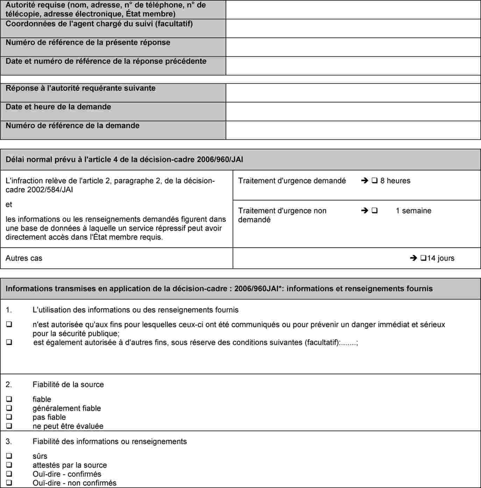
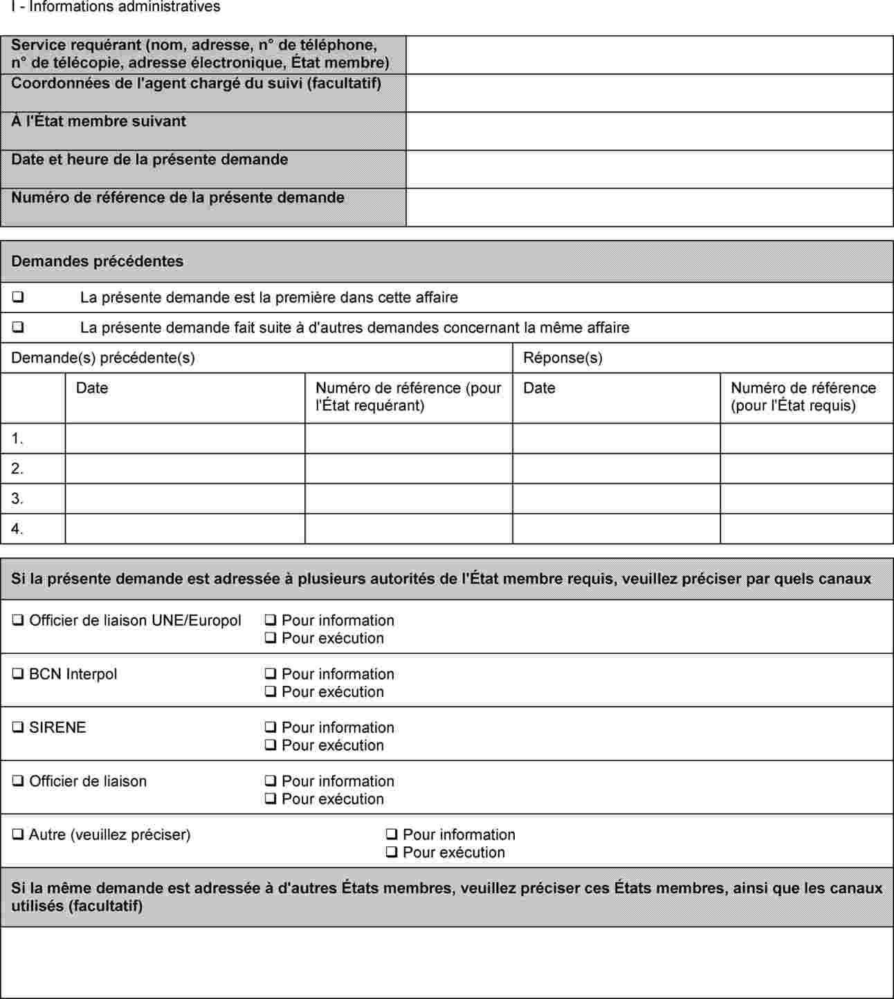
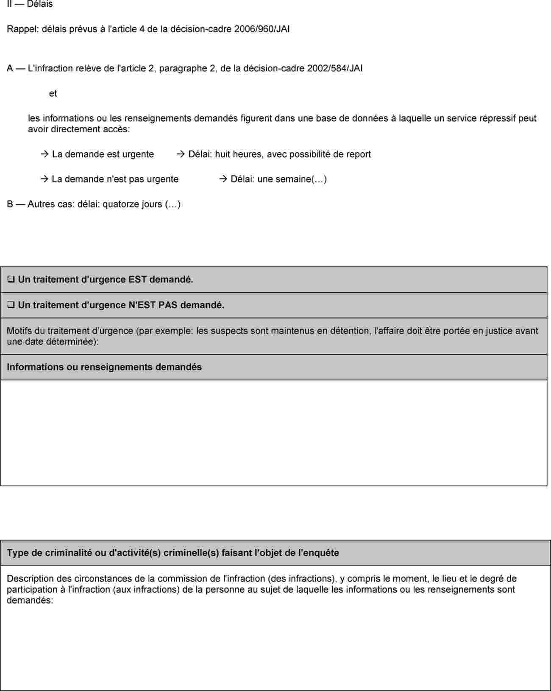

# Loi du 22 février 2018 relative à l’échange de données à caractère personnel et d’informations en matière policière et portant :\n1) transposition de la décision-cadre 2006/960/JAI du Conseil du 18 décembre 2006 relative à la simplification de l’échange d’informations et de renseignements entre les services répressifs des États membres de l’Union européenne ; \n2) mise en œuvre de certaines dispositions de la décision 2008/615/JAI du Conseil du 23 juin 2008 relative à l’approfondissement de la coopération transfrontalière, notamment en vue de lutter contre le terrorisme et la criminalité transfrontalière.

## Chapitre 1er — De l’échange de données à caractère personnel et d’informations en matière de coopération policière internationale.

### Section 1ère — Dispositions générales.

#### Art. 1er.

Le présent chapitre s’applique à l’échange de données à caractère personnel et d’informations entre, d’une part, le point de contact unique, les services répressifs compétents et les services répressifs désignés de l’État du Grand-Duché de Luxembourg[^5], et, d’autre part :

1\) les points de contact uniques, les services répressifs compétents et les services répressifs désignés[^6] et, si et dans la mesure où ils ont la prévention, la recherche et la constatation d’infractions pénales dans leurs attributions, les services compétents[^7] des autres États membres de l’Union européenne et des pays associés à l’espace Schengen ;

2\) les institutions, organes et agences de l’Union européenne, si et dans la mesure où l’échange porte sur une ou plusieurs infractions ou sur une activité délictueuse relevant de leur mandat ;

3\) les services de police et, si et dans la mesure où ils ont la prévention, la recherche et la constatation d’infractions pénales dans leurs attributions, les services compétents[^8] des États non visés au point 1), si et dans la mesure où les conditions du chapitre V de la [loi du 1er août 2018](https://legilux.public.lu/eli/etat/leg/loi/2018/08/01/a689/jo) relative à la protection des personnes physiques à l'égard du traitement des données à caractère personnel en matière pénale ainsi qu’en matière de sécurité nationale[^1] sont remplies ;

4\) l’Organisation Internationale de Police Criminelle (OIPC – Interpol).

#### Art. 1*bis*.

Pour l’application de la présente loi et aux fins des échanges entre la Police grand-ducale et l’Administration des douanes et accises d’une part, et les entités prévues à l’article 1er, points 1) et 2), d’autre part, on entend par :

1\) « services répressifs compétents » : la Police grand-ducale et l’Administration des douanes et accises, dans la mesure où cette dernière traite des données à caractère personnel et des informations en exécution de ses missions de police administrative ou judiciaire dans les limites de ses compétences légales ;

2\) « services répressifs désignés » : les services désignés de la Police grand-ducale et de l’Administration des douanes et accises, dans la mesure où les services désignés de l’Administration des douanes et accises traitent des données à caractère personnel et des informations en exécution de leurs missions de police administrative ou judiciaire dans les limites de leurs compétences légales, autorisés à soumettre des demandes d’informations aux points de contact uniques d’autres États membres de l’Union européenne ;

3\) « infraction pénale grave » : une des infractions suivantes :

a) une infraction visée à l’article 3, paragraphe 3, de la [loi modifiée du 17 mars 2004](https://legilux.public.lu/eli/etat/leg/loi/2004/03/17/n1/jo) relative au mandat d’arrêt européen et aux procédures de remise entre États membres de l’Union européenne ;

b) une infraction visée à l’article 3, paragraphe 1er ou 2, du [règlement (UE) 2016/794](https://legilux.public.lu/eli/reg_ue/2016/794/jo) du Parlement européen et du Conseil du 11 mai 2016 relatif à l’Agence de l’Union européenne pour la coopération des services répressifs (Europol) et remplaçant et abrogeant les [décisions du Conseil 2009/371/JAI](http://data.europa.eu/eli/dec/2009/371/oj), [2009/934/JAI](http://data.europa.eu/eli/dec/2009/934/oj), [2009/935/JAI](http://data.europa.eu/eli/dec/2009/935/oj), [2009/936/JAI](http://data.europa.eu/eli/dec/2009/936/oj) et [2009/968/JAI](http://data.europa.eu/eli/dec/2009/968/oj), ci-après le « [règlement (UE) 2016/794](https://legilux.public.lu/eli/reg_ue/2016/794/jo) » ;

4\) « informations » : tout contenu concernant plusieurs personnes physiques ou morales, des faits ou des circonstances qui revêtent un intérêt pour les services répressifs compétents aux fins de l’accomplissement des missions de prévention ou de détection des infractions pénales, ou d’enquête en la matière, qui leur incombent en application du droit national, y compris le renseignement en matière pénale ;

5\) « informations disponibles », « informations dont dispose » et « informations dont disposent » : les informations directement accessibles et les informations indirectement accessibles ;

6\) « informations directement accessibles » : les données à caractère personnel et les informations détenues dans une base de données à laquelle le point de contact unique ou les services répressifs compétents peuvent accéder directement ;

7\) « informations indirectement accessibles » : les données à caractère personnel et les informations que le point de contact unique ou les services répressifs compétents peuvent obtenir d’autres autorités publiques ou parties privées établies au Grand-Duché de Luxembourg, lorsque le droit national le permet et conformément à celui-ci, sans mesures coercitives ;

8\) « données à caractère personnel » : les données à caractère personnel au sens de l’article 2, paragraphe 1er, point 1°, de la [loi du 1er août 2018](https://legilux.public.lu/eli/etat/leg/loi/2018/08/01/a689/jo) relative à la protection des personnes physiques à l’égard du traitement des données à caractère personnel en matière pénale ainsi qu’en matière de sécurité nationale ;

9\) « point de contact unique » : l’entité centrale chargée de coordonner et de faciliter l’échange d’informations.

#### Art. 1*ter*.

(1) Il est créé au sein de la Police grand-ducale un point de contact unique, intégré à la direction « relations internationales », qui est chargé de coordonner et de faciliter l’échange d’informations au titre de l’article 1er, points 1) et 2).

(2) Le point de contact unique a pour missions de :

1\) recevoir et évaluer les demandes d’informations soumises conformément à l’article 3 ;

2\) transmettre les demandes d’informations aux services compétents de la Police grand-ducale et de l’Administration des douanes et accises et, si nécessaire, coordonner entre ces derniers le traitement de ces demandes et la communication d’informations en réponse à ces demandes ;

3\) coordonner l’analyse et structurer les informations en vue de les communiquer aux points de contact uniques et, le cas échéant, aux services répressifs compétents d’autres États membres de l’Union européenne ;

4\) communiquer, sur demande ou de sa propre initiative, des informations aux entités visées à l’article 1er, points 1) et 2), conformément aux articles 3*bis*, 8, 9 et 11 ;

5\) refuser de communiquer des informations conformément à l’article 7 et, si nécessaire, demander des éclaircissements ou des précisions conformément à l’article 7, paragraphes 5 à 6 ;

6\) adresser des demandes d’informations aux entités visées à l’article 1er, point 2), aux points de contact uniques d’autres États membres de l’Union européenne conformément à l’article 3 et, s’il y a lieu, fournir des éclaircissements ou des précisions conformément à l’article 7, paragraphes 5 à 6.

Le point de contact unique exerce ses missions vingt-quatre heures sur vingt-quatre et sept jours sur sept.

(3) Dans l’accomplissement de ses missions, le point de contact unique a accès à toutes les informations dont disposent la Police grand-ducale et l’Administration des douanes et accises, dans la mesure où cela est nécessaire à l’exécution des tâches qui lui incombent en vertu de la présente loi.

#### Art. 1*quater*.

(1) Outre les membres du cadre civil et du cadre policier de la Police grand-ducale, le point de contact unique peut comprendre des membres du personnel de l’Administration des douanes et accises.

Les membres du personnel de l’Administration des douanes et accises sont désignés au point de contact unique par décision du ministre ayant l’Administration des douanes et accises dans ses attributions prise sur avis du ministre ayant la Police grand-ducale dans ses attributions. Ils continuent de relever de l’autorité hiérarchique de leur chef d’administration et sont placés sous l’autorité fonctionnelle du responsable du point de contact unique. Ils exercent toutes les tâches qui relèvent du point de contact unique et disposent à cette fin de tous les accès aux informations nécessaires à l’accomplissement de celles-ci.

(2) Le point de contact unique comprend les structures suivantes :

1\) l’unité nationale Europol instituée par l’article 7 du [règlement (UE) 2016/794](https://legilux.public.lu/eli/reg_ue/2016/794/jo) ;

2\) le bureau SIRENE institué par l’article 7, paragraphe 2, du [règlement (UE) 2018/1862](https://legilux.public.lu/eli/reg_ue/2018/1862/jo) du Parlement européen et du Conseil du 28 novembre 2018 sur l’établissement, le fonctionnement et l’utilisation du système d’information Schengen (SIS) dans le domaine de la coopération policière et de la coopération judiciaire en matière pénale, modifiant et abrogeant la [décision 2007/533/JAI](http://data.europa.eu/eli/dec/2007/533/oj) du Conseil, et abrogeant le [règlement (CE) n° 1986/2006](https://legilux.public.lu/eli/reg_ue/2006/1986/jo) du Parlement européen et du Conseil et la [décision 2010/261/UE](http://data.europa.eu/eli/dec/2010/261/oj) de la Commission ;

3\) le bureau central national Interpol institué par l’article 32 du Statut de l’Organisation internationale de police criminelle – Interpol ;

4\) la délégation luxembourgeoise au Centre de coopération policière et douanière tel qu’établi par la [loi du 28 avril 2014](https://legilux.public.lu/eli/etat/leg/loi/2014/04/28/n1/jo) portant approbation – de l’Accord entre le Gouvernement du Grand-Duché de Luxembourg, le Gouvernement du Royaume de Belgique, le Gouvernement de la République fédérale d’Allemagne et le Gouvernement de la République française, concernant la mise en place et l’exploitation d’un centre commun de coopération policière et douanière dans la zone frontalière commune, signé à Luxembourg, le 24 octobre 2008 ; – de l’Accord entre le Gouvernement du Grand-Duché de Luxembourg et le Gouvernement de la République française relatif à la coopération dans leurs zones frontalières entre les autorités de police et les autorités douanières, signé à Luxembourg, le 15 octobre 2001.

Le personnel du point de contact unique est formé dans les domaines suivants :

1\) l’utilisation des outils de traitement des données utilisés par le point de contact unique, en particulier SIENA et le système de gestion des dossiers ;

2\) l’application du droit de l’Union européenne et du droit national se rapportant aux activités du point de contact unique, notamment en ce qui concerne la protection des données à caractère personnel, la coopération transfrontière entre les services répressifs et le traitement des informations confidentielles ;

3\) l’utilisation des langues figurant sur la liste établie par l’État du Grand-Duché de Luxembourg.

La formation se compose d’une formation de base de quatre heures à l’entrée en fonction au point de contact unique et d’une formation continue de deux heures dispensée de manière régulière et au moins tous les cinq ans. En cas de modifications au niveau de l’utilisation des outils de traitement des données utilisés ou en cas de modifications au niveau du cadre légal, une formation continue de deux heures est mise à disposition du personnel du point de contact unique.

#### Art. 1*quinquies*.

(1) Le point de contact unique déploie et exploite un système électronique unique de gestion des dossiers en tant que répertoire lui permettant d’accomplir les tâches qui lui incombent en vertu de la présente loi. Le système de gestion des dossiers est doté de l’ensemble des fonctions et capacités suivantes :

1\) enregistrement des demandes d’informations entrantes et sortantes visées aux articles 3*bis*, 8, 9 et 11*bis* ainsi que de toute autre communication relative à ces demandes avec les points de contact uniques et, le cas échéant, les services répressifs compétents et les services répressifs désignés des autres États membres de l’Union européenne, y compris les informations sur les refus de demandes d’informations ainsi que les demandes et communications d’éclaircissements ou de précisions prévues à l’article 7 ;

2\) enregistrement des communications entre le point de contact unique et les services répressifs compétents, en application de l’article 1ter, paragraphe 2, lettre b) ;

3\) enregistrement des informations communiquées au point de contact unique et, le cas échéant, aux services répressifs compétents d’autres États membres de l’Union européenne, conformément aux articles 3*bis*, 8, 9*bis*, 11 et 11*bis* ;

4\) recoupement des demandes d’informations entrantes, visées aux articles 3*bis*, 8, 9 et 11*bis*, avec les informations dont dispose le point de contact unique, y compris les informations communiquées conformément à l’article 3*bis*, paragraphe 2, et à l’article 11, paragraphe 4 et avec les autres informations pertinentes enregistrées dans le système de gestion des dossiers ;

5\) suivi des demandes d’informations entrantes visées à l’article 3, notamment en vue de respecter les délais de communication des informations demandées fixés aux articles 8 et 9 ;

6\) interopérabilité avec l’application SIENA, afin notamment que les communications entrantes qui transitent par cette application puissent être directement enregistrées dans le système de gestion des dossiers et que les communications sortantes qui transitent par cette application puissent être directement envoyées à partir dudit système ;

7\) production de statistiques sur les échanges d’informations au titre de la présente loi à des fins d’évaluation et de suivi, notamment aux fins de l’article 13*ter* ;

8\) journalisation des accès et des autres opérations de traitement pour ce qui est des informations contenues dans le système de gestion des dossiers, à des fins de responsabilité et de cybersécurité, conformément à l’article 24 de la [loi du 1er août 2018](https://legilux.public.lu/eli/etat/leg/loi/2018/08/01/a689/jo) relative à la protection des personnes physiques à l’égard du traitement des données à caractère personnel en matière pénale ainsi qu’en matière de sécurité nationale.

(2) Le système de gestion des dossiers ne contient des données à caractère personnel que pour la durée nécessaire et proportionnée à l’exécution des tâches assignées au point de contact unique en vertu du paragraphe 1er. Passé cette durée, les données à caractère personnel que le système de gestion des dossiers contient sont irrévocablement supprimées.

(3) Le point de contact unique examine, pour la première fois au plus tard six mois après la conclusion d’un échange d’informations, puis régulièrement, le respect des dispositions du paragraphe 2.[^9]

#### Art. 2.

(1) L’échange de données à caractère personnel et d’informations entre le point de contact unique, les services répressifs compétents et les services répressifs désignés de l’État du Grand-Duché de Luxembourg[^62] et les entités visées à l’article 1er , points 3) et 4),[^63] concerne exclusivement les données à caractère personnel et informations directement accessibles[^64] à la Police grand-ducale ou à l’Administration des douanes et accises.

(2) Par « directement disponibles », il y a lieu d’entendre les données à caractère personnel et les informations dont la Police grand-ducale et l’Administration des douanes et accises disposent déjà elles-mêmes. Par « directement accessibles », il y a lieu d’entendre les données à caractère personnel et les informations dont d’autres autorités, services publics ou privés ou personnes disposent et auxquelles la Police grand-ducale ou l’Administration des douanes et accises ont accès en vertu de la loi.[^65]

(3) L’échange de données à caractère personnel et d’informations en application du présent chapitre s’applique sans préjudice des dispositions particulières d’un instrument juridique international en matière de coopération policière internationale auquel le Grand-Duché de Luxembourg est partie.

(4) L’échange de données à caractère personnel et d’informations entre le point de contact unique, les services répressifs compétents, les services répressifs désignés de l’État du Grand-Duché de Luxembourg et les entités visées à l’article 1er, points 1) et 2), concerne les données à caractère personnel et informations disponibles visées par l’article 1*bis*, point 5°.[^66]

#### Art. 3.

(1) L’échange de données à caractère personnel et d’informations ne peut avoir lieu qu’aux fins de la prévention, de la recherche, de la constatation et de la poursuite d’infractions pénales.

(2) Les demandes aux fins de l’échange de données et informations exposent les raisons factuelles donnant lieu de croire que le pays auquel s’adresse la demande détient les informations et renseignements recherchés, précisent à quelles fins l’échange est sollicité et indiquent le lien entre ces fins et la personne qui fait l’objet de l’échange. Lorsqu’il s’agit d’une demande adressée par les entités visées à l’article 1er au point de contact unique ou aux services répressifs compétents[^10], ces dernières peuvent la refuser si elle ne comporte pas ces précisions ; l’entité requérante en est informée et est invité à compléter, le cas échéant, sa demande.

(3) Le point de contact unique ou les services répressifs désignés soumettent au point de contact unique d’un autre État membre de l’Union européenne une demande d’informations conformément aux exigences énoncées aux paragraphes 4 à 9.

(4) Les services répressifs désignés soumettent une demande d’informations au point de contact unique d’un autre État membre de l’Union européenne dans le cadre de l’échange entre entités visées à l’article 1er, point 1). Les services répressifs désignés envoient en même temps une copie de cette demande d’informations au point de contact unique visé à l’article 1ter.

(5) Par dérogation au paragraphe 4, les services répressifs désignés nationaux visés à l’article 1*bis*, point 2°, n’envoient pas une copie d’une demande d’informations au point de contact unique visé à l’article 1ter, lorsque cela compromettrait plusieurs des éléments suivants :

1\) une enquête en cours hautement sensible pour laquelle le traitement de l’information requiert un niveau de confidentialité approprié ;

2\) les affaires de terrorisme n’impliquant pas la gestion de situations d’urgence ou de crise ;

3\) la sécurité d’une personne.

(6) Dans le cadre des échanges entre les entités visées à l’article 1er, points 1) et 2), les demandes d’informations ne sont soumises au point de contact unique d’un autre État membre de l’Union européenne que lorsqu’il existe des raisons objectives de penser que :

1\) les informations demandées sont nécessaires et proportionnées pour réaliser l’objectif d’échange adéquat et rapide d’informations entre les services répressifs compétents aux fins mentionnées au paragraphe 1er.

2\) cet autre État membre de l’Union européenne dispose des informations demandées.

(7) Dans le cadre des échanges entre entités visées à l’article 1er, points 1) et 2), toute demande d’informations soumise au point de contact unique d’un autre État membre de l’Union européenne précise si elle revêt d’un caractère urgent et, le cas échéant, indique les raisons de cette urgence.

Sont considérées comme urgentes si, eu égard à l’ensemble des faits et des circonstances pertinentes de l’espèce, il existe des raisons objectives de penser que les informations demandées remplissent plusieurs des critères suivants :

1\) elles sont essentielles à la prévention d’une menace immédiate et grave pour la sécurité publique d’un État membre de l’Union européenne ;

2\) elles sont nécessaires pour prévenir une menace imminente pour la vie ou l’intégrité physique de la personne ;

3\) elles sont nécessaires à l’adoption d’une décision susceptible d’impliquer le maintien de mesures restrictives qui s’apparentent à une privation de liberté ;

4\) elles présentent un risque imminent de perdre de leur intérêt si elles ne sont pas communiquées d’urgence et sont considérées comme importantes pour la prévention ou la détection d’infractions pénales, ou les enquêtes en la matière.

(8) Dans le cadre des échanges avec les entités visées à l’article 1er, point 1), les demandes d’informations soumises au point de contact unique d’un autre État membre de l’Union européenne contiennent toutes les données nécessaires pour en permettre le traitement adéquat et rapide conformément à la présente loi, dont au moins les éléments suivants :

1\) une spécification des informations demandées qui soit aussi détaillée que cela est raisonnablement possible dans les circonstances données ;

2\) une description de la finalité pour laquelle les informations sont demandées, y compris une description des faits et la mention de l’infraction sous-jacente ;

3\) les raisons objectives qui donnent à penser que l’État membre de l’Union européenne qui a reçu la demande dispose des informations demandées ;

4\) une explication du lien entre la finalité de la demande d’informations et toute personne physique ou morale ou toute entité à laquelle les informations se rapportent, le cas échéant ;

5\) les raisons pour lesquelles la demande est considérée comme urgente, le cas échéant, conformément au paragraphe 6 ;

6\) les restrictions quant à l’utilisation des informations contenues dans la demande à des fins autres que celles pour lesquelles elle a été soumise.

(9) Dans le cadre des échanges avec les entités visées à l’article 1er, points 1) et 2), les demandes d’informations sont soumises au point de contact unique ou au service répressif désigné d’un autre État membre de l’Union européenne dans l’une des langues figurant sur la liste établie par cet autre État membre de l’Union européenne conformément à l’article 11 de la [directive 2023/977](https://legilux.public.lu/eli/dir_ue/2023/977/jo).[^11]

#### Art. 3*bis*.

(1) Dans le cadre des échanges entre les entités visées à l’article 1er, points 1) et 2), le point de contact unique communique les informations demandées conformément à l’article 3 au point de contact unique ou au service répressif désigné de l’État membre de l’Union européenne demandeur, dans la langue dans laquelle la demande d’informations a été soumise conformément à l’article 3, paragraphe 9.

(2) Dans le cadre des échanges entre les entités visées à l’article 1er, points 1) et 2), le point de contact unique envoie une copie des informations demandées au point de contact unique de l’État membre de l’Union européenne demandeur en même temps qu’il communique les informations demandées au service répressif désigné de cet État membre de l’Union européenne.

(3) Dans le cadre des échanges entre les entités visées à l’article 1er, points 1) et 2), le point de contact unique n’envoie pas, en même temps qu’il communique les informations aux services répressifs désignés d’un autre État membre de l’Union européenne conformément au présent article, une copie de ces informations au point de contact unique de cet autre État membre de l’Union européenne lorsque cela compromettrait plusieurs des éléments suivants :

1\) une enquête en cours hautement sensible pour laquelle le traitement de l’information requiert un niveau de confidentialité approprié ;

2\) les affaires de terrorisme n’impliquant pas la gestion de situations d’urgence ou de crise ;

3\) la sécurité d’une personne.[^12]

#### Art. 4.

Les données à caractère personnel et informations transmises par le point de contact unique, les services répressifs compétents ainsi que les services répressifs désignés[^13] ne peuvent pas être utilisées comme preuve, sauf si l’autorité judiciaire luxembourgeoise compétente a autorisé un tel usage.

#### Art. 5.

(1) Les données à caractère personnel et informations directement accessibles[^14] peuvent être échangées de manière autonome par le point de contact unique, les services répressifs compétents ainsi que les services répressifs désignés[^15] la Police grand-ducale et l’Administration des douanes et accises[^16] avec les entités visées à l’article 1er , points 3) et 4),[^17] sans autorisation préalable d’une autorité judiciaire.

(1*bis*) Les données à caractère personnel et informations disponibles peuvent être échangées de manière autonome par le point de contact unique, les services répressifs compétents ainsi que les services répressifs désignés avec les entités visées à l’article 1er, points 1) et 2), sans autorisation préalable d’une autorité judiciaire.[^18]

(2) Toutefois, le point de contact unique, les services répressifs compétents ainsi que les services répressifs désignés[^19] ne peuvent transmettre ces données à caractère personnel et informations aux entités visées à l’article 1er que moyennant autorisation écrite préalable du Procureur d’État compétent si ces données et informations proviennent d’une enquête en cours ou du juge d’instruction compétent si elles proviennent d’une instruction préparatoire en cours.

(3) Lorsqu’une telle autorisation est requise, la Police grand-ducale ou l’Administration des douanes et accises adressent à cette fin une demande écrite à l’autorité judiciaire compétente qui en décide conformément aux dispositions de l’article 20 paragraphe 3.

#### Art. 6.

(1) Les données à caractère personnel et informations disponibles[^20] transmises par la Police grand-ducale ou l’Administration des douanes et accises ne peuvent être utilisés par les entités auxquelles elles ont été transmises qu’aux fins pour lesquelles elles ont été transmises ou pour prévenir un danger immédiat et sérieux pour la sécurité publique. Leur traitement à d’autres fins n’est autorisé qu’avec l’accord préalable de la Police grand-ducale ou de l’Administration des douanes et accises ou, dans le cas visé à l’article 5, paragraphe 3[^21], moyennant l’autorisation écrite[^22] de l’autorité judiciaire compétente.

(2) Les données à caractère personnel et informations transmises par la Police grand-ducale ou l’Administration des douanes et accises sont confidentielles. Les modalités de leur transmission et de leur conservation garantissent le respect de ce principe.

(3) Lorsque la transmission porte sur des données à caractère personnel et informations qui ont été obtenues préalablement d’un autre État qui les a soumises au principe de spécialité, leur transmission par la Police grand-ducale ou l’Administration des douanes et accises ne peut se faire qu’avec l’accord de l’État qui les a initialement transmises et conformément aux conditions imposées par celui-ci à leur utilisation[^23].

(4) Les données à caractère personnel et informations transmises par la Police grand-ducale ou l’Administration des douanes et accises aux services visés à l’article 1er, point 1), sont également transmises à Europol et à Eurojust, conformément aux dispositions qui leur sont applicables, dans la mesure où la transmission porte sur une ou plusieurs infractions ou une activité délictueuse relevant de leur mandat.

(5) Lorsque les données à caractère personnel échangées au titre de la présente loi s’avèrent inexactes, incomplètes ou plus à jour, les autorités visées à l’article 1er, alinéa 1er, veillent à ce que ces données soient effacées ou rectifiées ou que leur traitement soit limité, selon le cas et que tout destinataire en soit informé sans tarder.[^24]

#### Art. 7.

(1) La Police grand-ducale ou l’Administration des douanes et accises ne peuvent refuser de transmettre les données à caractère personnel et informations aux entités visées à l’article 1er que s’il y a des motifs factuels de supposer que :

1\) la transmission des données à caractère personnel et d’informations peut porter atteinte aux intérêts vitaux du Luxembourg en matière de sécurité nationale ;

2\) la transmission des données ou d’informations peut compromettre le bon déroulement d’une enquête ou d’une instruction préparatoire ;

3\) la transmission des données à caractère personnel et d’informations peut compromettre la sécurité de personnes, ou

4\) s’il existe des éléments qui indiquent que les données à caractère personnel et informations demandées sont disproportionnées ou sans objet au regard des finalités pour lesquelles elles ont été demandées.[^25]

(2) Le point de contact unique peut refuser de communiquer les données ou informations demandées lorsque :

1\) la demande concerne une infraction pénale qui est punissable d’une peine d’emprisonnement inférieure ou égale à un an en vertu du droit luxembourgeois ; ou

2\) la demande concerne une affaire qui ne constitue pas une infraction pénale en vertu du droit luxembourgeois.[^26]

(3) La transmission de données à caractère personnel et d’informations est également refusée par par le point de contact unique de[^27] la Police grand-ducale ou l’Administration des douanes et accises si l’autorité judiciaire compétente a refusé l’autorisation visée à l’article 5 paragraphe 3[^28].

(4) Aux fins des échanges d’informations entre les entités visées à l’article 1er, points 1) et 2), le point de contact unique peut refuser de transmettre les données à caractère personnel et informations s’il y a des motifs factuels de supposer que :

1\) le point de contact unique et les services répressifs compétents de l’État qui a reçu la demande ne disposent pas des informations demandées ;

2\) la demande d’informations ne satisfait pas aux exigences prévues à l’article 3 ;

3\) les informations demandées constituent des données à caractère personnel autres que celles relevant des catégories des données à caractère personnel visées à l’article 13*bis*, lettre b) ;

4\) les informations demandées se sont révélées inexactes, incomplètes ou ne sont plus à jour et ne peuvent être communiquées conformément à l’article 6, paragraphe 2, de la [loi du 1er août 2018](https://legilux.public.lu/eli/etat/leg/loi/2018/08/01/a689/jo) relative à la protection des personnes physiques à l’égard du traitement des données à caractère personnel en matière pénale ainsi qu’en matière de sécurité nationale ;

5\) la communication des données à caractère personnel ou d’informations demandées peut être contraire ou porter atteinte aux intérêts essentiels du Grand-Duché de Luxembourg en matière de sécurité nationale ;

6\) la communication des données à caractère personnel ou d’informations demandées peut compromettre le bon déroulement d’une enquête ou d’une instruction préparatoire ;

7\) la communication des données à caractère personnel ou d’informations demandées peut compromettre la sécurité d’une personne physique ;

8\) la communication des données à caractère personnel ou d’informations demandées peut porter indûment atteinte aux intérêts importants protégés d’une personne morale ; ou

9\) les informations ont été initialement obtenues d’un autre État et l’État en question n’a pas consenti à la communication d’informations.

(5) Dans le cadre des échanges avec les entités visées à l’article 1er, points 1) et 2), le point de contact unique sollicite des éclaircissements ou précisions nécessaires au traitement d’une demande d’informations qui, à défaut, est refusée.

(6) Les délais visés aux articles 8 et 9 sont suspendus à partir du moment où le point de contact unique demandeur ou le service répressif désigné demandeur reçoit la demande d’éclaircissement ou de précisions jusqu’au moment où les éclaircissements ou précisions demandés sont apportés.

(7) Le point de contact unique informe immédiatement le point de contact unique ou le service répressif désigné de l’État membre de l’Union européenne demandeur du refus de la demande d’informations dans les délais prévus aux articles 8 et 9, en précisant les motifs de ce refus.

(8) Les refus des demandes d’informations, les motifs de tels refus, les demandes d’éclaircissements ou de précision et les éclaircissements ou précisions visés aux paragraphes 4 et 5 ainsi que toute autre communication relative à une demande d’informations au point de contact unique d’un autre État membre de l’Union européenne, sont communiqués dans la langue dans laquelle cette demande a été soumise.[^29]

#### Art. 8.

(1) Sans préjudice des autres conditions prévues au présent chapitre, le point de contact unique est tenu[^30] de transmettre les données à caractère personnel et informations demandées dans un délai maximal de huit heures à partir de la réception de la demande y afférente lorsque :

1\) la demande émane d’un des services visés à l’article 1er, point 1), et

2\) la demande est motivée comme urgente par le service requérant portant sur des informations directement accessibles telles que définies par l’article 1*bis*, point 6[^31], et

3\) les informations demandées concernent une ou plusieurs infractions justifiant la remise d’une personne à un autre État membre de l’Union européenne au sens de la [loi du 17 mars 2004](https://legilux.public.lu/eli/etat/leg/loi/2004/03/17/n1/jo) relative au mandat d’arrêt européen et aux procédures de remise entre États membres de l’Union européenne, et

4\) les informations figurent dans un traitement de données automatisé auquel la Police grand-ducale ou l’Administration des douanes et accises a directement accès, et

5\) la demande de transmission a été introduite moyennant le formulaire de l’annexe B de la présente loi.[^32]

(2) Si le point de contact unique n’est[^33] pas en mesure de répondre dans le délai de huit heures, elles en informent la partie requérante en indiquant les raisons. Lorsque la transmission des données à caractère personnel et informations dans le délai de huit heures impose une charge disproportionnée à la Police grand-ducale ou à l’Administration des douanes et accises, elles peuvent reporter la transmission. Dans ce cas, la Police grand-ducale ou l’Administration des douanes et accises en informent immédiatement le service requérant et transmettent les données à caractère personnel et informations demandées dès que possible, et au plus tard dans un délai de trois jours.[^34]

(3) Si la demande urgente porte sur des informations indirectement accessibles telles que définies par l’article 1*bis*, point 7, le point de contact unique est tenu de transmettre les données à caractère personnel et informations demandées dans un délai maximal de trois jours à partir de la réception de la demande y afférente.[^35]

#### Art. 9.

Lorsque la demande de données à caractère personnel et informations n’est pas motivée par un service requérant visé à l’article 1er, point 1), comme urgente, le point de contact unique est tenu[^36] d’y répondre dans un délai de sept jours à partir de la date de la réception de la demande d’informations[^37]. Si la Police grand-ducale ou l’Administration des douanes et accises ne sont pas en mesure de répondre dans le délai d’une semaine, elle*s* en informent la partie requérante en indiquant les raisons.[^38]

#### Art. 9*bis*.

(1) Les données à caractère personnel et informations directement accessibles ou indirectement accessibles peuvent être échangées et transmises de manière autonome par le point de contact unique, sans autorisation préalable d’une autorité judiciaire.

(2) Toutefois, le point de contact unique ne peut échanger ces données à caractère personnel et informations que moyennant autorisation écrite préalable du procureur d’État compétent si ces données et informations proviennent d’une enquête en cours ou du juge d’instruction compétent si elles proviennent d’une instruction préparatoire en cours.

(3) Lorsqu’une telle autorisation est requise, une demande est adressée à l’autorité judiciaire compétente. Le point de contact unique prend immédiatement toutes les mesures nécessaires, conformément au droit national, pour obtenir l’autorisation judiciaire dès que possible. Les exigences au présent paragraphe s’appliquent également aux services répressifs compétents.

(4) En pareils cas, le point de contact unique s’acquitte des deux obligations suivantes :

1\) informer immédiatement le point de contact unique ou, le cas échéant, le service répressif désigné de l’État membre de l’Union européenne demandeur du retard attendu, en précisant la durée et les motifs dudit retard ;

2\) tenir le point de contact unique ou, le cas échéant, le service répressif désigné de l’État membre de l’Union européenne demandeur ultérieurement informé et communiquer les informations demandées dès que possible après obtention de l’autorisation judiciaire.[^39]

#### Art. 10.

Dans les cas de demandes de données à caractère personnel et d’informations non visées par les articles 8 et 9, la Police grand-ducale ou l’Administration des douanes et accises sont tenues de répondre à la demande dans un délai de quatorze jours lorsque la condition prévue à l’article 8, paragraphe 1er, point 5), est remplie. Si la Police grand-ducale ou l’Administration des douanes et accises ne sont pas en mesure de répondre dans ce délai, elle*s* en informent la partie requérante moyennant le formulaire de l’annexe A de la présente loi.[^40]

#### Art. 11.

(1) Sans préjudice de l’article 7, le point de contact unique et les services répressifs compétents[^41] peuvent transmettre aux services et entités visés à l’article 1er, points 1) et 2), sans que la demande leur en ait été faite,[^42] les données à caractère personnel et informations dont il y a lieu de croire, pour des raisons factuelles, qu’elles peuvent contribuer à la prévention, à la recherche, à la constatation ou à la poursuite d’une ou de plusieurs infractions pénales qui présentent un aspect transfrontalier , ou qu’elles peuvent contribuer à la prévention d’une atteinte grave et imminente pour la sécurité et l’ordre publics d’un État visé à l’article 1er point 1)[^43].

(1*bis*) Le point de contact unique ou les services répressifs compétents communiquent, de leur propre initiative, les informations dont ils disposent aux entités visées à l’article 1er, points 1) et 2), lorsqu’il existe des raisons objectives de penser que ces informations pourraient présenter un intérêt pour ces autres entités aux fins de la prévention ou de la détection des infractions pénales graves, ou des enquêtes en la matière.

Une telle obligation n’existe pas dès lors que l’un des motifs suivants s’applique à ces informations :

1\) l’autorisation judiciaire a été refusée ;

2\) il existe des raisons objectives de penser que la communication des informations :

a) serait contraire ou porterait atteinte aux intérêts essentiels de la sécurité nationale ;

b) compromettrait le bon déroulement d’une enquête en cours en matière pénale ou la sécurité d’une personne physique ;

c) porterait indûment atteinte aux intérêts importants protégés d’une personne morale.[^44]

(2) La transmission de données à caractère personnel et d’informations est circonscrite aux éléments pertinents pour assurer ces fins.

(3) Lorsque le point de contact unique national communique des informations de sa propre initiative au service répressif compétent d’un autre État membre de l’Union européenne, il envoie en même temps une copie de ces informations au point de contact unique de cet autre État membre de l’Union européenne.

Lorsque les services répressifs compétents nationaux communiquent de leur propre initiative des informations à un autre État membre de l’Union européenne, ils envoient en même temps une copie de ces informations au point de contact unique national et au point de contact unique de cet autre État membre de l’Union européenne.

(4) Par dérogation au paragraphe 3, les services répressifs compétents n’envoient pas une copie de ces informations au point de contact unique de leur État membre de l’Union européenne ou au point de contact unique de cet autre État membre de l’Union européenne, lorsque cela compromettrait plusieurs des éléments suivants :

1\) une enquête en cours hautement sensible pour laquelle le traitement de l’information requiert un niveau de confidentialité approprié ;

2\) les affaires de terrorisme n’impliquant pas la gestion de situations d’urgence ou de crise ;

3\) la sécurité d’une personne.

(5) Dans le cadre des échanges avec les entités visées à l’article 1er, points 1) et 2), le point de contact unique ou les services répressifs compétents communiquent des informations de leur propre initiative au point de contact unique à un autre État membre de l’Union européenne, conformément aux paragraphes 1er ou 1*bis*.[^45]

#### Art. 11*bis*.

(1) Dans le cadre des échanges entre entités visées à l’article 1er, points 1) et 2), lorsque le point de contact unique soumet une demande d’informations directement à un service répressif compétent d’un autre État membre de l’Union européenne, il envoie en même temps une copie de cette demande au point de contact unique de cet autre État membre de l’Union européenne. Lorsque les services répressifs nationaux communiquent des informations en réponse à une telle demande, ils envoient en même temps une copie de ces informations au point de contact unique national.

(2) Lorsque les services répressifs compétents nationaux soumettent une demande d’informations ou communiquent des informations en réponse à une telle demande directement à un service répressif compétent d’un autre État membre de l’Union européenne, ils envoient en même temps une copie de cette demande ou de ces informations au point de contact unique national et au point de contact unique de cet autre État membre de l’Union européenne.

(3) Le point de contact unique ou les services répressifs compétents nationaux n’envoient pas des copies des demandes ou des informations visées aux paragraphes 1er ou 2 lorsque cela compromettrait plusieurs des éléments suivants :

1\) une enquête en cours hautement sensible pour laquelle le traitement de l’information requiert un niveau de confidentialité approprié ;

2\) les affaires de terrorisme n’impliquant pas la gestion de situations d’urgence ou de crise ;

3\) la sécurité d’une personne.[^46]

#### Art. 12.

(1) L’échange de données à caractère personnel et d’informations effectué en application du présent chapitre peut avoir lieu par l’intermédiaire de tous les canaux de coopération policière ou douanière internationales auxquels participe le Luxembourg, quels qu’ils soient, y compris par le biais de l’Organisation Internationale de Police Criminelle (OIPC – Interpol). Sous réserve de la langue qui est prévue pour l’utilisation du canal retenu par la partie requérante, les demandes peuvent être formulées en langue française, allemande ou anglaise.[^47]

(2) Le point de contact unique utilise l’application de réseau d’échange sécurisé d’informations d’Europol pour adresser des demandes d’informations, communiquer des informations en réponse à ces demandes ou transmettre des informations de leur propre initiative aux entités visées à l’article 1er , point 1), ou à l’article 12*bis*.

Les exigences au paragraphe 2 s’appliquent également aux services répressifs compétents.

(3) Le point de contact unique ou les services répressifs compétents n’utilisent pas le réseau d’échange sécurisé d’informations d’Europol pour adresser des demandes d’informations, communiquer des informations en réponse à ces demandes ou transmettre des informations de leur propre initiative aux entités visés à l’article 1er, point 1), ou de l’article 12*bis* dans plusieurs des cas suivants :

1\) l’échange d’informations nécessite le concours de pays tiers ou d’organisations internationales ou il existe des raisons objectives de penser qu’un tel concours est nécessaire à un stade ultérieur, y compris par le canal de communication d’Interpol ;

2\) l’urgence de la demande d’informations nécessite l’utilisation temporaire d’un autre canal de communication ;

3\) un incident technique ou opérationnel inattendu empêche leur point de contact unique ou leur autorité répressive compétente d’utiliser SIENA pour échanger les informations.

(4) Le point de contact unique et les services répressifs compétents sont directement connectés à SIENA.[^48]

#### Art. 12*bis*.

(1) Lorsque le point de contact unique ou les services répressifs compétents adressent des demandes d’informations, communiquent des informations en réponse à ces demandes ou transmettent des informations de leur propre initiative aux entités visés à l’article 1er, points 1) et 2), le personnel du point de contact unique ou les services répressifs compétents évaluent également, au cas par cas et sous réserve de l’article 7, paragraphe 7, du [règlement (UE) 2016/794](https://legilux.public.lu/eli/reg_ue/2016/794/jo), s’il est nécessaire d’envoyer à Europol une copie de la demande d’informations ou des informations communiquées, dans la mesure où les informations sur lesquelles porte la communication concernent les infractions pénales relevant des objectifs d’Europol énoncés à l’article 3 du [règlement (UE) 2016/794](https://legilux.public.lu/eli/reg_ue/2016/794/jo).

(2) Lorsqu’une copie d’une demande d’informations ou une copie des informations est envoyée à Europol en vertu du paragraphe 1er, les finalités du traitement des informations et toute restriction éventuelle à ce traitement en vertu de l’article 19 du [règlement (UE) 2016/794](https://legilux.public.lu/eli/reg_ue/2016/794/jo) sont communiquées à Europol.

(3) Les informations initialement obtenues d’un autre État membre de l’Union européenne ou d’un pays tiers ne sont transmises à Europol en vertu du paragraphe 2 que si cet autre État membre de l’Union européenne ou ce pays tiers a donné son consentement.

(4) Lors de la transmission d’informations concernant les infractions terroristes à Europol, la [décision 2005/671/JAI](http://data.europa.eu/eli/dec/2005/671/oj) du Conseil du 20 septembre 2005 relative à l’échange d’informations et à la coopération concernant les infractions terroristes s’applique. Les données à caractère personnel ne sont traitées conformément à l’article 2, paragraphe 3, de la [décision 2005/671/JAI](http://data.europa.eu/eli/dec/2005/671/oj) précitée, qu’à des fins de prévention et de détection des infractions terroristes et d’autres infractions pénales, telles qu’énumérées à l’annexe I du [règlement (UE) 2016/794](https://legilux.public.lu/eli/reg_ue/2016/794/jo), ainsi que des enquêtes et des poursuites en la matière. Ce traitement est sans préjudice des limitations applicables au traitement des données au titre du [règlement (UE) 2016/794](https://legilux.public.lu/eli/reg_ue/2016/794/jo).[^49]

#### Art. 13.

Sous réserve des dispositions contraires d’un instrument juridique international, y compris les conditions fixées le cas échéant par les entités visées à l’article 1er en application des dispositions légales qui leur sont applicables, les données à caractère personnel et informations transmises à la Police grand-ducale ou à l’Administration des douanes et accises en vertu du présent chapitre peuvent être utilisées par les autorités répressives luxembourgeoises de la même manière que celles obtenues par voie d’entraide judiciaire internationale en matière pénale ou dans le cadre d’une procédure pénale menée au Luxembourg.

#### Art. 13*bis*.

(1) Lorsque le point de contact unique communique au titre de l’article 1er, point 1), des informations qui constituent des données à caractère personnel, il veille à ce que :

1\) les données à caractère personnel soient exactes, complètes et à jour, conformément à l’article 6, paragraphe 2, de la [loi du 1er août 2018](https://legilux.public.lu/eli/etat/leg/loi/2018/08/01/a689/jo) relative à la protection des personnes physiques à l’égard du traitement des données à caractère personnel en matière pénale ainsi qu’en matière de sécurité nationale ;

2\) les catégories de données à caractère personnel communiquées par catégories de personnes concernées restent limitées à celles énumérées à l’annexe II, section B, du [règlement (UE) 2016/794](https://legilux.public.lu/eli/reg_ue/2016/794/jo) et soient nécessaires et proportionnées aux fins de la demande ;

3\) le point de contact unique communique aussi, en même temps, et dans la mesure du possible, les éléments nécessaires permettant au point de contact unique ou au service répressif compétent de l’autre État membre de l’Union européenne d’apprécier le degré d’exactitude, d’exhaustivité et de fiabilité des données à caractère personnel, ainsi que la mesure dans laquelle ces données sont à jour.

(2) Les exigences au paragraphe 1er s’appliquent également aux services répressifs compétents.

#### Art. 13*ter*.

(1) Au plus tard le 1er février de chaque année, la Police grand-ducale fournit au ministre ayant la Police grand-ducale dans ses attributions des statistiques sur les échanges d’informations qui ont eu lieu au cours de l’année civile précédente avec les entités visées à l’article 1er, points 1) et 2), au titre de la présente loi.

(2) Les statistiques visées au paragraphe 1er portent sur :

1\) le nombre de demandes d’informations soumises par leur point de contact unique et, s’il y a lieu, par leurs services répressifs compétents ;

2\) le nombre de demandes d’informations qui ont été reçues et auxquelles il a été répondu par leur point de contact unique, la Police grand-ducale et l’Administration des douanes et accises, ventilé selon le caractère urgent ou non de ces demandes et par État membre de l’Union européenne demandeur ;

3\) le nombre de demandes d’informations refusées en vertu de l’article 7, ventilé par État membre de l’Union européenne demandeur et par motif de refus ;

4\) le nombre de cas dans lesquels il a été dérogé aux délais prévus à l’article 8, paragraphe 1er, parce qu’il était nécessaire d’obtenir une autorisation judiciaire conformément à l’article 9*bis* ventilé par État membre de l’Union européenne ayant soumis les demandes d’informations concernées.[^50]

### Section 2 — Dispositions particulières relatives à la décision 2008/615/JAI du Conseil du 23 juin 2008 relative à l’approfondissement de la coopération transfrontalière, notamment en vue de lutter contre le terrorisme et la criminalité transfrontalière.

#### Art. 14.

(1) Les dispositions de la section 1ère s’appliquent également aux échanges d’informations prévues par les articles 5, 10, 13, 14, 16 et 18 de la [décision 2008/615/JAI](http://data.europa.eu/eli/dec/2008/615/oj) du Conseil du 23 juin 2008 relative à l’approfondissement de la coopération transfrontalière, notamment en vue de lutter contre le terrorisme et la criminalité transfrontalière, ci-après « la [décision 2008/615/JAI](http://data.europa.eu/eli/dec/2008/615/oj) ».

(2) En application de l’article 14 de la [décision 2008/615/JAI](http://data.europa.eu/eli/dec/2008/615/oj), la Police grand-ducale et l’Administration des douanes et accises peuvent, aux fins de la prévention des infractions pénales et du maintien de l’ordre et de la sécurité publics lors de manifestations de grande envergure à dimension transfrontalière, notamment dans le domaine sportif ou en rapport avec des réunions du Conseil européen, échanger avec les entités visées à l’article 1er les informations et données à caractère personnel, tant sur demande que de leur propre initiative, lorsque des condamnations définitives ou d’autres circonstances font présumer que les personnes concernées vont commettre des infractions pénales dans le cadre de ces manifestations ou qu’elles présentent un danger pour l’ordre et la sécurité publics.

Les informations et données à caractère personnel ne peuvent être traitées qu’aux fins visées à l’alinéa 1er et pour les manifestations précises en vue desquelles elles ont été communiquées. Les informations et données transmises doivent être effacées immédiatement, dès lors que les objectifs visés à l’alinéa 1er ont été atteints ou ne sont plus réalisables. En tout état de cause, les données transmises doivent être effacées après un an au plus tard.

(3) En application de l’article 16 de la [décision 2008/615/JAI](http://data.europa.eu/eli/dec/2008/615/oj), la Police grand-ducale et l’Administration des douanes et accises peuvent, aux fins de la prévention des infractions terroristes, échanger avec les entités visées à l’article 1er, sans même en avoir reçu la demande, les informations et données à caractère personnel visées à l’alinéa 2 dans la mesure où cela est nécessaire au regard de circonstances particulières laissant présumer que les personnes concernées vont commettre une ou plusieurs des infractions terroristes prévues par le livre II, titre Ier, chapitre III-1 du [Code pénal](https://legilux.public.lu/eli/etat/leg/code/penal/) ou par une autre loi.

Les informations et données à échanger comportent les noms, prénoms, date et lieu de naissance ainsi qu’une description des circonstances qui sont à l’origine de la présomption visée à l’alinéa 1er.

Lorsqu’il transmet des informations et données à caractère personnel, le point de contact national désigné à l’article 15 peut fixer, conformément aux dispositions de la section 1ère, les conditions d’utilisation de ces données et informations à respecter par l’entité visée à l’article 1er qui les reçoit.

(4) En application de l’article 18 de la [décision 2008/615/JAI](http://data.europa.eu/eli/dec/2008/615/oj), la Police grand-ducale et l’Administration des douanes et accises portent assistance, dans les limites de leurs compétences, en liaison avec des manifestations de masse et d’autres événements similaires de grande envergure, ainsi que des catastrophes et des accidents graves, dans le but de prévenir des infractions pénales et de maintenir l’ordre et la sécurité publics en :

a) notifiant aux autorités compétentes de l’État membre concerné, dès que possible, les événements de ce type ayant des implications transfrontalières et en échangeant toute information pertinente à cet égard ;

b) prenant et en coordonnant sur le territoire luxembourgeois les mesures policières qui s’imposent lors d’événements ayant des implications transfrontalières ;

c) mettant, autant que possible, fonctionnaires, spécialistes, conseillers et équipements à la disposition de l’État membre qui en fait la demande et sur le territoire duquel l’événement est survenu.

#### Art. 15.

(1) En application des articles 6, 11, 12, 15, 16 de la [décision 2008/615/JAI](http://data.europa.eu/eli/dec/2008/615/oj), sont désignés comme points de contact nationaux :

1\) le Service de Police Judiciaire de la Police grand-ducale pour les consultations et comparaisons automatisées de profils d’ADN et de données dactyloscopiques visées aux articles 3 à 11, ainsi que pour l’échange d’informations relatives à la prévention d’infractions terroristes visé à l’article 14 ;

2\) le Centre d’Intervention National de la Police grand-ducale pour la consultation automatisée de données du registre d’immatriculation de véhicules visée à l’article 12, ainsi que pour l’échange d’informations lors de manifestations majeures visé à l’article 13.

La désignation des points de contacts nationaux est sans préjudice des attributions dévolues par la loi au Procureur général d’État et aux procureurs d’État.

(2) Les services de la Police grand-ducale visés au paragraphe 1er peuvent échanger des données à caractère personnel et informations en application des articles 3, 4, 9 et 12 de la [décision 2008/615/JAI](http://data.europa.eu/eli/dec/2008/615/oj) avec les points de contact nationaux des États visés à l’article 1er point 1) du présent chapitre, dans la mesure où les États concernés ont fait l’objet d’une décision d’exécution du Conseil de l’Union européenne en application de l’article 33 de la [décision 2008/615/JAI](http://data.europa.eu/eli/dec/2008/615/oj). Cet échange peut être effectué à partir du jour de l’entrée en vigueur de la décision d’exécution en cause.

#### Art. 16.

Les autres mesures d’exécution prises par le Conseil de l’Union européenne en application de l’article 33 de la [décision 2008/615/JAI](http://data.europa.eu/eli/dec/2008/615/oj) sont applicables au Luxembourg dès leur entrée en vigueur ou prise d’effet telle que fixée par l’acte juridique de l’Union européenne qui les établit.

#### Art. 17.

(1) Par dérogation à l’article 5, paragraphe 2, la transmission de données à caractère personnel et d’informations en application de l’article 5 de la [décision 2008/615/JAI](http://data.europa.eu/eli/dec/2008/615/oj) est soumise à l’autorisation du procureur général d’État à partir du moment où ces données à caractère personnel et informations figurent aux traitements ADN criminalistique ou condamnés instaurés par la [loi modifiée du 25 août 2006](https://legilux.public.lu/eli/etat/leg/loi/2006/08/25/n5/jo) relative aux empreintes génétiques en matière pénale.

(2) L’autorisation accordée par le Procureur général d’État en application du paragraphe 1er vaut accord d’utiliser les données à caractère personnel et informations en tant que preuve, sauf si le Procureur général d’État n’accorde cette autorisation que sous la condition de ne pas utiliser les données et informations à cette fin.

## Chapitre 2 — De l’échange de données à caractère personnel et d’informations en matière policière au niveau national.

### Section 1ère — Échange aux fins de prévention, de recherche et de répression d’infractions pénales

#### Art. 18.

(1) La présente section s’applique à l’échange de données à caractère personnel et d’informations disponibles telles que définies à l’article 1*bis*[^51] :

1\) entre les officiers de police judiciaire de la Police grand-ducale visés à l’article 10 du [Code de procédure pénale](https://legilux.public.lu/eli/etat/leg/code/procedure_penale), de même que les agents de police judiciaire, et

2\) entre les agents de l’Administration des douanes et accises qui exécutent des missions de police administrative ou judiciaire en vertu d’une disposition légale, et

3\) entre les officiers et agents visés aux points 1) et 2) et les agents publics luxembourgeois qui disposent de la qualité d’officier de police judiciaire en vertu d’une disposition légale particulière.

(2) Par « directement disponibles », il y a lieu d’entendre les données à caractère personnel et les informations dont les personnes visées au paragraphe 1er disposent déjà elles-mêmes. Par « directement accessibles », il y a lieu d’entendre les données à caractère personnel et les informations dont des autorités, services publics ou privés, ou personnes physiques et morales disposent et auxquels les personnes visées au paragraphe 1er ont accès en vertu de la loi.[^52]

#### Art. 19.

Des données à caractère personnel et des informations disponibles[^53] peuvent être échangées entre les personnes visées à l’article 18, paragraphe 1er, sur demande ou de façon spontanée, si des raisons factuelles donnent lieu de croire que cet échange est utile à la prévention, à la recherche ou à la constatation d’une infraction pénale, ou qu’il contribue à la manifestation de la vérité dans le cadre d’une enquête ou d’une instruction préparatoire.

#### Art. 20.

(1) Les données à caractère personnel et informations disponibles[^54] peuvent être échanges et transmises de manière autonome par les personnes visées à l’article 18, paragraphe 1er, sans autorisation préalable d’une autorité judiciaire.

(2) Toutefois, les personnes visées à l’article 18, paragraphe 1er, ne peuvent échanger ces données à caractère personnel et informations aux autres personnes visées à l’article 18, paragraphe 1er, que moyennant autorisation écrite préalable du Procureur d’État compétent si ces données et informations proviennent d’une enquête en cours ou du juge d’instruction compétent si elles proviennent d’une instruction préparatoire en cours.

(3) Lorsqu’une telle autorisation est requise, les personnes visées à l’article 18, paragraphe 1er, adressent à cette fin une demande écrite à l’autorité judiciaire compétente. Celle-ci refuse l’autorisation si :

1\) l’échange ou la transmission des données à caractère personnel et d’informations peut porter atteinte aux intérêts vitaux du Luxembourg en matière de sécurité nationale ;

2\) l’échange ou la transmission peut compromettre le bon déroulement d’une enquête ou d’une instruction préparatoire ;

3\) l’échange ou la transmission peut compromettre la sécurité de personnes ou la source des données à caractère personnel et informations ;

4\) il existe des éléments qui indiquent que les données à caractère personnel et informations demandées sont disproportionnées ou sans objet au regard des finalités pour lesquelles elles ont été demandées, ou si

5\) l’échange ou la transmission est inopportune au regard de l’insuffisante fiabilité des données à caractère personnel et informations.

#### Art. 21.

(1) L’échange et la transmission de données à caractère personnel et d’informations sont circonscrits aux éléments jugés pertinents et nécessaires pour assurer avec succès la prévention, la recherche ou la constatation d’une infraction pénale ou la manifestation de la vérité dans le cadre d’une enquête ou d’une instruction préparatoire.

(2) Les données à caractère personnel et informations échangées et transmises en application de la présente section ne peuvent être utilisées qu’aux fins pour lesquelles elles ont été échangées ou transmises ou pour prévenir un danger immédiat et sérieux pour la sécurité publique. Leur traitement à d’autres fins n’est autorisé qu’avec l’accord préalable des personnes les ayant transmises ou, dans le cas visé à l’article 20, paragraphe 2, moyennant l’autorisation écrite[^55] de l’autorité judiciaire compétente.

#### Art. 22.

Les données à caractère personnel et informations échangées entre les personnes visées à l’article 18, paragraphe 1er, en vertu de la présente section peuvent être utilisées comme preuve en matière pénale.

### Section 2 — Transmissions à des fins administratives.

#### Art. 23.

La présente section s’applique à la transmission de données à caractère personnel et d’informations disponibles[^56], au sens de l’article 18, paragraphe 2, par les personnes visées à l’article 18, paragraphe 1er, aux autres administrations de l’État.

#### Art. 24.

La transmission visée à l’article 23, qui peut avoir lieu sur demande ou de façon spontanée, est soumise aux conditions cumulatives suivantes :

1\) elle doit être nécessaire à l’exécution d’une mission de service public dont l’administration destinataire de la transmission est chargée en vertu de la loi ;

2\) les raisons pour lesquelles les données et informations transmises sont considérées comme étant nécessaires à l’exécution de la mission de l’administration destinataire doivent faire partie de la documentation visée à l’article 25, paragraphe 2 ;

3\) elle ne peut comporter que les données et informations qui sont nécessaires, pertinentes et proportionnelles eu égard à la mission concernée de l’administration destinataire ;

4\) lorsqu’il s’agit de données et d’informations qui proviennent d’une enquête ou d’une instruction préparatoire en cours, l’autorisation écrite visée à l’article 20, paragraphe 2, est requise préalablement à la transmission ;

5\) lorsqu’il s’agit de données et d’informations qui ont été communiquées aux personnes visées à l’article 18, paragraphe 1er, au préalable par une entité visée à l’article 1er, l’accord écrit de cette entité est requis préalablement à la transmission ;

6\) aucun des motifs visés à l’article 7, paragraphe 1er, ne s’y oppose.

#### Art. 25.

(1) Les personnes visées à l’article 18, paragraphe 1er, décident si les conditions de transmission sont remplies.

(2) La transmission des données et informations se fait dans une forme permettant à la Commission nationale pour la protection des données de vérifier si toutes les conditions requises par la loi étaient remplies au moment de la transmission. La documentation de la transmission est conservée pendant une durée de deux ans.[^57]

#### Art. 26.

(1) Les données et informations transmises à l’administration de l’État concernée font partie du traitement des données à caractère personnel dont l’administration ou son représentant est le responsable du traitement au sens de l’article 4, point 7), du [règlement (UE) 2016/679](https://legilux.public.lu/eli/reg_ue/2016/679/jo) du Parlement européen et du Conseil du 27 avril 2016 relatif à la protection des personnes physiques à l’égard du traitement des données à caractère personnel et à la libre circulation de ces données, et abrogeant la [directive 95/46/CE](https://legilux.public.lu/eli/dir_ue/1995/46/jo) (règlement général sur la protection des données). La Commission nationale pour la protection des données est compétente pour vérifier l’application des dispositions du [règlement précité](https://legilux.public.lu/eli/reg_ue/2016/679/jo) et de la [loi du 1er août 2018](https://legilux.public.lu/eli/etat/leg/loi/2018/08/01/a689/jo) relative à la protection des personnes physiques à l’égard du traitement des données à caractère personnel en matière pénale ainsi qu’en matière de sécurité nationale.[^58]

(2) Les données et informations transmises ne peuvent être utilisées par l’administration que pour la finalité pour laquelle elles ont été transmises. Elles sont effacées dès que leur conservation n’est plus nécessaire au regard de la finalité pour laquelle elles ont été transmises.

(3) La transmission ultérieure des données et informations par l’administration de l’État à une tierce personne requiert l’accord préalable écrit de la personne visée à l’article 18, paragraphe 1er, ayant transmis les données et informations concernées. Le cas échéant, l’article 6, paragraphe 3, est applicable.

## Chapitre 3 — Dispositions finales.

### Art. 27.

Le Gouvernement est autorisé à déposer auprès du Secrétariat général du Conseil de l’Union européenne une déclaration que la Police grand-ducale et l’Administration des douanes et accises, dans la mesure où cette dernière traite des données à caractère personnel et des informations en exécution de ses missions de police administrative ou judiciaire en vertu d’une disposition légale, sont désignées comme « service répressif compétent ».[^59]

### Art. 28.

La Commission nationale pour la protection des données contrôle et surveille le respect des conditions d’accès prévues par la présente loi. Le rapport à transmettre au ministre ayant la Protection des données dans ses attributions, en exécution de l’article 10 de la [loi du 1er août 2018](https://legilux.public.lu/eli/etat/leg/loi/2018/08/01/a686/jo) portant organisation de la Commission nationale pour la protection des données et du régime général sur la protection des données, contient une partie spécifique ayant trait à l’exécution de sa mission de contrôle exercée au titre de la présente loi.[^60]

### Art. 29.

La référence à la présente loi pourra se faire sous une forme abrégée en utilisant les termes de « loi du 22 février 2018 relative à l’échange de données à caractère personnel et d’informations en matière policière ».

\***ANNEXES A et B***

\**ANNEXE A**

ÉCHANGE D’INFORMATIONS AU TITRE DE LA DÉCISION-CADRE 2006/960/JAI DU CONSEIL FORMULAIRE À UTILISER PAR L’ÉTAT MEMBRE REQUIS EN CAS DE TRANSMISSION D’INFORMATIONS OU DE RETARD/REFUS DE TRANSMISSION DES INFORMATIONS

Le présent formulaire doit être utilisé pour transmettre les informations et/ou les renseignements requis, informer le service requérant de l’impossibilité de respecter le délai normal, de la nécessité de soumettre la demande à l’autorisation d’une autorité judiciaire ou du refus de transmettre les informations.

Le présent formulaire peut être utilisé plusieurs fois au cours de la procédure (par exemple, si la demande doit d’abord être soumise à une autorité judiciaire et qu’il s’avère par la suite que l’exécution de la demande doit être refusée).

*[image omitted (0.5 MB) — see the official version: https://legilux.public.lu/eli/etat/leg/loi/2018/02/22/a154/consolide/20251206]*

\**ANNEXE B**

ÉCHANGE D’INFORMATIONS AU TITRE DE LA DÉCISION-CADRE 2006/960/JAI DU CONSEIL FORMULAIRE DE DEMANDE D’INFORMATIONS ET DE RENSEIGNEMENTS À UTILISER PAR L’ÉTAT MEMBRE REQUÉRANT

Le présent formulaire doit être utilisé pour demander des informations et des renseignements au titre de la décision-cadre 2006/960/JAI

*[image omitted (0.6 MB) — see the official version: https://legilux.public.lu/eli/etat/leg/loi/2018/02/22/a154/consolide/20251206]*[^61]

---

[^5]: [Loi du 28 novembre 2025 portant modification de la loi modifiée du 22 février 2018 relative à l’échange de données à caractère personnel et d’informations en matière policière en vue de la transposition : 1° de la directive (UE) 2023/977 du Parlement européen et du Conseil du 10 mai 2023 relative à l’échange d’informations entre les services répressifs des États membres et abrogeant la décision-cadre 2006/960/JAI du Conseil ; 2° de la directive (UE) 2023/2123 du Parlement européen et du Conseil du 4 octobre 2023 modifiant la décision 2005/671/JAI du Conseil en ce qui concerne sa mise en conformité avec les règles de l’Union relatives à la protection des données à caractère personnel.](https://legilux.public.lu/eli/etat/leg/loi/2025/11/28/a524/jo)
[^6]: [Loi du 28 novembre 2025 portant modification de la loi modifiée du 22 février 2018 relative à l’échange de données à caractère personnel et d’informations en matière policière en vue de la transposition : 1° de la directive (UE) 2023/977 du Parlement européen et du Conseil du 10 mai 2023 relative à l’échange d’informations entre les services répressifs des États membres et abrogeant la décision-cadre 2006/960/JAI du Conseil ; 2° de la directive (UE) 2023/2123 du Parlement européen et du Conseil du 4 octobre 2023 modifiant la décision 2005/671/JAI du Conseil en ce qui concerne sa mise en conformité avec les règles de l’Union relatives à la protection des données à caractère personnel.](https://legilux.public.lu/eli/etat/leg/loi/2025/11/28/a524/jo)
[^7]: [Loi du 28 novembre 2025 portant modification de la loi modifiée du 22 février 2018 relative à l’échange de données à caractère personnel et d’informations en matière policière en vue de la transposition : 1° de la directive (UE) 2023/977 du Parlement européen et du Conseil du 10 mai 2023 relative à l’échange d’informations entre les services répressifs des États membres et abrogeant la décision-cadre 2006/960/JAI du Conseil ; 2° de la directive (UE) 2023/2123 du Parlement européen et du Conseil du 4 octobre 2023 modifiant la décision 2005/671/JAI du Conseil en ce qui concerne sa mise en conformité avec les règles de l’Union relatives à la protection des données à caractère personnel.](https://legilux.public.lu/eli/etat/leg/loi/2025/11/28/a524/jo)
[^8]: [Loi du 28 novembre 2025 portant modification de la loi modifiée du 22 février 2018 relative à l’échange de données à caractère personnel et d’informations en matière policière en vue de la transposition : 1° de la directive (UE) 2023/977 du Parlement européen et du Conseil du 10 mai 2023 relative à l’échange d’informations entre les services répressifs des États membres et abrogeant la décision-cadre 2006/960/JAI du Conseil ; 2° de la directive (UE) 2023/2123 du Parlement européen et du Conseil du 4 octobre 2023 modifiant la décision 2005/671/JAI du Conseil en ce qui concerne sa mise en conformité avec les règles de l’Union relatives à la protection des données à caractère personnel.](https://legilux.public.lu/eli/etat/leg/loi/2025/11/28/a524/jo)
[^1]: [Loi du 1er août 2018 relative à la protection des personnes physiques à l'égard du traitement des données à caractère personnel en matière pénale ainsi qu’en matière de sécurité nationale et portant modification 1° de la loi modifiée du 7 mars 1980 sur l'organisation judiciaire ; 2° de la loi modifiée du 29 mai 1998 portant approbation de la Convention sur la base de l'article K.3 du Traité sur l'Union européenne portant création d'un Office européen de police (Convention Europol), signée à Bruxelles, le 26 juillet 1995 ; 3° de la loi du 20 décembre 2002 portant approbation - de la Convention établie sur base de l'article K.3 du Traité sur l'Union européenne, sur l'emploi de l'informatique dans le domaine des douanes, signé à Bruxelles, le 26 juillet 1995 ; - de l'Accord relatif à l'application provisoire entre certains États membres de l'Union européenne de la Convention établie sur base de l'article K.3 du Traité sur l'Union européenne, sur l'emploi de l'informatique dans le domaine des douanes, signé à Bruxelles, le 26 juillet 1995 ; 4° de la loi modifiée du 15 juin 2004 relative à la classification des pièces et aux habilitations de sécurité ; 5° de la loi modifiée du 16 juin 2004 portant réorganisation du centre socio-éducatif de l’État ; 6° de la loi modifiée du 25 août 2006 relative aux procédures d'identification par empreintes génétiques en matière pénale et portant modification du Code d'instruction criminelle ; 7° de la loi du 24 juin 2008 ayant pour objet le contrôle des voyageurs dans les établissements d’hébergement ; 8° de la loi modifiée du 29 mars 2013 relative à l’organisation du casier judiciaire ; 9° de la loi modifiée du 19 décembre 2014 facilitant l'échange transfrontalier d'informations concernant les infractions en matière de sécurité routière ; 10° de la loi modifiée du 25 juillet 2015 portant création du système de contrôle et de sanction automatisés ; 11° de la loi du 5 juillet 2016 portant réorganisation du Service de renseignement de l'État ; 12° de la loi du 23 juillet 2016 portant mise en place d'un statut spécifique pour certaines données à caractère personnel traitées par le Service de renseignement de l'État ; 13° de la loi du 22 février 2018 relative à l’échange de données à caractère personnel et d’informations en matière policière ; 14° de la loi du 18 juillet 2018 sur la Police grand-ducale ; et 15° de la loi du 18 juillet 2018 sur l’Inspection générale de la Police.](https://legilux.public.lu/eli/etat/leg/loi/2018/08/01/a689/jo)
[^9]: [Loi du 28 novembre 2025 portant modification de la loi modifiée du 22 février 2018 relative à l’échange de données à caractère personnel et d’informations en matière policière en vue de la transposition : 1° de la directive (UE) 2023/977 du Parlement européen et du Conseil du 10 mai 2023 relative à l’échange d’informations entre les services répressifs des États membres et abrogeant la décision-cadre 2006/960/JAI du Conseil ; 2° de la directive (UE) 2023/2123 du Parlement européen et du Conseil du 4 octobre 2023 modifiant la décision 2005/671/JAI du Conseil en ce qui concerne sa mise en conformité avec les règles de l’Union relatives à la protection des données à caractère personnel.](https://legilux.public.lu/eli/etat/leg/loi/2025/11/28/a524/jo)
[^62]: [Loi du 28 novembre 2025 portant modification de la loi modifiée du 22 février 2018 relative à l’échange de données à caractère personnel et d’informations en matière policière en vue de la transposition : 1° de la directive (UE) 2023/977 du Parlement européen et du Conseil du 10 mai 2023 relative à l’échange d’informations entre les services répressifs des États membres et abrogeant la décision-cadre 2006/960/JAI du Conseil ; 2° de la directive (UE) 2023/2123 du Parlement européen et du Conseil du 4 octobre 2023 modifiant la décision 2005/671/JAI du Conseil en ce qui concerne sa mise en conformité avec les règles de l’Union relatives à la protection des données à caractère personnel.](https://legilux.public.lu/eli/etat/leg/loi/2025/11/28/a524/jo)
[^63]: [Loi du 28 novembre 2025 portant modification de la loi modifiée du 22 février 2018 relative à l’échange de données à caractère personnel et d’informations en matière policière en vue de la transposition : 1° de la directive (UE) 2023/977 du Parlement européen et du Conseil du 10 mai 2023 relative à l’échange d’informations entre les services répressifs des États membres et abrogeant la décision-cadre 2006/960/JAI du Conseil ; 2° de la directive (UE) 2023/2123 du Parlement européen et du Conseil du 4 octobre 2023 modifiant la décision 2005/671/JAI du Conseil en ce qui concerne sa mise en conformité avec les règles de l’Union relatives à la protection des données à caractère personnel.](https://legilux.public.lu/eli/etat/leg/loi/2025/11/28/a524/jo)
[^64]: [Loi du 28 novembre 2025 portant modification de la loi modifiée du 22 février 2018 relative à l’échange de données à caractère personnel et d’informations en matière policière en vue de la transposition : 1° de la directive (UE) 2023/977 du Parlement européen et du Conseil du 10 mai 2023 relative à l’échange d’informations entre les services répressifs des États membres et abrogeant la décision-cadre 2006/960/JAI du Conseil ; 2° de la directive (UE) 2023/2123 du Parlement européen et du Conseil du 4 octobre 2023 modifiant la décision 2005/671/JAI du Conseil en ce qui concerne sa mise en conformité avec les règles de l’Union relatives à la protection des données à caractère personnel.](https://legilux.public.lu/eli/etat/leg/loi/2025/11/28/a524/jo)
[^65]: [Loi du 28 novembre 2025 portant modification de la loi modifiée du 22 février 2018 relative à l’échange de données à caractère personnel et d’informations en matière policière en vue de la transposition : 1° de la directive (UE) 2023/977 du Parlement européen et du Conseil du 10 mai 2023 relative à l’échange d’informations entre les services répressifs des États membres et abrogeant la décision-cadre 2006/960/JAI du Conseil ; 2° de la directive (UE) 2023/2123 du Parlement européen et du Conseil du 4 octobre 2023 modifiant la décision 2005/671/JAI du Conseil en ce qui concerne sa mise en conformité avec les règles de l’Union relatives à la protection des données à caractère personnel.](https://legilux.public.lu/eli/etat/leg/loi/2025/11/28/a524/jo)
[^66]: [Loi du 28 novembre 2025 portant modification de la loi modifiée du 22 février 2018 relative à l’échange de données à caractère personnel et d’informations en matière policière en vue de la transposition : 1° de la directive (UE) 2023/977 du Parlement européen et du Conseil du 10 mai 2023 relative à l’échange d’informations entre les services répressifs des États membres et abrogeant la décision-cadre 2006/960/JAI du Conseil ; 2° de la directive (UE) 2023/2123 du Parlement européen et du Conseil du 4 octobre 2023 modifiant la décision 2005/671/JAI du Conseil en ce qui concerne sa mise en conformité avec les règles de l’Union relatives à la protection des données à caractère personnel.](https://legilux.public.lu/eli/etat/leg/loi/2025/11/28/a524/jo)
[^10]: [Loi du 28 novembre 2025 portant modification de la loi modifiée du 22 février 2018 relative à l’échange de données à caractère personnel et d’informations en matière policière en vue de la transposition : 1° de la directive (UE) 2023/977 du Parlement européen et du Conseil du 10 mai 2023 relative à l’échange d’informations entre les services répressifs des États membres et abrogeant la décision-cadre 2006/960/JAI du Conseil ; 2° de la directive (UE) 2023/2123 du Parlement européen et du Conseil du 4 octobre 2023 modifiant la décision 2005/671/JAI du Conseil en ce qui concerne sa mise en conformité avec les règles de l’Union relatives à la protection des données à caractère personnel.](https://legilux.public.lu/eli/etat/leg/loi/2025/11/28/a524/jo)
[^11]: [Loi du 28 novembre 2025 portant modification de la loi modifiée du 22 février 2018 relative à l’échange de données à caractère personnel et d’informations en matière policière en vue de la transposition : 1° de la directive (UE) 2023/977 du Parlement européen et du Conseil du 10 mai 2023 relative à l’échange d’informations entre les services répressifs des États membres et abrogeant la décision-cadre 2006/960/JAI du Conseil ; 2° de la directive (UE) 2023/2123 du Parlement européen et du Conseil du 4 octobre 2023 modifiant la décision 2005/671/JAI du Conseil en ce qui concerne sa mise en conformité avec les règles de l’Union relatives à la protection des données à caractère personnel.](https://legilux.public.lu/eli/etat/leg/loi/2025/11/28/a524/jo)
[^12]: [Loi du 28 novembre 2025 portant modification de la loi modifiée du 22 février 2018 relative à l’échange de données à caractère personnel et d’informations en matière policière en vue de la transposition : 1° de la directive (UE) 2023/977 du Parlement européen et du Conseil du 10 mai 2023 relative à l’échange d’informations entre les services répressifs des États membres et abrogeant la décision-cadre 2006/960/JAI du Conseil ; 2° de la directive (UE) 2023/2123 du Parlement européen et du Conseil du 4 octobre 2023 modifiant la décision 2005/671/JAI du Conseil en ce qui concerne sa mise en conformité avec les règles de l’Union relatives à la protection des données à caractère personnel.](https://legilux.public.lu/eli/etat/leg/loi/2025/11/28/a524/jo)
[^13]: [Loi du 28 novembre 2025 portant modification de la loi modifiée du 22 février 2018 relative à l’échange de données à caractère personnel et d’informations en matière policière en vue de la transposition : 1° de la directive (UE) 2023/977 du Parlement européen et du Conseil du 10 mai 2023 relative à l’échange d’informations entre les services répressifs des États membres et abrogeant la décision-cadre 2006/960/JAI du Conseil ; 2° de la directive (UE) 2023/2123 du Parlement européen et du Conseil du 4 octobre 2023 modifiant la décision 2005/671/JAI du Conseil en ce qui concerne sa mise en conformité avec les règles de l’Union relatives à la protection des données à caractère personnel.](https://legilux.public.lu/eli/etat/leg/loi/2025/11/28/a524/jo)
[^14]: [Loi du 28 novembre 2025 portant modification de la loi modifiée du 22 février 2018 relative à l’échange de données à caractère personnel et d’informations en matière policière en vue de la transposition : 1° de la directive (UE) 2023/977 du Parlement européen et du Conseil du 10 mai 2023 relative à l’échange d’informations entre les services répressifs des États membres et abrogeant la décision-cadre 2006/960/JAI du Conseil ; 2° de la directive (UE) 2023/2123 du Parlement européen et du Conseil du 4 octobre 2023 modifiant la décision 2005/671/JAI du Conseil en ce qui concerne sa mise en conformité avec les règles de l’Union relatives à la protection des données à caractère personnel.](https://legilux.public.lu/eli/etat/leg/loi/2025/11/28/a524/jo)
[^15]: [Loi du 28 novembre 2025 portant modification de la loi modifiée du 22 février 2018 relative à l’échange de données à caractère personnel et d’informations en matière policière en vue de la transposition : 1° de la directive (UE) 2023/977 du Parlement européen et du Conseil du 10 mai 2023 relative à l’échange d’informations entre les services répressifs des États membres et abrogeant la décision-cadre 2006/960/JAI du Conseil ; 2° de la directive (UE) 2023/2123 du Parlement européen et du Conseil du 4 octobre 2023 modifiant la décision 2005/671/JAI du Conseil en ce qui concerne sa mise en conformité avec les règles de l’Union relatives à la protection des données à caractère personnel.](https://legilux.public.lu/eli/etat/leg/loi/2025/11/28/a524/jo)
[^16]: [Loi du 28 novembre 2025 portant modification de la loi modifiée du 22 février 2018 relative à l’échange de données à caractère personnel et d’informations en matière policière en vue de la transposition : 1° de la directive (UE) 2023/977 du Parlement européen et du Conseil du 10 mai 2023 relative à l’échange d’informations entre les services répressifs des États membres et abrogeant la décision-cadre 2006/960/JAI du Conseil ; 2° de la directive (UE) 2023/2123 du Parlement européen et du Conseil du 4 octobre 2023 modifiant la décision 2005/671/JAI du Conseil en ce qui concerne sa mise en conformité avec les règles de l’Union relatives à la protection des données à caractère personnel.](https://legilux.public.lu/eli/etat/leg/loi/2025/11/28/a524/jo)
[^17]: [Loi du 28 novembre 2025 portant modification de la loi modifiée du 22 février 2018 relative à l’échange de données à caractère personnel et d’informations en matière policière en vue de la transposition : 1° de la directive (UE) 2023/977 du Parlement européen et du Conseil du 10 mai 2023 relative à l’échange d’informations entre les services répressifs des États membres et abrogeant la décision-cadre 2006/960/JAI du Conseil ; 2° de la directive (UE) 2023/2123 du Parlement européen et du Conseil du 4 octobre 2023 modifiant la décision 2005/671/JAI du Conseil en ce qui concerne sa mise en conformité avec les règles de l’Union relatives à la protection des données à caractère personnel.](https://legilux.public.lu/eli/etat/leg/loi/2025/11/28/a524/jo)
[^18]: [Loi du 28 novembre 2025 portant modification de la loi modifiée du 22 février 2018 relative à l’échange de données à caractère personnel et d’informations en matière policière en vue de la transposition : 1° de la directive (UE) 2023/977 du Parlement européen et du Conseil du 10 mai 2023 relative à l’échange d’informations entre les services répressifs des États membres et abrogeant la décision-cadre 2006/960/JAI du Conseil ; 2° de la directive (UE) 2023/2123 du Parlement européen et du Conseil du 4 octobre 2023 modifiant la décision 2005/671/JAI du Conseil en ce qui concerne sa mise en conformité avec les règles de l’Union relatives à la protection des données à caractère personnel.](https://legilux.public.lu/eli/etat/leg/loi/2025/11/28/a524/jo)
[^19]: [Loi du 28 novembre 2025 portant modification de la loi modifiée du 22 février 2018 relative à l’échange de données à caractère personnel et d’informations en matière policière en vue de la transposition : 1° de la directive (UE) 2023/977 du Parlement européen et du Conseil du 10 mai 2023 relative à l’échange d’informations entre les services répressifs des États membres et abrogeant la décision-cadre 2006/960/JAI du Conseil ; 2° de la directive (UE) 2023/2123 du Parlement européen et du Conseil du 4 octobre 2023 modifiant la décision 2005/671/JAI du Conseil en ce qui concerne sa mise en conformité avec les règles de l’Union relatives à la protection des données à caractère personnel.](https://legilux.public.lu/eli/etat/leg/loi/2025/11/28/a524/jo)
[^20]: [Loi du 28 novembre 2025 portant modification de la loi modifiée du 22 février 2018 relative à l’échange de données à caractère personnel et d’informations en matière policière en vue de la transposition : 1° de la directive (UE) 2023/977 du Parlement européen et du Conseil du 10 mai 2023 relative à l’échange d’informations entre les services répressifs des États membres et abrogeant la décision-cadre 2006/960/JAI du Conseil ; 2° de la directive (UE) 2023/2123 du Parlement européen et du Conseil du 4 octobre 2023 modifiant la décision 2005/671/JAI du Conseil en ce qui concerne sa mise en conformité avec les règles de l’Union relatives à la protection des données à caractère personnel.](https://legilux.public.lu/eli/etat/leg/loi/2025/11/28/a524/jo)
[^21]: [Loi du 28 novembre 2025 portant modification de la loi modifiée du 22 février 2018 relative à l’échange de données à caractère personnel et d’informations en matière policière en vue de la transposition : 1° de la directive (UE) 2023/977 du Parlement européen et du Conseil du 10 mai 2023 relative à l’échange d’informations entre les services répressifs des États membres et abrogeant la décision-cadre 2006/960/JAI du Conseil ; 2° de la directive (UE) 2023/2123 du Parlement européen et du Conseil du 4 octobre 2023 modifiant la décision 2005/671/JAI du Conseil en ce qui concerne sa mise en conformité avec les règles de l’Union relatives à la protection des données à caractère personnel.](https://legilux.public.lu/eli/etat/leg/loi/2025/11/28/a524/jo)
[^22]: [Loi du 28 novembre 2025 portant modification de la loi modifiée du 22 février 2018 relative à l’échange de données à caractère personnel et d’informations en matière policière en vue de la transposition : 1° de la directive (UE) 2023/977 du Parlement européen et du Conseil du 10 mai 2023 relative à l’échange d’informations entre les services répressifs des États membres et abrogeant la décision-cadre 2006/960/JAI du Conseil ; 2° de la directive (UE) 2023/2123 du Parlement européen et du Conseil du 4 octobre 2023 modifiant la décision 2005/671/JAI du Conseil en ce qui concerne sa mise en conformité avec les règles de l’Union relatives à la protection des données à caractère personnel.](https://legilux.public.lu/eli/etat/leg/loi/2025/11/28/a524/jo)
[^23]: [Loi du 28 novembre 2025 portant modification de la loi modifiée du 22 février 2018 relative à l’échange de données à caractère personnel et d’informations en matière policière en vue de la transposition : 1° de la directive (UE) 2023/977 du Parlement européen et du Conseil du 10 mai 2023 relative à l’échange d’informations entre les services répressifs des États membres et abrogeant la décision-cadre 2006/960/JAI du Conseil ; 2° de la directive (UE) 2023/2123 du Parlement européen et du Conseil du 4 octobre 2023 modifiant la décision 2005/671/JAI du Conseil en ce qui concerne sa mise en conformité avec les règles de l’Union relatives à la protection des données à caractère personnel.](https://legilux.public.lu/eli/etat/leg/loi/2025/11/28/a524/jo)
[^24]: [Loi du 28 novembre 2025 portant modification de la loi modifiée du 22 février 2018 relative à l’échange de données à caractère personnel et d’informations en matière policière en vue de la transposition : 1° de la directive (UE) 2023/977 du Parlement européen et du Conseil du 10 mai 2023 relative à l’échange d’informations entre les services répressifs des États membres et abrogeant la décision-cadre 2006/960/JAI du Conseil ; 2° de la directive (UE) 2023/2123 du Parlement européen et du Conseil du 4 octobre 2023 modifiant la décision 2005/671/JAI du Conseil en ce qui concerne sa mise en conformité avec les règles de l’Union relatives à la protection des données à caractère personnel.](https://legilux.public.lu/eli/etat/leg/loi/2025/11/28/a524/jo)
[^25]: [Loi du 28 novembre 2025 portant modification de la loi modifiée du 22 février 2018 relative à l’échange de données à caractère personnel et d’informations en matière policière en vue de la transposition : 1° de la directive (UE) 2023/977 du Parlement européen et du Conseil du 10 mai 2023 relative à l’échange d’informations entre les services répressifs des États membres et abrogeant la décision-cadre 2006/960/JAI du Conseil ; 2° de la directive (UE) 2023/2123 du Parlement européen et du Conseil du 4 octobre 2023 modifiant la décision 2005/671/JAI du Conseil en ce qui concerne sa mise en conformité avec les règles de l’Union relatives à la protection des données à caractère personnel.](https://legilux.public.lu/eli/etat/leg/loi/2025/11/28/a524/jo)
[^26]: [Loi du 28 novembre 2025 portant modification de la loi modifiée du 22 février 2018 relative à l’échange de données à caractère personnel et d’informations en matière policière en vue de la transposition : 1° de la directive (UE) 2023/977 du Parlement européen et du Conseil du 10 mai 2023 relative à l’échange d’informations entre les services répressifs des États membres et abrogeant la décision-cadre 2006/960/JAI du Conseil ; 2° de la directive (UE) 2023/2123 du Parlement européen et du Conseil du 4 octobre 2023 modifiant la décision 2005/671/JAI du Conseil en ce qui concerne sa mise en conformité avec les règles de l’Union relatives à la protection des données à caractère personnel.](https://legilux.public.lu/eli/etat/leg/loi/2025/11/28/a524/jo)
[^27]: [Loi du 28 novembre 2025 portant modification de la loi modifiée du 22 février 2018 relative à l’échange de données à caractère personnel et d’informations en matière policière en vue de la transposition : 1° de la directive (UE) 2023/977 du Parlement européen et du Conseil du 10 mai 2023 relative à l’échange d’informations entre les services répressifs des États membres et abrogeant la décision-cadre 2006/960/JAI du Conseil ; 2° de la directive (UE) 2023/2123 du Parlement européen et du Conseil du 4 octobre 2023 modifiant la décision 2005/671/JAI du Conseil en ce qui concerne sa mise en conformité avec les règles de l’Union relatives à la protection des données à caractère personnel.](https://legilux.public.lu/eli/etat/leg/loi/2025/11/28/a524/jo)
[^28]: [Loi du 28 novembre 2025 portant modification de la loi modifiée du 22 février 2018 relative à l’échange de données à caractère personnel et d’informations en matière policière en vue de la transposition : 1° de la directive (UE) 2023/977 du Parlement européen et du Conseil du 10 mai 2023 relative à l’échange d’informations entre les services répressifs des États membres et abrogeant la décision-cadre 2006/960/JAI du Conseil ; 2° de la directive (UE) 2023/2123 du Parlement européen et du Conseil du 4 octobre 2023 modifiant la décision 2005/671/JAI du Conseil en ce qui concerne sa mise en conformité avec les règles de l’Union relatives à la protection des données à caractère personnel.](https://legilux.public.lu/eli/etat/leg/loi/2025/11/28/a524/jo)
[^29]: [Loi du 28 novembre 2025 portant modification de la loi modifiée du 22 février 2018 relative à l’échange de données à caractère personnel et d’informations en matière policière en vue de la transposition : 1° de la directive (UE) 2023/977 du Parlement européen et du Conseil du 10 mai 2023 relative à l’échange d’informations entre les services répressifs des États membres et abrogeant la décision-cadre 2006/960/JAI du Conseil ; 2° de la directive (UE) 2023/2123 du Parlement européen et du Conseil du 4 octobre 2023 modifiant la décision 2005/671/JAI du Conseil en ce qui concerne sa mise en conformité avec les règles de l’Union relatives à la protection des données à caractère personnel.](https://legilux.public.lu/eli/etat/leg/loi/2025/11/28/a524/jo)
[^30]: [Loi du 28 novembre 2025 portant modification de la loi modifiée du 22 février 2018 relative à l’échange de données à caractère personnel et d’informations en matière policière en vue de la transposition : 1° de la directive (UE) 2023/977 du Parlement européen et du Conseil du 10 mai 2023 relative à l’échange d’informations entre les services répressifs des États membres et abrogeant la décision-cadre 2006/960/JAI du Conseil ; 2° de la directive (UE) 2023/2123 du Parlement européen et du Conseil du 4 octobre 2023 modifiant la décision 2005/671/JAI du Conseil en ce qui concerne sa mise en conformité avec les règles de l’Union relatives à la protection des données à caractère personnel.](https://legilux.public.lu/eli/etat/leg/loi/2025/11/28/a524/jo)
[^31]: [Loi du 28 novembre 2025 portant modification de la loi modifiée du 22 février 2018 relative à l’échange de données à caractère personnel et d’informations en matière policière en vue de la transposition : 1° de la directive (UE) 2023/977 du Parlement européen et du Conseil du 10 mai 2023 relative à l’échange d’informations entre les services répressifs des États membres et abrogeant la décision-cadre 2006/960/JAI du Conseil ; 2° de la directive (UE) 2023/2123 du Parlement européen et du Conseil du 4 octobre 2023 modifiant la décision 2005/671/JAI du Conseil en ce qui concerne sa mise en conformité avec les règles de l’Union relatives à la protection des données à caractère personnel.](https://legilux.public.lu/eli/etat/leg/loi/2025/11/28/a524/jo)
[^32]: [Loi du 28 novembre 2025 portant modification de la loi modifiée du 22 février 2018 relative à l’échange de données à caractère personnel et d’informations en matière policière en vue de la transposition : 1° de la directive (UE) 2023/977 du Parlement européen et du Conseil du 10 mai 2023 relative à l’échange d’informations entre les services répressifs des États membres et abrogeant la décision-cadre 2006/960/JAI du Conseil ; 2° de la directive (UE) 2023/2123 du Parlement européen et du Conseil du 4 octobre 2023 modifiant la décision 2005/671/JAI du Conseil en ce qui concerne sa mise en conformité avec les règles de l’Union relatives à la protection des données à caractère personnel.](https://legilux.public.lu/eli/etat/leg/loi/2025/11/28/a524/jo)
[^33]: [Loi du 28 novembre 2025 portant modification de la loi modifiée du 22 février 2018 relative à l’échange de données à caractère personnel et d’informations en matière policière en vue de la transposition : 1° de la directive (UE) 2023/977 du Parlement européen et du Conseil du 10 mai 2023 relative à l’échange d’informations entre les services répressifs des États membres et abrogeant la décision-cadre 2006/960/JAI du Conseil ; 2° de la directive (UE) 2023/2123 du Parlement européen et du Conseil du 4 octobre 2023 modifiant la décision 2005/671/JAI du Conseil en ce qui concerne sa mise en conformité avec les règles de l’Union relatives à la protection des données à caractère personnel.](https://legilux.public.lu/eli/etat/leg/loi/2025/11/28/a524/jo)
[^34]: [Loi du 28 novembre 2025 portant modification de la loi modifiée du 22 février 2018 relative à l’échange de données à caractère personnel et d’informations en matière policière en vue de la transposition : 1° de la directive (UE) 2023/977 du Parlement européen et du Conseil du 10 mai 2023 relative à l’échange d’informations entre les services répressifs des États membres et abrogeant la décision-cadre 2006/960/JAI du Conseil ; 2° de la directive (UE) 2023/2123 du Parlement européen et du Conseil du 4 octobre 2023 modifiant la décision 2005/671/JAI du Conseil en ce qui concerne sa mise en conformité avec les règles de l’Union relatives à la protection des données à caractère personnel.](https://legilux.public.lu/eli/etat/leg/loi/2025/11/28/a524/jo)
[^35]: [Loi du 28 novembre 2025 portant modification de la loi modifiée du 22 février 2018 relative à l’échange de données à caractère personnel et d’informations en matière policière en vue de la transposition : 1° de la directive (UE) 2023/977 du Parlement européen et du Conseil du 10 mai 2023 relative à l’échange d’informations entre les services répressifs des États membres et abrogeant la décision-cadre 2006/960/JAI du Conseil ; 2° de la directive (UE) 2023/2123 du Parlement européen et du Conseil du 4 octobre 2023 modifiant la décision 2005/671/JAI du Conseil en ce qui concerne sa mise en conformité avec les règles de l’Union relatives à la protection des données à caractère personnel.](https://legilux.public.lu/eli/etat/leg/loi/2025/11/28/a524/jo)
[^36]: [Loi du 28 novembre 2025 portant modification de la loi modifiée du 22 février 2018 relative à l’échange de données à caractère personnel et d’informations en matière policière en vue de la transposition : 1° de la directive (UE) 2023/977 du Parlement européen et du Conseil du 10 mai 2023 relative à l’échange d’informations entre les services répressifs des États membres et abrogeant la décision-cadre 2006/960/JAI du Conseil ; 2° de la directive (UE) 2023/2123 du Parlement européen et du Conseil du 4 octobre 2023 modifiant la décision 2005/671/JAI du Conseil en ce qui concerne sa mise en conformité avec les règles de l’Union relatives à la protection des données à caractère personnel.](https://legilux.public.lu/eli/etat/leg/loi/2025/11/28/a524/jo)
[^37]: [Loi du 28 novembre 2025 portant modification de la loi modifiée du 22 février 2018 relative à l’échange de données à caractère personnel et d’informations en matière policière en vue de la transposition : 1° de la directive (UE) 2023/977 du Parlement européen et du Conseil du 10 mai 2023 relative à l’échange d’informations entre les services répressifs des États membres et abrogeant la décision-cadre 2006/960/JAI du Conseil ; 2° de la directive (UE) 2023/2123 du Parlement européen et du Conseil du 4 octobre 2023 modifiant la décision 2005/671/JAI du Conseil en ce qui concerne sa mise en conformité avec les règles de l’Union relatives à la protection des données à caractère personnel.](https://legilux.public.lu/eli/etat/leg/loi/2025/11/28/a524/jo)
[^38]: [Loi du 28 novembre 2025 portant modification de la loi modifiée du 22 février 2018 relative à l’échange de données à caractère personnel et d’informations en matière policière en vue de la transposition : 1° de la directive (UE) 2023/977 du Parlement européen et du Conseil du 10 mai 2023 relative à l’échange d’informations entre les services répressifs des États membres et abrogeant la décision-cadre 2006/960/JAI du Conseil ; 2° de la directive (UE) 2023/2123 du Parlement européen et du Conseil du 4 octobre 2023 modifiant la décision 2005/671/JAI du Conseil en ce qui concerne sa mise en conformité avec les règles de l’Union relatives à la protection des données à caractère personnel.](https://legilux.public.lu/eli/etat/leg/loi/2025/11/28/a524/jo)
[^39]: [Loi du 28 novembre 2025 portant modification de la loi modifiée du 22 février 2018 relative à l’échange de données à caractère personnel et d’informations en matière policière en vue de la transposition : 1° de la directive (UE) 2023/977 du Parlement européen et du Conseil du 10 mai 2023 relative à l’échange d’informations entre les services répressifs des États membres et abrogeant la décision-cadre 2006/960/JAI du Conseil ; 2° de la directive (UE) 2023/2123 du Parlement européen et du Conseil du 4 octobre 2023 modifiant la décision 2005/671/JAI du Conseil en ce qui concerne sa mise en conformité avec les règles de l’Union relatives à la protection des données à caractère personnel.](https://legilux.public.lu/eli/etat/leg/loi/2025/11/28/a524/jo)
[^40]: [Loi du 28 novembre 2025 portant modification de la loi modifiée du 22 février 2018 relative à l’échange de données à caractère personnel et d’informations en matière policière en vue de la transposition : 1° de la directive (UE) 2023/977 du Parlement européen et du Conseil du 10 mai 2023 relative à l’échange d’informations entre les services répressifs des États membres et abrogeant la décision-cadre 2006/960/JAI du Conseil ; 2° de la directive (UE) 2023/2123 du Parlement européen et du Conseil du 4 octobre 2023 modifiant la décision 2005/671/JAI du Conseil en ce qui concerne sa mise en conformité avec les règles de l’Union relatives à la protection des données à caractère personnel.](https://legilux.public.lu/eli/etat/leg/loi/2025/11/28/a524/jo)
[^41]: [Loi du 28 novembre 2025 portant modification de la loi modifiée du 22 février 2018 relative à l’échange de données à caractère personnel et d’informations en matière policière en vue de la transposition : 1° de la directive (UE) 2023/977 du Parlement européen et du Conseil du 10 mai 2023 relative à l’échange d’informations entre les services répressifs des États membres et abrogeant la décision-cadre 2006/960/JAI du Conseil ; 2° de la directive (UE) 2023/2123 du Parlement européen et du Conseil du 4 octobre 2023 modifiant la décision 2005/671/JAI du Conseil en ce qui concerne sa mise en conformité avec les règles de l’Union relatives à la protection des données à caractère personnel.](https://legilux.public.lu/eli/etat/leg/loi/2025/11/28/a524/jo)
[^42]: [Loi du 28 novembre 2025 portant modification de la loi modifiée du 22 février 2018 relative à l’échange de données à caractère personnel et d’informations en matière policière en vue de la transposition : 1° de la directive (UE) 2023/977 du Parlement européen et du Conseil du 10 mai 2023 relative à l’échange d’informations entre les services répressifs des États membres et abrogeant la décision-cadre 2006/960/JAI du Conseil ; 2° de la directive (UE) 2023/2123 du Parlement européen et du Conseil du 4 octobre 2023 modifiant la décision 2005/671/JAI du Conseil en ce qui concerne sa mise en conformité avec les règles de l’Union relatives à la protection des données à caractère personnel.](https://legilux.public.lu/eli/etat/leg/loi/2025/11/28/a524/jo)
[^43]: [Loi du 28 novembre 2025 portant modification de la loi modifiée du 22 février 2018 relative à l’échange de données à caractère personnel et d’informations en matière policière en vue de la transposition : 1° de la directive (UE) 2023/977 du Parlement européen et du Conseil du 10 mai 2023 relative à l’échange d’informations entre les services répressifs des États membres et abrogeant la décision-cadre 2006/960/JAI du Conseil ; 2° de la directive (UE) 2023/2123 du Parlement européen et du Conseil du 4 octobre 2023 modifiant la décision 2005/671/JAI du Conseil en ce qui concerne sa mise en conformité avec les règles de l’Union relatives à la protection des données à caractère personnel.](https://legilux.public.lu/eli/etat/leg/loi/2025/11/28/a524/jo)
[^44]: [Loi du 28 novembre 2025 portant modification de la loi modifiée du 22 février 2018 relative à l’échange de données à caractère personnel et d’informations en matière policière en vue de la transposition : 1° de la directive (UE) 2023/977 du Parlement européen et du Conseil du 10 mai 2023 relative à l’échange d’informations entre les services répressifs des États membres et abrogeant la décision-cadre 2006/960/JAI du Conseil ; 2° de la directive (UE) 2023/2123 du Parlement européen et du Conseil du 4 octobre 2023 modifiant la décision 2005/671/JAI du Conseil en ce qui concerne sa mise en conformité avec les règles de l’Union relatives à la protection des données à caractère personnel.](https://legilux.public.lu/eli/etat/leg/loi/2025/11/28/a524/jo)
[^45]: [Loi du 28 novembre 2025 portant modification de la loi modifiée du 22 février 2018 relative à l’échange de données à caractère personnel et d’informations en matière policière en vue de la transposition : 1° de la directive (UE) 2023/977 du Parlement européen et du Conseil du 10 mai 2023 relative à l’échange d’informations entre les services répressifs des États membres et abrogeant la décision-cadre 2006/960/JAI du Conseil ; 2° de la directive (UE) 2023/2123 du Parlement européen et du Conseil du 4 octobre 2023 modifiant la décision 2005/671/JAI du Conseil en ce qui concerne sa mise en conformité avec les règles de l’Union relatives à la protection des données à caractère personnel.](https://legilux.public.lu/eli/etat/leg/loi/2025/11/28/a524/jo)
[^46]: [Loi du 28 novembre 2025 portant modification de la loi modifiée du 22 février 2018 relative à l’échange de données à caractère personnel et d’informations en matière policière en vue de la transposition : 1° de la directive (UE) 2023/977 du Parlement européen et du Conseil du 10 mai 2023 relative à l’échange d’informations entre les services répressifs des États membres et abrogeant la décision-cadre 2006/960/JAI du Conseil ; 2° de la directive (UE) 2023/2123 du Parlement européen et du Conseil du 4 octobre 2023 modifiant la décision 2005/671/JAI du Conseil en ce qui concerne sa mise en conformité avec les règles de l’Union relatives à la protection des données à caractère personnel.](https://legilux.public.lu/eli/etat/leg/loi/2025/11/28/a524/jo)
[^47]: [Loi du 28 novembre 2025 portant modification de la loi modifiée du 22 février 2018 relative à l’échange de données à caractère personnel et d’informations en matière policière en vue de la transposition : 1° de la directive (UE) 2023/977 du Parlement européen et du Conseil du 10 mai 2023 relative à l’échange d’informations entre les services répressifs des États membres et abrogeant la décision-cadre 2006/960/JAI du Conseil ; 2° de la directive (UE) 2023/2123 du Parlement européen et du Conseil du 4 octobre 2023 modifiant la décision 2005/671/JAI du Conseil en ce qui concerne sa mise en conformité avec les règles de l’Union relatives à la protection des données à caractère personnel.](https://legilux.public.lu/eli/etat/leg/loi/2025/11/28/a524/jo)
[^48]: [Loi du 28 novembre 2025 portant modification de la loi modifiée du 22 février 2018 relative à l’échange de données à caractère personnel et d’informations en matière policière en vue de la transposition : 1° de la directive (UE) 2023/977 du Parlement européen et du Conseil du 10 mai 2023 relative à l’échange d’informations entre les services répressifs des États membres et abrogeant la décision-cadre 2006/960/JAI du Conseil ; 2° de la directive (UE) 2023/2123 du Parlement européen et du Conseil du 4 octobre 2023 modifiant la décision 2005/671/JAI du Conseil en ce qui concerne sa mise en conformité avec les règles de l’Union relatives à la protection des données à caractère personnel.](https://legilux.public.lu/eli/etat/leg/loi/2025/11/28/a524/jo)
[^49]: [Loi du 28 novembre 2025 portant modification de la loi modifiée du 22 février 2018 relative à l’échange de données à caractère personnel et d’informations en matière policière en vue de la transposition : 1° de la directive (UE) 2023/977 du Parlement européen et du Conseil du 10 mai 2023 relative à l’échange d’informations entre les services répressifs des États membres et abrogeant la décision-cadre 2006/960/JAI du Conseil ; 2° de la directive (UE) 2023/2123 du Parlement européen et du Conseil du 4 octobre 2023 modifiant la décision 2005/671/JAI du Conseil en ce qui concerne sa mise en conformité avec les règles de l’Union relatives à la protection des données à caractère personnel.](https://legilux.public.lu/eli/etat/leg/loi/2025/11/28/a524/jo)
[^50]: [Loi du 28 novembre 2025 portant modification de la loi modifiée du 22 février 2018 relative à l’échange de données à caractère personnel et d’informations en matière policière en vue de la transposition : 1° de la directive (UE) 2023/977 du Parlement européen et du Conseil du 10 mai 2023 relative à l’échange d’informations entre les services répressifs des États membres et abrogeant la décision-cadre 2006/960/JAI du Conseil ; 2° de la directive (UE) 2023/2123 du Parlement européen et du Conseil du 4 octobre 2023 modifiant la décision 2005/671/JAI du Conseil en ce qui concerne sa mise en conformité avec les règles de l’Union relatives à la protection des données à caractère personnel.](https://legilux.public.lu/eli/etat/leg/loi/2025/11/28/a524/jo)
[^51]: [Loi du 28 novembre 2025 portant modification de la loi modifiée du 22 février 2018 relative à l’échange de données à caractère personnel et d’informations en matière policière en vue de la transposition : 1° de la directive (UE) 2023/977 du Parlement européen et du Conseil du 10 mai 2023 relative à l’échange d’informations entre les services répressifs des États membres et abrogeant la décision-cadre 2006/960/JAI du Conseil ; 2° de la directive (UE) 2023/2123 du Parlement européen et du Conseil du 4 octobre 2023 modifiant la décision 2005/671/JAI du Conseil en ce qui concerne sa mise en conformité avec les règles de l’Union relatives à la protection des données à caractère personnel.](https://legilux.public.lu/eli/etat/leg/loi/2025/11/28/a524/jo)
[^52]: [Loi du 28 novembre 2025 portant modification de la loi modifiée du 22 février 2018 relative à l’échange de données à caractère personnel et d’informations en matière policière en vue de la transposition : 1° de la directive (UE) 2023/977 du Parlement européen et du Conseil du 10 mai 2023 relative à l’échange d’informations entre les services répressifs des États membres et abrogeant la décision-cadre 2006/960/JAI du Conseil ; 2° de la directive (UE) 2023/2123 du Parlement européen et du Conseil du 4 octobre 2023 modifiant la décision 2005/671/JAI du Conseil en ce qui concerne sa mise en conformité avec les règles de l’Union relatives à la protection des données à caractère personnel.](https://legilux.public.lu/eli/etat/leg/loi/2025/11/28/a524/jo)
[^53]: [Loi du 28 novembre 2025 portant modification de la loi modifiée du 22 février 2018 relative à l’échange de données à caractère personnel et d’informations en matière policière en vue de la transposition : 1° de la directive (UE) 2023/977 du Parlement européen et du Conseil du 10 mai 2023 relative à l’échange d’informations entre les services répressifs des États membres et abrogeant la décision-cadre 2006/960/JAI du Conseil ; 2° de la directive (UE) 2023/2123 du Parlement européen et du Conseil du 4 octobre 2023 modifiant la décision 2005/671/JAI du Conseil en ce qui concerne sa mise en conformité avec les règles de l’Union relatives à la protection des données à caractère personnel.](https://legilux.public.lu/eli/etat/leg/loi/2025/11/28/a524/jo)
[^54]: [Loi du 28 novembre 2025 portant modification de la loi modifiée du 22 février 2018 relative à l’échange de données à caractère personnel et d’informations en matière policière en vue de la transposition : 1° de la directive (UE) 2023/977 du Parlement européen et du Conseil du 10 mai 2023 relative à l’échange d’informations entre les services répressifs des États membres et abrogeant la décision-cadre 2006/960/JAI du Conseil ; 2° de la directive (UE) 2023/2123 du Parlement européen et du Conseil du 4 octobre 2023 modifiant la décision 2005/671/JAI du Conseil en ce qui concerne sa mise en conformité avec les règles de l’Union relatives à la protection des données à caractère personnel.](https://legilux.public.lu/eli/etat/leg/loi/2025/11/28/a524/jo)
[^55]: [Loi du 28 novembre 2025 portant modification de la loi modifiée du 22 février 2018 relative à l’échange de données à caractère personnel et d’informations en matière policière en vue de la transposition : 1° de la directive (UE) 2023/977 du Parlement européen et du Conseil du 10 mai 2023 relative à l’échange d’informations entre les services répressifs des États membres et abrogeant la décision-cadre 2006/960/JAI du Conseil ; 2° de la directive (UE) 2023/2123 du Parlement européen et du Conseil du 4 octobre 2023 modifiant la décision 2005/671/JAI du Conseil en ce qui concerne sa mise en conformité avec les règles de l’Union relatives à la protection des données à caractère personnel.](https://legilux.public.lu/eli/etat/leg/loi/2025/11/28/a524/jo)
[^56]: [Loi du 28 novembre 2025 portant modification de la loi modifiée du 22 février 2018 relative à l’échange de données à caractère personnel et d’informations en matière policière en vue de la transposition : 1° de la directive (UE) 2023/977 du Parlement européen et du Conseil du 10 mai 2023 relative à l’échange d’informations entre les services répressifs des États membres et abrogeant la décision-cadre 2006/960/JAI du Conseil ; 2° de la directive (UE) 2023/2123 du Parlement européen et du Conseil du 4 octobre 2023 modifiant la décision 2005/671/JAI du Conseil en ce qui concerne sa mise en conformité avec les règles de l’Union relatives à la protection des données à caractère personnel.](https://legilux.public.lu/eli/etat/leg/loi/2025/11/28/a524/jo)
[^57]: [Loi du 28 novembre 2025 portant modification de la loi modifiée du 22 février 2018 relative à l’échange de données à caractère personnel et d’informations en matière policière en vue de la transposition : 1° de la directive (UE) 2023/977 du Parlement européen et du Conseil du 10 mai 2023 relative à l’échange d’informations entre les services répressifs des États membres et abrogeant la décision-cadre 2006/960/JAI du Conseil ; 2° de la directive (UE) 2023/2123 du Parlement européen et du Conseil du 4 octobre 2023 modifiant la décision 2005/671/JAI du Conseil en ce qui concerne sa mise en conformité avec les règles de l’Union relatives à la protection des données à caractère personnel.](https://legilux.public.lu/eli/etat/leg/loi/2025/11/28/a524/jo)
[^58]: [Loi du 28 novembre 2025 portant modification de la loi modifiée du 22 février 2018 relative à l’échange de données à caractère personnel et d’informations en matière policière en vue de la transposition : 1° de la directive (UE) 2023/977 du Parlement européen et du Conseil du 10 mai 2023 relative à l’échange d’informations entre les services répressifs des États membres et abrogeant la décision-cadre 2006/960/JAI du Conseil ; 2° de la directive (UE) 2023/2123 du Parlement européen et du Conseil du 4 octobre 2023 modifiant la décision 2005/671/JAI du Conseil en ce qui concerne sa mise en conformité avec les règles de l’Union relatives à la protection des données à caractère personnel.](https://legilux.public.lu/eli/etat/leg/loi/2025/11/28/a524/jo)
[^59]: [Loi du 28 novembre 2025 portant modification de la loi modifiée du 22 février 2018 relative à l’échange de données à caractère personnel et d’informations en matière policière en vue de la transposition : 1° de la directive (UE) 2023/977 du Parlement européen et du Conseil du 10 mai 2023 relative à l’échange d’informations entre les services répressifs des États membres et abrogeant la décision-cadre 2006/960/JAI du Conseil ; 2° de la directive (UE) 2023/2123 du Parlement européen et du Conseil du 4 octobre 2023 modifiant la décision 2005/671/JAI du Conseil en ce qui concerne sa mise en conformité avec les règles de l’Union relatives à la protection des données à caractère personnel.](https://legilux.public.lu/eli/etat/leg/loi/2025/11/28/a524/jo)
[^60]: [Loi du 28 novembre 2025 portant modification de la loi modifiée du 22 février 2018 relative à l’échange de données à caractère personnel et d’informations en matière policière en vue de la transposition : 1° de la directive (UE) 2023/977 du Parlement européen et du Conseil du 10 mai 2023 relative à l’échange d’informations entre les services répressifs des États membres et abrogeant la décision-cadre 2006/960/JAI du Conseil ; 2° de la directive (UE) 2023/2123 du Parlement européen et du Conseil du 4 octobre 2023 modifiant la décision 2005/671/JAI du Conseil en ce qui concerne sa mise en conformité avec les règles de l’Union relatives à la protection des données à caractère personnel.](https://legilux.public.lu/eli/etat/leg/loi/2025/11/28/a524/jo)
[^61]: [Loi du 28 novembre 2025 portant modification de la loi modifiée du 22 février 2018 relative à l’échange de données à caractère personnel et d’informations en matière policière en vue de la transposition : 1° de la directive (UE) 2023/977 du Parlement européen et du Conseil du 10 mai 2023 relative à l’échange d’informations entre les services répressifs des États membres et abrogeant la décision-cadre 2006/960/JAI du Conseil ; 2° de la directive (UE) 2023/2123 du Parlement européen et du Conseil du 4 octobre 2023 modifiant la décision 2005/671/JAI du Conseil en ce qui concerne sa mise en conformité avec les règles de l’Union relatives à la protection des données à caractère personnel.](https://legilux.public.lu/eli/etat/leg/loi/2025/11/28/a524/jo)
