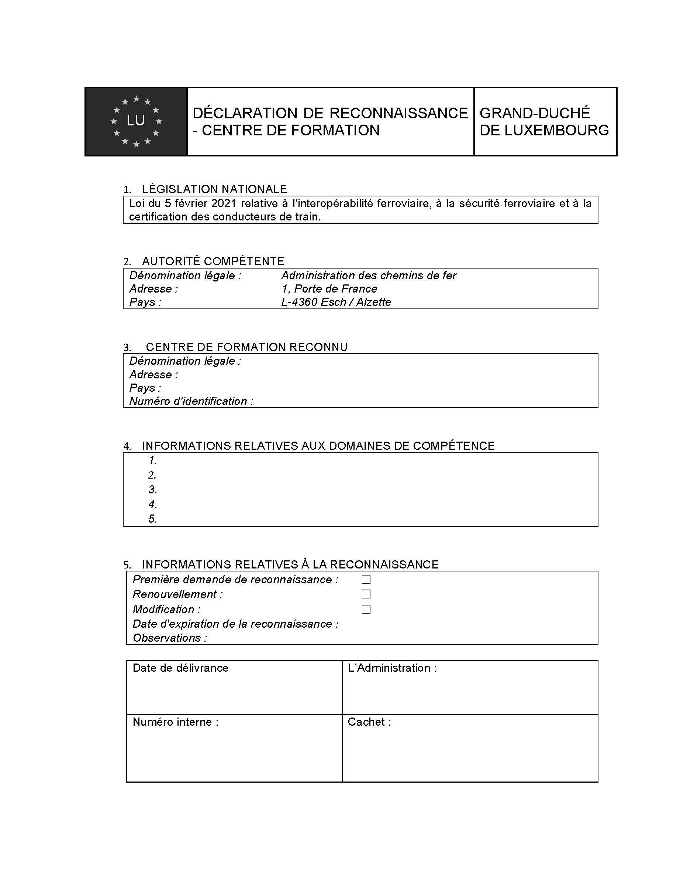
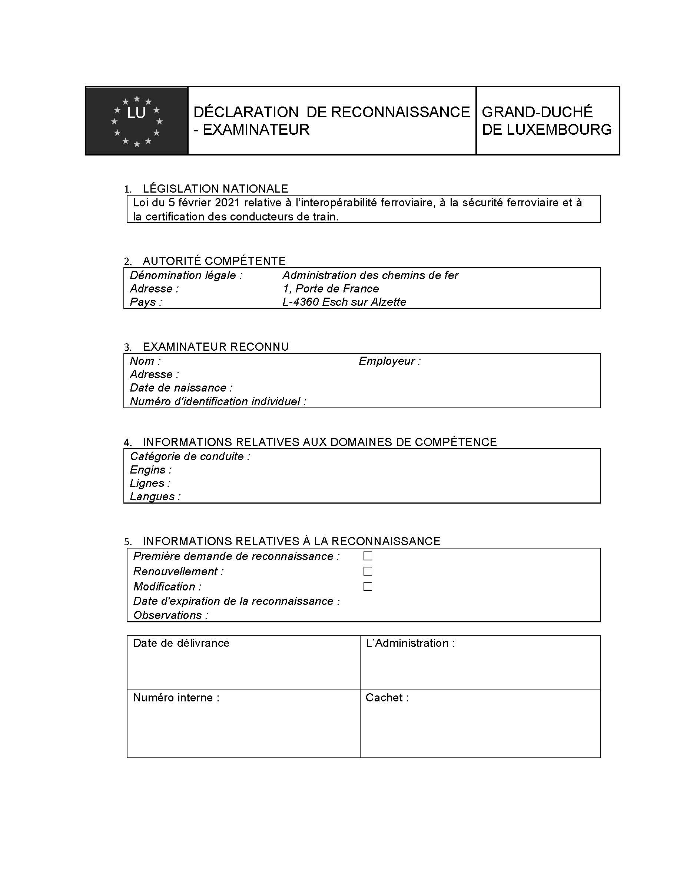

# Loi du 5 février 2021 relative à l’interopérabilité ferroviaire, à la sécurité ferroviaire et à la certification des conducteurs de train.

Nous Henri, Grand-Duc de Luxembourg, Duc de Nassau,

Notre Conseil d’État entendu ;

De l’assentiment de la Chambre des Députés ;

Vu la décision de la Chambre des Députés du 19 janvier 2021 et celle du Conseil d’État du 22 janvier 2021 portant qu’il n’y a pas lieu à second vote ;

Avons ordonné et ordonnons :

## Titre Ier — Généralités

### Chapitre Ier — Champ d’application et définitions

#### Art. 1er — Champ d’application

La présente loi ne s’applique pas :

a) aux métros ;

b) aux tramways et aux véhicules ferroviaires légers ni aux infrastructures exclusivement utilisées par ces véhicules ;

c) aux réseaux qui sont séparés sur le plan fonctionnel du reste du système ferroviaire de l’Union et qui sont destinés uniquement à l’exploitation de services locaux, urbains ou suburbains de transport de voyageurs, ni aux entreprises opérant exclusivement sur ces réseaux ni aux véhicules circulant exclusivement sur ces réseaux ;

d) aux infrastructures ferroviaires privées, y compris les voies de service, utilisées par leur propriétaire ou par un opérateur aux fins de leurs activités respectives de transport de marchandises ou du transport de personnes à des fins non commerciales, et les véhicules exclusivement utilisés sur ces infrastructures ;

e) aux infrastructures réservés à un usage local, historique ou touristique et véhicules circulant exclusivement sur ces infrastructures ;

f) aux infrastructures ferroviaires légères utilisées occasionnellement par des véhicules ferroviaires lourds dans les conditions d’exploitation des systèmes ferroviaires légers, lorsque cela est nécessaire à des fins de connectivité pour ces véhicules uniquement ; et

g) aux véhicules principalement utilisés sur les infrastructures ferroviaires légères mais équipés de composants ferroviaires lourds nécessaires pour permettre le transit sur une section limitée des infrastructures ferroviaires lourdes à des fins de connectivité uniquement.

#### Art. 2 — Définitions

Pour l’application de la présente loi, on entend par :

1° « accident » : un événement indésirable ou non intentionnel et imprévu, ou un enchaînement particulier d’événements de cette nature, ayant des conséquences préjudiciables. Les accidents se répartissent suivant les types ci-après : collisions, déraillements, accidents aux passages à niveau, accidents de personnes impliquant du matériel roulant en mouvement, incendies et autres ;

2° « accident grave » : toute collision de trains ou tout déraillement de train faisant au moins un mort ou au moins cinq personnes grièvement blessées ou d’importants dommages au matériel roulant, à l’infrastructure ou à l’environnement, et tout autre accident ayant les mêmes conséquences et une incidence évidente sur la réglementation en matière de sécurité ferroviaire ou sur la gestion de la sécurité; on entend par l’expression « dommages importants », des dommages qui peuvent être immédiatement estimés par un organisme d’enquête à un total d’au moins 2 millions d’euros ;

3° « accréditation » : l’accréditation au sens de l’article 2, point 10), du [règlement 765/2008/CE](https://legilux.public.lu/eli/reg_ue/2008/765/jo) du 9 juillet 2008 fixant les prescriptions relatives à l’accréditation et à la surveillance du marché pour la commercialisation des produits et abrogeant le [règlement (CEE) n° 339/93](https://legilux.public.lu/eli/reg_ue/1993/339/jo) du Conseil ;

4° « Administration des chemins de fer », ci-après « Administration » : l’autorité nationale de sécurité au sens de l’article 3, point 7, de la [directive (UE) 2016/798](https://legilux.public.lu/eli/dir_ue/2016/798/jo) du Parlement européen et du Conseil du 11 mai 2016 relative à la sécurité ferroviaire ;

5° « Agence de l’Union européenne pour les chemins de fer », ci-après « Agence » : telle qu’établie par le [règlement 2016/796/UE](https://legilux.public.lu/eli/reg_ue/2016/796/jo) du Parlement européen et du Conseil du 11 mai 2016 relatif à l’Agence de l’Union européenne pour les chemins de fer et abrogeant le [règlement 881/2004/CE](https://legilux.public.lu/eli/reg_ue/2004/881/jo) ;

6° « attestation » : l’attestation complémentaire harmonisée précisant les infrastructures sur lesquelles le titulaire est autorisé à conduire ainsi que le matériel roulant que le titulaire est autorisé à conduire ;

7° « cas spécifique », toute partie du système ferroviaire qui nécessite des dispositions particulières dans les spécifications techniques d’interopérabilité, temporaires ou permanentes, en raison de contraintes géographiques, topographiques, d’environnement urbain ou de cohérence par rapport au système existant, en particulier les lignes et réseaux ferroviaires isolés du reste de l’Union européenne, le gabarit, l’écartement ou l’entraxe des voies, les véhicules exclusivement destinés à un usage local, régional ou historique et les véhicules en provenance ou à destination de pays tiers ;

8° « candidat - conducteur » : toute personne candidat à l’admission à la fonction de conducteur de train ;

9° « causes », les actions, omissions, événements ou conditions, ou une combinaison de ceux-ci, qui ont conduit à un accident ou un incident ;

10° « centre de formation » : une entité accréditée, ou, reconnue par l’Administration pour donner des cours de formation ;

11° « chargeur » : une entreprise qui charge des marchandises emballées, des petits conteneurs ou des citernes mobiles sur un wagon ou un conteneur ou qui charge un conteneur, un conteneur pour vrac, un conteneur à gaz à éléments multiples, un conteneur-citerne ou une citerne mobile sur un wagon ;

12° « conducteur de train » : une personne apte et autorisée, pour le compte d’une entreprise ferroviaire ou d’un gestionnaire d’infrastructure à conduire de façon autonome, responsable et sûre des trains, y compris, en fonction de sa formation, les locomotives, les locomotives de manœuvre, les trains de travaux, les véhicules ferroviaires d’entretien ou les trains destinés au transport ferroviaire de passagers ou de marchandises ;

13° « constituants d’interopérabilité » : tout composant élémentaire, groupe de composants, sous-ensemble ou ensemble complet d’équipements incorporés ou destinés à être incorporés dans un sous-système, dont dépend directement ou indirectement l’interopérabilité du système ferroviaire. Ce terme englobe des objets matériels mais aussi immatériels ;

14° « déchargeur » : une entreprise qui enlève un conteneur, un conteneur pour vrac, un conteneur à gaz à éléments multiples, un conteneur-citerne ou une citerne mobile d’un wagon, toute entreprise qui extrait ou décharge des marchandises emballées, des petits conteneurs ou des citernes mobiles d’un wagon ou d’un conteneur ou toute entreprise qui décharge des marchandises d’une citerne, wagon-citerne, citerne amovible, citerne mobile ou conteneur-citerne, d’un wagon-batterie, d’un conteneur à gaz à éléments multiples, d’un wagon, d’un grand ou d’un petit conteneur pour le transport en vrac ou d’un conteneur pour vrac ;

15° « demandeur » : une personne physique ou morale demandant une autorisation, qu’il s’agisse d’une entreprise ferroviaire, d’un gestionnaire d’une infrastructure ou d’une autre personne physique ou morale comme un fabricant, un propriétaire ou un détenteur; aux fins de l’article 17, on entend par « demandeur », une entité adjudicatrice, un fabricant ou ses mandataires; aux fins de l’article 21, on entend par «demandeur», une personne physique ou morale demandant une décision de l’Agence en vue de l’approbation des solutions techniques envisagées pour les projets relatifs aux équipements au sol European Rail Traffic Management System, ci-après « ERTMS » ;

16° « destinataire » : toute personne physique ou morale qui reçoit des marchandises conformément à un contrat de transport ; si le transport s’effectue sans un contrat de transport, toute personne physique ou morale qui prend en charge les marchandises à l’arrivée est réputée être le destinataire ;

17° « détenteur » : la personne physique ou morale propriétaire du véhicule ou ayant un droit d’utiliser celui-ci, qui exploite ledit véhicule à titre de moyen de transport et est inscrite en tant que telle sur le registre des véhicules visé à l’article 44 ;

18° « domaine d’exploitation » : un réseau ou des réseaux sur le territoire d’un ou de plusieurs États membres, où une entreprise ferroviaire envisage d’opérer ;

19° « domaine d’utilisation d’un véhicule » : un réseau ou des réseaux au sein d’un État membre ou d’un groupe d’États membres sur lesquels un véhicule est destiné à être utilisé ;

20° « entité adjudicatrice » : une entité publique ou privée qui commande la conception et/ou la construction, le renouvellement ou le réaménagement d’un sous-système ;

21° « entité chargée de l’entretien », ci-après « ECE » : une entité chargée de l’entretien d’un véhicule et inscrite en tant que telle dans le registre des véhicules visé à l’article 44 ;

22° « entreprise ferroviaire » : toute entreprise à statut public ou privé dont l’activité est la fourniture de services de transport de marchandises et/ou de voyageurs par chemin de fer, dans la mesure où elle en assure la traction ; cela comprend les entreprises qui fournissent uniquement la traction ;

23° « enquête » : une procédure visant à prévenir les accidents et incidents et consistant à collecter et analyser des informations, à tirer des conclusions, y compris la détermination des causes et, le cas échéant, à formuler des recommandations en matière de sécurité ;

24° « enquêteur principal » : une personne en charge de l’organisation, de la conduite et du contrôle d’une enquête ;

25° « état de fonctionnement nominal » : le mode de fonctionnement normal et la dégradation prévisible des conditions, y compris par l’usure, dans les limites et les conditions d’utilisation spécifiées dans les dossiers technique et d’entretien ;

26° « étendue du service » : l’étendue caractérisée par le nombre de passagers et/ou le volume de marchandises et par la taille estimée d’une entreprise ferroviaire en termes de nombre d’employés travaillant dans le secteur ferroviaire ;

27° « évaluation de la conformité » : le processus destiné à établir si les exigences spécifiées relatives à un produit, à un processus, à un service, à un sous-système, à une personne ou à un organisme ont été respectées ;

28° « exigences essentielles » : l’ensemble des conditions décrites à l’annexe III de la [directive 2016/797/UE](https://legilux.public.lu/eli/dir_ue/2016/797/jo) du 11 mai 2016 relative à l’interopérabilité du système ferroviaire au sein de l’Union européenne auxquelles doivent satisfaire le système ferroviaire de l’Union, les sous-systèmes et les constituants d’interopérabilité, y compris les interfaces ;

29° « expéditeur » : une entreprise qui expédie des marchandises pour son compte ou pour le compte d’un tiers ;

30° « fabricant » : toute personne physique ou morale qui fabrique ou fait concevoir ou fabriquer un produit sous la forme de constituants d’interopérabilité, de sous-systèmes ou de véhicules et le commercialise sous son propre nom ou sa propre marque ;

31° « gestionnaire de l’infrastructure » : toute entité ou entreprise chargée de l’exploitation, de l’entretien et du renouvellement de l’infrastructure ferroviaire sur un réseau et responsable de la participation à son développement, conformément aux règles établies par l’État membre dans le cadre de sa politique générale en matière de développement et de financement de l’infrastructure ;

32° « incident » : tout événement, autre qu’un accident ou un accident grave, affectant ou susceptible d’affecter la sécurité des services ferroviaires ;

33° « interopérabilité » : l’aptitude d’un système ferroviaire à permettre la circulation sûre et sans rupture de trains qui accomplissent les niveaux de performance requis ;

34° « intervenant » : une entité ou toute personne travaillant sous la responsabilité pédagogique d’un centre de formation accrédité ou reconnu pour fournir des services de formation ;

35° « mandataire » : toute personne physique ou morale établie dans l’Union européenne ayant reçu mandat écrit d’un fabricant ou d’une entité adjudicatrice pour agir au nom dudit fabricant ou de ladite entité adjudicatrice aux fins de l’accomplissement de tâches déterminées ;

36° « méthodes de sécurité communes » : ci-après « MSC », les méthodes décrivant l’évaluation des niveaux de sécurité, de la réalisation des objectifs de sécurité et de la conformité à d’autres exigences de sécurité ;

37° « mise en service » : l’ensemble des opérations par lesquelles un sous-système est mis en service opérationnel ;

38° « mise sur le marché » : la première mise à disposition, sur le marché de l’Union européenne, d’un constituant d’interopérabilité, d’un sous-système ou d’un véhicule prêt à fonctionner dans son état de fonctionnement nominal ;

39° « moyen acceptable de conformité » : tout avis non contraignant délivré par l’Agence pour définir des moyens d’établir la conformité aux exigences essentielles ;

40° « moyen national acceptable de conformité » : tout avis non contraignant délivré par les États membres pour définir des moyens d’établir la conformité aux règles nationales ;

41° « norme harmonisée » : toute norme européenne au sens de l’article 2, paragraphe 1er, point c), du [règlement (UE) n° 1025/2012/UE](https://legilux.public.lu/eli/reg_ue/2012/1025/jo) du 25 octobre 2012 relatif à la normalisation européenne, modifiant les [directives 89/686/CEE](https://legilux.public.lu/eli/dir_ue/1989/686/jo) et [93/15/CEE](https://legilux.public.lu/eli/dir_ue/1993/15/jo) du Conseil ainsi que les [directives 94/9/CE](https://legilux.public.lu/eli/dir_ue/1994/9/jo), [94/25/CE](https://legilux.public.lu/eli/dir_ue/1994/25/jo), [95/16/CE](https://legilux.public.lu/eli/dir_ue/1995/16/jo), [97/23/CE](https://legilux.public.lu/eli/dir_ue/1997/23/jo), [98/34/CE](https://legilux.public.lu/eli/dir_ue/1998/34/jo), [2004/22/CE](https://legilux.public.lu/eli/dir_ue/2004/22/jo), [2007/23/CE](https://legilux.public.lu/eli/dir_ue/2007/23/jo), [2009/23/CE](https://legilux.public.lu/eli/dir_ue/2009/23/jo) et [2009/105/CE](https://legilux.public.lu/eli/dir_ue/2009/105/jo) du Parlement européen et du Conseil et abrogeant la [décision 87/95/CEE](https://eur-lex.europa.eu/eli/dec/1987/95/oj) du Conseil et la [décision n° 1673/2006/CE](https://eur-lex.europa.eu/eli/dec/2006/1673/oj) du Parlement européen et du Conseil tel que modifié ;

42° « objectifs de sécurité communs », ci-après « OSC » : les niveaux minimaux de sécurité que doivent atteindre le système dans son ensemble et, lorsque c’est possible, les différentes parties du système ferroviaire de l’Union ;

43° « organisme d’évaluation de la conformité » : un organisme qui a été notifié ou désigné responsable des activités d’évaluation de la conformité, y compris l’étalonnage, les essais, la certification et l’inspection ; un organisme d’évaluation de la conformité est classé comme « organisme notifié » à la suite de la notification conformément aux dispositions du titre II, chapitre V ; un organisme d’évaluation de la conformité est classé comme « organisme désigné » à la suite de sa désignation conformément aux dispositions du titre II, chapitre V ;

44° « organisme national d’accréditation » : l’organisme national d’accréditation au sens de l’article 2, point 11), du [règlement 765/2008/CE](http://legilux.public.lu/eli/reg_ue/2008/765/jo) précité ;

45° « paramètre fondamental » : toute condition réglementaire, technique ou opérationnelle qui est essentielle pour l’interopérabilité et qui est spécifiée dans les spécifications techniques d’interopérabilité pertinentes ;

46° « personne handicapée et personne à mobilité réduite » : toute personne présentant une incapacité physique, mentale, intellectuelle ou sensorielle, permanente ou temporaire, dont l’interaction avec divers obstacles peut empêcher sa pleine et effective utilisation des transports sur la base de l’égalité avec les autres usagers, ou dont la mobilité lors de l’usage des transports est réduite en raison de son âge ;

47° « produit » : tout produit obtenu par un procédé de fabrication, y compris des constituants d’interopérabilité et des sous-systèmes ;

48° « projet à un stade avancé de développement » : tout projet dont la phase de planification ou de construction est à un stade tel qu’une modification des spécifications techniques peut compromettre la viabilité du projet tel que planifié ;

49° « réaménagement » : les travaux importants de modification d’un sous-système ou d’une de ses parties résultant en une modification du dossier technique accompagnant la déclaration « CE » de vérification, si ledit dossier technique existe, et améliorant les performances globales du sous-système ;

50° « règles nationales » : toutes les règles contraignantes adoptées au Luxembourg, quel que soit l’organisme qui les prescrit, contenant des exigences en matière de sécurité ferroviaire ou des exigences techniques autres que celles énoncées dans les règles de l’Union européenne ou dans les règles internationales, qui sont applicables sur le territoire luxembourgeois aux entreprises ferroviaires, aux gestionnaires d’une infrastructure ou à des tiers ;

51° « remplisseur » : une entreprise qui charge des marchandises dans une citerne, y compris un wagon-citerne, un wagon avec citerne amovible, une citerne mobile ou un conteneur-citerne, dans un wagon, un grand ou un petit conteneur pour le transport en vrac, dans un wagon-batterie ou dans un conteneur à gaz à éléments multiples ;

52° « renouvellement » : les travaux importants de substitution d’un sous-système ou d’une de ses parties ne modifiant pas les performances globales du sous-système ;

53° « réseau » : les lignes, les gares, les terminaux et tout type d’équipement fixe nécessaire pour assurer l’exploitation sûre et continue du système ferroviaire de l’Union européenne ;

54° « série » : un nombre de véhicules identiques dont la conception relève du même type ;

55° « sous-système mobile » : le sous-système « matériel roulant » et le sous-système « contrôle-commande et signalisation à bord » ;

56° « sous-systèmes » : les parties structurelles ou fonctionnelles du système ferroviaire de l’Union, telles que définies à l’annexe II de la [directive 2016/797/UE](https://legilux.public.lu/eli/dir_ue/2016/797/jo) précitée ;

57° « spécification européenne » : une spécification qui rentre dans l’une des catégories suivantes :

a) une spécification technique commune, au sens de l’annexe VIII de la [directive 2014/25/UE](https://legilux.public.lu/eli/dir_ue/2014/25/jo) du 26 février 2014 relative à la passation de marchés par des entités opérant dans les secteurs de l’eau, de l’énergie, des transports et des services postaux et abrogeant la [directive 2004/17/CE](https://legilux.public.lu/eli/dir_ue/2004/17/jo),

b) un agrément technique européen, visé à l’article 60 de la [directive 2014/25/UE](https://legilux.public.lu/eli/dir_ue/2014/25/jo) précitée, ou

c) une norme européenne, au sens de l’article 2, paragraphe 1er, point b), du [règlement n° 1025/2012/UE](https://legilux.public.lu/eli/reg_ue/2012/1025/jo) précité ;

58° « spécification technique d’interopérabilité, ci-après « STI » : une spécification adoptée conformément à l’article 5 de la [directive (UE) 2016/797](https://legilux.public.lu/eli/dir_ue/2016/797/jo) précitée, dont chaque système ou partie de sous-système fait l’objet en vue de satisfaire aux exigences essentielles et d’assurer l’interopérabilité du système ferroviaire de l’Union ;

59° « spécification technique » : un document qui établit les exigences techniques auxquelles un produit, un sous-système, un processus ou un service doit répondre ;

60° « substitution dans le cadre d’un entretien » : le remplacement de composants par des pièces de fonction et de performances identiques dans le cadre d’un entretien préventif ou correcteur ;

61° « système ferroviaire de l’Union » : les éléments énumérés à l’annexe I de la [directive 2016/797/UE](https://legilux.public.lu/eli/dir_ue/2016/797/jo) précitée ;

62° « système ferroviaire existant » : l’infrastructure constituée par les lignes et les installations fixes du réseau ferroviaire existant ainsi que les véhicules de toute catégorie et origine qui circulent sur cette infrastructure ;

63° « système ferroviaire léger » : un système de transport ferroviaire urbain et/ou suburbain dont la résistance aux chocs est de C-III ou de C-IV, selon la norme EN 15227:2011, et la résistance maximale à la rupture des véhicules est de 800 kilonewtons pour ce qui est des efforts longitudinaux de compression dans les attelages; les systèmes ferroviaires légers peuvent disposer d’un site propre ou partager la route avec les autres usagers et n’effectuent généralement pas d’échanges avec les véhicules transportant des voyageurs ou des marchandises sur de longues distances ;

64° « système de gestion de la sécurité » : l’organisation, les modalités et les procédures établies par un gestionnaire de l’infrastructure ou une entreprise ferroviaire pour assurer la gestion sûre de ses propres opérations ;

65° « transporteur » : une entreprise qui effectue un transport conformément à un contrat de transport ;

66° « type » : un type de véhicule définissant les caractéristiques de conception essentielles du véhicule, telles que visées par une attestation d’examen de type ou de conception décrite dans le module de vérification correspondant ;

67° « type de service » : le type caractérisé par le transport des passagers, y compris ou non des services à grande vitesse, le transport de fret, y compris ou non le transport de marchandises dangereuses, et les services de manœuvre uniquement ;

68° « véhicule » : un véhicule ferroviaire apte à circuler sur des roues sur une ligne ferroviaire, avec ou sans traction ; un véhicule se compose d’un ou de plusieurs sous-systèmes de nature structurelle et fonctionnelle ;

69° « vidangeur » : une entreprise qui enlève des marchandises d’une citerne, y compris un wagon-citerne, un wagon avec citerne amovible, une citerne mobile ou un conteneur-citerne, d’un wagon, d’un grand ou d’un petit conteneur pour le transport en vrac, d’un wagon-batterie ou d’un conteneur à gaz à éléments multiples.

### Chapitre II — Administration des chemins de fer

#### Art. 3 — Organisation et missions

(1) L’Administration des chemins de fer assure les fonctions d’autorité nationale de la sécurité.

Elle est placée sous l’autorité du membre du gouvernement ayant les Transports dans ses attributions, ci-après « ministre ». Elle est dirigée par un directeur qui en est le supérieur hiérarchique.

L’Administration dispose des capacités organisationnelles internes et externes nécessaires en termes de ressources humaines et matérielles.

Le personnel de l’Administration est composé des fonctionnaires et employés recrutés conformément à l’article 5. L’Administration peut s’assurer l’assistance technique d’experts selon ses besoins.

L’Administration est indépendante, dans son organisation, sa structure juridique et sa prise de décisions, des entreprises ferroviaires, du gestionnaire de l’infrastructure, des demandeurs ou des entités adjudicatrices et des entités qui attribuent des contrats de service public.

(2) L’Administration veille au maintien et à l’amélioration du niveau de sécurité dans le domaine ferroviaire en conformité avec les dispositions nationales et internationales applicables.

Dans le respect du cadre légal et réglementaire de l’Union européenne et national, elle accomplit de manière ouverte, non discriminatoire et transparente les missions suivantes :

a) autoriser la mise en service des sous-systèmes contrôle-commande et signalisation sur les voies, énergie et infrastructure constituant le système ferroviaire de l’Union conformément à l’article 18 ;

b) délivrer, renouveler, modifier et retirer les autorisations de mise sur le marché de véhicules conformément à l’article 21, paragraphe 5 ;

c) apporter un soutien à l’Agence pour la délivrance, le renouvellement, la modification et le retrait des autorisations de mise sur le marché de véhicules conformément à l’article 21, paragraphe 5, de la [directive (UE) 2016/797](https://legilux.public.lu/eli/dir_ue/2016/797/jo) précitée, et concernant les autorisations par type de véhicule conformément à l’article 24 ;

d) contrôler que les constituants d’interopérabilité sont conformes aux exigences essentielles fixées à l’article 8 ;

e) s’assurer qu’un numéro d’immatriculation a été assigné conformément à l’article 43, sans préjudice de l’article 44, paragraphe 3 ;

f) assumer sa mission relative au registre national des véhicules conformément à l’article 44 ;

g) apporter un soutien à l’Agence pour la délivrance, le renouvellement, la modification et le retrait des certificats de sécurité uniques accordés conformément à l’article 10, de la [directive (UE) 2016/798](https://legilux.public.lu/eli/dir_ue/2016/798/jo) précitée ;

h) délivrer, renouveler, modifier et retirer les certificats de sécurité uniques accordés conformément à l’article 51, paragraphe 6 ;

i) délivrer, renouveler, modifier et retirer les agréments de sécurité accordés conformément à l’article 52 ;

j) contrôler, promouvoir et, le cas échéant, faire appliquer et mettre à jour le cadre réglementaire en matière de sécurité, y compris le système de règles nationales ;

k) surveiller les entreprises ferroviaires et les gestionnaires de l’infrastructure conformément à l’article 55 ;

l) accomplir les missions lui dévolues dans le cadre de la formation et de la certification du personnel affecté à des tâches de sécurité sur le réseau national conformément au titre IV ;

m) assister et conseiller le ministre dans l’exécution de ses attributions en matière de sécurité et d’interopérabilité ferroviaires ;

n) apporter son concours à des études et activités en rapport avec la sécurité ferroviaire ;

o) tenir, mettre à jour et adapter le registre des cartes de légitimation et des lettres de légitimation tel que prévu par le [règlement grand-ducal du 31 mai 2015](https://legilux.public.lu/eli/etat/leg/rgd/2015/05/31/n15/jo) relatif aux cartes de légitimation et lettres de légitimation de certains agents et experts externes de l’Administration des chemins de fer ;

p) assurer sa mission relative à l’accès à l’infrastructure et à son utilisation conformément à la [loi du 6 juin 2019](https://legilux.public.lu/eli/etat/leg/loi/2019/06/06/a390/jo) relative à la gestion, à l’accès, à l’utilisation de l’infrastructure ferroviaire et à la régulation du marché ferroviaire ;

q) assurer sa mission relative à la tarification conformément à la [loi du 6 juin 2019](https://legilux.public.lu/eli/etat/leg/loi/2019/06/06/a390/jo) relative à la gestion, à l’accès, à l’utilisation de l’infrastructure ferroviaire et à la régulation du marché ferroviaire.

(3) Les tâches visées au paragraphe 2 ne peuvent pas être transférées au gestionnaire de l’infrastructure, aux entreprises ferroviaires ou aux entités adjudicatrices, ni être effectuées par ceux-ci en vertu d’un contrat.

#### Art. 4 — Expertise externe

Dans la mesure où l’Administration ne dispose pas de spécialistes en nombre ou qualité suffisants pour pouvoir effectuer toutes les inspections ou tous les contrôles exigés dans le cadre de l’accomplissement des missions de l’Administration, le directeur peut, après en avoir été autorisé par le ministre, confier des missions à du personnel qualifié appartenant à des autorités de sécurité étrangères ou à une société privée spécialisée, à condition que :

a) la société privée présente toutes les garanties d’indépendance par rapport au gestionnaire de l’infrastructure ou à l’entreprise ferroviaire visés par ses inspections et contrôles ;

b) l’assistance procurée par du personnel d’une autorité étrangère fasse l’objet d’un contrat passé avec cette autorité ;

c) les procédures pratiquées et les documents utilisés soient conformes au cadre légal ;

d) les éléments recueillis permettent à l’Administration de prendre une décision en toute connaissance de cause.

#### Art. 5 — Personnel de l’Administration

(1) Le cadre du personnel comprend un directeur et des fonctionnaires des différentes catégories de traitement telles que prévues par la [loi modifiée du 25 mars 2015](https://legilux.public.lu/eli/etat/leg/loi/2015/03/25/n3/jo) fixant le régime des traitements et les conditions et modalités d’avancement des fonctionnaires de l’État. Il peut être complété par des stagiaires, des employés de l’État et des ouvriers de l’État suivant les besoins du service et dans les limites des crédits budgétaires.

(2) Le directeur est titulaire d’un diplôme de fin d’études universitaires représentant la sanction finale d’un cycle complet d’études universitaires, homologué ou reconnu conformément aux dispositions législatives en vigueur.

La nomination aux fonctions de directeur est faite au gré du ministre ayant les Chemins de fer dans ses attributions.

(3) Les agents de la Société nationale des chemins de fer luxembourgeois transférés sur base volontaire lors de la création de l’Administration conservent tous les droits et prérogatives attachés au statut du personnel des chemins de fer.

Le Trésor rembourse à la Société nationale des Chemins de fer luxembourgeois les traitements, indemnités, salaires, charges sociales patronales et la quote-part des pensions des agents en question.

## Titre II — Interopérabilité ferroviaire

### Chapitre Ier — Spécifications techniques d’interopérabilité

#### Art. 6 — Contenu des STI

(1) Chaque sous-système défini à l’annexe II de la [directive (UE) 2016/797](https://legilux.public.lu/eli/dir_ue/2016/797/jo) précitée fait l’objet d’une STI. S’il y a lieu, un sous-système peut faire l’objet de plusieurs STI et une STI peut couvrir plusieurs sous-systèmes.

(2) Les sous-systèmes fixes satisfont aux STI et aux règles nationales en vigueur au moment de la demande d’autorisation de mise en service, conformément à la présente loi et sans préjudice du paragraphe 3, point f de l’article 4 de la [directive (UE) 2016/797](https://legilux.public.lu/eli/dir_ue/2016/797/jo) précitée.

Les véhicules satisfont aux STI et aux règles nationales en vigueur au moment de la demande d’autorisation de mise sur le marché, conformément à la présente loi, et sans préjudice paragraphe 3, lettre f) de l’article 4 de la [directive (UE) 2016/797](https://legilux.public.lu/eli/dir_ue/2016/797/jo) précitée.

Cette conformité et ce respect des sous-systèmes fixes et des véhicules sont maintenus en permanence au cours de leur utilisation.

#### Art. 7 — Non-application d’une STI

(1) Le demandeur adresse au ministre sa demande de ne pas appliquer une ou plusieurs STI ou des parties de celles-ci dans les cas suivants :

a) pour un projet de nouveau sous-système ou d’une partie de celui-ci, pour le renouvellement ou le réaménagement d’un sous-système existant ou d’une partie de celui-ci, ou pour tout élément visé à l’article 1, paragraphe 1er, de la [directive (UE) 2016/797](https://legilux.public.lu/eli/dir_ue/2016/797/jo) précitée se trouvant à un stade avancé de développement ou faisant l’objet d’un contrat en cours d’exécution à la date d’entrée en application de la ou des STI concernées ;

b) lorsque, à la suite d’un accident ou d’une catastrophe naturelle, les conditions de rétablissement rapide du réseau ne permettent pas économiquement ou techniquement l’application partielle ou totale des STI correspondantes, auquel cas les STI ne sont pas appliquées uniquement pendant la période antérieure au rétablissement du réseau ;

c) pour tout projet de renouvellement, d’extension ou de réaménagement d’un sous-système existant ou d’une partie de celui-ci, lorsque l’application de la ou des STI concernées compromet la viabilité économique du projet et/ou la cohérence du système ferroviaire de l’État membre concerné ;

d) pour des véhicules en provenance ou à destination de pays tiers, dont l’écartement des voies est différent de celui du principal réseau ferroviaire au sein de l’Union européenne.

(2) Dans le cas visé au paragraphe 1er, point a), le ministre communique à la Commission européenne, dans l’année qui suit l’entrée en vigueur de chaque STI, une liste des projets qui se déroulent sur son territoire et qui sont à un stade avancé de développement.

(3) Dans les cas visés au paragraphe 1er, point b), le ministre communique à la Commission européenne sa décision de ne pas appliquer une ou plusieurs STI ou des parties de celles-ci.

(4) Dans les cas visés au paragraphe 1er, points c), et d), le ministre, sur avis de l’Administration, soumet à la Commission européenne la demande de non-application des STI ou de parties de celles-ci, accompagnée d’un dossier justifiant ladite demande, en précisant les dispositions de remplacement qu’il compte appliquer en lieu et place des STI.

### Chapitre II — Constituants d’interopérabilité

#### Art. 8 — Conditions de la mise sur le marché des constituants d’interopérabilité

(1) Toutes les mesures utiles visées au paragraphe 2 sont prises par le ministre, sur avis de l’Administration, pour que les constituants d’interopérabilité :

a) ne soient mis sur le marché que s’ils permettent de réaliser l’interopérabilité du système ferroviaire de l’Union, tout en satisfaisant aux exigences essentielles ;

b) soient utilisés dans leur domaine d’utilisation conformément à leur destination et soient installés et entretenus convenablement.

Le présent paragraphe ne fait pas obstacle à la mise sur le marché de ces constituants pour d’autres applications.

(2) L’Administration ne peut pas interdire, restreindre ou entraver la mise sur le marché des constituants d’interopérabilité pour leur utilisation dans le cadre du système ferroviaire de l’Union lorsque ces constituants satisfont à la [directive (UE) 2016/797](https://legilux.public.lu/eli/dir_ue/2016/797/jo) précitée.

Elle ne peut pas exiger des vérifications qui ont déjà été effectuées dans le cadre de la procédure donnant lieu à la déclaration « CE » de conformité ou d’aptitude à l’emploi prévue à l’article 10.

#### Art. 9 — Conformité ou aptitude à l’emploi

(1) Un constituant d’interopérabilité satisfait aux exigences essentielles s’il est conforme aux conditions fixées dans les STI correspondantes ou aux spécifications européennes mises au point pour satisfaire à ces conditions. La déclaration « CE » de conformité ou d’aptitude à l’emploi atteste que les constituants d’interopérabilité ont été soumis aux procédures fixées dans la STI correspondante pour évaluer la conformité ou l’aptitude à l’emploi.

(2) Lorsque la STI l’exige, la déclaration « CE » est accompagnée :

a) d’un certificat, délivré par un ou des organismes notifiés, de la conformité intrinsèque d’un constituant d’interopérabilité considéré isolément, avec les spécifications techniques qu’il doit respecter ;

b) d’un certificat, délivré par un ou des organismes notifiés, de l’aptitude à l’emploi d’un constituant d’interopérabilité considéré dans son environnement ferroviaire, en particulier dans le cas où des exigences fonctionnelles sont concernées.

(3) La déclaration « CE » est datée et signée par le fabricant ou son mandataire.

(4) Les pièces détachées des sous-systèmes déjà en service lors de l’entrée en vigueur de la STI correspondante peuvent être installées dans ces sous-systèmes sans être soumis au paragraphe 1er.

#### Art. 10 — Procédure relative à la déclaration « CE » de conformité ou d’aptitude à l’emploi

(1) Pour établir la déclaration « CE » de conformité ou d’aptitude à l’emploi d’un constituant d’interopérabilité, le fabricant ou son mandataire applique les dispositions prévues par les STI le concernant.

(2) Lorsque la STI correspondante l’impose, l’évaluation de la conformité ou de l’aptitude à l’emploi d’un constituant d’interopérabilité est effectuée par l’organisme notifié auprès duquel le fabricant ou son mandataire en a fait la demande.

(3) Lorsque des constituants d’interopérabilité font l’objet d’autres actes juridiques de l’Union européenne portant sur d’autres questions, la déclaration « CE » de conformité ou d’aptitude à l’emploi indique que les constituants d’interopérabilité répondent également aux exigences de ces autres actes juridiques.

(4) Lorsque ni le fabricant ni son mandataire n’ont satisfait aux obligations énoncées aux paragraphes 1er et 3, ces obligations incombent à toute personne qui met les constituants d’interopérabilité sur le marché. Les mêmes obligations s’appliquent à toute personne qui assemble des constituants d’interopérabilité ou des parties de constituants d’interopérabilité d’origines diverses ou qui fabrique des constituants d’interopérabilité pour son propre usage.

(5) Lorsque le ministre constate que la déclaration « CE » de conformité a été établie indûment, il veille à ce que le constituant d’interopérabilité ne soit pas mis sur le marché. Dans ce cas, le fabricant ou son mandataire est tenu de remettre le constituant d’interopérabilité en conformité dans les conditions fixées par le ministre.

#### Art. 11 — Non-conformité des constituants d’interopérabilité avec les exigences essentielles

(1) Lorsque le ministre constate qu’un constituant d’interopérabilité muni de la déclaration « CE » de conformité ou d’aptitude à l’emploi et mis sur le marché risque, lorsqu’il est utilisé conformément à sa destination, de ne pas satisfaire aux exigences essentielles, le ministre, sur avis de l’Administration, prend toutes les mesures utiles pour restreindre son domaine d’application, pour en interdire l’emploi, pour le retirer du marché ou pour ordonner son rappel. Le ministre informe immédiatement la Commission européenne, et l’Administration informe l’Agence, des mesures qu’il a prises et motive sa décision, en précisant, en particulier, si la non-conformité résulte :

a) d’un non-respect des exigences essentielles ;

b) d’une mauvaise application des spécifications européennes pour autant que l’application de ces spécifications soit invoquée ;

c) d’une insuffisance des spécifications européennes.

(2) Lorsque l’Agence constate, après la consultation telle que prévue par l’article 11, paragraphe 2, de la [directive (UE) 2016/797](https://legilux.public.lu/eli/dir_ue/2016/797/jo) précitée, que la mesure est injustifiée, le ministre retire sa décision.

(3) Lorsque la décision visée au paragraphe 1er résulte d’une insuffisance des spécifications européennes, le ministre applique l’une ou plusieurs des mesures suivantes :

a) retrait partiel ou total de la spécification en cause des publications où elle figure ;

b) si la spécification en cause est une norme harmonisée, maintien partiel ou retrait de ladite norme conformément à l’article 11 du [règlement (UE) n° 1025/2012](https://legilux.public.lu/eli/reg_ue/2012/1025/jo) précité ;

c) révision de la STI conformément à l’article 6 de la [directive (UE) 2016/797](https://legilux.public.lu/eli/dir_ue/2016/797/jo) précitée.

(4) Lorsqu’un constituant d’interopérabilité muni de la déclaration « CE » de conformité se révèle non conforme aux exigences essentielles, le ministre prend les mesures appropriées à l’encontre de l’entité qui a établi la déclaration et en informe la Commission européenne et les autres États membres.

### Chapitre III — Sous-systèmes

#### Art. 12 — Libre circulation des sous-systèmes

Sans préjudice des dispositions du chapitre IV, le ministre ne peut interdire, restreindre ou entraver la construction, la mise en service et l’exploitation de sous-systèmes de nature structurelle constitutifs du système ferroviaire de l’Union qui satisfont aux exigences essentielles. Il n’exige pas de vérifications qui ont déjà été effectuées :

a) dans le cadre de la procédure donnant lieu à la déclaration « CE » de vérification ; ou

b) dans d’autres États membres, avant ou après l’entrée en vigueur de la [directive (UE) 2016/797](https://legilux.public.lu/eli/dir_ue/2016/797/jo) précitée , en vue de vérifier la conformité avec des exigences identiques dans des conditions d’exploitation identiques.

#### Art. 13 — Conformité avec les STI et les dispositions nationales

(1) L’Administration considère comme conformes aux exigences essentielles les sous-systèmes de nature structurelle constitutifs du système ferroviaire de l’Union qui sont munis, selon le cas, de la déclaration « CE » de vérification établie par référence aux STI conformément à l’article 15, de la déclaration de vérification établie par référence aux règles nationales conformément à l’article 15, paragraphe 8, ou des deux.

(2) Les règles nationales de mise en œuvre des exigences essentielles et, le cas échéant, les moyens nationaux acceptables de conformité s’appliquent dans les cas suivants :

a) les STI ne couvrent pas, ou ne couvrent pas complètement, certains aspects correspondant aux exigences essentielles, y compris les points ouverts visés à l’article 6, paragraphe 6 ;

b) la non-application d’une ou de plusieurs STI ou de certaines de leurs parties a été notifiée en application de l’article 7 ;

c) un cas spécifique nécessite l’application de règles techniques ne figurant pas dans la STI concernée ;

d) les règles nationales servent à spécifier les systèmes existants et ont pour seul objet l’évaluation technique de la compatibilité du véhicule avec le réseau ;

e) les réseaux et les véhicules ne sont pas couverts par des STI ;

en tant que mesure préventive et temporaire d’urgence, en particulier à la suite d’un accident.

#### Art. 14 — Notification des règles nationales

(1) Le ministre notifie à la Commission européenne et, l’Administration notifie à l’Agence, les règles nationales en vigueur visées à l’article 13, paragraphe 2, dans les cas suivants :

a) à chaque modification des règles ;

b) lorsqu’une nouvelle demande de non-application des STI a été soumise conformément à l’article 7 ;

c) lorsque les règles nationales deviennent superflues après la publication ou la révision des STI concernées.

(2) Le ministre et l’Administration communiquent le texte complet des règles nationales visées au paragraphe 1er par les voies électroniques appropriées conformément à l’article 27 du [règlement (UE) n° 2016/796](https://legilux.public.lu/eli/reg_ue/2016/796/jo) précité.

(3) Les règles nationales visées au paragraphe 1er, y compris celles qui couvrent les interfaces entre les véhicules et les réseaux, sont aisément accessibles, font partie du domaine public et sont rédigées dans des termes que toutes les parties intéressées peuvent comprendre. Il peut être demandé au ministre et à l’Administration de fournir des informations supplémentaires sur lesdites règles nationales.

(4) De nouvelles règles nationales peuvent être exclusivement établies dans les cas suivants :

a) lorsqu’une STI ne respecte pas pleinement les exigences essentielles ;

b) en tant que mesure préventive d’urgence, notamment à la suite d’un accident.

(5) L’Administration soumet à la Commission européenne et à l’Agence, par les voies électroniques appropriées conformément à l’article 27 du [règlement (UE) n° 2016/796](https://legilux.public.lu/eli/reg_ue/2016/796/jo) précité, les projets de nouvelles règles nationales pour examen en temps utile, dans les délais visés à l’article 25, paragraphe 1er, du [règlement (UE) n° 2016/796](https://legilux.public.lu/eli/reg_ue/2016/796/jo) précité, et elle apporte la justification de l’introduction de la nouvelle règle nationale. Le projet est suffisamment avancé pour que l’Agence puisse l’examiner conformément à l’article 25, paragraphe 2, du [règlement (UE) n° 2016/796](https://legilux.public.lu/eli/reg_ue/2016/796/jo) précité.

(6) Lorsqu’une nouvelle règle nationale est adoptée, l’Administration en avertit la Commission européenne et l’Agence par les voies électroniques appropriées conformément à l’article 27 du [règlement (UE) n° 2016/796](https://legilux.public.lu/eli/reg_ue/2016/796/jo) précité.

(7) En cas de mesures préventives d’urgence, le ministre peut adopter et appliquer une nouvelle règle nationale immédiatement. Cette règle est notifiée conformément à l’article 27, paragraphe 2, du [règlement (UE) n° 2016/796](https://legilux.public.lu/eli/reg_ue/2016/796/jo) précité et soumise à l’évaluation de l’Agence conformément à l’article 26, paragraphes 1er, 2 et 5, [dudit règlement](https://legilux.public.lu/eli/reg_ue/2016/796/jo).

(8) Lorsqu’il communique une règle nationale visée au paragraphe 1er ou une nouvelle règle nationale, le ministre apporte la justification de la nécessité de cette règle pour satisfaire à une exigence essentielle qui n’est pas déjà couverte par la STI concernée.

(9) Sur proposition de l’Administration, le ministre peut décider de ne pas notifier les règles et restrictions dont le caractère est local. Dans ce cas, ces règles et restrictions sont mentionnées dans le registre de l’infrastructure visé à l’article 45.

(10) Les règles nationales qui ne sont pas notifiées conformément au présent article sont inapplicables aux fins de la présente loi.

#### Art. 15 — Procédure d’établissement de la déclaration « CE » de vérification

(1) En vue d’établir la déclaration « CE » de vérification nécessaire à la mise sur le marché et à la mise en service visée au chapitre IV mise sur le marché et mise en service, le demandeur demande à l’organisme ou aux organismes d’évaluation de la conformité qu’il a choisis à cet effet d’engager la procédure de vérification « CE » prévue à l’annexe IV de la [directive (UE) 2016/797](https://legilux.public.lu/eli/dir_ue/2016/797/jo) précitée.

Les prestations à fournir pour les vérifications de conformité afférentes sont à charge du demandeur.

(2) La déclaration « CE » de vérification d’un sous-système est établie par le demandeur. Celui-ci déclare sous sa seule responsabilité que le sous-système concerné a été soumis aux procédures de vérification pertinentes et qu’il satisfait aux exigences des dispositions pertinentes du droit de l’Union européenne ainsi qu’aux éventuelles règles nationales pertinentes. La déclaration « CE » de vérification et les documents qui l’accompagnent sont datés et signés par le demandeur.

(3) La mission de l’organisme notifié chargé de la vérification « CE » d’un sous-système commence au stade de la conception et couvre toute la période de construction jusqu’au stade de la réception avant la mise sur le marché ou la mise en service du sous-système. Elle couvre aussi, conformément à la STI correspondante, la vérification des interfaces du sous-système en question par rapport au système dans lequel il s’intègre.

(4) Le demandeur est responsable de la constitution du dossier technique devant accompagner la déclaration « CE » de vérification. Ce dossier technique contient tous les documents nécessaires relatifs aux caractéristiques du sous-système ainsi que, le cas échéant, toutes les pièces attestant la conformité des constituants d’interopérabilité. Il contient également tous les éléments relatifs aux conditions et limites d’utilisation, aux consignes de maintenance, de surveillance continue ou périodique, de réglage et d’entretien.

(5) En cas de renouvellement ou de réaménagement d’un sous-système entraînant une modification du dossier technique et affectant la validité des procédures de vérification déjà effectuées, le demandeur évalue si une nouvelle déclaration « CE » de vérification est nécessaire.

(6) L’organisme notifié peut délivrer des attestations de contrôle intermédiaires pour couvrir certains stades de la procédure de vérification ou certaines parties du sous-système.

(7) Si la STI correspondante le permet, l’organisme notifié peut délivrer des certificats de vérification portant sur un ou plusieurs sous-systèmes ou sur certaines parties de ces sous-systèmes.

(8) Le ministre, sur avis de l’Administration, désigne les organismes chargés de mettre en œuvre la procédure de vérification en cas de règles nationales. À cet égard, les organismes désignés sont chargés des tâches que cette procédure implique. Sans préjudice de l’article 30, le ministre peut nommer un organisme notifié en tant qu’organisme désigné, auquel cas l’ensemble de la procédure est mis en œuvre par un seul organisme d’évaluation de la conformité. L’organisme soumet sa demande de désignation au ministre. La demande contient :

a) une description des activités d’évaluation de la conformité pour lequel cet organisme se déclare compétent ;

b) un certificat d’accréditation selon la norme ISO/IEC 17065 délivré par un organisme national d’accréditation attestant que l’organisme d’évaluation de la conformité remplit les exigences définies à l’article 42, pour le domaine d’activité de la lettre a).

Si un organisme désigné ne satisfait plus aux critères visés dans le présent article, le ministre retire la désignation dont bénéficie l’organisme en question.

#### Art. 16 — Non-conformité des sous-systèmes avec les exigences essentielles

(1) Lorsque l’Administration constate qu’un sous-système de nature structurelle, muni de la déclaration « CE » de vérification accompagnée du dossier technique, ne satisfait pas entièrement aux dispositions de la présente loi et aux exigences essentielles, elle peut demander que des vérifications complémentaires soient réalisées par le demandeur.

(2) Le ministre informe immédiatement la Commission européenne des vérifications complémentaires demandées en les motivant. La Commission européenne consulte les parties intéressées.

(3) Le ministre précise si le fait de ne pas satisfaire entièrement aux dispositions de la présente loi résulte :

a) du non-respect des exigences essentielles ou d’une STI, ou d’une mauvaise application d’une STI, auquel cas la Commission européenne informe immédiatement l’État membre dans lequel réside la personne qui a établi indûment la déclaration « CE » de vérification et demande à cet État membre de prendre les mesures appropriées ;

b) d’une insuffisance d’une STI, auquel cas la procédure de modification de la STI prévue à l’article 6 de la [directive (UE) 2016/797](https://legilux.public.lu/eli/dir_ue/2016/797/jo) précité s’applique.

#### Art. 17 — Présomption de conformité

Les constituants d’interopérabilité et sous-systèmes conformes à des normes harmonisées ou à des parties de celles-ci dont les références ont été publiées au Journal officiel de l’Union européenne sont présumés conformes aux exigences essentielles couvertes par lesdites normes ou parties de normes.

### Chapitre IV — Mise sur le marché et mise en service

#### Art. 18 — Autorisation de mise en service d’installations fixes

(1) Les sous-systèmes « contrôle-commande et signalisation au sol », « énergie » et « infrastructure » ne sont mis en service que s’ils sont conçus, construits et installés de façon à satisfaire aux exigences essentielles, et que l’autorisation correspondante est reçue conformément au paragraphe 2.

(2) L’Administration autorise la mise en service des sous-systèmes « énergie », « infrastructure » et « contrôle-commande et signalisation au sol » situés ou exploités sur son territoire.

(3) L’Administration donne des informations détaillées sur les modalités d’obtention des autorisations visées au présent article. Un guide du demandeur décrivant et expliquant les exigences concernant lesdites autorisations et énumérant les documents requis est mis gratuitement à la disposition des demandeurs. L’Administration diffuse ces informations en coopération avec l’Agence.

(4) Le demandeur présente à l’Administration une demande d’autorisation de mise en service d’installations fixes qui est accompagnée d’un dossier comprenant les preuves documentaires concernant :

a) les déclarations de vérification visées à l’article 15 ;

b) la compatibilité technique des sous-systèmes avec le système auquel ils s’intègrent, établie sur la base des STI, des règles nationales et des registres concernés ;

c) l’intégration en sécurité des sous-systèmes, établie sur la base des STI correspondantes, des règles nationales et des MSC définies à l’article 6 de la [directive (UE) 2016/798](https://legilux.public.lu/eli/dir_ue/2016/798/jo) précitée ;

d) dans le cas de sous-systèmes « contrôle-commande et signalisation au sol » faisant intervenir le système européen de contrôle des trains , ci-après « ETCS », et/ou le système global de communication mobile – ferroviaire, ci-après « GSM-R », la décision positive de l’Agence délivrée conformément à l’article 19 de la [directive (UE) 2016/797](https://legilux.public.lu/eli/dir_ue/2016/797/jo) précitée ; et dans le cas d’une modification du projet de cahier des charges ou de la description des solutions techniques envisagées intervenue après la décision positive, la conformité avec le résultat de la procédure visée à l’article 30, paragraphe 2, du [règlement (UE) n° 2016/796](https://legilux.public.lu/eli/reg_ue/2016/796/jo) précité.

(5) Dans un délai d’un mois à compter de la réception de la demande, l’Administration informe le demandeur que le dossier est complet ou lui demande des informations supplémentaires utiles en fixant un délai raisonnable à cette fin.

L’Administration vérifie si le dossier est complet, pertinent et cohérent et, dans le cas d’équipements au sol ERTMS, la conformité avec la décision positive de l’Agence délivrée conformément à l’article 19 de la [directive (UE) 2016/797](https://legilux.public.lu/eli/dir_ue/2016/797/jo) précitée et, le cas échéant, la conformité avec le résultat de la procédure visée à l’article 30, paragraphe 2, du [règlement (UE) n° 2016/796](https://legilux.public.lu/eli/reg_ue/2016/796/jo) précité.

À l’issue de cette vérification, l’Administration délivre l’autorisation de mise en service d’installations fixes ou informe le demandeur de sa décision négative dans un délai de quatre mois à compter de la réception de toutes les informations pertinentes.

(6) En cas de renouvellement ou de réaménagement de sous-systèmes existants, le demandeur envoie un dossier décrivant le projet à l’Administration. Dans un délai d’un mois à compter de la réception de la demande, l’Administration informe le demandeur que le dossier est complet ou lui demande des informations supplémentaires utiles en fixant un délai raisonnable à cette fin. L’Administration examine, en étroite coopération avec l’Agence dans le cas de projets d’équipements au sol ERTMS, le dossier et décide si une nouvelle autorisation de mise en service est requise sur la base des critères suivants :

a) le niveau global de sécurité du sous-système concerné risque d’être affecté négativement par les travaux envisagés ;

b) l’autorisation est requise par la STI concernée ;

c) l’autorisation est requise par les plans d’exécution nationaux établis par les États membres ; ou

d) des modifications sont apportées aux valeurs des paramètres sur la base desquels l’autorisation a déjà été accordée. L’Administration prend sa décision dans un délai de quatre mois à compter de la réception de toutes les informations utiles.

(7) Une décision refusant une autorisation de mise en service d’installations fixes est dûment motivée par l’Administration. Dans un délai d’un mois à compter de la réception de la décision négative, le demandeur peut demander à l’Administration de revoir sa décision. Cette demande est motivée. L’Administration dispose de deux mois à compter de la date de réception de la demande de révision pour confirmer ou infirmer sa décision.

#### Art. 19 — Mise en œuvre harmonisée de l’ERTMS dans l’Union

(1) Dans le cas de sous-systèmes « contrôle-commande et signalisation au sol » faisant intervenir l’ETCS et l’équipement GSM-R, la procédure de mise en œuvre harmonisée de l’ERTMS dans l’Union européenne est assurée par l’Agence conformément à l’article 19 de la [directive (UE) 2016/797](https://legilux.public.lu/eli/dir_ue/2016/797/jo) précitée.

(2) Afin d’assurer la mise en œuvre harmonisée de l’ERTMS et l’interopérabilité au niveau de l’Union européenne, avant tout appel d’offres concernant des équipements au sol ERTMS, les solutions techniques envisagées sont pleinement conformes aux STI concernées et sont par conséquent pleinement interopérables.

(3) La demande relative à des projets ERTMS pris individuellement ou à une combinaison de projets, à une ligne, à un groupe de lignes ou à un réseau est accompagnée d’un dossier qui comprend :

a) le projet de cahier des charges ou la description des solutions techniques envisagées ;

b) des documents attestant des conditions nécessaires pour la compatibilité technique et opérationnelle du sous-système avec les véhicules dont l’exploitation est prévue sur le réseau concerné ;

c) des documents attestant de la conformité des solutions techniques envisagées avec les STI concernées ;

d) tout autre document pertinent comme les avis des autorités nationales de sécurité, les déclarations de vérification ou les certificats de conformité.

Cette demande et les informations relatives à toutes les demandes, l’état d’avancement des procédures concernées et leur issue et, le cas échéant les demandes et décisions de la chambre de recours, désignée conformément à l’article 55 du [règlement (UE) 2016/797](https://legilux.public.lu/eli/reg_ue/2016/797/jo) précité, sont présentés au travers du guichet unique visé à l’article 12 du [règlement (UE) n° 2016/796](https://legilux.public.lu/eli/reg_ue/2016/796/jo) précité.

L’Administration peut rendre un avis sur la demande d’approbation soit au demandeur avant la présentation de la demande, soit à l’Agence après ladite présentation.

#### Art. 20 — Mise sur le marché de sous-systèmes mobiles

(1) Les sous-systèmes mobiles ne sont mis sur le marché par le demandeur que s’ils sont conçus, construits et installés de façon à satisfaire aux exigences essentielles.

(2) Le demandeur s’assure que la déclaration de vérification correspondante a été fournie.

#### Art. 21 — Autorisation de mise sur le marché d’un véhicule

(1) Le demandeur ne met un véhicule sur le marché qu’après avoir reçu l’autorisation de mise sur le marché du véhicule délivrée par l’Agence conformément à l’article 21, paragraphes 5 à 7, de la [directive (UE) 2016/797](https://legilux.public.lu/eli/dir_ue/2016/797/jo) précitée, ou par l’Administration conformément au paragraphe 5.

(2) Dans sa demande d’autorisation de mise sur le marché d’un véhicule, le demandeur précise le domaine d’utilisation du véhicule. La demande comporte des documents attestant que la compatibilité technique du véhicule avec le réseau dans le domaine d’utilisation a été vérifiée.

(3) La demande d’autorisation de mise sur le marché d’un véhicule est accompagnée d’un dossier concernant le véhicule ou le type de véhicule et contenant les justificatifs :

a) de la mise sur le marché des sous-systèmes mobiles dont est composé le véhicule conformément à l’article 20, sur la base de la déclaration « CE » de vérification ;

b) de la compatibilité technique des sous-systèmes visés au point a) dans le véhicule, établie sur la base des STI et, le cas échéant, des règles nationales pertinentes ;

c) de l’intégration en sécurité des sous-systèmes visés au point a) dans le véhicule, établie sur la base des STI et, le cas échéant, des règles nationales correspondantes, ainsi que des méthodes de sécurité communes visées à l’article 6 de la [directive (UE) 2016/798](https://legilux.public.lu/eli/dir_ue/2016/798/jo) précitée ;

d) de la compatibilité technique du véhicule avec le réseau dans le domaine d’utilisation visé au paragraphe 2, établi sur la base des STI et, le cas échéant, des règles nationales pertinentes, des registres des infrastructures, ainsi que des MSC en ce qui concerne l’évaluation des risques visées à l’article 6 de la [directive (UE) 2016/798](https://legilux.public.lu/eli/dir_ue/2016/798/jo) précitée.

Cette demande et les informations relatives à toutes les demandes, l’état d’avancement des procédures concernées et leur issue et, le cas échéant, les demandes et décisions de la chambre de recours de l’Agence sont présentées au travers du guichet unique visé à l’article 12 du [règlement (UE) n° 2016/796](https://legilux.public.lu/eli/reg_ue/2016/796/jo) précité.

En cas de nécessité d’essais, le gestionnaire d’infrastructure, en concertation avec le demandeur, met tout en œuvre pour assurer que les essais éventuels puissent avoir lieu dans un délai de trois mois à compter de la réception de la demande.

(4) Dans le cas du paragraphe 5, l’Administration, délivre les autorisations de mise sur le marché de véhicules ou informe le demandeur de sa décision négative dans un délai de quatre mois à compter de la réception de toutes les informations pertinentes du demandeur. L’Administration, applique les modalités pratiques de la procédure d’autorisation à établir dans un acte d’exécution, comme indiqué à l’article 21, paragraphe 9, de la [directive (UE) 2016/797](https://legilux.public.lu/eli/dir_ue/2016/797/jo) précitée. Ces autorisations permettent que les véhicules soient mis sur le territoire luxembourgeois.

(5) Lorsque le domaine d’utilisation est limité au réseau national, l’Administration peut, sous sa propre responsabilité et sur requête du demandeur, délivrer l’autorisation de mise sur le marché du véhicule. Pour délivrer ces autorisations, l’Administration examine le dossier en ce qui concerne les éléments définis au paragraphe 3 conformément aux procédures qui sont établies dans l’acte d’exécution adopté en vertu du l’article 21, paragraphe 9, de la [directive (UE) 2016/797](https://legilux.public.lu/eli/dir_ue/2016/797/jo) précitée. Dans un délai d’un mois à compter de la réception de la demande, l’Administration informe le demandeur que le dossier est complet ou lui demande des informations supplémentaires utiles. L’autorisation est également valide sans extension du domaine d’utilisation pour les véhicules se rendant dans les gares des États membres voisins dont les caractéristiques de réseau sont similaires, lorsque ces gares sont à proximité de la frontière, après consultation des autorités nationales de sécurité compétentes. Cette consultation peut se faire au cas par cas ou rentrer dans un accord transfrontalier conclu entre les autorités nationales de sécurité.

Lorsque le domaine d’utilisation est limité au territoire national et en cas de non-application d’une ou de plusieurs STI ou de certaines de leurs parties visées à l’article 7, l’Administration ne délivre l’autorisation de véhicule qu’au terme de la procédure définie dans ledit article.

L’Administration est pleinement responsable des autorisations qu’elle délivre.

(6) Les autorisations de mise sur le marché d’un véhicule mentionnent :

a) les domaines d’utilisation ;

b) les valeurs des paramètres définis dans les STI et, le cas échéant, dans les règles nationales pour vérifier la compatibilité technique entre le véhicule et le domaine d’utilisation ;

c) la conformité du véhicule avec les STI et les ensembles de règles nationales correspondants, au regard des paramètres visés au point b) ;

d) les conditions qui régissent l’utilisation du véhicule et d’autres restrictions.

(7) Toute décision refusant l’autorisation de mise sur le marché du véhicule ou excluant une partie du réseau est dûment motivée. Dans un délai d’un mois à compter de la réception de la décision négative, le demandeur peut demander à l’Administration ou à l’Agence, selon le cas, de revoir sa décision. L’Administration ou l’Agence dispose de deux mois à compter de la réception de la demande de révision pour confirmer ou infirmer sa décision.

Si la décision négative de l’Agence est confirmée, le demandeur peut saisir la chambre de recours désignée en vertu de l’article 55 du [règlement (UE) n° 2016/796](https://legilux.public.lu/eli/reg_ue/2016/796/jo) précité.

Si la décision négative de l’Administration est confirmée, le demandeur peut saisir une instance de recours conformément au droit national.

Le demandeur peut saisir les juridictions nationales compétentes conformément à l’article 111 ainsi que l’organisme de contrôle tel que visé à l’article 80 de la [loi précitée du 6 juin 2019](http://legilux.public.lu/eli/etat/leg/loi/2019/06/06/a390/jo).

(8) En cas de renouvellement ou de réaménagement de véhicules existants qui sont déjà munis d’une autorisation de mise sur le marché, une nouvelle autorisation de mise sur le marché est requise si :

a) des modifications sont apportées aux valeurs des paramètres visés au paragraphe 9, point b), qui sont en dehors de l’éventail de paramètres acceptables définis dans les STI ;

b) le niveau global de sécurité du véhicule concerné risque d’être affecté négativement par les travaux envisagés ; ou

c) elle est requise par les STI concernées.

(9) Lorsque le demandeur souhaite étendre le domaine d’utilisation d’un véhicule qui a déjà été autorisé, il verse au dossier les documents supplémentaires pertinents visés au paragraphe 3 concernant le domaine d’utilisation supplémentaire. Il soumet le dossier en suivant les procédures décrites à l’article 21, paragraphes 4 à 7, de la [directive (UE) 2016/797](https://legilux.public.lu/eli/dir_ue/2016/797/jo) précitée.

Si le demandeur a reçu une autorisation de véhicule conformément au paragraphe 5 et s’il souhaite en étendre le domaine d’utilisation sur le territoire national, il verse au dossier les documents supplémentaires pertinents visés au paragraphe 3 concernant le domaine d’utilisation supplémentaire. Il soumet le dossier à l’Administration, qui, après avoir suivi les procédures décrites au paragraphe 8, délivre une autorisation actualisée couvrant le domaine d’utilisation élargi.

(10) Aux fins de la délivrance des autorisations de mise sur le marché pour les véhicules ayant un domaine d’utilisation dans un ou plusieurs États membres, l’Administration conclut un accord de coopération avec l’Agence conformément à l’article 76 du [règlement (UE) n° 2016/796](https://legilux.public.lu/eli/reg_ue/2016/796/jo) précité.

(11) L’Administration ne procède qu’à une vérification des dossiers concernant la mise sur le marché de véhicules. L’Agence, les organismes notifiés, les organismes désignés et les demandeurs restent responsables de la conformité du sous-système aux exigences techniques et critères imposés.

(12) Les autorisations de mise en service de véhicules qui ont été accordées conformément à l’article 105, paragraphe 1, et toutes les autres autorisations délivrées avant le 15 juin 2016, y compris les autorisations délivrées en vertu d’accords internationaux, demeurent valables conformément aux conditions auxquelles elles ont été accordées.

Les véhicules ayant reçu une autorisation de mise en service en application de l’alinéa 1er et de l’article 105, paragraphe 1er, obtiennent une nouvelle autorisation de mise sur le marché d’un véhicule pour pouvoir être exploités sur un ou plusieurs réseaux qui ne sont pas encore couverts par leur autorisation. La mise sur le marché sur ces réseaux supplémentaires est soumise au présent article.

#### Art. 22 — Enregistrement des véhicules munis d’une autorisation de mise sur le marché

(1) Avant sa première utilisation et après l’octroi de l’autorisation de mise sur le marché conformément à l’article 21, un véhicule est enregistré dans le registre des véhicules visé à l’article 44, à la demande du détenteur.

(2) Lorsque le domaine d’utilisation est limité au territoire national, le véhicule est enregistré dans le registre des véhicules.

(3) Lorsque le domaine d’utilisation couvre le territoire de plusieurs États membres, le véhicule est enregistré dans l’un des États membres concernés.

#### Art. 23 — Vérifications préalables à l’utilisation des véhicules munis d’une autorisation

(1) Avant qu’une entreprise ferroviaire utilise un véhicule dans le domaine d’utilisation spécifié dans son autorisation de mise sur le marché, elle vérifie :

a) que le véhicule est muni d’une autorisation de mise sur le marché délivrée conformément à l’article 21 et qu’il est dûment enregistré ;

b) que le véhicule est compatible avec l’itinéraire, sur la base du registre des infrastructures, des STI applicables ou de toute information pertinente que le gestionnaire de l’infrastructure lui fournit gratuitement et dans un délai raisonnable lorsque ce registre n’existe pas ou est incomplet ;

c) que le véhicule est convenablement intégré dans la composition du train au sein duquel il est utilisé, en prenant en compte le système de gestion de la sécurité visé à l’article 50 et la STI relative à l’exploitation et à la gestion du trafic.

(2) Aux fins du paragraphe 1er, l’entreprise ferroviaire peut effectuer des essais en coopération avec le gestionnaire de l’infrastructure.

Le gestionnaire de l’infrastructure, en concertation avec le demandeur, met tout en œuvre pour assurer que les essais éventuels puissent avoir lieu dans un délai de trois mois à compter de la réception de la demande.

#### Art. 24 — Autorisation par type de véhicule

(1) Une demande d’autorisation par type de véhicule est introduite conformément à la procédure prévue à l’article 21. La demande d’autorisation par type de véhicule et les informations relatives à toutes les demandes, l’état d’avancement des procédures concernées et leur issue et, le cas échéant, les demandes et décisions de la chambre de recours sont présentés au travers du guichet unique visé à l’article 12 du [règlement (UE) n° 2016/796](https://legilux.public.lu/eli/reg_ue/2016/796/jo) précité.

(2) Une autorisation de mise sur le marché d’un véhicule peut être simultanément délivrée, sur demande du demandeur, à une autorisation par type de véhicule, qui porte sur le même domaine d’utilisation du véhicule.

(3) En cas de modification de toute disposition pertinente des STI ou des règles nationales en vertu de laquelle une autorisation par type de véhicule a été délivrée, les STI ou les règles nationales déterminent si l’autorisation par type de véhicule en question demeure valable ou est renouvelée. Si l’autorisation est renouvelée, les vérifications effectuées par l’Administration se limitent aux règles ayant été modifiées.

(4) La déclaration de conformité au type est établie en suivant :

a) les procédures de vérification des STI pertinentes ; ou

b) si aucune STI n’est applicable, les procédures d’évaluation de la conformité définies aux modules B+D, B+F et H1 de la [décision (CE) n° 768/2008](https://eur-lex.europa.eu/eli/dec/2008/768(1)/oj) du 9 juillet 2008 relative à un cadre commun pour la commercialisation des produits et abrogeant la [décision (CEE) n° 93/465](https://eur-lex.europa.eu/eli/dec/1993/465/oj) du Conseil.

(5) Les autorisations par type de véhicule sont enregistrées dans le registre européen des types de véhicules autorisés visé à l’article 48 de la [directive (UE) 2016/797](https://legilux.public.lu/eli/dir_ue/2016/797/jo) précitée.

#### Art. 25 — Conformité des véhicules à un type de véhicule autorisé

(1) Un véhicule ou une série de véhicules conformes à un type de véhicule autorisé reçoivent, sans autre vérification, une autorisation de véhicule prévue à l’article 21, sur la base d’une déclaration de conformité audit type de véhicule présentée par le demandeur.

(2) Le renouvellement de l’autorisation par type de véhicule visé à l’article 24, paragraphe 3, n’affecte pas les autorisations de mise sur le marché de véhicules ayant déjà été délivrées sur la base de la précédente autorisation de mise sur le marché du type de véhicule en question.

#### Art. 26 — Non-conformité de véhicules ou de types de véhicules avec les exigences essentielles

(1) Lorsqu’une entreprise ferroviaire constate durant l’exploitation qu’un véhicule qu’elle utilise ne répond pas à l’une des exigences essentielles applicables, elle prend les mesures correctrices nécessaires pour mettre le véhicule en conformité. Elle informe toute autorité nationale de sécurité concernée et l’Agence des mesures prises. Si l’entreprise ferroviaire dispose d’éléments démontrant que la non-conformité existait déjà au moment où l’autorisation de mise sur le marché a été délivrée, elle en informe toutes les autres autorités nationales de sécurité concernées et l’Agence.

(2) Lorsque l’Administration apprend qu’un véhicule ou un type de véhicule pour lequel une autorisation de mise sur le marché a été accordée conformément à l’article 21, paragraphe 5, de la [directive (UE) 2016/797](https://legilux.public.lu/eli/dir_ue/2016/797/jo) précitée, ou conformément à l’article 24 de la [directive (UE) 2016/797](https://legilux.public.lu/eli/dir_ue/2016/797/jo) précitée, lorsqu’il est utilisé conformément à sa destination, ne satisfait pas à l’une des exigences essentielles applicables, elle en informe l’entreprise ferroviaire utilisant le véhicule ou le type de véhicule et lui demande de prendre les mesures correctrices nécessaires pour mettre le ou les véhicules en conformité. L’Administration informe les autres autorités nationales de sécurité concernées et l’Agence, notamment celles sur le territoire desquelles une demande d’autorisation de mise sur le marché d’un véhicule du même type est en cours.

(3) Lorsque, dans les situations visées au paragraphe 1er ou 2, les mesures correctrices appliquées par l’entreprise ferroviaire n’assurent pas la conformité avec les exigences essentielles applicables et que la non-conformité se traduit par un risque grave pour la sécurité, l’Administration peut appliquer des mesures de sécurité temporaires dans le cadre de sa mission de surveillance, conformément à l’article 55, paragraphe 6. Des mesures de sécurité temporaires prenant la forme d’une suspension de l’autorisation par type d’un véhicule peuvent être appliquées en parallèle par l’Administration et sont soumises à un contrôle juridictionnel et à la procédure d’arbitrage prévue à l’article 21, paragraphe 7, de la [directive (UE) 2016/797](https://legilux.public.lu/eli/dir_ue/2016/797/jo) précitée.

(4) Dans les situations visées au paragraphe 3, l’autorité qui a délivré l’autorisation, après un examen de l’efficacité de toute mesure prise pour remédier au risque grave pour la sécurité, peut décider de retirer ou de modifier l’autorisation lorsqu’il est prouvé qu’il n’était pas satisfait à une exigence essentielle au moment de la délivrance de l’autorisation. À cette fin, elle notifie sa décision au titulaire de l’autorisation de mise sur le marché ou de l’autorisation par type de véhicule, en donnant les raisons de sa décision. Le titulaire peut, dans un délai d’un mois à compter de la réception de la décision de l’autorité qui a délivré l’autorisation, demander que la décision soit revue. Dans ce cas, la décision de retrait est suspendue à titre temporaire. L’autorité dispose d’un mois à compter de la réception de la demande de révision pour confirmer ou infirmer sa décision.

Si nécessaire, en cas de désaccord entre l’Agence et l’Administration à propos de la nécessité de restreindre ou de retirer l’autorisation, il y a lieu de suivre la procédure d’arbitrage prévue à l’article 21, paragraphe 7, de la [directive (UE) 2016/797](https://legilux.public.lu/eli/dir_ue/2016/797/jo) précitée. Si le résultat de cette procédure est que l’autorisation du véhicule ne peut être ni restreinte ni retirée, les mesures de sécurité temporaires visées au paragraphe 3 sont suspendues.

(5) Si la décision de l’Administration est confirmée, le titulaire de l’autorisation du véhicule peut former un recours, dans un délai de deux mois à compter de la notification de ladite décision, au titre du contrôle juridictionnel visé à l’article 111. Le demandeur peut saisir l’organisme de contrôle.

(6) Si l’Agence est l’autorité qui a délivré l’autorisation du véhicule, le demandeur suit la procédure prévue à l’article 26, paragraphe 1er, alinéa 1er, et paragraphe 6, alinéa 1er, de la [directive (UE) 2016/797](https://legilux.public.lu/eli/dir_ue/2016/797/jo) précitée.

Lorsque l’Administration décide de retirer une autorisation de mise sur le marché qu’elle a accordée, elle en informe immédiatement l’Agence et donne les raisons de sa décision.

(7) La décision visant à retirer l’autorisation est prise en compte dans le registre des véhicules pertinent, conformément à l’article 22, ou, dans le cas d’une autorisation par type de véhicule, dans le registre européen des types de véhicules autorisés visé à l’article 48 de la [directive (UE) 2016/797](https://legilux.public.lu/eli/dir_ue/2016/797/jo) précitée, conformément à l’article 24, paragraphe 5. L’Administration veille à ce que les entreprises ferroviaires utilisant des véhicules du même type que le véhicule ou type faisant l’objet du retrait soient correctement informées. Ces entreprises ferroviaires vérifient tout d’abord si le même problème de non-conformité existe. Le cas échéant, la procédure prévue au présent article s’applique.

(8) Lorsqu’une autorisation de mise sur le marché est retirée, le véhicule concerné n’est plus utilisé et son domaine d’utilisation n’est pas élargi. Lorsqu’une autorisation par type de véhicule est retirée, les véhicules construits sur la base de cette autorisation ne sont pas mis sur le marché ou, s’ils l’avaient déjà été, en sont retirés. Une nouvelle autorisation peut être demandée selon la procédure prévue à l’article 21 pour des véhicules individuels ou à l’article 24 pour un type de véhicule.

(9) Lorsque, dans les situations visées au paragraphe 1erou 2, la non-conformité avec les exigences essentielles est limitée à une partie du domaine d’utilisation du véhicule concerné et que ladite non-conformité existait déjà au moment où l’autorisation de mise sur le marché a été délivrée, celle-ci est modifiée afin d’exclure les parties du domaine d’utilisation concerné.

### Chapitre V — Organismes d’évaluation de la conformité

#### Art. 27 — Autorités notifiantes

(1) Le ministre ayant l’Économie dans ses attributions nomme une ou plusieurs autorités notifiantes chargées de mettre en place et d’appliquer les procédures nécessaires à l’évaluation, à la notification et au contrôle des organismes d’évaluation de la conformité, y compris en ce qui concerne l’article 34.

(2) Les autorités notifiantes notifient à la Commission européenne et aux autres États membres les organismes autorisés à effectuer des opérations d’évaluation de la conformité par un tiers prévues par l’article 10, paragraphe 2, et l’article 15, paragraphe 1er.

L’Administration informe la Commission européenne et les autres États membres sur les organismes désignés visés à l’article 15, paragraphe 8.

(3) L’évaluation et le contrôle visés au paragraphe 1er sont effectués par un organisme national d’accréditation au sens du [règlement (CE) n° 765/2008](https://legilux.public.lu/eli/reg_ue/2008/765/jo) précité et conformément à celui-ci.

(4) Lorsque l’autorité notifiante délègue ou confie d’une autre façon l’évaluation, la notification ou le contrôle visés au paragraphe 1er à un organisme qui n’appartient pas au secteur public, cet organisme est une personne morale et se conforme aux exigences énoncées à l’article 28. Il prend des dispositions pour couvrir les responsabilités découlant de ses activités.

(5) L’autorité notifiante assume la pleine responsabilité des tâches accomplies par l’organisme visé au paragraphe 3.

#### Art. 28 — Exigences concernant les autorités notifiantes

Les autorités notifiantes :

1° sont établies de manière à éviter tout conflit d’intérêts avec les organismes d’évaluation de la conformité ;

2° sont organisées et fonctionnent de manière à garantir l’objectivité et l’impartialité de leurs activités ;

3° sont organisées de telle sorte que chaque décision concernant la notification d’un organisme d’évaluation de la conformité est prise par des personnes compétentes différentes de celles qui ont réalisé l’évaluation ;

4° ne proposent ni n’assurent aucune des prestations réalisées par les organismes d’évaluation de la conformité, ni aucun service de conseil à des fins commerciales ou concurrentielles ;

5° garantissent la confidentialité des informations qu’elles obtiennent ;

6° disposent d’un effectif compétent et en nombre suffisant pour accomplir correctement leur mandat.

#### Art. 29 — Obligation incombant aux autorités notifiantes de fournir des informations

Le ministre ayant l’Économie dans ses attributions informe la Commission européenne de leurs procédures d’évaluation, de notification et de contrôle des organismes d’évaluation de la conformité et de toute modification apportée à ces procédures.

La Commission européenne rend publiques ces informations.

#### Art. 30 — Organismes d’évaluation de la conformité

(1) Aux fins de la notification, les organismes d’évaluation de la conformité satisfont aux exigences établies aux paragraphes 2 à 7 et aux articles 31 et 32.

(2) Les organismes d’évaluation de la conformité sont constitués en vertu du droit national et possèdent la personnalité juridique.

(3) Les organismes d’évaluation de la conformité sont capables d’exécuter toutes les tâches d’évaluation de la conformité qui leur ont été assignées par la STI concernée et pour lesquelles ils ont été notifiés, que ces tâches soient exécutées par eux-mêmes ou en leur nom et sous leur responsabilité.

En toutes circonstances et pour chaque procédure d’évaluation de la conformité et tout type ou toute catégorie de produits pour lesquels il est notifié, l’organisme d’évaluation de la conformité dispose :

a) du personnel requis ayant les connaissances techniques et l’expérience suffisante et appropriée pour effectuer les tâches d’évaluation de la conformité ;

b) des descriptions des procédures devant être utilisées pour évaluer la conformité, garantissant la transparence de ces procédures et la capacité de les appliquer. L’organisme dispose de politiques et de procédures appropriées faisant la distinction entre les tâches qu’il exécute en tant qu’organisme d’évaluation de la conformité notifié et les autres activités ;

c) de procédures adéquates pour accomplir ses activités qui tiennent dûment compte de la taille des entreprises, du secteur dans lequel elles exercent leurs activités, de leur structure, du degré de complexité de la technologie du produit en question et de la nature, en masse ou en série, du processus de production.

Il se dote des moyens nécessaires à la bonne exécution des tâches techniques et administratives liées aux activités d’évaluation de la conformité et a accès à tous les équipements ou installations nécessaires.

(4) Les organismes d’évaluation de la conformité souscrivent à une assurance de responsabilité civile.

(5) Le personnel d’un organisme d’évaluation de la conformité est lié par le secret professionnel pour toutes les informations dont il prend connaissance dans l’exercice de ses fonctions dans le cadre de la STI concernée ou de toute disposition de droit interne lui donnant effet, sauf à l’égard des autorités compétentes de l’État membre où il exerce ses activités. Les droits de propriété sont protégés.

(6) Les organismes d’évaluation de la conformité participent aux activités de normalisation pertinentes et aux activités du groupe de coordination des organismes d’évaluation de la conformité notifiés, établi en application des dispositions juridiques pertinentes de l’Union européenne, ou veillent à ce que leur personnel d’évaluation soit informé de ces activités, et appliquent comme lignes directrices les décisions et documents administratifs résultant du travail de ce groupe.

(7) Les organismes d’évaluation de la conformité qui sont notifiés pour les sous-systèmes « contrôle-commande et signalisation au sol » et/ou « contrôle-commande et signalisation à bord » participent aux activités du groupe sur l’ERTMS visé à l’article 29 du [règlement (UE) n° 2016/796](https://legilux.public.lu/eli/reg_ue/2016/796/jo) précité, ou veillent à ce que leur personnel d’évaluation soit informé de ces activités. Ils appliquent les lignes directrices résultant des travaux de ce groupe. S’ils jugent qu’il est inapproprié ou impossible de les appliquer, les organismes d’évaluation de la conformité concernés soumettent leurs observations pour discussion au groupe sur l’ERTMS en vue de l’amélioration continue des lignes directrices.

#### Art. 31 — Impartialité des organismes d’évaluation de la conformité

(1) Les organismes d’évaluation de la conformité sont des organismes tiers indépendants de l’organisation ou du fabricant du produit qu’ils évaluent.

Un organisme appartenant à une association d’entreprises ou à une fédération professionnelle qui représente des entreprises participant à la conception, à la fabrication, à la fourniture, à l’assemblage, à l’utilisation ou à l’entretien des produits qu’il évalue peut, pour autant que son indépendance et que l’absence de tout conflit d’intérêts soient démontrées, être considéré comme un tel organisme.

(2) L’impartialité des organismes d’évaluation de la conformité, de leurs cadres supérieurs et de leur personnel effectuant l’évaluation est garantie.

(3) Un organisme d’évaluation de la conformité, ses cadres supérieurs et le personnel chargé d’exécuter les tâches d’évaluation de la conformité ne peuvent être le concepteur, le fabricant, le fournisseur, l’installateur, l’acheteur, le propriétaire, l’utilisateur ou le responsable de l’entretien des produits qu’ils évaluent, ni le mandataire d’aucune de ces parties. Cela n’exclut pas l’utilisation de produits évalués qui sont nécessaires au fonctionnement de l’organisme d’évaluation de la conformité, ou l’utilisation de ces produits à des fins personnelles.

(4) Un organisme d’évaluation de la conformité, ses cadres supérieurs et le personnel chargé d’exécuter les tâches d’évaluation de la conformité ne peuvent intervenir, ni directement ni comme mandataires, dans la conception, la fabrication ou la construction, la commercialisation, l’installation, l’utilisation ou l’entretien de ces produits. Ils ne peuvent participer à aucune activité qui puisse entrer en conflit avec l’indépendance de leur jugement ou leur intégrité dans le cadre des activités d’évaluation de la conformité pour lesquelles ils sont notifiés. Cette interdiction s’applique en particulier aux services de conseil.

(5) Les organismes d’évaluation de la conformité veillent à ce que les activités de leurs filiales et sous-traitants ne compromettent pas la confidentialité, l’objectivité et l’impartialité de leurs activités d’évaluation de la conformité.

(6) Les organismes d’évaluation de la conformité et leur personnel accomplissent les activités d’évaluation de la conformité avec la plus haute intégrité professionnelle et la compétence technique requise dans le domaine spécifique et se tiennent à l’abri de toute pression et incitation, notamment d’ordre financier, susceptibles d’influencer leur jugement ou les résultats de leurs activités d’évaluation de la conformité, notamment de la part de personnes ou de groupes de personnes intéressés par ces résultats.

#### Art. 32 — Personnel des organismes d’évaluation de la conformité

(1) Le personnel chargé d’exécuter les tâches d’évaluation de la conformité possède les compétences suivantes :

a) une solide formation technique et professionnelle couvrant toutes les activités d’évaluation de la conformité pour lesquelles l’organisme d’évaluation de la conformité a été notifié ;

b) une connaissance satisfaisante des exigences applicables aux évaluations qu’il effectue et l’autorité suffisante pour effectuer ces évaluations ;

c) une connaissance et une compréhension adéquates des exigences essentielles, des normes harmonisées applicables ainsi que des dispositions pertinentes du droit de l’Union européenne ;

d) l’aptitude à rédiger les attestations, procès-verbaux et rapports qui constituent la matérialisation des évaluations effectuées.

Un règlement grand-ducal précise les exigences du présent paragraphe.

(2) La rémunération des cadres supérieurs et du personnel d’évaluation des organismes d’évaluation ne dépend pas du nombre d’évaluations effectuées ou des résultats de ces évaluations.

#### Art. 33 — Présomption de conformité des organismes d’évaluation de la conformité

Les organismes d’évaluation de la conformité qui démontrent leur conformité avec les critères établis dans les normes harmonisées concernées ou dans des parties de normes harmonisées dont les références ont été publiées au Journal officiel de l’Union européenne sont présumés conformes aux exigences établies aux articles 30 à 32, dans la mesure où les normes harmonisées applicables couvrent ces exigences.

#### Art. 34 — Filiales et sous-traitants des organismes notifiés

(1) Lorsqu’un organisme notifié sous-traite certaines tâches spécifiques dans le cadre de l’évaluation de la conformité ou a recours à une filiale, il s’assure que le sous-traitant ou la filiale répond aux exigences définies aux articles 30 à 32 et il en informe l’autorité notifiante.

(2) Les organismes notifiés assument l’entière responsabilité des tâches accomplies par les sous-traitants ou filiales, quel que soit leur lieu d’établissement.

(3) Les activités d’organismes notifiés ne peuvent être sous-traitées ou réalisées par une filiale qu’avec l’accord du client.

(4) Les organismes notifiés tiennent à la disposition de l’autorité notifiante les documents pertinents concernant l’évaluation des qualifications du sous-traitant ou de la filiale et le travail exécuté par ces derniers en application de la STI concernée.

#### Art. 35 — Organismes internes accrédités

(1) Les demandeurs peuvent faire appel à un organisme interne accrédité pour effectuer des activités d’évaluation de la conformité, aux fins de l’application des procédures prévues aux modules A1, A2, C1 ou C2 établis à l’annexe II de la [décision (CE) n° 768/2008](https://eur-lex.europa.eu/eli/dec/2008/768(1)/oj) précitée et aux modules CA1 et CA2 établis à l’annexe I de la [décision (UE) n° 2010/713](https://eur-lex.europa.eu/eli/dec/2010/713/oj) précitée. Cet organisme constitue une entité séparée et distincte du demandeur concerné et ne participe pas à la conception, à la production, à la fourniture, à l’installation, à l’utilisation ou à l’entretien des produits qu’il évalue.

(2) Les organismes internes accrédités répondent aux exigences suivantes :

a) ils sont accrédités conformément au [règlement (CE) n° 765/2008](https://legilux.public.lu/eli/reg_ue/2008/765/jo) précité ;

b) avec leur personnel, ils constituent, au sein de l’entreprise dont ils font partie, une unité à l’organisation identifiable et disposent de méthodes d’établissement des rapports qui garantissent leur impartialité, ce dont ils apportent la preuve à l’organisme national d’accréditation compétent ;

c) l’organisme et son personnel ne peuvent être chargés de la conception, de la fabrication, de la fourniture, de l’installation, du fonctionnement ou de l’entretien des produits qu’ils évaluent, ni participer à aucune activité susceptible de nuire à l’indépendance de leur jugement ou à leur intégrité dans le cadre de leurs activités d’évaluation ;

d) l’organisme fournit ses services exclusivement à l’entreprise dont il fait partie.

(3) Les organismes internes accrédités ne sont pas notifiés aux États membres ou à la Commission européenne, mais des informations sur leur accréditation sont fournies par l’entreprise dont ils font partie ou par l’organisme national d’accréditation à l’autorité notifiante, à la demande de celle-ci.

#### Art. 36 — Demande de notification

(1) L’organisme d’évaluation de la conformité qui souhaite être notifié soumet sa demande de notification à l’Office luxembourgeois d’accréditation et de surveillance, ci-après « OLAS » tel que visé dans la [loi modifiée du 4 juillet 2014](https://legilux.public.lu/eli/etat/leg/loi/2014/07/04/n2/jo) portant réorganisation de l’ILNAS.

(2) Cette demande est accompagnée d’une description des activités d’évaluation de la conformité, des modules d’évaluation de la conformité et des produits pour lesquels cet organisme se déclare compétent, ainsi que d’un certificat d’accréditation, lorsqu’il existe, délivré par un organisme national d’accréditation, qui atteste que l’organisme d’évaluation de la conformité remplit les exigences définies aux articles 30 à 32.

(3) Lorsque l’organisme d’évaluation de la conformité concerné ne peut produire un certificat d’accréditation, il présente à l’autorité notifiante toutes les preuves documentaires nécessaires à la vérification, à la reconnaissance et au contrôle régulier de sa conformité avec les exigences définies aux articles 30 à 32.

#### Art. 37 — Procédure de notification

(1) Les autorités notifiantes ne notifient que les organismes d’évaluation de la conformité qui satisfont aux exigences définies aux articles 30 à 32.

(2) Les autorités notifiantes notifient les organismes visés au paragraphe 1er à la Commission européenne et aux autres États membres à l’aide de l’outil de notification électronique mis au point et géré par la Commission européenne.

(3) La notification comprend des informations complètes sur les activités d’évaluation de la conformité, le ou les modules d’évaluation de la conformité et le ou les produits concernés, ainsi que le certificat d’accréditation ou autre attestation de compétence correspondante, conformément au paragraphe 4.

(4) Lorsqu’une notification n’est pas fondée sur le certificat d’accréditation visé à l’article 36, paragraphe 2, l’autorité notifiante fournit à la Commission européenne et aux autres États membres les documents attestant de la compétence de l’organisme d’évaluation de la conformité et les dispositions prises pour veiller à ce que cet organisme soit contrôlé périodiquement et qu’il continue à satisfaire aux exigences définies aux articles 30 à 32.

(5) L’organisme concerné ne peut effectuer les activités propres à un organisme notifié que si aucune objection n’est émise par la Commission européenne ou les autres États membres dans un délai de deux semaines à compter d’une notification dans laquelle il est fait usage d’un certificat d’accréditation, ou dans un délai de deux mois, s’il n’en est pas fait usage.

(6) La Commission européenne et les autres États membres sont informés de toute modification ultérieure pertinente de la notification.

#### Art. 38 — Numéros d’identification

Chaque organisme national notifié reçoit un numéro d’identification unique attribué par la Commission européenne, même si celui-ci est notifié au titre de plusieurs actes juridiques de l’Union européenne.

#### Art. 39 — Modifications des notifications

(1) Lorsqu’une autorité notifiante a établi ou a été informée qu’un organisme notifié ne répond plus aux exigences définies aux articles 30 à 32, ou qu’il ne s’acquitte pas de ses obligations, elle soumet la notification à des restrictions, la suspend ou la retire, selon le cas, en fonction de la gravité du manquement au regard des exigences requises ou des obligations à satisfaire. Elle en informe immédiatement la Commission européenne et les autres États membres.

(2) En cas de restriction, de suspension ou de retrait d’une notification, ou lorsque l’organisme notifié a cessé ses activités, l’État membre notifiant prend les mesures qui s’imposent pour faire en sorte que les dossiers dudit organisme soient traités par un autre organisme notifié ou tenus à la disposition des autorités notifiantes et des autorités de surveillance du marché compétentes qui en font la demande.

#### Art. 40 — Obligations opérationnelles des organismes notifiés

(1) Les organismes notifiés effectuent des évaluations de la conformité selon les procédures d’évaluation de la conformité prévues dans les STI concernées.

(2) Les évaluations de la conformité sont effectuées de manière proportionnée, en évitant d’imposer des charges inutiles aux opérateurs économiques. Les organismes notifiés, dans l’accomplissement de leurs tâches, tiennent dûment compte de la taille des entreprises, du secteur dans lequel elles exercent leurs activités, de leur structure, du degré de complexité de la technologie du produit en question et de la nature, en masse ou en série, du processus de production.

Ce faisant, ils agissent néanmoins dans le but d’évaluer la conformité du produit avec la [directive (UE) 2016/797](https://legilux.public.lu/eli/dir_ue/2016/797/jo) précitée.

(3) Lorsqu’un organisme notifié constate que les exigences définies dans la STI concernée ou dans les normes harmonisées ou les spécifications techniques correspondantes n’ont pas été remplies par un fabricant, il invite celui-ci à prendre les mesures correctives appropriées et ne délivre pas de certificat de conformité.

(4) Lorsque, au cours du contrôle de la conformité faisant suite à la délivrance d’un certificat, un organisme notifié constate qu’un produit n’est plus conforme à la STI concernée ou aux normes harmonisées ou aux spécifications techniques correspondantes, il invite le fabricant à prendre les mesures correctives appropriées et suspend ou retire le certificat si nécessaire.

(5) Lorsque les mesures correctives ne sont pas adoptées ou n’ont pas l’effet requis, l’organisme notifié soumet à des restrictions, suspend ou retire le certificat, selon le cas.

#### Art. 41 — Obligation incombant aux autorités notifiées de fournir des informations

(1) Les organismes notifiés communiquent à l’autorité notifiante les éléments suivants :

a) tout refus, restriction, suspension ou retrait d’un certificat ;

b) toute circonstance ayant une incidence sur la portée et les conditions de la notification ;

c) toute demande d’information concernant les activités d’évaluation de la conformité provenant des autorités de surveillance du marché ;

d) sur demande, les activités d’évaluation de la conformité réalisées dans le cadre de leur notification et toute autre activité réalisée, y compris les activités et sous-traitances transfrontalières.

Les autorités nationales de sécurité compétentes sont également informées de tout refus, restriction, suspension ou retrait d’un certificat visés au point a).

(2) Les organismes notifiés fournissent aux autres organismes notifiés au titre de la présente loi qui effectuent des activités similaires d’évaluation de la conformité couvrant les mêmes produits des informations pertinentes sur les questions relatives aux résultats négatifs de l’évaluation de la conformité et, sur demande, aux résultats positifs.

(3) Les organismes notifiés fournissent à l’Agence les certificats de vérification « CE » des sous-systèmes, les certificats « CE » de conformité des constituants d’interopérabilité et les certificats « CE » d’aptitude à l’emploi des constituants d’interopérabilité.

#### Art. 42 — Organismes désignés

(1) Les exigences relatives aux organismes d’évaluation de la conformité établies aux articles 30 à 34 s’appliquent aussi aux organismes désignés conformément à l’article 15, paragraphe 8, sauf :

a) en ce qui concerne les compétences exigées par leur personnel au titre de l’article 32, paragraphe 1er, lettre c), lorsque l’organisme désigné a une connaissance et une compréhension adéquates du droit national ;

b) en ce qui concerne les documents devant être tenus à la disposition de l’autorité notifiante au titre de l’article 34, paragraphe 4, lorsque l’organisme désigné détient des documents qui concernent le travail exécuté par des filiales ou des sous-traitants conformément aux règles nationales pertinentes.

(2) Les obligations opérationnelles prévues à l’article 40 s’appliquent aussi aux organismes désignés, sauf lorsque lesdites obligations renvoient aux règles nationales et non aux STI.

(3) L’obligation en matière d’information prévue à l’article 41, paragraphe 1er, s’applique aussi aux organismes désignés, qui informent les États membres à cet égard.

### Chapitre VI — Registres

#### Art. 43 — Système d’immatriculation des véhicules

(1) L’Administration attribue à chaque véhicule, lors de son enregistrement effectué conformément à l’article 22, un numéro d’immatriculation européen de véhicule, ci-après « NEV ». Le NEV attribué est marqué sur chaque véhicule par le détenteur.

(2) Un NEV unique est attribué à chaque véhicule, sauf indication contraire dans les mesures visées à l’article 47, paragraphe 2, de la [directive (UE) 2016/797](https://legilux.public.lu/eli/dir_ue/2016/797/jo) précitée conformément aux STI pertinentes.

(3) Nonobstant le paragraphe 1er, en cas de véhicules exploités ou destinés à être exploités en provenance ou à destination de pays tiers dont l’écartement des voies est différent de celui du principal réseau ferroviaire de l’Union européenne, ces véhicules clairement identifiés selon un système de codification différent sont acceptés sur le réseau ferré luxembourgeois.

#### Art. 44 — Registres des véhicules

(1) L’Administration tient le registre national des véhicules. Ce registre :

a) respecte les spécifications communes visées au paragraphe 2 ;

b) est accessible aux autorités nationales de sécurité et aux organismes d’enquête désignés en vertu des articles 3 et 58 ; il est également accessible, pour toute demande légitime, à l’organisme de contrôle désigné conformément à l’article 80 de la [loi précitée du 6 juin 2019](http://legilux.public.lu/eli/etat/leg/loi/2019/06/06/a390/jo), à l’Agence, aux entreprises ferroviaires et aux gestionnaires d’infrastructures, ainsi qu’aux personnes ou organismes chargés de l’immatriculation des véhicules ou identifiés dans le registre.

(2) Le registre national des véhicules contient au moins les éléments suivants :

a) le NEV ;

b) les références de la déclaration « CE » de vérification et de l’entité l’ayant délivrée ;

c) les références du registre européen des types de véhicules autorisés visé à l’article 48 de la [directive (UE) 2016/797](https://legilux.public.lu/eli/dir_ue/2016/797/jo) précitée ;

d) l’identification du propriétaire du véhicule et de son détenteur ;

e) les restrictions concernant la manière dont le véhicule peut être utilisé ;

f) les références de l’entité chargée de l’entretien.

(3) Tant que les registres nationaux de véhicules des États membres ne sont pas reliés conformément aux spécifications visées à l’article 47, paragraphe 2, de la [directive (UE) 2016/797](https://legilux.public.lu/eli/dir_ue/2016/797/jo) précitée, l’Administration met à jour son registre pour les données qui la concernent, en intégrant les modifications apportées par un autre État membre dans son propre registre.

(4) Le détenteur notifie immédiatement toute modification éventuelle des données introduites dans les registres des véhicules, la destruction d’un véhicule ou la décision de ne plus immatriculer un véhicule à l’État membre dans lequel le véhicule a été enregistré.

(5) Si le véhicule a été autorisé pour la première fois dans un pays tiers et ensuite exploité sur le réseau, l’Administration veille à ce que les données relatives au véhicule, qui comprennent au minimum les données sur le détenteur du véhicule concerné, l’entité chargée de son entretien et les restrictions concernant son mode d’exploitation, puissent être retrouvées via un registre des véhicules ou soient disponibles d’une autre manière, sans retard, dans un format aisément lisible et dans le respect des mêmes principes non discriminatoires que ceux qui sont appliqués aux données analogues présentes dans un registre des véhicules.

#### Art. 45 — Registre de l’infrastructure

(1) Le gestionnaire d’infrastructure est chargé de la publication au Journal officiel du Grand-Duché de Luxembourg, Mémorial B, d’un registre de l’infrastructure contenant les valeurs des paramètres de réseau de chaque sous-système ou partie de sous-système concernés conformément aux STI pertinentes.

(2) Les valeurs des paramètres consignées au registre de l’infrastructure sont utilisées en combinaison avec les valeurs indiquées dans l’autorisation de mise sur le marché d’un véhicule pour vérifier la compatibilité technique entre le véhicule et le réseau.

(3) Le registre de l’infrastructure peut prévoir des conditions d’utilisation pour les installations fixes et contenir d’autres restrictions.

(4) L’Administration veille à la mise à jour du registre de l’infrastructure par le gestionnaire d’infrastructure conformément à l’article 49, paragraphe 5, de la [directive (UE) 2016/797/UE](https://legilux.public.lu/eli/dir_ue/2016/797/jo) précitée.

#### Art. 46 — Langue opérationnelle du réseau

La langue opérationnelle du réseau national est le français.

## Titre III — Sécurité ferroviaire

### Chapitre I — Développement et gestion de la sécurité ferroviaire

#### Art. 47 — Rôle des acteurs du système ferroviaire luxembourgeois dans le développement et l’amélioration de la sécurité ferroviaire

(1) Afin de développer et d’améliorer la sécurité ferroviaire, il est garanti :

a) que la sécurité ferroviaire soit globalement maintenue et, lorsque cela est raisonnablement réalisable, constamment améliorée, en tenant compte de l’évolution du droit de l’Union européenne et des règles internationales, ainsi que du progrès technique et scientifique, et en donnant la priorité à la prévention des accidents ;

b) que l’ensemble de la législation applicable soit mise en œuvre par tous les acteurs du secteur ferroviaire d’une manière transparente et non discriminatoire, afin de promouvoir la mise en place d’un système de transport ferroviaire européen unique ;

c) que les mesures des acteurs du secteur ferroviaire visant à développer et à améliorer la sécurité ferroviaire tiennent compte d’une approche systémique ;

d) que la responsabilité d’une exploitation sûre du système ferroviaire de l’Union européenne et de la maîtrise des risques qui en résultent soit assumée par le gestionnaire de l’infrastructure et les entreprises ferroviaires, chacun pour sa partie du système, en les obligeant à :

aash mettre en œuvre les mesures nécessaires de maîtrise des risques visées à l’article 6, paragraphe 1er, point a) de la [directive (UE) 2016/798](https://legilux.public.lu/eli/dir_ue/2016/798/jo) précitée, le cas échéant en coopération les uns avec les autres ;

bash appliquer les règles de l’Union européenne et les règles nationales ;

cash établir des systèmes de gestion de la sécurité conformément à l’article 50 ;

e) sans préjudice de la responsabilité civile établie conformément aux prescriptions légales, que chaque gestionnaire de l’infrastructure et chaque entreprise ferroviaire soit chargé de sa partie du système et de la sécurité d’exploitation de celle-ci, y compris la fourniture de matériel et la contractualisation de services vis-à-vis des usagers, des clients, des travailleurs concernés et des autres acteurs visés au paragraphe 3 ;

f) que le gestionnaire d’infrastructure élabore et publie des plans de sécurité annuels fixant les mesures envisagées pour réaliser les OSC ; et

g) que l’Administration soutienne, le cas échéant, l’Agence dans sa mission de contrôle de l’évolution de la sécurité ferroviaire au niveau de l’Union européenne.

(2) Les entreprises ferroviaires et le gestionnaire de l’infrastructure :

a) mettent en œuvre les mesures nécessaires de maîtrise des risques visées à l’article 6, paragraphe 1er, point a) de la [directive (UE) 2016/798](https://legilux.public.lu/eli/dir_ue/2016/798/jo) précitée, le cas échéant, en coopération les uns avec les autres et avec d’autres acteurs ;

b) tiennent compte, dans leurs systèmes de gestion de la sécurité, des risques associés aux activités des autres acteurs et des tierces parties ;

c) le cas échéant, obligent par contrat les autres acteurs visés au paragraphe 3 qui ont une incidence potentielle sur l’exploitation sûre du système ferroviaire luxembourgeois à mettre en œuvre des mesures de maîtrise des risques ; et

d) s’assurent que leurs contractants mettent en œuvre les mesures de maîtrise des risques par l’application des MSC applicables au processus de contrôle décrites dans les MSC sur le contrôle visées à l’article 6, paragraphe 1er, point c) de la [directive (UE) 2016/798](https://legilux.public.lu/eli/dir_ue/2016/798/jo) précitée, et que cela soit précisé dans les dispositions contractuelles qui sont communiquées sur demande de l’Agence ou de l’Administration.

(3) Sans préjudice des responsabilités des entreprises ferroviaires et du gestionnaire de l’infrastructure visées au paragraphe 2, les entités chargées de l’entretien et tous les autres acteurs qui ont une incidence potentielle sur l’exploitation sûre du système ferroviaire luxembourgeois, dont les fabricants, les fournisseurs de services d’entretien, les détenteurs de wagons, les prestataires de services, les entités adjudicatrices, les transporteurs, les expéditeurs, les destinataires, les chargeurs, les déchargeurs, les remplisseurs et les vidangeurs :

a) mettent en œuvre les mesures nécessaires de maîtrise des risques, le cas échéant, en coopération avec d’autres acteurs ;

b) veillent à fournir des sous-systèmes, accessoires, équipements et services conformes aux exigences et conditions d’utilisation prescrites, de sorte que ceux-ci puissent être exploités en toute sécurité par l’entreprise ferroviaire et/ou le gestionnaire de l’infrastructure concernés.

(4) Dans les limites de leurs compétences respectives, les entreprises ferroviaires, le gestionnaire de l’infrastructure et tous les acteurs visés au paragraphe 3 qui décèlent un risque pour la sécurité lié à des défauts et à des non-conformités ou des dysfonctionnements dans la construction des équipements techniques, y compris ceux des sous-systèmes structurels, ou qui en sont informés :

a) prennent toute action correctrice nécessaire afin de remédier au risque de sécurité décelé ;

b) signalent ces risques aux parties concernées, de façon à leur permettre de prendre toute autre action correctrice nécessaire pour assurer en permanence la sécurité du système ferroviaire luxembourgeois.

(5) En cas d’échange de véhicules entre entreprises ferroviaires, tous les acteurs concernés s’échangent toute information utile aux fins de la sécurité de l’exploitation portant notamment, mais pas exclusivement, sur l’état et l’historique du véhicule concerné, des éléments des dossiers d’entretien à des fins de traçabilité, la traçabilité des opérations de chargement et les lettres de voiture.

#### Art. 48 — Indicateurs de sécurité communs

(1) Afin de faciliter l’évaluation de la réalisation des OSC et de permettre de contrôler l’évolution générale de la sécurité ferroviaire, l’Administration collecte des informations sur les indicateurs de sécurité communs, ci-après « ISC », à l’aide du rapport annuel visé à l’article 57.

(2) Les ISC sont exposés à l’annexe I de la [directive (UE) 2016/798](https://legilux.public.lu/eli/dir_ue/2016/798/jo) précitée.

#### Art. 49 — Règles nationales dans le domaine de la sécurité

(1) Il ne peut être établi de règles nationales que dans les cas suivants :

a) lorsque les règles concernant des méthodes de sécurité existantes ne sont pas couvertes par une MSC ;

b) lorsque des règles d’exploitation du réseau ferroviaire ne sont pas encore couvertes par des STI ;

c) en tant que mesure préventive d’urgence, en particulier à la suite d’un accident ou d’un incident ;

d) lorsqu’une règle déjà notifiée a besoin d’être révisée ;

e) lorsque des règles concernant les exigences applicables au personnel exécutant des tâches critiques de sécurité, y compris les critères de sélection, l’aptitude physique et psychologique et la formation professionnelle, ne sont pas encore couvertes par une STI ou par la [directive (CE) 2007/59](https://legilux.public.lu/eli/dir_ue/2007/59/jo) du Parlement européen et du Conseil du 23 octobre 2007 relative à la certification des conducteurs de train assurant la conduite de locomotives et de trains sur le système ferroviaire dans la Communauté.

Toutes les modifications nécessaires aux règles nationales sont apportées sans retard compte tenu de l’adoption de MSC et de leurs modifications.

Toutes les modifications nécessaires sont apportées aux règles nationales pour atteindre au moins les OSC, ainsi que tout OSC révisé, conformément aux calendriers de mise en œuvre dont ils sont accompagnés. Ces modifications sont prises en compte dans les plans de sécurité annuels visés à l’article 47, paragraphe 1er, point f).

(2) L’Administration soumet tout projet d’une nouvelle règle nationale à l’Agence et à la Commission européenne, par les voies électroniques appropriées conformément à l’article 27 du [règlement (UE) n° 2016/796](https://legilux.public.lu/eli/reg_ue/2016/796/jo) précité, pour examen en temps utile, dans les délais visés à l’article 25, paragraphe 1er, du [règlement (UE) n° 2016/796](https://legilux.public.lu/eli/reg_ue/2016/796/jo) précité, avant l’introduction prévue dans le système juridique national de la nouvelle règle proposée, en apportant la justification de son introduction. L’Administration veille à ce que le projet soit suffisamment avancé pour que l’Agence puisse l’examiner conformément à l’article 25, paragraphe 2, du [règlement (UE) n° 2016/796](https://legilux.public.lu/eli/reg_ue/2016/796/jo) précité.

(3) En cas de mesures préventives d’urgence, l’Administration peut adopter et appliquer une nouvelle règle immédiatement. Cette règle est notifiée conformément à l’article 27, paragraphe 2, du [règlement (UE) n° 2016/796](https://legilux.public.lu/eli/reg_ue/2016/796/jo) précité et soumise à l’évaluation de l’Agence conformément à l’article 26, paragraphes 1er, 2, et 5, du [règlement (UE) n° 2016/796](https://legilux.public.lu/eli/reg_ue/2016/796/jo) précité.

(4) L’Administration notifie à l’Agence et à la Commission européenne les règles nationales adoptées. Elle utilise les voies électroniques appropriées conformément à l’article 27 du [règlement (UE) n° 2016/796](https://legilux.public.lu/eli/reg_ue/2016/796/jo) précité.

Les règles nationales existantes sont aisément accessibles, du domaine public et rédigées dans des termes que toutes les parties intéressées peuvent comprendre.

Il peut être demandé à l’Administration de fournir des informations complémentaires sur leurs règles nationales.

(5) Après l’accord du ministre, l’Administration peut décider de ne pas notifier les règles et restrictions dont le caractère est local. Dans ce cas, soit ces règles et restrictions sont mentionnées dans le registre de l’infrastructure visé à l’article 45, soit il est indiqué dans le document de référence du réseau visé à l’article 51 de la [loi précitée du 6 juin 2019](http://legilux.public.lu/eli/etat/leg/loi/2019/06/06/a390/jo), où ces règles et restrictions sont publiées.

(6) Sans préjudice du paragraphe 7, les règles nationales qui ne sont pas notifiées conformément au présent article sont inapplicables aux fins de la présente loi.

#### Art. 50 — Système de gestion de la sécurité

(1) Le gestionnaire de l’infrastructure et les entreprises ferroviaires établissent leur système respectif de gestion de la sécurité de manière que le système ferroviaire luxembourgeois soit en mesure d’atteindre au moins les OSC, qu’il soit conforme aux exigences de sécurité définies dans les STI, et que les éléments pertinents des MSC et les règles nationales notifiées conformément à l’article 49 soient appliqués.

(2) Le système de gestion de la sécurité est documenté dans toutes ses parties et décrit la répartition des responsabilités au sein de l’organisation du gestionnaire de l’infrastructure ou de l’entreprise ferroviaire. Il indique comment la direction assure le contrôle aux différents niveaux de l’organisation, comment le personnel et ses représentants à tous les niveaux sont impliqués et comment l’amélioration continue du système de gestion de la sécurité est assurée.

(3) Le système de gestion de la sécurité comprend les éléments essentiels suivants :

a) une politique de sécurité approuvée par le directeur général de l’organisation et communiquée à l’ensemble du personnel ;

b) des objectifs qualitatifs et quantitatifs de l’organisation en matière d’entretien et d’amélioration de la sécurité, ainsi que des plans et des procédures destinés à atteindre ces objectifs ;

c) des procédures pour satisfaire aux normes techniques et opérationnelles existantes, nouvelles et modifiées ou à d’autres prescriptions définies dans les STI, les règles nationales visées à l’article 49 et à l’annexe II de la [directive (UE) 2016/798](https://legilux.public.lu/eli/dir_ue/2016/798/jo) précitée et dans d’autres règles pertinentes ou dans des décisions de l’Administration ;

d) des procédures pour assurer la conformité avec ces normes et autres prescriptions tout au long du cycle de vie des équipements et des activités ;

e) des procédures et méthodes d’identification des risques, d’évaluation des risques et de mise en œuvre de mesures de maîtrise des risques chaque fois qu’un changement des conditions d’exploitation ou l’introduction de nouveau matériel comporte de nouveaux risques pour l’infrastructure ou l’interface homme-machine-organisation ;

f) la fourniture des programmes de formation du personnel et des systèmes permettant de veiller à ce que les compétences du personnel soient maintenues et que les tâches soient effectuées en conséquence, y compris des dispositions relatives à l’aptitude physique et psychologique ;

g) des dispositions garantissant la fourniture d’une information suffisante au sein de l’organisation et, le cas échéant, entre les organisations du système ferroviaire ;

h) des procédures et formats pour la documentation des informations sur la sécurité et la détermination de la procédure de contrôle de la configuration des informations vitales en matière de sécurité ;

i) des procédures garantissant que les accidents, les incidents survenus ou évités de justesse et les autres événements dangereux soient signalés, fassent l’objet d’une enquête et soient analysés, et que les mesures préventives nécessaires soient prises ;

j) des dispositions prévoyant des plans d’action, d’alerte et d’information en cas d’urgence, adoptés en accord avec les autorités publiques compétentes ; et

k) les dispositions prévoyant un audit interne régulier du système de gestion de la sécurité.

Le gestionnaire de l’infrastructure et les entreprises ferroviaires intègrent tout autre élément nécessaire pour couvrir les risques pour la sécurité, selon l’évaluation des risques découlant de leur propre activité.

(4) Le système de gestion de la sécurité est adapté en fonction du type, de la portée, du domaine d’exploitation et d’autres caractéristiques de l’activité exercée. Il garantit la maîtrise de tous les risques liés aux activités du gestionnaire de l’infrastructure ou de l’entreprise ferroviaire, y compris la fourniture de services d’entretien, sans préjudice de l’article 53, et de matériel et le recours à des contractants. Sans préjudice des règles nationales et internationales existantes en matière de responsabilité, le système de gestion de la sécurité tient également compte, selon le cas et dans la limite du raisonnable, des risques résultant des activités d’autres acteurs visés à l’article 47.

(5) Le système de gestion de la sécurité de tout gestionnaire de l’infrastructure tient compte des effets des activités des différentes entreprises ferroviaires sur le réseau et permet à toutes les entreprises ferroviaires d’opérer conformément aux STI, aux règles nationales et aux conditions fixées dans leur certificat de sécurité.

Les systèmes de gestion de la sécurité sont conçus de façon à assurer la coordination des procédures d’urgence du gestionnaire de l’infrastructure avec toutes les entreprises ferroviaires qui utilisent son infrastructure, avec les services d’urgence, de manière à faciliter l’intervention rapide des services de secours, et avec toutes les autres parties susceptibles d’être impliquées en cas d’urgence.

Après un accident grave, l’entreprise ferroviaire fournit une assistance aux victimes en les aidant dans le cadre des procédures de plainte conformément au droit de l’Union européenne, en particulier le [règlement (CE) n° 1371/2007](https://legilux.public.lu/eli/reg_ue/2007/1371/jo) du Parlement européen et du Conseil du 23 octobre 2007 sur les droits et obligations des voyageurs ferroviaires, sans préjudice des obligations des autres parties. Cette assistance est fournie au moyen des canaux de communication avec les familles des victimes et comprend un soutien psychologique aux victimes d’accidents et à leurs familles.

(6) Chaque année, avant le 31 mai, le gestionnaire de l’infrastructure et les entreprises ferroviaires soumettent à l’Administration un rapport annuel sur la sécurité concernant l’année civile précédente. Le rapport de sécurité contient :

a) des informations sur la manière dont l’organisation atteint ses propres objectifs de sécurité et les résultats des plans de sécurité ;

b) un rapport sur la mise au point d’indicateurs nationaux de sécurité et des ISC visés à l’article 48, dans la mesure où cela est pertinent pour l’organisation déclarante ;

c) les résultats des audits de sécurité internes ;

d) des observations sur les insuffisances et les dysfonctionnements des opérations ferroviaires et de la gestion de l’infrastructure qui peuvent présenter un intérêt pour l’Administration, notamment une synthèse des informations fournies par les acteurs concernés conformément à l’article 47, paragraphe 4, point b) ; et

e) un compte rendu de la mise en œuvre des MSC pertinentes.

### Chapitre II — Certification et agrément de sécurité

#### Art. 51 — Certificat de sécurité unique

(1) L’accès à l’infrastructure ferroviaire est accordé aux seules entreprises ferroviaires détentrices du certificat de sécurité unique délivré par l’Agence conformément à l’article 10, paragraphes 5 à 7, de la [directive (UE) 2016/798](https://legilux.public.lu/eli/dir_ue/2016/798/jo) précitée, ou par l’Administration conformément au paragraphe 6.

Le certificat de sécurité unique a pour objet de démontrer que l’entreprise ferroviaire concernée a mis en place son système de gestion de la sécurité et qu’elle est en mesure d’opérer en toute sécurité dans le domaine d’exploitation envisagé.

(2) Dans sa demande de certificat de sécurité unique, l’entreprise ferroviaire précise le type et la portée des activités ferroviaires couvertes et le domaine d’exploitation envisagé.

(3) La demande de certificat de sécurité unique est accompagnée d’un dossier comprenant des documents attestant que l’entreprise ferroviaire :

a) a établi son système de gestion de la sécurité conformément à l’article 50 et respecte les exigences définies dans les STI, les MSC, les OSC et dans d’autres dispositions législatives pertinentes, de façon à maîtriser les risques et à fournir des services de transport sur le réseau en toute sécurité ; et

b) le cas échéant, respecte les exigences énoncées dans les règles nationales pertinentes notifiées conformément à l’article 49.

Cette demande et les informations relatives à toutes les demandes, l’état d’avancement des procédures concernées et leur issue et, le cas échéant, les demandes et décisions de la chambre de recours sont présentées au travers du guichet unique visé à l’article 12 du [règlement (UE) n° 2016/796](https://legilux.public.lu/eli/reg_ue/2016/796/jo) précité.

(4) Dans les cas où l’Administration délivre le certificat de sécurité unique ou informe le demandeur de sa décision négative dans un délai raisonnable et préétabli et, en tout état de cause, au plus tard quatre mois après que le demandeur a présenté toutes les informations requises et toute information complémentaire demandée. Dans les cas prévus au paragraphe 6, l’Administration applique les modalités pratiques de la procédure de certification à établir dans un acte d’exécution comme indiqué à l’article 10, paragraphe 10, de la [directive (UE) 2016/798](https://legilux.public.lu/eli/dir_ue/2016/798/jo) précitée.

(5) Dans le cadre des examens visés à l’article 10, paragraphe 5, de la [directive (UE) 2016/798](https://legilux.public.lu/eli/dir_ue/2016/798/jo) précitée, l’Administration est autorisée à effectuer des visites et des inspections sur les sites de l’entreprise ferroviaire ainsi que des audits, et elle peut demander des informations complémentaires utiles. L’Administration coordonne l’organisation de ces visites, audits et inspections.

(6) Lorsque le domaine d’exploitation est limité au réseau national, l’Administration peut, sous sa propre responsabilité et à la demande du demandeur, délivrer un certificat de sécurité unique.

Pour délivrer ces certificats, l’Administration examine le dossier en ce qui concerne tous les éléments détaillés au paragraphe 3 et applique les modalités pratiques visées à l’article 10, paragraphe 10, de la [directive (UE) 2016/798](https://legilux.public.lu/eli/dir_ue/2016/798/jo) précitée. Dans le cadre des examens susvisés, l’Administration est autorisée à effectuer des visites et des inspections sur les sites de l’entreprise ferroviaire ainsi que des audits. Dans le mois qui suit la réception de la demande, l’Administration informe le demandeur que le dossier est complet ou lui demande des informations complémentaires utiles. Le certificat de sécurité unique est également valide sans extension du domaine d’exploitation pour les entreprises ferroviaires desservant des gares des États membres voisins dont les caractéristiques de réseau et les règles d’exploitation sont similaires, lorsque ces gares sont à proximité de la frontière, après consultation des autorités nationales de sécurité compétentes. Cette consultation peut se faire au cas par cas ou rentrer dans le cadre d’un accord transfrontalier conclu entre les États membres ou les autorités nationales de sécurité.

L’Administration est pleinement responsable de chaque certificat de sécurité unique qu’elle délivre.

(7) Le certificat de sécurité unique précise le type et la portée des activités ferroviaires couvertes et le domaine d’exploitation. Il peut également couvrir les voies de service qui sont la propriété de l’entreprise ferroviaire si elles sont incluses dans son système de gestion de la sécurité.

(8) Toute décision refusant la délivrance d’un certificat de sécurité unique ou excluant une partie du réseau est dûment motivée. Dans le mois qui suit la réception de la décision, le demandeur peut demander à l’Agence ou à l’Administration, selon le cas, de revoir cette décision. L’Agence ou l’Administration dispose de deux mois à compter de la réception de la demande de révision pour confirmer ou infirmer sa décision.

Si la décision négative de l’Administration est confirmée, le demandeur peut saisir les juridictions nationales compétentes conformément à l’article 111 ainsi que l’organisme de contrôle tel que visé à l’article 80 de la [loi précitée du 6 juin 2019](http://legilux.public.lu/eli/etat/leg/loi/2019/06/06/a390/jo).

(9) Un certificat de sécurité unique est renouvelable à la demande de l’entreprise ferroviaire à des intervalles ne dépassant pas cinq ans.

La durée de validité du certificat de sécurité unique ne peut excéder celle de la licence d’entreprise ferroviaire visée à l’article 42 de la [loi précitée du 6 juin 2019](http://legilux.public.lu/eli/etat/leg/loi/2019/06/06/a390/jo).

En vue du renouvellement du certificat de sécurité délivré par l’Administration, l’entreprise ferroviaire adresse au plus tard quatre mois avant l’expiration de la validité une demande en renouvellement à l’Administration.

Il est mis à jour en tout ou en partie à chaque modification substantielle du type ou de la portée des activités.

Le titulaire du certificat de sécurité informe l’autorité qui a délivré le certificat de sécurité de toutes les modifications notables en rapport avec l’une des conditions du certificat de sécurité. Il l’informe en outre de la définition de nouvelles catégories de personnel ou de l’utilisation de nouveaux types de matériel roulant. L’autorité qui a délivré le certificat de sécurité décide de la nécessité de procéder à un réexamen de la partie concernée du certificat de sécurité et en informe l’entreprise ferroviaire.

(10) Le gestionnaire de l’infrastructure ferroviaire informe l’Administration et les entreprises ferroviaires titulaires d’un certificat de sécurité des modifications à caractère permanent ou temporaire apportées au niveau de l’infrastructure, de la signalisation, de l’approvisionnement en énergie ou des principes applicables à son exploitation et à son entretien et susceptibles d’avoir des conséquences sur les modalités techniques d’utilisation de cette infrastructure. Les entreprises ferroviaires concernées se conforment aux nouvelles modalités qui se dégagent de ces modifications. Si cette mise en conformité requiert une adaptation des conditions de validité du certificat de sécurité, l’entreprise ferroviaire titulaire du certificat de sécurité est tenue d’en demander le réexamen.

(11) Si l’entreprise ferroviaire possède un certificat de sécurité unique délivré conformément au paragraphe 6 et souhaite étendre son domaine d’exploitation sur le territoire luxembourgeois, elle verse au dossier les documents complémentaires pertinents visés au paragraphe 3 concernant le domaine d’exploitation supplémentaire. Elle soumet le dossier, par l’intermédiaire du guichet unique visé à l’article 12 du [règlement (UE) n° 2016/796](https://legilux.public.lu/eli/reg_ue/2016/796/jo) précité, à l’Administration qui, après avoir suivi les procédures décrites au paragraphe 6, délivre un certificat de sécurité unique actualisé couvrant le domaine d’exploitation élargi.

(12) L’Administration peut exiger la révision des certificats de sécurité uniques qu’elle a délivrés en cas de modification substantielle du cadre réglementaire en matière de sécurité.

#### Art. 52 — Agrément de sécurité du gestionnaire de l’infrastructure

(1) Le gestionnaire de l’infrastructure est autorisé à gérer et à exploiter une infrastructure ferroviaire à condition qu’il obtienne un agrément de sécurité de l’Administration.

L’agrément de sécurité comprend un agrément confirmant l’acceptation du système de gestion de la sécurité du gestionnaire de l’infrastructure conformément à l’article 50 et inclut les procédures et les dispositions satisfaisant aux exigences requises afin de garantir la sécurité de l’infrastructure ferroviaire au niveau de la conception, de l’entretien et de l’exploitation, y compris, le cas échéant, l’entretien et l’exploitation du système de contrôle du trafic et de signalisation.

L’Administration explique les exigences pour l’obtention des agréments de sécurité et les documents requis sous la forme d’un guide du demandeur.

(2) L’agrément de sécurité est valable pour une période de cinq ans et peut être renouvelé à la demande du gestionnaire de l’infrastructure.

Il est révisé en tout ou en partie à chaque modification substantielle des sous-systèmes infrastructure, signalisation ou énergie, ou des principes applicables à leur exploitation et à leur entretien. Le gestionnaire de l’infrastructure informe sans retard l’Administration de toute modification de ce type.

L’Administration peut exiger la révision de l’agrément de sécurité en cas de modification substantielle du cadre réglementaire en matière de sécurité.

(3) L’Administration statue sur les demandes d’agrément de sécurité sans retard et dans tous les cas au plus tard quatre mois après la présentation par le demandeur de toutes les informations requises et de toute information complémentaire demandée.

Le gestionnaire de l’infrastructure adresse au plus tard quatre mois avant l’expiration de la validité une demande en renouvellement à l’Administration.

(4) L’Administration notifie à l’Agence, sans retard et dans tous les cas dans un délai de deux semaines, les agréments de sécurité délivrés, renouvelés, modifiés ou retirés. Elle indique le nom et l’adresse du gestionnaire de l’infrastructure, la date de délivrance, le domaine d’application et la durée de validité de l’agrément de sécurité et, en cas de retrait, les motifs de sa décision.

(5) Dans le cas d’une infrastructure transfrontalière, l’Administration coopère avec les autorités nationales de sécurité compétentes en vue de la délivrance des agréments de sécurité.

#### Art. 53 — Entretien des véhicules

(1) Chaque véhicule, avant d’être utilisé sur le réseau, se voit assigner une entité chargée de l’entretien, qui est inscrite au registre des véhicules conformément à l’article 44.

(2) Sans préjudice de la responsabilité des entreprises ferroviaires et des gestionnaires de l’infrastructure en ce qui concerne l’exploitation sûre d’un train conformément à l’article 47, l’entité chargée de l’entretien veille à ce que les véhicules dont elle assure l’entretien soient dans un état de marche assurant la sécurité. À cette fin, l’entité chargée de l’entretien met en place un système d’entretien pour ces véhicules et, au moyen de ce système :

a) veille à ce que les véhicules soient entretenus conformément au carnet d’entretien de chaque véhicule et aux exigences en vigueur, y compris les règles en matière d’entretien et les dispositions pertinentes relatives aux STI ;

b) met en œuvre les méthodes d’évaluation des risques nécessaires établies dans le cadre des MSC qui sont visées à l’article 6, paragraphe 1er, point a) de la [directive (UE) 2016/798](https://legilux.public.lu/eli/dir_ue/2016/798/jo) précitée, le cas échéant en coopération avec d’autres acteurs ;

c) s’assure que ses contractants mettent en œuvre des mesures de maîtrise des risques par l’application des MSC sur le contrôle visées à l’article 6, paragraphe 1er, point c), de la [directive (UE) 2016/798](https://legilux.public.lu/eli/dir_ue/2016/798/jo) précitée, et que cela soit précisé dans les dispositions contractuelles qui sont communiquées sur demande de l’Agence ou de l’Administration ; et

d) assure la traçabilité des activités d’entretien.

(3) Le système d’entretien recouvre les fonctions suivantes :

a) une fonction de gestion consistant à superviser et à coordonner les fonctions d’entretien visées aux points b) à d) et à garantir que le véhicule est dans un état assurant la sécurité dans le système ferroviaire ;

b) une fonction de développement de l’entretien consistant à gérer la documentation d’entretien, y compris la gestion de la configuration, à partir des données de conception et d’exploitation ainsi que des performances et des retours d’expérience ;

c) une fonction de gestion de l’entretien de la flotte consistant à gérer le retrait du véhicule pour entretien et sa remise en exploitation après entretien ;

d) une fonction d’exécution de l’entretien consistant à assurer l’entretien technique requis d’un véhicule ou de pièces de celui-ci, y compris la délivrance des documents de remise en service.

L’entité chargée de l’entretien remplit elle-même la fonction de gestion, mais elle peut externaliser les fonctions d’entretien visées aux points b) à d), ou une partie de ces fonctions, à d’autres parties contractantes telles que les ateliers d’entretien.

L’entité chargée de l’entretien veille à ce que toutes les fonctions énoncées aux points a) à d) satisfassent aux exigences et aux critères d’évaluation énoncés à l’annexe III de la [directive (UE) 2016/798](https://legilux.public.lu/eli/dir_ue/2016/798/jo) précitée.

Les ateliers d’entretien appliquent les sections pertinentes de l’annexe III de la [directive (UE) 2016/798](https://legilux.public.lu/eli/dir_ue/2016/798/jo) précitée recensées dans les actes d’exécution adoptés conformément à l’article 14, paragraphe 8, point a), de la [directive (UE) 2016/798](https://legilux.public.lu/eli/dir_ue/2016/798/jo) précitée, qui correspondent aux fonctions et aux activités devant être certifiées.

(4) En ce qui concerne les wagons de fret, et après l’adoption des actes d’exécution visés à l’article 14, paragraphe 8, point b), de la [directive (UE) 2016/798](https://legilux.public.lu/eli/dir_ue/2016/798/jo) précitée, pour ce qui concerne les autres véhicules, chaque entité chargée de l’entretien est certifiée et se voit accorder un certificat d’entretien, ci-après « certificat ECE », par un organisme accrédité ou reconnu ou par une autorité nationale de sécurité conformément aux conditions ci-après :

a) les processus d’accréditation et de reconnaissance dans le cadre de la procédure de certification se fondent sur des critères d’indépendance, de compétence et d’impartialité ;

b) le système de certification fournit les preuves qu’une entité chargée de l’entretien a mis en place le système d’entretien lui permettant de veiller à ce que tout véhicule dont elle assure l’entretien soit dans un état de marche assurant la sécurité ;

c) la certification ECE se fonde sur une évaluation de la capacité de l’entité chargée de l’entretien à satisfaire aux exigences et critères d’évaluation pertinents énoncés à l’annexe III de la [directive (UE) 2016/798](https://legilux.public.lu/eli/dir_ue/2016/798/jo) précitée et à les appliquer de façon cohérente. Elle comprend un système de surveillance visant à garantir que ces exigences et critères d’évaluation continuent à être respectés après l’octroi du certificat ECE ;

d) la certification des ateliers d’entretien est fondée sur le respect des sections pertinentes de l’annexe III de la [directive (UE) 2016/798](https://legilux.public.lu/eli/dir_ue/2016/798/jo) précitée appliquées aux fonctions et activités correspondantes devant être certifiées.

Lorsque l’entité chargée de l’entretien est une entreprise ferroviaire ou un gestionnaire de l’infrastructure, le respect des conditions énoncées au premier alinéa peut être contrôlé par l’Administration conformément aux procédures de certification et d’agrément de la sécurité et peut être confirmé sur les certificats délivrés conformément à ces procédures.

(5) Les certificats délivrés conformément au paragraphe 4 sont valables dans toute l’Union.

#### Art. 54 — Dérogations au système de certification octroyées aux entités chargées de l’entretien

(1) L’obligation d’identification de l’entité chargée de l’entretien est remplie par des mesures autres que le système d’entretien établi à l’article 53, dans les cas suivants :

a) véhicules immatriculés dans un pays tiers et entretenus conformément à la législation de ce pays ;

b) véhicules utilisés sur des réseaux ou des lignes dont l’écartement des voies est différent de celui du réseau ferroviaire principal de l’Union européenne et pour lesquels la conformité aux exigences fixées à l’article 53, paragraphe 2, est assurée par des accords internationaux conclus avec des pays tiers ;

c) wagons de fret et voitures de voyageurs en utilisation partagée avec des pays tiers dont l’écartement des voies diffère de celui du réseau ferroviaire principal de l’Union européenne ;

d) véhicules utilisés sur les réseaux visés à l’article 1er, et transports spéciaux ou de matériel militaire nécessitant la délivrance d’un permis ad hoc par l’Administration avant leur mise en service. Dans ce cas, les dérogations sont accordées pour des périodes maximales de cinq ans.

(2) Les autres mesures visées au paragraphe 1er sont mises en œuvre au moyen de dérogations accordées par l’Administration lors :

a) de l’immatriculation des véhicules conformément à l’article 43 relative à l’interopérabilité, en ce qui concerne l’identification de l’entité chargée de l’entretien ;

b) de la délivrance des certificats de sécurité uniques et des agréments de sécurité aux entreprises ferroviaires et aux gestionnaires de l’infrastructure, conformément aux articles 51 et 52, en ce qui concerne l’identification ou la certification de l’entité chargée de l’entretien.

(3) Les dérogations sont recensées et justifiées dans le rapport annuel visé à l’article 57. Elles sont retirées par l’Administration sur demande de la Commission européenne en cas de risque indu en matière de sécurité.

### Chapitre III — Surveillance et critères de décision

#### Art. 55 — Surveillance

(1) L’Administration contrôle le respect constant de l’obligation légale qu’ont les entreprises ferroviaires et les gestionnaires de l’infrastructure d’utiliser un système de gestion de la sécurité tel qu’il est décrit à l’article 50.

À cet effet, l’Administration applique les principes énoncés dans les MSC pertinentes pour la surveillance visées à l’article 6, paragraphe 1er, point c) de la [directive (UE) 2016/798](https://legilux.public.lu/eli/dir_ue/2016/798/jo) précitée relative à la sécurité ferroviaire, en s’assurant que les activités de surveillance comprennent le contrôle de l’application, par les entreprises ferroviaires et les gestionnaires de l’infrastructure :

a) du système de gestion de la sécurité afin d’en contrôler l’efficacité ;

b) des éléments isolés ou partiels du système de gestion de la sécurité, notamment les activités opérationnelles, la fourniture de services d’entretien et de matériel et le recours à des contractants pour en contrôler l’efficacité ; et

c) des MSC pertinentes visées à l’article 6 de la [directive (UE) 2016/798](https://legilux.public.lu/eli/dir_ue/2016/798/jo) précitée. Les activités de surveillance à ce sujet s’appliquent également aux entités chargées de l’entretien, le cas échéant.

(2) Au moins deux mois avant le début de toute nouvelle activité de transport ferroviaire, les entreprises ferroviaires en informent l’Administration, afin qu’elles puissent programmer leurs activités de surveillance. Les entreprises ferroviaires fournissent également une répartition des catégories de personnel et des types de véhicules.

(3) Le titulaire d’un certificat de sécurité unique informe sans retard l’Administration de toute modification majeure des informations visées au paragraphe 2.

Le gestionnaire de l’infrastructure ferroviaire est tenu d’avertir l’Administration de tout manquement constaté sur le réseau.

(4) Le certificat de sécurité unique n’est valable qu’à condition pour l’entreprise ferroviaire concernée de respecter outre les exigences fixées dans le certificat de sécurité, les dispositions nationales concernant la santé, la sécurité, les conditions sociales et de façon générale les droits du personnel employé dans le secteur ferroviaire.

(5) Le contrôle du respect des règles relatives aux temps de travail, de conduite et de repos applicables aux conducteurs de train est assuré par l’Inspection du travail et des mines. Elle coopère avec l’Administration afin que celles-ci puissent remplir leur rôle de contrôle de la sécurité ferroviaire.

(6) Si l’Administration constate que le titulaire d’un certificat de sécurité unique délivré par l’Agence ne satisfait plus aux conditions de la certification, elle demande à l’Agence de restreindre ou de retirer ledit certificat.

Lorsque l’Administration est l’autorité qui a délivré le certificat de sécurité unique conformément à l’article 51, paragraphe 6, elle peut restreindre ou retirer le certificat, en motivant sa décision, et en informe l’Agence.

Le titulaire d’un certificat de sécurité unique dont le certificat a été restreint ou retiré par l’Administration ou par l’Agence a le droit d’introduire un recours conformément à l’article 51, paragraphe 8.

(7) Si l’Administration détecte un risque grave pour la sécurité au cours d’une surveillance, elle peut à tout moment appliquer des mesures de sécurité temporaires, dont la restriction ou la suspension immédiates des opérations en cause. Si le certificat de sécurité unique a été délivré par l’Agence, l’Administration en informe immédiatement cette dernière et présente des éléments de preuve à l’appui de sa décision.

Au besoin, l’entreprise ferroviaire participe également à ce processus. En cas d’échec de cette procédure, la décision prise par l’Administration d’appliquer des mesures temporaires reste en vigueur.

La décision de l’Administration relative à des mesures de sécurité temporaires est soumise au contrôle juridictionnel national visé à l’article 111. Dans ce cas, les mesures de sécurité temporaires peuvent s’appliquer jusqu’à la clôture du contrôle juridictionnel, sans préjudice du paragraphe 6.

Si une mesure temporaire a une durée supérieure à trois mois, l’Administration demande à l’Agence de restreindre ou de retirer le certificat de sécurité unique, et la procédure décrite au paragraphe 6 s’applique.

(8) L’Administration contrôle les sous-systèmes contrôle-commande et signalisation sur les voies, énergie et infrastructure et s’assure qu’ils sont conformes aux exigences essentielles. Dans le cas d’infrastructures transfrontalières, elle exerce ses activités de surveillance en coopération avec d’autres autorités nationales de sécurité compétentes. Si l’Administration constate qu’un gestionnaire de l’infrastructure ne remplit plus les conditions d’obtention de son agrément de sécurité, elle restreint ou retire ce dernier en motivant sa décision.

(9) Lorsqu’elle contrôle l’efficacité des systèmes de gestion de la sécurité des gestionnaires de l’infrastructure et des entreprises ferroviaires, l’Administration peut tenir compte des performances de sécurité des acteurs conformément à l’article 47, paragraphe 3, et, le cas échéant, des centres de formation visés au titre IV, dans la mesure où leurs activités ont une incidence sur la sécurité ferroviaire. Le présent paragraphe s’applique sans préjudice de la responsabilité des entreprises ferroviaires et des gestionnaires de l’infrastructure visée à l’article 47, paragraphe 2.

(10) L’Administration et les autorités nationales de sécurité des États membres dans lesquels une entreprise ferroviaire exerce ses activités coopèrent pour coordonner leurs activités de surveillance concernant cette entreprise ferroviaire, de façon à assurer le partage de toute information essentielle concernant l’entreprise ferroviaire, en particulier en ce qui concerne les risques connus et ses performances en matière de sécurité. L’Administration partage également des informations avec les autres autorités nationales de sécurité concernées ainsi qu’avec l’Agence si elles constatent que l’entreprise ferroviaire ne prend pas les mesures nécessaires de maîtrise des risques.

Cette coopération permet d’assurer une couverture suffisante de la surveillance et d’éviter la répétition des inspections et des audits.

L’Administration participe avec les autorités nationales de sécurité concernées à un programme commun de surveillance pour s’assurer que des audits et d’autres inspections sont effectués périodiquement, compte tenu du type et de la portée des activités de transport dans chacun des États membres concernés.

(11) L’Administration peut envoyer des avertissements aux gestionnaires de l’infrastructure et aux entreprises ferroviaires lorsqu’ils ne respectent pas leurs obligations énoncées au paragraphe 1er.

(12) L’Administration utilise les informations recueillies par l’Agence au cours de l’évaluation du dossier visée à l’article 10, paragraphe 5, lettre a), de la [directive (UE) 2016/798](https://legilux.public.lu/eli/dir_ue/2016/798/jo) précitée aux fins de la surveillance d’une entreprise ferroviaire après la délivrance de son certificat de sécurité unique. Elle utilise les informations recueillies au cours du processus d’agrément de sécurité conformément à l’article 52 aux fins de la surveillance du gestionnaire de l’infrastructure.

(13) Aux fins du renouvellement des certificats de sécurité uniques, l’Administration, lorsque le certificat de sécurité a été délivré conformément à l’article 51, paragraphe 6, utilise les informations recueillies au cours des activités de surveillance. Aux fins du renouvellement des agréments de sécurité, l’Administration fait également usage des informations recueillies au cours de ses activités de surveillance.

(14) L’Administration prend les dispositions nécessaires afin de coordonner et d’assurer l’échange de toutes les informations visées aux paragraphes 11, 12 et 13.

#### Art. 56 — Critères de décision

(1) L’Administration accomplit ses tâches de manière ouverte, non discriminatoire et transparente. Elle permet à toutes les parties intéressées d’être entendues et indiquent les motifs de leurs décisions.

Elle répond rapidement aux requêtes et demandes, communique ses demandes d’informations sans retard et adoptent toutes leurs décisions dans un délai de quatre mois après que le demandeur a fourni toutes les informations utiles. Dans l’accomplissement des tâches visées à l’article 4, l’Administration peut à tout moment demander l’assistance technique des gestionnaires de l’infrastructure et des entreprises ferroviaires ou d’autres organismes qualifiés.

Lors de la mise au point du cadre réglementaire national, l’Administration consulte tous les acteurs et les parties intéressées, y compris les gestionnaires de l’infrastructure, les entreprises ferroviaires, les fabricants et les fournisseurs de services d’entretien, les usagers et les représentants du personnel.

(2) L’Administration est libre d’effectuer tous les audits, inspections et enquêtes nécessaires pour l’accomplissement de ses tâches et elle a accès à tous les documents appropriés ainsi qu’aux locaux, installations et équipements des gestionnaires de l’infrastructure et des entreprises ferroviaires et, si nécessaire, de tout acteur visé à l’article 47.

(3) L’Administration procède avec les autorités nationales de sécurité d’autres États membres à un échange de vues et d’expériences soutenu au sein du réseau établi par l’Agence afin d’harmoniser leurs critères de décision à l’échelle de l’Union européenne.

#### Art. 57 — Rapport annuel

L’Administration publie un rapport annuel concernant ses activités au cours de l’année précédente et le transmet à l’Agence au plus tard le 30 septembre. Le rapport contient des informations sur :

a) l’évolution de la sécurité ferroviaire, y compris un inventaire, au niveau des États membres, des ISC, conformément à l’article 48, paragraphe 1er ;

b) les modifications importantes de la législation et de la réglementation en matière de sécurité ferroviaire ;

c) l’évolution de la certification et de l’agrément de sécurité ;

d) les résultats de la surveillance des gestionnaires de l’infrastructure et des entreprises ferroviaires et les enseignements qui en ont été tirés, notamment le nombre d’inspections et d’audits et leurs conclusions ;

e) les dérogations accordées conformément à l’article 54 ;

f) l’expérience acquise par les entreprises ferroviaires et les gestionnaires de l’infrastructure concernant l’application des MSC pertinentes.

### Chapitre V — Enquêtes sur les accidents et incidents

#### Art. 58 — Législation applicable

Le chapitre V de la [directive (UE) 2016/798](https://legilux.public.lu/eli/dir_ue/2016/798/jo) précitée concernant l’enquête sur les accidents et incidents dans le domaine des chemins de fer est couvert par la [loi modifiée du 30 avril 2008](https://legilux.public.lu/eli/etat/leg/loi/2008/04/30/n1/jo) portant a) création de l’Administration des Enquêtes Techniques b) modification de la [loi modifiée du 22 juin 1963](https://legilux.public.lu/eli/etat/leg/loi/1963/06/22/n1/jo) fixant le régime des traitements des fonctionnaires de l’État et c) abrogation de la [loi du 8 mars 2002](https://legilux.public.lu/eli/etat/leg/loi/2002/03/08/n8/jo) sur les entités d’enquêtes techniques relatives aux accidents et incidents graves survenus dans les domaines de l’aviation civile, des transports maritimes et des chemins de fer.

## Titre IV — Certification des conducteurs de train

### Chapitre Ier — Généralités

#### Art. 59 — Champ d’application

(1) Le présent titre s’applique aux conducteurs de train assurant la conduite de locomotives et de trains sur le système ferroviaire dans l’Union européenne, pour le compte d’une entreprise ferroviaire nécessitant un certificat de sécurité ou d’un gestionnaire de l’infrastructure nécessitant un agrément de sécurité.

(2) Sans préjudice de l’article 1er, sont exclus du présent titre les conducteurs opérant exclusivement sur les sections de voies qui sont temporairement fermées à la circulation normale pour cause d’entretien, de renouvellement ou de réaménagement du système ferroviaire

#### Art. 60 — Accès aux services de formation

(1) L’accès équitable et non discriminatoire aux services de formation des conducteurs de train et du personnel de bord est garanti par le centre de formation aux membres du personnel des entreprises ferroviaires et des gestionnaires de l’infrastructure s’acquittant de tâches critiques de sécurité, chaque fois que cette formation est nécessaire pour exploiter des services sur leur réseau.

Les services de formation couvrent la formation relative à la connaissance des lignes concernées, les règles et procédures d’exploitation, le système de signalisation et de contrôle-commande, ainsi que les procédures d’urgence applicables sur les lignes exploitées.

Les services de formation sont fournis en faisant preuve d’impartialité vis-à-vis de tous les participants.

L’Administration veille à ce que les services de formation satisfassent aux exigences définies au présent titre.

(2) Si les services de formation ne sont offerts que par une seule entreprise ferroviaire ou un seul gestionnaire de l’infrastructure, ces services de formation sont mis à la disposition d’autres entreprises ferroviaires et à toute personne intéressée à un prix raisonnable et non discriminatoire, qui soit en rapport avec les coûts et qui puisse inclure une marge bénéficiaire.

(3) Lorsqu’elles recrutent de nouveaux conducteurs de train, de nouveaux membres du personnel de bord et du personnel s’acquittant de tâches critiques de sécurité, les entreprises ferroviaires peuvent tenir compte de toutes les formations suivies, qualifications obtenues et expériences acquises préalablement dans d’autres entreprises ferroviaires. À cet effet, ces membres du personnel peuvent avoir accès aux documents prouvant leur formation, leurs qualifications et leur expérience, en obtenir des copies et communiquer celles-ci.

(4) Les entreprises ferroviaires et les gestionnaires de l’infrastructure sont chargés du niveau de formation et de la qualification des membres de leur personnel exerçant un travail critique pour la sécurité.

### Chapitre II — Certification des conducteurs de train

#### Art. 61 — Structure de la certification

(1) Tout conducteur de train possède l’aptitude et les qualifications nécessaires pour assurer la conduite de trains et est titulaire des documents suivants :

a) une licence valide attestant que le conducteur remplit des conditions visées au chapitre III en matière d’exigences médicales, de scolarité de base et de compétences professionnelles générales. La licence indique l’identité du conducteur, l’autorité de délivrance ainsi que la durée de sa validité ; et

b) une ou plusieurs attestations valides indiquant les infrastructures sur lesquelles le titulaire est autorisé à conduire et le matériel roulant que le titulaire est autorisé à conduire.

(2) Toutefois, l’obligation de posséder une attestation pour une partie spécifique de l’infrastructure ne s’applique pas dans les cas exceptionnels énumérés ci-après, dès lors qu’un autre conducteur de train possédant une attestation valide pour l’infrastructure concernée, appelé ci-après « pilote », se tient aux côtés du conducteur durant la conduite :

a) lorsque une perturbation du service ferroviaire impose de dévier des trains ou d’entretenir les voies, tel que spécifié par le gestionnaire de l’infrastructure. Dans un tel cas, le gestionnaire de l’infrastructure peut exceptionnellement faire circuler un train conduit par un conducteur n’ayant pas les connaissances pour cette partie spécifique de l’infrastructure sans pilote, à condition que des mesures spécifiques définies par ce dernier soient mises en œuvre ;

b) pour des services exceptionnels uniques pour lesquels du matériel ferroviaire historique sont utilisés ;

c) pour des services exceptionnels uniques de transport de marchandises, moyennant l’accord du gestionnaire de l’infrastructure ;

d) pour la livraison ou la démonstration d’un nouveau train ou d’une nouvelle locomotive ;

e) aux fins de formation et d’examen des conducteurs ;

f) pour la circulation de trains spécialisés à l’entretien des voies, dont la conduite est assurée par des conducteurs qui n’ont pas les connaissances de l’infrastructure requise.

La décision de recourir à cette possibilité incombe à l’entreprise ferroviaire et ne peut pas être imposée par le gestionnaire de l’infrastructure concerné ou par l’Administration.

Chaque fois qu’il est fait appel à un conducteur supplémentaire comme prévu ci-dessus, le gestionnaire de l’infrastructure en est informé au préalable.

(3) L’attestation autorise la conduite dans une ou plusieurs catégories parmi les suivantes :

a) catégorie A : locomotives de manœuvre, trains de travaux, véhicules ferroviaires d’entretien et toutes autres locomotives utilisées pour effectuer des manœuvres ;

b) catégorie B : transport de personnes et/ou de marchandises.

Une attestation peut contenir une autorisation pour toutes les catégories.

#### Art. 62 — Propriété et entités de délivrance

(1) Une licence appartient à son titulaire et est délivrée par l’Administration.

(2) Une attestation est délivrée par l’entreprise ferroviaire ou le gestionnaire de l’infrastructure qui emploie le conducteur ou qui a passé un contrat avec lui. L’attestation appartient à l’entreprise ou au gestionnaire qui délivre l’original au conducteur. Les conducteurs peuvent en obtenir une copie certifiée conforme.

#### Art. 63 — Validité sur le territoire national

(1) Les licences délivrées par l’Administration ainsi que par les autorités compétentes des autres États membres en conformité avec le droit de l’Union européenne sont valables sur le territoire national.

(2) L’attestation n’est valide que pour les infrastructures et le matériel roulant qui y sont indiqués et tant que le conducteur exerce ses fonctions auprès de l’entité de délivrance de l’attestation.

### Chapitre III — Conditions d’obtention de la licence et de l’attestation

#### Art. 64 — Exigences

(1) Pour obtenir une licence, le candidat-conducteur satisfait aux exigences prévues aux articles 65 et 66.

(2) Pour obtenir une attestation et afin que celle-ci demeure valide, le candidat-conducteur est en possession d’une licence et satisfait aux exigences prévues à l’article 67.

#### Art. 65 — Âge minimal

L’âge minimal au moment de la délivrance de la licence est de vingt ans en service international et de dix-huit ans en service limité au territoire national.

#### Art. 66 — Exigences de base pour l’obtention de la licence

Tout candidat-conducteur remplit, préalablement à la fonction de conducteur, les conditions ci-dessous :

a) Le candidat-conducteur a suivi avec succès une classe de 5e de l’enseignement secondaire général ou bien une classe de 5e de l’enseignement secondaire classique ou bien se prévaloir d’études dont le niveau est reconnu équivalent par le ministre ayant l’Éducation nationale dans ses attributions.

b) Le candidat-conducteur confirme son aptitude physique en réussissant un examen médical réalisé ou supervisé par un médecin du travail reconnu par l’Administration conformément à l’article 77. Cet examen est réalisé dans les douze mois précédant l’obtention de la licence. Il porte sur les critères indiqués à l’annexe II, points 1.1, 1.2, 1.3 et 2.1 de la [directive (CE) 2007/59](https://legilux.public.lu/eli/dir_ue/2007/59/jo) précitée.

c) Le candidat-conducteur justifie de son aptitude psychologique sur le plan professionnel en réussissant un examen réalisé ou supervisé par un psychologue reconnu par l’Administration conformément à l’article 77.

Cet examen est réalisé dans les douze mois précédant l’obtention de la licence.

Il porte sur les critères indiqués à l’annexe II, point 2.2 de la [directive (CE) 2007/59](https://legilux.public.lu/eli/dir_ue/2007/59/jo) précitée.

d) Le candidat-conducteur justifie de ses connaissances professionnelles générales en réussissant un examen portant sur les matières générales indiquées à l’annexe IV de la [directive (CE) 2007/59](https://legilux.public.lu/eli/dir_ue/2007/59/jo) précitée.

#### Art. 67 — Qualifications professionnelles pour l’obtention de l’attestation

(1) Le candidat-conducteur a réussi un examen sur ses connaissances et ses compétences professionnelles relatives au matériel roulant pour lequel l’attestation est demandée. Cet examen porte sur les matières indiquées à l’annexe V de la [directive (CE) 2007/59](https://legilux.public.lu/eli/dir_ue/2007/59/jo) précitée.

(2) Le candidat-conducteur a réussi un examen sur ses connaissances et ses compétences professionnelles relatives aux infrastructures pour lesquelles l’attestation est demandée. Cet examen porte sur les matières indiquées à l’annexe VI de la [directive (CE) 2007/59](https://legilux.public.lu/eli/dir_ue/2007/59/jo). Les connaissances linguistiques sont évaluées conformément à l’annexe VI, point 8, de la [directive (CE) 2007/59](https://legilux.public.lu/eli/dir_ue/2007/59/jo) précitée.

(3) L’entreprise ferroviaire ou le gestionnaire de l’infrastructure dispense au candidat-conducteur une formation en ce qui concerne son système de gestion de la sécurité prévu à l’article 50.

#### Art. 68 — Obtention de la licence

(1) L’Administration établit et publie la procédure à suivre pour l’obtention d’une licence.

(2) Toute demande de licence est introduite auprès de l’Administration par le candidat-conducteur, le conducteur ou par une entité agissant en son nom.

Toute demande est accompagnée des documents spécifiés dans la procédure établie par l’Administration pour l’obtention d’une licence.

(3) Les demandes adressées à l’Administration peuvent concerner la délivrance d’une nouvelle licence, une mise à jour des données figurant sur la licence, un renouvellement ou l’obtention d’un duplicata.

(4) L’Administration délivre la licence le plus rapidement possible et au plus tard un mois après avoir reçu tous les documents nécessaires.

(5) Une licence est valide pour une durée de dix ans, sous réserve des autres dispositions du présent chapitre.

(6) Une licence est délivrée en un seul exemplaire. Seule l’Administration est autorisée à dupliquer une licence en réponse à une demande motivée accompagnée des documents utiles de duplicata.

#### Art. 69 — Obtention de l’attestation

Chaque entreprise ferroviaire et chaque gestionnaire de l’infrastructure établit ses propres procédures pour la délivrance et la mise à jour des attestations conformément au présent chapitre et les intègre dans son système de gestion de la sécurité, ainsi que les procédures de recours permettant aux conducteurs de demander la révision d’une décision relative à la délivrance, à la mise à jour, à la suspension ou au retrait d’une attestation.

Les entreprises ferroviaires ou le gestionnaire de l’infrastructure mettent à jour l’attestation sans délai, chaque fois que le titulaire de l’attestation a obtenu ou a perdu de nouvelles autorisations relatives au matériel roulant ou aux infrastructures.

#### Art. 70 — Vérifications périodiques de la licence

(1) Afin qu’une licence demeure valide, son titulaire se soumet à des examens et contrôles périodiques portant sur les exigences en matière d’aptitude physique énoncées à l’article 66, lettres b) et c).

Pour ce qui concerne les exigences médicales relatives à l’aptitude physique, la fréquence est respectée conformément aux dispositions de l’annexe II, point 3.1, de la [directive (CE) 2007/59](https://legilux.public.lu/eli/dir_ue/2007/59/jo) précitée.

Les contrôles médicaux sont réalisés ou supervisés par un médecin du travail reconnu par l’Administration conformément à l’article 77.

(2) L’aptitude psychologique est contrôlée au moins tous les dix ans lors du renouvellement de licence par un psychologue reconnu.

(3) Sans préjudice des paragraphes 1er et 2, le titulaire de la licence se soumet à un contrôle médical ou psychologique lorsque de l’avis de l’Administration, de l’entreprise ferroviaire, du gestionnaire d’infrastructure, du médecin du travail ou du psychologue reconnus des circonstances particulières l’imposent.

(4) Sans préjudice des dispositions applicables, un examen médical de contrôle est effectué d’office préalablement à la reprise des fonctions de conducteur :

a) après une absence pour cause de maladie professionnelle ;

b) après un congé de maternité ;

c) après une absence à temps plein en raison d’un congé parental ou d’un congé sans traitement d’une durée supérieure à deux mois ;

d) après un arrêt de travail pour cause d’accident de travail ;

e) après un arrêt de travail continu de trente jours ou plus pour cause de maladie ou d’accident non professionnel ;

f) en cas d’absences répétées pour raisons de santé ;

g) en cas de renouvellement de la licence retirée, suspendue ou modifiée pour des raisons médicales en conformité de l’article 73.

(5) Pour ce qui concerne les connaissances professionnelles générales, les dispositions de l’article 80, paragraphe 7, sont applicables.

(6) Lors du renouvellement d’une licence, l’Administration vérifie dans le registre prévu à l’article 79, paragraphe 1er, point a), que le conducteur remplit les conditions visées au premier paragraphe.

#### Art. 71 — Vérifications périodiques de l’attestation

(1) Afin qu’une attestation demeure valide, son titulaire se soumet à des contrôles périodiques portant sur les exigences énoncées à l’article 67.

(2) L’entreprise ferroviaire ou le gestionnaire de l’infrastructure qui emploie le conducteur ou qui a passé un contrat avec lui fixe la fréquence de ces contrôles en fonction de son propre système de gestion de la sécurité, en respectant les périodicités minimales indiquées à l’annexe VII de la [directive (CE) 2007/59](https://legilux.public.lu/eli/dir_ue/2007/59/jo) précitée.

(3) Sans préjudice des paragraphes 1er et 2, le titulaire d’une attestation est tenu de :

a) fournir pendant chaque période révolue de douze mois, à compter de la date de délivrance de l’attestation, un minimum de cinquante heures de prestations de conduite sur rail effectives dans chacune des catégories pour laquelle il est habilité à conduire. Le cas échéant, tout conducteur ne remplissant plus la condition ci-dessus, se soumet, préalablement à la reprise des fonctions de conducteur, à une formation complémentaire ;

b) effectuer au moins, tous les six mois, un parcours représentatif sur l’infrastructure par rapport aux parties concernées sur lesquelles le conducteur est autorisé à circuler. Le cas échéant, le conducteur effectue le prochain parcours sur le réseau national accompagné par une personne du personnel d’encadrement du conducteur disposant d’une attestation valide. Le délai prévu ci-dessus recommence à courir à partir de la date de la conduite accompagnée.

(4) Pour chacune de ces vérifications, l’entité de délivrance confirme, par une mention sur ladite attestation et dans le registre prévu à l’article 79, paragraphe 2, point a), que le conducteur satisfait aux exigences visées au paragraphe 1er.

#### Art. 72 — Aptitudes physique et psychologique

(1) Les examens psychologiques et médicaux réalisés conformément aux dispositions des articles 66, 70 et 71 suivant les critères de l’annexe II de la [directive (CE) 2007/59/CE](https://legilux.public.lu/eli/dir_ue/2007/59/jo) précitée ainsi que leurs résultats présentent toutes les garanties de confidentialité et de non-discrimination.

En aucun cas, ils ne peuvent être effectués à l’insu de la personne concernée qui est informée de la nature et des résultats des examens auxquels elle est soumise. Il en est de même de tout autre examen médical ou psychologique visé au présent chapitre.

(2) La constatation de l’aptitude physique à l’exercice de fonctions de conducteur et, le cas échéant, la constatation d’une inaptitude ou d’une restriction, temporaire ou définitive, fait l’objet d’un certificat médical, signé et daté par le médecin du travail reconnu, dont l’original est remis au candidat-conducteur ou du conducteur examiné soit contre émargement, soit par envoi postal recommandé. La copie est à classer par le médecin ayant effectué l’examen.

(3) La constatation de l’aptitude psychologique à l’exercice de fonctions de conducteur, et, le cas échéant, la constatation d’une inaptitude ou d’une restriction, temporaire ou définitive, fait l’objet d’un bilan psychologique, signé et daté par le psychologue reconnu dont l’original est remis au candidat-conducteur ou du conducteur examiné soit contre émargement, soit par envoi postal recommandé. La copie est à classer par le psychologue ayant effectué l’examen.

(4) Toute contestation à propos d’un avis d’aptitude physique ou psychologique précité peut faire l’objet d’un recours auprès de l’Administration endéans un délai de trois mois à compter de la date où l’avis a été porté, conformément aux dispositions respectives des paragraphes précédents, à la connaissance du candidat-conducteur ou du conducteur.

L’Administration fait connaître sa décision dans les deux mois suivant l’introduction du recours.

Sur demande du candidat-conducteur ou du conducteur, l’Administration peut prescrire un nouvel examen par un autre médecin du travail reconnu afin de réaliser un examen contradictoire aux frais du candidat-conducteur ou du conducteur. L’Administration dispose dès lors d’un délai d’un mois suivant la réception de la dernière des constatations y relatives pour rendre sa décision.

(5) Dans l’hypothèse où l’examen médical visé au paragraphe 2 ou l’examen psychologique visé au paragraphe 3 ont eu lieu à l’initiative de l’employeur deux copies de chaque document émis en application du présent article sont transmises à celui-ci, dont une est classée au registre visé à l’article 79, tandis que l’autre est annexée à la demande de licence visée à l’article 68, paragraphe 2.

#### Art. 73 — Manquement à une vérification périodique

(1) Si le conducteur manque volontairement ou involontairement une vérification périodique ou y obtient un résultat négatif en application des articles 70 et 71, la procédure prévue à l’article 75 s’applique.

(2) Sans préjudice des dispositions de l’article 75, la licence ou l’attestation peut être, suivant le cas et par l’entité de délivrance correspondante :

a) retirée, si son titulaire ne remplit définitivement plus une ou plusieurs des conditions visées à l’article 70 en ce qui concerne la licence ou l’article 71 en ce qui concerne l’attestation ;

b) suspendue, si son titulaire ne remplit temporairement pas une ou plusieurs des conditions visées à l’article 70 en ce qui concerne la licence ou l’article 71 en ce qui concerne l’attestation.

(3) La licence peut en outre être modifiée par l’Administration, s’il en résulte une inaptitude partielle entraînant une restriction médicale temporaire ou définitive lors de l’exercice des fonctions de conducteur.

(4) L’attestation peut en outre être modifiée par l’entreprise ferroviaire ou le gestionnaire d’infrastructure, si son titulaire ne réussit temporairement pas la vérification périodique telle que prévue à l’article 71.

(5) La décision portant retrait, suspension ou modification est immédiatement portée à la connaissance du titulaire et selon le cas, à l’entreprise ferroviaire ou gestionnaire d’infrastructure qui l’emploie et à l’Administration.

#### Art. 74 — Cessation d’emploi

Lorsqu’un conducteur cesse de travailler pour une entreprise ferroviaire ou un gestionnaire de l’infrastructure, celui-ci ou celle-ci en informe sans délai l’Administration.

La licence demeure valide tant que les conditions prévues à l’article 70 sont remplies.

Une attestation perd sa validité lorsque son titulaire cesse d’être employé en cette qualité. Toutefois, le titulaire reçoit sur demande une copie certifiée conforme de l’attestation et de tous les documents prouvant sa formation, ses qualifications, son expérience et ses compétences professionnelles. En délivrant une attestation au conducteur, une entreprise ferroviaire ou un gestionnaire de l’infrastructure tient compte de tous ces documents.

#### Art. 75 — Suivi des conducteurs par les entreprises ferroviaires et le gestionnaire de l’infrastructure

(1) Les entreprises ferroviaires et le gestionnaire de l’infrastructure sont tenus de s’assurer et de vérifier que les licences et les attestations des conducteurs qu’ils emploient ou avec lesquels ils ont passé un contrat sont valides.

Ils mettent en place un système de suivi de leurs conducteurs. Si les résultats de ce suivi mettent en question les compétences requises d’un conducteur pour exercer temporairement ou définitivement son emploi et le maintien de sa licence ou de son attestation, l’entreprise ferroviaire ou le gestionnaire de l’infrastructure prend immédiatement les mesures nécessaires.

L’entreprise ferroviaire ou le gestionnaire d’infrastructure motive sa décision.

L’Administration est informée sans délai des mesures prises en l’espèce ainsi que de leurs motivations.

(2) Lorsqu’un conducteur considère que son état de santé remet en cause temporairement ou définitivement son aptitude à exercer son emploi, il en informe immédiatement l’entreprise ferroviaire ou le gestionnaire de l’infrastructure, selon le cas.

Dès qu’une entreprise ferroviaire ou un gestionnaire de l’infrastructure constate ou est informé par un médecin du travail reconnu que l’état de santé d’un conducteur s’est détérioré de telle manière que son aptitude à exercer son emploi est mise en cause, il prend immédiatement les mesures nécessaires, y compris l’examen décrit à l’annexe II, point 3.1, de la [directive (CE) 2007/59](https://legilux.public.lu/eli/dir_ue/2007/59/jo) précitée et, si nécessaire, le retrait de l’attestation ainsi que la mise à jour du registre prévu à l’article 79. En outre, il veille à ce qu’à aucun moment durant son service, le conducteur ne soit sous l’influence d’une substance susceptible d’affecter sa concentration, sa vigilance ou son comportement.

L’Administration est informée, sans délai, de tout cas d’incapacité de travail dont la durée est supérieure à trois mois.

#### Art. 76 — Tâches de l’Administration en matière de certification des conducteurs de train

L’Administration accomplit les tâches suivantes de manière transparente et non discriminatoire :

a) délivrer et mettre à jour les licences, et en fournir des duplicatas, conformément aux articles 62 et 68 ;

b) assurer des examens ou contrôles périodiques, conformément à l’article 70 ;

c) suspendre et retirer les licences, et le communiquer au conducteur, et, à l’entreprise ferroviaire, ou au gestionnaire d’infrastructure, conformément à l’article 85 ;

d) reconnaître les personnes ou organismes conformément à l’article 77 ;

e) veiller à la publication et à la mise à jour d’un registre de personnes et d’organismes reconnus conformément à l’article 77, paragraphe 2 ;

f) tenir et mettre à jour un registre de licences conformément à l’article 70, paragraphe 1er, et à l’article 79, paragraphe 1er ;

g) contrôler le processus de certification des conducteurs conformément à l’article 83 ;

h) effectuer les contrôles prévus à l’article 85.

L’Administration répond rapidement aux demandes d’information et présente, sans délai, toute demande d’information complémentaire dans le cadre de la préparation des licences.

#### Art. 77 — Reconnaissance des personnes et organismes engagés dans la certification des conducteurs de train

(1) Les personnes, dont celles titulaires d’une autorisation d’exercer la profession de médecin du travail délivrée par le ministre ayant la Santé dans ses attributions en vertu du [règlement grand-ducal du 31 janvier 1995](https://legilux.public.lu/eli/etat/leg/rgd/1995/01/31/n1/jo) relatif à la formation du médecin du travail, ou organismes sont reconnus par l’Administration.

Le processus de reconnaissance se fonde sur des critères d’indépendance, de compétence et d’impartialité.

Toutefois, lorsqu’une compétence recherchée est extrêmement rare, il peut être dérogé à cette règle après avis favorable de la Commission européenne en conformité avec la procédure de réglementation visée à l’article 32, paragraphe 2, de la [directive (CE) 2007/59](https://legilux.public.lu/eli/dir_ue/2007/59/jo) précitée.

Le critère d’indépendance ne s’applique pas aux tâches de formation visées à l’article 80, paragraphes 4 et 5.

(2) L’Administration publie et met à jour le registre des personnes et organismes reconnus.

#### Art. 78 — Traitement de différends

Un différend au sujet d’une licence est à soumettre au ministre ayant les Transports dans ses attributions. Un différend au sujet d’une attestation est à soumettre à l’Administration.

L’instance compétente visée à l’alinéa 1er émet sa décision dans les trois mois suivant la date de l’accusé de réception de la requête.

#### Art. 79 — Registres des licences et attestations et échange d’informations

(1) L’Administration est tenue de :

a) tenir, conformément à la [décision (CE) n°2010/17](https://eur-lex.europa.eu/eli/dec/2010/17(1)/oj) de la Commission du 29 octobre 2009 relative à l’adoption des paramètres fondamentaux des registres des licences des conducteurs de trains et des attestations complémentaires prévus par la [directive (CE) 2007/59](https://legilux.public.lu/eli/dir_ue/2007/59/jo) précitée, un registre de toutes les licences délivrées, mises à jour, renouvelées, modifiées, expirées, suspendues, retirées ou déclarées perdues, volées ou détruites. Ce registre contient les données de chaque licence indiquées à l’annexe I, point 4 de la [directive (CE) 2007/59](https://legilux.public.lu/eli/dir_ue/2007/59/jo) précitée, lesquelles sont accessibles au moyen du numéro national attribué à chaque conducteur. Il est mis à jour régulièrement ;

b) fournir, sur demande motivée, des renseignements sur l’état de telles licences aux autorités compétentes des autres États membres, à l’Agence ou à tout employeur de conducteurs.

(2) Chaque entreprise ferroviaire et chaque gestionnaire de l’infrastructure est tenu de :

a) tenir ou veiller à ce que soit tenu, conformément à la [décision (CE) n°2010/17](https://eur-lex.europa.eu/eli/dec/2010/17(1)/oj) de la Commission du 29 octobre 2009 relative à l’adoption des paramètres fondamentaux des registres des licences des conducteurs de trains et des attestations complémentaires prévus par la [directive (CE) 2007/59](https://legilux.public.lu/eli/dir_ue/2007/59/jo) du Parlement européen et du Conseil, un registre de toutes les attestations délivrées, mises à jour, renouvelées, modifiées, expirées, suspendues, retirées ou déclarées perdues, volées ou détruites. Ce registre contient les données de chaque attestation prescrites à l’annexe I, point 4 de la [directive (CE) 2007/59](https://legilux.public.lu/eli/dir_ue/2007/59/jo) précitée, ainsi que les données relatives aux vérifications périodiques prévues aux articles 70 et 71. Il est mis à jour régulièrement ;

b) échanger des informations avec l’Administration et lui donner accès aux données nécessaires ;

c) fournir des renseignements sur le contenu de ces attestations aux autorités compétentes des autres États membres, à leur demande, lorsque cela s’impose en raison de ses activités transnationales.

(3) Le conducteur de train peut accéder aux données le concernant, qui sont stockées dans le registre de l’Administration et dans celui des entreprises ferroviaires et du gestionnaire d’infrastructure, et il peut, à sa demande, en obtenir copie.

(3) L’Administration coopère avec l’Agence en vue d’assurer l’interopérabilité des registres prévus aux paragraphes 1er et 2.

#### Art. 80 — Formation des conducteurs de train

(1) La formation des conducteurs comprend un volet relatif à la licence, qui porte sur les connaissances professionnelles générales décrites à l’annexe IV de la [directive (CE) 2007/59](https://legilux.public.lu/eli/dir_ue/2007/59/jo) précitée, et un volet relatif à l’attestation, qui porte sur les connaissances professionnelles spécifiques décrites aux annexes V et VI de la [directive (CE) 2007/59](https://legilux.public.lu/eli/dir_ue/2007/59/jo) précitée.

(2) La méthode de formation respecte les critères énoncés à l’annexe III de la [directive (CE) 2007/59](https://legilux.public.lu/eli/dir_ue/2007/59/jo) précitée.

(3) Les objectifs de formation détaillés sont définis à l’annexe IV de la [directive (CE) 2007/59](https://legilux.public.lu/eli/dir_ue/2007/59/jo) précitée pour la licence, et aux annexes V et VI de la [directive (CE) 2007/59](https://legilux.public.lu/eli/dir_ue/2007/59/jo) précitée pour l’attestation. Ces objectifs peuvent être complétés par les STI pertinentes.

(4) Les tâches de formation liées aux connaissances professionnelles générales prévues à l’article 66, lettre d), aux connaissances linguistiques et aux compétences professionnelles relatives au matériel roulant prévues à l’article 67, paragraphe 1er, sont accomplies par des personnes ou des organismes reconnus conformément à l’article 77.

(5) Les tâches de formation liées à la connaissance des infrastructures prévues à l’article 67, paragraphe 2, y compris les itinéraires et les règles et procédures d’exploitation, sont accomplies par des personnes ou des organismes reconnus par l’État membre dans lequel l’infrastructure est située.

(6) En ce qui concerne la licence, le système général de reconnaissance des qualifications professionnelles établi par la [loi du 28 octobre 2016](https://legilux.public.lu/eli/etat/leg/loi/2016/10/28/n2/jo) relative à la reconnaissance des qualifications professionnelles continue de s’appliquer à la reconnaissance des qualifications professionnelles des conducteurs ressortissants d’un État membre qui ont obtenu leur certificat de formation dans un pays tiers.

(7) Un système de formation continue est mis en place dans le cadre du système de gestion de la sécurité de l’entreprise ferroviaire ou du gestionnaire d’infrastructure de l’article 50.

#### Art. 81 — Coûts de la formation

Les coûts de formation d’un conducteur de train à la charge d’une entreprise ferroviaire ou d’un gestionnaire d’infrastructure font l’objet d’un remboursement en cas de départ volontaire du conducteur vers une autre entreprise ferroviaire ou un autre gestionnaire de l’infrastructure.

#### Art. 82 — Examens

(1) Les examens destinés à vérifier les qualifications requises et les examinateurs chargés de cette tâche sont déterminés :

a) pour le volet relatif à la licence, par l’Administration, lors de l’établissement de la procédure à suivre pour obtenir la licence conformément à l’article 68, paragraphe 1er ;

b) pour le volet relatif à l’attestation, par l’entreprise ferroviaire ou le gestionnaire de l’infrastructure, lors de l’établissement de la procédure à suivre pour obtenir l’attestation conformément à l’article 69.

(2) Les examens visés au paragraphe 1er sont supervisés par des examinateurs compétents, reconnus conformément à l’article 77, et ils sont organisés de façon à garantir l’absence de tout conflit d’intérêts.

(3) L’évaluation de la connaissance de l’infrastructure, y compris les itinéraires et les règles d’exploitation, est confiée à des personnes ou des organismes reconnus au Luxembourg.

(4) Des examens théoriques et pratiques sont organisés à la fin de la formation. L’aptitude à la conduite est évaluée lors de tests de conduite effectués sur le réseau. Des simulateurs peuvent être utilisés pour tester l’application des règles d’exploitation et la prestation du conducteur dans des situations particulièrement difficiles.

(5) A réussi le candidat à l’examen qui a obtenu, par matière examinée, une note supérieure ou égale à 60 pour cent du maximum des points possibles. La réussite à l’ensemble de ces examens est arrêtée par un certificat établi par l’examinateur reconnu et délivré au candidat à l’examen soit contre émargement sur le double de celui-ci qui est à classer par ledit centre de formation, soit par envoi postal recommandé.

#### Art. 83 — Normes de qualité

L’Administration s’assure dans le cadre de sa mission de surveillance que toutes les activités de formation, d’évaluation des compétences et de mise à jour des licences et des attestations font l’objet d’un contrôle continu dans le cadre d’un système de normes de qualité. Cela ne s’applique pas aux activités qui sont déjà couvertes par les systèmes de gestion de la sécurité des entreprises ferroviaires et du gestionnaire de l’infrastructure.

#### Art. 84 — Évaluation indépendante

Une évaluation indépendante des procédures d’acquisition et d’évaluation des connaissances et des compétences professionnelles, ainsi que du système de délivrance des licences et attestations, est effectuée selon une périodicité de cinq ans. Cela ne s’applique pas aux activités qui sont déjà couvertes par les systèmes de gestion de la sécurité des entreprises ferroviaires et du gestionnaire de l’infrastructure.

L’évaluation est réalisée par des personnes qualifiées qui ne sont pas elles-mêmes associées aux activités en question.

Les résultats de ces évaluations indépendantes sont dûment étayés et portés à l’attention de l’Administration et du ministre.

Les parties concernées prennent les mesures appropriées en vue de remédier à toute carence mise au jour par l’évaluation indépendante.

#### Art. 85 — Contrôles par l’Administration de la certification des conducteurs de train

(1) L’Administration peut à tout moment prendre les mesures nécessaires pour vérifier à bord des trains, si les conducteurs de train sont munis des documents délivrés en vertu du présent chapitre.

(2) Nonobstant la vérification prévue au paragraphe 1er, en cas de négligence commise au travail, l’Administration peut vérifier si le conducteur en question répond aux exigences énoncées à l’article 67.

(3) L’Administration peut procéder à des enquêtes concernant le respect du présent chapitre par les conducteurs, les entreprises ferroviaires, le gestionnaire de l’infrastructure, les examinateurs et les centres de formation exerçant leurs activités sur le territoire national.

(4) Si l’Administration estime qu’un conducteur ne remplit plus une ou plusieurs conditions requises, elle prend les mesures suivantes :

a) s’il s’agit d’une licence délivrée par l’Administration, l’Administration suspend la licence. La suspension est provisoire ou définitive en fonction de l’importance des problèmes créés pour la sécurité ferroviaire. Elle notifie immédiatement sa décision motivée à l’intéressé ainsi qu’à son employeur, sans préjudice du droit de recours prévu à l’article 78. Elle indique la procédure à suivre pour récupérer la licence ;

b) s’il s’agit d’une licence délivrée par une autorité compétente d’un autre État membre, l’Administration adresse à cette autorité une demande motivée visant soit à un contrôle complémentaire, soit à la suspension de la licence. L’Administration informe la Commission européenne et les autres autorités compétentes de sa demande. L’autorité qui a délivré la licence en question examine la demande dans un délai de quatre semaines et notifie sa décision à l’Administration. Elle informe également la Commission européenne et les autres autorités compétentes de sa décision. L’Administration a la faculté d’interdire à un conducteur de train d’opérer sur le territoire national en attendant la notification de la décision de l’autorité de délivrance ;

c) s’il s’agit d’une attestation, l’Administration s’adresse à l’entité de délivrance et demande soit un contrôle complémentaire, soit la suspension de l’attestation. L’entité de délivrance prend les mesures nécessaires et en informe l’Administration dans un délai de quatre semaines. L’Administration peut interdire à un conducteur de train d’opérer sur son territoire en attendant l’information de la part de l’entité de délivrance, et en informe la Commission européenne et les autres autorités compétentes.

En tout état de cause, si l’Administration juge qu’un conducteur déterminé constitue une menace grave pour la sécurité ferroviaire, elle prend immédiatement les dispositions requises, aussi longtemps que cela est nécessaire.

Elle informe la Commission européenne et les autres autorités compétentes d’une telle décision.

Dans tous les cas, l’Administration met à jour le registre prévu à l’article 79.

(5) Si l’Administration estime qu’une décision prise par une autorité compétente d’un autre État membre en vertu du paragraphe 4 ne satisfait pas aux critères pertinents, la Commission européenne est saisie de la question et rend son avis dans un délai de trois mois. Si nécessaire, des mesures correctives sont proposées à l’État membre concerné. En cas de désaccord ou de litige, le comité visé à l’article 32, paragraphe 1er, de la [directive (CE) 2007/59](https://legilux.public.lu/eli/dir_ue/2007/59/jo) précitée, est saisi de la question et la Commission européenne prend les mesures nécessaires en conformité avec la procédure de réglementation visée à l’article 32, paragraphe 2, de la [directive (CE) 2007/59](https://legilux.public.lu/eli/dir_ue/2007/59/jo) précitée. L’Administration peut maintenir l’interdiction prononcée à l’encontre d’un conducteur de conduire sur son territoire conformément au paragraphe 4, jusqu’à ce que la question soit réglée conformément au présent paragraphe.

#### Art. 86 — Formation du centre de formation en cas de nouvelle ligne ou de nouveau matériel roulant

Par dérogation à l’article 4, paragraphe 2, point c), de la [décision (UE) n° 2011/765](https://eur-lex.europa.eu/eli/dec/2011/765/oj) de la Commission européenne du 22 novembre 2011 concernant les critères de reconnaissance des centres de formation dispensant des formations de conducteur de train, les critères de reconnaissance des examinateurs chargés d’évaluer les conducteurs de train et les critères relatifs à l’organisation des examens conformément à la [directive (CE) 2007/59](https://legilux.public.lu/eli/dir_ue/2007/59/jo) précitée, le centre de formation reconnu peut, après accord de l’Administration, organiser une formation pratique se rapportant à une nouvelle ligne ou récemment équipée et au matériel roulant récemment mis en service.

Le recours à cette dérogation est limité au cas dans lequel aucun formateur titulaire d’une attestation couvrant déjà la ligne nouvelle ou récemment équipée ou le nouveau matériel roulant n’est encore disponible. Il incombe au centre de formation de régulariser dans les meilleurs délais les attestations des formateurs en cause.

Le formateur satisfait aux exigences de l’article 4, paragraphe 2, point c), de la [décision (UE) n° 2011/765](https://eur-lex.europa.eu/eli/dec/2011/765/oj) précitée, en ce qui concerne les qualifications et aptitudes, la licence et la durée d’expérience professionnelle.

Le gestionnaire de l’infrastructure et les entreprises ferroviaires prennent les mesures nécessaires afin de garantir la sécurité.

#### Art. 87 — Formation de l’examinateur en cas de nouvelle ligne ou de nouveau matériel roulant

Par dérogation à l’article 8, paragraphe 1er, alinéa 3, de la [décision (UE) n° 2011/765](https://eur-lex.europa.eu/eli/dec/2011/765/oj) précitée, l’examinateur reconnu peut organiser, après accord de l’Administration, un examen pratique se rapportant à une nouvelle ligne ou récemment équipée, à du matériel roulant récemment mis en service, à du matériel historique récemment remis en service, à un nouveau règlement ou une modification majeure d’un règlement concernant l’attestation.

Le recours à cette dérogation est limité au cas dans lequel aucun examinateur titulaire d’une attestation couvrant déjà la ligne nouvelle ou récemment équipée, le nouveau matériel roulant, le matériel historique et le nouveau règlement ou la modification majeure n’est encore disponible. Il incombe aux examinateurs respectivement à leur employeur de régulariser dans les meilleurs délais les attestations des examinateurs en cause. L’examinateur satisfait aux exigences de l’article 8, paragraphe 1er, alinéa 3, de la [décision (UE) n° 2011/765](https://eur-lex.europa.eu/eli/dec/2011/765/oj) précitée, en ce qui concerne les qualifications et aptitudes et la licence.

Le gestionnaire de l’infrastructure et les entreprises ferroviaires prennent les mesures nécessaires afin de garantir la sécurité.

### Chapitre IV — Reconnaissance des centres de formation et des examinateurs

#### Section I — Reconnaissance des centres de formation

##### Art. 88 — Modalités de reconnaissance d’un centre de formation

(1) En vue d’obtenir une reconnaissance ou le renouvellement ou la modification d’une reconnaissance, un centre de formation présente une demande écrite à l’Administration.

La demande comprend tous les documents conformément à l’annexe IV et elle précise les domaines de compétences pour lesquels le demandeur sollicite la reconnaissance.

Si l’Administration exige lors de l’examen de la demande un complément d’information, elle le notifie par écrit au demandeur en l’invitant à adresser les pièces complémentaires.

Avant de fournir des services de formation, le demandeur est en possession d’une autorisation du membre du Gouvernement ayant le droit d’établissement dans ses attributions conformément à l’article 2 de la [loi modifiée du 22 juin 1999](https://legilux.public.lu/eli/etat/leg/loi/1999/06/22/n1/jo) ayant pour objet : 1. le soutien et le développement de la formation professionnelle continue; 2. la modification de la [loi modifiée du 28 décembre 1988](https://legilux.public.lu/eli/etat/leg/loi/1988/12/28/n2/jo) réglementant l’accès aux professions d’artisan, de commerçant, d’industriel ainsi qu’à certaines professions libérales.

Lorsqu’un centre de formation est constitué de plusieurs entités légales, chacune fait une demande de reconnaissance distincte.

(2) Pour tout centre de formation nouvellement créé, la reconnaissance comporte une période probatoire de deux ans. La décision portant prorogation jusqu’à la fin de la première période de cinq ans, suspension ou retrait de la reconnaissance est prise sur le vu des constatations arrêtées au plus tard six mois avant le terme de la susdite période probatoire à la suite des contrôles effectués conformément à l’article 111.

(3) La demande précise les tâches de formation pour lesquelles la reconnaissance est demandée. Elle peut porter sur des activités de formation relevant d’un ou de plusieurs domaines de compétence. Elle devrait être structurée selon les domaines de compétence suivants :

a) connaissances linguistiques conformément à l’annexe VI de la [directive (CE) 2007/59](https://legilux.public.lu/eli/dir_ue/2007/59/jo) précitée (connaissances linguistiques générales et/ou mode de communication et terminologie spécifiques aux procédures d’exploitation et de sécurité ferroviaires) ;

b) connaissances professionnelles générales conformément à l’annexe IV de la [directive (CE) 2007/59](https://legilux.public.lu/eli/dir_ue/2007/59/jo) précitée ;

c) connaissances professionnelles relatives au matériel roulant conformément à l’annexe V de la [directive (CE) 2007/59](https://legilux.public.lu/eli/dir_ue/2007/59/jo) précitée ;

d) connaissances professionnelles relatives aux infrastructures conformément à l’annexe VI de la [directive (CE) 2007/59](https://legilux.public.lu/eli/dir_ue/2007/59/jo) précitée.

(4) Un centre de formation dont le principal établissement se situe dans un État membre autre que celui dans lequel se trouve une infrastructure peut être reconnu par l’Administration.

Lorsqu’une demande de reconnaissance de tâches de formation relatives aux connaissances ayant trait à l’infrastructure a déjà été satisfaite par une autorité compétente d’un État membre, l’Administration limite son évaluation aux exigences qui sont spécifiques à la formation sur l’infrastructure nationale et s’abstient d’évaluer les points qui ont déjà fait l’objet d’une évaluation au cours de la précédente procédure de reconnaissance.

Les documents en provenance d’un autre État membre de l’Union européenne sont accompagnés d’une copie certifiée conforme par l’autorité du pays d’origine et, le cas échéant, d’une traduction certifiée conforme à l’original.

##### Art. 89 — Délivrance de la déclaration de reconnaissance d’un centre de formation

(1) L’Administration rend sa décision relative à la reconnaissance au plus tard trois mois après avoir reçu tous les documents requis.

Tout refus est motivé.

L’Administration rend sa décision concernant la demande en se fondant sur la capacité du demandeur à démontrer qu’il répond aux critères d’indépendance, de compétence et d’impartialité.

(2) La déclaration de reconnaissance contient les informations suivantes :

a) la date d’expiration de la déclaration de reconnaissance ;

b) le nom et l’adresse du centre de formation ;

c) le nom et les coordonnées de l’Administration ;

d) le numéro d’enregistrement du centre de formation fourni conformément à l’article 91, paragraphe 1er ;

e) les tâches de formation pour lesquelles le centre de formation est autorisé à donner des cours conformément à l’article 88, paragraphe 4.

Elle est conforme à l’annexe II.

##### Art. 90 — Validité, modification et renouvellement de la déclaration de reconnaissance d’un centre de formation

(1) La déclaration de reconnaissance d’un centre de formation est valable pour une période de cinq ans.

L’Administration peut, dans des cas motivés, raccourcir la durée de validité concernant tout ou partie des tâches de formation indiquées dans la déclaration de reconnaissance.

(2) Tout centre de formation reconnu est tenu de :

a) s’assurer que les formateurs répondent aux exigences précisées à l’article 4 de la [décision (UE) n° 2011/765](https://eur-lex.europa.eu/eli/dec/2011/765/oj) précitée ;

b) présenter à l’Administration pour l’année révolue au plus tard le 31 mars de l’année suivante :

aash un bilan annuel des formations réalisées précisant pour chacun les stages considérés, formation initiale, continue ou complémentaire, leur durée et le nombre de candidats-conducteurs et de conducteurs inscrits ;

bash une liste des formateurs engagés ;

cash les résultats de l’évaluation annuelle de la qualité interne des formations réalisées et les conclusions des audits et des contrôles auxquels le centre a été soumis ; un aperçu des mesures prévues et réalisées visant à améliorer la qualité des formations dispensées ;

c) s’assurer que chaque formateur dispense annuellement au moins cent heures de services de formation ;

d) s’assurer que les intervenants disposent des moyens adaptés à la formation à fournir ;

e) s’assurer que les intervenants exercent leurs activités sous la responsabilité pédagogique du centre de formation reconnu. Les conditions d’exercice de cette responsabilité font l’objet d’un document contractuel avec le centre de formation reconnu ; et

f) respecter les exigences relatives aux contrôles assurés régulièrement par l’Administration conformément à l’article 92, paragraphe 2.

(3) La reconnaissance du centre de formation est basée sur :

a) le respect des exigences conformément à l’article 4 de la [décision (UE) n° 2011/765](https://eur-lex.europa.eu/eli/dec/2011/765/oj) précitée ;

b) les résultats des contrôles effectués conformément à l’article 92, paragraphe 1er.

(4) Un centre de formation qui possède une déclaration de reconnaissance valide peut à tout moment présenter une demande visant à étendre le champ des tâches de formation. Une déclaration de reconnaissance modifiée est délivrée par l’Administration sur la base des documents complémentaires appropriés fournis par le demandeur. Dans ce cas, la date d’expiration de la déclaration de reconnaissance modifiée reste inchangée.

(5) Lorsque les conditions pour l’exécution d’une ou de plusieurs tâches de formation indiquées dans la déclaration de reconnaissance ne sont plus respectées, le centre de formation reconnu cesse immédiatement de dispenser la formation pour ce qui concerne les tâches en question et informer par écrit l’Administration.

L’Administration analyse les informations et délivre une déclaration de reconnaissance modifiée dans un délai de six semaines après réception de tous les documents utiles Dans ce cas, la date de validité de la déclaration de reconnaissance modifiée reste inchangée.

(6) Le renouvellement d’une déclaration de reconnaissance s’effectue sur demande du centre de formation au plus tard trois mois avant l’expiration de la validité.

La déclaration renouvelée est délivrée selon les mêmes conditions que la déclaration initiale.

L’Administration établit une procédure simplifiée reposant sur des conditions de reconnaissance identiques.

Les registres des activités ininterrompues de formation exécutées durant les deux années précédentes sont présentés à l’appui de la demande de renouvellement.

Lorsque la période de validité précédente a été raccourcie à moins de deux ans conformément au paragraphe 1er, alinéa 2, des registres pour l’ensemble de la période sont présentés.

##### Art. 91 — Identification et registre des centres de formation

(1) Chaque centre de formation reconnu est identifié par un numéro d’enregistrement individuel constitué par « LU-CF-aaaa-0000 », le champ « aaaa » étant l’année de délivrance de la reconnaissance et le champ « 0000 » un numéro progressif remis à zéro chaque année.

(2) Le registre prévu à l’article 77, paragraphe 2, contient pour chaque centre de formation les informations suivantes :

a) coordonnées de personnes de contact ;

b) date d’expiration de la déclaration de reconnaissance ;

c) nom et adresse du centre de formation reconnu ;

d) numéro d’enregistrement individuel tel que visé au paragraphe 1er ;

e) domaines de compétence pour lesquels le centre de formation est reconnu apte à dispenser des cours.

(3) Afin de tenir le registre à jour, les centres de formation reconnus informent l’Administration de toute modification concernant les données consignées dans le registre.

(4) Les modalités de prise de connaissance du registre et d’obtention d’une copie conforme des données sauvegardées sont prévues dans la procédure établie par l’Administration.

##### Art. 92 — Contrôle par l’Administration des centres de formation

(1) À tout moment, l’Administration peut effectuer des contrôles et prendre les mesures nécessaires pour vérifier si les formateurs remplissent les conditions requises pour l’admission et le maintien aux fonctions qu’ils assurent.

Les contrôles sont régulièrement assurés par l’Administration.

(2) Lorsque les contrôles effectués en application des articles 83, 84 et 85 apportent la preuve qu’un centre de formation ne satisfait plus aux conditions pour être reconnu, l’Administration retire ou suspend par décision motivée la déclaration de reconnaissance en cause.

(3) Les mesures prises en exécution du paragraphe 2, comportent la mise à jour du registre prévu à l’article 77, paragraphe 2.

(4) Si l’Administration estime qu’un centre de formation reconnu par l’autorité compétente d’un autre État membre ne respecte pas les obligations énoncées par la [directive (CE) 2007/59](https://legilux.public.lu/eli/dir_ue/2007/59/jo) précitée et la [décision (UE) n° 2011/765](https://eur-lex.europa.eu/eli/dec/2011/765/oj) précitée, elle en informe l’autorité compétente de l’État membre qui a délivré la déclaration de reconnaissance et lui demande de vérifier les informations.

##### Art. 93 — Suspension ou retrait de la reconnaissance et procédure de recours

(1) L’Administration informe par écrit le centre de formation des raisons de sa décision de suspension ou retrait de la reconnaissance. Elle indique clairement au centre de formation quelles conditions ne sont plus satisfaites. L’Administration peut, avant que la suspension ou le retrait ne devienne définitif, accorder une période de préavis durant laquelle le centre de formation peut adapter ses pratiques afin de satisfaire aux conditions de la reconnaissance.

Elle informe le centre de formation de la procédure de recours mise en place pour lui permettre de demander un réexamen de la décision.

(2) En cas de différend au sujet de la décision de l’Administration, le centre de formation adresse sa requête au ministre ayant les Transports dans ses attributions.

##### Art. 94 — Centres de formation offrant des formations en langue

(1) Sans préjudice de l’article 88, paragraphe 1er, le demandeur comme centre de formation peut être reconnu par l’Administration sur la base d’un certificat confirmant son aptitude à fournir des formations linguistiques générales.

La certification de l’aptitude à fournir des services de formation relatifs aux connaissances linguistiques générales relève de la compétence d’un organisme conforme aux principes et à la méthode établis par le « Cadre Européen de compétence linguistique » établi par le Conseil de l’Europe.

(2) Sans préjudice de l’article 88, paragraphe 1er, le demandeur comme centre de formation peut être reconnu par l’Administration sur la base d’un certificat confirmant son aptitude à fournir des services de formation relative à un mode de communication et une terminologie spécifiques aux procédures d’exploitation et de sécurité ferroviaires.

#### Section II — Reconnaissance des examinateurs

##### Art. 95 — Modalités de reconnaissance comme examinateur

(1) En vue d’obtenir une reconnaissance ou le renouvellement ou la modification d’une reconnaissance, un examinateur présente une demande écrite à l’Administration.

La demande comprend tous les documents conformément à l’annexe V et elle précise les domaines de compétences pour lesquels le demandeur sollicite la reconnaissance.

Si l’Administration exige lors de l’examen de la demande un complément d’informations, elle le notifie par écrit au demandeur en l’invitant à adresser les pièces complémentaires.

Lorsqu’une demande concerne une reconnaissance en tant qu’examinateur portant sur la connaissance de l’infrastructure nationale, y compris la connaissance des itinéraires et des règles d’exploitation, la reconnaissance incombe à l’Administration.

La demande peut également être soumise au nom du demandeur par son employeur.

(2) La demande précise les domaines de compétence pour lesquels la reconnaissance comme examinateur est demandée. Elle peut mentionner un ou plusieurs domaines de compétence. Elle est structurée selon les domaines de compétence suivants :

a) connaissances linguistiques conformément à l’annexe VI de la d[irective (CE) 2007/59](https://legilux.public.lu/eli/dir_ue/2007/59/jo) précitée (connaissances linguistiques générales et/ou connaissances spécifiques en matière de communication et de terminologie pour les procédures d’exploitation et de sécurité ferroviaires) ;

b) connaissances professionnelles générales conformément à l’annexe IV de la [directive (CE) 2007/59](https://legilux.public.lu/eli/dir_ue/2007/59/jo) précitée ;

c) connaissances professionnelles relatives au matériel roulant conformément à l’annexe V de la [directive (CE) 2007/59](https://legilux.public.lu/eli/dir_ue/2007/59/jo) précitée ;

d) connaissances professionnelles relatives aux infrastructures conformément à l’annexe VI de la [directive (CE) 2007/59](https://legilux.public.lu/eli/dir_ue/2007/59/jo) précitée.

(3) Avant d’être reconnu, l’examinateur confirme qu’il dirige les examens de manière impartiale et non discriminatoire, libre de toute pression ou incitation qui pourrait influencer son jugement ou les résultats et le déroulement de l’examen. Il est réputé indépendant et impartial s’il satisfait aux conditions suivantes :

a) Absence d’influence d’autrui : l’examinateur est indépendant à l’égard des candidats à l’examen qu’il examine et réalise les examens sous le critère de « non soumis au contrôle » de la part d’autrui ;

b) Absence de conflit d’intérêts réel ou perçu : nul ne peut, en sa qualité d’examinateur, prendre part aux examens, lorsqu’il est parent ou allié jusqu’au troisième degré inclusivement avec le candidat à l’examen ou lorsqu’il est son partenaire au sens de la [loi modifiée du 9 juillet 2004](https://legilux.public.lu/eli/etat/leg/loi/2004/07/09/n3/jo) relative aux effets légaux de certains partenariats ou le partenaire jusqu’au quatrième degré inclusivement. Il en est de même lorsqu’il a dispensé la formation à sanctionner par l’examen.

Il signe la déclaration d’indépendance et d’impartialité requise à l’annexe I.

##### Art. 96 — Délivrance de la déclaration de reconnaissance comme examinateur

L’Administration rend sa décision relative à la reconnaissance au plus tard trois mois après avoir reçu tous les documents requis. Tout refus est motivé.

La déclaration de reconnaissance contient les informations suivantes :

a) la date d’expiration de la déclaration de reconnaissance ;

b) le nom et les coordonnées de l’Administration ;

c) le nom, l’adresse et la date de naissance du demandeur ;

d) le numéro d’enregistrement de l’examinateur fourni conformément à l’article 98, paragraphe 1er ;

e) le ou les domaines de compétence pour lesquels l’examinateur est autorisé à faire passer des examens ;

f) les langues dans lesquelles l’examinateur est reconnu apte à faire passer des examens.

Elle est conforme à l’annexe III.

##### Art. 97 — Validité, modification et renouvellement de la déclaration de reconnaissance comme examinateur

(1) La déclaration de reconnaissance d’un examinateur est valable pour une période de cinq ans.

L’Administration peut, dans des cas motivés, raccourcir la durée de validité concernant tout ou partie des domaines de compétence indiquées dans la déclaration de reconnaissance.

(2) Tout examinateur est tenu de :

a) présenter à l’Administration pour l’année révolue au plus tard le 31 mars de l’année suivante un bilan annuel des examens réalisés par domaine de compétences précisant le nombre d’examens réalisés, le nombre de candidat-conducteurs et le nombre de certificats délivrés aux candidats-conducteurs et aux conducteurs, ainsi que le barème tarifaire énonçant le système de tarification des services fournis ;

b) réaliser annuellement au moins dix examens par domaine de compétence pour lequel il est reconnu ;

c) respecter les exigences relatives aux contrôles assurés régulièrement par l’Administration conformément à l’article 103.

(3) Le titulaire d’une déclaration de reconnaissance valide peut à tout moment faire une demande de modification en vue d’ajouter un ou plusieurs domaines de compétence. Une déclaration de reconnaissance modifiée est délivrée par l’Administration sur la base des documents complémentaires appropriés fournis par le demandeur. La date d’expiration de la déclaration de reconnaissance modifiée reste inchangée.

(4)**.** Dans le cas où des changements nécessitent une modification de la déclaration de reconnaissance parce que les conditions concernant un ou plusieurs des domaines de compétence indiqués sur la déclaration ne sont plus satisfaites, l’examinateur reconnu cesse immédiatement de faire passer des examens dans ces domaines et en informe par écrit l’Administration. L’Administration étudie l’information et délivre une déclaration de reconnaissance modifiée dans un délai de 6 semaines après réception de tous les documents utiles. La date d’expiration de la déclaration de reconnaissance modifiée reste inchangée.

(5). Le renouvellement d’une déclaration de reconnaissance s’effectue sur demande de l’examinateur au plus tard trois mois avant l’expiration de la validité.

Le renouvellement d’une déclaration de reconnaissance s’effectue sur demande de l’examinateur et la déclaration renouvelée est délivrée par l’Administration selon les mêmes conditions que la déclaration de reconnaissance initiale.

L’Administration établit une procédure simplifiée conservant les conditions applicables à la reconnaissance précédente.

Dans tous les cas, l’examinateur sollicitant un renouvellement présente des relevés des compétences acquises durant la période de validité précédente et des examens menés au cours des deux dernières années. Lorsque la période de validité précédente a été ramenée à moins de deux ans conformément au paragraphe 1er, alinéa 2, il présente des relevés couvrant l’ensemble de la période.

##### Art. 98 — Identification et registre des examinateurs

(1) Chaque examinateur reconnu est identifié par un numéro d’enregistrement individuel constitué par « LU-EX-aaaa-0000 », le champ « aaaa » étant l’année de délivrance de la reconnaissance et le champ « 0000 » un numéro progressif remis à zéro chaque année.

(2) Le registre prévu à l’article 77, paragraphe 2, contient pour chaque examinateur les informations suivantes :

a) le nom, l’adresse et la date de naissance de l’examinateur reconnu ;

b) le ou les domaines de compétence pour lesquels l’examinateur est reconnu apte à faire passer des examens ;

c) la ou les langues dans lesquelles l’examinateur est reconnu apte à faire passer des examens ;

d) le numéro d’enregistrement individuel constitué tel que visé au paragraphe 1er ;

e) lorsqu’un employeur présente une demande au nom de l’examinateur conformément à l’article 95, paragraphe 1er, le nom et l’adresse de l’employeur ;

f) la date d’expiration de la déclaration de reconnaissance ;

g) les coordonnées de personnes de contact.

(3) Afin de tenir le registre à jour, un examinateur reconnu ou son employeur informe l’Administration de toute modification concernant les données consignées dans le registre.

(4) Les modalités de prise de connaissance du registre et d’obtention d’une copie conforme des données sauvegardées sont communiquées par l’Administration dans la procédure établie par l’Administration.

##### Art. 99 — Contrôle par l’Administration des examinateurs

(1) À tout moment, l’Administration peut effectuer des contrôles et prendre les mesures nécessaires pour vérifier si les examinateurs remplissent les conditions requises pour l’admission et le maintien aux fonctions qu’ils assurent.

Les contrôles sont régulièrement assurés par l’Administration.

(2) Lorsque les contrôles effectués en application des articles 83, 84 et 85 apportent la preuve qu’un examinateur ne satisfait plus aux conditions pour être reconnu, l’Administration retire ou suspend par décision motivée la déclaration de reconnaissance en cause.

(3) Les mesures prises en exécution du paragraphe 2, comportent la mise à jour du registre prévu à l’article 79 paragraphe 2.

(4) Si l’Administration estime qu’un examinateur reconnu par l’autorité compétente d’un autre État membre ne respecte pas les obligations énoncées par la [directive (CE) 2007/59](https://legilux.public.lu/eli/dir_ue/2007/59/jo) et la [décision (UE) n° 2011/765](https://eur-lex.europa.eu/eli/dec/2011/765/oj) précitées, elle en informe l’autorité compétente de l’État membre qui a délivré la déclaration de reconnaissance et lui demande d’effectuer les contrôles requis.

##### Art. 100 — Suspension ou retrait de la reconnaissance et procédure de recours

(1) L’Administration informe par écrit l’examinateur des raisons de sa décision. En cas de suspension ou de retrait, l’Administration indique clairement à l’examinateur quelles conditions ne sont plus satisfaites. L’Administration peut, avant que la suspension ou le retrait ne devienne définitif, accorder une période de préavis durant laquelle l’examinateur peut adapter ses pratiques afin de satisfaire aux conditions de la reconnaissance.

Elle informe l’examinateur de la procédure de recours mise en place pour lui permettre de demander un réexamen de la décision.

(2) En cas de différend au sujet de la décision de l’Administration, l’examinateur adresse sa requête au ministre ayant les Transports dans ses attributions.

##### Art. 101 — Examinateurs chargés d’évaluer les compétences linguistiques

(1) Sans préjudice de l’article 95, paragraphe 1er, le demandeur qui souhaite faire passer et noter des examens relatifs aux connaissances linguistiques générales peut être reconnu par l’Administration sur la base d’un certificat confirmant l’aptitude aux examens relatifs aux connaissances linguistiques générales. La certification y relative relève de la compétence d’un organisme conforme aux principes et à la méthode établis par le « Cadre Européen de compétence linguistique » établi par le Conseil de l’Europe.

L’examinateur réalise les examens de manière à vérifier que le niveau exigé des connaissances linguistiques est en adéquation avec la fonction de sécurité à exercer.

(2) Sans préjudice de l’article 95, paragraphe 1er, le demandeur qui souhaite faire passer et noter des examens relatifs aux compétences relatives à un mode de communication et une terminologie spécifiques à l’activité ferroviaire et aux procédures de sécurité peut être reconnu par l’Administration.

Les demandes de reconnaissance en tant qu’examinateur apte à faire passer des examens portant sur un mode de communication et une terminologie propres à des procédures d’exploitation et de sécurité ferroviaires sont soumises pour l’infrastructure nationale à laquelle s’appliquent ce mode de communication et cette terminologie à l’Administration.

##### Art. 102 — Modalités de l’examen

(1) L’examinateur communique au candidat à l’examen la ou les dates d’examen ainsi que le ou les lieux et dans un délai raisonnable.

(2) Le candidat à l’examen présente une demande d’inscription à l’examen sous la forme écrite à l’examinateur dirigeant l’examen. L’inscription peut être réalisée au nom du candidat-conducteur par son employeur moyennant un cahier des charges à envoyer à l’examinateur.

(3) L’examinateur communique au préalable par écrit le règlement de l’examen au candidat-conducteur qui comprend :

a) les documents requis pour l’inscription à l’examen et la ou les dates d’inscription ;

b) le déroulement et les règles de conduite à observer par le postulant pendant l’examen ;

c) les principes d’évaluation et d’attribution des points ;

d) les conditions de réussite et les suites en cas d’une ou plusieurs notes insuffisantes ;

e) les délais de réexamen en cas d’une ou de plusieurs notes insuffisantes ;

f) les méthodes et délais de communication des résultats ;

g) la procédure de recours visée au paragraphe 8.

(4) Les examens sont réalisés de manière transparente et ont une durée adéquate pour démontrer que tous les sujets pertinents relatifs à la fonction de sécurité sont couverts. Les méthodes d’examen sont adaptées selon l’objectif attendu de chaque domaine de compétences à examiner.

(5) L’examinateur est responsable :

a) du choix des méthodes d’examen ;

b) du contenu des questions à poser ;

c) de la vérification de l’identité du candidat à l’examen préalablement à l’examen ;

d) de l’évaluation des réponses ;

e) de la confidentialité des questions.

Les méthodes d’évaluation sont harmonisées. La confidentialité des questions est garantie moyennant un système de gestion informatisé.

Les examens peuvent être réalisés sur ordinateur. Des simulateurs peuvent être utilisés dans le cadre des examens pour des situations particulières.

(6) Au cas où l’examen est organisé par plusieurs examinateurs, l’examen est dirigé par un examinateur principal selon les dispositions du présent chapitre.

(7) Les examens font l’objet d’un bilan d’examen à délivrer au candidat-conducteur. Les données intéressant le bilan d’examen sont conservées pendant dix ans par l’examinateur par tous moyens et consultables à tout moment par l’Administration, sans préjudice des dispositions de la législation relative à la protection des personnes à l’égard du traitement des données à caractère personnel.

(8) Les conducteurs et candidats-conducteurs sont autorisés à voir les résultats de l’évaluation concernant l’examen qu’ils ont passé et à demander qu’ils soient revus en cas d’avis négatif les concernant.

##### Art. 103 — Contrôle de qualité et supervision par l’Administration

Afin de s’acquitter de ses tâches de surveillance conformément aux articles 83, 84 et 85 l’Administration peut exiger :

a) l’accès à tous les documents utiles ;

b) l’adoption d’une procédure selon laquelle certaines informations sont fournies régulièrement ;

c) la désignation par elle d’observateurs lors des examens.

Au cas où des irrégularités sont constatées lors desdits contrôles, la reconnaissance peut être suspendue ou retirée par décision motivée de l’Administration.

## Titre V — Dispositions pénales, transitoires, abrogatoires et finales

### Chapitre Ier — Dispositions pénales

#### Art. 104 — Sanctions

Quiconque empêche ou entrave sciemment l’accomplissement des missions incombant à l’Administration conformément à l’article 3 est puni d’un emprisonnement de huit jours à un an et d’une amende de 251 à 125 000 euros ou d’une de ces peines seulement.

### Chapitre II — Dispositions transitoires

#### Art. 105 — Dispositions transitoires relatives aux autorisations portant sur les véhicules

(1) Par dérogation aux articles 18, 21 et 24, l’Administration peut continuer à délivrer des autorisations conformément à la [directive (CE) 2008/57](https://legilux.public.lu/eli/dir_ue/2008/57/jo) précitée jusqu’au 31 octobre 2020.

(2) Les annexes IV, V, VII et IX de la [directive (CE) 2008/57](https://legilux.public.lu/eli/dir_ue/2008/57/jo) précitée s’appliquent jusqu’à la date d’entrée en application des actes d’exécution correspondants visés à l’article 7, paragraphe 5, à l’article 9, paragraphe 4, à l’article 14, paragraphe 10, et à l’article 15, paragraphe 9, de la [directive (UE) 2016/797](https://legilux.public.lu/eli/dir_ue/2016/797/jo) précitée.

#### Art. 106 — Dispositions transitoires relatives aux certificats de sécurité et agrément de sécurité

(1) L’annexe V de la [directive (CE) 2004/49/CE](https://legilux.public.lu/eli/dir_ue/2004/49/jo) précitée s’applique jusqu’à la date de mise en application des actes d’exécution visés à l’article 24, paragraphe 2, de la [directive (UE) 2016/798](https://legilux.public.lu/eli/dir_ue/2016/798/jo) précitée.

(2) Par dérogation à l’article 51, le ministre, sur base des dossiers instruits par l’Administration, peut continuer à délivrer des certificats conformément à la [directive (CE)2004/49](https://legilux.public.lu/eli/dir_ue/2004/49/jo) précitée jusqu’au 31 octobre 2020.

(3) Les certificats de sécurité et les agréments de sécurité délivrés avant la date d’entrée en vigueur de la présente loi sont valables jusqu’à leur date d’expiration.

#### Art. 107 — Dispositions transitoires relatives à la certification des conducteurs

Les conducteurs autorisés à circuler conformément aux dispositions en vigueur avant l’entrée en application de la présente loi peuvent poursuivre leurs activités sur la base de leurs droits jusqu’à leurs échéances.

La certification des candidats-conducteurs ayant entamé un programme de formation avant l’entrée en application de la présente loi est effectuée conformément aux dispositions nationales existantes au moment de l’entrée en formation.

#### Art. 108 — Dispositions transitoires relatives aux organismes désignés

Par dérogation à l’article 15, paragraphe 8, alinéa 2, lettre b), un organisme qui détient au moment de l’entrée en vigueur de la présente loi un agrément délivré sur base de la [directive (CE) 2008/57](https://legilux.public.lu/eli/dir_ue/2008/57/jo) précitée et qui ne peut pas présenter un tel certificat d’accréditation est autorisé à présenter des preuves alternatives afin de démontrer le respect des exigences de l’article 42. Dans ce cas, la désignation de l’organisme est limitée au 31 octobre 2021.

### Chapitre III — Disposition abrogatoire

#### Art. 109 — Abrogation

Est abrogée la [loi modifiée du 22 juillet 2009](https://legilux.public.lu/eli/etat/leg/loi/2009/07/22/n1/jo) relative à la sécurité ferroviaire.

Les références faites au texte abrogé s’entendent comme faites à la présente loi.

### Chapitre IV — Dispositions finales

#### Art. 110 — Motivation des décisions

Toutes les décisions prises en application de la présente loi sont motivées. Elles sont notifiées à l’intéressé dans les meilleurs délais.

#### Art. 111 — Compétence des tribunaux

En cas de litige au sujet d’une mesure ou décision prise en exécution de la présente loi, les juridictions luxembourgeoises sont compétentes pour en connaitre.

#### Art. 112 — Référence à la loi

La référence à la présente loi se fait sous la forme suivante : « Loi relative à l’interopérabilité ferroviaire, à la sécurité ferroviaire et à la certification des conducteurs de train ».

Mandons et ordonnons que la présente loi soit insérée au Journal officiel du Grand-Duché de Luxembourg pour être exécutée et observée par tous ceux que la chose concerne.

Le Ministre de la Mobilité et des Travaux publics,   François Bausch

Palais de Luxembourg, le 5 février 2021.   Henri

\**ANNEXE I**

\**« DÉCLARATION D’INDÉPENDANCE ET D’IMPARTIALITÉ »**

*[image omitted (0.7 MB) — see the official version: https://legilux.public.lu/eli/etat/leg/loi/2021/02/05/a121/jo]*

\**ANNEXE II**

\**ANNEXE III**

\**ANNEXE IV**

\**DOCUMENTS À JOINDRE A LA DEMANDE DE RECONNAISSANCE D’UN CENTRE DE FORMATION**

## Chapitre 1er — Première demande de reconnaissance.

La demande en vue de l’obtention de la reconnaissance est accompagnée des éléments suivants :

1\. le nom et la qualité du centre de formation (statut juridique, adresse postale et électronique, numéro de téléphone, et le nom du responsable du centre de formation à contacter avec ses coordonnées) ainsi que tout document justifiant le respect de l’autorisation d’établissement ;

2\. la preuve que le centre de formation dispose d’un système de gestion d’un niveau élevé équivalant aux éléments pertinents de la version la plus récente de la norme ISO 29990 ;

3\. la description de l’organisation interne du centre de formation ;

4\. un extrait du casier judiciaire du responsable du centre de formation, datant de moins de trois mois à la date de dépôt de la demande ;

5\. le cas échéant, une copie du document ou des documents prouvant que le demandeur a été reconnu par un ou plusieurs autres Etats membres ;

6\. pour les centres de formation existants :

a) les bilans pédagogiques de l’activité réalisée sur les trois derniers exercices clôturés indiquant pour chaque année, et pour chacune des formations réalisées dans le domaine du transport ferroviaire, le nombre de candidats-conducteurs et de conducteurs ayant reçu une formation ;

b) les bilans financiers portant sur les trois exercices en question ;

c) le cas échéant, tout autre document permettant d’apprécier l’expérience effective du centre de formation, au cours des trois dernières années, en matière de formation à l’exercice des fonctions affectées à des tâches de sécurité sur le réseau national ;

7\. le nombre de postulants prévus par formation pour chaque domaine de compétences ;

8\. le coût des formations ;

9\. le lieu et le calendrier prévisionnel annuel des formations ;

10\. la liste des formateurs avec les copies de leurs diplômes et/ou des certificats attestant de leur expérience professionnelle et justifiant l’activité de formateur dans les domaines de compétences à enseigner ;

11\. une copie du document contractuel relatif à la responsabilité pédagogique ;

12\. la capacité d’accueil cohérente avec le nombre de candidats-conducteurs et de conducteurs prévus, la durée des sessions et la nature des formations ;

13\. les matériels et installations ferroviaires utilisés, y compris simulateurs, adaptés aux formations prévues ;

14\. l’accès aux matériels et installations ferroviaires pour la mise en situation (matériel roulant, équipements d’infrastructure, liste des établissements associés, etc.) ;

15\. les méthodes de formation et supports pédagogiques utilisés avec la liste des documents de référence et des documents professionnels remis aux candidats-conducteurs et aux conducteurs ;

16\. les méthodes d’évaluation en cours de formation et le retour d’expérience pour chaque formation ;

17\. les moyens supplémentaires humains et matériels envisagés au regard des prévisions de développement des formations et des nouvelles formations ;

18\. la méthode qu’il compte utiliser pour garantir que son plan d’étude qui décrit les objectifs à atteindre, le contenu, les méthodes de formation, les processus d’évaluation et le temps consacré à chaque action en rapport avec la formation est maintenu à jour ;

19\. le système d’analyse des besoins ; et

20\. la preuve que le centre de formation dispose d’un système de gestion de la qualité.

## Chapitre 2 — Demande de renouvellement de reconnaissance.

La demande en vue du renouvellement de la reconnaissance conformément à l’article 90, paragraphe 6 exige la mise à jour des éléments de la demande de reconnaissance précédente et la production des éléments ou documents suivants :

1\. la preuve que le centre de formation dispose d’un système de gestion d’un niveau élevé équivalent aux éléments pertinents de la version la plus récente de la norme ISO 29990 ;

2\. un extrait du casier judiciaire du responsable du centre de formation, datant de moins de trois mois au moment du dépôt de la demande de renouvellement de reconnaissance ; et

3\. un bilan pédagogique des formations initiales, continues et complémentaires réalisées par domaine de compétences depuis l’obtention de la reconnaissance précédente, indiquant le nombre de sessions organisées, le nombre de candidats-conducteurs et de conducteurs, un bilan financier de ces formations.

\**ANNEXE V**

\**DOCUMENTS À JOINDRE À LA DEMANDE DE RECONNAISSANCE D’UN EXAMINATEUR**

## Chapitre 1er — Première demande de reconnaissance.

La demande en vue de l’obtention de la reconnaissance est accompagnée des éléments suivants :

1\. le nom du demandeur (adresse postale et électronique, le numéro de téléphone) ;

2\. la preuve que l’examinateur est titulaire d’un certificat valide d’un niveau élevé équivalent aux éléments pertinents de la version la plus récente de la norme EN ISO 17024 attestant ses compétences ;

3\. le cas échéant, le nom et la qualité de l’employeur (statut juridique, adresse postale et électronique, numéro de téléphone, et le nom du responsable des examinateurs à contacter avec ses coordonnées) ;

4\. un extrait du casier judiciaire du demandeur datant de moins de trois mois à la date de dépôt de la demande ;

5\. le cas échéant, une copie du document ou des documents prouvant que le demandeur a été reconnu par un ou plusieurs autres États membres ;

6\. le barème tarifaire énonçant le système de tarification des services à fournir ;

7\. les copies des diplômes et/ou des certificats attestant l’expérience professionnelle du demandeur et justifiant l’activité d’examinateur dans les domaines de compétences concernés ;

8\. la déclaration d’indépendance et d’impartialité conformément à l’annexe I ;

9\. les méthodes d’examen suivant l’article 102.

## Chapitre 2 — Demande de renouvellement de la reconnaissance.

La demande en vue du renouvellement de la reconnaissance conformément à l’article 97, paragraphe 5 exige la mise à jour des éléments de la demande de reconnaissance précédente et la production des éléments ou documents suivants :

1\. la preuve que l’examinateur est titulaire d’un certificat valide d’un niveau élevé équivalent aux éléments pertinents de la version la plus récente de la norme EN ISO 17024 attestant ses compétences ;

2\. un extrait du casier judiciaire de l’examinateur datant de moins de trois mois au moment du dépôt de la demande de renouvellement de la reconnaissance ;

3\. un bilan des examens réalisés par domaine de compétences depuis l’obtention de la reconnaissance précédente, indiquant le nombre d’examens réalisés, le nombre de candidats à l’examen, et le nombre de certificats délivrés, ainsi que le barème tarifaire énonçant le système de tarification des services fournis.

Doc. parl. [7493](http://legilux.public.lu/eli/etat/projet/pl/20170186) ; sess. ord. 2019-2020 et 2020-2021 ; [Dir. 2016/797/UE](https://legilux.public.lu/eli/dir_ue/2016/797/jo), [2016/798/UE](https://legilux.public.lu/eli/dir_ue/2016/798/jo) et [2007/59/CE](https://legilux.public.lu/eli/dir_ue/2007/59/jo).
