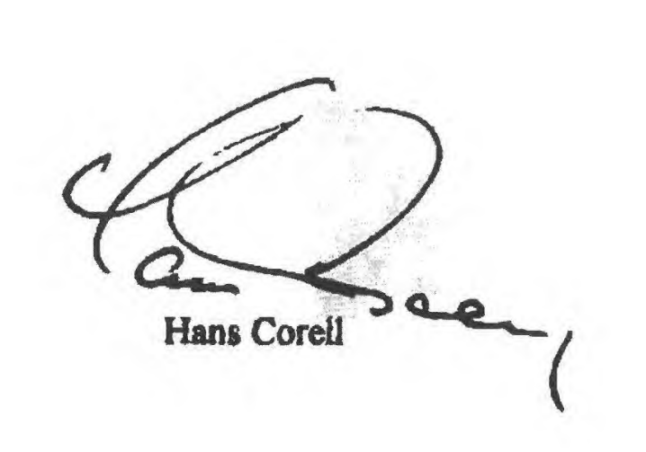

# Loi du 9 mars 2022 portant approbation du Protocole contre la fabrication et le trafic illicites d’armes à feu, de leurs pièces, éléments et munitions, additionnel à la Convention des Nations Unies contre la criminalité transnationale organisée, fait à New York, le 31 mai 2001.

Nous Henri, Grand-Duc de Luxembourg, Duc de Nassau,

Notre Conseil d’État entendu ;

De l’assentiment de la Chambre des Députés ;

Vu la décision de la Chambre des Députés du 20 janvier 2022 et celle du Conseil d’État du 1er février 2022 portant qu’il n’y a pas lieu à second vote ;

Avons ordonné et ordonnons :

## Article unique.

Est approuvé le Protocole contre la fabrication et le trafic illicites d’armes à feu, de leurs pièces, éléments et munitions, additionnel à la [Convention des Nations Unies contre la criminalité transnationale organisée](https://legilux.public.lu/eli/etat/leg/loi/2007/12/18/n4/jo), adopté par l’Assemblée générale des Nations Unies le 31 mai 2001.

Mandons et ordonnons que la présente loi soit insérée au Journal officiel du Grand-Duché de Luxembourg pour être exécutée et observée par tous ceux que la chose concerne.

Le Ministre des Affaires étrangères et européennes,   Jean Asselborn   La Ministre de la Justice,   Sam Tanson

Château de Berg, le 9 mars 2022.   Henri

\**PROTOCOLE CONTRE LA FABRICATION  ET LE TRAFIC ILLICITES D’ARMES À FEU, DE LEURS PIÈCES, ÉLÉMENTS ET MUNITIONS, ADDITIONNEL À LA CONVENTION DES NATIONS UNIES CONTRE LA CRIMINALITÉ TRANSNATIONALE ORGANISÉE**

\**Préambule**

\*Les États Parties au présent Protocole,*

\*Conscients* qu’il est urgent de prévenir, de combattre et d’éradiquer la fabrication et le trafic illicites des armes à feu, de leurs pièces, éléments et munitions, étant donné que ces activités sont préjudiciables à la sécurité de chaque État, de chaque région et du monde dans son ensemble, qu’elles constituent une menace pour le bien-être des peuples, pour leur promotion sociale et économique et pour leur droit à vivre en paix,

\*Convaincus*, par conséquent, qu’il est nécessaire que tous les États prennent toutes les mesures appropriées à cette fin, y compris des activités de coopération internationale et d’autres mesures aux niveaux régional et mondial,

\*Rappelant* la résolution 53/111 de l’Assemblée générale du 9 décembre 1998, dans laquelle l’Assemblée a décidé de créer un comité intergouvernemental spécial à composition non limitée chargé d’élaborer une convention internationale générale contre la criminalité transnationale organisée et d’examiner s’il y avait lieu d’élaborer, notamment, un instrument international visant à lutter contre la fabrication et le trafic illicites d’armes à feu, de leurs pièces, éléments et munitions,

\*Ayant à l’esprit* le principe de l’égalité de droits des peuples et de leur droit à disposer d’eux-mêmes, tel que consacré dans la Charte des Nations Unies et dans la Déclaration relative aux principes du droit international touchant les relations amicales et la coopération entre les États conformément à la Charte des Nations Unies,

\*Convaincus* que le fait d’adjoindre à la [Convention des Nations Unies contre la criminalité transnationale organisée](https://legilux.public.lu/eli/etat/leg/loi/2007/12/18/n4/jo) un instrument international contre la fabrication et le trafic illicites d’armes à feu, de leurs pièces, éléments et munitions aidera à prévenir et à combattre ce type de criminalité,

\*Sont convenus de ce qui suit* :

## I — Dispositions générales

### *Article premier* — *Relation avec la Convention des Nations Unies* *contre la criminalité transnationale organisée*

1\. Le présent Protocole complète la [Convention des Nations Unies contre la criminalité transnationale organisée](https://legilux.public.lu/eli/etat/leg/loi/2007/12/18/n4/jo). Il est interprété conjointement avec la [Convention](https://legilux.public.lu/eli/etat/leg/loi/2007/12/18/n4/jo).

2\. Les dispositions de la [Convention](https://legilux.public.lu/eli/etat/leg/loi/2007/12/18/n4/jo) s’appliquent *mutatis mutandis* au présent Protocole, sauf disposition contraire dudit Protocole.

3\. Les infractions établies conformément à l’article 5 du présent Protocole sont considérées comme des infractions établies conformément à la [Convention](https://legilux.public.lu/eli/etat/leg/loi/2007/12/18/n4/jo).

### *Article 2 * — *Objet*

Le présent Protocole a pour objet de promouvoir, de faciliter et de renforcer la coopération entre les États Parties en vue de prévenir, de combattre et d’éradiquer la fabrication et le trafic illicites des armes à feu, de leurs pièces, éléments et munitions.

### *Article 3 * — *Terminologie*

Aux fins du présent Protocole :

a) L’expression « arme à feu » désigne toute arme à canon portative qui propulse des plombs, une balle ou un projectile par l’action d’un explosif, ou qui est conçue pour ce faire ou peut être aisément transformée à cette fin, à l’exclusion des armes à feu anciennes ou de leurs répliques. Les armes à feu anciennes et leurs répliques sont définies conformément au droit interne. Cependant, les armes à feu anciennes n’incluent en aucun cas les armes à feu fabriquées après 1899;

b) L’expression « pièces et éléments » désigne tout élément ou élément de remplacement spécifiquement conçu pour une arme à feu et indispensable à son fonctionnement, notamment le canon, la carcasse ou la boîte de culasse, la glissière ou le barillet, la culasse mobile ou le bloc de culasse, ainsi que tout dispositif conçu ou adapté pour atténuer le bruit causé par un tir d’arme à feu;

c) Le terme « munitions » désigne l’ensemble de la cartouche ou ses éléments, y compris les étuis, les amorces, la poudre propulsive, les balles ou les projectiles, utilisés dans une arme à feu, sous réserve que lesdits éléments soient eux-mêmes soumis à autorisation dans l’État Partie considéré;

d) L’expression « fabrication illicite » désigne la fabrication ou l’assemblage d’armes à feu, de leurs pièces et éléments ou de munitions :

i)  À partir de pièces et d’éléments ayant fait l’objet d’un trafic illicite;

ii) Sans licence ou autorisation d’une autorité compétente par l’État Partie dans lequel la fabrication ou l’assemblage a eu lieu; ou

iii) Sans marquage des armes à feu au moment de leur fabrication conformément à l’article 8 du présent Protocole;

Des licences ou autorisations de fabrication de pièces et d’éléments sont délivrées conformément au droit interne;

e) L’expression « trafic illicite » désigne l’importation, l’exportation, l’acquisition, la vente, la livraison, le transport ou le transfert d’armes à feu, de leurs pièces, éléments et munitions à partir du territoire d’un État Partie ou à travers ce dernier vers le territoire d’un autre État Partie si l’un des États Parties concernés ne l’autorise pas conformément aux dispositions du présent Protocole ou si les armes à feu ne sont pas marquées conformément à l’article 8 du présent Protocole;

f) Le terme « traçage » désigne le suivi systématique du parcours des armes à feu et, si possible, de leurs pièces, éléments et munitions depuis le fabricant jusqu’à l’acheteur en vue d’aider les autorités compétentes des États Parties à déceler et analyser la fabrication et le trafic illicites et à mener des enquêtes.

### *Article 4 * — *Champ d’application*

1\. Le présent Protocole s’applique, sauf disposition contraire, à la prévention de la fabrication et du trafic illicites des armes à feu, de leurs pièces, éléments et munitions et aux enquêtes et poursuites relatives aux infractions établies conformément à l’article 5 dudit Protocole, lorsque ces infractions sont de nature transnationale et qu’un groupe criminel organisé y est impliqué.

2\. Le présent Protocole ne s’applique pas aux transactions entre États ou aux transferts d’État dans les cas où son application porterait atteinte au droit d’un État Partie de prendre, dans l’intérêt de la sécurité nationale, des mesures compatibles avec la Charte des Nations Unies.

### *Article 5 * — *Incrimination*

1\. Chaque État Partie adopte les mesures législatives et autres nécessaires pour conférer le caractère d’infraction pénale lorsque les actes ont été commis intentionnellement :

a) À la fabrication illicite d’armes à feu, de leurs pièces, éléments et munitions;

b) Au trafic illicite d’armes à feu, de leurs pièces, éléments et munitions;

c) À la falsification ou à l’effacement, à l’enlèvement ou à l’altération de façon illégale de la (des) marque(s) que doit porter une arme à feu en vertu de l’article 8 du présent Protocole.

2\. Chaque État partie adopte également les mesures législatives et autres nécessaires pour conférer le caractère d’infraction pénale :

a) Sous réserve des concepts fondamentaux de son système juridique, au fait de tenter de commettre une infraction établie conformément au paragraphe 1 du présent article ou de s’en rendre complice; et

b) Au fait d’organiser, de diriger, de faciliter, d’encourager ou de favoriser au moyen d’une aide ou de conseils, la commission d’une infraction établie conformément au paragraphe 1 du présent article.

### *Article 6 * — *Confiscation, saisie et disposition*

1\. Sans préjudice de l’article 12 de la [Convention](https://legilux.public.lu/eli/etat/leg/loi/2007/12/18/n4/jo), les États Parties adoptent, dans toute la mesure possible dans le cadre de leurs systèmes juridiques nationaux, les mesures nécessaires pour permettre la confiscation des armes à feu, de leurs pièces, éléments et munitions ayant fait l’objet d’une fabrication ou d’un trafic illicites.

2\. Les États Parties adoptent, dans le cadre de leurs systèmes juridiques nationaux, les mesures nécessaires pour empêcher que les armes à feu, leurs pièces, éléments et munitions ayant fait l’objet d’une fabrication et d’un trafic illicites ne tombent entre les mains de personnes non autorisées en saisissant et détruisant lesdites armes, leurs pièces, éléments et munitions sauf si une autre mesure de disposition a été officiellement autorisée, à condition que ces armes aient été marquées et que les méthodes de disposition desdites armes et des munitions aient été enregistrées.

## II — Prévention

### *Article 7 * — *Conservation des informations*

Chaque État Partie assure la conservation, pendant au moins dix ans, des informations sur les armes à feu et, lorsqu’il y a lieu et si possible, sur leurs pièces, éléments et munitions, qui sont nécessaires pour assurer le traçage et l’identification de celles de ces armes à feu et, lorsqu’il y a lieu et si possible, de leurs pièces, éléments et munitions qui font l’objet d’une fabrication ou d’un trafic illicites ainsi que pour prévenir et détecter ces activités. Ces informations sont les suivantes :

a) Les marques appropriées requises en vertu de l’article 8 du présent Protocole;

b) Dans le cas de transactions internationales portant sur des armes à feu, leurs pièces, éléments et munitions, les dates de délivrance et d’expiration des licences ou autorisations voulues, le pays d’exportation, le pays d’importation, les pays de transit, le cas échéant, et le destinataire final ainsi que la description et la quantité des articles.

### *Article 8 * — *Marquage des armes à feu*

1\. Aux fins de l’identification et du traçage de chaque arme à feu, les États Parties :

a) Au moment de la fabrication de chaque arme à feu, soit exigent un marquage unique indiquant le nom du fabricant, le pays ou le lieu de fabrication et le numéro de série, soit conservent tout autre marquage unique et d’usage facile comportant des symboles géométriques simples combinés à un code numérique et/ou alphanumérique, permettant à tous les États d’identifier facilement le pays de fabrication;

b) Exigent un marquage approprié simple sur chaque arme à feu importée, permettant d’identifier le pays importateur et, si possible, l’année d’importation et rendant possible le traçage de l’arme à feu par les autorités compétentes de ce pays, ainsi qu’une marque unique, si l’arme à feu ne porte pas une telle marque. Les conditions énoncées au présent alinéa n’ont pas à être appliquées aux importations temporaires d’armes à feu à des fins licites vérifiables;

c) Assurent, au moment du transfert d’une arme à feu des stocks de l’État en vue d’un usage civil permanent, le marquage approprié unique permettant à tous les États Parties d’identifier le pays de transfert.

2\. Les États Parties encouragent l’industrie des armes à feu à concevoir des mesures qui empêchent d’enlever ou d’altérer les marques.

### *Article 9 * — *Neutralisation des armes à feu*

Un État Partie qui, dans son droit interne, ne considère pas une arme à feu neutralisée comme une arme à feu prend les mesures nécessaires, y compris l’établissement d’infractions spécifiques, s’il y a lieu, pour prévenir la réactivation illicite des armes à feu neutralisées, conformement aux principes généraux de neutralisation ci-après :

\*a)* Rendre définitivement inutilisables et impossibles à enlever, remplacer ou modifier en vue d’une réactivation quelconque, toutes les parties essentielles d’une arme à feu neutralisée;

\*b)* Prendre des dispositions pour, s’il y a lieu, faire vérifier les mesures de neutralisation par une autorité compétente, afin de garantir que les modifications apportées à une arme à feu la rendent définitivement inutilisable;

\*c)* Prévoir dans le cadre de la vérification par l’autorité compétente la délivrance d’un certificat ou d’un document attestant la neutralisation de l’arme à feu, ou l’application à cet effet sur l’arme à feu d’une marque clairement visible.

### *Article 10 * — *Obligations générales concernant les systèmes de licences ou d’autorisations d’exportation, d’importation et de transit*

1\. Chaque État Partie établit ou maintient un système efficace de licences ou d’autorisations d’exportation et d’importation, ainsi que de mesures sur le transit international, pour le transfert d’armes à feu, de leurs pièces, éléments et munitions.

2\. Avant de délivrer des licences ou autorisations d’exportation pour des envois d’armes à feu, de leurs pièces, éléments et munitions, chaque État Partie vérifie que :

a) Les États importateurs ont délivré des licences ou autorisations d’importation; et

b) Les États de transit ont au moins notifié par écrit, avant l’envoi, qu’ils ne s’opposent pas au transit, ceci sans préjudice des accords ou arrangements bilatéraux et multilatéraux en faveur des États sans littoral.

3\. La licence ou l’autorisation d’exportation et d’importation et la documentation qui l’accompagne contiennent des informations qui, au minimum, incluent le lieu et la date de délivrance, la date d’expiration, le pays d’exportation, le pays d’importation, le destinataire final, la désignation des armes à feu, de leurs pièces, éléments et munitions et leur quantité et, en cas de transit, les pays de transit. Les informations figurant dans la licence d’importation doivent être fournies à l’avance aux États de transit.

4\. L’État Partie importateur informe l’État Partie exportateur sur sa demande, de la réception des envois d’armes à feu, de leurs pièces et éléments ou de munitions.

5\. Chaque État Partie prend, dans la limite de ses moyens, les mesures nécessaires pour faire en sorte que les procédures d’octroi de licences ou d’autorisations soient sûres et que l’authenticité des licences ou autorisations puisse être vérifiée ou validée.

6\. Les États Parties peuvent adopter des procédures simplifiées pour l’importation et l’exportation temporaires et pour le transit d’armes à feu, de leurs pièces, éléments et munitions, à des fins légales vérifiables telles que la chasse, le tir sportif, l’expertise, l’exposition ou la réparation.

### *Article 11 * — *Mesures de sécurité et de prévention*

Afin de détecter, de prévenir et d’éliminer les vols, pertes ou détournements, ainsi que la fabrication et le trafic illicites d’armes à feu, de leurs pièces, éléments et munitions, chaque État Partie prend les mesures appropriées :

a) Pour exiger la sécurité des armes à feu, de leurs pièces, éléments et munitions au moment de la fabrication, de l’importation, de l’exportation et du transit par son territoire; et

b) Pour accroître l’efficacité des contrôles des importations, des exportations et du transit, y compris, lorsqu’il y a lieu, des contrôles aux frontières, ainsi que l’efficacité de la coopération transfrontière entre la police et les services douaniers.

### *Article 12 * — *Information*

1\. Sans préjudice des articles 27 et 28 de la [Convention](https://legilux.public.lu/eli/etat/leg/loi/2007/12/18/n4/jo), les États Parties échangent, conformément à leurs systèmes juridiques et administratifs respectifs, des informations pertinentes, dans chaque cas d’espèce, concernant notamment les fabricants, négociants, importateurs, exportateurs et, chaque fois que cela est possible, transporteurs autorisés d’armes à feu, de leurs pièces, éléments et munitions.

2\. Sans préjudice des articles 27 et 28 de la [Convention,](https://legilux.public.lu/eli/etat/leg/loi/2007/12/18/n4/jo) les États Parties échangent, conformément à leurs systèmes juridiques et administratifs respectifs, des informations pertinentes concernant notamment:

a) Les groupes criminels organisés dont on sait ou dont on soupçonne qu’ils participent à la fabrication ou au trafic illicites d’armes à feu, de leurs pièces, éléments et munitions;

b) Les moyens de dissimulation utilisés dans la fabrication ou le trafic illicites des armes à feu, de leurs pièces, éléments et munitions et les moyens de les détecter;

c) Les méthodes et moyens, les points d’expédition et de destination et les itinéraires habituellement utilisés par les groupes criminels organisés se livrant au trafic illicite d’armes à feu, de leurs pièces, éléments et munitions; et

d) Les données d’expérience d’ordre législatif ainsi que les pratiques et mesures tendant à prévenir, combattre et éradiquer la fabrication et le trafic illicites des armes à feu, de leurs pièces, éléments et munitions.

3\. Les États Parties se communiquent ou s’échangent, selon qu’il convient, des informations scientifiques et technologiques pertinentes utiles aux services de détection et de répression en vue de renforcer mutuellement leur capacité de prévenir et de déceler la fabrication et le trafic illicites d’armes à feu, de leurs pièces, éléments et munitions, de mener des enquêtes et d’engager des poursuites contre les personnes impliquées dans ces activités illicites.

4\. Les États Parties coopèrent pour le traçage des armes à feu, de leurs pièces, éléments et munitions ayant pu faire l’objet d’une fabrication ou d’un trafic illicites et ils répondent rapidement, dans la limite de leurs moyens, aux demandes d’aide dans ce domaine.

5\. Sous réserve des concepts fondamentaux de son système juridique ou de tous accords internationaux, chaque État Partie, qui reçoit d’un autre État Partie, en application du présent article, des informations, y compris des informations exclusives concernant des transactions commerciales, garantit leur confidentialité et respecte toutes restrictions à leur usage s’il en est prié par l’État Partie qui les fournit. Si une telle confidentialité ne peut pas être assurée, l’État Partie qui a fourni les informations en est avisé avant que celles-ci soient divulguées.

### *Article 13 * — *Coopération*

1\. Les États Parties coopèrent aux niveaux bilatéral, régional et international pour prévenir, combattre et éradiquer la fabrication et le trafic illicites d’armes à feu, de leurs pièces, éléments et munitions.

2\. Sans préjudice du paragraphe 13 de l’article 18 de la [Convention](https://legilux.public.lu/eli/etat/leg/loi/2007/12/18/n4/jo), chaque État Partie désigne un organisme national ou un point de contact unique chargé d’assurer la liaison avec d’autres États Parties pour les questions relatives au présent Protocole.

3\. Les États Parties cherchent à obtenir l’appui et la coopération des fabricants, négociants, importateurs, exportateurs, courtiers et transporteurs commerciaux d’armes à feu, de leurs pièces, éléments et munitions afin de prévenir et de détecter les activités illicites visées au paragraphe 1 du présent article.

### *Article 14 * — *Formation et assistance technique*

1\. Les États Parties coopèrent entre eux et avec les organisations internationales compétentes, selon qu’il convient, de façon à pouvoir recevoir, sur demande, la formation et l’assistance technique nécessaires pour améliorer leur capacité de prévenir, combattre et éradiquer la fabrication et le trafic illicites d’armes à feu, de leurs pièces, éléments et munitions, y compris une assistance technique, financière et matérielle pour les questions visées aux articles 29 et 30 de la [Convention](https://legilux.public.lu/eli/etat/leg/loi/2007/12/18/n4/jo).

### *Article 15 * — *Courtiers et courtage*

1\. En vue de prévenir et de combattre la fabrication et le trafic illicites d’armes à feu, de leurs pièces, éléments et munitions, les États Parties qui ne l’ont pas encore fait envisagent d’établir un système de réglementation des activités de ceux qui pratiquent le courtage. Un tel système pourrait inclure une ou plusieurs mesures telles que :

a) L’exigence d’un enregistrement des courtiers exerçant sur leur territoire;

b) L’exigence d’une licence ou d’une autorisation de courtage;

ou

c) L’exigence de l’indication sur les licences ou autorisations d’importation et d’exportation, ou sur les documents d’accompagnement, du nom et de l’emplacement des courtiers participant à la transaction.

2\. Les États Parties qui ont établi un système d’autorisations concernant le courtage, tel qu’énoncé au paragraphe 1 du présent article, sont encouragés à fournir des renseignements sur les courtiers et le courtage lorsqu’ils échangent des informations au titre de l’article 12 du présent Protocole et à conserver les renseignements relatifs aux courtiers et au courtage conformément à l’article 7 du présent Protocole.

## III — Dispositions finales

### *Article 16 * — *Règlement des différends*

1\. Les États Parties s’efforcent de régler les différends concernant l’interprétation ou l’application du présent Protocole par voie de négociation.

2\. Tout différend entre deux États Parties ou plus concernant l’interprétation ou l’application du présent Protocole qui ne peut être réglé par voie de négociation dans un délai raisonnable est, à la demande de l’un de ces États Parties, soumis à l’arbitrage. Si, dans un délai de six mois à compter de la date de la demande d’arbitrage, les États Parties ne peuvent s’entendre sur l’organisation de l’arbitrage, l’un quelconque d’entre eux peut soumettre le différend à la Cour internationale de Justice en adressant une requête conformément au Statut de la Cour.

3\. Chaque État Partie peut, au moment de la signature, de la ratification, de l’acceptation ou de l’approbation du présent Protocole ou de l’adhésion à celui-ci, déclarer qu’il ne se considère pas lié par le paragraphe 2 du présent article. Les autres États Parties ne sont pas liés par le paragraphe 2 du présent article envers tout État Partie ayant émis une telle réserve.

4\. Tout État Partie qui a émis une réserve en vertu du paragraphe 3 du présent article peut la retirer à tout moment en adressant une notification au Secrétaire général de l’Organisation des Nations Unies.

### *Article 17 * — *Signature, ratification, acceptation, approbation et adhésion*

1\. Le présent Protocole sera ouvert à la signature de tous les États au Siège de l’Organisation des Nations Unies, à New York, à compter du trentième jour suivant son adoption par l’Assemblée générale et jusqu’au 12 décembre 2002.

2\. Le présent Protocole est également ouvert à la signature des organisations régionales d’intégration économique à la condition qu’au moins un État membre d’une telle organisation ait signé le présent Protocole conformément au paragraphe 1 du présent article.

3\. Le présent Protocole est soumis à ratification, acceptation ou approbation. Les instruments de ratification, d’acceptation ou d’approbation seront déposés auprès du Secrétaire général de l’Organisation des Nations Unies. Une organisation régionale d’intégration économique peut déposer ses instruments de ratification, d’acceptation ou d’approbation si au moins un de ses États membres l’a fait. Dans cet instrument de ratification, d’acceptation ou d’approbation, cette organisation déclare l’étendue de sa compétence concernant les questions régies par le présent Protocole. Elle informe également le dépositaire de toute modification pertinente de l’étendue de sa compétence.

4\. Le présent Protocole est ouvert à l’adhésion de tout État ou de toute organisation régionale d’intégration économique dont au moins un État membre est Partie au présent Protocole. Les instruments d’adhésion sont déposés auprès du Secrétaire général de l’Organisation des Nations Unies. Au moment de son adhésion, une organisation régionale d’intégration économique déclare l’étendue de sa compétence concernant les questions régies par le présent Protocole. Elle informe également le dépositaire de toute modification pertinente de l’étendue de sa compétence.

### *Article 18 * — *Entrée en vigueur*

1\. Le présent Protocole entrera en vigueur le quatre-vingt-dixième jour suivant la date de dépôt du quarantième instrument de ratification, d’acceptation, d’approbation ou d’adhésion, étant entendu qu’il n’entrera pas en vigueur avant que la [Convention](https://legilux.public.lu/eli/etat/leg/loi/2007/12/18/n4/jo) n’entre elle-même en vigueur. Aux fins du présent paragraphe, aucun des instruments déposés par une organisation régionale d’intégration économique n’est considéré comme un instrument venant s’ajouter aux instruments déjà déposés par les États membres de cette organisation.

2\. Pour chaque État ou organisation régionale d’intégration économique qui ratifiera, acceptera ou approuvera le présent Protocole ou y adhérera après le dépôt du quarantième instrument pertinent, le présent Protocole entrera en vigueur le trentième jour suivant la date de dépôt de l’instrument pertinent par ledit État ou ladite organisation ou à la date à laquelle il entre en vigueur en application du paragraphe 1 du présent article, si celle-ci est postérieure.

### *Article 19 * — *Amendement*

1\. À l’expiration d’un délai de cinq ans à compter de l’entrée en vigueur du présent Protocole, un État Partie au Protocole peut proposer un amendement et en déposer le texte auprès du Secrétaire général de l’Organisation des Nations Unies. Ce dernier communique alors la proposition d’amendement aux États Parties et à la Conférence des Parties à la [Convention](https://legilux.public.lu/eli/etat/leg/loi/2007/12/18/n4/jo) en vue de l’examen de la proposition et de l’adoption d’une décision. Les États Parties au présent Protocole réunis en Conférence des Parties n’épargnent aucun effort pour parvenir à un consensus sur tout amendement. Si tous les efforts en ce sens ont été épuisés sans qu’un accord soit intervenu, il faudra, en dernier recours, pour que l’amendement soit adopté, un vote à la majorité des deux tiers des États Parties au présent Protocole présents à la Conférence des Parties et exprimant leur vote.

2\. Les organisations régionales d’intégration économique disposent, pour exercer, en vertu du présent article, leur droit de vote dans les domaines qui relèvent de leur compétence, d’un nombre de voix égal au nombre de leurs États membres Parties au présent Protocole. Elles n’exercent pas leur droit de vote si leurs États membres exercent le leur, et inversement.

3\. Un amendement adopté conformément au paragraphe 1 du présent article est soumis à ratification, acceptation ou approbation des États Parties.

4\. Un amendement adopté conformément au paragraphe 1 du présent article entrera en vigueur pour un État Partie quatre-vingt-dix jours après la date de dépôt par ledit État Partie auprès du Secrétaire général de l’Organisation des Nations Unies d’un instrument de ratification, d’acceptation ou d’approbation dudit amendement.

5\. Un amendement entré en vigueur a force obligatoire à l’égard des États Parties qui ont exprimé leur consentement à être liés par lui. Les autres États Parties restent liés par les dispositions du présent Protocole et tous amendements antérieurs qu’ils ont ratifiés, acceptés ou approuvés.

### *Article 20 * — *Dénonciation*

1\. Un État Partie peut dénoncer le présent Protocole par notification écrite adressée au Secrétaire général de l’Organisation des Nations Unies. Une telle dénonciation prend effet un an après la date de réception de la notification par le Secrétaire général.

2\. Une organisation régionale d’intégration économique cesse d’être Partie au présent Protocole lorsque tous ses États membres l’ont dénoncé.

### *Article 21 * — *Dépositaire et langues*

1\. Le Secrétaire général de l’Organisation des Nations Unies est le dépositaire du présent Protocole.

2\. L’original du présent Protocole, dont les textes anglais, arabe, chinois, espagnol, français et russe font également foi, sera déposé auprès du Secrétaire général de l’Organisation des Nations Unies.

EN FOI DE QUOI, les plénipotentiaires soussignés, à ce dûment autorisés par leurs gouvernements respectifs, ont signé le présent Protocole.

<table>
<tr>
<td>I hereby certify that the foregoing text is a true copy of the Protocol against the Illicit Manufacturing of and Trafficking in Firearms, Their Parts and Components and Ammunition, supplementing the United Nations Convention against Transnational Organized Crime, adopted by the General Assembly of the United Nations on 31 May 2001, the original of which is deposited with the Secretary-General of the United Nations.</td>
<td></td>
<td>Je certifie que le texte qui précède est une copie conforme du Protocole contre la fabrication d’armes à feu, de leurs pièces, éléments et munitions, additionnel à la <a href="https://legilux.public.lu/eli/etat/leg/loi/2007/12/18/n4/jo">Convention des Nations Unies contre la criminalité transnationale organisée</a>, adopté par l’Assemblée générale des Nations Unies le 31 mai 2001, dont l’original se trouve déposé auprès du Secrétaire général de l’Organisation des Nations Unies.</td>
</tr>
<tr>
<td>For the Secretary-General, The Legal Counsel (Under-Secretary-General for Legal Affairs)</td>
<td></td>
<td>Pour le Secrétaire général, Le Conseiller juridique (Secrétaire général adjoint aux affaires juridiques)</td>
</tr>
<tr>
<td colspan="3"></td>
</tr>
<tr>
<td>United Nations New York 26 June 2001</td>
<td></td>
<td>Organisation des Nations Unies New York Le 26 juin 2001</td>
</tr>
</table>

Doc. parl. [7428](https://legilux.public.lu/eli/etat/projet/pl/10540) ; sess. ord. 2018-2019, 2019-2020, 2020-2021 et 2021-2022.
